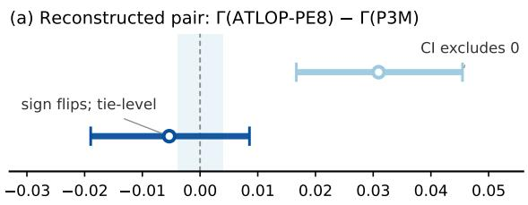
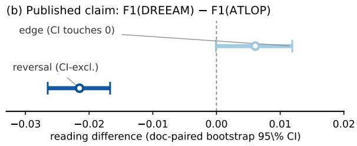
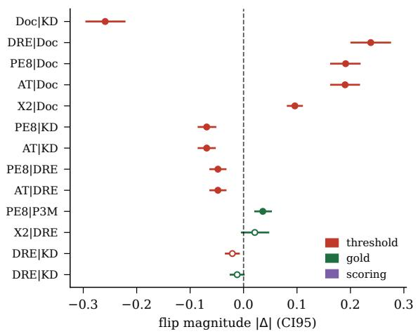
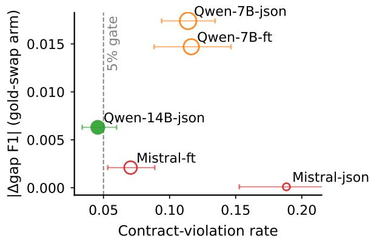
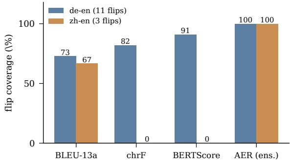
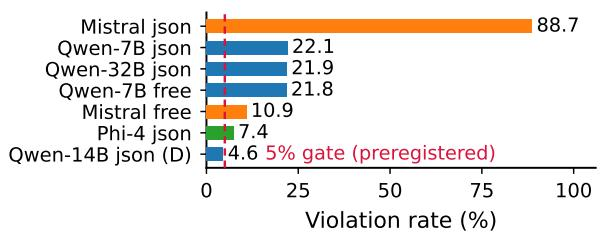
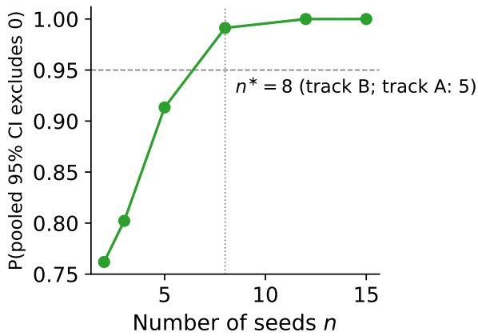
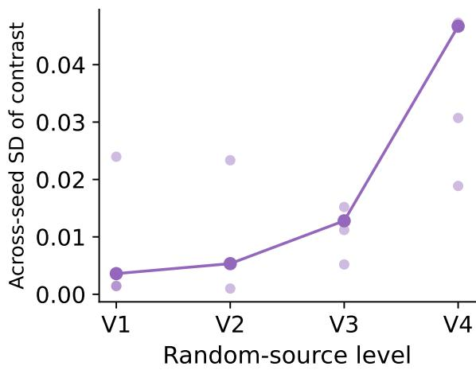

# Evaluation Contracts and Evaluation Leverage: Sliced-Gap Readings in Structured Prediction Can Move Without Model Change

Hao Lu Weixing Zhu∗ Ruiyang Li

Army Engineering University of PLA, Nanjing, China

luhao\_0210@163.com zwx@aeu.edu.cn lry130923@aeu.edu.cn

## Abstract

NLP evaluation reports routinely cite sliced performance differences, most prominently the intra–inter gap in document-level relation extraction, as capability evidence. We show that such gap readings are joint properties of models and evaluation contracts: scoring function, gold version, threshold, output format, and prompt language. With predictions frozen, a method ordering reverses under a gold-standard exchange (+0.0363, CI excluding zero; tielevel after), movement localizing where gold re-partitions: renames are gauge transformations (∆ = 0; re-annotation +0.862). We formalize this as an evaluation leverage account centered on the rank-flip condition. Constructively, the audited evaluation reading (AER) is a contract-marginalized, tie-declared, seed-prescribed, gate-filtered procedure whose tie declarations cover every contract-induced flip on the declared WMT19 grids (14/14; held-out 73% vs. union-of-ties 89%), matching the best single metric contract at ϵ=0.10 equivalence. Evidence spans DocRE, HacRED, a UD probe, and released gold revisions; an alternativereference-set replication extends it beyond our testbeds. Failed predictions retained as boundaries; a 5% violation gate flags unverifiable settings and bounds survivorselection bias. We release EvalLever, a preregistered workflow with an amendment trail; on LLM-as-judge grids, the audited ensemble stabilizes every unstable pair (13– 15 to zero; generic ensemble shrinkage: the preregistered correlation criterion failed, the companion stabilization criterion passed).

## 1 Introduction

Evaluation reports steer NLP, yet their readings are increasingly distrusted: rankings disagree across benchmarks, results fail to replicate under seed resampling, and selective reporting skews the literature. Treated separately, these ailments share a root cause: for a widely used family of readings (sliced performance differences, the slicedgap readings of the title), each reading is a function of evaluation contracts that are rarely frozen, reported, or audited. Each mechanism has been observed piecemeal: gold revisions reorder rankings (Tan et al., 2022b), metric reuse distorts readouts (Pombal et al., 2025), prompt formatting shifts scores (Sclar et al., 2024), label-error audits shift reported performance (Nahum et al., 2024; Neuhaus and Hein, 2025), but as unrelated anomalies. To our knowledge, such choices have not been formalized as a contract object with measurable coordinates, a derived invariance, a registered flip condition, or tie-aware readings covering contract-induced flips, the steps this paper takes; frozen-prediction re-scoring under released golds has precedents (Northcutt et al., 2021; Gema et al., 2025; Alt et al., 2020) that we extend, not replace. Propositions 2–3 and Sections 7–8 respond in turn.

Consider two published methods for documentlevel relation extraction (DocRE) (Yao et al., 2019) (an ATLOP-style encoder (Zhou et al., 2021) and the PU-metric-learning model P3M) on the same 498-document DocRED development subset (189,556 frozen candidate pairs). Under the original DocRED gold standard (gD), the intra– inter gap of the ATLOP-style variant exceeds P3M’s by +0.0309 (CI [+0.0167, +0.0455], excluding zero). Switch only the gold standard, to the revised Re-DocRED projection (gR), published precisely to fix false negatives, and the ordering reverses (−0.0053, CI $\left[ - 0 . 0 1 9 0 , + 0 . 0 0 8 6 \right] )$ ; the flip magnitude +0.0363 (CI [+0.0204, +0.0529]) excludes zero. Neither model changed a single prediction; the arm-level movement replicates on a held-out revised population (§4.3). A claim of the form “our model narrows the intra–inter gap” is thus not guaranteed to be a property of the models: it is jointly a property of the models and a contract the claim never states. Figure 1 previews both readings with paired CIs: the same comparison reads as an edge, a tie, or a reversal depending on the contract alone.

  
Figure 1: One claim, two readings (doc-paired bootstrap 95% CIs; whiskers crossing or touching zero declare a tie; shading: ±.0039 floor (signsymmetrized), §7). Point-estimate flip magnitude +0.0363 [+0.0204, +0.0529]. (a) Reconstructed pair Γ(ATLOP-PE8)−Γ(P3M): under the released gold gD (light) the interval excludes zero; under the re-annotated $g _ { R }$ (dark) it crosses zero: the edge survives only at tie level. (b) Published claim F1(DREEAM)−F1(ATLOP): the $g _ { D }$ reading is tielevel (interval touching zero) while the $g _ { R }$ interval excludes zero on the opposite side: the ordering reverses without any model change. Unlike point-estimate rescorings, intervals separate edges from reversals.

We contribute (i) aformal account ofevaluation leverage (four propositions with explicit assumptions and tested boundaries, all projections of one reading $\rho ( M , c ) )$ , stating when contract changes move readings and rankings, and when they provably cannot: rename-only revisions are gauge transformations whose arm is zero by derivation (Section 3); (ii) a demonstration across task families: with predictions frozen, a reconstructed ordering reverses under the gold standard at the point-estimate level, arms recur across the remaining coordinates (flips only where arms are long and signs contrastive), with a violation surface for prompted predictors; negative results retained (Sections 4–7); (iii) a construction: the audited evaluation reading (AER: contract marginalization, tie declarations, a measurement prescription, and a validity gate), validated on official human anchors, matching the best single metric contract at ϵ=0.10 equivalence on the WMT19 grids (a point-level edge on de-en only), tie declarations covering every flip on the declared grids (73% held out; Section 5); and (iv) a prescription: freeze, state, and audit the contract, with seed prescriptions, evidence tiers, and EvalLever1 (Sections 7–8). Together they form a normative baseline (freeze, report with ties, gate) at checklist cost (Section 8) on any task satisfying the applicability criterion. Where the data contradict a preregistered prediction we say so. Scope: deeply validated on DocRE, HacRED, and a UD probe; boundary results (Section 6) mark where it fails.

## 2 Related Work

Gold revision and evaluation bias. Gold revisions reorder rankings: Re-DocRED (Tan et al., 2022b), TACREV/Re-TACRED (Alt et al., 2020; Stoica et al., 2021), label-error re-annotation (Nahum et al., 2024; Neuhaus and Hein, 2025; Gema et al., 2025), and re-scoring under corrected labels (Northcutt et al., 2021). ReCOGS’s renameinvariance (Wu et al., 2023) and guidelinecentered annotation (Ruggeri et al., 2026) presage our gauge principle. We complement: holding predictions fixed, we measure the leverage of switching among released golds, rather than producing a corrected dataset. Closest in spirit, Opitz (2024) and Chen and Tanaka-Ishii (2026) diagnose under-specified evaluation; we quantify how much a reading moves across the legal alternatives.

Variance, seeds, and significance. Seed variance and significance protocols address trainingside variance (Bouthillier et al., 2021; Dror et al., 2018; Card et al., 2020); conformal evaluation attaches per-reading coverage (Zerva and Martins, 2024). We find variance structured by the randomness level of its effect path (Section 4.3).

Rank stability. Rank reversal under benchmark perturbation, prompt formatting, and answer extraction is the empirical backdrop (Bouthillier et al., 2021; Dodge et al., 2019; Mizrahi et al., 2024; Sclar et al., 2024). Closest to our constructive layer, Ceron et al. (2024) gate readouts on CI indifference bands; AER instead registers and marginalizes over contracts, with ties and prescribed seeds.

LLM-as-judge and prompted evaluators. LLM judges correlate with humans (Zheng et al., 2023; Liu et al., 2023b; Verga et al., 2024) while positional and self-preference biases persist (Wataoka et al., 2024; Wang et al., 2024a); none audits the judge-side axes our framework treats as coordinates (§5). Concurrent work (Chang et al., 2026; Pakhomov and Nijkamp, 2026) and Gilda and Gilda (2026) likewise call scores perishable; we operationalize the apparatus: contract object, invariance, frozen-prediction audits, constructive reading.

Metric-choice sensitivity and this account. Metric-choice sensitivity extends beyond NLP (Musgrave et al., 2020; Deutsch et al., 2021; Marie et al., 2021; Kobayashi et al., 2024; Stengel-Eskin and Van Durme, 2023; Jiang et al., 2024); the WMT metrics tasks evaluate evaluators annually (Kocmi et al., 2023; Polák et al., 2025). Each examines one instrument facet; none holds predictions fixed while switching among officially released alternatives with arms, registered flip checks, and a derived invariance (Table 12, appendix).

## 3 An Evaluation Leverage Account

(notation summary: Appendix Table 9.)

The four propositions are projections of one reading $\rho ( M , c )$ : Proposition 1 fixes c and varies $M ;$ Proposition 2 evaluates the same reading at two contracts and asks when model orderings survive; Proposition 3 decomposes the variance of $\rho$ across randomization levels; Proposition 4 separates its geometry from output validity. Proposition 2, with the rename invariance of Section 3.1, is the account’s center. Status: the rename invariance (§3.1) is derived, and Propositions 1–3 each carry a derived formal core, Lemma A (the disagreement-set upper bound), Lemma B (the noflip margin guarantee), and Theorem C (the variance ordering under nested randomization), whose assumptions and residual slack the empirical sections test; Proposition 4 remains observational.

## 3.1 Formalization

An evaluation contract $c = ( s , g , \tau , f , \ell )$ specifies a scoring function s, a gold-standard version $g$ (officially released alternates, not ad-hoc corrections), a decision-threshold policy τ, an output format $f ,$ and a prompt language ℓ. The evaluation reading $\rho ( M , c )$ is any real-valued quantity an evaluator reports as capability evidence; the sliced gap $\Gamma ( M , c ) = s ( \mathrm { i n t r a } \mid M , c ) - s ( \mathrm { i n t e r } \mid M , c )$ (neither a property of the model alone nor of the contract alone, but of their interaction) is the primary instance studied. Propositions are stated on $\rho ;$ empirics instantiate it at Γ (other instances in §4.4) unless noted. Throughout: arm $= | \Delta \rho |$ (movement under a contract change); flip (rank reversal); violation (output failing structural grounding; notation: Table 9, appendix). Predictions are fixed for $s , g , \tau ; \ f , \ell$ regenerate outputs; the realizing parser is a de-facto sixth axis folded into $f$ and audited. Fixed coordinates (κ). Beyond c, readings depend on fixed coordinates κ (aggregation level, pool composition, anchor set, evaluated population); the intra/inter grouping rule rides on s, declared switchable (H-G1, Table 10). All experiments freeze κ and disclose it with the registry; the axis list is not claimed exhaustive. Operation levels. A contract switch replacing one contract with another is axis-aligned when the two differ in exactly one coordinate; the legal contract pair $( c _ { 1 } , c _ { 2 } )$ is the object over which arms and the flip condition (§3.3) are quantified; all switches below are axis-aligned unless stated.

Rename invariance (gauge). Statement. A gold revision that only renames the label inventory, $\begin{array} { l l l } { \boldsymbol { g ^ { \prime } } } & { = } & { \boldsymbol { r } \circ \boldsymbol { g } } \end{array}$ for a bijection r on labels, applied by convention to both sides of every pair (gold and predictions relabeled by the same $r ;$ the conjugate action), cannot move a reading whose scorer factors through the joint (prediction, gold) partition symmetrically (accuracy and full-inventory micro-/macro-F1 do; subsetrestricted variants that exclude a distinguished class are name-anchored and satisfy the premise only when $r$ preserves the inventory). Proof. The rename applies one common label permutation to both indices of the joint-partition cell counts, which symmetric statistics cannot see; hence $\rho ( M , ( s , g ^ { \prime } , \tau , \dots ) ) = \rho ( M , ( s , g , \tau , \dots ) )$ exactly (full proof: Appendix B). A gold-sideonly relabeling (predictions still matched by their unchanged string identity) would move accuracy; the synthetic check below returns $\Delta = 0 . 0 0 0 0 0 0$ under the implemented convention, confirming the double-sided application. Consequences. Only repartitioning revisions can move a reading; scorers referencing label identity outside the gauge (name-anchored class weights, soft string matching) do not factor through the partition invariantly and can move under renames alone; psychometrics’ counterpart is facet-level invariance (generalizability theory; measurement invariance Meredith, 1993). A synthetic six-class check confirms both halves (accuracy/micro-/macro-F1 0.000000 exactly under a pure rename; −0.003 for a nameanchored weight vector), as do the UD slices (renames $\Delta = 0 . 0 0 0$ , re-annotation +0.862) and the exact character/word null (B2, Section 6).

Three quantities circulate under the name “arm”: the error-set agreement (Jaccard similarity of error sets, a between-model quantity), the disagreement-referenced leverage $\mathrm { a r m } _ { \mathcal { D } } =$ $| \hat { Y } \cap \mathcal { D } | / | \mathcal { D } |$ over the two golds’ disagreement set (model-vs-gold; the two need not agree, B1), and the realized shift $| \Delta \rho |$ , an ex-post outcome. Henceforth an unqualified “arm” denotes $| \Delta \rho |$ (Table 13, appendix).

The instruments need two testbed properties: legal contract pairs (same-data changes any evaluator could equally have chosen) and a dense disagreement set between alternatives; structured prediction supplies both, single-gold classification neither (B1, Section 6). The applicability criterion (sufficiency tested, necessity not): retrieval and MT satisfy both; code generation the contractpair criterion.

## 3.2 Proposition 1: Generator-Dependent Leverage

Statement. With data and the switched axis fixed, only the predictor varying, the realized shift $| \Delta \rho |$ grows with prediction–disagreement overlap; the claim is made at family resolution (fine-tuned encoders vs. prompted models, plus two withinfamily slices), with no monotone curve claimed (tested across the full contract registry: Section 4.2).

Formal core (Lemma A: disagreement-set upper bound). For affine count aggregates with 1- Lipschitz outer map (accuracy; micro-/macro-F1 are ratio functionals and escape the premise2, Appendix B), $\vert \rho ( M , c _ { 1 } ) - \rho ( M , c _ { 2 } ) \vert \le B \vert { \mathcal { D } } ( g _ { 1 } , g _ { 2 } ) \vert$ deterministically; $| \mathcal { D } ( g _ { 1 } , g _ { 2 } ) | / N$ for accuracy $( B { = } 1 / N )$ A model-dependent refinement:

$\begin{array} { l l l } { | \Delta \rho | } & { \leq } & { 2 \operatorname { a r m } _ { \mathcal { D } } | \mathcal { D } ( g _ { 1 } , g _ { 2 } ) | / N } \end{array}$ , coupling the bound to prediction–disagreement overlap (the quantity Proposition 1 varies). The bound is monotone in |D|, the realized shift need not be (sign cancellation; Appendix B). Empirical surplus. The family separation below is an ordering consistent with the envelope’s slack structure (accuracy instance), not an ordering of the bound itself.

Assumptions. Prediction-fixing levers $( s , g , \tau )$ leave outputs unchanged; f, ℓ regenerate outputs and are treated separately.

Evidence and boundary. Section 4.2 (Table 13, appendix): the family-level separation and two within-family slices are the supported content; open-ended generation is untested scope.

## 3.3 Proposition 2: Rank-Flip Condition

Statement. For models A, B and legal contracts $c _ { 1 } , c _ { 2 }$ , a rank flip occurs when sign $( \rho ( A , c _ { 1 } ) \textrm { -- }$ $\rho ( B , c _ { 1 } ) ) \neq \mathrm { s i g n } ( \rho ( A , c _ { 2 } ) - \rho ( B , c _ { 2 } ) )$ . Assumptions. Arms and margins are computed on the same frozen predictions over legal contract pairs, under the document-paired resampling of §4.2. A flip requires comparable margins (the necessary condition, Lemma B below) and is empirically associated with long arms (low error-set agreement $A _ { A , B } ) \colon$ a far-apart pair does not reorder even with nearly disjoint errors. Flips concentrate among statistically tied pairs: a dominant system shows level-arms without reversals (§4.4), predicting where rankings move and where they cannot (human agreement similarly collapses on near-tie systems Hwang et al., 2026); all checks and Holm survivors: Section 4.2.

Formal core (Lemma B: no-flip margin guarantee). Whenever $| \delta _ { c _ { 1 } } | > \mathrm { a r m } ( A ) + \mathrm { a r m } ( B )$ , the signs of $\delta _ { c _ { 1 } }$ and $\delta _ { c _ { 2 } }$ coincide: no flip is possible (triangle inequality; proof: Appendix B). Empirical surplus. Flips occur only where the margin is within the combined arms. AER’s protection is two-layered and the regions differ: tie declarations (CI-based, resample layer; empirically covering 14/14 registered flips) and the arm/margin audit (point layer, this Lemma’s region); the former does not imply the latter.

Evidence. Section 4.2: thirteen flips among 57 checks, concentrated where the arm is long and signs contrastive; a leave-one-out check shows the condition carries flip-location information.

## 3.4 Proposition 3: Variance–Level Ordering and a Seed Prescription

Statement. The across-seed SD of a contrast is ordered by the level of randomness entering its effect path: V1 (scoring changes) $\leq \mathbf { \nabla } \mathbf { V } 2$ (decoding changes) $\leq \mathrm { \nabla { V } } 3$ (training sources) $\leq \mathsf { V } 4$ (double differences), strictness left to the data. (A discretized generalizability-style decomposition Cronbach et al., 1972; Brennan, 2001; the four-benchmark test and the prescription it induces: Section 4.3.)

Formal core (Theorem C: variance ordering under nested randomization). Nested effect paths with independent mean-zero increments give $\begin{array} { r c l } { \operatorname { V a r } ( \rho _ { k } ) } & { = } & { \sum _ { i < k } { \operatorname { V a r } ( \varepsilon _ { i } ) } } \end{array}$ by the law of total variance, hence $\bar { V } _ { 1 } ~ \leq ~ \cdots ~ \leq ~ V _ { 4 }$ (proof: Appendix B). The theorem covers one contrast; ordering contrasts of different benchmarks additionally assumes comparable per-level increment magnitudes (tested alongside nesting and independence). Empirical content. The theorem fixes the assumptions the data must test: nesting and increment independence; the de-duplication cascade below is exactly the independence failure, and where the registered criterion fails.

Evidence. Section 4.3 (Figure 7, appendix), with load-bearing caveats: the points are not independent (the registered $\rho > 0 . 5$ fails the strictest de-duplication), and H3’s benchmarks were substituted by amendment 6.

Corollary (seed prescription). On the convergence curve of a HacRED decoding-side double difference (V4, 15 seeds; §4.3), the registered conservative track determines the sign at $n ^ { * } { = } 8 .$ the exact track at $n ^ { * } { = } 5$ (Figure 6, appendix), a preliminary, contrast-specific count (per-contrast MDE analysis (Card et al., 2020)), conditional on equal-σ imputation (10/15 seeds; pooled $\hat { \phi } =$ 0.34, validated to < 3%) but insensitive to $\hat { \phi } \in$ $\left\{ 0 , \dots , 0 . 8 0 \right\}$ $( n ^ { * } { = } 8$ throughout).

## 3.5 Proposition 4: Violations Are Orthogonal to Leverage

Statement. Contract-violation rates (outputs failing structural grounding) and leverage arms are independent dimensions of evaluation validity (§4.3; LLM-gate boundary: §6).

Assumptions. Independence is assumed; the evidence is observational decoupling.

Evidence and boundary. Section 4.3: format changes move violations by >10 points and arms by ±0.003; violations are graded; two independent-evidence settings come from gateflagged cells, whose violation rates limit generalization. Observational decoupling under an assumption, not a theorem.

The three error sources (leverage bias, variance, violations) are validated separately below (anchor single-annotated; every segment-level claim carries that caveat). The decomposition is additive by construction with the cross-term vanishing empirically (r57); z-standardization removes per-contract location shifts by construction, so it captures variance, not bias: at segment level human–instrument disagreement accounts for effectively all error; at the system level, where rankings live, contract switches move a system’s error by $0 . 0 1 3 \mathrm { - 0 . 0 4 3 } \ z \ ( 3 \mathrm { - } 2 6 \%$ of between-system variance), never dominating it; judge-side parse failures correlate with systematic bias (+0.33, fifteen cells): the selection bias the gate removes before marginalization.

## 4 Empirical Validation

## 4.1 Setup

Benchmarks and preregistration. All experiments follow a preregistration document frozen before any training or download (audit trail and verification records in the footnote 1 release); the released bundle ships with sha256 manifests. DocRED (Yao et al., 2019) contributes a 498-document dev subset with 189,556 frozen candidate pairs; its dev split carries 57.7% crosssentence gold links (58.2% over the 498-doc retained subset), the slice we study. Two gold versions, $\mathrm { \ g D }$ and $\mathrm { g R }$ (revised projection of Tan et al., 2022b), instantiate the gold-revision lever (registry: Table 4, appendix); HacRED (Cheng et al., 2021) (Chinese, 15 seeds) has one gold, its lever a decoding interaction; BC5CDR (Li et al., 2016) and RAMS (Ebner et al., 2020) are boundary benchmarks.

Predictors. Table 8 lists the seven families; X2 is an instrument, a controllable prediction source, not a contributed system.

Statistics. All intervals: document-paired bootstrap. The three preregistered comparisons (Holm(3)) all reject at α=.05: C1, the paired-unit D-score on historical single-output models (.036 [.021, .050]; $ { p = } . 0 0 0 6 )$ ; C2, the P3M gold-swap arm (scoring-dependent, MDE .44; $\scriptstyle p = . 0 0 2 4 ) ; \ C 3$ , the HacRED decoding-side contrast (sign unstable, negative in 13/15 seeds; p=.011).

## 4.2 Leverage and Rank Flips

Four questions structure this section (one per proposition; the flip registry is exploratory throughout; the confirmatory layer is C1–C3, above); four checks rule out slice selection, grouping, format, and population; three probes carry the axes beyond DocRE (arms: the twelvesetting pool; census: the seventeen LLM settings).

Generator-dependent arms (Proposition 1). Across twelve generator settings3, within-model format changes move arms by at most ±0.003, family-level separation tracks prediction– disagreement overlap rather than capability (7B→14B lowers both), and density tracks the arm as a tendency, not a law, with two inversions precluding monotonicity (density–arm Spearman +0.64; Table 13, appendix).

A training-investment confound remains (bounded by three checks; supplement).

Rank flips (Proposition 2). Among 57 contractpair checks over twenty-one encoder-family pairs, thirteen flips occur, eleven CI-excluding (threshold ten, gold one, the headline flip of Section 1, plus two CI-including; scoring none; Figure 2; full registry: Table 14, appendix); the mass concentrates on the threshold axis; all ten threshold-axis flips involve the fixed-τ=0.5 vs. decoded-threshold contrast, a policy choice some systems optimize internally.

The pattern matches the leverage condition (longest threshold arms: KD-DocRE, DREEAM, ATLOP variants; calibration raises DocuNet’s gap while collapsing KD-DocRE’s) and modestly exceeds redescription: a single-threshold classifier on arm length reaches leave-one-out accuracy 0.860 vs. majority 0.772 $( p ~ < ~ 0 . 0 0 2 )$ Under Holm 34 of 57 survive, as do 10 of the 11 CIexcluding flips; Kendall $\tau ~ \in ~ [ - 0 . 3 3 3 , + 1 . 0 0 0 ]$ across the registry’s 15 contract dimensions (supplement).

Auditing published orderings. The same machinery re-scores three published claims under both golds (Table 1; r56, gold-axis recomputation v2): one of three reverses under the revised gold, and the audit separates contract from population effects.

Figure 2: The thirteen registry flips (Proposition 2): flip magnitude with CI95, by axis; filled markers survive Holm (10 of the 11 CI-excluding). Flips concentrate on the threshold axis and among near-tied pairs.
<table><tr><td>Claim</td><td> $\mathrm { \ g D }$ </td><td> $\mathrm { g R }$ </td><td>Verdict</td></tr><tr><td>DREEAM&gt;ATLOP</td><td>+.0061</td><td>-.0215</td><td>reversed</td></tr><tr><td>KD-DocRE&gt;DocuNet</td><td> $+ . 1 2 1$ </td><td>+.044</td><td>holds, arm ÷3</td></tr><tr><td>TTM-RE&gt;KD-DocRE</td><td>-.048</td><td>+.292</td><td>opposite</td></tr></table>

Table 1: Three published orderings re-scored under both golds (frozen predictions from retrained checkpoints; paired reading differences instantiated at Γ, the F1-based scorer at $\tau { = } 0 . 5 .$ , where the published F1 claims live; CI95; reversed = gD tie, gR CI-excluding; claims from Ma et al., 2023; Tan et al., $2 0 2 2 \mathrm { a } ;$ Gao et al., 2024). Shading: reversed by the gold alone.

## 4.3 Variance Levels, Violations, and Further Axes

Variance–level ordering (Proposition 3). The pooled 15-point level-vs-SD Spearman is $r _ { s } = 0 . 6 5 6$ (one-sided permutation $p = 0 . 0 0 4 5 )$ with monotone level medians across V1–V4 (Figure 7). The points are not independent, however, and nine are calibration-derived, so the pooled test is secondary: de-duplication gives $r _ { s } = 0 . 5 8 8 ( p = 0 . 0 1 7 ) , r _ { s } = 0 . 4 9 3 ( p = 0 . 0 4 4 )$ and $r _ { s } = 0 . 3 5 9 \ ( p \ = \ 0 . 2 7 .$ , six non-calibration points); the registered $r _ { s } ~ > ~ 0 . 5$ pass does not survive the strictest. Per benchmark the criterion is unmeetable by construction $( \mathbf { R A M S } ~ \rho ~ = ~ 0 . 5 ;$ BC5CDR minimum attainable $\begin{array} { r l r } { p } & { { } = } & { 0 . 1 7 } \end{array}$ at $n = 3 )$ : a failed registered sub-hypothesis. Within HacRED the 15-seed double difference shows the prescribed convergence (pooled-CI exclusion reaches 0.991 at $n = 8 ,$ , Figure 6, appendix; exact track $n ^ { * } = 5 )$ , while the X2 source contrast stays sign-undetermined at $n = 1 0$ . The subset machinery replicates on the X2 family’s second contrast (criterion at $n { = } 5$ for $\phi { = } 1 . 0 $ ; undetermined for $\phi { = } 0 . 2 5$ at all $n { \le } 1 0 ; \mathrm { r } 4 0 )$ .

Per-seed sign stability (preregistered H1). The preregistration predicted sign consistency below 0.8 at 15 seeds; the observed 0.867 (13/15 negative) contradicts the clause in the point estimate, though not significantly $( P ( X \ge 1 3$ $p { = } 0 . 8 ) = 0 . 4 0 ;$ diagnostics: supplement).

Violation surfaces under LLMs (Proposition 4). Over the instruction-tuned grid (two models × two formats, HacRED, NF4 quantization, greedy; extension adds 32B), three patterns matter. (i) The failure surface is a (model × instruction language × format) object: same-dataset controls give opposite answers for the two models: Qwen-7B barely moves between prompt languages, Mistral-7B swings 8.1× between formats (Table 5); the inventory channel is dataset-borne (1.7% English-DocRED vs. 13.8% English-instruction HacRED, same model). A doc-clustered decomposition attributes incidence to relation frequency (odds ratio [OR] 0.43) and model identity, not format (OR 1.02).

Mistral-7B collapses in exactly one cell (Chinese json), re-read at 55.0% under a stopsequence constraint: the violation reading itself is decoding-contract-relative. The two failure channels separate: collapse cells are parse-failuredominated, while the six HacRED-side Qwen cells carry 55.9–78.1% of violation mass in the label-inventory channel: survivor-set arms therefore compare parseable populations. Selection on parseability is itself a contract effect: survivor-set arms are conditional on survival, fractions per cell: supplement. (ii) Violations are a (model × contract) interaction: format relaxation rescues the collapsing cell, language switching roughly halves it, Qwen-7B unchanged (Table 5). (iii) Violations and leverage move independently: the lowestviolation setting carries a near-zero arm; 7B→14B lowers violations (11.4%→4.6%) and the arm $\mathrm { ( + 0 . 0 1 7 4 ~  ~ + 0 . 0 0 6 3 ) }$ ; the Chinese counterpart rises (∆+6.7pt, CI [+3.8, +9.7]), wholly in out-of-inventory names (14.4%→22.6%): the larger renames the code, the smaller slips morphologically (supplement).

  
Figure 3: Contract-violation rate vs. gold-swap arm for the five instruction-tuned settings with a gold pair (English DocRED prompts; bubble size ∝ mapped triples); open markers: flagged unverifiable by the preregistered 5% gate (four of five; the passing cell reads 4.57%). The four Chinese HacRED cells have no gold pair (rates: Figure 5, Table 5).

The 5% gate, applied uniformly. The gate marks a setting above 5% unverifiable: the conventional Type-I rate (verdicts at 3%/10% alongside, Table 5); by the per-pair counting bound (micro-accuracy), survivor-set selection bias is at most v $| a _ { \mathrm { s u r v } } - a _ { \mathrm { v i o l } } | \leq v$ . Of seventeen settings one passes by point estimate; none passes a CI gate (Table 5); the extreme cell maps 192 of 1,701 triples, unreliable under every threshold column. Gated settings therefore supply descriptive evidence only (open markers in Figure 3), not confirmatory; smoke runs do not extrapolate.

Scale and family extension (preregistered bands). The preregistered extension (amendment 85) fixed two bands (15–35% = Qwenprofile replication, below 10% = capabilitysensitive); both occur across families rather than scales (32B Qwen scale-robust, same-scale Phi-4 at 7.4%, family × dataset-bound; Table 5); quantization replicates, every quantized cell above the gate.

The grouping rule itself (registered H-G1). The intra/inter split is itself a contract coordinate: recomputing every run under any\_shared\_sentence (ASS) vs. frozen earliest\_mention (ESS) moves the readings of all eight generators with stored pair-level logits (every CI excluding zero, arms exceeding the gold-swap arm for all three public retrains; H-G1 PASS; Table 15). The direction is uniform (ASS shrinks the gap in every run), so no pair flips: a long arm with non-contrastive signs moves levels, not rankings (X2/P3M lack pair-level scores).

Replication on an unseen population (gold axis). The gold-swap protocol replicates on a second same-source population: the 500 Re-DocRED test-revised documents (schemaidentical to the dev release). Five families have retained checkpoints: the three dev-significant levers replicate (DocuNet-L 0.025 → 0.041, TTM-RE same-signed); near-zero arms stay near zero; a published-configuration RoBERTa-large ATLOP enters as a near-zero lever (0.021, CI [−0.048, +0.005]): the DREEAM profile at large scale, across five provenance tiers.

Slices and robustness. Robustness slices (relation frequency, document length, sentence distance) show the gap positive in all 91 slice tables across seven arms; population slices leave the sign fixed while contract axes move it, and UD label-revision slices localize movement to the re-annotated class (Table 19, appendix): slice choice does not carry the movement.

## 4.4 Cross-Task Replication

Six further task families replicate the audit under the same frozen-prediction discipline: retrieval on TREC DL 2019 (Craswell et al., 2020) (r49), MT on WMT19 (Barrault et al., 2019) (r50), QA on SQuAD v2 (Rajpurkar et al., 2018) (r51), code (r52), and the released-gold audits (r59/N1–N2); observational breadth for Props. 1–2, outside the preregistered ledger (readings and flip counts per family: Table 18, appendix).

Three readings carry the section. First, goldcoordinate switches move readings wherever they are legal (Table 18; MAP/bpref exactly invariant under rubric binarization, r58), and the two TACRED revisions move the leaderboard leaders themselves (Alt et al., 2020; Stoica et al., 2021): over 45 released systems, 88/990 pairs flip between TACRED and its same-guideline re-annotation TACREV, CI-tie coverage 88/88 (r64). Second, the MT scorer and tokenizer axes persist (Post, 2018) across newstest 2021–23 and the released alternative reference sets (Freitag et al., 2020); ours replicates it (r59/E1). Third, flips concentrate where margins are near-tied (Table 18; 44 of the 88 TACRED flips sit inside the ±0.5pp slice) and far-apart pairs mostly shift levels; the output-format contract on code is larger still (up to 0.84 of pass@1). AER transfers to these grids as declared: retrieval (four contracts) and code show zero contract-induced flips, the QA EM↔F1 flip is ensemble-covered (r59/N4).

## 5 From Falsification to Construction: The Audited Evaluation Reading

The audited evaluation reading (AER) is the constructive response to the falsifications above, with four components: (i) marginalization: report the registered contract-set average $\bar { \rho } ( M ) = \mathbb { E } _ { c \in { \mathcal { C } } } z _ { c } ( \rho ( M , c ) )$ , z the within-contract standardization over systems; (ii) tolerance: a pair is tied when a segment-bootstrap CI of the paired difference contains zero; orderings are claimed only for CI-excluding pairs (touching counts as tied); (iii) prescription: the seed and contract sample sizes needed for a target precision (Section 3.4); (iv) gate: readings failing the validity gate are excluded (Section 4.3; tooling in Section 7). The leverage law applies to AER itself: leave-one-member-out moves its reading in [0.667, 0.700] (de-en) and [0.752, 0.771] (zh-en; there the chrF+BERTScore pair, 0.771, dominates the registered ensemble, 0.752; r55): member selection is itself a contract choice; AER claims are relative to the declared, frozen member set.

On the WMT19 de-en and zh-en grids (r60 canonical re-freeze; contract set {BLEU-13a (Papineni et al., 2002; Post, 2018), chrF (Popovic´, 2015), BERTScore (Zhang et al., 2020)}; R=2000 segment resamples, ties re-declared at R=2000; anchor = official raw human scores).4 The ensembled reading agrees with the anchor at point τb 0.700 on de-en (single contracts 0.683/0.667/0.650) and 0.752 on zh-en (singles 0.733/0.752/0.771), while carrying tie declarations. Equivalence to the best single contract holds at ϵ=0.10 on both grids (TOST, Schuirmann, 1987; Table 2 carries ∆, all intervals, and the full grid). The R=200 freeze recorded de-en ϵ=0.05 as not passing (r59, boundary-exact; r60). The tolerance component covers every flip the falsification found (Figure 4; de-en 11/11, zh-en 3/3); no single contract covers all 14 (9–10; McNemar n.s.).

The comparison is conservative: the best single is selected post hoc and changes across grids, so an evaluator who cannot know the right contract ex ante gets its level plus full flip coverage. The anchor is itself a coordinate: the raw-vs-z anchor choice moves AER by −0.050 (de-en) and −0.038 (zh-en), with the margins to the best single contract preserved (r61/E14). Held out (newstest2021; 180 contract-induced flips): AER ensemble covers 73%, median-of-z 73%, best single 69%; the union-of-ties rule (declare tied if any flipping contract does) reaches 89% but with 72– 91% false-tie rate (pairs tied under one contract while CI-excluding under another), a coverage– precision trade-off the marginalization choice accepts (r64/E-A3). The ϵ bands exceed the anchor’s resampling noise (jackknife SD .010/.005, splithalf floor .033/.026), scoping coverage to the declared grid and member set (r64).

Figure 4: Registered-flip coverage on the WMT19 grids (r60 canonical): the audited ensemble covers every registered flip on both grids; no single contract does.
<table><tr><td>AER audit (R=2000, r60)</td><td>de-en</td><td>zh-en</td></tr><tr><td>point  $\tau _ { b }$  (CI95)</td><td>.700</td><td>.752</td></tr><tr><td>best single (post hoc)</td><td>.683</td><td>.771</td></tr><tr><td> $\Delta { \mathrm { \ v s . \ b e s t { \mathrm { \Sigma } } } }$ </td><td>+.017</td><td>-.019</td></tr><tr><td> $\mathrm { T O S T } \epsilon { = } . 0 5 / . 1 0$ </td><td></td><td>pass / pass pass / pass</td></tr><tr><td>flips covered by ties</td><td>11/11</td><td>3/3</td></tr></table>

Table 2: Canonical AER validation on WMT19 (16/15 released systems). CIs: point $\tau _ { b }$ CI95 .700 [.617, .717] $/ . 7 5 2 [ . 7 3 3 , . 7 7 1 ]$ ; ∆ CI90 +.017 [−.050, +.017] / $- . 0 1 9 \left[ - . 0 1 9 , + . 0 1 9 \right]$ (de-en lower limit at the ϵ=0.05 band edge). Ties re-declared at R=2000; the flip set is identical to R=200 (pair-for-pair, both grids). Best singles: BLEU-13a (de-en), BERTScore (zh-en); shading marks the audit’s headline readings.

## 5.1 Extension to LLM-as-Judge: Three Judges on a Contract Grid

The audit extends to LLM-as-judge, whose identity, rubric, format, and language are contract coordinates: three open-weight judges (Qwen-2.5-7B, Llama-3.1-8B, Mistral-7B; three families) score 2,000 WMT19 de-en translations from 16 frozen systems under rubric, format, and language contrasts, each cell frozen (r54; anchor: official raw human scores).

<table><tr><td>Pattern</td><td>Reading</td></tr><tr><td>(i) Judge leverage</td><td>judge swap moves rankings:  $\tau _ { b }$  .683–.717 vs. anchor; z- gap .055 (rubric .067, format</td></tr><tr><td>(ii) Judge variance</td><td>.047); pair-level κ .05–.06 monotone noise ladders (single-sample SD above five- vote residual); candidate-order</td></tr><tr><td>(iii) AER suppression unstable pairs</td><td>flips .47–.63 of verdicts  $1 3 \mathrm { - } 1 5 \quad  \quad 0$  (singles  $1 5 / 1 4 / 1 3 ) ;$  generic shrinkage: median-of-z .717 = best single; ensemble .700, CI [.70, .70]  $( \tau _ { b }$  discreteness); H- J4 fails, H-J3 met</td></tr></table>

Table 3: Judge-grid patterns (three judges, three families; 2,000 WMT19 de-en translations, 16 frozen systems; Section 5).

Three patterns replicate (Table 3; r54); Mistral-7B shows the largest verbosity sensitivity, and system-level correlation coexists with pair-level unreliability.

## 6 Boundary Conditions and Negative Results

Fiveboundary findings and two failed preregistered hypotheses map where the claims hold and stop (Table 17, appendix); H-X1 registered a cross-task correlation between arm coefficient and rank volatility (expected $\rho \quad \ge \quad 0 . 7 .$ , observed $- 0 . 9 6 3 , p = 0 . 0 0 2 1 )$ . The findings span SST-2 (Socher et al., 2013), NER (Tjong Kim Sang and De Meulder, 2003), XNLI (Conneau et al., 2018), plus four DocRE-family benchmarks.

One pattern stands out: B1 is a failure of naive transfer: the arm needs the disagreement sets of a gold revision, which single-gold benchmarks lack (NER’s dual gold yields a rescuable fraction far below DocRED’s revision density, r36); B3 is a seed-budget bound (sign undetermined at every $n ~ \leq ~ 1 0 , ~ \ S 4 . 3 )$ . Two mechanism checks: the X2 gold-swap direction is robust across scoring functions (magnitude varies four-fold, r40); removing entity markers collapses part of the HacRED gap (−0.006 to −0.015 vs. +0.05 to +0.09): an input-side convention carries part of the reading. B4 localizes the phenomenon: leverage needs models that err differently and score comparably, violated by strong models on easy benchmarks; with B2, B5, H1, H-X1, these scope Propositions 1–4. One inference rule: a flip under frozen predictions shows a single-contract reading cannot be presumed portable without an arm/margin audit; stability within the tested family does not certify a model-intrinsic property.

## 7 The Audit Protocol and the EvalLever Toolkit

Fault-injection and positive control. Five fault classes over 675 scenarios: 100% detection, zero false positives (Wilson 1.15%; 330 legal variants), 98.19% key localization (preregistered ≥99% failed). A seeded oracle: clearing 1% of intra pairs moves the reading −0.004 [−0.006, −0.002], monotone at every level; the sham injection reproduces frozen counts bitwise.

Official-scorer reproduction gates. Adapters enter only after exactly reproducing official evaluation (digit-matched; supplement).

Human verification with programmatic ground truth. A stratified 50-violation sample: nonblind author detection 50/50, classification 48/50 (Wilson does not); held-out Chinese-arm violations 20/20; blind annotator detection 50/50, categories 14/21 (κ = 0.561, CI [0.38, 0.77]), 29/29 program-truth anomalies, label-level divergence; taxonomy percentages are single-coder descriptions.

The audit auditing itself. One ledger reconciliation exposed a parser bug, corrected by reauditing preserved raw predictions (supplement).

EvalLever. We release the stack as EvalLever (footnote 1): register, aer, audit, seed (contract set, marginal reading with ties, violation scan, minimum seeds).

## 8 A Preregistered Evaluation Paradigm

The workflow (<10 min/experiment, CPUonly): register the contract set before running (evallever register); report the marginal reading with ties declared, not ranked, admitting multiple winners (evallever aer); gate and prescribe: violation rate, unverifiable cells, required seed count (evallever audit/seed); amendments logged, negatives retained. Three evidence tiers (Table 6): T1 preregistered and audit-passed, T2 multi-seed unaudited, T3 single seed; the regress stops at preregistered artifacts and anchors, not another model judge.

Against its own standard (Table 7): 147 logged amendments (hypothesis-bearing ones disclosed at point of use), each with a verification record; every negative result retained; four defective launches halted and re-derived.

## 9 Discussion and Conclusion

Conclusion. (i) Readings are joint model×contract properties: a point-estimate reversal under a gold switch (frozen; tie-level after), localizing on re-partitioned gold. (ii) Leverage separates families several-fold (descriptive; not monotone). (iii) A seed prescription from the variance–level ordering (dedup-sensitive, imputation-conditional); (iv) violations orthogonal to leverage (observational). Freeze, state, and audit contracts: movement CI-excluding, reversal tie-level, stated not smoothed. The audited evaluation reading (AER), validated on MT and extended to LLM-as-judge (§5.1), transfers to paradigms where the evaluator is itself a language model.

## 10 Limitations

Scope limits: thin pool (Zhang et al., 2025 absent); five LLMs, one decode per cell; n∗ from one curve; one verifier; DocRE dev-side; released predictions recompute every arm. Ethics: public artifacts only (footnote 1); no personal data; verification: Section 7.

## References

Christoph Alt, Aleksandra Gabryszak, and Leonhard Hennig. 2020. Tacred revisited: A thorough evaluation of the TACRED relation extraction task. In Proceedings of the 58th Annual Meeting of the Association for Computational Linguistics, pages 1558–1569. doi: 10.18653/v1/2020.acl-main.142.

Jacob Austin, Augustus Odena, Maxwell Nye, Maarten Bosma, Henryk Michalewski, David Dohan, Ellen Jiang, Carrie Cai, Michael Terry, Quoc Le, and Charles Sutton. 2021. Program

synthesis with large language models. arXiv preprint arXiv:2108.07732.

Loïc Barrault, Ondˇrej Bojar, Marta R. Costa-jussà, Chris Federmann, Mark Fishel, Yvette Graham, Roman Grundkiewicz, Barry Haddow, Matthias Huck, Philipp Koehn, Tomáš Kocmi, Pavel Machácek, Christoph Monz, Masaaki Mor-ˇ ishita, Masaaki Nagata, Toshiaki Nakazawa, Matteo Negri, Santanu Pal, Marco Turchi, and Marcos Zampieri. 2019. Findings of the 2019 conference on machine translation (wmt19). In Proceedings of the 57th Annual Meeting of the Association for Computational Linguistics, pages 5046–5067. doi:10.18653/ v1/P19-1426.

Xavier Bouthillier, Pierre Delaunay, Mirko Bronzi, Assya Trofimov, Brennan Nichyporuk, Justin Szeto, Naz Sepah, Edward Raff, Kanika Madan, Vikram Voleti, Samira Ebrahimi Kahou, Vincent Michalski, Dmitriy Serdyuk, Tal Arbel, Chris Pal, Gaël Varoquaux, and Pascal Vincent. 2021. Accounting for variance in machine learning benchmarks. In Proceedings of Machine Learning and Systems.

Robert L. Brennan. 2001. Generalizability Theory. Springer, New York.

Dallas Card, Peter Henderson, Urvashi Khandelwal, Robin Jia, Kyle Mahowald, and Dan Jurafsky. 2020. With little power comes great responsibility. Transactions ofthe Associationfor Computational Linguistics, 8:743–762.

Tanise Ceron, Neele Falk, Ana Baric, Dmitry´ Nikolaev, and Sebastian Padó. 2024. Beyond prompt brittleness: Evaluating the reliability and consistency of political worldviews in LLMs. Transactions of the Association for Computational Linguistics, 12:1378–1400. doi:10.1162/tacl\_a\_00710.

Cheng Chang, Yining Mao, and Peng Qi. 2026. Padmé: Preference alignment data synthesis for meta-evaluation of LM agent evaluators. arXiv preprint arXiv:2609.36086.

Haoyang Chen and Kumiko Tanaka-Ishii. 2026. Understanding benchmark language under weakened formal semantics. Transactions of the Association for Computational Linguistics, 14:2012–2032. doi:10.1162/tacl.a.789.

Mark Chen, Jerry Tworek, Heewoo Jun, Qiming Yuan, et al. 2021a. Evaluating large language models trained on code. In arXiv preprint arXiv:2107.03374.

Xiang Chen, Xin Xie, Shuming Deng, Ningyu Zhang, and Huajun Chen. 2021b. Documentlevel relation extraction as semantic segmentation. In Proceedings of the 30th International Joint Conference on Artificial Intelligence, pages 4645–4651. doi:10.24963/ ijcai.2021/551.

Qiao Cheng, Juntao Liu, Xiaoye Qu, Jin Zhao, Jiaqing Liang, Zhefeng Wang, Baoxing Huai, Nicholas Jing Yuan, and Yanghua Xiao. 2021. HacRED: A large-scale relation extraction dataset toward hard cases in practical applications. In Findings of the Association for Computational Linguistics: ACL-IJCNLP 2021, pages 2819–2831. doi:10.18653/ v1/2021.findings-acl.249.

Alexis Conneau, Ruty Rinott, Guillaume Lample, Adina Williams, Samuel R. Bowman, Holger Schwenk, and Veselin Stoyanov. 2018. XNLI: Evaluating cross-lingual sentence representations. In Proceedings of the 2018 Conference on Empirical Methods in Natural Language Processing. doi:10.18653/v1/ D18-1269.

Nick Craswell, Bhaskar Mitra, Emine Yilmaz, Daniel Campos, and Ellen M. Voorhees. 2020. Overview of the trec 2019 deep learning track. In Text REtrieval Conference (TREC 2019). NIST Special Publication 1266.

Lee J. Cronbach, Goldine C. Gleser, Hursch Nanda, and Nageswari Rajaratnam. 1972. The Dependability of Behavioral Measurements: Theory of Generalizability for Scores and Profiles. John Wiley & Sons, New York.

Daniel Deutsch, Rotem Dror, and Dan Roth. 2021. A statistical analysis of summarization evaluation metrics using resampling methods. Transactions of the Association for Computational Linguistics, 9:1132–1145.

Jesse Dodge, Suchin Gururangan, Dallas Card, Roy Schwartz, and Noah A. Smith. 2019. Show your work: Improved reporting of experimental results. In Proceedings of the 2019 Con-

ference on Empirical Methods in Natural Language Processing and the 9th International Joint Conference on Natural Language Processing (EMNLP-IJCNLP), pages 2185–2194, Hong Kong, China. Association for Computational Linguistics.

Rotem Dror, Gili Baumer, Segev Shlomov, and Roi Reichart. 2018. The hitchhiker’s guide to testing statistical significance in natural language processing. In Proceedings of the 56th Annual Meeting of the Association for Computational Linguistics. doi:10.18653/v1/ p18-1128.

Seth Ebner, Patrick Xia, Ryan Culkin, Kyle Rawlins, and Benjamin Van Durme. 2020. Multisentence argument linking. In Proceedings of the 58th Annual Meeting of the Association for Computational Linguistics. doi:10.18653/ v1/2020.acl-main.678.

Markus Freitag, David Grangier, and Isaac Caswell. 2020. BLEU might be guilty but references are not innocent. In Proceedings of the 2020 Conference on Empirical Methods in Natural Language Processing (EMNLP), pages 61–71. Association for Computational Linguistics. doi:10.18653/v1/2020. emnlp-main.5.

Chufan Gao, Xuan Wang, and Jimeng Sun. 2024. TTM-RE: Memory-augmented document-level relation extraction. In Proceedings of the 62nd Annual Meeting of the Association for Computational Linguistics, pages 443–458. doi: 10.18653/v1/2024.acl-long.26.

Aryo Pradipta Gema, Joshua Ong Jun Leang, Giwon Hong, Alessio Devoto, Alberto Carlo Maria Mancino, Rohit Saxena, Xuanli He, Yu Zhao, Xiaotang Du, Mohammad Reza Ghasemi Madani, Claire Barale, Robert McHardy, Joshua Harris, Jean Kaddour, Emile van Krieken, and Pasquale Minervini. 2025. Are we done with MMLU? In Proceedings of the 2025 Conference of the Nations of the Americas Chapter of the Association for Computational Linguistics, pages 5069–5096.

Sankalp Gilda and Shlok Gilda. 2026. Position: Evaluation scores are perishable knowledge claims. In Proceedings of the 4th Work-

shop on Generative AI and NLP (GEM). doi: 10.18653/v1/2026.gem-main.80.

Jena D. Hwang, Varsha Kishore, Amanpreet Singh, Dany Haddad, Aakanksha Naik, Malachi Hamada, Jonathan Bragg, Mike D’Arcy, Daniel S. Weld, Lucy Lu Wang, Doug Downey, and Sergey Feldman. 2026. Deep research, shallow evaluation: A case study in metaevaluation for long-form QA benchmarks. arXiv:2603.06942.

Albert Q. Jiang, Alexandre Sablayrolles, Arthur Mensch, Chris Bamford, Devendra Singh Chaplot, Diego de las Casas, Florian Bressand, Gianna Lengyel, Guillaume Lample, Lucile Saulnier, Lélio Renard Lavaud, Marie-Anne Lachaux, Pierre Stock, Teven Le Scao, Thibaut Lavril, Thomas Wang, Timothée Lacroix, and William El Sayed. 2023. Mistral 7B. arXiv preprint arXiv:2310.06825.

Pengcheng Jiang, Jiacheng Lin, Zifeng Wang, Jimeng Sun, and Jiawei Han. 2024. GenRES: Rethinking evaluation for generative relation extraction in the era of large language models. In Proceedings of the 2024 Conference of the North American Chapter of the Association for Computational Linguistics: Human Language Technologies, pages 2820–2837. doi:10. 18653/v1/2024.naacl-long.155.

Masamune Kobayashi, Masato Mita, and Mamoru Komachi. 2024. Revisiting meta-evaluation for grammatical error correction. Transactions of the Association for Computational Linguistics, 12:837–855. doi:10.1162/tacl\_a\_ 00676.

Tom Kocmi, Vilém Zouhar, Chris Federmann, and Matt Post. 2023. Results of the wmt2023 metrics shared task: Metrics including MQM and SPA fitseg and metrics based on GEMBA. In Proceedings of the Eighth Conference on Machine Translation (WMT), pages 210–234. doi:10.18653/v1/2023.wmt-1.15.

Jiao Li, Yueping Sun, Robin J. Johnson, Daniela Sciaky, Chih-Hsuan Wei, Robert Leaman, Allan Peter Davis, Carolyn J. Mattingly, Thomas C. Wiegers, and Zhiyong Lu. 2016. BioCreative V CDR task corpus: a resource for chemical disease relation extraction. Database,

2016:baw068. doi:10.1093/database/ baw068.

Jiawei Liu, Chunqiu Steven Xia, Yuyao Wang, and Lingming Zhang. 2023a. Is your code generated by chatgpt really correct? rigorous evaluation of large language models for code generation. In Advances in Neural Information Processing Systems 36, pages 21558–21572.

Yang Liu, Dan Iter, Yichong Xu, Shuohang Wang, Ruochen Xu, and Chenguang Zhu. 2023b. G-eval: Nlg evaluation using gpt-4 with better human alignment. In Proceedings of the 2023 Conference on Empirical Methods in Natural Language Processing, pages 2511–2522. doi:10.18653/v1/2023. emnlp-main.153.

Youmi Ma, An Wang, and Naoaki Okazaki. 2023. DREEAM: Guiding attention with evidence for improving document-level relation extraction. In Proceedings of the 17th Conference of the European Chapter of the Association for Computational Linguistics. doi:10.18653/v1/ 2023.eacl-main.145.

Benjamin Marie, Atsushi Fujita, and Raphael Rubino. 2021. Scientific credibility of machine translation research: A meta-evaluation of 769 papers. In Proceedings of the 2021 Conference on Empirical Methods in Natural Language Processing, pages 7297–7306, Online and Punta Cana, Dominican Republic. Association for Computational Linguistics.

William Meredith. 1993. Measurement invariance, factor analysis and factorial invariance. Psychometrika, 58(4):525–543.

Moran Mizrahi, Guy Kaplan, Dan Malkin, Rotem Dror, Dafna Shahaf, and Gabriel Stanovsky. 2024. State of what art? a call for multi-prompt LLM evaluation. Transactions of the Association for Computational Linguistics, 12:933– 949.

Kevin Musgrave, Serge Belongie, and Ser-Nam Lim. 2020. A metric learning reality check. In European Conference on Computer Vision (ECCV).

Rahul Nadkarni, Yanai Elazar, Hila Gonen, and Noah A. Smith. 2026. Rewriting history:

A recipe for interventional analyses to study data effects on model behavior. Transactions of the Association for Computational Linguistics, 14:1562–1588. doi:10.1162/tacl. a.740.

Omer Nahum, Nitay Calderon, Orgad Keller, Idan Szpektor, and Roi Reichart. 2024. Are LLMs better than reported? Detecting label errors and mitigating their effect on model performance. arXiv:2410.18889.

Yannic Neuhaus and Matthias Hein. 2025. Re-POPE: Impact of annotation errors on the POPE benchmark. arXiv:2504.15707.

Curtis G. Northcutt, Anish Athalye, and Jonas Mueller. 2021. Pervasive label errors in test sets destabilize machine learning benchmarks. In Proceedings of the Neural Information Processing Systems Track on Datasets and Benchmarks.

Juri Opitz. 2024. A closer look at classification evaluation metrics and a critical reflection of common evaluation practice. Transactions of the Association for Computational Linguistics, 12:820–836. doi:10.1162/tacl\_a\_ 00675.

Egor Pakhomov and Erik Nijkamp. 2026. Bookkeeping, composition, or unreachable gold? Reading MemoryAgentBench’s conflictresolution scores against a frozen last-write resolver. arXiv:2610.09193.

Kishore Papineni, Salim Roukos, Todd Ward, and Wei-Jing Zhu. 2002. Bleu: A method for automatic evaluation of machine translation. In Proceedings of the 40th Annual Meeting of the Association for Computational Linguistics, pages 311–318. doi:10.3115/1073083. 1073135.

Peter Polák, Sara Papi, Luisa Bentivogli, and Ondˇrej Bojar. 2025. Better late than never: Meta-evaluation of latency metrics for simultaneous speech-to-text translation. arXiv preprint arXiv:2509.17349.

José Pombal, Nuno M. Guerreiro, Ricardo Rei, and André F. T. Martins. 2025. Adding chocolate to MINT: Mitigating metric interference in machine translation. Transactions

of the Association for Computational Linguistics, 13:1319–1339. doi:10.1162/tacl. a.37.

Maja Popovic. 2015. chrf: character n-gram f-´ score for automatic mt evaluation. In Proceedings of the Tenth Workshop on Statistical Machine Translation, pages 392–395. doi:10. 3115/v1/W15-3049.

Matt Post. 2018. A call for clarity in reporting bleu scores. In Proceedings of the Third Conference on Machine Translation (WMT), pages 186–191. doi:10.18653/v1/W18-6319.

Qwen Team. 2025. Qwen2.5 technical report. arXiv preprint arXiv:2412.15115.

Pranav Rajpurkar, Robin Jia, and Percy Liang. 2018. Know what you don’t know: Unanswerable questions for squad. In Proceedings of the 56th Annual Meeting of the Association for Computational Linguistics, pages 784–789. doi:10.18653/v1/P18-2124.

Federico Ruggeri, Eleonora Misino, Arianna Muti, Katerina Korre, Paolo Torroni, and Alberto Barrón-Cedeño. 2026. Let guidelines guide you: A prescriptive guideline-centered data annotation methodology. Transactions of the Association for Computational Linguistics, 14:2337–2356. doi:10.1162/tacl. a.804.

Donald J. Schuirmann. 1987. A comparison of the two one-sided tests procedure and the power approach for assessing the equivalence of average bioavailability. Journal of Pharmacokinetics and Biopharmaceutics, 15:657–680.

Melanie Sclar, Yejin Choi, Yulia Tsvetkov, and Alane Suhr. 2024. Quantifying language models’ sensitivity to spurious features in prompt design. In The Twelfth International Conference on Learning Representations.

Richard Socher, Alex Perelygin, Jean Wu, Jason Chuang, Christopher D. Manning, Andrew Ng, and Christopher Potts. 2013. Recursive deep models for semantic compositionality over a sentiment treebank. In Proceedings of the 2013 Conference on Empirical Methods in Natural Language Processing, pages 1631–1642. doi:10.3115/v1/d13-1170.

Elias Stengel-Eskin and Benjamin Van Durme. 2023. Calibrated interpretation: Confidence estimation in semantic parsing. Transactions of the Association for Computational Linguistics, 11:1213–1231. doi:10.1162/tacl\_ a\_00598.

George Stoica, Emmanouil Antonios Platanios, and Barnabás Póczos. 2021. Re-TACRED: Addressing shortcomings of the TACRED dataset. In Proceedings of the AAAI Conference on Artificial Intelligence, volume 35, pages 13843– 13850.

Qingyu Tan, Tiwei He, Lidong Bing, and Zhouhan Lin. 2022a. Document-level relation extraction with adaptive focal loss and knowledge distillation. In Findings of the Association for Computational Linguistics: ACL 2022. doi:10. 18653/v1/2022.findings-acl.132.

Qingyu Tan, Lu Xu, Lidong Bing, Hwee Tou Ng, and Sharifah Mahani Aljunied. 2022b. Revisiting DocRED: Addressing the false negative problem in relation extraction. In Proceedings of the 2022 Conference on Empirical Methods in Natural Language Processing. doi:10. 18653/v1/2022.emnlp-main.580.

Erik F. Tjong Kim Sang and Fien De Meulder. 2003. Introduction to the CoNLL-2003 shared task: Language-independent named entity recognition. In Proceedings of the Seventh Conference on Natural Language Learning (CoNLL-2003). doi:10.3115/1119176. 1119195.

Pat Verga, Sebastian Hofstatter, Sophia Althammer, Yixuan Su, Aleksandra Piktus, Arkady Arkhangorodsky, Minjie Xu, Naomi White, and Patrick Lewis. 2024. Replacing judges with juries: Evaluating llm generations with a panel of diverse models. arXiv preprint arXiv:2404.18796.

Peiyi Wang, Lei Li, Liang Chen, Zefan Cai, Dawei Zhu, Binghuai Lin, Yunbo Cao, Qi Liu, Tianyu Liu, and Zhifang Sui. 2024a. Large language models are not fair evaluators. In Proceedings of the 62nd Annual Meeting of the Association for Computational Linguistics. Association for Computational Linguistics. doi:10.18653/ v1/2024.acl-long.754.

Ye Wang, Huazheng Pan, Tao Zhang, Wen Wu, and Wenxin Hu. 2024b. A positive-unlabeled metric learning framework for document-level relation extraction with incomplete labeling. In Proceedings of the AAAI Conference on Artificial Intelligence. doi:10.1609/aaai. v38i17.29888.

Koki Wataoka, Tsubasa Takahashi, and Ryokan Ri. 2024. Self-preference bias in LLM-as-ajudge. arXiv:2410.21819.

Edwin B. Wilson. 1927. Probable inference, the law of succession, and statistical inference. Journal ofthe American Statistical Association, 22:209–212.

Zhengxuan Wu, Christopher D. Manning, and Christopher Potts. 2023. Recogs: How incidental details of a logical form overshadow an evaluation of semantic interpretation. Transactions of the Association for Computational Linguistics, 11:1719–1733. doi:10.1162/tacl\_ a\_00623.

Huangming Xu, Fu Zhang, and Jingwei Cheng. 2025. An adaptive multi-threshold loss and a general framework for collaborating losses in document-level relation extraction. In Findings of the Association for Computational Linguistics: ACL 2025, pages 20996–21007. doi:10.18653/v1/2025. findings-acl.1081.

Huangming Xu, Fu Zhang, Zhixuan Yang, Lu Zhang, and Jingwei Cheng. 2026. ATGL: An adaptive-threshold global loss for document-level relation extraction. In Proceedings of the 64th Annual Meeting of the Association for Computational Linguistics, pages 34702–34716. doi: 10.18653/v1/2026.acl-long.1603.

Yuan Yao, Deming Ye, Peng Li, Xu Han, Yankai Lin, Zhenghao Liu, Zhiyuan Liu, Lixin Huang, Jie Zhou, and Maosong Sun. 2019. DocRED: A large-scale document-level relation extraction dataset. In Proceedings of the 57th Annual Meeting of the Association for Computational Linguistics, pages 6380–6388. doi: 10.18653/v1/p19-1074.

Chrysoula Zerva and André F. T. Martins. 2024. Conformalizing machine translation evaluation.

Transactions of the Association for Computational Linguistics, 12:1460–1478. doi:10. 1162/tacl\_a\_00711.

Fu Zhang, Yi Yan, and Jingwei Cheng. 2025. Document-level relation extraction with global relations and entity pair reasoning. In Findings of the Association for Computational Linguistics: ACL 2025. doi:10.18653/v1/ 2025.findings-acl.1002.

Tianyi Zhang, Varsha Kishore, Felix Wu, Kilian Q. Weinberger, and Yoav Artzi. 2020. Bertscore: Evaluating text generation with bert. In International Conference on Learning Representations.

Lianmin Zheng, Wei-Lin Chiang, Ying Sheng, Siyuan Zhuang, Zhanghao Wu, Yonghao Zhuang, Zi Lin, Zhuohan Li, Dacheng Li, Eric P. Xing, Hao Zhang, Joseph E. Gonzalez, and Ion Stoica. 2023. Judging llm-as-a-judge with mt-bench and chatbot arena. In Advances in Neural Information Processing Systems 36, Datasets and Benchmarks Track.

Wenxuan Zhou, Kevin Huang, Tengyu Ma, and Jing Huang. 2021. Document-level relation extraction with adaptive thresholding and localized context pooling. In Proceedings of the Thirty-Fifth AAAI Conference on Artificial Intelligence, pages 13267–13275. doi:10. 1609/aaai.v35i16.17717.

## A Replication Details

Provenance and robustness notes. (i) Subset construction. The 498-document development subset is the title-matched intersection of DocRED dev (998) and Re-DocRED dev (500); two documents without a same-name match are dropped, none silently (release DATASET\_CARD). (ii) What the gold swap adds. On this subset the revised standard adds 11,084 relations absent from the original $( 6 , 0 7 4 ~  ~ 1 7 , 0 9 8 )$ and drops 60; 70.8% of the added relations are cross-sentence versus 58.2% of retained ones (mean sentence distance 2.37 vs. 1.90)—the added mass sits where the gap lives, the entity-level counterpart of the gold-swap arms. (iii) Composition versus rates. A Kitagawa decomposition of the intra–inter gap (hit-rate estimand, fixed τ=0.5; X2 and HacRED, 15 runs, residuals $< 1 0 ^ { - 1 5 } )$ places 0.9% (X2-D) and 9.2% (HacRED) of the gap on the composition term, and −17.8% for the X2 revised-gold arm—the gap is a within-stratum rate difference, and the revised gold’s added mass is itself more cross-sentence (full table in the released bundle). (iv) Truncation. 11.3% of HacRED candidates exceed the 512-token encoding window (51/1500 documents); restricting to fully visible candidates moves the gap readings by < 0.0005. (v) Chinese label-lexicon mechanism. The rise sits wholly in the relation-name component (14.4%→22.6%) and shifts from action-form slips (23%→4%) to role-noun paraphrase $( 0 . 2 8 ~  ~ 0 . 5 4$ per document); the dominant out-of-inventory relation is the unannotated birth-date one, instruction language leaves rate and signature intact, and a controlled narrowing test rules out inventory width. Claim-level evidence tiers and registration timing are consolidated in Table 10.

<table><tr><td>Bench.</td><td>Cand.</td><td>Grouping rule</td><td>Gold</td></tr><tr><td>DocRED</td><td>189,556 pairs (498 tion: docs)</td><td>earliest_men- intra iff both mentions fall in one sentence (earliest-mention</td><td>gD, gR</td></tr><tr><td>HacRED 15 seeds</td><td></td><td>coreference) Gold segmentation; one intra iff both entities</td><td></td></tr><tr><td>BC5CDR 500/500/</td><td>500</td><td>share a sentence Mention-pair expan- official sion of concept-level CID CID gold; title = one</td><td></td></tr><tr><td>RAMS</td><td>windows</td><td>sentence 5-sentence Intra iff the argu- official ment is in the trig- ger&#x27;s sentence</td><td></td></tr></table>

Table 4: Contract registry: the grouping rule and gold versions behind every intra–inter reading in the paper.

  
Figure 5: Violation surface (Proposition 4): contractviolation rates (%) over seven instruction-tuned settings—six Chinese HacRED cells plus the English-DocRED cell of Qwen-14B-json (D), the one setting passing the gate (its Chinese value: 28.9, Table 5); the dashed line is the preregistered 5% gate (full seventeensetting census: Table 5).

<table><tr><td rowspan=1 colspan=9>Model Prompt-data F Rate%      CI95 3% 5% 10%</td></tr><tr><td rowspan=1 colspan=9>Q14B D           J4.57     [3.4, 6.0]          L</td></tr><tr><td rowspan=6 colspan=9>P4    H-zh        J7.36     [6.0,9.0]            」L[5.3, 8.9]1[9.4, 12.7][9.4, 13.4]D                       [8.8, 14.6]           一</td></tr><tr><td rowspan=1 colspan=4>M7B D F 7.05 [5.3, 8.9</td></tr><tr><td rowspan=1 colspan=4>Q32B H-zh J 21.94 [19.8, 24.2</td></tr><tr><td rowspan=1 colspan=4>M7B H-zh F 10.91 [9.4, 12.7</td><td rowspan=1 colspan=1></td></tr><tr><td rowspan=1 colspan=2>Q7B DJ11.40</td><td rowspan=1 colspan=1>[9.4</td><td rowspan=1 colspan=1>13.4</td><td rowspan=1 colspan=1></td></tr><tr><td rowspan=1 colspan=1>Q7B</td><td rowspan=1 colspan=1>DF 11.64</td><td rowspan=1 colspan=1>[8.8</td><td rowspan=1 colspan=1>14.6</td><td rowspan=1 colspan=1></td></tr><tr><td rowspan=1 colspan=1>M7B</td><td rowspan=1 colspan=1>H-en       F 12.93</td><td rowspan=1 colspan=1>11.9</td><td rowspan=1 colspan=1>14.0</td><td rowspan=1 colspan=1>一</td><td rowspan=1 colspan=1></td><td rowspan=1 colspan=1></td><td rowspan=1 colspan=2></td></tr><tr><td rowspan=1 colspan=1>Q7B†</td><td rowspan=1 colspan=1>H-en        J15.74</td><td rowspan=1 colspan=1>14.4</td><td rowspan=1 colspan=1>17.1</td><td rowspan=1 colspan=1></td><td rowspan=1 colspan=1></td><td rowspan=1 colspan=1></td><td rowspan=1 colspan=2></td></tr><tr><td rowspan=1 colspan=1>M7B</td><td rowspan=1 colspan=1>H-en        J18.77</td><td rowspan=1 colspan=1>17.3</td><td rowspan=1 colspan=1>20.4</td><td rowspan=1 colspan=1></td><td rowspan=1 colspan=1></td><td rowspan=1 colspan=1></td><td rowspan=1 colspan=1></td><td rowspan=1 colspan=1></td></tr><tr><td rowspan=1 colspan=1>M7B</td><td rowspan=1 colspan=1>D           J18.84</td><td rowspan=1 colspan=1>15.3</td><td rowspan=1 colspan=1>22.9</td><td rowspan=1 colspan=1></td><td rowspan=1 colspan=1></td><td rowspan=1 colspan=1></td><td rowspan=1 colspan=1></td><td rowspan=1 colspan=1></td></tr><tr><td rowspan=1 colspan=1>Q7B</td><td rowspan=1 colspan=1>H-en        J19.76</td><td rowspan=1 colspan=1>17.9</td><td rowspan=1 colspan=1>21.7</td><td rowspan=1 colspan=1></td><td rowspan=1 colspan=1></td><td rowspan=1 colspan=1></td><td rowspan=4 colspan=2>一一</td></tr><tr><td rowspan=1 colspan=1>Q7B</td><td rowspan=1 colspan=1>H-zh        F 21.76</td><td rowspan=1 colspan=1>19.7</td><td rowspan=1 colspan=1>24.0</td><td rowspan=1 colspan=1>一</td><td rowspan=1 colspan=1></td><td rowspan=1 colspan=1></td></tr><tr><td rowspan=1 colspan=1>Q7B</td><td rowspan=1 colspan=1>H-zh        J22.15 [</td><td rowspan=1 colspan=1>20.2,</td><td rowspan=1 colspan=1>24.1]</td><td rowspan=1 colspan=1></td><td rowspan=1 colspan=2></td></tr><tr><td rowspan=1 colspan=1>Q7B</td><td rowspan=1 colspan=1>H-en        F 23.01</td><td rowspan=1 colspan=1>20.8</td><td rowspan=1 colspan=1>25.4</td><td rowspan=1 colspan=1>1</td><td rowspan=1 colspan=1></td><td rowspan=1 colspan=1></td></tr><tr><td rowspan=1 colspan=1>Q14B3</td><td rowspan=1 colspan=1>H-zh        J28.87 [</td><td rowspan=1 colspan=1>26.4,</td><td rowspan=1 colspan=1>31.5]</td><td rowspan=1 colspan=1>一</td><td rowspan=2 colspan=4>一一</td></tr><tr><td rowspan=1 colspan=2>M7B H-zh        J88.71 [</td><td rowspan=1 colspan=1>83.0,</td><td rowspan=1 colspan=1>93.9]</td><td rowspan=1 colspan=1></td></tr></table>

Table 5: The preregistered 5% violation gate over all seventeen instruction-tuned settings (preregistered cells, one post-review BF16 cell, and the scale/family extension). Q7B/M7B/Q14B = Qwen-7B / Mistral-7B / Qwen-14B; prompt–data combination: D = English DocRED, H-zh / H-en = Chinese / English prompts on HacRED; format J/F = json / freetext. The last three columns give the gate verdict at 3% / 5% / 10% thresholds. † = post-review BF16 cell (amendment 66), outside the preregistered gate family; its CI follows the r24 protocol (amendment 75 extension). Decoding: greedy, max 768 new tokens, top-p=1.0. Post-review stop-sequence diagnostic (amendment 82): constraining M7B in the collapsing cell to halt at the few-shot separator (zero truncations, 1,500/1,500) re-reads it at 54.97%—roughly a third of the collapse is unstopped-truncation artifact, the residual parse-failure-dominated (1,245 of 2,507 events); the character-vs-word violation-rate gap reads +0.0003 with L2 difference 0.000. Rows sorted by rate. P4 = Phi-4 (14B-class second family, capabilitysensitive band per amendment 85); Q32B = Qwen-2.5-32B (scale point; both new constraint arms are byte-identical to their unconstrained pairs—the fewshot separator pattern never occurs at these scales).

<table><tr><td colspan="2">Tier Definition</td></tr><tr><td>T1</td><td>Preregistered and frozen contract, seed pre-</td></tr><tr><td></td><td>scription met, fault-injected audit passed. T2 Fully reported, multiple seeds, not audited.</td></tr><tr><td></td><td>T3 Single contract, single seed—reference only.</td></tr></table>

Table 6: Evidence tiers for reading-side claims (Section 8).

<table><tr><td>Requirement</td><td>Status</td><td>Where</td></tr><tr><td>Freeze contract before met runs</td><td></td><td>147 logged amendments (prereg doc)</td></tr><tr><td>Retain negative results met</td><td></td><td>5 boundary findings; H1/H-X1 failed; 14-of-15 gate flags</td></tr><tr><td>Halt defective launches met</td><td></td><td>4 launches halted, re-derived from raw inputs</td></tr><tr><td>Human verification</td><td>only; Wilson fails)</td><td>partial (point est. 50 stratified violation checks</td></tr><tr><td>Value integrity</td><td>met</td><td>26/26 paper values matched to frozen files</td></tr><tr><td>Registered, post-review</td><td>executed logged</td><td>constrained decoding (am. 19b; Table 5)</td></tr><tr><td>Promised, superseded logged</td><td></td><td>four-task meta-analysis (am. 16-3): B1&#x27;s construct finding makes the merge invalid</td></tr></table>

Table 7: The paper audited against its own preregistration standard (Section 8).

<table><tr><td>Family</td><td>Configuration</td><td>Seeds</td><td>Source</td></tr><tr><td>X2</td><td>BERT-base, two sparsity levels</td><td> $^ { 5 }$ </td><td>internal</td></tr><tr><td>ATLOP-PE8 / -full</td><td>protocol pair (PE8 drops calib. shard)</td><td> $3 { + } 3$ </td><td>retrained</td></tr><tr><td>DREEAM, DocuNet, KD</td><td>same PE8, F1  $. 5 7 7 - . 6 \dot { 1 } 3$ </td><td> $^ { 2 - 3 }$ </td><td>retrained</td></tr><tr><td>P3M</td><td>PU metric learning, shared scoring</td><td>5</td><td>retrained</td></tr><tr><td>LLMs</td><td>7/14/32B + Mistral + Phi-4, 4-shot</td><td>1/cell</td><td>released</td></tr></table>

Table 8: Seven generator families; all predictions fixed and released, no retraining for the contract comparisons. ATLOP variants from Zhou et al. (2021), P3M from Wang et al. (2024b), LLMs from Qwen Team (2025); Jiang et al. (2023); DREEAM, DocuNet, KD-DocRE retrained from official code (Ma et al., 2023; Chen et al., 2021b; Tan et al., 2022a). LLM prompt configuration, the post-review arms (TTM-RE, DocuNet-L; Table 16, appendix), and per-model values are in the supplement.

<table><tr><td>Symbol</td><td>Meaning</td></tr><tr><td> $c = ( s , g , \tau , f , \ell )$ </td><td>contract: scoring, gold, threshold, format, language</td></tr><tr><td> $\rho ( M , c ) , \Gamma$ </td><td>real-valued reading; the sliced gap (intra — inter) is its primary instance</td></tr><tr><td>arm |∆Γ|</td><td>realized movement under a contract switch</td></tr><tr><td> $A _ { A , B }$ </td><td>error-set agreement between models (Jac- card; §3.1)</td></tr><tr><td>armD</td><td>disagreement-referenced leverage over  $\mathcal { D } ( \boldsymbol { g } , \boldsymbol { g } ^ { \prime } ) \left( \ S 3 . 1 \right)$ </td></tr><tr><td>flip</td><td>sign change of  $\Gamma ( A , c ) - \Gamma ( B , c )$  across contracts</td></tr><tr><td>violation, 5% gate</td><td>output failing structural grounding; prereg. verifiability bound</td></tr><tr><td>V1-V4  $n ^ { * }$ </td><td>randomness levels of the effect path prescribed seed count (sign determination)</td></tr><tr><td>gD /gR</td><td>original / revised DocRED gold versions</td></tr><tr><td>ESS / ASS</td><td>earliest_mention any_shared_sentence grouping</td></tr></table>

Table 9: Notation used throughout the paper.

<table><tr><td>Claim</td><td>Evidence tier</td><td></td><td>Registered</td></tr><tr><td>Rename (§3.1)</td><td></td><td>invariance derived; UD slices prereg- initial istered</td><td></td></tr><tr><td></td><td>C1-C3 main com- T1</td><td></td><td>initial (Holm)</td></tr><tr><td>parisons P1 family separation derived</td><td></td><td>(Lemma A, accuracy- premise: arm  $\begin{array} { r l } { \leq } & { { } B | \mathcal { D } | , } \end{array}$   $| { \mathcal { D } } | / N ) + \mathrm { T } 2$  slack</td><td>envelope initial</td></tr><tr><td>P2 flip registry</td><td></td><td>ordering (multi-seed, not audited) registered checks (ex- initial ploratory status, §4.2) +</td><td></td></tr><tr><td>P3 variance ordering derived under nested- initial;</td><td></td><td>Lemma B guarantee independent tions (Theorem C); (am. 6)</td><td>assump- amended</td></tr><tr><td>Seed prescription T1-conditional</td><td></td><td>tudes (registered criterion fails strictest dedup) (single initial</td><td></td></tr><tr><td> $n ^ { * } { = } 8$  P4 violation decou- observational, assumption initial</td><td>curve)</td><td></td><td></td></tr><tr><td>pling H-G1 grouping</td><td>stated T1</td><td></td><td>am.60</td></tr><tr><td>H1/H-X1</td><td></td><td>registered, failed in point initial estimate / reversed</td><td></td></tr><tr><td>Scale/family bands</td><td></td><td>T1 (bands cover most of am. 85</td><td></td></tr><tr><td></td><td></td><td>the feasible range) Post-review genera- T3 per generator (single am. 61-66</td><td></td></tr></table>

Table 10: Claims × evidence tier × registration timing (tiers per Table 6; read row-wise—the tier qualifies the claim, not the converse). Rows map one-to-one to entries in the released amendment ledger, whose verification records accompany each row.

## B Proofs of Formal Results

Rename invariance (gauge; §3.1). A partition-symmetric reading has the form $\rho ~ = ~ f { \big ( } ( n ( p , g ) ) _ { p } { \big ) }$ where $n ( p , g )$ are the joint (prediction, gold) cell counts. By convention the rename is applied to both sides of every pair at once (the conjugate action): the cell counts undergo one common permutation of the label index, applied to the prediction-side and gold-side indices together, and $f$ is invariant under such simultaneous relabeling. For $\begin{array} { l } { { g ^ { \prime } = r \circ g } } \end{array}$ , the map $n ( p , g ) \ \mapsto \ n ( r p , r ( g ) )$ permutes the label index of each cell vector with one and the same permutation; f returns the same value on permuted arguments, hence $\rho ( M , ( s , g ^ { \prime } , \tau , \dots ) ) \ = \ \rho ( M , ( s , g , \tau , \dots ) )$ . Accuracy, micro-F1, and macro-F1 are all functions of the label-count vector through symmetric statistics (sums and per-label ratios), so they satisfy the premise. A gold-side-only relabeling (predictions still matched by unchanged string identity) is not an instance of the premise and would move accuracy; the synthetic check’s exact-zero $\Delta$ confirms the implementation applies the double-sided convention.

Lemma A (disagreement-set upper bound; §3.2). Let the reading be an affine count functional $\begin{array} { r } { \rho = \Phi \big ( \sum _ { p } \phi ( p ; y _ { p } , g _ { p } ) \big ) } \end{array}$ with per-pair contribution differences bounded by B and Φ 1- Lipschitz (accuracy: $B = 1 / N )$ . Under a gold switch $g _ { 1 }  g _ { 2 } .$ , a pair p changes its contribution only if $g _ { 1 } ( p ) \neq g _ { 2 } ( p ) , { \mathrm { i . e . , } } p \in \mathcal { D } ( g _ { 1 } , g _ { 2 } )$ . Hence

$$
\begin{array} { l } { | \rho ( M , c _ { 1 } ) - \rho ( M , c _ { 2 } ) | \leq \displaystyle \sum _ { p \in \mathcal { D } } | \Delta \phi _ { p } | } \\ { \leq B | \mathcal { D } | , } \end{array}
$$

with $B ~ = ~ 1 / N$ for accuracy. Ratio aggregates such as micro- and macro-F1 admit no perpair decomposition as instantiated here (their denominators move under re-partitioning; micro-F1 is pooled over the scored classes—in plain single-label multiclass it coincides with accuracy), so they escape the lemma’s premise; for them a bound holds only with count- or class-countdependent constants (for micro-F1, $\left( 2 / \gamma \right) | \mathcal { D } | / N$ whenever $2 \mathrm { T P } + \mathrm { F P } + \mathrm { F N } \ge \gamma N$ for a constant $\gamma > 0 ;$ for macro-F1, $O ( | \mathcal { D } | / L )$ when the disagreement set concentrates in rare labels), stated as a remark rather than a lemma. The bound is monotone in $| \mathcal { D } | ;$ ; the realized shift need not be, because per-pair changes carry signs and can cancel (the two empirical inversions of §4.2 are instances). ■

Lemma B (no-flip margin guarantee; §3.3). Write $\delta _ { c } = \rho ( A , c ) - \rho ( B , c )$ and $\operatorname { a r m } ( M ) \ =$ $| \rho ( M , c _ { 1 } ) - \rho ( M , c _ { 2 } ) |$ . Then

$$
| \delta _ { c _ { 2 } } - \delta _ { c _ { 1 } } | \leq \operatorname { a r m } ( A ) + \operatorname { a r m } ( B ) ,
$$

(apply the triangle inequality to $\rho ( A , c _ { 2 } ) ~ - { }$ $\rho ( A , c _ { 1 } )$ and $\rho ( B , c _ { 2 } ) \ - \ \rho ( B , c _ { 1 } ) )$ . If $| \delta _ { c _ { 1 } } | >$ arm $( A ) + \operatorname { a r m } ( B )$ then $\delta _ { c _ { 1 } }$ and $\delta _ { c _ { 2 } }$ have the same sign: no flip. ■

Theorem C (variance ordering under nested randomization; §3.4). Let level $V _ { k }$ induce reading $\begin{array} { r } { \rho _ { k } = \mu + \sum _ { i \leq k } \varepsilon _ { i } } \end{array}$ with independent, meanzero increments $\varepsilon _ { i }$ (nesting: level $k { + 1 }$ adds a new source on top of level $k ^ { \prime } \mathbf { s } )$ . By the law of total variance (here plain additivity of independent increments),

$$
\operatorname { V a r } ( \rho _ { k } ) = \sum _ { i \leq k } \operatorname { V a r } ( \varepsilon _ { i } ) ,
$$

which is nondecreasing in $k ,$ giving $\mathrm { V a r } ( \rho _ { 1 } ) ~ \leq$ $\mathrm { V a r } ( \rho _ { 2 } ) \leq \mathrm { V a r } ( \rho _ { 3 } ) \leq \mathrm { V a r } ( \rho _ { 4 } )$ . The empirical content the data must test is the two assumptions: path nesting and increment independence; the deduplication cascade (§4.3) is the failure of the latter. ■

## C Statistical Procedures

Table 11 gives resamples, pairing unit, seed, and multiplicity correction per result family. Document-level readings use a paired document bootstrap, recomputing both compared systems on each resampled multiset, so each percentile 95% interval carries the within-document dependence of the structured instances; this is the inputsvariable, systems-fixed scheme of Deutsch et al. (2021), read conditionally on the deployed system pool—the reading the frozen-prediction claims require; generalization to newly trained systems is not claimed (segment readings pair segments analogously, Table 11, Unit). Comparisons are paired by document (segment where noted), with a Holm correction for the three main comparisons, family-survival reporting for the 57-check matrix (Table 14), and exact McNemar for categorical agreement. A comparison is tie-level when the two-sided 95% interval of the paired difference contains zero; AER validity reports TOST at $\epsilon \in \{ 0 . 0 5 , 0 . 1 0 \}$ (90% interval held inside the band)—the significant-and-meaningful pairing of Bouthillier et al. (2021), applied to contract readings. Seeds are fixed per family (Table 11, Seed); the retraining-side prescription is $n ^ { * } { = } 8$ (Figure 6).

Figure 6: Seed prescription for the HacRED decodingside double-difference contrast: fraction of n-seed subsets whose pooled 95% CI excludes zero. The preregistered 95% criterion is met at $n ^ { * } = 8$ under the conservative track (equal-σ imputation for 10/15 seeds); the exact document-bootstrap track gives $n ^ { * } = 5$
<table><tr><td>Family</td><td>Resamples Unit</td><td></td><td>Seed</td></tr><tr><td>Main arms/flips (C1– 10k C3)</td><td></td><td>doc</td><td>0926</td></tr><tr><td>57-check reg.</td><td>10k</td><td>doc</td><td>0926</td></tr><tr><td>AER valid. (r60)</td><td>2000</td><td>segment</td><td>7</td></tr><tr><td>Value exps (r55)</td><td>200/200</td><td>seg/sys</td><td>7/11</td></tr><tr><td>Claims audit (r56)</td><td>10k</td><td>doc</td><td>0926/+1</td></tr><tr><td>Error decomp (r57)</td><td></td><td>exact</td><td></td></tr><tr><td>Judge grid (r54)</td><td>1k/200</td><td>seg/sys</td><td>7/5</td></tr><tr><td>Null bounds (r58)</td><td>20k</td><td>top/prob 11/12</td><td></td></tr></table>

Table 11: Statistical procedures by result family (reviewer consensus C4): resample counts, pairing unit, RNG seed. Correction: Holm (3) for the main arms, Holm sensitivity for the 57-check registry, none elsewhere. All bootstrap intervals are percentile 95%.

<table><tr><td>Line of work</td><td>Pred. frozen</td><td>Legal gold</td><td>Der. inv.</td><td>Tie aware</td></tr><tr><td>Metrics tasks (2023)</td><td></td><td>X</td><td>X</td><td>x</td></tr><tr><td>Label-error re-scoring (2021)</td><td></td><td>X</td><td>X</td><td>x</td></tr><tr><td>Gold re-scoring (2025)</td><td></td><td></td><td>x</td><td>x</td></tr><tr><td>Gold revision: TACREV (2020)</td><td></td><td></td><td>x</td><td>x</td></tr><tr><td>Gold revision: Re-TACRED (2021)</td><td></td><td></td><td>x</td><td>x</td></tr><tr><td>Input perturbation (2024)</td><td>x</td><td>x</td><td>x</td><td>x</td></tr><tr><td>Metric resampling (2021)</td><td></td><td>x</td><td>x</td><td>x</td></tr><tr><td>This paper</td><td></td><td></td><td></td><td></td></tr></table>

Table 12: What each evaluation-audit line of work leaves unmeasured. Pred. frozen = scoring over fixed outputs; legal gold = switching among officially released gold-side alternatives only (scorer-side and format-side alternatives are tracked under Pred. frozen; a gold revision qualifies when it is a humanexpert re-annotation under a written protocol, officially released—TACREV does; Re-TACRED additionally revises the guideline (41→40 inventory), counted as legal with that caveat; model-in-the-loop relabelings and ad-hoc corrections do not, §3.1); derived inv. = a proven invariance separating normative from substantive changes; tie aware = ties as first-class ranking output. Pred. frozen covers s, g, τ ; f, ℓ regenerate outputs by construction (Section 3.1).

  
Figure 7: Across-seed SD of 15 contrast points from four benchmarks, by random-source level (V1–V4). Lines: per-level medians; higher levels introduce more randomness into the reading—the ordering Proposition 3 formalizes. The pooled association is $\rho = 0 . 6 5 6$ $p = 0 . 0 0 4 5$ , reported as secondary because the points are not independent; under the strictest de-duplication $\rho = 0 . 3 5 9 \left( p = 0 . 2 7 , n = 6 \right)$

## D Complementary Results

This section collects cross-task replication grids, post-review generator arms (Table 16), UD crossversion arms, and boundary conditions.

<table><tr><td rowspan=1 colspan=3>Setting         Density Arm |∆Γ|CI95</td></tr><tr><td rowspan=1 colspan=3>X2                0.204     0.022[+0.008, +0.036]</td></tr><tr><td rowspan=1 colspan=1>ATLOP-PE8     0.048     0.063</td><td rowspan=1 colspan=2>[+0.044, +0.082]</td></tr><tr><td rowspan=1 colspan=1>ATLOP-full      0.047     0.043</td><td rowspan=1 colspan=2>[+0.023, +0.063]</td></tr><tr><td rowspan=1 colspan=1>DREEAM        0.027     0.001</td><td rowspan=1 colspan=2>[−0.023, +0.024]</td></tr><tr><td rowspan=1 colspan=1>P3M              0.080    0.026</td><td rowspan=1 colspan=2>[+0.006, +0.047]</td></tr><tr><td rowspan=1 colspan=1>DocuNet         0.042    0.016</td><td rowspan=1 colspan=1>[-0.036,</td><td rowspan=1 colspan=1>+0.005]</td></tr><tr><td rowspan=1 colspan=1>KD-DocRE      0.030     0.013</td><td rowspan=1 colspan=1>[-0.011,</td><td rowspan=1 colspan=1>+0.037]</td></tr><tr><td rowspan=1 colspan=1>Mistral-7B ft     0.094    0.002[</td><td rowspan=1 colspan=1>-0.003,</td><td rowspan=1 colspan=1>+0.008]</td></tr><tr><td rowspan=1 colspan=1>Mistral-7B json  0.016    0.000</td><td rowspan=1 colspan=1>[-0.009,</td><td rowspan=1 colspan=1>+0.009]</td></tr><tr><td rowspan=1 colspan=1>Qwen-14B json  0.029     0.006</td><td rowspan=1 colspan=1>[-0.002,</td><td rowspan=1 colspan=1>+0.015]</td></tr><tr><td rowspan=1 colspan=1>Qwen-7B ft      0.042    0.015[</td><td rowspan=1 colspan=1>+0.006,</td><td rowspan=1 colspan=1>+0.024]</td></tr><tr><td rowspan=1 colspan=1>Qwen-7B json                0.017 (r</td><td rowspan=1 colspan=2>eg.)</td></tr></table>

Table 13: Gold-swap leverage arms for the twelve generator settings (Proposition 1): prediction density and the realized gold-swap shift; CIs are 95% documentbootstrap on the signed ∆Γ. Density–arm Spearman +0.64 across the eleven measurable-density settings (+0.68 within encoders; descriptive p). (reg.) = registered-only arm, released without a bootstrap CI.

<table><tr><td>Pair</td><td>Dim. Δ CI95</td><td>≠ 0 Holm</td></tr><tr><td>Doc|KD thr</td><td>-0.259 [−0.296, -0.221] [+0.200, +0.276]</td><td></td></tr><tr><td>DRE|Doc thr</td><td>0.238</td><td></td></tr><tr><td>PE8|Doc thr</td><td>0.191 [+0.162, +0.219]</td><td></td></tr><tr><td>AT|Doc thr</td><td>0.190 [+0.162, +0.218]</td><td></td></tr><tr><td>X2|Doc thr</td><td>0.096 [+0.081,+0.111]</td><td>V</td></tr><tr><td>AT|KD thr</td><td>-0.069 [−0.086, -0.052]</td><td>V</td></tr><tr><td>PE8|KD thr</td><td>-0.069 [-0.086,-0.051]</td><td></td></tr><tr><td>AT|DRE thr</td><td>-0.048 [−0.064, -0.032]</td><td></td></tr><tr><td>PE8|DRE thr</td><td>-0.048 [−0.064, -0.032]</td><td></td></tr><tr><td>PE8|P3M gold</td><td>0.036</td><td></td></tr><tr><td></td><td>[+0.020, +0.053]</td><td></td></tr><tr><td>DRE|KD thr</td><td>-0.021 [-0.035, -0.007]</td><td></td></tr><tr><td></td><td></td><td></td></tr><tr><td>X2|DRE gold</td><td>0.021</td><td>[-0.005, +0.048]</td></tr><tr><td>DRE|KD gold</td><td>1-0.012</td><td>[−0.026, +0.002] 一</td></tr></table>

Table 14: Rank-flip registry: all thirteen contract-pair flips over the 57 testable checks (Proposition 2). Pairs abbreviated: PE8 = ATLOP-PE8, AT = ATLOP-full, DRE = DREEAM, Doc = DocuNet, KD = KD-DocRE. Dim.: thr = threshold (fixed vs. decoded), gold = gold version, score = scoring function. Holm: survives the family correction (34 of 57 tests survive).

<table><tr><td>Generator</td><td>Runs Arm</td><td></td><td>CI95 Arm(gold)</td></tr><tr><td>ATLOP-PE8</td><td>6 0.030</td><td>[0.020, 0.041]</td><td>0.063</td></tr><tr><td>ATLOP-full</td><td>60.028</td><td>[0.017, 0.039]</td><td>0.043</td></tr><tr><td>DREEAM</td><td>30.021</td><td>[0.009, 0.033]</td><td>0.001</td></tr><tr><td>DocuNet</td><td>2 0.029</td><td>[0.018,0.040]</td><td>0.016</td></tr><tr><td>KD-DocRE</td><td>2 0.020</td><td>[0.008, 0.033]</td><td>0.013</td></tr></table>

Table 15: The grouping-rule axis (registered H-G1, amendment 60; contract $g \mathbb { R } ,$ each generator’s native decode): leverage arm |Γ(ASS) − Γ(ESS)| with document-bootstrap 95% CIs. ASS = any\_shared\_sentence, ESS = earliest\_mention. Direction is uniform (ASS shrinks the gap in every run listed here and in all three post-review grouping levers of Table 16 (.018/.021/.022), so no pair flips). X2/P3M lack stored pair-level scores. Seeds per generator (3/3/3/2/2): two to three training seeds evaluated per seed pair; HacRED has no grouping axis.

<table><tr><td>Arm</td><td>Gold [CI]</td><td>Grouping [CI]</td><td></td><td>Thr. Dens.</td></tr><tr><td>DocuNet-L</td><td>.025 [.003, .049]</td><td></td><td>.021 [.009, .033]</td><td>.024 .039</td></tr><tr><td>TTM-RE s74</td><td>.038 [.012, .064]</td><td></td><td>.018 [.007, .029]</td><td>.070</td></tr><tr><td>TTM-RE s2</td><td>.046 [.019, .073]</td><td></td><td>.022 [.010, .035]</td><td>.037</td></tr><tr><td>Qwen NF4</td><td>.006 [−.005, .017]</td><td>1</td><td></td><td>.032</td></tr><tr><td>BF16 greedy −.001 [−.016, .013]</td><td></td><td></td><td></td><td>.039</td></tr><tr><td> $T { = } 0 . { \overset { \vartriangle } { 7 } } ( \times { \dot { 5 } } )$ </td><td>.007–.015</td><td>1</td><td></td><td></td></tr></table>

Table 16: Post-review generator and contract-axis arms, self-contained (the registered 57-check matrix is not renumbered); DocuNet-large single-checkpoint (hardware sensitivity, amendment 77; diagnostic in the bundle). DocuNet-large = published configuration retrained on a 24 GB cloud GPU (amendment 61). TTM-$R E = \mathrm { t w o }$ checkpoints (amendments 62/66): the official v0.2 release (inference only) and an independent from-base retrain; deviations disclosed in the bundle. $B F I 6 / N F 4 \ = \ \mathrm { Q w e n } { \cdot } 7 \mathrm { B }$ same-grid greedy pair (quantization axis); T=0.7 = five temperaturesampling rounds vs. the greedy anchor (decodingstochasticity axis). Bootstrap: 10,000 doc resamples, seed 20260926. $\stackrel { 6 6 } { - } \stackrel { 5 9 } { = } \mathrm { n o t }$ applicable: the LLM grid yields name-level triples without pair-level structure, so grouping and threshold arms are undefined there.

<table><tr><td>B</td><td>Setting</td><td>Result</td><td>Import</td></tr><tr><td>B1</td><td>SST-2, NER</td><td> $\begin{array} { r l r } { r } & { { } = } & { - 0 . 9 6 3 } \end{array}$  pooled (6 descr.); per-task</td><td>Construct pts., differs</td></tr><tr><td>B2</td><td>HacRED, 4</td><td> $- 1 . 0 / - 0 . 2 6 ( n { = } 3 )$   $\Delta \ : = \ : 0 \ : \mathrm { e x a c t l y , \ : \angle }$ </td><td>Layers</td></tr><tr><td>B3</td><td>settings  $\mathrm { X } 2 , n \leq 1 0$ </td><td>replications Sign undetermined Arm</td><td>identical</td></tr><tr><td></td><td></td><td>at every n</td><td>bounds seeds</td></tr><tr><td></td><td>B4 XNLI, strong mod- flips</td><td>Acc. near 0.99; no</td><td>Margin clause</td></tr><tr><td>B5</td><td>els All</td><td>LLM Smoke vs. full both Full-run</td><td></td></tr></table>

Table 17: Boundary conditions and negative results (retained under the preregistration protocol; shifts carry doc-level bootstrap CIs, 10k resamples; interpretations abbreviated, full text and data in the supplementary repository).

<table><tr><td>Family / axis</td><td>Reading</td><td>Arm or flips</td></tr><tr><td>Retrieval: gold rubric</td><td>nDCG@10</td><td>+0.137–0.158 (5 runs)</td></tr><tr><td>(graded → binarized)</td><td>MAP@ 100, bpref</td><td>0 (by construction)</td></tr><tr><td>MT de-en: scorer</td><td>BLEU→chrF</td><td>3/120 pairs flip</td></tr><tr><td>(16 frozen systems)</td><td>BLEU→BERTScore</td><td> $1 0 / 1 2 0 ~ \mathrm { f l i p } , \tau { = } 0 . 8 3$ </td></tr><tr><td>MT: format</td><td>BLEU 13a→none</td><td> $\leq 5 . 3 \mathrm { B L E U }$ </td></tr><tr><td>QA: gold population</td><td>F1</td><td> $0 . 1 8 9  0 . 3 7 8$ </td></tr><tr><td> $( \mathrm { v } 2 . 0  \mathrm { v } 1 . 1 \mathrm { - s t y l e } )$ </td><td>EM</td><td> $0 . 0 9 6  0 . 1 9 2$ </td></tr><tr><td>QA: scorer</td><td>EM↔F1</td><td>≈ 0.10; 1 pair flips</td></tr><tr><td>QA: threshold</td><td>EM vs. F1≥0.5</td><td>≈ 0.12</td></tr><tr><td>Code: gold tests</td><td>pass@1</td><td> $\mathrm { H E } ( 0 . 8 3 5  0 . 7 6 8 $ </td></tr><tr><td>(base → EvalPlus)</td><td>pass@1</td><td> $\mathrm { M B P P 0 . 7 8 0  0 . 6 4 8 }$ </td></tr><tr><td>(3 coder models)</td><td>ranking</td><td>no flip; Qwen leads both golds</td></tr><tr><td>Code: format</td><td>fenced vs. raw</td><td>up to 0.84 of pass@ 1</td></tr><tr><td>Code: decoding</td><td>greedy vs. sampled</td><td> $\leq 0 . 0 1 8 \ : ( \mathrm { n . s . ) }$ </td></tr></table>

Table 18: Cross-task replication summary (post-review, r49–r52, r59/N1–N3): frozen predictions, one contract switch at a time. Retrieval: five frozen runs, TREC DL 2019 (43 topics); zero flips in 66 gold×scorer pairs. MT: WMT19 (16/15 systems); newstest 2021–23, eleven into-English grids of 8–21 systems, consecutive-scorer flip rates 5.0% (tokenizer), 7.7% (chrF), 14.1% (chrF→BERTScore), full matrix 5.0–14.8%; 22 released En→De submissions under five human-written alternative reference sets (AR, AR.p, WMT.p, HQ(R), HQ(P); 21 with usable output) flip 12–24/210 pairs per scorer (r59/N3, E1). QA: three extractive models, SQuAD v2 dev. Code: three coder models, HumanEval/MBPP (Chen et al., 2021a; Austin et al., 2021) vs. EvalPlus (Liu et al., 2023a), frozen samples n=5–10. RE: 45 released TACRED predictions, TACREV/Re-TACRED gold gauges (subsetmatched re-scoring −13.7 to −21.6, N1b). MCQA: five frozen models from three families, original vs. Reduxcorrected labels (r59/N2). UD: two released UDPipe parsers, $+ 0 . 0 4 5 / + 0 . 0 8 2 \mathrm { L A S }$ under the v1→v2 gauge switch (r59/E3); AER-vs-single TOST and flip coverage (r59/E2); gauge-breaking scorer −0.003 under pure rename (r59/E5).

<table><tr><td>Arm</td><td></td><td>accv2 accv1→v2</td><td></td><td>∆ [CI]</td><td>Seeds</td></tr><tr><td>English EWT</td><td></td><td></td><td></td><td></td><td>1</td></tr><tr><td>C stanza</td><td>.962</td><td>.919 .887</td><td>+.043</td><td> $[ + . 0 4 0 , + . 0 4 6 ]$  +.041 [+.038, +.044]</td><td> $1 5 ^ { + }$ </td></tr><tr><td>A perc. B (BERT)</td><td>.928 .927</td><td>.890</td><td></td><td>+.037 [+.034, +.040]</td><td> $1 5 ^ { + }$ </td></tr><tr><td>RL probe</td><td>.931</td><td>.893</td><td></td><td>+.038 [+.035, +.041]</td><td> $1 5 ^ { + }$ </td></tr><tr><td>B&#x27; (BERT)</td><td>.892</td><td>.921</td><td></td><td> $- . 0 3 0 \ [ - . 0 3 2 , - . 0 2 7 ]$ </td><td> $1 5 ^ { - }$ </td></tr><tr><td>A&#x27; perc.</td><td>.886</td><td>.917</td><td></td><td>−.030 [−.033, −.028]</td><td> $1 5 ^ { - }$ </td></tr><tr><td>Chinese GSD</td><td></td><td></td><td></td><td></td><td></td></tr><tr><td>B (RoBERTa)</td><td>.910</td><td>.900</td><td></td><td>+.010 [+.008, +.012]</td><td> $1 5 ^ { + }$ </td></tr><tr><td>A perc.</td><td>.889</td><td>.880</td><td></td><td>+.009 [+.007, +.011]</td><td> $1 5 ^ { + }$ </td></tr><tr><td>B&#x27; (RoBERTa)</td><td>.899</td><td>.913</td><td></td><td>-.014 [−.016, −.012]</td><td> $1 5 ^ { - }$ </td></tr><tr><td>A&#x27; perc.</td><td>.886</td><td>.900</td><td></td><td>−.014 [−.016, −.012]</td><td> $1 5 ^ { - }$ </td></tr></table>

Table 19: UD cross-version gold axis (separately preregistered; judgments frozen before any arm ran). Identical text, two released gold versions: English EWT r1.2 vs. r2.18 test (2,070 of the official 2,077 sentences; 316 documents; zero tokenization drift) and Chinese GSD r1.3 vs. r2.0 dev (500 sentences, sentence-level bootstrap); the older gold is projected by the documented v1→v2 migration (no fitting; coverage 98.5%/100%). $\mathbf { A } / \mathbf { B } = \mathbf { v } 2 \mathbf { - }$ contract training, $\mathbf { A } ^ { \prime } / \mathbf { B } ^ { \prime } = \mathrm { m i g r a t e d - v } 1$ contract (perceptron or frozen-feature probe, 15 seeds each); C = off-theshelf stanza parser (checkpoint-conditional). RL = RoBERTa-large probe (355M; scale reinforcement—∆ sits between the base probes B and A). $\Delta = \operatorname { a c c } ( g _ { v 2 } ) - \operatorname { a c c } ( g _ { v 1 \to v 2 } )$ , paired document bootstrap (10,000, seed 20260926). Training contract reverses the sign (60/60 seeds); rankings flip in 9/10 (EN), 6/6 (ZH). Flips are counted between training-contract arm families (A/B vs. A′B′)—a within-regime object, not between released systems. Slices: renames $\Delta = 0 . 0 0 0$ (731 tokens), re-annotated +0.862 (1,139), unchanged 0.000 (22,728); Cfamily LAS 0.881 → 0.724.