# Feeling of Knowing in Large Language Models

Zichuan Fu1, Xian Wu2, Jingtong Gao1, Wenlin Zhang1, Jiaxuan Li1, Binhao Wang1, Yimin Deng1,3, Guojing Li1,4, Xiaopeng Li1, Derong Xu1,5, Yefeng Zheng6, Xiangyu Zhao1

1City University of Hong Kong, 2Tencent Jarvis Lab

3Xi’an Jiaotong University, 4Renmin University of China

5University of Science and Technology of China, 6Westlake University zc.fu@my.cityu.edu.hk, xy.zhao@cityu.edu.hk

## Abstract

Post-training updates change what large language models (LLMs) can answer, but may leave their answerability judgments misaligned. We study this knowledge– judgment desynchronization through functionalfeeling ofknowing (FoK), which supports selective generation, retrieval triggering, and model routing without implying subjective experience. We propose two trainable channels: a knowledge channel that changes answerability and a FoK channel that judges the current knowledge state. Three stages train them: on-policy supervised fine-tuning (OP-SFT) updates knowledge from corrected on-policy answers; knowledge-delta FoK training (K∆-FT) adapts judgments across intermediate knowledge states; and FoK-guided policy optimization (FGPO) trains the subsequent answer or explanation. Factual-QA experiments, cross-dataset evaluation, and three sequential updates show that explicit FoK alignment improves judgment quality on updated knowledge. MMLU and ARC-Easy separately assess capability preservation. Our code is available at Applied-Machine-Learning-Lab/NeurIPS2026\_Know-thyself.

## 1 Introduction

Large language models (LLMs) serve as assistants and tool-using agents [18, 52]. Their reliability depends on answer accuracy and on judging whether to answer or seek external support. Cognitive science calls this metacognitive judgment feeling of knowing (FoK) [13, 25]. We use functional FoK for LLM answerability judgments, without implying subjective experience. This scalar judgment supports selective prediction, model routing, and retrieval triggering [21]. If it fails to reflect updated knowledge, a system may confidently answer unknown questions or refuse questions the updated model could solve.

Existing LLM FoK methods mainly take three forms. Output-based methods read uncertainty from the model’s own generations, such as the probability of a “true” token or the entropy of sampled answers [9, 21, 27]. Probe-based methods train a lightweight classifier on hidden states [1, 3]. Elicitation-based methods supervise the model to verbalize its confidence directly [41, 50, 54]. However, these methods are usually calibrated and evaluated under static model parameters. This leaves open what happens when the model is later updated by supervised fine-tuning (SFT), low-rank adaptation (LoRA), knowledge editing, or continual learning [17, 37, 38]. After an update, the LLM’s knowledge may change, while a FoK estimator trained or calibrated for the base model may still judge answerability based on the base model’s knowledge boundary. The problem of keeping FoK aligned under changing model knowledge remains underexplored.

Koriat’s account motivates this study: human FoK is inferred from accessible cues rather than directly read from memory [25]. Our correctness-supervised objective does not instantiate or validate that cognitive process. In LLMs, prior causal tracing locates factual associations mainly in middle layers [38], whereas our FoK recovery peaks occur later (Section 2.2). This is evidence about the tested prompts and interventions, rather than proof of a separate human-like mechanism. Two challenges follow: 1) Knowledge–FoK desynchronization: knowledge training changes answerability without keeping the FoK judgment aligned; and 2) Context-dependent FoK: the judgment varies with the available context and generated reasoning. We therefore train a FoK channel to judge the current knowledge state and to guide the subsequent response.

We address these challenges with two trainable channels. On-policy supervised fine-tuning (OP-SFT) updates the knowledge channel from the model’s own answers, supervising only corrected answerrelevant suffixes to limit disruption to FoK. Knowledge-delta FoK training (K∆-FT) trains the FoK channel across knowledge deltas, allowing judgment labels to reflect changing answerability. For context-dependent FoK, FoK-guided policy optimization (FGPO) trains the model to generate context before judging answerability and to produce the corresponding answer or explanation. The paper makes three contributions:

• We study functional FoK after knowledge updates, identifying later-layer FoK recovery, sensitivity to accessible context, and a failure of knowledge updating alone to synchronize answerability judgments.

• We introduce a two-channel framework with OP-SFT, K∆-FT, and FoK-guided policy optimization to update knowledge, synchronize FoK, and train the model to produce an answer or explanation according to its FoK judgment.

• We evaluate FoK on factual QA, including cross-dataset transfer and three sequential updates, with seed variation for the main method. MMLU and ARC-Easy separately measure capability preservation.

## 2 Mechanism of LLM FoK

## 2.1 Problem formulation

Let $M _ { \theta }$ be an LLM at parameter state $\theta ,$ and let q be a question. We use $Y _ { \theta } ( q ) \in \{ 0 , 1 \}$ for whether the model’s greedy answer is correct, and $J _ { \theta } ( q ) \in [ 0 , 1 ]$ for the model’s functional FoK score, where 0 means the model judges that it cannot answer and 1 means it judges that it can answer. The quality of FoK is reflected in the alignment between $J _ { \theta } ( q )$ and $Y _ { \theta } ( q )$ under the same decoding rule. For a generative yes/no judgment prompt, we instantiate this score as $\begin{array} { r } { J _ { \theta } ( q ) = \frac { P _ { \theta } ( \mathrm { y e s } | q ) } { P _ { \theta } ( \mathrm { y e s } | q ) + P _ { \theta } ( \mathrm { n o } | q ) } } \end{array}$

When an LLM learns new knowledge through post-training, its parameters change from the base state θ to an updated state ${ \tilde { \theta } } .$ . We call the induced difference $\kappa = \widetilde { \theta } - \theta$ the knowledge delta. The target is to keep $J _ { \tilde { \theta } }$ aligned with $Y _ { \tilde { \theta } }$ as knowledge changes. Our method explicitly trains FoK over the current update trajectory; it does not assume that one calibration remains valid for all later updates.

In evaluation, we focus on two directional failures of the FoK judgment. An illusion occurs when the model judges that it can answer but is wrong; an omission occurs when it judges that it cannot answer although its answer would be correct. Metrics and splits are detailed in Section 4.1.

## 2.2 FoK localization in model depth

To localize FoK ability, we first adopt ROME’s causal-tracing method [38]. For each factual question, we corrupt the subject token, restore hidden states one layer at a time, and measure whether the yes/no FoK judgment is recovered. We repeat the procedure across Qwen2.5 model sizes, using normalized depth to compare corresponding layers across architectures rather than raw layer indices.

As shown in Figure 1a, Qwen2.5-7B places the strongest FoK signal in late layers, around two-thirds of model depth. Figure 1b shows that the same late-layer pattern remains after normalizing depth across Qwen2.5 scales from 0.5B to 32B. This is later than the factual association signal reported by ROME, which is localized in middle MLP layers, around one-third of model depth [38]. Appendix Figure 6 gives a parameter-side check: knowledge SFT changes shallow-to-middle layers more, while judgment SFT changes concentrate in the late layers where FoK signal strength is high. Appendix D extends the causal tracing across scales and outcome groups.

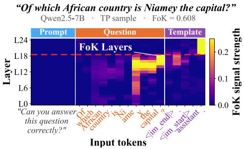  
(a) Causal tracing of FoK signal in a 7B LLM.

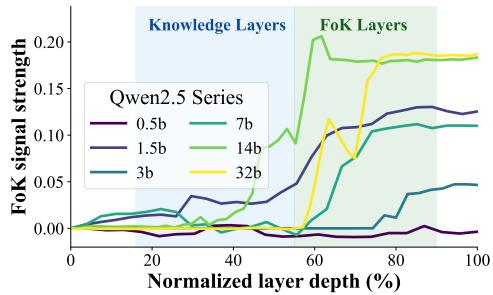  
(b) FoK signal across normalized depth.  
Figure 1: FoK signal localizes late under causal restoration. Panel (a) shows a 7B example across tokens and layers; panel (b) aggregates FoK recovery across Qwen2.5 sizes over normalized depth.

Table 1: Knowledge and FoK under separate or sequential SFT updates. Base gives absolute values; the three SFT blocks give changes from Base. Accuracy changes are percentage points (pp); AUROC changes are unitless. ∆AUC denotes the change in AUROC. Higher accuracy and AUROC are better. Full illusion and omission rates are reported in Appendix I.1.
<table><tr><td></td><td colspan="2">Base</td><td colspan="2">K-SFT</td><td colspan="2">J-SFT</td><td colspan="2">K→J SFT</td></tr><tr><td>Model</td><td>Acc.</td><td>AUROC</td><td>∆Acc.</td><td>∆AUC</td><td>∆Acc.</td><td>∆AUC</td><td>∆Acc.</td><td>ΔAUC</td></tr><tr><td>Qwen2.5-0.5B</td><td>20%</td><td>0.519</td><td>+2</td><td>-0.016</td><td>-14</td><td>+0.213</td><td>+2</td><td>+0.211</td></tr><tr><td>Qwen2.5-1.5B</td><td>35%</td><td>0.529</td><td>+6</td><td>-0.035</td><td>+2</td><td>+0.255</td><td>+5</td><td>+0.248</td></tr><tr><td>Qwen2.5-3B</td><td>39%</td><td>0.739</td><td>+12</td><td>-0.220</td><td>+3</td><td>+0.038</td><td>+11</td><td>+0.051</td></tr><tr><td>Qwen2.5-7B</td><td>53%</td><td>0.724</td><td>+7</td><td>-0.042</td><td>+2</td><td>+0.088</td><td>+7</td><td>+0.100</td></tr><tr><td>Qwen2.5-14B</td><td>66%</td><td>0.762</td><td>+6</td><td>+0.004</td><td>+1</td><td>+0.030</td><td>+5</td><td>+0.068</td></tr><tr><td>Qwen2.5-32B</td><td>68%</td><td>0.819</td><td>+4</td><td>-0.026</td><td>0</td><td>+0.010</td><td>+4</td><td>+0.020</td></tr><tr><td>LLaMA-3.1-8B</td><td>74%</td><td>0.672</td><td>+2</td><td>-0.038</td><td>+1</td><td>+0.045</td><td>+2</td><td>+0.063</td></tr></table>

Takeaway 1: Under causal tracing, the FoK signal peaks later in model depth than factual associations, suggesting that FoK acts as a judgment over the model’s knowledge state rather than as factual recall itself.

## 2.3 How FoK depends on updated knowledge

Depth separation does not mean independence. To analyze the relationship between factual knowledge and FoK, we intervene on one side and evaluate the other under matched data and optimization settings. First, we update factual knowledge with vanilla factual SFT and measure FoK on the updated model. Second, we train FoK alone and measure whether factual-answer accuracy changes. Table 1 summarizes cross-scale results. Appendix G reports supplementary scale and family results from a separate setup that uses exact match (EM), so its absolute values differ from this table.

Table 1 shows that knowledge SFT (K-SFT) increases answer accuracy for every model, but FoK AUROC decreases for six of the seven models, with the largest drop on Qwen2.5-3B. Thus, the knowledge update changes the model’s answerability, but the judgment boundary does not adjust correctly. The mismatch is not a single error direction: after K-SFT, some models make more omissions, judging that they cannot answer questions they would answer correctly, whereas larger Qwen models better preserve AUROC but shift toward illusion, judging that they can answer even when their answers are wrong. The issue is therefore not simply increased conservatism or confidence, but a weakened alignment between the current knowledge state and FoK. Judgment SFT (J-SFT) provides a reference intervention: directly training judgment improves FoK without compromising answer performance in larger models. K→J SFT further shows that judgment training after a knowledge update can recalibrate FoK while preserving most of the answer-accuracy gain from K-SFT, indicating that FoK depends on the current knowledge state and should be updated after knowledge changes. Appendix E provides the FoK-recovery and reverse-direction supplementary results.

Takeaway 2: In current LLMs, knowledge updates change answerability but do not automatically update FoK. FoK depends on features of the current knowledge state, so changing knowledge can break the mapping from knowledge to self-judgment unless FoK is explicitly updated.

## 2.4 Reasoning before judgment increases FoK certainty

Koriat’s FoK theory suggests that the amount and intensity of accessible information increase FoK judgments [25]. We test the LLM analogue by asking whether internally generated reasoning affects the model’s FoK.

We evaluate Qwen2.5-7B on MATH [15] problems. For each problem, the model first generates a solution trace. We then re-query the same model at increasing prefixes of that trace and compute $J = P ( ^ { \mathrm { * } } \mathrm { Y e s } ^ { \mathrm { , 9 } } ) / [ P ( ^ { \mathrm { * } } \mathrm { Y e s } ^ { \mathrm { , 9 } } ) \dot { + } P ( ^ { \mathrm { * } } \mathrm { N o } ^ { \mathrm { , 9 } } ) ]$ for the question “Can you solve this problem correctly?” Figure 2 shows that the FoK signal becomes more separated over the generated trace. As more reasoning tokens are available, the mean FoK scores for final “Yes” and “No” judgments move toward $J = 1$ and $J = 0$ , respectively; the AUROC of J for the final Yes/No FoK token rises as more reasoning tokens are available. This indicates that FoK is sensitive to the model’s current context, not only to the original question.

Takeaway 3: FoK should be judged from the model’s current context, not from the original question alone. This motivates a response-generation procedure in which the model first accumulates task-relevant context, then evaluates answerability before producing the final answer.

## 3 Methodology

Our methodology aligns FoK with updated knowledge through a two-channel model structure and a three-stage procedure that updates knowledge, synchronizes FoK, and trains FoK-guided responses.

## 3.1 Framework overview

Starting from a base LLM M, we represent post-training changes as parameter deltas. The knowledge delta κ forms the knowledge-retrieval channel, which changes what the model knows and retrieves. The FoK delta $\varphi$ forms the FoK channel, which judges whether the current knowledge state supports a correct answer. The training procedure has three parts:

• On-policy supervised fine-tuning (OP-SFT). OP-SFT updates κ on the model’s own sampled responses and supervises only the corrected answer-relevant suffix. This part learns the target facts while saving a trajectory of knowledge states $\left\{ \kappa _ { 0 } , \kappa _ { 1 } , \ldots , \kappa _ { T } \right\}$ that later serves as supervision for FoK adaptation under the same base model.

• Knowledge-delta FoK training (K∆-FT). K∆-FT trains φ over the OP-SFT checkpoint trajectory $\kappa _ { t }$ . This lets FoK judgments follow the model’s knowledge as it evolves, rather than remaining tied to a fixed knowledge boundary.

• FoK-guided policy optimization (FGPO). Finally, FGPO trains the model to generate a reasoning trace, make a yes/no FoK judgment, and produce either an answer or an explanation of why it cannot answer. Its reward evaluates the judgment and response together, so FoK is optimized as part of the generated decision rather than as a separate post-processing score.

With this two-channel update, FoK guides the LLM before answering. The model can first judge whether its current knowledge is sufficient, then either generate an answer or explain what knowledge is missing, which can support routing to a stronger model or retrieval-augmented generation.

## 3.2 On-policy supervised fine-tuning (OP-SFT)

Section 2.3 shows that standard knowledge training does not synchronize FoK with the updated knowledge state, and can severely interfere with the model’s original FoK ability. To reduce this interference, we introduce on-policy supervised fine-tuning (OP-SFT). Specifically, OP-SFT keeps the model’s own generated context and applies gradients only to the corrected answer-relevant span.

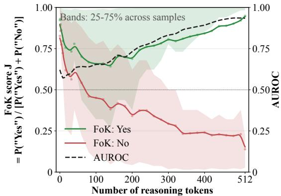  
Figure 2: FoK score and AUROC over pre-judgment reasoning tokens. Green/red curves show mean FoK score for examples whose final FoK token is Yes/No. $J \stackrel { - } { = } 0 . 5$ denotes FoK uncertainty, while $J \approx 1 ~ \mathrm { o r } ~ J \approx 0$ denotes high certainty. The black curve reports AUROC of prefix-level J for predicting whether the final FoK token is Yes or No.

For each question $q$ with gold answer set $\mathcal { A } _ { q } ,$ , we collect k complete sampled responses from the current LLM. For a sampled response $r = ( r _ { < s } , r _ { [ s : e ] } , r _ { > e } ) , r _ { [ s : e ] }$ denotes the generated answer span. We then handle two cases. If the sampled response already answers correctly, we keep this answer span. If it answers incorrectly, we replace only this answer span with a gold answer $a ^ { * } ( q ) \in \mathcal A _ { q }$ and leave the rest of the generated response unchanged. The repaired training response is

$$
\bar { r } ( q , r ) = \bigl ( r _ { < s } , \bar { a } ( q , r ) , r _ { > e } \bigr ) , \qquad \bar { a } ( q , r ) = \left\{ \begin{array} { l l } { { r } _ { [ s : e ] } } & { { r \mathrm { ~ a n s w e r s ~ c o r r e c t l y , } } } \\ { { a ^ { * } ( q ) } } & { { r \mathrm { ~ a n s w e r s ~ i n c o r r e c t l y . } } } \end{array} \right.\tag{1}
$$

The training sequence is therefore not a static QA pair: it is sampled from the current LLM, changes only the wrong answer span, and uses loss only on $\bar { \boldsymbol { a } } ( \boldsymbol { q } , \boldsymbol { r } )$ . For example, for $q = \mathrm { \AA W h o }$ wrote Pride and Prejudice?” and $A _ { q } = \left\{ \begin{array} { l l } { \begin{array} { r l r } \end{array} } \end{array} \right.$ {Jane Austen}, OP-SFT repairs one sampled response as

$$
q : \mathrm { W h o ~ w r o t e } \ : P r i d e \ : a n d \ : P r e j u d i c e ? , \qquad \mathcal { A } _ { q } = \{ \mathrm { J a n e ~ A u s t e n } \} ,
$$

$\bar { r } ( q , r )$ : The book is a nineteenth-century novel. I think the author was

(2)

Charlotte Brontë Jane Austen, because she wrote English classics.

The red span is the first answer-relevant error in the sampled response; the green span is the supervised correction. The remaining generated text stays in the response, but receives no loss. The OP-SFT objective is therefore the local corrected-span loss:

$$
\mathcal { L } _ { \mathrm { O P - S F T } } = - \mathbb { E } _ { q , r } \sum _ { u = 1 } ^ { | \bar { a } ( q , r ) | } \log P _ { M _ { \kappa } } \left( \bar { a } ( q , r ) _ { u } \mid q , r _ { < s } , \bar { a } ( q , r ) _ { < u } \right) .\tag{3}
$$

We save checkpoints $\left\{ \kappa _ { 0 } , \kappa _ { 1 } , \ldots , \kappa _ { T } \right\}$ during OP-SFT, keeping a sequence of knowledge states.

## 3.3 Knowledge-delta FoK training (K∆-FT)

After a knowledge update, the LLM’s answerability changes, but its FoK does not automatically synchronize with that change. Training FoK only on the base or final LLM gives a state-specific answerability boundary that generalizes poorly across knowledge deltas. Final-state training also creates label imbalance because many updated questions become answerable.

To make FoK generalize across knowledge deltas, we introduce knowledge-delta FoK training (K∆- FT), which uses the OP-SFT checkpoint trajectory $\left\{ \kappa _ { 0 } , \kappa _ { 1 } , \ldots , \kappa _ { T } \right\}$ as supervision states rather than supervising only one endpoint. For each checkpoint $\kappa _ { t }$ , we combine it with the same FoK delta $\varphi$ and train $\varphi$ to predict whether $M _ { \kappa _ { t } }$ can answer question $q$ with the following loss:

$$
\ell _ { \varphi } ( q , \kappa _ { t } ) = - \log P _ { M _ { \kappa _ { t } , \varphi } } \left( \mathbf { 1 } [ \operatorname { a n s } ( M _ { \kappa _ { t } } , q ) \in \mathcal { A } _ { q } ] \mid T _ { J } ( q ) \right) .\tag{4}
$$

Here 1[·] denotes the indicator function: it equals 1 when the answer generated by $M _ { \kappa _ { t } }$ belongs to $A _ { q } ,$ and equals 0 otherwise. $T _ { J } ( q )$ wraps q in the fixed Yes/No prompt “Can you answer this question correc $\mathrm { 1 y ? ~ } ^ { \flat \flat } \ M _ { \kappa _ { t } , \varphi }$ is the base model with the frozen knowledge delta and trainable FoK delta. For $y \in \{ 0 , 1 \} , P _ { M _ { \kappa _ { t } , \varphi } } ( y \mid T _ { J } ( q ) )$ is the normalized Yes/No probability: $J ( q )$ for $y = 1$ and $1 - J ( q )$ for $y = 0 .$ . The probability is evaluated under $M _ { \kappa _ { t } , \varphi } ,$ , so FoK is trained with the same combined knowledge-and-FoK state used for judgment. The overall objective averages this checkpoint-specific loss over all questions and all OP-SFT checkpoints:

$$
\mathcal { L } _ { \mathrm { K } \Delta \cdot \mathrm { F T } } ( \varphi ) = \frac { 1 } { | \mathcal { Q } | ( T + 1 ) } \sum _ { q \in \mathcal { Q } } \sum _ { t = 0 } ^ { T } \ell _ { \varphi } ( q , \kappa _ { t } ) .\tag{5}
$$

Only $\varphi$ is optimized in this stage; the knowledge checkpoints are fixed supervision states. Because the same question is evaluated under multiple $\bar { \kappa } _ { t } , \kappa \Delta \bar { - } \bar { \mathrm { F T } }$ trains FoK to follow answerability as it changes from pre-update to post-update knowledge, rather than to memorize a static question-level label detached from the current model state during updating. This is correctness supervision across changing states, not an explicit model of human cue-based inference.

## 3.4 FoK-guided policy optimization (FGPO)

After OP-SFT and K∆-FT, a continuous FoK score still requires a decision threshold. FoK-guided policy optimization (FGPO) trains the judgment and subsequent response together, allowing the model to commit to answering or explaining within one generation. It generates a short context trace, makes a FoK judgment, and produces an answer or explanation:

$$
\begin{array} { r } { { < } \mathrm { t h i n k > . ~ . ~ . ~ r e a s o n i n g . ~ . ~ . ~ < / t h i n k > ~ < a n s w e r > y e s } \mid \mathrm { n o < / a n s w e r > } } \\ { < \mathrm { r e s p o n s e > a n s w e r ~ o r ~ } \exp \mathrm { { \ c a n a t i o n < } / r e s p o n s e > } } \end{array}
$$

For a sampled trajectory $z = ( h , j , u )$ , where $h$ is the reasoning trace, $j \in \{ \mathrm { y e s } , \mathrm { n o } \}$ is the FoK judgment, and u is the response, we decompose the reward into FoK, answer, and format terms:

$$
R ( q , z ) = R _ { \mathrm { F o K } } ( Y ( q ) , j ) + R _ { \mathrm { a n s } } ( q , Y ( q ) , j , u ) + R _ { \mathrm { f m t } } ( z ) - \lambda | h | .\tag{6}
$$

Here $Y ( q )$ is the answerability target for the current training example. Let $C ( q , u ) = \mathbf { 1 } [ u \in \mathcal { A } _ { q } ]$ denote answer correctness, $E ( q , u )$ denote whether an LLM judge accepts u as a valid explanation for not answering, and $F ( z ) , \dot { S } ( z ) \in \{ 0 , 1 \}$ } denote valid format and proper sequence termination. The FoK term directly supervises the judgment token:

$$
R _ { \mathrm { F o K } } ( Y , j ) = \alpha _ { + } \mathbf { 1 } [ \iota ( j ) = Y ] - \alpha _ { - } \mathbf { 1 } [ \iota ( j ) \neq Y ] ,\tag{7}
$$

where $\iota ( \mathrm { y e s } ) = 1$ and $\iota ( \mathrm { n o } ) = 0$ . The answer term scores the response under the chosen judgment:

$$
\begin{array} { r } { R _ { \mathrm { a n s } } ( q , Y , j , u ) = \mathbf { 1 } [ j = \mathrm { y e s } , Y = 1 ] \big ( \beta _ { + } C ( q , u ) - \beta _ { - } ( 1 - C ( q , u ) ) \big ) } \\ { - \mathbf { 1 } [ j = \mathrm { y e s } , Y = 0 ] \big ( \bar { \beta } _ { + } C ( q , u ) + \bar { \beta } _ { - } ( 1 - C ( q , u ) ) \big ) } \\ { + \mathbf { 1 } [ j = \mathrm { n o } , Y = 0 ] \big ( \gamma _ { + } E ( q , u ) - \gamma _ { - } ( 1 - E ( q , u ) ) \big ) } \\ { - \mathbf { 1 } [ j = \mathrm { n o } , Y = 1 ] \gamma _ { \mathrm { s k i p } } . } \end{array}\tag{8}
$$

Thus, $\mathbf { a } \ { } ^ { * } \mathbf { y } \mathbf { e } \mathbf { s } ^ { \prime }$ judgment must be followed by a correct answer, while a “no” judgment must be justified by a valid explanation and is penalized on answerable examples. The format term is

$$
R _ { \mathrm { f m t } } ( z ) = \eta _ { F } F ( z ) - \bar { \eta } _ { F } ( 1 - F ( z ) ) + \eta _ { S } S ( z ) - \bar { \eta } _ { S } ( 1 - S ( z ) ) .\tag{9}
$$

Table 6 in Appendix C lists the implemented values. In implementation, wrong answers and malformed outputs receive larger penalties than valid $\mathbf { \tilde { \Gamma } } _ { \mathrm { n o } } \mathbf { \vec { \Gamma } } _ { \mathrm { ~ } }$ explanations receive positive reward, so the model is not rewarded for avoiding answerable questions by choosing the negative judgment.

## 4 Experiments

We ask whether FoK can be synchronized after an update (RQ1), which training stages contribute (RQ2), and whether the result persists across datasets, sequential updates, and seeds (RQ3). Sections 4.2, 4.3, and 4.5 address RQ1–RQ2; Section 4.4 and Appendix H address RQ3.

Table 2: Overall performance after one TriviaQA knowledge update on Qwen2.5-7B. Train columns use questions seen during the update; Test columns use held-out TriviaQA questions; General reports MMLU and ARC-Easy. ↑: higher is better; ↓: lower is better; → 0: closer to zero is better. Bold and underline indicate the best and second-best results.
<table><tr><td></td><td colspan="3">Train</td><td colspan="3">Test</td><td colspan="2">General</td></tr><tr><td>Method</td><td>Acc.↑</td><td>AUROC↑</td><td>Bias→ 0</td><td>Acc.↑</td><td>AUROC↑</td><td>Bias→ 0</td><td>MMLU↑</td><td>ARC↑</td></tr><tr><td>Base</td><td>0.680</td><td>0.702</td><td>0.381</td><td>0.672</td><td>0.688</td><td>0.402</td><td>0.687</td><td>0.811</td></tr><tr><td>+ Prob</td><td>0.680</td><td>0.723</td><td>0.409</td><td>0.672</td><td>0.730</td><td>0.407</td><td>0.687</td><td>0.811</td></tr><tr><td>+ N-Prob</td><td>0.680</td><td>0.723</td><td>0.409</td><td>0.672</td><td>0.730</td><td>0.407</td><td>0.687</td><td>0.811</td></tr><tr><td>+ EliCal</td><td>0.637</td><td>0.808</td><td>0.263</td><td>0.622</td><td>0.810</td><td>0.254</td><td>0.709</td><td>0.504</td></tr><tr><td>Vanilla K-SFT</td><td>0.874</td><td>0.458</td><td>0.500</td><td>0.546</td><td>0.519</td><td>0.500</td><td>0.713</td><td>0.840</td></tr><tr><td>+ Verbal-0</td><td>0.874</td><td>0.491</td><td>0.543</td><td>0.546</td><td>0.478</td><td>0.551</td><td>0.713</td><td>0.840</td></tr><tr><td>+ Verbal-10</td><td>0.874</td><td>0.567</td><td>0.456</td><td>0.546</td><td>0.529</td><td>0.467</td><td>0.713</td><td>0.840</td></tr><tr><td>+ Prob</td><td>0.874</td><td>0.590</td><td>0.495</td><td>0.546</td><td>0.541</td><td>0.498</td><td>0.713</td><td>0.840</td></tr><tr><td>+ N-Prob</td><td>0.874</td><td>0.590</td><td>0.495</td><td>0.546</td><td>0.542</td><td>0.498</td><td>0.713</td><td>0.840</td></tr><tr><td>+ Consis-Lex</td><td>0.874</td><td>0.539</td><td>0.482</td><td>0.546</td><td>0.531</td><td>0.486</td><td>0.713</td><td>0.840</td></tr><tr><td>+ Consis-Sem</td><td>0.874</td><td>0.553</td><td>0.472</td><td>0.546</td><td>0.567</td><td>0.467</td><td>0.713</td><td>0.840</td></tr><tr><td>+ SemEnt</td><td>0.874</td><td>0.538</td><td>0.481</td><td>0.546</td><td>0.526</td><td>0.504</td><td>0.713</td><td>0.840</td></tr><tr><td>+ EliCal</td><td>0.648</td><td>0.646</td><td>0.428</td><td>0.587</td><td>0.644</td><td>0.447</td><td>0.723</td><td>0.688</td></tr><tr><td>Ours</td><td>0.961</td><td>0.817</td><td>0.245</td><td>0.692</td><td>0.809</td><td>0.308</td><td>0.711</td><td>0.830</td></tr></table>

## 4.1 Evaluation setup

Datasets. We use TriviaQA [20] as the main QA dataset, with 5,000 update questions and 1,000 held-out questions. Additional FoK evaluations use SelfAware [55], Natural Questions [30], and WebQuestions [2]. MMLU [14] and ARC-Easy [6] separately evaluate general capability; they are not additional FoK testbeds.

Baselines. We compare direct Yes/No FoK judgment, Vanilla K-SFT, verbalized confidence and 10-bin verbalized confidence [50], sequence probability and length-normalized sequence probability, lexical and semantic self-consistency, semantic entropy [9, 27], and EliCal [41].

Metrics. We report accuracy on TriviaQA, MMLU, and ARC-Easy. FoK quality is measured by AUROC [10] using the normalized Yes probability, plus two errors thresholded at $J > 0 . 5$ (predict Yes): illusion rate (illu., $\operatorname* { P r } ( \hat { J } = 1 \mid Y = 0 ) )$ ) and omission rate (om., $\operatorname* { P r } ( \hat { J } = 0 \mid Y = 1 ) ;$ . We combine them as:

$$
\begin{array} { r } { \mathrm { B i a s } = \left\{ \begin{array} { l l } { \frac { \mathrm { i } \mathrm { l } \mathrm { l } \mathrm { u } . + \mathrm { o m . } } { 2 } , } & { \mathrm { i f ~ i l l u . \geq o m . } , } \\ { - \frac { \mathrm { i } \mathrm { l } \mathrm { l } \mathrm { u } . + \mathrm { o m . } } { 2 } , } & { \mathrm { i f ~ i l l u . < o m . } } \end{array} \right. \mathrm { B i a s } \in [ - 1 , 1 ] . } \end{array}
$$

Implementation details. We evaluate on Qwen2.5-7B-Instruct [48] for the main experiments and on Qwen3-8B [49] as a thinking-mode backbone. We refer to them as Qwen2.5-7B and Qwen3-8B. We instantiate the three stages of Section 3 as LoRA adapters on top of the base model. OP-SFT updates the knowledge channel from corrected sampled responses, K∆-FT trains the FoK channel over the OP-SFT checkpoint trajectory, and FGPO optimizes response generation using both channels. The full data construction, baseline definitions, evaluation protocol, optimizer settings, checkpoint schedule, and inference configuration are listed in Appendix C.

## 4.2 Overall performance

We compare our two-channel update with vanilla K-SFT and a suite of existing FoK estimators after a single TriviaQA knowledge update on Qwen2.5-7B. Table 2 gives the main numbers; Figure 3 decomposes the thresholded errors into illusion and omission. After vanilla K-SFT, in-domain accuracy rises sharply but held-out accuracy falls below the base model, so the update does not simply add knowledge. All existing estimators fall well below their base-model level, and most collapse into one-sided behavior: vanilla K-SFT and confidence-based estimators are dominated by illusion, judging almost every question answerable, while consistency-based estimators trade some illusion for a correspondingly large omission, leaving both error sources substantial. A likely cause is that the knowledge update shifts the output distributions and sampling behavior that these estimators rely on, so a decision boundary calibrated before the update no longer carries the same meaning. This is what Takeaway 2 predicts: under a conventional knowledge update, existing FoK estimators are not a robust way to keep answerability judgments aligned with the updated model.

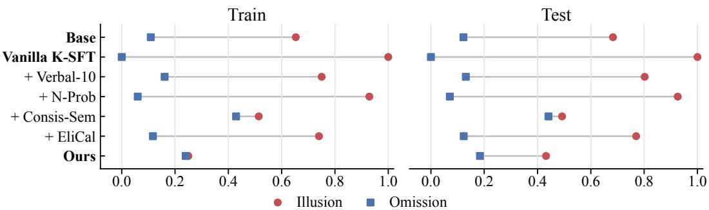  
Figure 3: FoK error decomposition for Table 2. Red circles show illusion, the conditional rate of false “can answer” judgments; blue squares show omission, the conditional rate of false “cannot answer” judgments. The horizontal gap shows which error source determines the signed Bias value.

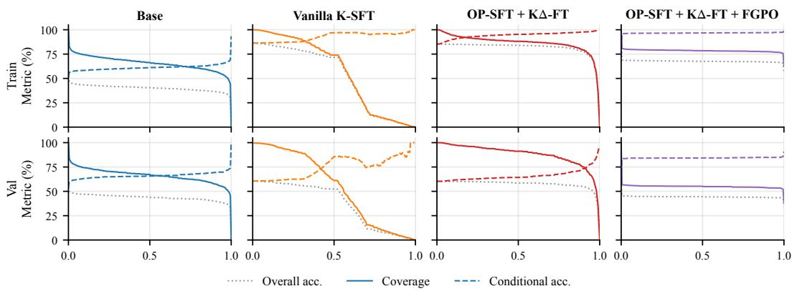  
Figure 4: Coverage–accuracy trade-off on Qwen3-8B (thinking mode). Each panel varies the FoK threshold and plots coverage (solid, the fraction of questions the model judges itself able to answer), conditional accuracy on that answered subset (dashed), and overall accuracy with unanswered examples counted as incorrect (dotted).

Our two-channel update shows a different profile. Held-out accuracy now rises above the base model, so the knowledge update generalizes instead of overfitting the update shard. FoK AUROC on the updated model reaches the level of the strongest existing estimator applied to the base model, and Bias is the lowest on the update set and the second lowest on held-out questions, although illusion still exceeds omission on held-out questions (Figure 3). We attribute this to two design choices. OP-SFT supervises only the corrected answer-relevant span on the model’s own sampled responses, which only mildly disturbs FoK: held-out AUROC is 0.603 after OP-SFT alone, compared with 0.519 after vanilla K-SFT (Tables 2 and 4); K∆-FT then trains the FoK channel directly on the changed answerability, instead of reusing a judgment calibrated before the update. Appendix F confirms this along the OP-SFT trajectory.

## 4.3 Coverage-accuracy trade-off under FoK judgment

Table 2 shows that FoK quality is recoverable; it remains to test whether the recovered FoK actually drives the decision of when to answer. We therefore vary the FoK threshold on Qwen3-8B and plot the coverage-accuracy curves in Figure 4. For Base and Vanilla K-SFT the curves are nearly flat on both splits: lowering coverage does not raise accuracy, so their FoK scores do not rank answerability. $\mathrm { O P - S F T } + \mathrm { K } \Delta \mathrm { - F T }$ restores a monotonic trade-off, confirming that the learned FoK channel is consistent with answerability after the update. FGPO flattens the curves again, but for a different reason: the scores collapse to 0 or 1, and the threshold becomes irrelevant once the policy has committed to answer or abstain. K∆-FT thus provides a tunable coverage–accuracy trade-off, while FGPO answers more selectively, achieving higher accuracy on the answered subset at the cost of lower coverage.

Table 3: Additional evaluation on Qwen2.5-7B. Left: all methods start from the same OP-SFT knowledge checkpoint; K∆-FT adds the FoK adapter, so its combined answering state differs. Right: $\varphi _ { 1 }$ is frozen after round $1 ; \varphi _ { i }$ is retrained over each round’s knowledge trajectory. Each round adds a disjoint shard from 5,000 update questions; all test columns use the same 1,000 held-out questions.  
(a) FoK estimators after OP-SFT.
<table><tr><td>Estimator</td><td>Test Acc.</td><td>AUROC</td></tr><tr><td>Direct judgment</td><td>0.679</td><td>0.603</td></tr><tr><td>Prob</td><td>0.679</td><td>0.571</td></tr><tr><td>EliCal</td><td>0.679</td><td>0.618</td></tr><tr><td> $\mathrm { K } \Delta { \cdot } \mathrm { F T }$ </td><td>0.699</td><td>0.770</td></tr></table>

(b) Three sequential TriviaQA updates.
<table><tr><td>Round</td><td>Test Acc.</td><td> $\varphi _ { 1 }$  AUC</td><td> $\varphi _ { i } \ \mathrm { A U C }$ </td></tr><tr><td>1</td><td>0.659</td><td>0.798</td><td>0.798</td></tr><tr><td>2</td><td>0.644</td><td>0.776</td><td>0.800</td></tr><tr><td>3</td><td>0.661</td><td>0.754</td><td>0.797</td></tr></table>

Table 4: Held-out stage-wise ablation on Qwen2.5-7B. OP-SFT updates knowledge, K∆-FT adapts FoK, and FGPO optimizes judgment-guided generation. Higher accuracy and AUROC and lower error rates are better; Bias closer to zero is better. Update-set results are in Table 26.
<table><tr><td>Stage</td><td>Acc.↑</td><td>AUROC↑</td><td>Illu.↓</td><td> $\mathrm { O m . } \downarrow$ </td><td> $\mathrm { B i a s } {  } 0$ </td></tr><tr><td>Base</td><td>0.672</td><td>0.688</td><td>0.683</td><td>0.122</td><td>0.402</td></tr><tr><td>Stage  $1 \colon + \mathrm { O P - S F T }$ </td><td>0.679</td><td>0.603</td><td>0.601</td><td>0.283</td><td>0.442</td></tr><tr><td>Stage  $2 \mathrm { : + K } \Delta \mathrm { - F T }$ </td><td>0.699</td><td>0.770</td><td>0.478</td><td>0.187</td><td>0.333</td></tr><tr><td> $\mathrm { S t a g e } 3 \colon + \mathrm { F G P O }$ </td><td>0.692</td><td>0.809</td><td>0.432</td><td>0.184</td><td>0.308</td></tr></table>

## 4.4 Controlled comparison and sequential updates

Accuracy-preserving update. Table 3a tests whether avoiding destructive K-SFT alone suffices. After OP-SFT, direct judgment, Prob, and EliCal reach AUROC 0.603, 0.571, and 0.618, respectively; K∆-FT reaches 0.770. Thus, FoK adaptation is useful even when held-out answer accuracy is preserved. Without an update, however, strong estimators remain competitive: Base + EliCal reaches 0.810 AUROC in Table 2, compared with 0.809 for the full method, whose held-out accuracy exceeds Base by 0.020 in that run.

Sequential updates and broader evaluation. Across three updates, the per-round FoK channel stays near 0.80 AUROC while the frozen channel falls to 0.754 (Table 3b); held-out accuracy remains below the 0.672 Base value, so this does not demonstrate cumulative answer-accuracy improvement. Cross-dataset tests on SelfAware, Natural Questions, and WebQuestions, plus a separate Natural Questions replication, extend the factual-QA evaluation. Independent Stage-1+2 runs yield test AUROC $0 . 7 \bar { 7 } 7 \pm 0 . 0 0 9$ (four seeds); FGPO yields $0 . 8 1 1 \pm 0 . { \bar { 0 } } 0 3$ (three seeds from one shared initialization). These are means and sample standard deviations. Appendix H reports all runs, crossdataset results, and a MEMIT desynchronization test; the latter tests the phenomenon rather than adaptation of our full framework to that editor.

## 4.5 Ablation study

To locate where the FoK improvement in Table 2 comes from, we ablate the three stages cumulatively: OP-SFT alone, then ${ \mathrm { O P - S F T } } + { \mathrm { K } } \Delta { \mathrm { - F T } } ,$ then the full pipeline with FGPO (Table 4). OP-SFT alone raises update-set accuracy from 0.680 to 0.966 (Table 26) but leaves the FoK judgment misaligned with the updated knowledge state. Adding K∆-FT is the main source of the FoK gain: AUROC rises and Bias drops while held-out accuracy changes little (0.679 to 0.699), supporting the design choice of training a dedicated FoK channel over knowledge-delta states rather than relying on knowledge learning alone. FGPO raises held-out AUROC from 0.770 to 0.809 in this run and incorporates the judgment into generation. On the separate Qwen3-8B evaluation, its nearly binary judgments explain the flattened threshold curves in Figure 4.

## 5 Related work

Functional metacognition. Metacognitive sensitivity and calibration are distinct quantities [11]. Human–LLM comparisons therefore require explicit behavioral definitions rather than equating similar reports with identical cognitive processes [46]. Recent work studies competing confidence biases under external advice [29] and how verbal confidence is computed from answer-related representations [28]. Our focus is correctness-supervised answerability judgment under changing model parameters. Koriat’s cue-accessibility account motivates the context analyses, but our objective does not directly model that account.

LLM uncertainty and hallucination. LLMs often generate fluent but factually false outputs, a failure studied as hallucination and factuality [16, 19]. Theoretical analyses show that this failure cannot be removed by pretraining alone: rare facts impose a Good–Turing-style lower bound on calibrated error, and common training and evaluation procedures can reward guessing rather than explicit uncertainty [22, 23]. This motivates uncertainty estimation and answerability judgment in LLMs [12]. Existing methods estimate uncertainty from generated outputs, including P(True) and P(IK) (probability that the model “knows” the answer), verbalized confidence, explicit “I don’t know” (IDK) training, semantic entropy, and self-consistency [8, 9, 21, 26, 27, 36, 50, 51, 54]. Other methods read uncertainty from internal representations, including SAPLMA, CCS, INSIDE, MIND, $C ^ { 3 }$ , and internal-state probes [1, 3, 4, 42, 45, 47]. A related line trains answerability behavior directly: R-Tuning teaches models to state that they do not know [56]; US-Tuning, CRaFT, and GRAIT analyze conflicts between answer learning and negative answerability supervision [32, 58, 59]; EliCal uses annotation-efficient elicitation and calibration for honesty [41]. Inference-time factuality methods such as ITI and DoLa intervene without additional training [5, 34], while TruthfulQA, HaluEval, FActScore, and SimpleQA evaluate factual support in generated answers [33, 35, 40, 53]. These works primarily ask whether a given model can express or reveal uncertainty about its current answers. We instead ask whether the FoK judgment tracks post-training updates to the model’s knowledge.

Knowledge editing and continual learning. Post-training updates, knowledge editing, and continual learning change what an LLM knows after pretraining. ROME and MEMIT edit factual associations and evaluate edit success, locality, portability, and retention [38, 39]. Continual-learning methods, including regularization and replay-based approaches, aim to preserve answer accuracy across sequential updates [17, 24, 37]. These methods focus on the update operator and on answer correctness, and usually do not test whether answerability judgment changes with the updated knowledge. We instead treat FoK as a training target co-learned with each update, so the answerability judgment moves with the model rather than lagging behind on a fixed checkpoint.

## 6 Conclusion

We studied how to keep functional FoK aligned with an LLM’s answerability after knowledge updates. In the tested factual-QA settings, knowledge updating alone does not preserve this alignment. Our twochannel framework trains knowledge and FoK separately and then optimizes the judgment together with the subsequent response. Controlled OP-SFT comparisons, cross-dataset evaluation, and three sequential updates support the usefulness of explicit FoK adaptation, with seed variation quantifying its stability in the main setting. These results concern behavioral answerability judgments; they do not establish human-like subjective experience, superiority over strong estimators on a non-updated model, or generalization to arbitrary update operators.

## References

[1] Amos Azaria and Tom Mitchell. The internal state of an LLM knows when it’s lying. arXiv preprint arXiv:2304.13734, 2023.

[2] Jonathan Berant, Andrew Chou, Roy Frostig, and Percy Liang. Semantic parsing on Freebase from question-answer pairs. In Proceedings of the 2013 Conference on Empirical Methods in Natural Language Processing, pages 1533–1544, 2013. URL https://aclanthology.org/ D13-1160/.

[3] Collin Burns, Haotian Ye, Dan Klein, and Jacob Steinhardt. Discovering latent knowledge in language models without supervision. In International Conference on Learning Representations (ICLR), 2023.

[4] Chao Chen, Kai Liu, Ze Chen, Yi Gu, Yue Wu, Mingyuan Tao, Zhihang Fu, and Jieping Ye. INSIDE: LLMs’ internal states retain the power of hallucination detection. In International Conference on Learning Representations, 2024. URL https://openreview.net/forum? id=Zj12nzlQbz.

[5] Yung-Sung Chuang, Yujia Xie, Hongyin Luo, Yoon Kim, James R. Glass, and Pengcheng He. DoLa: Decoding by contrasting layers improves factuality in large language models. In International Conference on Learning Representations, 2024. URL https://openreview. net/forum?id=Th6NyL07na.

[6] Peter Clark, Isaac Cowhey, Oren Etzioni, Tushar Khot, Ashish Sabharwal, Carissa Schoenick, and Oyvind Tafjord. Think you have solved question answering? try ARC, the AI2 reasoning challenge, 2018.

[7] Karl Cobbe, Vineet Kosaraju, Mohammad Bavarian, Jacob Hilton, Reiichiro Nakano, Christopher Hesse, and John Schulman. Training verifiers to solve math word problems, 2021.

[8] Roi Cohen, Konstantin Dobler, Eden Biran, and Gerard de Melo. I don’t know: Explicit modeling of uncertainty with an [IDK] token. In Advances in Neural Information Processing Systems, 2024. doi: 10.52202/079017-0349.

[9] Sebastian Farquhar, Jannik Kossen, Lorenz Kuhn, and Yarin Gal. Detecting hallucinations in large language models using semantic entropy. Nature, 630:625–630, 2024. doi: 10.1038/ s41586-024-07421-0.

[10] Tom Fawcett. An introduction to ROC analysis. Pattern Recognition Letters, 27(8):861–874, 2006. doi: 10.1016/j.patrec.2005.10.010.

[11] Stephen M. Fleming and Hakwan C. Lau. How to measure metacognition. Frontiers in Human Neuroscience, 8:443, 2014. doi: 10.3389/fnhum.2014.00443.

[12] Jiahui Geng, Fengyu Cai, Yuxia Wang, Heinz Koeppl, Preslav Nakov, and Iryna Gurevych. A survey of confidence estimation and calibration in large language models. In Proceedings ofthe 2024 Conference ofthe North American Chapter ofthe Associationfor Computational Linguistics: Human Language Technologies (Volume 1: Long Papers), pages 6577–6595. Association for Computational Linguistics, 2024. doi: 10.18653/v1/2024.naacl-long.366. URL https://aclanthology.org/2024.naacl-long.366/.

[13] Joseph T. Hart. Memory and the feeling-of-knowing experience. Journal of Educational Psychology, 56(4):208–216, 1965.

[14] Dan Hendrycks, Collin Burns, Steven Basart, Andy Zou, Mantas Mazeika, Dawn Song, and Jacob Steinhardt. Measuring massive multitask language understanding. In International Conference on Learning Representations, 2021.

[15] Dan Hendrycks, Collin Burns, Saurav Kadavath, Akul Arora, Steven Basart, Eric Tang, Dawn Song, and Jacob Steinhardt. Measuring mathematical problem solving with the MATH dataset. In Proceedings ofthe Neural Information Processing Systems Track on Datasets and Benchmarks, 2021.

[16] Lei Huang, Weijiang Yu, Weitao Ma, Weihong Zhong, Zhangyin Feng, Haotian Wang, Qianglong Chen, Weihua Peng, Xiaocheng Feng, Bing Qin, and Ting Liu. A survey on hallucination in large language models: Principles, taxonomy, challenges, and open questions. ACM Transactions on Information Systems, 2024. doi: 10.1145/3703155.

[17] Joel Jang, Seonghyeon Ye, Sohee Yang, Joongbo Shin, Janghoon Han, Gyeonghun Kim, Stanley Jungkyu Choi, and Minjoon Seo. Towards continual knowledge learning of language models. In International Conference on Learning Representations (ICLR), 2022.

[18] Soyeong Jeong, Jinheon Baek, Sukmin Cho, Sung Ju Hwang, and Jong C. Park. Adaptive-RAG: Learning to adapt retrieval-augmented large language models through question complexity. In Proceedings of the 2024 Conference of the North American Chapter of the Association for Computational Linguistics: Human Language Technologies (Volume 1: Long Papers), pages 7036–7050. Association for Computational Linguistics, 2024. doi: 10.18653/v1/2024. naacl-long.389. URL https://aclanthology.org/2024.naacl-long.389/.

[19] Ziwei Ji, Nayeon Lee, Rita Frieske, Tiezheng Yu, Dan Su, Yan Xu, Etsuko Ishii, Yejin Bang, Andrea Madotto, and Pascale Fung. Survey of hallucination in natural language generation. ACM Computing Surveys, 55(12):1–38, 2023. doi: 10.1145/3571730.

[20] Mandar Joshi, Eunsol Choi, Daniel Weld, and Luke Zettlemoyer. TriviaQA: A large scale distantly supervised challenge dataset for reading comprehension. In Regina Barzilay and Min-Yen Kan, editors, Proceedings of the 55th Annual Meeting of the Association for Computational Linguistics (Volume 1: Long Papers), pages 1601–1611, Vancouver, Canada, July 2017. Association for Computational Linguistics. doi: 10.18653/v1/P17-1147. URL https://aclanthology.org/P17-1147/.

[21] Saurav Kadavath, Tom Conerly, Amanda Askell, Tom Henighan, Dawn Drain, Ethan Perez, Nicholas Schiefer, Zac Hatfield-Dodds, Nova DasSarma, Eli Tran-Johnson, Scott Johnston, Sheer El-Showk, Andy Jones, Nelson Elhage, Tristan Hume, Anna Chen, Yuntao Bai, Sam Bowman, Stanislav Fort, Deep Ganguli, Danny Hernandez, Josh Jacobson, Jackson Kernion, Shauna Kravec, Liane Lovitt, Kamal Ndousse, Catherine Olsson, Sam Ringer, Dario Amodei, Tom Brown, Jack Clark, Nicholas Joseph, Ben Mann, Sam McCandlish, Chris Olah, and Jared Kaplan. Language models (mostly) know what they know. arXiv preprint arXiv:2207.05221, 2022. doi: 10.48550/arXiv.2207.05221.

[22] Adam Tauman Kalai and Santosh S. Vempala. Calibrated language models must hallucinate. In Proceedings of the 56th Annual ACM Symposium on Theory of Computing, 2024. doi: 10.1145/3618260.3649777.

[23] Adam Tauman Kalai, Ofir Nachum, Santosh S. Vempala, and Edwin Zhang. Why language models hallucinate. arXiv preprint arXiv:2509.04664, 2025. doi: 10.48550/arXiv.2509.04664.

[24] James Kirkpatrick, Razvan Pascanu, Neil Rabinowitz, Joel Veness, Guillaume Desjardins, Andrei A. Rusu, Kieran Milan, John Quan, Tiago Ramalho, Agnieszka Grabska-Barwinska, Demis Hassabis, Claudia Clopath, Dharshan Kumaran, and Raia Hadsell. Overcoming catastrophic forgetting in neural networks. Proceedings of the National Academy of Sciences, 114(13): 3521–3526, 2017. doi: 10.1073/pnas.1611835114.

[25] Asher Koriat. How do we know that we know? The accessibility model of the feeling of knowing. Psychological Review, 100(4):609–639, 1993.

[26] Jannik Kossen, Jiatong Han, Muhammed Razzak, Lisa Schut, Shreshth A. Malik, and Yarin Gal. Semantic entropy probes: Robust and cheap hallucination detection in LLMs. arXiv preprint arXiv:2406.15927, 2024. doi: 10.48550/arXiv.2406.15927.

[27] Lorenz Kuhn, Yarin Gal, and Sebastian Farquhar. Semantic uncertainty: Linguistic invariances for uncertainty estimation in natural language generation. In International Conference on Learning Representations, 2023. URL https://openreview.net/forum?id=VD-AYtP0dve.

[28] Dharshan Kumaran, Arthur Conmy, Federico Barbero, Simon Osindero, Viorica Patraucean, and Petar Velickoviˇ c. How do LLMs compute verbal confidence, 2026. URL´ https://arxiv. org/abs/2603.17839.

[29] Dharshan Kumaran, Stephen M. Fleming, Larisa Markeeva, Joe Heyward, Andrea Banino, Mrinal Mathur, Razvan Pascanu, Simon Osindero, Benedetto De Martino, Petar Velickoviˇ c, and´ Viorica Patraucean. Competing biases underlie overconfidence and underconfidence in LLMs. Nature Machine Intelligence, 8:614–627, 2026. doi: 10.1038/s42256-026-01217-9.

[30] Tom Kwiatkowski, Jennimaria Palomaki, Olivia Redfield, Michael Collins, Ankur Parikh, Chris Alberti, Danielle Epstein, Illia Polosukhin, Jacob Devlin, Kenton Lee, Kristina Toutanova, Llion Jones, Matthew Kelcey, Ming-Wei Chang, Andrew M. Dai, Jakob Uszkoreit, Quoc Le, and Slav Petrov. Natural questions: A benchmark for question answering research. Transactions ofthe Associationfor Computational Linguistics, 7:452–466, 2019. doi: 10.1162/tacl\_a\_00276. URL https://aclanthology.org/Q19-1026/.

[31] Omer Levy, Minjoon Seo, Eunsol Choi, and Luke Zettlemoyer. Zero-shot relation extraction via reading comprehension. In Proceedings of the 21st Conference on Computational Natural Language Learning (CoNLL 2017), pages 333–342, 2017.

[32] Jiaqi Li, Yixuan Tang, and Yi Yang. Know the unknown: An uncertainty-sensitive method for LLM instruction tuning. In Findings ofthe Associationfor Computational Linguistics: ACL 2025, pages 2972–2989. Association for Computational Linguistics, 2025. doi: 10.18653/v1/ 2025.findings-acl.153. URL https://aclanthology.org/2025.findings-acl.153/.

[33] Junyi Li, Xiaoxue Cheng, Xin Zhao, Jian-Yun Nie, and Ji-Rong Wen. HaluEval: A largescale hallucination evaluation benchmark for large language models. In Proceedings of the 2023 Conference on Empirical Methods in Natural Language Processing, pages 6449–6464. Association for Computational Linguistics, 2023. doi: 10.18653/v1/2023.emnlp-main.397. URL https://aclanthology.org/2023.emnlp-main.397/.

[34] Kenneth Li, Oam Patel, Fernanda Viégas, Hanspeter Pfister, and Martin Wattenberg. Inferencetime intervention: Eliciting truthful answers from a language model. In Advances in Neural Information Processing Systems, 2023.

[35] Stephanie Lin, Jacob Hilton, and Owain Evans. TruthfulQA: Measuring how models mimic human falsehoods. In Proceedings of the 60th Annual Meeting of the Association for Computational Linguistics (Volume 1: Long Papers), pages 3214–3252. Association for Computational Linguistics, 2022. doi: 10.18653/v1/2022.acl-long.229. URL https://aclanthology.org/2022.acl-long.229/.

[36] Stephanie Lin, Jacob Hilton, and Owain Evans. Teaching models to express their uncertainty in words. Transactions on Machine Learning Research, 2022.

[37] Yun Luo, Zhicheng Yang, Fandong Meng, Yafu Li, Jie Zhou, and Yue Zhang. An empirical study of catastrophic forgetting in large language models during continual fine-tuning. arXiv preprint arXiv:2308.08747, 2023.

[38] Kevin Meng, David Bau, Alex Andonian, and Yonatan Belinkov. Locating and editing factual associations in GPT. In Advances in Neural Information Processing Systems, 2022.

[39] Kevin Meng, Arnab Sen Sharma, Alex Andonian, Yonatan Belinkov, and David Bau. Massediting memory in a transformer. In International Conference on Learning Representations (ICLR), 2023.

[40] Sewon Min, Kalpesh Krishna, Xinxi Lyu, Mike Lewis, Wen-tau Yih, Pang Koh, Mohit Iyyer, Luke Zettlemoyer, and Hannaneh Hajishirzi. FActScore: Fine-grained atomic evaluation of factual precision in long form text generation. In Proceedings of the 2023 Conference on Empirical Methods in Natural Language Processing, pages 12076–12100. Association for Computational Linguistics, 2023. doi: 10.18653/v1/2023.emnlp-main.741. URL https: //aclanthology.org/2023.emnlp-main.741/.

[41] Shiyu Ni, Keping Bi, Jiafeng Guo, Minghao Tang, Jingtong Wu, Zengxin Han, and Xueqi Cheng. Annotation-efficient universal honesty alignment. arXiv preprint arXiv:2510.17509, 2025. doi: 10.48550/arXiv.2510.17509.

[42] Shiyu Ni, Keping Bi, Jiafeng Guo, Lulu Yu, Baolong Bi, and Xueqi Cheng. Towards fully exploiting LLM internal states to enhance knowledge boundary perception. In Proceedings of the 63rd Annual Meeting ofthe Associationfor Computational Linguistics (Volume 1: Long Papers), pages 24315–24329. Association for Computational Linguistics, 2025. doi: 10.18653/ v1/2025.acl-long.1184. URL https://aclanthology.org/2025.acl-long.1184/.

[43] Alex Nichol, Joshua Achiam, and John Schulman. On first-order meta-learning algorithms, 2018. URL https://arxiv.org/abs/1803.02999.

[44] Idan Shenfeld, Mehul Damani, Jonas Hübotter, and Pulkit Agrawal. Self-distillation enables continual learning, 2026. URL https://arxiv.org/abs/2601.19897.

[45] Aviv Slobodkin, Omer Goldman, Avi Caciularu, Ido Dagan, and Shauli Ravfogel. The curious case of hallucinatory (un)answerability: Finding truths in the hidden states of over-confident large language models. In Proceedings of the 2023 Conference on Empirical Methods in Natural Language Processing, pages 3607–3625. Association for Computational Linguistics, 2023. doi: 10.18653/v1/2023.emnlp-main.220. URL https://aclanthology.org/2023. emnlp-main.220/.

[46] Mark Steyvers and Megan A. K. Peters. Metacognition and uncertainty communication in humans and large language models. Current Directions in Psychological Science, 35(3): 131–139, 2026. doi: 10.1177/09637214251391158.

[47] Weihang Su, Changyue Wang, Qingyao Ai, Yiran Hu, Zhijing Wu, Yujia Zhou, and Yiqun Liu. Unsupervised real-time hallucination detection based on the internal states of large language models. In Findings ofthe Associationfor Computational Linguistics: ACL 2024, pages 14379– 14391. Association for Computational Linguistics, 2024. doi: 10.18653/v1/2024.findings-acl. 854. URL https://aclanthology.org/2024.findings-acl.854/.

[48] Qwen Team. Qwen2.5 technical report. arXiv preprint arXiv:2412.15115, 2024. doi: 10.48550/ arXiv.2412.15115.

[49] Qwen Team. Qwen3 technical report. arXiv preprint arXiv:2505.09388, 2025. doi: 10.48550/ arXiv.2505.09388.

[50] Katherine Tian, Eric Mitchell, Allan Zhou, Archit Sharma, Rafael Rafailov, Huaxiu Yao, Chelsea Finn, and Christopher D. Manning. Just ask for calibration: Strategies for eliciting calibrated confidence scores from language models fine-tuned with human feedback. In Proceedings of the 2023 Conference on Empirical Methods in Natural Language Processing, pages 5433–5442. Association for Computational Linguistics, 2023. doi: 10.18653/v1/2023.emnlp-main.330. URL https://aclanthology.org/2023.emnlp-main.330/.

[51] Xuezhi Wang, Jason Wei, Dale Schuurmans, Quoc V. Le, Ed H. Chi, Sharan Narang, Aakanksha Chowdhery, and Denny Zhou. Self-consistency improves chain of thought reasoning in language models. In International Conference on Learning Representations (ICLR), 2023.

[52] Yile Wang, Peng Li, Maosong Sun, and Yang Liu. Self-knowledge guided retrieval augmentation for large language models. In Findings of the Association for Computational Linguistics: EMNLP 2023, pages 10303–10315. Association for Computational Linguistics, 2023. doi: 10.18653/v1/2023.findings-emnlp.691. URL https://aclanthology.org/2023. findings-emnlp.691/.

[53] Jason Wei, Karina Nguyen, Hyung Won Chung, Yunxin Joy Jiao, Spencer Papay, Amelia Glaese, John Schulman, and William Fedus. Measuring short-form factuality in large language models (SimpleQA). arXiv preprint arXiv:2411.04368, 2024. doi: 10.48550/arXiv.2411.04368.

[54] Miao Xiong, Zhiyuan Hu, Xinyang Lu, Yifei Li, Jie Fu, Junxian He, and Bryan Hooi. Can LLMs express their uncertainty? An empirical evaluation of confidence elicitation in LLMs. In International Conference on Learning Representations, 2024. URL https://openreview. net/forum?id=gjeQKFxFpZ.

[55] Zhangyue Yin, Qiushi Sun, Qipeng Guo, Jiawen Wu, Xipeng Qiu, and Xuanjing Huang. Do large language models know what they don’t know? In Findings ofthe Associationfor Computational Linguistics: ACL 2023, pages 8653–8665, 2023. doi: 10.18653/v1/2023.findings-acl.551. URL https://aclanthology.org/2023.findings-acl.551/.

[56] Hanning Zhang, Shizhe Diao, Yong Lin, Yi R. Fung, Qing Lian, Xingyao Wang, Yangyi Chen, Heng Ji, and Tong Zhang. R-Tuning: Instructing large language models to say ‘I don’t know’. In Proceedings of the 2024 Conference of the North American Chapter of the Association

for Computational Linguistics: Human Language Technologies (Volume 1: Long Papers), pages 7113–7139. Association for Computational Linguistics, 2024. doi: 10.18653/v1/2024. naacl-long.394. URL https://aclanthology.org/2024.naacl-long.394/.

[57] Lianmin Zheng, Wei-Lin Chiang, Ying Sheng, Siyuan Zhuang, Zhanghao Wu, Yonghao Zhuang, Zi Lin, Zhuohan Li, Dacheng Li, Eric P. Xing, Hao Zhang, Joseph E. Gonzalez, and Ion Stoica. Judging LLM-as-a-judge with MT-Bench and chatbot arena. In Advances in Neural Information Processing Systems, 2023.

[58] Runchuan Zhu, Zinco Jiang, Jiang Wu, Zhipeng Ma, Jiahe Song, Fengshuo Bai, Dahua Lin, Lijun Wu, and Conghui He. GRAIT: Gradient-driven refusal-aware instruction tuning for effective hallucination mitigation. In Findings of the Association for Computational Linguistics: NAACL 2025, pages 4006–4021. Association for Computational Linguistics, 2025. doi: 10.18653/v1/2025.findings-naacl.223. URL https://aclanthology.org/2025. findings-naacl.223/.

[59] Runchuan Zhu, Zhipeng Ma, Jiang Wu, Junyuan Gao, Jiaqi Wang, Dahua Lin, and Conghui He. Utilize the flow before stepping into the same river twice: Certainty represented knowledge flow for refusal-aware instruction tuning. In Proceedings ofthe AAAI Conference on Artificial Intelligence, volume 39, pages 26157–26165, 2025. doi: 10.1609/aaai.v39i24.34812.

## A Limitations and future work

We evaluate the framework on short-answer factual QA with gradient-based updates, including three sequential update rounds. The MEMIT experiment in Appendix H tests desynchronization under one non-gradient editor, not whether our full framework repairs that editor. Longer update sequences, procedural tasks such as code generation and mathematical proof, and backbones whose baseline FoK signal is near chance remain outside the tested scope. Strong unadapted estimators remain competitive without an update. Our main evidence concerns FoK synchronization after knowledge changes, not universal superiority of the trained channel.

We measure functional FoK as a behavioral answerability judgment, without claiming subjective experience. K∆-FT supervises answer correctness across knowledge states rather than explicitly modeling human cue-based inference. The cue analyses do not include a matched pretrained-model control, so they cannot establish whether training induces cue sensitivity or preserves sensitivity already in the backbone. Causal recovery locations depend on the prompt, token positions, and intervention; they do not establish a uniquely localized or human-equivalent metacognitive mechanism. Seed variation covers Stages 1–2 and FGPO on the main TriviaQA setting, not every preliminary or cross-dataset experiment.

## B Broader impact

This work targets reliability after LLM knowledge updates by making answerability judgments track the updated model state. The intended positive impact is fewer unsupported answers after fine-tuning or continual updates. A possible negative impact is that better answerability judgments could increase trust in systems whose deployment still depends on data quality, monitoring, and domain-specific safety constraints. The method is not a content-safety system on its own and should be combined with deployment-specific safeguards before release.

## C Additional experimental settings

Data construction. The main experiments use TriviaQA as the knowledge-update corpus and the in-domain QA benchmark. The update set contains 5,000 questions, and the held-out TriviaQA test split contains 1,000 questions. For OP-SFT, we sample multiple responses from the current answer model for each update question, repair the answer-relevant span when the sampled response is wrong, and train only the corrected answer span. The reported main setting uses 32 sampled responses per question. General capability is evaluated separately on MMLU and ARC-Easy, using the same generator whose TriviaQA result is reported in the main table.

Evaluation protocol. Answer accuracy on TriviaQA is the fraction of generated responses that match the gold answer, with surface-form equivalence checked by Qwen2.5-32B-Instruct [48] used as an LLM judge [57]. MMLU and ARC-Easy use their standard multiple-choice accuracy. Generation and judging are run with vLLM in bfloat16 precision; the 32B judge uses tensor parallelism across the available GPUs. FoK metrics use the model’s pre-answer Yes/No judgment score: AUROC is computed from the normalized probability of the Yes token, and illusion, omission, and Bias are computed from the thresholded Yes/No prediction. Since illusion and omission are conditional error rates in [0, 1], the signed Bias score lies in [−1, 1]. Positive values mean illusion errors dominate, and negative values mean omission errors dominate.

Baseline protocol. All FoK estimators are evaluated under the answer model used by that row. Base rows use the unadapted model; Vanilla K-SFT rows use the knowledge-updated model; Ours uses the combined knowledge and FoK adapters. Verbal-0 and Verbal-10 ask the model for a direct confidence judgment, Prob and N-Prob use sequence likelihood, Consis-Lex and Consis-Sem use multiple sampled responses, semantic entropy clusters sampled responses by meaning, and EliCal uses the released EliCal adapter whenever its public checkpoint is available for the backbone. Unlike estimators that only score fixed answers, loading the EliCal adapter can change answering behavior and answer accuracy. The fixed-answer EliCal transfer protocol in Appendix H is reported separately.

Training protocol. All trainable components are implemented as LoRA adapters on top of Qwen2.5- 7B-Instruct. Vanilla K-SFT is trained with standard supervised fine-tuning on the same update questions. OP-SFT trains the knowledge adapter from repaired sampled responses. K∆-FT freezes the OP-SFT knowledge checkpoints and trains a FoK adapter against labels collected from those knowledge states. FGPO then uses the knowledge and FoK adapters jointly for response optimization. Table 5 lists the full training hyperparameters.

Compute resources. The main experiments were run on a single multi-GPU server. Training used multi-GPU DDP with DeepSpeed ZeRO-2. Generation and judging used vLLM in bfloat16 precision, and the Qwen2.5-32B judge used tensor parallelism across the available GPUs. We report the parallelism and training configuration needed for reproduction, but did not log exact wall-clock time for every preliminary and failed run.

Table 5: Training hyperparameters for the main experiments.
<table><tr><td>Parameter</td><td>Value</td></tr><tr><td>Backbone</td><td>Qwen2.5-7B-Instruct</td></tr><tr><td>Training framework</td><td>LLaMA Factory</td></tr><tr><td>Adapter type</td><td>LoRA, rank 16, alpha 32, dropout 0</td></tr><tr><td>Parallelism</td><td>Multi-GPU DDP with DeepSpeed ZeRO-2</td></tr><tr><td>Precision</td><td>bfloat16</td></tr><tr><td>Vanilla K-SFT LR / epochs</td><td> $1 0 ^ { - 4 } / 5$ </td></tr><tr><td>OP-SFT sampled responses / epochs</td><td> $3 2 / 1$ </td></tr><tr><td>OP-SFT LR</td><td> $2 \times 1 0 ^ { - 5 }$ </td></tr><tr><td>K∆-FT LR / epochs</td><td> $1 0 ^ { - 4 } / 3$ </td></tr><tr><td>FGPO LR / epochs</td><td> $1 0 ^ { - 6 } / 1$ </td></tr><tr><td>Per-device batch size</td><td>1</td></tr><tr><td>Gradient accumulation</td><td>1</td></tr><tr><td>Schedule</td><td>Cosine with 0.03 warmup ratio</td></tr><tr><td>FoK score</td><td>normalized Yes/No token probability</td></tr></table>

FGPO reward values. Table 6 lists the implemented FGPO rewards. The base reward gives $R _ { \mathrm { F o K } } + R _ { \mathrm { a n s } }$ for each combination of answerability target, judgment, and response outcome. An output from which no yes/no judgment can be parsed receives −1.0 in place of the base reward. A further +0.1 is added when the output follows the full <think>/<answer>/<response> format, +0.1 when generation ends with the EOS token and −0.2 otherwise, and the length term uses λ = 0.001 with |h| measured in characters of the reasoning trace.

Table 6: Base FGPO reward $R _ { \mathrm { F o K } } + R _ { \mathrm { a n s } }$ by answerability target Y , judgment j, and response outcome.
<table><tr><td>Y</td><td>j</td><td>Response outcome</td><td>Base reward</td></tr><tr><td>1</td><td>yes</td><td>correct answer</td><td>+2.0</td></tr><tr><td>1</td><td>yes</td><td>wrong answer</td><td>-1.5</td></tr><tr><td>1</td><td>no</td><td></td><td>-1.0</td></tr><tr><td>0</td><td>no</td><td>valid explanation</td><td>+0.5</td></tr><tr><td>0</td><td>no</td><td>invalid explanation</td><td>-0.5</td></tr><tr><td>0</td><td>yes</td><td>correct answer</td><td>-0.5</td></tr><tr><td>0</td><td>yes</td><td>wrong answer</td><td>-2.0</td></tr></table>

Existing assets and terms of use. Table 7 lists the external datasets, models, and code packages used in the experiments. We use each asset only for research evaluation or fine-tuning under the terms specified by the original publisher.

Table 7: External assets used in the experiments and their publisher-specified licenses or terms of use.
<table><tr><td>Asset</td><td>Use in this paper</td><td>License or terms</td></tr><tr><td>TriviaQA</td><td>Knowledge-update corpus and in-domain QA benchmark</td><td>Apache-2.0 (source)</td></tr><tr><td>MMLU</td><td>General capability benchmark</td><td>MIT License (source)</td></tr><tr><td>ARC-Easy</td><td>General capability benchmark</td><td>CC BY-SA 4.0 (source)</td></tr><tr><td>Qwen2.5-7B-Instruct and Qwen2.5-32B-Instruct</td><td>Main answer model and LLM judge</td><td>Apache-2.0 (Qwen 7B and 32B model cards)</td></tr><tr><td>Qwen3-8B</td><td>Thinking-mode backbone for</td><td>Apache-2.0 (Qwen model card)</td></tr><tr><td>LLaMA-3.1 and</td><td>the selective-prediction evaluation Supplementary FoK synchronization</td><td>Meta Llama 3.1 Community License</td></tr><tr><td>LLaMA-2 checkpoints</td><td>results in Appendix G LoRA fine-tuning framework</td><td>and Llama 2 Community License (3.1, 2)</td></tr><tr><td>LLaMA Factory vLLM</td><td>Batched generation</td><td>Apache-2.0 (source) Apache-2.0 (source)</td></tr><tr><td>EleutherAI</td><td>and LLM judging</td><td></td></tr><tr><td>lm-evaluation-harness</td><td>MMLU and ARC-Easy evaluation</td><td>MIT License (source)</td></tr><tr><td>EliCal official adapter</td><td>FoK baseline</td><td>Publisher model-card terms (source)</td></tr></table>

## D Causal tracing and weight-delta supplementary figures

Causal Tracing — IF (Instruction-First) prompts, TP samples  
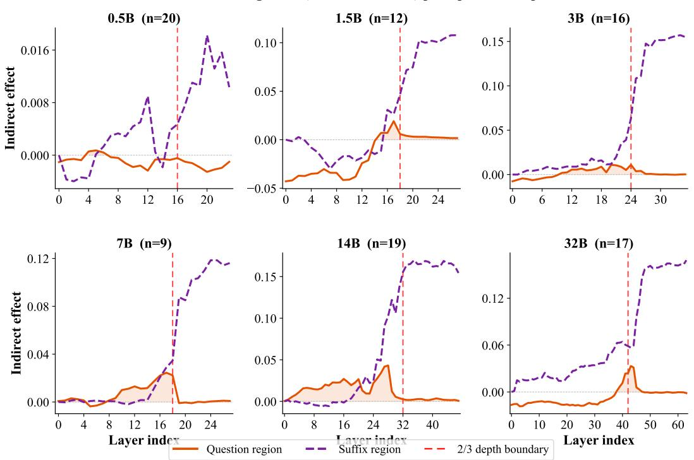  
Figure 5: Per-layer indirect effect on true-positive (TP) samples for the instruction-first (IF) prompt across six Qwen2.5 sizes. The solid orange curve shows the question-region effect, the dashed purple curve shows the suffix-region effect, and the red dashed line marks two-thirds of model depth. The question-region effect concentrates in early and middle layers, whereas the suffix-region effect rises mainly after this boundary at every tested scale.

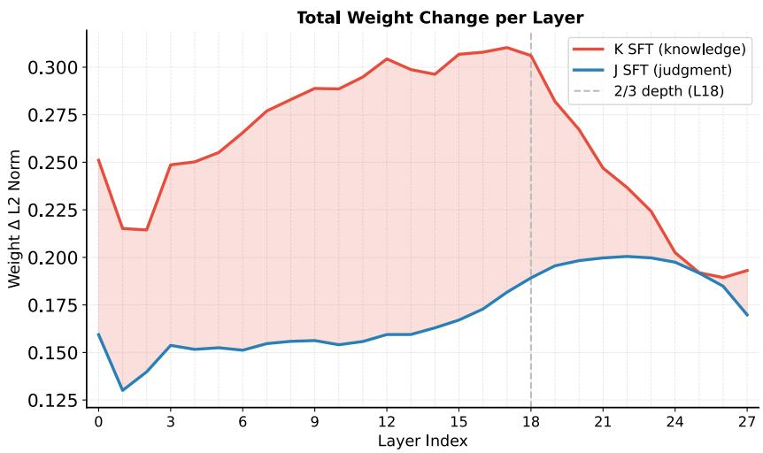  
Figure 6: Layer-wise weight delta $\| \Delta W _ { \ell } \| _ { F }$ after one epoch of K-SFT (red) vs. J-SFT (blue) on Qwen2.5-7B (full SFT from base, same data budget). K-SFT changes concentrate in shallow/mid layers, while J-SFT changes remain small until the deep layers. This weight-side pattern is consistent with the depth separation observed in causal tracing.

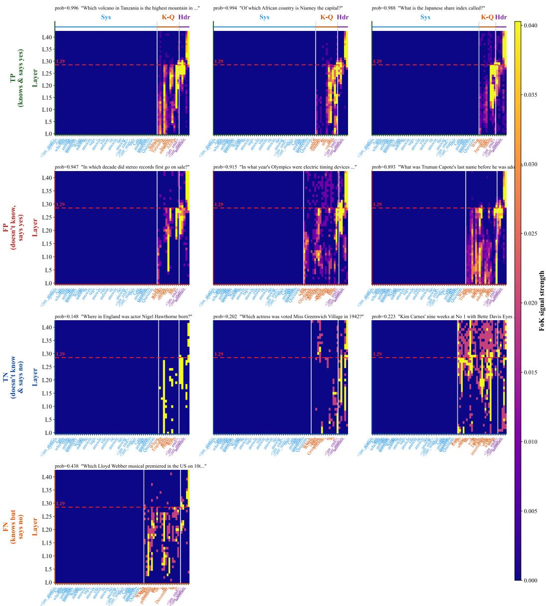  
Figure 7: ROME-style causal tracing on Qwen2.5-14B, broken down by outcome group. Rows: TP (answers correctly and judges yes), FP (answers incorrectly but judges yes), TN (answers incorrectly and judges no), and FN (answers correctly but judges no). Each row shows three samples, except FN, which has only one sample with $p > 0 . 4$ . Each cell is the layer × token restoration heatmap; tokens are grouped into Sys (system), K-Q (knowledge question), and Hdr (response header). The red dashed line at layer 29 marks the depth boundary used in our analysis. The suffix-region (Hdr) signal appears mainly in deep layers across all four outcome groups, suggesting that the late FoK signal does not simply track answer correctness.

## E FoK dependency on knowledge

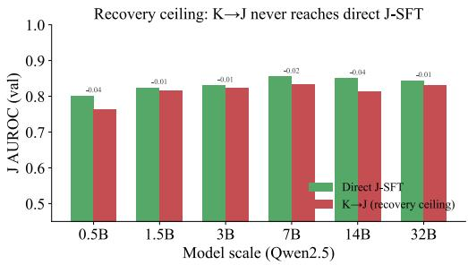  
(a) FoK recovery after knowledge SFT. In this evaluation, sequential K→J training improves FoK but remains below direct J-SFT across all six Qwen2.5 scales.

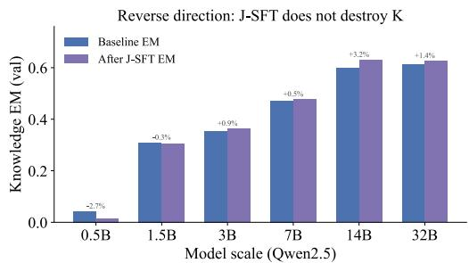  
(b) Reverse direction. Knowledge exact-match before and after J-SFT across Qwen2.5 scales. J-SFT has a limited effect on answer performance and can even yield modest improvements.  
Figure 8: FoK dependence on updated knowledge. Left: In this evaluation, K→J training improves FoK but does not reach direct J-SFT performance. Right: J-SFT alone barely shifts answer accuracy.

## F FoK judgment along OP-SFT training

Figure 9 tests whether the trained FoK channel only works at the final OP-SFT checkpoint. Answer accuracy changes substantially along the OP-SFT trajectory, while FoK AUROC remains above 0.80 on both splits for every checkpoint. The thresholded errors show a calibration shift: omission is larger near the base model, whereas illusion grows on later held-out checkpoints. Thus K∆-FT provides a stable ranking signal across the knowledge trajectory, but threshold calibration still depends on the underlying knowledge state of the model.

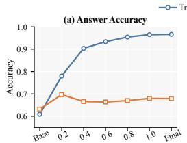

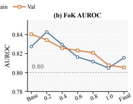  
OP-SFT Training Progress

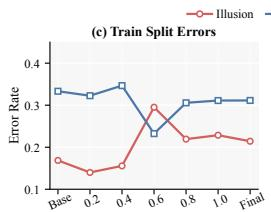

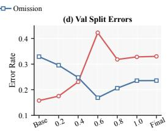  
Figure 9: In a separate small-scale study, we evaluate a fixed, trained K∆-FT FoK channel across successive OP-SFT knowledge checkpoints. We report answer accuracy, FoK AUROC, and thresholded illusion and omission errors.

## G FoK synchronization results across model scale and family

Table 8: Supplementary Qwen2.5 size-scaling experiments using a dedicated setup with 5,000 update questions and 1,000 held-out questions.
<table><tr><td></td><td colspan="2">Base</td><td colspan="4">K-SFT</td><td>J-SFT</td><td colspan="3">K→J SFT</td></tr><tr><td>Model</td><td>EM</td><td>AUROC</td><td>EM</td><td>AUROC</td><td>Illu.</td><td>Om.</td><td>AUROC</td><td>EM</td><td>AUROC</td><td>Illu.</td></tr><tr><td>0.5B</td><td>4.2%</td><td>0.523</td><td>16.9%</td><td>0.502</td><td>0%</td><td>99%</td><td>0.801</td><td>13.1%</td><td>0.763</td><td>3%</td></tr><tr><td>1.5B</td><td>30.9%</td><td>0.527</td><td>35.5%</td><td>0.500</td><td>66%</td><td>48%</td><td>0.824</td><td>34.8%</td><td>0.815</td><td>28%</td></tr><tr><td>3B</td><td>35.4%</td><td>0.724</td><td>45.7%</td><td>0.519</td><td>24%</td><td>80%</td><td>0.830</td><td>45.4%</td><td>0.822</td><td>40%</td></tr><tr><td>7B</td><td>47.2%</td><td>0.735</td><td>55.8%</td><td>0.592</td><td>28%</td><td>51%</td><td>0.855</td><td>55.1%</td><td>0.833</td><td>82%</td></tr><tr><td>14B</td><td>59.8%</td><td>0.756</td><td>65.2%</td><td>0.767</td><td>73%</td><td>9%</td><td>0.850</td><td>66.1%</td><td>0.814</td><td>85%</td></tr><tr><td>32B</td><td>61.2%</td><td>0.812</td><td>66.8%</td><td>0.792</td><td>80%</td><td>5%</td><td>0.844</td><td>66.8%</td><td>0.831</td><td>91%</td></tr></table>

Table 9: Cross-family FoK synchronization results with 5,000 update questions and 1,000 held-out questions.
<table><tr><td>Model</td><td>Base AUROC</td><td>K-SFT AUROC</td><td>J-SFT AUROC</td><td>K→J SFT AUROC</td><td>K→J SFT EM</td><td>Note</td></tr><tr><td>Qwen2.5-7B</td><td>0.735</td><td>0.592</td><td>0.855</td><td>0.833</td><td>55.1%</td><td>Reference</td></tr><tr><td>LLaMA-3.1-8B  $( \mathrm { L R } = 2 \times 1 0 ^ { - 6 } )$ </td><td>0.646</td><td>0.503</td><td>0.786</td><td>0.836</td><td>8.6%</td><td>K→J forgetting</td></tr><tr><td>LLaMA-3.1-8B  $( \mathrm { L R } = 1 0 ^ { - 6 } )$ </td><td>0.646</td><td>0.526</td><td>0.782</td><td>0.749</td><td>73.5%</td><td>LR corrected</td></tr><tr><td>LLaMA-2-7B</td><td>0.520</td><td>0.500</td><td>0.500</td><td>0.500</td><td>63.5%</td><td>No FoK improvement</td></tr><tr><td>LLaMA-2-13B</td><td>0.525</td><td>0.500</td><td>0.500</td><td>0.500</td><td>70.1%</td><td>No FoK improvement</td></tr></table>

Knowledge training and FoK degradation. Consistent with the main-text findings, the K-SFT results in Table 8 show that knowledge training can improve answer accuracy while impairing FoK. An update optimized for answering alone need not preserve the model’s ability to distinguish its correct answers from errors, motivating explicit FoK synchronization rather than assuming that knowledge gains automatically improve self-judgment.

LLaMA-2 negative result. The LLaMA-2 results reveal a distinction between acquiring knowledge and judging answerability. Although answer accuracy improves, FoK remains at chance after both knowledge and judgment training (Table 9). This suggests that correctness supervision alone is insufficient to elicit a discriminative FoK signal in this setting: the model can learn answers without learning to distinguish when its own answers are correct.

## H Additional validation

We conduct additional small-scale experiments, each with its own training and evaluation setup, to examine different aspects of FoK behavior.

## H.1 Accuracy-preserving updates and sequential knowledge changes

OP-SFT comparison. Table 10 compares FoK estimators starting from the same OP-SFT knowledge checkpoint. Adding a FoK adapter changes the combined model state, and the K∆-FT row therefore has a different answer accuracy. Base rows are a reference for the no-update regime, not evidence that our method uniformly improves on unadapted estimators. For Base, EliCal uses its released adapter, which is trained extensively and therefore changes answering behavior. When combined with OP-SFT, EliCal uses an adapter with only a small amount of training, so answer accuracy is unchanged.

Table 10: FoK evaluation before and after OP-SFT on the 1,000-question held-out TriviaQA split. All OP-SFT rows start from the same knowledge checkpoint.
<table><tr><td>Answer model</td><td>FoK estimator</td><td>Test Acc.</td><td>Test AUROC</td></tr><tr><td>Base</td><td>Direct judgment</td><td>0.672</td><td>0.688</td></tr><tr><td>Base</td><td>Prob</td><td>0.672</td><td>0.730</td></tr><tr><td>Base</td><td>EliCal</td><td>0.622</td><td>0.810</td></tr><tr><td>OP-SFT</td><td>Direct judgment</td><td>0.679</td><td>0.603</td></tr><tr><td>OP-SFT</td><td>Prob</td><td>0.679</td><td>0.571</td></tr><tr><td>OP-SFT</td><td>EliCal</td><td>0.679</td><td>0.618</td></tr><tr><td>OP-SFT + FoK adapter</td><td>K∆-FT</td><td>0.699</td><td>0.770</td></tr></table>

Three sequential updates. We divide 5,000 TriviaQA update questions into three disjoint shards. Round i applies OP-SFT with on-policy rollouts to the previous round’s model using shard i. The frozen FoK channel $\varphi _ { 1 }$ is trained after round 1 and kept fixed thereafter. The adaptive channel φi is trained with K∆-FT on each round’s knowledge trajectory. All held-out columns use the same 1,000 questions. Table 11 reports before/after answer accuracy on the new shard for that round; it is not cumulative accuracy over all previously updated facts and does not measure their retention. The adaptive channel maintains discrimination and reduces illusion in later rounds, but held-out answer accuracy remains below Base.

Table 11: Three sequential TriviaQA updates. Illusion is the conditional rate of predicting Yes on questions the current answering model gets wrong.
<table><tr><td rowspan="2">State</td><td rowspan="2">New-shard Acc. before → after</td><td rowspan="2">Test Acc.</td><td colspan="2"> $\varphi _ { 1 }$  (frozen)</td><td colspan="2"> $\varphi _ { i }$  (adaptive)</td></tr><tr><td>AUROC</td><td>Illusion</td><td>AUROC</td><td>Illusion</td></tr><tr><td>Base</td><td></td><td>0.672</td><td></td><td></td><td></td><td></td></tr><tr><td>Round 1</td><td> $0 . 5 7 5  0 . 9 7 2$ </td><td>0.659</td><td>0.798</td><td>0.455</td><td>0.798</td><td>0.455</td></tr><tr><td>Round 2</td><td> $0 . 6 7 6 \to 0 . 9 3 8$ </td><td>0.644</td><td>0.776</td><td>0.688</td><td>0.800</td><td>0.202</td></tr><tr><td>Round 3</td><td> $0 . 6 3 1  0 . 9 3 8$ </td><td>0.661</td><td>0.754</td><td>0.752</td><td>0.797</td><td>0.195</td></tr></table>

## H.2 Cross-dataset evaluation and a non-gradient update

Zero-shot transfer. We evaluate the TriviaQA-trained systems on SelfAware (3,369 questions), Natural Questions (3,610), and WebQuestions (2,032), without additional training (Table 12). FoK targets each evaluated model’s own answer correctness. In SelfAware, unanswerable questions count as incorrect answers; this adapts the original testbed to model-specific answerability rather than using its answerability annotation as a fixed target. In this transfer experiment, EliCal scores the fixed answers of the corresponding Base or OP-SFT generator, so each paired row has the same answer accuracy. This differs from the adapter-based answering evaluation of Table 10.

Table 12: Zero-shot transfer from TriviaQA. SA: SelfAware; NQ: Natural Questions; WebQ: WebQuestions. Acc. measures answer correctness, whereas AUROC measures functional FoK discrimination.
<table><tr><td></td><td colspan="2">SA</td><td colspan="2">NQ</td><td colspan="2">WebQ</td></tr><tr><td>System</td><td>Acc.</td><td>AUROC</td><td>Acc.</td><td>AUROC</td><td>Acc.</td><td>AUROC</td></tr><tr><td>Base</td><td>0.282</td><td>0.768</td><td>0.376</td><td>0.665</td><td>0.527</td><td>0.597</td></tr><tr><td>Base + EliCal</td><td>0.282</td><td>0.702</td><td>0.376</td><td>0.735</td><td>0.527</td><td>0.636</td></tr><tr><td>Vanilla K-SFT</td><td>0.187</td><td>0.569</td><td>0.191</td><td>0.571</td><td>0.224</td><td>0.519</td></tr><tr><td>OP-SFT + EliCal</td><td>0.305</td><td>0.590</td><td>0.381</td><td>0.579</td><td>0.539</td><td>0.515</td></tr><tr><td>Ours</td><td>0.305</td><td>0.810</td><td>0.381</td><td>0.733</td><td>0.539</td><td>0.644</td></tr></table>

Table 13: SelfAware detail for the same zero-shot systems. TPR is the rate of predicting Yes on correctly answered questions; TNR is the rate of predicting No on incorrectly answered questions.
<table><tr><td>System</td><td>AUROC</td><td>TPR</td><td>TNR</td><td>Answer Acc.</td></tr><tr><td>Base</td><td>0.768</td><td>0.388</td><td>0.898</td><td>0.282</td></tr><tr><td>Vanilla K-SFT</td><td>0.569</td><td>0.302</td><td>0.760</td><td>0.187</td></tr><tr><td>Ours</td><td>0.810</td><td>0.765</td><td>0.701</td><td>0.305</td></tr></table>

Natural Questions replication. Separately from zero-shot transfer, we run the full pipeline on a 5,000-update / 1,000-held-out Natural Questions split (Table 14). The resulting update-shard accuracy is 0.925. This replicates the knowledge-update comparison on a second factual-QA dataset, without implying improvement across all QA settings or update operators.

Table 14: Full-pipeline replication on Natural Questions. This held-out split differs from the zero-shot population in Table 12.
<table><tr><td>System</td><td>Held-out Acc.</td><td>FoK AUROC</td></tr><tr><td>Base</td><td>0.319</td><td>0.629</td></tr><tr><td>Vanilla K-SFT</td><td>0.199</td><td>0.585</td></tr><tr><td>Ours</td><td>0.366</td><td>0.647</td></tr></table>

MEMIT. We apply one MEMIT batch edit [39] to 200 facts in the zsRE setting [31]. Table 15 measures the edited facts and the same 1,000 held-out TriviaQA questions before and after editing. Edited-fact accuracy rises while FoK AUROC decreases. This is a test of desynchronization under a non-gradient operator; we do not evaluate K∆-FT or FGPO as a repair for MEMIT.

Table 15: Knowledge and functional FoK before and after a MEMIT edit. Train denotes 200 edited zsRE facts; Test denotes 1,000 held-out TriviaQA questions. These states are compared only within this experiment.
<table><tr><td></td><td>Train Acc.</td><td>Train AUROC</td><td>Test Acc.</td><td>Test AUROC</td></tr><tr><td>Before edit</td><td>0.035</td><td>0.594</td><td>0.633</td><td>0.726</td></tr><tr><td>After edit</td><td>0.640</td><td>0.553</td><td>0.627</td><td>0.709</td></tr></table>

## H.3 Training-seed variation

Table 16 reports independent training runs for Vanilla K-SFT (three seeds) and OP-SFT + K∆-FT (four seeds). The Vanilla K-SFT seed runs train a LoRA adapter (rank 16, alpha 32) on standard SFT data built from the update questions, with learning rate $1 0 ^ { - \dot { 4 } } \cdot$ , 5 epochs, per-device batch size 8, and gradient accumulation 1. Table 17 varies the FGPO seed from one shared Stage-1+2 initialization. We report the arithmetic mean and sample standard deviation, $s = \sqrt { \textstyle \sum _ { i } ( x _ { i } - { \bar { x } } ) ^ { 2 } / ( n - 1 ) }$ , over available runs; the unrun Vanilla seed-42 cells are excluded. These statistics quantify training-seed variation under the fixed evaluation split and are neither confidence intervals nor significance tests. The FGPO statistics are conditional on the shared initialization and do not quantify full-pipeline seed variation. Other supplementary experiments are reported as individual evaluations.

Table 16: Training-seed variation of Vanilla K-SFT and OP-SFT + K∆-FT on held-out TriviaQA.
<table><tr><td rowspan="2">Seed</td><td colspan="2">Vanilla K-SFT</td><td colspan="2"> ${ \mathrm { O P - S F T } } + { \mathrm { K } } { \Delta } { \mathrm { - F T } }$ </td></tr><tr><td>Acc.</td><td>AUROC</td><td>Acc.</td><td>AUROC</td></tr><tr><td>42</td><td></td><td></td><td>0.699</td><td>0.770</td></tr><tr><td>43</td><td>0.522</td><td>0.635</td><td>0.665</td><td>0.770</td></tr><tr><td>44</td><td>0.522</td><td>0.627</td><td>0.670</td><td>0.790</td></tr><tr><td>0</td><td>0.520</td><td>0.619</td><td>0.665</td><td>0.778</td></tr><tr><td>Mean ± SD</td><td> $0 . 5 2 1 \pm 0 . 0 0 1$ </td><td> $0 . 6 2 7 \pm 0 . 0 0 8$ </td><td> $0 . 6 7 5 \pm 0 . 0 1 6$ </td><td> $0 . 7 7 7 \pm 0 . 0 0 9$ </td></tr></table>

Table 17: FGPO seed variation from one shared Stage-1+2 initialization, evaluated end to end on held-out TriviaQA. Seed 1 is the original full-method run.
<table><tr><td>State</td><td>Test Acc.</td><td>Test AUROC</td></tr><tr><td>Shared Stage-1+2 initialization</td><td>0.699</td><td>0.770</td></tr><tr><td>FGPO, seed 1</td><td>0.692</td><td>0.809</td></tr><tr><td>FGPO, seed 43</td><td>0.677</td><td>0.810</td></tr><tr><td>FGPO, seed 44</td><td>0.672</td><td>0.815</td></tr><tr><td> $\mathrm { F G P O \ m e a n \pm S D }$ </td><td> $0 . 6 8 0 \pm 0 . 0 1 0$ </td><td> $0 . 8 1 1 \pm 0 . 0 0 3$ </td></tr></table>

## H.4 Functional FoK and accessible cues

These analyses measure behavior of the trained Qwen2.5-7B FoK channel. They are consistent with cue-sensitive judgments but do not establish that K∆-FT induces that sensitivity, because a matched pretrained control was not included. They also do not test subjective experience.

Consistency at fixed incorrectness. From a 5,000-question TriviaQA pool, we sample 16 answers per question and retain the 1,149 questions where all 16 answers are wrong. Consistency is the fraction giving the most frequent incorrect answer. FoK rises with this consistency even though sampled correctness is zero (Table 18). The reported Spearman correlation is $\rho = 0 . \dot { 2 } 4 ( p = 2 \times \mathrm { \bar { 1 0 ^ { - 1 6 } } } )$

Table 18: Functional FoK among 1,149 questions with 16/16 incorrect sampled answers. Bin labels follow the evaluation grouping.
<table><tr><td>Answer consistency</td><td>Questions</td><td>Mean J</td></tr><tr><td>0-0.2</td><td>840</td><td>0.413</td></tr><tr><td>0.2-0.4</td><td>178</td><td>0.486</td></tr><tr><td>0.4-0.6</td><td>71</td><td>0.571</td></tr><tr><td>0.6-0.8</td><td>29</td><td>0.591</td></tr><tr><td>0.8-1.0</td><td>31</td><td>0.808</td></tr></table>

Accessible reasoning. We progressively reveal the generated reasoning trace on 440 MATH problems using the reasoning-prefix prompts of the preliminary study. Table 19 shows better discrimination as more of the trace becomes available. The mean-J gap is the difference between correct and incorrect solution groups. This does not establish a particular human cognitive mechanism.

Table 19: FoK discrimination with progressively revealed reasoning on 440 MATH problems.
<table><tr><td>Reasoning shown</td><td>AUROC</td><td>Mean-J gap</td></tr><tr><td>Question only</td><td>0.60</td><td>0.05</td></tr><tr><td>25%</td><td>0.66</td><td>0.09</td></tr><tr><td>50%</td><td>0.67</td><td>0.10</td></tr><tr><td>75%</td><td>0.74</td><td>0.15</td></tr><tr><td>Full reasoning</td><td>0.91</td><td>0.32</td></tr></table>

Context intervention. We prepend short contexts to a filtered 1,460-question subset of the same pool, removing contexts containing a gold answer. Table 20 reports FoK and answer accuracy; deltas are relative to the bare question. Related versus unrelated words raise mean J by 0.490 (paired Wilcoxon test on per-question J, reported $p = 5 \times 1 0 ^ { - 2 3 9 } )$ . Incorrect related sentences increase J while slightly decreasing accuracy, showing that the judgment is not determined by correctness alone.

Table 20: Context interventions on 1,460 questions after filtering gold-answer-containing contexts.
<table><tr><td>Format</td><td>Condition</td><td>J</td><td> $\Delta J$ </td><td> $\operatorname { A c c } .$ </td><td> $\Delta \mathrm { A c c . }$ </td></tr><tr><td></td><td>None</td><td>0.599</td><td></td><td>0.408</td><td></td></tr><tr><td>Words</td><td>Unrelated</td><td>0.184</td><td>-0.415</td><td>0.424</td><td>+0.016</td></tr><tr><td>Words</td><td>Related</td><td>0.674</td><td>+0.075</td><td>0.478</td><td>+0.070</td></tr><tr><td>Sentences</td><td>Unrelated</td><td>0.298</td><td>-0.301</td><td>0.436</td><td>+0.028</td></tr><tr><td>Sentences</td><td>Correct related</td><td>0.677</td><td>+0.078</td><td>0.510</td><td>+0.102</td></tr><tr><td>Sentences</td><td>Incorrect related</td><td>0.772</td><td>+0.173</td><td>0.397</td><td>-0.011</td></tr></table>

## H.5 Prompt sensitivity and alternative knowledge updates

Judgment templates. We repeat causal tracing on the same 40 Qwen2.5-7B samples under six judgment templates (Table 21). Recovery peaks stay at layers 20–21 of 28, with sensitive ranges within layers 16–23. This supports robustness within the tested templates, not prompt invariance in general. The templates cover both rephrasings and label changes; the sensitive range denotes the layers with strong recovery.

Table 21: Causal-tracing sensitivity to judgment templates on 40 shared samples. Layers are reported out of 28.
<table><tr><td>Template</td><td>Peak layer</td><td>Sensitive range</td></tr><tr><td>Original</td><td>20</td><td>16-22</td></tr><tr><td>A: rephrased</td><td>21</td><td>17-22</td></tr><tr><td>B: third-person elicitation</td><td>21</td><td>16-21</td></tr><tr><td>C: numeric labels 1/2</td><td>21</td><td>18-23</td></tr><tr><td>D: letter labels A/B</td><td>21</td><td>18-21</td></tr><tr><td>E: labels can/cannot</td><td>20</td><td>18-20</td></tr></table>

Correction strategies. Table 22 compares knowledge-update strategies on Qwen2.5-7B-Instruct using 5,000 TriviaQA update questions and 1,000 held-out questions from a split different from the main tables. General capability is measured on the 1,319-question GSM8K test set [7]. Reptile uses first-order meta-updates [43]; SDFT uses the released self-distillation setup [44]. The lookahead variant penalizes deviation from Base after a one-step SFT update; the proximal variant adds an L2 constraint to Base. Average is the unweighted mean of the three reported accuracies and is given only when all three are available; it mixes seen-data and held-out metrics and is not a generalization-only score. Span replacement has the highest such average, but does not dominate Base on GSM8K.

Table 22: Alternative knowledge-update strategies on a separate TriviaQA split. Unlikelihood GSM8K was not reported, so its average is omitted.
<table><tr><td>Strategy</td><td>Update Acc.</td><td>Held-out Acc.</td><td>GSM8K</td><td>Average</td></tr><tr><td>Base</td><td>0.685</td><td>0.603</td><td>0.798</td><td>0.695</td></tr><tr><td>Vanilla SFT</td><td>0.992</td><td>0.452</td><td>0.368</td><td>0.604</td></tr><tr><td>Reptile meta-update</td><td>0.558</td><td>0.584</td><td>0.640</td><td>0.594</td></tr><tr><td>SDFT</td><td>0.529</td><td>0.565</td><td>0.367</td><td>0.487</td></tr><tr><td>Unlikelihood on wrong span</td><td>0.500</td><td>0.528</td><td></td><td></td></tr><tr><td>One-step lookahead KL</td><td>0.738</td><td>0.619</td><td>0.646</td><td>0.668</td></tr><tr><td>L2 proximal constraint</td><td>0.560</td><td>0.587</td><td>0.639</td><td>0.595</td></tr><tr><td>Replace wrong span</td><td>0.832</td><td>0.626</td><td>0.653</td><td>0.704</td></tr></table>

Supplementary assets. Table 23 records publisher-specified terms for additional datasets and the editing implementation. Dataset terms are distinguished from repository software licenses, particularly for Natural Questions. The exact zsRE distribution, SDFT implementation revision, and all auxiliary checkpoint licenses are not identified in the available experiment record; this version therefore does not claim a complete asset-license audit.

Table 23: Additional assets and publisher-specified terms.
<table><tr><td>Asset</td><td>Role</td><td>License or terms</td></tr><tr><td>SelfAware</td><td>Zero-shot QA</td><td>CC BY-SA 4.0 (source)</td></tr><tr><td>Natural Questions</td><td>Transfer and replication</td><td>CC BY-SA 3.0 (data source)</td></tr><tr><td>WebQuestions</td><td>Zero-shot QA</td><td>CC BY 4.0 (source)</td></tr><tr><td>MATH</td><td>Reasoning evaluation</td><td>MIT (repository)</td></tr><tr><td>GSM8K</td><td>Capability evaluation</td><td>MIT (repository)</td></tr><tr><td>MEMIT</td><td>Editing implementation</td><td>MIT (repository)</td></tr></table>

## I Detailed results for the main-text tables

## I.1 Knowledge and judgment SFT

These tables retain all the error-rate columns of Table 1. Accuracy, illusion, and omission are percentages; their changes are percentage points. AUROC and its changes are unitless. Illusion and omission are conditional error rates, rather than fractions of all evaluated questions.

Table 24: Base values for the preliminary SFT comparison.
<table><tr><td>Model</td><td>Acc. (%)</td><td>AUROC</td><td>Illusion (%)</td><td>Omission (%)</td></tr><tr><td>Qwen2.5-0.5B</td><td>20</td><td>0.519</td><td>28</td><td>85</td></tr><tr><td>Qwen2.5-1.5B</td><td>35</td><td>0.529</td><td>56</td><td>38</td></tr><tr><td>Qwen2.5-3B</td><td>39</td><td>0.739</td><td>8</td><td>68</td></tr><tr><td>Qwen2.5-7B</td><td>53</td><td>0.724</td><td>51</td><td>20</td></tr><tr><td>Qwen2.5-14B</td><td>66</td><td>0.762</td><td>50</td><td>19</td></tr><tr><td>Qwen2.5-32B</td><td>68</td><td>0.819</td><td>62</td><td>8</td></tr><tr><td>LLaMA-3.1-8B</td><td>74</td><td>0.672</td><td>81</td><td>16</td></tr></table>

Table 25: Changes from Base under K-SFT, J-SFT, and sequential K→J SFT. Positive accuracy and AUROC changes indicate improvement; negative illusion and omission changes indicate improvement. All source values are retained.
<table><tr><td></td><td colspan="4">K-SFT</td><td colspan="4">J-SFT</td><td colspan="4">K→J SFT</td></tr><tr><td>Model</td><td>Acc.</td><td>AUC</td><td>Illu.</td><td>Om.</td><td>Acc.</td><td>AUC</td><td>Illu.</td><td>Om.</td><td>Acc.</td><td>AUC</td><td>Illu.</td><td>Om.</td></tr><tr><td>Qwen2.5-0.5B</td><td>+2</td><td>-0.016</td><td>-27</td><td>+13</td><td>-14</td><td>+0.213</td><td>-28</td><td>+15</td><td>+2</td><td>+0.211</td><td>-21</td><td>-10</td></tr><tr><td>Qwen2.5-1.5B</td><td>+6</td><td>-0.035</td><td>+6</td><td>-2</td><td>+2</td><td>+0.255</td><td>-28</td><td>-6</td><td>+5</td><td>+0.248</td><td>-21</td><td>-12</td></tr><tr><td>Qwen2.5-3B</td><td>+12</td><td>-0.220</td><td>+10</td><td>+18</td><td>+3</td><td>+0.038</td><td>+11</td><td>-29</td><td>+11</td><td>+0.051</td><td>+20</td><td>-41</td></tr><tr><td>Qwen2.5-7B</td><td>+7</td><td>-0.042</td><td>-15</td><td>+19</td><td>+2</td><td>+0.088</td><td>-9</td><td>-4</td><td>+7</td><td>+0.100</td><td>+6</td><td>-12</td></tr><tr><td>Qwen2.5-14B</td><td>+6</td><td>+0.004</td><td>+9</td><td>-4</td><td>+1</td><td>+0.030</td><td>+9</td><td>-9</td><td>+5</td><td>+0.068</td><td>+29</td><td>-17</td></tr><tr><td>Qwen2.5-32B</td><td>+4</td><td>-0.026</td><td>+11</td><td>0</td><td>0</td><td>+0.010</td><td>-10</td><td>+2</td><td>+4</td><td>+0.020</td><td>+3</td><td>-3</td></tr><tr><td>LLaMA-3.1-8B</td><td>+2</td><td>-0.038</td><td>-11</td><td>+9</td><td>+1</td><td>+0.045</td><td>+7</td><td>-11</td><td>+2</td><td>+0.063</td><td>+14</td><td>-14</td></tr></table>

## I.2 Update-set stage-wise ablation

These are the update-set columns of the same runs used in Table 4; they do not measure held-out generalization.

Table 26: Update-set results for Base and the three cumulative training stages.
<table><tr><td>Stage</td><td>Acc.↑</td><td>AUROC↑</td><td>Illu.↓</td><td>Om.↓</td><td>Bias→ 0</td></tr><tr><td>Base</td><td>0.680</td><td>0.702</td><td>0.653</td><td>0.109</td><td>0.381</td></tr><tr><td>Stage 1: + OP-SFT</td><td>0.966</td><td>0.575</td><td>0.589</td><td>0.319</td><td>0.454</td></tr><tr><td>Stage 2: + K∆-FT</td><td>0.967</td><td>0.803</td><td>0.350</td><td>0.190</td><td>0.270</td></tr><tr><td>Stage 3: + FGPO</td><td>0.961</td><td>0.817</td><td>0.250</td><td>0.240</td><td>0.245</td></tr></table>