# From Autonomous Agents to Cognitive Symbionts

Toward AI-Augmented Human Intelligence

Hao Fei

University of Oxford • haofei7419@gmail.com

€ cognitive-symbiont.github.io

## Abstract

Over the past decade, progress in artificial intelligence has been measured by how much a machine can do on its own. Large foundation models now write code, draft documents, search, and run multistep tasks, and the autonomous personal agents run in the background and act on a person’s behalf. Yet people still forget what they once knew, miss what they are not looking at, fail to find the right words, and face hard choices without the benefit of their own history. The machine that could help usually stands outside the situation: it does not know who the person is, where they are, what they are thinking, or how to interact and communicate with them in the moment. As AI moves into the physical world, attention has settled on one kind of intelligent individual, the embodied robot; we argue that the era of Physical AI holds a second kind of equal importance, the person augmented by AI, and with it a second half of the endgame of AI. Alongside artificial general intelligence, which asks how intelligent a machine can be, stands AI-augmented human intelligence (AHI), which asks how much intelligence a machine can enable in a particular person. Realizing it calls for a new kind of system, which we call a cognitive symbiont: a lifelong, embedded, real-time, private, low-friction, and proactive companion that senses what the person senses through external devices, keeps their context and knowledge across years, models their situation and their mind, takes part in their thinking at the right moment, carries out everyday tasks with their context in hand, and keeps learning the person as both of them change. We give the paradigm a conceptual core, the cognitive gap between what a person could bring to a situation and what they can hold in working memory, and organize its design space as a symbiosis loop of sensing, keeping, understanding, living alongside, acting for and thinking with the person, and growing, enclosed by a personal runtime and by trust. Because a symbiont changes what a person can do in front of others, it also raises risks of a new kind, from covert assistance in examinations and conversations to pressure on everyone to adopt it, and we treat their governance as part of the paradigm.

## Contents

Part I The Paradigm   
Introduction   
11 The Other Half of the Endgame   
1.2 The Bottleneck Has Moved   
1.3 Risk and Legitimacy   
1.4 Thesis and Contribution   
Where We Stand   
2.1 Four Roles in Human–AI Relations   
2.2 Two Forms of Intelligent Individuals   
2.3 Eighty Years of the Same Question   
2.4 Why Now   
Technical Foundations   
3.1 Foundation Models   
3.2 Agents and Harnesses 10   
3.3 Memory, Context, and Personalization 11   
3.4 World Models 12   
3.5 Wearable and Embedded Hardware 12   
3.6 What Is Still Missing 12   
Conceptual Foundations 13   
4.1 Definitions 13   
4.2 Six Properties and the Jarvis Test 14   
4.3 The Symbiosis Loop 15   
4.4 Scope and Non-Claims 15   
Part II The Anatomy of a Symbiont 16   
Sensing and Interacting 16   
5. Borrowed Senses, Borrowed Voice 16   
The Device Constellation 17   
5.3 Channels Out 17   
5.4 Private Channels 17   
5.5 Always On 18   
5.6 Co-Evolution of Hardware and Models 19   
Personal Context and Lifelong Knowledge 20   
6.1 Three Timescales of One Record 20   
6.2 One Entry Point for Every Context 20   
6.3 From Streams to a Record 21   
6.4 One Life, Many Views 21   
6.5 Updating, Forgetting, and Repair 21   
6.6 Remembering the Future, and the Reasons 22   
6.7 The Others in Your Life 23   
Understanding a Person 23   
7.1 What Must Be Understood 23   
7.2 Two Roads to the Mind 23   
7.3 Layers of the Personal Model 23   
7.4 The Backbone 23   
7.5 Two World Models 25   
7.6 Knowing When It Is Wrong . 26   
8 Living Alongside 26   
8.1 Two Conversations at Once 26   
8.2 Fast Loop, Slow Loop 26   
8.3 Implicit Intent 27   
8.4 The Intervention Policy 27   
8.5 Low Friction 28   
8.6 Beyond the Meeting Room 28   
The Ladder of Assistance 28   
9.1 Getting Things Done 28   
9.2 Thinking With You 29   
9.3 Feeling With You 30   
9.4 Relating 31   
9.5 Caring 32   
9.6 Symbiont to Symbiont 32   
9.7 A Catalogue of Functions 32   
10 Growing Together 32   
10.1 Where Learning Happens 33   
10.2 The Personal Data Flywheel 34   
10.3 Learning the Way a Person Learns 35   
10.4 Evolving the Whole Stack 35   
10.5 The Person Changes Too 35   
11 The Personal Runtime 36   
11.1 Beyond an App 36   
11.2 Layers 36   
11.3 A Harness for a Life . 36   
11.4 The Cost of Always-On Cognition 37   
11.5 Continuity 37   
12 Trust 37   
12.1 Trust Is the Adoption Problem 37   
12.2 The Trust Curve 37   
12.3 The Symbiont’s Code 38   
12.4 The Privacy of Thought 38   
12.5 The People Around You 39   
12.6 A Symbiont Is a Target 39   
12.7 Design Principles 39   
art III Where This Leads 40   
13 Whom It Serves 40   
13.1 Universal Need, Uneven Gap 40   
13.2 Everyday Life . 40   
13.3 Knowledge Work 40   
13.4 Learners and Teachers 41   
13.5 Families Across the Life Course 41   
13.6 Sensory, Motor, Cognitive, and Language Barriers 41   
13.7 Mental Health and Wellbeing . 42   
13.8 Public-Facing and High-Stakes Roles 42   
13.9 Who Should Not Come First 42   
14 A World of Augmented Individuals 42   
14.1 A Street Full of Augmented Individuals 42   
14.2 Humans, Robots, and a Shared Core 43   
art IV Risk, Governance, and Evidence 44   
15 The Risks of Augmentation 44   
15.1 Why Augmentation Is Diferent . 44   
15.2 Three Directions of Harm . 44   
15.3 Public Acceptance 45   
15.4 Examinations, Learning, and Credentials . 45   
15.5 Conversations and Relationships 46   
15.6 Work, Institutions, and the State 46   
15.7 The Social Fabric . 46   
15.8 Contested Uses of the Symbiont’s Own Functions 47   
16 Governing Augmentation 47   
16.1 Private Content, Declarable Status 47   
16.2 Settings Set the Rules 47   
16.3 Verifiable Abstention 48   
16.4 What Credentials Should Measure 48   
16.5 Access and Accommodation 49   
16.6 Who Governs 49   
16.7 Open Ethical Questions . 49   
17 Evaluation and Research Agenda 49   
17.1 What to Measure 49   
17.2 Dimensions of Evaluation 50   
17.3 How to Study a Symbiont . 50   
17.4 Open Problems 51   
17.5 A Capability Roadmap 51   
17.6 What Would Prove Us Wrong . 51   
18 Conclusion 53

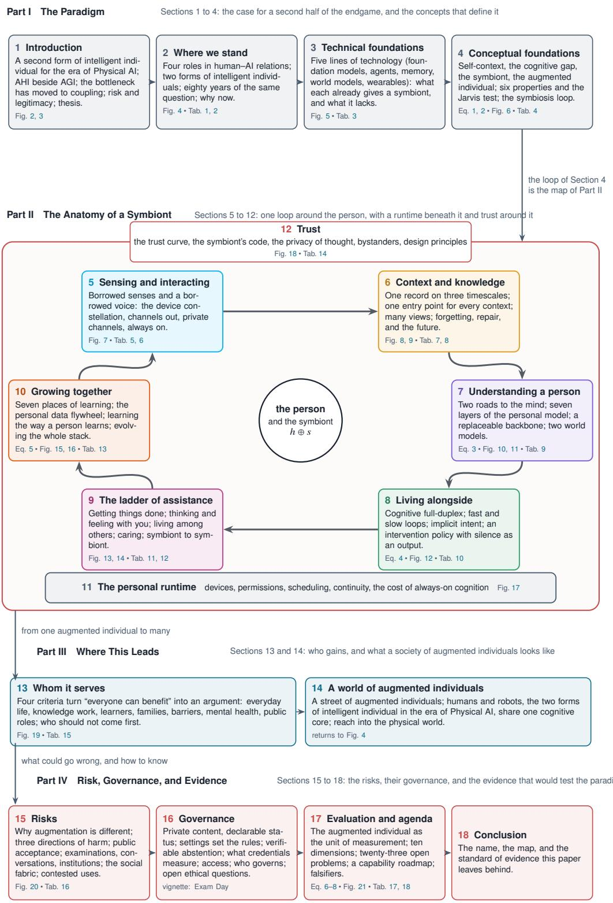  
Figure 1: A map of the perspective paper. Part I says why the era of Physical AI holds a second form of intelligent individual, the person augmented by AI, and what a cognitive symbiont is. Part II follows one loop, in which the output of each section is the input of the next, with a runtime beneath it and trust around it. Part III widens the view from one augmented individual to many. Part IV examines the risks, how augmentation can be governed, and how the whole can be measured. Each box names the section’s purpose and the figures, tables, and equations it contributes.

## Part I

## The Paradigm

Part I makes the case for a second half of the endgame of AI and gives it a conceptual form. Section 1 places the augmented person beside the embodied robot as a form of intelligent individual in the era of Physical AI, argues that the bottleneck of personal AI has moved from the capability of the model to the coupling between a model and a particular person, and says why the risks of augmentation belong to the proposal. Section 2 places the proposal in a coordinate system of four roles the AI has played in its relationship with a person and two forms an intelligent individual can take, and locates it in seventy years of work on augmenting the human intellect. Section 3 reads the five lines of technology a symbiont is built on, stating for each what it already provides and what it still lacks; the gaps form the research space of Part II. Section 4 defines the objects of the paper, introduces the cognitive gap as its invariant, lists the six properties a symbiont must have, and draws the symbiosis loop that organizes everything that follows.

## 1 Introduction

“. . . human brains and computing machines will be coupled together very tightly.” – J. C. R. Licklider, Man-Computer Symbiosis, 1960 (Licklider, 1960)

For the past decade, progress in artificial intelligence has been scored on a single axis: how much a machine can accomplish on its own. Measured on that axis, the results are substantial. AI models now can write and review code, draft and summarize documents, search, plan, and carry out multistep tasks on a computer (OpenAI, 2023; Yang et al., 2024; Anthropic, 2024a). Productivity at the desk, the part of work that takes place in front of a screen, has been transformed and in large part solved. An ordinary day, however, still contains the same losses it always did, and one person’s day is enough to show them. In the morning, working alone, a researcher has an idea that slips away before it is written down. In the afternoon, in a meeting, a colleague asks about a result she published three years ago, and she cannot recall the number. In the evening, facing a decision, she cannot remember how she reasoned the last time she faced one like it. Two further losses belong to the same family: a visitor in an unfamiliar country who does not know how to decline an invitation politely, and someone who has just failed at something, who needs one sentence from a person who knows their story and receives a paragraph of generic encouragement instead. The first three are failures of access, in which something the person already possesses fails to reach the moment in which it is needed, and the last two are gaps of knowledge and of support that the person cannot close alone at that moment; none of the five is a failure of intelligence. In each case an AI that holds the relevant knowledge exists, and in each case it is absent from the situation: it does not know who this person is, where they are, what they are trying to do, or what they are feeling, and it has no natural way to interact and communicate with them in the moment. Sections 9.2, 8.6, and 6.6 return to the three moments of this day.

Most readers already carry a picture of the system that would close these gaps. In the Iron Man films, Jarvis is always present, has known its owner for years, acts while he is speaking and moving, and never asks him to stop and explain.1 The reference is useful because it allows the subject of this perspective paper to be stated in one sentence: we are concerned with how every person could have such a system, and with how far beyond Jarvis such a system should go. The vignette Beyond Jarvis in Section 4.2 lists six directions, of which three matter most here, and each is developed later in the paper. Jarvis sees through a laboratory and a suit that its owner built, whereas a symbiont for everyone must see through a handful of afordable external devices, and it gains channels Jarvis never had, such as physiological signals, first-person video, and the owner’s own account, in their own words, of what they are thinking. Jarvis mostly executes and alerts, and rarely models its owner’s goals, emotions, or blind spots, whereas the center of gravity of a symbiont is exactly that layer of mind. And Jarvis gives almost no help with other people or other cultures, which is where a symbiont is most distinctive. Section 4.2 makes this comparison precise.

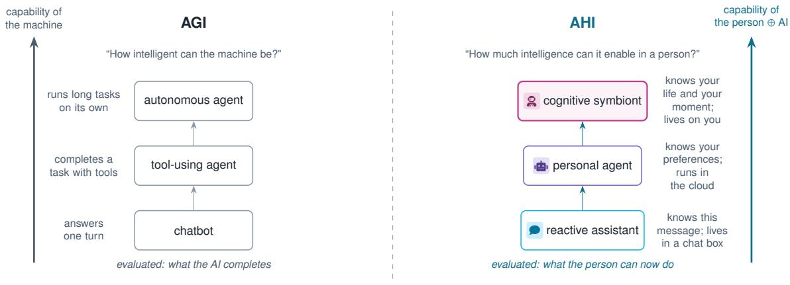  
Shared base: foundation models, agents and harnesses, memory, world models, wearable hardware the base keeps getting stronger; both halves inherit every gain  
Figure 2: The two halves of the endgame. AGI runs from chatbots to autonomous agents and is scored on what the AI completes. AHI runs from reactive assistants to cognitive symbionts and is scored on what the person can now do. Both share one base of models, agents, memory, and hardware, and both inherit every improvement to it. A system sits on one half or the other according to what it is evaluated on, so the same chat product is a chatbot when its answers are scored and a reactive assistan when what its user can then do is scored; today the first two stages of the AHI half are still scored on what the AI produces (Table 1). Arrows mark growth within a half, and the two halves are parallel, not successive stages.

## 1.1 The Other Half of the Endgame

AI is leaving the screen for the physical world, and with it comes the question of what kinds of intelligent individuals that world will contain. The answer that has drawn most of the field’s attention is the embodied robot, an AI with a body, senses, and goals of its own (Gemini Robotics Team, 2025; NVIDIA, 2025). We argue that the era of Physical AI will contain a second kind of individual of equal importance: a person whose own senses, memory, and judgment are joined to an AI that lives on their body (Section 2.2). This paper is a perspective on that second kind of individual. Foundation models, world models, and methods of self-improvement enter it as enabling technologies (Section 3) and as replaceable components (Section 7.4), while the proposal itself concerns the form in which an augmented person exists and is helped.

The second kind of individual also changes what progress in AI is measured against, and in this sense the endgame of AI has two halves. Artificial general intelligence (AGI) asks how intelligent the machine can be. The other half, which we call AI-augmented human intelligence (AHI), asks how much intelligence a machine can enable in a particular person. The two are built on the same base: the same foundation model can act as an autonomous agent that completes tasks, or as a cognitive symbiont that augments one human being. What difers is the object of evaluation, the mode of existence, and the relationship with the person (Figure 2). This paper is entirely about the second half, and it makes two commitments to the first. A symbiont delegates errands to standard agents (Section 9.1), and it improves with every gain in the base model (Section 7.4).

## 1.2 The Bottleneck Has Moved

A person’s cognitive bandwidth is fixed. Working memory holds a few items, attention goes one place at a time, and a day has twenty-four hours. The capability of AI on isolated tasks keeps rising, but the coupling between an AI and a given person has barely changed: how much the AI knows about the person, how fast it can step in, how much it interrupts when it does, and how far the person trusts it. The result is a widening gap between what a model could contribute and what a person actually receives (Figure 3a). The next step for personal AI is tighter coupling, and tighter coupling is a diferent problem from a larger model. The claim requires qualification, since coupling is itself built on strong base models; Section 3 describes which technologies first made coupling possible, and the paper opposes only the assumption that a larger base is suficient. Three observable symptoms mark insuficient coupling: every conversation starts by re-explaining the background, help arrives too late or too loudly, and people entrust nothing important to the system. They point, respectively, to Sections 6, 8, and 12. Figure 3b shows the mechanism by which the relationship nonetheless shifts: stronger models absorb more context, which lowers the cost of being understood, which moves interaction of the screen and onto the body, which produces a new kind of context, the record of a life, which makes those models more useful to that person in turn.

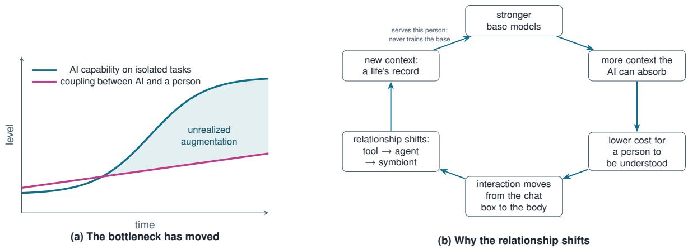

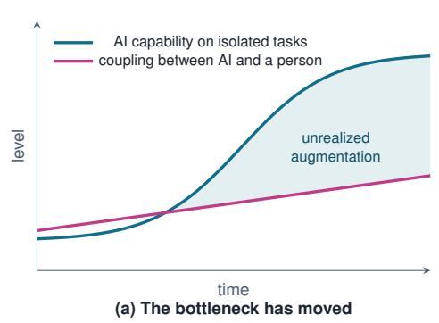  
Figure 3: (a) AI capability on isolated tasks keeps rising while coupling with a particular person stays nearly flat; the shaded region is augmentation that is never realized. The curves are a conceptual sketch, not measurements. (b) The mechanism of the shift: a causal loop in which stronger base models lower the cost of being understood, move interaction onto the body, and generate a new kind of context that makes the models more useful to each person in turn, without being used to train them.

## 1.3 Risk and Legitimacy

A system that makes a person more capable in front of other people raises questions that a system which only completes tasks does not. When a student can recall a textbook during an examination, or a negotiator is handed a line that reads the other side’s hesitation, the gain of one person is a cost to another, and the other party usually does not know. The same privacy that keeps the exchange between a person and their symbiont from intruding on others also hides the help from an examiner, an interviewer, or a friend. Products built on this capability have already been sold for cheating, as Cluely was in 2025 (TechCrunch, 2025), and chatbot providers have switched of features for the duration of China’s college entrance examination (Bloomberg News, 2025). Public attitudes toward cognitive enhancement are cautious, and the main objection is fairness (Pew Research Center, 2022; Faber et al., 2016). We treat these concerns as part of the proposal. A symbiont difers from earlier cognitive enhancements in a respect that matters for governance: it is external, removable, and inspectable, so it can follow the rules of the settings a person enters and show that it did. Part IV develops the risks and the governance that follows from this property.

## 1.4 Thesis and Contribution

Our thesis is the following. Realizing the second half of the endgame requires an AI that exists in a new way: a cognitive symbiont that senses what the person senses, keeps their life, models their situation and their mind, takes part in their thinking at the right moment, carries out their errands with their context in hand, and keeps learning them while both of them change. The paper develops this thesis in four parts. Figure 1 lays them out. Part I (Sections 2 to 4) locates the paradigm historically and technically and gives it a conceptual core. Part II (Sections 5 to 12) follows one loop from sensing to trust, in which the output of each section is the input of the next. Part III (Sections 13 and 14) asks who gains and what a society of augmented individuals looks like. Part IV (Sections 15 to 18) examines what could go wrong, how augmentation can be governed, and how the claims of the paper can be measured.

The contribution of the paper is the paradigm itself, taken as a whole. We name a second kind of intelligent individual for the era of Physical AI, the person augmented by AI, and a second half of the endgame of AI, AI-augmented human intelligence, which difers from the first by its object of evaluation, its mode of existence, and its relationship with the person. We propose the cognitive symbiont as the form of system that realizes it, define it through the cognitive gap and six necessary properties, and organize its design space as a symbiosis loop whose stages are each given a mechanism, a set of research questions, and a way of being evaluated. We treat the risks of augmentation, to the person and through the person to others, as part of the paradigm, and propose that a symbiont follow the rules of the settings its owner enters and be able to show that it did. We change the unit of evaluation from the AI to the augmented individual and state the open problems of the direction as a research program. We propose no new algorithm; the claim of the paper is to the framing, to the organization of the design space, and to the standard of evidence it sets. Our hope is that the concept will orient a new paradigm of AI research, one in which the measure of progress is how much more capable each particular person has become.

Table 1: Four roles in human–AI relations, ordered by the relationship with the person. Down the table the AI knows more (a message, a task, your preferences, your life), moves closer (a chat box, a computer, the cloud, your body), and its value shifts from giving you information to making you stronger. A symbiont contains the first three roles; it does not replace them.
<table><tr><td>Role</td><td>Relation</td><td>Representative systems</td><td>What the AI knows</td><td>Where it is</td><td>Value to the person</td><td>Scored on</td></tr><tr><td>R Reactive assistant</td><td>query → response</td><td>ChatGPT, Claude, Gemini, and other chat products</td><td>this message</td><td> in a chat box</td><td>information on demand</td><td>由</td></tr><tr><td>Autonomous A agent</td><td>goal → execution</td><td>Claude Code, Codex, computer-use agents</td><td>this task</td><td>inside a computer</td><td>tasks completed on your behalf</td><td>由</td></tr><tr><td>P Personal agent</td><td>context → personalized service</td><td>Muse, Dots, Grok Bot and other 2026 personal agents</td><td>your preferences, accounts, and long-term goals</td><td>in the cloud, in the background</td><td>tasks done your way; first steps out of the computer</td><td>由</td></tr><tr><td>s Cognitive symbiont</td><td>continuous shared context → joint cognition</td><td>none yet (fictional reference: Jarvis)</td><td>your life, your situation, what you are thinking now</td><td>on you, all day</td><td>your own cognition and ability, augmented; present in the physical world</td><td>日</td></tr></table>

• Scored on: Æ what the AI produced   how much stronger the person became. • Role letters R A P S are reused in Table 11.

## 2 Where We Stand

This section sets up the coordinate system used throughout the paper. The vertical axis is the relationship: four roles the AI has played with a person, in the order in which each became technically possible. The horizontal axis is existence: two forms an intelligent individual can take. We then place the paper in eighty years of work on the same question and state what has changed.

## 2.1 Four Roles in Human–AI Relations

Table 1 divides the relationship between a person and an AI into four roles. Reading down the table, three properties change together. What the AI knows widens from the current message to a whole life. Where the AI sits moves from a chat window to a computer, to the cloud, and finally onto the body. And the value it ofers shifts from giving the person information, to doing tasks for them, to doing those tasks their way, to making the person themselves more capable. The first three roles share an evaluation target, the AI, and the fourth changes it to the person.

The third role deserves an accurate description, since it is the closest existing relative of the fourth. The personal agents released in 2026, such as Meta’s Muse (Meta, 2026a), xAI’s Grok Bot (GIGAZINE, 2026), and OpenAI’s Dots (OpenAI, 2026), already track long-term goals, run continuously in the background, and learn preferences.2 It would be inaccurate to describe them as systems that merely complete tasks. The diference from the fourth role is one of position and purpose: a personal agent acts for the person from the cloud, while a symbiont thinks with the person at their side. The fourth role includes the first three. A symbiont has to be a competent autonomous agent and a competent personal agent before it can be anything more (Section 9.1), and the four roles can coexist inside one system. We therefore read the table as four solutions to one problem under four technical conditions, and we avoid reading it as an inevitable sequence of eras.

## 2.2 Two Forms of Intelligent Individuals

On the horizontal axis, we foresee, there are two ways for an intelligent individual to exist in the future world of Physical AI (Figure 4). An AI-augmented individual is a real person who gains a symbiont through wearables and other interfaces. The person remains the subject: the goals are theirs, the body is theirs, and the AI borrows their senses and their hands. An AI as individual is an embodied robot with its own body, perception, actions, and goals. The two forms matter equally for the future we describe, and this paper is concerned only with the first. Our central claim about the pair is that they share a cognitive core: long-term memory, a model of the situation and of other minds, timely intervention, and learning from experience. They difer in three places only: whose goals, whose body, and whose responsibility. The cognitive capabilities developed in Sections 6 to 10 therefore transfer to embodied robots, and this is the source of the paradigm’s generality; Section 14.2 returns to it. The third column of Figure 4, AI-driven devices in the environment, appears in the paper only as the symbiont’s extended reach into the physical world (Section 14.2).

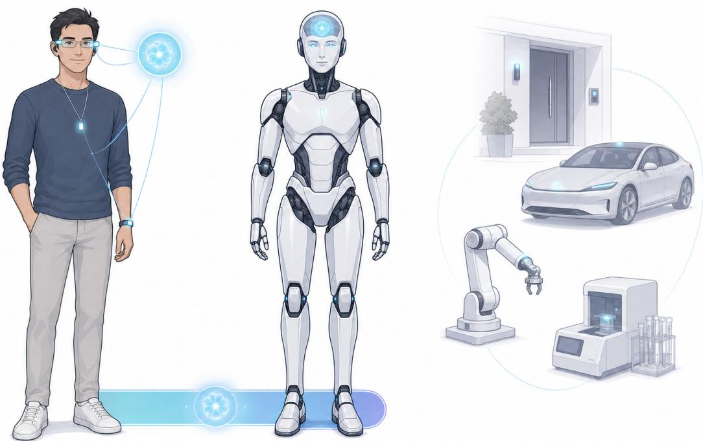  
Figure 4: Two forms of intelligent individuals. Left: an AI-augmented individual, a person with a symbiont that senses and speaks through wearable devices. Middle: an AI as individual, an embodied robot. The two share one cognitive core, indicated by the common bar. Right, in lighter tone: devices in the environment that either form can reach into (Section 14.2). The paper’s scope is the left form. “AI as individual” is a functional description and carries no claim about consciousness or legal personhood.

## 2.3 Eighty Years of the Same Question

Using machines to augment the human intellect is an old question, and Table 2 places the paper inside that lineage. Licklider (1960) imagined people and computers thinking together in real time; Engelbart (1962) made the unit of augmentation the person together with their tools and methods; Clark and Chalmers (1998) argued that cognition can extend into external tools; Weiser (1991) and the first wearable computing researchers (Starner et al., 1997; Mann, 1997) put computing into daily life and onto the body; and lifelogging, from Bush’s Memex (1945) through MyLifeBits (Gemmell et al., 2006) and SenseCam (Hodges et al., 2006), recorded a life and showed that the record could support memory. More recent neighbors are egocentric AI (Grauman et al., 2022; Yang et al., 2025), mixed-initiative interaction (Horvitz, 1999; Amershi et al., 2019), just-in-time adaptive interventions in mobile health (Nahum-Shani et al., 2018), the thought-partner program of Collins et al. (2024), and the lifecycle view of context engineering (Hua et al., 2025). For each line the table records what has been settled and what we ask next, and each of those questions is taken up in a later section. Our claim with respect to these lines is a narrow one: none of them has taken, as its target, the augmentation of a particular person across a life.

## 2.4 Why Now

Five conditions turn an eighty-year-old question into a tractable research problem, and each is developed in the next section. Foundation models understand language, images, and sound and can reason over them, so that a symbiont has, for the first time, a brain (Section 3.1). Agent technology lets a model plan, use tools, operate a computer, and run for a long time, so that it has hands (Section 3.2). Long-term memory, retrieval, and context management let it keep an understanding of one person across months and years (Section 3.3). World models let it begin to predict what the environment and the person will do next (Section 3.4). And wearable devices have matured to the point where first-person audio and video can be captured all day and a reply can be delivered to the ear with low latency, so that the symbiont can have senses and be present (Section 3.5). What has not changed matters equally: the social infrastructure of privacy and trust, the observability of inner states, the stability of continual learning, and the cost of computing around the clock. These are the sources of Sections 12 and 17.

## 3 Technical Foundations

A symbiont is built on technologies that already exist and are improving quickly. This section reads five of them for one purpose: to state, for each, what it already provides and what it still lacks. The gaps, collected in Table 3,

Table 2: Lineage and nearest neighbors. Each line of work has settled something this paper relies on, and the fourth column states the question we take up from it.
<table><tr><td>Line of work</td><td>Representatives</td><td>What it has already settled</td><td>What this paper asks next</td><td>Taken up in</td></tr><tr><td>1945Lifelogging</td><td>Bush (1945); Gemmell et al. (2006); Hodges et al. (2006)</td><td>recording a life, many views, memory support</td><td>how a record turns into understanding of a person and timely help</td><td>§6</td></tr><tr><td>1960 Human-computer symbiosis</td><td>Licklider (1960)</td><td>people and machines complementing each other in real time, thinking together</td><td>what symbiosis looks like once machines understand language and images</td><td>§8</td></tr><tr><td>1962 Augmenting intellect</td><td>Engelbart (1962)</td><td>the unit of augmentation is the person plus tools plus methods</td><td>how the research agenda changes once that unit is the object of evaluation</td><td>§17</td></tr><tr><td>1991 Ubiquitous and wearable computing</td><td>Weiser (1991); Starner et al. (1997); Mann (1997)</td><td>computing woven into daily life; the first-person viewpoint of wearables</td><td>what unnoticed computing can do once a model understands content</td><td>§5</td></tr><tr><td>1998 Extended mind</td><td>Clark and Chalmers (1998)</td><td>cognition can extend into tools outside the body</td><td>where the boundary lies for a tool that learns and takes initiative</td><td>§4</td></tr><tr><td>1999 Mixed-initiative interaction</td><td>Horvitz (1999); Amershi et al. (2019)</td><td>principles for when to act and when to wait</td><td>how these principles are rewritten for an all-day companion</td><td>§8</td></tr><tr><td>2018 Just-in-time adaptive interventions</td><td>Nahum-Shani et al. (2018)</td><td>the right intervention, at the right strength, at a receptive moment, for health behavior</td><td>extending the framework from health to cognition and social life, driven by a model of the person</td><td>§9</td></tr><tr><td>2022 Egocentric AI</td><td>Grauman et al. (2022); Engel et al. (2023); Yang et al. (2025)</td><td>understanding activity from first-person video; answering questions about the past</td><td>from seeing what you see to knowing what you are thinking and need</td><td>§7</td></tr><tr><td>2024 Thought partners</td><td>Collins et al. (2024)</td><td>AI should model the person and the world and think with them</td><td>putting joint thinking into real life, wearable hardware, and a lifelong timescale</td><td>§9.2</td></tr><tr><td>2025 Context engineering</td><td>Hua et al. (2025)</td><td>a lifecycle of collecting, managing, and using context; four stages of evolution</td><td>what the lifecycle needs when the context is a person&#x27;s life</td><td>§6</td></tr><tr><td>2026 Personal agent products</td><td>Meta (2026a); OpenAI (2026)</td><td>long-running, personalized, acting on your behalf</td><td>the step from doing things for you to thinking with you</td><td>§9.1</td></tr></table>

• The year chip marks the earliest representative work of each line. • The last column names the section that takes up the question.

are the research space of the rest of the paper. Figure 5 shows how the five lines stack up and where the layer this paper proposes sits. We keep to a few representative works per line, report no benchmark numbers, and end every subsection with what the line means for a symbiont.

## 3.1 Foundation Models

The brain of a symbiont comes from four steps in the development of foundation models. Scale came first: the Transformer (Vaswani et al., 2017), in-context learning at the scale of GPT-3 (Brown et al., 2020), and the scaling laws that made the next steps predictable (Kaplan et al., 2020; Hofmann et al., 2022). Alignment made the models usable by ordinary people in ordinary language (Ouyang et al., 2022), and GPT-4 (OpenAI, 2023) together with openly released weights (Touvron et al., 2023) spread the capability. Reasoning followed, from chain-of-thought prompting (Wei et al., 2022) to models that think before they answer (OpenAI, 2024b; Guo et al., 2025); this is what makes the slow loop of Section 8.2 possible. The fourth step is the one that matters most here. Multimodal and then omni-modal models took images into the language model (Radford et al., 2021; Alayrac et al., 2022; Liu et al., 2023), then speech and video in real time (OpenAI, 2024a; Gemini Team, 2024), then any-to-any input and output (Wu et al., 2024; Xu et al., 2025a), and full-duplex speech models learned to listen and speak at the same time (Défossez et al., 2024). Context windows of a million tokens made the inclusion of an entire day in the context window expensive rather than impossible. For a symbiont, omni-modality is a requirement: its input is a first-person stream of sight and sound and its output is a whisper or a line of text, and a model that only reads and writes text never reaches the scene. What foundation models lack can be stated with equal precision. They have no persistence, since each conversation starts from nothing; no sense of time; no body; and they are trained on the average person and know nothing about the one in front of them. Sections 6, 8, 5, and 7 answer these four gaps in turn.

## 3.2 Agents and Harnesses

An agent is a model system that repeatedly observes, thinks, and acts toward a goal. A harness is everything outside the model that turns it into an agent: the loop itself, tool interfaces, memory, context management, planning and decomposition, permissions and sandboxing, verification of results, and reusable procedural knowledge, often called skills. The same model placed in diferent harnesses performs very diferently, a fact that recurs across published results on coding agents, and it makes the harness a research object in its own right. The line of work runs from interleaving reasoning with action (Yao et al., 2023), learning to call tools (Schick et al., 2023), and reflecting on failure (Shinn et al., 2023), to agents that build a library of reusable skills (Wang et al., 2024), which is an early precedent for a harness that improves itself (Section 10.4). Generative Agents gave agents a memory stream, reflection, and planning (Park et al., 2023), which remains the closest academic prototype of an agent with a life, and CoALA organized these components in the language of cognitive architectures (Sumers et al., 2024). On the engineering side, Anthropic’s guide to building agents argued for simple, composable patterns and for the agent–computer interface as something to be designed (Schluntz and Zhang, 2024); SWE-agent showed that an interface built for the agent changes its performance (Yang et al., 2024); computer-use agents learned to operate any desktop or web page (Anthropic, 2024a; OpenAI, 2025b); the Model Context Protocol standardized tool access (Anthropic, 2024b); and coding agents such as Claude Code and Codex became the first autonomous agents in large-scale daily use (Anthropic, 2025; OpenAI, 2025a). In 2026 Muse and Dots pushed agents into personal life, and the Muse Gadget SDK for embedded platforms is a sign that agent platforms are reaching into devices (Meta, 2026a,b; OpenAI, 2026). The benchmarks of the field all score task completion (Zhou et al., 2024; Xie et al., 2024; Jimenez et al., 2024; Yao et al., 2025; Mialon et al., 2024).

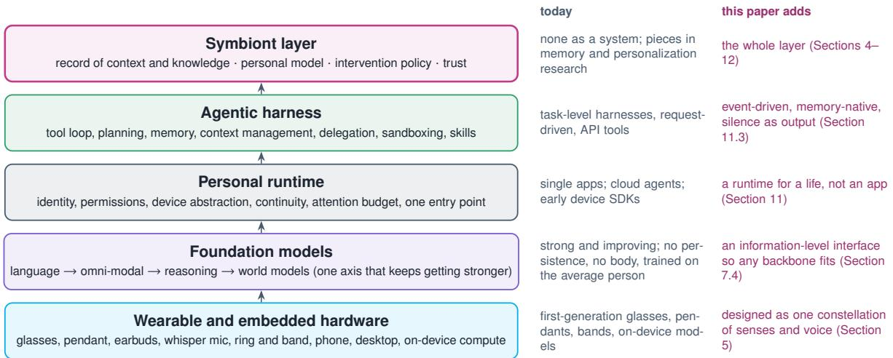  
Figure 5: The stack a symbiont is built on. From the bottom: wearable and embedded hardware, foundation models (one axis that runs from language to omni-modal to reasoning to world models), the personal runtime, the agentic harness, and the symbiont layer that this paper proposes. The side notes record what exists today and what the paper adds at each level.

For a symbiont this line provides hands. Booking a trip, buying something, handling a desktop, writing code: today’s agents can already do these, and a symbiont delegates such work through its harness (Section 9.1). Beyond delegation, a symbiont is a new kind of harness, one organized around a life instead of a task (Section 11.3). Today’s harnesses are task-level: they have a beginning and an end, they are driven by requests, their tools are APIs, their memory is scoped to the task, and their score is completion. They have no body, no first-person senses, no model of the person, and no output that means “do nothing.” Sections 8, 9, and 11 take up these gaps.

## 3.3 Memory, Context, and Personalization

Three kinds of work let a model remember a person. Memory systems grew from retrieval-augmented generation (Lewis et al., 2020) to MemGPT, which brought the tiered storage of an operating system into the model (Packer et al., 2023); to the memory stream and reflection of Generative Agents (Park et al., 2023) and MemoryBank (Zhong et al., 2024); to A-MEM, which lets memories link to one another and evolve (Xu et al., 2025b); to Mem0, a production-oriented long-term memory layer (Chhikara et al., 2025); and to sleep-time compute, which organizes memory while the system is idle (Lin et al., 2025). LoCoMo and LongMemEval measure long-conversation memory (Maharana et al., 2024; Wu et al., 2025). Context management is the second kind: Context Engineering 2.0 describes a lifecycle of collecting, managing, and using context, and observes that the practice is shifting from prompting a model toward managing everything a long-running system knows (Hua et al., 2025); long context, cache compression, hierarchical summaries, and on-demand loading are the engineering means. Personalization is the third: LaMP measures generation tailored to a user (Salemi et al., 2024); parameter-eficient adaptation makes a small module per user feasible (Hu et al., 2022); test-time training and its descendants change weights during use (Sun et al., 2020, 2025; Behrouz et al., 2025); and the continual-learning literature deals with forgetting.

These are the direct foundation of Section 6 and the toolbox of Section 10, and this paper does not require a new memory mechanism. What the line lacks follows from what it remembers, which is dialogue rather than a life. There is no first-person stream of sight and sound, no physiology, no distinction between what the person said and what the system inferred (Section 7.2), no views that switch with the question (Section 6.4), no distinction between short-lived context and settled knowledge (Section 6.1), no consistent treatment of forgetting and deletion (Section 6.5), and the personalization it ofers optimizes for sounding like the person, which is a diferent thing from understanding them (Section 10.1).

## 3.4 World Models

A world model is an internal model that predicts what happens next. One thread comes from reinforcement learning, where World Models and the Dreamer family plan in imagination (Ha and Schmidhuber, 2018; Hafner et al., 2020, 2025). A second is the predictive-representation route of JEPA and V-JEPA 2 (LeCun, 2022; Assran et al., 2025). A third is generative world simulation at the pixel level: Genie and Genie 3, Sora, and Cosmos (Bruce et al., 2024; Parker-Holder and Fruchter, 2025; Brooks et al., 2024; NVIDIA, 2025). A fourth is first-person data, which makes the world as seen through a person’s eyes a learnable object: Ego4D (Grauman et al., 2022), Project Aria and its second-generation research glasses (Engel et al., 2023; Meta, 2025a), and EgoLife (Yang et al., 2025). A parallel thread models people. Large foundation models show real but brittle theory-of-mind ability (Kosinski, 2024; Ullman, 2023; Strachan et al., 2024). Park et al. (2024) built a generative agent for each of 1,052 real people from a two-hour interview and found that the agents reproduced their participants’ survey answers about as well as the participants reproduced their own answers two weeks later; it is the strongest evidence to date that a predictive model of a particular person can be built from a small amount of first-person narrative. Mental world modeling treats beliefs, intentions, and other mental variables as part of the world state itself (Fei and Zhao, 2026), which is the position this paper adopts for the mental side of the personal model (Section 7.5). For a symbiont, world models provide the ability to think ahead: to predict what is about to happen around the person (an external, physical world model) and how the person will think, feel, and react, including to a reminder (an internal, mental world model). Sections 7.4 and 7.5 show how both enter the personal model and why the system still stands, in a degraded form, without them. Today’s world models are third-person, short-horizon, and built once; the models of people are built from a single interview, never updated, and unable to tell that they have gone stale.

## 3.5 Wearable and Embedded Hardware

In three years the hardware conditions for senses and presence have changed in four places. On the head, Ray-Ban Meta glasses showed that ordinary people will wear a camera and microphones all day (Meta, 2023); the Orion prototype and Meta Ray-Ban Display added a display (Meta, 2024, 2025b), lightweight display glasses such as the Even G1 appeared (Even Realities, 2024), and Project Aria serves as a research platform (Engel et al., 2023). On the body, pendants and recorders capture all-day audio (Mehta, 2024; Silberling, 2025; Plaud, 2024), rings and bands capture physiology, and Meta’s surface-EMG wristband, published in Nature, trains a generic model on data from thousands of people so that a new wearer can type and gesture with no calibration, and twenty minutes of personal data improve it further (Kaifosh et al., 2025). This is a ready-made example of a generic model with a small personal adaptation on the input side, and Section 10.3 returns to it. Closer to the body, AlterEgo reads the muscle signals of silent, deliberate speech (Kapur et al., 2018), and brain–computer interfaces, noninvasive (Lévy et al., 2025) and implanted (Willett et al., 2023; Card et al., 2024), remain in research and early clinical stages. In compute, neural accelerators in phones and glasses, together with quantization and distillation, run billion-parameter models on the device (Gunter et al., 2024); low-power always-on event detection is the premise of the duty cycle in Section 5.5; and full-duplex speech models make listening while speaking feasible in latency. The counterexamples are instructive as well: the Humane AI Pin, a dedicated assistant device launched in 2024, was discontinued within a year (Zef, 2025), which suggests that a new device has to ofer something the phone in the person’s pocket does not. The first generation of senses, private output, and local compute therefore exists, and Section 5 can discuss design. What is missing can be listed: battery and heat limit what “all day” means, display glasses are far from a shared canvas, there is no mature model from physiology to mental state, silent speech and neural interfaces are at an early stage, and above all no device has been designed as one sense of one symbiont, since each is a separate product.

## 3.6 What Is Still Missing

Table 3 collects the five lines, what each gives, and what each lacks, and maps every gap to the section that addresses it. The five lines are each growing stronger, and none of them has, as its goal, the augmentation of one particular person. Organizing them toward that goal is the task of the conceptual framework in the next section.

Table 3: Five lines of technology, what each already gives a cognitive symbiont, and what it lacks. The last column maps every gap to the sections that address it; the gaps are the research space of Part II.
<table><tr><td>Line of work</td><td>Representative work</td><td>What it gives a symbiont</td><td>What it still lacks</td><td colspan="3">Answered in</td></tr><tr><td>Foundation models</td><td>GPT-3/4, Llama, o1, R1, GPT-4o, Gemini, NExT-GPT, Qwen-Omni, Moshi</td><td>a brain that understands language, images, and sound, and reasons; omni-modal input</td><td>no persistence, no sense of time, no body; trained on the average person</td><td>§6 §5</td><td>§7</td><td>§8</td></tr><tr><td>Agents and harnesses</td><td>ReAct, Reflexion, Voyager, Generative Agents, CoALA, SWE-agent, computer use, MCP, Claude Code, Codex,</td><td>and output hands: planning, tool use, computer operation, long-running tasks; general-purpose task ability</td><td>task-level and request-driven; no senses; no model of the person; no “do nothing&quot; output</td><td>§8 §9.1</td><td>§11.3</td><td></td></tr><tr><td>Memory and context</td><td>Muse, Dots RAG, MemGPT, A-MEM, Mem0, sleep-time compute, Context Engineering 2.0, LoRA, test-time training</td><td>memory across sessions; a context lifecycle; a toolbox for personalization</td><td>remembers dialogue, not life; no split between self-report and inference; no multi-view record; no context/knowledge</td><td>§6 §7.2</td><td></td><td>§10</td></tr><tr><td>World models</td><td>Genie, Cosmos, Ego4D, Aria, EgoLife; theory-of-mind studies; 1,000-person simulations; mental world</td><td>World Models, Dreamer, JEPA, prediction of what the environment and the person will do next</td><td>third-person, short-horizon, one-shot modeling of people; cannot detect that it has gone stale</td><td>§7.4</td><td>§7.5</td><td>§7.6</td></tr><tr><td>O Wearable and embedded hardware</td><td>modeling Ray-Ban Meta, Ray-Ban Display, sEMG band, Aria, AlterEgo, on-device models, full-duplex speech</td><td>wearable senses, private output, battery, display, interpretation local compute</td><td>of physiology; devices are separate products, not one set of senses</td><td>§5 §11.4</td><td></td><td></td></tr></table>

• Badges mark the stage of the symbiosis loop (Figure 6) that each line mostly serves: 4 sense and interact, õ keep, j understand, Ü live alongside, à grow.

## 4 Conceptual Foundations

This section gives the vision a theoretical shape. We first define the objects, then state the invariant that runs through the paper, then list the properties a symbiont must have and test them against the fictional reference everyone knows, and finally draw the map that organizes the research space. The pattern throughout is definition, formalization, example.

## 4.1 Definitions

Five definitions turn the slogan “an AI that knows you better than you know yourself” into a claim that can be examined and disputed.

Definition 4.1: Self-context The self-context of a person ℎ at time �, written $C _ { t } ^ { h } .$ , is the set of all facts bearing on their situation: what they have experienced, what they know, what they have committed to, whom they are related to and how, the state of their body, where they are, and what they are doing. It has three parts: what can be observed from outside, $O _ { \leq t } ;$ what the person has said themselves, $R _ { \leq t } ;$ and what can be inferred from the two, $K _ { t }$

Definition 4.2: Working context At any moment, the part of $C _ { t } ^ { h }$ that ℎ can actually bring to bear is a small subset $c _ { t } \subset C _ { t } ^ { h }$ , limited by working memory, attention, time, and emotion.

Definition 4.3: Cognitive gap For a concrete situation $x _ { t } ,$ , with � the outcome the person achieves in it,

$$
G _ { t } \ = \ U \Big ( x _ { t } ; C _ { t } ^ { h } \Big ) \ - \ U \big ( x _ { t } ; c _ { t } \big ) ,\tag{1}
$$

the diference between what the person could achieve with their whole self-context and what they achieve with the small part they can hold at the time.

The cognitive gap is the invariant of the paper. It measures something other than intelligence: the price every person pays, every day, in what they forgot, failed to notice, could not think through, or could not put into words. A researcher who, writing a new paper, cannot recall an argument she made in a blog post three years ago is paying it, and so is a parent who snaps at a child because the sleepless night is not in working memory as an explanation. The job of a symbiont is to shrink $G _ { t } \colon$ to return to the person, at the right moment, the part of their own context that is out of reach. Mind reading is not required; what is required is that the right slice of $C _ { t } ^ { h }$ be placed into $c _ { t }$ , or that the reasoning or the errand the person would have undertaken, given the time, be carried out on their behalf.

Table 4: Six properties of a cognitive symbiont, and the Jarvis test. Each property is necessary; the third column says what fails without it. The properties pull against one another (proactive against low-friction, lifelong against private), and those tensions are the research problems of Sections 8 and 12.
<table><tr><td>Property</td><td>Meaning</td><td>What breaks without it</td><td>Jarvis</td><td>Personal agents today</td><td>Sections</td></tr><tr><td>D Lifelong</td><td>one relationship and one memory kept across years</td><td>every session starts from zero; the gap cannot close</td><td>一</td><td>0</td><td>§6 §10</td></tr><tr><td>Embedded</td><td>present in real activity, not waiting in a chat window</td><td>help can only happen afterwards</td><td>√</td><td>x</td><td>§5 §11</td></tr><tr><td>Real-time</td><td>steps in while the activity is still going and help is still useful</td><td>the right words at the wrong time are no words</td><td>√</td><td>X</td><td>§8</td></tr><tr><td>Private</td><td>what passes between the person and the symbiont stays theirs, and its delivery can be discreet where the setting allows</td><td>the person cannot confide in it, and every cue disturbs the people nearby</td><td>√</td><td>0</td><td>§5 §8</td></tr><tr><td>Low-friction</td><td>never asks you to stop, take out a phone, or explain the background</td><td>the cost of use eats the benefit</td><td>√</td><td>x</td><td>§8 §11</td></tr><tr><td>Proactive</td><td>can judge whether to speak when you have not asked</td><td>you do not ask about what you do not know you are missing</td><td>√</td><td>0</td><td>§8</td></tr></table>

• ✓ has the property  partly (memory across sessions, a phone that must be taken out, notifications) ✗ lacks it. • The Jarvis column is argued in the vignette Beyond Jarvis.

Definition 4.4: Cognitive symbiont A cognitive symbiont is an AI system � that (i) exists continuously across the life of a person $h ;$ (ii) maintains, from authorized observation and from ℎ’s own statements, a model $M _ { t } \approx C _ { t } ^ { h }$ of $h \mathrm { { s } }$ world; (iii) is present during ℎ’s ongoing activities through a private, two-way channel; (iv) at each moment chooses one way of taking part from {silence, hint, suggestion, question, action on ℎ’s behalf} so as to reduce $G _ { t } ; ( \mathbf { v } )$ learns from outcomes; and (vi) leaves final judgment and goals with ℎ.

Condition (vi) is also where this paper draws the boundary that the extended mind (Clark and Chalmers, 1998) leaves open for a tool that learns and takes initiative: the symbiont extends what the person can bring to a situation, and judgment and goals stay with the person.

Definition 4.5: Augmented individual The augmented individual ℎ ⊕ � is the unit of evaluation of this paper, with the augmentation gain in a situation defined as

$$
\Delta _ { \mathrm { a u g } } ( x _ { t } ) = U ( x _ { t } ; h \oplus s ) - U ( x _ { t } ; h ) .\tag{2}
$$

The definitions settle the boundary with AGI in one line: AGI raises $U ( \cdot ; s )$ , and AHI raises $U ( \cdot ; h \oplus s )$ . Two cautions apply to the notation. � is a situation-specific outcome and is never summed across situations, and ⊕ marks a coupling condition rather than an arithmetic operation. The formulas serve to remove ambiguity, and no theorem is derived from them.

## 4.2 Six Properties and the Jarvis Test

Table 4 lists six properties a symbiont must have. Four of them, private, real-time, low-friction, and embedded, come directly from what makes the system usable in the middle of a life; lifelong and proactive are added because without the first the gap cannot close across time, and without the second the person cannot ask about what they do not know they are missing. The properties pull against one another: being proactive conflicts with being low-friction, and being lifelong conflicts with being private. Those tensions are exactly the research problems of Sections 8 and 12. “All day” is read throughout as availability, never as continuous computation (Section 5.5).

## Beyond Jarvis

What Jarvis already is. Jarvis passes all six properties. It has known its owner for years (lifelong); it lives in the laboratory, the house, and the suit (embedded); it reports and warns during combat (real-time); the voice inside the helmet is heard by its owner alone (private); it never asks him to stop and type or explain (low-friction); and it speaks up about incoming threats, energy, and injuries unasked (proactive). Where a symbiont goes beyond it. (1) Senses. Jarvis sees through infrastructure its owner built; a symbiont sees through a few afordable wearables, with channels Jarvis never had (Section 5). (2) Mind. Jarvis knows schedules, systems, and the battlefield, while the center of gravity of a symbiont i the owner’s goals, emotions, and blind spots (Section 7). (3) Cognitive help. Jarvis executes and alerts; it rarely helps its owner make a life decision, recover from a setback, or deal with people and cultures, which is where a symbiont is most distinctive (Sections 9.2 to 9.5). (4) Growth. Across the films Jarvis’s understanding of its owner barely changes; a symbiont must understand the person better the longer the two live together, and the whole system must evolve with it (Section 10). (5) Everyone. Jarvis is one person’s bespoke system; a symbiont is a paradigm for all (Section 13). (6) Trust Jarvis’s loyalty is given by the script; a symbiont’s must be given by the architecture (Section 12). The subject of this paper is everyone’s Jarvis, six steps further on.

## 4.3 The Symbiosis Loop

Figure 6 is the map of the research space and the table of contents of Part II. The person sits at the center. Around them runs a loop: sense and interact (borrowed senses, borrowed voice, and digital traces), keep (live context, working state, and lifelong knowledge), understand (a model of the person’s situation, mind, relations, and goals, built on a replaceable backbone), live alongside (real-time, private, proactive participation, with silence as one of the formal outputs), actfor and think with (the ladder of help from errands to thinking to social life, the help stage for short), and grow (learning from outcomes and updating the record, the model, the policy, and eventually the whole stack). Beneath the loop is the runtime that makes it run across devices and time; around it is trust, which governs authorization, privacy, correction, and exit. One feature of the figure is deliberate: the person’s own words enter the record directly, without passing through inference. Of the technology lines in Section 3, agents and memory research cover mostly the keep stage and the errand end of the help stage. The weakest stages are the mental layer of understanding, the timing of participation, online learning and whole-stack evolution, and the treatment of trust as architecture. The figure is a conceptual map rather than a system architecture, and it does not require a monolithic implementation.

## 4.4 Scope and Non-Claims

The paper does not claim that an AI can read thoughts that were never expressed; that everyone should wear devices all day; that a complete context is a precondition for the system to work (Section 12.2 shows it must be useful under partial context); that a symbiont outperforms the person in every domain; that the four roles of Section 2.1 are inevitable historical stages; that any one foundation model, or any one way of organizing a system around it, is the only correct backbone (Section 7.4); that it proposes a form of foundation model or a route to general intelligence (Section 1.1); that a symbiont raises a trait such as intelligence or emotional skill (Section 15.3); that its use is legitimate in every setting (Section 16.2); or that any interface standard or protocol should be adopted. It claims that this is a research direction worth organizing on its own, with its own invariant, properties, design space, and standard of evidence.

# Part II

# The Anatomy of a Symbiont

Part II follows the symbiosis loop of Figure 6 once around the person, and each of its sections takes the output of the previous one as its input. Section 5 asks what the symbiont senses the person with and what it speaks through, since it has no body of its own. Section 6 turns the resulting streams into a record with three timescales, one entry point, and many views. Section 7, the technical center of the paper, asks how that record becomes an understanding of the person’s situation and mind, on a backbone that can be replaced. Section 8 turns understanding into participation at the right moment, with silence as a formal output. Section 9 says what the symbiont does once present, on a ladder from errands to thinking to social life. Section 10 asks how the system and the person change over many rounds, up to the evolution of the whole stack. Beneath the loop, Section 11 describes the runtime on which all of this runs, and around it, Section 12 treats trust as part of the architecture.

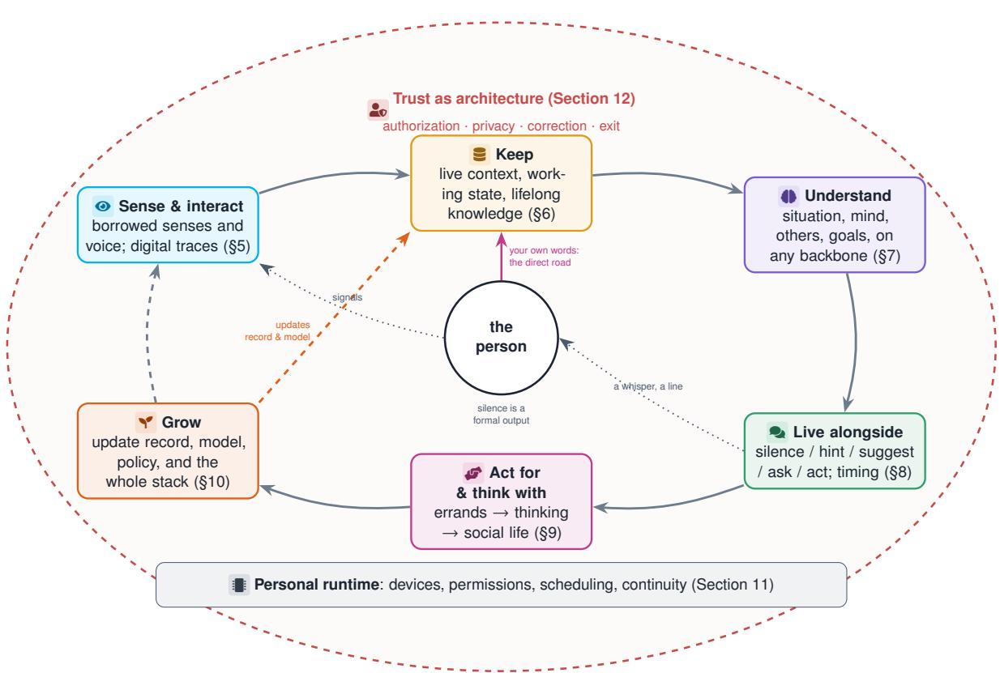  
Figure 6: The symbiosis loop. Six stages run around the person; the runtime beneath them makes the loop run across devices and time, and trust encloses everything. The person’s own words enter the record directly. Silence is drawn as a formal output, and acting for and thinking with share one stage.

## 5 Sensing and Interacting

The loop of Figure 6 opens with the question of what the symbiont senses the person with and what it speaks to them through. Hardware here is the symbiont’s borrowed body: borrowed senses on the way in, a borrowed voice and a borrowed canvas on the way out. The borrowed hands, devices in the environment, wait until Section 14.2.

## 5.1 Borrowed Senses, Borrowed Voice

An embodied robot comes with eyes, ears, and a mouth. A symbiont has none of its own and must borrow three things: the sensors on a person’s body, so that it sees what they see and hears what they hear; the person’s digital traces on screens, in documents, in code, and in messages; and a channel of output that only the person receives, a voice in the ear, a line in the glasses, a picture laid over the world. Its perception is therefore first-person, incomplete, and moving with the person, and its speech is close to the ear, short, and tied to the setting the person is in. The quality of the senses sets the ceiling on understanding and the quality of the voice sets the floor on help, and neither is the goal in itself. This is also the sense in which hardware and AI are the same project, which Section 5.6 develops.

## 5.2 The Device Constellation

No single device can carry all of this, so a symbiont senses and speaks through a constellation (Figure 7): glasses with a first-person camera, microphones, eye tracking, and a one-line display; a pendant or pin that records audio and takes snapshots all day and stands in when glasses are not worn; earbuds or bone conduction for private voice output; a microphone close to the mouth so that the person can speak to it at the level of a breath without being overheard; a ring, watch, or band for heart rate, sleep, and activity, and increasingly for EMG gestures; a phone for compute and a screen on the move; and a desktop with authorized access to screen content, the IDE, documents, and meeting software. Each device carries a role on the way in, on the way out, or both, and a runtime (Section 11) manages them as one. Table 5 lists the signal sources and what each reveals about the physical and the mental side of a life.

Two further classes of device belong in the constellation even though they are not yet in daily use, and the first of them may become the most valuable wearable of all. Neural interfaces read the body’s own signals of intention and attention. At the surface of the body, EMG wristbands already decode the motor commands behind typing and gesture (Kaifosh et al., 2025), and electrodes in a headband or around the ear record the electrical activity of the brain, in many studies with results comparable to scalp recording (Kaongoen et al., 2023); implanted interfaces, now in early clinical trials, decode attempted speech at far higher fidelity (Willett et al., 2023; Card et al., 2024). For a symbiont these interfaces matter for a specific reason. They are the channel through which a deliberate command could one day reach the symbiont without being spoken, typed, or acted out, at a lower cost to the person than any other channel. What they may read is held to the rule of every input channel (Section 5.4): commands the person directs to the symbiont, with states such as attention or fatigue read only under separate authorization. They are also the channel in which the privacy of thought (Section 12.4) is at its most literal, so the paper places them at the far end of the constellation, with the highest ceiling and the strictest conditions, and treats their maturation as part of the hardware problem of Section 17.4. The second class is the environment itself: cameras and microphones in the home, the cabin sensors and head-up display of a car, the instruments of a laboratory, eye-tracking contact lenses, haptic garments, and medical implants such as continuous glucose monitors. These enter the constellation on the same terms as the wearables, each with a role on the way in or out, separate authorization, and management by one runtime, and they are where the symbiont’s senses turn into reach (Section 14.2). We therefore treat the full list of modalities in three tiers. Sight, sound, text, and digital traces are the bulk of what is usable today; physiology, motion, and gaze are collectable now and need research into their interpretation; and neural signals run from available, in surface EMG, through research, in non-invasive recording, to distant, in implanted interfaces, with the chemical senses furthest of all. “Omni” means that whatever signal arrives can be used; it does not require that every signal be collected.

## 5.3 Channels Out

How the symbiont speaks to the person decides whether it can be used at all in a given setting, so output deserves the same attention as input. Table 6 lists the channels, from a word in the ear to a picture projected into a room. Three design rules follow. The strength of a message must match the setting: a line of text in a meeting, a sentence while walking, an expanded answer when the person is alone; and since the choice of channel is part of how the symbiont helps, it is one of the decision variables of the intervention policy in Section 8.4. A private channel and a shared canvas are diferent instruments: the first lets the person receive help among people without disturbing them, the second lets the person and the symbiont, or the person and other people, look at the same picture and think about it together, and this second instrument, Jarvis’s holographic table, earns its place in collaboration and explanation. And every channel must support retraction and update: a cue that expires before delivery should never appear, and one overtaken by new information must be withdrawn (Section 8.2). The AR overlay deserves separate mention, because it is where the symbiont can draw its understanding onto the world the person sees: a name and the last topic discussed next to the person in front of them, the paragraph relevant to what they are thinking highlighted on the document on the desk, a route laid over a street in a city they do not know. Current single-eye displays with small fields of view make the first of these feasible today, and wide-field lightweight AR remains a research problem.

## 5.4 Private Channels

Privacy, as a property, has two parts that the design keeps apart: what passes between the person and the symbiont belongs to the person, and its delivery can be discreet, so that the person can speak to the symbiont and hear from it without disturbing anyone nearby. On the way in, this means a breath-level microphone, very short gestures (an EMG band removes the need to raise a hand), and typed text; silent speech from muscle signals and neural interfaces lie further out, and the boundary we keep is the one AlterEgo marks, since it reads what a person deliberately subvocalizes and nothing else (Kapur et al., 2018), a rule that binds a neural interface as much as a microphone. On the way out, it means in-ear voice, a line in the glasses, and haptic cues, with strength and content matched to the setting. Three requirements that sound alike must be kept apart. That the content of the exchange stays the person’s is what the paper requires. That its delivery is discreet is a capability whose use follows the setting: where a setting presumes unaided performance or the sincerity of what is said, as an examination, a negotiation, or an apology does, whether the person is being assisted becomes a declarable fact, and declared presence is the default there (Sections 16.1 and 15.5). That a device record other people without their knowledge is what the paper rejects, and Section 12.5 sets the rules.

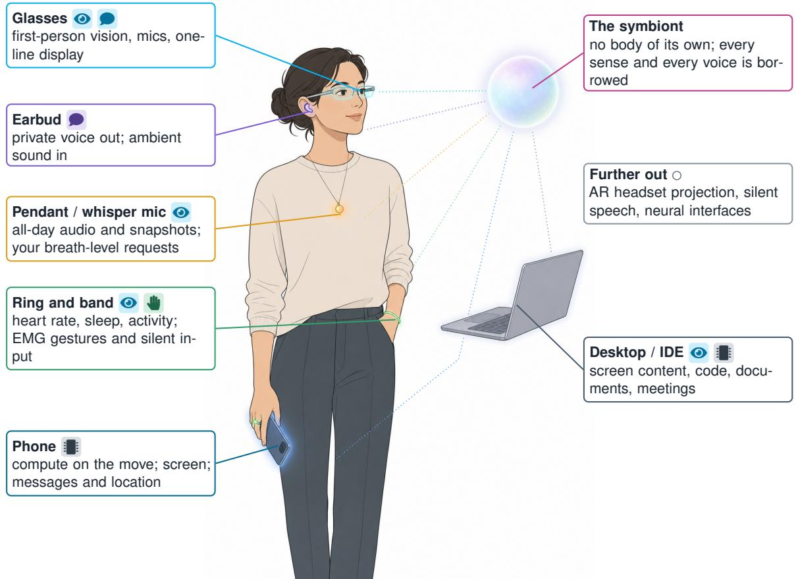  
Figure 7: The device constellation. Each device carries a role on the way in (sensing, private input) or on the way out (private output, shared canvas), and often both; a runtime manages them as a single set of senses. The symbiont itself has no body and borrows every one of them. Neural interfaces and the devices of the environment are the far end of the constellation.

## 5.5 Always On

Companionship around the clock translates into a system requirement of availability: the symbiont can be reached and can pick up at any moment, which is a diferent thing from computing at full load at every moment. Battery life and latency are the two hard constraints, and the design that reconciles them is a cognitive duty cycle. Most of the time only lightweight event detection runs: someone says the person’s name, a meeting begins, their stress rises, they whisper. An event wakes heavier computation, and the quiet hours of the night are used for ofline consolidation (Section 6.3). The structure mirrors human attention, which is also not continuous. It yields three research quantities: the recall and false-alarm rate of event detection, the latency budget from an event to a useful cue, and the daily energy and thermal budget. Low latency has to be written as an end-to-end budget: how many milliseconds each stage may take from sensor to model to ear, which stages can run on the device and which must go to the cloud, and which can be prepared in advance so that the fast loop of Section 8.2 finds its material ready. The duty cycle is also the first answer to the concern that round-the-clock AI depends on enormous compute; it turns the concern into an engineering quantity, and Section 11.4 completes the argument.

Table 5: Signal sources and what each reveals about the physical and the mental side of a life. “Omni” means the system can take whatever signal arrives; it does not mean every signal must be collected. The two sides of the table anticipate Section 7.1; the last column is the horizon on which each source becomes usable.
<table><tr><td>Source</td><td>Modality</td><td>Physical side: what it reveals Mental side: what it reveals Wearing and</td><td></td><td>privacy burden</td><td>Horizon</td></tr><tr><td>G Glasses camera</td><td>V vision</td><td>what you are doing</td><td>where you are, whom you see, where your attention falls</td><td>• • • bystanders</td><td>●</td></tr><tr><td>Microphones</td><td>A audio</td><td>conversation content, environment</td><td>tone, hesitation, cues to emotion</td><td>一</td><td>●</td></tr><tr><td>Whisper mic</td><td>w private speech</td><td></td><td>the thoughts and requests you choose to voice</td><td>●○○</td><td>●</td></tr><tr><td> Eye tracking in glasses</td><td>E gaze</td><td>you read</td><td>what you are looking at, what attention, interest, hesitation</td><td>O</td><td>0</td></tr><tr><td>Physiology (ring, watch, hearables, implants)</td><td>sensing P</td><td>sleep, movement, heart rate, glucose</td><td>indirect cues to stress and fatigue</td><td>O</td><td>0</td></tr><tr><td>EMG band</td><td>gesture, G writing</td><td>what you are operating</td><td>commands you give deliberately</td><td>0 0</td><td></td></tr><tr><td>Neural interface (headband, in-ear EEG, implant)</td><td>N neural</td><td>motor intent</td><td>commands the person directs to it; attention and load only under separate authorization</td><td>• thought data</td><td>010</td></tr><tr><td>Desktop and phone</td><td>D digital traces</td><td>what you are working on, whom you contact</td><td>the problem you are thinking about, unfinished business</td><td>• • work secrets</td><td>●</td></tr><tr><td> Motion and location</td><td>M inertial, position</td><td>routes, habits</td><td>daily rhythm</td><td>● 0</td><td>●</td></tr><tr><td>Environment (home, car, laboratory, workplace)</td><td>S surroundings</td><td>who is present, the state of the routines room, the vehicle, the instrument</td><td></td><td>• bystanders</td><td>●</td></tr></table>

• Burden: low medium high; the note names who carries it. • Horizon: usable now research distant. • Modality letters: V vision, A audio, W whispered speech, E gaze, P physiology, G gesture, N neural, D digital traces, M motion, S surroundings.

Table 6: Channels out, and when each fits. The private channels (first three rows) deliver help to the person alone, discreetly where the setting allows; the shared canvas (last row) lets the person and the symbiont, or the person and other people, look at the same picture. Jarvis’s holographic table belongs to the last row.
<table><tr><td>Channel out</td><td>Form</td><td>Fits</td><td>Carries</td><td>Noticed by others</td><td>Status</td></tr><tr><td>In-ear voice</td><td>a sentence, a word</td><td>walking, alone, driving</td><td>o</td><td>x</td><td>●</td></tr><tr><td>6∂ A line on the glasses</td><td>a name, a number, a cue</td><td>meetings, conversation, social settings</td><td>O</td><td>x</td><td>●</td></tr><tr><td>Haptics</td><td>a rhythm of vibration</td><td>anywhere the lowest interruption is required</td><td>O</td><td>x</td><td></td></tr><tr><td>Phone or desktop screen</td><td>expanded content</td><td>when you are sitting down</td><td></td><td>0</td><td>●</td></tr><tr><td>© AR overlay</td><td>annotations on real objects and people, routes, translations</td><td>when you and it must look at the same thing</td><td></td><td>0</td><td>0</td></tr><tr><td>Spatial projection, shared canvas</td><td>one picture you, it, and others can all see</td><td>collaboration, explanation, review</td><td></td><td></td><td>O</td></tr></table>

• Carries: a cue or a word a sentence expanded content. • Noticed by others: ✗ no partly or depends ✓ yes. • Status: available now research prototypes far of.

## 5.6 Co-Evolution of Hardware and Models

The form of the senses will change with the capability of the models, and the training targets of the models will change with new senses. From today’s recorders and glasses to EMG bands, silent speech, and eventually neural interfaces, each step makes it easier for the AI to understand what a person has in mind, and each step raises the level of privacy at stake. Two judgments follow from the recent record. A dedicated device that adds little to the phone does not last, as the AI pin of 2024 did not (Zef, 2025), and a cognitive core without the right hardware never reaches the scene. Hardware and the core are one design problem, and Section 10.4 treats a change of device as one of the ways the whole stack evolves: the person changes their glasses, and their symbiont is still theirs.

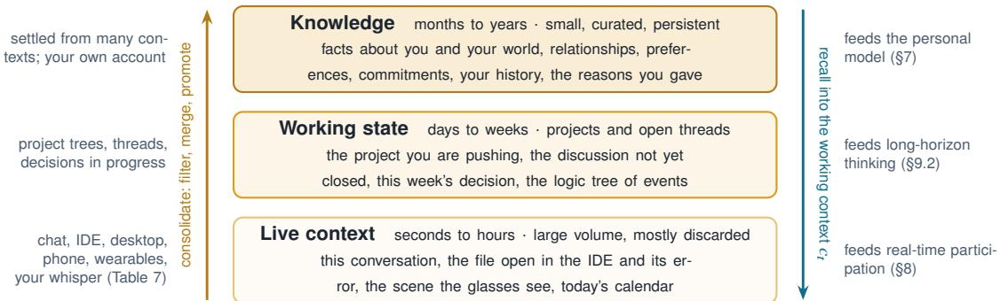  
Figure 8: Three timescales of one record. Live context is large and mostly discarded, working state holds projects and open threads for days to weeks, and knowledge is small, curated, and persistent. Consolidation moves material up; recall moves the right slice down into the working context $c _ { t }$ of Definition 4.2.

## 6 Personal Context and Lifelong Knowledge

The senses of Section 5 deliver streams. This section asks how streams become something a symbiont can use: the live context of what the person is doing now, and the knowledge that stays valid across years. The two words are not interchangeable. Knowledge is what has settled; context is what is current, from the project the person is working on this week to the scene the glasses see this second. Both must be kept, and the claim that organizes the section is that one entry point has to receive all of a person’s context, work and life together, for the picture of the person to be rich enough for cognitive-level help.

## 6.1 Three Timescales of One Record

Context is information relevant to what the person is doing now. It is short-lived, high-volume, and mostly discarded once used: where this conversation has got to, which file is open in the editor and which error it stopped on, what the glasses can see and who is present, what is on today’s calendar. Knowledge is what has settled out of many contexts and stays relevant across them. It is long-lived, curated, and comparatively small: facts about the person and their world, relationships, preferences, commitments, their history, the reasons they gave for things. Between the two lies a third layer, working state, which lives for days or weeks: the project being pushed forward, the discussion that has not been closed, the decision due this week. The project tree in which events and projects organize one another belongs here. Two flows connect the three layers (Figure 8). Consolidation moves material upward, from context to working state to knowledge, through the filtering and merging of Section 6.3. Recall moves material downward, placing the right slice of knowledge into the context of the moment, which is exactly the step from $C _ { t } ^ { h }$ to $c _ { t }$ in Definition 4.2. When one word is needed for the whole we write the record.

The word context is also used for the input window of a language model, and in context engineering it refers to the information given to a model so that the model can complete a task (Hua et al., 2025). Personal context, as used here, is information about the person that is valid now, and its lifecycle serves a person’s life. The two meet at the recall step: injecting personal knowledge into a model’s context window is an act of context engineering. We borrow the lifecycle view and nothing else.

## 6.2 One Entry Point for Every Context

Table 7 lists the sources of personal context and what each sees on its own. Each sees a partial person. A chat assistant knows someone who asks questions, a coding assistant knows a programmer, a desktop agent knows someone at work, and a band knows a body with a heart rate. Questions that matter for cognitive-level help cross these boundaries: why the person was unproductive in the editor this morning (they slept five hours and the first meeting went badly), how this decision relates to the one they made six months ago, whether the stress the band sees matches the deadline the desktop sees. Only an entry point that receives every source into one record can answer such questions, and only such a record supports a picture of the person rich enough for the help described in Section 9. The same observation has a consequence for the runtime of Section 11: it must be a layer across devices and applications, and it cannot be any one application. Receiving every source is a capability of the entry point and never the default for collection. Each source is authorized separately, the symbiont must be useful at low levels of authorization (Section 12.2), and the privacy column of the table exists for that reason. This is also what separates the proposal from one more memory layer: memory research records the conversations of a single entry point, whereas the record here spans all of a person’s entry points.

Table 7: Sources of personal context, and what each sees on its own. A chatbot knows a questioner, a coding assistant knows a programmer, a desktop agent knows an ofice worker, a band knows a body with a heart rate. Only one entry point that joins them can answer questions that cross the boundaries. Each source is authorized separately (Section 12.2).
<table><tr><td>Source</td><td>Typical form</td><td>The side of you it sees</td><td>Intent explicit</td><td>Timescale</td><td>Access today</td><td>Privacy weight</td></tr><tr><td>Passive chat</td><td>web or app conversation</td><td>the questions you choose to bring</td><td></td><td>minutes</td><td>● available</td><td>● ○o</td></tr><tr><td>Coding environment</td><td>IDE, terminal, repository</td><td>what you are building, where you are stuck, how you work</td><td></td><td>hours-weeks</td><td>• coding agents</td><td>0</td></tr><tr><td>Desktop and office</td><td>documents, mail, calendar, meetings, browser</td><td>your work, your collaborators, your rhythm</td><td>O</td><td>hours-months</td><td> desktop agents</td><td>O</td></tr><tr><td>Phone</td><td>messages, location, photos, notifications</td><td>your plans, relationships, movements</td><td>O</td><td>minutes-days</td><td>opartial</td><td></td></tr><tr><td> All-day wearables</td><td>first-person audio and video, physiology, motion</td><td>what you lived through, how your body is, whom you were with</td><td></td><td>seconds to a lifetime</td><td>o early</td><td></td></tr><tr><td>Your own voice</td><td>a whispered sentence</td><td>what you think, feel, and why, right now</td><td></td><td>seconds</td><td>● available</td><td></td></tr></table>

• Intent explicit: inferred partly stated stated by you. • Access: available partial or early to be built. • Privacy weight: low medium high.

## 6.3 From Streams to a Record

Three stages turn raw streams into knowledge. At the front, on the device and at the edge, filtering drops what is high-frequency, volatile, and not worth keeping and forwards the rest. At the back, storage absorbs frequent writes and updates and grows large. The third stage is periodic ofline consolidation, which plays the role that sleep plays for human memory: in idle hours it merges the day’s fragments into events, files events into projects, promotes repeated patterns into stable knowledge, and demotes what has expired. Sleep-time compute and memory systems in which memories link and evolve are technical precedents (Lin et al., 2025; Xu et al., 2025b), and the rhythm resolves the tension between filtering at the front and accumulation at the back. Scale forces a decision about fidelity. A day of first-person audio and video runs to gigabytes and a life to petabytes; keeping everything is impossible and unnecessary. Raw streams are kept briefly; event-level summaries and indices of when and where something of a given kind happened are kept for the long term; knowledge entries carry pointers back to their sources. The underlying dificulty is that what will matter later is unknown now, and the compromise is a low-fidelity index that allows the past to be revisited. Section 17.4 lists modeling a life’s record at this scale as the first open problem.

## 6.4 One Life, Many Views

The organizing claim of the section is that the same record is projected into diferent views depending on the question, and that any view can be switched to at any time (Figure 9, Table 8). A logic view arranges events and projects as a tree that grows into a graph; a domain view separates work, life, family, and health; a person view separates what concerns the person from what concerns others; a lifetime view separates stable knowledge from passing state, which aligns with the three timescales above; a chronological view orders by when something happened, when it was learned, and whether it still holds; and a physical/mental view separates what happened from how it felt. Views are projections of one store: the record underneath is one, and a view is generated by the question. The logic view is the main thread, and a life is never forced into a single tree. MyLifeBits ofered multiple views for retrieval (Gemmell et al., 2006); here views also serve understanding (Section 7) and the person’s own inspection and correction of what is held about them (Section 12). The paper specifies requirements on representation and retrieval and does not prescribe a graph or a vector store.

## 6.5 Updating, Forgetting, and Repair

Frequent updating raises four problems: conflict, change, forgetting, and repair. Conflict between old and new is handled by keeping three times apart: when something happened, when the system learned it, and until when it holds. Change is the second, since preferences change, relationships change, and commitments are kept or cancelled, and the record has to follow them without losing the history. Forgetting, the third, comes in two kinds, decay that reduces noise and deletion that respects the person’s wishes, and deleting a raw record does not delete the summaries and judgments derived from it; the paper states the consistency requirement and leaves the mechanism open. Repair is the fourth. When the person says “you misunderstood me”, the system must locate the layer in which the misunderstanding lives, a fact, a reason, a current goal, or a long-term preference, and propagate the correction to the entries inferred from it and to the advice already given; changing its answer in the conversation is only the first step. This gives a measurable quantity: the half-life of an error in the record, and the number of inferences it reached before it was corrected. Section 10.4 returns to the related question of what survives when the base model is replaced.

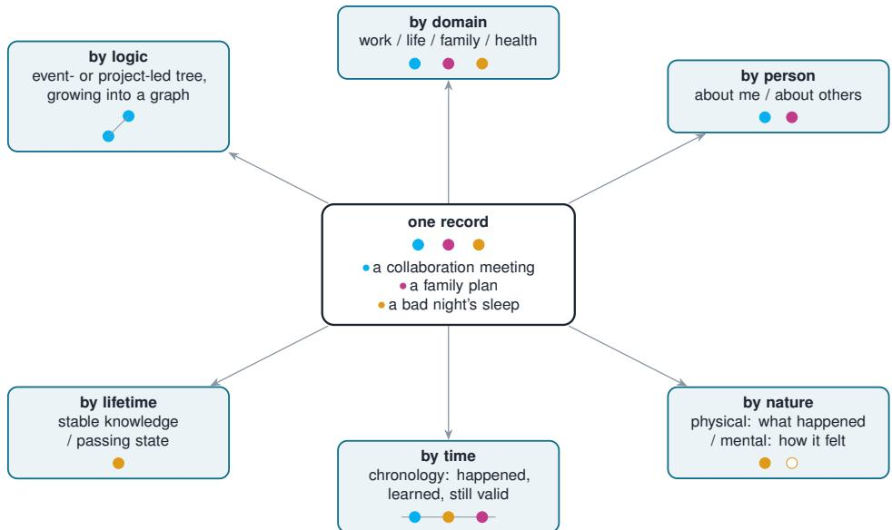  
views are projections generated by the question asked; the record underneath is one  
Figure 9: One life, many views. The same handful of events (a meeting, a family plan, a bad night’s sleep) appears in six views, by logic, domain, person, lifetime, time, and nature. The views are projections of one record and can be switched at will.

Table 8: Views of the record and the questions they answer. Views are projections of one store: the record underneath is one, and a view is generated by the question being asked.
<table><tr><td>View</td><td>Question it answers</td><td>Typical use</td><td>Used mainly by</td></tr><tr><td>Logic (project)</td><td>what this belongs to, what led to it and what follows</td><td>picking up a line of thought; continuing unfinished work</td><td></td></tr><tr><td>Domain</td><td>how work and life cross</td><td>spotting conflicts; allocating time</td><td></td></tr><tr><td> Person (self / others)</td><td>who is involved and how they are related</td><td>memory support in social settings</td><td></td></tr><tr><td>Lifetime</td><td>what is stable and what is passing</td><td>telling character from a mood</td><td></td></tr><tr><td> Time (chronology)</td><td>when it happened, when it was learned, whether it still holds</td><td>tracking change</td><td>三</td></tr><tr><td>Nature (physical / mental)</td><td>what happened, and how you felt about it</td><td>emotional support; self-understanding</td><td></td></tr></table>

• Used mainly by: the loop stage that most often asks for the view: õ keep, j understand, Ü live alongside, ´ act for and think with, à grow.

## 6.6 Remembering the Future, and the Reasons

A record holds more than the past. It holds commitments, plans, the question to ask someone at the next meeting, decisions still forming, and the longer view of who the person wants to become. Psychology calls this prospective memory; it is the kind of memory people fail at most often, and it is where a symbiont produces value most easily, by returning a future intention to the working context at the right moment. It also gives the proactive help of Section 8 its most natural trigger: the system acts because the person said they would, and does not have to guess that they might want to. The record also holds reasons and not only conclusions: why the person declined that ofer, why they abandoned that plan, which two options they still have not chosen between, what new evidence would make them reconsider; the third moment of the day in Section 1 is a record that kept the conclusion and lost the reasons. Keeping reasons is the precondition for the decision support of Section 9.2; a record without reasons can only answer questions about history.

## 6.7 The Others in Your Life

A person’s colleagues, family, and friends are part of their context, and a symbiont has to remember where a conversation with someone left of in order to support the person’s social life. Those people have not authorized being modeled. We distinguish relational facts, what has happened between the person and them, which may be kept, from inferred portraits, what kind of person they are, which must be held to stricter limits than anything about the person themselves. Section 12.5 sets the boundary in detail.

## 7 Understanding a Person

The record of Section 6 is evidence. This section asks how evidence becomes understanding of a person, and it is the technical center of the paper. It runs along one line: what must be understood, where the evidence comes from, how the understanding is represented, which backbone it runs on, what a world model adds to it, and where it stops. World models appear only at the fifth step, as the source of one capability, prediction.

## 7.1 What Must Be Understood

Three objects must be understood. The first is the situation, the physical side: where the person is, whom they are with, what they are doing, what the world in front of them is about to do. The second is the mind, the mental side: the person’s intention at this moment, their cognitive load, their emotion, their uncertainty, and the more stable layer of goals, values, and blind spots. The third is change: the situation changes by the minute, the mind by the hour, and the person by the year, so that the dificulty of understanding someone lies less in drawing a likeness than in making the likeness move. The same experience has two faces, the event visible from outside and the person’s experience of it, and the record keeps both, so the model must represent both. Mental world modeling makes the same commitment at the level of world state, treating beliefs and intentions as state variables alongside physical ones (Fei and Zhao, 2026); Section 7.5 builds on it. The third object, change, is the root of the staleness detection in that section and of the mutual growth in Section 10.

## 7.2 Two Roads to the Mind

There are two independent sources of evidence about a mind, and a symbiont needs both (Figure 10). The observation road infers from behavior, choices, expression, environment, and physiology; its strength is that it sees patterns the person cannot see themselves (they do not sleep after every meeting with a certain colleague), and its weakness is that one behavior has many possible causes. The self-report road takes what the person says: their account of a situation, a whispered sentence, a correction of a misreading; its strength is that only the person can say what they felt and why, and its weakness is that accounts shift with mood and flatter the teller. The two roads feed one layered model, and every entry carries its source and its uncertainty. Self-report has priority on feelings and reasons; observation has priority on patterns the person cannot see. When they disagree, the right response is to mark the disagreement, lower the weight placed on the inference, and ask when the moment is right, never to let the model overrule the person. The result of Park et al. (2024), in which agents built from two-hour interviews reproduced their participants’ survey answers about as well as the participants reproduced their own, shows how dense the information on the self-report road is; those agents are never updated, and that is what the symbiont adds. Most existing systems travel only the observation road, inferring preferences from interaction history, and the dedicated low-friction channel of Section 5.4 is what gives a symbiont the second.

## 7.3 Layers of the Personal Model

Table 9 gives the representation: seven layers, each with its evidence, its rate of change, and the misuse it invites, so that a passing state is never mistaken for a trait. The last layer, preferences about help, is new relative to the usual user profile and is the parameter source of the intervention policy in Section 8.4. One structural property of the table follows from an everyday observation: a person who switches between a home dialect, a national language, and English changes manner, values, and even reasoning with the switch. The table is therefore indexed by context. The self at work, the self at home, and the self speaking the home dialect take diferent values in the identity, relations, and help-preference layers and share the experience-and-knowledge layer. The diferences are not contradictions to be averaged into one personality; the model’s task is to recognize which self is active, from language, setting, and company, and to act with that self’s manner, weights, and social norms. Cultural psychology documents the underlying phenomenon of cultural frame switching in bicultural people (Hong et al., 2000; Ramírez-Esparza et al., 2006), and the context-indexed model is what makes the cultural help of Section 9.4 possible.

## 7.4 The Backbone

The personal model has to be computed by something, and the paper binds it to nothing in particular. The claim is precise. The personal model and the record are defined at the level of information: what must be known, what must be predicted, and how confidence is expressed. The backbone is the engine that turns evidence into that information, and the engine can be changed while the interface stays, so that what varies between engines is the quality of the estimates. Two independent axes describe the engine (Figure 11). The first axis is the foundation model itself, of which three kinds matter here. A language model understands what the person says and writes, holds a textual portrait in its context, and reaches memory through retrieval. An omni-modal model understands what the person sees and hears, reads situation and mood from tone and scene, and makes the first-person stream interpretable for the first time. A world model turns understanding into prediction: what is about to happen around the person, how they will think and react, and whether a given reminder will be welcome. The three are members of one family, each extending the evidence the model can take in and the inference it can draw from it, and later members contain the earlier ones. The second axis is orthogonal to the first. An agentic system belongs to this second axis rather than to the family: it is an organization of computation around a foundation model of any of the three kinds, the model together with the harness of Section 3.2, and the model inside an agentic system can be exchanged for any member of the family. What the harness adds is that understanding ceases to be a single pass and becomes a process: the system can look something up, ask the person a question, check the record, update the model, and plan the next step, whichever model sits inside it. The grid of Figure 11 therefore has six cells, and the two axes can be traversed independently. The first usable systems will stand in the upper-left cell, a language model inside a harness, since that is what today’s agents are, and the design is headed toward the upper-right cell, a world model inside a harness that anticipates as well as perceives. The design must stand on the weakest cell and improve automatically along either axis. On a language model alone the symbiont is a text assistant with a memory; without a world model the intervention policy estimates reactions by heuristics; without a harness, understanding cannot check itself. The information interface is what makes the claim concrete: the mental-state layer of Table 9 asks every cell for the same output, an estimate of intent and an estimate of emotion, each with its confidence, which a language model produces from dialogue text, an omni-modal model from tone and scene as well, a world model from predictions of what comes next, and a harness from any of these together with the result of checking them against the record. This is also why Section 10.4 requires that a change of foundation model, or of harness, preserve the relationship.

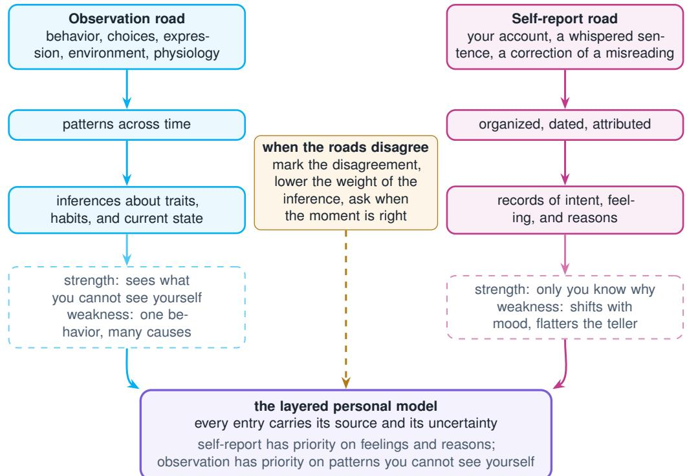  
Figure 10: Two roads to the mind. Observation infers patterns from behavior and physiology; self-report records what the person says about intent, feeling, and reasons. Both feed one layered model, with every entry tagged by source and uncertainty; disagreements are marked, down-weighted, and resolved by asking.

Table 9: Layers of the personal model. Each layer carries its evidence and its rate of change, and the last column names the misuse it invites. The table is indexed by context: the identity, relations, and help-preference layers take diferent values for the self at work, the self at home, and the self speaking a home dialect, while experience and knowledge are shared. The last layer parameterizes the intervention policy of Section 8.4.
<table><tr><td>Layer</td><td>Content</td><td>Main evidence</td><td>Changes over</td><td>Typical misuse</td></tr><tr><td> Stable identity</td><td>background, roles, long-term values, abilities and blind spots</td><td>o R long observation years plus self-report</td><td></td><td>reading one lapse as a lack of ability</td></tr><tr><td>Experience and knowledge E</td><td>what happened, what you know, whom you have dealt with</td><td>0 R the record (§6)</td><td>accumulates</td><td>treating an expired fact as current</td></tr><tr><td>③ Current situation S</td><td>where, with whom, doing what, under what time pressure</td><td>0 real-time sensing</td><td>minutes</td><td>explaining new behavior by an old situation</td></tr><tr><td>Mental state</td><td>intention, cognitive load, emotion, uncertainty</td><td>K the two roads crossed</td><td>seconds to hours</td><td>treating an inference as a fact</td></tr><tr><td>Relations and society R</td><td>relationships, boundaries, shared history</td><td>o R relational facts</td><td>months</td><td>building portraits of other people</td></tr><tr><td>⑤ © Goals and trade-offs G</td><td>what you want, what you will not sacrifice, who you want to become</td><td>R self-report first</td><td>months to years</td><td>overruling the person&#x27;s choice with an inferred goal</td></tr><tr><td>Preferences about help H</td><td>when you accept interruption, which forms you like, what you want to do yourself</td><td>R o feedback</td><td>weeks</td><td>turning one refusal into a permanent setting</td></tr></table>

• Evidence, in the terms of Definition 4.1: observed from outside $( O _ { \leq t } ) ,$ R reported by the person $( R _ { \leq t } ) ,$ K inferred from the two $( K _ { t } ) .$ • The layer letters I E S M R G H are reused in Table 12.

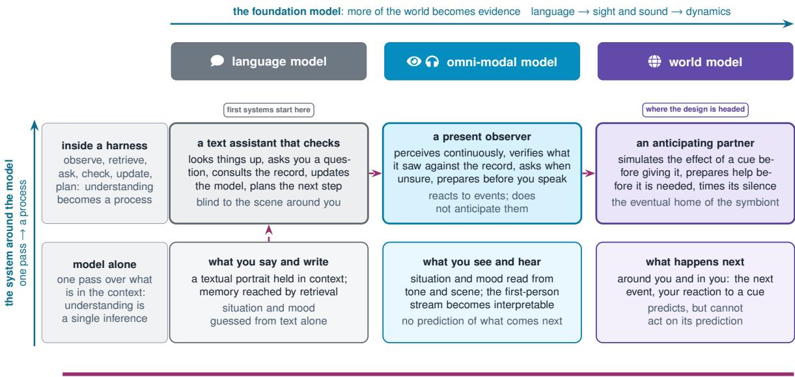  
one information interface for all six cells: the same slots, filled with better estimates  
Figure 11: Two axes of the backbone. Columns: the family of foundation models, from language to sight and sound to dynamics, each extending what counts as evidence. Rows: how much system is organized around the model, from a single pass to a process inside an agentic harness. The two axes are independent, since a harness can be wrapped around any of the three models; the dashed path is the likely order in which systems will move through the grid, and the heavy line is the information interface of the personal model, which is the same in every cell.

## 7.5 Two World Models

A world model, as a backbone, contributes to the personal model in two forms. An external physical world model takes the environment seen in first person as its object, scene, objects, people present, their dynamics, and predicts the next moment: the cup is about to tip, the bus is arriving, the slide is about to change. It serves help in the physical world, grounds mental cues in the situation (the person is tense because the deadline is on the screen), and supplies the extended reach of Section 14.2; its sources are the video world models and first-person data of Section 3.4. An internal mental world model takes the person’s beliefs, attention, intentions, emotions, and goals as its object and predicts how they change after an event and after an action by the symbiont. It is the predictive version of the mental-state layer of Table 9, and its sources are theory-of-mind research, individual-level simulation (Park et al., 2024), and mental world modeling, which places these variables inside the world state (Fei and Zhao, 2026). The two are coupled: physical events change mental states, and mental states drive actions in the physical world.

A competent world model has a state representation, temporal and relational reasoning, prediction of future states, prediction of the consequences of candidate actions, an expression of uncertainty, and detection of its own misspecification. Replace “the world” with “this person’s world” and every requirement stands, and the last one matters most. People change, so a model of a person will go wrong; the ability to detect that it has gone stale is what separates a symbiont from a static profile, and it is the same class of problem as misspecification detection in open-world modeling. In the smallest notation, with $z _ { t }$ the joint latent state,

$$
\begin{array} { r l r l r l } & { z _ { t } = \big ( z _ { t } ^ { \mathrm { p h y s } } , z _ { t } ^ { \mathrm { m i n d } } \big ) , } & & { b _ { t } ( z ) = P ( z _ { t } \mid O _ { \le t } , R _ { \le t } , K _ { t } ) , } & & { \hat { z } _ { t + 1 } \sim P ( z _ { t + 1 } \mid z _ { t } , a _ { t } , x _ { t + 1 } ) , } \end{array}\tag{3}
$$

where $z _ { t } ^ { \mathrm { p h y s } }$ is the task-relevant state of the world around the person, $z _ { t } ^ { \mathrm { m i n d } }$ the latent state of intention, emotion, and goals, $b _ { t }$ the system’s belief over both, and the third expression says that the model must predict how both change after the system’s action $a _ { t }$ and the new situation $x _ { t + 1 }$ . The notation fixes what is predicted and conditioned on; it prescribes no Bayesian implementation. It underlies the intervention policy of Section 8.4, which needs $b _ { t }$ , and the learning rule of Section 10.2, which needs $a _ { t }$ . Without a world model the third expression degrades to heuristic rules, and the system still stands.

## 7.6 Knowing When It Is Wrong

“It knows you better than you know yourself” has three defensible meanings and one that is not. It can hold the person’s whole self-context at once while they hold a small part (Definition 4.2); it can see patterns across years that the person is inside of and cannot see; and it remembers the reasons they gave and have since forgotten. The fourth meaning, reading thoughts that were never expressed, the paper gives up explicitly. Two kinds of limitation must also be kept apart. Familiarity with the person and competence on the problem in front of them are diferent things, and a system that knows someone very well may be poor at the specialist question they face this minute. The confidence of the personal model and the reliability of the backbone in that domain are estimated and reported separately; when the second is low the system narrows its advice or suggests asking a person, and it never covers its ignorance of the problem with its familiarity with the person. Understanding runs both ways, since the person also learns under which conditions the system is reliable, and mutual understanding has degrees and costs; the grounding framework of Clark and Brennan (1991) describes the process without the infinite regress of each knowing what the other knows. Finally, every judgment about the person carries a confidence, any of them can be overturned by a sentence from the person, the system learns to ask when it is unsure, and an overturned judgment propagates through the repair of Section 6.5. Collins et al. (2024) argued that machines that think with people must model them; this section says what is modeled, on what evidence, on which backbone, and within which limits.

## 8 Living Alongside

Understanding has to become participation at the right moment. This section turns private, real-time, low-friction, embedded presence, and proactivity that is timely, into mechanisms. It is about how the symbiont is present, when it speaks, and in what form. What it says is the subject of Section 9.

## 8.1 Two Conversations at Once

Real-time voice assistants solved one problem: the person and the AI can speak and listen at the same time (Défossez et al., 2024). A symbiont solves a diferent one. The person is talking to another person; the symbiont is listening, thinking, and preparing at the same time, and through the private channel it hands the person a line, so that the person never has to stop for it. We call this cognitive full-duplex, the real-time form of the symbiosis Licklider (1960) imagined: two conversations at once, the person’s with the world and the person’s with the symbiont, with the second never interrupting the first. Figure 12 shows one instance. A colleague mentions a figure the person reported last quarter; the slow loop retrieves it and checks it against the record; a question is detected and a cue appears in the glasses within a second; the person answers with the figure; the topic moves on and the cue expires and is withdrawn. Four tracks run through the exchange, the external world, the person’s outward expression, the private channel, and the symbiont’s internal state, and the figure follows them along one timeline. This capability belongs in the first usable system, since without it the symbiont is confined to the moments when the person is alone.

## 8.2 Fast Loop, Slow Loop

Real time has two timescales, and conflating them leads to the mistaken demand that everything be low-latency. The fast loop handles the immediate: a name, a number, “what he just said contradicts last week.” The slow loop handles the background: retrieval, reasoning, updating the model, preparing a summary for after the meeting. Between them sits a rolling current state: what this conversation is about, who wants what, what is still unresolved. Cues must update incrementally, an updated cue must replace its predecessor, and an expired cue must disappear. The latency budget has a shape. The fast loop’s ceiling is set by the pace of conversation, since a name is useless two seconds late, so it can use only small models on the device or at the edge together with material the slow loop has already prepared. The slow loop may be slow but must think ahead, preparing before the person opens their mouth what they are likely to need, which is where the prediction of Section 7.5 is put to use. Section 17.4 lists the end-to-end latency budget as an open problem.

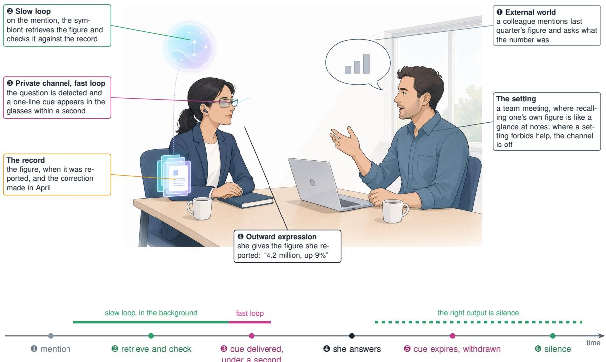  
Figure 12: Cognitive full-duplex. One exchange in a team meeting: a colleague raises a figure the person reported last quarter, the slow loop retrieves and checks it, the fast loop places a one-line cue in the glasses within a second, the person answers, and the cue is withdrawn once it expires. The timeline below follows the exchange across the four tracks of the external world, outward expression, the private channel, and the symbiont’s internal state. The help is a reminder of the person’s own figure, the kind of assistance most settings accept (Section 15.5), and most of the time the right output is silence.

## 8.3 Implicit Intent

Much of what a person needs is never asked for. The evidence for implicit intent comes from the current activity, recent behavior, unfinished business (Section $6 . 6 )$ , the personal model (Section $^ { 7 ) , }$ , and the half-sentence the person whispers. The purpose of inferring it is to have candidate help ready and to wait for a suitable moment, never to decide in the person’s place. When the inference is uncertain, the right move is one very short question, and the answer to that question is itself new evidence for the record; active clarification is a source of context in its own right.

## 8.4 The Intervention Policy

Timeliness has to become a decision problem, and silence has to be one of the formal decisions. Table 10 separates the three judgments: what to help with, when, and how. The decision can be written as a constrained choice,

$$
a _ { t } ^ { * } = \operatorname * { a r g m a x } _ { \alpha \in \mathcal { M } _ { t } } \mathbb { E } [ \Delta U ( a ) \mid b _ { t } ] - \lambda _ { t } \cdot \operatorname { I n t e r r u p t } ( a , \operatorname { a t t e n t i o n } _ { t } ) - \rho \cdot \operatorname { R i s k } ( a ) , \qquad \mathrm { s . t . ~ } \operatorname { c o n f } ( b _ { t } ) \geq \theta ( a ) ,\tag{4}
$$

where $\mathcal { A } _ { t }$ always contains silence ∅ with zero interruption cost, and the confidence threshold $\theta ( a )$ rises with the intrusiveness of the action: the louder the help, the surer the symbiont has to be, and acting on the person’s behalf carries the highest threshold of all. The three terms say that help must have expected value, that interruption has a cost which varies with the person’s current attentional state, and that risk is counted separately because a wrong reminder is worse than none. We add a notion of an attention budget: the amount of a person’s attention a symbiont may consume in a day is finite, and it should be managed the way battery charge is managed. The just-in-time adaptive intervention framework of mobile health has studied for a decade when an intervention of what strength is acceptable, with its notions of states of vulnerability and receptivity (Nahum-Shani et al., 2018), and those notions transfer directly. Earlier work on interruption and recovery shows how expensive an ill-timed intrusion is (Iqbal and Horvitz, 2007), and mixed-initiative principles already warned that initiative must be weighed against the cost of poorly timed action (Horvitz, 1999). The goal is therefore accuracy of intervention rather than a greater amount of it. The weights �, �, and � are given no numerical values in this paper and are research variables of Section 17.

Table 10: The three decisions of the intervention policy. Silence is always one of the answers to how, and the last column makes it the default.
<table><tr><td>Question</td><td>What must be judged</td><td>Evidence</td><td>Default when unsure</td></tr><tr><td>? What</td><td>what you missed, misremembered, did not think of, or cannot put into words; what could simply be done for you</td><td>personal model S E + the current M situation + the record</td><td>nothing</td></tr><tr><td>When</td><td>whether speaking now pays, whether it still will in a few seconds, whether you can take an interruption now</td><td>time window + attention load + setting S H</td><td>later, or never</td></tr><tr><td>How</td><td>a line of text, a sentence, a question back, an overlay in your view, a silent note for later, or an action on your behalf</td><td>setting + channel (Table 6) + your preferences about help H + risk</td><td>silence, or a silent note</td></tr></table>

• Layer letters as in Table 9: S situation, M mental state, E experience, H preferences about help.

## 8.5 Low Friction

Low friction means that the person never works for the help: no re-explaining the background, no reaching for a phone, no switching applications, no waiting. Friction has four sources, and each is removed elsewhere in the paper: explaining the background (the record, Section 6), switching devices (the runtime, Section 11), waiting for a reply (the two loops above), and tidying up afterwards (consolidation, Section 6.3). Some friction is worth preserving. Being asked one more question before an important decision, or being left to think for a moment, is friction that should survive optimization (Section 10.5); interfaces that make people examine a recommendation before accepting it reduce overreliance at the cost of being liked less (Buçinca et al., 2021), and that trade is the one a symbiont must learn to make per person and per moment.

## 8.6 Beyond the Meeting Room

The meeting is the first proving ground: time pressure is high, information is dense, and timing decides everything, which is why a desktop copilot that analyzes a meeting as it happens and feeds cues back in real time is the natural starting point. The symbiont must, however, leave the room. Three settings of presence have diferent rhythms and channels. Sitting at a screen, in the desktop or the editor, the channel is wide and help can be expanded. In conversation, in a meeting or at dinner, only a line or a whispered word fits. On the move, in the street, in transit, in an unfamiliar city, the earpiece and the overlay carry what the moment needs. The second moment of the day in Section 1 resolves here: the result the researcher could not recall arrives as a line in the glasses while the conversation continues. What the symbiont does once present begins with doing things for the person, which is where the next section starts.

## 9 The Ladder of Assistance

Once present, what does a symbiont do? The answer is a ladder with three tiers (Figure 13). At the bottom it gets things done, which is what today’s autonomous and personal agents do, and a symbiont must do it as well as they do and better. In the middle it thinks and feels with the person: decisions, goal formation, learning, creative work, emotional steadiness, mentorship, and psychological support within clinical limits, the settings of highest cognitive density. At the top it lives among others with the person: real-time social cognition, hard conversations, culture and dialect, and the meeting of two symbionts. Three facts organize the ladder. Each tier rests on the one below, and a symbiont that cannot book a flight will never be worn. Each tier up moves the object of evaluation further from task completion and closer to how the person is changed. And all three tiers run on the same machinery of Sections 6 to 8, difering only in how deep into the personal model they reach and how much intervention they are allowed (the threshold � of Eq. (4)). One function, patient care, runs across all three tiers and receives its own treatment in Section 9.5.

## 9.1 Getting Things Done

The floor of the ladder is general-purpose assistance: booking travel and hotels, shopping and comparing prices, keeping the calendar and the inbox, forms and payments, desktop work with files, slides, and spreadsheets, coding and technical work inside the editor, retrieving and organizing information, and multi-day tasks such as an application, a move, or an event. A symbiont does not rebuild these capabilities. Through its harness (Sections 3.2 and 11.3) it delegates them to standard agents and tools, computer-use agents, tool protocols, and coding agents, and keeps three jobs for itself: defining the task correctly, supplying the right personal defaults, and deciding when the person must be consulted. The reason the same task comes out better is the record and the personal model. An agent told “book my flight to the conference” has to ask where the person leaves from, what they will spend, when they prefer to travel, whether they want a window seat. A symbiont already knows that the person has a meeting on Monday morning that cannot move, that they dislike overnight flights, that they want to stay near the venue because they hope to meet a particular colleague, and that the last time they took a short connection they missed it. So it asks nothing, or it asks the one question that only the person can answer. One layer deeper, it knows why the person is making the trip, from the goals layer of Table 9, so it frames the task correctly and books the meeting they were hoping for alongside the flight. Table 11 works through five everyday tasks in this way, and its last column lists what can be measured: clarifying questions asked, corrections the person had to make, time to completion, how much of a plan actually holds.

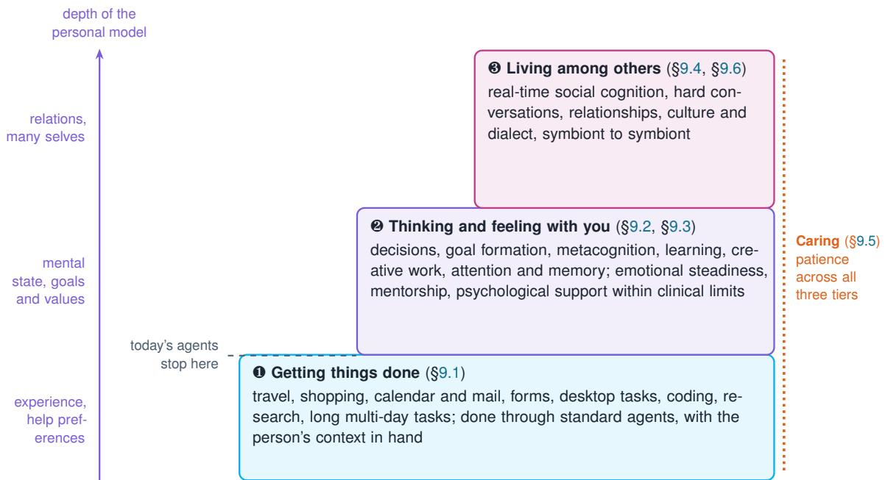  
Figure 13: The ladder of assistance. Tier 1 is where today’s agents stop; a symbiont does the same tasks with the person’s context in hand. Tier 2 is thinking and feeling with the person, and Tier 3 is living among others. The depth of the persona model required grows with each tier, and caring runs across all three.

Acting for the person is the most intrusive action in Eq. (4) and needs the firmest boundary. We propose five levels of action permission: look, suggest, draft, execute what can be undone, and execute what cannot, such as paying, sending, and committing; each level is earned along the trust curve of Section 12.2. A draft composed in discussion, a line rehearsed for a conversation, or a candidate plan never becomes an outward action or commitment on its own. Long tasks carry state, verify their results, and hand back to the person when they fail. Evaluation at this tier can keep task completion as its object as long as it adds a personalization diferential: the same task, the same base model, with and without the person’s context, which Section 17.1 writes as Eq. (8). Current benchmarks measure the floor and say nothing about the diferential (Xie et al., 2024; Zhou et al., 2024; Yao et al., 2025). We make no claim of novelty for this tier; the single claim is that the same tasks are done better with personal context, and that this can be shown.

## 9.2 Thinking With You

The first half of the second tier is cognition itself, in six forms.

Decisions. A symbiont that remembers the person can help them reason with themselves. It returns what they forgot (why they declined last time, and whether the constraint still holds), lays out what they did not think of (a third option, a counterexample, a value they usually weigh and this time left out), and writes down what they concluded, with the reasons, for next time (Section 6.6). Its stance is to help the person see, never to choose for them, and it owes them a reasoned objection when a choice conflicts with a long-term goal they stated themselves, after which the decision returns to them. Reicherts et al. (2025) compared an AI that builds on the person’s own reasons with one that gives recommendations: the first integrated better with people’s thinking and produced slightly better outcomes, the second surfaced more novel insights at less efort, and the first is the form of help this paragraph describes. The third moment of the day in Section 1 resolves here.

Table 11: The same task, done by an agent and by a symbiont. The task is unchanged; what changes is how much must be asked, how the task is framed, and how often the result has to be corrected. The last column makes the diference measurable.
<table><tr><td>Task</td><td>Gap closed</td><td>An agentA must be told</td><td>A symbiont already knows</td><td>Difference in outcome</td><td>Measurable</td></tr><tr><td>Book a trip to a conference</td><td>FT</td><td>dates, budget, preferences, companions</td><td>the meeting that cannot move, your aversion to red-eye flights, the person you hope to meet, the connection you missed last time</td><td>right the first time; the meeting gets scheduled alongside</td><td>clarifying questions; rebookings; your later edits</td></tr><tr><td>Reply to a difficult email</td><td>FW</td><td>who the recipient is, what your history with them, you want to say</td><td>the last disagreement, your usual register</td><td>the draft needs no rewrite adoption rate; edit</td><td>distance</td></tr><tr><td>&lt;&gt; Fix a bug</td><td>FT</td><td>the repository, how to reproduce</td><td>the module you changed last week, your coding habits, that you have half an hour today</td><td>a minimal fix now, the refactor left for when you rate have time</td><td>time to done; rollback</td></tr><tr><td>Buy a gift</td><td>F N</td><td>recipient, budget, taste</td><td>the wish the person once mentioned in your record, of you the stage of your relationship</td><td>no deliberation required</td><td>number of your changes</td></tr><tr><td>Plan next week</td><td>TF</td><td>which items, durations, priorities</td><td>your rhythm (afternoons are slow), what you promised (§6.6), how your body is</td><td>a plan that looks like you how much of it actually</td><td>holds</td></tr></table>

• Gap closed, in the four losses of Section 1: F forgetting N not noticing T not thinking through W not finding the words.

Goal formation. Many important matters start without an executable goal: changing direction, taking or declining an opportunity, handling a relationship. The symbiont can unfold candidate goals, bring back the reasons that conflict, and ask which cost the person would find hardest to bear, so that a provisional choice forms in the conversation. It makes no claim to have discovered the person’s “true” goal.

Metacognition. This is help with knowing where one is uncertain, whether to check, and whether this is a moment to think alone, to think with the symbiont, or to ask a person. Such help arrives before an answer, and sometimes it takes the form “that is not the question you need.” A rise in confidence is never counted as a rise in understanding, and the cognitive-ofloading literature (Risko and Gilbert, 2016) is the background for when ofloading is the right choice.

Learning and tutoring. A tutor who knows where the person does not understand, because it has seen every place they got stuck, can give a hint at the moment they need it instead of an answer, and can step back when they say they want to learn this themselves (Section 10.5). Language learning is the most natural case and connects to the dialect help of Section 9.4.

Creative and long-horizon work. Two services belong here: catching the idea that slips away (the first moment of the day in Section 1, the typical use of the whisper channel), and holding a thread across weeks, where this project got to, which hypothesis was dropped, which is still open, which is the working state of Section 6.1. The failure to watch for is a symbiont that generates a great deal and drifts away from the question the person wanted to pursue.

Attention and memory. This includes guarding focus, by noticing that the person has been refreshing the same page for ten minutes, and the plainest memory support of all: a name, a detail, where something was put, what was said last time. These six forms draw on the goals and mental-state layers of Table 9, use the expanded dialogue or the whisper channel, and span seconds to days, and it is here that the friction worth preserving (Section 8.5) matters most.

## 9.3 Feeling With You

The second half of the tier runs from everyday emotion to the edge of clinical care, in four steps of increasing weight.

Everyday steadiness. The small disturbances of a day: a remark that stung, nerves before a talk, a piece of bad news. The symbiont’s help is to be present, to know what happened, and to say the one sentence that fits, or to say nothing and simply note it. Physiology gives early signs of stress and fatigue, and their interpretation has to remain conservative.

A mentor who knows your story. Useful comfort is never generic encouragement; it rests on a precise understanding of the person’s actual history, so that what is said touches the real point: this failure relates to those eforts and those hopes. Three levels follow. Being heard, when the symbiont restates the situation and the person thinks “yes, that is it.” Being understood, when it points out an attribution error the person could not see. Being moved, when it builds a next step from the way the person got through a similar time before. The preconditions, an established relationship of trust and a general competence that in many domains exceeds an ordinary person’s, are stated as conditions throughout.

Psychological support within clinical limits. This is where the section has to be most careful. Relative to any mental-health application, a symbiont has three advantages: it knows the person’s life and does not need it retold; it is present when the trigger happens, days before the next appointment; and it can see patterns, in sleep, in social withdrawal, in language. It is therefore suited to three things: being a daily practice partner for evidence-based methods such as the identification and reframing used in cognitive behavioral therapy; providing support and a record between professional sessions; and recognizing early signs of relapse. It is not suited to carrying treatment on its own. For depression and anxiety the paper says that this is a direction that deserves serious study, with randomized evidence for particular systems under particular conditions, from the early Woebot trial (Fitzpatrick et al., 2017) to the recent trial of a generative chatbot (Heinz et al., 2025), and it does not say that these conditions can be treated by an AI. The symbiont’s first duty in such moments is to recognize when a human professional must be brought in, with a clear path for doing so when crisis signals appear, and in regulated jurisdictions this function is itself regulated, which the paper acknowledges.

Habits, behavior change, and company. Long-term behavior change, in sleep, exercise, or recovery, is the home ground of just-in-time adaptive interventions (Nahum-Shani et al., 2018), and a symbiont turns the phone notification into a sentence from someone present. As company it can be patient and non-judging, and the risk has to be stated directly: it must never substitute for human relationships, and it should steer the person back toward people. Studies of companion chatbots show both relief of loneliness and dependence, with efects that vary with how and how much they are used (Maples et al., 2024; Fang et al., 2025).

## After a Setback

The same sentence, “I messed up again”, and three responses a symbiont might give. It listens and makes a note, and says nothing. It looks back at the facts and points out what difers between this time and last time. With the person’s agreement, it works through the causes and a next step together with them. Three things it does not do: ofer a paragraph of generic encouragement; insist “I know you better” after the person has rejected an interpretation; and continue alone when a crisis signal appears.

## 9.4 Relating

The third tier is help with people and cultures, in four forms. Real-time social cognition. A meeting is one kind of social setting. In any of them the symbiont can recall the person opposite (where the conversation left of, what they care about), read the moment (the implication of what was just said, the tension between the person’s argument and the other’s position), and help the person say it (a better phrasing, the number they forgot). Reading the moment relies on the theory-of-mind ability of large foundation models, which has shown both promise and brittleness (Kosinski, 2024; Ullman, 2023; Strachan et al., 2024), and on inferences about other people that are used only for the interaction at hand and never accumulate into a portrait (Sections 6.7 and 12.5). Rehearsal and hard conversations. Practice beforehand for a salary negotiation, a breakup, or negative feedback to a colleague; a line during (the person’s pace is rising; the other is really asking something else); a review afterwards. A simulated counterpart in rehearsal is only a rehearsal and never a prediction of a real person. De-escalation belongs here too: the symbiont can see, in voice and heart rate, that the person is heating up before they notice, and a single vibration on the private channel is enough. Relationship maintenance. This goes deeper than a birthday reminder: the person has not spoken to their father in a month and he mentioned a medical test last time. It draws on the relations layer and on prospective memory (Section 6.6), and it is where the limits of Section 12.5 bite hardest. Language, culture, and the dialect self. Behind each language are diferent habits of thought and social rules. The help consists less in translation than in entering the frame: how people here greet, how they decline, what cannot be said directly. It needs the context-indexed model of Section 7.3, which knows who the person is in that language, and the online learning of Section 10.3, which learns the dialect of a small place. Those two sections share one example, used here and learned there, and we avoid claims of the form “language X makes people more open”: shifts of this kind have been reported in bicultural individuals (Ramírez-Esparza et al., 2006), and they do not license a rule about any

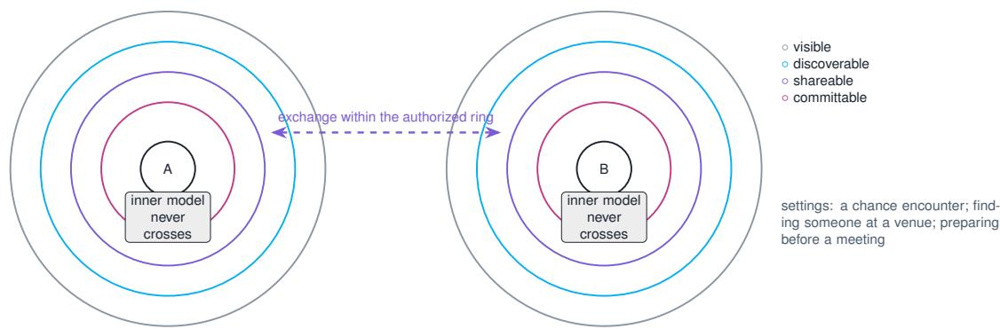  
Figure 14: The symbiont handshake. Four rings of authorization around each person, from visible to committable; exchange happens only within the ring both have opened, and the inner model never crosses.

particular person.

## 9.5 Caring

The function the user of a symbiont may value most is one that is patient when they are not. Its core is consistency, patience, tirelessness, and noticing what people stop noticing, and it runs across all three tiers. Four settings follow; the populations themselves are treated in Section 13. In parenting, a symbiont answers a child’s hundredth “why” without weariness, hands the parent a sentence when the parent’s own temper is rising, leaves the child to the parent, and notices developmental or emotional signs worth a professional’s attention; the symbiont belongs to the parent, and all-day sensing of children raises separate ethical questions (Sections 13.9 and 16.7). In aging and memory decline it is a memory prosthesis, who this is, whether the medication was taken, what was being looked for, with the SenseCam studies of memory-impaired patients as precedent (Berry et al., 2007); it supports orientation and safety and connects the person to family. For caregivers, the people who care for others and receive the least support, it holds the detail of care so that they can rest. In rehabilitation and chronic self-management, where the task is long, repetitive, and easy to abandon, its patience is worth most, and the handof to clinical systems must be explicit. The failure mode common to all four is the handing over of a person to a machine, and in each setting the symbiont’s last duty is to return the person to other people.

## 9.6 Symbiont to Symbiont

The most imaginative scene in the vision is two people, each with a symbiont, in one room and not yet near each other, while their symbionts exchange cards, filter shared interests, decide whether a greeting is worth it, and if so bring the two together. It is at once fanciful and practical, and Figure 14 turns it into four research questions. Which information may represent the person in an exchange, in four rings of authorization: visible, discoverable, shareable, and committable, with the inner personal model never crossing the boundary. By what criterion symbionts match, and who sets it. Whether a greeting made on the person’s behalf counts as their commitment. And when two symbionts each optimize for their owner, whether the outcome is good for both. Section 15.7 asks what happens when this scales to a crowd. No protocol is proposed, and everything in Sections 5 to 8 stands even if symbionts never talk to each other.

## 9.7 A Catalogue of Functions

Table 12 lists every function of this section with the layers of the personal model it needs, its channel, its timescale, the failure that would best distinguish a good system from a bad one, and its maturity. The table is deliberately long: it is the full functional claim of the paper, each row has to find its population in Section 13 and its evaluation in Section 17, and it is what we mean when we say the framework is testable.

## 10 Growing Together

After many rounds of participation, how do the system and the person each change? This section holds the paper’s most ambitious claims, the personal data flywheel, self-evolution, test-time training, learning a dialect from a few days of conversation, and it is written to be the strictest. The question “where does the symbiont learn” is broadened from memory and parameters to the whole stack: as the symbiont comes to know the person, the base model, the harness, and even the hardware have to evolve, and the one thing that must never be replaced is the relationship.

Table 12: A catalogue of cognitive-level functions as tests of the framework. Every row names the layers of the personal model it needs, the channel it uses, its timescale, the failure that would best discriminate a good system from a bad one, and its maturity. Section 13 maps rows to populations and Section 17 to evaluation.
<table><tr><td>Function</td><td>Tier</td><td>Layers</td><td>Channel</td><td>Timescale</td><td>Most diagnostic failure</td><td>Maturity</td></tr><tr><td colspan="7">1 Getting things done</td></tr><tr><td>Travel, shopping, calendar, mail</td><td>1</td><td></td><td>Q0</td><td>minutes-days</td><td>asks what you already told it</td><td></td></tr><tr><td>Desktop and office tasks</td><td></td><td></td><td>只</td><td>minutes-hours</td><td>gets the task right and your intent wrong</td><td></td></tr><tr><td>Coding and technical work</td><td>1</td><td>H</td><td>&lt;小</td><td>minutes-weeks</td><td>ignores your time limit and refactors everything</td><td></td></tr><tr><td>Retrieval and research</td><td>①</td><td>C</td><td>Q0</td><td>minutes</td><td>finds the right thing and misses what you meant</td><td></td></tr><tr><td>Multi-day long tasks</td><td>1</td><td>E G</td><td></td><td>days-weeks</td><td>fails midway and does not hand back</td><td>0</td></tr><tr><td colspan="7">Thinking with you 2</td></tr><tr><td>Decision support</td><td>②</td><td>G E</td><td>八</td><td>days</td><td>overrules you with an inferred goal</td><td>0</td></tr><tr><td>Goal formation</td><td>②</td><td></td><td>八</td><td>days</td><td>claims to have found your “true&quot; goal</td><td>0</td></tr><tr><td>Metacognition</td><td>②</td><td>M E</td><td>600</td><td>seconds-minutes</td><td>mistakes confidence for understanding</td><td>0</td></tr><tr><td>Learning and tutoring</td><td>②</td><td>E G</td><td>6d</td><td>minutes-months</td><td>gives the answer instead of the hint</td><td>0</td></tr><tr><td>Creative and long-horizon work Attention and memory</td><td>②</td><td></td><td></td><td>slow loop</td><td>drifts from the question you wanted to pursue</td><td></td></tr><tr><td>prosthesis</td><td>②</td><td></td><td>6d</td><td>fast loop</td><td>interrupts more than it helps</td><td>●</td></tr><tr><td colspan="7">2 Feeling with you</td></tr><tr><td>Everyday emotional steadiness</td><td>②</td><td>M E</td><td>×</td><td>hours</td><td>a confident explanation built on a wrong portrait</td><td>0</td></tr><tr><td>A mentor who knows your story</td><td>②</td><td>M E</td><td>0</td><td>hours-days</td><td>generic encouragement; insisting “I know you better&quot;</td><td>0</td></tr><tr><td>Psychological support within clinical limits</td><td>②</td><td>M E</td><td>0</td><td>days-months</td><td>handles a crisis signal alone</td><td>regulation</td></tr><tr><td>Early signs of stress and burnout</td><td>②</td><td>S M</td><td>6d</td><td>days</td><td>reads one sleepless night as depression</td><td>0</td></tr><tr><td>Habits and behavior change</td><td>②</td><td></td><td>6</td><td>weeks-months</td><td>nags</td><td>JITAI</td></tr><tr><td>Companionship and loneliness</td><td>②</td><td>M R</td><td>1</td><td>continuous</td><td>substitutes for people instead of returning you to them</td><td>0 ethics</td></tr><tr><td colspan="7">3 Living among others</td></tr><tr><td>Real-time social cognition</td><td>③</td><td>S E</td><td>6d 6d</td><td>fast loop</td><td>the right content at the wrong moment treats a simulation as a prediction</td><td>0</td></tr><tr><td>Rehearsal and hard conversations</td><td>③</td><td>R M</td><td></td><td>before, during, after</td><td></td><td>0</td></tr><tr><td>Relationship maintenance</td><td>③</td><td>E R</td><td>6d</td><td>weeks-months</td><td>builds portraits of other people</td><td> ethics</td></tr><tr><td>De-escalation</td><td>③</td><td>M S</td><td>6d</td><td>fast loop</td><td>a false alarm makes you tenser</td><td>0</td></tr><tr><td>Language, culture, and dialect</td><td>③</td><td>R</td><td>G2D</td><td>fast + slow loop</td><td>applies a group pattern to the person in front of you</td><td>0</td></tr><tr><td>Symbiont to symbiont</td><td>③</td><td>shareable ring</td><td>心</td><td>seconds</td><td>exchanges inner information across the boundary</td><td>O</td></tr><tr><td colspan="7">Caring, across tiers</td></tr><tr><td>Patience in parenting</td><td>123</td><td>R M</td><td>06d</td><td>continuous</td><td>manages the child instead of supporting the parent</td><td>ethics</td></tr><tr><td>Aging and memory decline</td><td>123</td><td>E S</td><td>06d</td><td>continuous</td><td>replaces the family</td><td>precedent</td></tr><tr><td>Caregiver support</td><td>123</td><td></td><td>Q0</td><td>continuous</td><td>adds to the load instead of taking from it</td><td>0</td></tr><tr><td>Rehabilitation and chronic self-care</td><td>123</td><td></td><td>6d</td><td>months</td><td>drifts away from clinical care</td><td> regulation</td></tr></table>

• Tier: ❶ getting things done ❷ thinking and feeling with you ❸ living among others ❶❷❸ across tiers. • Layers of the personal model (Table 9): I identity E experience S situation M mental state R relations G goals H preferences about help. • Channel: ø screen À in-ear voice Ð IDE Ü expanded dialogue | a line in the glasses I a buzz Ú whisper ù text Î silence Î afterwards } symbiont to symbiont. • Maturity: usable now research far of; a chip names what must come with it.

## 10.1 Where Learning Happens

“Knowing you better” can happen in seven places, each with its own mechanism, risk, and reversibility (Table 13). The first three, the record, the personal model, and the intervention policy, are where most of what is called personalization lives, and they already create most of the value. The fourth and fifth, model parameters and the harness with its tools, are self-evolution in the strict sense. The sixth is hardware. The seventh is the person, which is the paper’s object of evaluation and which no other personalization research counts. Figure 15 arranges the parameter-side mechanisms on one axis from changing only memory to changing all parameters, rates each for the data it needs, its stability, and its reversibility, and adds a parallel band for the harness. The region the paper argues for lies in the middle and toward the left; the right end, where one change moves everything, is the one to avoid. One distinction governs all seven rows: sounding more like you is not the same as understanding you better.

Table 13: Seven places where a symbiont can learn. Most personalization lives in the first three rows and already creates value; the fourth and fifth are self-evolution; the sixth is hardware; the last is the paper’s own object of evaluation. Sounding more like you is not the same as understanding you better.
<table><tr><td>Where change happens</td><td>Kind</td><td>What is learned</td><td>Mechanism</td><td>Reversible</td><td>Typical risk</td></tr><tr><td>The record (§6)</td><td></td><td>new facts, commitments, reasons</td><td>writing, consolidation</td><td>√</td><td>stored but never used</td></tr><tr><td>The personal model (§7)</td><td></td><td>more accurate judgments about you</td><td>belief updating</td><td></td><td>learning your compliance as your preference</td></tr><tr><td>The intervention policy (§8)</td><td></td><td>when to speak, how, what to do for you</td><td>adjustment from feedback</td><td></td><td>learning to please instead of to help</td></tr><tr><td>Model parameters</td><td>E</td><td>your way of speaking, your dialect, your field</td><td>adapters → test-time training</td><td>x</td><td>forgetting, drift, hard to delete</td></tr><tr><td>x Harness and tools</td><td>E</td><td>procedures built for you, tools, self-rewriting and skills, the split between loops</td><td>accumulation (§10.4)</td><td>0</td><td>grows complex; no one can audit it</td></tr><tr><td>Hardware and channels</td><td>H</td><td>which devices you actually use, which channel works in which setting</td><td>new generations and configuration</td><td>0</td><td>a new device loses the relationship</td></tr><tr><td>You</td><td>U</td><td>new understanding, skills, habits</td><td>use</td><td>x</td><td>dependence, atrophy</td></tr></table>

• Kind: P personalization E self-evolution in the strict sense H hardware U the person. • Reversible: ✓ easily  with efort ✗ hard or not at all.

harness-level learning, in parallel: readable, auditable, reversible; where self-improvement should mostly happen  
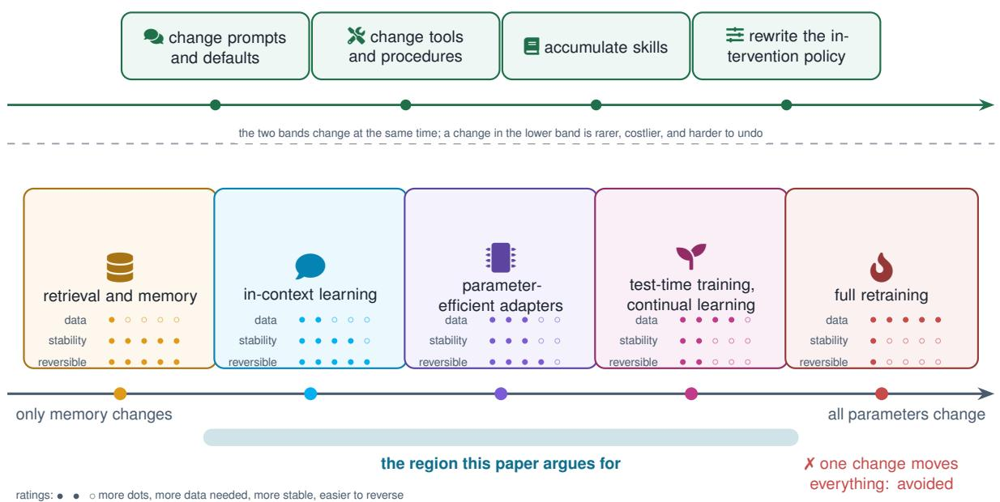  
Figure 15: The learning spectrum. The lower band runs from changing only memory to changing all parameters; each mechanism is rated for the data it needs, its stability, and its reversibility, and the paper argues for the middle-left region. The upper band is harness-level learning, which runs in parallel, stays readable and reversible, and is where self-improvement should mostly happen.

## 10.2 The Personal Data Flywheel

More authorized data gives a more accurate model, which gives more useful help, which earns more trust, which brings more data. The flywheel is the core technical bet of personal AI, and in a paper it is a research hypothesis with two brakes. The first is echo. The symbiont influences the person, then reads the influenced behavior as evidence that the person was always like this, and the model grows ever more certain of a portrait it painted itself. The remedy is to condition every update on what the system itself did:

$$
M _ { t + 1 } = \mathcal { U } ( M _ { t } ; \ o _ { t + 1 } , \ : r _ { t + 1 } , \ : a _ { t } ) ,\tag{5}
$$

where the update of the model � from new observations � and self-reports � must take the system’s own action $a _ { t }$ as an argument; an update that ignores $a _ { t }$ reads the result of an intervention as a trait of the person. Machine learning has a formal account of predictions that change what they predict (Perdomo et al., 2020). The second brake is validation: more data does not mean a truer understanding, and every round of updating has to survive the evaluation of Section 17. Growth in the person can also be the intended result of help, so change is never treated as contamination by default; what is examined is whether the evidence for an update matches the conclusion drawn from it.

## 10.3 Learning the Way a Person Learns

A symbiont has to learn new things the way a person does: in the course of life, from few experiences, incrementally, and without large ofline training runs. The requirement is best stated through an example. A dialect spoken in a single county has no corpus and sometimes no written form; a person learns it by going there, talking to people, and being corrected. A symbiont needs the same ability, and it needs it under two constraints: without changing all of its parameters, through local and dynamic adjustment or no parameter change at all, and with generalization from little data. We write this as a ladder of research targets, each separately testable: remember the sentences it heard; compose expressions it has learned; adapt to a new speaker and accent; transfer to scenes it has not heard. Meta’s EMG wristband is a ready-made example on the input side: a generic model trained on thousands of people works for a new wearer with no calibration, and twenty minutes of personal data improve it further (Kaifosh et al., 2025). A generic model with a small personal adaptation is the learning curve this section argues for, with the object changed from gestures to a dialect and a mind. Test-time training (Sun et al., 2020, 2025) and memory layers that learn at test time (Behrouz et al., 2025) are the technical lineage, and several leading researchers have named continual, sample-eficient learning as the next frontier; the paper fixes requirements and validation levels and chooses no particular route.

## Learning a Dialect by Living There

The symbiont accompanies the person to their hometown. Over a few days it learns common expressions from their conversations with relatives, confirms the meanings with them, tries to understand and to help them respond the next time, and adjusts when corrected. The vignette is written to separate what memory alone can do from what requires changing the model, and to say how one would tell “it remembered the sentences” from “it learned the dialect.”

## 10.4 Evolving the Whole Stack

As understanding of the person deepens, the base model, the harness, and the hardware must all evolve, along three routes that share one set of constraints (Figure 16). Base model upgrades. The foundation model changes every few months (Section 3.1), and the symbiont cannot be reset with it. The requirement is the information-level interface of Section 7.4: the record, the personal model, the intervention policy, and the harness configuration are defined outside the backbone, migrate when it changes, and are recalibrated during a transition period, since a new backbone may estimate the same evidence diferently. This is the paper’s answer to whether a symbiont needs its own private model: what must belong to the person is the record and the model of them, and it is the relationship, and never the weights, that persists. The films give the failure case; when its owner moved from Jarvis to a successor system, the relationship started over. Self-improvement of the harness. A symbiont may rewrite the way it works: fix a routine for something the person does often, write a tool, accumulate skills in the manner of a skill library (Wang et al., 2024), rebalance the fast and slow loops, retune the parameters of the intervention policy. This is self-improvement in a bounded form. What changes is the harness, which is readable, auditable, and reversible, and every change leaves a record; the model’s own parameters change only by exception. Hardware generations. New glasses, a new band, or a new channel let the symbiont see and say a little more. The record and the model are bound to no device, and what has to be relearned after a change is only which channel works in which setting, never who the person is, which is the mechanism behind the co-evolution of Section 5.6. The shared constraints are four: portability (change any layer and the relationship survives), auditability (what changed and why, visible to the person), reversibility (a bad change can be rolled back), and the echo brake at system level (what the system observes after changing itself cannot be read directly as the person). One more direction follows: the better the symbiont knows the person, the more specialized its procedures should become and the fewer generic defaults it should keep, and since specialization erodes general ability, a path back to the generic must be kept open, which is the system-side counterpart of the person’s right to do things themselves in the next subsection.

## 10.5 The Person Changes Too

The symbiont learns the person, and the person changes. Three changes are possible: the person learns something, which is a gain; they stop practising what they have handed over, which is a gain or a loss depending on whether they wanted to keep it; and their preferences are slowly shaped by the system, which has to be watched. The symbiont must support both “do this for me” and “I want to learn this myself”, and leave the choice with the person, which is the last layer of Table 9. The evidence so far shows harm by default and protection only by design. Generative AI without guardrails harmed high-school mathematics learning while a guarded version did not (Bastani et al., 2025), and in a randomized study of developers learning a new library, AI assistance weakened conceptual understanding and debugging without a significant gain in speed, while three of six observed interaction patterns preserved learning (Shen and Tamkin, 2026). The old lesson of automation, that the operator who is relieved of a task loses the skill to take it back, still applies (Bainbridge, 1983). Section 17.1 counts the consequence under retained ability.

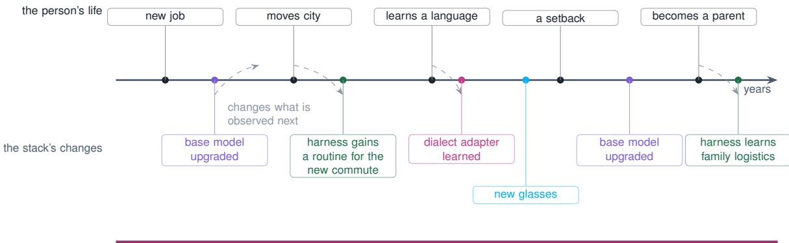  
the record and the personal model: the one thing that is never replaced  
Figure 16: Co-evolution of a person and a stack. Above the axis, events in the person’s life; below it, changes in the system: base model upgrades, routines and skills the harness accumulates, new hardware. Dashed links show life events triggering system learning and system changes altering what is observed next. The heavy line is the record and personal model, the one thing never replaced. In the fiction, the counterpart of this growth is Jarvis’s cognitive core eventually gaining a body as the Vision (Section 14.2), and the counterexample is Ultron, a separate project whose goals diverged from its maker’s (Section 15.7).

## 11 The Personal Runtime

Everything in the previous six sections has to run somewhere. This is the layer that, in the stack of Figure 5, sits between the foundation models and the agentic harness, and that may in time grow into an AI-native operating system. We call it a runtime and do not propose to rewrite an operating system.

## 11.1 Beyond an App

A symbiont needs persistent state across devices, a single permission model, scheduling of several senses and several output channels, management of the fast and slow loops, delegation to standard agents, and the one entry point for every context of Section 6.2. These requirements exceed any single application and fall short of a new kernel. The personal runtime is the layer that meets them, and it can grow over time into the AI-native operating system of our vision, once enough devices and applications treat it as their entry point.

## 11.2 Layers

Figure 17 expands the upper part of Figure 5. From the bottom: the device constellation; base capabilities, a shared omni-modal model, a world model, and small on-device models, all replaceable; runtime services, identity, permissions, device abstraction, continuity, the attention budget, and entry-point aggregation; the harness, which plans, uses tools, delegates to standard agents, schedules the two loops, and holds the procedures and skills it has written for itself; and at the top the record and the personal model, which are bound to no backbone and are portable. The trust layer of Section 12 runs through all of them. Two points organize the figure: the base is replaceable and the record and model are never replaced, and the harness and the runtime divide the labor, the first getting things done and the second making them happen on the right device, with the right permission, at the right time.

## 11.3 A Harness for a Life

Current harnesses are designed around a task (Section 3.2): it begins and ends, its input is a span of text, its tools are APIs. A symbiont’s harness faces a life: nothing begins or ends, the input is a continuous multimodal stream, the tools include a person’s senses and the devices around them, memory is a first-class component, and most of the time the correct output is nothing at all. Six requirements follow, and the paper states them without a specification: event-driven operation; the record and the personal model as native components; output channels matched to the setting; delegation to standard agents and reclamation of control from them (Section 9.1); a log of the system’s own actions, which the echo brake of Section 10.2 needs; and the ability to rewrite itself under audit, which Section 10.4 needs. This is the layer in which the current harness standard must evolve for the setting, and that evolution is one

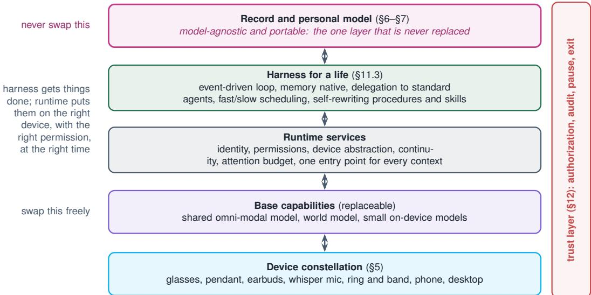  
Figure 17: The personal runtime. Base capabilities can be swapped freely; the record and personal model at the top are never swapped. The harness gets things done; the runtime puts them on the right device, with the right permission, at the right time. The trust layer runs through everything.

of the paper’s calls to the community.

## 11.4 The Cost of Always-On Cognition

AI that computes around the clock depends heavily on compute and infrastructure, and the question of what happens when AI compute becomes cheap infrastructure deserves a direct answer. Cost has a structure that can be optimized. Most of the time a lightweight on-device model does nothing but detect events; a few events wake a heavy model, on the device or in the cloud; the night is used for consolidation. Three research quantities follow: the compute budget per person per day, the leverage of event detection on total cost, and the efect of the split between local and cloud on privacy and latency. Whether the paradigm is economical depends on the duty cycle and not on model size. If inference costs keep falling at the rate of recent years and on-device models keep improving, one always-on symbiont per person becomes afordable before it becomes trusted, and the bottleneck moves once more, to Section 12.

## 11.5 Continuity

Continuity is the runtime’s central duty, in three forms. Across devices: what the person started at the desk continues when they walk out the door. Across interruptions: when a battery dies, the person switches of collection, or the network drops, the system knows which stretch it missed and, on recovery, does not pretend to have been there. Across upgrades: when the base model or the device changes, the person’s symbiont is still theirs (Section 10.4). The second form is the most often forgotten and the most damaging to trust when it fails.

## 12 Trust

By what right does a system enter a person’s life? The judgment that organizes this section is that the largest obstacle to a symbiont, ahead of any technical one, is whether people will find it safe enough to open their whole context to it, the physical and the mental alike. Trust is therefore treated as part of the architecture. This section is about design; the risks that design does not remove, and their governance, are the subject of Part IV.

## 12.1 Trust Is the Adoption Problem

A symbiont asks for authorization without precedent. It sees what the person sees, hears what they hear, keeps their life, infers their thoughts, and spends and speaks on their behalf. No existing product has asked for this much. The paper therefore reads “full open context” as a process and never as a precondition: the system has to be useful under very little authorization and earn more as trust accumulates.

## 12.2 The Trust Curve

Figure 18 plots authorization against time together and value delivered. Data authorization climbs in steps, from desktop and text, to voice and calendar, to first-person sight and sound, to physiology, to the private channel of thought, and each step has something the system must prove first. Action permission climbs on a parallel curve, from look to suggest to draft to undoable execution to final execution (Section 9.1). The curve can fall: a breach sends authorization back a step, although it cannot undo an exfiltration, so the step back limits further exposure only, which is one more reason the most private data stays on the device. Three principles govern tiered access. The system must be useful at every level, so that “give me everything and then I can help” is never the ofer. Data from a higher level is never used automatically for a task at a lower level. Processing stays local by preference, with the most private data handled closest to the body. This is also the answer to the question most often asked first about the paradigm, whether the system must watch everything to be worth anything: it must not, and the separate authorization of each source in Table 7 is the cross-section of the curve.

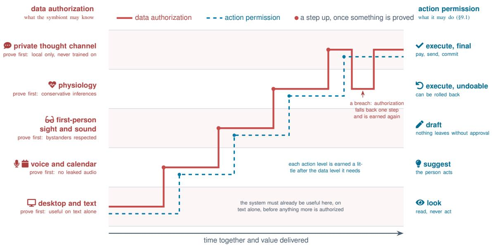  
Figure 18: The trust curve. Data authorization (solid, read on the left axis) and action permission (dashed, read on the right axis) climb in steps as time together and delivered value accumulate. Each data level names what must be proved before the next is opened, each action level is earned a little after the data level it needs, and a breach sends authorization back one step. The system has to be useful at the lowest level already.

## 12.3 The Symbiont’s Code

A personal AI should have values and a code of its own. We start from three rules, complete command of the owner’s information, responsibility to the owner, and protection of privacy and data security, and rewrite them as commitments that can be checked, with three additions.

• Know only what you are permitted to know, and know it as accurately as possible. “Complete command” cannot stand ethically or legally; the standard is completeness within authorization.

• Answer to the person, and to the interests the person endorses on reflection. Never to a passing impulse, and never to a third party: a platform, an advertiser, or an employer. Section 15.6 takes up the institutional conflict this creates.

• Protect the person’s privacy, and the privacy of the people around them.

• Do not manipulate. The system that knows a person best is the system best placed to steer them, and it must forgo that ability.

• Be pausable, correctable, and leavable.

• Follow the rules the person has accepted, even against a passing wish. A person who sits an examination, signs a contract, or joins a game has accepted its rules, and a symbiont that answers to the interests the person endorses on reflection does not help them break those rules (Section 16.2).

The aspiration that such a system be unbreakable is replaced by verifiability and tamper evidence: no system is unbreakable, and its behavior can be audited.

## 12.4 The Privacy of Thought

A symbiont creates a category of data that has never been collected by any system: the thoughts a person whispers on the private channel, the mental states the system infers, and, as neural interfaces mature, signals of attention and intent read from the body itself. We call it thought data and argue that it deserves protection above every

Table 14: Design principles for cognitive symbionts. Each is derived from one stage of the loop, states a requirement on the system, and names a check. They are design positions, not an interface standard.
<table><tr><td>Principle</td><td>From</td><td>Requirement on the system</td><td>How to check</td></tr><tr><td>① Borrowed senses, declared presence</td><td>©</td><td>collection is visible to the person and to bystanders</td><td>can a bystander tell?</td></tr><tr><td>One record, many views, your view first</td><td></td><td>the person can inspect and edit what is held about them in any view</td><td>cost and effect of a correction</td></tr><tr><td>© Two roads, kept apart</td><td></td><td>inference and self-report stored and used separately</td><td>are disagreements marked, or overwritten?</td></tr><tr><td>The louder the help, the surer you must be</td><td></td><td>silence is always available</td><td>intervention strength scales with confidence; false-alarm rate as a function of strength</td></tr><tr><td> Do the errands, never the deciding</td><td>5</td><td>action stays inside its permission level; decisions stay with the person; objection allowed</td><td>number of over-permission actions; can the person say why they chose?</td></tr><tr><td>Remember what you did when you learn</td><td>•</td><td>updates conditioned on the system&#x27;s own actions</td><td>echo detection</td></tr><tr><td>Change any layer, keep the relationship</td><td></td><td>record and model survive a change of backbone, harness, or device</td><td>consistency of understanding before and after migration</td></tr><tr><td>© Useful at every level of trust</td><td></td><td>value at every authorization level</td><td>benefit under low authorization</td></tr><tr><td> Pausable, correctable, leavable</td><td></td><td>pause, correct, migrate, and exit are all feasible</td><td>cost of exit</td></tr></table>

• From: the stage of the loop the principle is derived from: 4 sense (§5) õ keep (§6) j understand (§7) Ü live alongside (§8) ´ act for and think with (§9) à grow (§10) > runtime (§11) µ trust (§12).

other kind of personal data: local by default, never used for training by default, deletable at any time, and never exchanged with anyone. The neuroethics literature’s discussion of mental privacy applies with little change (Yuste et al., 2017), and the term cognitive sovereignty names the right at stake.

## 12.5 The People Around You

A symbiont hears other people speak and sees their faces. Three requirements follow. Collection must be perceptible to the people nearby. What has passed between the person and someone else may be kept in the person’s record, as a diary would keep it, while inferences about that person serve only the interaction at hand and never accumulate into a portrait (Section 6.7); a sensitive fact the person was told about someone else, such as their health, is kept only as told and is never analyzed or passed on. Raw audio and video of other people are kept no longer than the short window in which they serve the person (Section 6.3), and where someone asks not to be recorded the device stops. An opt-out is not enough where the law asks for more. Some jurisdictions require the consent of everyone recorded in a private conversation (State of California, 2024), biometric statutes require written consent before a template of a face is made (Illinois General Assembly, 2008), and data-protection law requires a lawful basis for processing a bystander’s data and treats biometric data as a special category (European Parliament and Council of the European Union, 2016). A symbiont therefore follows the strictest rule of the place it is in, which in many places means that it records no conversation at all and serves the person from what they tell it. Contextual integrity explains why the same information is appropriate in one setting and wrong in another (Nissenbaum, 2004), and studies of bystanders of augmented-reality glasses show what people around a wearer actually want (Denning et al., 2014).

## 12.6 A Symbiont Is a Target

Security takes a new shape. The symbiont holds the person’s whole life, so it is the most valuable thing to attack; it hears what the person hears, so a sentence someone says in front of them can be an injection; it acts and spends for the person, so a hijacked symbiont does real damage; and it rewrites its own harness, so an attack can consist of making it break itself. The paper ofers no solution and names four classes of threat with their research directions: data exfiltration, injection through the physical world, manipulation of the intervention policy, and contamination of the self-improvement process.

## 12.7 Design Principles

Table 14 gathers nine design principles, each derived from one section, each stated as a requirement on the system with a way to check it. Other sections state more specific rules, and these nine are the ones that apply across the whole system. They are positions, with no interface standard behind them, and they carry no field definitions and no compliance tests.

# Part III

# Where This Leads

Part III widens the view from one augmented individual to many, and asks what the paradigm is worth. Section 13 asks who stands to gain, population by population, using the four criteria that turn “everyone can benefit” into an argument, and it says who should not come first. Section 14 describes a world in which augmented individuals and embodied robots share the same rooms.

## 13 Whom It Serves

The first question of Part III is who stands to gain, and the answer is almost everyone, from a person with no special job or need to the most demanding expert. A claim of that breadth has no value as a list of wishes, so this section first gives a way of arguing it, then argues population by population, and ends by saying who should not come first.

## 13.1 Universal Need, Uneven Gap

The invariant of the paper is what turns “everyone can benefit” into an argument. Everyone pays the cognitive gap of Eq. (1) every day. How much of it a symbiont can close difers by population, and four criteria say by how much: the size of the gap, how much a group loses daily to forgetting, not noticing, not thinking through, and not finding the words; its observability, whether those losses are visible to the symbiont’s senses, since some gaps happen entirely inside; its closability, whether a row of Table 12 matches it at a usable maturity; and thefeasibility of channels and trust, whether the group is willing and able to wear the devices and how far it will authorize them. The natural first population is the one of highest cognitive density, professionals whose gaps are easiest to observe and who will pay to close them. The same symbiont may be worth more to three other groups: older adults whose memory is failing, for whom it is a memory prosthesis; people who are learning, for whom it knows what they do not; and people whose senses or language are limited, for whom it is a channel they lack. Figure 19 maps populations on two of these dimensions, the size and stakes of the gap and how much of it can be closed today (observability times closability), with bubble size for population and color for the maturity of the evidence; feasibility is argued in the text, and the rest of the section argues each bubble.

## 13.2 Everyday Life

The gaps of an ordinary day are modest in size and relentless in frequency: a bill, a parcel, a promise to a child; the signs one misses, one’s own fatigue, a partner’s mood; the decisions one cannot think through, whether to change jobs or move; the words one cannot find for a parent or a manager; and the errands of the whole first tier. Most of these are observable, since they happen in calendars, messages, and conversations. Closability is high: the first tier is available now and the everyday emotional and decision functions need research. The obstacle is feasibility, price and trust, and it is the largest obstacle any group faces. The value takes the form of ease: a little less forgotten, a little less wrong, a little more of one’s own time. An ordinary person has no need of Jarvis; a helper that remembers, arrives in time, and does not interrupt is enough. This is also the positive form of the fairness question in Section 15.7: a paradigm that reaches only those who can pay forgoes its largest total value.

## 13.3 Knowledge Work

Researchers, engineers, managers, clinicians, lawyers, founders, negotiators, and diplomats share high decision density, large information loads, short windows, and a high price for a wrong sentence. Their gaps lie in three places: real-time recall in meetings and conversations (Section 9.4), threads that span weeks and months (Section 9.2), and blindness to their own state under load (Section 9.3). The gaps are large, nearly all observable, since the day is lived in screens and meetings, closable with current technology for the meeting case (Section 8), and most feasible of all, since this group pays for productivity and will wear the devices. They come first because they are the easiest group on which to verify the paradigm, whatever the size of their need. A researcher gains a record in which every branch of a years-long question is kept, with metacognitive and creative support; a clinician gains real-time recall in consultation and an organized account of what the patient said, with diagnostic decisions explicitly outside the boundary; a manager or negotiator draws most on the relations layer, the shared history with each counterpart, while real-time reading of the other side stays within the limits of Section 15.5 and the law of the workplace. The section treats this group as the most easily verified proving ground.

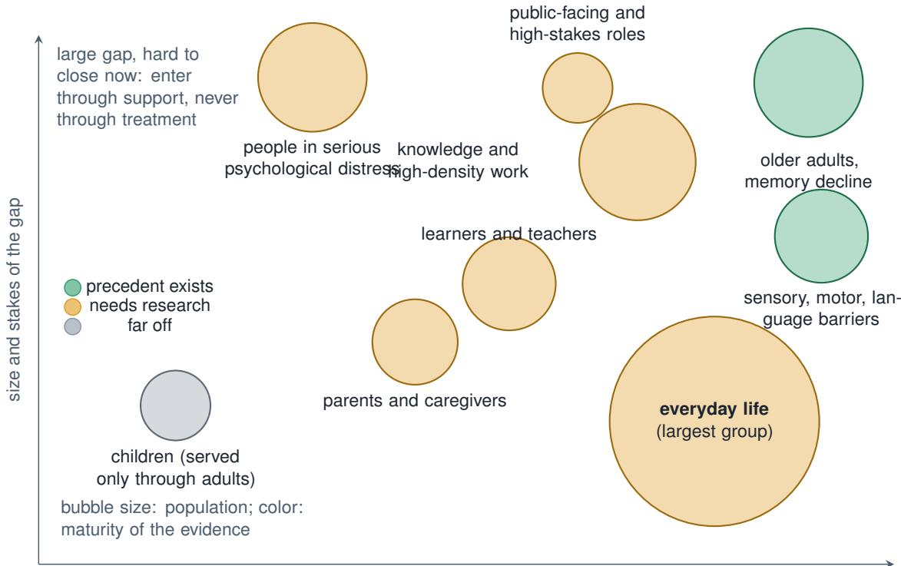  
how much of the gap a symbiont can close today (observability × closability)  
Figure 19: A map of beneficiaries. Horizontal: how much of a population’s gap a symbiont can close today (observability times closability). Vertical: the size and stakes of the gap. Bubble size is population; color is the maturity of the evidence. Positions are the author’s judgments, not measurements.

## 13.4 Learners and Teachers

Learning is where the value of a symbiont is clearest and where restraint matters most. A student gains a tutor that has seen every place they got stuck and can give a hint at the right moment instead of an answer; a language learner gains a hand in real conversation; an adult learner changing fields gains a bridge from what they know to what is new. A teacher gains real-time social cognition in the classroom, which student has fallen behind, and afterwards notes on each student’s progress, kept within the rules the school sets for student data. The gap is large and long; the process is largely observable; closability is moderate, with the efect of one-to-one tutoring as the backdrop (Bloom, 1984) and the evidence of Section 10.5 as the warning; feasibility for minors is a separate question (Section 13.9). The default in learning has to be the hint, with “I want to learn this myself” as a first-class option.

## 13.5 Families Across the Life Course

Three generations have three gaps. Parents are short of sleep, overloaded, and carried along by their children’s emotions; the symbiont serves the parent, helping them stay steady, remember, and notice, and any sensing of a child passes through the parent’s authorization and is limited to safety and development. Children do not, in this paper, have all-day symbionts of their own; their gaps are served indirectly through parents and teachers, for reasons given in Sections 13.9 and 16.7. Older adults sit in the upper right of Figure 19. The gap of memory decline is the most literal instance of Definition 4.3; it is highly observable, since the forgotten thing is right there; it has precedent, in the SenseCam studies of memory-impaired patients (Berry et al., 2007); and its obstacles are wearing and learning cost, so the symbiont of an older adult must be the simplest of all. The value is independence for a few more years and a few more degrees of connection to family, and the caregivers of Section 9.5 belong to the same picture. The ethical weight here is second only to Section 13.7: for people whose capacity to consent is declining, authorization itself is the question, and the paper requires proxy authorization with exit available at all times.

## 13.6 Sensory, Motor, Cognitive, and Language Barriers

For people whose abilities are limited, a symbiont is a channel before it is an augmentation, and the evidence here is the most mature in the paper. For blind and low-vision users, first-person description and navigation already exist (Be My Eyes, 2023; Microsoft, 2017), and what the symbiont adds is that it knows the person’s surroundings and their people. For deaf and hard-of-hearing users, live captions and speaker identification are what a line in the glasses was made for. For users with motor impairments, EMG and silent-speech input, neural interfaces as they mature, and the errands of the first tier have the highest value of any group. For people with cognitive diferences, there is executive-function support for starting and switching tasks, and real-time support for social cues, where the design must support and never correct, with the person defining what help they want. For migrants, second-language speakers, and dialect communities, the cultural frame switching of Section 9.4 is daily survival. All four criteria score high, and this group already wears assistive devices. The accessibility tradition of “nothing about us without us” applies: these users should define their own symbionts.

## 13.7 Mental Health and Wellbeing

Three groups belong here: people under long-term pressure approaching burnout, people with mild to moderate anxiety or depressive symptoms, and people in professional treatment. The gap is the largest in the paper, since emotional distress consumes cognitive bandwidth directly and shrinks the $c _ { t }$ of Definition 4.2. Observability is moderate and rising, since sleep, social withdrawal, and changes in language are all perceptible, and the interpretation of each is fragile. Closability is split: a first randomized trial of a generative chatbot for treatment reported reductions in symptoms (Heinz et al., 2025), while evidence on unsupervised use over long periods remains thin. Feasibility is paradoxical: this group needs the private channel most and fears for its data most. The position of the paper is to enter through support and early recognition and never through treatment, to make the handof to professionals part of the function, and to place people in serious distress in the upper left of Figure 19: a large gap that cannot be closed first.

## 13.8 Public-Facing and High-Stakes Roles

These are people whose work is real-time interaction with others under a high cost of error: frontline service and customer-facing staf (recalling this person, reading this moment), teachers (Section 13.4), emergency and safety personnel (an external working memory and checklist under pressure), interpreters and diplomats (all of Section 9.4). Their gap is concentrated in real-time social cognition, highly observable, closable to the degree the fast loop’s latency and accuracy allow (Section 8.2), and feasible since the workplace already permits worn devices. The ethical question is the employer: whom the symbiont answers to (the commitment of Section 12.3 to answer to the person) is sharpest inside an employment relation, and compelled wearing is one of the cases of the next subsection.

## 13.9 Who Should Not Come First

Three groups should not be first, and saying so is part of the argument. Children with all-day sensing of their own: consent, development, and the permanence of a lifelong record are unresolved, and children are served through the symbionts of the adults around them. People in acute psychological crisis with a symbiont as their only support: not until handof paths are mature. Anyone in a compelled setting, an employer’s requirement, an institution’s rule, a correctional facility: the premise of a symbiont is the person’s own authorization, and a compelled system is a monitor, which is one of the futures of Section 15.7. The resulting order follows. The first adopters are knowledge workers, because they are the easiest to verify. The largest gain per person is for older adults and for people with barriers, because their gaps are the most direct. The largest total gain is in everyday life, because the population is the largest. The research agenda of Section 17 has to design evidence for all three lines separately, and Table 15 closes the section with the dominant gap, functions, channels, risks, and evidence for every population.

## 14 A World of Augmented Individuals

This section scales the symbiont from one person to a society and returns to the full picture of Figure 4. It is the most speculative part of the paper; what could go wrong at the same scale is the subject of Section 15.

## 14.1 A Street Full of Augmented Individuals

Picture a street, some years from now, on which every individual is augmented. One of them is the researcher of Section 1. In the morning an idea surfaces while she is alone and she whispers it to the pendant; by the time she sits down it has been filed under the project it belongs to. In a team meeting a colleague asks about a figure she reported last quarter, a line in her glasses reminds her of it, and she answers. At lunch she meets someone whose symbiont and hers established, before either looked up, that they are working on the same problem. In the afternoon her symbiont books the trip to a conference and the meeting she was hoping for, without a question. Walking through a city she does not know, the earpiece tells her how people decline an invitation here. In the evening a project she cares about fails; the symbiont says the one sentence that fits, because it knows what this one cost her, and then it is quiet. Beside her on the street are embodied robots running their own errands and, now and then, shaking hands with a human. What separates this street from today’s is less the devices on it than the fact that the gap of Eq. (1) is being closed continuously, for everyone, in the moments in which it opens.

Table 15: Who gains what. Each row summarizes one population of Section 13; the functions column points into Table 12, and the last column locates the population in Figure 19.
<table><tr><td>Population</td><td>Dominant gap</td><td>Functions (Table 12)</td><td>Channels and hardware</td><td>Largest risk</td><td>Evidence</td><td>Place in Figure 19</td></tr><tr><td>Everyday life</td><td>FN T frequent small gaps: forgetting, missing, delaying, not thinking through</td><td>O all; © memory prosthesis, everyday steadiness, habits</td><td>phone and earbuds to start</td><td>price and trust</td><td>• Tier 1; o Tier 2</td><td>lower right, largest bubble</td></tr><tr><td>Knowledge and high-density work</td><td>FTN real-time recall, long-horizon threads, blindness to</td><td>Θ decisions, creative work, stress signals;  social cognition</td><td>desktop and a dependence; line in the glasses</td><td>outsourced thinking</td><td>o meeting case upper right first</td><td></td></tr><tr><td>Learners and teachers</td><td>burnout Nnot knowing what you do not know</td><td>tutoring, metacognition; ® classroom social cognition</td><td>screen and a line</td><td>harming learning</td><td>evidence both middle ways</td><td></td></tr><tr><td>Parents</td><td>T N overload; emotion carried away</td><td>① all; ② steadiness; 0②③ patience in parenting</td><td>earbuds and phone</td><td>managing the child; child data</td><td></td><td>middle</td></tr><tr><td>Older adults and memory decline</td><td>F memory and orientation</td><td>00 aging and memory decline; © relationship maintenance</td><td>6 the simplest glasses or a pendant</td><td>replacing family; capacity to consent</td><td>o precedent</td><td>upper right, large bubble</td></tr><tr><td>Caregivers</td><td>F T detail overload and no rest</td><td>0 all; 0ø caregiver support</td><td>phone and earbuds</td><td>adding to the burden</td><td>0</td><td>middle, with parents</td></tr><tr><td>Sensory, motor, cognitive, and language barriers</td><td>w a missing channel</td><td>O all;  social cognition, cultural frames</td><td>tailored to the barrier</td><td>“corrective” design</td><td>• for many functions</td><td>upper right</td></tr><tr><td>People in psychological distress Public-facing and</td><td>T bandwidth consumed by emotion</td><td>psychological support, early signs, company</td><td>the private channel</td><td>bearing a crisis alone</td><td>o trials exist</td><td>upper left</td></tr><tr><td>high-stakes roles</td><td>WN real-time social cognition under pressure</td><td>social cognition, conversations; © external working memory</td><td>6 a line in the glasses and earbuds</td><td>employer compulsion</td><td>0</td><td>upper middle</td></tr><tr><td>Not first: children themselves</td><td></td><td>through adults only</td><td></td><td>consent and lifelong data</td><td></td><td>lower left, gray</td></tr></table>

• Gap kinds as in Table 11: F forgetting N not noticing T not thinking through W not finding the words. • Tiers: ❶ getting things done ❷ thinking and feeling ❸ living among others ❶❷❸ across tiers. • Channels as in Table 12. • Evidence: usable now research.

The scene presupposes everything in Part II and nothing beyond it. Each sentence corresponds to a row of Table 12, each row carries a maturity, and the scene is therefore a forecast whose date depends on the open problems of Section 17.4 rather than on any single breakthrough. The scene also has a cost that the picture conceals. Every moment of help in it is also a moment of sensing, the street is a place where many records overlap, and the people on it who have no symbiont are present in the records of those who do; these are the concerns of Section 15.7.

## 14.2 Humans, Robots, and a Shared Core

Section 2.2 set the augmented human beside the embodied robot as the two forms of intelligent individual in the era of Physical AI, and here the paper states the general claim. The two forms share the cognitive core developed in Sections 6 to 10, memory, models of situation and mind, timely intervention, and learning from experience, and they difer in whose goals, whose body, and whose responsibility. The implication for embodied intelligence is that the next step for robots is a cognitive core of this kind as much as a better body, and that the two forms will cooperate and compete in the same rooms, with the handshake of Section 9.6 as the first protocol between them. The fiction supplies a clean illustration: Jarvis’s core eventually enters a body and becomes the Vision, a former symbiont that has acquired goals and a body of its own, which is exactly the step from the left column of Figure 4 to the middle one. The paper develops no robotics agenda; it makes this one claim and this one comparison.

Reaching into the physical world. A symbiont has no body, and it can borrow the environment. The person walks into a laboratory and it drives the instruments; the person comes home and it runs the house; the external physical world model of Section 7.5 turns from prediction into a basis for action, through the devices of the environment that Section 5.2 placed at the far end of the constellation. The augmented individual is therefore extended in reach as well as in cognition, and the same permission levels that govern acting on the person’s behalf (Section 9.1) govern acting in the person’s surroundings. This is the interface between the paper and the line of work in which AI drives the physical world through infrastructure and devices, the right-hand column of Figure 4, and the paper only marks that the interface exists.

# Part IV

# Risk, Governance, and Evidence

Part IV asks what could go wrong, how augmentation can be governed, and how the claims of the paper can be tested. Section 15 maps the harms of augmentation in three directions, to the person, through the person to others, and from the institutions that deploy it, together with their sum for the collective, and examines public acceptance and the settings where the conflict is sharpest: examinations, conversations, and institutions. Section 16 states the governance that follows from the way a symbiont is built: a declarable status, assistance policies set by each setting, proofs that a policy was kept, credentials that measure what remains without the symbiont, and fair access. Section 17 changes the object of measurement from the intelligence of the machine to the capability of the person, collects the open problems of the paper in one table, and says what would prove the paper wrong. Section 18 closes.

## 15 The Risks of Augmentation

Part II treated risk where it arises inside the system: in what the symbiont collects, what it infers, and what it may do (Section 12). This section turns to the risks that arise between the augmented person and everyone else, which design alone does not remove.

## 15.1 Why Augmentation Is Diferent

Four features of the paradigm, each a design choice made earlier in the paper, change the shape of its risks. The first is attribution. A symbiont changes what a person can do, so its efect appears as the person’s own performance: an answer in an examination, a sentence in a negotiation, a kind word after a loss. Whether such a performance belongs to the person is a question that a system which only completes tasks never raised. The second is invisibility. Discreet delivery (Section 5.4) lets a person receive help without interrupting anyone, and the same property hides the help from an examiner, an interviewer, or a friend, which sets the privacy of the person against the accountability that others may expect; this is why the paradigm keeps the content of an exchange private and makes the presence of assistance declarable (Section 16.1). The third is reach. The record that holds a person’s life also holds parts of other people’s lives, and the symbiont reads the people its owner meets, so its efects extend to people who never chose it. The fourth is position. Part of what a symbiont provides is valuable only relative to others, in admission, hiring, negotiation, and competition, and where gains are relative, one person’s augmentation is another’s loss and everyone comes under pressure to adopt it; six in ten respondents in a large survey of US adults already expected such pressure should cognitive implants become widespread (Pew Research Center, 2022).

## 15.2 Three Directions of Harm

Harm runs in three directions around an augmented person, and at the scale of a society the three add up to a collective harm (Figure 20). Harm to the person comes from the system, its provider, or an attacker: manipulation and sycophancy, dependence and the loss of skills, errors and false memories, exposure of thought data, and lock-in to one provider. These are treated where they arise, in Sections 10.5 and 12, and the evidence on dependence keeps accumulating. People who expect information to remain available remember where to find it better than the information itself (Sparrow et al., 2011), although a large replication project could not reproduce another experiment of the same study (Camerer et al., 2018); habitual reliance on satellite navigation goes with weaker spatial memory (Dahmani and Bohbot, 2020), knowledge workers who trust generative AI more report engaging less in critical thinking (Lee et al., 2025), and a first neurophysiological study of essay writing with a language model, a small preprint, points the same way (Kosmyna et al., 2025). Most of this evidence points one way, so the loss of skills is treated here as a primary risk, and retention (Section 17.1) has to be reported alongside every gain. Manipulation has a measured basis as well: a language model given a few facts about its opponent was more persuasive than a human in controlled debates (Salvi et al., 2025), and a symbiont holds far more than a few facts. A system that answers to one person is also exposed to sycophancy, the tendency of models trained on human preferences to tell people what they want to hear (Sharma et al., 2023), which in a symbiont would wear away the honesty that makes its help worth having. Error is a harm of its own kind, because a wrong cue delivered in real time is often spoken aloud as the person’s own before anyone can check it, and a system that holds a person’s memories can also distort them: in a study of witness interviews, a chatbot built on a language model induced more than three times as many false memories as a control condition (Chan et al., 2024). Harm through the person runs outward, when the owner’s augmented capability is used on others: covert assistance in assessment, covert scripting in conversation, covert inference about the people the owner meets, an advantage in negotiation that the other side cannot see, and fraud carried out with real-time cues. Sections 15.4 and 15.5 take up the two settings in which this direction is hardest. Harm from institutions arises when an employer, a school, an insurer, a platform, or a state deploys the paradigm for its own purposes (Section 15.6). Harm to the collective is the sum of the others at the scale of a society (Section 15.7).

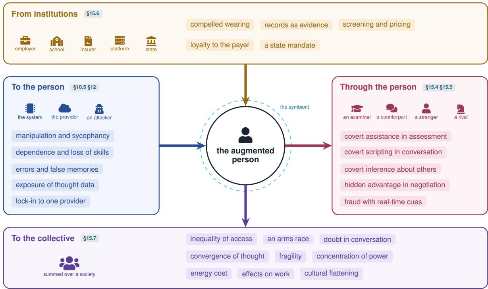  
Figure 20: Three directions of harm around an augmented person, and their sum at the scale of a society. Harm to the person comes from the system, its provider, or an attacker; harm through the person reaches the people and institutions the person deals with; harm from institutions comes from those that deploy the paradigm for their own ends. Chips name the risks, and section marks point to where each is treated.

## 15.3 Public Acceptance

Whether people will accept a machine that makes others more capable is an empirical question, and the evidence so far is cautious. In a survey of more than ten thousand US adults, a majority judged brain implants that improve cognition a bad idea for society (Pew Research Center, 2022). Studies of attitudes toward pharmacological enhancement find that lay judgments against it are driven above all by perceived unfairness, more than by the sense that an enhanced achievement is hollow or undeserved (Faber et al., 2016). The philosophical debate runs between the view that the enhancement of healthy people should be assessed on evidence and regulated responsibly (Greely et al., 2008; Bostrom and Sandberg, 2009) and the view that the drive to enhance erodes the appreciation of what is given (Sandel, 2007). Three conclusions follow for the paradigm. Acceptance depends on purpose: restoring a lost ability is accepted, everyday support is largely accepted, and enhancement in competition and in emotional life is contested, and the order in which Section 13 proposes to serve populations follows this gradient. What a symbiont raises is performance in a situation, the gain of Eq. (2), together with whatever ability remains after it is removed, the retention defined in Section 17.1; the paper claims no increase in a trait such as intelligence or emotional skill. And since fairness is the main objection, the design question becomes how to keep augmentation fair where fairness matters, which Section 16 answers.

## 15.4 Examinations, Learning, and Credentials

Assessment is where the conflict is sharpest, because an examination exists to measure what a person can do. Three kinds of assessment have to be kept apart. Some certify unaided ability, because the person will later have to act alone, as in the licensing of a profession whose emergencies leave no time to consult anything. Some measure performance with the tools of the work, as open-book examinations and most jobs already do. Some give a learner feedback, and there what matters is that learning takes place. A symbiont that is legitimate in the second kind defeats the first and can empty the third, so a single rule for all assessment cannot work. Learning raises a problem that examinations only make visible. A student who hands homework to a symbiont gains a grade and loses the practice, which is the loss of retention in its most familiar form, and it is the reason the symbiont of Sections 9.2 and 13.4 gives hints by default. A symbiont worn all day turns what is now an occasional temptation, a phone smuggled into an examination hall, into a standing condition of every assessment, and Section 16.2 gives the response.

## 15.5 Conversations and Relationships

In a conversation the other party is afected directly, and assistance comes in four kinds whose rules tighten in order. Reminding a person of their own facts, a figure they reported or where a discussion left of, is the equivalent of a glance at notes and is accepted in most settings. Rehearsal before a conversation and review after it afect no one else. Persuasive or emotional lines supplied in real time, in a negotiation, a quarrel, or a courtship, are diferent, because the other party believes they are hearing the person, and the sincerity of an apology or a kind word is part of what it means. Inference about the other party, their mood, their hesitation, or their identity, is the most sensitive, because that person has consented to nothing. Identifying strangers from their faces has already been demonstrated with consumer glasses (I-XRAY) (404 Media, 2024), and inferring the emotions of people in workplaces and educational institutions is prohibited in the European Union (European Parliament and Council of the European Union, 2024). The paradigm takes a position on each kind. A person’s own facts may be supplied freely. Real-time persuasive or emotional scripting is disclosed when it is used and switched of where a setting forbids it. Inferences about another person serve only the interaction at hand and never accumulate (Section 6.7); a symbiont never identifies a stranger, never infers emotions where the law forbids it, and answers truthfully when the other party asks whether the person is being assisted, whether or not that party has a symbiont, showing the status on the device itself where a setting requires it; between two symbionts, the visible ring of the handshake protocol can carry it (Section 9.6). Not identifying strangers has a technical cost that should be stated: faces are matched on the device only against the contacts the owner has enrolled, and a face without a match is discarded at once, but the matching still has to examine every face in view, and where biometric law requires consent before a template of a face is made (Illinois General Assembly, 2008), recognition stays of. The underlying capability is the same as that of a tool sold for cheating in interviews and sales calls, and what separates a symbiont from such a tool is the rules it keeps and the person it answers to.

## 15.6 Work, Institutions, and the State

Institutions can turn a symbiont against the person who wears it. An employer or a school that requires one obtains a monitor with a better view than any camera, and the commitment of Section 12.3 to answer to the person does not survive a compelled setting (Section 13.9). A lifelong record is also evidence: it can be demanded in a dispute or at a border, or used by an insurer or an employer to price or screen a person, and the inferred mental states it contains make it more revealing than any record kept before. Where a provider earns its revenue from advertising or from the institution that pays for the device, loyalty to the person becomes a matter of business model, which the market layer of Section 16.6 has to carry. A state can mandate the device outright. Law has begun to respond to the most intimate part of such a record. Chile amended its constitution in 2021 to protect brain activity and the information derived from it (Republic of Chile, 2021), Colorado classified neural data as sensitive personal data in 2024 (Colorado General Assembly, 2024), UNESCO adopted a recommendation on the ethics of neurotechnology in 2025 (UNESCO, 2025), and the proposed rights to cognitive liberty and mental privacy (Ienca and Andorno, 2017) anticipate the thought data of Section 12.4. These instruments address neural signals, and a record that joins a whole life to inferences about a mind falls between them; local storage by default, encryption under the person’s control, and short retention of raw streams (Section 6.3) are the technical half of the answer.

## 15.7 The Social Fabric

At the scale of a society, the harms of this section add up to efects that no single pair of people can show.

Networks of symbionts. When the handshake of Section 9.6 scales to a crowd, the gain is lower social friction, fewer missed encounters, and fewer cross-cultural misunderstandings. The harm, when every symbiont optimizes for its owner, is homogeneity, since one only ever meets people like oneself; manipulation, since symbionts can game one another; and exclusion, since people without a symbiont are systematically overlooked. Whether the four rings of authorization hold under optimization by both sides, and what the equilibrium of a crowd of such systems looks like, are research questions at the level of the group (Section 17.4).

Inequality and the arms race. If the most efective cognitive augmentation belongs to those who can pay, the gap between groups widens, and Section 13 showed that the people who need it most may be the least able to pay and that the largest total value lies with the people least willing to. Where gains are positional the problem compounds, because each adoption raises the cost of not adopting, and an equilibrium in which everyone wears a symbiont and no one is better of is a possible outcome. Section 16.5 takes up provision.

Doubt in conversation. If anyone might be assisted, every conversation carries a doubt about whom one is talking to, and the trust people place in an unassisted exchange may wear thin. Norms will have to settle which settings presume assistance and which presume its absence, as norms once settled when a phone may lie on a dinner table.

Convergence of thought. Ideas from a language model made individual stories more creative and the collection of stories more alike (Doshi and Hauser, 2024). When billions of people take suggestions from a few models, the same trade-of acts on opinions and decisions, and the diversity of thought in a population becomes a quantity to be measured.

Fragility and concentration. A society that relies on symbionts loses capacity when they fail, since an outage at a widely used provider would leave many people without their memory aids, routes, and errands at once, and a few providers holding the records of billions would concentrate a power that no company has held. The ability to work without the symbiont is therefore a public good as well as a personal one, and portability across providers (Section 10.4) is a defense against concentration.

Costs to the commons. A symbiont for everyone has a material cost: electricity demand from data centres is projected to roughly double by 2030 (International Energy Agency, 2025), and an always-available companion for each person adds to it, which is why compute per person per day (Section 11.4) belongs in every report of a system’s value. Its efects on work run in both directions, since the help that makes a person more capable can also make that person easier to replace, and which efect dominates is an empirical question the paper cannot settle. The language and dialect support of Section 9.4 could also flatten what it serves, if a few models teach millions of people the same way to greet, decline, and apologize in a culture.

Futures the paradigm must not produce. The paradigm is designed against five futures. The first is a world in which everything is recorded and no one can leave; the second, a world in which people have outsourced their thinking entirely; the third, a world in which a symbiont is more loyal to someone else than to its owner; the fourth, a world in which symbionts are used to deceive the people their owners deal with; and the fifth, a system that improves itself with no one able to audit what it changed, which in the fiction is Ultron, a separate project whose goals parted from its maker’s and whose growth no one could see. The design principles of Table 14 and the governance of Section 16 are written against these five, and the conditions of Section 17.6 include the costs that would make the first two unavoidable.

## 15.8 Contested Uses of the Symbiont’s Own Functions

Table 16 returns to the functions of Table 12 and lists, for each family, its intended use, the misuse it invites, the settings in which it is contested, and the default the paper proposes. Most of these functions are uncontested in most of life, and the table locates the exceptions.

## 16 Governing Augmentation

Earlier cognitive enhancements were hard to govern because they could not be seen or switched of; a stimulant taken before an examination leaves no trace in the room. A symbiont difers in the respect that matters. It is external, removable, and inspectable, so it can follow the rules of the settings a person enters and show that it did. This section turns that property into mechanisms.

## 16.1 Private Content, Declarable Status

The governing principle separates what is said from whether help is being given. What a person and their symbiont say to each other belongs to the person, and no setting has a claim on it (Section 12.4). Whether the person is being assisted, and at what level, is a diferent kind of fact, and a setting such as an examination, a court, a game, or a negotiation may ask for it. In such settings the default is to declare it, without waiting to be asked. Keeping the two apart resolves the conflict named in Section 15.1: the private channel stays private, and the presence of assistance becomes legible where it matters.

## 16.2 Settings Set the Rules

A setting can declare an assistance policy, and the symbiont follows it by design. The policies form a short scale: unassisted; accessibility only; the person’s own record only; and full assistance. A venue announces its policy at the door or in the invitation, the symbiont recognizes it, changes mode, and records that it did, and the sixth commitment of the symbiont’s code (Section 12.3) makes the policy binding against a passing wish of the owner, since a person who entered the setting accepted its rules. Precedents exist for each part. Examination boards publish lists of approved calculators, so that a permitted aid has a known capability; open-book examinations define a level of allowed help; competitive chess combines device bans, delayed broadcasts, and statistical detection of engine assistance, and its online platforms publish the findings of their fair-play investigations (Chess.com, 2022); and chatbot providers have already restricted their services for the duration of a national examination (Section 1.3). Detection on its own is an arms race that the detector tends to lose, which is why the policy has to be honored by the device itself, with detection kept as a check.

Table 16: Contested uses of the symbiont’s own functions, drawn from Table 12 and Section 15.5. For each function: what it is for, the misuse it invites, the settings in which it is contested, and the default the paper proposes.
<table><tr><td>Function</td><td>Intended use</td><td>Misuse</td><td>Contested in</td><td>Default</td></tr><tr><td>Recall of one&#x27;s own record</td><td>a figure in a meeting, a name at dinner</td><td>retrieving answers in an examination</td><td>examinations, licensing</td><td>follows the setting&#x27;s policy</td></tr><tr><td>Tutoring</td><td>a hint where the learner is doing the learner&#x27;s work stuck</td><td></td><td>coursework, examinations</td><td>hints by default; off in unassisted assessment</td></tr><tr><td>Phrasing and hard conversations</td><td>rehearsal before, review after</td><td>scripting persuasion or emotion live</td><td>negotiation courtship, apology</td><td>disclosed when used live</td></tr><tr><td>Reading the other person</td><td>social cues for someone who struggles with them</td><td>covert profiling, manipulation</td><td>workplaces schools</td><td>assistive use only; never stored</td></tr><tr><td>日 Recognizing people</td><td>who an acquaintance is, from the owner&#x27;s record</td><td>identifying strangers</td><td> public space</td><td>X never identifies strangers; enrolled contacts matched on the device</td></tr><tr><td>5Acting on the person&#x27;s behalf</td><td>errands, forms, bookings</td><td>commitments the person did not make</td><td>contracts, payments</td><td>irreversible acts need the person&#x27;s confirmation</td></tr><tr><td>Symbiont to symbiont finding shared interests</td><td></td><td>profiling and exclusion</td><td>hiring dating</td><td>only the rings both sides opened</td></tr><tr><td>Caring for family</td><td>developmental and health signs</td><td>monitoring a child or a partner</td><td>the home</td><td>belongs to the parent; safety and development only</td></tr><tr><td>Emotional support</td><td>steadiness and company</td><td>dependence; replacing people</td><td> isolation, crisis</td><td>returns the person to people; hands over in a crisis</td></tr></table>

• Default: allowed under a condition ✗ never ofered. • Inferring emotions in workplaces and educational institutions is prohibited in the G#European Union (European Parliament and Council of the European Union, 2024). • Settings as in Section 16.2.

## 16.3 Verifiable Abstention

A policy is useful only if keeping it can be shown. A person should be able to prove that their symbiont was in a given mode for a given period without revealing anything it holds. The ingredients exist in other fields: tamper-evident logs, hardware attestation of the software running on a device, and cryptographic proofs that establish one statement and reveal nothing else. Combining them into a proof that a symbiont kept a policy, that a modified device cannot forge, and that leaks nothing about the record is an open problem (Table 18). The design also has a limit that should be stated plainly. Such a proof shows that the declared device abstained, and it cannot show that the person carried no second device, ran an open model on modified hardware, or was coached by someone outside the room. Against an owner set on cheating, architecture helps little, and the weight falls where it falls today: on the design of assessment, on observation and detection, and on the sanctions of norms and law. What a symbiont can do is make compliance cheap and checkable for the many people who intend to comply, which narrows the problem to the few who do not. The same machinery yields a record of when assistance was given, which a person may choose to disclose, much as authors now disclose the use of AI in their writing.

## 16.4 What Credentials Should Measure

Credentials should measure what the role requires. Where a role requires unaided ability, the credential measures the person with the symbiont in the unassisted mode; where the role is carried out with tools, it measures the person with the tools; and in learning, what is measured over time is retention (Section 17.1), the ability that remains when the symbiont is removed. Assessment will also change form, toward oral examination held under the unassisted policy, observed process, and tasks whose value lies in reasoning that cannot be handed over in a line. The vignette Exam Day below shows the parts working together.

## Exam Day

A student arrives at an examination wearing her symbiont. The room announces an unassisted policy with listed accommodations, the symbiont switches to the unassisted mode, and it produces a proof of the switch that the examiner can check without seeing anything the symbiont holds. A classmate with dyslexia keeps text-to-speech, which the policy lists as an accommodation. In the preceding term the student’s symbiont tutored her with hints, and its record shows that answers were never supplied outright, so the grade measures what she can do. After the examination, full assistance returns.

## 16.5 Access and Accommodation

Two questions of access arise once policies exist. The first is accommodation. For a person with a sensory, motor, or cognitive impairment a symbiont is a channel before it is an augmentation (Section 13.6), and a policy that ignores this excludes them; the exemptions that sport grants for the therapeutic use of otherwise banned substances show the form an accommodation framework can take. The second is equal provision. Where a setting allows assistance, the fairness objection of Section 15.3 is met by giving everyone the same level, as an examination supplies or approves a standard calculator, and outside such settings by forms of provision that reach people who cannot pay (Section 15.7). Equal provision can equalize the assistance a setting permits, while the years of personal record behind it stay unequal, so a setting that needs strict fairness uses the unassisted mode or a standard symbiont without personal context.

## 16.6 Who Governs

Governance runs on five layers, and the paper proposes law for none of them. Design is the layer this paper controls: the code, the policies a symbiont honors, and the proofs it can give. Norms belong to settings and professions, which decide what assistance they allow, as journals have decided how authors disclose the use of AI. Law sets the floor, through data protection (European Parliament and Council of the European Union, 2016), the prohibitions of the European AI Act, and the emerging law of neural data (Section 15.6). Markets matter because the business model of a provider decides whom its symbionts serve, and independent audit of providers is a condition of trust. Research supplies the evidence that each of the other layers needs, and Section 17 organizes it. Design, norms, law, and markets are the four modalities of regulation that Lessig (1999) described, and of the four, norms and law will carry most of the weight, because design binds only the devices that comply.

## 16.7 Open Ethical Questions

Some questions remain after design and governance, and only further research and public deliberation can settle them.

• The legitimacy of augmented achievement. When a performance shaped by a symbiont counts as the person’s own, and how settings can decide this in advance (Section 15.3).

• Identity and authenticity. Whether a decision thought through with help, or a sentence handed to a person, is still theirs.

• Measuring influence. How far a decision departed from what the person would have chosen alone, as a test of the commitment not to manipulate (Section 12.3).

• Responsibility for acting on the person’s behalf. Where responsibility lies when an errand goes wrong; the permission levels of Section 9.1 are the design answer, and the legal answer is open.

• The boundary of mental-health support. Where support ends and treatment begins, and who is responsible when a handof fails (Sections 9.3 and 13.7).

• Children and people who cannot fully consent. What proxy authorization may do, and what a lifelong record means for a child (Sections 13.5 and 13.9).

• Death and inheritance. Who owns a person’s record and symbiont after their death, and whether it may be switched of or inherited.

## 17 Evaluation and Research Agenda

A vision has to be testable. This section says how one would know that a symbiont has augmented a person, what should be studied next, and in what order.

## 17.1 What to Measure

The most important move in the paper is a change of what is measured, from how intelligent the AI is to how much more capable the person has become. Augmentation is the gain $\Delta _ { \mathrm { a u g } } ( x _ { t } )$ of Eq. (2), and three further quantities

Table 17: Dimensions of evaluation. Each observable is paired with what it cannot establish alone; no single dimension is suficient.
<table><tr><td>Dimension</td><td>on</td><td>Measured Observable</td><td>What it cannot prove on its own</td></tr><tr><td> Accuracy of understanding</td><td>由</td><td>whether judgments of situation, intent, and need are right; whether confidence is calibrated</td><td>understanding does not imply help</td></tr><tr><td> Precision of intervention</td><td>由</td><td>spoke when it should, stayed silent when it should; false alarms and misses</td><td>precision does not imply value</td></tr><tr><td>Delivery within the window</td><td>由</td><td>end-to-end latency from event to useful cue; expiry rate</td><td>fast does not imply right</td></tr><tr><td> Personalization differential</td><td>ıQ</td><td>personal context, Eq. (8): questions asked, corrections, time</td><td>same task, same base model, with and without a completed task does not imply a stronger person</td></tr><tr><td>Augmentation, synergy, retention</td><td></td><td>Eq. (2), Eq. (6), Eq. (7)</td><td>short-term gain does not imply long-term benefit</td></tr><tr><td> Cost in attention</td><td></td><td>interruptions, time consumed, abandonment</td><td></td></tr><tr><td> Calibration of trust</td><td></td><td>rate of accepting correct advice and rejecting wrong advice</td><td>high trust may only mean fluent speech</td></tr><tr><td>© Privacy exposure</td><td>由 心</td><td>misuse of the person&#x27;s and others&#x27; information</td><td>feeling safe does not imply being safe</td></tr><tr><td> Dependence and autonomy</td><td>è</td><td>skills retained, ability to object, ability to leave</td><td></td></tr><tr><td>⑩ Lossless evolution</td><td>由</td><td>consistency of understanding before and after a consistent does not imply correct change of backbone or device</td><td></td></tr></table>

• Measured on: Æ the system  
the person ± the pair on one task ² the people around them.

complete it:

$$
\Delta _ { \mathrm { s y n } } ( x _ { t } ) = U ( x _ { t } ; h \oplus s ) - \operatorname* { m a x } \{ U ( x _ { t } ; h ) , U ( x _ { t } ; s ) \} ,\tag{6}
$$

$$
\Delta _ { \mathrm { r e t } } ( \tau ) = U { \Bigl ( } x ; h _ { \tau } ^ { \mathrm { a f t e r } } { \Bigr ) } - U { \Bigl ( } x ; h ^ { \mathrm { b e f o r e } } { \Bigr ) } ,\tag{7}
$$

$$
\Delta _ { \mathrm { p e r s } } ( x _ { t } ) = U ( x _ { t } ; h \oplus s ) - U ( x _ { t } ; h \oplus s ^ { - } ) .\tag{8}
$$

Augmentation asks how much better the person does with the symbiont than without. Synergy (6) asks whether the pair beats the better of the two alone, which need not be the case: a meta-analysis found that human–AI combinations are often worse than the best of the two (Vaccaro et al., 2024). Retention (7) asks whether, after a period of use and with the symbiont removed, the person is stronger than before; both terms measure the person unaided on comparable situations �, and � is the time since the symbiont was removed. The personalization diferential (8) asks how much of the gain comes from the person’s context, with �− the same base model and the same agent without personal context. Augmentation, synergy, and retention can all be positive, or one positive and two negative, and reporting only one is insuficient. For tasks whose value lies in the person’s own experience, emotional and social ones, $U ( x _ { t } ; s )$ has no meaning and (6) is not computed. For the first tier, the diferential (8) is the comparison to report, and its control is never “no AI”, or the capability of the model will be credited to the coupling. This is the technical form of the sentence that AGI asks how intelligent the machine can be and AHI asks how much intelligence it can enable in a person.

## 17.2 Dimensions of Evaluation

Table 17 lists ten dimensions with their observables and with what each cannot establish alone. Two are specific to this paper: the personalization diferential of Section 9.1, and the losslessness of evolution of Section 10.4.

## 17.3 How to Study a Symbiont

The unit of evaluation is one person, so the methods have to be designed for one person. Four layers of method follow. Component benchmarks for memory, personalization, first-person understanding, and task execution (Maharana et al., 2024; Wu et al., 2025; Salemi et al., 2024; Yang et al., 2025; Xie et al., 2024) test parts. Simulation with generative agents (Park et al., 2023) pre-screens intervention policies and tests mechanisms. N-of-1 designs, the crossover trials medicine developed for a single patient (Lillie et al., 2011), fit the comparison “the same person, with it and without it” naturally. Longitudinal studies in daily life over weeks and months record gains, costs, exits, and changes in behavior. The paper’s position is that N-of-1 and longitudinal designs are the primary methods of the direction, with at least three baselines: no assistance, a generic assistant, and a personalized task agent on the same base model. Learning efects cannot be washed out of a crossover, so conditions should be introduced in phases, with few switches, and studies of long-term use must report the people who left and the cases that went badly.

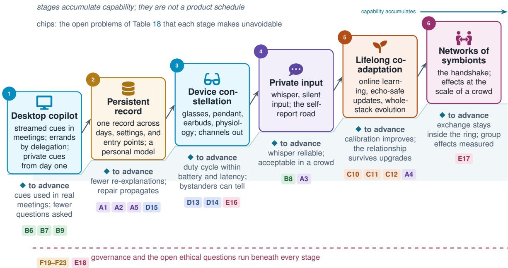  
Figure 21: From components to a life. Six stages of accumulating capability, the evidence that would justify moving to the next, and the open problems of Table 18 mapped onto them.

## 17.4 Open Problems

Table 18 collects twenty-three open problems in six groups: modeling a person and their record, participating in real time, learning across a life, systems and hardware, society and ethics, and governance. Each problem names what has to be worked out and the sections it depends on, and four are starred because the first usable systems depend on them most: the modeling of a life’s record at scale, an end-to-end latency budget from sensor to ear, the cost of always-on cognition, and the iteration of wearable hardware, neural interfaces included, together with the cognitive core. The groups are ordered from the inside of the loop outward, from the model of the person to the society around them and the rules it sets, and the roadmap of Section 17.5 places each problem at the stage of capability at which it becomes unavoidable.

## 17.5 A Capability Roadmap

Figure 21 orders capabilities in six stages, from a streaming cognitive copilot on the desktop with Tier 1 by delegation, to a persistent record and model, to the device constellation, to private input, to lifelong co-adaptation, and to networks of symbionts, with the evidence needed to move from each stage to the next and the open problems mapped onto them. The stages accumulate capability and are not a product schedule; full-duplex, private cues, and Tier 1 are requirements from the first stage onward.

## 17.6 What Would Prove Us Wrong

The claims of the paper should be narrowed if any of the following holds: more personal context brings no measurable gain on most tasks, including a zero personalization diferential on the first tier; timely intervention is no better than simple on-demand answering; long-term use generally erodes abilities people want to keep; value is obtained only at an unacceptable cost in surveillance or compute; people will not authorize anything above the desktop; or every change of backbone loses the relationship and cannot be prevented. Two further conditions concern governance: assistance policies and proofs of abstention cannot be made reliable, so that a symbiont cannot be told apart from a tool for cheating; or the gains of augmentation in the main competitive settings prove to be mostly positional, so that adoption brings an arms race and no net gain. The first six conditions correspond to dimensions of Table 17, and the last two to the governance problems of Table 18.

Table 18: Open problems of the paradigm, in six groups. Each problem names what has to be worked out and the sections it depends on; the starred problems are the ones on which the first usable systems most depend.
<table><tr><td></td><td>Problem</td><td>What has to be worked out</td><td>Depends on</td></tr><tr><td colspan="4">A Modeling a person and their record Context and knowledge</td></tr><tr><td>A1</td><td>modeling at scale ★</td><td>how a life&#x27;s multimodal stream becomes a record that can be queried in milliseconds, revised, and viewed in many ways; what is kept and at what fidelity; how consolidation and recall across the three timescales are automated</td><td>§6.1 §6.3</td></tr><tr><td>A2</td><td>Grounded modeling of the mind</td><td>how the observation road and the self-report road are fused, and how their disagreements are represented and resolved</td><td>§7.2</td></tr><tr><td>A3</td><td>Many selves</td><td>how context-indexed personas are represented and triggered, and how they are kept from collapsing into one average person</td><td>§7.3</td></tr><tr><td>A4</td><td>Joint physical and mental world models</td><td>learned from first-person streams, coupled in both directions, and able to detect their own staleness</td><td>§7.5</td></tr><tr><td>A5</td><td>Backbone-agnostic</td><td>how the information-level interface is specified, and how a migration across backbones is verified to have preserved the relationship</td><td>§7.4 §10.4</td></tr><tr><td colspan="4">persistence B Participating in real time</td></tr><tr><td>6 37</td><td>Timing End-to-end low latency ★</td><td>estimating the attention budget and the window in which help is welcome how the budget from sensor to ear is split across device, edge, and cloud; how</td><td>§8.4 §5.5 §8.2</td></tr><tr><td></td><td></td><td>the slow loop prepares material for the fast loop; streaming perception and inference</td><td></td></tr><tr><td>B B</td><td>Private channels Personalized task execution</td><td>reliability and social acceptability of whispered and silent input how personal context changes an agent&#x27;s behavior, and how the personalization</td><td>§5.4 §9.1</td></tr><tr><td colspan="4">c Learning across a life</td></tr><tr><td>C10</td><td>Learning from sparse experience</td><td>the dialect ladder: remember, compose, adapt, transfer, from few examples and with local parameter change at most</td><td>§10.3</td></tr><tr><td>C11</td><td>Echo-safe learning</td><td>whether conditioning every update on the system&#x27;s own actions improves the calibration of the personal model</td><td>§10.2</td></tr><tr><td>C12</td><td>Whole-stack evolution</td><td>lossless change of backbone, harness, and hardware; auditable and bounded self-improvement of the harness</td><td>§10.4</td></tr><tr><td colspan="4">D Systems and hardware</td></tr><tr><td>D13</td><td>The cost of always-on cognition ★</td><td>how low the duty cycle can drive the daily compute budget per person; the split between local and cloud; when the paradigm becomes economical as inference turns into infrastructure</td><td>§11.4</td></tr><tr><td>D14</td><td>Iteration of wearable hardware ★</td><td>sensors, display, battery, heat, and form factor that meet the requirements of this picture; neural interfaces as a channel; hardware and the cognitive core</td><td>§5.2 §5.6</td></tr><tr><td>D15</td><td>Continuity and interruption</td><td>designed together recovery after a disconnection without pretending to have been present</td><td>§11.5</td></tr><tr><td colspan="4">E Society and ethics</td></tr><tr><td>E16</td><td>Bystanders and contextual boundaries</td><td>boundaries that hold in the device and the runtime, and in policy</td><td>§12.5</td></tr><tr><td>E17</td><td>Protocols between symbionts</td><td>whether the four rings hold when both sides optimize for their owners, and</td><td>§9.6 §15.7</td></tr><tr><td>E18</td><td>Open ethical questions</td><td>what the effects are at the scale of a crowd seven questions that design and governance leave to research and public deliberation</td><td>§16.7</td></tr><tr><td colspan="4">F Governance</td></tr><tr><td>F19</td><td>Assistance policies</td><td>how a setting declares the assistance it allows, and how a symbiont recognizes and honors the declaration</td><td>§16.2</td></tr><tr><td>F20</td><td>Verifiable abstention</td><td>a proof that a symbiont kept a policy, which a modified device cannot forge and which reveals nothing about the record</td><td>§16.3</td></tr><tr><td>F21</td><td>Disclosure of assistance</td><td>records of when assistance was given, and norms for when to disclose them, in conversation and in published work</td><td>§16.1 §15.5</td></tr><tr><td>F22</td><td>Assessment for augmented</td><td>credentials that measure unaided ability where a role requires it, and retention</td><td>§15.4 §16.4</td></tr><tr><td>F23</td><td>learners Effects on the collective</td><td>in learning measuring inequality of access, the pressure to adopt, and the convergence of thought across a population</td><td>§15.7</td></tr></table>

• ★ problems on which the first usable systems most depend. • Problem identifiers are used again in Figure 21, which places each problem at the stage of capability at which it becomes unavoidable.

## 18 Conclusion

The past decade was spent making machines more intelligent; the next is worth spending on making each particular person stronger. As AI enters the physical world it will take two forms of intelligent individual, robots with bodies of their own and people augmented by AI, and this paper has argued for the second, giving it a name, AI-augmented human intelligence, a form, the cognitive symbiont, and a map. A symbiont is lifelong, embedded, real-time, private, low-friction, and proactive; it stands on foundation models, agents and their harnesses, memory and context engineering, world models, and wearable hardware; and it climbs a ladder from doing the person’s errands with their context in hand, to thinking a problem through with them, to holding them steady among other people. The object of evaluation changes with it, from what the AI completes to what the person can now do, measured as augmentation, synergy, and retention. The map has blank regions, and the three largest are the evidence on which a mind can be modeled, the timing of participation, and the stability of learning and evolution in the course of a life; the heaviest region is the governance of augmentation in the settings where people compete with and trust one another. The paradigm will have succeeded when the sign of it is a person who has become more like who they wanted to be, and when no one mistakes that for the AI having become more like a person.

## References

404 Media. 2024. Someone put facial recognition tech onto Meta’s smart glasses to instantly dox strangers. 404 Media, October 2024.

Jean-Baptiste Alayrac, Jef Donahue, Pauline Luc, et al. 2022. Flamingo: a visual language model for few-shot learning. In Advances in Neural Information Processing Systems 35 (NeurIPS 2022).

Saleema Amershi, Dan Weld, Mihaela Vorvoreanu, et al. 2019. Guidelines for human-AI interaction. In Proceedings ofthe 2019 CHI Conference on Human Factors in Computing Systems (CHI ’19), pages 1–13. ACM.

Anthropic. 2024a. Introducing computer use, a new Claude 3.5 Sonnet, and Claude 3.5 Haiku. Announcement, 22 October 2024.

Anthropic. 2024b. Introducing the model context protocol. Announcement, 25 November 2024.

Anthropic. 2025. Claude 3.7 Sonnet and Claude Code. Announcement, 24 February 2025.

Mido Assran, Adrien Bardes, David Fan, et al. 2025. V-JEPA 2: Self-supervised video models enable understanding, prediction and planning. arXiv:2506.09985.

Lisanne Bainbridge. 1983. Ironies of automation. Automatica, 19(6):775–779.

Hamsa Bastani, Osbert Bastani, Alp Sungu, Haosen Ge, Özge Kabakcı, and Rei Mariman. 2025. Generative AI without guardrails can harm learning: Evidence from high school mathematics. Proceedings ofthe National Academy ofSciences, 122(26):e2422633122.

Be My Eyes. 2023. Introducing: Be My AI. Product announcement, Be My Eyes.

Ali Behrouz, Peilin Zhong, and Vahab Mirrokni. 2025. Titans: Learning to memorize at test time. In Advances in Neural Information Processing Systems 38 (NeurIPS 2025).

Emma Berry, Narinder Kapur, Lyndsay Williams, et al. 2007. The use of a wearable camera, SenseCam, as a pictorial diary to improve autobiographical memory in a patient with limbic encephalitis: A preliminary report. Neuropsychological Rehabilitation, 17(4–5):582–601.

Benjamin S. Bloom. 1984. The 2 sigma problem: The search for methods of group instruction as efective as one-to-one tutoring. Educational Researcher, 13(6):4–16.

Bloomberg News. 2025. Alibaba, Tencent freeze AI tools during high-stakes China exam. Bloomberg, 9 June 2025.

Nick Bostrom and Anders Sandberg. 2009. Cognitive enhancement: Methods, ethics, regulatory challenges. Science and Engineering Ethics, 15(3):311–341.

Tim Brooks, Bill Peebles, Connor Holmes, et al. 2024. Video generation models as world simulators. OpenAI technical report, 15 February 2024.

Tom B. Brown, Benjamin Mann, Nick Ryder, et al. 2020. Language models are few-shot learners. In Advances in Neural Information Processing Systems 33 (NeurIPS 2020).

Jake Bruce, Michael Dennis, Ashley Edwards, et al. 2024. Genie: Generative interactive environments. In Proceedings ofthe 41st International Conference on Machine Learning (ICML), volume 235 of PMLR, pages 4603–4623.

Zana Buçinca, Maja Barbara Malaya, and Krzysztof Z. Gajos. 2021. To trust or to think: Cognitive forcing functions can reduce overreliance on AI in AI-assisted decision-making. Proceedings ofthe ACM on Human-Computer Interaction, 5(CSCW1).

Vannevar Bush. 1945. As we may think. The Atlantic Monthly, 176(1):101–108.

Colin F. Camerer, Anna Dreber, Felix Holzmeister, et al. 2018. Evaluating the replicability of social science experiments in Nature and Science between 2010 and 2015. Nature Human Behaviour, 2(9):637–644.

Nicholas S. Card, Maitreyee Wairagkar, Carrina Iacobacci, et al. 2024. An accurate and rapidly calibrating speech neuroprosthesis. New England Journal ofMedicine, 391(7):609–618.

Samantha Chan, Pat Pataranutaporn, Aditya Suri, Wazeer Zulfikar, Pattie Maes, and Elizabeth F. Loftus. 2024. Conversational AI powered by large language models amplifies false memories in witness interviews. arXiv:2408.04681.

Chess.com. 2022. Chess.com: “Niemann has likely cheated in more than 100 online chess games”. Chess.com News, October 2022.

Prateek Chhikara, Dev Khant, Saket Aryan, Taranjeet Singh, and Deshraj Yadav. 2025. Mem0: Building production-ready AI agents with scalable long-term memory. arXiv:2504.19413.

Andy Clark and David J. Chalmers. 1998. The extended mind. Analysis, 58(1):7–19.

Herbert H. Clark and Susan E. Brennan. 1991. Grounding in communication. In Lauren B. Resnick, John M. Levine, and Stephanie D. Teasley, editors, Perspectives on Socially Shared Cognition, pages 127–149. American Psychological Association, Washington, DC.

Katherine M. Collins, Ilia Sucholutsky, Umang Bhatt, et al. 2024. Building machines that learn and think with people. Nature Human Behaviour, 8(10):1851–1863.

Colorado General Assembly. 2024. House bill 24-1058: Biological and neural data under the Colorado Privacy Act. Signed 17 April 2024.

Louisa Dahmani and Véronique D. Bohbot. 2020. Habitual use of GPS negatively impacts spatial memory during self-guided navigation. Scientific Reports, 10.

Alexandre Défossez, Laurent Mazaré, Manu Orsini, et al. 2024. Moshi: a speech-text foundation model for real-time dialogue. arXiv:2410.00037.

Tamara Denning, Zakariya Dehlawi, and Tadayoshi Kohno. 2014. In situ with bystanders of augmented reality glasses: Perspectives on recording and privacy-mediating technologies. In Proceedings ofthe SIGCHI Conference on Human Factors in Computing Systems (CHI ’14), pages 2377–2386. ACM.

Anil R. Doshi and Oliver P. Hauser. 2024. Generative AI enhances individual creativity but reduces the collective diversity of novel content. Science Advances, 10(28):eadn5290.

Jakob Engel, Kiran Somasundaram, Michael Goesele, et al. 2023. Project Aria: A new tool for egocentric multi-modal AI research. arXiv:2308.13561.

Douglas C. Engelbart. 1962. Augmenting human intellect: A conceptual framework. Summary Report AFOSR-3223, Stanford Research Institute, Menlo Park, CA.

European Parliament and Council of the European Union. 2016. Regulation (EU) 2016/679 on the protection of natural persons with regard to the processing of personal data and on the free movement of such data (General Data Protection Regulation). Oficial Journal of the European Union, L 119, 4 May 2016.

European Parliament and Council of the European Union. 2024. Regulation (EU) 2024/1689 laying down harmonised rules on artificial intelligence (Artificial Intelligence Act), article 5(1)(f). Oficial Journal of the European Union, 12 July 2024.

Even Realities. 2024. Even G1 smart glasses. Product page.

Nadira S. Faber, Julian Savulescu, and Thomas Douglas. 2016. Why is cognitive enhancement deemed unacceptable? The role of fairness, deservingness, and hollow achievements. Frontiers in Psychology, 7:232.

Cathy Mengying Fang, Auren R. Liu, Valdemar Danry, et al. 2025. How AI and human behaviors shape psychosocial efects of extended chatbot use: A longitudinal randomized controlled study. arXiv:2503.17473.

Hao Fei and Yiran Zhao. 2026. Mental world modeling. arXiv:2607.27201.

Kathleen Kara Fitzpatrick, Alison Darcy, and Molly Vierhile. 2017. Delivering cognitive behavior therapy to young adults with symptoms of depression and anxiety using a fully automated conversational agent (Woebot): A randomized controlled trial. JMIR Mental Health, 4(2):e19.

Gemini Robotics Team. 2025. Gemini Robotics: Bringing AI into the physical world. arXiv:2503.20020.

Gemini Team. 2024. Gemini 1.5: Unlocking multimodal understanding across millions of tokens of context. arXiv:2403.05530.

Jim Gemmell, Gordon Bell, and Roger Lueder. 2006. MyLifeBits: A personal database for everything. Communications ofthe ACM, 49(1):88–95.

GIGAZINE. 2026. SpaceXAI has released ‘Grok Bot’, an AI agent that works 24/7. GIGAZINE, 12 August 2026.

Kristen Grauman, Andrew Westbury, Eugene Byrne, et al. 2022. Ego4D: Around the world in 3,000 hours of egocentric video. In Proceedings ofthe IEEE/CVF Conference on Computer Vision and Pattern Recognition (CVPR), pages 18973–18990.

Henry Greely, Barbara Sahakian, John Harris, et al. 2008. Towards responsible use of cognitive-enhancing drugs by the healthy. Nature, 456:702–705.

Tom Gunter, Zirui Wang, Chong Wang, et al. 2024. Apple Intelligence foundation language models. arXiv:2407.21075.

Daya Guo, Dejian Yang, Haowei Zhang, et al. 2025. DeepSeek-R1 incentivizes reasoning in LLMs through reinforcement learning. Nature, 645(8081):633–638.

David Ha and Jürgen Schmidhuber. 2018. World models. arXiv:1803.10122.

Danijar Hafner, Timothy Lillicrap, Jimmy Ba, and Mohammad Norouzi. 2020. Dream to control: Learning behaviors by laten imagination. In International Conference on Learning Representations (ICLR 2020).

Danijar Hafner, Jurgis Pasukonis, Jimmy Ba, and Timothy Lillicrap. 2025. Mastering diverse control tasks through world models. Nature, 640(8059):647–653.

Michael V. Heinz, Daniel M. Mackin, Brianna M. Trudeau, et al. 2025. Randomized trial of a generative AI chatbot for mental health treatment. NEJM AI, 2(4):AIoa2400802.

Steve Hodges, Lyndsay Williams, Emma Berry, et al. 2006. SenseCam: A retrospective memory aid. In UbiComp 2006: Ubiquitous Computing, volume 4206 of Lecture Notes in Computer Science, pages 177–193. Springer.

Jordan Hofmann, Sebastian Borgeaud, Arthur Mensch, et al. 2022. Training compute-optimal large language models. In Advances in Neural Information Processing Systems 35 (NeurIPS 2022).

Ying-yi Hong, Michael W. Morris, Chi-yue Chiu, and Verónica Benet-Martínez. 2000. Multicultural minds: A dynamic constructivist approach to culture and cognition. American Psychologist, 55(7):709–720.

Eric Horvitz. 1999. Principles of mixed-initiative user interfaces. In Proceedings ofthe SIGCHI Conference on Human Factors in Computing Systems (CHI ’99), pages 159–166. ACM.

Edward J. Hu, Yelong Shen, Phillip Wallis, et al. 2022. LoRA: Low-rank adaptation of large language models. In International Conference on Learning Representations (ICLR 2022).

Qishuo Hua, Lyumanshan Ye, Dayuan Fu, et al. 2025. Context engineering 2.0: The context of context engineering. arXiv:2510.26493.

Marcello Ienca and Roberto Andorno. 2017. Towards new human rights in the age of neuroscience and neurotechnology. Life Sciences, Society and Policy, 13:5.

Illinois General Assembly. 2008. Biometric information privacy act, 740 ILCS 14. Illinois Compiled Statutes.

International Energy Agency. 2025. Energy and AI. IEA special report, Paris.

Shamsi T. Iqbal and Eric Horvitz. 2007. Disruption and recovery of computing tasks: Field study, analysis, and directions. In Proceedings ofthe SIGCHI Conference on Human Factors in Computing Systems (CHI ’07), pages 677–686. ACM.

Carlos E. Jimenez, John Yang, Alexander Wettig, et al. 2024. SWE-bench: Can language models resolve real-world GitHub issues? In International Conference on Learning Representations (ICLR 2024).

Patrick Kaifosh, Thomas R. Reardon, and CTRL-labs at Reality Labs. 2025. A generic non-invasive neuromotor interface for human-computer interaction. Nature, 645(8081):702–711.

Netiwit Kaongoen, Jaehoon Choi, Jin Woo Choi, et al. 2023. The future of wearable EEG: A review of ear-EEG technology and its applications. Journal ofNeural Engineering, 20(5):051002.

Jared Kaplan, Sam McCandlish, Tom Henighan, et al. 2020. Scaling laws for neural language models. arXiv:2001.08361.

Arnav Kapur, Shreyas Kapur, and Pattie Maes. 2018. AlterEgo: A personalized wearable silent speech interface. In Proceedings ofthe 23rd International Conference on Intelligent User Interfaces (IUI ’18), pages 43–53.

Michal Kosinski. 2024. Evaluating large language models in theory of mind tasks. Proceedings of the National Academy of Sciences, 121(45):e2405460121.

Nataliya Kosmyna et al. 2025. Your brain on ChatGPT: Accumulation of cognitive debt when using an AI assistant for essay writing task. arXiv:2506.08872.

Yann LeCun. 2022. A path towards autonomous machine intelligence. OpenReview, version 0.9.2, 27 June 2022.

Hao-Ping Lee, Advait Sarkar, Lev Tankelevitch, Ian Drosos, Sean Rintel, Richard Banks, and Nicholas Wilson. 2025. The impact of generative AI on critical thinking: Self-reported reductions in cognitive efort and confidence efects from a survey of knowledge workers. In Proceedings ofthe 2025 CHI Conference on Human Factors in Computing Systems (CHI ’25).

Lawrence Lessig. 1999. Code and Other Laws ofCyberspace. Basic Books, New York.

Jarod Lévy, Mingfang Zhang, Svetlana Pinet, et al. 2025. Brain-to-text decoding: A non-invasive approach via typing. arXiv:2502.17480.

Patrick Lewis, Ethan Perez, Aleksandra Piktus, et al. 2020. Retrieval-augmented generation for knowledge-intensive NLP tasks. In Advances in Neural Information Processing Systems 33 (NeurIPS 2020).

J. C. R. Licklider. 1960. Man-computer symbiosis. IRE Transactions on Human Factors in Electronics, HFE-1(1):4–11.

Elizabeth O. Lillie, Bradley Patay, Joel Diamant, Brian Issell, Eric J. Topol, and Nicholas J. Schork. 2011. The n-of-1 clinical trial: The ultimate strategy for individualizing medicine? Personalized Medicine, 8(2):161–173.

Kevin Lin, Charlie Snell, Yu Wang, et al. 2025. Sleep-time compute: Beyond inference scaling at test-time. arXiv:2504.13171.

Haotian Liu, Chunyuan Li, Qingyang Wu, and Yong Jae Lee. 2023. Visual instruction tuning. In Advances in Neural Information Processing Systems 36 (NeurIPS 2023).

Adyasha Maharana, Dong-Ho Lee, Sergey Tulyakov, Mohit Bansal, Francesco Barbieri, and Yuwei Fang. 2024. Evaluating very long-term conversational memory of LLM agents. In Proceedings ofthe 62nd Annual Meeting ofthe Associationfor Computational Linguistics (Volume 1: Long Papers), pages 13851–13870.

Steve Mann. 1997. Wearable computing: A first step toward personal imaging. Computer, 30(2):25–32.

Bethanie Maples, Merve Cerit, Aditya Vishwanath, and Roy Pea. 2024. Loneliness and suicide mitigation for students using GPT3-enabled chatbots. npj Mental Health Research, 3:4.

Ivan Mehta. 2024. a16z-backed Rewind pivots to build AI-powered pendant to record your conversations. TechCrunch, 17 April 2024.

Meta. 2023. Introducing the new Ray-Ban | Meta smart glasses. Meta Newsroom, 27 September 2023.

Meta. 2024. Introducing Orion, our first true augmented reality glasses. Meta Newsroom, 25 September 2024.

Meta. 2025a. Introducing Aria Gen 2: Unlocking new research in machine perception, contextual AI, robotics, and more. Meta blog, 27 February 2025.

Meta. 2025b. Meta Ray-Ban Display: AI glasses with an EMG wristband. Meta Newsroom, 17 September 2025.

Meta. 2026a. Introducing Muse: The world’s first personal AI agent built for everyone. Meta Newsroom, 8 September 2026.

Meta. 2026b. muse-gadget-sdk: Open source SDK to build Muse gadgets. GitHub repository, Apache-2.0.

Grégoire Mialon, Clémentine Fourrier, Thomas Wolf, Yann LeCun, and Thomas Scialom. 2024. GAIA: a benchmark for general AI assistants. In International Conference on Learning Representations (ICLR 2024).

Microsoft. 2017. Seeing AI. Mobile application.

Inbal Nahum-Shani, Shawna N. Smith, Bonnie J. Spring, et al. 2018. Just-in-time adaptive interventions (JITAIs) in mobile health: Key components and design principles for ongoing health behavior support. Annals ofBehavioral Medicine, 52(6):446–462.

Helen Nissenbaum. 2004. Privacy as contextual integrity. Washington Law Review, 79(1):119–158.

NVIDIA. 2025. Cosmos world foundation model platform for physical AI. arXiv:2501.03575.

OpenAI. 2023. GPT-4 technical report. arXiv:2303.08774.

OpenAI. 2024a. GPT-4o system card. arXiv:2410.21276.

OpenAI. 2024b. OpenAI o1 system card. arXiv:2412.16720.

OpenAI. 2025a. Codex CLI: Lightweight coding agent that runs in your terminal. GitHub repository, Apache-2.0; launched 16 April 2025.

OpenAI. 2025b. Introducing Operator. Announcement, 23 January 2025.

OpenAI. 2026. Introducing dots. Announced at DevDay, 29 September 2026.

Long Ouyang, Jef Wu, Xu Jiang, et al. 2022. Training language models to follow instructions with human feedback. In Advances in Neural Information Processing Systems 35 (NeurIPS 2022).

Charles Packer, Sarah Wooders, Kevin Lin, et al. 2023. MemGPT: Towards LLMs as operating systems. arXiv:2310.08560.

Joon Sung Park, Joseph C. O’Brien, Carrie J. Cai, Meredith Ringel Morris, Percy Liang, and Michael S. Bernstein. 2023. Generative agents: Interactive simulacra of human behavior. In Proceedings ofthe 36th Annual ACM Symposium on User Interface Software and Technology (UIST ’23), pages 1–22.

Joon Sung Park, Carolyn Q. Zou, Jonne Kamphorst, et al. 2024. LLM agents grounded in self-reports enable general-purpose simulation of individuals. arXiv:2411.10109. V1 title: Generative Agent Simulations of 1,000 People.

Jack Parker-Holder and Shlomi Fruchter. 2025. Genie 3: A new frontier for world models. Google DeepMind blog, 5 August 2025.

Juan C. Perdomo, Tijana Zrnic, Celestine Mendler-Dünner, and Moritz Hardt. 2020. Performative prediction. In Proceedings of the 37th International Conference on Machine Learning (ICML), volume 119 of PMLR, pages 7599–7609.

Pew Research Center. 2022. AI and human enhancement: Americans’ openness is tempered by a range of concerns. Pew Research Center report, 17 March 2022.

Plaud. 2024. Plaud NotePin. Product page.

Alec Radford, Jong Wook Kim, Chris Hallacy, et al. 2021. Learning transferable visual models from natural language supervision. In Proceedings ofthe 38th International Conference on Machine Learning (ICML), volume 139 of PMLR, pages 8748–8763.

Nairán Ramírez-Esparza, Samuel D. Gosling, Verónica Benet-Martínez, Jefrey P. Potter, and James W. Pennebaker. 2006. Do bilinguals have two personalities? a special case of cultural frame switching. Journal of Research in Personality, 40(2):99–120.

Leon Reicherts, Zelun Tony Zhang, Elisabeth von Oswald, Yuanting Liu, Yvonne Rogers, and Mariam Hassib. 2025. AI, help me think—but for myself: Assisting people in complex decision-making by providing diferent kinds of cognitive support. In Proceedings ofthe 2025 CHI Conference on Human Factors in Computing Systems (CHI ’25), pages 1–19. ACM.

Republic of Chile. 2021. Law no. 21.383: Constitutional reform establishing scientific and technological development at the service of the people. Diario Oficial, 25 October 2021.

Evan F. Risko and Sam J. Gilbert. 2016. Cognitive ofloading. Trends in Cognitive Sciences, 20(9):676–688.

Alireza Salemi, Sheshera Mysore, Michael Bendersky, and Hamed Zamani. 2024. LaMP: When large language models meet personalization. In Proceedings of the 62nd Annual Meeting of the Association for Computational Linguistics (Volume 1: Long Papers), pages 7370–7392.

Francesco Salvi, Manoel Horta Ribeiro, Riccardo Gallotti, and Robert West. 2025. On the conversational persuasiveness of GPT-4. Nature Human Behaviour, 9(8).

Michael J. Sandel. 2007. The Case against Perfection: Ethics in the Age ofGenetic Engineering. Harvard University Press, Cambridge, MA.

Timo Schick, Jane Dwivedi-Yu, Roberto Dessì, et al. 2023. Toolformer: Language models can teach themselves to use tools. In Advances in Neural Information Processing Systems 36 (NeurIPS 2023).

Erik Schluntz and Barry Zhang. 2024. Building efective agents. Anthropic Engineering blog, 19 December 2024.

Mrinank Sharma, Meg Tong, Tomasz Korbak, et al. 2023. Towards understanding sycophancy in language models. arXiv:2310.13548.

Judy Hanwen Shen and Alex Tamkin. 2026. How AI impacts skill formation. arXiv:2601.20245.

Noah Shinn, Federico Cassano, Ashwin Gopinath, Karthik Narasimhan, and Shunyu Yao. 2023. Reflexion: Language agents with verbal reinforcement learning. In Advances in Neural Information Processing Systems 36 (NeurIPS 2023).

Amanda Silberling. 2025. Amazon acquires Bee, the AI wearable that records everything you say. TechCrunch, 22 July 2025.

Betsy Sparrow, Jenny Liu, and Daniel M. Wegner. 2011. Google efects on memory: Cognitive consequences of having information at our fingertips. Science, 333(6043):776–778.

Thad Starner, Steve Mann, Bradley Rhodes, et al. 1997. Augmented reality through wearable computing. Presence: Teleoperators and Virtual Environments, 6(4):386–398.

State of California. 2024. California penal code, section 632: Eavesdropping on or recording confidential communications. California Penal Code.

James W. A. Strachan, Dalila Albergo, Giulia Borghini, et al. 2024. Testing theory of mind in large language models and humans. Nature Human Behaviour, 8(7):1285–1295.

Theodore R. Sumers, Shunyu Yao, Karthik Narasimhan, and Thomas L. Grifiths. 2024. Cognitive architectures for language agents. Transactions on Machine Learning Research.

Yu Sun, Xinhao Li, Karan Dalal, et al. 2025. Learning to (learn at test time): RNNs with expressive hidden states. In Proceedings of the 42nd International Conference on Machine Learning (ICML), volume 267 of PMLR, pages 57503–57522.

Yu Sun, Xiaolong Wang, Zhuang Liu, John Miller, Alexei A. Efros, and Moritz Hardt. 2020. Test-time training with selfsupervision for generalization under distribution shifts. In Proceedings ofthe 37th International Conference on Machine Learning (ICML), volume 119 of PMLR, pages 9229–9248.

TechCrunch. 2025. Cluely, a startup that helps “cheat on everything”, raises \$15M from a16z. TechCrunch, 20 June 2025.

Hugo Touvron, Louis Martin, Kevin Stone, et al. 2023. Llama 2: Open foundation and fine-tuned chat models. arXiv:2307.09288.

Tomer Ullman. 2023. Large language models fail on trivial alterations to theory-of-mind tasks. arXiv:2302.08399.

UNESCO. 2025. Recommendation on the ethics of neurotechnology. Adopted by the 43rd General Conference, Samarkand, November 2025.

Michelle Vaccaro, Abdullah Almaatouq, and Thomas Malone. 2024. When combinations of humans and AI are useful: A systematic review and meta-analysis. Nature Human Behaviour, 8(12):2293–2303.

Ashish Vaswani, Noam Shazeer, Niki Parmar, et al. 2017. Attention is all you need. In Advances in Neural Information Processing Systems 30 (NeurIPS 2017).

Guanzhi Wang, Yuqi Xie, Yunfan Jiang, et al. 2024. Voyager: An open-ended embodied agent with large language models. Transactions on Machine Learning Research.

Jason Wei, Xuezhi Wang, Dale Schuurmans, et al. 2022. Chain-of-thought prompting elicits reasoning in large language models. In Advances in Neural Information Processing Systems 35 (NeurIPS 2022).

Mark Weiser. 1991. The computer for the 21st century. Scientific American, 265(3):94–104.

Francis R. Willett, Erin M. Kunz, Chaofei Fan, et al. 2023. A high-performance speech neuroprosthesis. Nature, 620(7976):1031– 1036.

Di Wu, Hongwei Wang, Wenhao Yu, Yuwei Zhang, Kai-Wei Chang, and Dong Yu. 2025. LongMemEval: Benchmarking chat assistants on long-term interactive memory. In International Conference on Learning Representations (ICLR 2025).

Shengqiong Wu, Hao Fei, Leigang Qu, Wei Ji, and Tat-Seng Chua. 2024. NExT-GPT: Any-to-any multimodal LLM. In Proceedings ofthe 41st International Conference on Machine Learning (ICML), volume 235 of PMLR, pages 53366–53397.

Tianbao Xie, Danyang Zhang, Jixuan Chen, et al. 2024. OSWorld: Benchmarking multimodal agents for open-ended tasks in real computer environments. In Advances in Neural Information Processing Systems 37 (NeurIPS 2024), Datasets and Benchmarks Track.

Jin Xu, Zhifang Guo, Jinzheng He, et al. 2025a. Qwen2.5-Omni technical report. arXiv:2503.20215.

Wujiang Xu, Zujie Liang, Kai Mei, Hang Gao, Juntao Tan, and Yongfeng Zhang. 2025b. A-MEM: Agentic memory for LLM agents. In Advances in Neural Information Processing Systems 38 (NeurIPS 2025).

Jingkang Yang, Shuai Liu, Hongming Guo, et al. 2025. EgoLife: Towards egocentric life assistant. In Proceedings of the IEEE/CVF Conference on Computer Vision and Pattern Recognition (CVPR), pages 28885–28900.

John Yang, Carlos E. Jimenez, Alexander Wettig, et al. 2024. SWE-agent: Agent-computer interfaces enable automated software engineering. In Advances in Neural Information Processing Systems 37 (NeurIPS 2024).

Shunyu Yao, Noah Shinn, Pedram Razavi, and Karthik Narasimhan. 2025. �-bench: A benchmark for tool-agent-user interaction in real-world domains. In International Conference on Learning Representations (ICLR 2025).

Shunyu Yao, Jefrey Zhao, Dian Yu, et al. 2023. ReAct: Synergizing reasoning and acting in language models. In International Conference on Learning Representations (ICLR 2023).

Rafael Yuste, Sara Goering, Blaise Agüera y Arcas, et al. 2017. Four ethical priorities for neurotechnologies and AI. Nature, 551(7679):159–163.

Maxwell Zef. 2025. Humane’s AI Pin is dead, as HP buys startup’s assets for \$116M. TechCrunch, 18 February 2025.

Wanjun Zhong, Lianghong Guo, Qiqi Gao, He Ye, and Yanlin Wang. 2024. MemoryBank: Enhancing large language models with long-term memory. In Proceedings ofthe AAAI Conference on Artificial Intelligence, volume 38, pages 19724–19731.

Shuyan Zhou, Frank F. Xu, Hao Zhu, et al. 2024. WebArena: A realistic web environment for building autonomous agents. In International Conference on Learning Representations (ICLR 2024).