# LOOPVQ: SUB 1-BIT KV CACHE QUANTIZATION FOR LOOPED TRANSFORMERS

Minsoo Cheong Seoul National University icycle0409@snu.ac.kr

Sungjoo Yoo Seoul National University sungjoo@gmail.com

## ABSTRACT

Looped transformers are a parameter-efficient alternative to standard transformers for language modeling. By reapplying the same layers across multiple loop steps, recent looped language models match the performance of non-looped models several times their size. While this architecture effectively reduces parameter memory, each loop step still stores its own keys and values, so the key-value (KV) cache grows linearly with the number of loop steps and becomes the main memory bottleneck. We observe that the KV cache of looped models is highly redundant along the loop axis and that the loop steps differ substantially in their sensitivity to quantization. Based on these observations, we propose LoopVQ, a KV cache vector quantization method for looped transformers that codes channels of multiple loop steps jointly, and fine-tunes the codebooks to match the output of the full-precision model. At 0.5 bits per element, LoopVQ outperforms existing KV cache vector quantization methods for standard LLMs on general, long chain-of-thought reasoning, and long-context retrieval tasks with Ouro and Huginn models. Its design is orthogonal to these methods, and combined with TaSQ, it retains much of the BF16 accuracy even at 0.25 bits per element. We also implement LoopVQ in SGLang, where it nearly halves the decode latency at a 32K-token context and raises the peak serving throughput by up to 4.3× and 6.1× on the 1.4B and 2.6B Ouro models compared to the BF16 baseline.

## § Code: https://github.com/mscheong01/LoopVQ

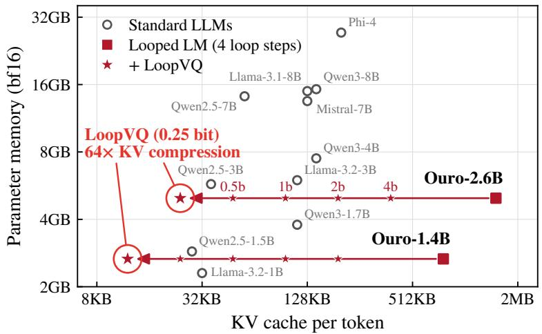  
(a)

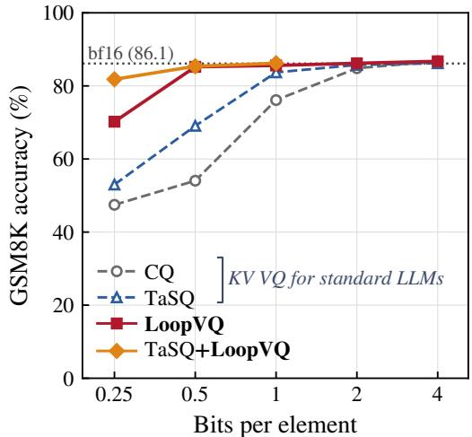  
(b)  
Figure 1. Looped LMs trade parameter memory for KV cache. (a) Parameter memory versus KV cache per token, both in bf16, for standard LLMs and the looped Ouro models with four loop steps. Arrows mark the KV cache of Ouro under LoopVQ from 4 to 0.25 bits per element. (b) GSM8K accuracy of Ouro-2.6B versus the bitwidth of KV cache quantization.

## 1 INTRODUCTION

Looped transformers (Dehghani et al., 2018; Giannou et al., 2023; Saunshi et al., 2025; Zhu et al., 2025; Geiping et al.,

2026) apply the same layers over multiple loop steps, effectively reusing the same parameters across multiple iterations. Built on this parameter-efficient architecture, Ouro-1.4B performs on par with non-looped models several times its size (Zhu et al., 2025).

This parameter efficiency, however, does not extend to the key-value (KV) cache. Although the loop steps share their weights, each loop step stores its own keys and values, so the KV cache grows linearly with the number of loop steps. As Figure 1a shows, Ouro-1.4B requires six times the per-token KV cache of Llama-3.1-8B (Grattafiori et al., 2024), and the model’s KV cache exceeds its weights in memory even at moderate context lengths. This limits the batch size and context length at which the looped models can be served, making KV cache compression a promising way to improve their efficiency.

Among various KV cache compression methods, quantization compresses the KV cache by storing each key and value at lower precision, without discarding any tokens. It has been widely studied for standard LLMs, with both scalar (Liu et al., 2024; Hooper et al., 2024; Ashkboos et al., 2024) and vector quantization (Zhang et al., 2024; Cheong et al., 2026b; Son et al., 2026). These methods can also be applied to looped models, but they do not exploit the redundancy of the cache across loop steps, and below one bit per element they lose much of their accuracy (Figure 1b).

We find that the keys and values of a layer are strongly correlated across loop steps. Grouping channels of several loop steps into one sub-vector exploits this correlation and substantially reduces the reconstruction error at the same bitwidth, which makes the loop dimension an additional axis for vector quantization, complementary to the channel axis used by existing methods. We also find that quantization errors at different loop steps affect the model output to very different degrees.

Based on these observations, we propose LoopVQ, a KV cache quantization method for looped models with two components. Loop-axis vector quantization codes channels of several loop steps jointly, so that one index is shared by multiple loop steps with no additional cost in bits. Loopaware codebook fine-tuning refines the codebooks to match the output of the full-precision model, accounting for the unequal sensitivity of the loop steps.

We evaluate LoopVQ on general benchmarks with Ouro-1.4B, Ouro-2.6B (Zhu et al., 2025), and Huginn-3.5B (Geiping et al., 2026), and on long chain-of-thought reasoning and needle-in-a-haystack (NIAH) tasks with the two Ouro models. Combined with TaSQ (Cheong et al., 2026b), which exploits structure along the channel axis, LoopVQ comes close to the BF16 baseline at 0.5 bit. We further implement LoopVQ in SGLang (Zheng et al., 2023), where the loop steps share the same indices and each reads them through its own slice of the codebook.

Our contributions are as follows:

• We show that the KV cache of looped models is highly redundant along the loop axis and that the loop steps differ substantially in their sensitivity to quantization.

• We propose LoopVQ, which combines loop-axis vector quantization with loop-aware codebook fine-tuning and is orthogonal to channel-axis methods such as TaSQ. At 0.5 and 0.25 bits per element, LoopVQ outperforms vector quantization baselines designed for non-looped LLMs on general, reasoning, and long-context benchmarks.

• We implement LoopVQ in SGLang, where the quantized cache stores one index row for several loop steps. It nearly halves the decode latency at long contexts and increases the peak throughput by up to 4.3× and 6.1× on the 1.4B and 2.6B Ouro models compared to the BF16 baseline.

## 2 PRELIMINARIES

Looped language models. A looped transformer (Zhu et al., 2025; Geiping et al., 2026) applies the same $L _ { b }$ decoder layers $T$ times, where the first layer of each loop step takes the previous loop step’s output as its input. Starting from the embedded sequence $h _ { 1 : N } ^ { ( 0 ) }$ , loop step $t \in \{ 1 , \ldots , T \}$ computes

$$
h _ { 1 : N } ^ { ( t ) } \ = \ F _ { \theta } \big ( h _ { 1 : N } ^ { ( t - 1 ) } \big ) ,\tag{1}
$$

where $F _ { \theta }$ denotes the $L _ { b }$ layers, shared across loop steps. The output distribution $p _ { j }$ is read from the final hidden state $h _ { j } ^ { ( T ) }$ . Each layer stores a separate KV cache at every loop step. Token j produces a key $k _ { j , h } ^ { ( t , \ell ) } \in \mathbb { R } ^ { D }$ and a value $\boldsymbol { v } _ { j , h } ^ { ( t , \ell ) } \in \mathbb { R } ^ { D }$ for each loop step t, layer ℓ and KV head $\dot { h _ { \mathrm { ~ \scriptsize ~ \leq ~ } } } H$ . The cache is $T$ times larger than that of a nonlooped model with the same weights.

Vector quantization of the KV cache. Prior work compresses the KV cache with vector quantization (Zhang et al., 2024). Every cached vector $x \in \mathbb { R } ^ { D } ( x = k$ or v of one loop step, layer, and head) is split into $D / G$ subvectors $z \in \mathbb { R } ^ { G }$ of G contiguous channels. Each sub-vector is stored as the index of its nearest entry in a codebook $B = \{ e _ { 1 } , \ldots , e _ { K } \} \subset \mathbb { R } ^ { G }$ of $K = 2 ^ { b }$ entries,

$$
a ( z ) = \arg \operatorname* { m i n } _ { r \leq K } \| z - e _ { r } \| _ { 2 } ^ { 2 } , \qquad \hat { z } = e _ { a ( z ) } ,\tag{2}
$$

at a cost of $b / G$ bits per element. Keys are quantized before the rotary embedding (RoPE), so attention reconstructs each key from its indices and applies RoPE to it, reading $D / G$ indices per cached vector. When these methods are applied to a looped model, codebooks are learned per loop step and layer $( t , \ell )$ , and the T loop steps of a layer are quantized as unrelated caches.

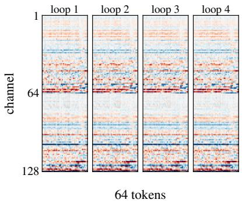  
(a)

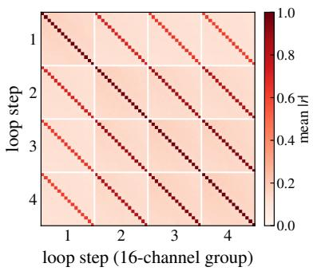  
(b)

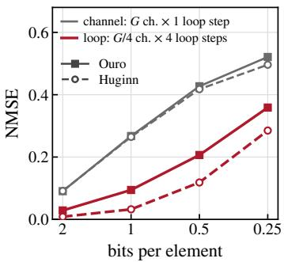  
(c)  
Figure 2. The KV cache of a looped LM is redundant along the loop axis. (a) Pre-RoPE keys of one head of Ouro-1.4B at each loop step. (b) Mean absolute correlation between (loop step, channel) pairs within a 16-channel group, averaged over all groups, heads, and layers of Ouro-1.4B. (c) k-means reconstruction error at equal bitwidth when each 8-bit code spans G channels of one loop step (channel) or $G / 4$ channels across four loop steps (loop), both with plain k-means.

Codebook calibration. Codebooks are learned offline from sub-vectors $\left\{ z _ { n } \right\}$ collected on a small calibration set, typically by k-means on their squared reconstruction error. This objective treats all sub-vectors alike, although the error in some may affect the model output more than others. To address this, prior work weights each sub-vector by its sensitivity $\omega _ { n } = \| \partial \mathcal { L } / \partial z _ { n } \| _ { 2 } ^ { 2 }$ to the next-token loss L, which equals the sum of the diagonal empirical Fisher information over its coordinates:

$$
\operatorname* { m i n } _ { B } \sum _ { n } \omega _ { n } \operatorname* { m i n } _ { r \leq K } \left\| z _ { n } - e _ { r } \right\| _ { 2 } ^ { 2 } .\tag{3}
$$

This gradient-based weighting has been reported to improve over unweighted k-means in KV cache quantization (Zhang et al., 2024; Hooper et al., 2024). It only shapes the codebooks; encoding remains the nearest-entry rule (2).

## 3 MOTIVATION

Unlike the caches of different layers in a non-looped model, the T caches of a layer in a looped model are produced by applying the same parameters. We investigate whether this property can be used to compress the cache beyond what is achievable for a non-looped model.

Redundancy along the loop axis. The keys and values of a layer are highly similar across loop steps, as they are computed by the same projection weights from hidden states of the same token (1). In Figure 2a, the keys of one head show nearly the same channel pattern at all four loop steps. Averaged over all layers and heads of Ouro-1.4B, the correlation between adjacent loop steps increases from 0.69 between the first two loop steps to 0.94 between the last two.

This redundancy runs along a different axis from the one that existing vector quantization methods exploit. Figure 2b shows the correlation between every pair of (loop step, channel) coordinates within a 16-channel sub-vector. A key channel correlates with the same channel at the adjacent loop step at $| r | = 0 . 8 5$ on average, but with the other channels of its own sub-vector at only 0.16, and the gap is even wider for values. Figure 2c measures how much this matters for quantization. At the same bitwidth and with the same number of codebooks, we only change which coordinates share a code: G channels of one loop step, or $G / 4$ channels at each of four consecutive loop steps. With plain k-means, the second grouping roughly halves the reconstruction error of Ouro-1.4B at 0.5 bit, and reduces it substantially for both models at every bitwidth.

<table><tr><td rowspan="2">Bitwidth</td><td colspan="4">Quantized loop step</td></tr><tr><td>1</td><td>2</td><td>3</td><td>4</td></tr><tr><td>0.5 bit</td><td>0.069</td><td>0.018</td><td>0.013</td><td>0.030</td></tr><tr><td>0.25 bit</td><td>0.123</td><td>0.029</td><td>0.026</td><td>0.065</td></tr></table>

Table 1. KL divergence from the full-precision output of Ouro-1.4B when only one loop step is quantized (loop-axis grouping, Fisher-weighted k-means codebooks, sequences not used for calibration).

Unequal quantization sensitivity across loop steps. Grouping along the loop axis places coordinates from different loop steps in one sub-vector, which is then encoded by a single index. However, the loop steps do not affect the output equally. An error in the cache of an early loop step perturbs the hidden state passed to all later loop steps (1), whereas an error at the last loop step affects only that loop step.

Table 1 confirms this. We quantize the cache of a single loop step with loop-axis codebooks calibrated by (3), keep all other loop steps in full precision, and measure the KL divergence of the output distribution from that of the fullprecision model. The sensitivity varies by roughly a factor of five across loop steps: quantizing the first loop step is by far the most harmful, and the third loop step the least.

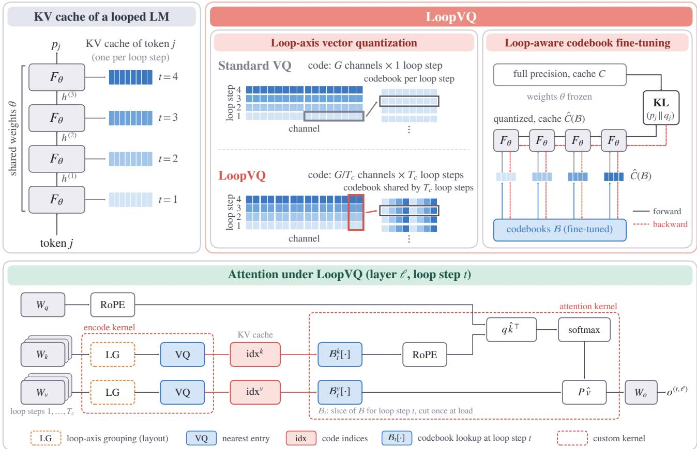  
Figure 3. Overview of LoopVQ. Each loop step of a looped LM writes its own KV cache. LoopVQ codes $G / T _ { c }$ channels across $T _ { c }$ loop steps, so one index serves all of them at the same bitwidth as coding each loop step separately, and fine-tunes the codebooks against the full-precision output through the loop. At inference, each loop step reads the shared indices through its own slice $B _ { t }$ of the codebook.

The calibration objective (3) cannot express this difference within a coupled sub-vector. Its weight $\omega _ { n }$ is a single scalar per sub-vector, and its distance is the unweighted squared error, so an error is penalized equally regardless of the loop step on which it falls. The codebooks allocate the same precision to every loop step of a sub-vector, although errors at some loop steps affect the output far more than errors at others.

Existing KV cache quantization methods do not account for two properties of the looped structure: the cache is highly redundant along the loop axis, and the loop steps differ substantially in how strongly their quantization errors affect the output. Section 4 builds on both observations.

## 4 METHOD

LoopVQ builds on the two properties identified in Section 3: the redundancy of the cache along the loop axis (Section 4.1) and the unequal sensitivity of the loop steps (Section 4.2). Figure 3 gives an overview.

## 4.1 Loop-axis vector quantization

LoopVQ partitions the T loop steps into blocks of $T _ { c }$ consecutive loop steps, where $T _ { c }$ divides both T and G; block β contains the loop steps $\beta T _ { c } + m + 1$ with $m < T _ { c }$ . A code then covers $c = G / T _ { c }$ channels at each of the Tc loop steps of a block. For $x \in \{ k , v \}$ , layer ℓ, head h, and channel group $g < D / c ,$ the coupled vector of token j is

$$
\left[ z _ { j } ^ { ( \beta , \ell , h , g ) } \right] _ { i T _ { c } + m } = x _ { j , h , g c + i } ^ { ( \beta T _ { c } + m + 1 , \ell ) } , \quad i < c , m < T _ { c } .\tag{4}
$$

As in existing KV cache vector quantization methods, LoopVQ quantizes the keys before RoPE is applied, and attention applies RoPE to the reconstructed keys (Section 2). The coupled vector is encoded by its nearest entry (2) in a codebook $B _ { \beta , \ell , h , g } \subset \mathbb { R } ^ { G }$ , and loop step $\beta T _ { c } + m + 1$ is reconstructed from its share of that entry:

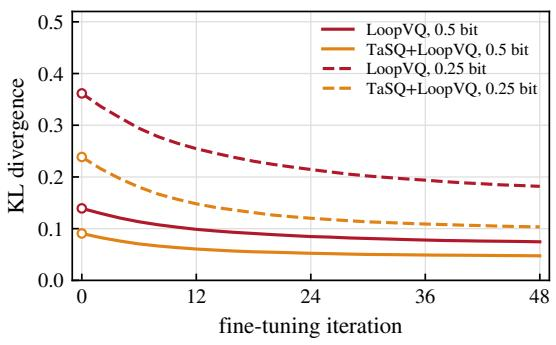  
Figure 4. KL divergence from the full-precision Ouro-1.4B during fine-tuning, starting from the k-means codebooks (circles). One iteration processes one calibration sequence (48 iterations = 4 epochs).

$$
\hat { x } _ { j , h , g c + i } ^ { ( \beta T _ { c } + m + 1 , \ell ) } \ = \ \left[ e _ { a ( z _ { j } ) } \right] _ { i T _ { c } + m } .\tag{5}
$$

One index serves $T _ { c }$ loop steps, and the bitwidth remains $b / G$ bits per element. The codebooks are initialized with Fisher-weighted k-means (3), where $\omega _ { n } ~ = ~ \| \partial \mathcal { L } / \partial z _ { n } \| _ { 2 } ^ { 2 }$ sums the squared gradients over all $T _ { c }$ loop steps covered by $z _ { n }$

## 4.2 Loop-aware codebook fine-tuning

We refine the k-means codebooks by matching the output of the quantized model to that of the original model, as in knowledge distillation (Hinton et al., 2015) and the end-toend fine-tuning of vector-quantized LLM weights (Egiazarian et al., 2024; Malinovskii et al., 2024). For a calibration sequence s, let C be the cache of the unquantized forward pass and $p _ { j }$ its output distribution at position j. Let $\hat { C } ( B )$ be the cache reconstructed from the codes of C by (2) and (5), where B collects all key and value codebooks, and let $q _ { j } ( B )$ be the output when all T loop steps attend to $\hat { C } ( B )$ instead of C. With the model weights frozen, we minimize

$$
\begin{array} { r } { \mathcal { I } ( \mathcal { B } ) = \mathbb { E } _ { s } \Big [ \frac { 1 } { N } \sum _ { j } \mathrm { K L } \big ( p _ { j } \big | \big | q _ { j } ( \mathcal { B } ) \big ) \Big ] , } \end{array}\tag{6}
$$

where the sum runs over the N positions after the bf16 sink tokens.

Fisher-weighted k-means (3), like any weighted k-means objective, penalizes the error of each coded vector independently. It cannot account for the interaction between the errors of different loop steps, which propagate to later loop steps and combine (Appendix A.1); its weights also treat all $T _ { c }$ loop steps of a coupled vector equally, although they differ in sensitivity (Section 3). Minimizing (6) retains both effects. On Ouro-1.4B, fine-tuning roughly halves the KL divergence from the full-precision output (Figure 4).

Algorithm 1 LoopVQ attention kernel. Decode attention   
at loop step t for one head and one split S.   
Require: query $\boldsymbol { q } ^ { ( t ) } ;$ codebook slices $B _ { t } ^ { k } , \ B _ { t } ^ { v } ;$ ; key and   
value indices $a _ { n } ^ { k } , a _ { n } ^ { v }$ of each token ${ \boldsymbol { n } } \in S$   
Ensure: partial output o and its logsumexp λ   
1: load $\hat { B } _ { t } ^ { k }$ into shared memory   
2: for $n \in S$ in parallel do   
3: $\hat { k } _ { n } \gets B _ { t } ^ { k } [ a _ { n } ^ { k } ]$ ▷ $D / c$ indices   
4: $s _ { n }  q ^ { ( t ) } \cdot \mathrm { R o P E } ( \hat { k } _ { n } , n ) / \sqrt { D }$   
5: end for   
6: µ ← maxn sn, $p _ { n }  e ^ { s _ { n } - \mu }$ $Z \gets \sum _ { n } p _ { n }$   
7: load $B _ { t } ^ { v }$ into shared memory   
8: $\begin{array} { r } { o  \frac { 1 } { Z } \sum _ { n \in \mathcal { S } } p _ { n } \mathcal { B } _ { t } ^ { v } [ a _ { n } ^ { v } ] } \end{array}$   
9: return o, $\lambda = \mu + \log Z$

The entries are trained by backpropagating (6) through the reconstruction (Appendix A.2). We recompute the assignments with the current codebooks at every iteration, so the codebooks are always trained under the encoder used at inference.

## 4.3 System implementation

We implement LoopVQ in SGLang (Zheng et al., 2023) (Figure 5). Coupling loop steps affects how the codes are stored, when a token can be encoded, and how attention at one loop step reads codes shared by several loop steps.

Cache layout. The first $n _ { s }$ tokens (sink) and the most recent $n _ { r }$ tokens of a request are kept in bf $^ { 1 6 , }$ and all other tokens are stored as codebook indices. The cache is organized in pages of 8 tokens, and $n _ { s }$ and $n _ { r }$ are multiples of 8, so every page is either bf16 or quantized as a whole. Since one index is shared across $T _ { c }$ loop steps (5), a quantized page stores one index row per block of $T _ { c }$ loop steps, and LoopVQ occupies the same memory per token as coding each loop step separately at the same G.

Encoding. A coupled vector (4) can be encoded only once all $T _ { c }$ loop steps of its block have been computed. During prefill, the keys and values of each loop step are held until the last loop step of their block, and the block is then encoded by computing the distances to all codebook entries as a matrix product on tensor cores. During decoding, the key and value of each new token are written to the bf16 recent window, where all its loop steps are available by the end of the forward pass. After every 8 generated tokens, the oldest page of the window is encoded across all layers and loop steps into one quantized page, so the window holds $n _ { r }$ to $n _ { r } + 7$ tokens.

Attention. At loop step t, one kernel attends to the bf16 pages and another to the quantized pages (Algorithm 1). The quantized kernel looks up each index in $B _ { t }$ , the slice of every entry that holds the coordinates of loop step $t = \beta T _ { c } + m + 1$ i.e., $\left[ e \right] _ { i \underline { { { T } } } _ { c } + m }$ for $\textit { i } < c \left( 5 \right)$ , cut once when the model is loaded. Each loop step uses an ordinary vector quantizer with groups of $c$ channels, and the baselines, which code each loop step separately, run on the same kernel. Keys are cached before the rotary embedding, which the kernel applies to the reconstructed keys. At each loop step, the kernel reads $D / c$ indices per head and token. As in Flash-Decoding (Dao et al., 2023), the quantized tokens are divided into splits processed by separate thread blocks, and the partial outputs of all splits are combined using the logsumexp of their attention scores (Dao, 2024), which recovers the exact softmax over all tokens. The bf16 pages are attended by SGLang’s Triton decoding kernel, which uses the same scheme, and its splits are combined with those of the quantized kernel. For batched decoding, the quantized kernel is optimized to process multiple requests per thread block, sharing the loads of the rotary coefficients and codebooks (Appendix C).

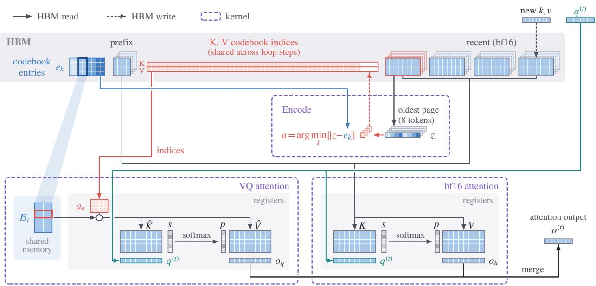  
Figure 5. Serving LoopVQ in SGLang. The KV cache keeps the sink and recent tokens in bf16 at every loop step, and all other tokens as codebook indices shared across loop steps. At loop step t, the LoopVQ attention kernel loads $B _ { t } ,$ the slice of the codebook entries for loop step t, into shared memory once and looks up the keys and values of each token from its indices in registers; the bf16 kernel reads the bf16 keys and values of loop step t directly. Both attend with the query $\boldsymbol { q } ^ { ( t ) }$ of the new token, and their outputs are merged. The key and value of each new token are written in bf16, and after every 8 generated tokens the oldest recent page is encoded into indices.

## 5 EXPERIMENTS

## 5.1 Experimental setup

Models. We evaluate Ouro-1.4B and Ouro-2.6B (Zhu et al., 2025) $( L _ { b } = 2 4 $ and 48, $T = 4 , H = 1 6 , D = 1 2 8 )$ using their Thinking variants for reasoning tasks, and

Huginn-3.5B (Geiping et al., 2026), which iterates a fourlayer core block $r = 3 2$ times between a two-layer prelude and coda (132 KV caches per token, 55 heads of dimension 96).

Methods. All methods quantize keys and values with 8- bit codes $( K = 2 5 6 )$ and G ∈ {16, 32}, i.e., 0.5 or 0.25 bits per element. The baselines are CQ (Zhang et al., 2024), with a separate Fisher-weighted k-means codebook (3) per loop step and layer, and TaSQ (Cheong et al., 2026b), which transforms the keys before coding each loop step. LoopVQ couples $T _ { c } = 4$ consecutive loop steps, so a code spans $c = G / T _ { c }$ channels (c = 4 at 0.5 bit, c = 8 at 0.25 bit); on Huginn, the 32 loop steps form eight blocks, and the prelude and coda, which have no loop axis, are coded per layer as in CQ. TaSQ+LoopVQ applies TaSQ’s key transforms before coupling (Appendix B); its per-token key scale adds 0.008 bits per key element (0.003 on Huginn). Every method keeps the first and the most recent tokens in bf16: 8 and 64 on the general benchmarks, 64 and 256 on the reasoning and long-context benchmarks.

Calibration. All codebooks are fitted separately for each model, including the Thinking variants, on 16 sequences of 2,048 tokens from the GPQA main set excluding the Diamond subset, which does not overlap with the evaluation set. LoopVQ fine-tunes the k-means codebooks on 12 of these sequences with Adam (learning rate $1 0 ^ { - 3 } .$ , one sequence per iteration) for four epochs and keeps the epoch with the lowest KL on the other four. On one RTX 6000 Ada GPU, the k-means calibration and the fine-tuning take 6.1 and 2.3 minutes for Ouro-1.4B and 14.3 and 5.9 minutes for Ouro-2.6B.

Table 2. General performance under low-bit KV cache quantization. All results use greedy decoding. Bold denotes the best quantized result; higher is better.
<table><tr><td>Model</td><td>Bitwidth</td><td>Method</td><td>Bits (K/V)</td><td>GSM8K</td><td>MATH500</td><td>HumanEval</td><td>MBPP</td><td> $\operatorname { A v g } .$ </td></tr><tr><td rowspan="8">Ouro-1.4B</td><td rowspan="4"></td><td>BF16</td><td>16/16</td><td>78.77</td><td>77.20</td><td>73.17</td><td>73.54</td><td>75.67</td></tr><tr><td>CQ</td><td>0.5/0.5</td><td>46.78</td><td>17.80</td><td>14.63</td><td>50.00</td><td>32.30</td></tr><tr><td>TaSQ 0.5 bit</td><td>0.508/0.5</td><td>57.32</td><td>38.80</td><td>24.39</td><td>53.97</td><td>43.62</td></tr><tr><td>LoopVQ</td><td>0.5/0.5</td><td>75.82</td><td>69.40</td><td>63.41</td><td>64.55</td><td>68.29</td></tr><tr><td rowspan="4"></td><td>TaSQ+LoopVQ</td><td>0.508/0.5</td><td>77.56</td><td>75.20</td><td>70.12</td><td>71.43</td><td>73.58</td></tr><tr><td>CQ</td><td>0.25/0.25</td><td>42.99</td><td>12.20</td><td>10.98</td><td>46.56</td><td>28.18</td></tr><tr><td>TaSQ</td><td>0.258/0.25</td><td>44.88</td><td>12.80</td><td>12.20</td><td>48.41</td><td>29.57</td></tr><tr><td>LoopVQ</td><td>0.25/0.25</td><td>58.91</td><td>41.20</td><td>25.61</td><td>54.50</td><td>45.05</td></tr><tr><td rowspan="8">Ouro-2.6B</td><td></td><td>TaSQ+LoopVQ</td><td>0.258/0.25</td><td>70.96</td><td>63.40</td><td>55.49</td><td>59.26</td><td>62.28</td></tr><tr><td></td><td>BF16</td><td>16/16</td><td>86.13</td><td>77.40</td><td>81.10</td><td>81.22</td><td>81.46</td></tr><tr><td rowspan="4">0.5 bit</td><td>CQ</td><td>0.5/0.5</td><td>54.06</td><td>24.60</td><td>14.63</td><td>57.41</td><td>37.67</td></tr><tr><td>TaSQ</td><td>0.508/0.5</td><td>69.07</td><td>49.20</td><td>31.10</td><td>61.38</td><td>52.69</td></tr><tr><td>LoopVQ</td><td>0.5/0.5</td><td>85.22</td><td>74.60</td><td>75.00</td><td>75.93</td><td>77.69</td></tr><tr><td>TaSQ+LoopVQ</td><td>0.508/0.5</td><td>85.37</td><td>78.60</td><td>78.66</td><td>78.57</td><td>80.30</td></tr><tr><td rowspan="4">0.25 bit</td><td>CQ</td><td>0.25/0.25</td><td>47.46</td><td>14.60</td><td>12.80</td><td>53.70</td><td>32.14</td></tr><tr><td>TaSQ</td><td>0.258/0.25</td><td>52.99</td><td>17.60</td><td>14.02</td><td>56.08</td><td>35.18</td></tr><tr><td>LoopVQ</td><td>0.25/0.25</td><td>70.20</td><td>52.00</td><td>28.66</td><td>60.05</td><td>52.73</td></tr><tr><td>TaSQ+LoopVQ</td><td>0.258/0.25</td><td>81.80</td><td>68.60</td><td>62.80</td><td>69.58</td><td>70.70</td></tr><tr><td rowspan="7">Huginn-3.5B</td><td></td><td>BF16</td><td>16/16</td><td>34.04</td><td>12.80</td><td>17.07</td><td>35.98</td><td>24.97</td></tr><tr><td rowspan="4">0.5 bit</td><td>CQ</td><td>0.5/0.5</td><td>19.03</td><td>5.40</td><td>6.71</td><td>23.54</td><td>13.67</td></tr><tr><td>TaSQ</td><td>0.503/0.5</td><td>19.11</td><td>5.80</td><td>10.37</td><td>23.81</td><td>14.77</td></tr><tr><td>LoopVQ</td><td>0.5/0.5</td><td>32.37</td><td>9.40</td><td>12.80</td><td>34.92</td><td>22.37</td></tr><tr><td>TaSQ+LoopVQ</td><td>0.503/0.5</td><td>33.13</td><td>12.20</td><td>12.20</td><td>36.51</td><td>23.51</td></tr><tr><td rowspan="4">0.25 bit</td><td>CQ</td><td>0.25/0.25</td><td>19.11</td><td>7.20</td><td>4.27</td><td>21.16</td><td>12.93</td></tr><tr><td>TaSQ</td><td>0.253/0.25</td><td>19.18</td><td>6.60</td><td>4.88</td><td>21.16</td><td>12.96</td></tr><tr><td>LoopVQ</td><td>0.25/0.25</td><td>25.02</td><td>8.20</td><td>13.41</td><td>27.78</td><td>18.60</td></tr><tr><td>TaSQ+LoopVQ</td><td>0.253/0.25</td><td>28.13</td><td>9.80</td><td>13.41</td><td>32.54</td><td>20.97</td></tr></table>

Benchmarks. We evaluate three settings, all with accuracy (%) as the metric. General benchmarks: the base models are evaluated with greedy decoding on GSM8K (Cobbe et al., 2021) (3-shot chain of thought, flexible extraction), MATH500 (Lightman et al., 2024) (zero-shot), and HumanEval (Chen et al., 2021) and MBPP (Austin et al., 2021) (pass@1). Long chain-of-thought reasoning: the Thinking models are evaluated with thinking enabled on AIME’24, AIME’25 (Mathematical Association of America, 2025), GPQA-Diamond (Rein et al., 2023), HumanEval+, and

MBPP+ (Liu et al., 2023), with the decoding settings of the model card (temperature 1.0, top-p 0.7, up to 32,768 generated tokens), averaged over three sampling seeds. Longcontext retrieval: the base models are evaluated on the eight needle-in-a-haystack (NIAH) tasks of RULER (Hsieh et al., 2024) at context lengths from 4K to 64K tokens, the maximum context length of Ouro, with 200 examples per length, averaged over three seeds for the haystack and needle placement.

Implementation and hardware. All methods run in SGLang (Zheng et al., 2023) and store the quantized tokens as code indices. Decoding attends to the codes through a custom attention kernel; prefill attends to the exact keys and values of the current chunk and encodes each block of $T _ { c }$ loop steps once its last loop step is computed. Efficiency is measured on an NVIDIA RTX 6000 Ada GPU (48 GB), and results on A100 (40 GB) are reported in Appendix D.1.

Table 3. Long CoT reasoning performance under low-bit KV cache quantization. All results are averaged over three sampling seeds (mean ± std). Bold denotes the best quantized result; higher is better.
<table><tr><td>Model</td><td>Bitwidth</td><td>Method</td><td>Bits (K/V)</td><td>AIME&#x27;24</td><td>AIME&#x27;25</td><td>GPQA-D</td><td>HumanEval+</td><td>MBPP+</td><td>Avg.</td></tr><tr><td rowspan="8">Ouro-1.4B-Thinking</td><td rowspan="5"></td><td>BF16</td><td>16/16</td><td>47.78±5.09</td><td>32.22±5.09</td><td>45.12±2.28</td><td>84.55±0.70</td><td>72.49±1.32</td><td>56.43±1.54</td></tr><tr><td>CQ</td><td>0.5/0.5</td><td>1.11±1.92</td><td>2.22±1.92</td><td>11.78±1.05</td><td>27.85±0.70</td><td>35.27±2.31</td><td>15.65±0.76</td></tr><tr><td>TaSQ 0.5 bit</td><td>0.508/0.5</td><td>4.44±1.92</td><td>5.56±1.92</td><td>12.12±2.31</td><td>35.16±2.14</td><td>40.12±2.72</td><td>19.48±0.99</td></tr><tr><td>LoopVQ</td><td>0.5/0.5</td><td>38.89±5.09</td><td>31.11±3.85</td><td>40.57±1.27</td><td>75.81±1.27</td><td>67.64±1.19</td><td>50.80±1.35</td></tr><tr><td>TaSQ+LoopVQ</td><td>0.508/0.5</td><td>45.56±8.39</td><td>34.44±5.09</td><td>42.76±3.04</td><td>81.50±1.53</td><td>70.11±0.70</td><td>54.87±2.08</td></tr><tr><td>CQ</td><td>0.25/0.25</td><td>0.00±0.00</td><td>1.11±1.92</td><td>11.62±3.07</td><td>25.61±2.79</td><td>33.86±0.00</td><td>14.44±0.92</td></tr><tr><td rowspan="3">0.25 bit</td><td>TaSQ</td><td>0.258/0.25</td><td>2.22±1.92</td><td>1.11±1.92</td><td>11.45±3.79</td><td>27.03±2.82</td><td>32.01±0.26</td><td>14.76±1.09</td></tr><tr><td>LoopVQ</td><td>0.25/0.25</td><td>7.78±3.85</td><td>8.89±3.85</td><td>14.48±4.08</td><td>31.50±1.27</td><td>37.13±1.46</td><td>19.95±1.41</td></tr><tr><td>TaSQ+LoopVQ BF16</td><td>0.258/0.25</td><td>36.67±3.33</td><td>26.67±5.77</td><td>36.53±4.58</td><td>76.63±2.31</td><td>63.84±0.85</td><td>48.07±1.69</td></tr><tr><td rowspan="7">Ouro-2.6B-Thinking</td><td rowspan="5">0.5 bit</td><td></td><td>16/16</td><td>57.78±11.71</td><td>51.11±5.09</td><td>54.04±3.31</td><td>86.18±0.93</td><td>75.49±0.81</td><td>64.92±2.65</td></tr><tr><td>CQ</td><td>0.5/0.5</td><td>3.33±0.00</td><td>5.56±1.92</td><td>7.24±3.04</td><td>30.08±2.75</td><td>36.68±1.10</td><td>16.58±0.93</td></tr><tr><td>TaSQ</td><td>0.508/0.5</td><td>10.00±3.33</td><td>12.22±1.92</td><td>22.73±3.31</td><td>43.90±2.79</td><td>52.73±1.99</td><td>28.32±1.23</td></tr><tr><td>LoopVQ</td><td>0.5/0.5</td><td>47.78±5.09</td><td>35.56±1.92</td><td>47.81±2.04</td><td>84.76±1.61</td><td>74.34±1.32</td><td>58.05±1.24</td></tr><tr><td>TaSQ+LoopVQ</td><td>0.508/0.5</td><td>61.11±3.85</td><td>43.33±5.77</td><td>51.01±4.63</td><td>88.21±0.93</td><td>75.49±1.50</td><td>63.83±1.71</td></tr><tr><td>CQ</td><td>0.25/0.25</td><td>2.22±1.92</td><td>3.33±3.33</td><td>8.25±1.54</td><td>30.89±1.96</td><td>38.80±2.90</td><td>16.70±1.09</td></tr><tr><td rowspan="4">0.25 bit</td><td>TaSQ</td><td>0.258/0.25</td><td>1.11±1.92</td><td>5.56±1.92</td><td>10.94±0.77</td><td>33.33±0.93</td><td>39.42±0.26</td><td>18.07±0.60</td></tr><tr><td>LoopVQ</td><td>0.25/0.25</td><td>10.00±3.33</td><td>5.56±1.92</td><td>13.13±3.31</td><td>43.50±2.14</td><td>48.50±1.25</td><td>24.14±1.13</td></tr><tr><td>TaSQ+LoopVQ</td><td>0.258/0.25</td><td>43.33±3.33</td><td>34.44±5.09</td><td>48.15±1.27</td><td>82.72±0.35</td><td>71.43±1.15</td><td>56.02±1.27</td></tr><tr><td></td><td></td><td></td><td></td><td></td><td></td><td></td><td></td></tr></table>

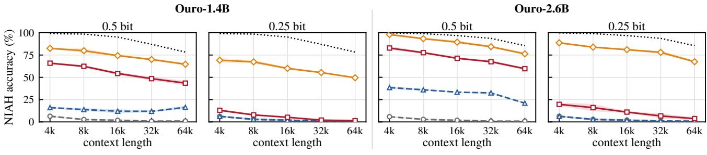  
BF16 CQ TaSQ LoopVQ TaSQ+LoopVQ  
Figure 6. RULER needle-in-a-haystack (NIAH) accuracy of Ouro-1.4B and Ouro-2.6B versus context length under 0.5- and 0.25-bit KV cache quantization (8-bit codes, G=16 and 32). Each point averages the eight NIAH tasks over three seeds.

## 5.2 Main results

General benchmarks. Table 2 reports the results on the base models. CQ and TaSQ lose much of the BF16 accuracy already at 0.5 bit, especially on MATH500 and HumanEval. LoopVQ substantially outperforms both baselines at both bitwidths, and TaSQ+LoopVQ further improves on LoopVQ, nearly matching BF16 at 0.5 bit. At 0.25 bit, the advantage of TaSQ+LoopVQ over LoopVQ becomes larger. LoopVQ and TaSQ+LoopVQ also outperform both baselines on Huginn-3.5B.

Long chain-of-thought reasoning. Table 3 reports the results on the Thinking models. The baselines degrade more severely than on the general benchmarks and fall far below BF16 at both bitwidths. LoopVQ retains most of the BF16 accuracy at 0.5 bit, and combined with TaSQ it preserves much of the reasoning ability even at 0.25 bit, achieving the best result on every benchmark.

Long-context retrieval. Figure 6 shows the NIAH results, which follow the same ordering. The baselines remain far below BF16 at every context length, while LoopVQ retrieves a large fraction of the needles at 0.5 bit. TaSQ+LoopVQ achieves the highest accuracy at every context length and bitwidth. Results on LongBench, which follow the same trend, are reported in Appendix D.5.

## 5.3 System efficiency

We measure the serving efficiency of LoopVQ on Ouro-1.4B-Thinking with one RTX 6000 Ada GPU, keeping 8 sink and 64 recent tokens in bf16; results on an A100 GPU are reported in Appendix D.1.

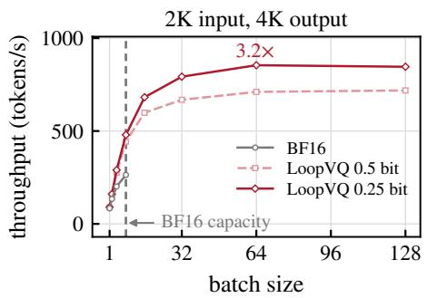  
(a)

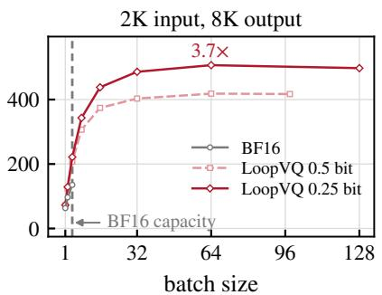  
(b)

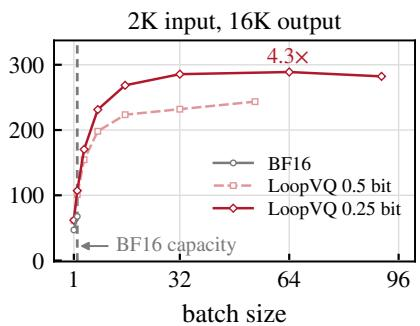  
(c)  
Figure 7. End-to-end throughput of LoopVQ on Ouro-1.4B-Thinking with one RTX 6000 Ada GPU, versus batch size up to the larges batch that fits in memory.

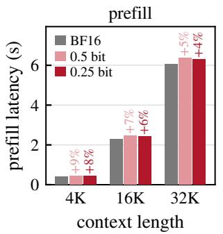

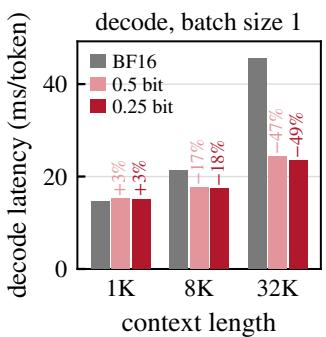  
(a)  
(b)  
Figure 8. Latency of LoopVQ at 0.5 and 0.25 bit on Ouro-1.4B-Thinking with one RTX 6000 Ada GPU. (a) Prefill latency and (b) decode latency per token at batch size 1, each with the change relative to BF16.

Prefill and decoding latency. Prefill with LoopVQ is slightly slower than with BF16, because of the encoding of each block of $T _ { c }$ loop steps, and the overhead decreases with the context length (Figure 8a). During decoding, the kernel reads $D / c$ indices per head and token at each loop step, 8× and 16× fewer bytes than the bf16 keys and values. As decoding at long contexts is bound by reading the cache, the reduction in decode latency grows with the context length, reaching about half of the BF16 latency at 32K tokens (Figure 8b). Appendix D.3 breaks down the GPU time by kernel type.

Batched throughput. For long generation, the batch size is limited by the KV cache (Figure 7). With BF16, only a few requests fit in memory, while LoopVQ can serve tens to over a hundred concurrent requests. At the same batch size LoopVQ is also faster, for the same reason as its lower decode latency. As a result, the peak throughput of LoopVQ exceeds that of BF16 by 3.2× to 4.3×, with the gap widening as the output grows longer and the BF16 batch shrinks. On Ouro-2.6B-Thinking, the BF16 cache holds even fewer requests, and the gain reaches 5.0× to 6.1× (Appendix D.2).

## 6 DISCUSSION

## 6.1 Ablation study

We ablate LoopVQ on Ouro-1.4B with GSM8K and HumanEval; all other settings follow Section 5.1.

<table><tr><td colspan="3"></td><td>GSM8K</td><td colspan="2">HumanEval</td></tr><tr><td></td><td>Base + Coupling + FT</td><td></td><td>0.5 0.25</td><td>0.5</td><td>0.25</td></tr><tr><td rowspan="2">CQ</td><td> $\checkmark$ </td><td>√</td><td>46.8 43.0 75.4 57.5 48.7 42.5</td><td>14.6 61.6 14.6</td><td>11.0 23.8 11.0</td></tr><tr><td> $\checkmark$ </td><td>√</td><td>75.8 58.9</td><td>63.4</td><td>25.6</td></tr><tr><td rowspan="2">TaSQ</td><td> $\checkmark$ </td><td></td><td>57.3 44.9 77.5 68.7</td><td>24.4 70.1</td><td>12.2 50.6</td></tr><tr><td></td><td>√</td><td>59.7 47.1</td><td>31.7</td><td>14.0</td></tr><tr><td rowspan="2"></td><td> $\checkmark$ </td><td> $\checkmark$ </td><td>77.671.0</td><td>70.1</td><td>55.5</td></tr><tr><td></td><td></td><td></td><td></td><td></td></tr></table>

Table 4. Loop-axis coupling and loop-aware fine-tuning (FT) applied to CQ and TaSQ on Ouro-1.4B at 0.5 and 0.25 bits per element. With both, CQ and TaSQ become LoopVQ and TaSQ+LoopVQ. BF16: 78.8 (GSM8K) and 73.2 (HumanEval).

Components. To isolate the contribution of each component, we apply loop-axis coupling and loop-aware finetuning separately to CQ and TaSQ (Table 4). Coupling accounts for most of the gain at both bitwidths. Fine-tuning has little effect on GSM8K, whereas on HumanEval it tends to improve accuracy, most clearly with TaSQ. Combining both components gives the best or tied-best result in every setting. At 0.25 bit, coupling benefits TaSQ more than CQ.

Calibration corpus. We next test whether LoopVQ depends on the choice of calibration data by recalibrating every method on WikiText-2, C4, or SlimPajama (Figure 9). The corpus noticeably affects the baselines, with CQ varying by up to 11 points on GSM8K. TaSQ+LoopVQ is less sensitive overall, varying by at most 4 points on GSM8K and 1 point on HumanEval, and remains the best method on every corpus.

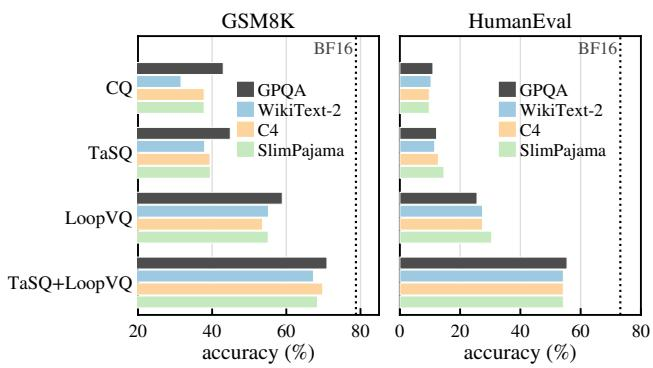

Figure 9. Accuracy of Ouro-1.4B at 0.25 bit with every method calibrated on a different corpus. GPQA is the calibration set of the main experiments.
<table><tr><td></td><td colspan="3">GSM8K</td><td colspan="3">HumanEval</td></tr><tr><td>Sequences</td><td>8</td><td>16</td><td>32</td><td>8</td><td>16</td><td>32</td></tr><tr><td>LoopVQ</td><td>57.5</td><td>58.9</td><td>60.8</td><td>22.6</td><td>25.6</td><td>28.0</td></tr><tr><td>TaSQ+LoopVQ</td><td>69.3</td><td>71.0</td><td>71.9</td><td>49.4</td><td>55.5</td><td>59.8</td></tr></table>

Table 5. Accuracy of Ouro-1.4B at 0.25 bit versus the number of 2,048-token GPQA calibration sequences (16 in the main experiments).

Calibration-set size. We then vary the number of 2,048- token GPQA calibration sequences from 8 to 32 (Table 5). Accuracy improves consistently as the set grows, most markedly on HumanEval, and even the smallest set keeps both variants well ahead of the baselines. As calibration takes only minutes (Section 5.1), the set can be enlarged at little cost.

## 6.2 Reasoning stability

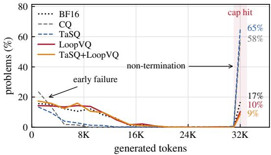  
Figure 10. Generation length on GPQA-Diamond of Ouro-1.4B-Thinking under 0.5-bit KV cache quantization, with the share of problems that reach the 32K-token budget.

When evaluating quantization methods, efficiency is usually measured as throughput or latency per generated token ignoring how many tokens are needed to reach an answer. Compression errors can lengthen reasoning or keep it from terminating, significantly wasting computation and decoding time (Liu et al., 2025; Cheong et al., 2026a). On GPQA-Diamond, CQ and TaSQ exhaust the 32K-token budget on most problems and generate about twice as many tokens as BF16, whereas LoopVQ and TaSQ+LoopVQ follow the length distribution of BF16 (Figure 10). As a result, the throughput gains of LoopVQ (Section 5.3) carry over to the time needed to answer. Appendix D.4 extends this analysis, including early termination, to both models and bitwidths.

## 7 RELATED WORK

Quantization of LLMs. Weight quantization methods for LLMs include scalar quantization with error compensation or activation-aware scaling (Frantar et al., 2022; Lin et al., 2024), joint quantization of weights and activations (Xiao et al., 2023; Ashkboos et al., 2024), and vector quantization with codebooks (Tseng et al., 2024; Egiazarian et al., 2024). For the KV cache, scalar methods quantize keys and values per channel or per token (Liu et al., 2024; Hooper et al., 2024; Ashkboos et al., 2024), and vector quantization methods code groups of channels jointly (Zhang et al., 2024; Cheong et al., 2026b; Son et al., 2026). These methods target non-looped models, where each layer writes one cache, and quantize the caches of different layers independently.

Quantization of looped transformers. The recurrence of looped transformers has motivated quantization methods tailored to it. LoopQ (Fang et al., 2026), LoopQuant (Zhao et al., 2026), and Loopy (Li et al., 2026) quantize the weights and activations of the shared block, accounting for the distribution shift and error accumulation across loop steps. For the KV cache, which dominates the memory of a looped model (Figure 1a), FlashLoop (Yang & Liu, 2026) and ResidualQuant (Kim et al., 2026) apply scalar quantization at 2 to 4 bits per element. LoopVQ instead applies vector quantization along the loop axis to a pretrained model, so that one index codes several loop steps, and compresses the KV cache below one bit per element.

## 8 CONCLUSION

We presented LoopVQ, a KV cache quantization method for looped transformers. LoopVQ groups channels of multiple loop steps into a sub-vector that shares one index, and finetunes the codebooks to match the output of the full-precision model, accounting for the different quantization sensitivities of the loop steps. We showed that, at 0.5 and 0.25 bits per element, LoopVQ outperforms existing vector quantization methods on general, reasoning, and long-context benchmarks, and that our SGLang implementation reduces the decode latency and raises the serving throughput over the BF16 baseline. The appendix provides further analysis of the fine-tuning objective, implementation and kernel optimization details, and additional experiment results.

## REFERENCES

Ashkboos, S., Mohtashami, A., Croci, M. L., Li, B., Cameron, P., Jaggi, M., Alistarh, D., Hoefler, T., and Hensman, J. Quarot: Outlier-free 4-bit inference in rotated llms. Advances in Neural Information Processing Systems, 37:100213–100240, 2024.

Austin, J., Odena, A., Nye, M., Bosma, M., Michalewski, H., Dohan, D., Jiang, E., Cai, C., Terry, M., Le, Q., and Sutton, C. Program Synthesis with Large Language Models. arXiv e-prints, art. arXiv:2108.07732, August 2021. doi: 10.48550/arXiv.2108.07732.

Bai, Y., Lv, X., Zhang, J., Lyu, H., Tang, J., Huang, Z., Du, Z., Liu, X., Zeng, A., Hou, L., Dong, Y., Tang, J., and Li, J. LongBench: A Bilingual, Multitask Benchmark for Long Context Understanding. arXiv e-prints, art. arXiv:2308.14508, August 2023. doi: 10.48550/arXiv.2 308.14508.

Chen, M., Tworek, J., Jun, H., Yuan, Q., Ponde de Oliveira Pinto, H., Kaplan, J., Edwards, H., Burda, Y., Joseph, N., Brockman, G., Ray, A., Puri, R., Krueger, G., Petrov, M., Khlaaf, H., Sastry, G., Mishkin, P., Chan, B., Gray, S., Ryder, N., Pavlov, M., Power, A., Kaiser, L., Bavarian, M., Winter, C., Tillet, P., Petroski Such, F., Cummings, D., Plappert, M., Chantzis, F., Barnes, E., Herbert-Voss, A., Hebgen Guss, W., Nichol, A., Paino, A., Tezak, N., Tang, J., Babuschkin, I., Balaji, S., Jain, S., Saunders, W., Hesse, C., Carr, A. N., Leike, J., Achiam, J., Misra, V., Morikawa, E., Radford, A., Knight, M., Brundage, M., Murati, M., Mayer, K., Welinder, P., McGrew, B., Amodei, D., McCandlish, S., Sutskever, I., and Zaremba, W. Evaluating Large Language Models Trained on Code. arXiv e-prints, art. arXiv:2107.03374, July 2021. doi: 10.48550/arXiv.2107.03374.

Cheong, M., Lim, W., Yun, V.-D., and Yoo, S. Kv-rescue: Recovering reasoning language model kv eviction loss via stepwise interleaving. arXiv preprint arXiv:2608.15797, 2026a.

Cheong, M., Son, D., and Yoo, S. Tailoring the quantization space for 1-bit kv cache compression. arXiv preprint arXiv:2610.03027, 2026b.

Cobbe, K., Kosaraju, V., Bavarian, M., Chen, M., Jun, H., Kaiser, L., Plappert, M., Tworek, J., Hilton, J., Nakano, R., Hesse, C., and Schulman, J. Training Verifiers to Solve Math Word Problems. arXiv e-prints, art. arXiv:2110.14168, October 2021. doi: 10.48550/arXiv.2 110.14168.

Dao, T. Flashattention-2: Faster attention with better parallelism and work partitioning. In International Conference on Learning Representations, volume 2024, pp. 35549– 35562, 2024.

Dao, T., Haziza, D., Massa, F., and Sizov, G. Flash-decoding for long-context inference. https://crfm.stanf ord.edu/2023/10/12/flashdecoding.html, 2023.

Dehghani, M., Gouws, S., Vinyals, O., Uszkoreit, J., and Kaiser, Ł. Universal transformers. arXiv preprint arXiv:1807.03819, 2018.

Egiazarian, V., Panferov, A., Kuznedelev, D., Frantar, E., Babenko, A., and Alistarh, D. Extreme compression of large language models via additive quantization. arXiv preprint arXiv:2401.06118, 2024.

Fang, R., Chen, H.-W., Cheng, C.-M., and Chen, M.- S. LoopQ: Quantization for Looped Language Models. arXiv e-prints, art. arXiv:2605.16343, May 2026. doi: 10.48550/arXiv.2605.16343.

Frantar, E., Ashkboos, S., Hoefler, T., and Alistarh, D. Gptq: Accurate post-training quantization for generative pretrained transformers. arXiv preprint arXiv:2210.17323, 2022.

Geiping, J., McLeish, S., Jain, N., Kirchenbauer, J., Singh, S., Bartoldson, B., Kailkhura, B., Bhatele, A., and Goldstein, T. Scaling up test-time compute with latent reasoning: A recurrent depth approach. Advances in Neural Information Processing Systems, 38:41340–41391, 2026.

Giannou, A., Rajput, S., Sohn, J.-y., Lee, K., Lee, J. D., and Papailiopoulos, D. Looped transformers as programmable computers. In International Conference on Machine Learning, pp. 11398–11442. PMLR, 2023.

Grattafiori, A., Dubey, A., Jauhri, A., Pandey, A., Kadian, A., Al-Dahle, A., Letman, A., Mathur, A., Schelten, A., Vaughan, A., Yang, A., Fan, A., Goyal, A., Hartshorn, A., Yang, A., Mitra, A., Sravankumar, A., Korenev, A., Hinsvark, A., Rao, A., Zhang, A., Rodriguez, A., Gregerson, A., Spataru, A., Roziere, B., Biron, B., Tang, B., Chern, B., Caucheteux, C., Nayak, C., Bi, C., Marra, C., McConnell, C., Keller, C., Touret, C., Wu, C., Wong, C., Canton Ferrer, C., Nikolaidis, C., Allonsius, D., Song, D., Pintz, D., Livshits, D., Wyatt, D., Esiobu, D., Choudhary, D., Mahajan, D., Garcia-Olano, D., Perino, D., Hupkes, D., Lakomkin, E., AlBadawy, E., Lobanova, E., Dinan, E., Smith, E. M., Radenovic, F., Guzman, F., Zhang,´ F., Synnaeve, G., Lee, G., Anderson, G. L., Thattai, G., Nail, G., Mialon, G., Pang, G., Cucurell, G., Nguyen, H., Korevaar, H., Xu, H., Touvron, H., Zarov, I., Arrieta Ibarra, I., Kloumann, I., Misra, I., Evtimov, I., Zhang, J., Copet, J., Lee, J., Geffert, J., Vranes, J., Park, J., Mahadeokar, J., Shah, J., van der Linde, J., Billock, J., Hong, J., Lee, J., Fu, J., Chi, J., Huang, J., Liu, J., Wang, J., Yu, J., Bitton, J., Spisak, J., Park, J., Rocca, J., Johnstun, J., Saxe, J., Jia, J., Vasuden Alwala, K., Prasad, K., Upasani,

K., Plawiak, K., Li, K., Heafield, K., Stone, K., El-Arini, K., Iyer, K., Malik, K., Chiu, K., Bhalla, K., Lakhotia, K., Rantala-Yeary, L., van der Maaten, L., Chen, L., Tan, L., Jenkins, L., Martin, L., Madaan, L., Malo, L., Blecher, L., Landzaat, L., de Oliveira, L., Muzzi, M., Pasupuleti, M., Singh, M., Paluri, M., Kardas, M., Tsimpoukelli, M., Oldham, M., Rita, M., Pavlova, M., Kambadur, M., Lewis, M., Si, M., Singh, M. K., Hassan, M., Goyal, N., Torabi, N., Bashlykov, N., Bogoychev, N., Chatterji, N., Zhang, N., Duchenne, O., C¸ elebi, O., Alrassy, P., Zhang, P., Li, P., Vasic, P., Weng, P., Bhargava, P., Dubal, P., Krishnan, P., Singh Koura, P., Xu, P., He, Q., Dong, Q., Srinivasan, R., Ganapathy, R., Calderer, R., Silveira Cabral, R., Stojnic, R., Raileanu, R., Maheswari, R., Girdhar, R., Patel, R., Sauvestre, R., Polidoro, R., Sumbaly, R., Taylor, R., Silva, R., Hou, R., Wang, R., Hosseini, S., Chennabasappa, S., Singh, S., Bell, S., Kim, S. S., Edunov, S., Nie, S., Narang, S., Raparthy, S., Shen, S., Wan, S., Bhosale, S., Zhang, S., Vandenhende, S., Batra, S., Whitman, S., Sootla, S., Collot, S., Gururangan, S., Borodinsky, S., Herman, T., Fowler, T., Sheasha, T., Georgiou, T., Scialom, T., and Speckbacher, T. The Llama 3 Herd of Models. arXiv e-prints, art. arXiv:2407.21783, July 2024. doi: 10.48550/arXiv.2407.21783.

Hinton, G., Vinyals, O., and Dean, J. Distilling the knowledge in a neural network. arXiv preprint arXiv:1503.02531, 2015.

Hooper, C., Kim, S., Mohammadzadeh, H., Mahoney, M. W., Shao, Y. S., Keutzer, K., and Gholami, A. Kvquant: Towards 10 million context length llm inference with kv cache quantization. Advances in Neural Information Processing Systems, 37:1270–1303, 2024.

Hsieh, C.-P., Sun, S., Kriman, S., Acharya, S., Rekesh, D., Jia, F., Zhang, Y., and Ginsburg, B. Ruler: What’s the real context size of your long-context language models? arXiv preprint arXiv:2404.06654, 2024.

Kim, H., Lee, J., Cho, S., Han, D., Han, I., and Kim, S. Residualquant: Kv cache quantization for looped transformers with 2-bit residuals. arXiv preprint arXiv:2610.10381, 2026.

Li, Z., Zhang, Y., Cheng, J., Li, X., and Zhang, W. Loopy: Low-Bit Quantization Framework for Looped Language Models. arXiv e-prints, art. arXiv:2610.05265, October 2026. doi: 10.48550/arXiv.2610.05265.

Lightman, H., Kosaraju, V., Burda, Y., Edwards, H., Baker, B., Lee, T., Leike, J., Schulman, J., Sutskever, I., and Cobbe, K. Let’s verify step by step. In International Conference on Learning Representations, volume 2024, pp. 39578–39601, 2024.

Lin, J., Tang, J., Tang, H., Yang, S., Chen, W.-M., Wang, W.-C., Xiao, G., Dang, X., Gan, C., and Han, S. Awq: Activation-aware weight quantization for on-device llm compression and acceleration. Proceedings ofmachine learning and systems, 6:87–100, 2024.

Liu, J., Xia, C. S., Wang, Y., and Zhang, L. Is your code generated by chatgpt really correct? rigorous evaluation of large language models for code generation. Advances in neural information processing systems, 36:21558–21572, 2023.

Liu, M., Palnitkar, A., Rabbani, T., Jae, H., Rui Sang, K., Yao, D., Shabihi, S., Zhao, F., Li, T., Zhang, C., Huang, F., and Zhang, K. Hold Onto That Thought: Assessing KV Cache Compression On Reasoning. arXiv e-prints, art. arXiv:2512.12008, December 2025. doi: 10.48550/a rXiv.2512.12008.

Liu, Z., Yuan, J., Jin, H., Zhong, S., Xu, Z., Braverman, V., Chen, B., and Hu, X. Kivi: A tuning-free asymmetric 2bit quantization for kv cache. arXiv preprint arXiv:2402.02750, 2024.

Malinovskii, V., Mazur, D., Ilin, I., Kuznedelev, D., Burlachenko, K., Yi, K., Alistarh, D., and Richtarik, P. Pv-tuning: Beyond straight-through estimation for extreme llm compression. Advances in Neural Information Processing Systems, 37:5074–5121, 2024.

Mathematical Association of America. American invitational mathematics examination (AIME). https: //maa.org/math-competitions/american -invitational-mathematics-examination -aime, 2025.

Rein, D., Hou, B. L., Stickland, A. C., Petty, J., Pang, R. Y., Dirani, J., Michael, J., and Bowman, S. R. Gpqa: A graduate-level google-proof q&a benchmark. arXiv preprint arXiv:2311.12022, 2023.

Saunshi, N., Dikkala, N., Li, Z., Kumar, S., and J Reddi, S. Reasoning with latent thoughts: On the power of looped transformers. In International Conference on Learning Representations, volume 2025, pp. 14855–14881, 2025.

Son, D., Choi, E., and Yoo, S. Nsnquant: A double normalization approach for calibration-free low-bit vector quantization of kv cache. Advances in Neural Information Processing Systems, 38:43124–43159, 2026.

Tseng, A., Chee, J., Sun, Q., Kuleshov, V., and De Sa, C. Quip#: Even better llm quantization with hadamard incoherence and lattice codebooks. Proceedings of machine learning research, 235:48630, 2024.

Xiao, G., Lin, J., Seznec, M., Wu, H., Demouth, J., and Han, S. Smoothquant: Accurate and efficient post-training quantization for large language models. In International conference on machine learning, pp. 38087–38099. PMLR, 2023.

Yang, W. and Liu, S. Flashloop: Fast and memory-efficient looped transformers via lazy updates. arXiv preprint arXiv:2609.29812, 2026.

Zhang, T., Yi, J., Xu, Z., and Shrivastava, A. Kv cache is 1 bit per channel: Efficient large language model inference with coupled quantization. Advances in Neural Information Processing Systems, 37:3304–3331, 2024.

Zhao, Z., Xu, Z., Hu, X., Liu, L., Sun, G., and Yang, D. Loopquant: Accurate and efficient post-training quantization for looped transformers. arXiv preprint arXiv:2610.16368, 2026.

Zheng, L., Yin, L., Xie, Z., Sun, C., Huang, J., Hao Yu, C., Cao, S., Kozyrakis, C., Stoica, I., Gonzalez, J. E., Barrett, C., and Sheng, Y. SGLang: Efficient Execution of Structured Language Model Programs. arXiv e-prints, art. arXiv:2312.07104, December 2023. doi: 10.48550/a rXiv.2312.07104.

Zhu, R.-J., Wang, Z., Hua, K., Zhang, T., Li, Z., Que, H., Wei, B., Wen, Z., Yin, F., Xing, H., Li, L., Shi, J., Ma, K., Li, S., Kergan, T., Smith, A., Qu, X., Hui, M., Wu, B., Min, Q., Huang, H., Zhou, X., Ye, W., Liu, J., Yang, J., Shi, Y., Lin, C., Zhao, E., Cai, T., Zhang, G., Huang, W., Bengio, Y., and Eshraghian, J. Scaling Latent Reasoning via Looped Language Models. arXiv e-prints, art. arXiv:2510.25741, October 2025. doi: 10.48550/arXiv.2510.25741.

## LIMITATIONS

Our efficiency evaluation compares LoopVQ with BF16 serving in SGLang and does not include the baseline quantization methods. The serving efficiency of each method depends on kernels optimized for its own cache format, and it is difficult to determine a comparable level of optimization for every method. To avoid a comparison biased toward the method we optimized most, we compare against BF16 serving, which SGLang already supports with highly optimized kernels.

We also do not compare accuracy with FlashLoop (Yang & Liu, 2026) and ResidualQuant (Kim et al., 2026), the existing KV cache quantization methods for looped transformers. Both apply scalar quantization, which stores at least one bit per element and cannot reach the sub-1-bit regime that LoopVQ targets. They are designed for 2 to 4 bits per element and do not specify a configuration for lower bitwidths, so they cannot be compared with LoopVQ at matched bitwidths.

## A ANALYSIS OF LOOP-AWARE FINE-TUNING

This appendix supports two statements of Section 4.2. First, the shortcomings of Fisher-weighted k-means cannot be removed by changing its weights, which is why we optimize the output objective (6) directly (Appendix A.1). Second, although code assignment is discrete, the codebook entries receive an exact gradient and can be trained by ordinary backpropagation (Appendix A.2).

Throughout, s is a calibration sequence, C the cache of its unquantized forward pass, and $\delta = \hat { C } ( B ) - C$ the quantization error, viewed as one vector over all tokens, loop steps, layers, heads, and channels.

## A.1 Limitation of weighted k-means

A natural alternative to fine-tuning is to improve the weighted k-means calibration itself (3). We show that no choice of weights can represent the fine-tuning objective (6).

The objective couples coded vectors. For small δ, the KL divergence is quadratic in the error,

$$
\begin{array} { r } { \mathcal { I } ( \mathcal { B } ) \approx \frac { 1 } { 2 } \mathbb { E } _ { s } \big [ \delta ^ { \top } F \delta \big ] , \qquad F = \frac { 1 } { N } \sum _ { j } F _ { j } , } \end{array}\tag{7}
$$

where $F _ { j }$ is the Fisher information of $q _ { j }$ with respect to the cache. Splitting δ into the errors $\delta _ { n } = e _ { a ( z _ { n } ) } - z _ { n }$ of the individual coded vectors (4),

$$
\begin{array} { r l } & { \delta ^ { \top } F \delta = \sum _ { n } \delta _ { n } ^ { \top } F _ { n n } \delta _ { n } } \\ & { ~ + \sum _ { n \neq n ^ { \prime } } \delta _ { n } ^ { \top } F _ { n n ^ { \prime } } \delta _ { n ^ { \prime } } , } \end{array}\tag{8}
$$

where $F _ { n n ^ { \prime } }$ is the block of F that pairs vectors n and $n ^ { \prime }$ . The cross terms $F _ { n n ^ { \prime } }$ connect, among others, the codes of a token at different loop steps and layers: by the recurrence (1), the error of an early loop step propagates to the later loop steps and interacts with their errors.

A weighted k-means objective cannot express the cross terms. Any weighted k-means objective, Fisher-weighted k-means included, is a sum of terms that each depend on a single coded vector, $\begin{array} { r } { \sum _ { n } \delta _ { n } ^ { \top } W _ { n } \delta _ { n } ; } \end{array}$ Fisher-weighted kmeans sets $W _ { n } \ = \ \omega _ { n } I .$ . Since each term involves only one vector, k-means can assign every vector to its nearest entry independently of the others and update each entry from the vectors assigned to it. For the same reason, such an objective can at best match the diagonal blocks $F _ { n n }$ of (8) and always drops the cross terms. A better $W _ { n }$ could account for the unequal sensitivity of the loop steps within a coded vector (Section 3), but not for the interaction between coded vectors. Fine-tuning minimizes (6) itself, which keeps both and, unlike any quadratic surrogate, also holds for large errors.

## A.2 Gradient with respect to the codebook entries

Vector quantization selects entries by an arg min, which has no useful derivative. We show that the codebook entries nevertheless receive an exact gradient, because the selection does not need to be differentiated.

The reconstruction $\hat { C } ( B )$ depends on B through the assignments $a ( z _ { j } )$ and the decoding (5). The coupled vectors $z _ { j }$ are formed from the unquantized cache $C$ and do not depend on $B .$ Each assignment $a ( z _ { j } )$ is constant as long as the nearest entry of $z _ { j }$ does not change, i.e., everywhere except on the measure-zero set of codebooks for which $z _ { j }$ is equidistant from two entries. Off that set, $\partial a ( z _ { j } ) / \partial B = 0$ and (5), which copies coordinate $i T _ { c } + m$ of the selected entry into the reconstruction of loop step $\beta T _ { c } + m + 1$ , is linear in that entry. For an entry $e _ { r }$ of $B _ { \beta , \ell , h , g } ,$ , the chain rule gives

$$
\left[ \frac { \partial \mathcal { I } } { \partial e _ { r } } \right] _ { i T _ { c } + m } = \sum _ { j : a ( z _ { j } ) = r } \frac { \partial \mathcal { I } } { \partial \hat { x } _ { j , h , g c + i } ^ { ( \beta T _ { c } + m + 1 , \ell ) } }\tag{9}
$$

for $i < c$ and $m < T _ { c } ,$ where the sum runs over the calibration tokens assigned to $e _ { r }$ . Each entry accumulates the gradient of every token assigned to it, at each of the $T _ { c }$ loop steps it covers. Because the coupled vectors $z _ { j }$ do not depend on $B ,$ no straight-through estimator is needed.

In practice, the backward pass runs in two stages: through the network down to the reconstructed cache, and then from the cache to the entries via (9), in chunks of tokens. This yields the same gradient as a single backward pass through one graph while bounding the memory of the second stage. After each update, the assignments are recomputed with the current codebooks.

## B ORTHOGONAL APPLICATION WITH TASQ

TaSQ (Cheong et al., 2026b) improves key quantization along the channel axis: it transforms the channels of each key so that those sharing a code are correlated and the reconstruction error reflects the attention logits. LoopVQ is orthogonal to it, as it shares codes along the loop axis. TaSQ+LoopVQ applies TaSQ’s transform before loop-axis coupling, so that each code groups correlated channels across correlated loop steps.

Formulation. TaSQ maps the pre-RoPE key of loop step t in block $\beta ,$ layer $\ell ,$ and head h to

$$
u _ { j , h } ^ { ( t , \ell ) } = P _ { \beta , \ell , h } \frac { w _ { h } ^ { ( t , \ell ) } \odot k _ { j , h } ^ { ( t , \ell ) } } { \sigma _ { j } ^ { ( t , \ell ) } } ,\tag{10}
$$

where $w _ { h } ^ { ( t , \ell ) }$ weights each channel by the second moment M of the post-RoPE queries that read this cache, $w _ { i } ^ { 2 } \propto M _ { i i }$ $\sigma _ { j } ^ { ( t , \ell ) }$ is the root mean square of w $\odot k$ over all heads and channels of token $j ,$ and $P _ { \beta , \ell , h }$ is a channel permutation. TaSQ+LoopVQ builds the coupled key vectors (4) from u instead of $k _ { : }$

$$
\left[ z _ { j } ^ { ( \beta , \ell , h , g ) } \right] _ { i T _ { c } + m } = u _ { j , h , g c + i } ^ { ( \beta T _ { c } + m + 1 , \ell ) } , \quad i < c , m < T _ { c } ,\tag{11}
$$

so that each code spans c channels chosen by $P$ along the channel axis and $T _ { c }$ loop steps along the loop axis.

Grouping under loop coupling. In TaSQ, P groups channels with high covariance into the same code, keeping each RoPE pair $\{ i , i + D / 2 \}$ together so that RoPE can be applied after decoding. Under (11), a code contains the same channels at all $T _ { c }$ loop steps, so the grouping must be shared by the loop steps of a block. We compute $P _ { \beta , \ell , h }$ from the covariance of the transformed keys of the whole block,

$$
\Sigma _ { \beta , \ell , h } = \mathrm { C o v } _ { j } \big [ \tilde { k } _ { j , h } ^ { ( \beta T _ { c } + 1 , \ell ) } ; \ldots ; \tilde { k } _ { j , h } ^ { ( \beta T _ { c } + T _ { c } , \ell ) } \big ] ,\tag{12}
$$

a $T _ { c } D \times T _ { c } D$ matrix over the stacked loop steps with $\tilde { k } =$ w $\odot k / \sigma ,$ and group RoPE pairs taken at all $T _ { c }$ loop steps $( 2 T _ { c }$ coordinates) until a group holds $G = c T _ { c }$ coordinates. This grouping accounts for the correlation between channels both within and across loop steps.

Calibration and bitwidth. The Fisher weights of (3) are computed with respect to u. During fine-tuning (Section 4.2), w and $P$ are fixed and σ is recomputed from the keys. Storing σ in fp16 costs $1 6 / ( H D )$ bits per key element, about 0.008 on Ouro and 0.003 on Huginn, which gives the key bitwidths of TaSQ and TaSQ+LoopVQ in Table 2.

## C OPTIMIZING PRE-ROPE VECTOR QUANTIZATION SERVING EFFICIENCY

LoopVQ, like CQ and TaSQ, quantizes keys before the rotary embedding (RoPE) (Section 2), since RoPE rotates the same key differently at every position and would spread the keys of one channel group over many more codebook entries. The decode attention kernel then has to apply RoPE to every reconstructed key (Algorithm 1), which requires the cosine and sine of $D / 2$ frequencies at the position of each cached token. Evaluating them in the kernel adds transcendental operations for every token and frequency, so the kernel reads them from a table precomputed for all positions, one row of D values per position.

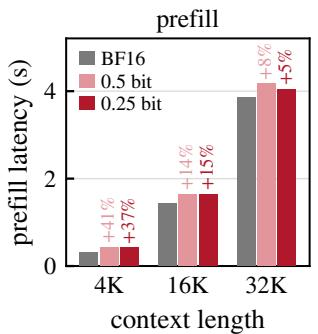  
(a)

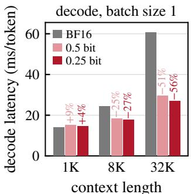  
(b)  
Figure 11. Latency of LoopVQ at 0.5 and 0.25 bit on Ouro-1.4B-Thinking with one A100 (40 GB) GPU. (a) Prefill latency and (b) decode latency per token at batch size 1, each with the change relative to BF16.

With one request per thread block, every block reads the table row of each token it attends to, and the blocks of different requests read the same rows again. At large batch sizes these reads account for about 40% of the kernel time. Since a token’s RoPE position depends only on its index in the sequence, the rows needed by two requests coincide wherever both requests have a token. The kernel assigns two requests to each thread block and cuts both into splits at the same boundaries, sized by the longer request, so that one load of a table row serves the tokens of both requests at the same index. The two requests also share the codebook slices $B _ { t } ^ { k }$ and $B _ { t } ^ { v }$ staged in shared memory, which halves the codebook loads per request. The shared-memory buffers of each request are halved accordingly, so a block uses the same shared memory as with one request. Each lane further handles the two channel groups that share the same frequencies, so that it loads their cosines and sines with single vector loads. At batch size 1 the kernel processes one request per block.

On an RTX 6000 Ada GPU with Ouro-1.4B-Thinking, this kernel reduces the decode attention time at batch size 64 and a 6K-token context by 37% and 48% at 0.5 and 0.25 bit compared with one request per block, and raises the end-toend throughput at batch size 64 with 2K-token prompts and 1K-token outputs by 46% and 63%.

## D ADDITIONAL EXPERIMENT RESULTS

## D.1 Efficiency results on an A100 (40 GB) GPU

We repeat the measurements of Section 5.3 on one NVIDIA A100 (40 GB) GPU with the same settings. The results follow the same trends as on the RTX 6000 Ada. The prefill overhead of LoopVQ decreases with the context length, and the reduction in decode latency grows with it, reaching about half of the BF16 latency at 32K tokens (Figure 11). As BF16 fits only a few long requests in memory, the peak throughput of LoopVQ exceeds that of BF16 by 2.8× to 3.7× (Figure 12). On the A100, the k-means calibration and the fine-tuning take 5.5 and 2.0 minutes for Ouro-1.4B and 11.2 and 4.6 minutes for Ouro-2.6B.

## D.2 Efficiency results on Ouro-2.6B-Thinking

We repeat the measurements of Section 5.3 on Ouro-2.6B-Thinking with the same GPU and settings. Prefill with LoopVQ is 5 to 9% slower than with BF16, and the decode latency at 16K tokens is about 35% lower (Figure 13). As Ouro-2.6B has twice as many layers as Ouro-1.4B, BF16 fits only one to three long requests in memory, and the peak throughput of LoopVQ exceeds that of BF16 by 5.0× to 6.1× (Figure 14).

## D.3 Time profile breakdown

Figure 15 breaks down the GPU time by kernel type, measured with the PyTorch profiler under the settings of Section 5.3. During decoding, the linear layers take the same time in all methods, and the difference comes from attention. With BF16, attention grows with the context length and accounts for most of the decode time at 32K tokens, whereas with LoopVQ it stays below the time of the linear layers. At batch size 16, attention takes 1.87 ms per generated token with BF16 and 0.63 and 0.54 ms with LoopVQ at 0.5 and 0.25 bit. Encoding takes under 1% of the decode time and 5 to 7% of the prefill time.

## D.4 Reasoning stability across models and bitwidths

Figure 16 extends Figure 10 to both Thinking models and both bitwidths. CQ and TaSQ exhaust the generation budget on a large share of problems in every setting. TaSQ+LoopVQ follows the length distribution of BF16 in all four settings, and LoopVQ does so at 0.5 bit.

Quantization errors can also end the reasoning early. With BF16, 16% and 22% of the generations of Ouro-1.4B-Thinking and Ouro-2.6B-Thinking end within 2K tokens. At 0.25 bit, this share rises to 33% and 59% with CQ and to 30% and 47% with TaSQ, whereas it stays at or below 30% with LoopVQ and TaSQ+LoopVQ in every setting.

## D.5 LongBench results

We also evaluate the base models on the 16 English tasks of LongBench (Bai et al., 2023), using the official prompts and metrics, greedy decoding, and prompts truncated in the middle to 64K tokens. As in the other long-context experiments, 64 sink and 256 recent tokens are kept in bf16. CQ and TaSQ fall 7 to 13 points below the BF16

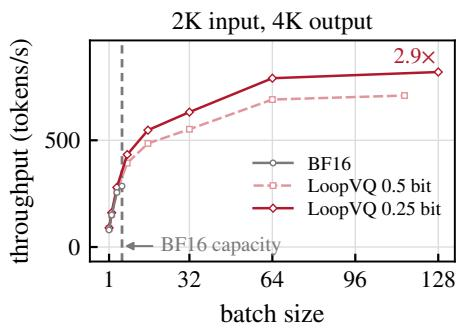  
(a)

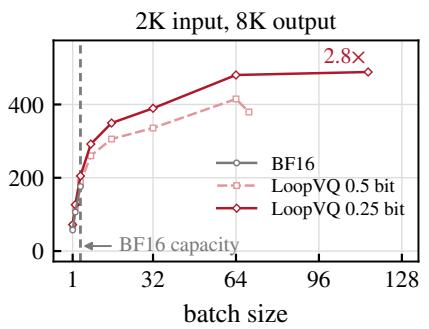  
(b)

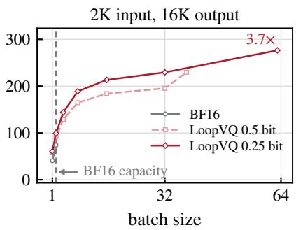  
(c)  
Figure 12. End-to-end throughput of LoopVQ on Ouro-1.4B-Thinking with one A100 (40 GB) GPU, versus batch size up to the largest batch that fits in memory.

Table 6. LongBench performance of Ouro-1.4B and Ouro-2.6B under low-bit KV cache quantization on the 16 English tasks, with the official metric of each task. All results use greedy decoding. Bold denotes the best quantized result; higher is better.
<table><tr><td rowspan="3">Model</td><td rowspan="3">Bitwidth</td><td rowspan="3">Method</td><td colspan="3">Single-doc QA</td><td colspan="3">Multi-doc QA</td><td colspan="3">Summarization</td><td colspan="3">Few-shot</td><td colspan="2">Synthetic</td><td colspan="2">Code</td><td rowspan="3">Avg.</td></tr><tr><td rowspan="2">NrtvQA</td><td rowspan="2">Qasper</td><td rowspan="2">MF-en</td><td rowspan="2">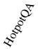</td><td rowspan="2">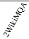</td><td rowspan="2">Musique</td><td rowspan="2">GovReport</td><td rowspan="2">QMSum</td><td rowspan="2"></td><td rowspan="2">TREC</td><td rowspan="2">TriviaQA</td><td rowspan="2">SAMSum</td><td colspan="2"></td><td rowspan="2"> $\tilde { \mathcal { I } }$ </td><td rowspan="2"> $\gtrelefteqn { \mathfrak { s } ^ { \mathfrak { s } } }$ </td></tr><tr><td>PCount</td><td> $\mathcal { E }$ </td></tr><tr><td rowspan="8">Ouro-1.4B</td><td rowspan="8">BF16</td><td></td><td>7.81</td><td>23.56</td><td>34.75</td><td>33.17</td><td>19.75</td><td>13.15</td><td>26.94</td><td>20.52</td><td>23.08</td><td>64.50</td><td>88.57</td><td>36.18</td><td>1.50</td><td>32.50</td><td>19.99</td><td>28.72</td><td>29.67</td></tr><tr><td>CQ</td><td>4.93</td><td>10.38</td><td>22.10</td><td>20.18</td><td>16.35</td><td>8.08</td><td>16.88</td><td>17.44</td><td>15.72</td><td>44.00</td><td>79.12</td><td>33.07</td><td>1.50</td><td>4.50</td><td>19.68</td><td>27.95</td><td>21.37</td></tr><tr><td>TaSQ</td><td>7.02</td><td>13.39</td><td>25.05</td><td>24.90</td><td>17.46</td><td>9.22</td><td>18.38</td><td>17.88</td><td>16.58</td><td>47.00</td><td>81.79</td><td>34.07</td><td>1.00</td><td>4.50</td><td>21.85</td><td>27.87</td><td>23.00</td></tr><tr><td>LoopVQ</td><td>7.31 8.11</td><td>19.29</td><td>30.71</td><td>32.63</td><td>19.23</td><td>12.82</td><td>23.73</td><td>18.94</td><td>21.06</td><td>58.50</td><td>87.80</td><td>35.61</td><td>2.00</td><td>16.00</td><td>22.09</td><td>29.60</td><td>27.33</td></tr><tr><td>TaSQ+LoopVQ</td><td></td><td>22.84</td><td>33.34</td><td>34.56</td><td>18.89</td><td>12.60</td><td>26.07</td><td>19.68</td><td>22.15</td><td>64.00</td><td>89.03</td><td>36.09</td><td>1.50</td><td>23.00</td><td>22.16</td><td>30.55</td><td>29.04</td></tr><tr><td>CQ</td><td></td><td>9.22</td><td>21.13</td><td>20.51</td><td>16.83</td><td>7.17</td><td>15.79</td><td>17.11</td><td>14.96</td><td>44.50</td><td>78.44</td><td>33.01</td><td>1.00</td><td>4.50</td><td>20.55</td><td>28.45</td><td>21.09</td></tr><tr><td>TaSQ 0.25 bit</td><td>5.69</td><td>10.46</td><td>21.65</td><td>20.73</td><td>16.56</td><td>6.76</td><td>16.50</td><td>17.22</td><td>15.69</td><td>45.00</td><td>79.20</td><td>31.98</td><td>1.00</td><td>4.50</td><td>20.54</td><td>27.69</td><td>21.32</td></tr><tr><td>LoopVQ</td><td>5.81</td><td>13.18</td><td>22.98</td><td>24.18</td><td>17.05</td><td>9.30</td><td>19.16</td><td>17.79</td><td>17.00</td><td>45.00</td><td>82.50</td><td>34.21</td><td>1.50</td><td>4.50</td><td>21.69</td><td>28.97</td><td>22.80</td></tr><tr><td rowspan="8"></td><td rowspan="8"></td><td>TaSQ+LoopVQ</td><td>6.40</td><td>19.61</td><td>30.48</td><td>32.57</td><td>18.71</td><td>12.67</td><td>22.88</td><td>18.36</td><td>19.77</td><td>56.50</td><td>87.09</td><td>34.39</td><td>1.00</td><td>6.50</td><td>22.05</td><td>29.69 26.17</td></tr><tr><td>BF16</td><td>9.90</td><td>31.54</td><td>47.80</td><td>42.38</td><td>39.16</td><td>28.00</td><td>28.08</td><td>23.53</td><td>25.73</td><td>72.00</td><td>88.76</td><td>13.50</td><td>0.00</td><td>70.00</td><td>36.95</td><td>37.46 37.18</td></tr><tr><td>CQ</td><td>7.49</td><td>15.86</td><td>31.73</td><td>26.29</td><td>31.49</td><td>13.42</td><td>17.58</td><td>19.18</td><td>16.70</td><td>48.50</td><td>81.28</td><td>12.04</td><td>0.00</td><td>7.00 38.91</td><td></td><td>33.60 25.07</td></tr><tr><td>TaSQ</td><td>8.41</td><td>17.82</td><td>35.24</td><td>32.51</td><td>33.24</td><td>20.24</td><td>19.03</td><td>19.17</td><td>17.74</td><td>52.00</td><td>85.74</td><td>11.25</td><td>0.00</td><td>9.00 40.47</td><td>35.81</td><td>27.35</td></tr><tr><td>0.5 bit LoopVQ</td><td>10.21</td><td>25.53</td><td>45.30</td><td>41.84</td><td>35.03</td><td>23.20</td><td>22.61</td><td>21.32</td><td>22.39</td><td>62.00</td><td>88.93</td><td>13.21</td><td>0.00 27.00</td><td>40.38</td><td>39.22</td><td>32.39</td></tr><tr><td>TaSQ+LoopVQ</td><td>9.83</td><td>29.41</td><td>48.46</td><td>43.18</td><td>38.93</td><td>26.11</td><td>25.80</td><td>22.38</td><td>24.39 15.17</td><td>72.00</td><td>89.01</td><td>12.87</td><td>0.00</td><td>49.00</td><td>39.73 39.93</td><td>35.69</td></tr><tr><td>CQ</td><td>7.48</td><td>15.22 15.19</td><td>31.20 31.54</td><td>25.60 26.27</td><td>30.73 31.36</td><td>12.91 14.86</td><td>16.84 17.13</td><td>18.84 18.66</td><td>15.96</td><td>47.00 47.50</td><td>81.12 82.37</td><td>12.07 11.04</td><td>0.00 0.00</td><td>7.50 38.51 39.37</td><td>33.85 34.48</td><td>24.63</td></tr><tr><td rowspan="3">0.25 bit</td><td>TaSQ LoopVQ</td><td>6.93 8.93</td><td>18.13</td><td>35.29</td><td>30.69</td><td>32.35</td><td>16.59</td><td>19.27</td><td>19.49</td><td>18.64</td><td>50.50</td><td>86.14</td><td>12.56</td><td>0.00</td><td>7.50 8.00</td><td>38.81</td><td>36.40</td><td>25.01 26.99</td></tr><tr><td></td><td></td><td>8.90 23.42</td><td>43.60</td><td>41.73</td><td>34.72</td><td>25.40</td><td>21.62</td><td>20.29</td><td>20.93</td><td>66.50</td><td>88.51</td><td>12.24</td><td>0.00</td><td>28.50</td><td>40.64</td><td>38.56</td><td>32.22</td></tr><tr><td>TaSQ+LoopVQ</td><td></td><td></td><td></td><td></td><td></td><td></td><td></td><td></td><td></td><td></td><td></td><td></td><td></td><td></td><td></td><td></td><td></td></tr></table>

average (Table 6). LoopVQ outperforms both baselines on average in every setting, and TaSQ+LoopVQ comes within 1.5 points of BF16 at 0.5 bit and achieves the highest average at both bitwidths.  
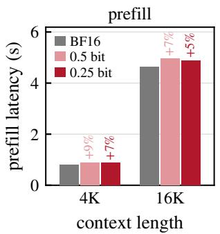  
(a)

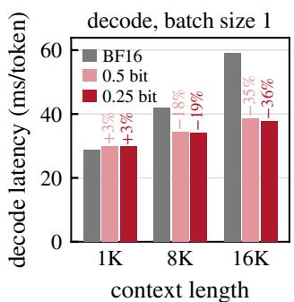  
(b)  
Figure 13. Latency of LoopVQ at 0.5 and 0.25 bit on Ouro-2.6B-Thinking with one RTX 6000 Ada GPU. (a) Prefill latency and (b) decode latency per token at batch size 1, each with the change relative to BF16.

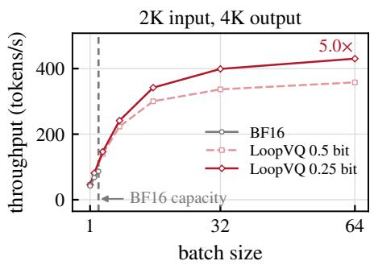  
(a)

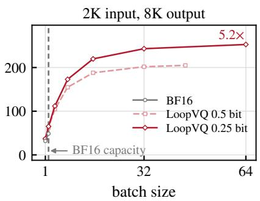  
(b)

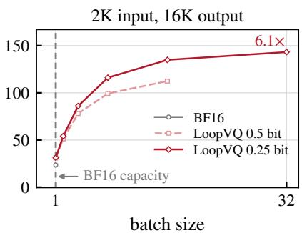  
(c)  
Figure 14. End-to-end throughput of LoopVQ on Ouro-2.6B-Thinking with one RTX 6000 Ada GPU, versus batch size up to the largest batch that fits in memory.

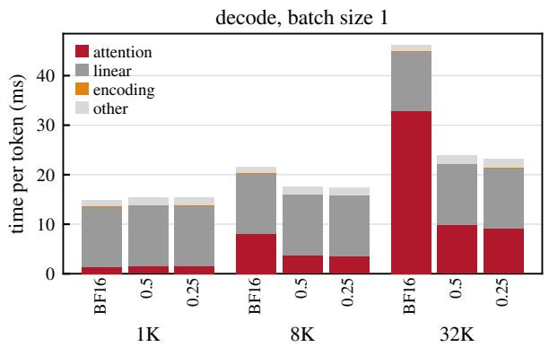  
(a)

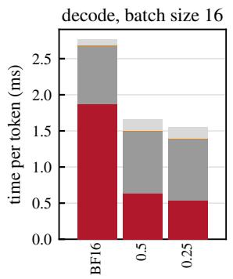  
(b)

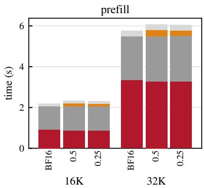  
(c)  
Figure 15. GPU time of LoopVQ and BF16 on Ouro-1.4B-Thinking with one RTX 6000 Ada GPU, by kernel type. (a) Decode time per token at batch size 1. (b) Decode time per generated token at batch size 16 with 2K-token prompts. (c) Prefill time. Attention includes the bf16 window, the LoopVQ kernel, and the merge of their splits.

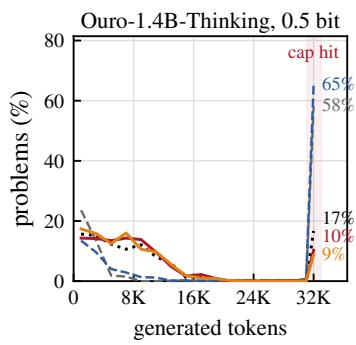

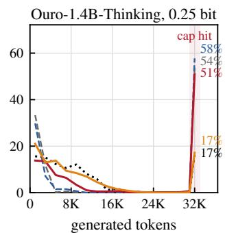

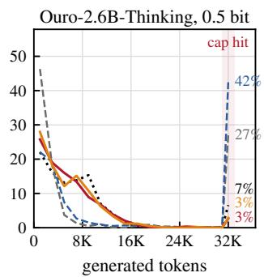

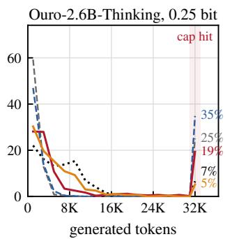  
Figure 16. Generation length on GPQA-Diamond of Ouro-1.4B-Thinking and Ouro-2.6B-Thinking under 0.5- and 0.25-bit KV cache quantization, with the share of problems that reach the 32K-token budget.