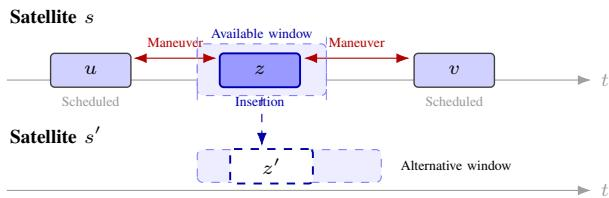
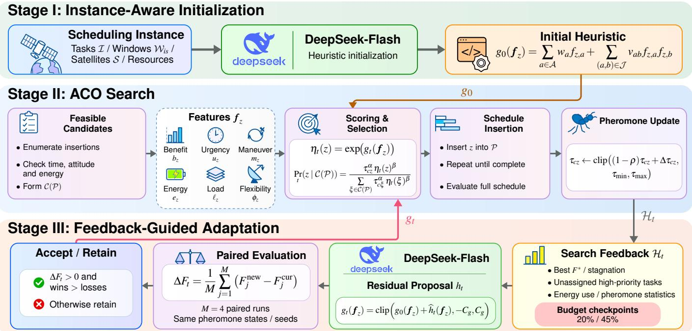
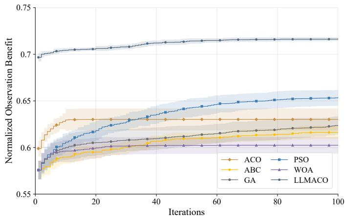
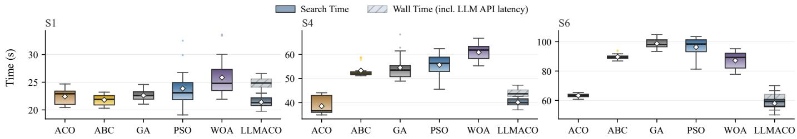

# Large Language Model-Assisted Adaptive Heuristic Search for Agile Earth Observation Satellite Scheduling

He Wang, Yeye Liu, Ruijie Li, Xuemei Jiang, Junyu Wu, Lining Liu Member, IEEE, Zhuoqi Man, Tao Li Senior Member, IEEE and Yanjie Song Senior Member, IEEE

Abstract—Agile Earth observation satellites must coordinate imaging tasks within limited observation windows, while accounting for attitude maneuvering and onboard energy constraints. Competition among observation opportunities makes scheduling performance sensitive to the heuristic rules used for task selection. This letter proposes a large language model (LLM)-assisted adaptive heuristic search method for agile Earth observation satellite scheduling. The LLM generates an initial heuristic rule according to the characteristics of the scheduling instance. During the subsequent ant colony search, search performance and scheduling information are fed back to the LLM to refine the heuristic rule. The proposed modifications are evaluated through paired solution constructions before being incorporated into the search process. A unified scheduling procedure determines task selection, satellite assignment, and observation timing under the operational constraints. Experiments on six scheduling scenarios involving 50–200 imaging tasks demonstrate that the proposed method achieves 4.3%–9.6% higher mean observation benefit than the strongest baseline.

Index Terms—Remote Sensing, Earth Observation, Satellite Scheduling, Large Language Model, Heuristic Algorithm.

## I. INTRODUCTION

GILE Earth observation satellites (AEOSs) can adjust their attitudes to image multiple ground targets within limited visibility intervals. However, scheduling these observations requires coordinating task selection, satellite assignment, and observation timing under attitude maneuvering and onboard resource constraints. As imaging requests increase, competition for observation windows becomes more pronounced, and executing one task may reduce the opportunities available to others. Efficient scheduling is essential for improving observation benefit under limited satellite resources [1].

Considerable research has addressed AEOS scheduling through mathematical optimization and heuristic methods. Peng et al. [2] developed a branch-and-cut-and-price algorithm considering time-dependent transitions and variable observation windows. Rocha et al. [3] investigated integrated observation and downlink scheduling using mixed-integer programming and model-based heuristics. Wang et al. [4] proposed a Lagrangian relaxation-based heuristic to address time-dependent scheduling constraints. Although these methods provide effective optimization strategies, the large number of task sequences and satellite-window combinations makes efficient schedule construction an important research direction.

Heuristic and learning-assisted methods have also received increasing attention. Chen et al. [5] combined differential evolution with ensemble heuristics for satellite scheduling, while Li et al. [6] integrated deep Q-learning with heuristic task allocation. Chen et al. [7] developed a neural priority model to guide observation sequencing. More recently, Huang et al. [8] introduced reinforcement learning into dung beetle optimization to regulate search strategies. Wang et al. [9] employed reinforcement learning to guide evolutionary policy optimization, and Wei et al. [10] used genetic programming to evolve scheduling heuristics through knowledge transfer. These studies have advanced adaptive search and heuristic construction for AEOS scheduling. In particular, candidate evaluation remains important because task benefits, observationwindow availability, and resource consumption may influence scheduling decisions differently across instances.

Large language models (LLMs) offer a way to generate and refine heuristic rules using optimization feedback. Romera-Paredes et al. [11] demonstrated that LLM-generated priority functions can be improved through external performance evaluation. Van Stein and Back [¨ 12] further developed an LLM-based framework for automatically generating and refining metaheuristic algorithms. These approaches provide a basis for incorporating LLM-generated heuristics into AEOS scheduling. Rather than directly producing observation sequences, an LLM can construct task-selection rules from instance information and revise them according to search performance, while the scheduling algorithm handles feasible solution construction.

This letter proposes a large language model-assisted adaptive heuristic search method for AEOS scheduling. An LLM generates an initial candidate-observation scoring rule and subsequently refines it using feedback from ant colony search. The proposed modifications are evaluated before being incorporated into subsequent search. The main contributions are summarized as follows:

1) An LLM-assisted initialization method is developed to generate and validate instance-specific scheduling heuristics.

2) A feedback-guided adaptation mechanism is introduced to refine heuristics during ant colony search through bounded updates and paired evaluations.

3) A unified scheduling framework integrates LLMgenerated candidate scoring with constraint-preserving solution construction, enabling effective search across different task scales and observation-window conditions.

## II. SCHEDULING MODEL AND LLM-ASSISTED SEARCH

## A. Scheduling Model

Consider a set of imaging tasks $\mathcal { T } = \{ 1 , \ldots , N _ { I } \}$ and a set of agile Earth observation satellites $\mathbfcal { S } = \{ 1 , \dots , N _ { S } \}$ over a planning horizon $\mathcal { T } = [ 0 , T ]$ . Each task $i \in \mathcal { T }$ is characterized by its priority $p _ { i } ,$ imaging duration $d _ { i }$ , release time $r _ { i } ,$ and deadline $D _ { i }$ . For satellite $s \in S _ { \mathbf { \partial } }$ , let $\mathcal { W } _ { i s }$ denote the set of available observation windows for task i. Each window indexed by $k \in \mathcal { W } _ { i s }$ is characterized by its visibility interval $[ a _ { i s k } , b _ { i s k } ]$ , observation quality $q _ { i s k }$ , and required pointing angle $\theta _ { i s k }$

A candidate observation is represented by $z = ( i , s , k )$ , and all candidate observations form the set

$$
\mathcal { Z } = \left\{ ( i , s , k ) ~ | ~ i \in \mathcal { T } , ~ s \in \mathcal { S } , \ k \in \mathcal { W } _ { i s } \right\} .\tag{1}
$$

Let $x _ { i s k } ~ \in ~ \{ 0 , 1 \}$ indicate whether candidate $( i , s , k )$ is scheduled. The objective is to maximize the total observation benefit:

$$
\operatorname* { m a x } F = \sum _ { i \in \mathcal { Z } } \sum _ { s \in \mathcal { S } } \sum _ { k \in \mathcal { W } _ { i s } } p _ { i } q _ { i s k } x _ { i s k } .\tag{2}
$$

Each imaging task can be executed at most once:

$$
\sum _ { s \in S } \sum _ { k \in \mathcal { W } _ { i s } } x _ { i s k } \le 1 , \quad \forall i \in \mathcal { T } .\tag{3}
$$

The complete schedule is denoted by $\mathcal { P } = \{ \Pi _ { s } ~ | ~ s \in \mathcal { S } \}$ where $\Pi _ { s } = ( z _ { s 1 } , \ldots , z _ { s m _ { s } } )$ is the chronologically ordered observation sequence assigned to satellite s. For a selected candidate $z = ( i , s , k )$ , its imaging start time $t _ { z }$ must satisfy

$$
\begin{array} { r l } & { \underline { { t } } _ { z } = \operatorname* { m a x } \{ r _ { i } , a _ { i s k } \} , } \\ & { \bar { t } _ { z } = \operatorname* { m i n } \{ D _ { i } , b _ { i s k } \} - d _ { i } , } \\ & { \underline { { t } } _ { z } \leq t _ { z } \leq \bar { t } _ { z } . } \end{array}\tag{4}
$$

The observation sequence must also satisfy the attitudetransition and onboard energy constraints described below.

For two consecutive observations $u = z _ { s \ell }$ and $v = z _ { s , \ell + 1 }$ in $\Pi _ { s }$ , let $\Delta \theta _ { u v }$ denote the required attitude displacement. The corresponding maneuver time is determined by the maximum angular velocity $\omega _ { s } ^ { \mathrm { m a x } }$ and angular acceleration $a _ { s } ^ { \mathrm { m a x } }$

$$
T _ { s } ( \Delta \theta ) = \left\{ \begin{array} { l l } { 2 \sqrt { \displaystyle \frac { \Delta \theta } { a _ { s } ^ { \operatorname* { m a x } } } } , } & { \Delta \theta \leq \frac { ( \omega _ { s } ^ { \operatorname* { m a x } } ) ^ { 2 } } { a _ { s } ^ { \operatorname* { m a x } } } , } \\ { \displaystyle \frac { \Delta \theta } { \omega _ { s } ^ { \operatorname* { m a x } } } + \frac { \omega _ { s } ^ { \operatorname* { m a x } } } { a _ { s } ^ { \operatorname* { m a x } } } , } & { \mathrm { o t h e r w i s e } . } \end{array} \right.\tag{5}
$$

For simplicity, let $T _ { u v } = T _ { s } ( \Delta \theta _ { u v } )$ . The start times of adjacent observations must satisfy

$$
t _ { v } \geq t _ { u } + d _ { i ( u ) } + T _ { u v } , \quad \forall ( u , v ) \in \mathcal { A } _ { s } ,\tag{6}
$$

where $\mathcal { A } _ { s }$ denotes the set of consecutive observation pairs in $\Pi _ { s } ,$ and $i ( u )$ identifies the task associated with observation u.

Let $P _ { s } ^ { \mathrm { i m g } }$ and $P _ { s } ^ { \mathrm { m a n } }$ denote the imaging and maneuvering powers of satellite $s ,$ respectively. Its total energy consumption is expressed as

$$
E _ { s } ( \Pi _ { s } ) = \frac { 1 } { \kappa _ { E } } \left[ P _ { s } ^ { \mathrm { i m g } } \sum _ { \ell = 1 } ^ { m _ { s } } d _ { i ( z _ { s \ell } ) } + P _ { s } ^ { \mathrm { m a n } } \sum _ { \ell = 1 } ^ { m _ { s } } T _ { s } ( \Delta \theta _ { s \ell } ) \right] ,\tag{7}
$$

where $\Delta \theta _ { s \ell }$ is the attitude displacement from the preceding observation, or from the initial attitude for the first observation, and $\kappa _ { E }$ is the energy unit conversion factor. The energy constraint is

$$
E _ { s } ( \Pi _ { s } ) \leq E _ { s } ^ { \operatorname* { m a x } } , \quad \forall s \in \mathcal { S } ,\tag{8}
$$

where $E _ { s } ^ { \mathrm { m a x } }$ is the available onboard energy. Together with (3) and (4), these constraints define the feasible scheduling space.

## B. Feasible Observation Construction

A feasible schedule is constructed by inserting candidate observations into satellite-specific sequences. Given the current schedule $\mathcal { P } \ : = \ : \{ \Pi _ { s } \ | \ : \ : s \in \ : \mathcal { S } \}$ , let $\mathcal { G } _ { s } ( \Pi _ { s } )$ denote the set of insertion positions in the sequence of satellite s. For a candidate $z = ( i , s , k )$ , each position is determined by its preceding observation u and succeeding observation v.

The admissible start-time interval of candidate z at position $( u , v )$ is

$$
\begin{array} { l } { { \underline { { { t } } } _ { z } ^ { ( u , v ) } = \operatorname* { m a x } \bigl \{ r _ { i } , a _ { i s k } , t _ { u } + d _ { i ( u ) } + T _ { u z } \bigr \} , } } \\ { { \bar { t } _ { z } ^ { ( u , v ) } = \operatorname* { m i n } \bigl \{ D _ { i } - d _ { i } , b _ { i s k } - d _ { i } , t _ { v } - d _ { i } - T _ { z v } \bigr \} . } } \end{array}\tag{9}
$$

Here, $T _ { u z }$ and $T _ { z v }$ denote the maneuver times associated with the two new transitions. The initial satellite state and planning horizon provide the boundary conditions when u or v does not exist. A candidate can be inserted without shifting the existing observations if

$$
\underline { { t } } _ { z } ^ { ( u , v ) } \leq \bar { t } _ { z } ^ { ( u , v ) } .\tag{10}
$$

Inserting z also changes the maneuvering energy of the corresponding satellite. For an internal insertion position, the incremental energy consumption is

$$
\begin{array} { l } { \displaystyle \Delta E _ { s } ( z \mid u , v ) = \frac { P _ { s } ^ { \mathrm { i m g } } d _ { i } } { \kappa _ { E } } } \\ { \displaystyle \qquad + \frac { P _ { s } ^ { \mathrm { m a n } } } { \kappa _ { E } } \left( T _ { u z } + T _ { z v } - T _ { u v } \right) . } \end{array}\tag{11}
$$

The last term removes the original transition from u to v. At sequence boundaries, the corresponding initial attitude or terminal condition is used. The insertion is accepted only when

$$
E _ { s } ( \Pi _ { s } ) + \Delta E _ { s } ( z \mid u , v ) \le E _ { s } ^ { \operatorname* { m a x } } .\tag{12}
$$

The insertion process is illustrated in Fig. 1, where a candidate observation is placed between two scheduled tasks while accounting for maneuvering times and alternative opportunities.

Let $\mathcal { F }$ denote the set of schedules satisfying the constraints in Section II-A. The feasible candidate set under the current schedule is

$$
\mathcal { C } ( \mathcal { P } ) = \left\{ z \in \mathcal { Z } \left| \begin{array} { l } { \exists \ell \in \mathcal { G } _ { s } ( \Pi _ { s } ) , } \\ { \mathcal { P } \oplus ( z , \ell ) \in \mathcal { F } } \end{array} \right. \right\} ,\tag{13}
$$

  
Fig. 1. Feasible observation insertion and alternative opportunities.

where $\mathcal { P } \oplus ( z , \ell )$ denotes the schedule obtained by inserting candidate z at position ℓ. The insertion decoder examines feasible positions and determines the earliest admissible execution time for each candidate observation. The resulting feasible candidates form ( ).

## C. LLM-Assisted Heuristic Initialization

At the beginning of each scheduling instance, the LLM receives a summary of task benefits, observation-window distributions, and satellite resource conditions. Based on this information, the LLM generates an initial heuristic scoring function $g _ { 0 }$ for evaluating candidate observations. Let $f _ { z }$ denote the normalized scheduling features of candidate $z \in \mathcal { C } ( \mathcal { P } )$ . The scoring function consists of linear terms and selected pairwise interactions:

$$
g _ { 0 } ( \pmb { f } _ { z } ) = \sum _ { a \in \mathcal { K } } w _ { a } f _ { z , a } + \sum _ { ( a , b ) \in \mathcal { J } } v _ { a b } f _ { z , a } f _ { z , b } .\tag{14}
$$

where $\kappa$ denotes the feature index set, $\mathcal { I }$ contains the selected feature pairs, and $w _ { a }$ and $v _ { a b }$ are the generated coefficients.

The LLM returns the scoring function in a structured format. Feature names, coefficient ranges, and numerical values are validated before the function is used in scheduling. The resulting heuristic value is calculated as

$$
\eta _ { 0 } ( z ) = \exp \left( \mathrm { c l i p } \left[ g _ { 0 } ( { \pmb f } _ { z } ) , - C _ { g } , C _ { g } \right] \right) ,\tag{15}
$$

where $C _ { g }$ bounds the scoring function and $\eta _ { 0 } ( z ) > 0$

During schedule construction, the heuristic is combined with pheromone information to determine the selection probability of each feasible candidate:

$$
\operatorname* { P r } _ { t } ( z \mid c , \mathcal { P } ) = \frac { \tau _ { c z } ^ { \alpha } \eta _ { t } ( z ) ^ { \beta } } { \displaystyle \sum _ { \xi \in \mathcal { C } ( \mathcal { P } ) } \tau _ { c \xi } ^ { \alpha } \eta _ { t } ( \xi ) ^ { \beta } } ,\tag{16}
$$

where c denotes the preceding candidate in the construction order, $\tau _ { c z }$ is the corresponding pheromone intensity, and α and $\beta$ control the relative influence of pheromone and heuristic information. Initially, $\eta _ { t } ( z ) = \eta _ { 0 } ( z )$ . The selected candidate is inserted into the satellite schedule using the procedure in Section II-B.

After each search iteration, pheromone intensities are updated according to

$$
\begin{array} { r l r } & { } & { \tau _ { c z } \gets \mathrm { c l i p } \big ( ( 1 - \rho ) \tau _ { c z } + \Delta \tau _ { c z } , } \\ & { } & { \tau _ { \operatorname* { m i n } } , \tau _ { \operatorname* { m a x } } \big ) , \quad } \end{array}\tag{17}
$$

where $\rho$ is the evaporation rate, $\Delta \tau _ { c z }$ denotes the pheromone reinforcement from the selected search solution, and $\tau _ { \mathrm { m i n } }$ and $\tau _ { \mathrm { m a x } }$ are the pheromone bounds. The heuristic rule is subsequently adjusted using search feedback.

## D. Feedback-Based Heuristic Adaptation

During ant colony search, feedback is collected at two checkpoints corresponding to 20% and 45% of the evaluation budget. Let $\mathcal { H } _ { t }$ denote the feedback information at checkpoint $t ,$ including the best observation benefit, search stagnation, unassigned high-priority tasks, satellite energy utilization, and pheromone statistics. The LLM uses $\mathcal { H } _ { t }$ and the current heuristic rule to generate a residual scoring function $h _ { t }$

The updated heuristic score is defined as

$$
g _ { t } ( { f } _ { z } ) = \mathrm { c l i p } \left( g _ { 0 } ( { f } _ { z } ) + \widehat { h } _ { t } ( { f } _ { z } ) , - C _ { g } , C _ { g } \right) .\tag{18}
$$

where $\widehat { h } _ { t } ( \pmb { f } _ { z } ) = \mathrm { c l i p } ( h _ { t } ( \pmb { f } _ { z } ) , - C _ { h } , C _ { h } )$ is the bounded residbual and $C _ { h }$ controls the maximum adjustment. The corresponding heuristic value is

$$
\begin{array} { r } { \eta _ { t } ( z ) = \exp \left( g _ { t } ( \pmb { f } _ { z } ) \right) . } \end{array}\tag{19}
$$

Each proposed residual is structurally and numerically validated before evaluation.

To assess a proposed modification, the current and updated rules are evaluated through M paired schedule constructions using identical pheromone states and random seeds. The mean benefit difference is calculated as

$$
\Delta F _ { t } = \frac { 1 } { M } \sum _ { j = 1 } ^ { M } \left( F _ { j } ^ { \mathrm { n e w } } - F _ { j } ^ { \mathrm { c u r } } \right) ,\tag{20}
$$

where $F _ { j } ^ { \mathrm { n e w } }$ and $F _ { j } ^ { \mathrm { c u r } }$ denote the observation benefits obtained using the proposed and current heuristics, respectively.

The proposed rule is accepted when $\Delta F _ { t } ~ > ~ 0$ and the number of improved pairs exceeds that of degraded pairs. The accepted residual replaces the previous correction, while the initial rule $g _ { 0 }$ remains unchanged. Subsequent search uses the updated heuristic together with pheromone information to construct feasible schedules.

The overall search procedure is illustrated in Fig. 2 and summarized in Algorithm 1.

## III. EXPERIMENTAL RESULTS AND ANALYSIS

## A. Simulation Setup

Six scheduling scenarios, denoted as S1–S6, are considered to evaluate the proposed method. The task numbers are set to 50, 100, and 200, with two scenarios at each scale. S1, S3, and S5 represent moderate observation-window competition, while S2, S4, and S6 represent high competition. Each scenario involves three agile satellites over a 24-h planning horizon. The observation duration is 60 s, and task priorities are randomly assigned from 1 to 10. The scheduling process considers observation windows, attitude maneuvering, and onboard energy constraints.

Five representative algorithms are selected for comparison, including ant colony optimization (ACO) [13], artificial bee colony (ABC) [14], genetic algorithm (GA) [15], particle swarm optimization (PSO) [16], and whale optimization algorithm (WOA) [17]. Their parameters follow the corresponding reference settings.

The proposed LLMACO employs DeepSeek-Flash for heuristic generation and adaptation, with $\alpha \ = \ 1 , \ \beta \ = \ 3 ,$ and $\rho \mathrm { ~  ~ { ~ = ~ } ~ } 0 . 1 5$ for ant colony search. Heuristic updates are considered at 20% and 45% of the maximum iteration count, with four paired trials used to evaluate each proposed update. All algorithms are independently executed 20 times per scenario, with a maximum of 100 iterations per run. The mean and standard deviation are reported for comparison.

Fig. 2. Framework of the proposed LLM-assisted adaptive heuristic search for AEOSs scheduling.  
Algorithm 1 LLM-Assisted Adaptive Heuristic Search   
Require: Scheduling instance , evaluation budget B   
Ensure: Best feasible schedule ${ \mathcal { P } } ^ { \star }$   
1: Extract instance information from   
2: Generate and validate initial LLM heuristic $g _ { 0 }$   
3: Initialize pheromone $\tau ,$ residual $h = 0 ,$ and ${ \mathcal { P } } ^ { \star }$   
4: while search budget remains do   
5: Construct feasible schedules using (16)   
6: Update ${ \mathcal { P } } ^ { \star }$ and pheromone by (17)   
7: if a feedback checkpoint is reached then   
8: Collect search feedback $\mathcal { H } _ { t }$   
9: Generate and validate residual proposal $\widehat { h } _ { t }$   
10: bEvaluate current and proposed rules using paired   
constructions   
11: if $\Delta F _ { t } > 0$ and wins $>$ losses then   
12: $h  h _ { t }$   
13: end if   
14: end if   
15: end while   
16: return ${ \mathcal { P } } ^ { \star }$

## B. Scheduling Performance and Convergence

Table I and Fig. 3 present the scheduling performance and convergence behavior of the compared algorithms. LLM-ACO achieves the highest mean observation benefit in all six scenarios, improving upon the strongest baseline by 4.32%– 9.63%. At each task scale, the improvement is greater under high observation-window competition. LLM-ACO also exhibits the lowest standard deviation across all scenarios. In S6, the proposed method maintains a clear advantage from the early iterations, while PSO improves progressively and conventional ACO stabilizes earlier. These results indicate that the generated heuristic provides effective candidate-selection preferences throughout the search.

  
Fig. 3. Convergence comparison of different algorithms under scenario S6.

## C. Computational Time Analysis

Fig. 4 compares the runtime distributions of the six algorithms in S1, S4, and S6. Compared with ACO, LLMACO requires additional processing for heuristic generation and feedback evaluation. Its runtime is slightly higher in S1 and S4, but lower in S6. The generated rules are evaluated directly during schedule construction, while LLM inference is restricted to predefined feedback checkpoints. The results show that adaptive heuristic search maintains competitive computational efficiency as the scheduling scale increases.

TABLE I  
COMPARISON OF OBSERVATION BENEFIT AFTER 100 ITERATIONS (MEAN STANDARD DEVIATION OVER 20 INDEPENDENT RUNS). THE LAST COLUMN REPORTS THE IMPROVEMENT OVER THE STRONGEST BASELINE. BEST VALUES ARE HIGHLIGHTED IN BOLD.
<table><tr><td>Scenario</td><td>ACO</td><td>ABC</td><td>GA</td><td>PSO</td><td>WOA</td><td>LLMACO</td><td>Gain vs. best (%)</td></tr><tr><td>S1</td><td> $2 2 5 . 7 0 \pm 4 . 8 2$ </td><td> $2 2 8 . 1 0 \pm 3 . 5 1$ </td><td> $2 2 7 . 3 0 \pm 5 . 0 6$ </td><td> $2 3 3 . 5 5 \pm 3 . 1 7$ </td><td> $2 2 1 . 0 5 \pm 5 . 2 4$ </td><td> $\mathbf { 2 4 3 . 6 5 \pm 0 . 8 1 }$ </td><td>+4.32+</td></tr><tr><td>S2</td><td> $1 8 1 . 9 0 \pm 3 . 5 2 $ </td><td> $1 9 1 . 0 5 \pm 2 . 8 2$ </td><td> $1 8 4 . 4 0 \pm 7 . 1 4$ </td><td> $1 9 1 . 8 5 \pm 4 . 3 9$ </td><td> $1 7 5 . 7 5 \pm 6 . 3 4$ </td><td> $\mathbf { 2 0 2 . 5 0 \pm 0 . 5 1 }$ </td><td>+5.55+</td></tr><tr><td>S3</td><td> $4 8 9 . 8 0 \pm 6 . 0 1$ </td><td> $4 8 6 . 0 0 \pm 5 . 8 9$ </td><td> $4 8 9 . 6 0 \pm 9 . 9 1$ </td><td> $5 0 3 . 7 5 \pm 8 . 7 5$ </td><td> $4 7 6 . 1 0 \pm 7 . 8 5$ </td><td> $\mathbf { 5 2 8 . 2 0 \pm 1 . 5 8 }$ </td><td>+4.85+</td></tr><tr><td>S4</td><td> $4 1 6 . 3 5 \pm 5 . 5 9$ </td><td> $4 1 6 . 0 5 \pm 5 . 8 3$ </td><td> $4 1 9 . 0 5 \pm 8 . 9 9$ </td><td> $4 3 1 . 1 0 \pm 9 . 8 7$ </td><td> $3 9 7 . 8 0 \pm 8 . 9 1$ </td><td> $\mathbf { 4 7 0 . 3 5 \pm 0 . 7 5 }$ </td><td>+9.10+</td></tr><tr><td>S5</td><td> $8 4 4 . 0 5 \pm 7 . 2 7$ </td><td> $8 1 7 . 9 0 \pm 9 . 1 6$ </td><td> $8 3 5 . 6 0 \pm 1 1 . 8 4$ </td><td> $8 6 6 . 0 5 \pm 1 2 . 1 9$ </td><td> $8 1 2 . 1 5 \pm 1 2 . 6 1$ </td><td> $\mathbf { 9 2 0 . 5 5 \pm 2 . 2 6 }$ </td><td>+6.29+</td></tr><tr><td>S6</td><td> $6 9 0 . 6 0 \pm 1 3 . 2 9$ </td><td> $6 7 5 . 5 0 \pm 7 . 9 8$ </td><td> $6 8 3 . 6 5 \pm 1 0 . 9 3$ </td><td> $7 1 6 . 2 0 \pm 9 . 8 8$ </td><td> $6 6 0 . 2 5 \pm 1 0 . 0 8$ </td><td> $\mathbf { 7 8 5 . 2 0 \pm 2 . 2 1 }$ </td><td>+9.63+</td></tr></table>

  
Fig. 4. Runtime distributions of different algorithms under scenarios ${ \mathrm { S 1 } } , { \mathrm { S 4 } } ,$ and S6.

## IV. CONCLUSION

This letter investigated LLM-assisted heuristic search for agile Earth observation satellite scheduling. The proposed LLMACO achieved consistently higher observation benefits across different task scales and observation-window competition levels. The results indicate that instance-specific heuristic rules can improve candidate selection while preserving the feasibility of constructed schedules. The current experiments consider fixed task sets and observation windows. Future research will address dynamic task arrivals and changing observation conditions, together with the transfer of effective heuristic rules between scheduling instances.

## REFERENCES

[1] B. Ferrari, J.-F. Cordeau, M. Delorme, M. Iori, and R. Orosei, “Satellite scheduling problems: A survey of applications in Earth and outer space observation,” Computers & Operations Research, vol. 173, Art. no. 106875, 2025. doi: 10.1016/j.cor.2024.106875.

[2] G. Peng, J. Wang, G. Song, A. Gunawan, L. Xing, and P. Vansteenwegen, “Branch-and-cut-and-price for agile Earth observation satellite scheduling,” European Journal of Operational Research, vol. 326, no. 3, pp. 427–438, 2025. doi: 10.1016/j.ejor.2025.04.014.

[3] Y. Rocha, G. O. Chagas, L. C. Coelho, and A. Subramanian, “The integrated agile Earth observation satellite scheduling problem,” Computers & Operations Research, vol. 184, Art. no. 107212, 2025. doi: 10.1016/j.cor.2025.107212.

[4] F. Wang, Y. Chen, L. He, J. Chen, S. Xu, and H. Huang, “A Lagrangian relaxation-based heuristic algorithm for multiple agile Earth observation satellite scheduling with time-dependent constraint,” European Journal of Operational Research, vol. 332, no. 1, pp. 84–100, 2026. doi: 10.1016/j.ejor.2025.12.047.

[5] M. Chen, B. Li, L. Xing, and Y. Chen, “DEEM: A differential evolution ensemble method for optimizing agile satellite scheduling,” Expert Systems with Applications, vol. 272, Art. no. 126771, 2025. doi: 10.1016/j.eswa.2025.126771.

[6] B. Li, M. Chen, L. Xing, Y. Chen, and Y. Chen, “Optimizing timedependent multi-agile Earth observation satellite scheduling problem using deep Q-learning and ensemble heuristics,” Information Sciences, vol. 712, Art. no. 122140, 2025. doi: 10.1016/j.ins.2025.122140.

[7] M. Chen, L. Wei, J. Chun, L. He, S. Xiang, L. Xing, and Y. Chen, “A neural priority model for agile Earth observation satellite scheduling using deep reinforcement learning,” Applied Soft Computing, vol. 174, Art. no. 112984, 2025. doi: 10.1016/j.asoc.2025.112984.

[8] W. Huang, H. Wang, J. Wu, H. Hou, J. Li, Z. Li, and Y. Song, “A reinforcement learning-enhanced dung beetle optimization approach for agile Earth observation satellite scheduling,” IEEE Geoscience and Remote Sensing Letters, vol. 22, Art. no. 8000305, 2025. doi: 10.1109/LGRS.2025.3527925.

[9] H. Wang, J. Wu, H. Li, Y. Song, W. Pedrycz, and L. Li, “Reinforcement learning-guided evolutionary policy optimization for preferenceadjustable heterogeneous agile Earth observation satellite scheduling,” IEEE Transactions on Geoscience and Remote Sensing, pp. 1–16, 2026, early access. doi: 10.1109/TGRS.2026.3745218.

[10] L. Wei, M. Chen, L. Xing, Q. Wan, Y. Song, Y. Chen, and Y. Chen, “Knowledge-transfer based genetic programming algorithm for multiobjective dynamic agile Earth observation satellite scheduling problem,” Swarm and Evolutionary Computation, vol. 85, Art. no. 101460, 2024. doi: 10.1016/j.swevo.2023.101460.

[11] B. Romera-Paredes, M. Barekatain, A. Novikov, M. Balog, M. P. Kumar, E. Dupont, F. J. R. Ruiz, et al., “Mathematical discoveries from program search with large language models,” Nature, vol. 625, no. 7995, pp. 468– 475, 2024. doi: 10.1038/s41586-023-06924-6.

[12] N. van Stein and T. Back, “LLaMEA: A large language model evo-¨ lutionary algorithm for automatically generating metaheuristics,” IEEE Transactions on Evolutionary Computation, vol. 29, no. 2, pp. 331–345, 2025. doi: 10.1109/TEVC.2024.3497793.

[13] M. Dorigo, V. Maniezzo, and A. Colorni, “Ant system: Optimization by a colony of cooperating agents,” IEEE Transactions on Systems, Man, and Cybernetics, Part B (Cybernetics), vol. 26, no. 1, pp. 29–41, 1996. doi: 10.1109/3477.484436.

[14] D. Karaboga and B. Basturk, “A powerful and efficient algorithm for numerical function optimization: Artificial bee colony (ABC) algorithm,” Journal of Global Optimization, vol. 39, no. 3, pp. 459–471, 2007. doi: 10.1007/s10898-007-9149-x.

[15] D. E. Goldberg, Genetic Algorithms in Search, Optimization, and Machine Learning. Reading, MA, USA: Addison-Wesley, 1989.

[16] J. Kennedy and R. Eberhart, “Particle swarm optimization,” in Proceedings of the IEEE International Conference on Neural Networks, Perth, Australia, 1995, vol. 4, pp. 1942–1948. doi: 10.1109/ICNN.1995.488968.

[17] S. Mirjalili and A. Lewis, “The whale optimization algorithm,” Advances in Engineering Software, vol. 95, pp. 51–67, 2016. doi: 10.1016/j.advengsoft.2016.01.008.