# MDSKILL: LEARNING TO INTERNALIZE SKILL MEM-ORY THROUGH MULTI-VIEW DISTILLATION FOR EFFI-CIENT DYNAMIC AGENT SELF-EVOLUTION

Dian Jin1,2, Jinluan Yang1, Kairong Han1, Baohong Li1, Zijing Hu1, Yi He1, Wenlin Zhong1,2, Yunze Tong1, Minqin Zhu1,2, Linchuan Li2, Yanan Niu2, Kun Kuang 1∗

1Zhejiang University, 2Kuaishou Technology

dianjin@zju.edu.cn

## ABSTRACT

Skill memories encode past experiences as textual prompts to improve reinforcement learning (RL) for self-evolving agents. Complementing RL, On-Policy Self-Distillation(OPSD) provides dense, fine-grained supervision to internalize knowledge from skill-guided trajectories and accelerate policy learning. However, selfgenerated memories often contain noisy supervision and functionally entangled, redundant, or conflicting knowledge, making direct distillation difficult. Under limited training budgets, these issues can hinder knowledge internalization and even degrade performance. To address this problem, we propose MDSKILL, a multi-view distillation approach for skill memory internalization. MDSKILL organizes skill memories into three complementary functional views—state grounding, action planning, and execution control—and selects high-quality skills using dynamic metrics to construct view-specific and integrated reasoning branches. OPSD then transfers and consolidates complementary experiential knowledge across these branches into a shared policy, enabling efficient skill internalization and continuous agent self-evolution. We evaluate MDSKILL on three agent benchmarks against RL, skill-augmented, and self-distillation baselines that do not rely on stronger external teacher models. Without additional computational overhead, MDSKILL improves upon SOTA performance by up to 7.1% and 8.1% on ALFWorld and WebShop. Extensive ablations and evolution analyses further validate its effectiveness in knowledge internalization and policy improvement. The code is available at the https://anonymous.4open.science/r/MDSKILL-CF53.

## 1 INTRODUCTION

Agentic reinforcement learning (RL) has demonstrated strong performance on multi-turn interactive tasks (Shao et al., 2024; Yang et al., 2025; Dong et al., 2026; Feng et al., 2026). However, sparse and delayed rewards provide limited supervision for policy improvement. Skill memories offer a promising source of experiential knowledge: they summarize lessons from real interaction trajectories and guide subsequent decisions through textual prompts (Shinn et al., 2023; Wang et al., 2023). Although external skill memories improve task success, agent self-evolution requires internalizing their experiential knowledge into model parameters to retain and apply acquired capabilities without explicit memory retrieval. On-Policy Self-Distillation (OPSD) distills skill-view trajectories into the skill-free branch, providing dense supervision for skill internalization and policy learning (Zhao et al., 2026; He et al., 2026a; Zhang et al., 2026a). Combining OPSD with RL enables more effective agent self-evolution and greater performance gains (Lu et al., 2026a; Tu et al., 2026a).

OPSD uses high-quality reference responses to provide reliable teacher supervision (Zhao et al., 2026). In online agent self-evolution, however, the teacher branch relies on self-generated skill memories that may contain ineffective, harmful, or hallucinated strategies, potentially causing the skill-view branch to underperform its skill-free counterpart (Tu et al., 2026a). Our observational experiments further suggest that jointly applying skills with different decision functions entangles their roles, while redundancy and conflicts obscure their individual contributions. Consequently, direct distillation can propagate erroneous behaviors and provide inconsistent supervision for useful knowledge, hindering its internalization into model parameters.

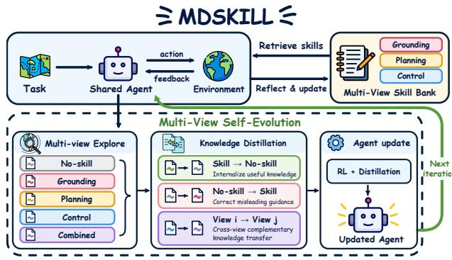  
(a) Overall framework of MDSKILL.

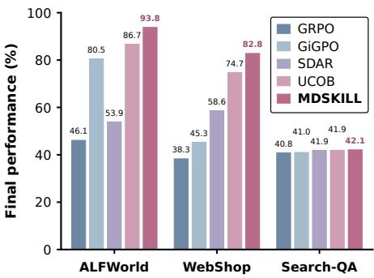  
(b) Main results on Qwen3-1.7B.

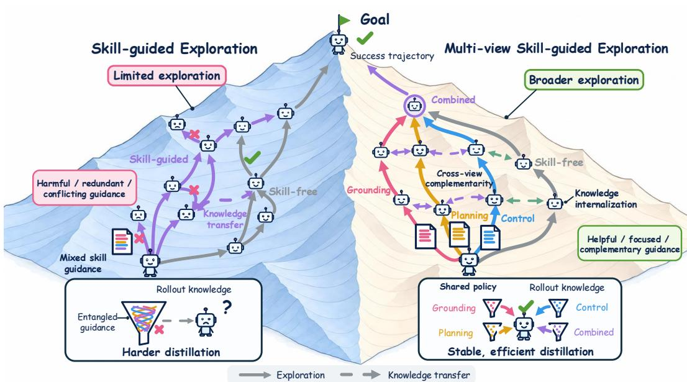  
(c) Comparison of multi-view and direct distillation.  
Figure 1: Overview, results and intuition on MDSKILL.

Motivated by these observations, we propose MDSKILL, a multi-view distillation framework for skill memory internalization. It uses dynamic value metrics to select skills with additional decision value and organizes them into three complementary functional views: state grounding, action planning, and execution control. These views guide three view-specific branches and an integrated branch alongside a skill-free branch. By disentangling experience according to its decision function, multi-view distillation reduces transfer interference and consolidates complementary knowl edge into the shared policy. The skill-view and skill-free branches then co-evolve, generating better trajectories and skill memories that sustain agent self-evolution. Figure 1 summarizes MDSKILL’s framework, empirical results, and the intuition behind multi-view distillation.

Across three agent benchmarks, MDSKILL outperforms RL, skill-augmented, and self-distillation baselines that do not rely on stronger external teacher models, improving upon SOTA performance by up to 7.1% and 8.1% on ALFWorld and WebShop without additional computational overhead. Extensive ablations and skill-evolution analyses support its effectiveness, while gains in both skillview and skill-free branches indicate successful knowledge internalization rather than continued reliance on external memories. Our main contributions are summarized as follows:

• We observe and identify a key challenge in skill-guided agent self-evolution: noisy and functionally entangled skill memories can hinder knowledge internalization and degrade performance.

• We propose MDSkill, a multi-view distillation framework that organizes skill memories into complementary decision views and transfers knowledge across skill-view and skillfree branches for more stable and effective experiential knowledge internalization.

• Experiments on three agent benchmarks show that MDSKILL improves upon SOTA performance, with extensive ablations and skill-evolution analyses supporting its effectiveness.

## 2 PRELIMINARIES

## 2.1 AGENTIC REINFORCEMENT LEARNING WITH SKILL MEMORIES

We formulate a multi-turn agent task as a sequential decision-making process. During online training, the agent summarizes experience from successful and failed trajectories as textual skill memories, which are stored in an evolving skill bank. Given a task instruction x and interaction history $h _ { t } ,$ the agent retrieves relevant memories $m _ { t }$ and generates actions through either the skill-free or skill-view branch:

$$
\underbrace { a _ { t } \sim \pi _ { \theta } ( \cdot \mid x , h _ { t } ) } _ { \mathrm { s k i l l - f r e e } } , \qquad \underbrace { a _ { t } \sim \pi _ { \theta } ( \cdot \mid x , h _ { t } , m _ { t } ) } _ { \mathrm { s k i l l - v i e w } } .\tag{1}
$$

Both branches share policy parameters θ. Each action yields a new environment observation, producing a trajectory $\tau = ( x , o _ { 1 } , a _ { 1 } , \dots , o _ { T } , a _ { T } )$ with return $R ( \tau )$ . Reinforcement learning optimizes the policy to maximize the expected trajectory return:

$$
\begin{array} { r } { \mathcal { I } _ { \mathrm { R L } } ( \theta ) = \mathbb { E } _ { \tau \sim \pi _ { \theta } } [ R ( \tau ) ] . } \end{array}\tag{2}
$$

We adopt GiGPO (Feng et al., 2026) as the underlying RL algorithm, combining episode-level and step-level advantages to improve credit assignment under sparse or delayed rewards.

## 2.2 ON-POLICY SELF-DISTILLATION

On-Policy Self-Distillation (OPSD) (Zhao et al., 2026) complements RL with dense token-level supervision. In our setting, the skill-conditioned policy serves as the teacher, transferring knowledge to the skill-free policy through:

$$
\mathcal { L } _ { \mathrm { O P S D } } = \mathbb { E } _ { \tau \sim \pi _ { \theta } ( \cdot | x , m ) } \left[ \frac { 1 } { | \tau | } \sum _ { t } D _ { \mathrm { K L } } \left( \underbrace { \pi _ { \bar { \theta } } ( \cdot \mid x , h _ { t } , m _ { t } ) } _ { \mathrm { t e a c h e r } } \| \underbrace { \pi _ { \theta } ( \cdot \mid x , h _ { t } ) } _ { \mathrm { s u d e n t } } \right) \right] .\tag{3}
$$

where $m _ { t }$ denotes retrieved skill memories and $\bar { \theta }$ denotes stop-gradient teacher parameters. This objective directly internalizes skill-guided behavior into the shared policy; we further adapt the transfer direction according to paired trajectory outcomes.

## 3 ANALYSIS OF DISTILLATION DIRECTIONS

We analyze four training variants to examine how distillation direction affects skill-memory internalization: no distillation, forward distillation from the skill-view to the skill-free branch, reverse distillation in the opposite direction, and bidirectional distillation combining both.

Distillation effectively internalizes externalized experience. As shown in Figure 2, all distillation variants outperform no distillation on both branches, demonstrating that distillation effectively converts knowledge externalized in skill memories into the policy’s intrinsic capabilities.

Forward distillation propagates unreliable supervision. Forward-only distillation performs substantially worse because the dense supervision signals from the skill-view branch are unreliable. Since both branches share the same policy, this unreliable token-level supervision degrades both skill-view and skill-free behavior.

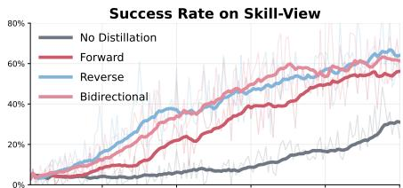

Reverse-only distillation provides the most effective path to skill internalization. Reverse-only distillation achieves the strongest performance on both branches, surpassing even bidirectional distillation. This result highlights distillation’s sensitivity to supervision quality: dense but unreliable signals from forward distillation can dilute or counteract the gains from reverse correction. The advantage of reverse-only distillation thus lies in removing unstable forward supervision, allowing externalized skill knowledge to enter policy parameters indirectly through RL while reverse behavior.

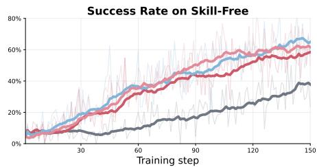  
Figure 2: Training success rates under different distillation directions on WebShop.

Forward distillation exhibits instability and distributional misalignment. To investigate why forward distillation degrades performance, we follow (Li et al., 2026b) and analyze Top-K overlap and the absolute entropy gap in Figure 3. Forward distillation requires the skill-free branch to reproduce skill-conditioned preferences without access to the underlying skill. Its low, volatile overlap and large, fluctuating entropy gap suggest persistent misalignment and unstable supervision, potentially introducing noisy policy updates. In contrast, reverse distillation primarily corrects harmful skill influence and exhibits increasing overlap and a smaller, more stable entropy gap.

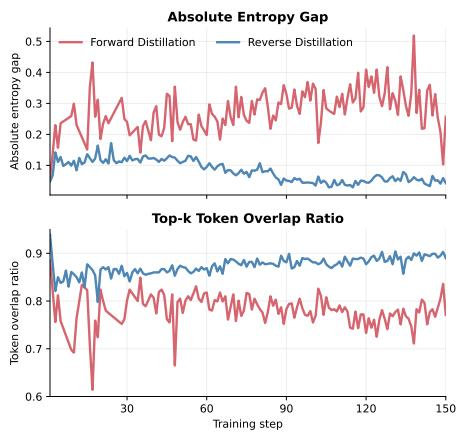  
Figure 3: Top-K token overlap ratio and absolute entropy gap under forward and reverse distillation on WebShop.

Skill noise and knowledge entanglement hinder effective transfer. Although forward distillation underperforms reverse distillation, it substantially outperforms no distillation, indicating that skill-guided supervision contains useful knowledge alongside unreliable signals. The challenge therefore lies not simply in a lack of valuable knowledge, but in transferring it effectively. Beyond skill noise, redundant or conflicting guidance from entangled decision functions can obscure useful signals and complicate internalization. These observations motivate dynamic value metrics to prioritize reliable, beneficial skills and multi-view decomposition to separate complementary decision functions, improving supervision quality and reducing transfer interference.

## 4 MDSKILL

## 4.1 OVERVIEW

MDSkill is a self-evolution framework that builds on OPSD to aggregate and internalize knowledge from skill memories. It combines dynamic skill selection with multi-view exploration and distillation to internalize complementary knowledge into the shared policy. The improved policy generates better trajectories and higher-quality skill memories, which strengthen policy learning, forming a closed loop of skill evolution, knowledge internalization, and agent self-evolution.

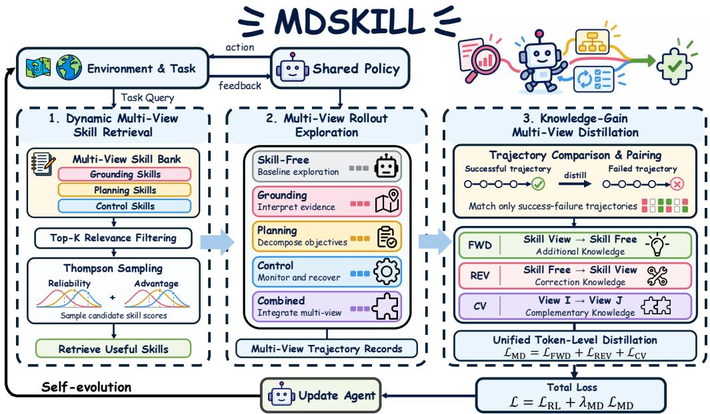  
Figure 4: Detailed overview of MDSkill, comprising dynamic skill retrieval, multi-view rollout exploration, and knowledge-gain-driven multi-view distillation.

## 4.2 DYNAMIC SKILL METRICS

Skill value estimation identifies useful memories and filters harmful ones, but their value changes as the policy evolves: previously useful skills may become redundant through internalization or be superseded by better strategies. MDSKILL therefore maintains two dynamic, policy-relative estimates, Reliability and Advantage, updated with new interaction outcomes throughout training. Temporal decay gives recent evidence greater weight, preventing historical performance from dominating the assessment of a skill’s current value.

Dynamic Maintenance. For a rollout using skill $m ,$ let $y \in \{ 0 , 1 \}$ denote task success and $\bar { y } _ { \mathrm { f r e e } }$ the average success of skill-free rollouts on the same task. The corresponding evidence is $z ^ { \mathrm { r e l } } = y$ and $\begin{array} { r } { z ^ { \mathrm { a d v } } = \frac { 1 + y - \bar { y } _ { \mathrm { f r e e } } } { 2 } } \end{array}$ . For each estimate $d \in \{ \mathrm { r e l } , \mathrm { a d v } \}$ , we maintain a Beta distribution with a uniform prior and temporally discounted evidence:

$$
w _ { t , i } = 2 ^ { - \frac { t - t _ { i } } { H } } , \qquad \alpha _ { m , t } ^ { d } = 1 + \sum _ { i \in \mathcal { E } _ { m } ( t ) } w _ { t , i } z _ { i } ^ { d } , \qquad \beta _ { m , t } ^ { d } = 1 + \sum _ { i \in \mathcal { E } _ { m } ( t ) } w _ { t , i } ( 1 - z _ { i } ^ { d } ) .\tag{4}
$$

where $\mathcal { E } _ { m } ( t )$ denotes the observations associated with skill $m , t _ { i }$ is the observation step, and H is the evidence half-life. The decay weight $w _ { t , i }$ emphasizes recent outcomes and discounts older evidence. More effective evidence concentrates the Beta distributions, making well-supported skill values easier to distinguish while preserving uncertainty for less-evaluated skills.

Thompson-Sampled Retrieval. We first retain the Top-K skills with the highest cosine similarity between the embeddings of the current query and each skill’s associated context. Within this candidate set, we apply Thompson sampling to rank skills by their sampled Reliability and Advantage:

$$
\begin{array} { r } { \mathcal { C } _ { t } ( x ) = \mathrm { T o p K } _ { m \in \mathcal { M } _ { t } } \sin ( x , c _ { m } ) , \qquad \tilde { q } _ { m , t } ^ { d } \sim \mathrm { B e t a } ( \alpha _ { m , t } ^ { d } , \beta _ { m , t } ^ { d } ) , \qquad S _ { t } ( m ) = \tilde { q } _ { m , t } ^ { \mathrm { r e l } } + \tilde { q } _ { m , t } ^ { \mathrm { a d v } } . } \end{array}\tag{5}
$$

where $d \in \ \{ \mathrm { r e l } , \mathrm { a d v } \} , \ c _ { m }$ denotes the retrieval context associated with skill $m ,$ , and $\mathcal { M } _ { t }$ is the eligible skill bank. We first select the top-K most relevant skills from $\mathcal { C } _ { t } ( x )$ and apply Thompson sampling to their value metrics. Both sampled metrics lie in [0, 1], providing a common scale for aggregation. This balances exploitation of well-supported skills with exploration of uncertain candidates, reducing the risk that accidental successes cause particular skills to dominate retrieval.

## 4.3 MULTI-VIEW SKILL ROLLOUTS

High-value experience can support different aspects of a decision. MDSkill organizes skill memory around three complementary functions—state grounding, action planning, and execution control— and uses these views to guide exploration and selective knowledge transfer into a shared policy.

## 4.3.1 FUNCTIONAL SKILL VIEWS

We generate skills through view-specific reflection prompts, each directing the agent to extract a distinct type of reusable knowledge from its interaction experience. The prompts are adapted to each environment, and the resulting skills are maintained in three functional pools, $\mathcal { M } _ { \mathrm { g } } , \mathcal { M } _ { \mathrm { p } } , \mathcal { M } _ { \mathrm { c } } .$

State grounding. This view addresses what is known about the current situation. Grounding skills identify task-relevant observations, object states, constraints, and missing information. They guide the agent to inspect its environment, resolve uncertainty, and distinguish verified facts from assumptions before committing to an action. Exploration under this view emphasizes obtaining and interpreting evidence that makes subsequent decisions better informed.

Action planning. This view addresses what to do next given the information. Planning skills describe how to select actions, establish subgoals, and order operations toward task completion. They direct exploration toward alternative action sequences and reusable strategies for making progress.

Execution control. This view addresses whether ongoing execution should continue or change. Control skills focus on checking action preconditions, detecting ineffective behavior, verifying intermediate outcomes, and recovering from errors. They guide the agent to reconsider a plan when observations contradict its expectations, rather than repeatedly following an unsuccessful course of action.

Combined branch. This branch integrates knowledge from three skill views, allowing grounding, planning, and control to complement one another. It connects observation interpretation with action selection and execution monitoring, enabling the agent to adjust its plan as new evidence emerges. The resulting trajectories capture interactions among decision functions and provide an integrated path alongside the view-specific branches. Implementation details for functional skills are provided in Appendix F

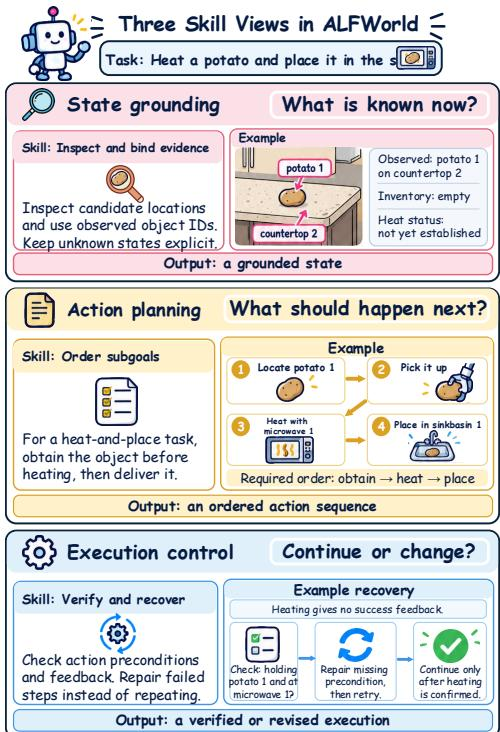  
Figure 5: An example of multi-view skill guidance in ALFWorld.

## 4.3.2 MULTI-VIEW DISTILLATION

Knowledge-Gain Gate. Multi-view rollouts provide diverse experiential knowledge, while distillation requires reliable fine-grained supervision for effective transfer. For precise distillation matching, following UCOB (Tu et al., 2026a), we group decision records that share the same task and anchor state. Within each anchor group a, let $\bar { \mathcal { T } } _ { a } ^ { 0 }$ denote the skill-free trajectories and $\begin{array} { r } { \mathcal { T } _ { a } ^ { + } = \bigcup _ { v \in \mathcal { V } } \mathcal { T } _ { a } ^ { \imath } } \end{array}$ denote the skill-view trajectories, where V contains the grounding, planning, control, and combined views. Given the trajectory-level success indicator $y ( \tau ) \in \{ 0 , 1 \}$ , we define the numbers of successful skill-free and skill-view trajectories as

$$
n _ { a } ^ { 0 } = \sum _ { \tau \in \mathcal { T } _ { a } ^ { 0 } } y ( \tau ) , \qquad n _ { a } ^ { + } = \sum _ { \tau \in \mathcal { T } _ { a } ^ { + } } y ( \tau ) .\tag{6}
$$

The strict and relaxed knowledge-gain gates are defined as

$$
\gamma _ { a } ^ { \mathrm { s t r i c t } } = \mathbb { I } \bigl [ n _ { a } ^ { + } > n _ { a } ^ { 0 } \land n _ { a } ^ { 0 } = 0 \bigr ] , \qquad \gamma _ { a } ^ { \mathrm { r e l a x e d } } = \mathbb { I } \bigl [ n _ { a } ^ { + } > n _ { a } ^ { 0 } \bigr ] .\tag{7}
$$

Teacher-student Grouping. Teacher-student grouping for distillation depends on trajectory outcomes and the knowledge-gain gate. For each teacher-student pair $( \tau _ { i } , \tau _ { j } )$ in anchor $^ { a , }$ we define

$$
g _ { a } ( \tau _ { t } , \tau _ { s } ) = \mathbb { I } [ y ( \tau _ { t } ) > y ( \tau _ { s } ) ] \cdot \left\{ \begin{array} { l l } { \gamma _ { a } , } & { v _ { t } \neq 0 , v _ { s } = 0 \quad \mathrm { ( f o r w a r d ) } , } \\ { 1 - \gamma _ { a } , } & { v _ { t } = 0 , v _ { s } \neq 0 \quad \mathrm { ( r e v e r s e ) } , } \\ { \gamma _ { a } , } & { v _ { t } \neq 0 , v _ { s } \neq 0 , v _ { t } \neq v _ { s } \quad \mathrm { ( c r o s s - v i e w ) } , } \\ { 0 , } & { \mathrm { o t h e r w i s e } . } \end{array} \right.\tag{8}
$$

where $v _ { i } = 0$ denotes the skill-free branch and $g _ { a } ( \tau _ { t } , \tau _ { s } ) = 1$ identifies a valid distillation pair.

Distillation takes three forms: (1) Forward distillation transfers successful skill-view behavior to failed skill-free trajectories when the knowledge-gain gate is satisfied, enabling the policy to internalize useful skill-guided behavior; (2) Reverse distillation uses successful skill-free behavior to correct failed skill-guided trajectories when the policy can already solve the task without skills; (3)Cross-view distillation transfers knowledge from a successful skill view to unsuccessful alternative views, enabling complementary knowledge exchange across decision functions. Strict and relaxed variants of the distillation gate are discussed in Appendix D.

Multi-View Distillation Objective. All forward, reverse, and cross-view pairs share a unified token-level objective. For each valid pair $\left( \tau _ { t } , \tau _ { s } \right)$ , the teacher response is evaluated under both contexts. We collect valid token instances and define the joint loss as

$$
\begin{array} { l } { \mathcal { T } _ { \mathrm { M D } } = \{ ( a , t , s , \ell ) : g _ { a } ( \tau _ { t } , \tau _ { s } ) = 1 , 1 \leq \ell \leq N _ { t , s } \} , } \\ { \mathcal { L } _ { \mathrm { M D } } = \displaystyle \frac { 1 } { | \mathcal { T } _ { \mathrm { M D } } | } \sum _ { ( a , t , s , \ell ) \in \mathcal { T } _ { \mathrm { M D } } } D _ { \mathrm { K L } } ( \mathrm { s g } [ \bar { p } _ { t , \ell } ] \| \bar { p } _ { s , \ell } ) . } \end{array}\tag{9}
$$

where $N _ { t , s }$ denotes the valid response token count, and $\bar { p } _ { t , \ell }$ and $\bar { p } _ { s , \ell }$ are normalized distributions over the teacher’s Top- $K _ { \mathrm { D } }$ token support (Fu et al., 2026; Tu et al., 2026a). The operator $\mathrm { s g } [ \cdot ]$ stops teacher gradients. The complete training objective is

$$
\mathcal { L } = \mathcal { L } _ { \mathrm { R L } } + \lambda _ { \mathrm { M D } } \mathcal { L } _ { \mathrm { M D } } + \beta _ { \mathrm { K L } } \mathcal { L } _ { \mathrm { K L } } .\tag{10}
$$

where $\lambda _ { \mathrm { M D } }$ controls the distillation weight, ${ \mathcal { L } } _ { \mathrm { K I } }$ regularizes policy divergence from the reference policy, and $\beta _ { \mathrm { K L } }$ controls its strength.

## 5 EXPERIMENTS

## 5.1 EXPERIMENTAL SETUP

Benchmarks Following the evaluation suite of SDAR (Lu et al., 2026a), we evaluate on three agent benchmarks. ALFWORLD (Shridhar et al., 2020) tests household navigation and object manipulation across six task families: Pick, Look, Clean, Heat, Cool, and Pick2. WEBSHOP (Yao et al., 2022) requires agents to find and purchase products satisfying natural-language requests; we use the established 128-task evaluation split. SEARCH-QA (Jin et al., 2025) evaluates search-augmented question answering across three single-hop and four multi-hop datasets. We report success rates on ALFWorld, task scores and success rates on WebShop, and answer accuracy on Search-QA.

Models and baselines. We use Qwen2.5-7B-Instruct, Qwen2.5-3B-Instruct (Yang et al., 2025), and Qwen3-1.7B (Yang et al., 2025) as backbones. We compare against three baseline groups: (1) skill-free RL methods, GRPO (Shao et al., 2024) and GiGPO (Feng et al., 2026); (2) skillaugmented methods, SkillRL (Xia et al., 2026), D2Skill (Tu et al., 2026b), SkillC (Lin et al., 2026), SAPO (Zhang et al., 2026d), and Skill1 (Shi et al., 2026); and (3) self-distillation methods, OPSD (Zhao et al., 2026), RLSD (Yang et al., 2026), Skill-SD (Wang et al., 2026), SDAR (Lu et al., 2026a), StepOPSD (Zhang et al., 2026c) and UCOB (Tu et al., 2026a). These baselines provide broad coverage of agent self-evolution methods. For fair comparison, MDSKILL follows the same experimental settings as the corresponding baselines; details are provided in Appendix B.

Table 1: Main results on ALFWORLD (six tasks and overall success rates), WEBSHOP (score/success rate), and SEARCH-QA (seven datasets and average accuracy). Best and second-best results within each backbone are bolded and underlined, respectively. † denotes results from original papers; ∗ denotes results reported by SDAR and UCOB.
<table><tr><td rowspan="2"></td><td colspan="6">ALFWORLD</td><td colspan="2">WEBSHOP</td><td colspan="6">SEARCH-QA</td></tr><tr><td>Method</td><td></td><td></td><td></td><td>| Pick Look Clean Heat Cool Pick2 Succ</td><td></td><td>Score Succ</td><td></td><td>NQ Triv Pop Hotp 2Wk MuS Bam Avg</td><td></td><td></td><td></td><td></td><td></td></tr><tr><td colspan="10"></td><td></td><td></td><td>30.3</td><td>12.0</td><td>65.7</td><td></td></tr><tr><td>GRPO* GiGPO Skill1*</td><td>71.1 90.3 71.4</td><td>41.7 61.5 54.5</td><td>36.4 92.3 59.4</td><td>40.0 71.4 72.7</td><td>31.8 69.2 60.0</td><td>31.6 46.1 79.2 80.5 73.7 65.6</td><td></td><td>67.3 38.3 70.0 45.3 83.2 61.7</td><td>41.1 42.7</td><td>40.058.9 43.5 59.3 45.1 59.8 46.0</td><td>35.4 34.1 35.4</td><td>32.7 34.8</td><td>10.5 64.5 12.0</td><td>40.8 41.0 42.3</td></tr><tr><td>RLSD* Skill-SD*</td><td>50.0 52.9</td><td>37.5 37.5</td><td>61.5 69.2</td><td>19.0 42.9</td><td>50.0 21.1 60.0</td><td>42.2 36.8 52.3</td><td>74.0 81.8</td><td>50.8 53.9</td><td>38.6 57.3 39.1 57.5</td><td>43.0 45.4</td><td>34.5 34.1 34.8 34.1</td><td>11.5 10.7</td><td>65.7 65.3 64.1</td><td>40.6 40.8</td></tr><tr><td>SDAR* StepOPSD†</td><td>73.5</td><td>25.0</td><td>76.9</td><td>33.3</td><td>40.0 36.8 42.1 55.0</td><td>53.9 56.3</td><td>76.8</td><td>58.6</td><td>39.7 58.9 45.3 40.5 59.4 44.4</td><td>35.9</td><td>35.5</td><td>12.6 11.6</td><td>65.3 64.1</td><td>41.9 41.3</td></tr><tr><td>UCOB</td><td>64.7 93.1</td><td>44.4 76.9</td><td>56.5 100</td><td>60.9 84.2</td><td>81.8 76.2</td><td>86.7</td><td>90.3</td><td>74.7</td><td>43.6 58.7 45.5</td><td>37.1 37.8</td><td>32.0 32.3</td><td>11.2</td><td>64.1</td><td>41.9</td></tr><tr><td>MDSKILL</td><td>97.4</td><td>92.9</td><td>100</td><td>100</td><td>81.0 88.9</td><td>93.8</td><td>88.7</td><td>82.8</td><td>41.7 59.6 45.1</td><td>38.0</td><td>33.8</td><td>12.0</td><td></td><td>64.8 42.1</td></tr><tr><td></td><td></td><td></td><td></td><td></td><td></td><td></td><td></td><td>Qwen2.5-3B-Instruct</td><td></td><td></td><td></td><td></td><td></td><td></td></tr><tr><td>GRPO*</td><td></td><td></td><td>96.2</td><td>61.9</td><td>65.0</td><td>47.4 75.0</td><td>79.8</td><td>63.3</td><td>39.3 60.6 41.1</td><td>37.4</td><td></td><td></td><td></td><td></td></tr><tr><td colspan="10">91.2 62.5</td><td></td><td>34.6</td><td></td><td>15.4 26.4</td><td>36.4</td></tr><tr><td>GiGPO Skill1*</td><td>89.7 93.8</td><td>76.9 58.3</td><td>100 96.4 90.9</td><td>78.9 81.8 92.9 86.4 75.0</td><td>71.4 95.0 68.4</td><td>84.4 89.1 79.7</td><td>83.8 84.1 84.4</td><td>70.3 75.0 66.4</td><td>43.060.5 46.9 44.2 60.3 44.8 41.5 558.6 42.3</td><td>36.2 39.2</td><td>35.5 35.9</td><td>12.1 13.1</td><td>64.1 64.9</td><td>42.6 43.2</td></tr><tr><td>RLSD* Skill-SD*</td><td>87.9 88.2</td><td>75.0 50.0 96.2</td><td>52.4 100</td><td>73.1 65.0 61.9 75.0</td><td>57.9 84.2</td><td>73.4 84.4</td><td>75.9 85.0</td><td>64.0 68.0</td><td>44.4 60.4 44.0</td><td>40.4 39.5 38.6</td><td>40.2 40.4</td><td>16.8 15.4</td><td>66.9 64.9</td><td>43.8 44.1 43.4</td></tr><tr><td>SDAR* StepOPSD†</td><td>97.1 97.1</td><td>62.5 66.7 87.0</td><td></td><td>79.1 78.9</td><td>95.0</td><td>83.6</td><td></td><td></td><td>44.8 58.1 44.3 45.0 61.6 46.2</td><td>39.5</td><td>36.2 39.5</td><td>15.7 14.4</td><td>66.1 65.3</td><td>44.5</td></tr><tr><td>UCOB</td><td>100</td><td>90.0 100</td><td></td><td>88.9</td><td>76.0 88.2</td><td>92.2</td><td>86.1</td><td>77.3 80.5</td><td>44.7 61.4 46.2</td><td>37.5</td><td>36.2</td><td>12.2</td><td>66.3</td><td>43.5</td></tr><tr><td>MDSKILL</td><td>100</td><td>100 96.3</td><td></td><td>93.3</td><td>85.0</td><td>94.1 95.3</td><td>85.6</td><td></td><td>44.2 58.9</td><td>45.6 38.9</td><td>37.5</td><td>14.2</td><td></td><td>64.3 43.4</td></tr><tr><td></td><td></td><td></td><td></td><td></td><td></td><td></td><td>Qwen2.5-7B-Instruct</td><td></td><td></td><td></td><td></td><td></td><td></td><td></td></tr><tr><td></td><td></td><td></td><td></td><td></td><td></td><td></td><td></td><td></td><td></td><td></td><td></td><td></td><td></td><td></td></tr><tr><td>GRPO*</td><td>91.2</td><td>87.5</td><td>96.2</td><td>81.0</td><td>65.0</td><td>57.9 81.2</td><td>80.9</td><td>72.6</td><td>45.1 63.7 44.0</td><td>43.6</td><td>43.2</td><td></td><td></td><td></td></tr><tr><td>GiGPO†</td><td></td><td></td><td>98.8</td><td>83.7</td><td>89.3</td><td>79.2 90.8</td><td>84.4</td><td>72.8</td><td>46.4</td><td></td><td></td><td>16.8</td><td>37.6</td><td>42.0</td></tr><tr><td></td><td>97.7</td><td>82.7</td><td></td><td></td><td></td><td></td><td></td><td></td><td>64.7</td><td>46.1 41.6</td><td>43.6</td><td>18.9</td><td>68.9</td><td>47.2</td></tr><tr><td>SkillRL†</td><td>97.9</td><td>71.4</td><td>90.0</td><td>90.0</td><td>95.5</td><td>87.5 89.9</td><td>85.2</td><td>72.7</td><td>45.9 63.3</td><td>45.9 43.2</td><td></td><td></td><td></td><td></td></tr><tr><td></td><td></td><td></td><td></td><td></td><td></td><td>72.0</td><td></td><td></td><td></td><td></td><td>40.3</td><td>20.2</td><td>73.8</td><td>47.5</td></tr><tr><td>D2Skill†</td><td>93.8</td><td>77.8</td><td>94.7</td><td>95.0</td><td>95.5</td><td>87.8</td><td>91.1</td><td>80.5</td><td>48.7 63.4 44.9</td><td>47.5</td><td>43.7</td><td>21.0</td><td>67.7</td><td>48.1</td></tr><tr><td>SkillC†</td><td>88.5</td><td>78.6 91.2</td><td></td><td>94.7</td><td>100.0 88.9</td><td>90.6</td><td>85.6</td><td>74.0</td><td></td><td></td><td></td><td></td><td></td><td></td></tr><tr><td></td><td></td><td></td><td></td><td></td><td></td><td></td><td></td><td></td><td></td><td></td><td></td><td></td><td></td><td></td></tr><tr><td>SAPO†</td><td>98.7</td><td>73.9 98.1</td><td></td><td>92.6</td><td>85.0</td><td>89.2 92.2</td><td>90.5</td><td>78.1</td><td>48.4 62.946.7</td><td>45.0</td><td>45.2</td><td>18.3</td><td></td><td></td></tr><tr><td>Skill1*</td><td>100.0</td><td>83.3</td><td></td><td>100.0</td><td>88.5</td><td>85.0 92.2</td><td>86.2</td><td>77.3</td><td></td><td></td><td></td><td></td><td>46.4</td><td>44.7</td></tr><tr><td></td><td></td><td>89.5</td><td></td><td></td><td></td><td></td><td></td><td></td><td>46.8 46.3</td><td>47.8 43.7</td><td>39.3</td><td>18.2</td><td>70.6</td><td>44.7</td></tr><tr><td>RLSD* Skill-SD*</td><td>100.0</td><td>87.5 92.3</td><td>90.9</td><td>58.8 100.0</td><td>80.0 69.2</td><td>65.2 82.0 68.4 85.1</td><td>87.4 86.1</td><td>77.3 76.5</td><td>46.863.0 47.1 64.5 47.8</td><td>44.4 45.5</td><td>48.9</td><td>21.5</td><td>73.0</td><td>49.0</td></table>

## 5.2 MAIN RESULTS

Overall Performance. Table 1 shows that MDSkill achieves the best overall success rates on both ALFWorld and WebShop across all three backbones. On ALFWorld, MDSkill outperforms the strongest baseline UCOB by 7.1%, 3.1%, and 2.3% with Qwen3-1.7B, Qwen2.5-3B, and Qwen2.5- 7B, respectively. On WebShop, it improves the success rate by 8.1%, 3.2%, and 3.9%, while maintaining competitive task scores. MDSKILL also achieves competitive performance on Search-QA across model scales. Compared with interactive decision-making tasks, Search-QA depends more on retrieval quality, evidence comprehension, and answer synthesis, and less on recurring environment states where reusable skills offer consistent guidance.

Knowledge Internalization. The consistent gains on ALFWorld and WebShop demonstrate the value of internalizing skill memories from complementary decision perspectives. The gains are particularly pronounced with the smaller Qwen3-1.7B model which has fewer task-relevant priors and reusable interaction patterns, with success rates increasing from 86.7% to 93.8% on ALFWorld and from 74.7% to 82.8% on WebShop. By organizing skill memories into complementary views and distilling successful behaviors into the shared policy, MDSkill mitigates the knowledge disadvantage of smaller models, while the improved policy produces stronger trajectories and higher-quality skills that further reinforce knowledge internalization and agent self-evolution.

Main Ablation on Distillation  
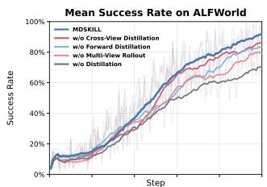

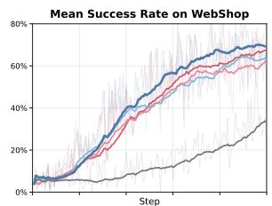

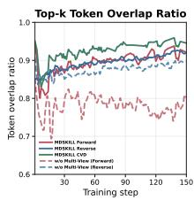

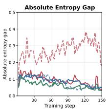  
(b) Distributional stability of distillation.

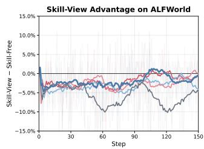

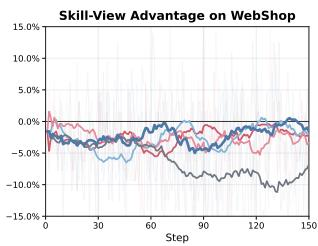  
(a) Main ablation across training.Dynamic Evol

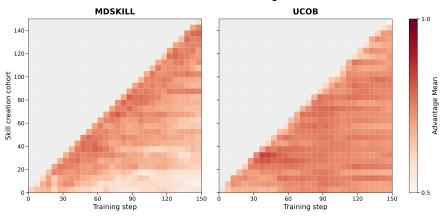

(c) Dynamic evolution of retrieved skills.edge  
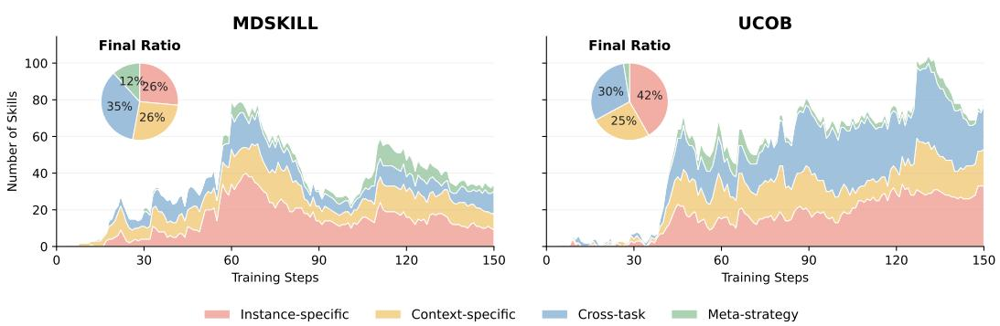  
(d) Dynamic evolution of skill knowledge composition.  
Figure 6: Ablation study of MDSKILL.

## 5.3 ABLATION STUDIES

Main Ablation on Distillation. Figure 6a compares success rates and skill-view advantage, defined as the success-rate difference between skill-view and skill-free branches; a sustained negative gap indicates that memories hinder the evolving policy. We ablate forward distillation, cross-view distillation, multi-view rollouts, and distillation. MDSKILL performs best on both benchmarks, with its advantage approaching zero without remaining strongly negative. Removing distillation causes the greatest degradation, while removing multi-view rollouts has the largest impact among vari ants retaining distillation. The performance of variants retaining multi-view exploration and partial distillation supports the benefits of broader exploration and disentangled knowledge transfer. Crucially, removing forward distillation reduces performance, contrasting with the earlier advantage of reverse-only distillation and showing that skill internalization becomes beneficial within MDSKILL. Cross-view distillation provides further gains through complementary knowledge internalization.

Distillation Stability Analysis. Figure 6b compares MDSKILL with w/o multi-view rollouts. Without multi-view rollouts, forward token overlap fails to improve and the absolute entropy gap fluctuates sharply, indicating persistent misalignment and unstable distillation. MDSKILL instead achieves higher overlap and a smaller, more stable entropy gap, supporting the benefits of disentangled skill guidance. Cross-view distillation exhibits the lowest entropy gap and highest overlap, suggesting that knowledge transfer across complementary views is easier to optimize.

Dynamic Skill Evolution Analysis. Figure 6c tracks the mean advantage of top-K skills from each generation cohort. In MDSKILL, high-advantage regions concentrate near the diagonal: new skills address current knowledge gaps, while older skills lose their advantage as their knowledge is internalized. In contrast, UCOB shows weaker diagonal concentration, indicating continued reliance on earlier skills. Figure 6d examines skills with substantial advantage (> 0.6) across 4 levels of generality. MDSKILL shifts from instance-specific knowledge toward cross-task skills and meta-strategies, reducing the final instance-specific share to 26%, compared with 42% for UCOB. Although UCOB retains high-advantage skills, this reflects dependence on external memories rather than effective internalization. Together, MDSKILL shows healthy self-evolution, where new skills fill knowledge gaps, internalization reduces their marginal value, and skill evolution shifts toward new and more general knowledge. Additional ablations and analyses are provided in Appendix C.

## 6 CONCLUSION

We identify a key obstacle to skill-guided agent self-evolution: noisy and functionally entangled skill memories can provide unstable supervision, hindering knowledge internalization. We propose MDSKILL, a multi-view framework that dynamically selects useful skills, organizes them into complementary functional views, and explores both view-specific and integrated solutions. Outcomebased teacher–student grouping then supports forward, reverse, and cross-view distillation, enabling complementary knowledge to be reliably consolidated into the shared policy. Experiments on three agent benchmarks demonstrate SOTA performance, while ablations and evolution analyses verify more stable distillation and healthier skill evolution. Overall, MDSKILL establishes a self-evolution cycle in which multi-view skill knowledge improves the policy, and the evolving policy continually generates and internalizes better skill memories.

## REPRODUCIBILITY STATEMENT

We provide the information required to reproduce our experiments throughout the paper. Section 5 describes the benchmarks, model backbones, baselines, evaluation protocols, and main results. Appendix B reports the complete training, distillation, and skill-retrieval configurations, while Ap pendix F provides the functional skill definitions, reflection prompts, and representative examples.

## AI USE STATEMENT

AI-assisted tools were used during manuscript preparation primarily to improve grammar, wording, clarity, and LaTeX presentation. They were not used to design the method, conduct the experiments, or generate and interpret the reported results. The authors reviewed and verified all AI-assisted text and take full responsibility for the final content.

## REFERENCES

Rishabh Agarwal, Nino Vieillard, Yongchao Zhou, Piotr Stanczyk, Sabela Ramos Garea, Matthieu Geist, and Olivier Bachem. On-policy distillation of language models: Learning from selfgenerated mistakes. In International Conference on Learning Representations, volume 2024, pp. 21246–21263, 2024.

Guanting Dong, Hangyu Mao, Kai Ma, Licheng Bao, Yifei Chen, Zhongyuan Wang, Zhongxia Chen, Jiazhen Du, Huiyang Wang, Fuzheng Zhang, et al. Agentic reinforced policy optimization. In International Conference on Learning Representations, volume 2026, pp. 16981–17017, 2026.

Lang Feng, Zhenghai Xue, Tingcong Liu, and Bo An. Group-in-group policy optimization for llm agent training. Advances in Neural Information Processing Systems, 38:46375–46408, 2026.

Yuqian Fu, Haohuan Huang, Kaiwen Jiang, Jiacai Liu, Zhuo Jiang, Yuanheng Zhu, and Dongbin Zhao. Revisiting on-policy distillation: Empirical failure modes and simple fixes. arXiv preprint arXiv:2603.25562, 2026.

Yinghui He, Simran Kaur, Adithya Bhaskar, Yongjin Yang, Jiarui Liu, Narutatsu Ri, Liam Fowl, Abhishek Panigrahi, Danqi Chen, and Sanjeev Arora. Self-distillation zero: Self-revision turns binary rewards into dense supervision. arXiv preprint arXiv:2604.12002, 2026a.

Zhongyu He, Yuanfan Li, Fei Huang, Tianyu Chen, Siyuan Chen, Xingyang Li, Meng Hsuan Yu, Xiangrong Liu, Leyi Wei, Lu Pan, et al. Siri: Self-internalizing reinforcement learning with intrinsic skills for llm agent training. arXiv preprint arXiv:2606.02355, 2026b.

Bowen Jin, Hansi Zeng, Zhenrui Yue, Jinsung Yoon, Sercan Arik, Dong Wang, Hamed Zamani, and Jiawei Han. Search-r1: Training llms to reason and leverage search engines with reinforcement learning. arXiv preprint arXiv:2503.09516, 2025.

Patrick Lewis, Ethan Perez, Aleksandra Piktus, Fabio Petroni, Vladimir Karpukhin, Naman Goyal, Heinrich Kuttler, Mike Lewis, Wen-tau Yih, Tim Rockt ¨ aschel, et al. Retrieval-augmented gener- ¨ ation for knowledge-intensive nlp tasks. Advances in neural information processing systems, 33: 9459–9474, 2020.

Xiaozhe Li, Tianyi Lyu, Yang Li, Yichuan Ma, Peiji Li, Linyang Li, Qipeng Guo, Dahua Lin, and Kai Chen. What and when to distill: Selective hindsight distillation for multi-turn agents. arXiv preprint arXiv:2605.19447, 2026a.

Yaxuan Li, Yuxin Zuo, Bingxiang He, Jinqian Zhang, Chaojun Xiao, Cheng Qian, Tianyu Yu, Huanang Gao, Wenkai Yang, Zhiyuan Liu, et al. Rethinking on-policy distillation of large language models: Phenomenology, mechanism, and recipe. arXiv preprint arXiv:2604.13016, 2026b.

Yu Li, Mingyang Yi, Xiuyu Li, Ju Fan, Fuxin Jiang, Binbin Chen, Peng Li, Jie Song, and Tieying Zhang. Reasoning and tool-use compete in agentic rl: From quantifying interference to disentangled tuning. arXiv preprint arXiv:2602.00994, 2026c.

Hongxiang Lin, Zhirui Kuai, Erpeng Xue, and Lei Wang. Skillc: Learning autonomous skill internalization in llm agents via contrastive credit assignment. arXiv preprint arXiv:2605.27899, 2026.

Zhengxi Lu, Zhiyuan Yao, Zhuowen Han, Zi-Han Wang, Jinyang Wu, Qi Gu, Xunliang Cai, Weiming Lu, Jun Xiao, Yueting Zhuang, et al. Self-distilled agentic reinforcement learning. arXiv preprint arXiv:2605.15155, 2026a.

Zhengxi Lu, Zhiyuan Yao, Jinyang Wu, Chengcheng Han, Qi Gu, Xunliang Cai, Weiming Lu, Jun Xiao, Yueting Zhuang, and Yongliang Shen. Skill0: In-context agentic reinforcement learning for skill internalization. arXiv preprint arXiv:2604.02268, 2026b.

Qirui Mi, Zhijian Ma, Mengyue Yang, Haoxuan Li, Yisen Wang, Haifeng Zhang, and Jun Wang. Skill-pro: Learning reusable skills from experience via non-parametric ppo for llm agents. arXiv preprint arXiv:2602.01869, 2026.

Siru Ouyang, Jun Yan, Yanfei Chen, Rujun Han, Zifeng Wang, Bhavana Dalvi Mishra, Rui Meng, Chun-Liang Li, Yizhu Jiao, Kaiwen Zha, et al. Skillos: Learning skill curation for self-evolving agents. arXiv preprint arXiv:2605.06614, 2026.

John Schulman, Filip Wolski, Prafulla Dhariwal, Alec Radford, and Oleg Klimov. Proximal policy optimization algorithms. arXiv preprint arXiv:1707.06347, 2017.

Zhihong Shao, Peiyi Wang, Qihao Zhu, Runxin Xu, Junxiao Song, Xiao Bi, Haowei Zhang, Mingchuan Zhang, YK Li, Yang Wu, et al. Deepseekmath: Pushing the limits of mathematical reasoning in open language models. arXiv preprint arXiv:2402.03300, 2024.

Yaorui Shi, Yuxin Chen, Zhengxi Lu, Yuchun Miao, Shugui Liu, Qi Gu, Xunliang Cai, Xiang Wang, and An Zhang. Skill1: Unified evolution of skill-augmented agents via reinforcement learning. arXiv preprint arXiv:2605.06130, 2026.

Noah Shinn, Federico Cassano, Ashwin Gopinath, Karthik Narasimhan, and Shunyu Yao. Reflexion: Language agents with verbal reinforcement learning. Advances in neural information processing systems, 36:8634–8652, 2023.

Mohit Shridhar, Xingdi Yuan, Marc-Alexandre Cotˆ e, Yonatan Bisk, Adam Trischler, and Matthew´ Hausknecht. Alfworld: Aligning text and embodied environments for interactive learning. arXiv preprint arXiv:2010.03768, 2020.

Songjun Tu, Chengdong Xu, Qichao Zhang, Yiwen Ma, Yaocheng Zhang, Linjing Li, Dong Li, Xiangyuan Lan, and Dongbin Zhao. Ucob: Learning to utilize and evolve agentic skills via credit-aware on-policy bidirectional self-distillation. arXiv preprint arXiv:2606.29502, 2026a.

Songjun Tu, Chengdong Xu, Qichao Zhang, Yaocheng Zhang, Xiangyuan Lan, Linjing Li, Dong Li, and Dongbin Zhao. Dynamic dual-granularity skill bank for agentic rl. arXiv preprint arXiv:2603.28716, 2026b.

Guanzhi Wang, Yuqi Xie, Yunfan Jiang, Ajay Mandlekar, Chaowei Xiao, Yuke Zhu, Linxi Fan, and Anima Anandkumar. Voyager: An open-ended embodied agent with large language models. arXiv preprint arXiv:2305.16291, 2023.

Hao Wang, Guozhi Wang, Han Xiao, Yufeng Zhou, Yue Pan, Jichao Wang, Ke Xu, Yafei Wen, Xiaohu Ruan, Xiaoxin Chen, et al. Skill-sd: Skill-conditioned self-distillation for multi-turn llm agents. arXiv preprint arXiv:2604.10674, 2026.

Zihan Wang, Kangrui Wang, Qineng Wang, Pingyue Zhang, Linjie Li, Zhengyuan Yang, Xing Jin, Kefan Yu, Minh Nhat Nguyen, Licheng Liu, et al. Ragen: Understanding self-evolution in llm agents via multi-turn reinforcement learning. arXiv preprint arXiv:2504.20073, 2025.

Quan Wei, Siliang Zeng, Chenliang Li, William Brown, Oana Frunza, Wei Deng, Anderson Schneider, Yuriy Nevmyvaka, Yang Katie Zhao, Alfredo Garcia, et al. Reinforcing multi-turn reasoning in llm agents via turn-level reward design. arXiv preprint arXiv:2505.11821, 2025.

Peng Xia, Jianwen Chen, Hanyang Wang, Jiaqi Liu, Kaide Zeng, Yu Wang, Siwei Han, Yiyang Zhou, Xujiang Zhao, Haifeng Chen, et al. Skillrl: Evolving agents via recursive skill-augmented reinforcement learning. arXiv preprint arXiv:2602.08234, 2026.

An Yang, Anfeng Li, Baosong Yang, Beichen Zhang, Binyuan Hui, Bo Zheng, Bowen Yu, Chang Gao, Chengen Huang, Chenxu Lv, et al. Qwen3 technical report. arXiv preprint arXiv:2505.09388, 2025.

Chenxu Yang, Chuanyu Qin, Qingyi Si, Minghui Chen, Naibin Gu, Dingyu Yao, Zheng Lin, Weiping Wang, Jiaqi Wang, and Nan Duan. Self-distilled rlvr. arXiv preprint arXiv:2604.03128, 2026.

Shunyu Yao, Howard Chen, John Yang, and Karthik Narasimhan. Webshop: Towards scalable real-world web interaction with grounded language agents. Advances in Neural Information Processing Systems, 35:20744–20757, 2022.

Ruixiang Zhang, Richard He Bai, Huangjie Zheng, Navdeep Jaitly, Ronan Collobert, and Yizhe Zhang. Embarrassingly simple self-distillation improves code generation. arXiv preprint arXiv:2604.01193, 2026a.

Xiaoying Zhang, Zichen Liu, Yipeng Zhang, Xia Hu, and Wenqi Shao. Retroagent: From solving to evolving via retrospective dual intrinsic feedback. arXiv preprint arXiv:2603.08561, 2026b.

Yanfei Zhang, Xu Lin, and Chenglin Wu. Stepopsd: Step-aware online preference distillation for agent reinforcement learning. arXiv preprint arXiv:2605.27140, 2026c.

Zhiwei Zhang, Yudi Lin, Nikki Lijing Kuang, Linlin Wu, Xiaomin Li, Songtao Liu, and Fenglong Ma. Co-evolving skill generation and policy optimization. arXiv preprint arXiv:2606.08755, 2026d.

Siyan Zhao, Zhihui Xie, Mengchen Liu, Jing Huang, Guan Pang, Feiyu Chen, and Aditya Grover. Self-distilled reasoner: On-policy self-distillation for large language models. arXiv preprint arXiv:2601.18734, 2026.

Siyuan Zhu, Chao Yu, Rongxin Yang, Zongkai Liu, Jinjun Hu, Qiwen Chen, and Yibo Zhang. Gagpo: Generalized advantage grouped policy optimization. arXiv preprint arXiv:2605.13217, 2026.

## A RELATED WORK

## A.1 SKILL MEMORIES FOR LANGUAGE AGENTS

Retrieval-augmented generation established a general paradigm for conditioning language models on external, non-parametric knowledge (Lewis et al., 2020). Language agents extend this paradigm from factual documents to interaction experience: Reflexion (Shinn et al., 2023) stores verbal feedback from previous attempts, while Voyager (Wang et al., 2023) accumulates executable programs as reusable skills. Recent work further enables agents to construct, select, curate, evolve, or internalize their own skill memories (Xia et al., 2026; Mi et al., 2026; Tu et al., 2026b; Ouyang et al., 2026; Zhang et al., 2026b; Lu et al., 2026b; He et al., 2026b; Lin et al., 2026; Zhang et al., 2026d; Shi et al., 2026; Tu et al., 2026a). These methods progress from retrieval-time skill augmentation toward evolving external repositories and policy-level knowledge internalization. However, self-generated skills may be noisy, redundant, or functionally entangled; MDSKILL addresses these limitations through dynamic skill selection and multi-view distillation.

## A.2 AGENTIC REINFORCEMENT LEARNING

Proximal Policy Optimization (PPO) (Schulman et al., 2017) stabilizes policy learning through clipped updates, while GRPO (Shao et al., 2024) replaces the learned value function with relative rewards among grouped rollouts. Building on these foundations, recent agentic RL methods extend policy optimization to multi-turn environments involving reasoning, search, tool use, and environment interaction (Wang et al., 2025; Wei et al., 2025; Feng et al., 2026; Zhu et al., 2026; Li et al., 2026a;c). These methods enable agents to improve from interaction outcomes, but their supervision remains largely dependent on sparse and delayed rewards. MDSKILL adopts GiGPO (Feng et al., 2026) as its RL backbone because its combination of episode- and step-level optimization is well suited to long-horizon, multi-turn agent interactions.

## A.3 ON-POLICY SELF-DISTILLATION

On-policy distillation (OPD) provides dense teacher supervision on student-generated rollouts, reducing off-policy distribution mismatch (Agarwal et al., 2024). On-Policy Self-Distillation (OPSD) (Zhao et al., 2026) further uses the same policy as teacher and student under different contexts, with privileged information provided only to the teacher. This supplies dense token-level supervision alongside sparse RL rewards without requiring a separate teacher model. Recent work combines OPSD with agentic RL through skill-conditioned contexts, adaptive supervision, steplevel transfer, and bidirectional correction (Yang et al., 2026; Wang et al., 2026; Lu et al., 2026a; Zhang et al., 2026c; Tu et al., 2026a). However, its effectiveness depends on the reliability of retrieved skills. MDSKILL addresses this issue by decomposing skill knowledge into complementary views and performing outcome-guided multi-view distillation.

## B IMPLEMENTATION DETAILS

## B.1 TRAINING.

Across all three benchmarks, we train MDSKILL for 150 steps with a rollout group size of 8, a training batch size of 16, and a validation batch size of 128. We use an actor learning rate of $1 0 ^ { - 6 }$ and response limits of 8192 and 512 tokens, and validate every 25 steps. vLLM rollouts use top-p = 1.0 and a maximum model length of 10240; validation uses temperature 0.4 and top-$p = 1 . 0$ . Each rollout group contains four skill-free trajectories and one skill-guided trajectory for each grounding, planning, control, and combined branch, resulting in a 4:1:1:1:1 allocation. For ALFWorld and WebShop, we use a PPO mini-batch size of 64, a low-variance KL coefficient of 0.01, and an invalid-action penalty coefficient of 0.1; their maximum interaction horizons are 50 and 15 turns, respectively. For Search-QA, we use a PPO mini-batch size of 16, a learning-rate warmup ratio of 0.1, a KL coefficient of 0.001, and an invalid-action penalty coefficient of 0.01. Its maximum search horizon and retained interaction history are both 4 turns. All experiments use eight NVIDIA A100 GPUs. The code is available at the https://anonymous.4open.science/r/MDSKILL-CF53.

Algorithm 1 MDSKILL: Multi-View Distillation Skill.   
Require: Policy $\pi _ { \theta } ,$ reference policy $\pi _ { \mathrm { r e f } } ,$ , task distribution $\mathcal { D } ,$ skill banks $\mathcal { M } = \{ \mathcal { M } _ { v } \} _ { v \in \mathcal { V } } , \mathrm { r e } .$   
trieval budget K, and training steps $T$   
Ensure: Trained policy π and evolved skill banks $\mathcal { M }$   
1: Define skill views $\dot { \boldsymbol { \mathcal { V } } } = \{ \mathrm { g } , \mathrm { p } , \mathrm { c } \}$ and rollout branches $B = \{ 0 , \mathrm { g } , \mathrm { p } , \mathrm { c } , \mathrm { c m b } \}$   
2: for $r = 1 , \ldots , T$ do   
3: Sample a task batch $\mathcal { X } _ { r } \sim \mathcal { D }$   
4: for all $x \in \mathcal { X } _ { r }$ do   
5: Initialize a multi-view rollout group for task x   
6: while the rollout group is active do   
7: Observe the current anchor state a   
Step 1: Dynamic multi-view skill retrieval.   
8: for all $v \in \mathcal V$ do   
9: Retrieve $\mathcal { C } _ { v } ( a ) \gets \mathrm { T o p K } _ { m \in \mathcal { M } _ { v } }$ sim $\left( a , c _ { m } \right)$   
10: Sample $\tilde { q } _ { m } ^ { d } \sim \mathrm { B e t a } ( \alpha _ { m } ^ { d } , \beta _ { m } ^ { d } ) , \dot { d } \in \{ \mathrm { r e l }$ , adv}   
11: Select $S _ { a , v } \gets \mathrm { T o p K } _ { m \in \mathcal { C } _ { v } ( a ) } ^ { K _ { \mathrm { s e l } } } \left( \tilde { q } _ { m } ^ { \mathrm { r e l } } + \tilde { q } _ { m } ^ { \mathrm { a d v } } \right)$   
12: end for   
Step 2: Multi-view rollout exploration.   
13: Construct skill-free, view-specific, and combined contexts $\{ { P } _ { a } ^ { b } \} _ { b \in B }$   
14: Advance each branch with ${ \dot { \pi } } _ { \theta } ( \cdot \mid P _ { a } ^ { b } )$ and store its rollout record   
15: end while   
16: end for   
17: Group rollout records by their shared task and anchor state   
Step 3: Knowledge-gain multi-view distillation.   
18: Initialize the valid pair set $\mathcal { P }  \emptyset$   
19: for all anchor groups $a \in { \mathcal { A } }$ do   
20: Compute $\begin{array} { r } { n _ { a } ^ { 0 } \gets \sum _ { \tau \in \mathcal { T } _ { a } ^ { 0 } } y ( \tau ) } \end{array}$ and $\begin{array} { r } { n _ { a } ^ { + } \gets \sum _ { \tau \in \mathcal { T } _ { a } ^ { + } } y ( \tau ) } \end{array}$   
21: Compute the knowledge-gain gate $\gamma _ { a }$ using $\operatorname { E q . 7 }$   
22: Collect $\mathcal { P }  \mathcal { P } \cup \{ ( \tau _ { t } , \tau _ { s } ) : g _ { a } ( \tau _ { t } , \tau _ { s } ) = \bar { 1 } \}$   
23: end for   
24: Compute $\mathcal { L } _ { \mathrm { M D } }  \mathrm { T }$ okenDistill(P)   
25: Update θ using ${ \mathcal { L } } _ { \mathrm { R L } } + \lambda _ { \mathrm { M D } } { \mathcal { L } } _ { \mathrm { M D } } + \beta _ { \mathrm { K L } } { \mathcal { L } } _ { \mathrm { K L } }$   
26: Update dynamic skill values and view-specific skill banks   
27: end for   
28: return $\pi _ { \boldsymbol { \theta } } , \mathcal { M }$

## B.2 DISTILLATION.

We use turn-level, response-scoped Top-K distillation with $K _ { \mathrm { t o k } } = 3 2$ . For each anchor, we retain at most two teacher–student pairs independently for each of forward, reverse, and cross-view distillation. All three types share the same objective with $\lambda _ { \mathrm { M D } } = 0 . 2$ . We set the token-level confidencegate coefficient to 5.0 and assign action tokens a distillation weight of 2.0. We use the strict gate for Qwen3-1.7B and the relaxed gate for Qwen2.5-3B-Instruct and Qwen2.5-7B-Instruct. Appendix D discusses the effect of gate selection across model scales.

## B.3 RETRIEVAL.

We organize skill memories into three functional banks corresponding to state grounding, action planning, and execution control. At each encountered anchor state, we first retrieve the 10 most relevant candidates from each bank using the a $\mathtt { l 1 - M i n i L M - L 6 - v 2 }$ sentence transformer, with a relevance threshold of 0.4. For each candidate, we independently draw Thompson samples from its Reliability and Advantage posteriors and rank candidates by their equally weighted sum. Each view-specific branch selects the top three skills from its corresponding bank, whereas the combined branch selects the highest-ranked skill from each bank. Both posteriors are initialized with uniform

Beta(1, 1) priors and use a temporal-decay half-life of 20 training steps. Within each functional bank, we further distinguish task-level and state-level memories following UCOB (Tu et al., 2026a).

## C ADDITIONAL EXPERIMENTAL RESULTS

This section provides additional analyses of the hyperparameters and design choices in MDSKILL. Unless otherwise specified, each experiment changes only the factor under study while retaining the same backbone, rollout budget, and optimization settings as the main experiments.

Ablation on Distillation Configuration. Table 2 evaluates the distillation weight and loss formulation. A moderate coefficient of $\lambda _ { \mathrm { M D } } = 0 . 2$ performs best on both benchmarks, while removing distillation or assigning it excessive weight substantially degrades performance. Joint loss also outperforms separate losses. It avoids fragmented updates across pairs with different response lengths and token counts, enabling more efficient and stable optimization. This formulation also preserves a consistent loss scale across heterogeneous distillation directions.

Ablation on Dynamic Skill Retrieval. Table 3 evaluates the components of dynamic skill retrieval under the same retrieval and training budgets. The full strategy performs best on both benchmarks, whereas relying on relevance alone causes the largest degradation. Removing either value metric, Thompson sampling, or temporal decay also reduces performance, demonstrating the complementary benefits of dynamic value estimation, uncertainty-aware exploration, and adaptation to the evolving policy.

Table 2: Ablations on the distillation weight and loss formulation. We report the final overall success rate.
<table><tr><td>Setting</td><td>ALFWORLD</td><td>WEBSHOP</td></tr><tr><td>Distillation weight</td><td></td><td></td></tr><tr><td>λMD = 0.0</td><td>81.3</td><td>46.9</td></tr><tr><td>λMD = 0.1</td><td>88.3</td><td>77.3</td></tr><tr><td>λMD = 0.2</td><td>93.8</td><td>82.8</td></tr><tr><td>λMD = 0.5</td><td>79.7</td><td>67.2</td></tr><tr><td>Loss formulation</td><td></td><td></td></tr><tr><td>Separate losses</td><td>83.6</td><td>65.6</td></tr><tr><td>Joint loss (Ours)</td><td>93.8</td><td>82.8</td></tr></table>

Table 3: Ablation of dynamic skill retrieval. We report the final overall success rate.
<table><tr><td>Retrieval Strategy</td><td>ALFWORLD</td><td>WEBSHOP</td></tr><tr><td>w/o Metrics (Relevance Only)</td><td>73.4</td><td>65.6</td></tr><tr><td>w/o Reliability</td><td>83.6</td><td>74.2</td></tr><tr><td>w/o Advantage</td><td>91.4</td><td>76.6</td></tr><tr><td>w/o Thompson Sampling</td><td>88.3</td><td>72.7</td></tr><tr><td>w/o Temporal Decay</td><td>90.6</td><td>76.6</td></tr><tr><td>Full Dynamic Retrieval (Ours)</td><td>93.8</td><td>82.8</td></tr></table>

Functional Skill Dynamics. Figure 7 provides three complementary views of multi-view skill evolution. Branch-wise learning dynamics. Figure 7(a) shows that all functional branches improve steadily and remain close to the skill-free branch on both benchmarks. No individual view exhibits persistent degradation, indicating that functional decomposition supports stable multi-view exploration. Functional skill composition. Figure 7(b) tracks skills with substantial Advantage (> 0.6). The planning share increases from 27.1% to 39.4% on ALFWorld and from 28.4% to 40.4% on WebShop, while grounding and control retain substantial proportions. This indicates that planning knowledge becomes increasingly valuable without replacing the complementary contributions of the other views. Cohort-wise skill evolution. Figure 7(c) shows stronger diagonal concentration for MDSKILL than for UCOB on both benchmarks: recently generated skills provide greater Advantage, while older cohorts gradually lose value as their knowledge is internalized. This pattern reflects a healthy self-evolution process that continually exposes new knowledge gaps and encourages the generation of more relevant skills.

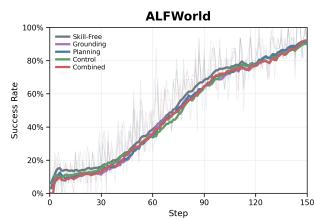

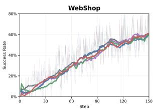  
(a) Training success rates of the functional branchs.

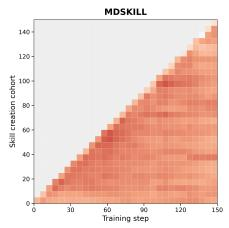

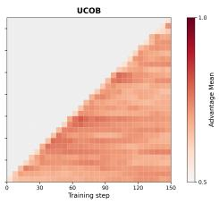

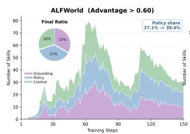

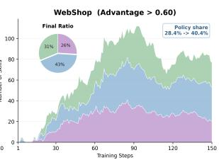  
(b) Evolution of high-advantage skills across multi-views.

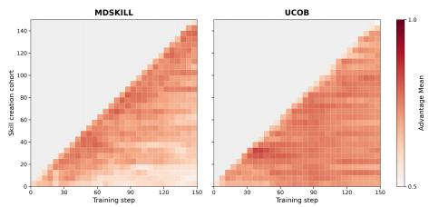  
(c) Dynamic skill advantage on ALFWorld (top) and WebShop (bottom).

Figure 7: Additional analyses of functional skill dynamics. (a) Branch-wise training success rates. (b) Evolution of skills with substantial Advantage (> 0.6) across the functional banks. (c) Cohortwise evolution of skill Advantage on ALFWorld and WebShop.

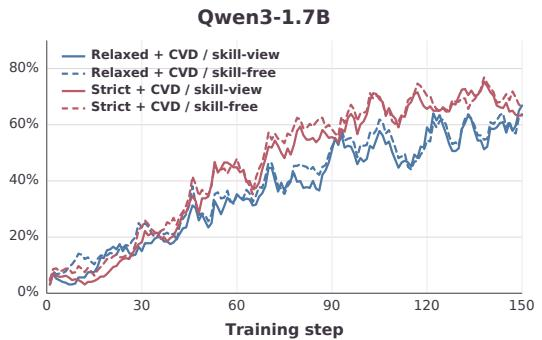

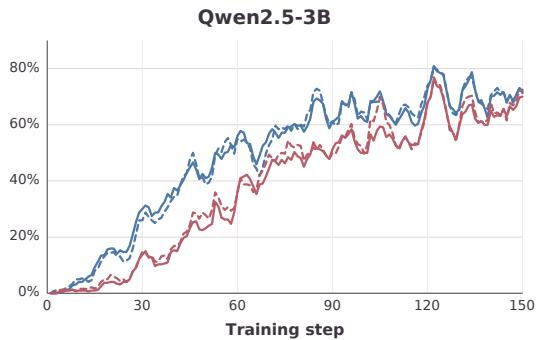  
Figure 8: Training dynamics under strict and relaxed distillation gates on WebShop. Solid and dashed lines denote the skill-view and skill-free branches, respectively.

## D DISCUSSION ON DISTILLATION GATE

Figure 8 compares the strict and relaxed distillation gates across different model scales. For Qwen2.5-3B, the relaxed gate achieves consistently higher success rates through most of training, and the 7B model exhibits the same trend. In contrast, Qwen3-1.7B benefits more from the strict gate, particularly during the later training stages.

This scale-dependent reversal suggests that the gate reflects the reliability required of skill-view supervision. Smaller models possess less task knowledge and tend to generate lower-quality skills, making skill-view trajectories more likely to provide misleading supervision. The strict gate permits forward and cross-view distillation only when all skill-free trajectories fail, filtering ambiguous comparisons and providing stronger evidence of skill-induced knowledge gain. Larger models generate and utilize more reliable skills; consequently, the relaxed gate can admit more informative teacher– student pairs and enlarge the effective distillation space without introducing excessive noise. Thus, strict filtering is preferable when skill-view supervision is less reliable, whereas relaxed filtering better exploits the stronger supervision available at larger model scales.

## E ANALYSIS OF MULTI-VIEW DISTILLATION

We provide a local perspective on why multi-view skill decomposition can stabilize distillation. A successful mixed-skill trajectory may draw simultaneously on grounding, planning, and control knowledge, making it difficult to identify which guidance produced useful behavior. Redundant or conflicting guidance may also induce inconsistent token-level gradients. In a view-specific trajectory, the added skill guidance has an explicit functional role. This makes the supervision source easier to interpret, although success alone does not establish that the skill caused the outcome.

Fix an old policy $\pi$ and an anchor state $x ,$ and condition on successful teacher trajectories with outcome $Y = 1$ . For this analysis, let $\nu _ { \mathrm { f } }$ contain the three functional views: grounding, planning, and control. We use an idealized reference model in which a successful mixed-skill gradient is approximated by first selecting a latent functional source $V \in \ \mathcal { V } _ { \mathrm { f } }$ and then drawing a stochastic distillation gradient G from the corresponding view-conditioned distribution:

$$
p _ { \mathrm { m i x } } ^ { \mathrm { i d e a l } } ( G \mid x , Y = 1 ) = \sum _ { v \in \mathcal { V } _ { \mathrm { f } } } \alpha _ { v } p ( G \mid x , Y = 1 , V = v ) ,\tag{11}
$$

where $\alpha _ { v } = \operatorname* { P r } ( V = v \mid x , Y = 1 )$ in this reference model. This approximation isolates variation in functional composition; it does not model interactions among skills presented together in an actual mixed-skill prompt.

For each view, define its conditional mean gradient and the aggregate mean as

$$
\mu _ { v } = \mathbb { E } [ G \mid x , Y = 1 , V = v ] , \qquad \bar { \mu } = \sum _ { v \in \mathcal { V } _ { \mathrm { f } } } \alpha _ { v } \mu _ { v } .\tag{12}
$$

The gradient variation in the reference mixture decomposes into

$$
\begin{array} { r l } & { \sigma _ { \mathrm { w i t h i n } } ^ { 2 } = \displaystyle \sum _ { v \in \mathcal { V } _ { \mathrm { f } } } \alpha _ { v } \mathbb { E } \big [ \| G - \mu _ { v } \| ^ { 2 } \bigm | x , Y = 1 , V = v \big ] , } \\ & { \sigma _ { \mathrm { b e t w e e n } } ^ { 2 } = \displaystyle \sum _ { v \in \mathcal { V } _ { \mathrm { f } } } \alpha _ { v } \| \mu _ { v } - \bar { \mu } \| ^ { 2 } . } \end{array}\tag{13}
$$

The first term captures variation within each view; the second captures differences among their expected gradients. Random changes in view composition introduce both terms into an unstratified batch gradient.

Consider B independent, accepted teacher-gradient instances. Suppose a view-stratified batch contains exactly $\boldsymbol { B _ { v } } = \alpha _ { v } \boldsymbol { B }$ instances from each view. Under the reference model, the unstratified and stratified estimators satisfy

$$
\widehat { G } _ { \mathrm { m i x } } = \frac { 1 } { B } \sum _ { b = 1 } ^ { B } G _ { b } , \qquad \mathbb { E } \Big [ \| \widehat { G } _ { \mathrm { m i x } } - \bar { \mu } \| ^ { 2 } \Big ] = \frac { \sigma _ { \mathrm { w i t h i n } } ^ { 2 } + \sigma _ { \mathrm { b e t w e e n } } ^ { 2 } } { B } ,\tag{14}
$$

$$
\widehat { G } _ { \mathrm { M V } } = \sum _ { v \in \mathcal { V } _ { \mathrm { f } } } \alpha _ { v } \left( \frac { 1 } { B _ { v } } \sum _ { b = 1 } ^ { B _ { v } } G _ { v , b } \right) , \quad \mathbb { E } \left[ \Vert \widehat { G } _ { \mathrm { M V } } - \bar { \mu } \Vert ^ { 2 } \right] = \frac { \sigma _ { \mathrm { w i t h i n } } ^ { 2 } } { B } .
$$

Both estimators have mean $\bar { \mu }$ in this model. Fixing the view composition therefore removes its contribution to batch variance:

$$
\mathbb { E } \bigg [ \| \widehat { G } _ { \mathrm { m i x } } - \bar { \mu } \| ^ { 2 } \bigg ] - \mathbb { E } \bigg [ \| \widehat { G } _ { \mathrm { M V } } - \bar { \mu } \| ^ { 2 } \bigg ] = \frac { \sigma _ { \mathrm { b e t w e e n } } ^ { 2 } } { B } \geq 0 .\tag{15}
$$

The reduction is strict when the views have different expected gradients. A successful view-specific trajectory also identifies the functional role of its added guidance more clearly than a mixed-skill trajectory, whose success does not isolate the contributions or interactions of its component skills. The variance result concerns batch composition; it does not imply that every individual view-specific trajectory is a better teacher.

To relate variance to optimization, consider a locally fixed, L-smooth distillation objective with $\bar { \mu } = \nabla { \mathcal { L } _ { \mathrm { M D } } } ( \theta )$ . For an unbiased gradient estimator $\dot { \widehat { G } }$ and learning rate $0 < \eta < 2 / L$ , one update

satisfies

$$
\mathbb { E } \Big [ \mathcal { L } _ { \mathrm { M D } } ( \theta - \eta \widehat { G } ) \Big ] \leq \mathcal { L } _ { \mathrm { M D } } ( \theta ) - \eta \left( 1 - \frac { L \eta } { 2 } \right) \left\| \nabla \mathcal { L } _ { \mathrm { M D } } ( \theta ) \right\| ^ { 2 } + \frac { L \eta ^ { 2 } } { 2 } \mathbb { E } \bigg [ \left\| \widehat { G } - \nabla \mathcal { L } _ { \mathrm { M D } } ( \theta ) \right\| ^ { 2 } \bigg ] .\tag{16}
$$

Thus, under the reference model’s assumptions, view stratification yields a tighter expected descent bound for the same number of accepted gradient instances. In MDSKILL, outcome gating and variable response lengths can change the number of accepted instances from each view, so Equations 14–16 are not exact variance identities for every training update. They isolate a mechanism by which explicit views can stabilize supervision. Consistent with this mechanism, Figure 6b shows increasing token overlap and a smaller, more stable absolute entropy gap under multi-view rollouts. These distributional measures do not directly estimate gradient variance.

## F IMPLEMENTATION OF FUNCTIONAL SKILL REFLECTION

MDSKILL uses view-specific reflection prompts to generate functionally distinct skills. Figure 9 summarizes their differences and presents examples from the trained ALFWorld skill banks. Shared prompt components are omitted for readability, with complete templates provided in our code.

Functional Skill Generation and Verification. For each trajectory comparison, MDSKILL generates grounding, planning, and control candidates using their respective prompts. Grounding captures task-relevant states, planning extracts action or subgoal ordering, and control focuses on execution monitoring and recovery. Each candidate then undergoes functional-attribution verification and is admitted to its intended bank only when the predicted category matches the requested view. This generate–then–verify process reduces cross-view contamination and preserves functional separation.

ALFWorld Example. Figure 9 presents three skills generated from an ALFWorld episode requiring a kettle to be cleaned and placed in a stoveburner. The grounding skill identifies uncertainty about the kettle’s location and cleanliness; the planning skill orders the locating, cleaning, and placement subgoals; and the control skill checks the object location and cleaning preconditions. The example shows how the same trajectory evidence yields distinct, functionally targeted skills rather than paraphrases of a single lesson.

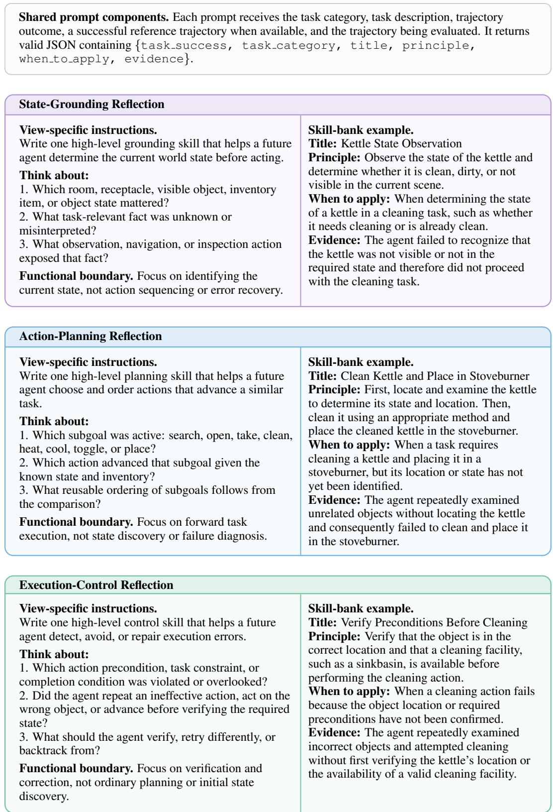  
Figure 9: View-specific reflection instructions and actual ALFWorld skills extracted from the trained skill banks. For readability, only the instructions that differ across functional views are shown; shared prompt components are omitted and provided in our code. Candidate skills are written to their intended banks only after functional-attribution verification.