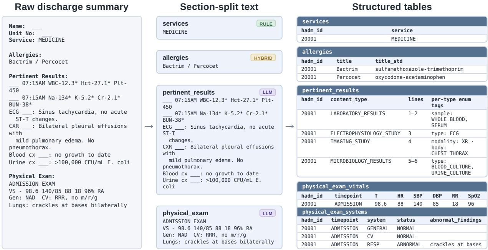
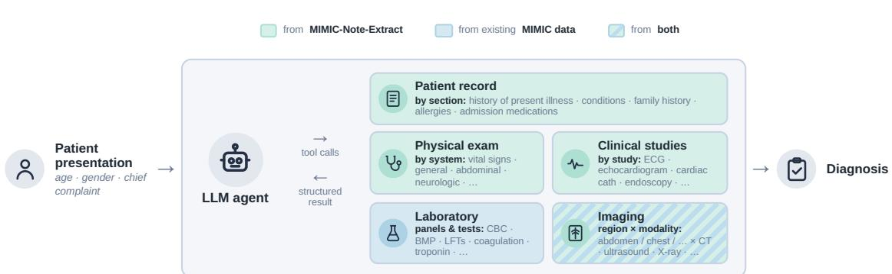
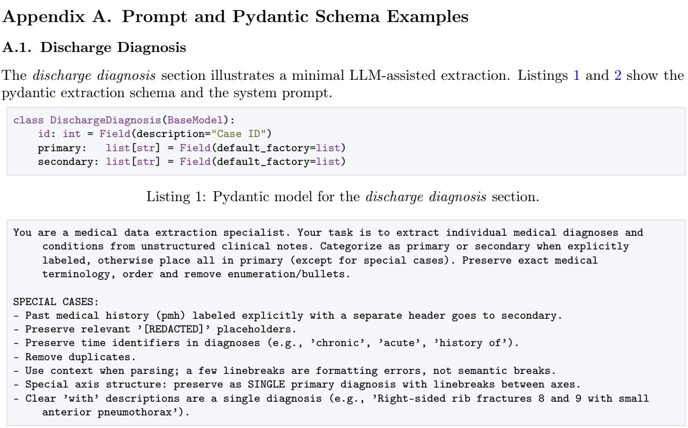
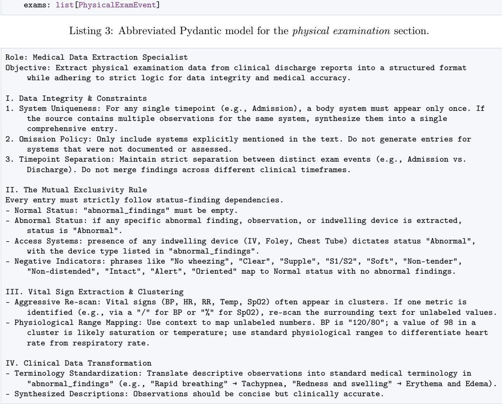
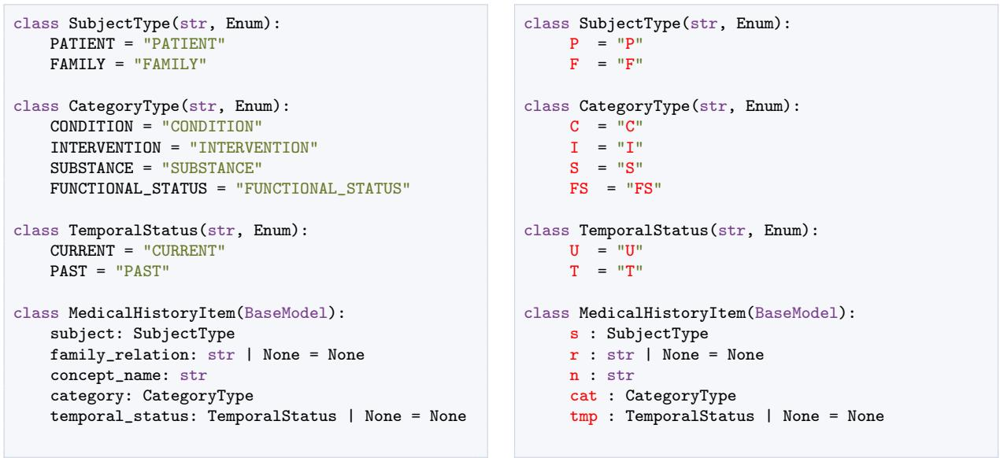
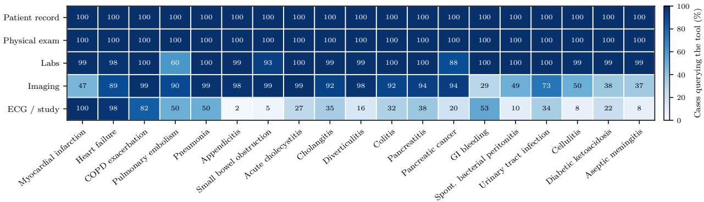

# MIMIC-Note-Extract: A Large-Scale Structured Dataset Extracted from MIMIC-IV-Note Discharge Summaries

Kristian Schwethelm k.schwethelm@tum.de Jonas Kuntzer<sup>∗</sup> jonas.kuntzer@tum.de Chair for AI in Healthcare and Medicine, TU Munich (TUM) and TUM University Hospital, Germany

Conrad Ketzer conrad.ketzer@tum.de Department for Trauma Surgery, TUM University Hospital and TU Munich, Germany

Eva Wende eva.wende@tum.de Department for Diagnostic and Interventional Radiology, TUM University Hospital and TU Munich, Germany

Moritz Schlager moritz.schlager@tum.de Chair for AI in Healthcare and Medicine, TU Munich and TUM University Hospital, Germany Munich Center for Machine Learning (MCML), Germany

Daniel Rückert daniel.rueckert@tum.de   
Chair for AI in Healthcare and Medicine, TU Munich and TUM University Hospital, Germany   
Department of Computing, Imperial College London, UK   
Munich Center for Machine Learning (MCML), Germany

georg.kaissis@hpi.de

Hasso Plattner Institute for Digital Engineering, University of Potsdam, Germany

Friederike Jungmann friederike.jungmann@tum.de Chair for AI in Healthcare and Medicine, TU Munich and TUM University Hospital, Germany Department for Diagnostic and Interventional Radiology, TUM University Hospital and TU Munich, Germany

Paul Hager

Chair for AI in Healthcare and Medicine, TU Munich and TUM University Hospital, Germany

paul.hager@tum.de

## Abstract

MIMIC is one of the most widely used public hospital datasets for machine learning on electronic health records, yet clinically important information, such as past medical history, allergies, and diagnostic findings, remains confined to free-text discharge summaries. Studies requiring this information must therefore build their own extraction pipelines, duplicating substantial efort across projects. We release MIMIC-Note-Extract (MNE), a large-scale dataset that uses a hybrid extraction pipeline combining deterministic parsing with schema-guided large language model generation to transform 16 sections from 300,720 discharge summaries into structured tables. MNE adds information that has no structured MIMIC counterpart and enriches related tables with broader coverage and greater clinical detail, including 10 times more patient-history entries and medication his-

tories for more than twice as many admissions. Validation by medical doctors confirms extraction accuracy above 92% across sections. Using MNE, we construct a clinical decision-making benchmark for LLM agents, demonstrating how reusable structured representations of clinical narratives reduce data curation efort.

Keywords: clinical information extraction, electronic health records, MIMIC, LLMs

Data and Code Availability MNE is available on PhysioNet (Kuntzer et al., 2026; Pollard et al., 2026) under the same credentialed-access controls as its source dataset, MIMIC-IV-Note v2.2 (Johnson et al., 2023a). Code for reproduction is available at https: //github.com/kschwethelm/mimic-note-extract.

Institutional Review Board (IRB) No IRB approval required. Our work is a secondary analysis of deidentified MIMIC-IV-Note v2.2 data (Johnson et al., 2023a) and involves no interaction with individuals and no access to identifiable private information.

## 1. Introduction

The Medical Information Mart for Intensive Care (MIMIC) (Johnson et al., 2023b) has enabled thousands of peer-reviewed publications (Zhang et al., 2025). However, the highly structured tabular formats that underpin much of this research omit the rich narrative context of patient care. Elements such as a patient’s past medical history, allergies, and pertinent findings are only found in unstructured text. While MIMIC-IV-Note (Johnson et al., 2023a) provides these free-text narratives through a collection of clinical documents, including discharge summaries and radiology reports, this wealth of information remains dificult to scale or integrate into research workflows without extensive preprocessing.

This leads to a fragmented ecosystem of “individual preprocessing” where, in the absence of a standardized pipeline, each project must build its own scripts to extract the specific variables needed for its use case. These isolated preprocessing pipelines are rarely shared or unified, resulting in duplicated engineering efort and inconsistent extraction quality across the community. But even if such an efort were made, the resulting datasets are typically tailored so closely to individual projects that they lack the generality needed to support broader research questions. At the core of this lies a methodological limitation: most existing projects focus on information extraction. Instead, we posit that the community requires information conversion—preserving the underlying information of the raw data while transforming it into an easily queryable, structured format.

Our design philosophy reflects this distinction by prioritizing the completeness of the clinical record. We introduce MIMIC-Note-Extract (MNE), a structured dataset derived from 300,720 MIMIC-IV-Note discharge summaries. We employ a hybrid processing framework that pairs deterministic parsing with schema-guided LLM generation to translate 16 major clinical sections of the discharge summary into structured tables. By providing structured representations for 13 of these sections—ranging from pre-admission history to detailed physical exams—we eliminate the preprocessing barrier while preserving the semantic nuances of the original narratives (see Figure 1).

To demonstrate the dataset’s utility, we construct a large-scale clinical decision-making benchmark that evaluates LLM agents on a real-world diagnostic task. It supports more pathologies and more specific clinical actions with substantially less curation efort.

## Contributions.

• We introduce and publicly release MIMIC-Note-Extract, a clinical database containing data from 16 discharge summary sections of 300,720 admissions, validated via expert medical review to >92% accuracy and shown to complement existing MIMIC tables with novel information.

• Together with medical experts, we design an adaptive extraction pipeline that balances computational eficiency and clinical accuracy by dynamically choosing rule- or LLM-based extraction.

• We construct an agentic benchmark with 10,000 patient cases to evaluate LLMs’ capabilities for diagnosing 19 diferent pathologies.

## 2. Related Work

MIMIC-derived tabular datasets. Several works derive task-specific datasets by selecting, merging, and engineering features from MIMIC’s existing structured tables: MIMIC-Extract builds time-series features from MIMIC-III chart events (Wang et al., 2020), the MIMIC-III multitask benchmark packages vital signs and lab results for clinical prediction (Harutyunyan et al., 2019), the MIMIC-IV emergency-department (ED) benchmark assembles triage outcomes from ED tables (Xie et al., 2022), and Gupta et al. (2022) standardize cohort construction across these sources. Instead of selecting from existing tables, we convert free-text discharge summaries into new structured tables, adding clinically important information that is absent from MIMIC’s tabular data.

Radiology reports. Beyond the structured tables, MIMIC provides two free-text document types: radiology reports and discharge summaries (Johnson et al., 2023a). The radiology reports are widely studied and have been structured into entity-relation graphs, standardized report formats, disease labels, or questionanswer pairs (Jain et al., 2021; Delbrouck et al., 2025; Müller et al., 2026). We instead work on discharge summaries, which cover the whole admission rather than a single imaging study. However, our extraction can easily be combined with extractions of the radiology report sections.

Manual discharge-summary annotation. Several datasets share our focus on discharge summaries, but manually label passages in them for a single, narrow purpose: DiReCT (Wang et al., 2024) marks findings that support a diagnosis to annotate the diagnostic reasoning chain, CLIP (Mullenbach et al., 2021) flags post-discharge to-dos (e.g., “follow up with cardiology in two weeks”), MedDec (Elgaar et al. 2024) marks where a clinical decision was made (e.g., “started IV antibiotics”), and the 2018 n2c2 task (Henry et al., 2020) tags medications and the adverse drug events they cause. Because manual annotation is costly, each covers only a few hundred notes (718 for CLIP, 511 for DiReCT, and 451 for MedDec), orders of magnitude smaller than our cohort.

  
Figure 1: A raw discharge summary flowing through our extraction pipeline, showing a representative subset of four sections. The example is synthetic and does not correspond to any real admission. The discharge summary (left) is split into sections (middle) and decomposed into relational rows (right). Badges denote the extraction method of each section (rule-based, hybrid, or LLM).

Automated discharge-summary extraction. Prior automated approaches extract text from the notes without structuring it: MIMIC-IV-Ext-BHC (Aali et al., 2025) releases the verbatim brief-hospitalcourse section of 270,033 summaries as a summarization target, clinical decision-making (CDM) benchmarks (Hager et al., 2024; Gaber et al., 2025; Ferber et al., 2026) use regular expressions (regex) to assemble diagnostic cases from selected note sections such as the patient history (500–9k cases), and MIMIC-IV-Ext-22MCTS (Wang et al., 2025) uses Llama-3.1-8B to decompose ∼267k summaries into a list of short clinical events (e.g., “fever” or “pain control”). In contrast, we do not target a single task, section, output type, or extract only verbatim text: we convert all 16 sections of every discharge summary across ∼300k admissions into general, structured tables with welldefined fields, creating a general-purpose dataset that supports a wide range of downstream applications.

## 3. Dataset and Extraction Pipeline

We derive our cohort from the 331,793 raw discharge summaries available in MIMIC-IV-Note v2.2, which are released de-identified, with sensitive information redacted by “ ”. The redaction method also removed some non-identifying clinical content, including clinical terms and parts of section headers. The remaining text retains all patient histories, symptoms, diagnoses, treatments, findings, and descriptions of the hospital course, although some keywords are lost through redaction. Following quality filtering<sup>1</sup>, our final dataset comprises 300,720 admissions. The resulting MIMIC-Note-Extract dataset preserves high data availability across nearly all clinical categories (Table 1), with most sections exceeding 90% coverage. Coverage denotes the percentage of admissions with a non-empty section; for example, the low coverage of “Major Procedures” directly reflects the availability of procedure information in the source data. We also preserve three high-complexity narrative sections in their original form to avoid losing information where a structured breakdown was not feasible. The following paragraphs detail our extraction pipeline; the full database schema and comprehensive technical details are provided in Appendices B and C.

Table 1: Clinical sections, key concepts, extraction methodologies, and cohort-wide coverage in MNE across 300,720 admissions. Coverage is the percentage of admissions with a non-empty section.
<table><tr><td>Clinical Section</td><td>Key Fields</td><td>Method</td><td>Admissions</td><td>Coverage</td></tr><tr><td>Gender</td><td>Patient sex assigned at birth</td><td>Rule</td><td>300,720</td><td>100.0%</td></tr><tr><td>Services</td><td>Clinical service at discharge</td><td>Rule</td><td>300,720</td><td>100.0%</td></tr><tr><td>Chief Complaint</td><td>Symptom category and clinical description</td><td>Hybrid</td><td>296,132</td><td>98.5%</td></tr><tr><td>History of Present Illness</td><td>Chronological narrative of events prior to admission</td><td>Verbatim</td><td>296,620</td><td>98.6%</td></tr><tr><td>Past Medical History</td><td>Prior conditions and interventions by cate- gory, chronicity, and subject</td><td>LLM</td><td>290,212</td><td>96.5%</td></tr><tr><td>Medications on Admission</td><td>Active home medications with dose, route, frequency, and strength</td><td>LLM</td><td>275,035</td><td>91.5%</td></tr><tr><td>Allergies</td><td>Allergen name</td><td>Hybrid</td><td>296,378</td><td>98.6%</td></tr><tr><td>Physical Examination</td><td>Physiological measurements and findings by organ system</td><td>LLM</td><td>294,708</td><td>98.0%</td></tr><tr><td>Pertinent Results</td><td>Lab, imaging, and diagnostic findings with key values</td><td>LLM</td><td>241,508</td><td>80.3%</td></tr><tr><td>Brief Hospital Course</td><td>Narrative of clinical course and medical management</td><td>Verbatim</td><td>267,164</td><td>88.8%</td></tr><tr><td>Major Procedures</td><td>Procedural interventions with current vs. historical flags</td><td>Hybrid</td><td>159,791</td><td>53.1%</td></tr><tr><td>Discharge Diagnosis</td><td>Discharge diagnoses preserving clinical pri- ority</td><td>Hybrid</td><td>297,537</td><td>98.9%</td></tr><tr><td>Discharge Condition</td><td>Clinical status indicators</td><td>Hybrid</td><td>300,109</td><td>99.8%</td></tr><tr><td>Discharge Medications</td><td>Active outpatient prescriptions at discharge with dose, route, and frequency</td><td>LLM</td><td>285,926</td><td>95.1%</td></tr><tr><td>Discharge Instructions</td><td>Outbound instructions, follow-up direc- tives, and education</td><td>Verbatim</td><td>291,647</td><td>97.0%</td></tr><tr><td>Discharge Disposition</td><td>Discharge destination</td><td>Rule</td><td>300,667</td><td>100.0%</td></tr></table>

Splitting into sections. The first step in our pipeline divides monolithic discharge reports into their constituent sections. We identify 24 distinct sections, dropping 8 that are fully redacted (e.g., “Name” in Fig. 1). De-identification is, at times, over-inclusive and also removes tokens that carry no identifying information, including words within section headers. Splitting is therefore complicated by partially redacted headers (e.g., “Discharge ”, which could indicate “Discharge Condition” or “Discharge Disposition”). To resolve this, our deterministic splitting algorithm tracks common header variants. It further exploits the consistent relative ordering of clinical sections to infer headers that remain ambiguous due to redaction.<sup>2</sup>

Information modeling. Following section splitting, the next step in our pipeline is defining the target schemas for information extraction. The dificulty lies in the massive structural and content diversity within individual clinical sections. For instance, the Pertinent Results section can range from a single-line negative cell culture report to a multi-page unfiltered output of microbiology panels and longitudinal imaging findings. Therefore, we must carefully decide what information to retain and how to structure it; the goal is to capture essential clinical depth without introducing hyper-specific fields that remain empty across most samples. Keeping the schemas concise also ensures they remain manageable for downstream human verification. To achieve this balance, we iteratively developed target models in close consultation with clinicians, analyzing source texts for recurring patterns to refine our field definitions. The schemas preserve temporal context where it is available in the source, including distinctions between current and historical information.

Adaptive extraction. To process large volumes of clinical notes eficiently, we follow the principle of choosing the simplest tool capable of handling the task. Simple, highly structured sections can be reliably processed using deterministic rules, such as regular expressions and string matching, whereas complex narratives require the contextual understanding of LLMs<sup>3</sup>. Our pipeline thus categorizes sections into three distinct operational modes (see Table 1): some rely entirely on rule-based extraction, others require LLMs exclusively, and a hybrid group uses rule-based methods by default, falling back to an LLM only when section-specific validation criteria fail. For example, for Discharge Condition, we extract and validate status indicators deterministically; any residual text triggers LLM fallback (Appendix C). This adaptive approach ensures optimal computational throughput for straightforward data while reserving LLM inference for genuinely complex data. Furthermore, we optimized token eficiency by mapping long clinical identifiers to single-token codes (e.g., mapping subject to s). By instructing the model to output these short abbreviations, we trade of expensive output tokens for much cheaper input tokens. This approach reduced overall inference costs (see Appendix D.1). Across the entire cohort, this pipeline was executed for a total cost of 1,894.61e, yielding substantial cost savings of 321.24e (14.5% of total cost) compared to a naive LLM-only baseline (see Table 6 in Appendix D.2).

Validation and constraints. To ensure the final output aligns with our target data models, the pipeline concludes with a strict validation layer. We use formal schemas to programmatically constrain LLM generation (Beurer-Kellner et al., 2024; Banerjee et al., 2025) and to run post-hoc data validation. Any output that violates these structural constraints or custom validation rules triggers an automated retry loop, ensuring a guaranteed fit with the target data model.

Table 2: Extraction accuracy (item-level, 95% confidence margins of error) and inter-annotator agreement (Gwet’s AC1) per section.
<table><tr><td>Section</td><td>Acc. (%)</td><td>AC1</td></tr><tr><td>Allergies</td><td> $9 9 . 8 \pm 0 . 3 2$ </td><td>99.8</td></tr><tr><td>Chief Complaint</td><td> $9 7 . 6 \pm 2 . 3 7$ </td><td>98.0</td></tr><tr><td>Discharge Condition</td><td> $9 7 . 4 \pm 3 . 1 5$ </td><td>98.0</td></tr><tr><td>Discharge Diagnosis</td><td> $9 7 . 1 \pm 2 . 6 5$ </td><td>95.8</td></tr><tr><td>Major Procedures</td><td> $9 8 . 3 \pm 2 . 0 4$ </td><td>98.0</td></tr><tr><td>Past Medical History</td><td> $9 5 . 2 \pm 1 . 4 8$ </td><td>90.1</td></tr><tr><td>Physical Examination</td><td> $9 5 . 2 \pm 1 . 8 3$ </td><td>90.4</td></tr><tr><td>Pertinent Results</td><td> $9 2 . 2 \pm 3 . 8 1$ </td><td>88.4</td></tr><tr><td>Discharge Medications</td><td> $9 7 . 2 \pm 1 . 1 7$ </td><td>97.1</td></tr><tr><td>Medications on Admission</td><td> $9 9 . 3 \pm 0 . 4 7$ </td><td>97.2</td></tr></table>

## 4. Quality Validation

We evaluate extraction quality through a manual, side-by-side review of the source text against the extractions by three medical doctors. Annotations were performed at the item level to allow the distinction between a single item-level error and an entirely incorrect sample. The error taxonomy, concrete examples, and additional metrics are shown in Appendix E.

Setup. Rule-based extractions were excluded from manual review due to their deterministic, auditable nature. Final validation was performed after the extraction pipeline had been frozen. Extractions reviewed during this validation were not manually corrected. For LLM-based extractions, we determined the required sample size using the standard normal approximation (Lohr, 2021) formula for binomial proportions. Assuming an expected accuracy of $p = 0 . 8 0$ at a 95% confidence level and a conservative target margin of error (MoE) of 6%, the formula dictated a minimum of 171 unique cases per section. To assess inter-annotator agreement (IAA), we utilized 121 single-annotated and 50 dual-annotated cases. The dual-annotated cases were randomly distributed among pairs of our three practitioners. This setup ensured that each overlapping case was independently reviewed by two people, resulting in a total workload of ≈ 74 cases per annotator per section. In total, the annotators completed 2,210 case-level tasks (13,744 individual item-level decisions). Alongside accuracy, we report Gwet’s AC1 (Gwet, 2008) for IAA, since raw agreement is inflated by the high prevalence of correct extractions.

Table 3: Relationship of extracted sections to MIMIC’s existing tabular data.
<table><tr><td>Section</td><td>Contribution</td></tr><tr><td>Already exists in MIMIC, but can flag mismatches</td><td></td></tr><tr><td>Gender</td><td>Flag mismatches</td></tr><tr><td>Services</td><td>Flag mismatches</td></tr><tr><td>Discharge Disposition</td><td>Flag mismatches; adds ~44k missing values</td></tr><tr><td colspan="2">Related to MIMIC information, but broader or richer</td></tr><tr><td>Discharge Diagnosis</td><td>Clinician-written diagnoses with prima- ry/secondary structure</td></tr><tr><td></td><td>Chief Complaint 2× more admissions; cleaner terms and additional clinical context</td></tr><tr><td>Allergies</td><td>Comprehensive allergen list covering far more admissions than MIMIC&#x27;s ICD codes</td></tr><tr><td>Past Medical History</td><td>10× more history rows; contains broader history, family, substance, and functional history, compared to MIMIC&#x27;s ICD codes</td></tr><tr><td>Medications on Admission</td><td>&gt; 2× more admissions; more detail by pro- viding dose, route, frequency, PRN, and hold status</td></tr><tr><td>Major Procedures</td><td>Clinical procedure label and more surgical details compared to ICD/HCPCS billing</td></tr><tr><td colspan="2">No structured MIMIC counterpart</td></tr><tr><td>Discharge Condition</td><td>Provides structured discharge state, includ- ing mental status and functional activity</td></tr><tr><td>Discharge Medications</td><td>Provides discharge-medication list</td></tr><tr><td>Physical Examination</td><td>Provides system-level examination findings with normal/abnormal status</td></tr><tr><td>Pertinent Results</td><td>Provides important clinical results, e.g., radiology interpretations</td></tr></table>

Results. As summarized in Table 2, item-level accuracy is consistently high across all sections, ranging from 92.2% to 99.8%, with realized margins of error between 0.32% and 3.81%, well inside our 6% target. IAA is similarly high: AC1 exceeds 95% in seven of the ten sections. The three exceptions are pertinent results at 88.4%, past medical history at 90.1%, and physical examination at 90.4%.

## 5. Comparison to MIMIC Tables

The information we extract from the discharge notes overlaps partially with MIMIC’s existing tables. We compare each MNE section with its closest structured counterpart(s) in MIMIC to determine whether it validates, extends, or adds to existing data. Exact oneto-one matching is unrealistic for most sections: MNE fields are extracted from unstructured text, whereas MIMIC tables contain coded events.

Table 3 groups the sections by how they relate to MIMIC’s tables and gives a short summary of what each section contributes. Three sections largely reproduce an existing MIMIC field; the redundancy can be used to flag mismatching records. The dischargedisposition extraction additionally covers ∼44k admissions with a missing MIMIC value. The remaining sections either extend a related but non-equivalent MIMIC table with broader coverage or richer detail (e.g., allergies, past medical history, medications on admission) or have no MIMIC counterpart at all (discharge condition, discharge medications, physical exam, and pertinent results). Overall, MNE complements MIMIC’s existing structured data by adding substantial new clinical information and providing broader or richer representations where related tables already exist. See Appendix F for detailed results.

## 6. Benchmarking Agents in Clinical Decision-Making

As a concrete downstream application of our dataset, we build an agentic benchmark for clinical decisionmaking (CDM) based on MIMIC-CDM (Hager et al., 2024). Such benchmarks are a natural application for our dataset because they require clinical information that is not available in MIMIC’s tabular data. MIMIC-CDM simulates real-world clinical decisionmaking from patient presentation to diagnosis: starting from patient history, the doctor agent decides which examinations and tests to perform before making a diagnosis. Like a human doctor would examine a patient or order a laboratory test or imaging study, the agent initiates these actions through tools and receives the corresponding findings. To supply these findings, the authors parsed discharge summaries with regex, a laborious process that yielded verbatim free-text blocks (similar to the “Section-split text” in Figure 1). We ask how the construction of MIMIC-CDM would change if MNE had been available at the time.

We first validate that MNE can replace the regexderived texts without reducing accuracy, while requiring far less curation efort. We then leverage MNE’s fields to build a larger agentic CDM benchmark with more admissions and pathologies, stricter case filtering, and finer control over the agent’s context.

  
Figure 2: Overview of the agentic CDM benchmark built from MIMIC-Note-Extract. The LLM agent starts from the patient presentation and gathers evidence through five tools before making a diagnosis. Green tools are sourced from MNE, blue tools from existing MIMIC data, and hatched from both. In contrast to prior benchmarks, the agent must name the exact item it wants, e.g., a single examination system or a patient-record section, and receives only this requested part.

Table 4: Diagnosis accuracy (%) on the fullinformation and agentic CDM benchmarks. Parentheses report how accuracy changes when using our data instead of the original regex-derived data. Appendix Table 13 reports 95% confidence intervals.
<table><tr><td>Model</td><td>Reasoning</td><td>Full info</td><td>Agentic</td></tr><tr><td>Gemini 3.5 Flash</td><td>minimal</td><td>88.7 (+0.1)</td><td>87.9</td></tr><tr><td>Gemini 3.1 Flash Lite minimal</td><td></td><td>87.4 (+0.7)</td><td>81.9</td></tr><tr><td>Gemini 3.1 Flash Lite</td><td>high</td><td>88.6 (+0.0)</td><td>84.2</td></tr><tr><td>Gemma 4 31B</td><td>X</td><td>86.7 (+0.3)</td><td>83.7</td></tr><tr><td>Qwen3.6 35B-A3B</td><td>X</td><td>90.4 (+0.3)</td><td>83.6</td></tr><tr><td>Qwen3.6 35B-A3B</td><td>√</td><td>89.3 (+0.2)</td><td>82.6</td></tr><tr><td>Qwen3.5 2B</td><td>X</td><td>82.0 (+0.9)</td><td>51.3</td></tr></table>

## 6.1. Full-Information CDM Benchmark

We reproduce the full-information setting of MIMIC-CDM, in which the LLM receives all patient information up front instead of requesting it through tools. This resembles a second-reader setting: the model interprets evidence already selected and collected by the treating clinicians to reach a diagnosis. Specifically, the LLM receives a single message containing the patient’s history of present illness, physical examinations, laboratory tests, and radiology reports. This setting evaluates whether the model can reach the correct diagnosis when the relevant clinical information has already been selected.

As described above, Hager et al. (2024) had to preprocess discharge summaries to construct this context.

We instead can query the relevant fields from MNE and apply simple filters where necessary. For example, the timepoint column in MNE’s physical-examination table distinguishes admission from discharge examinations. This allows us to exclude findings that were available only at discharge, i.e., after the diagnosis had been made (Figure 1). As shown in Table 4, accuracy matches or improves for every model. Thus, MNE reproduces the original benchmark context through simple table queries, substantially lowering the curation efort required to construct the benchmark.

## 6.2. Agentic CDM Benchmark

We use MNE’s structured representation to develop an agentic CDM benchmark in which agents perform clinical actions to reach a diagnosis (Figure 2). For example, the agent can read a section of the patient history or request a physical examination of a specific body part. This level of granularity was not possible in the original MIMIC-CDM benchmark, where the corresponding tools return entire verbatim text blocks of the whole history or the whole examination notes. The minimal curation efort also allows us to construct a larger benchmark with 10,000 cases across 19 pathologies, compared with four pathologies and 2,400 cases in MIMIC-CDM.

We create five agent tools representing a subset of real-world clinical actions: reviewing patient history, performing physical examinations, ordering laboratory tests, and requesting imaging or other clinical studies (Table 15). Agents specify the target of each action, such as examining the abdomen, ordering a troponin test, or requesting a chest X-ray. In clinical practice, a human doctor would make those requests and receive real findings. Here, the agent makes the requests through tool calls, and recorded MIMIC and MNE data simulate the findings. If the information is unavailable, the tool returns a message such as “The lab cannot perform the troponin test for this patient”. Overall, the model must decide which clinical action to take next based on the findings obtained so far, determine when it has suficient evidence, and interpret that evidence to reach a diagnosis.

To accurately simulate patient cases, admissions need suficient diagnostic evidence. For example, diagnosing myocardial infarction may require a recorded electrocardiogram (ECG). MNE enables precise case selection through structured fields, allowing us, e.g., to require an ECG, specific examination systems, or complete vital signs. A clinician first selected pathologies that could be diagnosed using the available tools, after which 10,000 admissions were automatically selected using filters over the MIMIC and MNE tables.

Overall, MNE simplified case filtering and data curation while providing greater flexibility in how information is exposed to the agent.

Results. Table 4 reports diagnosis accuracy on our benchmark. The larger models reached 82–88% accuracy, while the small Qwen3.5 2B only achieved 51.3%, showing that the agentic benchmark is more challenging for most models than the full-information benchmark. Reasoning reduced accuracy for Qwen3.6 and improved it for Gemini 3.1 Flash Lite, in line with prior findings that chain-of-thought does not reliably improve clinical performance (McCoy et al., 2025; Wu et al., 2025). See Appendix G for more details.

## 7. Discussion

## 7.1. Downstream Applications

Our dataset supports many downstream applications.   
Here, we sketch three examples.

Drug-allergy labels and antibiotic prescribing. Reported penicillin allergies are associated with higher rates of antibiotic-resistant infections, such as MRSA, and C. dificile infections, partly because they lead to greater use of broad-spectrum alternative antibiotics, even though the reported allergy history is often inaccurate (Macy and Contreras, 2014; Blumenthal et al., 2018). Studying this relationship in MIMIC is dificult because it lacks allergy information. Our dataset provides detailed allergy information for nearly 170,000 admissions, which can be combined with the broader clinical record to study how reported allergy labels influence antibiotic prescribing and subsequent infection outcomes during hospitalization.

Medication reconciliation. Cornish et al. (2005) showed that more than half of patients admitted on four or more regular medications have at least one unintended discrepancy between their pre-admission medications and their admission orders, and that nearly 40% of these discrepancies had the potential to cause moderate to severe harm. MNE provides structured medication lists for ∼300k admissions. These lists can be compared with inpatient prescription records to identify medication discrepancies at the cohort scale, enabling large-scale studies of medication reconciliation and polypharmacy (a patient taking multiple medications at the same time).

Risk adjustment with documented function. The Hospital Frailty Risk Score estimates patients’ vulnerability to poor health outcomes by assessing their reduced ability to recover from illness or stress, using ICD-10 codes because functional status is often unavailable in routine administrative data (Gilbert et al., 2018). Such code-based measures can be affected by incomplete or inaccurate coding (O’Malley et al., 2005). MNE instead provides directly documented information on patients’ functional and mental status, including detailed medical history. These fields can be used in outcome models and to assess code-based frailty measures.

## 7.2. Clinical Text Extraction with LLMs

Extracting structured information from clinical notes at the scale of MIMIC-IV surfaced several practical lessons that are likely common to similar eforts.

Schema design. Most of our design efort went into defining categories that cleanly partition the clinical notes without being overly broad or narrow. We refined categories iteratively until they covered all common cases; capturing rare edge cases was infeasible. Designing an efective schema required close collaboration with medical experts to decide what is worth extracting and to verify correctness. Attempts to automate schema design with an LLM-in-the-loop did not produce satisfactory results.

Prompt design. Current LLMs have strong medical knowledge and can interpret clinical terminology, abbreviations, and reasoning without explicit instruction. The main value of prompt design was to resolve ambiguity: clarifying how borderline cases should be handled, describing dataset-specific formatting patterns, handling documentation errors, or disambiguating fields. However, every rule we added, no matter how precise, gave the model more to think over, making it more likely to overthink simple extractions and overapply exception-handling logic. Finding the right balance was dificult: too few rules left genuine ambiguity unresolved, too many made the model secondguess straightforward cases. This was especially pronounced for reasoning models, which would produce lengthy reasoning traces before their response, even when the correct extraction was obvious. Iterative prompt testing with validation sets was essential.

Automatic validation. Even the best LLMs make extraction errors. We used Pydantic validators (Colvin et al., 2026) to catch and automatically correct common mistakes like malformed dates, outof-range values, or type mismatches. Fixing these predictable errors through deterministic postprocessing was more reliable than overly specific prompts.

Managing costs. Extracting 16 sections across 300,720 admissions cost 1,894.61e in API fees (Appendix D). We kept costs down through concise prompts and output formats, selecting the cheapest model that met quality requirements, using low thinking budgets for reasoning models, and using rule-based extraction wherever LLMs were not necessary.

Zero data retention (ZDR). Clinical notes contain sensitive patient information that should not be shared with third parties through cloud services or APIs. We require strict ZDR policies that prohibit saving data, e.g., for model training or abuse monitoring. We considered running local models, but found the hardware requirements infeasible at our scale.

## 7.3. Limitations and Future Work

Our dataset inherits limitations from the source discharge summaries. The original MIMIC developers de-identified the notes by removing names, contact details, identifying numbers, and explicit dates and times. As described in Section 3, the de-identification method also redacted some non-identifying content, resulting in loss of clinically relevant information. The removal of dates and times limits temporal reconstruction, although MNE uses retained relative expressions such as “at discharge”, “three years ago”, and “since yesterday” to capture temporal context. More generally, discharge summaries reflect clinicians’ retrospective selection of information, may contain text copied from earlier encounters, and may omit distracting observations, competing hypotheses, and uncertainty present during care.

Extraction quality was not systematically compared with open-weight and specialized medical models. The released pipeline, schemas, prompts, and model configurations support such comparisons in future work.

To preserve clinician wording, we did not fully standardize clinical terminology. Fields such as diagnoses and procedures retain source wording and abbreviations, so identifying patient cohorts may require terminology mapping or additional filters. Broader terminology normalization remains future work.

Finally, Brief Hospital Course, History of Present Illness, and Discharge Instructions are too diverse to find a reliable pattern for splitting them into fields. Future work may partition these free-text sections into temporal event chains, following Wang et al. (2025).

## 8. Conclusion

We presented MIMIC-Note-Extract, a large-scale structured dataset that extends MIMIC’s tabular data across 300,720 admissions with important clinical information, including diagnoses, home medications, allergies, patient history, and physical examination findings. Overall, our dataset adds 16 new tables to MIMIC that easily integrate with existing data through admission identifiers. The information was extracted from the MIMIC-IV-Note discharge summaries using regex rules and LLMs. Our extraction pipeline was built in close collaboration with clinicians and achieves >92% extraction accuracy across sections, as confirmed by medical expert review.

## Acknowledgments

KS and GK received support from the Bavarian Collaborative Research Project PRIPREKI of the Free State of Bavaria Funding Programme “Artificial Intelligence – Data Science”.

JK was supported by the German Medical Informatics Initiative grant ID 01ZZ22316C.

The authors gratefully acknowledge the scientific support and resources of the AI service infrastructure

LRZ AI Systems provided by the Leibniz Supercomputing Centre (LRZ) of the Bavarian Academy of Sciences and Humanities (BAdW), funded by the Bayerisches Staatsministerium für Wissenschaft und Kunst (StMWK), primarily through the BayernKI initiative.

## References

Asad Aali, Dave Van Veen, Yamin Ishraq Arefeen, Jason Hom, Christian Bluethgen, Eduardo Pontes Reis, Sergios Gatidis, Namuun Cliford, Joseph Daws, Arash S. Tehrani, Jangwon Kim, and Akshay S. Chaudhari. A dataset and benchmark for hospital course summarization with adapted large language models. Journal of the American Medical Informatics Association, 32(3):470–479, 2025. doi: 10.1093/jamia/ocae312.

Debangshu Banerjee, Tarun Suresh, Shubham Ugare, Sasa Misailovic, and Gagandeep Singh. CRANE: Reasoning with constrained LLM generation. In Forty-second International Conference on Machine Learning, 2025. URL https://openreview.net/for um?id=wKs9fHYxCV.

Luca Beurer-Kellner, Marc Fischer, and Martin Vechev. Guiding llms the right way: fast, noninvasive constrained generation. In Proceedings of the 41st International Conference on Machine Learning, ICML’24. JMLR.org, 2024.

Kimberly G. Blumenthal, Na Lu, Yuqing Zhang, Yu Li, Rochelle P. Walensky, and Hyon K. Choi. Risk of meticillin resistant Staphylococcus aureus and Clostridium dificile in patients with a documented penicillin allergy: population based matched cohort study. BMJ, 361:k2400, 2018. doi: 10.1136/bmj.k2 400.

Samuel Colvin, Eric Jolibois, Hasan Ramezani, Adrian Garcia Badaracco, Terrence Dorsey, David Montague, Serge Matveenko, Marcelo Trylesinski, Sydney Runkle, David Hewitt, Alex Hall, and Victorien Plot. Pydantic Validation, May 2026. URL https://github.com/pydantic/pydantic. Version 2.13.3.

Patricia L. Cornish, Sandra R. Knowles, Romina Marchesano, Vincent Tam, Steven Shadowitz, David N. Juurlink, and Edward E. Etchells. Unintended medication discrepancies at the time of hos-

pital admission. Archives of Internal Medicine, 165 (4):424–429, 2005. doi: 10.1001/archinte.165.4.424.

Jean-Benoit Delbrouck, Justin Xu, Johannes Moll, Alois Thomas, Zhihong Chen, Sophie Ostmeier, Asfandyar Azhar, Kelvin Zhenghao Li, Andrew Johnston, Christian Bluethgen, Eduardo Pontes Reis, Mohamed S Muneer, Maya Varma, and Curtis Langlotz. Automated structured radiology report generation. In Wanxiang Che, Joyce Nabende, Ekaterina Shutova, and Mohammad Taher Pilehvar, editors, Proceedings of the 63rd Annual Meeting of the Association for Computational Linguistics (Volume 1: Long Papers), pages 26813–26829, Vienna, Austria, July 2025. Association for Computational Linguistics. ISBN 979-8-89176-251-0. doi: 10.18653/v1/2025.acl-long.1301. URL https://aclanthology.org/2025.acl-long.1301/.

Mohamed Elgaar, Jiali Cheng, Nidhi Vakil, Hadi Amiri, and Leo Anthony Celi. MedDec: A dataset for extracting medical decisions from discharge summaries. In Lun-Wei Ku, Andre Martins, and Vivek Srikumar, editors, Findings of the Association for Computational Linguistics: ACL 2024, pages 16442–16455, Bangkok, Thailand, August 2024. Association for Computational Linguistics. doi: 10.18653/v1/2024.findings-acl.975. URL https://aclanthology.org/2024.findings-acl.975/.

Dyke Ferber, Lars Hilgers, Christiane Höper, Benedict Kinny-Köster, Jan-Niklas Eckardt, Katharina Egger-Heidrich, Marius Bill, Martin M. K. Schneider, Jan Clusmann, Lejla Kadric, Marcel Oehme, Maximilian Mayrhofer-Schmid, Alexander Oeser, Georg Wölflein, Isabella C. Wiest, Jan Moritz Middeke, A. John Iafrate, Daniel Truhn, Dirk Jäger, and Jakob Nikolas Kather. Towards autonomous medical artificial intelligence agents. Nature, 2026. doi: 10.1038/s41586-026-10675-5. URL https://doi.org/10.1038/s41586-026-10675-5.

Farieda Gaber, Maqsood Shaik, Fabio Allega, Agnes Julia Bilecz, Felix Busch, Kelsey Goon, Vedran Franke, and Altuna Akalin. Evaluating large language model workflows in clinical decision support for triage and referral and diagnosis. npj Digital Medicine, 8(1):263, 2025. doi: 10.1038/s41746-025-01684-1. URL https://do i.org/10.1038/s41746-025-01684-1.

Thomas Gilbert, Jenny Neuburger, Joshua Kraindler, Eilis Keeble, Paul Smith, Cono Ariti, Sandeepa

Arora, Andrew Street, Stuart Parker, Helen C. Roberts, Martin Bardsley, and Simon Conroy. Development and validation of a hospital frailty risk score focusing on older people in acute care settings using electronic hospital records: an observational study. The Lancet, 391(10132):1775–1782, 2018. doi: 10.1016/S0140-6736(18)30668-8.

Google DeepMind. Gemini 2.5 Flash, 2025. URL https://storage.googleapis.com/deepmind-media /Model-Cards/Gemini-2-5-Flash-Model-Card.pdf. Accessed: 16.06.26.

Google DeepMind. Gemini 3.5 Flash, 2026a. URL https://deepmind.google/models/model-cards/g emini-3-5-flash/. Accessed: 16.06.26.

Google DeepMind. Gemini 3.1 Flash Lite, 2026b. URL https://deepmind.google/models/model-cards/g emini-3-1-flash-lite/. Accessed: 16.06.26.

Google DeepMind. Gemma 4, 2026c. URL https: //deepmind.google/models/gemma/gemma-4/. Accessed: 16.06.26.

Mehak Gupta, Brennan Gallamoza, Nicolas Cutrona, Pranjal Dhakal, Raphael Poulain, and Rahmatollah Beheshti. An extensive data processing pipeline for mimic-iv. Proceedings of Machine Learning Research, 193:311–325, 2022.

Kilem Li Gwet. Computing inter-rater reliability and its variance in the presence of high agreement. British Journal of Mathematical and Statistical Psychology, 61(1):29–48, 2008. doi: 10.1348/00071100 6X126600.

Paul Hager, Friederike Jungmann, Robbie Holland, Kunal Bhagat, Inga Hubrecht, Manuel Knauer, Jakob Vielhauer, Marcus Makowski, Rickmer Braren, Georgios Kaissis, and Daniel Rueckert. Evaluation and mitigation of the limitations of large language models in clinical decision-making. Nature Medicine, 30(9):2613–2622, 2024. doi: 10.1038/s41591-024-03097-1. URL https://do i.org/10.1038/s41591-024-03097-1.

Hrayr Harutyunyan, Hrant Khachatrian, David C. Kale, Greg Ver Steeg, and Aram Galstyan. Multitask learning and benchmarking with clinical time series data. Scientific Data, 6(1):96, 2019. doi: 10.1038/s41597-019-0103-9. URL https: //doi.org/10.1038/s41597-019-0103-9.

Sam Henry, Kevin Buchan, Michele Filannino, Amber Stubbs, and Ozlem Uzuner. 2018 n2c2 shared task on adverse drug events and medication extraction in electronic health records. Journal of the American Medical Informatics Association, 27(1):3–12, 2020. doi: 10.1093/jamia/ocz166.

Saahil Jain, Ashwin Agrawal, Adriel Saporta, Steven Truong, Du Nguyen Duong, Tan Bui, Pierre Chambon, Yuhao Zhang, Matthew P. Lungren, Andrew Y. Ng, Curtis Langlotz, and Pranav Rajpurkar. Radgraph: Extracting clinical entities and relations from radiology reports. In Thirty-fifth Conference on Neural Information Processing Systems Datasets and Benchmarks Track (Round 1), 2021. URL https: //openreview.net/forum?id=pMWtc5NKd7V.

Alistair Johnson, Tom Pollard, Steven Horng, Leo Anthony Celi, and Roger Mark. MIMIC-IV-Note: Deidentified free-text clinical notes. PhysioNet, January 2023a. doi: 10.13026/1n74-ne17. URL https://doi.org/10.13026/1n74-ne17. Version 2.2.

Alistair E. W. Johnson, Lucas Bulgarelli, Lu Shen, Alvin Gayles, Ayad Shammout, Steven Horng, Tom J. Pollard, Sicheng Hao, Benjamin Moody, Brian Gow, Li-wei H. Lehman, Leo A. Celi, and Roger G. Mark. Mimic-iv, a freely accessible electronic health record dataset. Scientific Data, 10(1): 1, 2023b. doi: 10.1038/s41597-022-01899-x. URL https://doi.org/10.1038/s41597-022-01899-x.

Jonas Kuntzer, Kristian Schwethelm, Conrad Ketzer, Eva Wende, Moritz Schlager, Daniel Rueckert, Georgios Kaissis, Friederike Jungmann, and Paul Hager. MIMIC-IV-Ext MIMIC Note Extract: A Large-Scale Structured Dataset Extracted from MIMIC-IV-Note Discharge Summaries. PhysioNet, October 2026. doi: 10.13026/cq50-rd11. URL https://doi.org/10.13026/cq50-rd11. Version 1.0.

Woosuk Kwon, Zhuohan Li, Siyuan Zhuang, Ying Sheng, Lianmin Zheng, Cody Hao Yu, Joseph Gonzalez, Hao Zhang, and Ion Stoica. Eficient memory management for large language model serving with pagedattention. In Proceedings of the 29th Symposium on Operating Systems Principles, SOSP ’23, page 611–626, New York, NY, USA, 2023. Association for Computing Machinery. ISBN 9798400702297. doi: 10.1145/3600006.3613165. URL https://doi.org/10.1145/3600006.3613165.

Sharon L Lohr. Sampling: design and analysis. Chapman and Hall/CRC, 2021. doi: 10.1201/9780429298 899. URL https://doi.org/10.1201/9780429298899.

Eric Macy and Richard Contreras. Health care use and serious infection prevalence associated with penicillin “allergy” in hospitalized patients: A cohort study. The Journal of Allergy and Clinical Immunology, 133(3):790–796, 2014. doi: 10.1016/j. jaci.2013.09.021.

Liam G. McCoy, Rajiv Swamy, Nidhish Sagar, Minjia Wang, Stephen Bacchi, Jie Ming Nigel Fong, Nigel C.K. Tan, Kevin Tan, Thomas A. Buckley, Peter Brodeur, Leo Anthony Celi, Arjun K. Manrai, Aloysius Humbert, and Adam Rodman. Assessment of large language models in clinical reasoning: A novel benchmarking study. NEJM AI, 2(10): AIdbp2500120, 2025. doi: 10.1056/AIdbp2500120. URL https://ai.nejm.org/doi/full/10.1056/AIdbp 2500120.

James Mullenbach, Yada Pruksachatkun, Sean Adler, Jennifer Seale, Jordan Swartz, Greg McKelvey, Hui Dai, Yi Yang, and David Sontag. CLIP: A dataset for extracting action items for physicians from hospital discharge notes. In Chengqing Zong, Fei Xia, Wenjie Li, and Roberto Navigli, editors, Proceedings of the 59th Annual Meeting of the Association for Computational Linguistics and the 11th International Joint Conference on Natural Language Processing (Volume 1: Long Papers), pages 1365–1378, Online, August 2021. Association for Computational Linguistics. doi: 10.18653/v1/2021.acl-long.109. URL https: //aclanthology.org/2021.acl-long.109/.

Philip Müller, Friederike Jungmann, Georgios Kaissis, and Daniel Rueckert. A structured, tagged, and localized visual question answering dataset with full sentence answers and scene graphs for chest x-ray images. In The Fourteenth International Conference on Learning Representations, 2026. URL https: //openreview.net/forum?id=LrmyW9JLYq.

Stuart J. Nelson, Kelly Zeng, John Kilbourne, Tammy Powell, and Robin Moore. Normalized names for clinical drugs: Rxnorm at 6 years. Journal of the American Medical Informatics Association, 18(4): 441–448, 2011. doi: 10.1136/amiajnl-2011-000116.

Kimberly J. O’Malley, Karon F. Cook, Matt D. Price, Kimberly Raiford Wildes, John F. Hurdle, and

Carol M. Ashton. Measuring diagnoses: Icd code accuracy. Health Services Research, 40(5 Pt 2):1620– 1639, 2005. doi: 10.1111/j.1475-6773.2005.00444.x.

Tom Pollard, Benjamin E. Moody, Li-wei H. Lehman, Brian J. Gow, Chrystinne Fernandes, Chen Xie, Alistair Johnson, Roger G. Mark, and Thomas Heldt. PhysioNet as a global platform for biomedical research. Nature Health, 2026. doi: 10.1038/s44360-0 26-00096-z. URL https://doi.org/10.1038/s44360-0 26-00096-z.

Qwen Team. Qwen3.6-35B-A3B: Agentic coding power, now open to all, April 2026a. URL https: //qwen.ai/blog?id=qwen3.6-35b-a3b. Accessed: 16.06.26.

Qwen Team. Qwen3.5: Towards native multimodal agents, February 2026b. URL https://qwen.ai/bl og?id=qwen3.5. Accessed: 16.06.26.

Bowen Wang, Jiuyang Chang, Yiming Qian, Guoxin Chen, Junhao Chen, Zhouqiang Jiang, Jiahao Zhang, Yuta Nakashima, and Hajime Nagahara. Direct: Diagnostic reasoning for clinical notes via large language models. In A. Globerson, L. Mackey, D. Belgrave, A. Fan, U. Paquet, J. Tomczak, and C. Zhang, editors, Advances in Neural Information Processing Systems, volume 37, pages 74999–75011. Curran Associates, Inc., 2024. doi: 10.52202/079017-2386. URL https://proceeding s.neurips.cc/paper\_files/paper/2024/file/892850 bf793e03b5c410dfd9425b94c8-Paper-Datasets\_an d\_Benchmarks\_Track.pdf.

Jing Wang, Xing Niu, Juyong Kim, Jie Shen, Tong Zhang, and Jeremy C. Weiss. MIMIC-IV-Ext-22MCTS: A 22 Million-Event Temporal Clinical Time-Series Dataset for Risk Prediction. Research Square, 2025. doi: 10.21203/rs.3.rs-6347897/v1. Preprint.

Shirly Wang, Matthew B. A. McDermott, Geeticka Chauhan, Marzyeh Ghassemi, Michael C. Hughes, and Tristan Naumann. Mimic-extract: a data extraction, preprocessing, and representation pipeline for mimic-iii. In Proceedings of the ACM Conference on Health, Inference, and Learning, ACM CHIL ’20, page 222–235. ACM, April 2020. doi: 10.1145/3368555.3384469. URL http://dx.doi.org /10.1145/3368555.3384469.

Thomas Wolf, Lysandre Debut, Victor Sanh, Julien Chaumond, Clement Delangue, Anthony Moi, Pier-

ric Cistac, Tim Rault, Remi Louf, Morgan Funtowicz, Joe Davison, Sam Shleifer, Patrick von Platen, Clara Ma, Yacine Jernite, Julien Plu, Canwen Xu, Teven Le Scao, Sylvain Gugger, Mariama Drame, Quentin Lhoest, and Alexander Rush. Transformers: State-of-the-art natural language processing. In Qun Liu and David Schlangen, editors, Proceedings of the 2020 Conference on Empirical Methods in Natural Language Processing: System Demonstrations, pages 38–45, Online, October 2020. Association for Computational Linguistics. doi: 10.18653/v1/2020.emnlp-demos.6. URL https://aclanthology.org/2020.emnlp-demos.6/.

Jiageng Wu, Kevin Xie, Bowen Gu, Nils Krüger, Kueiyu Joshua Lin, and Jie Yang. Why chain of thought fails in clinical text understanding, 2025. URL https://arxiv.org/abs/2509.21933.

Feng Xie, Jun Zhou, Jin Wee Lee, Mingrui Tan, Siqi Li, Logasan S/O Rajnthern, Marcel Lucas Chee, Bibhas Chakraborty, An-Kwok Ian Wong, Alon Dagan, Marcus Eng Hock Ong, Fei Gao, and Nan Liu. Benchmarking emergency department prediction models with machine learning and public electronic health records. Scientific Data, 9(1):658, 2022. doi: 10.1038/s41597-022-01782-9. URL https://doi.org/10.1038/s41597-022-01782-9.

Xiyue Zhang, Weimin Kong, Rongfen Shi, Long Sun, Min Xu, and Ling Gong. Data-driven trends in critical care informatics: a bibliometric analysis of global collaborations using the mimic database (2004–2024). Computers in Biology and Medicine, 195:110670, 2025. doi: 10.1016/j.compbiomed.2025. 110670.

  
Listing 2: System prompt for the discharge diagnosis section.

## A.2. Physical Examination

The physical examination section is one of the most complex sections. Each admission can have multiple exam events (admission, discharge, interim) and most events contain a vital-sign object plus a list of per-system assessments. Enums are encoded with short three-letter codes to keep the LLM’s JSON output compact. Listings 3 and 4 show the extraction model and prompt in abbreviated form.

```python
class VitalSigns(BaseModel):
temperature: float | "[REDACTED]" | None
heart_rate: int | "[REDACTED]" | None
blood_pressure_systolic: int | "[REDACTED]" | None
blood_pressure_diastolic: int | "[REDACTED]" | None
respiratory_rate: int | "[REDACTED]" | None
o2_saturation: int | "[REDACTED]" | None
weight: Weight | None
respiratory_support: OxygenSupport | None
class SystemAssessment(BaseModel):
system: SystemName # GEN, HNT, CVR, RSP, GIT, EXT, NEU, SKN, PSY, GUR, ACC
status: ExamStatus # NRM, ABN, NAS
abnormal_findings: list[str]
class PhysicalExamEvent(BaseModel):
timepoint: Timepoint # ADM, DSC, INT, UNK
vital_signs: VitalSigns | None
systems: list[SystemAssessment]
class PhysicalExams(BaseModel):
id: int
```

  
Listing 4: System prompt for the physical examination section.

## Appendix B. Complete Relational Database Schema

We present the complete database schema of MIMIC-Note-Extract in Table 5. This schema includes al 16 tables, including administrative hub tables and narrative text tables. To construct the final relationa database, we flatten the Pydantic extraction models. Simple fields map directly to standard SQL types, and categorical values convert to SQL enums, while complex polymorphic structures (such as varied medication frequencies) are serialized into JSONB columns to prevent excessive table sparsity.

## Appendix C. Pipeline Implementation Details

This section provides technical implementation details for the pipeline’s section splitting, extraction, and validation stages.

Structural parsing Twenty-four distinct clinical sections were identified as appearing in consistent relative order across the MIMIC-IV-Note discharge summaries. Eight of these sections (e.g., Name, Admission Date, Date of Birth) are entirely redacted by upstream de-identification and are consequently dropped from the cohort. Deterministic mappings were established between common header variants and canonical section names. The relative ordering of sections was utilized to automatically resolve all but 5,461 ambiguous headers that could not be parsed automatically due to upstream de-identification (e.g., distinguishing between Discharge Condition and Discharge Disposition given “Discharge \_\_\_”). Those cases were manually resolved by inspecting their content.

Table 5: All 16 tables in the MIMIC-Note-Extract schema. “Cardinality” refers to rows per admission.
<table><tr><td>Table</td><td>Cardinality</td><td>Key fields</td></tr><tr><td>Hub</td><td></td><td></td></tr><tr><td>admissions</td><td>1</td><td>subject_id, hadm_id, note_id</td></tr><tr><td>Single-row attributes</td><td></td><td></td></tr><tr><td>gender</td><td>0-1</td><td>enum</td></tr><tr><td>services</td><td>0-1</td><td>enum (20 services)</td></tr><tr><td>discharge_disposition</td><td>0-1</td><td>enum</td></tr><tr><td>discharge_condition</td><td>0-1</td><td>14 enums + 2 booleans</td></tr><tr><td>Multi-row clinical lists</td><td></td><td></td></tr><tr><td>allergies</td><td>0-n</td><td>title, title_std</td></tr><tr><td>chief_complaint</td><td>0-n</td><td>category (enum), text</td></tr><tr><td>discharge_diagnosis</td><td>0-n</td><td>title, is_primary</td></tr><tr><td>major_procedures</td><td>0-n</td><td>title, is_previous</td></tr><tr><td>past_medical_history</td><td>0-n</td><td>concept_name, category, temporal_status, subject (pa- tient/family), family_relation</td></tr><tr><td>medications_on_admission</td><td>0-n</td><td>name, presentation form, dose (value + unit), route, du- ration (value + unit), strength and frequency (JSONB), PRN/hold flags</td></tr><tr><td>discharge_medications</td><td>0-n</td><td>name, presentation form, dose (value + unit), route, du- ration (value + unit), strength and frequency (JSONB), PRN/hold flags</td></tr><tr><td>Per-timepoint structured exam physical_exam_vitals</td><td></td><td>timepoint (enum), temperature, heart rate, blood pressure,</td></tr><tr><td></td><td>0-4</td><td>respiratory rate, O2 saturation, weight, O2 support</td></tr><tr><td>physical_exam_systems</td><td>0-n</td><td>timepoint (enum), system (enum), status (enum), abnormal_findings</td></tr><tr><td>Subsection-typed list</td><td></td><td>content type (enum), line range, verbatim text passage,</td></tr><tr><td>pertinent_results</td><td>0-n</td><td>per-type enum arrays, topic label (clinical notes only)</td></tr><tr><td>Raw text</td><td></td><td></td></tr><tr><td>discharge_sections</td><td>1</td><td>one text column per section (16)</td></tr></table>

Hybrid extraction heuristics We use section-specific deterministic rules to reduce computational cost, with a fallback to an LLM only when the complexity exceeds the capabilities of regular expressions. In the Allergies, Chief Complaint, Discharge Diagnosis, and Major Procedure sections, the LLM is bypassed for simple cases: single-line entries that match a curated list of terms or restricted character sets. In more detailed sections, such as Discharge Condition, success relies on a “zero-remainder” policy. Status indicators are extracted and validated using enums. These indicators are then removed from the original text. If any residual content remains, the entire section is processed by the LLM instead.

Validation and post-processing Throughout the pipeline, section-specific Pydantic validators enforce structural and clinical consistency on the extracted data. We showcase two sections here as an example. For the Pertinent Results section, validators verify that extracted document coordinates represent non-overlapping, chronologically ordered line ranges to maintain the original document’s sequence. In the Physical Examination section, more complex logic is applied: validators ensure clinical consistency by flagging assessments marked as “Normal” that contain abnormal findings, while automatically merging fragmented extractions that share the same clinical timepoint. Global post-processing includes cleaning whitespace, deduplicating redundant clinical list items, and standardizing clinical units, such as normalizing temperature values to Fahrenheit. Additionally, the pipeline identifies physiological outliers for researcher review while preserving all verbatim values to maintain a faithful representation of the original clinical text.

## Appendix D. Extraction Cost Analysis

## D.1. Exploiting API Pricing Asymmetries with Compressed Output Schemas

Because the LLM generates a structured JSON response for each submitted sample, structural elements such as field names and enum values are repeated in every output. While these keys are strictly necessary for parsing, they are essentially discarded after extraction—yet we still have to pay for the tokens to generate them. At a cohort size of over 300,000 samples, this repetitive JSON overhead becomes a significant driver of total costs.

This presents an excellent opportunity for optimization by exploiting the asymmetric pricing model of LLM APIs, where output tokens are much more expensive than input tokens (e.g., Gemini 3.1 Flash-Lite pricing of \$1.50 per 1M output tokens versus \$0.25 per 1M input tokens). Input tokens—i.e., the static system instructions and schemas repeated across all samples—are cheaper still at a rate of \$0.025 per 1M tokens, representing a 60-fold cost reduction compared to output tokens. Consequently, minimizing the number of output tokens is a great lever to save costs.

To exploit this asymmetry, we designed our Pydantic schemas to use short, abbreviated field aliases and enum codes during model inference (e.g., mapping subject → s, and PATIENT → P). These brief aliases are resolved back to their canonical, human-readable forms downstream to maintain usability for subsequent tasks and human validation.

To validate the eficiency of this approach, we conducted a comparative analysis of 20 samples from the Past Medical History section using Gemini 3.1 Flash-Lite for the cost analysis. The full Pydantic models for both the original verbose schema and the optimized version are presented in Listings 5 and 6, respectively. The experimental results demonstrate a 9.87% reduction in total output tokens compared to the verbose baseline. This resulted in a 5.99% reduction in total execution cost under standard pricing. 4

Implementation note. This optimization strategy was developed midway through the project, meaning it is not used across all sections. For sections that had already been processed in earlier stages of development, we elected to retain the original verbose schemas rather than incurring the additional cost of re-running the full extraction pipeline with the optimized Pydantic schemas.

  
Listing 5: Original verbose Pydantic schema.  
Listing 6: Optimized Pydantic schema with 1-token aliases. Red text indicates the fields and values modified to minimize output token consumption.

## D.2. Detailed Cost and Savings Calculations

A detailed breakdown of the extraction costs and savings aforded by our hybrid, rule-first extraction strategy is presented. To calculate these figures, a baseline cost for each clinical section, assuming a fully LLMdriven pipeline, is first estimated. This baseline is established by calculating the average per-case cost from representative pilot runs using Gemini pricing models. This unit cost is then multiplied by the total number of cases in the cohort to project the baseline expense.

The baseline is compared with actual production expenditures, and the resulting net savings are shown in Table 6. The table structure is defined as follows:

• LLM Baseline: The projected total cost of extracting the entire section using only LLMs.

• Production Cost: The actual cost incurred using our optimized pipeline, where deterministic rules bypassed LLM calls for structured cases.

• Optimized Savings: The savings achieved by our rule-first strategy.

Table 6: Production extraction methodology, LLM model, API expenditures, and rule-first optimization savings by clinical section.
<table><tr><td>Clinical Section</td><td>Operational Mode</td><td>Production Model</td><td>LLM Baseline (€)</td><td>Production Cost (€)</td><td>Optimized Savings (€)</td></tr><tr><td colspan="6">LLM-Only Extraction</td></tr><tr><td>Past Medical History</td><td>LLM</td><td>Gemini 3.1 Flash-Lite</td><td>138.07</td><td>138.07</td><td></td></tr><tr><td>Medications on Admission</td><td>LLM</td><td>Gemini 3.1 Flash-Lite</td><td>487.00</td><td>487.00</td><td></td></tr><tr><td>Physical Examination</td><td>LLM</td><td>Gemini 3.1 Flash-Lite</td><td>345.00</td><td>345.00</td><td></td></tr><tr><td>Pertinent Results</td><td>LLM</td><td>Gemini 3.1 Flash-Lite</td><td>179.00</td><td>179.00</td><td></td></tr><tr><td>Discharge Medications</td><td>LLM</td><td>Gemini 3.1 Flash-Lite</td><td>581.00</td><td>581.00</td><td></td></tr><tr><td colspan="6">Hybrid (Rule-First with LLM Fallback)</td></tr><tr><td>Chief Complaint</td><td>Hybrid (61.2% Auto)</td><td>Gemini 2.5 Flash</td><td>62.78</td><td>24.36</td><td>38.42</td></tr><tr><td>Allergies</td><td>Hybrid (99.1% Auto)</td><td>Gemini 2.5 Flash</td><td>124.90</td><td>1.07</td><td>123.83</td></tr><tr><td>Major Procedures</td><td>Hybrid (20.0% Auto)</td><td>Gemini 2.5 Flash</td><td>53.42</td><td>42.75</td><td>10.67</td></tr><tr><td>Discharge Diagnosis</td><td>Hybrid (27.6% Auto)</td><td>Gemini 2.5 Flash</td><td>63.68</td><td>46.11</td><td>17.57</td></tr><tr><td>Discharge Condition</td><td>Hybrid (72.2% Auto)</td><td>Gemini 3.1 Flash-Lite</td><td>181.00</td><td>50.25</td><td>130.75</td></tr><tr><td colspan="6">Deterministic (Rule / Verbatim)</td></tr><tr><td>Gender</td><td>Rule-Based</td><td></td><td>0.00</td><td>0.00</td><td></td></tr><tr><td>Services</td><td>Rule-Based</td><td></td><td>0.00</td><td>0.00</td><td></td></tr><tr><td>Discharge Disposition</td><td>Rule-Based</td><td></td><td>0.00</td><td>0.00</td><td></td></tr><tr><td>History of Present Illness</td><td>Verbatim</td><td></td><td>0.00</td><td>0.00</td><td></td></tr><tr><td>Brief Hospital Course</td><td>Verbatim</td><td></td><td>0.00</td><td>0.00</td><td></td></tr><tr><td>Discharge Instructions</td><td>Verbatim</td><td></td><td>0.00</td><td>0.00</td><td></td></tr><tr><td colspan="6">Aggregate Total</td></tr></table>

## Appendix E. Full Validation Results

This section provides the full details of the manual validation, including the error taxonomy, concrete examples, metric definitions, and the complete performance breakdown.

## Error taxonomy

Ambiguous The source text does not unambiguously support either approval or rejection (e.g., shorthand that could be interpreted in multiple valid ways).

Fabrication The extracted item is not supported by the source text.

Omission An item present in the source text is missing from the extracted set.

Clinically Altered Meaning The extracted item is textually close to the source but semantically diferent in a way that would afect a clinical reader.

Incorrect Attribute / Classification Structured attribute fields (e.g., dosage or category) are incorrect.

Incorrect Boundaries The detected line boundaries are incorrect. Exclusive to the “Pertinent Results” section.

Concrete examples Table 7 illustrates the clinician-assigned labels with source excerpts and the corresponding extracted fields. We selected illustrative examples, one for each category. Each explanation follows the clinicians’ annotations.

An overview of extraction errors and ambiguous judgments across all categories is detailed in Table 8. Validation highlights that omissions (231 errors) and incorrect attributes (157 errors) are the predominant error modes, localized mainly within “Physical Examination” and “Past Medical History”. In contrast, critical failures such as fabrications (14 total) and clinically altered meanings (42 total) are rare across the 13,744 validated items.

Accuracy is calculated using an ambiguity-excluded mapping. Because an ambiguous judgment indicates that the source text does not support a reliable decision about correctness, we exclude it from the accuracy denominators rather than treating it as either correct or incorrect. At the item level, each remaining extracted item contributes one decision, and recorded omissions are added to the denominator as incorrect missing items. Precision, recall, and F1-score use the same mapping, treating omissions as false negatives and fabrications or semantic alterations as false positives. At the case level, we evaluate the remaining item decisions and exclude cases with no evaluable items after removing ambiguous judgments; a case with no items and no recorded omissions is scored as correct by convention.

Judgments are clustered within cases: the 50 dual-annotated cases contribute two judgments each, and the items of a case are reviewed together rather than drawn independently. We therefore take the case as the unit of analysis, letting each case contribute the mean of the judgments made about it, so that a disagreement between two annotators enters as 0.5. Margins of error come from a cluster bootstrap that resamples the 171 cases with replacement over 10,000 replicates and reports the 2.5th and 97.5th percentiles, which anchors the efective sample size to the independent cases rather than to the judgments made about them.

The item-level accuracy column is the Jaccard index TP/(TP + FP + FN) rather than conventional accuracy. A true negative would be an item correctly not extracted, which carries no meaning for a task whose objective is to extract everything present in the source text, so the taxonomy has no such category and none can enter a denominator. The case-level columns are macro-averaged over cases while the item-level columns are micro-averaged over items, and a case with no items and no recorded omissions is scored as correct by convention.

To assess inter-annotator agreement, both raw agreement and Gwet’s AC1 are reported using a tolerant mapping that treats Approve and Ambiguous as the same label. This measures agreement on substantive extraction correctness without penalizing diferences in annotators’ thresholds for assigning the ambiguity label. Raw agreement can be misleadingly high in datasets with high-prevalence categories (as observed here).

Table 7: Examples of clinician-assigned error and ambiguity labels. Bold text highlights the source phrases and extracted values relevant to each judgment; field names are set in monospace. Source excerpts retain the original wording, with line breaks represented by spaces or slashes except in the boundary example; extracted fields are abbreviated for display. Boundary line numbers are zero-based and inclusive.
<table><tr><td>Category / section</td><td>Source excerpt</td><td>Extracted fields</td><td>Error explanation</td></tr><tr><td>Ambiguous Medications on admission</td><td>Simethicone 40-80 mg PO QID:PRN abd pain</td><td>strength: range 40–80 mg dose: 80 mg</td><td>The source gives a 40–80 mg range without separately specifying strength and administered dose. The extraction records both a strength range and a single 80 mg dose.</td></tr><tr><td>Fabrication Past medical history</td><td>R THA / L THA / Stents x2</td><td>concept_name: Coronary Artery Stents</td><td>The extraction adds a coronary location to the stents, although their anatomical location is not specified in the source.</td></tr><tr><td>Omission Medications on admission</td><td>18. Insulin SC / Sliding Scale Insulin SC Sliding Scale using HUM Insulin</td><td>medications: no insulin entry</td><td>Sliding-scale insulin is explicitly listed in the source but is absent from the complete extracted medication list.</td></tr><tr><td>Clinically altered meaning Discharge medications</td><td>Calcium 500 + D (calcium carbonate-vitamin D3) 500 mg(1,250mg) -400 unit oral DAILY</td><td>strength: [500 mg, 400 units] dose: 1,250 mg</td><td>The parenthetical 1,250 mg quantity is incorrectly interpreted as the administered dose.</td></tr><tr><td>Incorrect attribute/ classification Discharge medications</td><td>furosemide 40 mg Tablet : One (1) Tablet PO ONCE (Once) for 1 doses.</td><td>name: furosemide frequency: 1 per DAY duration: null</td><td>A one-time dose is incorrectly represented as daily administration without a duration limit.</td></tr><tr><td>Incorrect boundaries Pertinent results</td><td>19: collection. 20: Findings were concerning for early or partial small bowel 21: obstruction. The NG tube was kept in place, and</td><td>start_line: 6 end_line: 19 Clinician span: 6-21</td><td>The extracted span ends at line 19 instead of line 21, omitting the following finding of suspected small-bowel obstruction.</td></tr></table>

Gwet’s AC1 is more robust to this efect and provides a more stable estimate of agreement beyond chance. It is reported at the item level only; a case-level label is the full pattern of item labels across the case, which leaves nearly every case in a category of its own and reduces the chance correction to nothing.

Error counts are reported per annotator judgment rather than per case, so an error flagged independently by both annotators of a dual-annotated case contributes twice. The “Judged Items” column is the matching denominator, leaving the relative figures unafected.

The gap between case-level and item-level accuracy (Tables 9 and 10) is expected in multi-item sections: a single disputed medication or history item can cause the entire case to fail. This is most evident in complex sections such as past medical history or medications. Item-level quality is treated as the primary estimate for cohort-level reuse, while case-level accuracy provides a conservative lower bound.

The agreement gap in the medication sections stems from how annotators handled incomplete dosage and strength details in the raw notes. When the source text omitted medication strengths, one clinician routinely flagged the extraction as “Ambiguous” while others marked it as “Approved”. While this diference in labeling threshold lowered the exact raw agreement, both annotators agreed that the LLM successfully extracted everything present in the source.

Tables 9 and 10 report the complete per-section validation breakdown of model performance at the case and item levels, while Table 11 provides the detailed inter-annotator agreement results. Table 8 provides the counts and percentages of extraction errors and ambiguous judgments across all clinical sections.

Table 8: Counts and percentages of extraction errors and ambiguous judgments by clinical section. Percentages are calculated relative to all judged items within each section.
<table><tr><td>Section</td><td>Judged Items</td><td>Omiss.</td><td>Attr.</td><td>Alter.</td><td>Fabr.</td><td>Bound.</td><td>Ambig.</td></tr><tr><td>Allergies</td><td>1,488</td><td>0 (0.0%)</td><td>0 (0.0%)</td><td>1 (0.1%)</td><td>2 (0.1%)</td><td>0 (0.0%)</td><td>6 (0.4%)</td></tr><tr><td>Chief Complaint</td><td>222</td><td>1 (0.5%)</td><td>4 (1.8%)</td><td>0 (0.0%)</td><td>0 (0.0%)</td><td>0 (0.0%)</td><td>3 (1.4%)</td></tr><tr><td>Discharge Condition</td><td>222</td><td>4 (1.8%)</td><td>0 (0.0%)</td><td>0 (0.0%)</td><td>1 (0.5%)</td><td>0 (0.0%)</td><td>1 (0.5%)</td></tr><tr><td>Discharge Diagnosis</td><td>222</td><td>1 (0.5%)</td><td>5 (2.3%)</td><td>0 (0.0%)</td><td>0 (0.0%)</td><td>0 (0.0%)</td><td>0 (0.0%)</td></tr><tr><td>Major Procedures</td><td>222</td><td>1 (0.5%)</td><td>1 (0.5%)</td><td>2 (0.9%)</td><td>0 (0.0%)</td><td>0 (0.0%)</td><td>0 (0.0%)</td></tr><tr><td>Past Medical History</td><td>2,761</td><td>66 (2.4%)</td><td>46 (1.7%)</td><td>26 (0.9%)</td><td>3 (0.1%)</td><td>0 (0.0%)</td><td>36 (1.3%)</td></tr><tr><td>Physical Examination</td><td>3,715</td><td>103 (2.8%)</td><td>79 (2.1%)</td><td>3 (0.1%)</td><td>0 (0.0%)</td><td>0 (0.0%)</td><td>6 (0.2%)</td></tr><tr><td>Pertinent Results</td><td>564</td><td>23 (4.1%)</td><td>4 (0.7%)</td><td>6 (1.1%)</td><td>0 (0.0%)</td><td>10 (1.8%)</td><td>1 (0.2%)</td></tr><tr><td>Discharge Medications Medications on Admission</td><td>2,281 2,047</td><td>21 (0.9%) 11 (0.5%)</td><td>13 (0.6%) 5 (0.2%)</td><td>4 (0.2%)</td><td>7 (0.3%)</td><td>0 (0.0%)</td><td>551 (24.2%)</td></tr><tr><td></td><td></td><td></td><td></td><td>0 (0.0%)</td><td>1 (0.0%)</td><td>0 (0.0%)</td><td>388 (19.0%)</td></tr><tr><td>Total</td><td>13,744</td><td>231 (1.7%)</td><td>157 (1.1%)</td><td>42 (0.3%)</td><td>14 (0.1%)</td><td>10 (0.1%)</td><td>992 (7.2%)</td></tr></table>

Table 9: Model extraction performance by clinical section at the case level (with 95% confidence margins of error).
<table><tr><td rowspan="2">Section</td><td colspan="4">AMBIGUITY-EXCLUDED CASE-LEVEL (%)</td></tr><tr><td>Acc.</td><td>Prec.</td><td>Rec.</td><td>F1</td></tr><tr><td>Allergies</td><td> $9 8 . 5 \pm 2 . 0 6$ </td><td>99.6</td><td>100.0</td><td>99.8</td></tr><tr><td>Chief Complaint</td><td> $9 7 . 6 \pm 2 . 3 7$ </td><td>97.9</td><td>97.8</td><td>97.8</td></tr><tr><td>Discharge Condition</td><td> $9 7 . 9 \pm 2 . 3 5$ </td><td>97.9</td><td>97.9</td><td>97.9</td></tr><tr><td>Discharge Diagnosis</td><td> $9 7 . 1 \pm 2 . 6 3$ </td><td>97.7</td><td>97.4</td><td>97.5</td></tr><tr><td>Major Procedures</td><td> $9 8 . 2 \pm 2 . 0 5$ </td><td>98.5</td><td>98.4</td><td>98.4</td></tr><tr><td>Past Medical History</td><td> $7 2 . 8 \pm 6 . 4 3$ </td><td>97.7</td><td>97.4</td><td>97.2</td></tr><tr><td>Physical Examination</td><td> $8 0 . 7 \pm 5 . 5 6$ </td><td>97.3</td><td>95.2</td><td>96.1</td></tr><tr><td>Pertinent Results</td><td> $8 9 . 5 \pm 4 . 3 9$ </td><td>95.6</td><td>96.3</td><td>95.7</td></tr><tr><td>Discharge Medications</td><td> $8 4 . 8 \pm 5 . 1 5$ </td><td>98.4</td><td>98.9</td><td>98.4</td></tr><tr><td>Medications on Admission</td><td> $9 5 . 4 \pm 2 . 7 8$ </td><td>99.5</td><td>99.6</td><td>99.5</td></tr></table>

Table 10: Model extraction performance by clinical section at the item level (with 95% confidence margins of error).
<table><tr><td></td><td colspan="4">AMBIGUITY-EXCLUDED ITEM-LEVEL (%)</td></tr><tr><td>Section</td><td>Acc.</td><td>Prec.</td><td>Rec.</td><td>F1</td></tr><tr><td>Allergies</td><td> $9 9 . 8 \pm 0 . 3 2$ </td><td>99.8</td><td>100.0</td><td>99.9</td></tr><tr><td>Chief Complaint</td><td> $9 7 . 6 \pm 2 . 3 7$ </td><td>97.9</td><td>99.7</td><td>98.8</td></tr><tr><td>Discharge Condition</td><td> $9 7 . 4 \pm 3 . 1 5$ </td><td>99.4</td><td>97.9</td><td>98.7</td></tr><tr><td>Discharge Diagnosis</td><td> $9 7 . 1 \pm 2 . 6 5$ </td><td>97.7</td><td>99.4</td><td>98.5</td></tr><tr><td>Major Procedures</td><td>98.3 ± 2.04</td><td>98.5</td><td>99.7</td><td>99.1</td></tr><tr><td>Past Medical History</td><td> $9 5 . 2 \pm 1 . 4 8$ </td><td>97.5</td><td>97.5</td><td>97.5</td></tr><tr><td>Physical Examination</td><td> $9 5 . 2 \pm 1 . 8 3$ </td><td>98.1</td><td>97.0</td><td>97.5</td></tr><tr><td>Pertinent Results</td><td> $9 2 . 2 \pm 3 . 8 1$ </td><td>96.2</td><td>95.7</td><td>96.0</td></tr><tr><td>Discharge Medications</td><td> $9 7 . 2 \pm 1 . 1 7$ </td><td>98.6</td><td>98.6</td><td>98.6</td></tr><tr><td>Medications on Admission</td><td> $9 9 . 3 \pm 0 . 4 7$ </td><td>99.7</td><td>99.5</td><td>99.6</td></tr></table>

Table 11: Inter-Annotator Agreement (Raw IAA and Gwet’s AC1) by clinical section.
<table><tr><td>Section</td><td>Case IAA (tolerant)</td><td>Item IAA (tolerant)</td><td>AC1 (tolerant)</td></tr><tr><td>Allergies</td><td>98.0</td><td>99.8</td><td>99.8</td></tr><tr><td>Chief Complaint</td><td>96.0</td><td>98.0</td><td>98.0</td></tr><tr><td>Discharge Condition</td><td>98.0</td><td>98.0</td><td>98.0</td></tr><tr><td>Discharge Diagnosis</td><td>96.0</td><td>96.0</td><td>95.8</td></tr><tr><td>Major Procedures</td><td>96.0</td><td>98.0</td><td>98.0</td></tr><tr><td>Past Medical History</td><td>56.0</td><td>90.4</td><td>90.1</td></tr><tr><td>Physical Examination</td><td>68.0</td><td>90.9</td><td>90.4</td></tr><tr><td>Pertinent Results</td><td>80.0</td><td>88.7</td><td>88.4</td></tr><tr><td>Discharge Medications</td><td>76.0</td><td>97.1</td><td>97.1</td></tr><tr><td>Medications on Admission</td><td>80.0</td><td>97.3</td><td>97.2</td></tr></table>

## Appendix F. Details on Comparison to MIMIC Tables

In this section, we provide details on the comparison of each MNE section to the existing MIMIC tables. MIMIC tables span diferent modules, which difer in both content and cohort. The hospital-wide hosp module covers all admissions, while the emergency-department (ED) and intensive-care (ICU) modules add finer triage and bedside detail but only for the admissions treated in those units.

Gender The extracted gender field maps directly to hosp.patients.gender: both use the values M and F. 99.96% of documented genders match exactly, leaving 122 admissions with diferences. Manual review of these mismatching admissions shows that most are explained by transgender, gender-identity, or transition-related documentation in the discharge notes. Thus, MNE’s gender field can serve as a sanity check for correctness.

Services The extracted services field corresponds to hosp.services.curr\_service. However, MIMIC stores abbreviated transfer-level service codes rather than the broad labels used in our table. hosp.services represents service history as timed transfer rows, using transfer time and abbreviated codes such as MED, SURG, and NSURG. We map these codes to our extraction labels before comparison. Many mappings are one-to-one, but some MIMIC codes map to the same extracted category (e.g. MED, CMED, and OMED to MEDICINE), and a few extracted labels have no direct counterpart. We test whether the discharge-summary header records the service at discharge by comparing it with the last MIMIC service entry. Among 300,221 comparable admissions, 99.16% match exactly. Allowing any mapped service during the admission to count as a match increases the overlap by only 175 cases. Thus, while MNE largely contains service information already available in MIMIC, it also provides a useful sanity check by flagging cases with mismatched service assignments.

Discharge disposition The extracted discharge disposition field contains four broad categories: HOME, HOME\_WITH\_SERVICE, EXTENDED\_CARE, and EXPIRED. hosp.admissions stores the more detailed discharge\_location, together with death indicators such as hospital\_expire\_flag and deathtime. We map MIMIC discharge locations to extraction labels where the correspondence is clear, for example HOME to HOME, HOME HEALTH CARE to HOME\_WITH\_SERVICE, and skilled nursing or rehabilitation facilities to EXTENDED\_CARE. The main remaining unmapped MIMIC destinations are HOSPICE and AGAINST ADVICE, which occur in roughly 5,000 admissions and are more specific than our four-category schema. Among 251,208 admissions with a mapped non-missing MIMIC disposition, 96.87% match the extracted value.

Table 12: Extracted sections grouped by how they relate to MIMIC’s existing tables, with the closest related table(s) and the contribution of our extraction. Table prefixes: h=hosp, e=ED, i=ICU.
<table><tr><td>Section</td><td>Related MIMIC table(s)</td><td>Contribution</td></tr><tr><td colspan="3">Already exists in MIMIC, but can flag mismatches</td></tr><tr><td>Gender</td><td>h.patients.gender</td><td>Flag mismatches</td></tr><tr><td>Services</td><td>h.services.curr_service</td><td>Flag mismatches</td></tr><tr><td>Discharge Disposition</td><td>h.admissions.discharge location</td><td>Flag mismatches; adds ~44k missing values</td></tr><tr><td colspan="3">Related to MIMIC information, but broader or richer</td></tr><tr><td>Discharge Diagnosis</td><td>h.diagnoses_icd</td><td>Concise clinician-written diagnoses with primary/sec- ondary structure, preserving note wording instead of dense, generic ICD codes</td></tr><tr><td>Chief Complaint</td><td>e.triage.chiefcomplaint</td><td>2× more admissions; cleaner terms and additional clinical context</td></tr><tr><td>Allergies</td><td>h.diagnoses_icd (allergy codes)</td><td>Dedicated structured allergen list covering far more ad- missions than MIMIC&#x27;s sparse ICD codes</td></tr><tr><td>Past Medical History</td><td>h.diagnoses_icd (history codes)</td><td>10× more history rows; contains broader prior conditions, family, substance, and functional history, compared to MIMIC&#x27;s ICD codes</td></tr><tr><td>Medications on Admission</td><td>e.medrecon</td><td>&gt; 2× more admissions; more detail by providing dose, route, frequency, PRN, and hold status</td></tr><tr><td>Major Procedures</td><td>h.procedures_icd; h.hcpcsevents</td><td>Contains compact clinical procedure label and more surgi- cal details compared to coded ICD/HCPCS billing tables</td></tr><tr><td colspan="3">No structured MIMIC counterpart</td></tr><tr><td>Discharge Condition</td><td>none</td><td>Provides structured discharge state, including mental sta- tus and functional activity</td></tr><tr><td>Discharge Medications</td><td>none</td><td>Provides discharge-medication list</td></tr><tr><td>Physical Examination</td><td>none</td><td>Provides system-level examination findings with nor- mal/abnormal status</td></tr><tr><td>Pertinent Results</td><td>none</td><td>Provides important clinical results, e.g., radiology inter- pretations</td></tr></table>

However, the MIMIC table is missing a discharge location for 44,209 admissions, which are in MNE. These cases represent added structured information rather than disagreement with MIMIC. Thus, the extracted field validates well against mapped MIMIC values and fills many missing location values.

Allergies MIMIC has no dedicated structured allergy table, but hosp.diagnoses\_icd contains 36 allergystatus billing codes for only 2,211 admissions such as V140 (“personal history of allergy to penicillin”), V1507 (“latex allergy”), and broader codes such as V1505 (“Allergy to other foods”). MNE’s allergy table covers 169,595 admissions with at least one documented allergen and contains 606,069 allergy rows overall. We compare the overlapping subset by selecting ICD-9 allergy-status codes V14\*, V1504, V1505, V1507, V1508, and V1509, and ICD-10 codes Z88\* and Z910\*. We then map both sources to broad allergen categories where a correspondence is possible, such as penicillin, sulfonamide, contrast, latex, seafood, antibiotic, analgesic, or narcotic allergy, using substring matching. Using this approximate category mapping, about 70% of 2,211 admissions with ICD allergy-status codes have a matching extracted allergen category in our table. Overall, we contribute a new table with detailed structured allergy lists, which are not part of MIMIC’s tables.

Chief complaint The extracted chief complaint field has a partial structured counterpart in ed.triage.chiefcomplaint, but the coverage and semantics difer. The ED triage table captures the presenting complaint at ED arrival and is only available for ED stays, whereas the discharge summary can contain admission complaints, hospital-stay complaints, and additional clinical context. MNE’s chief complaint table covers 296,132 admissions, while ed.triage.chiefcomplaint is available for 140,466 admissions in the discharge-summary cohort. There are 137,035 admissions with both sources. For these paired admissions, we concatenate multiple extracted chief complaint rows and multiple ED triage complaints within each admission, normalize both strings by lowercasing, removing non-alphanumeric characters, and normalizing whitespace, and compare the resulting strings. Normalized exact agreement is 11.0%, while token-set string similarity at the threshold of 90 reaches 29.2%. These low agreement rates reflect that the two fields are related but not interchangeable: ED triage values are short arrival complaints and abbreviations, while discharge-summary chief complaints are often more comprehensive with additional clinical context. The extracted field therefore adds broader hospital-level chief-complaint coverage rather than duplicating ED triage.

Major procedures The extracted major procedures field is related to the coded procedure sources in the hosp module (procedures\_icd and hcpcsevents), but these tables use standardized procedure codes for billing and reporting, while our field contains concise clinician-written procedure summaries. Considering only procedures from the current admission, the extracted major-procedure table covers 146,515 admissions, while 175,599 admissions in our cohort have ICD procedure codes and 44,514 have HCPCS events. The current-admission extracted procedure subset contains 250,504 procedure rows, compared with 564,069 ICD or HCPCS rows in the related MIMIC tables for the same cohort. In practice, the sources are only partially comparable: ICD and HCPCS often encode approach, site, device, material, and billing-specific detail, while the discharge note usually gives a compact clinical procedure label or surgical details. Overall, major procedures provide clinician-written procedure summaries to MIMIC.

Admission and discharge medications MIMIC contains several medication-related tables, but they answer diferent questions. hosp.prescriptions, hosp.pharmacy, hosp.emar, and icu.inputevents describe inpatient orders, administrations, or ICU inputs, not a reconciled pre-admission home-medication list. The closest structured counterpart for medications on admission is ed.medrecon, which contains ED medication reconciliation rows but covers only the ED subset. In our discharge-summary cohort, ed.medrecon is available for 116,387 admissions, while our extracted admission-medication table covers 275,035 admissions. There are 112,294 admissions with both sources and 162,741 admissions with extracted admission medications but no mapped ED medication reconciliation. For the overlap subset, we first compare medication names with conservative normalized exact matching, which gives a lower-bound agreement of 44.72% from extracted medications to ED medrecon and 43.61% in the reverse direction. We then map each medication name to an RxNorm ingredient key when a mapping is available (Nelson et al., 2011); unmapped names retain their canonicalized string as fallback. This increases row-level agreement to 74.25% from extracted medications to ED medrecon and 72.63% in the reverse direction. These values should be interpreted as same-admission agreement with ED medication reconciliation, not as extraction accuracy, because the two sources can difer in timing, completeness, and medication-name granularity. The extracted admission-medication table also provides structured attributes not exposed by ed.medrecon, including dose, strength, route, frequency, duration, PRN status, and hold instructions. The extracted discharge-medication table covers 285,926 admissions and adds a structured discharge-state medication list. No standard MIMIC table exposes discharge medications as a single reconciled list.

Discharge diagnosis The extracted discharge diagnoses are related to hosp.diagnoses\_icd, but the two sources difer in purpose. Our table captures clinician-written diagnoses from the discharge summary, whereas diagnoses\_icd contains standardized billing-coded diagnoses, including comorbidities, complications, history/status codes, and ICD-specific granularity. Coverage is high in both sources: 297,537 admissions have extracted discharge diagnoses, 300,546 have ICD diagnoses, and 297,375 have both. However, ICD is much denser, with 3,720,215 diagnosis rows and a mean of 12.38 rows per admission, compared with 982,748 extracted discharge-diagnosis rows and a mean of 3.30 rows per admission. We first compare same-admission strings directly against ICD long titles. Raw exact matching links only 4.32% of extracted diagnosis rows to an ICD title, and conservative normalization increases this to 15.79%. This normalization expands common abbreviations such as HTN to hypertension and removes generic ICD title wording such as “unspecified”, “other and unspecified”, and “not elsewhere classified”. We then use token-set similarity as an approximate string-matching analysis. At threshold 80, 44.87% of extracted diagnosis rows have a suficiently similar same-admission ICD title. Thus, fewer than half of the diagnoses in our extracted discharge-diagnosis list can be linked to a single billed ICD diagnosis title using this approximate string comparison. Manual inspection shows that many non-links are representational diferences rather than obvious errors: clinician-written diagnoses may use concise phrases, etiologic combinations, post-procedure context, or problem-level labels that require combining several ICD rows or translating ICD-specific wording. The ICD table remains the appropriate source when standardized billing codes are required. Our extracted table contributes a compact, directly interpretable clinical diagnosis list with primary versus secondary structure, preserving the wording and grouping used in the discharge summary rather than requiring users to reconstruct this summary from multiple coded rows.

Discharge condition The discharge condition fields, such as mental status and functional activity, have no direct structured counterpart in MIMIC hosp, ICU, or ED. This section therefore adds new structured discharge-state information for nearly the full cohort.

Past medical history The closest structured MIMIC counterpart for past medical history is the subset of history/status billing codes in hosp.diagnoses\_icd, but this is only an indirect comparison. Our extracted past-medical-history table contains 3,616,698 rows across 290,212 admissions, including clinician-written prior conditions, family history, prior interventions, substance history, and functional status. The selected ICD history/status subset contains 373,062 rows across 181,890 admissions, and both sources are present for 178,619 admissions. These ICD codes mainly represent selected billable history and status concepts, such as prior tobacco use, prior thromboembolism, malignancy history, cardiac bypass or angioplasty status, dialysis status, and implanted devices. Thus, ICD history/status codes provide useful context, but they are not a direct validation target for the extracted past-medical-history section. Our table adds substantially broader structured clinical and family-history content.

Physical exam The physical exam section has no direct structured counterpart in MIMIC. ED triage, ED vitalsign, and ICU chartevents contain measured vitals or bedside observations, often tracked repeatedly over time and only for ED or ICU subsets. In contrast, our extracted physical-exam tables cover 294,708 admissions and represent note-derived examinations at documented timepoints, mainly admission and discharge. They contain 434,633 vital-sign rows and 4,780,963 system-level exam rows with normal/abnormal status and abnormal findings. The system-level clinician assessment is the main contribution, because it is not available as an equivalent structured MIMIC hospital table. Therefore, the related MIMIC measurement tables are orthogonal rather than comparable.

Pertinent results The pertinent results table has no direct structured counterpart in MIMIC. hosp.labevents and hosp.microbiologyevents contain detailed raw laboratory and microbiology events, but these are not part of our extracted table. We deliberately do not extract laboratory and microbiology event values from discharge summaries because all note timepoints are redacted and the note text is noisy and incomplete compared with the structured MIMIC event tables. Instead, pertinent results provides a structured index over the clinician-selected results. We segment the section into typed subsections each annotated with its line-range boundaries in the source text, the verbatim text they delimit, and per-type categorical tags such as imaging modality and body part. We do not summarize or reinterpret the underlying values: the clinician’s original wording, including any interpretation of radiology findings, is preserved verbatim. However, a brief (3–5 word) topic label is added. The section therefore adds a structured classification and indexing layer over clinically relevant results.

## Appendix G. Experimental Details on CDM Benchmarks

Table 13: Diagnosis accuracy (%) on the full-information and agentic CDM benchmarks, with 95% Wilson confidence intervals in brackets.
<table><tr><td>Model</td><td>Reasoning</td><td>Full information</td><td>Agentic</td></tr><tr><td>Gemini 3.5 Flash</td><td>minimal</td><td>88.7 [87.4, 89.9]</td><td>87.9 [87.2, 88.5]</td></tr><tr><td>Gemini 3.1 Flash Lite</td><td>minimal</td><td>87.4 [86.1, 88.7]</td><td>81.9 [81.2, 82.7]</td></tr><tr><td>Gemini 3.1 Flash Lite</td><td>high</td><td>88.6 [87.3, 89.8]</td><td>84.2 [83.5, 84.9]</td></tr><tr><td>Gemma 4 31B</td><td>X</td><td>86.7 [85.3, 88.0]</td><td>83.7 [82.9, 84.4]</td></tr><tr><td>Qwen3.6 35B-A3B</td><td>X</td><td>90.4 [89.1, 91.5]</td><td>83.6 [82.9, 84.3]</td></tr><tr><td>Qwen3.6 35B-A3B</td><td>V</td><td>89.3 [88.0, 90.5]</td><td>82.6 [81.8, 83.3]</td></tr><tr><td>Qwen3.5 2B</td><td>×</td><td>82.0 [80.4, 83.5]</td><td>51.3 [50.2, 52.2]</td></tr></table>

## G.1. Cohort Construction

To construct the agentic CDM benchmark, we first identify admissions with a usable extracted primary discharge diagnosis and then apply a sequence of tabular filters to obtain a high-quality pool of diagnostic cases. After filtering, 27,963 admissions remain as the candidate pool, from which we draw $T = 1 0 { , } 0 0 0$ cases over the 19 classes (Table 14).

## G.2. Agent Harness

Interaction loop. Each case is evaluated separately with no memory retained between cases. The agent is initialized with a system prompt that frames the diagnostic task and fixes the answer format, followed by the patient demographics and the triage chief complaint. It then runs as a reason-and-act loop: it reasons, optionally issues one or more tool calls, reads the returned results, and repeats until it commits a final answer. The candidate class names are supplied to the model, and the committed “Final diagnosis:” line is scored by case- and punctuation-insensitive substring matching. We cap at ten tool-calling rounds. On reaching the cap the agent is instructed to stop calling tools and output a diagnosis.

Tools and rendering. The agent interacts with each case through the five tools listed in Table 15. Each tool returns only the items the agent names, so the case is assembled incrementally. Two tools additionally support a coarse-to-fine request pattern that keeps the initial view compact: the patient-record tool can return the list of available sections with their item counts (e.g. conditions (7), allergies (2)) before the agent asks for the content of a chosen section, and the laboratory tool can list the individual tests within a panel or body-fluid group before any are ordered.

Tool results are rendered as compact, uniform text: laboratory values as (Fluid) Test Label: Value | RR: [low – high] with the reference range appended when available; physical-examination systems as -

Table 14: The 19 benchmark classes and the number of cases drawn.
<table><tr><td>Class</td><td>Cases</td><td>Class</td><td>Cases</td></tr><tr><td>Heart failure exacerbation</td><td>731</td><td>Acute cholecystitis</td><td>646</td></tr><tr><td>Gastrointestinal bleeding</td><td>731</td><td>Appendicitis</td><td>566</td></tr><tr><td>Cellulitis</td><td>731</td><td>Pancreatitis</td><td>434</td></tr><tr><td>Small bowel obstruction</td><td>731</td><td>Cholangitis</td><td>346</td></tr><tr><td>Pneumonia</td><td>731</td><td>Diverticulitis</td><td>219</td></tr><tr><td>Urinary tract infection</td><td>731</td><td>Diabetic ketoacidosis</td><td>172</td></tr><tr><td>COPD exacerbation</td><td>730</td><td>Aseptic meningitis</td><td>159</td></tr><tr><td>Myocardial infarction</td><td>730</td><td>Pancreatic cancer</td><td>120</td></tr><tr><td>Pulmonary embolism</td><td>730</td><td>Spontaneous bacterial peritonitis</td><td>67</td></tr><tr><td>Colitis</td><td>695</td><td></td><td></td></tr></table>

System: Status - findings lines preceded by a vital-signs line; patient-record sections as headed bullet lists; and imaging and clinical studies as the study title followed by the clinician-written report or result summary. When a case never underwent a requested imaging or clinical study, the tool returns an explicit not-available message, and an already-returned study cannot be requested again.

Pertinent results. The pertinent results section mixes study findings with physician decisions and diagnostic interpretations. Fields containing diagnostic interpretation were excluded to prevent diagnosis leakage. The remaining findings were divided between the imaging and clinical studies tools according to study type.

Table 15: The five tools exposed to the agent. Three are backed by MIMIC-Note-Extract (MNE); laboratory and imaging reuse existing MIMIC tables, with imaging additionally drawing on extracted pertinent-result imaging.
<table><tr><td>Tool</td><td>Source</td><td>Requestable items</td></tr><tr><td>Physical examination</td><td>MNE</td><td>Six examination groups: vital signs, general, cardiopulmonary, abdominal, neurologic, and skin/extremities.</td></tr><tr><td>Patient record</td><td>MNE</td><td>Eight sections: history of present illness, conditions, interventions, sub- stance history, functional status, family history, allergies, and admission</td></tr><tr><td>Laboratory</td><td>MIMIC</td><td>medications. Panels (CBC, basic metabolic, liver function, coagulation, urinalysis, blood gas, urine electrolytes), body-fluid analyses (CSF, ascitic, synovial, pleural), or individual tests from a catalog.</td></tr><tr><td>Imaging</td><td>MIMIC + MNE</td><td>A region (abdomen, chest, head, neck, spine, extremity, venous) paired with a modality (CT, MRI, ultrasound, radiograph, nuclear medicine, fluoroscopy, ERCP).</td></tr><tr><td>Clinical study</td><td>MNE</td><td>One study: echocardiogram, cardiac catheterization, electrocardiogram, stress test, upper endoscopy, or colonoscopy.</td></tr></table>

## G.3. Models and Inference

The models and inference code are shared by the agentic benchmark and the full-information setting. We access the Gemini models (Google DeepMind, 2026a,b) through the Google Cloud Vertex AI API with zero data retention and serve the open-weight models locally with vLLM (Kwon et al., 2023): Qwen3.6- 35B-A3B (Qwen Team, 2026a), a mixture of experts with 35B total and 3B active parameters, Gemma 4 31B (Google DeepMind, 2026c), and Qwen3.5-2B (Qwen Team, 2026b), all obtained from the Hugging Face Hub (Wolf et al., 2020). Qwen3.6-35B-A3B is served in FP8 (Qwen/Qwen3.6-35B-A3B-FP8), Gemma 4 31B in W4A16 (google/gemma-4-31B-it-qat-w4a16-ct), and Qwen3.5-2B unquantized.

## G.4. Agent Tool-Use Analysis

We analyze how our fine-grained tools are used. We find that tool-call behavior difers substantially across models. Interestingly, increasing or enabling reasoning reduced the mean number of tool calls for both Gemini 3.1 Flash Lite and Qwen3.6 (Table 16). In terms of tool call errors, Qwen3.5 2B frequently repeated requests and had the highest rates of malformed and excessive requests.

Across all models, the agent’s first tool call is almost always the patient record (88.7–100% of cases) and the physical examination (92.2–100%), and it queries each only once or twice per case. Both are never requested in full: every physical-examination call names specific body systems, and each record read returns a median of three of the eight sections, typically after an initial call listing which sections exist.

The remaining tools are requested selectively, tracking what each disease requires (Figure 3, for the most accurate model, Gemini 3.5 Flash). Imaging is ordered in 98.0% of appendicitis, small-bowel obstruction, acute cholecystitis, cholangitis, diverticulitis, and pneumonia cases, where it is diagnostically decisive, and in 47% of myocardial-infarction cases. The clinical-study tool shows the sharpest targeting: 99.6% of myocardial-infarction and 97.5% of heart-failure cases, where an electrocardiogram is the decisive test, against 2–8% of abdominal and skin pathologies. This tool exists only because MIMIC-Note-Extract contains electrocardiograms and other studies from the pertinent-results extraction; the regex-derived benchmark could not expose them and cardiac pathologies were absent there.

Table 16: Mean and median attempted tool calls per completed case, and percentage of calls with malformed or excessive requests. Excessive requests include repetitions and calls denied by request limits.
<table><tr><td colspan="2"></td><td colspan="2">Calls per case</td><td colspan="2">Requests (%)</td></tr><tr><td rowspan="2">Model</td><td rowspan="2">Reasoning</td><td>Mean</td><td>Median</td><td>Malformed</td><td>Excessive</td></tr><tr><td rowspan="2">6.95</td><td rowspan="2">7</td><td rowspan="2">2.01</td><td rowspan="2">1.85</td></tr><tr><td rowspan="2">Gemini 3.5 Flash</td><td rowspan="2">minimal</td></tr><tr><td>7.21</td><td>7</td><td>1.89</td><td>10.16</td></tr><tr><td>Gemini 3.1 Flash Lite Gemini 3.1 Flash Lite</td><td>minimal high</td><td>3.73</td><td>4</td><td>0.92</td><td>0.39</td></tr><tr><td>Gemma 4 31B</td><td>X</td><td>5.54</td><td>5</td><td>0.56</td><td>0.59</td></tr><tr><td>Qwen3.6 35B-A3B</td><td>X</td><td>3.61</td><td>4</td><td>2.75</td><td>0.72</td></tr><tr><td>Qwen3.6 35B-A3B</td><td>√</td><td>2.95</td><td>3</td><td>5.30</td><td>0.16</td></tr><tr><td>Qwen3.5 2B</td><td>X</td><td>9.09</td><td>11</td><td>8.10</td><td>30.64</td></tr></table>

  
Figure 3: Fraction of cases in which Gemini 3.5 Flash queries each tool at least once, by pathology. The patient record and physical examination are queried almost universally, whereas imaging and the clinical-study (electrocardiogram, endoscopy) tool are requested selectively.

Disease-specific laboratory coverage. To assess whether agents obtained relevant diagnostic evidence, laboratory tests were grouped into disease-specific categories following Hager et al. (2024). For pancreatitis, for example, these categories cover inflammation, pancreatic enzymes, and disease severity. A case was counted when the agent obtained at least one laboratory result from each category. Table 17 reports the percentage of cases meeting this criterion for four pathologies.

Coverage varied across models and diseases, with the largest diferences observed for pancreatitis. Interestingly, increasing reasoning in Gemini 3.1 Flash Lite reduced laboratory coverage while improving diagnosis accuracy, whereas enabling reasoning in Qwen3.6 reduced both coverage and accuracy (Table 4). These results show that lower laboratory coverage does not necessarily imply lower diagnostic accuracy.

Table 17: Percentage of cases in which at least one laboratory result was obtained from every disease-specific category. Only cases completed by all model configurations and with results available from every category were included; counts are shown in the headings.
<table><tr><td rowspan="2"></td><td colspan="5">Acute Appendicitis cholecystitis</td></tr><tr><td>Reasoning</td><td>(n = 345)</td><td>(n = 512)</td><td>Diverticulitis Pancreatitis (n = 216)</td><td>(n = 342)</td></tr><tr><td>Model Gemini 3.5 Flash</td><td>minimal</td><td>99.1</td><td>98.8</td><td>99.1</td><td>94.4</td></tr><tr><td>Gemini 3.1 Flash Lite</td><td>minimal</td><td>94.5</td><td>97.7</td><td>94.9</td><td>78.7</td></tr><tr><td>Gemini 3.1 Flash Lite</td><td>high</td><td>90.4</td><td>84.8</td><td>83.3</td><td>47.1</td></tr><tr><td>Gemma 4 31B</td><td>X</td><td>89.6</td><td>87.7</td><td>81.9</td><td>57.9</td></tr><tr><td>Qwen3.6 35B-A3B</td><td>X</td><td>88.4</td><td>80.3</td><td>76.4</td><td>52.3</td></tr><tr><td>Qwen3.6 35B-A3B</td><td>√</td><td>63.8</td><td>69.5</td><td>57.9</td><td>19.9</td></tr><tr><td>Qwen3.5 2B</td><td>X</td><td>59.7</td><td>19.7</td><td>37.0</td><td>3.2</td></tr></table>