# Near-Zero Token Embeddings Silently Stall Training in Gated Sequence Models

Xin Liu xinliu@wustl.edu

Haoran Song haoran.song@wustl.edu

Boyuan Sun boyuansun@mail.nankai.edu.cn

Mingjian Zhao mingjian.z@wustl.edu

Yuxin Wang wang.yuxin@wustl.edu

Mengyu Liu fionaliumengyu@gmail.com

## Abstract

Among 291 surveyed open-weight language model repositories (280 distinct embedding tables), 52.6% of untied gated and hybrid checkpoints (20 of 38) contain reachable input embeddings with norms below $1 0 ^ { - 6 } .$ , versus 0% of weight-tied models. These near-zero rows arise during pretraining when unseen rare or template tokens receive zero input gradients while AdamW weight decay shrinks untied embeddings. Transformers remain unaffected at non-initial positions or with a BOS token. In gated sequence models (Mamba, Gated DeltaNet, xLSTM), however, one near-zero token amplifies input-embedding gradients by over 30 (up to 35) orders of magnitude. Because current-token readout factors (SiLU gates or linear queries) vanish at zero input, historical state readout shrinks. Residual root-mean-square norms then stay below the square root of the RMSNorm floor across consecutive layers, so Pre-RMSNorm multiplies backward gradients by up to $1 0 ^ { 3 } \times$ per layer. Once any gradient entry exceeds $1 . 8 4 \times 1 0 ^ { 1 9 }$ , FP32 global-norm clipping in PyTorch, HuggingFace Trainer, and FSDP2 overflows to infinity and zeroes all current-batch gradients. On Nemotron-3-Nano-4B Telugu continual pretraining, this overflow discards batch updates on 20% of steps while leaving triggered rows frozen. We propose two remedies with no step-time or peak-memory overhead. For released checkpoints, GroupClip decouples input-embedding clipping (via a 64-bit or rescaled norm) in three lines, eliminating update loss and healing triggered rows in one step. For pretraining, GateFloor $( \mathrm { S i L U } ( z ) + \delta , \delta \in [ 0 . 0 1 , 0 . 1 ] )$ keeps the gate positive at zero input, cutting near-zero gradients by over 28 orders of magnitude up to 370M parameters with perplexity comparable to the baseline.

## 1. Introduction

To reduce long-context decoding cost, recent open-weight language models replace or interleave Softmax Attention with gated recurrences such as Mamba [Gu and Dao, 2024, Dao and Gu, 2024], Gated DeltaNet [Yang et al., 2025], and xLSTM [Beck et al., 2024], including Jamba [Lenz et al., 2025], Nemotron-H [Blakeman et al., 2025], Falcon-H1 [Zuo et al., 2025], and Kimi Linear [Kimi Team et al., 2025]. Practitioners routinely adapt these checkpoints to new languages [Penedo et al., 2025] or chat templates with AdamW [Loshchilov and Hutter, 2019]. In the input embedding matrix, ordinary tokens have norms near 1, yet many checkpoints contain rare script characters or chat tags with norms below $1 0 ^ { - 6 }$ (down to $1 0 ^ { - 3 6 } )$ , which we term nearzero tokens. During full-parameter training, encountering one near-zero token raises neither exceptions nor NaN losses. However, input-embedding gradients grow by over 30 (up to 35) orders of magnitude in gated models while staying near $1 0 ^ { 0 } { - } 1 0 ^ { 2 }$ in mid-sequence Transformers (Figure 1). These spikes overflow FP32 global-norm clipping and zero out all current-batch gradients, discarding batch signal on roughly 20% of steps in Nemotron-3-Nano-4B Telugu continual pretraining.

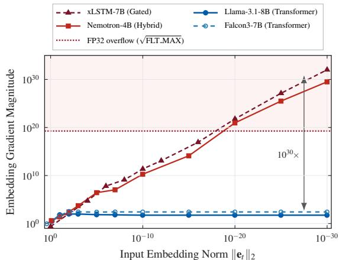  
Figure 1: Near-zero input tokens trigger gradient blowup in gated models, not mid-sequence Transformers. Starting from normal embedding norm ( 1), shrinking a single midsequence token $( t > 0 )$ toward zero leaves standard Transformers (Llama-3.1-8B, Falcon3-7B) flat, whereas gated and hybrid models (xLSTM-7B, Nemotron-3-Nano-4B) blow up by over 30 orders of magnitude across the $1 . 8 4 \times 1 0 ^ { 1 9 }$ FP32 overflow threshold.

Why do released checkpoints contain near-zero embeddings? Prior studies observed under-trained rare tokens [Land and Bartolo, 2024] and mild early-layer gradient increases from embedding weight decay in Transformers [Takase et al., 2025, Team OLMo et al., 2025]. Every language model maintains an input table $\mathbf { E } _ { \mathrm { i n } }$ and an output matrix $\mathbf { E _ { \mathrm { o u t } } }$ . When a token never appears in pretraining text, its input row receives zero gradient, whereas its output row receives non-zero softmax gradients every step. Weight-tied models $( \mathbf { E _ { \mathrm { o u t } } = E _ { \mathrm { i n } } } )$ keep unseen tokens at normal scale through these output gradients. Although OLMo 2 disables embedding weight decay [Team OLMo et al., 2025], standard AdamW recipes decay untied input matrices each step, shrinking unseen input rows toward zero while leaving output rows intact. Among 291 surveyed open repositories (280 distinct embedding tables), reachable near-zero tokens occur in 0% of weight-tied models, versus 52.6% of surveyed untied gated models (20 of 38; 35.3% of all untied models).

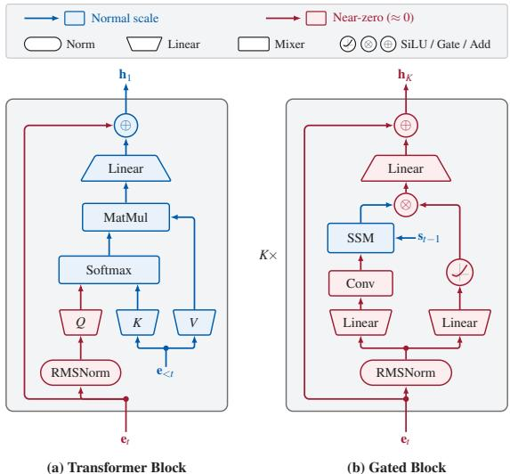  
Figure 2: Signal propagation for a near-zero input $\mathbf { e } _ { t }$ at $t > 0 ,$ (a) A Transformer block pulls normal-scale context $\mathbf { e } _ { < t }$ through K,V and restores $\mathbf { h } _ { 1 }$ at Layer 1. (b) Across K stacked gated blocks, a zero-preserving current-token factor (such as a SiLU gate or linear readout query) zeroes out historical state $\mathbf { s } _ { t - 1 }$ at , leaving ${ \bf h } _ { K }$ near zero.

Why does a near-zero input amplify gradients in gated models (Figure 2)? Each Pre-RMSNorm block normalizes the token vector before adding context onto the residual stream. In gated recurrences, historical state readout is multiplied by a current-token function that vanishes at zero input, such as a SiLU gate or linear readout query (Figure 2b). A near-zero input drives this factor near zero and shrinks historical readout toward zero, keeping the residual vector near zero across consecutive blocks. Whenever root-mean-square magnitude falls below the square root of the RMSNorm floor $( 1 0 ^ { - 3 }$ at a $1 0 ^ { - 6 }$ floor), normalization divides by $1 0 ^ { - 3 }$ and multiplies backward gradients by $1 0 ^ { 3 } \times$ per layer, compounding past $1 0 ^ { 3 0 }$ across depth (Figure 1). Transformers lack this multiplicative bottleneck: at noninitial positions (or with BOS), Layer 1 Attention averages normal-scale value vectors from prior tokens (Figure 2a), restoring scale in one layer.

How does a finite embedding spike erase batch updates without warning? Before each step, PyTorch, HuggingFace Trainer, and FSDP2 sum squared gradients in FP32 (max ≈ $3 . 4 \times 1 0 ^ { 3 8 } )$ and divide by the global norm. Any gradient entry above $1 . 8 4 \times 1 0 ^ { 1 9 }$ overflows to +∞ when squared. In IEEE-754 arithmetic, dividing finite gradients by +∞ yields exact 0.0 without NaN. All current-batch gradients become zero: AdamW steps only stale momentum and weight decay on the backbone, while the newly encountered near-zero row (whose momentum is zero) stays frozen and triggers repeated overflow on future batches. Frozen-embedding LoRA [Hu et al., 2022] and inference do not encounter this gradient-clipping failure mode, and on-policy RL rollouts sample zero near-zero tokens (though full-parameter RL updates still trigger on prompts with near-zero chat tags).

This diagnosis motivates two remedies. On released checkpoints, disabling weight decay cannot stop Step-1 blowup. GroupClip clips $\mathbf { E } _ { \mathrm { i n } }$ (using a 64-bit or rescaled norm) separately from backbone weights in three lines of code, preserving full backbone updates and self-healing triggered rows without architectural edits or vocabulary scans. When pretraining from scratch, disabling embedding weight decay prevents unseen-token shrinkage [Team OLMo et al., 2025], yet SiLU blocks still amplify gradients under smallnorm initialization [Peng et al., 2023] or vocabulary expansion. GateFloor adds a positive gate offset $( \mathrm { S i L U } ( z ) + \delta )$ so Layer 1 passes non-zero state at zero input, cutting nearzero gradients by over 28 orders of magnitude up to 370M parameters with validation perplexity comparable to the baseline (1–2 seeds).

Our contributions are threefold:

• We audit 291 open repositories (280 distinct embedding tables), find reachable near-zero tokens in 52.6% of untied gated models, and trace how gated readout shrinkage and FP32 overflow erase batch gradients (Sections 2 to 4).

• We propose GroupClip, a 3-line decoupled clipping rule that eliminates silent update loss on released checkpoints while self-healing near-zero rows (Section 5).

• We propose GateFloor, a positive gate offset for pretraining that eliminates gradient amplification at zero input up to 370M parameters (Section 5).

## 2. Near-Zero Embeddings in Open Language Models

Standard inference benchmarks rarely expose near-zero tokens: evaluation prompts seldom contain low-resource subwords or unused chat tags, and intact output rows produce normal next-token probabilities during decoding. We therefore audit the input and output embedding matrices of 291 open-weight HuggingFace repositories directly.

## 2.1 Prevalence Across Open-Weight Checkpoints

Autoregressive language models store an input table $\mathbf { E } _ { \mathrm { i n } } \in$ $\mathbb { R } ^ { V \times d }$ and an output matrix $\mathbf { E _ { \mathrm { { o u t } } } } \in \mathbb { R } ^ { V \times d }$ . Weight-tied architectures share one matrix $( \mathbf { E _ { \mathrm { { o u t } } } } = \mathbf { E _ { \mathrm { { i n } } } } ;$ Press and Wolf, 2017), whereas untied models store them separately. Using HTTP byte-range requests to read $\mathbf { E } _ { \mathrm { i n } } , \mathbf { E } _ { \mathrm { o u t } }$ , and the tokenizer, we audit 291 HuggingFace repositories (101 weight-tied, 190 untied) spanning 280 distinct embedding tables (all 11 mirror copies are Transformers; full list and protocol in Appendix F). Because raw vocabularies include unused alignment padding $( \mathrm { e } . \mathrm { g } . , 5 0 , 2 5 7  5 0 , 3 0 4 )$ or unreachable byte entries, we apply the round-trip test of Land and Bartolo [2024] to every row v with $\lVert \mathbf { e } _ { \nu } \rVert _ { 2 } < 1 0 ^ { - 6 }$ : we decode ID v and re-tokenize it alone and in eight phrase templates, counting v as reachable only if tokenization reproduces ID v.

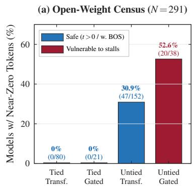

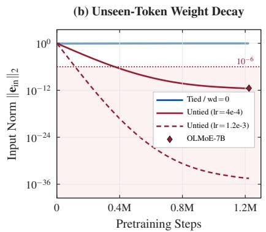

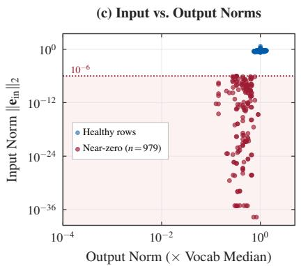  
Figure 3: Prevalence and weight-decay origin of near-zero input embeddings. (a) Among 291 surveyed HuggingFace repositories (280 distinct embedding tables), reachable near-zero input rows $( \lVert \mathbf { e } _ { \nu } \rVert _ { 2 } < 1 0 ^ { - 6 } )$ appear in 0% of weight-tied models (0/80 Transformers; $0 / 2 1$ gated/hybrid) versus 30.9% of untied Transformers $( 4 7 / 1 5 2$ , safe at $t > 0$ or with BOS) and 52.6% of untied gated/hybrid models $( 2 0 / 3 8 $ vulnerable to gradient blowup and clipping stalls). (b) Under AdamW $( \lambda = 0 . 1 )$ , unseen input rows stay near $1 0 ^ { 0 }$ when weight-tied or unregularized, but shrink along $\Vert \mathbf { e } _ { \nu } ^ { ( 0 ) } \Vert _ { 2 } \prod _ { t } ( 1 - \eta _ { t } \lambda )$ when untied, matching the released O $\mathtt { 1 L M o E - 1 B - 7 B }$ cluster $( \eta _ { \mathrm { m a x } } = 4 \times 1 0 ^ { - 4 } )$ and reaching $1 0 ^ { - 3 5 }$ at higher peak learning rates (e.g., $\eta _ { \mathrm { m a x } } = 1 . 2 \times 1 0 ^ { - 3 } )$ . (c) Because only the idle input row decays while the output row updates every step, 92% of the 979 sampled reachable near-zero tokens retain healthy output-head norms (at least 0.3 the vocabulary median).

Across the 291 surveyed repositories, 92 contain raw rows below $1 0 ^ { - 6 }$ , and 67 (23.0%) contain reachable near-zero tokens (Figure 3a). Occurrence splits cleanly by weight tying: 0 of 101 weight-tied checkpoints (0%; 0/80 Transformers and 0/21 gated models) contain reachable near-zero tokens, versus 67 of 190 untied checkpoints (35.3%). Among untied models, reachable near-zero rows appear in 30.9% of Transformers (47/152, $\mathrm { e . g . }$ Llama-3.1-8B, OLMoE-1B-7B) and 52.6% of surveyed gated models (20/38, e.g., Nemotron-3-Nano-4B, Falcon-H1-1.5B/7B, Mamba-Codestral-7B, Kimi-Linear-48B-Base). Untied Transformers train stably on these tokens at non-initial positions or with BOS (Section 3), whereas untied gated checkpoints are vulnerable to extreme gradient amplification (Sections 3 and 4). Affected tokens are ordinary strings: Telugu and Basque subwords in Nemotron, Cyrillic Mongolian words in Falcon-H1, CRLF code fragments (e.g., });\r) in Mamba-Codestral, chat tags (<|im\_user|>, <|im\_end|>) in Kimi-Linear-48B-Base, and <s> in Nemotron-H-4B-Base. Fine-tuned and distilled derivatives inherit these rows from their base checkpoints.

## 2.2 Pretraining Origin Under Untied Weight Decay

In Transformers, Takase et al. [2025] showed that small overall embedding norms modestly raise early LayerNorm gradients, leading OLMo 2 [Team OLMo et al., 2025] to exclude embeddings from weight decay. Standard pipelines, however, apply decoupled AdamW weight decay uniformly to all 2D matrices [Loshchilov and Hutter, 2019, Land and Bartolo, 2024]. When a token v never appears in pretraining text, $\mathbf { E } _ { \mathrm { i n } }$ receives exact zero gradient on row v every step, whereas $\mathbf { E _ { \mathrm { o u t } } }$ normalizes probabilities across all V rows and sends non-zero gradients to output row v every step. Under tied weights, output gradients keep $\| \mathbf e _ { \nu } \| _ { 2 } \approx 1$ (Figure 3b, blue curve). Under untied weights, AdamW multiplies the zero-gradient input row by $( 1 - \eta _ { t } \lambda )$ at step t:

$$
\| \mathbf { e } _ { \nu } ^ { ( T ) } \| _ { 2 } = \| \mathbf { e } _ { \nu } ^ { ( 0 ) } \| _ { 2 } \prod _ { t = 1 } ^ { T } ( 1 - \eta _ { t } \lambda ) .\tag{1}
$$

Over million-step runs, Equation (1) shrinks unseen input norms to $1 0 ^ { - 1 2 }$ at $\eta _ { \mathrm { m a x } } = 4 \times 1 0 ^ { - 4 } ( \lambda = 0 . 1 )$ and to $1 0 ^ { \dot { - } 3 5 }$ at higher peak learning rates $( \mathrm { e . g . , } \eta _ { \mathrm { m a x } } = 1 . 2 \times 1 0 ^ { - 3 } ,$ ; Figure 3b).

We test Equation (1) on OLMoE-1B-7B [Muennighoff et al., 2025] using its open corpus (OLMoE-mix-0924). In our 364M-token sample across all seven subsets, all 251 near-zero rows have zero occurrences (0/251 observed), whereas every token observed in the sample retains $\| \mathbf { e } _ { \nu } \| _ { 2 } \in$ [0.11,0.60]. In the checkpoint, 250 of the 251 rows cluster in $[ 3 . 2 3 , 3 . { \overset { \cdot } { 5 } } 0 ] \times 1 0 ^ { - 1 2 }$ (log-decay 26.3, plus one outlier at $6 . 5 \times 1 0 ^ { - 7 } )$ , consistent with cumulative zero-gradient decay $\Sigma _ { t } \eta _ { t } \lambda \approx 2 6 - 2 7$ over OLMoE’s 5.13T-token schedule (2,000-step warmup, $\eta _ { \mathrm { m a x } } = 4 \times 1 0 ^ { - 4 } , \lambda = 0 . 1$ ; Figure 3b; Appendix A). Meanwhile, across 979 sampled reachable near-zero tokens, 92% (901 of 979) retain output norms above 0.3 the vocabulary median (Figure 3c).

## 3. Multi-Layer Gradient Amplification in Gated Blocks

At non-initial positions $( t > 0 )$ , earlier tokens 0 . . .t 1 carry normal-scale vectors while position t receives a near-zero

input $\mathbf { e } _ { t }$ of norm $r = \| \mathbf { e } _ { t } \| _ { 2 } \ll \sqrt { \varepsilon d }$ . Starting from $ { \mathbf { h } } _ { t } ^ { ( 0 ) } = \mathbf { e } _ { t }$ each layer $\ell \in \{ 0 , \ldots , L - 1 \}$ applies Pre-RMSNorm, mixes context over $0 \ldots t ,$ and adds the result onto $\mathbf { h } _ { t } ^ { ( \ell ) }$

## 3.1 Single-Layer Recovery vs. Multi-Layer Readout Shrinkage

Pre-RMSNorm [Zhang and Sennrich, 2019] normalizes h $\mathbb { R } ^ { d }$ with weights $\mathbf { w } \in \mathbb { R } ^ { d }$ and floor $\varepsilon > 0 ( 1 0 ^ { - 6 } \mathrm { o r } 1 0 ^ { - 5 } )$ :

$$
\tilde { \mathbf { h } } = \mathrm { R M S N o r m } ( \mathbf { h } ) = \frac { \mathbf { h } } { \sqrt { \frac { 1 } { d } \| \mathbf { h } \| _ { 2 } ^ { 2 } + \varepsilon } } \odot \mathbf { w } .\tag{2}
$$

When root-mean-square magnitude falls far below $\sqrt { \varepsilon }$ $( \| \mathbf { h } \| _ { 2 } \ll \sqrt { \varepsilon d } )$ , Equation (2) divides directly by $\textstyle { \sqrt { \varepsilon } } \colon$ h˜ $\pmb { \varepsilon } ^ { - 1 / 2 } \big ( \mathbf { w } \odot \mathbf { h } \big )$ $\begin{array} { r } { \mathrm { A t ~ } \bar { \varepsilon } = 1 0 ^ { - 6 } ( \mathrm { o r ~ } 1 0 ^ { - 5 } ) , } \end{array}$ ), this multiplies backward gradients by 1,000 (or 316 ) per layer.

In a Transformer at $t > 0 ,$ , Layer 0 Softmax Attention assigns non-zero weights to prior tokens $0 \ldots t - 1$ even when query t is near zero, adding normal-scale values onto $\mathbf { h } _ { t } ^ { ( 0 ) }$ and keeping input gradients near $1 0 ^ { 0 } { - } 1 0 ^ { 2 }$ . In gated recurrences, state $\mathbf { s } _ { t - 1 } ^ { ( \ell ) }$ summarizes tokens $0 \ldots t - 1$ , yet historical readout $\mathbf { y } _ { t } ^ { ( \ell ) }$ is multiplied by a bias-free currenttoken factor $\phi _ { \ell } ( \tilde { \mathbf { h } } _ { t } ^ { ( \ell ) } )$ with $\phi _ { \ell } ( \mathbf { 0 } ) = \mathbf { 0 }$ :

$$
\mathbf { h } _ { t } ^ { ( \ell + 1 ) } = \mathbf { h } _ { t } ^ { ( \ell ) } + \mathbf { W } _ { o , \ell } \mathcal { N } _ { \ell } \big ( \mathbf { y } _ { t } ^ { ( \ell ) } \odot \phi _ { \ell } \big ( \tilde { \mathbf { h } } _ { t } ^ { ( \ell ) } \big ) \big ) .\tag{3}
$$

In Mamba [Gu and Dao, 2024], Mamba-2 [Dao and $\mathrm { G u . }$ 2024], and Gated DeltaNet [Yang et al., 2025], $\phi _ { \ell } ( \tilde { \mathbf { h } } _ { t } ^ { ( \ell ) } ) =$ $\mathrm { S i L U } ( \mathbf { W } _ { z , \ell } \tilde { \mathbf { h } } _ { t } ^ { ( \ell ) } )$ (SiLU(0) = 0). Mamba-2, Nemotron-H, and Granite also apply an internal gated RMSNorm ${ \mathcal { N } } _ { \ell } ,$ which sits in the sub-ε regime too and changes only the per-layer gain $( \mathcal { N } _ { \ell } = \mathrm { i d }$ in Mamba-1). In mLSTM (xLSTM; Beck et al., 2024), the gate is Sigmoid $( \sigma ( 0 ) = 0 . 5 )$ , yet matrix readout $\mathbf { C } _ { t - 1 } ^ { ( \ell ) } \mathbf { q } _ { t } ^ { ( \ell ) }$ uses a current-token linear query $\mathbf { q } _ { t } ^ { ( \ell ) } = \mathbf { W } _ { q , \ell } \tilde { \mathbf { h } } _ { t } ^ { ( \ell ) }$ that vanishes at 0. Tiny $\tilde { \mathbf { h } } _ { t } ^ { ( 0 ) }$ thus shrinks readout as $\mathcal { O } ( r )$ and compounds gains $\gamma _ { \ell }$ below $\sqrt { \varepsilon d }$ until Attention injects context or $\| \mathbf h _ { t } ^ { ( \ell ) } \| _ { 2 }$ exceeds $\sqrt { \varepsilon d }$ (unlike large-state growth in Feng et al., 2026).

## 3.2 Scaling Law and Empirical Verification on Pretrained Models

Taylor-expanding Equations (2) and (3) around $\mathbf { h } _ { t } ^ { ( \ell ) } = \mathbf { 0 }$ (Appendix B) relates $\| \nabla _ { \mathbf { e } _ { t } } \mathcal { L } \|$ to $r , \varepsilon ,$ and the number K of gated blocks before the first Attention layer.

Proposition 1 (Two-Regime Near-Zero Gradient Scaling). Consider an L-layer Pre-RMSNorm network whose first $K \in \{ 0 , 1 , \ldots , L \}$ blocks follow Equation (3) with $\phi _ { \ell } ( \mathbf { 0 } ) = \mathbf { 0 } , \ \partial \phi _ { \ell } / \partial \tilde { \mathbf { h } } | _ { \mathbf { 0 } } \neq \mathbf { 0 } ,$ , and non-zero historical state $( t > 0 ) ,$ , followed at layer K by Softmax Attention $( K =$ ∞ if none). Let $\mathbf { M } _ { k } = \mathbf { J } _ { k - 1 } ( \mathbf { 0 } ) \cdot \cdot \cdot \mathbf { J } _ { 0 } ( \mathbf { 0 } )$ be the smallsignal map of the first k blocks, with gain $G _ { k } = \| \mathbf { M } _ { k } \| _ { 2 } \leq$ $\begin{array} { r } { \Pi _ { k } = \Pi _ { \ell < k } \gamma _ { \ell } } \end{array}$ and $\gamma _ { \ell } = \| \mathbf { J } _ { \ell } ( \mathbf { 0 } ) \| _ { 2 }$ As $r = \| \mathbf { e } _ { t } \| _ { 2 } \to 0 ,$ $\| \nabla _ { \mathbf { e } _ { t } } \mathcal { L } \| _ { 2 } = \mathcal { O } ( \operatorname* { m a x } _ { k \le \operatorname* { m i n } ( K , L ) } \Pi _ { k } )$ unconditionally. Under

Table 1: Near-zero input-gradient scaling across sequence architectures $( r = 1 0 ^ { - 3 0 } )$ by current-token readout factor at origin and sequence position.
<table><tr><td>Architecture Family</td><td>At 0</td><td></td><td>Mid (t &gt; 0) Initial (t = 0)</td></tr><tr><td>Transformer (Llama-3.1)</td><td>None</td><td> $\mathcal { O } ( 1 ) \left( 5 6 { - } 9 8 \right)$ </td><td> $\mathcal { O } ( 1 / r ) ^ { \dagger }$ </td></tr><tr><td>Token-shift (RWKV-4)</td><td>Shift&gt; 0</td><td> $\mathcal { O } ( 1 ) \ : ( 8 . 5 )$ </td><td> $\mathcal { O } ( 1 ) \left( 7 0 \right)$ </td></tr><tr><td>Conv + σ (Kimi-Linear)</td><td>0.5</td><td> $\mathcal { O } ( 1 ) \left( 8 8 \right)$ </td><td> $8 \times 1 0 ^ { 3 0 }$ </td></tr><tr><td>Hybrid (K gated → Attn)</td><td>0</td><td> $\operatorname* { m i n } ( 1 / r , G _ { K } )$ </td><td> $1 0 ^ { 1 0 } – 1 0 ^ { 3 2 \ddagger }$ </td></tr><tr><td>Pure SiLU (Falcon-Mamba)</td><td>0</td><td> $1 . 3 \times 1 0 ^ { 3 0 }$ </td><td> $2 . 8 \times 1 0 ^ { 3 1 }$ </td></tr><tr><td>Linear query (xLSTM, σ)</td><td> $\mathbf q = \mathbf 0$ </td><td> $1 . 0 \times 1 0 ^ { 3 2 }$ </td><td> $\mathcal { O } ( 1 ) \left( 3 5 \right)$ </td></tr><tr><td>GateFloor: SiLU(z) + δ</td><td> $\delta > 0$ </td><td> $\mathcal { O } ( \mathbf { 1 } ) \left( \mathbf { 0 . 1 6 } \right)$ </td><td>θ(1) (0.13)</td></tr></table>

non-degeneracy (Assumption B.1) and non-decreasing $G _ { k } ,$

$$
\| \nabla _ { \mathbf { e } _ { t } } \mathcal { L } \| _ { 2 } = \Theta \left( \operatorname* { m i n } \left\{ \frac { \sqrt { \varepsilon d } } { r } , G _ { \operatorname* { m i n } \left( K , L \right) } \right\} \right) .\tag{4}
$$

Equation (4) yields an inverse-norm regime (∝ 1/r, slope $^ { - 1 ) }$ when gains lift $\| \mathbf h _ { t } ^ { ( \ell ) } \| _ { 2 }$ past $\sqrt { \varepsilon d }$ before Layer K, and a depth-saturated regime (ceiling $G _ { K }$ , slope 0) when Layer K Attention rescues the state first (Figure 4a); pure gated stacks $( K = \infty )$ follow $1 / r$ across tested norms $( r \geq 1 0 ^ { - 3 5 } )$ until reaching the full-depth ceiling $G _ { L }$ as $r \to 0$

Input-Norm Scaling Sweep. We run two midsequence sweeps recording $\| \nabla _ { \mathbf { e } _ { t } } \mathcal { L } \| _ { \infty }$ (Figure 4a): an eight-model sentence sweep (E30) over $r \in [ 1 0 ^ { - 3 0 }$ , 100] with BOS, and a row-norm sweep (o4) over $r \in$ $[ 1 0 ^ { - 3 5 } , 1 0 ^ { 0 } ]$ on Llama-3.1-8B, Nemotron-3-Nano-4B, and Falcon-H1-1.5B. Both $K = 0$ baselines stay flat (56–98 on Llama-3.1-8B; 8.5 on RWKV-4-1.5B). Sequential hybrids follow slope 1 before saturating at ceilings $G _ { K }$ governed by per-layer gains $( \gamma _ { \ell } \in [ 1 0 ^ { 0 . 3 } , 1 0 ^ { \overline { { 3 . 3 } } } ] ) \colon 2 . 3 \stackrel { \smile } { \times } 1 0 ^ { 2 }$ on Bamba-9B-v2 (K = 9), $6 . 2 \times 1 0 ^ { 2 }$ on LFM2.5-1.2B $( K = 2 ) , 2 . 8 \times 1 0 ^ { 1 2 }$ on AI21-Jamba-Reasoning-3B $( K =$ 7), $2 . 5 \times 1 0 ^ { 1 5 }$ on Zamba2-1.2B [Glorioso et al., 2024] $( K = 5 )$ , and $2 . 2 \times 1 0 ^ { 1 6 }$ on Granite-4.0-H-1B (K = 5). Nemotron-3-Nano-4B (K = 7 Mamba blocks before Layer 12 Attention, $\varepsilon = 1 0 ^ { - 5 } )$ follows $\approx 0 . 1 8 / r$ across $[ 1 0 ^ { - 3 0 } , 1 0 ^ { 0 } ]$ because prefix gains lift $\| \mathbf h _ { t } ^ { ( \ell ) } \| _ { 2 }$ past $\sqrt { \varepsilon d } \approx 0 . 1 8$ before Attention down to $r \approx 1 0 ^ { - 3 4 }$ , peaking at $4 . 5 \times 1 0 ^ { 3 4 } ( 2 . 1 \times 1 0 ^ { 3 5 }$ on native tokens). Parallel hybrid Falcon-H1-1.5B sums Attention and Mamba-2 per layer, bounding spikes near $3 . 5 \times 1 0 ^ { 6 } ( \propto \varepsilon ^ { - 1 } )$ , whereas pure gated Falcon-Mamba-7B $( 1 . 3 \times 1 0 ^ { 3 0 } )$ and $\mathtt { x L S T M - 7 B } ( 1 . 0 \times 1 0 ^ { 3 2 }$ slope 1.07) climb unabated.

Causal Gate-Patching Intervention. Naive gate replacement could shrink gradients merely by severing backward derivatives rather than restoring forward readout. We therefore decouple forward gate values from backward derivatives at $t > 0$ (Figure 4b; Appendix B). On Nemotron-3-Nano-4B, detaching Layer 0’s gate backward alone leaves $\| \mathbf { h } _ { t } ^ { ( 1 ) } \| _ { 2 } = 2 . 0 \times 1 0 ^ { - 3 2 } \ll \sqrt { \varepsilon d }$ and $\| \nabla _ { \mathbf { e } _ { t } } \mathcal { L } \| _ { \infty } = 1 . 7 \times 1 0 ^ { 3 1 }$ Opening only Layer 0’s gate forward to $\ " \mathtt { t h e } ^ { \prime \prime }$ straight-through (keeping all backward derivatives) lifts $\| \mathbf { h } _ { t } ^ { ( 1 ) } \| _ { 2 } \tan 0 . 6 1 > \sqrt { \varepsilon d }$ and cuts $\| \nabla _ { \mathbf { e } _ { t } } \mathcal { L } \| _ { \circ }$ from $2 . 1 \times 1 0 ^ { 3 5 }$ to 6.71 (0.77 across all Mamba gates; $4 . 8 \times 1 0 ^ { 6 } \to 1 . 3 \times 1 0 ^ { 4 }$ vs. $1 . 4 \times 1 0 ^ { 3 }$ on Falcon-H1-1.5B). Detaching all Mamba gates backward at near-zero forward values gives 4.45, as $\phi _ { \ell } ( \mathbf { 0 } ) = \mathbf { 0 }$ routes all sub-ε gain through $\partial \phi _ { \ell } / \partial \tilde { \mathbf { h } }$

(a) Two-Regime Gradient Law Across Pretrained Checkpoints  
(b) Layer-0 Gate Patching (Fwd vs. Bwd)  
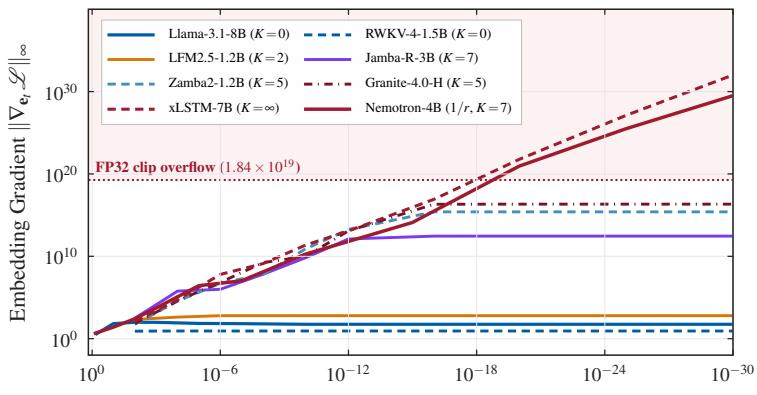  
Input Embedding Norm $r = \| \mathbf { e } _ { t } \| _ { 2 }$ (normal  near-zero)

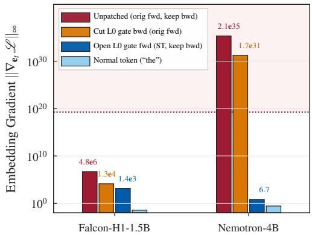  
Figure 4: Two-regime gradient scaling and causal gate-patching intervention on pretrained checkpoints. (a) Rescaling a midsequence input embedding $( t > 0 )$ across $r = \| \mathbf { e } _ { t } \| _ { 2 } \in [ 1 0 ^ { - 3 0 }$ ,100] leaves K = 0 models (Llama-3.1-8B, token-shifted RWKV-4-1.5B) bounded at $\| \nabla _ { \mathbf { e } _ { t } } \mathcal { L } \| _ { \infty } \sim 1 0 ^ { 1 } \ – 1 0 ^ { 2 }$ , drives finite-K hybrids (LFM2.5-1.2B, Jamba-Reasoning-3B, Zamba2-1.2B, Granite-4.0-H-1B) along ∝ $1 / r$ before saturating at $\Theta ( G _ { K } )$ ceilings, keeps Nemotron-3-Nano-4B $( K = 7 )$ along $1 / r$ across $[ 1 0 ^ { - 3 0 } , 1 0 ^ { 0 } ]$ because hidden norms cross $\sqrt { \varepsilon d }$ before Layer 12 Attention, and yields $1 / r$ growth across $[ 1 0 ^ { - 3 0 } , 1 0 ^ { 0 } ]$ in pure gated xLSTM-7B $( K = \infty )$ . (b) Holding a reachable near-zero input fixed at $t > 0 ,$ , detaching Layer 0’s gate backward alone leaves $\| \nabla _ { \mathbf { e } _ { t } } \mathcal { L } \| _ { \infty }$ at $1 . 3 \times 1 0 ^ { 4 }$ in Falcon-H1-1.5B and $1 . 7 \times 1 0 ^ { 3 1 }$ in Nemotron- $- 3 - N \tt a n o - 4 B$ , whereas opening Layer 0’s gate forward straight-through (keeping all backward derivatives intact) drops $\| \nabla _ { \mathbf { e } _ { t } } \mathcal { L } \| _ { \infty }$ to $1 . 4 \times 1 0 ^ { 3 }$ and 6.71 $( 2 \times 2$ ablation in Appendix B).

Architectural Taxonomy and Sequence-Initial $( t = 0 )$ Boundary. Sweeping at $t = 0$ without BOS (Table 1) shows why Kimi-Linear-48B-Base [Kimi Team et al., 2025] stays bounded at $t > 0 ~ ( 8 8 )$ whereas xLSTM-7B explodes $( 1 . 0 \times 1 0 ^ { 3 2 } )$ despite both using Sigmoid gates. Kimi-Linear applies a short causal convolution over $t - 3 \ldots t$ to $\mathbf { q } _ { t } .$ , keeping ${ \bf q } _ { t }$ non-zero at $t > 0 ,$ , whereas xLSTM projects ${ \bf q } _ { t }$ from token t alone. $\mathbf { A } \mathbf { t } \ t = 0$ , no prior context exists $( \mathbf { s } _ { - 1 } = \mathbf { 0 } .$ , left zero-padding, self-only attention). RWKV-4 stays bounded (70) via LayerNorm biases and xLSTM-7B stays at 35 because $\mathbf { C } _ { - 1 } = \mathbf { 0 }$ removes the linear $\mathbf { C } _ { t - 1 } \mathbf { q } _ { t }$ Jacobian term. By contrast, bias-free Pre-RMSNorm Transformers, hybrids, Mamba, and Kimi-Linear scale as $1 / r ~ ( 1 0 ^ { 1 0 } – 1 0 ^ { 3 2 } )$ . On Kimi-Linear-48B-Base, its nearzero <|im\_user|> tag at $t = 0$ gives a $2 . 1 \times 1 0 ^ { 7 }$ gradient $( 8 \times 1 0 ^ { 3 0 } \mathrm { a t } r = 1 0 ^ { - 3 0 } )$ , dropping to 207 at $t > 0$

## 4. Silent Update Zeroing Under FP32 Clipping

Proposition 1 shows that near-zero tokens produce finite embedding gradients from $1 0 ^ { 6 }$ in parallel or shallow hybrids to $1 0 ^ { 3 5 }$ in deep-prefix or pure gated models. We next show how FP32 global-norm clipping turns these spikes into suppressed or zeroed batch gradients, and measure how often post-training datasets trigger them.

## 4.1 Numerical Overflow in Global-Norm Clipping

Let $G _ { \mathrm { { e m b } } } = \Vert \nabla _ { { \mathbf { E } } _ { \mathrm { { i n } } } } \mathcal { L } \Vert _ { 2 }$ 2 be the input-embedding gradient norm and $G _ { \mathrm { o t h e r } }$ be the gradient norm across backbone weights (typically 1–10). Before optimizer.step(), Py-Torch clip\_grad\_norm\_, HuggingFace Trainer, and Py-Torch FSDP2 sum squared master-weight gradients in 32-bit float (FP32, max FLT\_ $\mathrm { M A X } \approx 3 . 4 0 \times 1 0 ^ { 3 8 } )$ . They compute $G = \sqrt { G _ { \mathrm { o t h e r } } ^ { 2 } + G _ { \mathrm { e m b } } ^ { 2 } }$ and multiply every gradient by $\alpha _ { \mathrm { e f f } } = \mathrm { m i n } \big ( 1 , c / ( G + 1 0 ^ { - 6 } ) \big ) ( c = 1 . 0 )$

This rule creates two failure modes (Figure 5a). We track both pre-optimizer stalled steps $( \alpha _ { \mathrm { e f f , o t h e r } } < 1 0 ^ { - 4 } )$ and the post-AdamW decomposition $\Delta \theta _ { t } ( g _ { t } ) = \Delta \theta _ { t } ( \mathbf { 0 } ) + \delta \theta _ { t } ^ { \mathrm { b a t c h } }$ around zero-gradient coasting $\Delta \theta _ { t } ( \mathbf { 0 } )$ (Appendix D). Under step-size suppression ( $c \ll G _ { \mathrm { e m b } } \leq \sqrt { \mathrm { F L T \_ M A X } } =$ $1 . 8 4 \times 1 0 ^ { 1 9 }$ , as in Falcon-H1), G $G _ { \mathrm { e m b } }$ stays finite and shrinks backbone gradients by $\alpha _ { \mathrm { e f f } } \approx c / G _ { \mathrm { e m b } } \ll 1$ . On early $\alpha _ { \mathrm { e f f , o t h e r } } < 1 0 ^ { - 4 }$ steps in $\mathtt { F a l c o n - H 1 - 1 } . 5 \mathtt { B }$ , fresh-batch backbone displacement $\| \delta \theta _ { \mathrm { o t h e r } } ^ { \mathrm { b a t c h } } \| _ { 2 }$ drops 335 (0.55% vs. 36.6% of $\| \Delta \theta _ { \mathrm { o t h e r } } \| _ { 2 } )$ , while scale-invariant AdamW updates heal the triggered row. Under FP32 overflow and gradient zeroing (any entry above $1 . 8 4 \times 1 0 ^ { 1 9 }$ , as in Nemotron-3-Nano and xLSTM), squaring overflows to $G =$ inf and $c / \mathrm { i n f } = 0 . 0$ zeroes every gradient without NaN. On overflow steps in Nemotron-3-Nano-4B, backbone weights still move $( \big | \big | \Delta \theta _ { \mathrm { o t h e r } } \big | \big | _ { 2 } \approx 0 . 2 5 )$ via stale momentum and weight decay, yet fresh-batch displacement is identically zero $( \lVert \delta \theta _ { \mathrm { o t h e r } } ^ { \mathrm { b a t c h } } \rVert _ { 2 } = 0$ , 0% of weights differing from $g _ { t } = \mathbf { 0 } ,$ , vs. $4 2 . 6 \%$ on clean steps). Meanwhile, a newly hit near-zero row $( m _ { 0 } = \nu _ { 0 } = 0 )$ receives zero gradient update, shrinks slightly by weight decay, and overflows again on every future encounter.

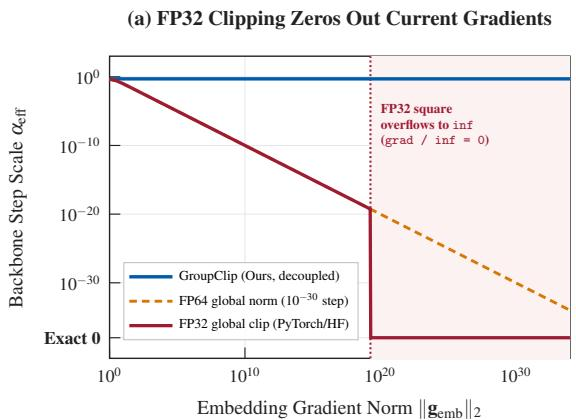

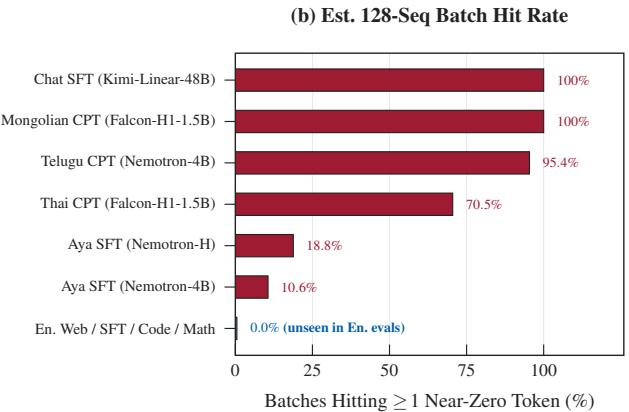  
Figure 5: FP32 global-norm overflow and estimated post-training batch trigger rates. (a) In default PyTorch, HuggingFace Trainer, and FSDP2 clipping, squaring any gradient entry above $1 . 8 4 \times 1 0 ^ { 1 9 }$ overflows FP32 to inf, mapping the gradient multiplier to ${ \mathrm { ~ 1 . 0 ~ } } /$ inf = 0.0 and discarding current-batch gradients; 64-bit (FP64) global norms avoid inf yet scale backbone gradients by $1 0 ^ { - 3 0 }$ on initial encounters, whereas GroupClip preserves full backbone updates. (b) Estimated 128-sequence batch hit rates $1 - ( 1 - p ) ^ { 1 2 8 }$ from per-document rates p (8,000 documents/dataset): English web, English SFT, code, and math corpora yield 0.0%, whereas multilingual SFT/CPT (10.6%–95.4%, up to 100%) and <|im\_user|> chat SFT on Kimi-Linear-48B-Base (100%) trigger frequently.

Framework Verification. Single-step fresh-optimizer AdamW tests $( m _ { 0 } = \nu _ { 0 } = 0 )$ on Falcon-H1-1.5B compare an overflow trigger $( G _ { \mathrm { e m b } } = 1 . 7 \times 1 0 ^ { 2 0 }$ at $t = 0 )$ $\mathrm { ~ a ~ } 1 0 ^ { 6 }$ spike $( t > 0 )$ , and “the” (Appendix C). PyTorch clip\_grad\_norm\_, HuggingFace Trainer, and FSDP2 log grad\_norm = inf without error and apply zero gradient updates $( \| \Delta \theta _ { \mathrm { g r a d } } \| _ { \infty } = 0 )$ , while Megatron-Core aborts (check\_for\_nan\_in\_grad) or zeroes gradients (get\_grad\_norm\_fp32); forward activations stay finite throughout (unlike state-spaces/mamba contributors, 2024).

## 4.2 Batch Trigger Rates and Anomaly Funnel

Corpus Trigger-Rate Audit and Anomaly Funnel. Across the 20 affected untied gated models, reachable near-zero tokens form only 0.001%–0.25% of the vocabulary (median 0.040%), yet multi-thousand-token batches turn rare token occurrences into frequent stalls. Sampling 8,000 documents across 15 corpora and 14 models (Figure 5b), English web, English SFT, code, and math give $p =$ 0.0% (0.0% 128-sequence batch rate). Multilingual and template workloads hit routinely: 10.6%–18.8% on Aya, 70.5%–97.4% on Thai, 95.4% on Nemotron-3-Nano-4B Telugu, 100% on Falcon-H1 Mongolian, and 100% at t = 0 for Kimi-Linear-48B-Base’s <|im\_user|> tag. Tracing the end-to-end funnel during 1,000-step Telugu CPT (16,384 tok/step; Appendix D), 0.047% of Nemotron-3-Nano-4B’s vocabulary (62 rows) accounts for 32.3 ppm of tokens, triggers 22.5% of batches, and overflows FP32 on 88.1% of hit batches (19.8% of all steps with 0% fresh-batch update).

Verification of Unaffected Workflows. Rank-16 LoRA [Hu et al., 2022] freezes $\mathbf { E } _ { \mathrm { i n } }$ and skips $\nabla _ { \mathbf { E } _ { \mathrm { i n } } \mathcal { L } }$ , yielding normal adapter gradient norms across nine checkpoints (3.7–10.3, 0/9 overflows). During on-policy RL rollouts, decoding samples via $\mathbf { E _ { \mathrm { { o u t } } } } .$ , where 92% of near-zero tokens keep normal norms (Figure 3c) and tail probabilities $( \sim 1 0 ^ { - 7 } )$ . Sampling 16,384 Mongolian and Telugu rollout tokens across four models generates 0 near-zero tokens. Full-parameter RL updates still trigger whenever prompts contain near-zero template tags.

## 5. Mitigations for Post-Training and Pretraining

Our diagnosis points to two remedies: a decoupled clipping rule for adapting the 52.6% of surveyed untied gated checkpoints with near-zero rows, and an output-gate offset for pretraining from scratch.

## 5.1 Decoupled Embedding Clipping (GroupClip)

Adapting a released checkpoint requires preserving initial predictions, preventing Step-1 backbone update loss, and keeping target subwords trainable without tokenizer scans. Disabling weight decay [Team OLMo et al., 2025] misses Step 1, re-initializing rows alters rare-token scores, and masking freezes target tokens. Because amplification is confined to $\mathbf { E } _ { \mathrm { i n } }$ while backbone gradients stay near 1–10, GroupClip clips backbone weights and $\mathbf { E } _ { \mathrm { i n } }$ separately (using a 64-bit scalar norm for $\mathbf { E } _ { \mathrm { i n } } ) \mathrm { : }$

clip\_grad\_norm\_(backbone\_params, max\_norm=1.0) gn = embed\_tokens.weight.grad.double().norm().item() embed\_tokens.weight.grad.mul\_(min(1.0, 1.0 / (gn + 1e-12)))

On clean batches, backbone clipping matches standard global clipping whenever $G _ { \mathrm { e m b } } \ll G _ { \mathrm { o t h e r } } ,$ , while $\mathbf { E } _ { \mathrm { i n } }$ differs only by a constant scale absorbed by AdamW’s second moment. On trigger batches, backbone updates stay unaffected $( \alpha _ { \mathrm { e f f , o t h e r } } = \operatorname* { m i n } ( 1 , 1 / G _ { \mathrm { o t h e r } } )$ ; Figure 5a). Decoupling in FP32 stops backbone update loss and heals sub-overflow spikes $( G _ { \mathrm { e m b } } \leq 1 . 8 4 \times 1 0 ^ { 1 9 } )$ . Using FP64 (grad.double().norm()) also prevents $> 1 . 8 4 \times 1 0 ^ { 1 9 }$ overflow on $\mathbf { E } _ { \mathrm { i n } }$ , so one unit-norm AdamW step lifts each triggered row out of the overflow regime. By contrast, stepskipping drops every trigger batch without updating the nearzero row, and ZClip [Kumar et al., 2025] overflows its FP32 global norm to inf. GradientStabilizer [Huang et al., 2026] skips non-finite FP32 norms on $\mathbf { E } _ { \mathrm { i n } }$ and passes raw $1 0 ^ { 3 1 }$ gradients into AdamW $( \nu _ { t } = \mathtt { i n f } )$ . On H100, GroupClip matches baseline step time and peak memory. Its FP64 norm uses 3.1 GB transient memory (21.2 vs. 18.8 ms clip call), eliminated by a copy-free rescaled variant (Appendix D).

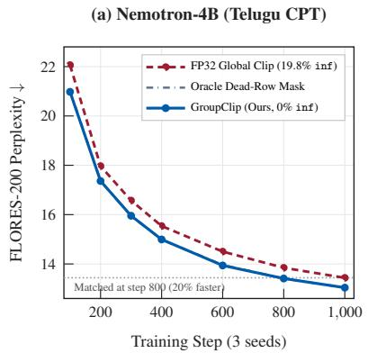

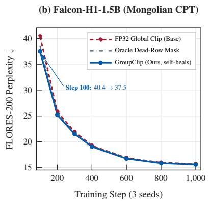

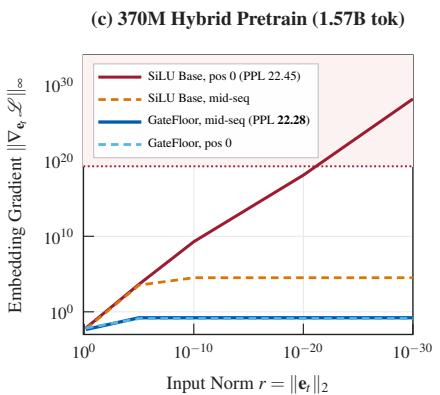  
Figure 6: Mitigations for released checkpoints (GroupClip) and pretraining from scratch (GateFloor). (a) On Nemotron-3-Nano-4B Telugu continual pretraining (3 seeds), GroupClip eliminates the 19.8% inf-overflow update loss of default FP32 clipping, matching 1,000-step baseline perplexity by step 800. (b) On Falcon-H1-1.5B Mongolian continual pretraining, GroupClip lowers step-100 perplexity from 40.40 to 37.47 and outperforms an oracle dead-row mask as active Mongolian subwords update to normal norm. (c) On a 370M 3:1 hybrid pretrained for 1.57B tokens, GateFloor $( \mathrm { S i L U } ( z ) + 0 . 1 )$ reduces $r = 1 0 ^ { - 3 0 }$ embedding gradients by over 28 orders of magnitude at both t = 64 and t = 0 with on-par validation perplexity (22.28 vs. 22.45; single seed).

Table 2: Multilingual continual pretraining on released checkpoints (mean  SD across 3 seeds; FLORES-200 devtest perplexity ; stalled steps have backbone scale $\alpha _ { \mathrm { e f f , o t h e r } } < 1 0 ^ { - 4 } ;$ AdamW step decomposition in Appendix D). Top: 1,000-step runs. Bottom: 300-step 10-method ablation on Nemotron-4B $( 5 9 . 3 \pm 7 . 8 $ trigger batches).
<table><tr><td>Model (Steps)</td><td>Method</td><td>Stalled</td><td>PPL↓</td></tr><tr><td>Nemotron-4B Telugu (1,000)</td><td>FP32 Global Clip Oracle  $\mathbf { M a s k } ^ { \ddag }$  GroupClip (FP32) GroupClip (FP64, Ours)</td><td> $1 9 8 . 3 \pm 9 . 9$   $0 . 0 { \pm } 0 . 0 $   $0 . 0 { \pm } 0 . 0 $   ${ \bf 0 . 0 \pm 0 . 0 }$ </td><td> $1 3 . 4 4 \pm 0 . 1 7$   $1 3 . 0 4 \pm 0 . 1 9$   $1 3 . 0 5 \pm 0 . 1 8$   ${ \bf 1 3 . 0 4 \pm 0 . 1 9 }$ </td></tr><tr><td>Falcon-H1-1.5B Mongolian (1,000) Oracle Mask‡</td><td>FP32 Global Clip GroupClip (Ours)</td><td> $1 1 . 7 \pm 3 . 5$   $0 . 0 { \pm } 0 . 0 $   ${ \bf 0 . 0 \pm 0 . 0 }$ </td><td> $1 5 . 6 8 \pm 0 . 1 1$   $1 5 . 6 3 \pm 0 . 1 0$   ${ \bf 1 5 . 5 8 \pm 0 . 1 0 }$ </td></tr><tr><td>Nemotron-4B Telugu (300)</td><td>FP32 Global Clip Skip-on-Inf ZClip GradStabilizer* Freeze  $\mathbf { E } _ { \mathrm { i n } }$  FP64 Global Norm Mean Re-init† Oracle Mask‡ GroupClip (FP32) GroupClip (FP64, Ours)</td><td> $5 7 . 0 \pm 7 . 5$   $5 7 . 0 \pm 7 . 5$   $5 7 . 0 \pm 7 . 5$   $0 . 0 { \pm } 0 . 0 $   $0 . 0 { \pm } 0 . 0 $   $1 8 . 0 \pm 1 . 0$   $0 . 0 { \pm } 0 . 0 $   $0 . 0 { \pm } 0 . 0 $   $0 . 0 { \pm } 0 . 0 $   ${ \bf 0 . 0 \pm 0 . 0 }$ </td><td> $1 6 . 5 7 \pm 0 . 3 9$   $1 6 . 6 3 \pm 0 . 3 6$   $1 6 . 5 7 \pm 0 . 3 9$   $1 6 . 2 3 \pm 0 . 3 0$   $1 6 . 1 6 \pm 0 . 2 4$   $1 6 . 0 9 \pm 0 . 3 5$   $1 5 . 9 6 \pm 0 . 2 4$   $1 5 . 9 4 \pm 0 . 2 6$   $1 5 . 9 7 \pm 0 . 2 6$   ${ \bf 1 5 . 9 5 \pm 0 . 2 5 }$ </td></tr></table>

†Alters logits. ‡Needs pre-scan. ∗Skips Ein scale (52.0 8.2 steps; vt = inf).

Experimental Setup. We run FineWeb-2 [Penedo et al., 2025] continual pretraining across 3 seeds for 1,000 steps $( 3 2 \times 5 1 2 = 1 6 , 3 8 4$ tok/step, FP32 master weights, BF16 autocast, AdamW $\lambda = 0 . 1 ;$ Appendix D), adapting Nemotron-3-Nano-4B to Telugu and Falcon-H1-1.5B to Mongolian on identical per-seed batch sequences and evaluating FLORES-200 devtest PPL [NLLB Team et al., 2022]. A 300-step 10-method ablation on Nemotron-3-Nano-4B adds Skip-on-Inf, ZClip, GradientStabilizer, Freeze $\mathbf { E } _ { \mathrm { i n } } .$ FP64 Global Norm, Mean Re-init, and GroupClip (FP32 vs. FP64).

Results. On Nemotron-3-Nano-4B Telugu (22.5% trigger batches; Figure 6a, Table 2 top), FP32 Global Clip overflows to inf and zeroes current gradients on 19.8% of steps (198.3 9.9 steps; 13.44 0.17 PPL). GroupClip (FP64) reduces stalled steps to 0.0, preserves 37.8% freshbatch backbone displacement on trigger steps (Appendix D), and reaches $1 3 . 0 4 \pm 0 . 1 9 \mathrm { P P L }$ , matching 1,000-step baseline quality by step 800 and Oracle Mask $( 1 3 . 0 4 \pm 0 . 1 9 ) $ without hurting English PPL. Across $2 2 5 . 0 \pm 9 . 5$ trigger batches, all $3 0 . 7 \pm 0 . 6$ encountered near-zero rows selfheal on first contact $( 3 . 5 \times 1 0 ^ { - 4 }$ step). Spikes $> 1 0 ^ { 1 0 }$ occur on only $2 1 . 0 \pm 1 . 0$ steps (0 repeat overflows), lifting rows from $\leq 2 . 3 \times 1 0 ^ { - 1 0 }$ to median 0.010 (post-step-500 gradient 0.016). On Falcon-H1-1.5B Mongolian (96.6% trigger batches; Figure 6b), parallel-hybrid spikes $( \sim 1 0 ^ { 6 } )$ suppress early backbone updates (11.7 3.5 steps with $\alpha _ { \mathrm { e f f , o t h e r } } < 1 0 ^ { - 4 } )$ GroupClip lowers step-100 PPL from 40.40 to 37.47 and beats both FP32 Global Clip $( 1 5 . 6 8 \pm 0 . 1 1 ) $ and Oracle Mask $( 1 5 . 6 3 \pm 0 . 1 0 ) $ at step $1 , 0 0 0 \left( 1 5 . 5 8 \pm 0 . 1 0 \right)$ , growing Mongolian subwords from $1 . 1 \times 1 0 ^ { - 7 } \mathrm { t o } 1 . 8 \times 1 0 ^ { - 2 }$ . In the 300-step comparison (Table $2 \ \mathrm { b o t t o m } )$ $\mathtt { S k i p - o n - I n f }$ $( 1 6 . 6 3 \pm 0 . 3 6 )$ and ZClip $( 1 6 . 5 7 \pm 0 . 3 9 )$ stall $5 7 . 0 \pm 7 . 5$ steps and leave near-zero rows unhealed. GradientStabilizer $( 1 6 . 2 3 \pm 0 . 3 0 ) $ updates the backbone but skips $\mathbf { E } _ { \mathrm { i n } }$ rescaling on $5 2 . 0 \pm 8 . 2$ steps, permanently freezing triggered rows via AdamW $\nu _ { t } = \mathrm { i n f }$ . Freeze hurts adaptation $( 1 6 . 1 6 \pm 0 . 2 4 )$ . FP64 Global Norm heals triggered rows $( 3 . 3 \times 1 0 ^ { - 4 }$ step) yet zeroes fresh-batch backbone updates on $1 8 . 0 \pm { 1 . 0 }$ firsthit steps $( 1 6 . 0 9 \pm 0 . 3 5 )$ , while Mean Re-init (15.96 0.24) alters rare-token scores (tail NLL $3 . 8  9 . 8$ on

Table 3: From-scratch pretraining on FineWeb-Edu (14 runs, 165M–370M parameters, 1.05B–1.57B tokens). GateFloor $( \mathrm { S i L U } ( z ) + \delta )$ eliminates $r = 1 0 ^ { - 3 0 } \parallel \nabla _ { \mathbf { e } _ { t } } \mathcal { L } \parallel _ { \infty }$ amplification at t = 64 (Mid) and $t = 0 ( \mathrm { P o s } { - } 0 )$ with perplexity comparable to baseline (1 seed/row unless 2s).
<table><tr><td>Model</td><td>Output Gate</td><td>PPL↓</td><td>Tok/s</td><td>Mid</td><td>Pos-0</td></tr><tr><td>Mamba-2 165M SiLU (Base, 2s) (1.05B)</td><td>Sigmoid† GateFloor (δ=0.01)† GateFloor (δ=0.03)† GateFloor (δ=0.1, 2s)</td><td>30.63 31.19 30.67 30.67 30.78</td><td>115.7k 115.3k 113.1k 112.9k 114.2k</td><td>2.8e28 0.20 4.14 1.51 0.52</td><td>3.6e28 0.73 4.53 2.88 0.73</td></tr><tr><td>Hybrid 203M (1.05B, 3:1)</td><td>GateFloor (δ=0.3)† SiLU (Base) Sigmoid GateFloor (δ=0.1)</td><td>30.82 23.38 23.56 23.45</td><td>110.5k 130.6k 131.0k 129.8k</td><td>0.29 1.3e5 0.17 0.19</td><td>0.46 2.0e29 0.44 0.23</td></tr><tr><td>Hybrid 370M (1.57B, 3:1)</td><td>SiLU (Base) Sigmoid GateFloor  $( \delta \mathrm { { = } } 0 . 1 )$ </td><td>22.45 22.66 22.28</td><td>527.2k 546.4k 542.8k</td><td>3.3e4 0.19 0.16</td><td>1.6e28 0.18 0.13</td></tr></table>

†Paired seed 0 (Base s0: 30.71 PPL, 5.6e28 mid; Base seeds differ by 0.15).

Falcon3-7B). GroupClip (FP64, $1 5 . 9 5 \pm 0 . 2 5 )$ matches Oracle Mask $( 1 5 . 9 4 \pm 0 . 2 6 ) $ while healing target tokens.

## 5.2 Positive Gate Offset (GateFloor) for Pretraining

When pretraining from scratch, setting weight\_decay = 0 on $\mathbf { E } _ { \mathrm { i n } }$ [Team OLMo et al., 2025] prevents unseen tokens from shrinking, and we recommend it by default. Even so, SiLU gates retain $1 / r$ amplification under small-norm initialization $( 1 0 ^ { - 4 } ;$ ; Peng et al., 2023) or vocabulary expansion [Hewitt, 2021]. Bounded Sigmoid gates stay positive at zero $( \sigma ( 0 ) = 0 . 5 )$ but cap positive outputs at 1, hurting perplexity. GateFloor adds a small positive offset $\delta > 0$ to the recurrent output gate:

$$
g _ { \delta } ( z ) = \mathrm { S i L U } ( z ) + \delta .\tag{5}
$$

${ \mathrm { A t ~ } } z = 0 , g _ { \delta } ( 0 ) = \delta > 0$ passes $\delta \mathbf { y } _ { t } ^ { ( \ell ) }$ before gated RM-SNorm (while SiL $U ( z ) \geq - 0 . 2 7 8$ can turn negative for $z < 0 .$ , stopping amplification requires positivity only at the $z = 0$ fixed point). $\mathbf { A } \mathbf { t } \ t > 0$ this comes from $\mathbf { s } _ { t - 1 } ^ { ( \ell ) } \neq \mathbf { 0 }$ and at $t = 0$ from Mamba-2’s default conv1d bias $\mathbf { b } _ { \mathrm { c o n v } } \neq \mathbf { 0 }$ $( \mathbf { y } _ { 0 } ^ { ( \ell ) } \neq \mathbf { 0 }$ at $\mathbf { s } _ { - 1 } = \mathbf { 0 } )$ . This lifts Layer 0 out of the sub-ε regime $( K = 0$ in Equation (4)) at both $t > 0$ and $t = 0$ with zero added parameters and linear growth for $z \gg 0 .$

Experimental Setup and Results. We pretrain 14 models on FineWeb-Edu [Penedo et al., 2024] $( V =$ 50,304 untied, length 1,024, AdamW; Appendix E) with CUDA/Triton Mamba-2 SSD kernels. Runs span 24-layer Mamba-2 (165M, 1.05B tokens, 2 seeds plus seed-0 $\delta \in$ $\{ 0 . 0 1 , 0 . 0 3 , 0 . 1 , 0 . 3 \} )$ , 16-layer 3:1 hybrid (203M, 1.05B tokens, $K = 3 )$ , and 20-layer 3:1 hybrid (370M, 1.57B tokens on 8  H100, $K = 3 )$ . Evaluating PPL, throughput, and embedding gradients over $r \in [ 1 \bar { 0 ^ { - 3 0 } } , 1 0 ^ { 0 } ]$ at $t = 6 4$ and t = 0 (Figure 6c, Table 3), Sigmoid gates worsen PPL by $0 . 1 8 – 0 . 5 6$ points across scales. On Mamba-2 165M, $r = 1 0 ^ { - 3 0 }$ mid-sequence gradients scale as ∝ 1/δ $( 4 . 1 4  1 . 5 1  0 . 6 0  0 . 2 9 _ { \cdot }$ , vs. $5 . 6 \times 1 0 ^ { 2 8 } )$ . $\mathrm { A t } \ \delta = 0 . 1$ up to 370M, GateFloor cuts $r = 1 0 ^ { - 3 0 }$ gradients by over 28 orders of magnitude $( 1 . 6 \times 1 0 ^ { 2 8 } \to 0 . 1 3 )$ and matches throughput (542.8k vs. 527.2k tok/s). Validation perplexity remains comparable to the baseline across GateFloor runs (within 0.17 PPL; two-seed baseline gap 0.15 at 165M, single seed at 203M/370M).

## 6. Related Work

Rare Tokens and Embedding Weight Decay. Yu et al. [2022] proposed Adaptive Gradient Gating to damp raretoken updates that cause embedding anisotropy in Transformers, while Rumbelow and Watkins [2023] and Land and Bartolo [2024] cataloged under-trained tokens. Takase et al. [2025] showed that decaying Transformer embeddings modestly raises early LayerNorm gradients, motivating OLMo 2 [Team OLMo et al., 2025] to exclude embeddings from weight decay; whereas Transformers recover scale in one attention layer, zero-at-origin gated readouts compound Pre-RMSNorm gains past $1 0 ^ { 3 \overline { { 0 } } }$ and overflow FP32 clipping.

Normalization Instabilities and Gradient Clipping. Prior stability work targets oversized states: channel outliers [Dettmers et al., 2022, Xiao et al., 2023], attention sinks [Xiao et al., 2024, Sun et al., 2024], logit growth [Dehghani et al., 2023, Wortsman et al., 2024], and depth-wise Mamba state growth [Feng et al., 2026]. Near-zero embeddings invert this: sub-ε states turn Pre-RMSNorm’s $1 / { \sqrt { \varepsilon } }$ division into a multi-layer amplifier. Adaptive clipping [Brock et al., 2021, Kumar et al., 2025] and per-tensor EMA scaling in GradientStabilizer [Huang et al., 2026] damp finite spikes, $\mathrm { y e t } > 1 . 8 4 \times 1 0 ^ { 1 9 }$ FP32 overflows zero global ZClip updates or skip $\mathbf { E } _ { \mathrm { i n } }$ rescaling $( \nu _ { t } = \mathrm { i n f } )$ ; GroupClip decouples $\mathbf { E } _ { \mathrm { i n } }$ statelessly and may explain Mamba-2 inf norms [state-spaces/mamba contributors, 2024].

Gated Sequence Models. Sub-quadratic and hybrid architectures multiply historical readouts by zero-at-origin gates or linear queries [Gu and Dao, 2024, Dao and Gu, 2024, Beck et al., 2024, Yang et al., 2025, Lenz et al., 2025, Blakeman et al., 2025, Zuo et al., 2025]; GateFloor keeps the gate positive at zero input and SiLU’s unbounded range.

## 7. Conclusion and Limitations

Untied AdamW weight decay shrinks unseen input embeddings near zero during pretraining; zero-at-origin readout factors (SiLU gates or linear queries) then shrink historical readout so Pre-RMSNorm multiplies $1 / { \sqrt { \varepsilon } }$ gains past $1 0 ^ { 3 0 }$ causing FP32 global clipping to overflow to inf and zero batch gradients. GroupClip eliminates silent update loss and self-heals near-zero rows on released checkpoints in three lines, and GateFloor $( \mathrm { S i L U } ( z ) + 0 . 1 $ , with zero embedding weight decay) prevents amplification from scratch. While our audit and gradient probes span models up to 48B and continual pretraining covers 1.5B–4B, from-scratch GateFloor runs reach only 370M (1–2 seeds each).

## Impact Statement

This paper diagnoses and fixes a numerical optimization bug in open-weight gated sequence models that disproportionately degrades continual pretraining and instruction tuning in non-English languages and chat templates. Eliminating silent training stalls improves compute efficiency and lowers barriers to adapting open language models to low-resource scripts, with no foreseeable negative societal impacts beyond those of general-purpose language modeling.

## References

M. Beck, K. Pöppel, M. Spanring, A. Auer, O. Prudnikova, M. Kopp, G. Klambauer, J. Brandstetter, and S. Hochreiter. xLSTM: Extended long short-term memory. In Advances in Neural Information Processing Systems (NeurIPS), 2024.

A. Blakeman, A. Basant, A. Khattar, A. Renduchintala, A. Bercovich, A. Ficek, A. Bjorlin, A. Taghibakhshi, A. S. Deshmukh, et al. Nemotron-H: A family of accurate and efficient hybrid Mamba-Transformer models. arXiv preprint arXiv:2504.03624, 2025.

A. Brock, S. De, S. L. Smith, and K. Simonyan. Highperformance large-scale image recognition without normalization. In International Conference on Machine Learning (ICML), 2021.

T. Dao and A. Gu. Transformers are SSMs: Generalized models and efficient algorithms through structured state space duality. In International Conference on Machine Learning (ICML), 2024.

M. Dehghani, J. Djolonga, B. Mustafa, P. Padlewski, J. Heek, J. Gilmer, A. P. Steiner, M. Caron, R. Geirhos, I. Alabdulmohsin, et al. Scaling vision transformers to 22 billion parameters. In International Conference on Machine Learning (ICML), 2023.

T. Dettmers, M. Lewis, Y. Belkada, and L. Zettlemoyer. GPT3.int8(): 8-bit matrix multiplication for transformers at scale. In Advances in Neural Information Processing Systems (NeurIPS), 2022.

P. Feng, Y. Wang, Y. Ni, J. Wang, K. Zhang, W. Wu, and L. Huang. Layer-wise analysis in exploring the normalization strategies in Mamba. ICLR 2026 Submission, OpenReview (https://openreview.net/forum?id= NX6oMuoLxu), 2026.

P. Glorioso, Q. Anthony, Y. Tokpanov, A. Golubeva, V. Shyam, J. Whittington, J. Pilault, and B. Millidge. The Zamba2 suite: Technical report. arXiv preprint arXiv:2411.15242, 2024.

A. Gu and T. Dao. Mamba: Linear-time sequence modeling with selective state spaces. In Conference on Language Modeling (COLM), 2024.

J. Hewitt. Initializing new word embeddings for pretrained language models. https://nlp.stanford. edu/\~johnhew/vocab-expansion.html, 2021.

E. J. Hu, Y. Shen, P. Wallis, Z. Allen-Zhu, Y. Li, S. Wang, L. Wang, and W. Chen. LoRA: Low-rank adaptation of large language models. In International Conference on Learning Representations (ICLR), 2022.

T. Huang, Z. Wang, H. Hu, Z. Zhang, G. Jin, X. Li, L. Shen, J. Shang, T. Chen, K. Li, L. Liu, Q. Wen, and S. Liu. GradientStabilizer: Fix the norm, not the gradient. In Proceedings of the 43rd International Conference on Machine Learning (ICML), volume 306, pages 47732–47749. PMLR, 2026.

Kimi Team, Y. Zhang, Z. Lin, X. Yao, J. Hu, F. Meng, C. Liu, X. Men, S. Yang, Z. Li, et al. Kimi Linear: An expressive, efficient attention architecture. arXiv preprint arXiv:2510.26692, 2025.

A. Kumar, L. Owen, N. R. Chowdhury, and F. Güra. ZClip: Adaptive spike mitigation for LLM pre-training. arXiv preprint arXiv:2504.02507, 2025.

S. Land and M. Bartolo. Fishing for Magikarp: Automatically detecting under-trained tokens in large language models. In Proceedings of the Conference on Empirical Methods in Natural Language Processing (EMNLP), 2024.

B. Lenz, O. Lieber, A. Arazi, A. Bergman, A. Manevich, B. Peleg, B. Aviram, C. Almagor, C. Fridman, D. Padnos, et al. Jamba: Hybrid Transformer-Mamba language models. In International Conference on Learning Representations (ICLR), 2025.

I. Loshchilov and F. Hutter. Decoupled weight decay regularization. In International Conference on Learning Representations (ICLR), 2019.

N. Muennighoff, L. Soldaini, D. Groeneveld, K. Lo, J. Morrison, S. Min, W. Shi, P. Walsh, O. Tafjord, N. Lambert, et al. OLMoE: Open mixture-of-experts language models. In International Conference on Learning Representations (ICLR), 2025.

NLLB Team, M. R. Costa-jussà, J. Cross, O. Çelebi, M. Elbayad, K. Heafield, K. Heffernan, E. Kalbassi, J. Lam, D. Licht, et al. No language left behind: Scaling human-centered machine translation. arXiv preprint arXiv:2207.04672, 2022.

G. Penedo, H. Kydlícek, L. Ben Allal, A. Lozhkov,ˇ M. Mitchell, C. Raffel, L. Von Werra, and T. Wolf. The FineWeb datasets: Decanting the web for the finest text data at scale. In Advances in Neural Information Processing Systems (NeurIPS) Datasets and Benchmarks Track, 2024.

G. Penedo, H. Kydlícek, V. Sabolˇ cec, B. Messmer,ˇ N. Foroutan, A. H. Kargaran, C. Raffel, M. Jaggi, L. Von Werra, and T. Wolf. FineWeb2: One pipeline to scale them all – adapting pre-training data processing to every language. arXiv preprint arXiv:2506.20920, 2025.

B. Peng, E. Alcaide, Q. Anthony, A. Albalak, S. Arcadinho, S. Biderman, H. Cao, X. Cheng, M. Chung, M. Grella, et al. RWKV: Reinventing RNNs for the Transformer era. In Findings of the Association for Computational Linguistics: EMNLP, 2023.

O. Press and L. Wolf. Using the output embedding to improve language models. In Proceedings ofthe 15th Conference ofthe European Chapter ofthe Associationfor Computational Linguistics (EACL), pages 157–163, 2017.

J. Rumbelow and M. Watkins. SolidGoldMagikarp (plus, prompt generation). AI Alignment Forum, 2023.

state-spaces/mamba contributors. Gradient explosion in Mamba2 training, norm and loss divergence (Issue #529). https://github.com/state-spaces/ mamba/issues/529, 2024.

M. Sun, X. Chen, J. Z. Kolter, and Z. Liu. Massive activations in large language models. In Conference on Language Modeling (COLM), 2024.

S. Takase, S. Kiyono, S. Kobayashi, and J. Suzuki. Spike no more: Stabilizing the pre-training of large language models. In Conference on Language Modeling (COLM), 2025.

Team OLMo, E. P. Walsh, L. Soldaini, D. Groeneveld, K. Lo, S. Arora, A. Bhagia, Y. Gu, S. Huang, M. Jordan, et al. 2 OLMo 2 furious. In Conference on Language Modeling (COLM), 2025.

M. Wortsman, P. J. Liu, L. Xiao, K. Everett, A. Alemi, B. Adlam, J. D. Co-Reyes, I. Gur, A. Kumar, R. Novak, et al. Small-scale proxies for large-scale Transformer training instabilities. In International Conference on Learning Representations (ICLR), 2024.

G. Xiao, J. Lin, M. Seznec, H. Wu, J. Demouth, and S. Han. SmoothQuant: Accurate and efficient post-training quantization for large language models. In International Conference on Machine Learning (ICML), 2023.

G. Xiao, Y. Tian, B. Chen, S. Han, and M. Lewis. Efficient streaming language models with attention sinks. In International Conference on Learning Representations (ICLR), 2024.

S. Yang, J. Kautz, and A. Hatamizadeh. Gated delta networks: Improving Mamba2 with delta rule. In International Conference on Learning Representations (ICLR), 2025.

S. Yu, J. Song, H. Kim, S.-m. Lee, W.-J. Ryu, and S. Yoon. Rare tokens degenerate all tokens: Improving neural text generation via adaptive gradient gating for rare token embeddings. In Proceedings ofthe 60th Annual Meeting ofthe Associationfor Computational Linguistics (ACL), pages 29–45, 2022.

B. Zhang and R. Sennrich. Root mean square layer normalization. In Advances in Neural Information Processing Systems (NeurIPS), 2019.

J. Zuo, M. Velikanov, I. Chahed, Y. Belkada, D. E. Rhayem, G. Kunsch, H. Hacid, H. Yous, B. Farhat, et al. Falcon-H1: A family of hybrid-head language models redefining efficiency and performance. arXiv preprint arXiv:2507.22448, 2025.

## A. Controlled Weight-Decay Verification and OLMoE Corpus Audit

$2 \times 2$ Controlled Weight-Tying  Weight-Decay Ablation. To verify Equation (1) in isolation, we train four 4-layer Mamba models $( d = 2 5 6 , V = 4 , 0 9 6$ , 500 unseen vocabulary tokens, 3,000 AdamW steps at $\eta = 3 \times 1 0 ^ { - 3 } , \lambda = 0 . 1 )$ . Under untied embeddings with $\lambda = 0 . 1$ , all 500 unseen input rows decay uniformly according to $( 1 - \eta \lambda ) ^ { 3 0 0 0 }$ to five significant digits $\mathrm { ( C V = 0 . 0 0 8 5 ) }$ , while their untied output rows remain at $\Theta ( 1 )$ scale. Tying weights $( \mathbf { E _ { \mathrm { { o u t } } } } = \mathbf { E _ { \mathrm { { i n } } } } )$ or setting embedding weight decay to $\lambda _ { \mathrm { e m b } } = 0$ maintains every unseen input row at normal scale with zero near-zero rows.

Sampled Token-Frequency Audit on OLMoE-1B-7B. We stream 364M tokens uniformly across all seven pretraining subsets of OLMoE-mix-0924 [Muennighoff et al., 2025]. All 251 near-zero input rows have zero occurrences across this 364M-token sample, whereas every token appearing at least once in the sample maintains $\lVert \mathbf { e } _ { \nu } \rVert _ { 2 } \in [ 0 . 1 1 , 0 . 6 0 ]$ . Among the 251 rows unobserved in our sample, 250 cluster tightly in $[ 3 . 2 3 \times 1 0 ^ { - 1 2 } , 3 . { \bar { 5 0 } } \times 1 0 ^ { - 1 2 } ]$ (mean $3 . 3 \dot { 6 } \times 1 0 ^ { - 1 2 } , \dot { \mathbf { C } } \mathbf { V } = 0 . 0 1 5 9$ matching Gaussian initialization spread $1 / { \sqrt { 2 d } } = 0 . 0 1 5 6 ;$ one outlier row $\mathtt { i d } { = } 3 4 7 6 1$ sits at $6 . 5 0 \times 1 0 ^ { - 7 } )$ . The cluster’s implied cumulative log-decay $( \approx - 2 6 . 3 )$ is consistent in order of magnitude with receiving zero updates $( \Sigma _ { t = 1 } ^ { T } \eta _ { t } \lambda \approx 2 6 - 2 7 )$ across OLMoE’s published 5.13T-token cosine schedule (2,000-step linear warmup, $\eta _ { \mathrm { m a x } } = 4 \times 1 0 ^ { - 4 } , \lambda = 0 . 1 , T \approx 1 . 2 2 \mathbf { M }$ steps).

## B. Proof of Proposition 1 (Two-Regime Gradient Scaling)

Let ${ \bf h } _ { t } ^ { ( 0 ) } = { \bf e } _ { t }$ with norm $r = \| \mathbf e _ { t } \| _ { 2 } \to 0$ at position $t > 0$ . For any Pre-RMSNorm layer ℓ with $\| \mathbf { h } _ { t } ^ { ( \ell ) } \| _ { 2 } \ll \sqrt { \varepsilon d } .$ , Taylorexpanding Equation (2) around $\mathbf { h } _ { t } ^ { ( \ell ) } = \mathbf { 0 }$ gives

$$
\tilde { \mathbf { h } } _ { t } ^ { ( \ell ) } = \varepsilon ^ { - 1 / 2 } ( \mathbf { w } _ { \ell } \odot \mathbf { h } _ { t } ^ { ( \ell ) } ) + \mathcal { O } \Big ( \varepsilon ^ { - 3 / 2 } d ^ { - 1 } \| \mathbf { h } _ { t } ^ { ( \ell ) } \| _ { 2 } ^ { 3 } \Big ) , \qquad \frac { \partial \tilde { \mathbf { h } } _ { t } ^ { ( \ell ) } } { \partial \mathbf { h } _ { t } ^ { ( \ell ) } } = \varepsilon ^ { - 1 / 2 } \mathrm { d i a g } ( \mathbf { w } _ { \ell } ) + \mathcal { O } \Big ( \varepsilon ^ { - 3 / 2 } d ^ { - 1 } \| \mathbf { h } _ { t } ^ { ( \ell ) } \| _ { 2 } ^ { 2 } \Big ) .\tag{6}
$$

In any bias-free block $( \ell < K )$ following Equation (3) whose current-token multiplicative factor satisfies $\phi _ { \ell } ( \mathbf { 0 } ) = \mathbf { 0 }$ and ${ \bf D } _ { \ell } = \partial \phi _ { \ell } / \partial \tilde { \bf h } | _ { \mathbf { 0 } } \neq \mathbf { 0 }$ (covering $\phi _ { \ell } ( \tilde { \mathbf { h } } ) = g ( \mathbf { W } _ { z , \ell } \tilde { \mathbf { h } } )$ ) with $g ( 0 ) = 0 , g ^ { \prime } ( 0 ) \neq 0$ in Mamba/Mamba-2/DeltaNet, as well as linear query readout $\mathbf { C } _ { t - 1 } ^ { ( \ell ) } \mathbf { W } _ { q , \ell } \tilde { \mathbf { h } }$ in mLSTM), setting $\mathbf { h } _ { t } ^ { ( \ell ) } = \mathbf { 0 }$ yields $\tilde { \mathbf { h } } _ { t } ^ { ( \ell ) } = \mathbf { 0 }$ and $\phi _ { \ell } ( \mathbf { 0 } ) = \mathbf { 0 } , \mathrm { s o } \mathbf { h } _ { t } ^ { ( \ell + 1 ) } = \mathbf { 0 }$ by induction across $\ell =$ $0 , \ldots , K - 1$ . When an internal gated RMSNorm $\mathcal { N } _ { \ell }$ is present $( \mathrm { e . g . }$ , MambaRMSNormGated with floor $\varepsilon _ { \mathrm { i n } } )$ , its argument also has norm $\mathcal { O } ( \varepsilon ^ { - 1 / 2 } \| \mathbf h _ { t } ^ { ( \ell ) } \| _ { 2 } ) \ll \sqrt { \varepsilon _ { \mathrm { i n } } d } .$ , so $\mathcal { N } _ { \ell }$ acts linearly as $\varepsilon _ { \mathrm { i n } } ^ { - 1 / 2 } \mathrm { d i a g } ( \mathbf { w } _ { \mathrm { i n } , \ell } )$ near 0 (and as I when absent). Differentiating Equation (3) at $\mathbf { h } _ { t } ^ { ( \ell ) } = \mathbf { 0 }$ while holding non-zero historical readout $\mathbf { y } _ { t } ^ { ( \ell ) } \left( t > 0 \right)$ generically non-orthogonal to $\mathbf { D } _ { \ell }$ gives the per-layer Jacobian

$$
\mathbf { J } _ { \ell } ( \mathbf { 0 } ) = \frac { \partial \mathbf { h } _ { t } ^ { ( \ell + 1 ) } } { \partial \mathbf { h } _ { t } ^ { ( \ell ) } } \Big \vert _ { \mathbf { 0 } } = \mathbf { I } + \varepsilon ^ { - 1 / 2 } \mathbf { W } _ { o , \ell } \mathbf { J } _ { \mathcal { N } _ { \ell } } ( \mathbf { 0 } ) \mathrm { d i a g } ( \mathbf { y } _ { t } ^ { ( \ell ) } ) \mathbf { D } _ { \ell } \mathrm { d i a g } ( \mathbf { w } _ { \ell } ) ,\tag{7}
$$

(the term $( \partial \mathbf { y } _ { t } ^ { ( \ell ) } / \partial \mathbf { h } _ { t } ^ { ( \ell ) } ) \phi _ { \ell } ( \mathbf { 0 } )$ ) vanishes exactly because $\phi _ { \ell } ( \mathbf { 0 } ) = \mathbf { 0 } )$ . Define the small-signal gain $\gamma _ { \ell } = \| \mathbf { J } _ { \ell } ( \mathbf { 0 } ) \| _ { 2 }$ , the cumulative product $\begin{array} { r } { \Pi _ { k } = \Pi _ { \ell = 0 } ^ { k - 1 } \gamma _ { \ell } . } \end{array}$ , the linearized k-block map $\mathbf { M } _ { k } = \mathbf { J } _ { k - 1 } ( \mathbf { 0 } ) \cdot \cdot \cdot \mathbf { J } _ { 0 } ( \mathbf { 0 } )$ , and its gain $G _ { k } = \| \mathbf { M } _ { k } \| _ { 2 }$ . Sub-multiplicativity gives $G _ { k } \leq \Pi _ { k }$ , with equality only when the top singular directions of consecutive Jacobians align. We write $K ^ { \prime } = \operatorname* { m i n } ( K , L )$ $\hat { \mathbf { e } } = \mathbf { e } _ { t } / r .$ , and $\mathbf { u } _ { k } = \partial \mathcal { L } / \partial \mathbf { h } _ { t } ^ { ( k ) }$ , so that $\nabla _ { \mathbf { e } _ { t } } \mathcal { L } = \mathbf { J } _ { 0 } ^ { \top } \cdot \cdot \cdot \mathbf { J } _ { k - 1 } ^ { \top } \mathbf { u } _ { k }$ for every k. We analyze the depth-wise chain at position t; paths through other positions’ states also enter through $\tilde { \mathbf { h } } _ { t } ^ { ( \ell ) }$ , so they inherit the same $\varepsilon ^ { - 1 / 2 }$ factors and change constants but not the scaling in r.

Standing assumption (A). Once $\| \mathbf { h } _ { t } ^ { ( \ell ) } \| _ { 2 } \geq \delta _ { 0 } \sqrt { \varepsilon d }$ for a fixed $\delta _ { 0 } \in ( 0 , 1 )$ , or once Layer K Attention adds $\begin{array} { r l } { \sum _ { j \leq t } \alpha _ { t , j } \mathbf { v } _ { j } ^ { ( K ) } = } & { { } } \end{array}$ $\Theta ( { \sqrt { d } } )$ , all remaining layer Jacobians are bounded by an r-independent constant $B _ { J }$ , and the back-propagated gradient satisfies $b \leq \| \mathbf { u } _ { k } \| _ { 2 } \leq B$ for r-independent $0 < b \le B$

Assumption B.1 (non-degeneracy). There is an r-independent $c \in ( 0 , 1 ]$ (it may depend on $^ { d ) }$ such that for all $k \leq K ^ { \prime } ;$ $\mathbf { \hat { a } } ) \ \| \mathbf { M } _ { k } \hat { \mathbf { e } } \| _ { 2 } \geq c G _ { k }$ (the input direction is not nearly orthogonal to the dominant right singular subspace of ${ \bf { M } } _ { k } )$ , and (b) $\| \mathbf { M } _ { k } ^ { \top } \mathbf { u } _ { k } \| _ { 2 } \geq c G _ { k } \| \mathbf { u } _ { k } \| _ { 2 }$ (the back-propagated gradient is not nearly orthogonal to its dominant left singular subspace). Both conditions fail only for directions nearly orthogonal to the dominant singular subspaces; for a uniformly random eˆ, condition (a) holds with $\stackrel { \cdot } { c } = \Omega ( d ^ { - 1 / 2 } )$ with constant probability. The measured log-log slopes ( 0.81 to 1.22 over finite r ranges) and flat plateaus in Figure 4a are consistent with Assumption B.1.

Proof. Let $\ell ^ { * } ( r ) = \operatorname* { m i n } \{ \ell \leq K ^ { \prime } : \| \mathbf { M } _ { \ell } \mathbf { e } _ { t } \| _ { 2 } \geq \delta _ { 0 } \sqrt { \varepsilon d } \}$ , or $\ell ^ { * } = K ^ { \prime }$ if no such ℓ exists. For $\ell < \ell ^ { * }$ every block operates within $\delta _ { 0 } \sqrt { \varepsilon d }$ of the origin, so the Taylor bounds above give $\mathbf { J } _ { \ell ^ { * } - 1 } \cdot \cdot \cdot \mathbf { J } _ { 0 } = \mathbf { M } _ { \ell ^ { * } } ( 1 + \mathcal { O } ( \delta _ { 0 } ^ { 2 } ) )$ ), and by $( \mathrm { A } ) \ \nabla _ { \mathbf { e } _ { t } } \mathcal { L } = \left( 1 + \right.$ $\mathcal { O } ( \delta _ { 0 } ^ { 2 } ) ) \mathbf { M } _ { \ell ^ { * } } ^ { \top } \mathbf { u } _ { \ell ^ { * } }$

1. Upper bound (unconditional). $\begin{array} { r } { \| \nabla _ { \mathbf { e } _ { t } } \mathcal { L } \| _ { 2 } \leq \left( 1 + \mathcal { O } ( \delta _ { 0 } ^ { 2 } ) \right) B G _ { \ell ^ { * } } \leq \left( 1 + \mathcal { O } ( \delta _ { 0 } ^ { 2 } ) \right) B \operatorname* { m a x } _ { k \leq K ^ { \prime } } \Pi _ { k } . } \end{array}$

2. Depth-saturated regime $( r G _ { k } < \delta _ { 0 } \sqrt { \varepsilon d }$ for all $k \leq K ^ { \prime } )$ . Then $\ell ^ { * } = K ^ { \prime } ; \mathrm { i f } K < L .$ , Layer K Attention restores $\Theta ( { \sqrt { d } } )$

norms, so (A) applies at K. Assumption B.1(b) gives $\| \nabla _ { \mathbf { e } _ { t } } \mathcal { L } \| _ { 2 } \geq ( 1 - \mathcal { O } ( \delta _ { 0 } ^ { 2 } ) ) c b G _ { K ^ { \prime } }$ , and with item 1, $\| \nabla _ { \mathbf { e } _ { t } } \mathcal { L } \| _ { 2 } =$ $\Theta ( G _ { K ^ { \prime } } )$

3. Inverse-norm regime $( r G _ { k } \ge \delta _ { 0 } \sqrt { \varepsilon d } / c$ for some $k \leq K ^ { \prime } )$ . Assumption B.1(a) gives $\| \mathbf { M } _ { k } \mathbf { e } _ { t } \| _ { 2 } \geq c r G _ { k } \geq \delta _ { 0 } \sqrt { \varepsilon d } .$ , so the crossing layer $\ell ^ { * } \leq k$ exists. Minimality of ℓ∗ gives $\| \mathbf { M } _ { \ell ^ { * } } \mathbf { e } _ { t } \| _ { 2 } \leq \gamma _ { \ell ^ { * } - 1 } \| \mathbf { M } _ { \ell ^ { * } - 1 } \mathbf { e } _ { t } \| _ { 2 } < \gamma _ { \mathrm { m a x } } \delta _ { 0 } \sqrt { \varepsilon d } .$ , where $\gamma _ { \operatorname* { m a x } } = \operatorname* { m a x } _ { \ell } \gamma _ { \ell } .$ Combining with $r G _ { \ell ^ { * } } \geq \| \mathbf { M } _ { \ell ^ { * } } \mathbf { e } _ { t } \| _ { 2 } \geq c r G _ { \ell ^ { * } }$ yields $\delta _ { 0 } \sqrt { \varepsilon d } / r \le G _ { \ell ^ { * } } < \gamma _ { \mathrm { m a x } } \delta _ { 0 } \sqrt { \varepsilon d } / ( c r )$ , i.e., $G _ { \ell ^ { * } } = \Theta ( \sqrt { \varepsilon d } / r )$ . By (A), $\mathbf { u } _ { \ell ^ { * } }$ is bounded above and below, and Assumption B.1(b) with item 1 gives $\| \nabla _ { \mathbf { e } _ { t } } \mathcal { L } \| _ { 2 } = \Theta ( G _ { \ell ^ { * } } ) = \Theta ( \sqrt { \varepsilon d } / r )$

If $G _ { k }$ is non-decreasing in k (an assumption of the proposition), case 2 holds when $G _ { K ^ { \prime } } < \delta _ { 0 } \sqrt { \varepsilon d } / r$ and case 3 when $G _ { K ^ { \prime } } \geq \delta _ { 0 } \sqrt { \varepsilon d } / ( c r ) ;$ ; in the intermediate band both expressions are within the constant factor $1 / c$ of each other, which gives $\| \nabla _ { \mathbf { e } _ { t } } \mathcal { L } \| _ { 2 } = \Theta ( \operatorname* { m i n } \{ \sqrt { \varepsilon d } / r , G _ { K ^ { \prime } } \} )$ ). Constants depend on $\varepsilon , d , c , b , B , B J $ , and $\gamma _ { \mathrm { m a x } }$ , but not on r. Without Assumption B.1, only the upper bound in item 1 holds; the gradient can then be smaller, but never larger, than Equation (4). Because $\| \mathbf { x } \| _ { \infty } \leq \| \mathbf { x } \| _ { 2 } \leq { \sqrt { d } } \| \mathbf { x } \| _ { \infty }$ , the same r-scaling holds for the $\ell _ { \infty }$ gradients reported in E30. □

$2 \times 2$ and Layer-0 Causal Gate-Patching Verification (E37a). Replacing gate pre-activations $\mathbf { z } _ { t } ^ { ( \ell ) } \gets \mathbf { z } _ { t , \mathrm { c t r l } } ^ { ( \ell ) }$ naively modifies both the forward gate value $\phi _ { \ell } ( \tilde { \mathbf { h } } _ { t } ^ { ( \ell ) } )$ and its backward derivative ${ \bf D } _ { \ell } = \partial \phi _ { \ell } / \partial \tilde { \bf h }$ . To isolate forward historical-readout restoration from backward derivative severing, we implement a decoupled gate hook $\hat { \mathbf { z } } _ { t } ^ { ( \ell ) } = \mathbf { z } _ { \mathrm { f w d } } ^ { ( \ell ) } + ( \mathbf { z } _ { \mathrm { b w d } } ^ { ( \ell ) } - \mathrm { s g } ( \mathbf { z } _ { \mathrm { b w d } } ^ { ( \ell ) } ) ) \ ( \mathrm { s g } =$ detach) at mid-sequence position $t = 3$ across four native near-zero tokens per model in exact FP32 (and BF16) arithmetic, recording non-overflowing FP64 norms across all layers (Tables 4 and 5). Two findings confirm the mechanism directly:

1. Layer-0 forward readout restoration alone eliminates downstream amplification without cutting any backward path. Detaching Layer 0’s gate backward while keeping its near-zero forward value $( 1 0 _ { - } \mathsf { o r i g \_ c u t } )$ leaves $\| \mathbf { h } _ { t } ^ { ( 1 ) } \| _ { 2 } = 2 . 0 5 \times 1 0 ^ { - 3 2 } \ll \sqrt { \varepsilon d } = 0 . 1 7 7$ on Nemotron-3-Nano-4B; downstream Mamba blocks still amplify gradients to $\| \partial \mathcal { L } / \partial \mathbf { h } _ { t } ^ { ( 1 ) } \| _ { 2 } = 5 . 9 7 \times 1 0 ^ { 3 1 }$ and pass them around Layer 0 via the residual identity skip connection $( \| \nabla _ { \mathbf { e } _ { t } } \mathcal { L } \| _ { \infty } = 1 . 7 4 \times 1 0 ^ { 3 1 }$ , still overflowing FP32). Conversely, setting only Layer $0 \mathrm { { s } }$ forward gate to $\ " \mathtt { t h e } ^ { \prime \prime }$ via a straight-through patch that keeps every backward derivative intact (l0\_norm\_keep\_st) immediately lifts $\| \mathbf h _ { t } ^ { ( 1 ) } \| _ { 2 }$ to $0 . 6 0 7 > 0 . 1 7 7$ , eliminating all downstream sub-ε amplification and reducing $\| \nabla _ { \mathbf { e } _ { t } } \mathcal { L } \| _ { \infty }$ by 34 orders of magnitude to 6.71 (0.77 across all Mamba gates; $4 . 7 5 \times 1 0 ^ { 6 } \to 1 . 3 4 \times 1 0 ^ { 4 }$ vs. $1 . 4 1 \times 1 0 ^ { 3 }$ on Falcon-H1-1.5B).

2. Detaching all Mamba gates backward confirms Equation (7). Keeping unpatched near-zero forward values while detaching all Mamba gates backward (orig\_cut) leaves $\| \mathbf { h } _ { t } ^ { ( \ell ) } \vert$ in the sub-ε regime up to Layer 12 Attention yet keeps $\lVert \partial \mathcal { L } / \partial \mathbf { h } _ { t } ^ { ( \ell ) } \rVert _ { 2 }$ flat $( 3 0 . 3  3 6 . 1 ; \| \nabla _ { \mathbf { e } _ { t } } \mathcal { L } \| _ { \infty } = 4 . 4 5 )$ . As shown in Equation (7), because $\phi _ { \ell } ( \mathbf { 0 } ) = \mathbf { 0 }$ annihilates $( \partial \mathbf { y } _ { t } ^ { ( \ell ) } / \partial \mathbf { h } _ { t } ^ { ( \ell ) } ) \phi _ { \ell } ( \mathbf { 0 } )$ (and Nemotron-3-Nano-4B’s $\mathrm { R e L U } ^ { 2 }$ FFN blocks vanish quadratically near 0), 100% of each Mamba block’s non-identity sub-ε Jacobian $\mathbf { J } _ { \boldsymbol { \ell } } ( \mathbf { 0 } ) - \mathbf { I }$ traverses the gate derivative $\mathbf { D } _ { \boldsymbol { \ell } } .$

Table 4: Causal gate-patching $2 \times 2$ and Layer-0 ablation (E37a, FP32). Probe 0 values (with 4-probe medians in parentheses) at t = 3 on native near-zero tokens (Nemotron-3-Nano-4B: tid=25304, $r = 6 . 5 8 \times 1 0 ^ { - 3 6 }$ $\sqrt { \varepsilon d } = 0 . 1 7 7$ ; Falcon-H1-1.5B: tid=5700, $r = 1 . 6 5 \times 1 0 ^ { - 9 } , \sqrt { \varepsilon d } = 0 . 1 4 3 )$ . BF16 runs match within 1.2 .
<table><tr><td>Model</td><td>Condition (Scope)</td><td>Fwd Gate / Bwd Deriv.</td><td> $\| \mathbf h _ { t } ^ { ( 1 ) } \| _ { 2 }$ </td><td> $\| \nabla _ { \mathbf { e } _ { t } } \mathcal { L } \| _ { \infty }$  (4-probe med.)</td><td> $\| \nabla _ { \mathbf { e } _ { t } } \mathcal { L } \| _ { 2 } \left( \mathbb { F } \mathbb { P } 6 4 \right)$ </td><td>FP32||g||</td></tr><tr><td>Nemotron-4B</td><td>orig_keep (Unpatched)</td><td>Near-zero / Keep</td><td> $2 . 0 5 \times 1 0 ^ { - 3 2 }$ </td><td> $2 . 1 2 \times 1 0 ^ { 3 5 } ( 1 . 7 1 \times 1 0 ^ { 3 5 } )$ </td><td> $1 . 0 5 \times 1 0 ^ { 3 6 }$ </td><td>inf</td></tr><tr><td>(K = 7 Mamba</td><td>10_orig_cut (Layer 0 only)</td><td>Near-zero / Cut L0</td><td> $2 . 0 5 \times 1 0 ^ { - 3 2 }$ </td><td> $1 . 7 4 \times 1 0 ^ { 3 1 } ( 1 . 4 1 \times 1 0 ^ { 3 1 } )$ </td><td> $5 . 9 7 \times 1 0 ^ { 3 1 }$ </td><td>inf</td></tr><tr><td>before L12 Attn)</td><td>10_norm_keep_st (Layer 0 only)</td><td>Normal “the&quot; / Keep all (ST)</td><td>0.607</td><td>6.71 (6.71)</td><td>58.6</td><td>finite</td></tr><tr><td></td><td>orig_cut (All 21 Mamba)</td><td>Near-zero / Cut all</td><td>2.05 × 10−32</td><td>4.45 (4.68)</td><td>36.1</td><td>finite</td></tr><tr><td></td><td>norm_keep_st (All 21 Mamba)</td><td>Normal &quot;the&quot; / Keep all (ST)</td><td>0.607</td><td>0.77 (0.77)</td><td>9.42</td><td>finite</td></tr><tr><td></td><td>norm_cut (All 21 Mamba)</td><td>Normal “the&quot; / Cut all</td><td>0.607</td><td>0.60 (0.60)</td><td>6.36</td><td>finite</td></tr><tr><td></td><td>ctrl_the (Normal token)</td><td> $\mathrm { C o n t r o l } ^ { \cdots } \ \mathrm { t h e } ^ { \prime \prime }$ </td><td>0.810</td><td>0.27 (0.27)</td><td>3.25</td><td>finite</td></tr><tr><td>Falcon-H1-1.5B (Parallel Mamba</td><td>orig_keep (Unpatched)</td><td>Near-zero / Keep</td><td>18.8</td><td> $4 . 7 5 \times 1 0 ^ { 6 } ( 4 . 6 5 \times 1 0 ^ { 6 } )$ </td><td> $1 . 2 0 \times 1 0 ^ { 7 }$ </td><td>inite</td></tr><tr><td></td><td>10_orig_cut (Layer 0 only)</td><td>Near-zero / Cut L0</td><td>18.8</td><td> $1 . 3 4 \times 1 0 ^ { 4 } \ ( 1 . 2 6 \times 1 0 ^ { 4 } )$ </td><td> $1 . 9 5 \times 1 0 ^ { 4 }$ </td><td>inite</td></tr><tr><td>+ Attn per layer)</td><td>10_norm_keep_st (Layer 0 only)</td><td>Normal “the&quot; / Keep all (ST)</td><td>30.0</td><td> $\mathbf { 1 . 4 1 \times 1 0 ^ { 3 } ~ ( 1 . 4 1 \times 1 0 ^ { 3 } ) }$ </td><td> $\mathbf { 4 . 1 1 \times 1 0 ^ { 3 } }$ </td><td>inite</td></tr><tr><td></td><td>orig_cut (All 24 Mamba)</td><td>Near-zero / Cut all</td><td>18.8</td><td> $5 . 9 2 \times 1 0 ^ { 3 } \ ( 5 . 7 7 \times 1 0 ^ { 3 } )$ </td><td> $8 . 5 6 \times 1 0 ^ { 3 }$ </td><td>inite</td></tr><tr><td></td><td>norm_keep_st (All 24 Mamba)</td><td>Normal &quot;the&quot; / Keep all (ST)</td><td>30.0</td><td> $4 . 6 5 \times 1 0 ^ { 2 } \ ( 4 . 6 5 \times 1 0 ^ { 2 } )$ </td><td> $1 . 3 6 \times 1 0 ^ { 3 }$ </td><td>inite</td></tr><tr><td></td><td>norm_cut (All 24 Mamba)</td><td>Normal “the&quot; / Cut all</td><td>30.0</td><td> $2 . 6 7 \times 1 0 ^ { 2 } \ ( 2 . 6 7 \times 1 0 ^ { 2 } )$ </td><td> $4 . 8 0 \times 1 0 ^ { 2 }$ </td><td>finite</td></tr><tr><td></td><td>ctrl_the (Normal token)</td><td>Control “ the&quot;</td><td>50.4</td><td> $3 . 5 8 \times 1 0 ^ { - 2 } \ ( 3 . 5 8 \times 1 0 ^ { - 2 } )$ </td><td>0.37</td><td>finite</td></tr></table>

## C. Framework Gradient Clipping Audit

In PyTorch torch.nn.utils.clip\_grad\_norm\_ (error\_if\_nonfinite=False by default), \_get\_total\_norm computes per-tensor norms with dtype=None, accumulating in the gradient tensor’s own precision (FP32 under standard master weights, or BF16 which shares the same $3 . 4 0 \times 1 0 ^ { 3 8 }$ exponent ceiling). Any gradient entry $\begin{array} { r } { \left| g _ { i } \right| > \sqrt { \mathrm { F L T \_ M A X } } = } \end{array}$ $1 . 8 4 \times 1 0 ^ { 1 9 }$ overflows $g _ { i } ^ { 2 }$ to +∞ in IEEE-754 binary32, producing total\_norm = inf, clip\_coef = max\_norm / (inf + 1e-6) = 0.0, and clip\_coef\_clamped = 0.0. In-place multiplication g.mul\_(0.0) maps every finite gradient entry to exact +0.0 or 0.0 without producing NaN. HuggingFace Trainer (Accelerator.clip\_grad\_norm\_) and PyTorch FSDP2 (DTensor norm reduction in FP32) inherit this exact behavior; we verify empirically in single-step probes (E22) on Falcon-H1-1.5B that all three produce exact zero gradient updates without raising exceptions when $G _ { \mathrm { e m b } } = 1 . 7 \times 1 0 ^ { 2 0 }$ . In Megatron-Core, enabling check\_for\_nan\_in\_grad raises a runtime exception when non-finite norms occur, whereas get\_grad\_norm\_fp32 clipping without that check likewise multiplies all gradients by 0.0 silently.

Table 5: Exact FP64 layer-by-layer residual and gradient norms across the 12-layer prefix of Nemotron-3-Nano-4B (E37a). Block types: M = Mamba-2, F = ReLU2 FFN, A = Softmax Attention (first Attention at Layer 12; RMSNorm threshold $\sqrt { \varepsilon d } = 0 . 1 7 7 )$ ). Entry ℓ reports the input to Layer ℓ (so ℓ = 13 is immediately after Layer 12 Attention).
<table><tr><td></td><td></td><td colspan="2">orig_keep</td><td colspan="2">10_orig_cut</td><td colspan="2">10_norm_keep_st</td><td colspan="2">orig_cut</td></tr><tr><td>Layer l</td><td>Block</td><td></td><td> $\| \mathbf { h } _ { t } ^ { ( \ell ) } \| _ { 2 } \quad \mathbf { \bar { \| } } \partial \mathcal { L } / \partial \mathbf { h } _ { t } ^ { ( \ell ) } \| _ { 2 }$ </td><td> $\| \mathbf h _ { t } ^ { ( \ell ) } \| _ { 2 }$ </td><td> $\lVert \partial \mathcal { L } / \partial \mathbf { h } _ { t } ^ { ( \ell ) } \rVert _ { 2 }$ </td><td></td><td> $\begin{array} { r l } { \| \mathbf { h } _ { t } ^ { ( \ell ) } \| _ { 2 } } & { { } \| \partial \mathcal { L } / \partial \mathbf { h } _ { t } ^ { ( \ell ) } \| _ { 2 } } \end{array}$ </td><td></td><td> $\| \mathbf { h } _ { t } ^ { ( \ell ) } \| _ { 2 } \quad \mathbf { \overline { { \| } } } \partial \mathcal { L } / \partial \mathbf { h } _ { t } ^ { ( \ell ) } \| _ { 2 }$ </td></tr><tr><td> $\ell = 0 ( \mathrm { I n p u t } )$ </td><td>M</td><td> $6 . 5 8 \mathrm { e } { - 3 6 }$ </td><td> $1 . 0 5 \mathrm { e } + 3 6 $ </td><td> $6 . 5 8 \mathrm { e } { - 3 6 }$ </td><td> $5 . 9 7 \mathrm { e } { + 3 1 }$ </td><td> $6 . 5 8 \mathrm { e } { - 3 6 }$ </td><td> ${ \bf 5 . 8 6 e + 0 1 }$ </td><td> $6 . 5 8 \mathrm { e } { - 3 6 }$ </td><td>3.61e+01</td></tr><tr><td> $\ell = 1 \ ( { \mathrm { A f t e r } } \mathrm { L } 0 )$ </td><td>F</td><td> $2 . 0 5 \mathrm { e } { - 3 2 }$ </td><td> $5 . 9 7 \mathrm { e } { + 3 1 }$ </td><td>2.05e-32</td><td> $5 . 9 7 \mathrm { e } { + 3 1 }$ </td><td> ${ \bf 6 . 0 7 e { - 0 1 } }$ </td><td> $\mathbf { 2 . 5 7 e { + 0 1 } }$ </td><td> $2 . 0 5 \mathrm { e } { - 3 2 }$ </td><td>3.59e+01</td></tr><tr><td> $\ell = 3 \mathrm { ( A f t e r } 2 \mathrm { n d } \mathrm { \bf M } \mathrm { ) }$ </td><td>F</td><td> $3 . 3 5 \mathrm { e } { - 2 7 }$ </td><td> $2 . 4 0 \mathrm { e } + 2 6$ </td><td> $3 . 3 5 \mathrm { e } \mathrm { - } 2 7$ </td><td> $2 . 4 0 \mathrm { e } { + 2 6 }$ </td><td> $9 . 7 8 \mathrm { e } { - } 0 1$ </td><td> $1 . 7 0 \mathrm { e } { + } 0 1$ </td><td> $3 . 3 5 \mathrm { e } \mathrm { - } 2 7$ </td><td>3.48e+01</td></tr><tr><td> $\ell = 5 \mathrm { ( A f t e r ~ 3 r d ~ M ) }$ </td><td>F</td><td> $1 . 3 9 \mathrm { e } { - 2 1 }$ </td><td> $6 . 8 4 \mathrm { e } + 2 0$ </td><td> $1 . 3 9 \mathrm { e } { - 2 1 }$ </td><td> $6 . 8 4 \mathrm { e } + 2 0$ </td><td> $2 . 8 5 \mathrm { e } { + } 0 0$ </td><td> $3 . 4 5 \mathrm { e } + 0 0$ </td><td>1.39e-21</td><td>3.40e+01</td></tr><tr><td> $\ell = 7 \left( \mathop { \mathrm { A f t e r } } 4 \mathrm { t h } \mathbf { M } \right)$ </td><td>M</td><td> $2 . 2 8 \mathrm { e } { - } 1 6$ </td><td> $3 . 6 6 \mathrm { e } + 1 5$ </td><td> $2 . 2 8 \mathrm { e } { - 1 6 }$ </td><td>3.66e+15</td><td> $5 . 0 3 \mathrm { e } { + } 0 0$ </td><td>1.28e+00</td><td>2.28e-16</td><td>3.21e+01</td></tr><tr><td> $\ell = 8 \mathrm { ~ ( A f t e r ~ } 5 \mathrm { t h ~ M ) }$ </td><td>F</td><td> $1 . 1 2 \mathrm { e } { - } 1 1$ </td><td> $6 . 3 5 \mathrm { e } + 1 0$ </td><td> $1 . 1 2 \mathrm { e } { - } 1 1$ </td><td>6.35e+10</td><td> $6 . 3 0 \mathrm { { e } + 0 0 }$ </td><td>1.02e+00</td><td>1.12e-11</td><td>3.16e+01</td></tr><tr><td> $\ell = 1 0 ( \mathrm { A f t e r } 6 \mathrm { t h } \mathbf { M } )$ </td><td>F</td><td> $8 . 2 2 \mathrm { e } { - } 0 7$ </td><td> $2 . 3 3 \mathrm { e } { + 0 6 }$ </td><td>8.22e-07</td><td>2.33e+06</td><td>9.20e+00</td><td>6.92e-01</td><td>8.22e-07</td><td>3.11e+01</td></tr><tr><td> $\ell = 1 2 \left( \mathrm { A f t e r } 7 \mathrm { t h } \mathrm { M } \right)$ </td><td>A</td><td> $8 . 5 1 \mathrm { e } { - } 0 3 $ </td><td>3.56e+02</td><td>8.51e-03</td><td>3.56e+02</td><td>2.06e+01</td><td>2.91e-01</td><td>8.51e-03</td><td>3.03e+01</td></tr><tr><td>l = 13 (After L12 Attn)</td><td>F</td><td>7.14e+00</td><td>3.04e+00</td><td>7.14e+00</td><td>3.04e+00</td><td>1.83e+01</td><td>2.90e-01</td><td>7.14e+00</td><td>3.86e-01</td></tr></table>

D. Continual Pretraining, Anomaly Funnel, and AdamW Update Analysis (E32–E34, E36–E37) All continual pretraining experiments use fused AdamW $( \beta _ { 1 } = 0 . 9 , \ \beta _ { 2 } = 0 . 9 5 .$ , weight decay $\lambda = 0 . 1$ , cosine learning-rate schedule with 50-step linear warmup over 1,000 total schedule steps, peak $\eta = 2 \times 1 0 ^ { - 5 } )$ , effective batch size 32 packed sequences of length 512 (16,384 tokens/step: 4 micro-batches 8 accumulation steps on Falcon-H1-1.5B and $2 \times 1 6$ on Nemotron-3-Nano-4B), FP32 master weights with BF16 autocast on NVIDIA H100 80GB GPUs across seeds 0,1,2 , adapting tiiuae/Falcon-H1-1.5B-Base on FineWeb-2 Mongolian (khk\_Cyrl) and nvidia/NVIDIA-Nemotron-3-Nano-4B-BF16 on FineWeb-2 Telugu (tel\_Telu). Each seed uses a deterministic document shuffle shared identically across all methods so every method encounters the exact same near-zero tokens on the exact same steps. For the strong optimization baselines in Table 2 (E34), Skip-on-Inf skips optimizer.step() whenever the global FP32 gradient norm is non-finite (matching Megatron-LM / GradScaler overflow handling); ZClip uses the official implementation of Kumar et al. [2025] $( \alpha = 0 . 9 7 , z _ { \mathrm { t h r e s h } } = 2 . 5$ , max\_grad\_norm = 1.0, 25 warmup steps); and GradientStabilizer uses the official GSWrapper of Huang et al. [2026] (γ = 0.6, γ = 0.999, $\varepsilon = 1 0 ^ { - 1 2 } )$ . Evaluations run at steps 0,100,200,300,400,600,800,1000 on held-out FineWeb-2 validation chunks, the full FLORES-200 devtest split (1,012 sentences) in target language and English, and Belebele reading comprehension (900 questions; at step 1,000 on Nemotron-3-Nano-4B, Belebele accuracy is 30.67 0.51% under GroupClip FP64 vs. 29.78% zero-shot, while English FLORES-200 NLL remains within 0.01 nats across clipping methods).

GroupClip Overhead and a Copy-Free Variant (E36). On one H100 with Nemotro $\mathrm { n } { - } 3 { - } \mathrm { N a n } \mathrm { o } { - } 4 \mathrm { B } ( \mathbf { E } _ { \mathrm { i n } } \in \mathbb { R } ^ { 1 3 1 , 0 7 2 \times 3 , 1 3 6 } ) .$ identical Telugu batches, and the training configuration above, median step time is 2.88 s for global clipping, 2.84 s for GroupClip (FP64), and 2.85 s for the copy-free variant below (15 timed steps each after 3 warm-up steps). The clipping call itself takes 18.8, 21.2, and 20.8 ms, respectively. The FP64 norm materializes a transient 3.1 GB copy of the embedding gradient, which stays below the backward-pass peak, so peak memory is 69.7 GB in all three cases. For memory-constrained settings, a copy-free variant rescales in place before taking an FP32 norm, which cannot overflow because every entry is at most 1 after division:

g = embed\_tokens.weight.grad

m = torch.linalg.vector\_norm(g, float("inf")).clamp\_min(1e-30)

g.div\_(m); g.mul\_(torch.minimum(m, 1.0 / (torch.linalg.vector\_norm(g) + 1e-12)))

On a real embedding gradient with an injected $3 \times 1 0 ^ { 3 1 }$ -scale row (whose FP32 norm overflows to inf), this variant matches the FP64 result to a maximum relative difference of $2 . 3 \times 1 0 ^ { - 7 }$ with no extra memory. All reported GroupClip experiments use the FP64 form.

End-to-End Anomaly Funnel and Post-AdamW Parameter-Update Decomposition (E37b). Table 6 links tokenizer prevalence to corpus occurrence rate, batch trigger probability, pre-optimizer clip suppression $( \alpha _ { \mathrm { e f f , o t h e r } } < 1 0 ^ { - 4 } )$ FP32 inf-overflow rate $( \alpha _ { \mathrm { e f f } } = 0 )$ , and held-out FLORES-200 perplexity across all 3 seeds (1,000 steps = 16.38M tokens/seed). To test how pre-optimizer gradient scaling translates into actual post-AdamW parameter updates, we instrument step-by-step fused AdamW updates $( \beta _ { 1 } = 0 . 9 , ~ \beta _ { 2 } = 0 . 9 5 , ~ \varepsilon _ { \mathrm { A d a m } } = 1 0 ^ { - 8 } , ~ \lambda = 0 . 1 )$ on seed 0 (E37b)

and decompose each parameter update $\Delta \theta _ { t } ( g _ { t } ) = \theta _ { t } ( g _ { t } ) - \theta _ { t - 1 }$ into counterfactual zero-gradient coasting $\Delta \theta _ { t } ( \mathbf { 0 } ) =$ $\begin{array} { r l } { - \eta _ { t } \lambda \theta _ { t - 1 } - \eta _ { t } \frac { \beta _ { 1 } m _ { t - 1 } / ( 1 - \beta _ { 1 } ^ { t } ) } { \sqrt { \beta _ { 2 } \nu _ { t - 1 } / ( 1 - \beta _ { 2 } ^ { t } ) } + \varepsilon _ { \mathrm { A d a m } } } } & { { } } \end{array}$ and fresh-batch displacement $\delta \boldsymbol { \theta } _ { t } ^ { \mathrm { b a t c h } } = \Delta \boldsymbol { \theta } _ { t } ( \boldsymbol { g } _ { t } ) - \Delta \boldsymbol { \theta } _ { t } ( \mathbf { 0 } )$ (verified to 0.0 maximum ULP discrepancy against torch.optim.AdamW(fused=True) across all 3.56B backbone parameters on every step; Table 7):

1. FP32 inf-overflow steps (Nemotron-3-Nano-4B, FP32 Global Clip): Backbone parameters still move by median $\| \Delta \theta _ { \mathrm { o t h e r } } ( g _ { t } ) \| _ { 2 } = 0 . 2 4 5$ per overflow step, but $\| \Delta \theta _ { \mathrm { o t h e r } } ( \mathbf { 0 } ) \| _ { 2 } = 0 . 2 4 5$ is identical: $\lVert \delta \bar { \theta } _ { \mathrm { o t h e r } } ^ { \mathrm { b a t c h } } \rVert _ { 2 } = 0 . 0$ (0.0% fresh-batch share; 0 of 3,562,515,040 FP32 weights differ by even 1 ULP from feeding $g _ { t } = \mathbf { 0 } ,$ , versus 42.6% fresh share and 99.91% weights changed on clean steps). Meanwhile, newly encountered near-zero rows start at $m _ { 0 } = \nu _ { 0 } = 0$ , receive zero gradient displacement, and shrink slightly via decoupled weight decay $( \| \Delta \mathbf { E } _ { B _ { t } \cap \mathcal { D } } \| _ { 2 } = 1 . 2 6 \times 1 0 ^ { - 4 1 } )$ , leaving all 29 encountered rows trapped at $6 . 5 8 \times 1 0 ^ { - 3 6 }$ at step 300.

2. Non-overflowing extreme spikes (Nemotron-3-Nano-4B, FP64 Global Norm): Computing the global norm in FP64 eliminates inf overflows, yet on each newly encountered row’s first spike $( \alpha _ { \mathrm { e f f , o t h e r } } \sim 1 0 ^ { - 3 1 } )$ , rescaled backbone gradients fall below FP32 precision $/ \varepsilon _ { \mathrm { A d a m } }$ so fresh-batch backbone displacement still collapses to 0.0 (0.0% weights changed across 13 first-hit steps in 100 steps; $1 8 . 0 \pm 1 . 0$ steps over 300 steps). Unlike FP32 Global Clip, the triggered near-zero row itself receives a unit-norm gradient $( \gg \varepsilon _ { \mathrm { A d a m } } )$ and an AdamW step of $3 . 2 8 \times 1 0 ^ { - 4 }$ , healing all 13 rows to median norm $5 . 1 2 \times 1 0 ^ { - 3 }$ so each row wastes only one step.

3. Moderate sub-overflow spikes (Falcon-H1-1.5B, FP32 Global Clip) vs. GroupClip: On the 9 early $\alpha _ { \mathrm { e f f , o t h e r } } <$ $1 0 ^ { - 4 }$ steps of Falcon-H1-1.5B, fresh-batch backbone displacement drops $3 3 5 \times ( 2 . 4 2 \times 1 0 ^ { - 4 }$ vs. $8 . 1 1 \times 1 0 ^ { - 2 }$ on $\alpha _ { \mathrm { e f f , o t h e r } } \geq 1 0 ^ { - 2 }$ steps; 0.55% vs. 36.6% of $\| \Delta \theta _ { \mathrm { o t h e r } } \| _ { 2 } )$ , while scale-invariant AdamW updates $( 1 . 1 4 \times 1 0 ^ { - 4 } )$ heal all 24 encountered rows to $5 . 2 3 \times 1 0 ^ { - 3 }$ by step 100. GroupClip (FP64) preserves full fresh-batch backbone displacement (37.8% on Nemotron-3-Nano-4B; 27.1% on Falcon-H1-1.5B) and heals every encountered near-zero row (3.50 $1 0 ^ { - 4 }$ and $3 . 0 5 \times 1 0 ^ { - 4 }$ per hit step) simultaneously.

Table 6: End-to-end anomaly funnel from tokenizer vocabulary share to training loss (E1, E32, E34, E37b). Rates over 1,000 steps (16.38M tokens/seed, $3 2 \times 5 1 2$ tok/batch) report mean SD across 3 seeds (percentages of hit batches in brackets).
<table><tr><td>Model / Corpus</td><td>Method</td><td>Reach. NZ Vocab  $( | V _ { \mathrm { n z } } | / V )$ </td><td>Corpus Hit (tok ppm)</td><td>Hit Batches (/1,000)</td><td> $\alpha _ { \mathrm { e f f , o t h e r } } < 1 0 ^ { - 4 }$   $( / 1 , 0 0 0 [ \% \ \mathrm { h i t } ] )$ </td><td>FP32 inf Zeroed  $( / 1 , 0 0 0 [ \% \ \mathrm { h i t } ] )$ </td><td>FLORES PPL ↓  $( \mathrm { S t e p ~ } 1 0 0  1 , 0 0 0 )$ </td></tr><tr><td>Nemotron-4B Telugu CPT</td><td>FP32 Global Clip GroupClip (FP64)</td><td>62/131,072 (0.047%)</td><td>32.3 (0.0032%)</td><td>225.0±9.5 (22.5%)</td><td> $2 0 0 . 3 \pm 9 . 9 [ 8 9 . 0 \% ]$   $\mathbf { 0 . 0 \pm 0 . 0 \ [ 0 . 0 \% }$ </td><td> $1 9 8 . 3 \pm 9 . 9 \ [ 8 8 . 1 \% ]$   $\mathbf { 0 . 0 \pm 0 . 0 \ [ 0 . 0 \% }$ </td><td> $2 2 . 0 6  1 3 . 4 4 \pm 0 . 1 7$   ${ \bf 2 0 . 9 8  1 3 . 0 4 } \pm { \bf 0 . 1 9 }$ </td></tr><tr><td>Falcon-H1-1.5B Mongolian CPT</td><td>FP32 Global Clip GroupClip</td><td>59/65,536 (0.090%)</td><td>331.3 (0.033%)</td><td>965.7±5.1 (96.6%)</td><td> $1 1 . 7 { \pm } 3 . 5 [ 1 . 2 \% ]$   $\mathbf { 0 . 0 \pm 0 . 0 \ [ 0 . 0 \% }$ </td><td> $0 . 0 { \pm } 0 . 0 [ 0 . 0 \% ]$   $\mathbf { 0 . 0 \pm 0 . 0 \ [ 0 . 0 \% }$ </td><td> $4 0 . 4 0  1 5 . 6 8 \pm 0 . 1 1$   $\mathbf { 3 7 . 4 7  1 5 . 5 8 \pm 0 . 1 0 }$ </td></tr></table>

Table 7: Direct post-AdamW parameter-update decomposition on identical seed-0 batch sequences (E37b). Medians across step regimes; $\Delta \theta _ { t } ( \mathbf { 0 } )$ is the counterfactual step under $g _ { t } = \mathbf { 0 }$ (momentum + weight decay), and $\delta \boldsymbol { \theta } _ { t } ^ { \mathrm { b a t c h } } = \Delta \boldsymbol { \theta } _ { t } ( \boldsymbol { g } _ { t } ) - \Delta \boldsymbol { \theta } _ { t } ( { \bf { 0 } } )$ is the fresh-batch displacement (0.0 max ULP kernel error across all steps).
<table><tr><td>Model (Steps)</td><td>Method</td><td>Step Regime (n)</td><td> $\left\| \Delta \theta _ { \mathrm { o t h e r } } \right\| _ { 2 }$ </td><td> $\| \Delta \theta _ { \mathrm { o t h e r } } ( \mathbf { 0 } ) \| _ { 2 }$ </td><td> $\| \delta \theta _ { \mathrm { o t h e r } } ^ { \mathrm { b a t c h } } \| _ { 2 }$ </td><td>Fresh %</td><td>Changed %</td><td> $\| \Delta \mathbf { E } _ { B _ { t } \cap \mathcal { D } } \| _ { 2 }$ </td><td>End Med.||ev||2</td></tr><tr><td>Nemotron-4B</td><td>FP32 Global Clip</td><td>Clean (247)</td><td>0.263</td><td>0.240</td><td>0.114</td><td>42.6%</td><td>99.91%</td><td></td><td> $6 . 5 8 \times 1 0 ^ { - 3 6 }$ </td></tr><tr><td>Telugu (300)</td><td></td><td>inf overflow (48)</td><td>0.245</td><td>0.245</td><td>0.000</td><td>0.0%</td><td>0.00%</td><td> $1 . 2 6 \times 1 0 ^ { - 4 1 }$ </td><td> $( 2 9 \mathrm { s e e n } , \mathrm { s t u c k } )$ </td></tr><tr><td>Nemotron-4B</td><td>FP64 Global Norm</td><td>Clean (76)</td><td>0.293</td><td>0.270</td><td>0.111</td><td>37.8%</td><td>99.83%</td><td></td><td> $5 . 1 2 \times 1 0 ^ { - 3 }$ </td></tr><tr><td>Telugu (100)</td><td></td><td> $\alpha _ { \mathrm { e f f } } < 1 0 ^ { - 4 } ( 1 3 )$ </td><td>0.252</td><td>0.252</td><td>0.000</td><td>0.0%</td><td>0.00%</td><td> $3 . 2 8 \times 1 0 ^ { - 4 }$ </td><td>(13 seen, healed)</td></tr><tr><td>Nemotron-4B</td><td>GroupClip (FP64)</td><td>Clean (247)</td><td>0.263</td><td>0.243</td><td>0.105</td><td>39.1%</td><td>99.90%</td><td></td><td> ${ \bf 6 . 1 1 \times 1 0 ^ { - 3 } }$ </td></tr><tr><td>Telugu (300)</td><td></td><td>Trigger hit (53)</td><td>0.273</td><td>0.248</td><td>0.104</td><td>37.8%</td><td>99.88%</td><td> $\mathbf { 3 . 5 0 \times 1 0 ^ { - 4 } }$ </td><td>(29 seen, healed)</td></tr><tr><td>Falcon-H1-1.5B</td><td>FP32 Global Clip</td><td> $\alpha _ { \mathrm { { e f f } } } \geq 1 0 ^ { - 2 } \ ( 8 1 )$ </td><td>0.220</td><td>0.203</td><td> $8 . 1 1 \times 1 0 ^ { - 2 }$ </td><td>36.6%</td><td>99.32%</td><td> $3 . 1 6 \times 1 0 ^ { - 4 }$ </td><td> $5 . 2 3 \times 1 0 ^ { - 3 }$ </td></tr><tr><td>Mongolian (100)</td><td></td><td> $\alpha _ { \mathrm { e f f } } < 1 0 ^ { - 4 } ( 9 )$ </td><td> $3 . 4 9 \times 1 0 ^ { - 2 }$ </td><td> $3 . 4 9 \times 1 0 ^ { - 2 }$ </td><td> $2 . 4 2 \times 1 0 ^ { - 4 }$ </td><td>0.55%</td><td>61.12%</td><td> $1 . 1 4 \times 1 0 ^ { - 4 }$ </td><td>(24 seen, healed)</td></tr><tr><td>Falcon-H1-1.5B GroupClip</td><td></td><td>Trigger hit (94)</td><td>0.212</td><td>0.197</td><td> ${ \bf 6 . 0 6 \times 1 0 ^ { - 2 } }$ </td><td>27.1%</td><td>99.41%</td><td> $\mathbf { 3 . 0 5 \times 1 0 ^ { - 4 } }$ </td><td> $\mathbf { 5 . 4 4 \times 1 0 ^ { - 3 } }$ </td></tr></table>

## E. From-Scratch Pretraining Experimental Details (E31 and E35)

We train 14 models from scratch on tokenized FineWeb-Edu using untied input/output embeddings $( V = 5 0 , 3 0 4 ,$ , where padded IDs 50,257...50,303 have zero corpus occurrences), Pre-RMSNorm $( \varepsilon = 1 0 ^ { - 5 } )$ , fused AdamW $( \beta _ { 1 } = 0 . 9 , \beta _ { 2 } = 0 . 9 5 ,$ $\lambda = 0 . 1$ , cosine decay with linear warmup), and sequence length 1,024: (1) Pure Mamba-2 (165M): 24 Mamba-2 SSD layers, $d = 7 6 8$ , batch 64 1,024 (65,536 tok/step), 16,000 steps (1.05B tokens), peak $\eta = 6 \times 1 0 ^ { - 4 }$ , seeds 0, 1 for SiLU Base and GateFloor $( \delta = 0 . 1 )$ , plus paired seed-0 runs for Sigmoid and the GateFloor offset sweep $\delta \in \{ 0 . 0 1 , 0 . 0 3 , 0 . 3 \}$ (E35). (2) Hybrid 3:1 (203M): 16 layers interleaving 3 Mamba-2 layers per 1 RoPE GQA Attention layer $( K = 3 ,$ , attention at layers 3,7,11,15 ), d = 768, 16,000 steps (1.05B tokens), peak $\eta = 6 \times 1 0 ^ { - 4 }$ . (3) Hybrid $3 { \bf : } 1 \ ( 3 7 0 { \bf M } ) ;$ 20 layers (3:1 Mamba-2:Attention, $K = 3 ,$ , attention at layers 3,7, 11,15,19 ), d = 1,024, distributed across 8 H100 GPUs at 131,072 tok/step for 12,000 steps (1.57B tokens), peak $\eta = 2 . 5 \times 1 0 ^ { - 4 }$ . GateFloor replaces SiLU(z) with $\mathrm { S i L U } ( z ) + \delta$ inside MambaRMSNormGated after the CUDA causal\_conv1d and Triton mamba\_chunk\_scan\_combined kernels (0 added parameters). Because Mamba2Config (use\_conv\_bias=True) and BambaConfig (mamba\_conv\_bias=True) include a non-zero bias $\mathbf { b } _ { \mathrm { c o n v } }$ in depthwise conv1d, the post-convolution SSM branch outputs $\mathbf { y } _ { 0 } ^ { ( \ell ) } \neq \mathbf { 0 }$ even at sequence position $t = 0$ $( { \bf s } _ { - 1 } = { \bf 0 } ) ; g _ { \delta } ( 0 ) = \delta > 0$ passes $\delta \mathbf { y } _ { 0 } ^ { ( \ell ) }$ into MambaRMSNormGated, saturating RMSNorm at Layer 0 at both $t > 0$ and $t = 0$

## F. Census Protocol and Full Repository List

Repository selection. We queried the HuggingFace Hub API for the 500 most-downloaded text-generation repositories (snapshot of October 2026), removed quantized, adapter, and test variants by a name filter (gguf, awq, gptq, bnb, 4bit, 8bit, fp8, mlx, onnx, lora, adapter, random, test, dummy, and similar), and added base checkpoints of major mode families, giving 313 candidates. Of these, 256 were readable (the rest were access-gated, lacked safetensors, or had embedding tensors above 3 GB). A second, targeted list of gated, recurrent, and hybrid families adds 31 repositories, and a pure-SSM list adds 4, for 291 unique repositories. Mirror detection matches the vocabulary size, width, four row-norm statistics, and near-zero row count of $\mathbf { E } _ { \mathrm { i n } } .$ , leaving 280 distinct tables.

Scanning and reachability. For each repository we read the safetensors header, fetch only the byte ranges of $\mathbf { E } _ { \mathrm { i n } }$ and (if untied) $\mathbf { E _ { \mathrm { o u t } } }$ , and compute per-row $\ell _ { 2 }$ norms in FP64. Weight tying follows tie\_word\_embeddings in config.json; when the flag is absent (the HuggingFace default is tied), a checkpoint counts as tied if and only if it stores no separate output-embedding tensor. Architecture families follow the architectures field. Every row with $\dot { \lVert \mathbf { e } _ { \nu } \rVert _ { 2 } } < 1 0 ^ { - 6 }$ undergoes the round-trip test of Section 2.1 with the eight templates $\{ \} , { \ " } \{ \} { \ " } , \mathsf { a } \{ \} , { \ " } \{ \} \ { } \ { } ^ { \mathrm { ~ \ " ~ } } , \mathsf { x } \{ \} \ \mathtt { y } , \mathsf { \backslash } \mathtt { n } \{ \} \backslash \mathtt { n }$ , The {} is, and 1{}2. Two repositories with non-HuggingFace tokenizers (Kimi-Linear-48B-A3B-Base, Mamba-Codestral-7B) were verified with their official tokenizers. The scanning scripts and a CSV of all 291 repositories (architecture, tying, vocabulary size, width, raw and reachable near-zero row counts) are included in the supplementary material.

Full list. Flags: T/U = tied/untied embeddings; G = gated, recurrent, or hybrid architecture; ⋆ = contains reachable near-zero $( < 1 0 ^ { - 6 } )$ input rows.

<table><tr><td>Repository</td><td>Flags</td><td>Repository</td><td>Flags</td></tr><tr><td>01-ai/Yi-1.5-6B</td><td>U</td><td>nvidia/NVIDIA-Nemotron-Nano-12B-v2</td><td>UG*</td></tr><tr><td>01-ai/Yi-1.5-9B</td><td>U</td><td>nvidia/NVIDIA-Nemotron-Nano-9B-v2</td><td>UG*</td></tr><tr><td>ai21labs/AI21-Jamba-Reasoning-3B</td><td>TG</td><td>nvidia/OpenReasoning-Nemotron-1.5B</td><td>T</td></tr><tr><td>ai21labs/AI21-Jamba2-3B</td><td>TG</td><td>OBLITERATUS/0rnith-1.5-9B-OBLITERATED</td><td>U</td></tr><tr><td>ai21labs/AI21-Jamba2-Mini</td><td>UG</td><td>OBLITERATUS/Qwen3.8-27B-OBLITERATED</td><td>U</td></tr><tr><td>ai21labs/Jamba-v0.1</td><td>UG</td><td>openai-community/gpt2</td><td>T</td></tr><tr><td>aisingapore/Llama-SEA-LION-v3-8B</td><td>U*</td><td>openai-community/gpt2-large</td><td>T</td></tr><tr><td>alibiserikbay/JevK5</td><td>T</td><td>openai-community/gpt2-medium</td><td>T</td></tr><tr><td>allenai/0LMo-2-0425-1B</td><td>U</td><td>openai/gpt-oss-120b</td><td>U</td></tr><tr><td>allenai/0LMo-2-1124-7B</td><td>U</td><td>openai/gpt-oss-20b</td><td>U</td></tr><tr><td>allenai/0lmo-3-1025-7B</td><td>U</td><td>openbmb/MiniCPM4-0.5B</td><td>T</td></tr><tr><td>allenai/0lmo-3-7B-Instruct</td><td>U</td><td>openbmb/MiniCPM4-8B</td><td>U*</td></tr><tr><td>allenai/0lmo-3-7B-Think</td><td>U</td><td>openbmb/MiniCPM5-1B</td><td>U*</td></tr><tr><td>allenai/0LMoE-1B-7B-0924</td><td>U*</td><td>openbmb/MiniCPM5-2B</td><td>U*</td></tr><tr><td>apple/0penELM-1_1B</td><td>T</td><td>ornith-ai/0rnith-1.0-35B</td><td>U</td></tr><tr><td>Bahushruth/Qwen3.6-35B-A3B-abliterated-v4</td><td>U</td><td>ornith-ai/0rnith-1.0-397B</td><td>U</td></tr><tr><td>baidu/ERNIE-4.5-0.3B-PT</td><td>T</td><td>ornith-ai/0rnith-1.0-9B</td><td>U</td></tr><tr><td>baidu/ERNIE-4.5-21B-A3B-PT</td><td>T</td><td>ornith-ai/0rnith-1.5-35B-A3B</td><td>U</td></tr><tr><td>bigcode/starcoder2-3b</td><td>T</td><td>ornith-ai/0rnith-1.5-397B</td><td>U</td></tr><tr><td>bigcode/starcoder2-7b</td><td>T</td><td>ornith-ai/0rnith-1.5-9B</td><td>U</td></tr><tr><td>bigscience/bloom-560m</td><td>T</td><td>poolside/Laguna-M.1</td><td>U</td></tr><tr><td>bigscience/bloomz-560m</td><td>T</td><td>poolside/Laguna-S-2.1</td><td>U</td></tr><tr><td>BSC-LT/salamandra-2b</td><td>U*</td><td>poolside/Laguna-XS-2.1</td><td>U</td></tr><tr><td>BSC-LT/salamandra-7b</td><td>U*</td><td>poolside/Laguna-XS.2</td><td>U</td></tr><tr><td>ByteDance-Seed/Seed-Coder-8B-Base</td><td>U*</td><td>PrimeIntellect/Qwen3-0.6B</td><td>T</td></tr><tr><td>ByteDance-Seed/Seed-OSS-36B-Base</td><td>U</td><td>PrimeIntellect/Qwen3-1.7B</td><td>T</td></tr><tr><td>cjvt/GaMS3-12B-Instruct</td><td>T</td><td>Qwen/Qwen1.5-1.8B-Chat</td><td>U</td></tr><tr><td>CMSManhattan/JiRackUltra_1b</td><td>U</td><td>Qwen/Qwen2-0.5B</td><td>T</td></tr><tr><td>codellama/CodeLlama-7b-hf</td><td>U</td><td>Qwen/Qwen2-0.5B-Instruct</td><td>T</td></tr><tr><td>DavidAU/Qwen3-8B-64k-Context-2X-Josiefied-Uncensored</td><td>U</td><td>Qwen/Qwen2-1.5B</td><td>T</td></tr><tr><td>deepseek-ai/deepseek-coder-6.7b-base</td><td>U</td><td>Qwen/Qwen2-1.5B-Instruct</td><td>T</td></tr><tr><td>deepseek-ai/deepseek-coder-7b-instruct-v1.5</td><td>U</td><td>Qwen/Qwen2-7B</td><td>U*</td></tr><tr><td>deepseek-ai/DeepSeek-Coder-V2-Lite-Instruct</td><td>U</td><td>Qwen/Qwen2-7B-Instruct</td><td>U*</td></tr><tr><td>deepseek-ai/DeepSeek-R1</td><td></td><td>Qwen/Qwen2.5-0.5B</td><td>T</td></tr><tr><td>deepseek-ai/DeepSeek-R1-0528</td><td></td><td>Qwen/Qwen2.5-0.5B-Instruct</td><td>T</td></tr><tr><td>deepseek-ai/DeepSeek-R1-0528-Qwen3-8B</td><td>U U</td><td>Qwen/Qwen2.5-1.5B</td><td>T</td></tr><tr><td>deepseek-ai/DeepSeek-R1-Distill-Llama-8B</td><td>U*</td><td>Qwen/Qwen2.5-1.5B-Instruct</td><td>T</td></tr><tr><td>deepseek-ai/DeepSeek-R1-Distill-Qwen-1.5B</td><td>U</td><td>Qwen/Qwen2.5-14B-Instruct</td><td>U*</td></tr><tr><td>deepseek-ai/DeepSeek-R1-Distill-Qwen-14B</td><td>U*</td><td>Qwen/Qwen2.5-32B-Instruct</td><td>U*</td></tr><tr><td>deepseek-ai/DeepSeek-R1-Distill-Qwen-32B</td><td>U*</td><td>Qwen/Qwen2.5-3B</td><td>T</td></tr><tr><td>deepseek-ai/DeepSeek-R1-Distill-Qwen-7B</td><td>U*</td><td>Qwen/Qwen2.5-3B-Instruct</td><td>T</td></tr><tr><td>deepseek-ai/DeepSeek-V2-Lite</td><td>U</td><td>Qwen/Qwen2.5-72B-Instruct</td><td>U*</td></tr><tr><td>deepseek-ai/DeepSeek-V3</td><td>U</td><td>Qwen/Qwen2.5-7B</td><td>U*</td></tr><tr><td>deepseek-ai/DeepSeek-V3-0324</td><td></td><td>Qwen/Qwen2.5-7B-Instruct</td><td>U*</td></tr><tr><td>deepseek-ai/DeepSeek-V3.1</td><td>U U</td><td>Qwen/Qwen2.5-Coder-0.5B</td><td>T</td></tr><tr><td>deepseek-ai/DeepSeek-V3.2</td><td>U</td><td>Qwen/Qwen2.5-Coder-0.5B-Instruct</td><td>T</td></tr><tr><td>defog/sqlcoder-7b-2</td><td>U</td><td>Qwen/Qwen2.5-Coder-1.5B</td><td>T</td></tr><tr><td>distilbert/distilgpt2</td><td></td><td></td><td></td></tr><tr><td>dphn/dolphin-2.9.1-yi-1.5-34b</td><td>T</td><td>Qwen/Qwen2.5-Coder-1.5B-Instruct</td><td>T</td></tr><tr><td>EleutherAI/gpt-neo-125m</td><td>U</td><td>Qwen/Qwen2.5-Coder-14B-Instruct</td><td>U*</td></tr><tr><td></td><td>T</td><td>Qwen/Qwen2.5-Coder-32B-Instruct</td><td>U*</td></tr><tr><td>EleutherAI/gpt-neox-20b</td><td>U</td><td>Qwen/Qwen2.5-Coder-3B-Instruct</td><td>T U*</td></tr><tr><td>EleutherAI/pythia-1.4b EleutherAI/pythia-14m</td><td>U U</td><td>Qwen/Qwen2.5-Coder-7B Qwen/Qwen2.5-Coder-7B-Instruct</td><td>U*</td></tr><tr><td>EleutherAI/pythia-160m</td><td></td><td>Qwen/Qwen2.5-Math-1.5B</td><td>T</td></tr><tr><td>EleutherAI/pythia-160m-deduped</td><td>U U</td><td>Qwen/Qwen2.5-Math-1.5B-Instruct</td><td>T</td></tr></table>

Repository Flags Repository Flags   
EleutherAI/pythia-1b U Qwen/Qwen2.5-Math-7B U⋆   
EleutherAI/pythia-410m U Qwen/Qwen3-0.6B T   
EleutherAI/pythia-70m-deduped U Qwen/Qwen3-0.6B-Base T   
empero-ai/Qwen3.8-4B-Distill T Qwen/Qwen3-1.7B   
erwanf/gpt2-mini Qwen/Qwen3-1.7B-Base TU   
failspy/Meta-Llama-3-8B-Instruct-abliterated-v3 U⋆ Qwen/Qwen3-14B   
farbodtavakkoli/OTel-2.0-LLM-31B-IT T Qwen/Qwen3-14B-Base U   
UG Qwen/Qwen3-235B-A22B U   
fla-hub/transformer-1.3B-100B U Qwen/Qwen3-235B-A22B-Instruct-2507 U   
GSAI-ML/LLaDA-8B-Instruct T Qwen/Qwen3-30B-A3B UU   
U⋆ Qwen/Qwen3-30B-A3B-Instruct-2507   
HuggingFaceTB/SmolLM2-1.7B Qwen/Qwen3-32B U   
HuggingFaceTB/SmolLM2-1.7B-Instruct T Qwen/Qwen3-4B T   
HuggingFaceTB/SmolLM2-135M T Qwen/Qwen3-4B-Base T   
HuggingFaceTB/SmolLM2-135M-Instruct 7 Qwen/Qwen3-4B-Instruct-2507 TT   
HuggingFaceTB/SmolLM2-360M T Qwen/Qwen3-4B-Thinking-2507   
HuggingFaceTB/SmolLM2-360M-Instruct T Qwen/Qwen3-8B U   
HuggingFaceTB/SmolLM3-3B Qwen/Qwen3-8B-Base U   
huggyllama/llama-7b U Qwen/Qwen3-Coder-30B-A3B-Instruct U   
humain-ai/ALLaM-7B-Instruct-preview Qwen/Qwen3-Coder-Next UG   
ibm-ai-platform/Bamba-9B-v2 UG⋆ Qwen/Qwen3-Next-80B-A3B-Instruct UG   
ibm-granite/granite-3.1-8b-base Qwen/Qwen3.8-Flash-Next UG   
ibm-granite/granite-3.3-2b-instruct T Qwen/Qwen3Guard-Gen-0.6B T   
ibm-granite/granite-3.3-8b-instruct T Qwen/Qwen3Guard-Gen-8B U   
ibm-granite/granite-4.0-h-1b TG Q /Q Q 32 U⋆   
ibm-granite/granite-4.0-h-350m TG rinna/japanese-gpt-neox-small U   
ibm-granite/granite-4.0-h-micro TG sarvamai/sarvam-1 U   
ibm-granite/granite-4.0-h-small TG sarvamai/sarvam-m U   
ibm-granite/granite-4.0-h-tiny TG sbintuitions/sarashina2.2-1b U   
ibm-granite/granite-4.1-3b T SeaLLMs/SeaLLMs-v3-1.5B T   
IlyaGusev/saiga\_llama3\_8b U⋆ speakleash/Bielik-11B-v2 U   
inclusionAI/LLaDA2.0-mini U⋆ stabilityai/stablelm-2-1\_6b U⋆   
inclusionAI/Ring-flash-linear-2.0 UG⋆ state-spaces/mamba-130m-hf TG   
inclusionAI/Ring-mini-linear-2.0 UG⋆ state-spaces/mamba-2.8b-hf TG   
internlm/internlm2\_5-7b-chat U stepfun-ai/Step-3.5-Flash U   
U SupraLabs/Supra2-100M-Instruct T   
JetBrains/Mellum2-12B-A2.5B-Base U swiss-ai/Apertus-8B-Instruct-2509 U⋆   
jialinyyzz/humanizer T tencent/Hunyuan-1.8B-Instruct T   
T T   
LGAI-EXAONE/EXAONE-3.5-2.4B-Instruct T tencent/Hy3 U   
LGAI-EXAONE/EXAONE-3.5-7.8B-Instruct U THUDM/glm-4-9b-chat-hf U⋆   
LGAI-EXAONE/EXAONE-4.0-1.2B T tiiuae/falcon-7b U   
LiquidAI/LFM2-1.2B TG tiiuae/Falcon-H1-0.5B-Base UG⋆   
LiquidAI/LFM2-2.6B TG tiiuae/Falcon-H1-1.5B-Base UG⋆   
LiquidAI/LFM2.5-1.2B-Instruct TG tiiuae/Falcon-H1-1.5B-Deep-Instruct UG⋆   
LiquidAI/LFM2.5-2.6B TG tiiuae/Falcon-H1-34B-Instruct UG⋆   
LiquidAI/LFM2.5-230M-Base TG tiiuae/Falcon-H1-3B-Instruct UG⋆   
LiquidAI/LFM2.5-350M TG tiiuae/Falcon-H1-7B-Base UG⋆   
llm-jp/llm-jp-3-1.8b U⋆ tiiuae/Falcon-H1-7B-Instruct UG⋆   
microsoft/phi-1\_5 U tiiuae/falcon-mamba-7b UG   
microsoft/phi-2 U tiiuae/Falcon3-1B-Base U⋆   
microsoft/Phi-3-mini-128k-instruct U tiiuae/Falcon3-7B-Base U⋆   
microsoft/Phi-3-mini-4k-instruct U TinyLlama/TinyLlama-1.1B-Chat-v1.0 U   
microsoft/Phi-3.5-mini-instruct U tokyotech-llm/Llama-3.1-Swallow-8B-v0.2 U⋆   
microsoft/phi-4 TRI-ML/mamba-7b-rw UG   
microsoft/Phi-4-mini-flash-reasoning TG typhoon-ai/typhoon2.5-qwen3-4b T   
microsoft/Phi-4-mini-instruct Unbabel/TowerBase-7B-v0.1 U   
microsoft/Phi-4-mini-reasoning T unsloth/gemma-2-2b T   
MiniMaxAI/MiniMax-M1-40k MiniMaxAI/MiniMax-M2 UG UG unsloth/gemma-2-9b unsloth/gemma-3-1b-it TT   
MiniMaxAI/MiniMax-M2.5 UG unsloth/gemma-3-4b-it T   
MiniMaxAI/MiniMax-M2.7 UG unsloth/Llama-3.1-8B-Instruct U⋆   
MiniMaxAI/MiniMax-M3 UG l h/Ll 3 2 1B T   
mistralai/Mamba-Codestral-7B-vO.1 UG⋆ unsloth/Llama-3.2-1B-Instruct T   
mistralai/Ministral-8B-Instruct-2410 U unsloth/Llama-3.2-3B T   
mistralai/Mistral-7B-Instruct-v0.1 U unsloth/Llama-3.2-3B-Instruct T   
mistralai/Mistral-7B-Instruct-v0.2 U unsloth/Meta-Llama-3.1-8B U⋆   
mistralai/Mistral-7B-v0.1 U unsloth/Meta-Llama-3.1-8B-Instruct U⋆   
mistralai/Mixtral-8x7B-v0.1 U unsloth/mistral-7b-v0.3 U   
modularai/SmolLM-135M-Instruct-FP32 T unsloth/Mistral-Nemo-Base-2407 U   
moonshotai/Kimi-K2-Instruct U unsloth/Mistral-Small-24B-Base-2501 U   
moonshotai/Kimi-Linear-48B-A3B-Base UG⋆ U⋆   
moonshotai/Kimi-Linear-48B-A3B-Instruct UG unsloth/Qwen2.5-Coder-7B-Instruct U⋆   
moonshotai/Moonlight-16B-A3B U upstage/SOLAR-10.7B-v1.0 U   
Nanbeige/Nanbeige4.2-3B U utter-project/EuroLLM-1.7B-Instruct U   
NousResearch/Hermes-3-Llama-3.1-8B U⋆ webAI-Official/TwIL-LM3 T   
NousResearch/Meta-Llama-3.1-8B-Instruct U⋆ XiaomiMiMo/MiMo-V2.5 U   
nvidia/Hymba-1.5B-Base TG zai-org/GLM-4-9B-0414 U⋆   
nvidia/Llama-3.1-Minitron-4B-Width-Base U⋆ zai-org/GLM-4.5 U   
nvidia/Llama-3.1-Nemotron-Nano-8B-v1 U⋆ zai-org/GLM-4.5-Air U   
nvidia/Mistral-NeMo-Minitron-8B-Base U zai-org/GLM-4.7-Flash U   
nvidia/Nemotron-H-4B-Base-8K UG⋆ zai-org/GLM-5 U   
nvidia/Nemotron-H-4B-Instruct-128K UG⋆ zai-org/GLM-5.1 U   
nvidia/Nemotron-H-56B-Base-8K UG⋆ zai-org/GLM-5.2 U   
nvidia/Nemotron-H-8B-Base-8K UG⋆ zai-org/GLM-5.3 U   
nvidia/Nemotron-H-8B-Reasoning-128K UG⋆ zai-org/GLM-Z1-9B-0414 U⋆   
nvidia/NVIDIA-Nemotron-3-Nano-30B-A3B-BF16 UG Zyphra/Zamba2-1.2B TG   
nvidia/NVIDIA-Nemotron-3-Nano-4B-BF16 UG⋆ Zyphra/Zamba2-1.2B-instruct TG   
nvidia/NVIDIA-Nemotron-3-Super-120B-A12B-BF16 UG Zyphra/Zamba2-2.7B TG   
nvidia/NVIDIA-Nemotron-3-Ultra-550B-A55B-BF16 UG Zyphra/Zamba2-7B-Instruct TG   
nvidia/NVIDIA-Nemotron-3.5-Lightning-30B-A3B-BF16 UG