<table><tr><td>Top-choice order fails the tests cleaned = &#x27;&#x27;.join(...)</td></tr><tr><td>if cleaned cleaned == cleaned[::-1]:</td></tr><tr><td>Both copies were written in one step, scored 0.14, and accepted. In the finished answer, the model gives each probability 0.001.</td></tr><tr><td></td></tr><tr><td>Ours passes the tests cleaned_text = &#x27;&#x27;.join(...)</td></tr><tr><td></td></tr><tr><td>return cleaned text == cleaned text[::-1]</td></tr></table>

# PACT: Certifying What Is Written in Parallel Decoding of Diffusion Language Models

Yanchao Li1,2, Yusu Zhang2, Jiaqing Xie2, Yi Ban1,2, Ben Gao2, Zhongyu Huang2, Tianfan Fu1,2,\*, Yuqiang Li2,\*

1Nanjing University, 2Shanghai Artificial Intelligence Laboratory Corresponding authors

## Abstract

Parallel decoding speeds up masked diffusion language models by writing several tokens per forward pass. Published commit rules choose these tokens by testing the predicted distributions. Under sampling the written tokens are drawn, and these tests do not see them. We find that answer quality follows the reliability of the tokens actually written. An answer’s log probability splits into this reliability and the dependence within each step. We propose PACT, a training-free commit rule that draws the tokens first, certifies the set it will write and spaces the positions of each step apart. This certificate holds at every temperature, and we show that no rule with the same guarantee commits more positions. Experiments use four models of the LLaDA and Dream families and HumanEval, MBPP, GSM8K, MATH500 and IFEval benchmarks. PACT reaches the quality of published commit rules with fewer forward passes. Spacing removes positions from each step, yet it usually lowers the total cost because later steps then write more tokens. At the same speed, published decoders also write a word twice in a row far more often than PACT. These results suggest that commit rules should certify the tokens they write. Code is available at https: //github.com/LiZaiyuan0619/PACT.

## 1 Introduction

Masked diffusion language models generate text from a fully masked answer (Sahoo et al., 2024; Shi et al., 2024; Nie et al., 2025). Over a series of steps, they fill in its positions several at a time. A commit rule decides which positions each step fills. Filling more of them saves forward passes but raises the risk of writing a wrong token. Trainingfree commit rules have moved from a fixed number of positions per step to a test that sets this number. They make decoding several times faster (Wu et al., 2026a; Ben-Hamu et al., 2025; Kim et al., 2025; Kasa et al., 2026; Wang et al., 2026). These models are often decoded by sampling. Reinforcement learning and test-time scaling rely on it for diverse answers (Olausson et al., 2026; Fang et al., 2026).

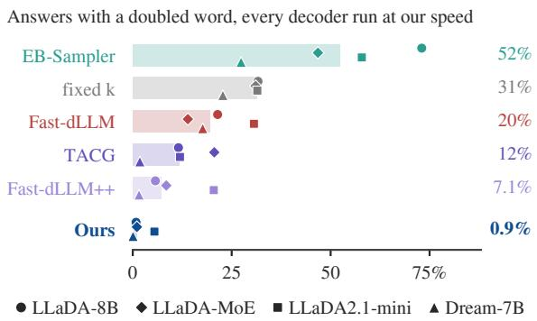  
Figure 1: A test that cannot see the draw writes the same word twice. Top, two answers of LLaDA-8B to HumanEval/48 at τ = 0.1. Bottom, the share of answers with one word written twice in a row at matched forward passes, with bars at the median over models (Appendix C.6).

However, commit rules face two problems when the decoder samples. First, their tests read the predicted distributions and not the drawn tokens. Under sampling a drawn token can be far less likely than the most likely one, and the test misses this gap. Second, the tokens of one step depend on each other, and this dependence cannot be measured from the distributions of a single forward pass. In Figure 1, a rule that orders and scores positions by their top choice accepts cleaned twice in one step, yet the finished answer gives each copy almost no probability.

We find that quality follows the actual reliability of what a decoder writes, the log probability of the written tokens. Across rule families and four models, it predicts pass@1 better than the reliability reported on the most likely tokens, and far better than the number of forward passes. The log probability of an answer is also the sum of two terms, the actual reliability of each step and the dependence among the tokens it writes. This suggests that a rule should certify the tokens it writes and keep the tokens of one step apart.

We propose PACT, a Post-draw Accumulated Certificate for Tokens. At each step PACT draws the tokens first and orders the positions by the log probability of their drawn tokens. It then commits the longest prefix of this order whose log probabilities add up to at least log τ . The set it certifies is therefore the set it writes, at any temperature. We prove that it commits as many positions as this guarantee allows. PACT also spaces the positions of one step at least a minimum gap apart, to lower the dependence among them. It is training-free, adds no forward passes and changes only the commit rule.

We evaluate PACT on four masked diffusion language models from the LLaDA and Dream families, on HumanEval, MBPP, GSM8K, MATH500 and IFEval. At matched quality on code and math, it needs fewer forward passes than each of the five published rules, and the margin grows as decoding gets faster. These savings also shorten the decoding time. As the temperature rises, ordering by the top choice collapses, while PACT keeps most of its accuracy. The doubled word of Figure 1 turns up far more often under the published decoders than under PACT at the same speed. These results make PACT a faster and more reliable way to decode masked diffusion language models by sampling.

The main contributions are summarized as follows.

1. We identify that published commit rules test the predicted distributions alone, while the written tokens are drawn. Under sampling, we find that quality follows the actual reliability of what is written.

2. We propose PACT, a commit rule that certifies the drawn tokens it writes and spaces the positions of one step, with no training and no extra forward passes.

3. We prove that PACT commits as many positions as its guarantee allows, at any temperature. Under a Markov assumption, spacing bounds the dependence within a step.

4. We show on four models that PACT needs fewer forward passes than five published rules at matched quality.

## 2 Related Work

Caching, block-wise decoding, distillation and early exit make masked diffusion language models faster by changing the cost of each step or the number of steps (Appendix A). They can be combined with the commit rule, the part of the decoder that picks which masked positions to fill at each step. Early rules rank the positions by confidence and fill a fixed number per step (Nie et al., 2025). Adaptive rules let a test decide this number. Some test each position on its own, by its top probability (Wu et al., 2026a; Yu et al., 2026), the stability of its prediction across steps (Kim et al., 2025) or signals from the decoding trajectory (Wang et al., 2026). Others sort the positions and test a prefix as a whole, bounding its summed entropy (Ben-Hamu et al., 2025) or the joint probability of its most likely tokens (Kasa et al., 2026). These tests are computed from the predicted distributions alone, so a step fills the same positions whatever tokens are drawn. PACT also tests a prefix as a whole. It tests the drawn tokens, so its certificate covers the set it writes at every temperature (Section 3.2).

A step that commits several positions draws each token from its own marginal, so the dependence between the tokens is left out. Analyses show that the resulting error lowers quality and moves samples away from the model’s distribution (Zhong et al., 2026; Tang et al., 2026; Zhang et al., 2026; Kang et al., 2026). Dependence-aware rules choose which positions to commit together, from attention (Kim et al., 2026), a trained head (Ringel et al., 2026), a small autoregressive model (Israel et al., 2025) or the uncertainty of earlier context (He et al., 2026). Spreading the positions of a step apart also weakens their dependence (Luxembourg et al., 2026; Besnier et al., 2025). PACT applies this idea inside its certificate, where positions that lie too close give way to farther ones. The certificate then bounds one of the two sums that make up the answer’s log probability, and spacing shrinks the other (Section 3.3). Section 4.3 measures what spacing adds to the certificate.

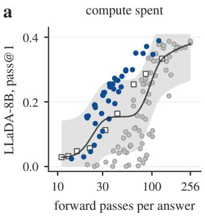

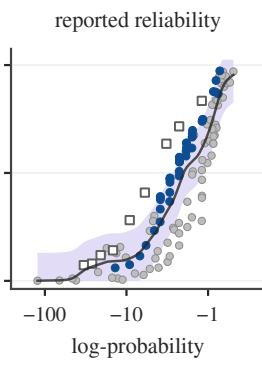

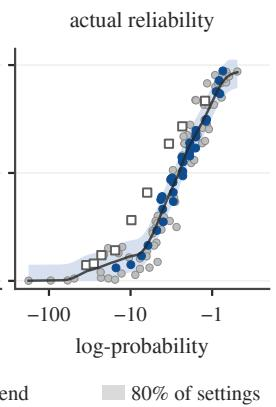

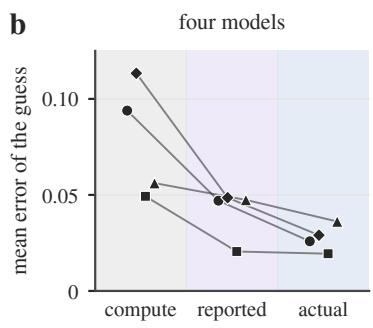

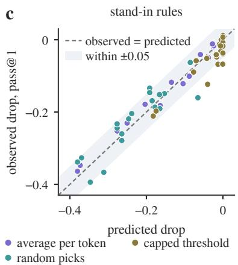

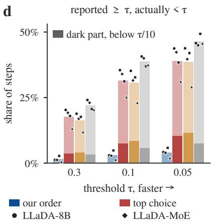

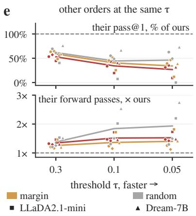  
Figure 2: Quality follows the reliability of what is written, and tests on the distributions misjudge it. (a) Pass@1 of LLaDA-8B against three axes. (b) Error of predicting pass@1 from each axis, holding out one rule family at a time. (c) Stand-in rules, built to hold another quantity fixed. (d) Steps where the reported reliability reaches τ and the actual reliability does not, under four orders with one shared test. (e) The other three orders against ours. Appendix C.6 defines each quantity.

## 3 Method

## 3.1 Preliminaries

A masked diffusion language model starts from a fully masked answer and fills in part of it at every step (Sahoo et al., 2024; Shi et al., 2024). At each step it gives every masked position $i \in M$ a distribution $p _ { i }$ over the vocabulary, and the decoder draws a token $x _ { i }$ from $q _ { i } \propto p _ { i } ^ { 1 / T }$ at temperature T. A commit rule keeps the drawn tokens of a set $S \subseteq M$ and leaves the other positions masked. Each step costs one forward pass. Committed tokens are not revised.

We describe a commit rule by three parts, a score for each position, an order over the positions and a cut that ends the ordered list. The cut sets how many positions a step commits, and the score and the order set which. Published rules compute their test from the distributions alone, for each position or summed along the order (Section 2). Their decision is therefore the same whichever tokens are drawn, and it speaks for the written tokens only under greedy decoding. To make this precise, we compare two quantities for a set S,

$$
\hat { R } ( S ) = \sum _ { i \in S } \log p _ { i } ( \hat { x } _ { i } ) , \quad R ( S ) = \sum _ { i \in S } \log p _ { i } ( x _ { i } ) ,\tag{1}
$$

where $\hat { x } _ { i } = \arg \operatorname* { m a x } _ { v } p _ { i } ( v )$ is the most likely token at position i. The reported reliability Rˆ(S) is computed on the most likely tokens, and rules that threshold the top probability certify a bound on it. The actual reliability R(S) is computed on the written tokens and is known only once they are drawn.

## 3.2 PACT

PACT keeps these three parts and changes each of them. As its name says, it draws the tokens first and certifies the set it is about to write. Its score for a position is the written-word score $s _ { i } = \log p _ { i } ( x _ { i } )$ the log probability of the token drawn there. Sorting the positions by this score gives our order $\pi = ( \pi _ { 1 } , \pi _ { 2 } , . . . )$ . PACT commits the longest prefix $S = \{ \pi _ { 1 } , \ldots , \pi _ { k ^ { * } } \}$ of π whose scores add up

<table><tr><td></td><td colspan="2">HumanEval</td><td colspan="2">MBPP</td><td colspan="2">GSM8K</td><td colspan="2">MATH500</td><td colspan="2">IFEval</td></tr><tr><td>Method</td><td>Acc.</td><td>Speed</td><td> $\operatorname { A c c } .$ </td><td>Speed</td><td> $\operatorname { A c c } .$ </td><td>Speed</td><td>Acc.</td><td>Speed</td><td> $\operatorname { A c c } .$ </td><td>Speed</td></tr><tr><td colspan="9">LLaDA-8B</td><td></td></tr><tr><td>One token per step</td><td>38.3</td><td>1.0×</td><td>39.1</td><td>1.0×</td><td>57.6</td><td>1.0×</td><td>27.5</td><td>1.0×</td><td>46.1</td><td>1.0×</td></tr><tr><td>Fast-dLLM</td><td>34.8</td><td>2.9×</td><td>34.9</td><td>2.1×</td><td>57.5</td><td>2.7×</td><td>26.0</td><td>2.0×</td><td>49.0</td><td>1.9×</td></tr><tr><td>Fast-dLLM++</td><td>23.2</td><td>3.9×</td><td>23.5</td><td>3.0×</td><td>52.5</td><td>4.5×</td><td>24.5</td><td>2.7×</td><td>50.7</td><td>2.1×</td></tr><tr><td>EB-Sampler</td><td>33.2</td><td>3.3×</td><td>33.7</td><td>2.6×</td><td>57.7</td><td>3.3×</td><td>25.9</td><td>2.3×</td><td>47.8</td><td>1.9×</td></tr><tr><td>KLASS</td><td>34.4</td><td>1.4×</td><td>35.4</td><td>1.2×</td><td>58.1</td><td>1.3×</td><td>25.8</td><td>1.1×</td><td>52.5</td><td>1.3×</td></tr><tr><td>TACG</td><td>34.7</td><td>2.8×</td><td>33.7</td><td>2.1×</td><td>57.4</td><td>2.9×</td><td>26.1</td><td>2.0×</td><td>50.6</td><td>1.7×</td></tr><tr><td>Fixed k (k=4)</td><td>24.5</td><td>4.0×</td><td>25.9</td><td>4.0×</td><td>54.9</td><td>4.0×</td><td>24.1</td><td>4.0×</td><td>42.2</td><td>4.0×</td></tr><tr><td>Ours</td><td>36.0</td><td>3.3×</td><td>37.0</td><td>2.2×</td><td>59.3</td><td>4.7×</td><td>27.5</td><td>2.4×</td><td>51.9</td><td>2.2×</td></tr><tr><td colspan="9">LLaDA-MoE</td><td></td></tr><tr><td>One token per step</td><td>52.1</td><td>1.0×</td><td>51.6</td><td>1.0×</td><td>44.9</td><td>1.0×</td><td>26.8</td><td>1.0×</td><td>56.9</td><td>1.0×</td></tr><tr><td>Fast-dLLM</td><td>47.9</td><td>4.0×</td><td>47.7</td><td>2.5×</td><td>44.1</td><td>2.2×</td><td>26.2</td><td>2.4×</td><td>58.2</td><td>1.7×</td></tr><tr><td>Fast-dLLM++</td><td>33.9</td><td>5.9×</td><td>31.2</td><td>3.5×</td><td>39.7</td><td>3.7×</td><td>23.8</td><td>3.2×</td><td>57.3</td><td>1.9×</td></tr><tr><td>EB-Sampler</td><td>48.4</td><td>4.8×</td><td>46.6</td><td>3.0×</td><td>41.0</td><td>2.6×</td><td>25.2</td><td>2.4×</td><td>59.3</td><td>1.7×</td></tr><tr><td>KLASS</td><td>49.5</td><td>1.8×</td><td>44.6</td><td>1.2×</td><td>43.7</td><td>1.1×</td><td>24.6</td><td>1.1×</td><td>56.2</td><td>1.2×</td></tr><tr><td>TACG</td><td>45.8</td><td>4.2×</td><td>45.1</td><td>2.4×</td><td>40.4</td><td>2.5×</td><td>25.0</td><td>2.6×</td><td>59.1</td><td>1.6×</td></tr><tr><td>Fixed k (k=4)</td><td>38.3</td><td>4.0×</td><td>32.6</td><td>4.0×</td><td>35.8</td><td>4.0×</td><td>23.8</td><td>4.0×</td><td>49.4</td><td>4.0×</td></tr><tr><td>Ours</td><td>50.1</td><td>5.2×</td><td>48.5</td><td>2.9×</td><td>44.9</td><td>3.5×</td><td>26.4</td><td>3.7×</td><td>60.1</td><td>1.8×</td></tr><tr><td colspan="9">LLaDA2.1-mini</td><td></td><td></td></tr><tr><td>One token per step</td><td>21.5</td><td>1.0×</td><td>14.5</td><td>1.0×</td><td>28.6</td><td>1.0×</td><td>15.7</td><td>1.0×</td><td>14.8</td><td>1.0×</td></tr><tr><td>Fast-dLLM</td><td>19.6</td><td>1.4×</td><td>13.6</td><td>1.3×</td><td>29.2</td><td>1.5×</td><td>16.4</td><td>1.9×</td><td>14.2</td><td>1.2×</td></tr><tr><td>Fast-dLLM++</td><td>11.9</td><td>1.5×</td><td>9.6</td><td>1.4×</td><td>27.7</td><td>1.4×</td><td>14.1</td><td>1.8×</td><td>19.5</td><td>1.6×</td></tr><tr><td>EB-Sampler</td><td>16.1</td><td>1.3×</td><td>12.1</td><td>1.3×</td><td>31.6</td><td>1.3×</td><td>15.5</td><td>1.8×</td><td>19.6</td><td>1.3×</td></tr><tr><td>KLASS</td><td>16.8</td><td>1.0×</td><td>12.6</td><td>1.0×</td><td>33.1</td><td>1.0×</td><td>15.8</td><td>1.1×</td><td>19.0</td><td>1.0×</td></tr><tr><td>TACG</td><td>17.5</td><td>1.3×</td><td>12.2</td><td>1.2×</td><td>31.6</td><td>1.3×</td><td>15.2</td><td>1.8×</td><td>18.2</td><td>1.3×</td></tr><tr><td>Fixed k (k=4)</td><td>5.6</td><td>4.0×</td><td>1.7</td><td>4.0×</td><td>14.3</td><td>4.0×</td><td>9.7</td><td>4.0×</td><td>12.1</td><td>4.0×</td></tr><tr><td>Ours</td><td>19.8</td><td>1.9×</td><td>14.8</td><td>1.8×</td><td>31.6</td><td>2.3×</td><td>16.7</td><td>2.9×</td><td>19.5</td><td>1.7×</td></tr><tr><td colspan="9">Dream-7B</td><td></td><td></td></tr><tr><td>One token per step</td><td></td><td></td><td></td><td></td><td></td><td></td><td></td><td></td><td></td><td></td></tr><tr><td>Fast-dLLM</td><td>20.9</td><td>1.0×</td><td>25.0</td><td>1.0×</td><td>42.3</td><td>1.0×</td><td>24.9</td><td>1.0×</td><td>26.0</td><td>1.0×</td></tr><tr><td>Fast-dLLM++</td><td>22.7 16.8</td><td>1.9× 3.7×</td><td>25.2</td><td>2.2×</td><td>41.8</td><td>1.9×</td><td>25.5</td><td>1.4×</td><td>31.0</td><td>2.7×</td></tr><tr><td>EB-Sampler</td><td>28.3</td><td>2.0×</td><td>15.7 24.9</td><td>4.7×</td><td>32.4 41.7</td><td>4.2×</td><td>20.9</td><td>3.3×</td><td>39.1 30.5</td><td>4.1×</td></tr><tr><td>KLASS</td><td>24.4</td><td>1.2×</td><td>30.6</td><td>2.2× 1.2×</td><td>44.5</td><td>2.2× 1.3×</td><td>26.7 26.8</td><td>1.4×</td><td>42.9</td><td>2.5×</td></tr><tr><td>TACG</td><td>25.5</td><td>2.3×</td><td>24.3</td><td>2.7×</td><td>39.6</td><td>2.4×</td><td>24.9</td><td>1.1× 1.8×</td><td>40.0</td><td>1.7× 2.8×</td></tr><tr><td>Fixed k (k=4)</td><td>17.8</td><td>4.0×</td><td>14.4</td><td>4.0×</td><td>51.7</td><td>4.0×</td><td>27.1</td><td>4.0×</td><td>37.5</td><td>4.0×</td></tr><tr><td>Ours</td><td>31.9</td><td>5.1×</td><td>26.2</td><td>7.9×</td><td>43.1</td><td>3.7×</td><td>26.2</td><td>6.7×</td><td>41.5</td><td>6.7×</td></tr></table>

Table 1: Accuracy and speed of every method at one setting. Acc. is pass@1 (%) and Speed is the tokens written per forward pass. Each baseline runs at the setting given in Appendix C.3, and PACT at $\tau = 0 . 5 ,$ without spacing on LLaDA2.1-mini. In each column, the best of the published rules and PACT is in bold and the second best underlined.

to at least log τ , where

$$
\begin{array} { r } { k ^ { * } = \operatorname* { m a x } \Bigl \{ m \ \Big | \ \sum _ { j \leq m } s _ { \pi _ { j } } \geq \log \tau \Bigr \} . } \end{array}\tag{2}
$$

When no prefix passes, it commits $\pi _ { 1 }$ so that every step makes progress. This set-level cut tests the committed set as a whole. Because the test reads the drawn tokens, the set PACT certifies is the set it writes, at any temperature. No rule with this guarantee commits more positions (Proposition 3).

The set-level cut accounts for how reliable each committed token is, but not for how the tokens committed together depend on each other. Neighboring positions are the riskiest pair to commit in one step, since each is decided from a context that lacks the other (Luxembourg et al., 2026). The third change therefore spaces the committed positions apart by filtering the order. Spacing scans π and keeps a position only if it lies at least g away from every position kept so far. The scan stops once it holds $k ^ { * }$ positions, the count that (2) allows. If too few positions qualify, the scan lowers the gap one step at a time. Listing the kept positions in the order of π as $\pi ^ { g }$ , PACT commits the longest prefix of $\pi ^ { g }$ with at most $k ^ { * }$ positions whose scores add up to at least log τ . The cut is recomputed on $\pi ^ { g }$ , since a position with a lower score can push the sum below log τ. Spacing only filters the order, so it adds no forward passes.

Algorithm 1 in Appendix B.1 lists one step of PACT. The threshold τ sets how much reliability each step keeps, and with it the balance between speed and quality. We set the minimum gap to $g =$ 8 by default. PACT is training-free and changes only the step that picks the committed set.

## 3.3 Theoretical Analysis

PACT certifies each step through the tokens it writes. To see what this controls over a whole answer, let a decode commit $S _ { 1 } , \ldots , S _ { K }$ in this order, with $R ( S _ { k } )$ taken at the state where $S _ { k }$ is committed. For a committed set S, let $P _ { S } ( x _ { S } )$ be the probability the model assigns to its tokens when they are revealed one at a time in the order of π. Its dependence term is $D ( S ) = \log P _ { S } ( x _ { S } ) - R ( S )$

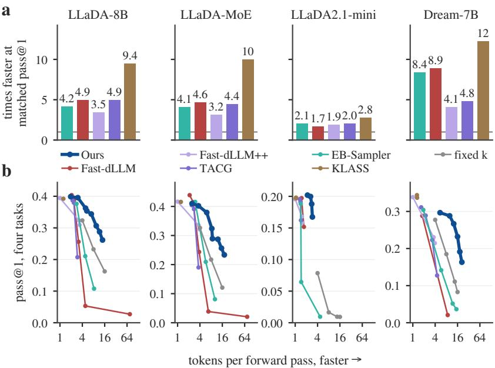

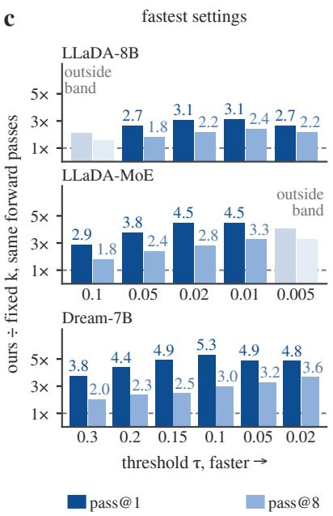  
Figure 3: Speed and quality of every decoder. (a) Speed-up of PACT over each published rule at matched pass@1 on code and math. (b) The sweeps behind a. (c) PACT against fixed k at the same forward passes, with dark bars significantly above one. Appendix C.6 gives the matched level, the tasks, the band of c and the test.

Proposition 1. Decomposition. Let log $P ( x )$ be the log probability the model assigns to the answer when its tokens are revealed one at a time in commit order. Then

$$
\log P ( x ) = \sum _ { k = 1 } ^ { K } R ( S _ { k } ) + \sum _ { k = 1 } ^ { K } D ( S _ { k } ) .\tag{3}
$$

If the sets and the order within each set are fixed in advance and $T = 1$ , parallel decoding draws the answer from $\begin{array} { r } { Q ( x ) \ = \ \prod _ { k } \prod _ { i \in S _ { k } } p _ { i } ( x _ { i } ) } \end{array}$ , and $\begin{array} { r } { \mathbb { E } _ { Q } [ \sum _ { k } D ( S _ { k } ) ] = - \mathrm { K L } ( Q \parallel P ) \le \mathbf { \bar { 0 } } . } \end{array}$

The first sum collects the reliability of what each step writes, and a rule can check it once the tokens are drawn. The second sum is the cost of writing several tokens at once, and a single forward pass does not reveal it. The threshold $\tau$ bounds every term of the first sum, and spacing shrinks the terms of the second. The first sum tracks quality. Across rule families and four models, pass@1 follows the actual reliability of the weakest steps, while the reported reliability predicts it worse and compute far worse (Figure 2a–b). Rules built to hold another quantity fixed lose about the pass@1 that this relation predicts (Figure 2c).

Proposition 2. Distribution-only tests. For every set S, ${ \hat { R } } ( S ) ~ \geq ~ R ( S )$ , with equality if and only if every position in S receives its most likely token. If S is chosen from the distributions alone, $\mathbb { E } _ { T } [ R ( S ) ]$ is non-increasing in T and tends to $\hat { R } ( S )$ as $T  0$ when each most likely token is unique. $A t T = 1$ , the expected gap $\mathbb { E } [ \hat { R } ( S ) - R ( S ) ]$ is $\begin{array} { r } { \sum _ { i \in S } [ H ( p _ { i } ) - H _ { \infty } ( p _ { i } ) ] } \end{array}$ , where H and $H _ { \infty }$ are the entropy and the min-entropy.

A rule that decides from the distributions alone commits the same set at a given state whatever the temperature. The tokens it writes there lose reliability as the temperature rises. The gap closes only under greedy decoding, the setting in which guarantees on the most likely tokens apply. Within single steps, orders that ignore the draw often report a reliability at or above τ while the written tokens fall below it (Figure 2d). Ordering by the drawn tokens rarely leaves such a gap, and at the same τ it reaches a higher pass@1 with fewer forward passes (Figure 2e, Appendix D.1).

Proposition 3. Largest certified set. Except when no prefix passes and a single position is committed, every set PACT commits satisfies $R ( S ) \geq$ log $\tau ,$ at every temperature and after any filter that only removes positions from π. Without spacing, PACT commits the largest set S with $R ( S ) \geq$ log τ . As $\tau $ 1, PACT commits one position per step, and with $g = 1$ spacing leaves π unchanged.

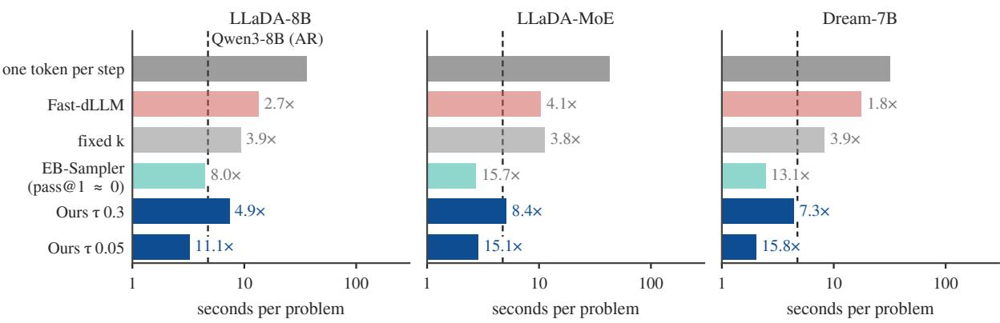  
Figure 4: Decoding time per problem. Multiples are speed-ups over one token per step (Appendix C.4).

The set PACT certifies is thus the set it writes, and spacing keeps it so. The guarantee also costs no parallelism within a step, since any rule with the same guarantee commits at most as many positions. Decoding one token per step is the end of this family where τ approaches one.

Proposition 4. Spacing bounds the dependence term. Suppose that at a given state the model’s conditionals come from one joint distribution P over the masked positions, with marginals $p _ { i } ,$ and that P is Markov along the sequence. Let the m positions ofS lie pairwise at least g apart, and let $J _ { I } ( g )$ and $J _ { L } ( g )$ be the largest mutual information and the largest lautum information $L ( X ; Y ) =$ KL $( P _ { X } P _ { Y } \parallel P _ { X Y } )$ between two positions g apart. Then

$$
\begin{array} { r l } & { 0 \leq \mathbb { E } _ { P s } \big [ D ( S ) \big ] \leq \left( m - 1 \right) J _ { I } ( g ) , } \\ & { 0 \leq - \mathbb { E } _ { \otimes _ { i } p _ { i } } \big [ D ( S ) \big ] \leq \left( m - 1 \right) J _ { L } ( g ) , } \end{array}
$$

and both $J _ { I }$ and $J _ { L }$ are non-increasing in $g .$

The first expectation draws the set from the joint, and the second draws each position on its own, as parallel decoding does at $T = 1$ . Either way, the sum of marginals misjudges the set by at most m − 1 times the dependence between positions g apart. This dependence shrinks as g grows. The factor $m - 1$ makes spacing matter more when a step writes many tokens. Both assumptions are idealizations, so Section 4.4 tests only the trend they predict. Appendix B.2 gives the proofs.

## 4 Experiments

## 4.1 Setup

Models and benchmarks. We evaluate PACT on four masked diffusion language models, LLaDA-8B, LLaDA-MoE, LLaDA2.1-mini and Dream-7B. Two are dense and two are mixtures of experts, from the LLaDA and Dream families. We use HumanEval and MBPP for code, GSM8K and MATH500 for math, and IFEval for instruction following (Appendices C.1 and C.2).

Baselines. We compare PACT with five published commit rules, Fast-dLLM (a per-token threshold), Fast-dLLM++, EB-Sampler, KLASS and TACG. All of them follow the definitions in their papers and run in our decoder under the same protocol as PACT (Appendix C.3). Two simple decoders serve as references, one token per step and fixed k. Fixed k commits at every step the k positions whose drawn tokens have the highest probability. For decoding time, we add Qwen3-8B, an autoregressive model of similar size.

Metrics and protocol. We report pass@1 over eight samples per problem, and pass@8 where noted. Cost is the number of forward passes per answer. Each answer fills all 256 positions, including the padding after it ends. The tokens written per forward pass therefore equal the speed-up over one token per step. Each problem is decoded at temperature 0.6 as a single block of 256 tokens, so the commit rule alone decides the decoding order. The diffusion models run without a key-value cache (Appendix C.4). PACT uses $g = 8$ except on LLaDA2.1-mini, which runs without spacing (Section 4.4). Differences are tested with a paired bootstrap, and Appendix C.5 reports the variation across seeds. Appendix D.2 repeats the comparison with 32-token blocks.

## 4.2 Main Results

At one setting each, published rules that are more accurate than PACT are almost always slower (Table 1). We first run each method at one setting, as a user would. The per-token threshold is slower than PACT on every model and benchmark, at similar accuracy. Since the methods differ in speed and accuracy at once, Figure 3 compares them at matched quality and at matched speed.

b  
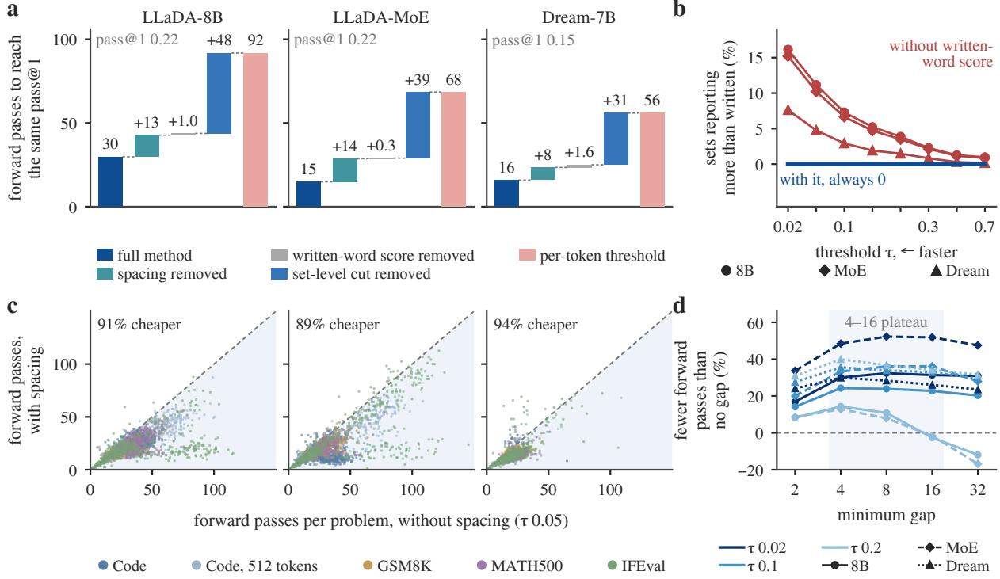  
Figure 5: Ablations of PACT. (a) Forward passes on code to reach the pass@1 printed in each panel, as the parts of PACT are removed in turn. (b) Committed sets on code that report more than they write. (c) Forward passes of each problem with and without spacing, on the models of a. (d) The saving of spacing on code by minimum gap.

At matched quality, PACT needs fewer forward passes than every published rule on every model (Figure 3a–b). Figure 3a compares the fastest setting of each method that reaches the same pass@1. PACT is close to the published rules when each forward pass writes few tokens, and it pulls ahead as decoding gets faster (Figure 3b).

At the fastest settings, PACT is several times more accurate than fixed k at the same forward passes (Figure 3c). Figure 3c pairs each fast setting of PACT with fixed k. PACT leads on pass@8 as well as on pass@1, and its answers stay as varied as those of one token per step (Appendix D.6). Unlike fixed k, PACT lets the reliability of each step decide how many tokens it writes, more where the answer is easy and fewer where it is hard.

The forward passes PACT saves carry over to decoding time (Figure 4). PACT adds only sorting and summing to each step, so the time it saves tracks the forward passes it saves. Matched to the accuracy of one token per step, PACT is faster on almost every benchmark (Appendix D.3). Qwen3-8B decodes eight answers almost as fast as one with its key-value cache. With one answer per problem, PACT is faster than it at both thresholds (Appendix D.4).

## 4.3 Ablations

At the same pass@1, the set-level cut accounts for most of the forward passes PACT saves over the per-token threshold (Figure 5a). Figure 5a removes the parts of PACT one at a time. This matches Proposition 3, by which the set-level cut commits the largest set that meets its guarantee. Spacing adds a further saving.

The written-word score makes every committed set report the reliability of exactly what it writes (Figure 5b). Without it, a committed set can report a higher reliability than the tokens it writes (Appendix D.6). With it, the two reliabilities are one quantity, and Proposition 3 turns the threshold into a guarantee on what is written. This costs almost no forward passes (Figure 5a), and its effect on accuracy grows with the sampling temperature (Section 4.4).

Spacing saves forward passes on almost every problem, and the saving grows as decoding gets faster (Figure 5c–d). Figure 5c compares the forward passes of each problem with and without spacing, and Figure 5d varies the minimum gap.

a  
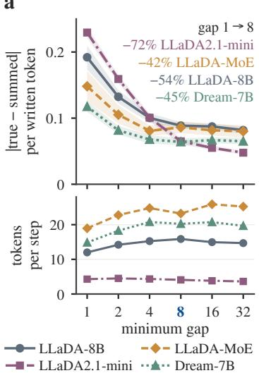

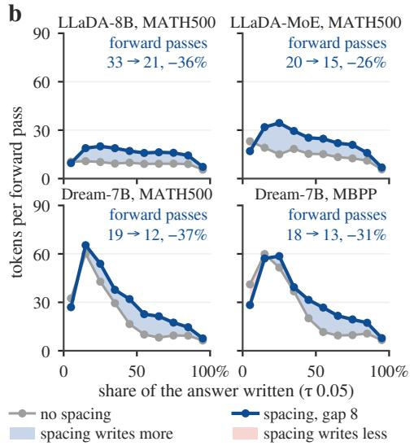

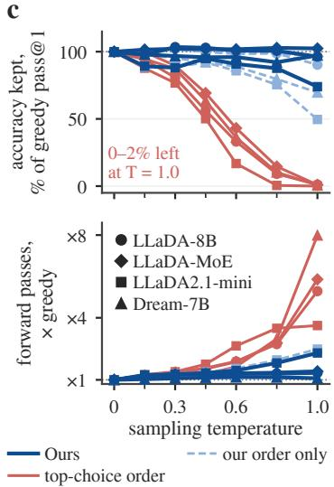  
Figure 6: Effects of spacing and of the sampling temperature. (a) Dependence term and step size against the minimum gap. (b) Tokens written per forward pass along the answer. (c) Accuracy and forward passes against the sampling temperature, for three rules that share the set-level cut. Appendix C.6 gives the settings.

The saving grows as τ falls and each step writes more tokens, as the factor m − 1 in Proposition 4 suggests. At the faster thresholds, gaps on either side of $g = 8$ save about as much, so the choice of g is not critical.

## 4.4 Analysis

Spacing shrinks the dependence term by about half (Figure 6a). The term per written token falls as the gap widens, the trend Proposition 4 predicts when dependence decays with distance. On three of the models the steps also grow with the gap, so the reduction does not come from smaller steps.

Spacing lets later steps write more tokens, so an answer needs fewer forward passes (Figure 6b). Figure 6b follows the tokens written per forward pass along an answer. Within a step, spacing commits at most k∗ positions, so it can only shorten the committed prefix. The saving comes from the later steps, which write more tokens once the committed ones are spread across the answer. On LLaDA2.1-mini the steps stay near four tokens at every gap (Figure 6a), so spacing has little to gain and we run it without spacing.

As the sampling temperature rises, ordering by the top choice loses accuracy far faster than PACT (Figure 6c). Figure 6c raises the temperature for three rules that differ only in how they order and score positions (Appendix D.6). Ordering by the drawn tokens avoids the collapse, and scoring them as well keeps more of the accuracy. GSM8K shows the same pattern (Appendix D.5).

Proposition 2 predicts this, since the gap of a rule that decides from the distributions alone widens with the temperature.

At the same speed, the published decoders write doubled words far more often than PACT (Figure 1). Two copies of a word can each be likely on their own and unlikely together. A test built from single positions cannot see this, and it accepts both in one step. Spacing keeps neighboring positions out of the same step, so such pairs rarely form under PACT.

## 5 Conclusion

This paper revisits what a commit rule certifies when masked diffusion language models are decoded by sampling. We showed that published rules decide from the predicted distributions alone, while answer quality depends on how reliable the written tokens are. PACT certifies the written tokens and spaces the positions within a step, acting on the two terms of the answer’s log probability. On four models, it saved forward passes at matched quality and wrote far fewer doubled words at matched speed. Speed-ups in parallel decoding are usually framed as how much risk each step may take. Our results suggest that which tokens the risk is measured on matters as well. A natural next step is to certify the joint probability of what each step writes. In uses that sample many answers, what a commit rule certifies may matter as much as how many tokens it commits.

## Limitations

Like other training-free commit rules, PACT sees one distribution per position in each forward pass. Its certificate therefore covers the summed log probability of the written tokens. Their joint probability also contains the dependence among them, which cannot be measured from these distributions when the step is decided. Spacing lowers this dependence indirectly, and bounds on it rest on assumptions about how dependence decays along the sequence. Measuring it directly would take extra forward passes or a trained estimator.

The certificate rests on the model’s own probabilities. It limits the error that parallel decoding adds, and it cannot correct a model that is confidently wrong. The outputs also keep the biases of the underlying model, and they need the same checks as any model output.

Our experiments cover four masked diffusion language models from two families and English benchmarks of code, math and instruction following, all scored automatically. Longer generations, other languages and open-ended tasks judged by people are left to future work.

We count cost in forward passes. The time that a saved pass is worth depends on the rest of the inference stack, since caches, block-wise models and batching all change the cost of a pass.

## References

Marianne Arriola, Subham Sekhar Sahoo, Aaron Gokaslan, Zhihan Yang, Zhixuan Qi, Jiaqi Han, Justin T Chiu, and Volodymyr Kuleshov. 2025. Block diffusion: Interpolating between autoregressive and diffusion language models. In The Thirteenth International Conference on Learning Representations.

Jacob Austin, Augustus Odena, Maxwell Nye, Maarten Bosma, Henryk Michalewski, David Dohan, Ellen Jiang, Carrie Cai, Michael Terry, Quoc Le, and Charles Sutton. 2021. Program synthesis with large language models. Preprint, arXiv:2108.07732.

Jinbin Bai, Yixuan Li, Yuchen Zhu, Yi Xin, Qingyu Shi, Aosong Feng, Xiaohong Liu, Molei Tao, Jianru Xue, Xiangtai Li, and Ming-Hsuan Yang. 2026. Efficient test-time scaling via hierarchical search and selfverification for discrete diffusion language models. In Forty-third International Conference on Machine Learning.

Heli Ben-Hamu, Itai Gat, Daniel Severo, Niklas S Nolte, and Brian Karrer. 2025. Accelerated sampling from masked diffusion models via entropy bounded unmasking. In Advances in Neural Information Pro-

cessing Systems, volume 38, Main Conference, pages 55981–56007. Curran Associates, Inc.

Thomas Bertolani, Davide Bucciarelli, Leonardo Zini, Marcella Cornia, and Lorenzo Baraldi. 2026. Diffusion language models: An experimental analysis. Preprint, arXiv:2606.19475.

Victor Besnier, Mickael Chen, David Hurych, Eduardo Valle, and Matthieu Cord. 2025. Halton scheduler for masked generative image transformer. In The Thirteenth International Conference on Learning Representations.

Tiwei Bie, Maosong Cao, Xiang Cao, Bingsen Chen, Fuyuan Chen, Kun Chen, Lun Du, Daozhuo Feng, Haibo Feng, Mingliang Gong, et al. 2026. Llada2. 1: Speeding up text diffusion via token editing. arXiv preprint arXiv:2602.08676.

Mark Chen, Jerry Tworek, Heewoo Jun, Qiming Yuan, Henrique Ponde De Oliveira Pinto, Jared Kaplan, Harri Edwards, Yuri Burda, Nicholas Joseph, Greg Brockman, et al. 2021. Evaluating large language models trained on code. arXiv preprint arXiv:2107.03374.

Sitan Chen, Kevin Cong, and Jerry Li. 2025. Optimal inference schedules for masked diffusion models. Preprint, arXiv:2511.04647.

Zigeng Chen, Gongfan Fang, Xinyin Ma, Ruonan Yu, and Xinchao Wang. 2026. dparallel: Learnable parallel decoding for dLLMs. In The Fourteenth International Conference on Learning Representations.

Karl Cobbe, Vineet Kosaraju, Mohammad Bavarian, Mark Chen, Heewoo Jun, Lukasz Kaiser, Matthias Plappert, Jerry Tworek, Jacob Hilton, Reiichiro Nakano, Christopher Hesse, and John Schulman. 2021. Training verifiers to solve math word problems. Preprint, arXiv:2110.14168.

Liancheng Fang, Aiwei Liu, Henry Peng Zou, Yankai Chen, Enze Ma, Leyi Pan, Chunyu Miao, Wei-Chieh Huang, Xue Liu, and Philip S. Yu. 2026. Locally confident, globally stuck: The quality-exploration dilemma in diffusion language models. Preprint, arXiv:2604.00375.

Zhenghao He, Bohan Liu, Guangzhi Xiong, and Aidong Zhang. 2026. Reliable parallel decoding in masked diffusion language models. Preprint, arXiv:2609.36452.

Daniel Mingyi Israel, Guy Van den Broeck, and Aditya Grover. 2025. Accelerating diffusion LLMs via adaptive parallel decoding. In The Thirty-ninth Annual Conference on Neural Information Processing Systems.

Wonjun Kang, Kevin Galim, Seunghyuk Oh, Minjae Lee, Yuchen Zeng, Shuibai Zhang, Coleman Richard Charles Hooper, Yuezhou Hu, Hyung Il Koo,

Nam Ik Cho, and Kangwook Lee. 2026. Parallelbench: Understanding the trade-offs of parallel decoding in diffusion LLMs. In The Fourteenth International Conference on Learning Representations.

Siva Rajesh Kasa, Yasong Dai, Sumit Negi, and Hongdong Li. 2026. Fast-dllm++: Fréchet profile decoding for faster diffusion llm inference. Preprint, arXiv:2606.02955.

BumJun Kim, Dongjae Jeon, Moongyu Jeon, and Albert No. 2026. DAPD: Dependency-aware parallel decoding via attention for diffusion LLMs. In Forty-third International Conference on Machine Learning.

Seo Hyun Kim, Sunwoo Hong, Hojung Jung, Youngrok Park, and Se-Young Yun. 2025. KLASS: KL-guided fast inference in masked diffusion models. In The Thirty-ninth Annual Conference on Neural Information Processing Systems.

Pengxiang Li, Yefan Zhou, Dilxat Muhtar, Lu Yin, Shilin Yan, Li Shen, Yi Liang, Soroush Vosoughi, and Shiwei Liu. 2026. Diffusion language model knows the answer before it decodes. In The Fourteenth International Conference on Learning Representations.

Hunter Lightman, Vineet Kosaraju, Yuri Burda, Harrison Edwards, Bowen Baker, Teddy Lee, Jan Leike, John Schulman, Ilya Sutskever, and Karl Cobbe. 2024. Let’s verify step by step. In The Twelfth International Conference on Learning Representations.

Yi Lu, Deyang Kong, Jianing Wang, Linsen Guo, Xue Wang, Qi Guo, Tao Gui, Xuanjing Huang, Wei Ye, Shikun Zhang, and Wei Wang. 2026. Adaptive test-time compute allocation for block diffusion language models in complex reasoning. Preprint, arXiv:2602.09555.

Omer Luxembourg, Haim H. Permuter, and Eliya Nachmani. 2026. Plan for speed: Dilated scheduling for masked diffusion language models. In Forty-third International Conference on Machine Learning.

Xinyin Ma, Runpeng Yu, Gongfan Fang, and Xinchao Wang. 2025. dkv-cache: The cache for diffusion language models. In Advances in Neural Information Processing Systems, volume 38, Main Conference, pages 149009–149033. Curran Associates, Inc.

Zanlin Ni, Shenzhi Wang, Yang Yue, Tianyu Yu, Weilin Zhao, Yeguo Hua, Tianyi Chen, Jun Song, Cheng Yu, Bo Zheng, and Gao Huang. 2026. The flexibility trap: Rethinking the value of arbitrary order in diffusion language models. In Forty-third International Conference on Machine Learning.

Shen Nie, Fengqi Zhu, Zebin You, Xiaolu Zhang, Jingyang Ou, Jun Hu, JUN ZHOU, Yankai Lin, Ji-Rong Wen, and Chongxuan Li. 2025. Large language diffusion models. In The Thirty-ninth Annual Conference on Neural Information Processing Systems.

Theo X. Olausson, Metod Jazbec, Xi Wang, Armando Solar-Lezama, Christian A. Naesseth, Stephan Mandt, and Eric Nalisnick. 2026. A tale of two temperatures: Simple, efficient, and diverse sampling from diffusion language models. In Third Conference on Language Modeling.

Yong-Hyun Park, Chieh-Hsin Lai, Satoshi Hayakawa, Yuhta Takida, and Yuki Mitsufuji. 2025. Jump your steps: Optimizing sampling schedule of discrete diffusion models. In The Thirteenth International Conference on Learning Representations.

Liran Ringel, Ameen Ali, and Yaniv Romano. 2026. Dependency-guided parallel decoding in discrete diffusion language models. Preprint, arXiv:2604.02560.

Subham Sekhar Sahoo, Marianne Arriola, Yair Schiff, Aaron Gokaslan, Edgar Marroquin, Justin T Chiu, Alexander Rush, and Volodymyr Kuleshov. 2024. Simple and effective masked diffusion language models. In Advances in Neural Information Processing Systems, volume 37, pages 130136–130184. Curran Associates, Inc.

Jucheng Shen, Gaurav Sarkar, Yeonju Ro, Sharath Nittur Sridhar, Zhangyang Wang, Aditya Akella, and Souvik Kundu. 2026. Improving the throughput of diffusion-based large language models via a training-free confidence-aware calibration. In Findings of the Association for Computational Linguistics: ACL 2026, pages 9826–9837, San Diego, California, United States. Association for Computational Linguistics.

Jiaxin Shi, Kehang Han, Zhe Wang, Arnaud Doucet, and Michalis Titsias. 2024. Simplified and generalized masked diffusion for discrete data. In The Thirtyeighth Annual Conference on Neural Information Processing Systems.

Luhan Tang, Longxuan Yu, Shaorong Zhang, and Greg Ver Steeg. 2026. Is your diffusion sampler actually correct? a sampler-centric evaluation of discrete diffusion language models. In Forty-third International Conference on Machine Learning.

Chengcheng Wang, Tingzhang Luo, Wenhao Li, Jianyuan Guo, and Chang Xu. 2026. Tacg: Trajectory-aware commit gating for diffusion language model decoding. Preprint, arXiv:2607.03236.

Chengyue Wu, Hao Zhang, Shuchen Xue, Zhijian Liu, Shizhe Diao, Ligeng Zhu, Ping Luo, Song Han, and Enze Xie. 2026a. Fast-dLLM: Training-free acceleration of diffusion LLM by enabling KV cache and parallel decoding. In The Fourteenth International Conference on Learning Representations.

Xiaoyou Wu, Cheng-Jhih Shih, Binfei Ji, Yong Liu, and Yingyan Celine Lin. 2026b. Blockbatch: Multi-scale consensus decoding for efficient diffusion language model inference. Preprint, arXiv:2605.29233.

An Yang, Anfeng Li, Baosong Yang, Beichen Zhang, Binyuan Hui, Bo Zheng, Bowen Yu, Chang Gao, Chengen Huang, Chenxu Lv, et al. 2025. Qwen3 technical report. arXiv preprint arXiv:2505.09388.

Jiacheng Ye, Zhihui Xie, Lin Zheng, Jiahui Gao, Zirui Wu, Xin Jiang, Zhenguo Li, and Lingpeng Kong. 2025. Dream 7b: Diffusion large language models. Preprint, arXiv:2508.15487.

Runpeng Yu, Xinyin Ma, and Xinchao Wang. 2026. Dimple: Discrete diffusion multimodal large language model with parallel decoding. Preprint, arXiv:2505.16990.

Shaorong Zhang, Longxuan Yu, Rob Brekelmans, Luhan Tang, Salman Asif, and Greg Ver Steeg. 2026. Generation order and parallel decoding in masked diffusion models: An information-theoretic perspective. Preprint, arXiv:2602.00286.

Yangyang Zhong, Yanmei Gu, Zhengqing Zang, Xiaomeng Li, Yuqi Ding, Xibei Jia, Yuting Shen, Zhenzhong Lan, Liwang Zhu, Weiping Liu, Junlin Zhou, Haisheng Liu, Zhong Xin Yu, Pengxin Luo, Donglian Qi, Yunfeng Yan, and Junbo Zhao. 2026. Parallelism and generation order in masked diffusion language models: Limits today, potential tomorrow. In Findings ofthe Associationfor Computational Linguistics: ACL 2026, pages 7178–7218, San Diego, California, United States. Association for Computational Linguistics.

Jeffrey Zhou, Tianjian Lu, Swaroop Mishra, Siddhartha Brahma, Sujoy Basu, Yi Luan, Denny Zhou, and Le Hou. 2023. Instruction-following evaluation for large language models. Preprint, arXiv:2311.07911.

Fengqi Zhu, Zebin You, Yipeng Xing, Zenan Huang, Lin Liu, Yihong Zhuang, Guoshan Lu, Kangyu Wang, Xudong Wang, Lanning Wei, et al. 2025. Lladamoe: A sparse moe diffusion language model. arXiv preprint arXiv:2509.24389.

## A Related Work in Detail

Several lines of work make masked diffusion language models faster without changing the commit rule. Caching reuses computation across steps (Ma et al., 2025). Block-wise decoding generates the answer block by block, and later work adapts the block size or the budget of steps (Arriola et al., 2025; Shen et al., 2026; Wu et al., 2026b; Lu et al., 2026). Distillation trains a model to write more tokens per step (Chen et al., 2026), and early exit stops decoding once the answer is settled (Li et al., 2026). These methods change the cost of a step or the number of steps, and each can be combined with a commit rule. Sampled answers also matter for test-time scaling, which searches over many of them (Bai et al., 2026).

Another line studies the order and the schedule of decoding. Some work sets how many positions each step decodes from the error of parallel decoding (Park et al., 2025; Chen et al., 2025). Others ask how much an arbitrary decoding order helps (Ni et al., 2026) and how these models behave across tasks and decoding settings (Bertolani et al., 2026).

## B Method Details

## B.1 Algorithm

Algorithm 1 gives one step of PACT in the notation of Section 3.2. Besides the forward pass of the model, a step draws the tokens, sorts the masked positions, adds up scores and scans the order. It adds no forward passes, and Appendix D.3 shows that its decoding time follows its forward passes. The scan keeps the full gap g whenever $k ^ { * }$ positions lie that far apart, and lowers it one step at a time otherwise. Lowering the gap keeps the certificate, since the scan still keeps a subsequence of π (Proposition 3). Sorting takes $O ( | M | \log | M | )$ operations and each scan $O ( | M | k ^ { * } )$ , far fewer than a forward pass.

## B.2 Proofs

Every statement concerns a single step at a fixed state, except Proposition 1, which concerns a whole decode. We write $p _ { i }$ for the distribution of position i at the state where it is committed.

Proof of Proposition 1. Reveal the answer one token at a time in commit order. By the chain rule, the model assigns it $\begin{array} { r } { P ( x ) = \prod _ { k = 1 } ^ { K } P _ { S _ { k } } ( x _ { S _ { k } } ) } \end{array}$ where $P _ { S _ { k } }$ conditions on every token committed before step k. By the definition of D, log $P _ { S _ { k } } ( x _ { S _ { k } } ) =$ $R ( S _ { k } ) + D ( S _ { k } )$ , and summing over k gives (3).

Now fix the sets and the order within each set in advance, and take $T = 1$ . The product $P ( x )$ then multiplies the model’s conditionals along one fixed order, so it sums to one over answers. Every position is drawn from its own marginal, so parallel decoding draws the answer with probability $\begin{array} { r } { Q ( x ) = \prod _ { k } \prod _ { i \in S _ { k } } p _ { i } ( x _ { i } ) } \end{array}$ , and log $Q ( x ) =$ $\textstyle \sum _ { k } R ( S _ { k } )$ . Subtracting this from (3) and taking the expectation under $Q .$

$$
\begin{array} { r l } & { \mathbb { E } _ { Q } \Big [ \sum _ { k } D ( S _ { k } ) \Big ] = \mathbb { E } _ { Q } \big [ \mathrm { l o g } P ( x ) - \mathrm { l o g } Q ( x ) \big ] } \\ & { ~ = - \mathrm { K L } ( Q \parallel P ) \le 0 . } \end{array}
$$

The sets and the order have to be fixed in advance. An adaptive rule chooses its sets from the drawn tokens. An order that depends on the drawn tokens can also keep $P ( x )$ from summing to one, unless the conditionals come from one joint distribution.

Algorithm 1 One step of PACT   
Require: masked positions M, distributions $p _ { i }$   
temperature $T ,$ , threshold $\tau ,$ minimum gap g   
1: for each $i \in M$ do   
2: draw $x _ { i }$ from $q _ { i } \propto p _ { i } ^ { 1 / T }$ and set $s _ { i } =$   
log $p _ { i } ( x _ { i } )$   
3: end for   
4: $\pi $ the positions of M sorted by $s _ { i } ,$ highest   
first   
5: $k ^ { * } \gets$ the largest m with $\sum _ { j \leq m } s _ { \pi _ { j } }$ ≥ log τ ,   
or 1 if no m passes   
6: $\pi ^ { g } $ empty list, $h  g$   
7: while $\pi ^ { g }$ holds fewer than $k ^ { * }$ positions do   
8: for $j = 1 , \dots , | M |$ do   
9: if $\pi ^ { g }$ holds $k ^ { * }$ positions then   
10: break   
11: end if   
12: if $\pi _ { j } \notin \pi ^ { g }$ and $\pi _ { j }$ lies at least $h$ away   
from every position in $\pi ^ { g }$ then   
13: add $\pi _ { j }$ to $\pi ^ { g }$   
14: end if   
15: end for   
16: $h  h - 1$   
17: end while   
18: list $\pi ^ { g }$ in the order of $\pi$   
19: $k $ the largest $m \leq k ^ { * }$ with $\sum _ { j \leq m } s _ { \pi _ { j } ^ { g } } \geq$   
log τ , or 1 if no m passes   
20: commit $x _ { i }$ at the positions $\pi _ { 1 } ^ { g } , \ldots , \pi _ { k } ^ { g }$

Proof of Proposition 2. Each term of the difference satisfies log $p _ { i } ( { \hat { x } } _ { i } ) - \log p _ { i } ( x _ { i } ) \geq 0$ , with equality exactly when $x _ { i }$ is a most likely token. Summing over $S$ gives the inequality and its equality case.

For the dependence on $T .$ , fix one position and drop its index. With $\beta ~ = ~ 1 / T$ , the token is drawn from $q _ { \beta } ( v ) = p ( v ) ^ { \beta } / Z ( \beta )$ , where $\begin{array} { r } { Z ( \beta ) = \sum _ { v } p ( v ) ^ { \beta } } \end{array}$ . The expected score $m ( \beta ) =$ $\mathbb { E } _ { q _ { \beta } } [ \log p ( x ) ]$ is the derivative of log $Z ,$ , and as in any exponential family its own derivative is a variance,

$$
\begin{array} { l } { { \displaystyle m ( \beta ) = \frac { d } { d \beta } \log Z ( \beta ) , } } \\ { { \displaystyle m ^ { \prime } ( \beta ) = \frac { d ^ { 2 } } { d \beta ^ { 2 } } \log Z ( \beta ) = \mathrm { V a r } _ { q _ { \beta } } \left( \log p ( x ) \right) ~ \geq ~ 0 . } } \end{array}
$$

Hence m is non-decreasing in $\beta$ and non-increasing in $T$ . As $\beta  \infty$ the weights $q _ { \beta }$ concentrate on the most likely token when it is unique, and $m ( \beta ) $ log p(ˆx). At $\beta = 1$ the draw follows $p$ itself, so $m ( 1 ) = - H ( p )$ and log $p ( { \hat { x } } ) - m ( 1 )$ log ma $\mathrm { x } _ { v } p ( v ) + H ( p ) = H ( p ) - H _ { \infty } ( p )$ , with $H _ { \infty } ( p ) = - \log \operatorname* { m a x } _ { v } p ( v )$ the min-entropy. A set chosen from the distributions alone does not depend on the draws at this state, so $\mathbb { E } _ { T } [ R ( S ) ] =$ $\textstyle \sum _ { i \in S } m _ { i } ( 1 / T )$ , and each statement follows by summing over S.

Proof of Proposition 3. When the maximum in (2) is over a non-empty set, the committed set satisfies $\begin{array} { r } { R ( S ) = \sum _ { j \leq k ^ { * } } s _ { \pi _ { j } } \geq } \end{array}$ log τ by construction. The scores are computed on the drawn tokens, so the bound holds whatever distribution the tokens were drawn from, at any temperature and under topk or top-p truncation. A filter that only removes positions yields a subsequence of $\pi ,$ and the cut recomputed along it satisfies the same bound by the same argument.

For the largest set, let $S ^ { \prime }$ have m positions and $R ( S ^ { \prime } ) \geq$ log τ . The m largest scores add up to at least the scores of $S ^ { \prime }$

$$
\sum _ { j \leq m } s _ { \pi _ { j } } \geq \sum _ { i \in S ^ { \prime } } s _ { i } = R ( S ^ { \prime } ) \geq \log \tau ,
$$

so the prefix of $\pi$ of length m passes. Every score is at most zero, so prefix sums do not increase with length, and the longest passing prefix has length $k ^ { * } \geq m$

For the endpoint, committing two positions requires $s _ { \pi _ { 1 } } ~ + ~ s _ { \pi _ { 2 } } ~ \geq ~ \log \tau$ , that is $p _ { \pi _ { 1 } } ( x _ { \pi _ { 1 } } ) p _ { \pi _ { 2 } } ( x _ { \pi _ { 2 } } ) \geq \tau$ . The product is below one unless both drawn tokens have probability one, so for $\tau$ close enough to one only $\pi _ { 1 }$ is committed. With $g = 1$ any two distinct positions lie at least $g$ apart, so the scan takes the positions of π in order, $\pi ^ { g }$ is the prefix of $\pi$ of length $k ^ { * }$ , and the recomputed cut returns the set of (2).

Proof of Proposition 4. List the positions of $S$ in sequence order as $s _ { 1 } < \cdots < s _ { m }$ , so that consecutive ones lie at least $g$ apart. Because the conditionals come from one joint $P _ { \mathrm { : } }$ the probability $P _ { S }$ does not depend on the order of revealing. Because $P$ is Markov along the sequence, so is the subsequence $X _ { s _ { 1 } } , \ldots , X _ { s _ { m } }$

For the first bound, the expected dependence term under $P _ { S }$ is the total correlation of $X _ { S } ,$ , the expectation under $P$ of log $P ( X _ { S } )$ $\begin{array} { r } { \sum _ { j } \log p _ { s _ { j } } ( X _ { s _ { j } } ) } \end{array}$ . The chain rule and the Markov

property give

$$
\begin{array} { r l } & { \mathbb { E } _ { P _ { S } } \big [ D ( S ) \big ] = \sum _ { j \ge 2 } I \big ( X _ { s _ { j } } ; X _ { s _ { 1 } } , \ldots , X _ { s _ { j - 1 } } \big ) } \\ & { \qquad = \sum _ { j \ge 2 } I \big ( X _ { s _ { j } } ; X _ { s _ { j - 1 } } \big ) \ \ge \ 0 . } \end{array}
$$

For the second bound, the Markov property gives

$$
\begin{array} { r l } & { \log P ( x _ { S } ) = \log p _ { s _ { 1 } } ( x _ { s _ { 1 } } ) } \\ & { \phantom { = } + \sum _ { j \geq 2 } \log P \bigl ( x _ { s _ { j } } \mid x _ { s _ { j - 1 } } \bigr ) . } \end{array}
$$

Write $Q _ { j } \ = \ p _ { s _ { j - 1 } } \otimes p _ { s _ { j } }$ for the product of the marginals of a consecutive pair and $P _ { j }$ for their joint. When every position is drawn from its own marginal,

$$
\begin{array} { r } { - \mathbb { E } _ { \otimes _ { i } p _ { i } } \big [ D ( S ) \big ] = \sum _ { j \geq 2 } \mathbb { E } _ { Q _ { j } } \big [ \log Q _ { j } - \log P _ { j } \big ] } \\ { = \sum _ { j \geq 2 } L \big ( X _ { s _ { j - 1 } } ; X _ { s _ { j } } \big ) \ \geq \ 0 . } \end{array}
$$

It remains to bound one pair. Let a and $a + d$ be two positions with $d \geq g .$ Since $X _ { a }  X _ { a + g } $ $X _ { a + d }$ is a Markov chain, the data processing inequality gives

$$
I ( X _ { a } ; X _ { a + d } ) \leq I ( X _ { a } ; X _ { a + g } ) \leq J _ { I } ( g ) .
$$

For the lautum information, pass the second coordinate of both $P _ { X _ { a } } P _ { X _ { a + g } }$ and $P _ { X _ { a } X _ { a + g } }$ through the channel $P ( X _ { a + d } \mid X _ { a + g } )$ . The first becomes $P _ { X _ { a } } P _ { X _ { a + d } } .$ , and by the Markov property the second becomes $P _ { X _ { a } X _ { a + d } . \mathrm { ~ A ~ } }$ divergence does not increase under a common channel, so

$$
L ( X _ { a } ; X _ { a + d } ) \leq L ( X _ { a } ; X _ { a + g } ) \leq J _ { L } ( g ) .
$$

Each of the $m - 1$ terms is therefore at most $J _ { I } ( g )$ or $J _ { L } ( g )$ . The same inequalities with $d = g + 1$ show that $J _ { I }$ and $J _ { L }$ are non-increasing in $g .$

## C Experimental Details

## C.1 Models

Table 2 lists the checkpoints of LLaDA-8B, LLaDA-MoE (Zhu et al., 2025), LLaDA2.1-mini (Bie et al., 2026), Dream-7B (Ye et al., 2025) and Qwen3-8B (Yang et al., 2025), with their licenses. Each model decodes with its own tokenizer and chat template. LLaDA2.1-mini also decodes the answer as one block and without token editing, so committed tokens stay fixed for every model.

## C.2 Benchmarks

Table 2 also gives the problems we use from each benchmark. HumanEval (Chen et al., 2021) and MATH500 (Lightman et al., 2024) are used in full, and MBPP (Austin et al., 2021) contributes its 500 test problems. For GSM8K (Cobbe et al., 2021) we shuffle the test split once under a fixed seed and keep the first 500 problems. IFEval (Zhou et al., 2023) contributes the first 500 of its 541 prompts. Keeping 500 problems of each bounds the cost of our sweeps, which all run on the same problems.

The prompt holds the question. For HumanEval and MBPP, a fixed instruction asks the model to complete the given function. A MATH500 question ends with an instruction to put the final answer in a box. Our code gives the exact prompts. We place the prompt in a single user turn and apply the chat template of the model, with no system message and no examples. Each answer has 256 positions.

A code answer is scored by running the first code block it contains against the tests of the benchmark. A math answer is correct when its final answer is equivalent to the reference. IFEval uses its official strict check, and an answer counts as correct when it follows every instruction in its prompt.

## C.3 Baselines

We implement the five published rules in the same decoder as PACT, following the equations and algorithms of their papers. Every rule writes the tokens drawn at the sampling temperature, so the rules differ only in which positions they commit. FastdLLM scores a position by the probability of its most likely token, as in Algorithm 1 of its paper.

Table 3 lists the parameter of each rule, its value in Table 1 and its range in Figure 3. Table 1 runs each rule at one value on every model and benchmark. Each point of Figure 3 is a setting that was run on all four code and math benchmarks of a model. Not every rule is swept on IFEval, so Figure 3 leaves it out. KLASS keeps its default thresholds on LLaDA-8B and LLaDA-MoE.

## C.4 Cost and Timing

Every method fills the 256 positions of an answer in the same way, so forward passes count the same work across methods. On every model and benchmark, PACT writes answers about as long as those of one token per step, or longer. The cost of a rule includes every forward pass it makes. The eight answers of a problem are decoded together, so the cost of each is the number of forward passes until all eight are filled. No diffusion decoder in our comparison uses a key-value cache, which keeps the comparison to the commit rule itself.

<table><tr><td>Checkpoint</td><td>Parameters</td><td>License</td></tr><tr><td>LLaDA-8B-Instruct</td><td>8B</td><td>MIT</td></tr><tr><td>LLaDA-MoE-7B-A1B-Instruct</td><td>7B</td><td>Apache-2.0</td></tr><tr><td>LLaDA2.1-mini</td><td>16B</td><td>Apache-2.0</td></tr><tr><td>Dream-v0-Instruct-7B</td><td>7B</td><td>Apache-2.0</td></tr><tr><td>Qwen3-8B</td><td>8B</td><td>Apache-2.0</td></tr></table>

<table><tr><td>Benchmark</td><td>Problems used</td><td>License</td></tr><tr><td>HumanEval</td><td>all 164</td><td>MIT</td></tr><tr><td>MBPP</td><td>all 500 test problems</td><td>CC BY 4.0</td></tr><tr><td>GSM8K</td><td>500 of 1,319 test problems</td><td>MIT</td></tr><tr><td>MATH500</td><td>all 500</td><td>MIT</td></tr><tr><td>IFEval</td><td>first 500 of 541</td><td>Apache-2.0</td></tr></table>

Table 2: Models and benchmarks. Checkpoints are the releases on Hugging Face. Every method decodes the same problems of each benchmark.

<table><tr><td>Rule</td><td>Parameter</td><td>Table 1</td><td>Figure 3</td></tr><tr><td>Fast-dLLM</td><td>threshold</td><td>0.9</td><td>0.1 to 0.95</td></tr><tr><td>Fast-dLLM++</td><td>δ</td><td>0</td><td>0 to 1</td></tr><tr><td>EB-Sampler</td><td>γ</td><td>0.5</td><td>0.5 to 24</td></tr><tr><td>KLASS</td><td>confidence</td><td>0.9</td><td>0.3 to 0.9</td></tr><tr><td>TACG</td><td>threshold</td><td>0.9</td><td>0.5 to 0.95</td></tr><tr><td>Fixed k</td><td>k</td><td>4</td><td>4 to 16</td></tr><tr><td>PACT</td><td>T</td><td>0.5</td><td>0.02 to 0.7</td></tr></table>

Table 3: Settings of each rule. KLASS keeps its KL threshold at 0.001. PACT uses g = 8, without spacing on LLaDA2.1-mini, and Figure 3 also sweeps it without spacing.

Times are seconds on NVIDIA H200 GPUs, the hardware of every experiment in this paper. In Figure 4 and Table 5, each diffusion model and Qwen3- 8B are timed on the same GPU, and Qwen3-8B decodes with a key-value cache through Hugging Face Transformers. The times in Figure 8 are recorded by the runs of our sweeps.

Figure 4 times 50 HumanEval problems, with the eight answers of each problem decoded together as one block of 256 tokens. Fast-dLLM and fixed k run at their settings in Table 1, and EB-Sampler at γ = 16 on LLaDA-8B and γ = 24 on the other two models. On the full HumanEval set, PACT keeps 80% to 98% of the pass@1 of one token per step at τ = 0.3.

## C.5 Statistics

Intervals and tests come from a paired bootstrap over problems. Each resample draws problems with replacement and keeps the two methods paired on each problem. We draw 10,000 resamples under a fixed seed and take the 2.5th and 97.5th percentiles as the 95% interval.

Our runs use seed 113. Rerunning a setting with seed 217 or 331 changes pass@1 by 1.0 point at the median and pass@8 by 2.4 points. These medians are over 24 reruns of Fast-dLLM and PACT on the code benchmarks of LLaDA-8B and LLaDA-MoE.

## C.6 Measurements

For each committed set S we record the reported reliability Rˆ(S) and the actual reliability R(S) of (1). Figure 2a summarizes a setting by the 5th percentile of each over the steps of its answers, which reflects the weakest steps of a decode.

Figure 2b predicts the pass@1 of each rule family from one axis. We hold out one family, fit a monotone curve of pass@1 against the axis on the settings of the other families, and read the heldout settings off this curve. The error is the mean absolute difference between the observed and the predicted pass@1, and settings outside the range of the curve are not predicted. The trend line in Figure 2a is the same fit on every setting.

Figure 2c tests this relation with stand-in rules, built to hold one other quantity fixed. Each of them matches a reference rule in the number of positions per step, in forward passes or in the average score per token, and commits other positions. We pair each with a reference setting within 15% of its forward passes. Its predicted drop in pass@1 is read from the curve of Figure 2a at its actual reliability.

Figure 2d and e compare four orders that share one set-level cut on the reported reliability. The top-choice order ranks positions by the probability of their most likely token, the margin order by the gap between their two most likely tokens, and the random order at random. Our order ranks them by the written-word score. Figure 2d counts the steps whose committed set has ${ \hat { R } } ( S ) \geq \log \tau$ and R(S) < log τ .

Figure 3a and b average pass@1 and forward passes over HumanEval, MBPP, GSM8K and MATH500, and c averages the two code benchmarks. In panel a, PACT is faster than every published rule on every model whenever the matched pass@1 lies between 50% and 90% of the best pass@1 of PACT. Panel c compares PACT and fixed k at the same forward passes within the band of 11 to 26 forward passes per answer, and a light bar lies outside this band. LLaDA2.1-mini is slower than the band at every setting, so c leaves it out. A dark bar is significantly above one under a paired bootstrap over problems.

Figure 6a measures the dependence term $D ( S )$ of each committed set. We reveal the written tokens of S one at a time in the order of π, with one forward pass per token. The revealed probabilities give log $P _ { S } ( x _ { S } )$ , and $D ( S )$ is this value minus $R ( S )$ . These forward passes serve only the measurement and count toward no cost. Figure 6a uses 40 HumanEval problems at $\tau = 0 . 0 5$ , with 95% intervals over problems. It plots $| D ( S ) |$ divided by the size of S, over committed sets of at least two positions. Figure 6c decodes the code benchmarks at $\tau = 0 . 1$ , and its three rules run without spacing.

Figure 1 counts the answers in which a word of two or more letters appears twice in a row. Each setting of a published decoder is paired with the setting of PACT closest in forward passes on the same model and benchmark, when the two lie within 15%. The counts cover HumanEval, MBPP, GSM8K and MATH500 on the four models. One token per step writes such a doubled word in about 1% of its answers.

## D Further Results

## D.1 Orders per Problem

Figure 7 compares the forward passes of each problem under the top-choice order and under our order. Points above the diagonal are problems on which the top-choice order costs more. On every model most problems lie above it. This is the per-problem view of the cost in Figure 2e.

## D.2 32-Token Blocks

Our experiments decode each answer as a single block of 256 positions, so the commit rule alone decides which positions are filled first. Fast-dLLM decodes in blocks of 32 tokens. Table 4 repeats the comparison with these blocks at temperature 0.6, on the code and math benchmarks of LLaDA-8B and Dream-7B. PACT uses $g = 4$ , since a block holds only 32 positions.

At the speed of Fast-dLLM, PACT reaches comparable accuracy on every benchmark.

## D.3 Decoding Time

Figure 8 plots the seconds per answer of the settings in our sweeps against their forward passes. On each model the points lie close to one line through the origin, so the time of a forward pass hardly depends on the commit rule. The points of PACT follow the line fitted without them, and the time PACT saves follows the forward passes it saves.

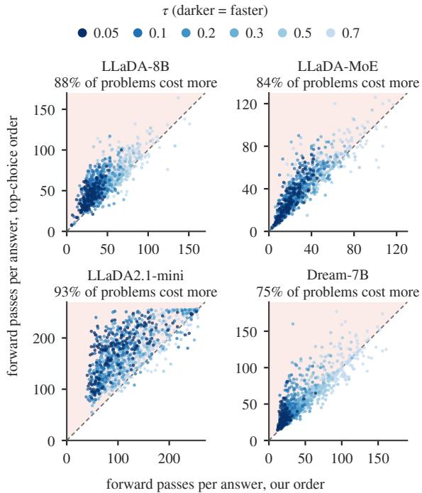  
Figure 7: Forward passes per problem under two orders. Each point is a HumanEval problem at one τ, under the top-choice order and under our order with the same set-level cut. Each panel gives the share of problems in the shaded triangle, where the top-choice order costs more.

Figure 9 matches PACT to the pass@1 of one token per step on each benchmark of LLaDA-8B, LLaDA-MoE and LLaDA2.1-mini. PACT is faster on almost every benchmark, by up to about eight times on LLaDA-8B.

## D.4 Autoregressive Model

Table 5 times decoding with one answer per problem. The diffusion models decode greedily in 32- token blocks, as Fast-dLLM does, and every decoder writes at most 256 tokens. PACT is faster than Qwen3-8B at both thresholds.

## D.5 Temperature on GSM8K

Figure 10 repeats Figure 6c on GSM8K. As the temperature rises, the top-choice order loses accuracy and spends more forward passes. PACT changes far less on both counts.

## D.6 Notes on Section 4

Over the eight answers of a problem, PACT gives about as many distinct final answers as one token per step on GSM8K and MATH500, and a similar share of distinct 4-grams on every benchmark.

<table><tr><td></td><td colspan="4">LLaDA-8B</td><td colspan="4">Dream-7B</td></tr><tr><td></td><td>HumanEval</td><td>MBPP</td><td>GSM8K</td><td>MATH500</td><td>HumanEval</td><td>MBPP</td><td>GSM8K</td><td>MATH500</td></tr><tr><td>Speed of Fast-dLLM</td><td>2.2×</td><td>1.7×</td><td>2.6×</td><td>1.7×</td><td>1.7×</td><td>1.7×</td><td>2.6×</td><td>1.6×</td></tr><tr><td>Acc. of Fast-dLLM</td><td>36.7</td><td>37.2</td><td>80.3</td><td>38.0</td><td>50.0</td><td>47.5</td><td>83.7</td><td>44.7</td></tr><tr><td>Acc. of PACT</td><td>39.3</td><td>38.1</td><td>80.9</td><td>37.5</td><td>51.5</td><td>47.4</td><td>85.3</td><td>44.6</td></tr></table>

Table 4: Fast-dLLM and PACT with 32-token blocks. Speed is tokens written per forward pass, and Acc. is pass@1 (%) at the speed of Fast-dLLM. PACT is swept over τ with $g = 4$ and read at that speed by interpolation.

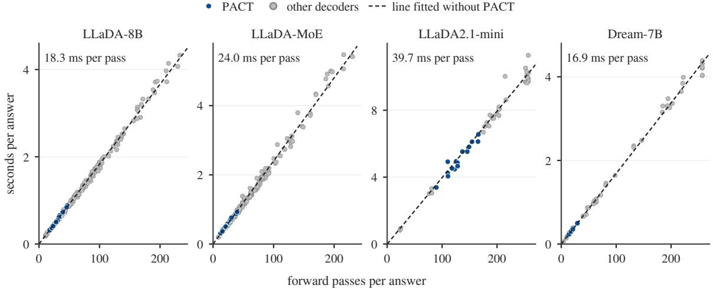  
Figure 8: Decoding time against forward passes. Each point is one setting on the code benchmarks. The dashed line is fitted through the origin on the settings of the other decoders, and its slope is printed as the time of one forward pass.

<table><tr><td>Decoder</td><td>HumanEval</td><td>GSM8K</td></tr><tr><td>Qwen3-8B</td><td>4.66</td><td>3.99</td></tr><tr><td>LLaDA-8B One token per step</td><td></td><td>4.54 (0.88×)</td></tr><tr><td>Fast-dLLM</td><td>5.50 (0.85×)</td><td></td></tr><tr><td></td><td>1.83 (2.6×)</td><td>1.34 (3.0×)</td></tr><tr><td>PACT, τ = 0.3</td><td>1.02 (4.6×)</td><td>0.72 (5.5×)</td></tr><tr><td>PACT, τ = 0.05</td><td>0.65 (7.2×)</td><td>0.49 (8.1×)</td></tr><tr><td>Dream-7B</td><td></td><td></td></tr><tr><td>One token per step</td><td>5.24 (0.89×)</td><td>4.57 (0.87×)</td></tr><tr><td>Fast-dLLM</td><td>2.15 (2.2×)</td><td>1.36 (2.9×)</td></tr><tr><td>PACT, τ = 0.3</td><td>1.31 (3.6×)</td><td>0.78 (5.1×)</td></tr><tr><td>PACT, τ = 0.05</td><td>0.64 (7.3×)</td><td>0.51 (7.8×)</td></tr></table>

Table 5: Time per problem against an autoregressive model. Seconds per problem with one answer per problem, and in parentheses the speed-up over Qwen3-8B. All decoders write at most 256 tokens on the same GPU, on 50 problems of each benchmark. The diffusion models decode greedily in 32-token blocks, and Qwen3-8B decodes with a key-value cache. Fastest within a model in bold, second fastest underlined.

The saving of spacing holds on every task group of Figure 5c, including code answers of 512 tokens, twice the usual length. On IFEval, spacing also raises pass@1 at every threshold we ran.

The three rules of Figure 6c write the same tokens under greedy decoding. They diverge once the drawn token can differ from the most likely one, which is where ordering by the top choice starts to lose accuracy.

Without the written-word score, committed sets that report more than they write grow more common as τ falls (Figure 5b). Faster steps commit more positions, and less certain ones.

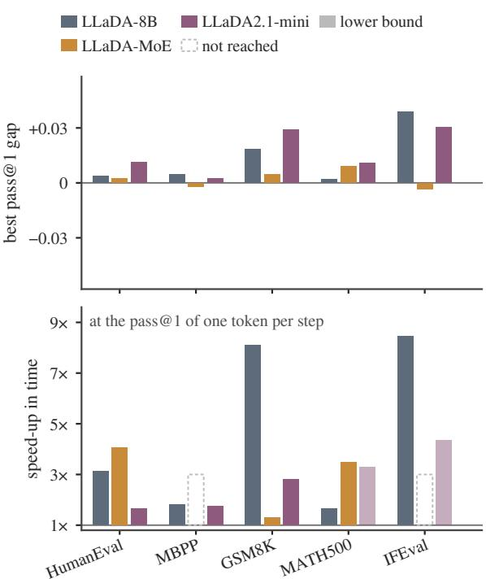  
Figure 9: Speed-up in time at the accuracy of one token per step. Top, the best pass@1 of PACT minus that of one token per step. Bottom, the speed-up at the fastest setting of PACT that reaches the pass@1 of one token per step. A light bar is a lower bound, since the fastest setting already reaches it. A dashed outline marks a benchmark where no setting reaches it.

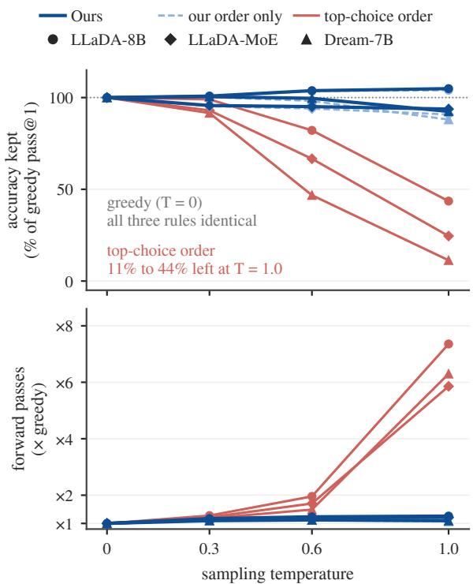  
Figure 10: Sampling temperature on GSM8K. Pass@1 as a share of greedy pass@1 (top) and forward passes as a multiple of greedy (bottom), for the three rules of Figure 6c on three models.