# PROSE: Preservation-Constrained Selective Editing for Guilty Bias in Legal Judgment Prediction

Yimeng Wang<sup>1,2</sup>\*, Zeyuan Tian<sup>1,\*</sup>, Xinyu Wang<sup>3</sup>, Danyang Gao<sup>3</sup>,

Chenglei Shen<sup>4</sup>, Zhongxiang Sun<sup>4</sup>, Lei La<sup>1</sup>, Weijie Yu<sup>1†</sup>,

<sup>1</sup>School of Artificial Intelligence and Data Science, University of International Business and Economics

<sup>2</sup>Department of Computer Science, University of Chicago

<sup>3</sup>School of Law, University of International Business and Economics

<sup>4</sup>Gaoling School of Artificial Intelligence, Renmin University of China yu@uibe.edu.cn

## Abstract

Legal judgment prediction models may retain a guilty verdict after a legally decisive condition has been altered such that the specified charge is no longer established. We study this guilty bias via selective repair over matched chargeestablished and charge-not-established cases, where the unsupported verdict should change while its supported counterpart remains stable. We construct CAIL-MC, a legally reviewed dataset of 11,478 matched pairs covering 261 Chinese criminal charges. Held-out activation interventions show that contrasts learned from correctly resolved pairs transfer to false-guilty cases, but target-reaching interventions can also damage matched supported-guilty decisions. Motivated by this observation, we introduce PROSE, which reconstructs case-specific targets from a training-derived residual geometry, aligns them with a local margin-descent signal, attenuates supported-guilty-sensitive components, and realizes bounded targets through a preservation-regularized low-rank parameter update. Across Qwen3-8B and GLM4-9B, PROSE achieves stronger pairwise safe repair and evidence sensitivity, while preserving standard single-pass inference.

## 1 Introduction

Legal judgment prediction (LJP) (Zhong et al., 2018; Zhang and Dou, 2023; Zhang et al., 2023; Shi et al., 2025; Han et al., 2025) asks whether case facts establish a criminal charge. Beyond recognizing patterns in prior cases, an LJP system should respond to legally decisive changes in the evidence. In particular, when the available facts do not establish a charge, the principle of in dubio pro reo (Raimondo, 2020) requires doubt to be resolved in favor of the accused.

An LJP method may retain a guilty verdict after the legal basis for that verdict has been altered.

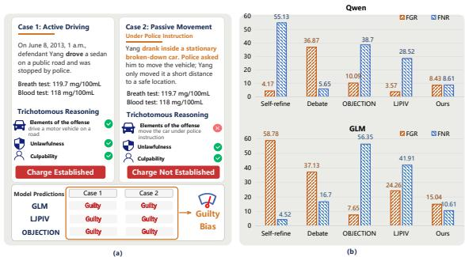  
Figure 1: (a) Guilty bias and (b) its correction trade-off.

Figure 1(a) illustrates this behavior with two cases that share the specified charge and surrounding context but differ in one decisive conduct condition. The evaluated systems predict that the charge is established for both. We use guilty bias to denote this false-guilty tendency on legally matched contrasts. The goal is therefore not to suppress guilty predictions globally, but to correct the unsupported member while preserving its supported counterpart.

Recent approaches reduce false-guilty predictions through additional non-guilty supervision (Zhang et al., 2025), defenseoriented interaction (Jeong and Lee, 2026), self-refinement (Madaan et al., 2023), or debate (Chen et al., 2025). Although they have achieved encouraging results, three challenges remain. First, aggregate error reduction does not establish evidence-sensitive correction. A lower false-guilty rate (FGR) may result from a general downward shift in guilty scores, which can simultaneously increase the false-nonguilty rate (FNR). As illustrated in Figure 1(b), reducing one error direction does not necessarily improve the other. Correction should therefore respond to the decisive legal contrast rather than merely favor charge-not-established predictions. Second, repairability does not guarantee selective repair. Even an intervention that moves a false-guilty case across the decision boundary may weaken the supported verdict of its matched charge-established counterpart or alter unrelated correct predictions. A useful correction must therefore preserve both the paired counterpart and broader non-target behavior. Third, existing data-based correction requires multi-step training, whereas inference-time critique and debate repeat deliberation for every case. A practical correction should persist after a one-time update without requiring full retraining or repeated model calls at inference time.

To make these requirements measurable, we construct CAIL-MC, an LJP benchmark with two complementary tracks. The Pairwise Repair–Preservation Track, derived from CAIL2018 (Xiao et al., 2018), contains 11,478 charge-established/charge-not-established pairs spanning 261 charges. Guided by three-stage legal reasoning (Dubber, 2005; Fletcher, 1978; Zhang et al., 2025), each pair changes one legally decisive condition concerning offense elements, unlawfulness, or culpability while keeping the surrounding facts aligned, specifying both a repair target and its matched preservation control. The Evidence-Sufficiency Generalization Track, constructed from LeCaRD (Ma et al., 2021) and Criminal-S (Hu et al., 2018), comprises four controlled conditions: full-supported, partialsufficient, partial-insufficient, and allegation-only. It tests whether models retain supported charges and reject insufficiently supported ones under corpus and construction shift, assessing evidence sensitivity motivated by in dubio pro reo.

We then test whether the base LLM contains an internal signal that can support such a correction. Hidden-state contrasts estimated from correctly resolved training pairs reduce the guilty margins of held-out false-guilty cases. Yet interventions strong enough to reach a charge-not-established target also reduce the margins of their matched supportedguilty cases. This diagnosis exposes the central repair–preservation tension wherein errors are often internally repairable, but the available repair signal is not inherently selective.

Motivated by this finding, we introduce PROSE, a preservation-constrained selective editing method. PROSE addresses the repair–preservation tension in three stages. (1) it reconstructs each training target’s matched residual within the geometry learned from correctly resolved training pairs and defines a family of repair directions by interpolating the reconstruction with the negative gradient of the target verdict margin. The residual component transfers structure from successfully resolved legal contrasts, whereas the gradient provides a target-local signal for reducing the guilty margin. (2) PROSE attenuates components sensitive to supported-guilty behavior and searches within a case-adaptive cap for a small displacement that reaches a conservative negative margin. This reduces overlap with protected behavior and limits unnecessary movement beyond the decision boundary. (3) PROSE realizes the feasible activation targets through preservationregularized least squares over supported-guilty and non-target examples, followed by low-rank truncation and norm-bounded rescaling. Preservation is thus promoted during both target construction and parameter fitting. After this offline editing phase, the model performs ordinary single-pass inference.

Our contributions are threefold: (1) We formulate guilty-bias mitigation as preservationconstrained selective repair and introduce PROSE, which realizes bounded activation targets through a preservation-regularized parameter update. (2) We construct CAIL-MC with two complementary tracks: the Pairwise Repair–Preservation Track contains 11,478 reviewed matched pairs across 261 charges, while the Evidence-Sufficiency Generalization Track tests four evidence conditions from unseen corpora. (3) Experiments on two backbones demonstrate stronger pairwise safe repair than LJP and editing baselines, greater evidence sensitivity than SFT, and less supported-verdict damage than a repair-matched uniform shift, with lower offline cost than SFT and ordinary single-pass inference.

## 2 Related Work

LJP maps case facts to judicial outcomes such as applicable law articles, charges, and sentences. Zhong et al. (2018) model dependencies among these prediction subtasks, while Hu et al. (2018) address few-shot charge prediction through discriminative legal attributes. Xu et al. (2020) focus on distinguishing confusing law articles, and Lyu et al. (2022) improve prediction through criminalelement extraction. More recent work incorporates legal precedents (Wu et al., 2023) and studies multitask or multi-label prediction in more realistic settings (Li et al., 2025).

Recently, non-guilty judgment has received increasing attention. Zhang et al. (2025) introduces charge-not-established outcomes and structures prediction around offense elements, unlawfulness, and culpability. Jeong and Lee (2026) characterizes the tendency to over-predict guilt as guilty bias and uses an inference-time lawyer agent to challenge guilty assumptions at each reasoning stage. These approaches expand LJP beyond guilty-centered prediction, but do not explicitly formulate correction as a matched requirement: changing an unsupported verdict while preserving its minimally different supported counterpart.

We address this gap by formulating guilty-bias mitigation as preservation-constrained selective repair. Each matched legal pair jointly specifies a charge-not-established verdict to correct and a supported charge-established verdict to preserve. We realize these pairwise constraints through a persistent parameter update, connecting our approach to model editing (Meng et al., 2022). MEMIT (Meng et al., 2023) performs scalable parameter updates to factual associations, while AlphaEdit (Fang et al., 2025) projects updates into a null space associated with preserved knowledge. Unlike these factual editing methods, we modify an asymmetric behavioral relation within each legal pair: the chargenot-established member should change, while its charge-established counterpart and broader nontarget behavior should remain stable.

## 3 Task and Benchmark

## 3.1 Problem Formulation

Charge-conditioned LJP. We study chargeconditioned verification. Given a case fact x and a candidate charge $^ { c , }$ an LLM with parameters θ predicts whether c is established. Let $z _ { \theta } ( 1 \mid x , c )$ and $z _ { \theta } ( 0 \mid x , c )$ denote the answer-position logits for charge established and charge not established. We define

$$
\begin{array} { r l } & { s _ { \theta } ( x , c ) = z _ { \theta } ( 1 \mid x , c ) - z _ { \theta } ( 0 \mid x , c ) , } \\ & { \hat { y } _ { \theta } ( x , c ) = \mathbb { I } \left[ s _ { \theta } ( x , c ) > 0 \right] . } \end{array}\tag{1}
$$

We use the continuous margin for internal analysis and the binary prediction for behavioral evaluation. Throughout, $\theta ^ { \prime }$ denotes a candidate predictor evaluated relative to the fixed reference model $\theta _ { 0 }$

Matched legal contrasts. An isolated prediction cannot distinguish evidence-sensitive behavior from a general verdict preference. We therefore use a matched contrast

$$
\begin{array} { r l } & { p _ { i } = ( x _ { i } ^ { \mathrm { G } } , x _ { i } ^ { \mathrm { N G } } , c _ { i } , d _ { i } ) , \ d _ { i } \in \mathcal { D } , \ ( y _ { i } ^ { \mathrm { G } } , y _ { i } ^ { \mathrm { N G } } ) = ( 1 , 0 ) , } \\ & { \mathcal { D } = \{ \mathrm { O F F E N S E , U N L A W F U L N E S s , C U L P A B I L I T Y } \} . } \end{array}\tag{2}
$$

Both members concern the same candidate charge $c _ { i }$ and are derived from a common source case. The charge-not-established member $x _ { i } ^ { \mathrm { { N G } } }$ changes one decisive condition at legal stage $d _ { i }$ while preserving the surrounding facts as closely as possible. Thus, $x _ { i } ^ { \mathrm { { N G } } }$ specifies what should change, whereas $x _ { i } ^ { \mathrm { G } }$ provides the closest counterpart to preserve. The construction details are described in Sec. 3.2.

Repair and preservation. Let $\mathcal { T } ^ { S }$ denote the pairs in split S. The two side-level errors are

$$
\begin{array} { r l } & { \mathrm { F G R } _ { S } ( \theta ) = \underset { i \sim \mathcal { T } ^ { S } } { \mathrm { P r } } \Big [ \hat { y } _ { \theta } ( x _ { i } ^ { \mathrm { N G } } , c _ { i } ) = 1 \Big ] , } \\ & { \mathrm { F N R } _ { S } ( \theta ) = \underset { i \sim \mathcal { T } ^ { S } } { \mathrm { P r } } \Big [ \hat { y } _ { \theta } ( x _ { i } ^ { \mathrm { G } } , c _ { i } ) = 0 \Big ] . } \end{array}\tag{3}
$$

Reporting both reveals whether reducing falseguilty errors merely shifts the model toward chargenot-established predictions. These rates nevertheless discard the correspondence within each pair. We therefore define the strict false-guilty set under the fixed base model:

$$
\begin{array} { r } { \mathcal { E } _ { \mathrm { s F G } } ^ { S } ( \theta _ { 0 } ) = \left\{ i \in \mathcal { T } ^ { S } : \Big ( \hat { y } _ { \theta _ { 0 } } ( x _ { i } ^ { \mathrm { G } } , c _ { i } ) , \hat { y } _ { \theta _ { 0 } } ( x _ { i } ^ { \mathrm { N G } } , c _ { i } ) \Big ) = ( 1 , 1 ) \right\} . } \end{array}\tag{4}
$$

Its gold state is (1, 0) in the fixed order $( x _ { i } ^ { \mathrm { G } } , \bar { x } _ { i } ^ { \mathrm { N G } } )$ . Repair concerns changing the unsupported $x _ { i } ^ { \mathrm { { N G } } }$ verdict, preservation concerns retaining the matched $x _ { i } ^ { \mathrm { G } }$ verdict and other correct behavior. For each reference model $\theta _ { 0 }$ and split $S _ { \ast }$ $\mathcal { E } _ { \mathrm { s F G } } ^ { S } ( \theta _ { 0 } )$ is defined once under $\theta _ { 0 }$ and held fixed across subsequent comparisons, keeping the evaluation population unchanged.

## 3.2 CAIL-MC

CAIL-MC comprises two complementary tracks under the same charge-conditioned verification task. The Pairwise Repair–Preservation Track (track 1) evaluates whether a model corrects an unsupported verdict while preserving its closest supported counterpart. The Evidence-Sufficiency Generalization Track (track 2) evaluates whether this behavior transfers when both the source corpus and the construction of evidential support change.

Pairwise Repair–Preservation Track. Based on CAIL2018 (Xiao et al., 2018), we construct 11,478 charge-established/charge-not-established pairs spanning 261 Chinese criminal charges. Following the three-stage legal reasoning perspective (Zhang et al., 2025), each pair changes one decisive condition concerning offense elements, unlawfulness, or culpability while preserving the surrounding facts as closely as possible. The charge-not-established member specifies the verdict that should change, whereas its matched charge-established member provides the closest preservation control. The legal-stage annotation organizes contrast construction and the stage-specific statistics used later; it is not an additional prediction target. Construction includes outcome-expression removal, legal-condition planning, counterfactual generation, automated factual and legal checks, and stratified inspection by criminal-law annotators. Variants derived from the same source case are assigned to the same split, with the stage distribution preserved across splits. The construction details are provided in App. A.1.

Evidence-Sufficiency Generalization Track. To evaluate behavior beyond the matched construction, we derive four evidence conditions from LeCaRD (Ma et al., 2021) and Criminal-S (Hu et al., 2018) cases. The full-supported condition retains the complete facts supporting the candidate charge, while partial-sufficient removes non-essential information but retains sufficient support. In contrast, partial-insufficient preserves some charge-related facts but withholds decisive support, and allegation-only retains the accusation without supporting factual evidence. The first two conditions are labeled charge established, and the latter two charge not established. In particular we adopt partial-sufficient controls for shortcuts rooted in input length or retained information volume because a shorter description need not imply insufficient support. This track therefore tests whether a model retains supported charges but rejects them when the presented evidence is insufficient, operationalizing one measurable consequence of in dubio pro reo under joint corpus and evidence-construction shift. The construction details are provided in App. A.2.

## 4 Diagnostic Analysis

We use temporary hidden-state interventions (Li et al., 2023; Zou et al., 2023) to test whether matched legal contrasts provide a transferable repair signal and whether that signal is selective. Contrast statistics are estimated from the training split, while strict false-guilty pairs from the development split are held out for diagnosis; the reference model remains frozen throughout.

## 4.1 Transfer of Hidden-state Contrasts

Let $h _ { \theta _ { 0 } , t } ^ { \ell } ( x , c )$ be the hidden state at prompt position t of layer $\ell ,$ and let T denote the three positions

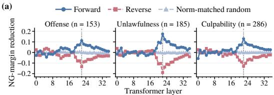

(b)  
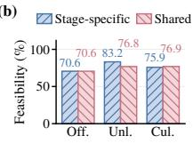

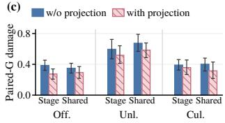  
Figure 2: Qwen3-8B diagnosis. (a) layer-wise NGmargin reduction under forward and control directions, (b) repair feasibility, and (c) paired-G margin damage.

immediately preceding the answer<sup>1</sup>. For matched pair i, we define its charge-not-established-minuscharge-established contrast as

$$
q _ { i } ^ { \ell } = \frac { 1 } { | \mathcal { T } | } \sum _ { t \in \mathcal { T } } \left[ h _ { \theta _ { 0 } , t } ^ { \ell } ( x _ { i } ^ { \mathrm { { N G } } } , c _ { i } ) - h _ { \theta _ { 0 } , t } ^ { \ell } ( x _ { i } ^ { \mathrm { { G } } } , c _ { i } ) \right] .\tag{5}
$$

At each layer and legal stage, we average and normalize these contrasts over training pairs whose two members are correctly predicted. We add the resulting direction to the charge-not-established member of held-out strict false-guilty pairs and measure NG-margin reduction: the original guiltyminus-charge-not- established margin minus its intervened value. A positive reduction moves the case toward charge not established. Forward directions are compared with their reversals and normmatched random directions.

Fig. 2 (a) shows that the forward direction reduces the NG guilty margin in a localized middlelayer region across all three legal stages, with the clearest response near Layer 22. Reversing the direction generally reverses the effect, whereas random perturbations are smaller and less stable. Contrasts learned from correctly resolved training pairs thus transfer to held-out strict false-guilty cases.

## 4.2 Repair Feasibility and Preservation

Directional transfer does not establish that the target verdict is reachable or that reaching it preserves the matched supported decision. We therefore reconstruct a case-specific direction using either stage-specific or shared affine contrast geometry and vary its strength over a bounded grid. A case is feasible if a tested strength moves its NG margin just below zero by a small buffer, which marks a target beyond the decision boundary rather than a calibrated confidence threshold. Fig. 2 (b) shows feasibility of 70.6–83.2% for stage-specific directions and 70.6–76.9% for shared directions. The transferred signal can therefore reach the desired verdict for a substantial fraction of false-guilty cases.

We then apply each target-reaching displacement to its matched charge-established member. Paired-G margin damage is the supported member’s preintervention minus post-intervention margin; positive values indicate a weaker supported verdict. To reduce such damage, we remove the direction’s component in a subspace of verdict-margin gradients from correctly predicted charge-established training cases. On pairs feasible both with and without this preservation projection, damage decreases in all six stage/geometry comparisons, from 0.349– 0.674 to 0.274–0.584 (Fig. 2c).

These results separate repairability from selectivity: matched contrasts provide sufficient movement to repair false-guilty decisions, but that movement can weaken their supported counterparts unless preservation is explicitly controlled. Diagnostic details and GLM4-9B results, which yield consistent qualitative findings, are elaborated in App. B.

## 5 Our Method: PROSE

Diagnosis above shows that contrasts from correctly resolved pairs can move strict false-guilty cases toward charge not established, but a repair-effective displacement can also weaken the matched supported verdict. PROSE addresses this repair–preservation trade-off in two stages. (1) it constructs a bounded, preservation-aware hiddenstate target for each feasible training pair, and (2) realizes these targets through an offline update constrained on supported and non-target behavior. We describe one stage-d update at layer ℓ under the current model ϑ, initialized as $\theta _ { 0 }$ . Eligibility and preservation labels are fixed under $\theta _ { 0 }$ , and representations are recomputed before each stage update.

## 5.1 Bounded Preservation-Aware Targets

For $i \in \mathcal { E } _ { \mathrm { s F G } } ^ { \mathrm { t r a i n } } ( \theta _ { 0 } )$ with $d _ { i } \ = \ d ,$ we recompute $q _ { i } ^ { \ell }$ under ϑ using Eq. 5. Correctly resolved training contrasts at the same stage define a mean $\bar { q } _ { d } ^ { \ell }$ and a $\mathrm { r a n k } { - } r _ { q }$ orthonormal basis $U _ { d } ^ { \ell }$ from centered SVD. We reconstruct the pair contrast in this affine geometry:

$$
\widehat { q } _ { i } ^ { \ell } = \bar { q } _ { d } ^ { \ell } + U _ { d } ^ { \ell } ( U _ { d } ^ { \ell } ) ^ { \top } ( q _ { i } ^ { \ell } - \bar { q } _ { d } ^ { \ell } ) ,\tag{6}
$$

where the mean represents the average successful contrast, while the basis retains the leading casedependent deviations around it. Thus, $\widehat { q } _ { i } ^ { \ell }$ supplies a structured, case-conditioned candidate.

This reconstruction does not ensure that it lowers the current target’s verdict margin. Let $\widetilde { s } _ { \vartheta } ( \boldsymbol { x } , \boldsymbol { c } ; \delta , \ell )$ denote the margin after adding δ at layer ℓ to the answer-adjacent positions used in diagnosis, and let unit $( a ) = a / \| a \| _ { 2 }$ for a nonzero vector a. We therefore combine it with the target-local direction of first-order margin descent:

$$
\begin{array} { r l } & { \quad g _ { i } ^ { \ell } = - \operatorname { u n i t } \Bigl ( \nabla _ { \delta } \widetilde { s } _ { \vartheta } ( x _ { i } ^ { \mathrm { N G } } , c _ { i } ; \delta , \ell ) \Big | _ { \delta = 0 } \Bigr ) , } \\ & { \quad v _ { i } ^ { \ell } ( \lambda ) = \operatorname { u n i t } \Bigl [ ( 1 - \lambda ) \operatorname { u n i t } ( \widehat { q } _ { i } ^ { \ell } ) + \lambda g _ { i } ^ { \ell } \Bigr ] . } \end{array}\tag{7}
$$

Here, $0 \leq \lambda \leq 1$ balances the training-derived contrast and local descent signal, which can improve alignment with the current decision boundary.

Repair directions may also affect supportedguilty behavior. Let $P _ { d } ^ { \ell }$ be a $\mathrm { r a n k } { - } r _ { p }$ orthonormal basis of leading margin-gradient directions from correctly predicted charge-established training cases at stage d. We attenuate the overlapping component:

$$
u _ { i } ^ { \ell } = \mathrm { u n i t } \left[ v _ { i } ^ { \ell } ( \lambda ) - \gamma P _ { d } ^ { \ell } ( P _ { d } ^ { \ell } ) ^ { \top } v _ { i } ^ { \ell } ( \lambda ) \right] .\tag{8}
$$

With $\gamma = 1 / ( 1 + \rho )$ and $\rho ~ \geq ~ 0 , ~ \rho ~ = ~ 0$ fully removes this component, whereas $\rho > 0$ retains some repair-relevant overlap. This soft attenuation reduces sensitivity to supported verdicts without discarding all overlapping repair information.

The direction specifies where to move a target, not how far. Let $\beta \geq 0$ be the displacement magnitude. A global cap $\beta _ { \mathrm { m a x } } > 0$ and a case-relative scale $\kappa > 0$ bound the search by

$$
B _ { i } = \operatorname* { m i n } \left\{ \beta _ { \mathrm { m a x } } , \kappa \| \widehat { q } _ { i } ^ { \ell } \| _ { 2 } \right\} .\tag{9}
$$

We search for a small strength $\beta _ { i } ^ { \star }$ reaching a negative margin buffer $\tau < 0$ , and define the activation target $t _ { i } { \mathrm { : } }$

$$
\begin{array} { r } { \widetilde { s } _ { \vartheta } ( x _ { i } ^ { \mathrm { N G } } , c _ { i } ; \beta _ { i } ^ { \star } u _ { i } ^ { \ell } , \ell ) \le \tau , } \end{array}\tag{10}
$$

where $t _ { i } = \beta _ { i } ^ { \star } u _ { i } ^ { \ell } , 0 \leq \beta _ { i } ^ { \star } \leq B _ { i }$ . The bounded, case-specific search seeks only the displacement needed for the chosen direction, thereby limiting avoidable target movement. Let $\mathcal { F } _ { d }$ contain the pairs for which the search finds such a strength and only their displacements $t _ { i }$ enter parameter fitting.

## 5.2 Preservation-Constrained Update

Since the targets above are temporary, to make their effects persist without paired inputs or percase search at inference time, we fit an additive update $\Delta W$ to $W ,$ , block notation for the selected projection weights, for stage d. Let $K _ { \mathcal { F } }$ and $T _ { \mathcal { F } }$ collect the module-input keys and target displacements from ${ \mathcal { F } } _ { d } ,$ with one column per intervention position and $n \varepsilon$ columns in total. Each position receives its $\mathrm { p a i r } ^ { \prime } \mathrm { s } t _ { i }$ . We retain three base-correct zero-change pools: supported charge-established cases (G), charge-not-established members of correctly resolved same-stage pairs (O), and correct cases from other stages (X). For pool $a , K _ { a } , n _ { a } ,$ and $\omega _ { a } \geq 0$ denote its key matrix, column count, and penalty weight. We minimize

$$
\begin{array} { r } { \mathcal { L } ( \Delta W ) = \frac { \| \Delta W K _ { \mathcal { F } } - T _ { \mathcal { F } } \| _ { F } ^ { 2 } } { n _ { \mathcal { F } } } + \mu \| \Delta W \| _ { F } ^ { 2 } } \\ { + \displaystyle \sum _ { a \in \{ \mathrm { G } , \mathrm { O } , \mathrm { X } \} } \frac { \omega _ { a } } { n _ { a } } \| \Delta W K _ { a } \| _ { F } ^ { 2 } , \qquad \mu > 0 . } \end{array}\tag{11}
$$

The first term fits feasible repair targets, the remaining terms penalize changes to supported, samestage non-target, and cross-stage behavior, while $\mu$ regularizes update magnitude. For fixed targets and keys, $\mu ~ > ~ 0$ yields a unique closed-form ridge solution, without iterative optimization of model weights. We obtain a rank-r<sub>W</sub> approximation of this solution and rescale it to satisfy a relative Frobenius-norm budget $\varepsilon > 0$ before setting $W ^ { \prime } = W + \Delta W$ . These subsequent controls limit update capacity and magnitude; they do not solve the jointly rank- and norm-constrained objective exactly. After the stage updates, $\theta ^ { \prime }$ performs ordinary single-pass inference. The derivation, search, and execution details are provided in App. C.

## 6 Experiments

We conduct experiments to address the following research questions: RQ1: Does PROSE reduce false-guilty verdicts without trading them for false non-guilty ones, on matched pairs and on evidencegraded cases from unseen corpora? RQ2: Does PROSE repair the unsupported member while preserving its supported counterpart, rather than shifting all verdicts? RQ3: Which preservation components make the repair selective? RQ4: What does the correction cost, offline and at inference?

## 6.1 Experimental Setup

Datasets. We use Pairwise Repair–Preservation Track for in-domain training and matched-pair evaluation, Evidence-Sufficiency Generalization Track for evidence-controlled cross-corpus evaluation. Dataset statistics are summarized in Tab. 1, the construction and annotation are provided in App. A.

<table><tr><td>Track</td><td>Source</td><td>Train</td><td>Dev</td><td>Test</td></tr><tr><td>Pairwise</td><td>CAIL2018 Stage distribution: O 35.7%, U 17.8%, C 46.5%</td><td>9,181</td><td>1,147</td><td>1,150</td></tr><tr><td rowspan="2">Evidence</td><td></td><td></td><td></td><td>280</td></tr><tr><td>LeCaRD Criminal-S</td><td>一 一</td><td>一 一</td><td>800</td></tr></table>

Table 1: CAIL-MC statistics. Pairwise counts are matched pairs; evidence counts are variants, four per source case (70 LeCaRD; 200 Criminal-S). O/U/C denote Offense/Unlawfulness/Culpability.

Baselines. We consider three groups of baselines. (1) Base denotes the raw LLM without corrective intervention, and SFT denotes LoRA fine-tuning (Hu et al., 2022) across all layers using verdicts from both members of each pair. (2) LJP methods include: LJPIV (Zhang et al., 2025), Self-Refine (Madaan et al., 2023), Debate-Feedback (Chen et al., 2025), and OBJEC-TION (Jeong and Lee, 2026). (3) Model editing methods include: MEMIT (Meng et al., 2023) and AlphaEdit (Fang et al., 2025). Detailed descriptions are provided in App. D.3.

Evaluation and Implementation. We evaluate model behavior at both case and pair levels. At the case level, in addition to accuracy and Macro-F1, we report FGR and FNR. These metrics are interpreted jointly to uncover one-sided verdict shifts, as defined in Eq. 3. At the pair level, we evaluate the strict false-guilty set $\mathcal { E } _ { \mathrm { s F G } } ^ { S } ( \theta _ { 0 } )$ , fixed by the reference model for each backbone and evaluation set. NG repair (Rep.) measures whether the charge-not-established member is corrected, matched-G retention (G-Ret.) measures whether its supported counterpart remains correct, and pairwise safe repair (PSR) requires both conditions. Formal definitions are provided in App. D.1. We employ Qwen $\scriptstyle 3 - 8 \mathbf { B } - \mathbf { B } \mathbf { a s e } ^ { 2 }$ and GLM-4-9B-Base<sup>3</sup>. For these two models, PROSE performs edits at Layer 22 and Layer 20, respectively (Sec. 4). Hyperparameters are tuned on the development split. Implementation details are provided in App. D.4.

## 6.2 Main Results (RQ1)

To evaluate guilty-bias reduction and selective repair, we compare methods on both CAIL-MC tracks. From Tab. 2, we observe three patterns. (1) PROSE achieves the highest in-corpus PSR among LJP and editing baselines on both backbones,

<table><tr><td rowspan="3"></td><td colspan="6">CAIL2018 (Pairwise Repair-Preservation)</td><td colspan="4">LeCaRD (Evidence-Sufficiency Generalization) Criminal-S (Evidence-Sufficiency Generalization)</td><td colspan="3"></td></tr><tr><td colspan="3">Case level</td><td colspan="3">Pair level</td><td colspan="3">Case level</td><td colspan="3"></td></tr><tr><td>Method</td><td>F1↑ FGR↓</td><td></td><td>FNR↓</td><td>Rep.↑ G-Ret.↑</td><td>PSR↑</td><td>Acc↑</td><td>F1↑</td><td>FGR↓</td><td>FNR↓</td><td>Acc↑ F1↑ FGR↓</td><td>FNR↓</td></tr><tr><td></td><td></td><td></td><td></td><td></td><td></td><td></td><td>Qwen3-8B-Base</td><td></td><td></td><td></td><td></td><td></td></tr><tr><td>Base</td><td>72.65±1.43 70.58±1.77 53.91±2.82 0.78±0.50</td><td></td><td></td><td></td><td></td><td></td><td></td><td>55.71±2.99 46.91±5.22 85.00±6.59</td><td> $3 . 5 7 \pm 3 . 6 7$ </td><td></td><td> $6 6 . 8 8 \pm 2 . 5 8 ~ 6 3 . 6 3 \pm 3 . 3 6 ~ 6 3 . 0 0 \pm 5 . 0 5$ </td><td>3.25±2.00</td></tr><tr><td>SFT</td><td>98.87±0.44 98.87±0.44 2.00±0.83</td><td></td><td></td><td></td><td></td><td></td><td></td><td>0.26±0.3096.27±1.53 100.00±0.00 96.27±1.5349.64±2.7137.60±3.45 94.29±3.79</td><td>6.43±5.26</td><td></td><td> $5 1 . 0 0 { \pm } 1 . 1 2 3 6 . 7 2 { \pm } 1 . 8 3 9 6 . 5 0 { \pm } 1 . 7 8$ </td><td>1.50±1.58</td></tr><tr><td>Self-Refine</td><td>70.35±1.49 68.29±1.79 4.17±1.13 55.13±2.77 95.79±1.63</td><td></td><td></td><td></td><td> $3 9 . 7 1 \pm 3 . 6 6$ </td><td></td><td></td><td>36.79±3.65 54.29±4.56 47.90±6.33 10.71±5.13</td><td> $8 0 . 7 1 { \scriptstyle \pm 7 . 9 8 }$ </td><td></td><td>54.88±1.70 44.86±2.97 2.50±1.53</td><td> $8 7 . 7 5 { \scriptstyle \pm 3 . 3 7 }$ </td></tr><tr><td></td><td>OBJECTION 75.61±1.59 75.10±1.68 10.09±1.81 38.70±2.82 89.14±2.56 61.59±3.83</td><td></td><td></td><td></td><td></td><td></td><td></td><td>53.81±3.91 73.57±4.75 73.22±5.03 15.00±5.36</td><td>37.86±9.23</td><td></td><td>73.38±3.0073.27±3.05  $2 0 . 5 0 { \scriptstyle \pm 4 . 0 3 }$ </td><td>32.75±5.14</td></tr><tr><td>Debate</td><td>78.74±1.45 78.21±1.56 36.87±2.72 5.65±1.32 44.08±3.79 96.27±1.48</td><td></td><td></td><td></td><td></td><td></td><td></td><td>41.49±3.71 66.79±4.60 65.35±5.11 53.57±8.40</td><td> $1 2 . 8 6 { \pm } 6 . 5 1 $ </td><td></td><td>67.88±3.08 67.40±3.19  $4 4 . 2 5 { \scriptstyle \pm 4 . 9 1 }$ </td><td> $2 0 . 0 0 { \scriptstyle \pm 4 . 0 7 }$ </td></tr><tr><td>LJPIV</td><td>83.96±1.45 83.70±1.52 3.57±1.09 28.52±2.65 93.52±1.96</td><td></td><td></td><td></td><td> $6 9 . 5 3 { \scriptstyle \pm 3 . 5 7 }$ </td><td></td><td></td><td>64.67±3.80 61.79±4.69 60.37±5.54 19.29±6.45</td><td> $5 7 . 1 4 \pm 1 0 . 4 8 $ </td><td></td><td>68.25±2.62 66.48±3.24  $8 . 7 5 { \scriptstyle \pm 2 . 6 0 }$ </td><td>54.75±5.89</td></tr><tr><td>MEMIT</td><td>51.22±1.8349.98±1.92 64.52±2.87 33.04±2.74 34.68±3.92 68.72±3.68</td><td></td><td></td><td></td><td></td><td></td><td></td><td>19.94±3.29 37.86±4.40 35.98±4.02 79.29±5.74</td><td> $4 5 . 0 0 { \scriptstyle \pm 9 . 4 3 }$ </td><td></td><td>36.38±2.45 34.39±2.60 46.25±4.75</td><td>81.00±4.36</td></tr><tr><td>AlphaEdit</td><td>62.78±1.64 60.44±1.93 61.57±2.94 12.87±1.94 50.41±3.97 87.52±2.57</td><td></td><td></td><td></td><td></td><td></td><td></td><td>41.98±3.78 40.71±4.34 36.52±4.02 85.00±5.47</td><td>33.57±9.14</td><td></td><td>37.50±2.78 36.01±2.55 77.75±3.46</td><td>47.25±5.75</td></tr><tr><td>PROSE</td><td>91.48±1.09 91.48±1.09 8.43±1.63 8.61±1.57 85.25±2.84 90.76±2.17 76.34±3.30 70.36±4.07 69.57±4.26 45.71±7.59</td><td></td><td></td><td></td><td></td><td></td><td></td><td></td><td>13.57±7.29</td><td></td><td> $6 8 . 3 8 { \pm } 2 . 6 7 6 7 . 3 3 { \pm } 2 . 8 7 4 9 . 5 0 { \pm } 4 . 8 0$ </td><td>13.75±3.99</td></tr><tr><td></td><td></td><td></td><td></td><td></td><td></td><td></td><td>GLM-4-9B-Base</td><td></td><td></td><td></td><td></td><td></td></tr><tr><td>Base</td><td>74.74±1.47 73.63±1.67 45.74±2.90 4.78±1.25</td><td></td><td></td><td></td><td></td><td></td><td></td><td>57.50±3.55 49.91±5.39 81.43±6.78</td><td> $3 . 5 7 \pm 4 . 2 7$ </td><td></td><td> $5 7 . 7 5 { \pm } 1 . 9 5 4 8 . 7 0 { \pm } 3 . 3 8 8 4 . 2 5 { \pm } 3 . 9 2$ </td><td>0.25±0.49</td></tr><tr><td>SFT</td><td>98.78±0.46 98.78±0.46 2.26±0.91 0.17±0.22 94.98±1.92 99.61±0.48 94.59±2.03 50.36±1.79 36.98±3.54 95.71±3.21</td><td></td><td></td><td></td><td></td><td></td><td></td><td></td><td> $3 . 5 7 \pm 3 . 9 3$ </td><td></td><td>50.63±1.00 35.94±1.51 97.25±1.63</td><td>1.50±1.75</td></tr><tr><td>Self-Refine</td><td></td><td>68.35±1.46 65.83±1.80 58.78±2.78 4.52±1.22 6.37±2.09</td><td></td><td></td><td> $9 8 . 0 7 { \pm } 1 . 1 8 $ </td><td></td><td></td><td>5.98±2.02 56.43±3.11 47.40±5.15 85.00±5.97</td><td>2.14±2.48</td><td></td><td> $5 0 . 1 3 \pm 0 . 2 4 3 3 . 6 1 \pm 0 . 5 3 0 . 0 0 \pm 0 . 0 0$ </td><td>99.75±0.48</td></tr><tr><td></td><td>OBJECTION 68.00±1.51 65.98±1.79 7.65±1.56 56.35±2.84 88.22±2.87</td><td></td><td></td><td></td><td> $4 5 . 7 5 { \scriptstyle \pm 4 . 2 5 }$ </td><td></td><td></td><td>36.68±4.24 59.64±4.88 57.19±5.83 16.43±5.84</td><td> $6 4 . 2 9 { \scriptstyle \pm 9 . 0 5 }$ </td><td></td><td>69.38±3.08 68.80±3.28 17.00±3.43</td><td> $4 4 . 2 5 { \scriptstyle \pm 5 . 4 9 }$ </td></tr><tr><td>Debate</td><td>73.09±1.62 72.80±1.67 37.13±2.75 16.70±2.14 38.22±4.05</td><td>66.91±2.18 66.65±2.22 24.26±2.53 41.91±2.90 67.37±4.05</td><td></td><td></td><td> $8 8 . 4 2 { \scriptstyle \pm 2 . 7 5 }$ </td><td></td><td></td><td>33.59±3.95 57.86±5.41 54.69±6.28 68.57±8.32 42.66±4.34 50.71±2.60 39.16±3.58 92.86±3.93</td><td>15.71±6.46</td><td></td><td>61.13±2.59 57.32±3.23 68.75±4.45</td><td>9.00±2.81</td></tr><tr><td>LJPIV</td><td></td><td></td><td></td><td></td><td> $5 4 . 4 4 \pm 4 . 3 5$ </td><td></td><td></td><td></td><td> $5 . 7 1 \pm 4 . 6 3$ </td><td></td><td> $4 9 . 2 5 { \pm } 0 . 9 8 3 3 . 6 4 { \pm } 0 . 8 9 9 . 2 5 { \pm } 0 . 8 0$ </td><td> $2 . 2 5 { \pm } 1 . 9 5 $ </td></tr><tr><td>MEMIT</td><td>54.57±1.30 48.37±1.74 10.78±1.78 80.09±2.25 89.58±2.66 17.37±3.11 12.36±2.74 54.64±3.47 48.46±5.43 10.71±4.83</td><td>60.00±1.62 57.86±1.84 17.48±2.23 62.52±2.82 90.15±2.51 31.47±3.99 24.71±3.64 32.14±3.89 31.72±4.25 60.00±4.79</td><td></td><td></td><td></td><td></td><td></td><td></td><td> $8 0 . 0 0 { \scriptstyle \pm 7 . 8 9 }$   $7 5 . 7 1 \pm 8 . 1 7$ </td><td></td><td>55.63±1.78 48.53±2.93 7.25±2.23</td><td>81.50±4.00</td></tr><tr><td>AlphaEdit</td><td></td><td></td><td></td><td></td><td></td><td></td><td></td><td></td><td></td><td></td><td> $3 0 . 8 8 \pm 2 . 2 4 3 0 . 7 1 \pm 2 . 3 3 6 4 . 2 5 \pm 3 . 1 4$ </td><td> $7 4 . 0 0 { \scriptstyle \pm 4 . 4 5 }$ </td></tr><tr><td>PROSE</td><td></td><td>87.17±1.34 87.17±1.35 15.04±2.07 10.61±1.90 67.37±4.06 94.02±1.94 62.16±4.15 66.79±5.06 66.06±5.41 47.86±9.86</td><td></td><td></td><td></td><td></td><td></td><td></td><td> $1 8 . 5 7 { \scriptstyle \pm 8 . 0 4 }$ </td><td></td><td> $7 1 . 8 8 \pm 2 . 3 3 7 0 . 6 3 \pm 2 . 6 3 4 8 . 7 5 \pm 4 . 6 3$ </td><td> $7 . 5 0 \pm 3 . 0 7$ </td></tr></table>

Table 2: Results (%) on both CAIL-MC tracks. Entries are point estimates ± 1.96% bootstrap standard errors (1,000 resamples over pairs for repair–preservation and cases for evidence-sufficiency evaluation). Best and second-best results per backbone, excluding Base, are bold and underlined. Base’s pair-level scores are omitted: $\mathrm { R e p . } = \mathrm { P S R } = 0$ and $\mathrm { G } { \cdot } \mathrm { R e t . } = 1 0 0$ by construction.

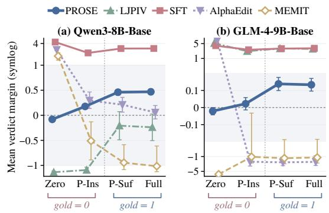  
Figure 3: Mean verdict margin as evidence is removed from the 200 Criminal-S cases of Evidence Track, with (a) Qwen3-8B-Base and (b) GLM-4-9B-Base.

To further probe whether SFT’s transfer gap is consistent with construction-specific shortcut learning (Gururangan et al., 2018; Geirhos et al., 2020), we compare verdict margins across four evidence conditions for the same 200 Criminal-S cases. As shown in Fig. 3, SFT retains strongly positive margins even without supporting evidence, whereas other baselines exhibit different failures: LJPIV on Qwen remains negative even with sufficient evidence, and MEMIT and AlphaEdit can assign higher margins to allegation-only inputs than to fully supported ones. In contrast, PROSE retains positive margins with sufficient evidence, moves closer to the decision boundary with insufficient evidence, and becomes negative for allegation-only inputs. Although partial-insufficient margins remain slightly positive, this response better reflects the evidence-sensitive behavior motivated by in dubio pro reo, while preserving supported verdicts.

demonstrating stronger joint repair and matched preservation. On CAIL2018 track, PROSE ranks second only to SFT and keeps both FNR and FGR at or below 8.61 (Qwen) and 15.04 (GLM), and its PSR is the highest after SFT. (2) SFT achieves the strongest performance on matched pairs, yet this advantage does not carry over to evidencesufficiency evaluation (Acc: 49.64–51.00), where false-guilty errors dominate (94.29–97.25). (3) PROSE achieves the best cross-corpus Macro-F1 on GLM and competitive performance on Qwen, avoiding the extreme one-sided error profiles exhibited by several baselines. For example, Self-Refine on Qwen and MEMIT on GLM obtain low FGR at the expense of high FNR. These results distinguish PROSE’s joint repair and preservation from error reduction through a general verdict shift.

## 6.3 Repair and Preservation Analysis (RQ2)

To investigate whether PROSE repairs false-guilty decisions while preserving supported verdicts, we track the joint predictions of each test pair before and after correction (Fig 4a–b). Most false-guilty pairs become jointly correct, and most originally correct pairs remain correct. Nevertheless, falsenon-guilty pairs increase, showing that repair still incurs a preservation cost.

We further compare PROSE with a uniform margin offset calibrated to match its repair rate on basemisclassified charge-not-established cases. Damage is measured as the fraction of base-correct charge-established cases that become incorrect. At matched repair, PROSE causes substantially less damage: 8.5% versus 17.5% on Qwen and 7.1% versus 24.3% on GLM (Fig 4c). Thus, PROSE preserves supported verdicts better than a uniform shift toward charge-not-established predictions, demonstrating more selective repair.

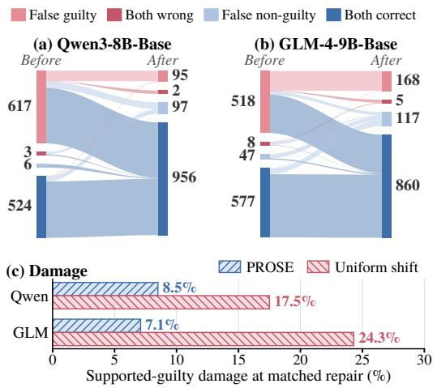

Figure 4: Repair and preservation. (a–b) Pair states before and after PROSE. (c) Supported-guilty damage at matched repair; lower is better.
<table><tr><td></td><td colspan="4">Qwen3-8B-Base</td><td colspan="4">GLM-4-9B-Base</td></tr><tr><td>Variant</td><td>F1↑</td><td>Rep.↑</td><td>G-Ret.↑</td><td>PSR↑</td><td>F1↑</td><td>Rep.↑</td><td>G-Ret.↑</td><td>PSR↑</td></tr><tr><td>PROSE (full)</td><td>91.48</td><td>85.25</td><td>90.76</td><td>76.34</td><td>87.17</td><td>67.37</td><td>94.02</td><td>62.16</td></tr><tr><td>w/o attenuation (Eq. 8)</td><td>76.44</td><td>40.84</td><td>99.68</td><td>40.52</td><td>86.82</td><td>68.15</td><td>93.05</td><td>62.36</td></tr><tr><td>w/o constraints (Eq. 11)</td><td>57.27</td><td>70.83</td><td>41.00</td><td>21.39</td><td>35.40</td><td>99.81</td><td>2.90</td><td>2.70</td></tr><tr><td>w/o both</td><td>61.16</td><td>62.72</td><td>50.57</td><td>25.12</td><td>35.78</td><td>99.81</td><td>3.67</td><td>3.47</td></tr></table>

Table 3: Preservation ablation on CAIL-MC.

Charge-level effects and per-pair margin changes are analyzed in App. G.1and G.2

## 6.4 Ablation Study (RQ3)

To investigate which preservation components support selective repair, we remove target-level attenuation (Eq. 8), parameter-level preservation constraints (Eq. 11), or both, and refit each variant without retuning the remaining hyperparameters. Table 3 shows that removing parameter-level constraints sharply reduces matched-G retention and PSR on both backbones, despite substantial repair. Attenuation has a backbone-dependent effect: removing it substantially reduces Qwen’s repair and PSR while increasing G-Ret., whereas GLM’s PSR remains nearly unchanged. Removing both components also yields poor safe repair. Thus, parameter-level constraints consistently support selectivity, while attenuation improves Qwen’s repair–preservation balance. Three-stage ablations

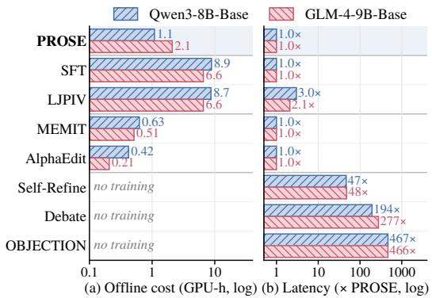  
Figure 5: Offline cost on one RTX 4080 SUPER and per-query latency relative to PROSE, both on log scales.

are reported in App. F.

## 6.5 Training and Inference Efficiency (RQ4)

To investigate the computational cost of correction, we measure offline GPU-hours on one RTX 4080 SUPER and per-query latency relative to PROSE. Fig. 5 shows that PROSE requires only 1.1/2.1 GPU-hours for Qwen/GLM, reducing offline cost by 3.1–8.1× relative to SFT and LJPIV, while retaining ordinary single-pass inference; LJPIV additionally pays 2.1–3.0× the latency because it queries the three legal stages separately. MEMIT and AlphaEdit are cheaper offline but damage the unedited model on both tracks (Sec. 6.2), and inference-time reasoning methods need no training but incur 47–467× the latency at every query. Thus, PROSE is the only method that combines low cost on both axes with gains over the unedited model in every setting.

## 7 Conclusion

Guilty-bias mitigation requires correcting unsupported verdicts while preserving legally supported ones. We formalize this aim as preservationconstrained selective repair and introduce PROSE, which constrains both activation-target construction and parameter fitting. We also develop CAIL-MC consisting of two complementary tracks, evaluating correction at both the matched-pair and evidential-support levels. Across two backbones, PROSE achieves stronger pairwise safe repair than LJP and editing baselines and less supportedverdict damage than a repair-matched uniform shift. While SFT excels on matched pairs, PROSE better responds to changing evidential support under corpus and construction shift, with lower offline cost and ordinary single-pass inference.

## Limitations

Our study covers charge-conditioned verification based LJP in Chinese criminal law using two backbones, rather than complete judicial decisionmaking. CAIL-MC uses LLM-assisted transformations of adjudicated facts. Independent legal review reduces, but cannot eliminate, generation artifacts and uncertainty in legal interpretation. Its coverageoriented construction and selection of editable cases do not represent the distribution of criminal cases in practice. The Evidence-Sufficiency Generalization Track measures the sufficiency of factual support available in the supplied text, not evidence credibility or a judicial standard of proof. Its small source-case sample and fixed allegationonly template limit the breadth of the evaluation. Finally, PROSE relies on paired training examples and backbone-specific configuration choices. Its finite strength search may miss feasible interventions, and parameter fitting approximates their activation effects. Preservation is therefore empirical, not guaranteed.

## Ethical Considerations

CAIL-MC is derived from CAIL2018, LeCaRD, and Criminal-S, whose source texts have undergone privacy protection. Our legal review additionally screened the source and constructed texts for residual identifying information and newly introduced identifying details. The counterfactual variants are synthetic modifications for benchmark evaluation, not additional claims about individuals in the source cases. Our use of the source data complies with their applicable terms and any release of derived material will follow the corresponding redistribution conditions.

Our labels concern whether the supplied facts establish a specified charge, not a defendant’s factual innocence or overall legal status. The evidencesufficiency evaluation tests a limited behavioral requirement relevant to the presumption of innocence, rather than compliance with judicial proof standards. PROSE is intended for research, not decisions about criminal responsibility, detention, or sentencing. Improved benchmark performance does not establish legal correctness or fairness, and any prospective application would require independent validation and qualified legal oversight.

## References

Xi Chen, Mao Mao, Shuo Li, and Haotian Shangguan. 2025. Debate-feedback: A multi-agent framework for efficient legal judgment prediction. In Proceedings of the 2025 Conference of the Nations of the Americas Chapter of the Association for Computational Linguistics: Human Language Technologies (Volume 2: Short Papers), pages 462–470. Association for Computational Linguistics.

Markus Dirk Dubber. 2005. Theories of crime and punishment in german criminal law. The American journal ofcomparative law, 53(3):679–707.

Junfeng Fang, Houcheng Jiang, Kun Wang, Yunshan Ma, Jie Shi, Xiang Wang, Xiangnan He, and Tat-Seng Chua. 2025. AlphaEdit: Null-space constrained knowledge editing for language models. In The Thirteenth International Conference on Learning Representations.

George P. Fletcher. 1978. Rethinking Criminal Law. Little, Brown and Company, Boston.

Robert Geirhos, Jörn-Henrik Jacobsen, Claudio Michaelis, Richard Zemel, Wieland Brendel, Matthias Bethge, and Felix A. Wichmann. 2020. Shortcut learning in deep neural networks. Nature Machine Intelligence, 2(11):665–673.

Suchin Gururangan, Swabha Swayamdipta, Omer Levy, Roy Schwartz, Samuel Bowman, and Noah A. Smith. 2018. Annotation artifacts in natural language inference data. In Proceedings of the 2018 Conference of the North American Chapter ofthe Associationfor Computational Linguistics: Human Language Technologies, Volume 2 (Short Papers), pages 107–112.

Zhuo Han, Yi Yang, Yi Feng, Wanhong Huang, Ding Xuxing, Chuanyi Li, Jidong Ge, and Vincent Ng. 2025. Lawshift: Benchmarking legal judgment prediction under statute shifts. Advances in Neural Information Processing Systems, 38.

Edward J. Hu, Yelong Shen, Phillip Wallis, Zeyuan Allen-Zhu, Yuanzhi Li, Shean Wang, Lu Wang, and Weizhu Chen. 2022. LoRA: Low-rank adaptation of large language models. In International Conference on Learning Representations.

Zikun Hu, Xiang Li, Cunchao Tu, Zhiyuan Liu, and Maosong Sun. 2018. Few-shot charge prediction with discriminative legal attributes. In Proceedings of the 27th International Conference on Computational Linguistics, pages 487–498. Association for Computational Linguistics.

Jaehoon Jeong and Jay-Yoon Lee. 2026. OBJECTION! lawyer agents mitigate guilty bias in legal judgment prediction. arXiv preprint arXiv:2609.02158.

Philipp Koehn. 2004. Statistical significance tests for machine translation evaluation. In Proceedings of the 2004 Conference on Empirical Methods in Natural Language Processing, pages 388–395, Barcelona, Spain. Association for Computational Linguistics.

Ang Li, Yiquan Wu, Ming Cai, Adam Jatowt, Xiang Zhou, Weiming Lu, Changlong Sun, Fei Wu, and Kun Kuang. 2025. Legal judgment prediction based on knowledge-enhanced multi-task and multi-label text classification. In Proceedings ofthe 2025 Conference ofthe Nations ofthe Americas Chapter ofthe Associationfor Computational Linguistics: Human Language Technologies (Volume 1: Long Papers), pages 6957–6970. Association for Computational Linguistics.

Kenneth Li, Oam Patel, Fernanda Viégas, Hanspeter Pfister, and Martin Wattenberg. 2023. Inference-time intervention: Eliciting truthful answers from a language model. In Advances in Neural Information Processing Systems, volume 36.

Yougang Lyu, Zihan Wang, Zhaochun Ren, Pengjie Ren, Zhumin Chen, Xiaozhong Liu, Yujun Li, Hongsong Li, and Hongye Song. 2022. Improving legal judgment prediction through reinforced criminal element extraction. Information Processing & Management, 59(1):102780.

Yixiao Ma, Yunqiu Shao, Yueyue Wu, Yiqun Liu, Ruizhe Zhang, Min Zhang, and Shaoping Ma. 2021. LeCaRD: A legal case retrieval dataset for chinese law system. In Proceedings ofthe 44th International ACM SIGIR Conference on Research and Development in Information Retrieval, pages 2342–2348. ACM.

Aman Madaan, Niket Tandon, Prakhar Gupta, Skyler Hallinan, Luyu Gao, Sarah Wiegreffe, Uri Alon, Nouha Dziri, Shrimai Prabhumoye, Yiming Yang, Shashank Gupta, Bodhisattwa Prasad Majumder, Katherine Hermann, Sean Welleck, Amir Yazdanbakhsh, and Peter Clark. 2023. Self-refine: Iterative refinement with self-feedback. In Advances in Neural Information Processing Systems, volume 36.

Kevin Meng, David Bau, Alex Andonian, and Yonatan Belinkov. 2022. Locating and editing factual associations in GPT. In Advances in Neural Information Processing Systems, volume 35.

Kevin Meng, Arnab Sen Sharma, Alex Andonian, Yonatan Belinkov, and David Bau. 2023. Massediting memory in a transformer. In The Eleventh International Conference on Learning Representations.

Fabián Raimondo. 2020. In dubio pro reo. In Hélène Ruiz Fabri, editor, The Max Planck Encyclopedia of International Procedural Law. Oxford University Press.

Weijie Shi, Han Zhu, Jiaming Ji, Mengze Li, Jipeng Zhang, Ruiyuan Zhang, Jia Zhu, Jiajie Xu, Sirui Han, and Yike Guo. 2025. Legalreasoner: Step-wised verification-correction for legal judgment reasoning. In Proceedings of the 63rd Annual Meeting of the Associationfor Computational Linguistics (Volume 1: Long Papers), pages 7297–7313.

Yiquan Wu, Siying Zhou, Yifei Liu, Weiming Lu, Xiaozhong Liu, Yating Zhang, Changlong Sun, Fei Wu, and Kun Kuang. 2023. Precedent-enhanced legal judgment prediction with LLM and domain-model collaboration. In Proceedings ofthe 2023 Conference on Empirical Methods in Natural Language Processing, pages 12060–12075. Association for Computational Linguistics.

Chaojun Xiao, Haoxi Zhong, Zhipeng Guo, Cunchao Tu, Zhiyuan Liu, Maosong Sun, Yansong Feng, Xianpei Han, Zhen Hu, Heng Wang, and Jianfeng Xu. 2018. CAIL2018: A large-scale legal dataset for judgment prediction. arXiv preprint arXiv:1807.02478.

Nuo Xu, Pinghui Wang, Long Chen, Li Pan, Xiaoyan Wang, and Junzhou Zhao. 2020. Distinguish confusing law articles for legal judgment prediction. In Proceedings ofthe 58th Annual Meeting ofthe Associationfor Computational Linguistics, pages 3086– 3095. Association for Computational Linguistics.

Han Zhang and Zhicheng Dou. 2023. Case retrieval for legal judgment prediction in legal artificial intelligence. In Proceedings ofthe 22nd Chinese National Conference on Computational Linguistics, pages 801– 812.

Han Zhang, Zhicheng Dou, Yutao Zhu, and Ji-Rong Wen. 2023. Contrastive learning for legal judgment prediction. ACM Transactions on Information Systems, 41(4):1–25.

Kepu Zhang, Haoyue Yang, Xu Tang, Weijie Yu, and Jun Xu. 2025. Beyond guilt: Legal judgment prediction with trichotomous reasoning. In Findings ofthe Association for Computational Linguistics: EMNLP 2025, pages 1815–1826. Association for Computational Linguistics.

Haoxi Zhong, Zhipeng Guo, Cunchao Tu, Chaojun Xiao, Zhiyuan Liu, and Maosong Sun. 2018. Legal judgment prediction via topological learning. In Proceedings ofthe 2018 Conference on Empirical Methods in Natural Language Processing, pages 3540–3549. Association for Computational Linguistics.

Andy Zou, Long Phan, Sarah Chen, James Campbell, Phillip Guo, Richard Ren, Alexander Pan, Xuwang Yin, Mantas Mazeika, Ann-Kathrin Dombrowski, et al. 2023. Representation engineering: A topdown approach to AI transparency. arXiv preprint arXiv:2310.01405.

## A CAIL-MC Construction Details

CAIL-MC is a benchmark suite with two complementary tracks. The Pairwise Repair–Preservation Track provides matched charge-established and charge-not-established cases for evaluating selective repair and preservation. The Evidence-Sufficiency Generalization Track provides controlled evidence variants from independent corpora for evaluating evidence sensitivity under corpus and construction shift. The two tracks share the same principles of fact sanitization, legal review, and outcome leakage control, but serve different purposes.

## A.1 Pairwise Repair–Preservation Track

We construct this track from CAIL2018 (Xiao et al., 2018). We first retain cases with an identifiable target charge and sufficiently complete facts for controlled counterfactual editing, removing duplicate, malformed, or factually incomplete records, which yields 20,055 candidates. These cases then undergo legal-path planning, counterfactual generation, automated factual and legal checks, and expert human verification. Cases for which no legally valid counterpart can be constructed without altering the core source facts are discarded, resulting in 11,478 charge-established/charge-notestablished matched pairs spanning 261 Chinese criminal charges. Given a charge-established case $x _ { i } ^ { G }$ with charge $c _ { i } ,$ we construct $\mathbf { \Delta } _ { x _ { i } ^ { N G } } ^ { N G }$ such that $c _ { i }$ is no longer established while preserving the remaining factual context as much as possible, so that each pair differs only in a legally decisive condition.

## A.1.1 Legal Path Planning

Because fact descriptions extracted from original judgments may contain expressions that reveal adjudicative outcomes, we first use DeepSeek-V4- Flash to extract and sanitize the case facts, removing conclusion-revealing expressions. The planning prompt $P _ { \mathrm { P L A N } }$ then identifies candidate counterfactual paths for the cleaned case at three levels: elements of the offense,unlawfulness, and culpability.

Real-world guilty cases are naturally easier to modify by negating an element of the offense. Simply selecting the easiest construction would therefore over-concentrate the dataset on offense-level cases and reduce the coverage of unlawfulness and culpability. We thus first attempt eligible unlawfulness and culpability paths, ranking candidates according to the remaining coverage gap of each legal path, feasibility, and conflict risk. Here, a legal path denotes a concrete legal construction mechanism, such as self-defense and necessity under unlawfulness, or mental incapacity and age below criminal responsibility under culpability. Feasibility measures whether a complete counterfactual can be naturally constructed from the current case, whereas conflict risk measures whether the introduced facts are likely to contradict the original case facts or hard constraints. A case proceeds to offense-level construction only when no reasonable U/C path can satisfy the quality requirements.

## A.1.2 Counterfactual Generation

Given the selected legal path, the counterfactual generation prompt $P _ { \mathrm { G E N } }$ instructs DeepSeek-V4- Flash to construct the corresponding charge-notestablished fact description while preserving the original case facts as much as possible and introducing only the information necessary to alter the target legal condition.

Rather than mechanically appending exculpatory descriptions, we require the newly introduced facts to be adapted to the specific case context. For example, a self-defense counterfactual must be constructed around the original actors, course of aggression, and temporal relations, while a culpability-related modification must be consistent with the defendant’s specific identity and condition. This design avoids simply inserting fixed exculpatory keywords and makes the generated cases more consistent with realistic legal scenarios. To further prevent shortcut learning, the generated text is prohibited from directly containing conclusionrevealing expressions such as “not guilty” or “does not constitute a crime.”

Each generated sample is then automatically reviewed by DeepSeek-V4-Flash. Samples that fail the review are regenerated according to reviewer feedback for at most two refinement rounds. If a U/C path still fails after refinement, the case is transferred to offense-level construction, where the same generation and review procedure is applied.

## A.1.3 Quality Verification

To ensure the reliability of the constructed data, we adopt a two-stage quality-control mechanism combining LLM review with expert human verification. At the factual level, the automated reviewer defined by $P _ { \mathrm { R E V } }$ checks whether the modified case preserves the main facts and narrative of the original case while avoiding factual contradictions, excessive modification, and conclusion leakage. At the legal level, it verifies whether the designated legal path is correctly instantiated and whether the added or modified facts are sufficient to make the target charge no longer established.

After LLM-based construction and automatic verification, we conducted a full human review of the remaining 12,564 candidate pairs. The review team consisted of eight junior annotators and one senior adjudicator. The senior adjudicator holds a doctoral degree in law, serves as a law professor at a leading university, and has 13 years of experience in criminal-law research, teaching, and/or judicial practice. The eight junior annotators were master’s students specializing in criminal law at leading universities. All had completed systematic coursework in both the General Part and the Specific Part of Chinese Criminal Law and had received professional training in criminal-case analysis.

Independent dual review. The 12,564 candidate pairs produced after LLM-based construction and automatic verification were randomly divided into four equal review batches, each containing 3,141 pairs. Each batch was assigned to two different junior annotators, and each junior annotator was responsible for one batch. The two annotators independently reviewed every pair in their assigned batch and were not shown each other’s decisions during the independent review stage.

For each pair, the reviewers jointly considered the original charge-established fact, the generated charge-not-established fact, the target charge, the assigned doctrine, and the designated legal path. They examined whether the two texts still described the same underlying case; whether the designated legal path was correctly instantiated; whether the modified or introduced facts were legally sufficient to make the target charge no longer established; whether the counterfactual condition covered all independently charge-establishing acts in cases involving repeated or continuous conduct; whether the temporal, behavioral, and causal relations remained internally consistent; and whether the counterfactual avoided excessive modification, competing doctrines, and direct outcome leakage.

Each annotator independently assigned a retain or discard decision to every candidate and recorded a brief reason whenever a candidate was considered invalid.

Expert adjudication. When the two junior annotators independently reached the same decision, that decision was adopted directly. Any candidate on which the two annotators disagreed was forwarded directly to the senior criminal-law expert for final adjudication, without an intermediate discussion stage.

For each disputed candidate, the senior expert re-examined the target charge, assigned doctrine, designated legal path, original case, counterfactual case, and the reasons recorded by both junior annotators, and then made the final decision. A candidate was discarded when a legally valid chargenot-established counterpart could not be obtained while preserving the core facts of the original case. This included cases in which another independently charge-establishing act remained intact, the counterfactual contradicted material source facts, the intended legal effect required introducing an additional doctrine, or the underlying case had to be substantially rewritten to invalidate the target charge.

<table><tr><td></td><td>Total</td><td>Agree</td><td>Disagree</td><td>Discarded</td><td>Retained</td></tr><tr><td>Batch 1</td><td>3,141</td><td>2,779</td><td>362</td><td>267</td><td>2,874</td></tr><tr><td>Batch 2 Batch 3</td><td>3,141 3,141</td><td>2,758 2,791</td><td>383 350</td><td>274 261</td><td>2,867 2,880</td></tr><tr><td>Batch 4</td><td>3,141</td><td>2,744</td><td>397</td><td>284</td><td>2,857</td></tr><tr><td>Total</td><td>12,564</td><td>11,072</td><td>1,492</td><td>1,086</td><td>11,478</td></tr></table>

Table 4: Human verification results across the four review batches. “Agree” denotes identical decisions independently made by the two junior annotators. Every “Disagree” case was directly referred to the senior criminal-law expert for final adjudication.

Human-review outcomes. Tab. 4 summarizes the human-review outcomes across the four batches. Every one of the 12,564 candidate pairs was independently examined by two annotators with formal training in criminal law, and every disagreement between the two reviewers was further adjudicated by the senior expert. Human verification ultimately discarded 1,086 candidates and retained 11,478 matched pairs, corresponding to a final retention rate of 91.36%.

## A.1.4 Construction Prompts

Planning/fact-cleaning prompt P<sub>PLAN</sub>   
Please sanitize and analyze thefollowing Chinese   
criminal case.   
Charge: {charge}   
Rawfact: {raw\_fact}   
Task 1: Generate guilty\_fact.   
• Preserve the actor, object, time, location, conduct,   
means, monetary amount, quantity, result, causal   
relation, and necessary mental-statefacts.   
• Remove evidentiary listings, procedural history,   
sentencing information, adjudicative conclusions,   
and outcome leakage.   
• Do not omit repeated offenses, continuous offenses,   
or multiple acts that would each independently   
suffice to establish the current charge.   
Task 2: Extract:   
• core\_facts: the core facts supporting   
establishment of the current charge;

hard\_constraints: explicitfacts that subsequent counterfactual editing must not directly contradict, such as an explicitly stated age, an explicit assessment ofcriminal responsibility, the offense timeline, the number ofrepeated criminal acts, explicit monetary amounts or quantities, an explicit harmful result, and whether the infringement has already ended.

## Task 3: Evaluate all major counterfactualpaths separately. Important principles:

• Judge counterfactual constructibility, not whether an exculpatory circumstance actually already exists in the original case.

• feasibility evaluates only whether the path can be constructed through a relatively minimal, case-relevant, and temporally coherent change.

• For unlawfulness, any introduced infringement or danger must occur before or concurrently with the original conduct and must cover all acts sufficient to establish the current charge. A later event cannot negate an already completed offense.

For culpability, a mistake about a constitutive fact (e.g., not knowing that an item is stolen property, a drug, a counterfeit medicine, or a protected object) belongs under offense, not culpability. A culpability mistake refers only to an unavoidable mistake of illegality.

Independently andfully evaluate unlawfulness and culpability before evaluating offense. Do not lower U/Cfeasibility merely because an offense path is easier to construct.

• For every U/C legal\_path, evaluate itfrom the perspective that the minimum necessary counterfactualfacts may be introduced. Do not merely check whether the original text already contains the relevant exculpatory facts.

• For offense, in principle always searchfor a single offense element that can be modified. Ifthe first element is unsuitable, searchfor another element rather than assigning offense=0 too readily.

## Feasibility scale:

• 3 = naturally fits the case with a small change;

• 2 = can be constructed reasonably;

```jsonl
"conflict_risk": "low|medium|high",
"reason": "
}
]
},
"unlawfulness": {
"candidates": [
{
"legal_path": "self_defense",
"feasibility": 0,
"minimal_change": "...",
"full_exculpation_possible": true,
"temporal_fit": true,
"covers_all_criminal_acts": true,
"conflict_risk": "low|medium|high",
"reason":
},<sub>{</sub>
"legal_path": "necessity",
"feasibility": 0,
"minimal_change": ".
"full_exculpation_possible": true,
"temporal_fit": true,
"covers_all_criminal_acts": true,
"conflict_risk": "low|medium|high",
"reason": "..
}
]
},
"culpability": {
"candidates": [
{
"legal_path": "mental_incapacity",
"feasibility": 0,
"minimal_change": ".
"full_exculpation_possible": true,
"conflict_risk": "low|medium|high",
"reason": "..
},
{
"legal_path": "age_below_responsibility",
"feasibility": 0,
"minimal_change": "..."
"full_exculpation_possible": true,
"conflict_risk": "low|medium|high",
"reason": "..
},<sub>{</sub>
"legal_path": "unavoidable_illegality_mistake",
"feasibility": 0,
"minimal_change": "...
"full_exculpation_possible": true,
"conflict_risk": "low|medium|high",
"reason":
}
}
```

• 1 = theoretically constructible but somewhat forced;

• 0 = clearly unreasonable.

## Output JSON only:

```python
"guilty_fact": "...",
"core_facts": ["..."],
"hard_constraints": ["..."],
"doctrine_plans": {
"offense": {
"candidates": [
{
"legal_path": "single_element_negation",
"feasibility": 0,
"changed_element":
"minimal_change":
"full_exculpation_possible": true,
```

## Counterfactual generation prompt P<sub>GEN</sub>

Construct a high-quality guilty–innocent pair according

to the fixed doctrine and fixed legal\_path.

Charge: {charge}

Fixed doctrine: {doctrine}

Fixed legalpath: {legal\_path}

Suggested minimal change: {minimal\_change}

Planner-specified changed element:

{planned\_changed\_element}

Complete guilty fact: {guilty\_fact}

Core facts: {core\_facts}

Hard constraints: {hard\_constraints}

Mandatory requirements:

I. Same-case identity and factual fidelity

1. innocent\_fact must still describe the same case.

2. Do not introduce unrelated persons, locations, another criminal event, or a new harmful result.

3. Comply with all hard\_constraints.

4. For repeated criminal conduct, the counterfactual must apply to every act sufficient to establish the current charge; it must not explain away only one occurrence.

5. Output a complete and coherent factual paragraph.

## II. offense

• Change only one element of the offense.

• You may locally modify facts directly related to that element.

• If guilty\_fact contains a sentence that directly conflicts with the new element, locally replace that sentence rather than retaining both A and not-A.

• Apartfrom the designated changed\_element, preserve all other materialfacts as much as possible.

• Do not use self-defense, necessity, mental disorder, age, or any other doctrine.

## III. unlawfulness

self\_defense:

State the ongoing unlawful infringement, the protected legal interest, and that the original conduct was undertaken to stop that infringement; directly connect the timing and purpose.

• The infringement must be ongoing at the time of the original conduct. Do not use a later event to justify earlier completed criminal conduct.

## necessity:

State the specific ongoing danger, the protected legal interest, the absence ofan obviously less harmful alternative, and the direct connection between the original conduct and avoidance ofthe danger.

• The danger must be present at the time of the original conduct, and the justificatory circumstance must cover all acts sufficient to establish the current charge.

## IV. culpability

mental\_incapacity:

• State that a forensic psychiatric evaluation was conducted.

• Make explicit that, at the time ofthe conduct, the person was unable to recognize or control the conduct.

• The condition must match the timing of all relevant criminal acts.

## age\_below\_responsibility:

• State the person’s specific age at the time of the conduct.

• Do not directly conflict with an explicitly stated adulthood fact in guilty\_fact.

• The age must be consistent with the age-of-criminal- responsibility rule applicable to the current charge.

## unavoidable\_illegality\_mistake:

• The actor knows the relevant constitutive facts.

• The mistake concerns whether the conduct is legally prohibited.

• Provide a concrete, credible, and unavoidable reason for the mistake, such as an explicit but erroneous response from a competent authority.

• Do not place mistakes about constitutive facts—such as not knowing that an item is stolen property, a drug, a counterfeit medicine, or a protected object—under this path.

## V. No conclusion leakage

Do not include conclusion statements such as “not guilty,” “does not constitute a crime,” “legally bears no criminal responsibility,” “the courtfinds,” or “criminal responsibility shall be pursued.”

## Output JSON only:

"doctrine": "{doctrine}",

"legal\_path": "{legal\_path}",

"innocent\_fact": "...",

"changed\_element": "...",

"added\_elements": ["..."],

"preserved\_elements": ["..."],

"template\_family": "..."

## Reviewer prompt P<sub>REV</sub>

You are a quality reviewerfor a Chinese criminal-law counterfactual dataset. Conduct a substantive review. Do not merely match keywords, and do not automatically reject a candidate simply because a newly introduced counterfactual fact was not stated in the original text.

Charge: {charge}

Fixed doctrine: {doctrine}

Fixed legal path: {legal\_path}

Guilty fact: {guilty\_fact}

Corefacts: {core\_facts}

Hard constraints: {hard\_constraints}

Candidate innocent fact: {innocent\_fact}

Check the following dimensions:

1. preservation: apart from the fixed counterfactual change, are the material facts substantially preserved?

2. path\_consistency: does the candidate actually instantiate the designated legal\_path?

3. doctrine\_sufficiency: are the added facts sufficient to satisfy the designated doctrine?

4. full\_exculpation: does the counterfactual cover every act sufficient to establish the charge, especially in repeated or continuous offending?

5. temporal\_consistency: do the justificatory or exculpatory facts occur before or concurrently with the criminal conduct, rather than using a later event to explain away an already completed offense?

6. counterfactual\_conflict: does the candidate avoid simultaneously retaining contradictory A and not-A facts?

7. hard\_constraint\_consistency: does the candidate comply with all explicit hard\_constraints?

```jsonl
8. plausibility: are the addedfacts directly
related to the actors, conduct, and setting ofthe
case, and do they constitute a relatively minimal
change rather than a complex new story?
9. single_doctrine: does the candidate avoid
mixing in another doctrine?
10. no_conclusion_leakage: is the candidatefree of
conclusion leakage?
11. non_mechanical: is the counterfactual integrated
naturally rather than mechanically appended as a
template?
For offense, local replacement ofthe single
changed_element is allowed. Therefore, do not mark
preservation asfailed solely because a localfact about
mental state, object nature, or a similar element has
changed.
Output JSON only:
{
"decision": "pass|rewrite_required|switch_path",
"preservation": "pass|fail",
"path_consistency": "pass|fail",
"doctrine_sufficiency": "pass|fail",
"full_exculpation": "pass|fail",
"temporal_consistency": "pass|fail",
"counterfactual_conflict": "pass|fail",
"hard_constraint_consistency": "pass|fail",
"plausibility": "pass|fail",
"single_doctrine": "pass|fail",
"no_conclusion_leakage": "pass|fail",
"non_mechanical": "pass|fail",
"defects": ["..."],
"rewrite_instruction": ".
}
```

## A.2 Evidence-Sufficiency Generalization Track

This track is constructed from LeCaRD (Ma et al., 2021) and Criminal-S (Hu et al., 2018). It is an independent evaluation component of CAIL-MC, designed to test whether a model follows the sufficiency of the presented evidence under both corpus shift and construction shift.

For each selected source case and candidate charge, we sanitize the fact description, remove outcome-revealing language, and identify the facts that support the charge. We then construct variants that preserve the underlying allegation and case context while changing the amount of chargesupporting evidence. Each variant is assigned to one of four conditions:

• Full: the available facts contain the complete charge-supporting evidence and establish the candidate charge;

• Partial-sufficient: only part of the supporting evidence is retained, but the remaining evidence is still sufficient to establish the charge;

• Partial-insufficient: some relevant facts remain, but at least one indispensable condition is unavailable, so the candidate charge is not established under the benchmark annotation;

Table 5: Human verification results for the evidencesufficiency gradient. “Agree” denotes identical retain/discard decisions independently made by the two criminal-law graduate reviewers. Every “Disagree” case is directly referred to the senior criminal-law expert for final adjudication.
<table><tr><td rowspan=1 colspan=6>Source    Total Agree Disagree Discarded Retained</td></tr><tr><td rowspan=1 colspan=1>LeCaRDCriminal-S</td><td rowspan=1 colspan=1>80200</td><td rowspan=1 colspan=1>65194</td><td rowspan=1 colspan=1>156</td><td rowspan=1 colspan=1>100</td><td rowspan=1 colspan=1>70200</td></tr><tr><td rowspan=1 colspan=1>Total</td><td rowspan=1 colspan=1>280</td><td rowspan=1 colspan=1>259</td><td rowspan=1 colspan=1>21</td><td rowspan=1 colspan=1>10</td><td rowspan=1 colspan=1>270</td></tr></table>

• Allegation-only: the charge or alleged conduct is retained without supporting evidence needed to establish the charge.

The first two conditions therefore have label 1 for the specified charge, while the latter two have label 0. These labels concern only whether the specified charge is established from the presented facts; they do not constitute a complete determination of factual innocence or the defendant’s overall legal status.

The construction follows the same quality principles as the Pairwise Repair–Preservation Track. GPT-5.6 Sol first extracts the source facts and charge-relevant conditions, after which a generation step retains or removes evidence according to the assigned condition without introducing unrelated events or explicit verdict cues. Automated review checks narrative consistency, preservation of the core allegation, compliance with the intended evidence condition, and absence of label leakage.

The source case and its variants are then reviewed jointly by two criminal-law-trained annotators. They verify the intended evidence condition, the corresponding charge-established or charge-notestablished label, and consistency with the original case. Disagreements are adjudicated by a senior legal reviewer. Variants that cannot satisfy the assigned evidence condition without changing the underlying case are discarded. Human-review outcomes are shown in Tab. 5.

## A.2.1 Evidence-Ablation Construction Prompt

## Evidence-ablation construction prompt P<sub>GRAD</sub>

Task. You are constructing a guilty-side evidence-ablation gradientfor a legal judgment experiment.

Target charge: {charge}

FULL: {full}

FULL is the original guilty\_fact and isfixed. You must never rewrite FULL. You only construct Partial-sufficient, Partial-insufficient, and Zero.

Partial-sufficient   
Target label: charge established.   
Remove only background, repetitive, redundant, or   
non-essential informationfrom FULL. After deletion, the remaining facts must still sufficiently support the target charge. Do not remove allfactual support requiredfor any necessary condition. A necessary condition does not need to appear verbatim: ifit can still be reasonably inferredfrom other retainedfacts, it remains supported. Do not add, supplement, orfabricate anyfact. Preserve the original sentences, order, fluency, and writing style of FULL as much as possible. Ifdeletion creates an   
ungrammatical sentence, only minimal   
coherence-preserving rewriting is allowed. Do not add new legal conclusions such as “the crime is established” or “guilty.”   
For this level, additionally record: (1) the exact spans removedfrom FULL and why they can be removed; (2) the necessary supports that remain and their retained factual bases; and (3) why the resulting evidence remains sufficient.

## Partial-insufficient

Target label: not established by the provided factual material.   
Delete factual support required for at least one necessary condition ofthe target charge. After deletion, the other retained facts must not substitute for, independently support, or reasonably imply the same necessary   
condition. Do not mechanically treat a condition as unsupported merely because it is not stated verbatim; consider all retainedfacts and whether that condition can still be reasonably inferred.   
Insufficiency must be created by deletingfacts. Only minimal rewriting necessaryfor grammatical coherence is allowed. Do not add exculpatory, negating,   
contradictory, or innocence-supportingfacts. Do not transform the deletion ofsupporting evidence into an affirmative statement that the deletedfact did not occur. Do not add new legal conclusions such as “does not constitute the crime” or “not guilty.”   
For this level, record: (1) missing\_necessary\_support, identifying the missing necessary support; (2)   
deleted\_or\_rewritten\_spans, identifying the exact spans ofFULL that were deleted or minimally rewritten; (3) why\_remaining\_cannot\_support, explaining why the remainingfacts cannot continue to support the   
missing condition; and (4)   
alternative\_retained\_support\_sufficient, which must be false.

## Zero

Target label: not established by the provided factual material.

Do not retain any evidentiary supportfrom FULL. Do not retain any case-specificfact concerning conduct, time, location, amount, object, consequence, or mental state. Retain only a neutral accusation naming the target   
charge.   
The output text must exactlyfollow thefixed template: The defendant is accused of being involved in {charge}

Control of the two partial conditions Subject to the sufficient/insufficient distinction above, keep the deletion amounts as similar as possible; keep the resulting text lengths as similar as possible; keep linguistic fluency as similar as possible; and preserve the narrative order and writing style of FULL as much as possible. Legal evidentiary sufficiency takes priority over mechanically matching text length.

Information restriction   
Use only the target charge and FULL supplied in this prompt.   
Do not use, infer, or introduce informationfrom   
innocent\_fact, doctrine, legal\_path,   
changed\_element, added\_elements, or   
preserved\_elementsfrom the original matched pair. The doctrine used to construct the original pair does not imply thatfactual support removedfrom the guilty side shouldfollow the same doctrine. Outputformat   
Return exactly one JSON object, with no Markdown and no additional explanation.   
The object must contain partial\_sufficient,   
partial\_insufficient, and zero.   
partial\_sufficient must contain text,   
removed\_spans, retained\_necessary\_support, and why\_still\_sufficient. Each removed span must report the exact original\_span from FULL and a brief reason.   
partial\_insufficient must contain text,   
missing\_necessary\_support,   
deleted\_or\_rewritten\_spans,   
why\_remaining\_cannot\_support, and   
alternative\_retained\_support\_sufficient. Each deleted or minimally rewritten span must specify its operation, exact original\_span, optional   
replacement, and reason. When the operation is   
delete, replacement must be empty.   
zero contains only thefixed neutral accusation text.

## B Diagnosis Details

## B.1 Diagnostic Protocol

All diagnostic interventions use the main verification prompt and verdict readout, with the backbone in bf16, the verdict logits read in fp32, and inputs truncated to 2,048 tokens; model weights stay frozen. Source pairs are training pairs whose two members $\theta _ { 0 }$ classifies correctly, and targets are the charge-not-established members of strict falseguilty development pairs (153 / 185 / 286 Offense / Unlawfulness / Culpability pairs with Qwen).

Layer-wise transfer. For each legal stage and each of the 36 layers, the contrasts of Eq. 5 are averaged over the source pairs of that stage and normalized to a unit direction $v _ { d } ^ { \ell } .$ In a single forward pass, $\alpha v _ { d } ^ { \ell }$ with $\alpha = 3$ is added to the block output at the three answer-adjacent positions $\tau$ of a target. Forward adds $v _ { d } ^ { \ell } ,$ Reverse adds $- v _ { d } ^ { \ell }$ to the same target, and Norm-matched random adds three independent Gaussian directions per target, each rescaled to the norm of the forward displacement. NG-margin reduction is the clean margin minus the intervened margin. Confidence intervals are case-cluster bootstrap intervals (2,000 resamples), with the random repeats clustered by case.

<table><tr><td>Stage</td><td>Geometry</td><td>Without</td><td>With full projection</td></tr><tr><td rowspan="2">Offense</td><td>Stage-specific</td><td>70.6 (108)</td><td>17.6 (27)</td></tr><tr><td>Shared</td><td>70.6 (108)</td><td>20.3 (31)</td></tr><tr><td rowspan="2">Unlawfulness</td><td>Stage-specific</td><td>83.2 (154)</td><td>15.7 (29)</td></tr><tr><td>Shared</td><td>76.8 (142)</td><td>19.5 (36)</td></tr><tr><td rowspan="2">Culpability</td><td>Stage-specific</td><td>75.9 (217)</td><td>10.8 (31)</td></tr><tr><td>Shared</td><td>76.9 (220)</td><td>10.1 (29)</td></tr></table>

Table 6: Repair-target feasibility (%, feasible pairs in parentheses) on Qwen3-8B-Base without and with full projection onto the complement of the supported-guilty gradient subspace $( \rho = 0$ in Eq. 8).

Feasibility and damage. At Layer 22, a casespecific direction is reconstructed in the stagespecific or shared affine geometry (Eq. 6), and a case is feasible if a strength within the bounded search moves its NG margin below the buffer τ . Paired-G damage applies the same target-reaching displacement to the matched charge-established member.

## B.2 Full Preservation Projection

Full projection removes the entire component of the repair direction that lies in the supported-guilty gradient subspace $P _ { d } ^ { \ell }$ . Tab. 6 shows that it lowers feasibility from 70.6–83.2% to 10.1–20.3%: the removed component carries much of the repair signal. The damage comparison in Fig. 2c is therefore restricted to the pairs feasible under both settings, whose counts are those in parentheses. This trade-off motivates the soft attenuation of PROSE $( \rho > 0 )$ , which keeps part of the overlapping component.

## B.3 Cross-Stage Transfer of Hidden-state Contrasts

To test whether the stage-specific contrasts share structure, we add the unit contrast direction of each source stage, scaled by $\alpha = 0 . 5$ , at Layer 22 to the held-out cases of each target stage and measure the mean NG-margin reduction (Fig. 6). All nine effects are positive, so every stage direction moves cases of every stage toward charge not established, consistent with the shared geometry that development selection chooses for Offense and Unlawfulness. The Unlawfulness direction transfers most strongly (0.032–0.045), matching the stage ablation, where the Unlawfulness update alone reaches 63.58 PSR on Culpability pairs (Tab. 10). The Culpability direction is the most stage-selective (0.033 on its own stage vs. 0.017–0.018 elsewhere), consistent with its stage-specific geometry, while Offense has the weakest own-stage effect (0.013), in line with Offense being the hardest stage to repair in isolation.

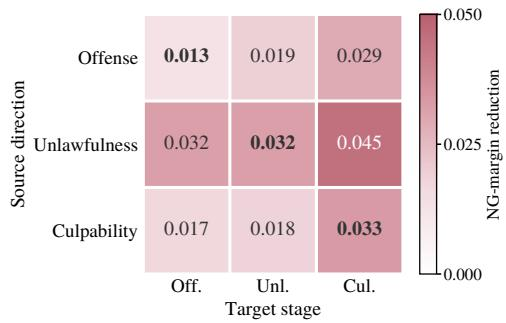  
Figure 6: Cross-stage transfer at Layer 22 on Qwen3- 8B-Base. Each cell adds the contrast direction of a source stage to cases of a target stage and reports the mean NG-margin reduction; the diagonal (bold) gives each direction’s effect on its own stage.

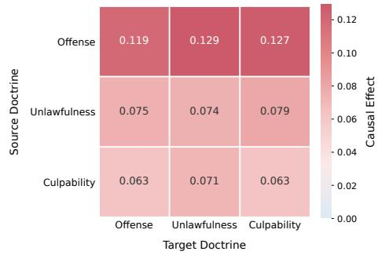  
Figure 7: Cross-stage transfer on GLM-4-9B-Base. Each cell reports the mean NG-margin reduction when the hidden-state contrast learned from the source doctrine (row) is applied to held-out cases from the target doctrine (column) at Layer 20. Positive values indicate movement toward charge not established.

Fig. 7 again shows positive transfer in all nine source–target combinations, confirming that the learned contrast directions contain a substantial cross-stage component. On GLM-4-9B-Base, the Offense direction is strongest across all three target stages (0.119–0.129), followed by Unlawfulness (0.074–0.079) and Culpability (0.063–0.071).

Moreover, several cross-stage effects are comparable to or larger than the corresponding within-stage effects. Thus, both backbones exhibit shared crossstage contrast structure, while the degree and form of stage specialization remain backbone dependent.

## B.4 Transfer of Hidden-state Contrasts

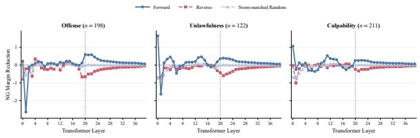

Figure 8: Layer-wise hidden-state contrast transfer on GLM-4-9B-Base. Each panel reports NG-margin reduction on held-out strict false-guilty pairs for one legal stage. Forward applies the learned contrast direction, Reverse its negation, and Norm-matched Random a random direction with the same norm. Positive values indicate movement toward charge not established; the dotted line marks Layer 20.

Fig. 8 shows a qualitatively similar directionaltransfer pattern to that observed on Qwen3-8B, despite a different layer profile. Around the middle layers, the Forward direction produces positive NG-margin reduction across all three legal stages, whereas Reverse tends to produce the opposite effect and the norm-matched random control is substantially weaker.

## B.5 Repair Feasibility and Preservation

As shown in Fig. 9(a), GLM-4-9B-Base has lower overall repair feasibility than Qwen3-8B, ranging from 22.7% to 51.6% across legal stages and geometry choices. Nevertheless, the transferred contrast geometry reaches the target for a non-trivial fraction of false-guilty cases.

In Fig. 9(b), preservation projection reduces paired-G damage in all six stage/geometry comparisons, with absolute reductions of 0.017–0.041. Thus, the GLM results reproduce the same qualitative repair–preservation tension: repair-effective directions are transferable, but explicit preservation is needed to limit damage to the matched supported decision.

## C Details of PROSE

This appendix expands the target construction and parameter update in Sec. 5. We retain the following notation: $\theta _ { 0 }$ fixes eligibility and preservation labels, whereas ϑ denotes the current model during successive stage updates. All contrasts, gradients, and module-input keys used for an update are extracted under ϑ.

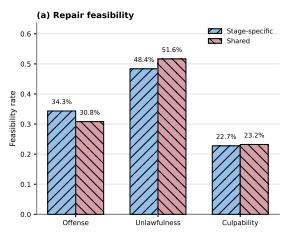

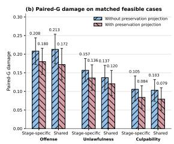  
Figure 9: Repair feasibility and preservation on GLM-4-9B-Base. (a) Repair feasibility under stagespecific and shared contrast geometry for the three legal stages. (b) Paired-G margin damage on matched feasible cases, before and after preservation projection. Lower paired-G damage indicates better preservation of the supported charge-established counterpart.

## C.1 Contrast Geometry and Preservation Attenuation

Affine contrast reconstruction. At stage d and layer ℓ, let $N _ { d }$ be the number of training pairs resolved correctly by $\theta _ { 0 }$ , and let h be the hidden width. Their contrasts $q _ { j } ^ { \ell } \in \mathbb { R } ^ { h }$ are recomputed under $\vartheta$ using Eq. 5. Define the centered contrast matrix

$$
\begin{array} { l } { { \displaystyle { \bar { q } } _ { d } ^ { \ell } = \frac { 1 } { N _ { d } } \sum _ { j } q _ { j } ^ { \ell } } , } \\ { { \displaystyle Q _ { d } ^ { \ell } = \left[ q _ { j } ^ { \ell } - { \bar { q } } _ { d } ^ { \ell } \right] _ { j } \in \mathbb { R } ^ { h \times N _ { d } } . } } \end{array}\tag{12}
$$

The sum and columns range over these correctly resolved stage-d pairs. The leading $r _ { q }$ left singular vectors of $Q _ { d } ^ { \ell }$ form $U _ { d } ^ { \ell . }$ the requested rank is capped by the available SVD dimensions. The affine reconstruction in Eq. 6 is the leastsquares projection of the target contrast onto $\bar { q } _ { d } ^ { \ell } +$ span $( U _ { d } ^ { \ell } )$

$$
\begin{array} { r } { \widehat { q } _ { i } ^ { \ell } = \underset { a \in \bar { q } _ { d } ^ { \ell } + \mathrm { s p a n } ( U _ { d } ^ { \ell } ) } { \mathrm { a r g m i n } } \ \lVert q _ { i } ^ { \ell } - a \rVert _ { 2 } ^ { 2 } . } \end{array}\tag{13}
$$

Writing $a = \bar { q } _ { d } ^ { \ell } + U _ { d } ^ { \ell } w$ , orthonormality gives $w ^ { \star } =$ $( U _ { d } ^ { \ell } ) ^ { \top } ( q _ { i } ^ { \ell } { - } \bar { q } _ { d } ^ { \ell } )$ , recovering the reconstruction in the main text. When the centered matrix is numerically zero, the reconstruction reduces to the mean. A candidate with fewer than two source pairs is not fitted. A pooled geometry, when selected, uses correctly resolved training pairs from all stages in the same construction; target eligibility remains stage-specific.

Intervention and gradient aggregation. The displacement δ is added to the block output at every position in $\tau _ { \ast }$ , the three answer-adjacent prompt positions defined in diagnosis. These are tokenizer positions in the Chinese answer cue, rather than tokens of its English translation. For a shared displacement, the derivative is

$$
\nabla _ { \delta } \widetilde { s } _ { \vartheta } ( x , c ; \delta , \ell ) | _ { \delta = 0 } = \sum _ { t \in \mathcal { T } } \nabla _ { h _ { \vartheta , t } ^ { \ell } ( x , c ) } s _ { \vartheta } ( x , c ) .\tag{14}
$$

Thus, contrasts average hidden-state differences across positions, whereas the gradient sums their sensitivities to the shared displacement. Gradients are computed with the model weights frozen. For preservation, we stack the unnormalized gradients of base-correct charge-established training cases at stage d and retain the leading $r _ { p }$ left singular vectors as $P _ { d } ^ { \ell } \mathrm { ; }$ ; this gradient matrix is not centered.

For a nonzero target gradient, $g _ { i } ^ { \ell }$ minimizes the first-order margin change over unit displacements:

$$
\begin{array} { r l } & { \underset { | | b | | _ { 2 } = 1 } { \operatorname* { m i n } } \left( \left. \nabla _ { \delta } \widetilde { s } _ { i } ^ { \mathrm { N G } } \right| _ { \delta = 0 } \right) ^ { \top } b } \\ & { \qquad = - \left\| \nabla _ { \delta } \widetilde { s } _ { i } ^ { \mathrm { N G } } \right\| _ { \delta = 0 } \Big \| _ { 2 } . } \end{array}\tag{15}
$$

Here, $\widetilde { s } _ { i } ^ { \mathrm { N G } }$ abbreviates the intervened margin of target i under $\vartheta .$ . This explains the local descent component; mixing it with a contrast and attenuating it need not retain this optimality.

Soft attenuation. For $\rho > 0$ , the unnormalized attenuation in Eq. 8 admits the following interpretation:

$$
a _ { i } ^ { \ell } = \underset { a } { \mathrm { a r g m i n } } \left. \| a - v _ { i } ^ { \ell } ( \lambda ) \| _ { 2 } ^ { 2 } + \rho ^ { - 1 } \| ( P _ { d } ^ { \ell } ) ^ { \top } a \| _ { 2 } ^ { 2 } \right. .\tag{16}
$$

Setting its derivative to zero and using $( P _ { d } ^ { \ell } ) ^ { \top } P _ { d } ^ { \ell } =$ I gives

$$
\begin{array} { r l } & { { a _ { i } ^ { \ell } } = \left[ I + \rho ^ { - 1 } P _ { d } ^ { \ell } ( P _ { d } ^ { \ell } ) ^ { \top } \right] ^ { - 1 } v _ { i } ^ { \ell } ( \lambda ) } \\ & { \quad = \left[ I - \frac { P _ { d } ^ { \ell } ( P _ { d } ^ { \ell } ) ^ { \top } } { 1 + \rho } \right] v _ { i } ^ { \ell } ( \lambda ) . } \end{array}\tag{17}
$$

We then set $u _ { i } ^ { \ell } = \mathrm { u n i t } ( a _ { i } ^ { \ell } )$ . The limit $\rho = 0$ is full orthogonal removal; increasing $\rho$ weakens attenuation. This interpretation applies before normalization and does not guarantee verdict retention.

## C.2 Bounded Strength Search

For an eligible target, write $f _ { i } ( \beta )$ = $\widetilde { s } _ { \vartheta } ( x _ { i } ^ { \mathrm { N G } } , c _ { i } ; \beta u _ { i } ^ { \ell } , \ell )$ The cap $B _ { i }$ is defined in Eq. 9 using the reconstruction norm before direction mixing and attenuation. This keeps the admissible range comparable across preservation settings.

Endpoint test and refinement. For a valid direction and positive cap, we first evaluate $f _ { i } ( B _ { i } )$ The search proceeds only if this value is finite and at most τ. Otherwise, it reports no detected target. Starting from $L _ { i , 0 } = 0$ and $H _ { i , 0 } \ = \ B _ { i } .$ we perform J bisection steps. At step $j ,$ let $M _ { i , j } = ( L _ { i , j } + H _ { i , j } ) / 2$ and update

$$
\begin{array} { r } { ( L _ { i , j + 1 } , H _ { i , j + 1 } ) = \left\{ \begin{array} { l l } { ( L _ { i , j } , M _ { i , j } ) , \quad f _ { i } ( M _ { i , j } ) \leq \tau , } \\ { ( M _ { i , j } , H _ { i , j } ) , \quad \mathrm { o t h e r w i s e } . } \end{array} \right. } \end{array}\tag{18}
$$

A nonfinite midpoint takes the second branch. We re-evaluate the final upper endpoint and retain $\beta _ { i } ^ { \star } =$ $H _ { i , J }$ only when its margin is finite and satisfies the target. The displacement is then $t _ { i } = \beta _ { i } ^ { \star } u _ { i } ^ { \ell }$ as in Eq. 10. The implementation uses $J = 8$ refinement steps.

Each accepted refinement halves the interval width, leaving $H _ { i , J } - L _ { i , J } = B _ { i } / 2 ^ { J }$ . If the response has a single monotone crossing with a nonfeasible lower endpoint, the returned endpoint approximates that crossing from above. Neural margins need not be monotone: an infeasible capped endpoint can conceal a feasible interior region, and bisection does not establish a global minimum. Consequently, feasibility here means that this finite search detects a target-reaching displacement.

Numerical safeguards. Normalization uses a numerical floor of $1 0 ^ { - 1 2 }$ . Before searching, we discard nonfinite or near-zero attenuated directions and directions whose retained norm ratio $\| a _ { i } ^ { \ell } \| _ { 2 } / \| v _ { i } ^ { \ell } ( \lambda ) \| _ { 2 }$ <sub>2</sub> falls below a configured threshold (default 0.25). When the contrast–gradient mixture nearly cancels, the gradient-assisted implementation falls back to the negative margin-gradient direction. Invalid directions and failed searches remain in the candidate denominator used to report feasibility. Only detected targets with positive strength contribute key–target columns to fitting; a stage with no such targets receives no update.

The batched search checks zero strength using the stored reference margin, not a fresh margin under $\vartheta .$ For strict false-guilty targets this reference margin is positive, so the zero-strength branch does not remove cases repaired by an earlier stage. Capped and midpoint evaluations use the current model. This implementation should therefore not be interpreted as explicitly skipping every previously repaired target.

## C.3 Module Keys and Closed-Form Fitting

Joint projection parameterization. For attention output and MLP down projections with input

widths $m _ { \mathrm { a t t n } }$ and $m _ { \mathrm { m l p } } .$ , respectively, the block notation in the main text is horizontal concatenation:

$$
\begin{array} { r l } & { W = [ W _ { \mathrm { a t t n } } , W _ { \mathrm { m l p } } ] , } \\ & { \quad k = [ k _ { \mathrm { a t t n } } ^ { \top } , k _ { \mathrm { m l p } } ^ { \top } ] ^ { \top } , } \\ & { \quad \Delta W k = \Delta W _ { \mathrm { a t t n } } k _ { \mathrm { a t t n } } + \Delta W _ { \mathrm { m l p } } k _ { \mathrm { m l p } } . } \end{array}\tag{19}
$$

Here, $W \in \mathbb { R } ^ { h \times m }$ with $m = m _ { \mathrm { a t t n } } + m _ { \mathrm { m l p } }$ . A single-module update uses the corresponding block alone. Each intervened position contributes one column of $K \mathcal { F } \in \mathbb { R } ^ { m \times n \mathcal { F } }$ and repeats its $\mathrm { p a i r } ^ { \prime } \mathrm { s } ~ t _ { i }$ in $T _ { \mathcal { F } } \in \mathbb { R } ^ { h \times n _ { \mathcal { F } } }$ . Preservation matrices $K _ { a }$ use the same positions and module order, so n<sub>F</sub> and $n _ { a }$ count columns rather than cases.

Keys are frozen during fitting. The sum in Eq. 19 is a local fitting surrogate: updating attention also changes the subsequent MLP input. Accordingly, least-squares target fit need not equal the hiddenstate or verdict change under a full post-update forward pass.

Weighted ridge solution. To express Eq. 11 as a single ridge problem, define repair blocks $\mathsf { A } _ { \mathcal { F } } = K _ { \mathcal { F } } / \sqrt { n _ { \mathcal { F } } }$ and $\mathsf { Y } _ { \mathcal { F } } = T _ { \mathcal { F } } / \sqrt { n _ { \mathcal { F } } }$ . For each nonempty preservation pool $a \in \{ \mathrm { G } , \mathrm { O } , \mathrm { X } \}$ , define $\mathsf { A } _ { a } = \sqrt { \omega _ { a } / n _ { a } } K _ { a }$ and a matching zero target block $\mathsf { Y } _ { a } = 0$ . Concatenate these blocks into A and ${ \mathsf { Y } } ,$ omitting empty pools. If N is their total column count, $\mathsf { A } \in \mathbb { R } ^ { m \times N }$ and $\mathsf { Y } \in \mathbb { R } ^ { h \times N }$ . Then

$$
\begin{array} { r } { \boldsymbol { \mathcal { L } } ( \Delta W ) = \| \Delta W \boldsymbol { \mathsf { A } } - \boldsymbol { \mathsf { Y } } \| _ { F } ^ { 2 } + \mu \| \Delta W \| _ { F } ^ { 2 } . } \end{array}\tag{20}
$$

Pool normalization prevents larger pools from receiving greater weight solely because they contain more columns. Differentiating gives

$$
\begin{array} { r } { \frac { 1 } { 2 } \nabla _ { \Delta W } \mathcal { L } = ( \Delta W \mathsf { A } - \mathsf { Y } ) \mathsf { A } ^ { \top } + \mu \Delta W , } \\ { \Delta W _ { \mathrm { L S } } ( \mathsf { A } \mathsf { A } ^ { \top } + \mu I _ { m } ) = \mathsf { Y } \mathsf { A } ^ { \top } . } \end{array}\tag{21}
$$

For fixed activation targets and preservation keys, $\mu > 0$ makes the ridge objective strictly convex, yielding a unique closed-form solution:

$$
\begin{array} { r } { \Delta W _ { \mathrm { L S } } = \mathsf { Y A } ^ { \top } ( \mathsf { A A } ^ { \top } + \mu I _ { m } ) ^ { - 1 } } \\ { = \mathsf { Y } ( \mathsf { A } ^ { \top } \mathsf { A } + \mu I _ { N } ) ^ { - 1 } \mathsf { A } ^ { \top } . } \end{array}\tag{22}
$$

Here, $I _ { m }$ and $I _ { N }$ are identity matrices of the indicated dimensions. The implementation uses the second, dual form with a Cholesky solve rather than explicitly computing an inverse. It retains factors $L = \Upsilon ( \mathsf { A } ^ { \top } \mathsf { A } + \mu I _ { N } ) ^ { - 1 }$ and $R = \mathsf { A } ^ { \top }$ , so $\Delta W _ { \mathrm { L S } } = L R$ need not be materialized.

## C.4 Low-Rank Realization and Update Budget

We retain a numerical approximation to the leading singular components of LR. The factorized SVD computation uses a fixed Gaussian sketch determined by the run seed, with oversampling of 16 and one power iteration. Writing the resulting factors as $U _ { W } , S _ { W }$ , and $V _ { W }$ , the rank-r<sub>W</sub> update is

$$
\Delta W _ { r _ { W } } = U _ { W , : r _ { W } } S _ { W , : r _ { W } } V _ { W , : r _ { W } } ^ { \top } .\tag{23}
$$

The retained rank is capped by the available dimensions. This operation approximates a truncation of the ridge solution; it is not an exact solution to a rank-constrained version of Eq. 11. The captured singular-value energy is measured relative to $\| L R \| _ { F } ^ { 2 } = \mathrm { t r } [ ( L ^ { \top } L ) ( R R ^ { \top } ) ]$

Let b index the selected projection modules, and let $\Delta W _ { r _ { W } , b }$ be the corresponding column block. The budget is enforced separately for each module through a common scaling factor:

$$
\begin{array} { r l } & { c _ { W } = \underset { b } { \operatorname* { m a x } } \frac { \left\| \Delta W _ { r _ { W } , b } \right\| _ { F } } { \left\| W _ { b } \right\| _ { F } } , } \\ & { \eta _ { W } = \operatorname* { m i n } \{ 1 , \varepsilon / c _ { W } \} , } \\ & { W _ { b } ^ { \prime } = W _ { b } + \eta _ { W } \Delta W _ { r _ { W } , b } . } \end{array}\tag{24}
$$

For a numerically zero update we set $\eta _ { W } ~ = ~ 1$ weight norms use the same numerical floor as normalization. Every module then satisfies the relative Frobenius-norm budget ε, and updates already below the budget are not amplified. The applied block update in the main text is $\Delta W = \eta _ { W } \Delta W _ { r _ { W } }$

Fitting quality can be checked through $\| \Delta W K _ { \mathcal { F } } - T _ { \mathcal { F } } \| _ { F } / \| T _ { \mathcal { F } } \| _ { F }$ and preservation drift through $\| \Delta W K _ { a } \| _ { F } / \sqrt { n _ { a } }$ . These are fixed-key diagnostics. Actual verdict repair and retention are measured with the updated model, because truncation, rescaling, and downstream nonlinearities can change the realized effect.

Before application, the implementation checks that the fitting pool is nonempty, the retained singular-value energy meets its configured minimum, and each module satisfies both the selected budget and an emergency norm ceiling, allowing a numerical tolerance of 10<sup>−6</sup>. A failed check skips the update. These are numerical acceptance checks, not tests of behavioral preservation.

## C.5 Stage Execution and Data Separation

Fixed membership and preservation pools. The reference predictions define $\mathcal { E } _ { \mathrm { s F G } } ^ { \mathrm { t r a i n } } ( \theta _ { 0 } )$ , the correctly resolved source pairs, and preservation membership once. For a stage-d update,

G contains base-correct charge-established training cases at that stage; O contains charge-notestablished members of correctly resolved stage-d pairs. Across other stages, X includes base-correct charge-established members and the charge-notestablished members of correctly resolved pairs. Size-limited training pools are selected once under the fixed run configuration and held fixed during fitting. The gradient bank and the weight-fitting protection pool may have different sizes, but both satisfy these reference-defined eligibility criteria. The eligible G pool includes target counterparts; a capped fitting pool need not contain every counterpart.

Successive offline updates. Each selected stage configuration specifies its layer, source geometry, direction mixture, preservation strength, search limits, fitting penalties, rank, and update budget. The reported configurations apply updates in the order OFFENSE, UNLAWFULNESS, then CULPABILITY. Starting with $\vartheta \ : = \ : \theta _ { 0 }$ , each update recomputes source and target contrasts, gradients, and keys under the current ϑ, constructs search-detected targets, solves the ridge problem, and applies the bounded low-rank update. Cached features are cleared after a weight change. Reference membership remains fixed even when the current model’s predictions change. The final current model is $\theta ^ { \prime } .$ . The offline phase can therefore contain several stage updates, while deployment requires only one ordinary forward pass and no matched counterpart.

Selection and evaluation. Contrast statistics, gradients, targets, and fitting keys use training data. Development data select configurations; candidate parameter changes are restored before an independent trial. The selected configurations are fixed before final fitting and evaluation. Neither test track supplies fitting examples or selection signals. In particular, the Evidence-Sufficiency Generalization Track is evaluation-only. Numerical defaults reported above describe solver controls; they should not be read as the selected backbone-specific hyperparameters.

## D Experimental Setup Details

## D.1 Pair-Level Metric Definitions

Pair-level metrics are reported only for the Pairwise Repair–Preservation Track. For a split S and backbone, the strict false-guilty cohort $\mathcal { E } _ { \mathrm { s F G } } ^ { \hat { S } } ( \theta _ { 0 } )$ is selected once using the reference model $\theta _ { 0 }$ and then kept fixed for all evaluated models. Let $N _ { S } = | \mathcal { E } _ { \mathrm { { s F G } } } ^ { S } ( \theta _ { 0 } ) |$ . The evaluated model’s prediction is denoted by ${ \hat { y } } _ { \boldsymbol { \theta } } ( { \boldsymbol { x } } , { \boldsymbol { c } } )$ , where 1 indicates that the specified charge is established and 0 that it is not established.

We define NG Repair as

$$
\mathrm { R e p . } ( \theta ; S ) = \frac { 1 } { N _ { S } } \sum _ { i \in \mathcal { E } _ { \mathrm { s F G } } ^ { S } ( \theta _ { 0 } ) } \mathbf { 1 } \Big [ \hat { y } _ { \theta } \big ( x _ { i } ^ { \mathrm { N G } } , c _ { i } \big ) = 0 \Big ] .\tag{25}
$$

Matched-G retention is

$$
\mathrm { G } \mathrm { - } \mathrm { R e t . } ( \theta ; S ) = \frac { 1 } { N _ { S } } \sum _ { i \in \mathcal { E } _ { \mathrm { s F G } } ^ { S } ( \theta _ { 0 } ) } \mathbf { 1 } \Big [ \hat { y } _ { \theta } ( x _ { i } ^ { \mathrm { G } } , c _ { i } ) = 1 \Big ] .\tag{26}
$$

Pairwise safe repair requires both the unsupported member to be corrected and the supported counterpart to remain charge-established:

$$
\operatorname { P S R } ( \theta ; S ) = \frac { 1 } { N _ { S } } \sum _ { i \in \mathcal { E } _ { \mathrm { s F G } } ^ { S } ( \theta _ { 0 } ) } \mathbf { 1 } [ \hat { y } _ { \theta } ( x _ { i } ^ { \mathrm { N G } } , c _ { i } ) = 0\tag{27}
$$

Rep. measures the marginal repair ability, whereas G-Ret. measures preservation of the matched charge-established decision. PSR is their intersection and therefore evaluates selective repair directly. Consequently, a high Rep. with low G-Ret. indicates that repair is obtained by damaging supported decisions, while a high G-Ret. with low Rep. indicates that the correction is too conservative. PSR rewards only pairs satisfying both requirements. All three metrics use the same fixed cohort and denominator; pairs that remain unrepaired or cannot produce a feasible target are not removed from evaluation.

These metrics measure within-pair repair and preservation. They do not by themselves establish preservation of unrelated cases or evidence sensitivity; those properties are evaluated separately with case-level and condition-level results.

## D.2 Evaluation Uncertainty

Confidence intervals. The reported intervals are ±1.96 bootstrap standard errors over 1,000 resamples (seed 42), i.e., normal-approximation 95% intervals. The resampling unit is a matched pair for the Pairwise Repair–Preservation Track and a source case, with all four evidence variants retained together, for the Evidence-Sufficiency Generalization Track. Pair-level metrics are computed on the fixed reference-defined strict false-guilty cohort, restricted to the resampled pairs that belong to it. Models are not refitted during resampling, so these intervals quantify evaluation-sample uncertainty, not variation across fitting seeds.

Paired comparisons. For comparisons with the unedited model, both models are evaluated on the same case-level bootstrap resamples, and we report as a one-sided p-value the fraction of resamples in which PROSE does not exceed the unedited model (Koehn, 2004). Individual-method intervals are not used as a test of between-method differences.

## D.3 Baselines

LJPIV. LJPIV (Zhang et al., 2025) extends LJP to non-guilty outcomes and judges the offense elements, unlawfulness, and culpability in sequence. We fine-tune it on the same CAIL-MC training pairs, separately for each backbone, with its original hyperparameters: LoRA $( r = 1 6 , \alpha = 3 2 . $ dropout 0.05) on all seven projections of every layer, learning rate $5 \times 1 0 ^ { - 5 }$ , batch size 16, a cosine schedule, and 3 epochs. At inference, it queries the three stages with its stage-wise prompt and reads each stage verdict from the logits.

Inference-time methods. We follow the implementations of Jeong and Lee (2026), with prompts adapted to Chinese charge-conditioned verification.

• Self-Refine (Madaan et al., 2023) revises an initial verdict with feedback from a neutral critic (3 calls per case).

• Debate-Feedback (Chen et al., 2025) aggregates three debaters over one revision round (8 calls).

• OBJECTION (Jeong and Lee, 2026) inserts an adversarial lawyer agent into each legal stage and stops once a stage is negated. Facts are truncated to 2,048 tokens within a context of 8,192, and the generation limits are 256 tokens for schema extraction, 192 for the judge, 320 for the lawyer, and 128 for the final answer.

Model editors. MEMIT (Meng et al., 2023) edits factual associations by treating MLP projections as key–value memories: it optimizes a target hidden value for each edit request and writes all requests into the weights at once with a closedform least-squares update, regularized by the second moment of keys from preserved knowledge. AlphaEdit (Fang et al., 2025) builds on this formulation but projects the update onto the null space of the preserved keys, so that the outputs for preserved inputs are left unchanged by construction. We adapt both to binary verdict repair. Their defining components are kept, and everything task-specific is matched to PROSE.

• Requests, prompt, and readout. The edit requests are all strict false-guilty training pairs of each stage, without subsampling, scored with PROSE’s prompt and readout.

• Location. Both editors write to the MLP downprojection of PROSE’s edited layer, their native write location, at the same three prompt positions; the stages are edited in the order Offense, Unlawfulness, Culpability.

• Target values. As in the original methods, each request’s target is an additive vector on the down-projection output, optimized by back-propagation (Adam, learning rate 0.1, 25 steps, weight decay 10<sup>−3</sup>) with its norm clamped to 4 times the unedited output norm. The object likelihood is replaced by $\mathrm { R e L U } ( s - \tau ) ^ { 2 }$ with PROSE’s endpoint τ.

• MEMIT preservation. The key second moment is estimated from 128 generic training references, which contain both members of their pairs and exclude the edit requests. The covariance weight is $3 \times 1 0 ^ { 3 }$ and the ridge 10<sup>−2</sup>; the update is solved exactly in Woodbury form.

• AlphaEdit preservation. The null space of the key second moment of all non-request training cases (both members) is computed once on the unedited model, with eigenvalue threshold 10<sup>−2</sup> and ridge 10<sup>−2</sup>. Keys of earlier stage edits are accumulated as protected history for later stages, as in its sequential setting.

Editor hyperparameters are tuned on the development split, and the test sets are loaded only after all edits are fitted. The editors differ from PROSE in how targets are obtained and in what is protected: generic reference keys rather than pools built around the matched pairs; they use neither PROSE’s rank cap nor its update budget.

SFT. SFT follows the Fine-Tuning-Direct variant of LJPIV, which predicts the final verdict without trichotomous reasoning, and receives the same adapter capacity as our LJPIV baseline. Given PROSE’s verification prompt, the model is trained to output the verdict token of both members of all 9,181 training pairs (18,362 cases, 263 tokens on average), with a full-vocabulary cross-entropy loss at the answer position only. LoRA (r = 16, $\alpha ~ = ~ 3 2$ , dropout 0.05, no bias) is applied to all seven projections (query, key, value, output, gate, up, and down) of all 36 layers of Qwen, giving 43,646,976 trainable parameters (0.53% of the model). Following LJPIV, we train with AdamW without weight decay, learning rate $5 \times 1 0 ^ { - 5 }$ , a cosine schedule without warmup, effective batch size 16 (micro-batch 1 with 16 accumulation steps), gradient clipping at 1.0, and 3 epochs (3,444 steps), keeping the backbone in bf16 and the LoRA parameters in fp32 with gradient checkpointing. Before training, we verified that the training-time margins match the evaluation scorer (maximum absolute difference below 0.1); the adapter is merged before evaluation.

Uniform-shift control. The control of Sec. 6.3 leaves the model unchanged and subtracts one constant ξ from the verdict margin of every test case. ξ is set so that the shift repairs the same fraction of the base-misclassified charge-not-established CAIL-MC test cases as PROSE (85.3% with Qwen and 67.7% with GLM), giving $\xi = 0 . 6 9$ for Qwen and $\xi = 0 . 1 7$ for GLM. Supported-guilty damage is the fraction of base-correct charge-established test cases whose verdict flips.

## D.4 Implementation of PROSE

Configuration. PROSE edits the attentionoutput and MLP down-projections of Layer 22 (Qwen) and Layer 20 (GLM) at the last three prompt positions. The solver, low-rank realization, and update budget are described in Appendix C.

Stage execution. On both backbones, the three stage updates are fit successively in the order Offense, Unlawfulness, Culpability. Each update is fit on the model edited by the preceding stages, with contrasts, gradients, and keys recomputed after every weight change, while eligibility and preservation membership stay fixed under the unedited model (Appendix C.5).

Subsampling. Geometry and preservation examples are drawn deterministically from the training split with the run seed: 64 cases for the supportedguilty gradient subspace $P _ { d } ^ { \ell } ,$ , 96 for $\mathcal { P } _ { G }$ , 96 for ${ \mathcal { P } } _ { X }$ and 64 for $\mathcal { P } _ { O }$

Runs. PROSE involves no gradient-based training: given the training split and the selected configuration, each stage update is obtained by a closed-form ridge solve followed by rank truncation and rescaling. Following MEMIT and AlphaEdit, which are likewise closed-form editors, we report a single fitting run (seed 42).

<table><tr><td>Symbol</td><td>Description</td><td>Value / range</td></tr><tr><td>l</td><td>Edited layer</td><td>20,22</td></tr><tr><td> $-$ </td><td>Edited modules</td><td>attn-out + MLP down</td></tr><tr><td> $-$ </td><td>Contrast geometry</td><td>stage-specific or shared</td></tr><tr><td> $\tau$ </td><td>Target margin endpoint</td><td>[−0.02, -0.005]</td></tr><tr><td> $\lambda$ </td><td>Contrast-gradient mixture</td><td>[0, 1]</td></tr><tr><td> $r _ { q } \mathrm { ~ / ~ } r _ { p }$ </td><td>Contrast / preservation rank</td><td>128 / 64</td></tr><tr><td> $\rho$ </td><td>Attenuation strength</td><td>4</td></tr><tr><td> $\beta _ { \mathrm { m a x } }$ </td><td>Global strength cap</td><td>128</td></tr><tr><td> $\kappa$ </td><td>Case-relative strength cap</td><td>[8, 24]</td></tr><tr><td> $\omega _ { G }$ </td><td>Supported-guilty pool weight</td><td>[0.5, 4]</td></tr><tr><td> $\omega _ { X }$ </td><td>Cross-stage pool weight</td><td>[2.5, 5]</td></tr><tr><td> $\omega _ { O }$ </td><td>Same-stage pool weight</td><td>[5, 10]</td></tr><tr><td> $\mu$ </td><td>Ridge regularization</td><td>0.1</td></tr><tr><td> $r _ { W }$ </td><td>Update rank</td><td>[64, 128]</td></tr><tr><td> $\varepsilon$ </td><td>Relative update budget</td><td>[0.15, 0.55]</td></tr></table>

Table 7: Hyperparameters of PROSE across both backbones. Ranges give the development-split search space; single values are fixed. Configurations are selected per backbone and legal stage on the development split.

Model selection. For each backbone and legal stage, the candidates combine an edited layer in the middle-layer region identified by the diagnosis, a contrast geometry (stage-specific or shared across stages), and values from the search space of Tab. 7, including the contrast–gradient mixture λ. A candidate is admissible if, on the development split, it fits targets for its stage, retains at least 87% of the base-correct charge-established, same-stage, and cross-stage predictions, keeps at least 90% of the fitted update after rank truncation, and stays within its update budget. Admissible candidates are ranked lexicographically by PSR, Rep., mean absolute margin drift on the preservation examples, and binary KL on the same examples, with ties broken toward smaller $\kappa , \varepsilon ,$ and $r _ { W }$ . All hyperparameters are selected by this procedure on the development split, and the test sets play no role in selection.

## E Evidence Sensitivity on CAIL-MC

Construction. To test evidence sensitivity without corpus shift, we rewrite the 1,150 chargeestablished CAIL-MC test facts at three evidence levels, following the evidence-ablation construction and annotation procedure of the Evidence-Sufficiency Generalization Track (App. A.2): Zero states only that the defendant is accused of the charge, Partial keeps part of the objective facts, and Full keeps all of them. All texts are scored

PROSE LJPIV SFT AlphaEdit MEMIT

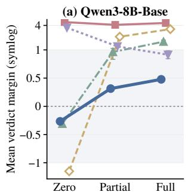

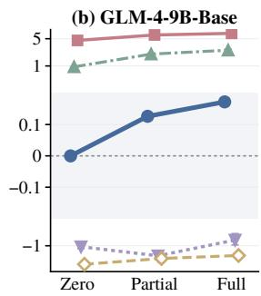

Figure 10: Mean verdict margin on the 1,150 chargeestablished CAIL-MC test facts rewritten at three evidence levels, with (a) Qwen3-8B-Base and (b) GLM-4- 9B-Base. The vertical axis is linear within [−1, 1] in (a) and [−0.2, 0.2] in (b) (shaded) and logarithmic beyond; error bars are 95% confidence intervals.
<table><tr><td colspan="4">Judged established (%)</td></tr><tr><td>Method</td><td>Zero↓</td><td>Partial Full↑</td><td> $\Delta s \uparrow$ </td></tr><tr><td>Unedited</td><td>93.8</td><td>94.8</td><td>97.7 0.58</td></tr><tr><td>Uniform shift</td><td>0.2</td><td>34.8 69.4</td><td>0.58</td></tr><tr><td>SFT</td><td>100.0</td><td>98.3 99.0</td><td>-0.25</td></tr><tr><td>PROSE</td><td>10.3</td><td>76.0 86.1</td><td>0.74</td></tr></table>

Table 8: Share of the rewritten CAIL-MC facts judged as establishing the charge with Qwen3-8B-Base, and the mean margin change from Zero to Full (∆s). The uniform shift is the matched-repair control of Sec. 6.3.

with the main protocol. Fig. 10 plots the mean margins of the same five methods as Fig. 3; Tables 8 and 9 give the rates and the exact margins.

The pattern of Track 2 holds in-domain. PROSE is again the only method that, on both backbones, keeps the accusation-only margin at or below zero and the full-fact margin above it, rising from −0.27 to 0.48 with Qwen and from −0.0001 (95% CI $[ - 0 . 0 0 4 , 0 . 0 0 4 ] )$ to 0.17 with GLM. SFT stays far above the boundary at every level: with Qwen its margin is highest for the accusation alone (4.84 vs. 4.59 for the full facts), and with GLM it remains above 4.5 even for the accusation alone. With Qwen, AlphaEdit also peaks at Zero, and LJPIV and MEMIT separate Zero from Full; with GLM, however, LJPIV places every level above zero and both editors place every level below it.

PROSE keeps the response to evidence. Given the accusation alone, unedited Qwen establishes the charge for 93.8% of the texts, nearly as often as with the full facts (97.7%). PROSE lowers this rate to 10.3% while still establishing 86.1% of the fully evidenced texts, and it steepens the margin increase from Zero to Full from 0.58 to 0.74. The uniform shift reaches a lower Zero rate (0.2%) only by also rejecting 30.6% of the fully evidenced texts, and by construction it leaves the margin increase unchanged.

<table><tr><td></td><td>Level</td><td>Unedited</td><td>SFT</td><td>PROSE</td></tr><tr><td rowspan="3">Qwen</td><td>Zero</td><td>0.304 [0.293, 0.315]</td><td>4.835 [4.755, 4.921]</td><td>-0.266 [-0.281, -0.251]</td></tr><tr><td>Partial</td><td>0.568 [0.546, 0.590]</td><td>4.130 [4.003, 4.252]</td><td>0.314 [0.290, 0.339]</td></tr><tr><td>Full</td><td>0.888 [0.863, 0.911]</td><td>4.589 [4.468, 4.703]</td><td>0.478 [0.451, 0.504]</td></tr><tr><td rowspan="3">GLM</td><td>Zero</td><td>0.059 [0.055, 0.063] 4.531 [4.389, 4.674]</td><td></td><td>-0.000 [−0.004, 0.004]</td></tr><tr><td>Partial</td><td>0.179 [0.168, 0.191] 6.251 [5.944, 6.564]</td><td></td><td>0.126 [0.117, 0.135]</td></tr><tr><td>Full</td><td>0.272 [0.260, 0.284] 6.878 [6.557, 7.205]</td><td></td><td>0.172 [0.163, 0.181]</td></tr></table>

Table 9: Mean verdict margin [95% bootstrap CI] of the rewritten CAIL-MC facts at each evidence level.
<table><tr><td></td><td>Acc</td><td>F1</td><td>FGR</td><td>FNR</td><td>Rep.</td><td>G-Ret.</td><td>Off.</td><td>Unl.</td><td>Cul.</td><td>All</td></tr><tr><td colspan="11">Qwen3-8B-Base</td></tr><tr><td>0</td><td>72.30 70.11 54.78</td><td></td><td></td><td>0.61</td><td>7.46</td><td>100.00</td><td>26.02</td><td>1.10</td><td>3.83</td><td>7.46</td></tr><tr><td>U</td><td></td><td>87.96 87.87</td><td>20.35</td><td>3.74</td><td>63.53</td><td>96.76</td><td>31.71</td><td>74.03</td><td>63.58</td><td>60.29</td></tr><tr><td>C</td><td>85.91</td><td>85.69</td><td>26.43</td><td>1.74</td><td>51.70</td><td>99.19</td><td>31.71</td><td>17.13</td><td>77.96</td><td>50.89</td></tr><tr><td>OU</td><td>86.26</td><td>86.11</td><td>24.00</td><td>3.48</td><td>59.00</td><td>97.08</td><td>48.78</td><td>67.96</td><td></td><td>52.4056.24</td></tr><tr><td>OC</td><td>82.39</td><td>81.94</td><td>33.48</td><td>1.74</td><td>40.52</td><td>99.03</td><td>44.72</td><td>16.57</td><td></td><td>50.8039.55</td></tr><tr><td>UC</td><td></td><td>91.87 91.87</td><td>6.61</td><td>9.65</td><td>88.17</td><td>89.47</td><td>51.22</td><td>82.32</td><td></td><td>85.9477.96</td></tr><tr><td>OUC</td><td>91.48 91.48</td><td></td><td>8.43</td><td>8.61</td><td>85.25</td><td>90.76</td><td></td><td>56.91 77.35</td><td>83.39</td><td>976.34</td></tr><tr><td colspan="9">GLM-4-9B-Base</td><td></td><td></td></tr><tr><td>0</td><td>78.3577.91</td><td></td><td>35.65</td><td>7.65</td><td>23.94</td><td>97.10</td><td>29.44</td><td>15.32</td><td></td><td>21.0322.59</td></tr><tr><td>U</td><td>76.87</td><td>76.06</td><td>41.57</td><td>4.70</td><td>14.67</td><td>99.61</td><td>6.67</td><td>29.84</td><td>12.15</td><td>14.48</td></tr><tr><td>C</td><td>82.48</td><td>82.21</td><td>29.74</td><td>5.30</td><td>36.87</td><td>98.65</td><td>17.22</td><td>8.06</td><td></td><td>68.2236.10</td></tr><tr><td>OU</td><td>81.43</td><td>81.23</td><td>29.04</td><td>8.09</td><td>37.64</td><td>96.53</td><td>35.56</td><td>42.74</td><td></td><td>31.31 35.52</td></tr><tr><td>OC</td><td>85.00</td><td>84.96</td><td>20.09</td><td>9.91</td><td>55.98</td><td>94.98</td><td></td><td>39.4420.97</td><td></td><td>80.84 52.12</td></tr><tr><td>UC</td><td>84.7484.6024.78</td><td></td><td></td><td>5.74</td><td>47.10</td><td>98.07</td><td></td><td>17.2234.68</td><td></td><td>76.64 45.95</td></tr><tr><td></td><td>OUC 87.17 87.17 15.04 10.61 67.37</td><td></td><td></td><td></td><td></td><td>94.02</td><td></td><td>42.2253.2384.11 62.16</td><td></td><td></td></tr></table>

Table 10: Stage ablation on CAIL-MC (%). O / U / C denote the Offense, Unlawfulness, and Culpability updates; OUC is PROSE. The right block gives PSR on the strict false-guilty test pairs of each stage and on all of them.

No threshold repairs SFT. SFT establishes the charge for nearly every text at every level, and its mean margin is lower for Partial (4.13) and Full (4.59) than for Zero (4.84), so its margin does not grow with evidence $( \Delta s = - 0 . 2 5 )$ . A different threshold cannot fix this: we raise the SFT threshold until its Zero-level rate is closest to that of PROSE, which happens at t = 6.25 given tied margins (12.5% vs. 10.3%). The Partial and Full rates then drop to 12.7% and 18.7%, so fully evidenced texts are rejected almost as often as accusationonly ones, and on the CAIL-MC test pairs FNR rises from 0.26 to 52.61 (Acc 73.65, PSR 37.60). SFT’s verdicts therefore do not encode evidence sufficiency at any operating point.

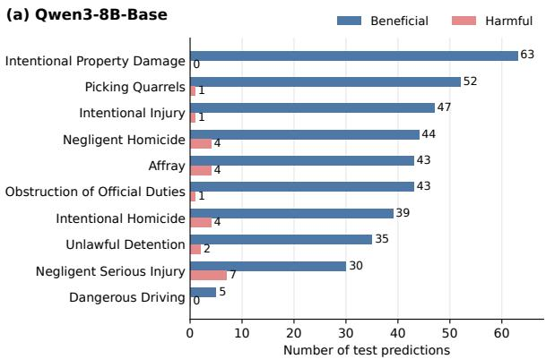

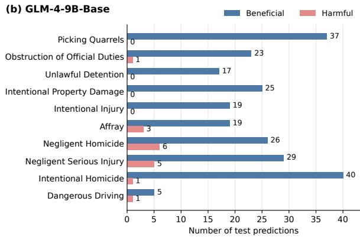  
Figure 11: Effect of editing on the ten most frequent charges in the CAIL-MC test split. Beneficial: test predictions that editing flips from incorrect to correct; harmful: predictions it flips from correct to incorrect.

## F Three-Stage Update Ablation

To examine whether the three legal stages provide complementary repair coverage, we retain only the Offense (O), Unlawfulness (U), or Culpability (C) update, their pairwise combinations (OU, OC, and UC), or all three updates (OUC). All other parts of PROSE remain unchanged. Tab. 10 reports caselevel metrics and pair-level repair and retention, with PSR also broken down by the changed legal stage and reported over all strict false-guilty pairs.

The effects are stage- and backbone-dependent rather than monotonic. Combining stages generally broadens coverage, and OUC gives the strongest pooled PSR on GLM. On Qwen, UC has a slightly higher pooled PSR than OUC, whereas OUC performs better on offense-stage pairs. Thus, no fixed subset dominates across backbones and legal stages and the three-stage decomposition provides complementary, stage-aware coverage.

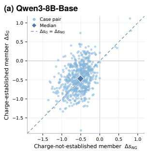

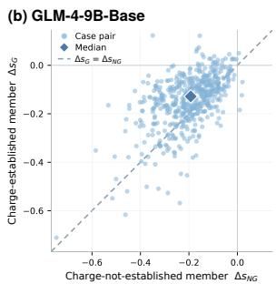  
Figure 12: Change in verdict margin of the chargenot-established member (∆s ) and of its chargeestablished counterpart $( \Delta s _ { G } )$ for each strict false-guilty CAIL-MC test pair under PROSE, on (a) Qwen3-8B-Base and (b) GLM-4-9B-Base. The diamond marks the medians; a uniform output shift would place every pair at a single point on the dashed diagonal.

## G Additional Analyses

## G.1 Charge-Level Effects

Fig. 11 counts, for the ten most frequent charges in the CAIL-2018 test split, the test predictions that editing flips. On both backbones, flips from incorrect to correct outnumber flips from correct to incorrect for every one of these charges, so the gain is not concentrated in a few charges.

## G.2 Pair-Level Margin Changes

Fig. 12 plots the margin change of both members of every strict false-guilty test pair under PROSE. A uniform output shift would place all pairs at one point on the diagonal; instead, the displacements spread widely across pairs, and within a pair the charge-not-established member tends to move slightly further than its counterpart. The median changes $\Delta s _ { N G }$ and $\Delta s _ { G }$ are −0.51 and −0.47 with Qwen and −0.19 and −0.13 with GLM, and the median within-pair difference is −0.066 with Qwen (95% CI [−0.106, −0.031]) and −0.049 with GLM (95% CI [−0.062, −0.041]). The advantage over a uniform shift therefore comes mainly from displacements that vary across pairs. Fig. 13 shows the underlying margins of both members of every test pair before and after editing.

(a) Qwen3-8B-Base  
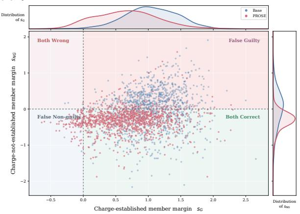

(b) GLM-4-9B-Base  
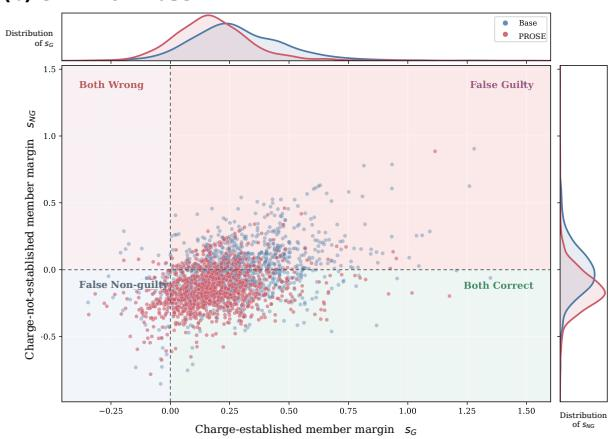  
Figure 13: Verdict margins of the charge-established member $( s _ { G } ,$ , horizontal) and the charge-not-established member (s , vertical) for every CAIL-MC test pair under the base model and PROSE, on (a) Qwen3-8B-Base and (b) GLM-4-9B-Base. The dashed lines are the decision boundaries, so the four quadrants are the four joint pair states; the marginal panels show the distribution of each margin.