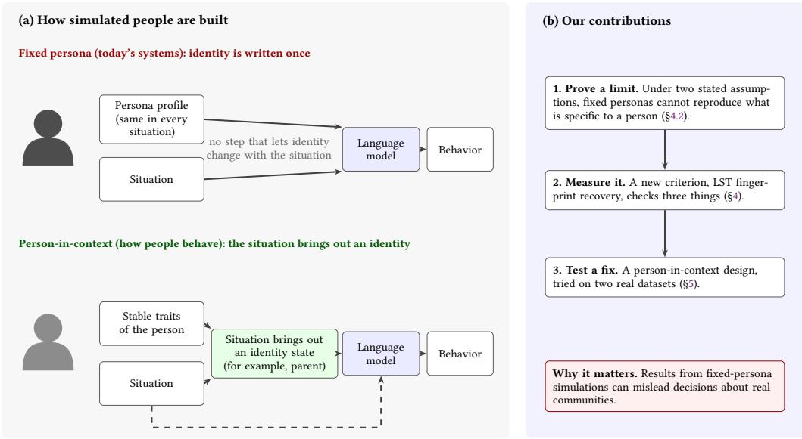
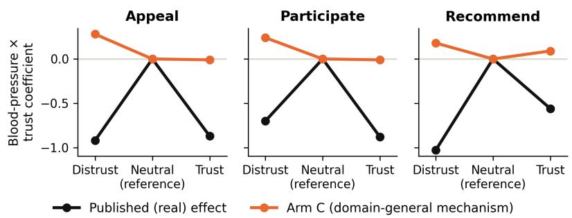
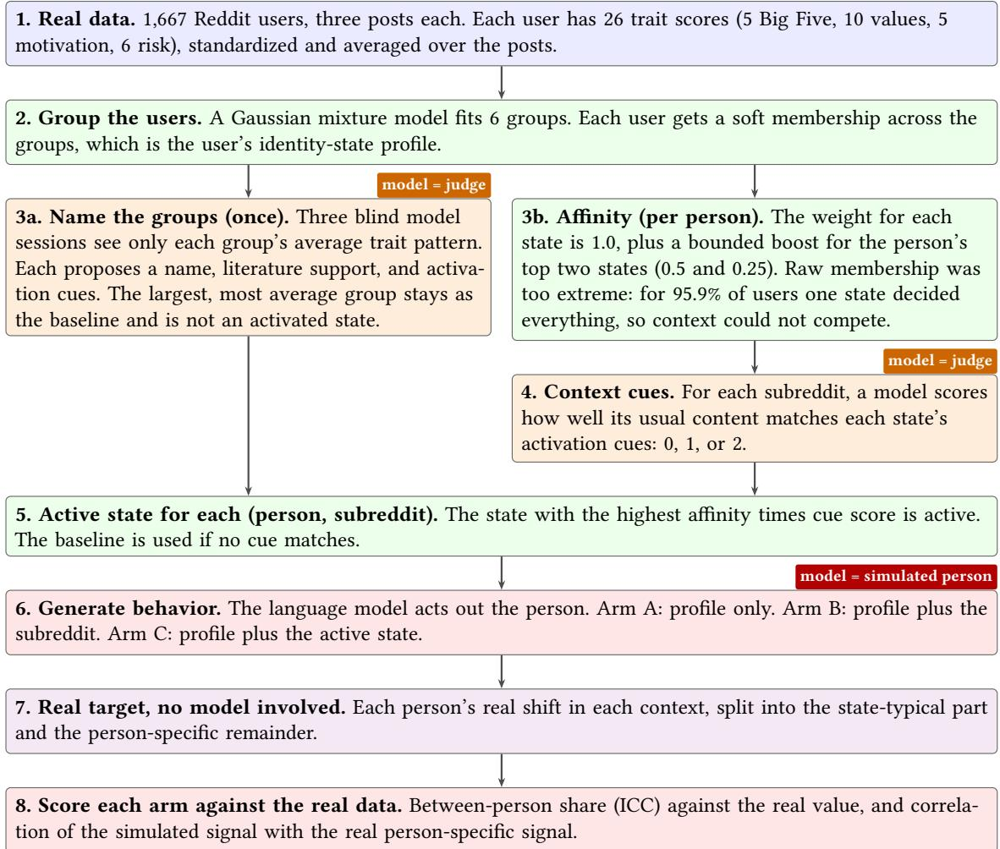
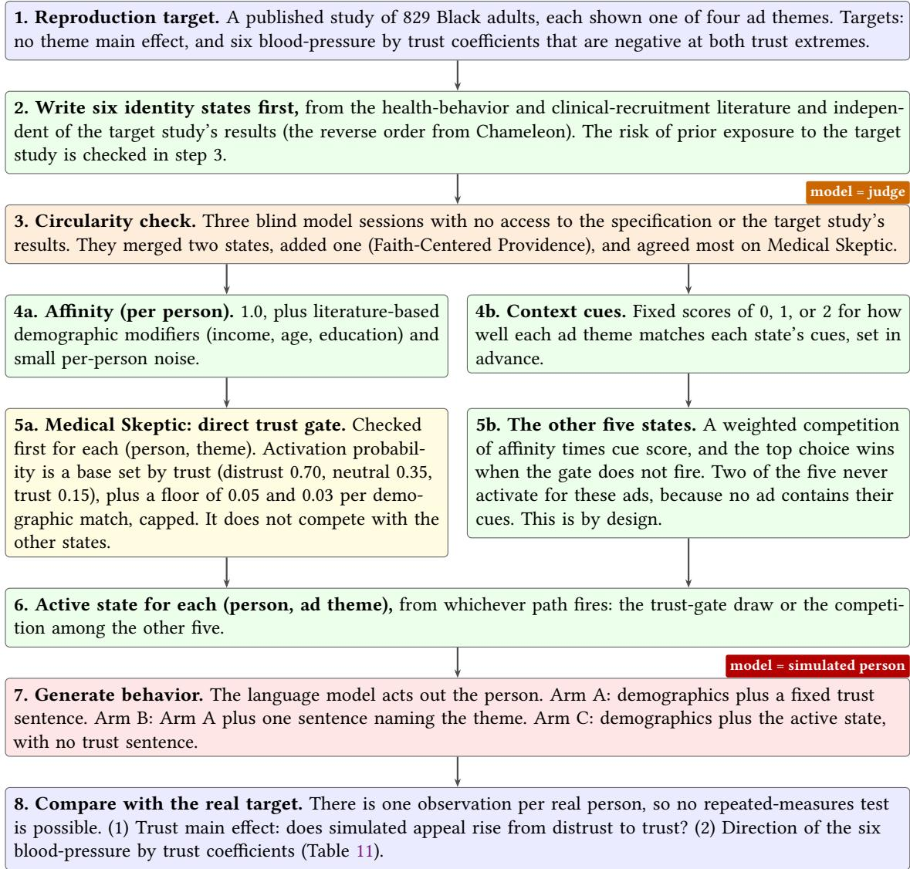
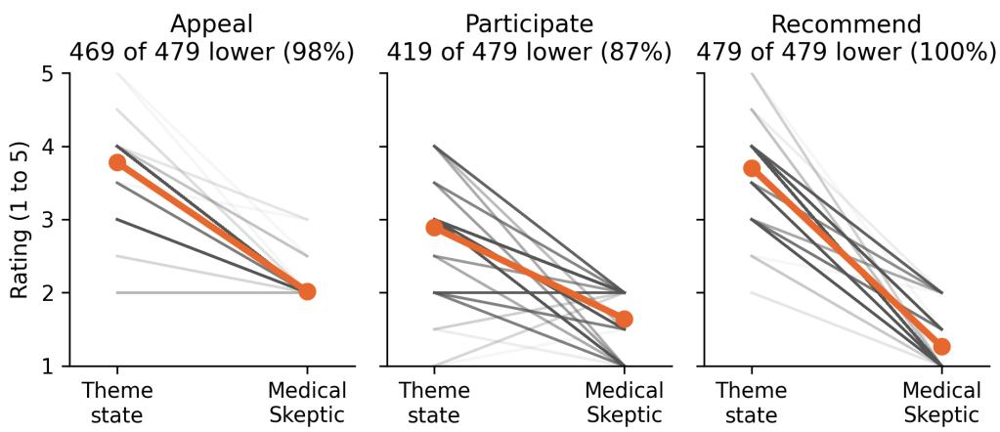

# Personas Are Not People: Identity as State, Not Atribute

TAMUNOTONYE HARRY, University of Vermont, USA

YUANYUAN FENG, University of Vermont, USA

Synthetic populations, large sets of simulated people, are increasingly used in place of real people to pretest surveys, simulate users and communities, and evaluate AI systems. Each simulated person is defined by a persona, a written profile of fixed traits, demographics, and attitudes that a language model is instructed to act out. Every such system assumes that a person’s identity is a stable attribute that behaves the same way in every situation the simulation presents. We show that this assumption is not a harmless simplification. Three decades of personality research find the opposite. How a given person behaves varies more across contexts than people vary from one another. Drawing on identity economics, which describes how diferent situations activate diferent identities and norms within the same person, we separate behavior into three parts, which are stable traits, the identity a context calls up, and the situation itself. We then prove, under two stated assumptions, that any simulation built on fixed personas, no matter how detailed the personas or how large the underlying model, cannot reproduce the part of a population’s behavior that is specific to it and its circumstances. We propose a new evaluation criterion based on this result and a person-in-context design that can meet it in principle. We test one version on a naturalistic Reddit personality corpus and on a published clinical-trial recruitment survey of a community with documented distrust of medical institutions. The design does produce context-dependent behavior when tested directly, but in neither setting does it fully match the real population, and we show where it falls short. The consequence for practice is a risk that synthetic-population evaluations misrepresent the groups whose behavior is most shaped by context, a distortion that richer personas cannot correct.

Additional Key Words and Phrases: synthetic populations, LLM personas, AI evaluation, within-person variance, context-dependent behavior, identity, representational harm, personality psychology, simulation of human behavior

## 1 Introduction

Companies and researchers now pretest surveys, products, and messages on AI-simulated populations before asking real customers or citizens, and some propose using the simulations instead of asking at all [4, 8, 21]. Some systems already hold billions of simulated people [21], built in part from hundreds of hours of real interviews [25]. These systems share one design choice. Each simulated person is a persona, a written profile, vector, or interview transcript that is prepared before the simulation runs. Some systems retrieve diferent parts of it for diferent questions, but what is stored about the person never changes. A persona therefore fixes the person’s identity too, which we take from Akerlof and Kranton [1] to mean a person’s sense of self as a member of a social category, along with the norms for how members of that category act. A real person holds several identities, such as employee, parent, or friend, and which one is active depends on the situation, so the same person may be formal and careful in a meeting with colleagues and relaxed and joking at dinner with friends (§3.1). Current persona designs cannot represent this shift. Any change in behavior across situations is the large language model (LLM) improvising, and the persona itself never changes (Figure 1).

In personality psychology, most of the variation in trait-related behavior is within persons rather than between them [11, 12]. Identity economics [1, 2] ofers an account of this variation. A person belongs to several social categories, each category carries norms for how its members act, and the situation determines which category is active and therefore which norms the person follows (§2.2). Recent work has started to notice the symptoms. Studies report that fixed personas collapse toward a typical default [23] and compress variation within demographic groups [39], while other work lets the personality of a single dialogue agent shift as a conversation unfolds [27, 40]. To our knowledge, none of this work says what a simulated population must reproduce to behave like a real one, and none represents identity as a state that context activates (§2). Existing validation does not fill that gap either. Persona adherence [21] asks whether a simulated person acts as its profile says. Test-retest consistency and prediction of held-out survey answers [25] are internal-validity checks that ask whether a simulation reproduces what a person answered on the same kind of survey. Subgroup coverage [6] asks whether the right kinds of people are included. None of these asks the external-validity question of whether simulated people behave like real people once the situation changes. We call a test of that question a behavioral-fidelity evaluation (do simulated people respond to a new situation the way real people do?).

  
Fig. 1. (a) Today’s simulated people (top) are writen once, so the language model gets the same profile in every situation and any change in behavior is the model improvising in a way that fits anyone with that profile. In person-in-context simulation (botom), the situation first brings out an identity state, such as parent, and the model acts out that state. (b) Our contributions are a proof that the top design cannot reproduce what is specific to a person (§4.2), a criterion for measuring it (§4), and a test of one version of the botom design on two real datasets (§5)

The gap has consequences. Suppose a city emergency ofice pretests the wording of a flood evacuation alert on simulated residents, because a live test is impossible. A real resident may ignore a text from the city as one more automated message, yet leave at once when a neighbor knocks on the door or a relative calls. A persona that says “distrusts authorities” predicts that no version of the alert works, and a persona that leaves distrust out predicts that every version works. Either way, the ofice chooses its wording and its messenger on the model’s guess, and the residents who most need to leave may stay. The error matters more when the simulated people stand in for patients or citizens and the decision reaches a real community (§6.3)

We make three contributions.

(1) Can richer personas fix this? No, and we give a formal proof. Any simulation built on a fixed persona cannot reproduce what is specific to a person beyond their group’s typical response, however detailed the persona and however large the model. The proof relies on two stated assumptions, and we test how it degrades when they only roughly hold (§4.2, Appendix B).

Manuscript submitted to ACM

(2) How would we know? A new evaluation criterion. Latent State-Trait (LST) fingerprint recovery has three parts. It asks how much of the variation in behavior is between people, how much comes from particular people in particular situations, and whether a simulation tracks each person’s specific response. The proof shows that, in principle, fixed personas cannot meet the third check (§4).

(3) What would work? A person-in-context design and two tests ofit. We build a person-in-context approach, in which a situation selects an identity state that the language model then acts out, and we test it against fixed personas on two real datasets. Fixed personas make each person behave almost the same in every situation, far more than real people do, and our design comes closer on all five personality traits we tested. On a published clinical-trial recruitment study, our design reproduces the overall efect of trust on how respondents rate the ads, and its behavior changes as expected when the identity state is switched. It does not reproduce the study’s central finding that which ad theme works best depends on how much a person trusts the healthcare system, and we explain why in §5. Person-specific signal is near zero for every system we test, so that test cannot yet separate them.

In principle, a person-in-context design can represent person-specific response to context, which a fixed persona provably cannot. In our tests, the implementation we built reproduces some features of the real data, such as the efect of trust, but not yet the finding that the best ad theme depends on trust. Closing that gap is an open problem.

## 2 Related Work

Our contribution connects three bodies of work that have not been brought together, namely synthetic populations for AI evaluation, behavioral science on how people act in context, and the critique of representational harm in generative systems.

## 2.1 Synthetic populations for AI evaluation

Simulated people are used for LLM-based evaluation in many ways, for example to pretest survey questions, to simulate public opinion, and to stress-test chat systems with simulated users. These systems fall into three families, which difer in how they represent identity.

The fixed-persona family dominates current systems. A persona, whether a categorical vector, a written profile, or an interview transcript, is set up in advance and does not change with the situation. MatrAIx [21] is the current large-scale example, with 8.3 billion persona records, a 1,290-dimension schema, and a 91.5% persona-adherence rate. Park et al. [25] use two-hour interview transcripts as personas for 1,052 people, and report that, on held-out General Social Survey items, interview-based agents reach 83% of participants’ own test-retest consistency. Argyle et al. [4] condition on demographics with lighter personas. Bisbee et al. [8] find that such synthetic survey responses have much less variance than real respondents, and that many regression coeficients difer significantly from human data. In this family, context stays outside the persona, and the language model alone supplies any adaptation.

The memory-evolving family adds accumulated experience to a fixed persona. Generative Agents [24], SOTOPIA [45], Concordia [37], OASIS [43], and AgentSociety [26] give agents a memory stream with reflection or planning. Variation then follows what has happened to the agent, closer to a diary than to identities that the present situation brings out.

The person-in-contextfamily treats identity as a state that context activates. It has theoretical roots in self-categorization theory and multiple-self-aspects frameworks [22], and related computational work exists for single dialogue agents. Pielage et al. [27] model an assistant’s personality as latent states in a state machine whose transitions follow the conversation. Wei et al. [40] steer persona-related neurons in a model according to the situation. Lee et al. [19] build a persona from social identity, personal identity, and life context. These works adapt one agent within an interaction or enrich a single persona. We found none that represents a population of people with context-activated identities and tests it against real within-person variation. That is the gap we address.

Concurrent critiques. Several recent studies conclude from diferent angles that fixed personas are the wrong uni for population simulation. They report collapse toward a typical default in some scenarios [23], declining observerrated persona expression over long conversations [14], subgroup-specific distortions from multi-attribute personas [34], inconsistent subgroup alignment from sociodemographic prompting [33], and compressed variation within demographic groups, for which a longitudinal memory remedy is proposed [39]. None derives an evaluation criterion from within-person variance or proposes a context-activated identity design.

## 2.2 Behavioral science on person-in-context

In personality research, most of the variation in trait-related behavior is within persons, from one moment to the nex [12]. This helped resolve the person-situation debate of the 1990s [11, 13]. Latent State-Trait (LST) theory [31, 32] splits behavior into trait, state, and error, and variance ratios akin to intraclass correlations give each part’s share. Whole Trait Theory, which came later, describes a trait as a distribution of states around a stable level [11, 13]. Inspired by both, we write behavior as $\begin{array} { r } { Y = \tau + s ( X ) + \varepsilon , } \end{array}$ a stable level plus a response to the situation plus noise. In §3.1 we extend �(�) with a person-specific, context-activated term $I _ { p , c , t }$

One study applies these methods to language-model behavior directly [18]. In a Reddit corpus, it finds that most variance is within persons, about 72 to 74% across the 26 trait dimensions it measures, without removing measurement noise, in line with the psychological literature. It also finds that language models prompted with personas do not track context-driven change, which it calls state-blind. Han et al. [16] also use Whole Trait Theory to read LLM agents and find that one personality prompt is expressed diferently across four conversational settings.

Identity as a building block. Akerlof and Kranton [1, 2] treat identity as a variable in a person’s decisions, with actions judged against the norms of the identity that is active. Trait Activation Theory [35] reaches a compatible view, that situations activate traits through cues, and self-categorization theory [36] and the multiple-self-aspects framework [22] agree. We found no synthetic-population system or evaluation built on any of them.

## 2.3 Representational harm in generative systems

Representational harm connects this work to questions of fairness and accountability. A synthetic population that flattens a group misrepresents that group, and decisions made from it reach real communities. Bender et al. [7] warn that scaling language models without attention to whose language is represented risks amplifying dominant viewpoints Blod ett et al. [9] ar ue that work on “bias” often does not sa which harms to which communities it addresses. Our criterion responds to this by naming one specific distortion, flattening of context-dependent behavior, and measuring it Wang et al. [38] show that replacing human participants with LLMs can misportray and flatten identity groups. Two findings concern persona-based systems directly. Xiao et al. [42] find that models with the highest per-persona fidelity produce the most polarized populations, so persona adherence and population fidelity can pull apart. Batzner et al. [6] find that only 35% of 63 persona-based LLM studies report anything about representativeness. That is a separate problem, since a representative, transparently sampled set of personas is still fixed and would still fail our criterion. These critiques name the outcome but not its cause. We locate the flattening in one design choice, identity as a fixed attribute of the persona, which cannot match the real structure of within-person variation. Richer personas do not remove it.

Manuscript submitted to ACM

## 2.4 Gap

Behavioral science models how people act in context, and identity economics accounts for the mechanism. Neither has been built into a synthetic-population system and tested there against real within-person variation, and current validation does not check for it. We add what the critique literature lacks (§2.1, §2.3), namely an explanation of why these failures occur, a new evaluation criterion derived from it (§4), and a formal result (§4.2) that, under two stated assumptions, the failure comes from the design, whatever the scale or prompting.

## 3 Framework: Person-in-Context Simulation

We split behavior into three parts, which are a stable attribute of the person, an identity state that the situation brings out, and the situation itself.

## 3.1 A Decomposition of Behavior

Let � index persons, � contexts, and � the time point of an observation. A person can return to the same context at a diferent time point, for example the same subreddit a week later. In plain terms, behavior depends on who a person stably is, which identity the situation brings out, and what the situation demands. We write

$$
Y _ { p , c , t } = f ( \tau _ { p } , I _ { p , c , t } , X _ { c , t } ) + \varepsilon _ { p , c , t } .
$$

• $\tau _ { p }$ is the person’s stable attribute vector, made up of demographic attributes (such as age or income), habits, values, and dispositions that stay roughly the same across situations. Big Five inventories and values surveys measure the psychological part.

$I _ { p , c , t }$ is the identity state that the situation brings out. It is chosen from a set of possible identity states, each with its own norms for how a person in that state acts. Identity economics, Trait Activation Theory, self-categorization theory, and multiple-self-aspects frameworks motivate this (§2.2).

$X _ { c , t }$ is the situation, meaning the linguistic, social, and situational features of context � at time �.

• � produces behavior from the three inputs. In the systems we study it is a large language model, and our results do not depend on how it works inside.

$\varepsilon _ { p , c , t }$ is mean-zero noise specific to one time point, the part none of the other terms explain.

Applying the law of total variance twice, first conditioning on $\tau _ { p }$ and then on $( I _ { p , c , t } , X _ { c , t } )$ , splits the variance of � into a between-person part, a within-person part driven by � and �, and noise:

$$
\operatorname { V a r } ( Y ) = \underbrace { \operatorname { V a r } _ { \tau } [ \mathbb { E } ( Y \mid \tau ) ] } _ { \mathrm { b e t w e e n - p e r s o n } } + \underbrace { \mathbb { E } _ { \tau } [ \operatorname { V a r } ( f \mid \tau ) ] } _ { \mathrm { w i t h i n - p e r s o n } \ \mathrm { v i a } \ I , X } + \operatorname { V a r } ( \varepsilon ) .
$$

Variation within a person can arise even without �. A fixed persona still behaves diferently when $X _ { c , t }$ changes, because � responds to the situation directly. What requires $I _ { p , c , t }$ is narrower, namely the part of within-person variation that is specific to the person. This is the interaction between who the person is and which situation they are in, which difers from the response to the situation that all persons share. Only when $I _ { p , c , t }$ changes with context for a fixed person can this interaction be guaranteed to be person-specific. Otherwise it could be a side efect of how � handles $( \tau _ { p } , X _ { c , t } )$ This is the property that the criterion in §4 detects. The decomposition has the standard form of multilevel models in personality psychology [28, 30] and of Latent State-Trait theory [31, 32]. Our contribution is to use it as a specification for synthetic populations.

## 3.2 Kinds of Systems and Their Interface

A simulation system stores a representation of each person, builds a prompt for each situation, and calls a language model. The inputs that the model’s generation call receives are the system’s interface. A single-call system produces each response with one such call. A system with subroutines runs extra steps first, such as a rule or a second language-model call that scores which identity a situation brings out, and passes the result into the interface. The interface is then the full list of inputs to the generation call, whether they come from storage or from a subroutine. In the appendix, the generation function �LLM also carries independent sampling noise $\eta _ { p , c }$ (random variation in the generated text, so the same input can give diferent responses on diferent calls), and the time index is dropped, since the propositions concern the person-context decomposition only.

We call each design a family and each implementation a system. The families difer in which inputs reach the model, whatever the number of calls.

• Fixed-persona family. The system stores one persona $\pi _ { p }$ that never changes, so the interface is $( \pi _ { p } , X _ { c , t } )$ and only the situation changes with context. Any identity-like adaptation comes from the language model’s own inference. MatrAIx [21], Park et al. [25], and Argyle et al. [4] are in this family.

• Memory-evolving family. The system stores a persona and a growing record of past interactions $M _ { p , t }$ , so the interface is $( \pi _ { p } , M _ { p , t } , X _ { c , t } )$ [24, 26, 37, 45]. The record grows with time and is not indexed by context. The record encodes the agent’s history.

• Person-in-contextfamily. The system stores a stable attribute vector $\tau _ { p }$ and a set $\boldsymbol { { \mathcal { T } } } _ { P }$ of identity states available to the person. A subroutine $\pi _ { I }$ selects which state to activate, written $I _ { p , c , t } \sim \pi _ { I } ( \tau _ { p } , X _ { c , t } )$ . The interface is $( \tau _ { p } , I _ { p , c , t } , X _ { c , t } )$ . The set is fixed for each person, and only the realized state changes with context. This is the design we propose, and we know of no production system that uses it.

Adding subroutines to a fixed-persona system does not change its family if every subroutine reads only $\pi _ { p }$ and $X _ { c , t }$ Its output is then still a function of $( \pi _ { p } , X _ { c , t } )$ . What matters for the propositions is whether any interface input is both specific to the person and changes with context for that person. Only the person-in-context family has one.

Building $\boldsymbol { { \mathcal { T } } } _ { P }$ from data (§5.2, §5.3) showed that the set can also include a baseline state, a default that a person returns to when no context is strong, like the center of a person’s state distribution in Whole Trait Theory. Whether the set has a baseline is an empirical question. The Chameleon set has one baseline and five activated states, and the motivational-themes set has no baseline and six activated states.

## 3.3 A Limit Built Into the Fixed-Persona Design

We do not claim that fixed-persona and memory-evolving systems fail at what they were built for. Sampling varied profiles for product testing [21], simulating social dynamics in a sandbox [24], and predicting individual attitudes [25] are legitimate goals, judged fairly by their own criteria. Our claim is narrower. These systems are now proposed for behavioral simulation, which means reproducing how a population responds across contexts. For that goal they meet a target their design does not represent.

In a fixed-persona system the persona does not change with context, so no input says which identity the situation has brought out for this person. The model must infer one from the persona and the situation, or a subroutine supplies one that reads only those two inputs. Either way the output is a function of $( \pi _ { p } , X _ { c , t } )$ alone (Proposition 1, §4.2), so person-context interaction is limited by the variance that the model’s own inference adds [16, 18]. This holds for every fixed-persona system, whatever the persona format or the model. A richer persona adds between-person variance and Manuscript submitted to ACM

does not create person-context interaction. A similar argument applies to memory-evolving systems, whose memory is a within-person state but is not indexed by identity options the person can activate. Their variation follows the sequence of past events, with no role for the norms of the present situation.

The person-in-context family can represent person-specific response to context by construction. Whether a given implementation reproduces real within-person variance is an empirical question, which the criterion in §4 answers. That the family is capable of it is a property of the design, whatever the implementation. The fixed-persona failures in §5.2 and §5.3 follow from this. The memory-evolving family is open to a similar argument, but neither dataset tests it, because both compare only fixed-persona arms (A and B) with the person-in-context arm (C). Arm C’s results concern one implementation (our specification of the identity states and how they are activated). They do not change what the design itself can represent (§6.1)

## 4 Evaluation Criterion: LST Fingerprint Recovery

§3 shows that only the person-in-context family can represent $I _ { p , c , t }$ as person-specific. A new criterion turns that diference into something measurable, which we call Latent State-Trait (LST) fingerprint recovery. A fingerprint is a pattern specific enough to identify who it belongs to. A population’s LST fingerprint is how stable people are relative to one another, and how much and in what way each person varies across situations. The criterion, built on the LST variance decomposition (§3.1) [10, 31], checks whether a synthetic population reproduces the real fingerprint as well as the average response levels.

## 4.1 The Criterion

LST fingerprint recovery compares a synthetic system A with a real population on three components.

(1) Between-person share (ICC). The intraclass correlation (ICC, bias-corrected) is the fraction of all variation in behavior that comes from stable diferences between people. The rest is one person varying across situations, plus noise. A system that inflates this share treats identity as more fixed than real behavior supports.

(2) Person-context interaction variance $( \operatorname { V a r } _ { P \times C } )$ . This is the variance left after removing person and context main efects. It comes from particular people in particular contexts (§3.1). A system can match the real ICC and still show almost no interaction, because everyone reacts to context in the same way. ICC alone cannot tell these cases apart.

(3) Person-specific signal (person-specific residual correlation). This is the component our proof addresses. A fixed persona cannot reach it by design, and a person-in-context system can in principle. Two people of the same general type, for example both skeptical of institutions, still react diferently to a given situation. The shared, predictable part is state-typical. The leftover part is person-specific, the signature a system must capture if it claims to simulate that person, beyond their type

Formally, $R _ { \hat { p } , c } ^ { \mathrm { h u m a n } } = m ( \lambda _ { \hat { p } } , c ) + \Delta _ { \hat { p } , c }$ . Here $\lambda _ { p }$ is person $\boldsymbol { p ^ { \prime } s }$ soft membership across the identity states in ${ \cal T } _ { p } \ : ( \ S ^ { 3 . 2 } ;$ Appendix B), $m ( \lambda _ { p } , c )$ is the state-typical shift, and $\Delta _ { p , c }$ is the person-specific residual. The third component is the correlation between the system’s residual $R _ { p , c } ^ { \mathcal { A } }$ and $\Delta _ { p , c }$ only, leaving out the state-typical part $n ( \lambda _ { p } , c )$ The reason is that a system could match the full human residual $R _ { p , c } ^ { \mathrm { h u m a n } }$ by copying state-typical patterns that a stated persona often reveals, without representing anything specific to the person.

A population that recovers all three, with real-scale ICC, real-scale interaction variance, and non-trivial person-specific signal, reproduces the target’s LST fingerprint. A fixed persona falls short on the third component by design, as §4.2 proves. Whether a given person-in-context implementation reaches it is an empirical question.

## 4.2 A Formal Limit for the Fixed-Persona Family

Under the two assumptions below, a fixed-persona system cannot meet the third component. This is a formal result about the design, so it does not depend on tuning or on any dataset. Full statements and proofs are in Appendix B.

Mediation (Proposition 1; proof in Appendix B). The interaction residual of a fixed-persona system has the form $R _ { p , c } ^ { \mathcal { A } } = g ( \pi _ { p } , X _ { c } ) + \eta _ { p , c ; }$ , where � is independent sampling noise and $\operatorname { C o v } ( g , \eta ) = 0 .$ . It contains nothing beyond the persona, the context, and noise, however rich $\pi _ { p }$ is. This limits the correlation with the person-specific residual. It does not limit how elaborate or context-sensitive $g ( \pi _ { p } , X _ { c } )$ can be. No persona can make that sensitivity track $\Delta _ { p , c } ,$ because $\pi _ { p }$ does not change with context and carries no information indexed by person and context.

Person-specific non-transmission (Proposition 2; proof in Appendix B). A fixed-persona system’s output cannot correlate with a real person’s specific signature, and any apparent match comes from matching general type. The Key Assumption says that whoever builds the persona has no information about $\Delta _ { p , c }$ beyond the person’s identity state and demographics. The Context Exogeneity Assumption says that the context a person appears in also carries no such information. Under both, with the independence conditions in Appendix B, Cov $( R _ { p , c } ^ { \mathcal { A } } , \Delta _ { p , c } ) = 0$ exactly.

A robustness corollary relaxes both assumptions to approximate independence. If the persona leaks at most $\epsilon _ { 1 }$ and the context assignment leaks at most $\epsilon _ { 2 }$ of information about $\Delta _ { p , c } ,$ then

$$
\big | \mathrm { C o v } ( R _ { p , c } ^ { \mathcal { R } } , \Delta _ { p , c } ) \big | \leq 4 M ^ { 2 } \sqrt { ( \epsilon _ { 1 } + \epsilon _ { 2 } ) / 2 } .
$$

Here � bounds the size of the residuals, which is finite because ratings lie on a fixed scale. The quantity $\epsilon _ { 1 }$ measures how much knowing the persona tells you about $\Delta _ { p , c ; }$ , beyond identity state and demographics, and $\epsilon _ { 2 }$ measures the same for the context. Both are mutual information, and zero means no leak. The bound says a small leak allows only a small correlation, so the result degrades gradually and does not collapse. The Key Assumption is easier to defend for thin, schema-based personas than for rich ones, and the Context Exogeneity Assumption is easier to defend fo experimentally assigned contexts than for observed ones.

What the proofadds beyond the definition. The result would be empty if it only restated that a persona holds no information about $\Delta _ { p , c }$ . It says more. Proposition 1 shows that a fixed-persona output depends on the persona, the context, and noise only, for any language model and any persona, which rules out the common hope that richer personas or larger models will close the gap. The assumptions are not part of the definition, and they can fail, for example when a persona is built from a person’s own behavior across contexts. The corollary bounds the efect when they hold only approximately. The prediction can also be tested. If personas leaked person-specific information, Arm A’s correlation with the real residual would be large, and in §5.2 it is small (0.026)

What this establishes. No fixed-persona system that meets the two assumptions can reach the third component beyond a small margin set by the corollary, whatever the model scale or data. Richer prompts or larger models can improve the first two components without touching this limit.

## 4.3 Scope: What the Criterion Does Not Establish

The criterion has two limits. First, the proof concerns the third component only, so it does not say that fixed personas must show inflated ICC or near-zero interaction variance. Those are diagnostics that we report for every system in $\ S 5 . 2$ Manuscript submitted to ACM

A fixed-persona system could show real-scale ICC or substantial interaction variance and still fail the third component. Second, the result depends on the two assumptions, or their approximate version. They are claims about how personas are built and how contexts are assigned, and neither follows from context-invariance alone. A persona built from a demographic profile and a stated identity state meets the Key Assumption directly, because $\Delta _ { p , c }$ is by construction what such instruments cannot see. A persona built by hand-picking a person’s own responses across contexts would break it, because the persona would then contain the signal that Proposition 2 assumes it lacks.

Within this scope, the criterion gives person-in-context systems a target that fixed-persona systems cannot meet in principle, and gives any implementation of �� a concrete three-part measure. §5.2 and §5.3 apply it to two datasets.

## 5 Empirical Tests of the Criterion

The roof in §4.2 concerns what the fixed- ersona desi n can re resent. The ex eriments ask what the data show about fixed personas and what Arm C, a first, theory-motivated implementation of the alternative, achieves. In Chameleon, fixed personas (Arms A and B) place almost all variation between people, where real people show almost none, and in the motivational-themes study their agreement with the published pattern changes from 5 of 6 directions to 0 of 6 when one sentence is added. Arm C comes closest to the real variance structure on every Chameleon trait, it reproduces the efect of trust in the study, and its behavior follows the identity state it is given. Person-specific signal is near zero for every system we test, and Arm C does not yet reproduce the study’s interaction between ad theme and trust. We trace that gap to how the implementation represents trust, as a single level that does not change with context (§5.3.3), which is the flattening that §6.3 names as a risk.

We chose the two datasets for what each can test. Chameleon records three posts from each of 1,667 people in diferent subreddits. Its repeated measures within each person, scored on many trait dimensions in a naturalistic corpus, make it the direct test of the between-person share and of person-specific signal. The motivational-themes study is not a dataset in the usual sense. It is a published survey experiment with one rating set per person, and we use its reported coeficients, sample demographics, and survey wording as a target. Because the real efect is known, we can say precisely where a simulation departs from it. Where the diference does not matter, we call both of them datasets.

## 5.1 Experimental Setup

Each dataset uses the same three arms, which difer only in what the language model is told about the person. Arm A (fixed persona) states a trait of the person once, such as “skeptical of institutions”, whatever the context. Arm B (fixed persona plus context) states the same trait and adds a neutral mention of the context, which tests whether naming the situation is enough when the person does not change. Arm C (person-in-context) states no fixed trait. It computes an identity state for each (person, context) pair, and the model acts out that state. Arms A and B are fixed-persona systems and neither keeps a record of past interactions, so neither dataset tests the memory-evolving family (§3.3). Appendix Table 15 shows what the model receives in each arm, and Appendix D gives the prompt for each arm.

Arm C builds its identity states in two steps. First, we construct a set of candidate identity states for the population. For Chameleon we fit a Gaussian mixture model (GMM) a statistical method that finds rou s of similar observations in data without predefined labels. In our case the observations are users’ trait scores, so the groups are users with similar trait profiles. For the motivational-themes study we write the states from clinical-recruitment literature, independently of the target study, and check them for circularity. Second, each person’s afinity for each state is matched against the context to pick one active state. Figures 3 and 4 in the appendix diagram the two pipelines. We fix each specification before testing it on real data. Any later revision is reported as a separate, documented version (Appendix C).

Manuscript submitted to ACM

All arms use the same elicitation format, in which the model gives a short reasoning and then a rating (Appendix C.5), and the same model, Claude Haiku 4.5 at tem erature 0.7. The model enerates behavior in ever arm. In Chameleon it also scores, in separate calls, how well each subreddit matches each identity state’s cues. In the motivational-themes study, the cue scores for the four ads are fixed numbers set in the code by the authors from the specification’s activation cues. We chose Claude Haiku 4.5 because its training data end in February 2025, before the motivational-themes study was published in March 2026, whereas later models may have been trained on its preprint and could recall the results.

The two datasets test diferent parts of the criterion. Chameleon tests the first component (between-person share) and the third, person-specific signal, directly. The motivational-themes study has one observation per person, so it cannot test the third component. We compare each arm with the published aggregate coeficients instead, which tests the second component, whether the system reproduces the real person-context interaction in aggregate.

## 5.2 A Naturalistic Check: Chameleon

This check asks whether each system reproduces a known pattern in real people, in which most of what varies in their behavior is within each person, from one situation to the next, and little is between people. The target is the Chameleon dataset [18], with 1,667 Reddit users and three posts each in diferent subreddits. Each post is scored on twenty-six trait dimensions, including the five Big Five personality traits (extraversion, agreeableness, conscientiousness, neuroticism, and openness), which are the outcomes each simulation must reproduce. The other twenty-one dimensions, from values, self-determination, and risk-taking scales, describe the person in the persona. In the real data about 1% of the variation is between people, and almost all of it is within each person across situations (§2.2). This uses a bias-corrected ICC, which removes the noise that three posts per person add.

On the first component, fixed personas show the opposite of the real pattern (Table 1). The real between-person share is about 1% (mean ICC 0.013) and Arms A and B lace it at 91% and 80%. Arm C is the closest to the real value on all five traits and on average (0.285), and it recovers extraversion almost exactly (0.023 against 0.019). On the other four traits it remains above the real value, by 24 to 65 times on agreeableness, conscientiousness, and openness, and below it on neuroticism. On the third component, person-specific signal is near zero for every arm (mean correlation 0.026 for Arm A, 0.025 for Arm B, and 0.004 for Arm C), and only extraversion is significant for all three (Table 1). This is the pattern Proposition 2 predicts for fixed personas. Their small positive values are what the robustness corollary (§4.2) expects, since a persona built from scores of the user’s own posts, and subreddits that users chose for themselves, can carry a little information about that user’s specific responses. With about 4,570 comparisons per trait, the test can reliably detect a correlation of about 0.04 or more (80% power, Appendix C.1). It therefore rules out a correlation well above that size in every arm and cannot separate the arms below it, so whether the person-in-context design recovers person-specific signal remains open.

## 5.3 A Published Target: The Motivational-Themes Study

The motivational-themes study [17] asked which advertising themes make a clinical-trial recruitment ad efective for Black adults in the United States, measured by how appealing respondents found the ad and how willing they were to participate and to recommend the trial. It also measured each respondent’s trust in the healthcare system, because distrust of medical institutions is documented in this community [5, 29] and could change how a theme lands. We use its published results as the target.

Manuscript submitted to ACM

Table 1. Chameleon results by trait and arm. ICC is the bias-corrected between-person share, and bold marks the arm closest to the real value. Person-specific correlation is the correlation with the real residual $\Delta _ { p , c } ,$ bold marks the highest value in a row, and an asterisk marks a 95% interval that excludes zero (Appendix Tables 4 and 5)
<table><tr><td rowspan="2">Trait</td><td colspan="4">ICC (between-person share)</td><td colspan="3">Person-specific correlation</td></tr><tr><td>Real</td><td>Arm A</td><td>Arm B</td><td>Arm C</td><td>Arm A</td><td>Arm B</td><td>Arm C</td></tr><tr><td>Extraversion</td><td>0.019</td><td>0.954</td><td>0.861</td><td>0.023</td><td>0.039*</td><td>0.064*</td><td>0.030*</td></tr><tr><td>Agreeableness</td><td>0.009</td><td>0.933</td><td>0.891</td><td>0.574</td><td>0.010</td><td>0.012</td><td>-0.020</td></tr><tr><td>Conscientiousness</td><td>0.022</td><td>0.901</td><td>0.800</td><td>0.585</td><td>0.033*</td><td>0.012</td><td>-0.005</td></tr><tr><td>Neuroticism</td><td>-0.007</td><td>0.828</td><td>0.596</td><td>-0.248</td><td>0.035*</td><td>0.028*</td><td>0.004</td></tr><tr><td>Openness</td><td>0.020</td><td>0.930</td><td>0.846</td><td>0.489</td><td>0.011</td><td>0.008</td><td>0.011</td></tr><tr><td>Mean</td><td>0.013</td><td>0.909</td><td>0.799</td><td>0.285</td><td>0.026</td><td>0.025</td><td>0.004</td></tr></table>

5.3.1 Seting and Reproduction Target. The study surveyed 829 Black adults. Each saw one of four ad themes (contribu tion to science, community benefit, blood-pressure management, financial compensation), a between-subject design. They rated appeal, willingness to participate, and willingness to recommend on 5-point scales. The target has two parts. First no theme has a si nificant main efect on an outcome $\left( \phi = . 2 5 \mathrm { t o } \ . 9 3 \right)$ . Second, theme and trust interact for the blood-pressure theme. All six blood-pressure by trust odds ratios are below 1 at both trust extremes relative to neutral, which means lower odds of a favorable ratin . Si nificance alternates b outcome between the trust side and the distrust side. The target is this six-coeficient directional pattern, which is stricter than significance at both extremes (Appendix Table 10 lists the published design and values). For each arm we estimate the same six interactions and compare their signs with the published ones. The main analysis is a linear model in rating points with the contribution-to-science theme and neutral trust as baselines, and Appendix Table 11 repeats the comparison under seven analysis specifications.

The theme main efect does not separate the families, but the interaction is informative, since it requires the same theme to evoke a diferent response depending on a person-level trait. A fixed persona can reproduce part of this pattern in aggregate, because the language model links a stated trait to the ad text on its own. It cannot represent an identity that changes with the theme. The aggregate interaction is therefore a coarse test of whether a system represents the shift, since it cannot show whether any single simulated person changed.

5.3.2 Materials and Cohort. All three arms see the study’s advertisement text and outcome wording word for word. Arm C uses six identity states written from the literature (Appendix C.3). The Medical Skeptic state, on which the target interaction depends, is driven mainly by trust tier (activation probability 0.70 for distrust, 0.35 for neutral, 0.15 for trust), with capped demographic modifiers that cannot outvote trust. Appendix C.3 gives the calibration history.

Assignment is between-subject, as in the original study. We use 6,632 demographically resampled personas, one theme each, and all three arms run on identical cells. As §5.1 explains, Claude Haiku 4.5’s training data end in February 2025, thirteen months before the study’s publication, which makes contamination unlikely.

5.3.3 Results. The generative step responds to the active state. In the full run, 479 of 6,632 personas received, by chance, at least one response under an active Medical Skeptic state and one under their theme’s own state. The paired within-person diference is large and consistent (−1.76 appeal, −1.24 participate, −2.44 recommend), with the same direction in 87 to 100% of personas (Appendix Figure 5). A forced, matched 30-per-condition check gives non-overlapping 95% intervals. Switching a persona’s active state reliably changes behavior in the expected direction.

Manuscript submitted to ACM

  
Fig. 2. The real published efect dips at both trust extremes (all six coeficients negative), while the domain-general mechanism shows no dip at either extreme (all six simulated coeficients are −0.01 or higher). Published coeficients are log-odds and simulated ones are rating points, so the figure compares shape and sign only. A single-axis activation mechanism cannot resolve this mismatch by calibration alone.

$A t n = 6 { , } 6 3 2$ , Arm C reproduces the trust main efect but not the interaction. An initial $n = 8 2 9$ run, matching the ori inal stud was ambi uous. Interaction efects need lar er sam les than main efects to detect so the cohor grew to $n = 6 { , } 6 3 2$ , with roughly 500 to 630 personas per critical cell. At this size Arm C shows a large, precise trust main efect. Mean appeal rises from 2.41 (distrust) to 3.04 (neutral) to 3.42 (trust), tracking the activation rate of the Medical Skeptic state (0.78, 0.43, 0.22; cell means in Appendix Table 13). For the six blood-pressure by trust coeficients, we compare the direction of each simulated interaction with the published one (Appendix Table 11, row 2). Arm C matches 2 of 6, and both matches are coeficients close to zero. Arm A matches 5 of 6. Arm B, which adds only a theme sentence to Arm A, matches 0 of 6. Two arms that difer by one sentence give opposite directions, so a fixed persona’s agreement with the published direction reflects incidental wording, so it is weak evidence that the persona represents the mechanism. Guessing would match 3 of 6 on average, so a count is a coarse test. The larger sample ruled out under-sampling as the explanation, and did not produce the interaction

The diagnosis concerns structure. The Medical Skeptic state’s activation floor is the same for all four themes by desi n. It can shift the level of activation b theme but not the slope of the res onse to trust. Onl a theme-de enden slope can produce an interaction. Without one, the model yields a general main efect, and this limit holds at any sample size. Arm C also rates the blood-pressure theme lower than the contribution-to-science theme at every trust level (mean appeal 2.78 against 3.16 at neutral trust; Appendix Table 13), a theme main efect the real study did not find. For Arm A the limit comes from the design (Propositions 1 and 2). For Arm C it is a gap in this particular ��, and the natural-experiment check shows the mechanism itself is not barred from closing it (Appendix Table 3 summarizes both datasets).

A theory-motivated refinement does not close the gap. Amplifying the trust-linked state’s activation spread for the blood-pressure theme (fixed before evaluation, Appendix C.3) does not raise the match count under the contributionto-science baseline (1 of 6, against 2 for the domain-general mechanism). With a pooled-theme baseline it reaches 3 of 6, and Arm A falls to 2 or 3, so the order of these arms depends on the baseline. We make no claim that the refinement im roves on the domain- eneral mechanism, and because the am lified theme was chosen knowin where the rea efect lies, it is also a weaker test. The more useful result is the shape of the real efect. All six published coeficients are negative. High-trust and high-distrust respondents both rate the blood-pressure theme lower than neutral-trust respondents. A mechanism that moves along one trust axis cannot produce a dip at both extremes (Figure 2). Manuscript submitted to ACM

## 5.4 Interpretation: What Both Datasets Show

Neither dataset tests whether the person-in-context family is capable of context-dependent behavior, since the naturalexperiment and forced-contrast checks in §5.3.3 show that it is. They test whether this implementation of �� closes the gap in practice, which Proposition 2 does not address.

The failure can be diagnosed. The real efect dips at both trust extremes, a shape that no single-axis mechanism can represent (Figure 2), which is why the theme-amplified refinement produces no gain in Appendix Table 11. Chameleon adds a complementary view. Its real within-person signal is faint, so it tests whether the implementation’s gain in aggregate variance carries over to person-specific signal, and so far it does not (§5.2). Appendix Table 3 sets the two datasets side by side. Together they show what the implementation already does, which is to produce behavior that follows the active state, and where work remains, in the choice of state and its link to person-specific signal.

## 6 Discussion

## 6.1 What the empirical tests show, and what they do not

The proof and the implementation are separate questions. Propositions 1 and 2 (§4) concern the design, and the experiments concern one implementation of the alternative. The dificulty in those tests concentrates in ��, the step that selects the identity state, while the generative step, � , performs well (§5.4).

Some of what we observe comes from the language model as well as from the design. Ratings follow a stated trait almost mechanically, and Arm A’s appeal ratings sit close to 2, 3, and 4 for distrust, neutral, and trust in every theme (Appendix C.4). One added sentence reversed five of the six interaction coeficients (Arm B). And the model respond strongly and in the expected direction when its active identity state is switched (§5.3.3), so the weak point is choosing the state. Acting it out works. The theory does not supply these facts about language models as simulators, and they should be rechecked with other models.

## 6.2 What this changes for evaluation practice

Persona adherence is the right check for the tasks that fixed-persona and memory-evolving systems were built for, namely covering varied profiles [21], predicting individual attitudes [25], and simulating sandbox dynamics [24]. It is the wron check when such s stems are ro osed for behavioral simulation, because §3.3 shows that a desi n can satisfy persona adherence and still be unable to produce the person-context interaction that behavioral simulation needs. Any claim of behavioral simulation should report the criterion in §4 directly instead of inferring it from adherence or demographic accuracy.

The motivational-themes study adds guidance for the one family that can simulate behavior in principle. Because the failure sits in ��, auditing the generative step alone checks necessary behavior but not suficient behavior, so evaluations should also audit �� against real population data (Appendix C.3) and should not treat a literature-grounded specification as self-validating.

## 6.3 What this changes for identity representation

The fixed-persona design misrepresents groups whose behavior depends on context, and richer personas do not remove the problem. The distrust example from the introduction applies here, since a fixed persona stores distrust as a static attribute or leaves it out, and neither represents a state that the situation activates, as with distrust of medical institutions in the motivational-themes study [5, 29]. §5.3.3 shows the risk is concrete, because our own person-in-context design, built to represent trust as context-dependent, produces a version of the same flattening. The risk therefore appears whenever a mechanism that selects identity states under-represents how a trait depends on context.

This also moves an accountability question without removing it. A fixed persona’s content can be traced to a stated source, such as demographic conditioning or a profile instrument. A person-in-context system also needs someone to specify $\boldsymbol { { \mathcal { T } } } _ { p }$ itself (the set of identity states available to each person, §3.2), meaning which identity states exist, what activates them, and whether a behavior counts as state-typical or person-specific. That choice is an interpretation. Our own mechanism needed four locked revisions (documented versions, each fixed in writing before it was run and each prompted by a failed internal check) before it passed those checks, and the first three versions, though literature-grounded, failed them. The question shifts from what the persona says to who decides what a person’s possible identity states are.

## 6.4 Limitations

Data. The 6,632 simulated personas in the motivational-themes study match the published share of each demographic group, such as age or income, but not how those characteristics combine in real respondents. The Chameleon test uses the real users, with three posts each (§5.2). Method. The identity states are written by hand, so the results concern this implementation and say nothing about learned mechanisms (§6.5). In Chameleon, Claude Haiku 4.5 also scores how well each subreddit matches each identity state (Appendix C), in a separate call from the one that generates behavior, so shared biases may carry through, a concern raised for LLM-as-judge setups [20], and we did not test for this. In the motivational-themes study the cue scores were set by the authors, and the Medical Skeptic score was revised after a pilot (Appendix C.3). The three identity-state panels were isolated agent sessions of Claude Sonnet 5.5, one model famil with no human raters. Their a reement rules out one unluck sam le, but not a bias that all three share. Scope. The framework models cross-sectional response only, and the between-subject motivational-themes study limits that test to the aggregate interaction. The proof does not depend on any of these.

## 6.5 Forward

Three directions follow. First, §5.3.3 motivates activation mechanisms that do not move along a single trust axis, since the real efect dips at both trust extremes. One outcome can arise from diferent states, for example institutional distrust at one extreme and a diferent skepticism at the other. Second, it is open whether the baseline-plus-activated-states structure in §3.2 is general or specific to Chameleon. A related test is whether Arm C does best on the trait whose context cues are clearest, which could explain why it recovers extraversion (§5.2). We have not tested this. Third, because the dificulty sits in $\pi _ { I } ,$ it could be learned against held-out real data instead of set by hand [41], for example with an input-driven switching state-space model in which context drives transitions between identity states and a language model writes the behavior from the current state. Testing it needs longitudinal data that our datasets lack.

## Ethical Considerations

Data and human subjects. We collected no new human-subjects data, and both datasets are already published. Chameleon is a public dataset of pseudonymous trait scores computed from public Reddit posts. It keeps the original post identifiers, so a record could in principle be linked to a public post. We made no attempt to identify, link, or contact any user, and we report results only in aggregate. The motivational-themes study contributes its published coeficients, sample demographics, and survey wording [17]. We used the advertisement text only as a fixed input to language models, and Manuscript submitted to ACM

did not use it to recruit or contact anyone. An institutional review board determined through its self-determination process that the project is not human-subjects research.

Population construction and the risk of encoding stereotypes. The identity-state specification in §5.3 was built for a population, Black adults evaluating clinical-trial recruitment materials, for whom misrepresentation has real stakes, given the documented history of harm and eroded trust around clinical research [3, 29]. Three steps address this. The state content and demographic modifiers came from the independent health-behavior and clinical-recruitment literature, without using the target study’s results (Appendix C.3). Three isolated, blind sessions of Claude Sonnet 5.5 checked the specification without access to the target study’s findings (three sessions of one model, which are not independent raters; see §6.4). And the paper’s central claim is that institutional distrust in this population is context-activated, so assigning a static “distrusts the healthcare system” trait to a demographic group is the essentializing move the paper argues against. This does not remove the risk of misuse, because a published state specification could be separated from its context-activation framing.

Deployment risk. This work does not support replacing engagement with underrepresented populations by simulation, and our results are evidence against doing so. A reader could conclude that a validated erson-in-context s stem could substitute for focus groups, surveys, or community engagement, especially for populations that are costly to recruit. That is where substitution would do the most harm. Our mechanism was literature-grounded, checked by blind model sessions, and run on a sample eight times the size of the original study, and it still did not reproduce the published interaction. This weakens the case for treating current synthetic output as a substitute for the represented population. These methods suit stress-testing evaluation infrastructure, but decisions about real populations need independent validation.

Reproducibility. We document the specifications, the main calibration decisions, and the fixed parameters behind each result (Appendices C.1, C.2, and C.3). Code, data, and saved model outputs are at https://anonymous.4open.science/r/state-persona-eval/.

Generative AI usage statement. Generative AI tools were used for editing assistance and for re-running analyses to check reported numbers against the raw output of each experiment. The authors designed the study, ran the experiments, and take full responsibility for the content of this paper, including the accuracy of all claims, numbers, and citations. Language models are also the subject of the study, as the systems under evaluation.

## References

[1] Geor e A. Akerlof and Rachel E. Kranton. 2000. Economics and Identit . Quarterly Journal ofEconomics 115, 3 (2000), 715–753. doi:10.1162 003355300554881

[2] George A. Akerlof and Rachel E. Kranton. 2010. Identity Economics: How Our Identities Shape Our Work, Wages, and Well-Being. Princeton University Press, Princeton, NJ

[3] Marcella Alsan and Marianne Wanamaker. 2018. Tuskegee and the Health of Black Men. Quarterly Journal ofEconomics 133, 1 (2018), 407–455 doi:10.1093/qje/qjx029

[4] Lisa P. Argyle, Ethan C. Busby, Nancy Fulda, Joshua Gubler, Christopher Rytting, and David Wingate. 2023. Out of One, Many: Using Language Models to Simulate Human Samples. Political Analysis 31, 3 (2023), 337–351. doi:10.1017/pan.2023.2

[5] Katrina Armstrong, Mary Putt, Chanita Hughes Halbert, David Grande, J. Sanford Schwartz, Kaijun Liao, Noora Marcus, Mirar Bristol Demeter, and Judy A. Shea. 2013. Prior Experiences of Racial Discrimination and Racial Diferences in Health Care System Distrust. Medical Care 51, 2 (2013), 144–150. doi:10.1097/MLR.0b013e31827310a1

[6] Jan Batzner, Volker Stocker, Bingjun Tang, Anusha Natarajan, Qinhao Chen, Stefan Schmid, and Gjergji Kasneci. 2025. Whose Personae? Synthetic Persona Experiments in LLM Research and Pathways to Transparency. In Proceedings ofthe AAAI/ACM Conference on AI, Ethics, and Society, Vol. 8. 343–354. doi:10.1609/aies.v8i1.36553

[7] Emily M. Bender, Timnit Gebru, Angelina McMillan-Major, and Shmargaret Shmitchell. 2021. On the Dangers of Stochastic Parrots: Can Language Models Be Too Big?. In Proceedings of the 2021 ACM Conference on Fairness, Accountability, and Transparency. Association for Computing Machinery

Manuscript submitted to ACM

New York, NY, USA, 610–623. doi:10.1145/3442188.3445922

[8] James Bisbee, Joshua D. Clinton, Cass Dorf, Brenton Kenkel, and Jennifer M. Larson. 2024. S nthetic Re lacements for Human Surve Data? The Perils of Large Language Models. Political Analysis 32, 4 (2024), 401–416. doi:10.1017/pan.2024.5

[9] Su Lin Blodgett, Solon Barocas, Hal Daumé III, and Hanna Wallach. 2020. Language (Technology) is Power: A Critical Survey of “Bias” in NLP. In Proceedings ofthe 58th Annual Meeting ofthe Association for Computational Linguistics. Association for Computational Linguistics, Online, 5454–5476 doi:10.18653/v1/2020.acl-main.485

[10] Michael Eid and Ed Diener. 2004. Global Jud ments of Subjective Well-Bein : Situational Variabilit and Lon -Term Stabilit . Social Indicator Research 65, 3 (2004), 245–277.

[11] William Fleeson. 2001. Toward a Structure- and Process-Integrated View of Personality: Traits as Density Distributions of States. Journal of Personality and Social Psychology 80, 6 (2001), 1011–1027. doi:10.1037/0022-3514.80.6.1011

[12] William Fleeson and Patrick Gallagher. 2009. The Implications of Big-Five Standing for the Distribution of Trait Manifestation in Behavior: Fifteen Experience-Sampling Studies and a Meta-Analysis. Journal ofPersonality and Social Psychology 97, 6 (2009), 1097–1114. doi:10.1037/a0016786

[13] William Fleeson and Eranda Jayawickreme. 2015. Whole Trait Theory. Journal of Research in Personality 56 (2015), 82–92. doi:10.1016/j.jrp.2014.10.009

[14] Jana Gonnermann-Müller, Jennifer Haase, Nicolas Leins, Thomas Kosch, and Sebastian Pokutta. 2026. Maintaining Stable Personas? Examining Temporal Stability in LLM-Based Human Simulation. In Extended Abstracts ofthe 2026 CHI Conference on Human Factors in Computing Systems (CHI EA ’26). doi:10.1145/3772363.3799334

[15] Jiawei Gu, Xuhui Jiang, Zhichao Shi, Hexiang Tan, Xuehao Zhai, Chengjin Xu, Wei Li, Yinghan Shen, Shengjie Ma, Honghao Liu, Saizhuo Wang, Kun Zhang, Zhouchi Lin, Bowen Zhang, Lionel Ni, Wen Gao, Yuanzhuo Wang, and Jian Guo. 2026. A Survey on LLM-as-a-Judge. The Innovation 7, 6 (2026), 101253. doi:10.1016/j.xinn.2025.101253

[16] Bin Han, Deuksin Kwon, and Jonathan Gratch. 2026. Personality Expression Across Contexts: Linguistic and Behavioral Variation in LLM Agents. arXiv:2602.01063

[17] Tamunotonye Harry et al. 2026. Guide on Selection of Optimal Motivational Themes for Use in a Clinical Trial Recruiting Black US Adults: Survey Study. Journal ofMedical Internet Research 28 (2026), e75857. doi:10.2196/75857

[18] Tamunotonye Harry, Ivoline C. Ngong, Chima Nweke, Yuanyuan Feng, and Joseph Near. 2026. Beyond Fixed Psychological Personas: State Beats Trait, but Language Models are State-Blind. In Findings ofthe Association for Computational Linguistics: ACL 2026. Association for Computational Linguistics, San Diego, California, United States, 26440–26468. arXiv:2601.15395. doi:10.18653/v1/2026.findings-acl.1316

[19] Keyeun Lee, Seo Hyeong Kim, Seolhee Lee, Jinsu Eun, Yena Ko, Hayeon Jeon, Esther Hehsun Kim, Seonghye Cho, Soeun Yang, Eun-mee Kim, and Hajin Lim. 2025. SPeCtrum: A Grounded Framework for Multidimensional Identity Representation in LLM-Based Agent. In Proceedings ofthe 2025 Conference of the Nations of the Americas Chapter of the Association for Computational Linguistics: Human Language Technologies (Volume 1: Long Papers). Association for Com utational Lin uistics, Albu uer ue, New Mexico, 6971–6991. doi:10.18653/v1/2025.naacl-lon .356

[20] Dawei Li, Renliang Sun, Yue Huang, Ming Zhong, Bohan Jiang, Jiawei Han, Xiangliang Zhang, Wei Wang, and Huan Liu. 2026. Preference Leakage: A Contamination Problem in LLM-as-a-Judge. In Proceedings ofthe Fourteenth International Conference on Learning Representations (ICLR 2026).

[21] Xiaomin Li, Yuexing Hao, et al. 2026. MatrAIx: Simulating the World with 8.3 Billion Persona Agents. arXiv:2608.04205.

[22] Allen R. McConnell. 2011. The Multiple Self-Aspects Framework: Self-Concept Representation and Its Implications. Personality and Social Psychology Review 15, 1 (2011), 3–27. doi:10.1177/1088868310371101

[23] Gurkan Ozkan. 2026. Distribution-First Population Simulation: Collapse, Calibration, and Recall in Non-WEIRD LLM Persona Modeling arXiv:2607.18310.

[24] Joon Sung Park, Joseph C. O’Brien, Carrie J. Cai, Meredith Ringel Morris, Percy Liang, and Michael S. Bernstein. 2023. Generative Agents: Interactive Simulacra of Human Behavior. In Proceedings ofthe 36th Annual ACM Symposium on User Interface Software and Technology (UIST ’23). Association for Computing Machinery, New York, NY, USA. doi:10.1145/3586183.3606763

[25] Joon Sung Park, Carolyn Q. Zou, Jonne Kamphorst, Niles Egan, Aaron Shaw, Benjamin Mako Hill, Carrie Cai, Meredith Ringel Morris, Percy Liang, Robb Willer, and Michael S. Bernstein. 2024. LLM Agents Grounded in Self-Reports Enable General-Purpose Simulation of Individuals arXiv:2411.10109.

[26] Jinghua Piao, Yuwei Yan, Jun Zhang, Nian Li, Junbo Yan, Xiaochong Lan, Zhihong Lu, Zhiheng Zheng, Jing Yi Wang, Di Zhou, Chen Gao, Fengli Xu, Fang Zhang, Ke Rong, Jun Su, and Yong Li. 2025. AgentSociety: Large-Scale Simulation of LLM-Driven Generative Agents Advances Understanding of Human Behaviors and Society. arXiv:2502.08691.

[27] Leon Pielage, Ole Hätscher, Mitja Back, Bernhard Marschall, and Benjamin Risse. 2026. Dynamic Personality Adaptation in Large Language Model via State Machines. In Pattern Recognition: 28th International Conference, ICPR 2026, Lyon, France, August 17–22, 2026, Proceedings, Part VI, Maria De Marsico, Tin Kam Ho, Frederic Jurie, Cheng-Lin Liu, Daniel Lopresti, Ingela Nyström, Jean-Marc Ogier, Arun Ross, and Liang Wang (Eds.) Springer Nature Switzerland, Cham, 509–523. doi:10.1007/978-3-032-31673-8\_34

[28] Stephen W. Raudenbush and Anthony S. Bryk. 2002. Hierarchical Linear Models: Applications and Data Analysis Methods (2nd ed.). Sage Publications, Thousand Oaks, CA.

[29] Darcell P. Scharf, Katherine J. Mathews, Pamela Jackson, Jonathan Hofsuemmer, Emeobong Martin, and Dorothy Edwards. 2010. More than Tuskegee: Understanding Mistrust about Research Participation. Journal of Health Care for the Poor and Underserved 21, 3 (2010), 879–897. doi:10.1353/h u.0.0323

[30] Tom A. B. Snijders and Roel J. Bosker. 2011. Multilevel Analysis: An Introduction to Basic and Advanced Multilevel Modeling (2nd ed.). Sage Publications London.

[31] Rolf Steyer, Dieter Ferring, and Manfred J. Schmitt. 1992. States and Traits in Psychological Assessment. European Journal ofPsychological Assessment 8, 2 (1992), 79–98

[32] Rolf Steyer, Axel Mayer, Christian Geiser, and David A. Cole. 2015. A Theory of States and Traits—Revised. Annual Review ofClinical Psychology 11 (2015), 71–98. doi:10.1146/annurev-clinpsy-032813-153719

[33] Huaman Sun, Jiaxin Pei, Minje Choi, and David Jur ens. 2025. Sociodemo ra hic Prom tin is Not Yet an Efective A roach for Simulatin Subjective Judgments with LLMs. In Proceedings of the 2025 Conference of the Nations of the Americas Chapter of the Association for Computational Linguistics: Human Language Technologies (Volume 2: Short Papers). Association for Computational Linguistics, Albuquerque, New Mexico, 845–854. doi:10.18653/v1/2025.naacl-short.71

[34] Erika Elizabeth Taday Morocho, L. Cima, T. Fagni, M. Avvenuti, and S. Cresci. 2026. Assessing the Reliability of Persona-Conditioned LLMs as Synthetic Survey Respondents. In Companion Proceedings of the ACM Web Conference 2026 (WWW ’26 Companion). Association for Computing Machinery, New York, NY, USA, 320–329. doi:10.1145/3774905.3795477

[35] Robert P. Tett and Hal A. Guterman. 2000. Situation Trait Relevance, Trait Expression, and Cross-Situational Consistency: Testing a Principle of Trait Activation. Journal ofResearch in Personality 34, 4 (2000), 397–423. doi:10.1006/jrpe.2000.2292

[36] John C. Turner, Michael A. Hogg, Penelope J. Oakes, Stephen D. Reicher, and Margaret S. Wetherell. 1987. Rediscovering the Social Group: A Self-Categorization Theory. Basil Blackwell, Oxford.

[37] Alexander Sasha Vezhnevets, John P. Agapiou, Avia Aharon, Ron Ziv, Jayd Matyas, Edgar A. Duéñez-Guzmán, William A. Cunningham, Simon Osindero, Danny Karmon, and Joel Z. Leibo. 2023. Generative Agent-Based Modeling with Actions Grounded in Physical, Social, or Digital Space Using Concordia. arXiv:2312.03664.

[38] Angelina Wang, Jamie Morgenstern, and John P. Dickerson. 2025. Large Language Models that Replace Human Participants can Harmfully Misportray and Flatten Identity Groups. Nature Machine Intelligence 7, 3 (2025), 400–411. doi:10.1038/s42256-025-00986-z

[39] Hexi Wang, Yujia Zhou, Bangde Du, Weihang Su, Xinyuan Cao, Qingyi Pan, Qingyao Ai, Yueyue Wu, Min Zhang, and Yiqun Liu. 2026. Mitigating Identity Essentialism in LLM Agents with Longitudinal Life Trajectories. arXiv:2608.1962

[40] Zesheng Wei, Mengxiang Li, Zilei Wang, and Yang Deng. 2026. Beyond Static Personas: Situational Personality Steering for Large Language Models. In Findings ofthe Association for Computational Linguistics: ACL 2026. Association for Computational Linguistics, San Diego, California, United States, 19185–19210. doi:10.18653/v1/2026.findings-acl.958

[41] Shirley Wu, Evelyn Choi, Arpandeep Khatua, Zhanghan Wang, Joy He-Yueya, Tharindu Cyril Weerasooriya, Wei Wei, Diyi Yang, Jure Leskovec, and James Zou. 2026. HumanLM: Simulatin Users with State Ali nment Beats Res onse Imitation. arXiv preprint arXiv:2603.03303 (2026)

[42] Y. Xiao, V. J. Zhan , C. Yan , N. Ma, W. Xuan, and J. Huan . 2026. The Chameleon’s Limit: Investi atin Persona Colla se and Homo enization in Large Language Models. arXiv:2604.24698.

[43] Ziyi Yang, Zaibin Zhang, Zirui Zheng, Yuxian Jiang, Ziyue Gan, Zhiyu Wang, Zijian Ling, Jinsong Chen, Martz Ma, Bowen Dong, Prateek Gupta, Shuyue Hu, Zhenfei Yin, Guohao Li, Xu Jia, Lijun Wang, Bernard Ghanem, Huchuan Lu, Chaochao Lu, Wanli Ouyang, Yu Qiao, Philip Torr, and Jing Shao. 2024. OASIS: O en A ent Social Interaction Simulations with One Million A ents. arXiv:2411.11581.

[44] Lianmin Zheng, Wei-Lin Chiang, Ying Sheng, Siyuan Zhuang, Zhanghao Wu, Yonghao Zhuang, Zi Lin, Zhuohan Li, Dacheng Li, Eric P. Xing, Hao Zhang, Joseph E. Gonzalez, and Ion Stoica. 2023. Judging LLM-as-a-Judge with MT-Bench and Chatbot Arena. In Proceedings of the 37th International Conference on Neural Information Processing Systems (NIPS ’23). Curran Associates Inc., Red Hook, NY, USA, Article 2020, 46595–46623.

[45] Xuhui Zhou, Hao Zhu, Leena Mathur, Ruohong Zhang, Haofei Yu, Zhengyang Qi, Louis-Philippe Morency, Yonatan Bisk, Daniel Fried, Graham Neubig, and Maarten Sap. 2024. SOTOPIA: Interactive Evaluation for Social Intelligence in Language Agents. In Proceedings ofthe Twelfth International Conference on Learning Representations (ICLR 2024). arXiv:2310.11667

## A Extended Notation

This section lists the symbols used in the main text and in the proofs. The proofs drop the time index �, since they concern the person-context decomposition only.

<table><tr><td>Symbol</td><td>Meaning</td><td>Defined in</td></tr><tr><td>Indices and behavior</td><td></td><td></td></tr><tr><td>p, c, t</td><td>A person, a context, and the time point of an observation.</td><td>§3.1</td></tr><tr><td>p', c'</td><td>A person or context other than p or c, used in the proofs</td><td>Prop. 2</td></tr><tr><td> $Y _ { p , c , t }$ </td><td>Real behavior (for example a rating) of person p in context c at time t. The proofs §3.1 write  $Y _ { p , c } , \mathrm { o r } Y _ { p , c } ^ { \mathrm { h u m a n } }$  when it must be told apart from simulated behavior.</td><td></td></tr><tr><td> $\hat { Y } _ { p , c } ^ { \mathcal { A } }$ </td><td>Behavior generated for p in c by a design A, meaning a class of systems such as Def. B.1 the fixed-persona family.</td><td></td></tr><tr><td>The decomposition</td><td></td><td></td></tr><tr><td> $\tau _ { P }$ </td><td>Stable attributes of the person: demographics, habits, values, and dispositions.</td><td>§3.1</td></tr><tr><td> $I _ { p , c , t }$ </td><td>The identity state that the situation brings out for  $\scriptstyle  p .$ </td><td>§3.1</td></tr><tr><td> $\scriptstyle { \mathcal { I } } _ { p }$ </td><td>The set of identity states available to person p.</td><td>§3.2</td></tr><tr><td> $\pi _ { I }$ </td><td>The rule that selects the active identity state from  $\tau _ { p }$  and the situation.</td><td>§3.2</td></tr><tr><td> $X _ { c , t } , X _ { c }$ </td><td>The situation, meaning the context input such as the text of an ad or the name of a §3.1 subreddit.</td><td></td></tr><tr><td> $f$ </td><td>The function that produces behavior from  $\tau _ { p } , I _ { p , c , t } .$  and  $X _ { c , t }$ </td><td>§3.1</td></tr><tr><td> $\varepsilon _ { p , c , t }$ </td><td>Noise specific to one time point.</td><td>§3.1</td></tr><tr><td>Systems</td><td></td><td></td></tr><tr><td> $\pi _ { p }$ </td><td>The persona of person p in a fixed-persona system: a profile, vector, or transcript Def. B.1 that does not change across contexts.</td><td></td></tr><tr><td> $M _ { p , t }$ </td><td>The record of past interactions in a memory-evolving system.</td><td>§3.2</td></tr><tr><td> $ { f _ { \mathrm { L L M } } }$ </td><td>The generation function, a language model conditioned on the interface inputs.</td><td>Def. B.1</td></tr><tr><td> $\eta _ { P , c }$ </td><td>Sampling noise: random variation in generated text when  $\pi _ { p }$  and  $X _ { c }$  It is independent of both.</td><td>are held fixed. Def. B.1</td></tr><tr><td>The criterion</td><td></td><td></td></tr><tr><td>ICC</td><td>Intraclass correlation, the share of variance that lies between persons. We use the §4.1 bias-corrected form.</td><td></td></tr><tr><td> $\operatorname { V a r } _ { P \times C }$ </td><td>Person-context interaction variance.</td><td>§4.1</td></tr><tr><td> $Z _ { p , c }$ </td><td>Any person-by-context variable, used to define the residual below.  $\bar { Z } _ { p , \cdot , } \bar { Z } _ { \cdot , c } , \bar { Z } . ,$  are its averages over contexts, over persons, and over both.</td><td>Def. B.2</td></tr><tr><td> $R _ { p , c } ( Z )$ </td><td>The interaction residual:  $Z _ { p , c }$  minus the person average and the context average, Def. B.2 plus the grand average.</td><td></td></tr><tr><td> $R _ { p , c } ^ { \mathcal { A } } , R _ { p , c } ^ { \mathrm { h u m a n } }$ </td><td>The interaction residual of a design's simulated behavior and of real behavior.</td><td>Def. B.2</td></tr><tr><td> $\lambda _ { p } , k$ </td><td>Soft membership of p across k identity-state components (weights that sum to 1). Def. B.3</td><td></td></tr><tr><td> $S _ { p }$ </td><td>A discrete identity-state label, the case where all weight of  $\lambda _ { p }$ </td><td>is on one component. Def. B.3</td></tr><tr><td> $D _ { P }$ </td><td>Demographics of person  $\scriptstyle { p . }$ </td><td>Key Assumption</td></tr><tr><td> $m ( \lambda _ { p } , c )$ </td><td>The state-typical shift: the part of  $R _ { p , c } ^ { \mathrm { h u m a n } }$  predictable from  $\lambda _ { p }$  and c.</td><td>Def. B.3</td></tr><tr><td> $\Delta _ { p , c }$ </td><td>The person-specific deviation: what remains of  $R _ { p , c } ^ { \mathrm { h u m a n } }$  after removing m</td><td>Def. B.3</td></tr></table>

The proofs

Manuscript submitted to ACM

<table><tr><td>Symbol</td><td>Meaning</td><td>Defined in</td></tr><tr><td> $\mu ( \pi _ { \hat { P } } ) , \nu ( X _ { c } ) , \bar { \mu }$ </td><td>Average simulated behavior of persona  $\pi _ { p }$  over contexts, of context  $X _ { c }$  sonas, and of both.</td><td>over per- Prop. 1</td></tr><tr><td> $g ( \pi _ { P } , X _ { c } )$ </td><td>The part of  $R _ { p , c } ^ { \mathcal { A } }$  that depends only on persona and context, so  $R _ { p , c } ^ { \mathcal { A } } = g + \eta _ { p , c } .$ </td><td>Prop. 1</td></tr><tr><td> $I ( \cdot ; \cdot | \cdot )$ </td><td>Conditional mutual information, zero exactly when two variables are conditionally Cor. 1 independent.</td><td></td></tr><tr><td> $\epsilon , \epsilon _ { 1 } , \epsilon _ { 2 }$ </td><td>Bounds on how much the persona (e1), the context (€2), or both together  $( \epsilon = \epsilon _ { 1 } + \epsilon _ { 2 } )$  reveal about  $\Delta _ { p , c }$ </td><td>Cor. 2</td></tr><tr><td>M</td><td>A bound on  $| R _ { p , c } ^ { \mathcal { A } } |$  and  $| \Delta _ { p , c } | .$  finite because ratings lie on a fixed scale.</td><td>Cor. 1</td></tr><tr><td>⊥</td><td>Statistical independence.  $A \bot B \mid C$  about B.</td><td>means that given C, A carries no information Key Assumption</td></tr><tr><td> $\operatorname { C o v } ( \cdot , \cdot )$ </td><td>Covariance.</td><td>Prop. 1</td></tr></table>

## B Fixed-Persona Design-Level Limit: Core Propositions

Setting. Notation is in Appendix A. Proposition 1 treats the averages in Definition B.2 as population expectations. With finite samples they add terms from other persons, and Proposition 2 handles these through independent sampling of persons, so that the persona, context, and noise terms of other persons are independent of person $\boldsymbol { p ^ { \prime } s }$ own $\Delta _ { p , c } .$ . The sampling noise $\eta _ { p , c }$ is independent of all persona, context, and human quantities. Proposition 2 also uses one further condition, that given $( \lambda _ { p } , D _ { p } , \Delta _ { p , \cdot } )$ the persona and the context are independent. It holds when the persona is built without reference to the contexts later used. With the two named assumptions it gives joint independence of $( \pi _ { p } , X _ { c } )$ and $\Delta _ { p , \cdot }$ · (Step 1).

## B.1 Definitions

Definition B.1 (Fixed-persona design). A design A is fixed-persona if there exists a persona map $\pi _ { p } .$ , invariant across contexts, and a generation function $f _ { \mathrm { L L M } }$ , such that

$$
\hat { Y } _ { p , c } ^ { \mathcal { A } } = f _ { \mathrm { L L M } } ( \pi _ { p } , X _ { c } ) + \eta _ { p , c } ,
$$

where $X _ { c }$ is the context input and $\eta _ { p , c }$ is sampling noise independent of $\pi _ { p }$ and $X _ { c }$

Definition B.2 (Person-context interaction residual). For any variable $Z _ { p , c }$

$$
R _ { p , c } ( Z ) : = Z _ { p , c } - \bar { Z } _ { p , \cdot } - \bar { Z } _ { \cdot , c } + \bar { Z } _ { \cdot , \cdot } ,
$$

the residual after removing person and context main efects, where ${ \bar { Z } } _ { p , \ l }$ · is the average over contexts for fixed $p , \bar { Z } _ { \cdot , c }$ is the average over persons for fixed �, and ${ \bar { Z } } .$ · is the grand average. We write $R _ { p , c } ^ { \mathcal { A } } : = R _ { p , c } ( { \hat { Y } } ^ { \mathcal { A } } )$ and $R _ { \widehat { p , c } } ^ { \mathrm { h u m a n } } : = R _ { \widehat { p , c } } ( Y ^ { \mathrm { h u m a n } } )$

Definition B.3 (Identity state decomposition and person-specific deviation). Let $\lambda _ { p }$ denote person $\boldsymbol { p ^ { \prime } s }$ soft identity-state membership (a mixture weight vector over � identity state components; a discrete label $S _ { p }$ is the one-hot special case).

Manuscript submitted to ACM

Decompose the human interaction residual as

$$
R _ { \boldsymbol { p } , \boldsymbol { c } } ^ { \mathrm { h u m a n } } = m ( \lambda _ { \boldsymbol { p } } , \boldsymbol { c } ) + \Delta _ { \boldsymbol { p } , \boldsymbol { c } } , \qquad m ( \lambda _ { \boldsymbol { p } } , \boldsymbol { c } ) : = \mathbb { E } [ R _ { \boldsymbol { p } , \boldsymbol { c } } ^ { \mathrm { h u m a n } } \mid \lambda _ { \boldsymbol { p } } , D _ { \boldsymbol { p } } , \boldsymbol { c } ] ,
$$

where � $( \lambda _ { p } , c )$ is the state-typical shift (predictable from identity state membership and context) and $\Delta _ { p , c }$ is the personspecific deviation specific to person $\mathcal { P } \cdot$ The notation suppresses the demographics $D _ { p }$ , which the shift may also depend on. Chameleon has no demographics, so $D _ { p }$ is empty there. By construction, E $\hat { \bf \Phi } _ { ( p , c } \mid \lambda _ { p } , D _ { p } , c ] = 0$

## B.2 Proposition 1: Representational Boundedness

Proposition 1. Let A be any fixed-persona system (Definition B.1). Substituting $Z = \hat { Y } ^ { \mathcal { R } }$ into $R _ { p , c } ( Z )$ (Definition B.2) and isolating its deterministic part as $g ( \pi _ { p } , X _ { c } )$ (the proof below derives � explicitly by subtracting the marginal means of $f _ { \mathrm { L L M } } )$ gives

$$
R _ { p , c } ^ { \mathcal { A } } = g ( \pi _ { p } , X _ { c } ) + \eta _ { p , c }
$$

for some function �, with Cov $( g ( \pi _ { p } , X _ { c } ) , \eta _ { p , c } ) = 0 \ :$ . That is, $R _ { p , c } ^ { \mathcal { A } }$ depends on nothing outside $( \pi _ { p } , X _ { c } , \eta _ { p , c } ) .$ : the design’s interaction structure is fully mediated by the persona representation and the context input.

Proof. Step 1 (set up the marginal means). Define

$$
\mu ( \pi _ { P } ) : = \mathbb { B } _ { X _ { c } } [ f _ { \mathrm { L L M } } ( \pi _ { p } , X _ { c } ) ] , \qquad \nu ( X _ { c } ) : = \mathbb { B } _ { \pi _ { P } } [ f _ { \mathrm { L L M } } ( \pi _ { p } , X _ { c } ) ] , \qquad \bar { \mu } : = \mathbb { B } _ { \pi _ { P } , X _ { c } } [ f _ { \mathrm { L M } } ( \pi _ { p } , X _ { c } ) ] .
$$

$\mu ( \pi _ { \mathfrak { p } } )$ is persona $\pi _ { \boldsymbol { p } } \cdot \boldsymbol { s }$ average simulated behavior across contexts (its “person main efect”); $\nu ( X _ { c } )$ is context $X _ { c } { ^ { \circ } } s$ average simulated behavior across personas (its “context main efect”); �¯ is the grand average.

Step 2 (substitute the design’s generative form into the residual). By Definition B.1, $\hat { Y } _ { p , c } ^ { \mathcal { A } } = f _ { \mathrm { L L M } } ( \pi _ { p } , X _ { c } ) + \eta _ { p , c } ,$ Substituting into Definition B.2’s residual formula:

$$
R _ { p , c } ^ { \mathcal { R } } = f _ { \mathrm { L L M } } ( \pi _ { p } , X _ { c } ) + \eta _ { p , c } - \mu ( \pi _ { p } ) - \nu ( X _ { c } ) + \bar { \mu } .
$$

(The marginal means of $\hat { Y } ^ { \mathcal { A } }$ reduce to $\mu ( \pi _ { p } ) , \nu ( X _ { c } ) , \bar { \mu }$ because $\eta _ { p , c }$ has mean zero and is independent of $\pi _ { p } , X _ { c } ,$ so it does not shift the marginals.)

Step 3 (isolate the deterministic part). Define

$$
g ( \pi _ { p } , X _ { c } ) : = f _ { \mathrm { L L M } } ( \pi _ { p } , X _ { c } ) - \mu ( \pi _ { p } ) - \nu ( X _ { c } ) + \bar { \mu } ,
$$

a function of $( \pi _ { p } , X _ { c } )$ alone, containing no � term. Then, from Step 2,

$$
R _ { p , c } ^ { \mathcal { A } } = g ( \pi _ { p } , X _ { c } ) + \eta _ { p , c } .
$$

Step 4 (independence of the two parts). Since $\eta _ { p , c }$ is independent of $\pi _ { p }$ and $X _ { c }$ by Definition B.1, and � is a function only of $( \pi _ { p } , X _ { c } )$ , it follows that $\mathrm { C o v } ( g ( \pi _ { p } , X _ { c } ) , \eta _ { p , c } ) = 0$ . Hence $R _ { p , c } ^ { \mathcal { A } }$ depends on nothing beyond $\pi _ { p } , X _ { c } ,$ and $\eta _ { p , c }$ □

This mediation structure is what makes the design a channel, since any dependence between $R _ { p , c } ^ { \mathcal { A } }$ and an external variable must route through � , � , or $\eta _ { \mathcal { P } , c } .$ . Proposition 2 uses this directly.

## B.3 Proposition 2: Person-Specific Non-Transmission

Key Assumption. $\pi _ { \boldsymbol { p } } \perp \Delta _ { \boldsymbol { p } , \cdot } \mid \lambda _ { \boldsymbol { p } } , D _ { \boldsymbol { p } } ( \mathrm { i } . \mathrm { e } . , \pi _ { \boldsymbol { p } }$ and $\Delta _ { p , }$ · are independent given $\lambda _ { p } , D _ { p } ) ;$ where $D _ { p }$ denotes demographics, so persona construction is conditionally independent of person-specific deviation, given identity state membership Manuscript submitted to ACM

and demographics. Substantively, whatever process builds $\pi _ { \boldsymbol { p } ; }$ , a bio, an interview transcript, a categorical trait vector, conditions on who the person generally is, not on how their behavior in person-specific ways shifts across contexts beyond what their identity state predicts. This is defensible because $\Delta _ { p , c }$ is a repeated-measures quantity, observable only from behavior across multiple contexts, and standard persona-construction methods do not perform multi-context behavioral elicitation.

Context Exogeneity Assumption. $X _ { c } \perp \Delta _ { p , \cdot } \mid \lambda _ { p } , D _ { p } ( \mathrm { i . e . , } X _ { c }$ and $\Delta _ { p , \ l }$ · are independent given $\lambda _ { p } , D _ { p } )$ . Which context a person is observed or assigned in is conditionally independent of their person-specific deviation, given identity state membership and demographics. Substantively, context assignment does not select on a person’s person-specific residual. Knowing a person’s identity state and demographics, the context they end up in carries no further information about how they specifically deviate from their identity state’s typical response. This assumption is not equally plausible across designs, since it is close to exact for experimentally assigned contexts, where context is randomized independent of any respondent trait (§5.3’s between-subject theme assignment), and weaker for observationally sampled contexts, where a person’s person-specific tendencies could influence which contexts they are observed in at all (§5.2’s subreddit choice is plausibly self-selected in part on the very traits $\Delta _ { p , c }$ captures). As with the Key Assumption, exact independence is the strong case; the corollary below extends to its approximate relaxation for both assumptions jointly.

Proposition 2. Under Definition B.1, Proposition 1, independent sampling of persons, the Key Assumption, the Context Exogeneity Assumption, and the independence ofpersona and context given $( \lambda _ { p } , D _ { p } , \Delta _ { p , \cdot } )$

$$
\mathrm { C o v } \left( R _ { p , c } ^ { \mathcal { R } } , \Delta _ { p , c } \right) = 0 , \quad h e n c e \quad \mathrm { C o v } \left( R _ { p , c } ^ { \mathcal { R } } , R _ { p , c } ^ { \mathrm { h u m a n } } \right) = \mathrm { C o v } \left( R _ { p , c } ^ { \mathcal { R } } , m ( \lambda _ { p } , c ) \right) .
$$

Any correlation a fixed-persona system achieves with real human interaction structure can only come from matching the state-typical shift pattern, never from truly person-specific identity activation.

Proof. Step 1 (conditional independence of the simulated residual). Write $W : = ( \lambda _ { p } , D _ { p } )$ . By Proposition 1, $R _ { p , c } ^ { \mathcal { A } }$ is a function of $\pi _ { \boldsymbol { p } } , X _ { c } , \eta _ { \boldsymbol { p } , c } ,$ and, through the finite-sample marginals, of other persons’ counterparts, which are independent of person �’s own $\Delta _ { p , c }$ because persons are sampled independently. The noise $\eta _ { p , c }$ is independent of $\Delta _ { p , c }$ (Setting). The Key Assumption gives $\pi _ { \boldsymbol { p } } \perp \Delta _ { \boldsymbol { p } , c } \mid W$ , and the Context Exogeneity Assumption gives $X _ { c } \perp \Delta _ { p , c } \mid W .$ Two pairwise independences do not give joint independence, so we also use the condition from the Setting, $\pi _ { \hat { p } } \perp X _ { c } \mid W , \Delta _ { \hat { p } , c }$ Then $p ( \pi _ { \rho } , X _ { c } \mid W , \Delta _ { \rho , c } ) = p ( \pi _ { \rho } \mid W , \Delta _ { \rho , c } ) p ( X _ { c } \mid W , \Delta _ { \rho , c } ) = p ( \pi _ { \rho } \mid W ) p ( X _ { c } \mid W ) , s \circ ( \pi _ { \rho } , X _ { c } ) \bot \Delta _ { \rho , c } \mid W$ . Together with the independence of the noise and of other persons, this gives $R _ { p , c } ^ { \mathcal { A } } \perp \Delta _ { p , c } \mid W$

Step 2 (apply the law of total covariance).

$$
\begin{array} { r } { \mathrm { C o v } ( R _ { p , c } ^ { \mathcal { R } } , \Delta _ { p , c } ) = \mathbb { E } \left[ \mathrm { C o v } ( R _ { p , c } ^ { \mathcal { R } } , \Delta _ { p , c } \\\\mid \lambda _ { p } , D _ { p } ) \right] + \mathrm { C o v } \left( \mathbb { E } [ R _ { p , c } ^ { \mathcal { R } } \mid \lambda _ { p } , D _ { p } ] , \mathbb { E } [ \Delta _ { p , c } \mid \lambda _ { p } , D _ { p } ] \right) . } \end{array}
$$

Step 3 (both terms vanish). The first term is zero by the conditional independence established in Step 1. The second term is zero because $\mathbb { E } [ \Delta _ { p , c } \mid \lambda _ { p } , D _ { p } ] = 0$ , which follows from $\mathbb { E } [ \Delta _ { p , c } \mid \lambda _ { p } , D _ { p } , c ] = 0$ (Definition B.3) by averaging over �. So $\mathrm { C o v } ( R _ { p , c } ^ { \mathcal { A } } , \Delta _ { p , c } ) = 0$

Step 4 (translate to the human residual). Since $R _ { \mathcal { P } , c } ^ { \mathrm { h u m a n } } = m ( \lambda _ { \mathcal { P } } , c ) + \Delta _ { \mathcal { P } , c }$

$$
\mathrm { C o v } ( R _ { p , c } ^ { \mathcal { R } } , R _ { p , c } ^ { \mathrm { h u m a n } } ) = \mathrm { C o v } ( R _ { p , c } ^ { \mathcal { R } } , m ( \lambda _ { p } , c ) ) + \mathrm { C o v } ( R _ { p , c } ^ { \mathcal { R } } , \Delta _ { p , c } ) = \mathrm { C o v } ( R _ { p , c } ^ { \mathcal { R } } , m ( \lambda _ { p } , c ) ) .
$$

Manuscript submitted to ACM

## B.4 Robustness corollary

We first record the single-assumption case, then extend it to cover both the Key Assumption and the Context Exogeneity Assumption jointly, since the plausibility discussion above notes the latter is the weaker of the two for observationally sampled contexts.

Corollary 1 (Single-assumption relaxation). Weformalize approximate independence directly, rather than treating it asfollowingfrom some looser notion of“approximately holds” $\ " : \pi _ { p }$ and $\Delta _ { p , \ l }$ · are �-independent given $( \lambda _ { p } , D _ { p } ) i f I ( \pi _ { p } ; \Delta _ { p , \cdot } \mid$ $\lambda _ { p } , D _ { p } ) \leq \epsilon ;$ this recovers the Key Assumption exactly when $\epsilon = 0 .$ . Suppose the Context Exogeneity Assumption and the independence of persona and context given $( \lambda _ { p } , D _ { p } , \Delta _ { p , \cdot } )$ hold exactly. Then $I ( ( \pi _ { p } , X _ { c } ) ; \Delta _ { p , c } \mid \lambda _ { p } , D _ { p } ) = I ( \pi _ { p } ; \Delta _ { p , c } \mid$ $\lambda _ { p } , D _ { p } ) \le \epsilon . \ : B y$ Proposition $1 , R _ { p , c } ^ { \mathcal { A } }$ is a noisy function of $( \pi _ { p } , X _ { c } )$ , so the data processing inequality gives $I ( R _ { p , c } ^ { \mathcal { A } } ; \Delta _ { p , c }$ | $\lambda _ { p } , D _ { p } ) \leq \epsilon .$ By Pinsker’s inequality the total variation distance between the joint and product-of-marginals distributions of $( R _ { p , c } ^ { \mathcal { A } } , \Delta _ { p , c } )$ given $( \lambda _ { p } , D _ { p } )$ is bounded by ${ \sqrt { \epsilon / 2 } } .$ With $| R _ { p , c } ^ { \mathcal { A } } | , | { \Delta } _ { p , c } | \leq M$ almost surely (a reasonable assumption for bounded Likert-scale outcomes), covariance is bounded by total variation distance times the product of ranges, giving

$$
\left| \mathrm { C o v } ( R _ { p , c } ^ { \mathcal { A } } , \Delta _ { p , c } ) \right| \leq 4 M ^ { 2 } \sqrt { \epsilon / 2 } .
$$

This degrades gracefully to a small-but-nonzero bound rather than an exact zero when the Key Assumption is only approximately true, the more realistic case for richer persona representations.

Corollary 2 (Joint relaxation). We extend Corollary 1’s definition to both assumptions. Suppose $\pi _ { p }$ is $\epsilon _ { 1 }$ -independent $o f \Delta _ { \boldsymbol { p } , }$ · given $( \lambda _ { p } , D _ { p } )$ , that is $I ( \pi _ { p } ; \Delta _ { p , \cdot } \mid \lambda _ { p } , D _ { p } ) \le \epsilon _ { 1 }$ , recovering the Key Assumption at $\epsilon _ { 1 } = 0 _ { : }$ , and $X _ { c } ~ i s \epsilon _ { 2 }$ -independent of $\mathrm { \Delta } \cdot \mathrm { \Delta } _ { p , \mathrm { \ell } }$ · given $( \lambda _ { p } , D _ { p } )$ , that is $I ( X _ { c } ; \Delta _ { p , \cdot } \mid \lambda _ { p } , D _ { p } ) \le \epsilon _ { 2 }$ , recovering the Context Exogeneity Assumption at $\epsilon _ { 2 } = 0$ . By the chain rule for conditional mutual information,

$$
I \big ( ( \pi _ { p } , X _ { c } ) ; \Delta _ { p , c } \mid \lambda _ { p } , D _ { p } \big ) \ = \ I ( \pi _ { p } ; \Delta _ { p , c } \mid \lambda _ { p } , D _ { p } ) \ + \ I ( X _ { c } ; \Delta _ { p , c } \mid \pi _ { p } , \lambda _ { p } , D _ { p } ) .
$$

The first term on the right is at most $\epsilon _ { 1 }$ by assumption. The second term is not directly bounded by $\epsilon _ { 2 } ,$ , which bounds $I ( X _ { c } ; \Delta _ { p , c } \mid \lambda _ { p } , D _ { p } )$ without conditioning on $\pi _ { p } ,$ , so we invoke one further simplification, stated explicitly rather than folded into the derivation.

Cross-Independence Simplification. $I ( X _ { c } ; \Delta _ { p , c } \mid \pi _ { p } , \lambda _ { p } , D _ { p } ) \approx I ( X _ { c } ; \Delta _ { p , c } \mid \lambda _ { p } , D _ { p } ) \le \epsilon _ { 2 }$ . This holds exactly when $\pi _ { p }$ is conditionally independent ofthe pair $( X _ { c } , \Delta _ { p , c } )$ given $( \lambda _ { p } , D _ { p } )$ . This is plausible because $\pi _ { p }$ is, by Definition B.1, invariant across contexts and therefore carries no context-indexed information beyond what $\lambda _ { p } , D _ { p }$ already summarize; conditioning on it should not materially change how much $X _ { c }$ reveals about $\Delta _ { p , c }$ . This is an additional, separately falsifiable claim, not a consequence of the two named assumptions above, and we flag it as such, since it is more plausible when persona construction and context assignment are themselves independent processes (true by design in §5.3’s experimental assignment; requires separate justification wherever context is observationally sampled rather than assigned).

Under this simplification,

$$
I \big ( ( \pi _ { p } , X _ { c } ) ; \Delta _ { p , c } \mid \lambda _ { p } , D _ { p } \big ) \le \epsilon _ { 1 } + \epsilon _ { 2 } = : \epsilon .
$$

By Proposition 1, $R _ { p , c } ^ { \mathcal { A } } = g ( \pi _ { p } , X _ { c } ) + \eta _ { p , c }$ with � a deterministic function of $( \pi _ { p } , X _ { c } )$ and $\eta _ { p , c }$ independent of $\backslash \Delta _ { p , c } ;$ the data processing inequality then gives $I ( R _ { p , c } ^ { \mathcal { R } } ; \Delta _ { p , c } \mid \lambda _ { p } , D _ { p } ) \leq I \big ( ( \pi _ { p } , X _ { c } ) ; \Delta _ { p , c } \mid \lambda _ { p } , D _ { p } \big ) \leq \epsilon .$ . Applying Pinsker’s inequality and the same bounded-outcome argument as Corollary 1,

$$
\left| \mathrm { C o v } ( R _ { p , c } ^ { \mathcal { R } } , \Delta _ { p , c } ) \right| \leq 4 M ^ { 2 } \sqrt { \epsilon / 2 } = 4 M ^ { 2 } \sqrt { ( \epsilon _ { 1 } + \epsilon _ { 2 } ) / 2 } .
$$

Manuscript submitted to ACM

Table 3. Both domains’ main results, by arm, with interpretation. Person-specific signal is near zero for every arm in Chameleon, and the test cannot separate the arms at that size (Appendix C.1). The motivational-themes study has one observation per person, so it tests the aggregate interaction only (§5.4).
<table><tr><td>Metric</td><td>Arm A</td><td>Arm B</td><td>Arm C</td><td>Reading</td></tr><tr><td>Chameleon ICC (real ≈0.013)</td><td>0.909</td><td>0.799</td><td>0.285</td><td>Arm C closer in aggregate but uneven by construct (Table 4)</td></tr><tr><td>Chameleon person-specific cor- 3 relation, significant constructs (of 5)</td><td></td><td>2</td><td>1</td><td>Near zero for every arm, and the test cannot separate them below about 0.04 (Table 5)</td></tr><tr><td>Motivational-themes trust main n/a effect</td><td></td><td>n/a</td><td>reproduced pre- cisely</td><td>Generative step checked di- rectly (§5.3.3)</td></tr><tr><td>Motivational-themes coefficient direction match</td><td>6- 5/6</td><td>0/6</td><td>2/6 domain- general, theme-amplified</td><td>Arm C&#x27;s gap lies in how πI selects the state and the gen- erative step works, so it can be closed in principle, unlike</td></tr></table>

As with the single-assumption case, this degrades gracefully rather than collapsing, since the bound scales with the combined violation of both assumptions, and remains small whenever both $\epsilon _ { 1 }$ and $\epsilon _ { 2 }$ are small, which is the expected case for closed-schema personas under experimentally assigned contexts, and the case requiring the most caution for rich, open-ended personas under observationally sampled ones.

## B.5 Assumption defensibility across the fixed-persona family

Each assumption is more plausible for some designs than for others. The Key Assumption is strongest for closed-schema personas built from fixed demographic or categorical fields, which have no channel for person-specific cross-context deviation. It is weaker for rich, open-ended personas such as interview transcripts, which could incidentally encode traits correlated with person-specific activation. There Corollary 1 or Corollary 2 carries the argument in place of the exact-zero result, and the degradation is graceful (small $\epsilon _ { 1 } { : }$ small bound). The Context Exogeneity Assumption is strongest for experimentally assigned contexts, such as the between-subject theme randomization in §5.3, and weaker for observationally sampled ones, such as the subreddit choices in §5.2, where a person’s tendencies could influence which contexts they appear in. Corollary 2 carries the argument there, and §4.3 states this as a scope condition.

## C Identity-State Specifications and Empirical Methodology

This appendix collects the construction detail, calibration history, and supporting validation for the two empirical demonstrations in §5.2 and §5.3. None of this detail is needed to evaluate the paper’s central claims, which are stated in full in the main text. It is provided for reproducibility and for readers who want to check the specific engineering decisions behind Arm C in each domain. We call a specification locked when it was fixed in writing before the run it governs.

Table 3 summarizes both domains’ main results side by side, organized by arm rather than by domain, with the reading each result supports.

Table 4. Between-person variance share (bias-corrected ICC) by construct, real population vs. each arm. Real ICC clusters near zero across all five constructs. Arms A and B invert this near-completely. Bold marks the arm closest to the real value, which is Arm C in every row, though it is far above the real value on four of the five constructs.
<table><tr><td>Construct</td><td>Real</td><td>Arm A</td><td>Arm B</td><td>Arm C</td></tr><tr><td>Extraversion</td><td>0.019</td><td>0.954</td><td>0.861</td><td>0.023</td></tr><tr><td>Agreeableness</td><td>0.009</td><td>0.933</td><td>0.891</td><td>0.574</td></tr><tr><td>Conscientiousness</td><td>0.022</td><td>0.901</td><td>0.800</td><td>0.585</td></tr><tr><td>Neuroticism</td><td>-0.007</td><td>0.828</td><td>0.596</td><td>-0.248</td></tr><tr><td>Openness</td><td>0.020</td><td>0.930</td><td>0.846</td><td>0.489</td></tr><tr><td>Mean</td><td>0.013</td><td>0.909</td><td>0.799</td><td>0.285</td></tr></table>

## C.1 Full Chameleon Empirical Test

The target population is 1,667 Reddit users (Chameleon [18]), each with three posts across distinct subreddits, scored on five Big Five personality constructs plus twenty-one auxiliary trait dimensions using SEANCE, a psycholinguistic text-analysis tool that scores language for psychological content. The real signal is faint. Bias-corrected ICC(1) is approximately 0.01 to 0.02 across all five constructs, so 98 to 101% of real variance is within-person, with the upper end above 100% because Neuroticism’s bias-corrected estimate is slightly negative (−0.007, Table 4), a known property of this estimator when the true value is near zero. Real erson-context interaction variance is small in absolute terms, at 0.072 for extraversion, 0.049 for agreeableness, 0.067 for conscientiousness, 0.022 for neuroticism, and 0.043 for openness.

Each user’s own three real (user, subreddit) cells are simulated under the three arms of §5.1. Arm A’s persona is a bio built from the user’s twenty-one non-Big-Five dimensions (Schwartz Values, Self-Determination Theory, and the DOSPERT risk-taking scale), and the Big Five is excluded because it is the outcome, so that the model cannot echo the answer. Arm B adds the subreddit name. Arm C adds the active identity state (Appendix C.2). The full-scale run covers all 1,667 users with two or three replicates per cell, in the hybrid reasoning-and-rating format of Appendix C.5.

Results. ICC. Real ICC clusters in a narrow, near-zero band (0.01 to 0.02). Arms A and B invert this near-completely, with between-person shares of 83 to 95% for Arm A (mean 0.909) and 60 to 89% for Arm B (mean 0.799) against a real mean of 0.013, as §3.3 predicts. Arm C’s aggregate ICC (mean 0.285) sits substantially closer to the real value, but the improvement is not uniform (Table 4). Extraversion is recovered almost exactly, while agreeableness, conscientiousness, and openness overshoot by roughly 24 to 65-fold, and neuroticism overshoots more strongly in the negative direction. A person-in-context design that had recovered the real structure would show similarly small ICC on every construct, whereas Arm C’s values spread widely across constructs.

Person-specific signal. This is the direct test of Proposition 2, computed across approximately 4,568 person-context comparisons per construct (Table 5). The mean correlation is 0.026 for Arm A, 0.025 for Arm B, and 0.004 for Arm C, near zero for every arm. Arm A is significant on three of five constructs (extraversion, conscientiousness, neuroticism), Arm B on two, and Arm C on one (extraversion). Small positive values for the fixed-persona arms are what the robustness corollary expects. Arm C’s point estimates are negative on agreeableness and conscientiousness, but its intervals include zero, as do all arms’ intervals on openness. The detectability analysis below shows that the test cannot separate the arms at this size.

Manuscript submitted to ACM

Table 5. Person-specific residual correlation (state-adjusted shift correlation with $\Delta _ { p , c } )$ by trait and arm, with 95% bootstrap intervals in brackets (users resampled). An asterisk marks an interval that excludes zero. The mean is over the five traits
<table><tr><td>Trait</td><td>Arm A</td><td>Arm B</td><td>Arm C</td></tr><tr><td>Extraversion</td><td>0.039* [0.012, 0.065]</td><td>0.064* [0.035, 0.092]</td><td>0.030* [0.004, 0.057]</td></tr><tr><td>Agreeableness</td><td>0.010 [−0.020, 0.038]</td><td>0.012 [−0.018, 0.042]</td><td>-0.020 [-0.050, 0.013]</td></tr><tr><td>Conscientiousness</td><td>0.033* [0.005, 0.060]</td><td>0.012 [-0.016, 0.041]</td><td>-0.005 [-0.032, 0.021]</td></tr><tr><td>Neuroticism</td><td>0.035* [0.003, 0.065]</td><td>0.028* [0.002, 0.055]</td><td>0.004 [-0.020, 0.027]</td></tr><tr><td>Openness</td><td>0.011 [-0.019, 0.042]</td><td>0.008 [-0.023, 0.038]</td><td>0.011 [-0.019, 0.041]</td></tr><tr><td colspan="2">Mean</td><td>0.025</td><td>0.004</td></tr></table>

Detectability. Each person-specific correlation rests on about 4,570 person-context comparisons per construct, and its interval comes from a bootstrap that resamples whole users (1,000 resamples). The standard errors implied by those intervals are 0.012 to 0.016 (mean 0.0145), so an observed correlation must be about 0.033 to 0.045 (mean 0.041) to be detected with 80% power. A simulation that gives a synthetic system a known correlation with the real person-specific residuals confirms this, with detection rates of 78% at 0.04 and 98% at 0.05 (60 repetitions each). Arm A’s and Arm B’s mean correlations (0.026 and 0.025) lie below that size, and Arm C’s mean (0.004) lies far below it. The test therefore rules out an observed correlation well above 0.04 in every arm and cannot separate the arms below about 0.04. The real residual also contains post-level noise, so even a perfect simulator would score well below 1 on this measure, and a near-zero value does not show that person-specific signal is absent.

## C.2 Identity-State Specification: Chameleon

Arm C’s set of identity states $\boldsymbol { { \mathcal { T } } } _ { p }$ was built data-first. A six-component Gaussian mixture model was fit to the 1,667 users twenty-six-dimensional trait vectors (five Big Five constructs plus twenty-one auxiliary dimensions). Psychological interpretation of each component was applied only after fitting, through three independent blind literature-grounding panels that did not have access to each other’s labels until convergence was checked.

The panels converged on treating the largest, least-diferentiated component (40.3% weight) as an unmarked statistical baseline rather than a distinct activated identity state, in the spirit ofFleeson’s view ofa trait as the center ofa distribution of states (§3.2). The state-typical shift term $m ( \lambda _ { p } , c )$ excludes this baseline component. The remaining five components, ranging from 2.7% to 21.4% weight, carry Arm C’s context-conditional behavior. Table 6 names and interprets all six. Figure 3 diagrams the full pipeline below, from the raw trait vectors through to how each arm is scored against real people.

Table 7 gives the wording that Arm C passes to the model for each activated state. The baseline component has no wording, since it is not an activated state.

Calibration history. The initial construction used each user’s raw GMM posterior $\lambda _ { p }$ directly as the activation signal, which failed because posteriors are extreme by construction (95.9% of users have over 90% of their non-baseline mass on a single identity state), leaving context almost no room to compete with a person’s default identity state. Context-conditioned and static top-2 identity state selections were identical in 97.3% of piloted cells.

The fix separates afinity (which identity states are available to a person, drawn from $\lambda _ { p } )$ from activation (which identity state is realized in a specific context). This adopts the same weight-times-cue-match structure independently arrived at for the motivational-themes study’s identity state competition (below), in which a modest afinity weight $w _ { p , r }$ is combined with a context-only cue-match score $\begin{array} { r } { a _ { r , c } , } \end{array}$ , and the realized activation is arg max� $w _ { p , r } \cdot a _ { r , c } .$

  
Fig. 3. The Chameleon pipeline, from the raw trait scores to how each arm is scored against real people. The mixture model’s soft membership feeds two separate jobs: one-time naming of the identity states (Appendix C.2) and per-person afinity, which combines with context cues to pick the active state for each (person, subreddit) cell. Orange tags mark where the language model acts as judge, and the red tag marks where it acts as the simulated person.

## C.3 Identity-State Specification: Motivational-Themes Study

Arm C’s set of identity states $\boldsymbol { { \mathcal { T } } } _ { P }$ here was built literature-first, the inverse of Chameleon’s data-first approach. Six theory- grounded identity states were specified from the health-behavior and clinical-trial-recruitment literature, independent of the target study’s own findings. Two of the six identity states never activate for this study’s four stimuli specifically, by intended construction, since not every identity state in the set is relevant to every domain the set might be reused in. Manuscript submitted to ACM

Table 6. All six GMM components, named and interpreted by the three blind literature-grounding panels. Component 2 is the unmarked baseline (excluded from � $( \lambda _ { p } , c ) )$ , and the remaining five carry Arm C’s context-conditional behavior. Confidence reflects panel agreement on whether the component reflects a real trait profile or a possible confound.
<table><tr><td>Component</td><td>Weight</td><td>Interpretation</td></tr><tr><td>2: Conventional Growth- Oriented (baseline)</td><td>40.3%</td><td>Mild achievement/self-direction elevation, domain-specific risk aversion. Not an activated identity state.</td></tr><tr><td>0: Expansive Engaged</td><td>21.4%</td><td>Broad elevation across nearly all variables, flagged by all three panels as a possible general verbosity/lexical-elevation confound and not fully distinguishable from a real trait profile with this data.</td></tr><tr><td>4: Quiet Withdrawn</td><td>18.1%</td><td>Broadly suppressed but neuroticism flat: low-approach-motivation withdrawal, not anxious withdrawal.</td></tr><tr><td>5: Conventional Risk- 10.9% Tolerant</td><td></td><td>Elevated ethical/health-safety/gambling risk-taking alongside retained tradition- value commitment.</td></tr><tr><td>1: Amotivated Disinhib- 6.6% ited</td><td></td><td>Most extreme component, low confidence: flagged by all three panels as possible outlier absorption in the mixture rather than a stable subpopulation.</td></tr><tr><td>3: High-Intensity Reac- 2.7% tive</td><td></td><td>Smallest component, treated as diagnostic rather than pre-judged, due to an atypical co-elevation pattern also possibly reflecting an extraction confound (bootstrap-stable across resamples, so not a sampling artifact, but a measurement- validity question remains open).</td></tr></table>

Table 7. Wording of the five activated Chameleon identity states, as given to the model. The active state appears as “Primarily [name] ([wording])”, and a second state, if any, as “with some influence from being [name] ([wording])”.
<table><tr><td>State</td><td>Wording</td></tr><tr><td>Expansive Engaged</td><td>socially confident and broadly engaged across many areas of life, comfortable taking risks in multiple domains</td></tr><tr><td>Amotivated Disinhibited</td><td>disengaged and low-investment in most goals, but willing to bend rules around safety, ethics,</td></tr><tr><td>High-Intensity Reactive</td><td>or gambling emotionally intense and highly driven, engaged and a bit anxious at the same time</td></tr><tr><td>Quiet Withdrawn</td><td>low-key and withdrawn, not very focused on achievement or social striving, calm rather than anxious</td></tr><tr><td>Conventional Risk-Tolerant</td><td>values tradition and convention, but willing to take risks around ethics, safety, or gambling despite that</td></tr></table>

Figure 4 diagrams the full pipeline, including Medical Skeptic’s direct trust gate and how the remaining five identity states compete for activation.

Circularity check. Because this specification could not rule out prior exposure to the target study’s findings, an independent circularity check was run before locking the taxonomy. Three isolated LLM sessions were each given only a neutral task description (build a literature-grounded identity state taxonomy for this population and context) with no access to this specification or the target study’s findings, and instructed to disregard the target study if it surfaced in their own search. One session had zero exposure to the study across its entire search. Their independently built taxonomies were compared against the draft specification for convergence, driving two merges, one addition (an identity state that emerged unprompted in all three), and giving Medical Skeptic, the identity state the paper’s reproduction target depends on, the strongest independent convergence of all six

Manuscript submitted to ACM

  
Fig. 4. The motivational-themes pipeline. Medical Skeptic skips the shared competition through a direct trust gate that is checked first for each (person, theme) cell. The other five states compete only if that gate does not fire. Orange tags mark where the language model acts as judge, and the red tag marks where it acts as the simulated person.

Medical Skeptic is the identity state the reproduction target theoretically depends on. It is driven primarily by trust tertile, with base activation rates of 0.70 for distrust, 0.35 for neutral, and 0.15 for trust, plus capped secondary demographic correlates that are constrained so they cannot outvote trust itself.

Table 8 gives the wording and the afinity rules for all six states. A person’s afinity for a state is 1 plus the sum of the bumps for the demographic categories they belong to. When the Medical Skeptic gate does not fire, the state with the highest afinity times cue score among the other five is active. Medical Skeptic’s activation probability is the trust Manuscript submitted to ACM

Table 8. The six identity states of the motivational-themes study. The wording follows “Right now, this person’s salient concern is:” in the prompt. Afinity bumps are added to a base afinity of 1.
<table><tr><td>State</td><td>Wording</td><td>Affinity bumps</td></tr><tr><td></td><td>Community &amp; Sci- You care about contributing to knowledge or to your community. You entific Contribution weigh whether the science is credible and well-reviewed, or whether +0.2 age 40 to 59 this specific effort will meaningfully benefit people like you.</td><td>+0.6 bachelor&#x27;s degree or higher;</td></tr><tr><td>Health Focused</td><td>You are focused on your own health and whether this could directly improve your condition. You care about clinical relevance and access +0.2 age 50 or older to results relevant to your own health.</td><td>+0.6 blood-pressure diagnosis;</td></tr><tr><td>Medical Skeptic</td><td>You are wary of medical institutions and clinical research. You scru- Trust gate: 0.70 (distrust), 0.35 tinize who is running this, whether Black investigators are involved, (neutral), 0.15 (trust) and whether this could be another instance of institutions using people like you without giving back.</td><td></td></tr><tr><td>Prudential Con- sumer</td><td>You weigh this mainly as a practical exchange: is the compensation or incentive worth the time and effort involved, given your financial rural situation.</td><td>+0.6 income under $35,000; +0.2</td></tr><tr><td>Privacy &amp; Surveil- lance Wary</td><td>You are concerned about who gets your data, how it will be shared, and whether digital or online aspects of this study put your privacy at risk.</td><td>, +0.6 age 60 or older; +0.2 rural</td></tr><tr><td>Faith-Centered Providence</td><td>You think about health decisions partly through your faith, including prayer, stewardship of your body, and whether this aligns with your spiritual life, alongside the practical details.</td><td>+0.6 age 60 or older; +0.2 rural</td></tr></table>

Table 9. Cue scores (0 to 2) of each ad theme for each identity state, set in the code. Scores of 0 are omited.
<table><tr><td>Ad theme</td><td>Identity states with a nonzero cue score</td></tr><tr><td>Science (research)</td><td>Community &amp; Scientific Contribution 2, Medical Skeptic 2</td></tr><tr><td>Community</td><td>Community &amp; Scientific Contribution 2, Medical Skeptic 2</td></tr><tr><td>Blood pressure</td><td>Health Focused 2, Medical Skeptic 2</td></tr><tr><td>Perks (compensation)</td><td>Prudential Consumer 2, Medical Skeptic 2</td></tr></table>

base rate plus a constant 0.05 for the institutional framing present in every ad, plus 0.03 for each of three secondary correlates (rural residence, age 60 or older, a bachelor’s degree or higher), clipped to the range 0.05 to 0.95.

Table 9 gives the cue scores for the four ads, which are fixed numbers set in the code. The Medical Skeptic entry applies to the earlier shared competition (versions 1.1 to 1.3). Under the trust gate that replaced it, institutional framing adds a constant 0.05 to its activation probability for every ad.

Calibration history. Arm C’s mechanism required four locked revisions before passing internal-validity checks, each triggered by a specific diagnostic failure rather than outcome-directed tuning. The first implementation, a literature-cited competition among all six identity states, was not self-calibrating, since individually well-grounded modifier magnitudes let the intended trait be outvoted by unrelated, more prevalent correlates (a college-education correlate common to 76% of the pilot personas overwhelmed the trust-distrust modifier defining Medical Skeptic). The mechanism that finally passed instead special-cases Medical Skeptic as a direct function of its own defining trait

The theme-amplified refinement. Locked before evaluation, this refinement amplifies the trust-linked identity state’s activation spread specifically for the blood-pressure theme. It is reported in the main text as a weaker test than the domain-general mechanism, since the amplified theme was chosen with knowledge of where the real efect is located.

Table 10. Design and published results of the motivational-themes study [17] that serve as the target. Coeficients are the bloodpressure by trust interactions in log-odds, relative to neutral trust and to the contribution-to-science theme, with �-values.
<table><tr><td>Respondents</td><td>829 Black adults in the United States</td></tr><tr><td>Design</td><td>Between-subject. Each respondent saw one of four ad themes</td></tr><tr><td>Themes</td><td>Contribution to science, community benefit, blood-pressure management, financial compensation</td></tr><tr><td>Outcomes</td><td>Appeal, willingness to participate, willingness to recommend (5-point scales)</td></tr><tr><td>Moderator</td><td>Trust in the healthcare system (distrust, neutral, trust)</td></tr><tr><td>Model</td><td>Ordered logit with theme by trust interaction, demographic adjusters, and a random intercept for repeated measures</td></tr><tr><td>Theme main effects</td><td>None significant on any outcome  $\left( \pmb { \mathscr { p } } = . 2 5 \mathrm { t o } . 9 3 \right)$ </td></tr><tr><td>Blood-pressure by trust interactions</td><td></td></tr><tr><td>Appeal, trust side</td><td> $- 0 . 8 7 \left( p = . 0 6 \right)$ </td></tr><tr><td>Appeal, distrust side</td><td> $- 0 . 9 2 \left( \rho = . 0 4 \right)$ </td></tr><tr><td>Participate, trust side</td><td> $- 0 . 8 8 \left( \pmb { \rho } = . 0 4 \right)$ </td></tr><tr><td>Participate, distrust side</td><td> $- 0 . 7 0 \left( \pmb { \mathscr { p } } = . 1 1 \right)$ </td></tr><tr><td>Recommend, trust side</td><td> $- 0 . 5 6 \left( \rho = . 2 0 \right)$ </td></tr><tr><td>Recommend, distrust side</td><td> $- 1 . 0 3 \left( \rho = . 0 2 \right)$ </td></tr></table>

In both domains, literature or statistical grounding alone did not guarantee that a mechanism let context and person jointly determine behavior, so each mechanism was checked directly with the diagnostics above.

Model-based steps. In Chameleon, the context cue-matching score $\boldsymbol { a } _ { r , c }$ is produced by Claude Haiku 4.5, the same language model that generates persona behavior, in a separate call. This is an LLM-as-judge design in the sense of Zheng et al. [44] and Gu et al. [15]. In the motivational-themes study the cue scores are fixed integers from 0 to 2 for each ad theme (Table 9), set in the code from the specification’s activation cues. The Medical Skeptic score was raised from 1 to 2 after the first pilot showed that the state never activated, and the state was later replaced by a direct trust gate. The literature-grounding and circularity-check panels described above and in Appendices C.2 and C.3 were isolated agent sessions of Claude Sonnet 5.5 run through Claude Code, with no access to each other’s output. They were not human raters. §6.4 discusses the resulting judge-and-subject concern.

## C.4 Motivational-Themes Study: Analysis Specification and Robustness

Published target. Table 10 lists the design and results of the study that serve as the target in $\ S 5 . 3 .$

What was compared. The real study reports six blood-pressure by trust coeficients, one for each of three outcomes (appeal, willingness to participate, willingness to recommend) at each trust extreme, relative to neutral trust and to the contribution-to-science theme. For each simulated arm we estimate the same six interactions and record whether the sign matches the published sign. All six published coeficients are negative, so direction-uncorrelated guessing matches 3 of 6 on average. Table 12 lists the six simulated coeficients for each arm under the main-text specification.

Specification choice. Before computing any arm’s results, we fixed one primary specification to mirror the original study, an ordered logit (a cumulative-link model) for each outcome, with theme and trust interacted, the contribution-toscience theme and neutral trust as baselines, and the demographic adjusters of the published model. The original model has a random intercept for repeated measures. We replace it with standard errors clustered by persona. The main text reports a linear version of the same model, which gives contrasts in rating points, for the following reason. Simulated Manuscript submitted to ACM

Table 11. Direction matches (of 6) under seven analysis specifications. Rows 1 to 4 use the contribution-to-science theme as the baseline, as the original study does. Rows 5 to 7 compare blood pressure with the pooled other three themes. Arm A leads under the original baseline, and the amplified refinement leads only under the pooled baseline.
<table><tr><td>Specification</td><td>A</td><td>B</td><td>Domain-general</td><td>Amplified</td></tr><tr><td>1. Ordered logit, demographics (pre-specified)</td><td>5</td><td>0</td><td>2</td><td>2</td></tr><tr><td>2. Linear, demographics (main text)</td><td>5</td><td>0</td><td>2</td><td>1</td></tr><tr><td>3. Ordered logit, no demographics</td><td>5</td><td>0</td><td>1</td><td>2</td></tr><tr><td>4. Linear, no demographics</td><td>5</td><td>0</td><td>1</td><td>1</td></tr><tr><td>5. Ordered logit, pooled baseline, demographics</td><td>2</td><td>0</td><td>1</td><td>3</td></tr><tr><td>6. Linear, pooled baseline, demographics</td><td>3</td><td>0</td><td>1</td><td>3</td></tr><tr><td>7. Ordered logit, pooled baseline, no demographics</td><td>2</td><td>0</td><td>1</td><td>2</td></tr></table>

Table 12. Specification 2 (main text): blood-pressure by trust interaction, in rating points, for each arm. Published values are log-odds with �-values, so sizes are not on a shared scale. Asterisks mark simulated coeficients with � < .05 (standard errors clustered by persona). Direction matches are the entries with a negative sign.
<table><tr><td>Outcome</td><td>Trust side</td><td>Published (p)</td><td>A</td><td>B</td><td>Domain-general</td><td>Amplified</td></tr><tr><td>Appeal</td><td>Trust</td><td>−0.87 (.06)</td><td>-0.13*</td><td> $+ 0 . 1 6 ^ { * }$ </td><td>-0.01</td><td> $+ 0 . 1 4 ^ { * }$ </td></tr><tr><td>Appeal</td><td>Distrust</td><td>−0.92 (.04)</td><td>+0.01</td><td> $+ 0 . 4 2 ^ { * }$ </td><td>+0.28*</td><td>+0.04</td></tr><tr><td>Participate</td><td>Trust</td><td>−0.88 (.04)</td><td>-0.34*</td><td>+0.29*</td><td>-0.01</td><td>+0.14*</td></tr><tr><td>Participate</td><td>Distrust</td><td>−0.70 (.11)</td><td>-0.04</td><td>+0.33*</td><td>+0.24*</td><td>+0.09</td></tr><tr><td>Recommend</td><td>Trust</td><td>-0.56 (.20)</td><td>-0.20*</td><td>+0.30*</td><td>+0.09</td><td>+0.41*</td></tr><tr><td>Recommend</td><td>Distrust</td><td>−1.03 (.02)</td><td> $- 0 . 0 8 ^ { * }$ </td><td> $+ 0 . 3 3 ^ { * }$ </td><td>+0.18</td><td> $- 0 . 1 8 ^ { * }$ </td></tr></table>

ratings follow the trust tier almost deterministically. In Arm A’s appeal ratings the fitted trust efects reach +6.4 and −11.9 log-odds, which is close to separation, and the ordered-logit interaction coeficients are then unstable in size. A shift of −0.12 rating points appears as −1.7 log-odds. Sign counts are the same under both models for the baseline we use (Table 11), so this choice does not change the direction results. With 6,632 personas almost every coeficient is statistically significant, so we compare direction and size and give significance only for reference.

Within-person check. Figure 5 shows the paired diferences behind the natural-experiment result in §5.3.3.

Why Arm B matches none. Table 13 shows the cause. In Arm B, the contribution-to-science theme at neutral trust has a mean appeal of 3.49, against 3.09 in Arm A. Every interaction is measured against that baseline cell, so its heigh sets the sign of all six coeficients. We report the pattern and have not tested why the theme sentence raises that cell.

## C.5 Elicitation-Format Validation

Both empirical demonstrations use a hybrid {reasoning, rating} structured-output format, in which the model gives a short reasoning and then a rating. We chose it in a pilot on eight persona-context pairs from the motivational-themes study (20 samples each, Claude Haiku 4.5, temperature 0.7). The pairs were drawn from an earlier 20-pair pilot, five where a bare structured rating gave identical answers across all 20 samples and three where it did not. The pilot compared three formats, namely a bare structured rating, free text ending in a rating, and the hybrid. Table 14 gives the mean sampling variance of the appeal rating

The bare format gave the lowest variance, and the hybrid recovered about 37% of the gap between the bare format and free text. With eight pairs the intervals overlap, so this is a pilot-scale result. Low variance in the model’s ratings would hide interaction efects whatever the activation mechanism does, so a format that does not suppress variance was a precondition for a fair test. We chose the hybrid over free text because its schema-validated output guarantees Manuscript submitted to ACM

  
Fig. 5. Within-person natural experiment: the 479 personas whose replicate samples landed, by chance, under both an active Medical Skeptic state and their theme’s own state. The paired diferences are large, consistent, and in the expected direction. Thin gray lines are individual personas (the mean of their replicates), and the orange line is the mean of all 479. Each panel title counts the personas whose rating is lower under the Medical Skeptic state than under their theme’s own state.

Table 13. Mean appeal rating (1 to 5) by arm, theme, and trust tier, with 604 to 805 personas in each cell. The three arms are generated for the same personas.
<table><tr><td>Arm</td><td>Theme</td><td>Distrust</td><td>Neutral</td><td>Trust</td></tr><tr><td>A</td><td>Blood pressure</td><td>2.02</td><td>3.08</td><td>3.92</td></tr><tr><td>A</td><td>Community</td><td>2.02</td><td>3.16</td><td>4.00</td></tr><tr><td>A</td><td>Perks</td><td>2.07</td><td>3.45</td><td>4.05</td></tr><tr><td>A</td><td>Contribution to science</td><td>2.01</td><td>3.09</td><td>4.05</td></tr><tr><td>B</td><td>Blood pressure</td><td>2.15</td><td>3.17</td><td>3.95</td></tr><tr><td>B</td><td>Community</td><td>2.11</td><td>3.29</td><td>4.09</td></tr><tr><td>B</td><td>Perks</td><td>2.27</td><td>3.61</td><td>4.02</td></tr><tr><td>B</td><td>Contribution to science</td><td>2.04</td><td>3.49</td><td>4.10</td></tr><tr><td>C (domain-general)</td><td>Blood pressure</td><td>2.36</td><td>2.78</td><td>3.15</td></tr><tr><td>C (domain-general)</td><td>Community</td><td>2.43</td><td>3.12</td><td>3.56</td></tr><tr><td>C (domain-general)</td><td>Perks</td><td>2.41</td><td>3.10</td><td>3.41</td></tr><tr><td>C (domain-general)</td><td>Contribution to science</td><td>2.46</td><td>3.16</td><td>3.54</td></tr></table>

Table 14. Mean sampling variance of the appeal rating over eight persona-context pairs, by elicitation format, with 95% bootstrap intervals (2,000 resamples). Each format has 160 responses.
<table><tr><td>Format</td><td>Mean variance</td><td>95% interval</td><td>Parsed</td></tr><tr><td>Bare structured rating</td><td>0.090</td><td>[0.025, 0.172]</td><td>160 of 160</td></tr><tr><td>Free text ending in a rating</td><td>0.289</td><td>[0.093, 0.548]</td><td>160 of 160</td></tr><tr><td>Hybrid (reasoning, then rating)</td><td>0.164</td><td>[0.098, 0.224]</td><td>160 of 160</td></tr></table>

parseable responses at the scale of the main runs (about 25,000 responses for the motivational-themes study). Free text parsed at 100% in this 160-response test, but one small run with one prompt template does not guarantee that at scale

## D Example Personas, Prompts, and Run Metadata

This appendix shows what the language model receives in each arm, using the exact templates from our code. The example people are constructed with the same templates and are not real individuals. Wording that would identify the study’s authors or institution is replaced by a bracketed note.

## D.1 Three Families, One Person and One Situation

Table 15 shows the same constructed person facing the same ad in each family. The memory-evolving row is an illustration of the family and was not evaluated in our experiments.

Table 15. What the language model receives about the person, by family. The situation (the ad) is the same in every row.
<table><tr><td>Family</td><td>Person-level input to the model</td></tr><tr><td>Fixed persona (Arm A)</td><td>“Persona: Race: Black/African American; Age: 50-59; Sex: Female; Political view: Moderate; Location: Rural area; Household income: Less than $35000; Education: Bachelor&#x27;s degree; High blood pressure diagnosis: Yes. Based on your life experience, you generally distrust medical institutions and clinical research.&quot;</td></tr><tr><td>Memory-evolving (illustra- tion)</td><td>The same persona, plus a growing record of past events, for example &quot;Last month you read about a clinic that never shared results with participants.&quot;</td></tr><tr><td>Person-in-context (Arm C)</td><td>The same demographics, with no trust sentence, plus an identity state selected for this situation: &quot;Right now, this person&#x27;s salient concern is: You are wary of medical institutions and clinical research. You scrutinize who is running this, whether Black investigators are involved, and whether this could be another instance of institutions using people like you without giving back.&quot;</td></tr></table>

## D.2 Motivational-Themes Study: Prompts by Arm

All arms share the opening of the system prompt: “You are simulating the survey response of a specific person for a research study on synthetic population simulation. Respond only as this person would. Do not break character or comment on the task.” It is followed by “Persona:” and the demographic line from Table 15.

• Arm A adds the trust sentence for the person’s tier. The three sentences are: “Based on your life experience, you generally distrust medical institutions and clinical research.” (distrust), “You have a fairly neutral, wait-and-see attitude toward medical institutions and clinical research.” (neutral), and “Based on your life experience, you generally trust medical institutions and clinical research.” (trust).

• Arm B adds the same trust sentence plus one sentence naming the ad theme: “This ad emphasizes contributing to scientific research.” (research), “This ad emphasizes improving the well-being of Black communities.” (community), “This ad emphasizes personal health benefit, specifically improving your own blood pressure.” (blood pressure), or “This ad emphasizes free groceries or cash compensation.” (perks).

• Arm C adds no trust sentence. It adds “Right now, this person’s salient concern is:” followed by the norm of the selected identity state. The six states are Community & Scientific Contribution, Health Focused, Medical Skeptic, Prudential Consumer, Privacy & Surveillance Wary, and Faith-Centered Providence, and their full wording is in Appendix C.3.

The user turn is identical in all arms and consists of the ad followed by the outcome question. The ad has the form “[study name]; [theme headline]; A 12-week research study investigating the potential impact of fresh groceries on lowering blood pressure in Black adults. [contact line removed for review]”. The four headlines are “Join our clinical trial to advance scientific research!”, “Join our clinical trial to study a way to improve the well-being of Black communities!”, “Join our clinical trial to study a dietary approach to improve your blood pressure!”, and “Join our clinical trial to receive either free delivered fresh groceries or cash!” The outcome question reads: “Assume [the medical center] is a research hos ital near where ou live. Please review the clinical trial advertisement above and rate how much ou agree or disagree with the following statements, each on a 5-point scale (5 = Strongly agree, 4 = Somewhat agree, 3 = Neither agree or disagree, 2 = Somewhat disagree, 1 = Strongly disagree): (1) appeal – ‘This clinical trial recruitment advertisement is appealing to me’; (2) participate – ‘I plan to call or email [the medical center] to participate in this clinical trial’; (3) recommend – ‘I plan to share this clinical trial advertisement with others who may be eligible’. Give a brief reasoning, then the three ratings.” The model returns a short reasoning and three integer ratings from 1 to 5 as structured output.

## D.3 Chameleon: Prompts by Arm

The persona line is built from the user’s trait scores. We rank 21 trait dimensions (values, motivation, and risk attitudes) by how far they are from average, keep the five largest, and write one sentence for each in the high or low form. The five Big Five constructs are the outcome and are never in the persona. An example for a constructed user, whose top five traits include novelty-seeking and comfort with social risk, is: “Persona: This person seeks novelty, excitement, and new experiences. This person is comfortable with social risks, like disagreeing publicly. This person isn’t especially attached to tradition or custom. This person doesn’t feel especially connected to other people right now. This person sticks closely to ethical rules.”

All arms share the opening: “You are simulating how a specific person would come across in a piece of short writing, for a research study on synthetic population simulation. Respond only as this person would. Do not break character or comment on the task.” The user turn ends with the same rating question in every arm: “Rate how much each of the following describes how you’re coming across right now, on a 1-5 scale (1 = not at all, 5 = very much): extraversion (outgoing, energetic), agreeableness (warm, cooperative), conscientiousness (organized, disciplined), neuroticism (anxious, emotionally reactive), openness (curious, open to new ideas). Give a brief reasoning, then the five ratings.”

• Arm A: the user turn begins “You are about to write a short post online.”

• Arm B: the same persona, and the user turn begins “You are about to write a short post in the r/[subreddit] community on Reddit.”

• Arm C: the same user turn as Arm B, and the system prompt adds “Right now, the aspect of this person’s identity that’s most active is:” followed by up to two identity states from Appendix C.2, for example “Primarily Expansive Engaged (socially confident and broadly engaged across many areas of life, comfortable taking risks in multiple domains).”

For Arm C, a separate call scores each subreddit once against the five activation cues. The system prompt reads “You are scoring how well a Reddit community’s typical content matches a set of behavioral/content cues, for a research study on context-activated identity. Score based on the community’s general content and tone, not any specific post.” The user turn reads “Community: r/[subreddit]. For each set of cues below, score 0, 1, or 2 how well r/[subreddit]’s Manuscript submitted to ACM

typical content matches it (0 = no match, 1 = some/background match, 2 = strong/central match)”, followed by the five cue descriptions, and the model returns a short reasoning and one score per state. The cue descriptions are, in the order of Table 7:

• Expansive Engaged. Content involving active social engagement, competitive or achievement framing, noveltyseeking, or discussion of risk-taking across financial, recreational, or social domains, such as competitive gaming, entrepreneurship and investing, adventure or physical-risk activities, active dating, and high-energy outgoing social interaction.

• Amotivated Disinhibited. Content reflecting disengagement, low investment, or venting without goal-orientation, combined with casual mentions of rule-bending, safety-cutting-corners, or gambling, such as low-efort complaining, confession-style rule-breaking, casual gambling or lottery discussion, and anonymous low-investment participation.

• High-Intensity Reactive. Content involving high emotional intensity combined with high personal investment or striving, but not framed around risk-taking, such as high-stakes personal-crisis discussion, competitive achievement under pressure, and emotionally charged advice-seeking where the poster is highly engaged and anxious.

• Quiet Withdrawn. Content that is low-stakes, passive, or solitary, such as casual browsing or lurker-friendly communities, simple hobby or leisure content without competitive or social-striving framing, and low posting or interaction demands.

• Conventional Risk-Tolerant. Content that frames risk-taking within a conventional or practical, duty-oriented lens, such as personal finance or insurance framed around family responsibility, traditional-values-adjacent communities where practical rule-bending is normalized, and health or safety trade-ofs made for practical or family reasons.

## D.4 Run Metadata

Table 16 records what we have about the runs. We list what was not recorded, so that no one assumes it was.

Table 16. Run metadata. Costs are estimates from token counts at \$1 and \$5 per million input and output tokens, and are not billed amounts.

<table><tr><td>Item</td><td>Value</td></tr><tr><td>Model</td><td>Claude Haiku 4.5 (model alias claude-haiku-4-5; no dated snapshot recorded)</td></tr><tr><td>Sampling</td><td>Temperature 0.7. Output requested as a JSON schema. Up to 3 attempts, retried only when the output could not be parsed.</td></tr><tr><td>Output length limit</td><td>300 tokens (motivational-themes study), 400 tokens (Chameleon full run), 250 tokens (Chameleon pilot)</td></tr><tr><td>Run dates</td><td>12 to 13 August 2026</td></tr><tr><td>Chameleon full run</td><td>31,352 responses: 10,452 for Arm A, 10,448 for Arm B, 10,452 for Arm C. Two replicates for 1,517 users and three for 150 users.</td></tr><tr><td>Motivational-themes study</td><td>24,870 responses (8,290 per arm) for n = 6,632 personas, with three replicates for the first 829 personas and one for the rest. The theme-amplified refinement adds</td></tr><tr><td>Total logged</td><td>8,290 responses. About 71,000 model calls, at an estimated cost of about $96</td></tr><tr><td>Random seeds</td><td>Persona sampling 20260812. Mixture model: random_state 0, 50 initializations, tied covariance, 6 components. Bootstrap: 1,000 resamples, seed 0. The model&#x27;s own</td></tr><tr><td>Not recorded</td><td>sampling cannot be seeded. Counts of failed or unparseable responses, retry counts, request identifiers, and the software versions used at run time</td></tr></table>