# Reading Why: Born-Measured Attention with Exact Word Evidence on Light and Qubits

Teerawat Tongloy1, Jiraporn Pongsopa2, and Rangsan Jomtarak2

1School of Integrated Innovative Technology, King Mongkut’s Institute of Technology Ladkrabang, Bangkok, Thailand

2Faculty of Science and Technology, Suan Dusit University, Bangkok, Thailand

When a language model answers, we can usually only estimate why. We build a transformer in which every step is a Born measurement—attention $| \langle q | k \rangle | ^ { 4 }$ normalised over each row, a measured product in place of the feedforward nonlinearity, and a Born readout. With its denominators held at their values for the input, each class probability is a polynomial in the word amplitudes, so its integrated-gradient evidence is computed by a finite quadrature with no quadrature error: the words’ contributions sum to the class probability above its no-information share, to 10−11 or better. On e-SNLI natural language inference, with about 98k parameters outside the embedding, the model reaches 76.98 ± 0.17 % test accuracy, level with a softmax transformer of the same size (76.62 ± 0.36 %). Deleting the word its evidence ranks first changes the answer in 45 % of test pairs, out of the 53 % any single deletion can change, against 32 % for the softmax model explained the same way and 40 % by its attention × gradient. Attention can look more like the words annotators highlighted, yet accounts for the answer less well: deleting the word it ranks first changes the Born Transformer’s answer in 32 % of pairs. The same weights compile exactly to optoelectronic optics and to qubits, and a coherent attention layer becomes one circuit equal to the model (852 CNOTs on 23 qubits). On IBM’s ibm\_kingston, reading only the attention overlaps by Hadamard tests, the device gave the model’s answers on two short test pairs and kept or changed them under deletion as the model does; the evidence itself did not yet survive the device, and we work out the shots and calibration that measuring it on hardware would need.

## 1 Introduction

Why a language model gives the answer it gives can usually only be estimated. Explanations of neural networks are mostly computed after training and approximate what the model did, and for language models the most visible quantity, the attention weights, need not explain the output [1, 2]. A model that is right for the wrong reasons looks, from its accuracy, the same as one that is right for the right ones.

In earlier work, Seeing Why [3], a picture classifier built from a Born readout gave evidence maps that need no approximation, and that could be measured on the hardware that classifies. Pictures, however, are read pixel by pixel; in a sentence, words matter through each other. Here we ask whether the same can be had for a model that relates words: a transformer.

Attention needs two things: an overlap between a query and a key, and a weighted sum. Both are native to light and to qubits: an overlap is an interference, a weighted sum a coherent combination. What is not native is the softmax. We replace every nonlinearity of a transformer—softmax, LayerNorm, ReLU—by one operation, a Born measurement, the rule Born gave a century ago [4]. The model is then a ratio of polynomials in the word amplitudes, and its evidence follows exactly from integrated gradients [5] with the denominators held.

Because the evidence is exact and part of the model, the model can be checked as well as scored: we report, for every model, accuracy beside the completeness of its evidence, a deletion test and agreement with human highlights.

The model is interpretable by design: its explanation is part of how it is built, not an estimate added after training, and the accuracy it gives up for that is the cost of the design. Where the exactness comes from should be said plainly. It comes from the model being a polynomial once its denominators are held, and a classical polynomial network without any measurement constraint has it as well (Section 3). What the Born rule adds is that this polynomial is what a physical measurement computes: the same exact evidence then comes with a model that light and qubits can run, and the questions become physical ones—which measurements, how many shots, what loss of visibility the evidence tolerates.

Light and qubits then pull the design in two directions. On light a measurement is cheap—a detector—and a field can be split into copies, but classical fields cannot hold the copies together in a tensor product; on qubits they can, but every measurement costs shots. So we build the model twice from the same idea: the Born Transformer, which measures inside every block and suits light, and a coherent attention layer, which measures only at the end and suits qubits. Both keep exact evidence, and the attention of the first, read by small circuits, runs on a quantum computer today.

Fig. 1 follows one test pair through the model, on light and on a quantum computer. Our contributions:

1. A transformer built only from Born measurements (Section 2, Fig. 2): attention $| \langle q | k \rangle | ^ { 4 }$ normalised over each row, a measured product in place of the feed-forward nonlinearity, and a Born readout, so that each class probability is a ratio of polynomials in the word amplitudes.

2. Born evidence per word (BEW, Section 2.2): the word-level counterpart of the Born evidence maps (BEM) of Seeing Why [3]. BEW extends BEM from a quadratic form to a deep, attention-based model: still exact—the words’ evidence sums to the class probability above its no-information share—now by quadrature rather than in closed form.

3. Natural language inference, validated beyond accuracy (Section 3): on e-SNLI the model is level with a softmax transformer of the same size; deleting the word its evidence ranks first changes its answer more often, also against the softmax model explained the same way, and its top words are closer than that model’s evidence to those annotators highlighted; the attention weights, as close to the annotators, account for the answer less well.

4. One set of weights, two realisations (Section 4): the trained weights compile exactly to optics and to qubits; an independent mesh decomposition confirms the optical build.

5. A coherent attention layer (Section 5): with no measurement until the end, attention is one circuit equal to the model; with brickwall maps it needs 852 CNOTs on 23 qubits, and keeps the quality of its evidence.

6. On a quantum computer, and what it costs (Section 6): on ibm\_kingston, with the attention overlaps read by the device and the rest computed classically, the answer survives the device and follows the model when a word is deleted; measuring BEW itself on the device does not yet work, and an analysis of shots, visibility and calibration says why and what it needs; the coherent layer’s post-selection has a closed form and a measured scaling.

a On light (simulated): every step a Born measurement  
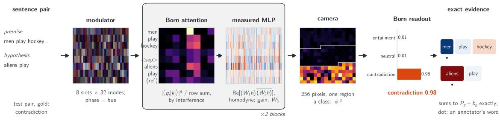

b On a quantum computer: the same weights, ibm\_kingston  
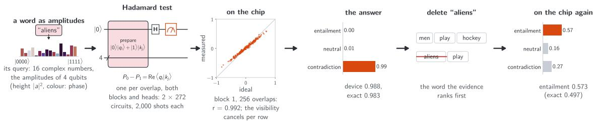  
Figure 1: Overview, drawn from the trained model’s own data for the test pair “men play hockey . / aliens $\mathrm { p l a y } ^ { \mathrm { , 9 } }$ (contradiction). (a) On light: the modulator holds one field per word (phase as colour); in each of two blocks Born attention weighs the words by $| \langle q _ { i } | k _ { j } \rangle | ^ { 4 }$ read by interference, and the measured feed-forward reads $\mathrm { R e } [ ( W h ) \overline { { ( V h ) } } ]$ by homodyne detection; the camera’s three regions give the Born probabilities, and each word’s Born evidence (BEW; red for the answer, blue against it; dots: the annotators’ words) sums to $P _ { g } - b _ { g }$ exactly. (b) On IBM’s ibm\_kingston, with the same weights: a word’s query, 16 complex numbers computed classically, is loaded as the amplitudes of four qubits, and every overlap is a Hadamard test $( 2 \times 2 7 2$ circuits); the measured overlaps follow the ideal ones $( r = 0 . 9 9 2 )$ , the answer survives (contradiction, 0.988 against 0.983 exact), and deleting “aliens”, the word the evidence ranks first, turns the device’s answer to entailment.

## 2 Model

A transformer has three kinds of nonlinearity: the softmax of attention, LayerNorm and the ReLU of the feed-forward layer. None of them is something light or qubits do. A Born measurement is: it squares the modulus of an amplitude. We build every step from that.

## 2.1 Every step a Born measurement

Encoding. A sentence pair, premise and hypothesis joined by a separator token, becomes one state per word. Word t (of n present) gets the complex field

$$
x _ { t } = a _ { t } e _ { t } , \qquad e _ { t } = \left( E _ { w _ { t } } + P _ { t } \right) \odot \left( e ^ { i \omega _ { k } t } \right) _ { k = 1 } ^ { 3 2 } , \qquad a _ { t } = 1 / \sqrt { n } ,\tag{1}
$$

with a learned embedding $E _ { w } \in \mathbb { C } ^ { 3 2 }$ (32 modes of light, or five qubits), a learned position field $P _ { t } .$ , and a phase $e ^ { i \omega _ { k } t }$ on mode k with learned frequencies $\omega _ { k }$ (the form of a rotary position code, here a diagonal phase). The phase alone did not let attention find words by position in our synthetic tests, so the field is added as well. A reference slot carries the sentence mean, g m¯ with $\begin{array} { r } { \bar { m } = \sum _ { t } a _ { t } e _ { t } / \sum _ { t } a _ { t } } \end{array}$ and a learned gain $^ { g , }$ and every word keeps its contrast $x _ { t } - A _ { t } \bar { m } .$ , with $A _ { t } = a _ { t }$ on a plain pass. When explaining, the sum $\textstyle \sum _ { t } a _ { t }$ and the coeficient $A _ { t }$ are both held at their values for the input, so every field—each word’s contrast and the reference slot—is linear in the amplitudes $a _ { t }$ , which are what the evidence is about, and vanishes when they are all zero.

Born attention. Each of two heads maps every slot to a query, key and value of 16 modes, $q _ { i } = Q h _ { i } , k _ { j } = K h _ { j } , v _ { j } = V h _ { j }$ , and weighs the values by

$$
w _ { i j } = \frac { | \langle q _ { i } | k _ { j } \rangle | ^ { 4 } } { \sum _ { j ^ { \prime } } | \langle q _ { i } | k _ { j ^ { \prime } } \rangle | ^ { 4 } } , \qquad h _ { i } \gets h _ { i } + O \sum _ { j } w _ { i j } v _ { j } .\tag{2}
$$

The overlap $\langle q _ { i } | k _ { j } \rangle$ is an interference—balanced detection of two light fields, or a Hadamard test on qubits (Section 4)—and the fourth power squares the measured $| \langle q _ { i } | k _ { j } \rangle | ^ { 2 }$ (here after detection; a coherent circuit would need two copies). Normalised polynomial attention of this kind was shown by PolySketchFormer [6] to replace the softmax at high degree; ours has degree four in the modulus of the overlap. A uniform loss of visibility scales every overlap of a row alike and cancels in $w _ { i j }$

Measured feed-forward. In place of linear–ReLU–linear, the state is read as a product of two linear images, and the reading is written back:

$$
r _ { c } = \mathrm { R e } \big [ \big ( W _ { 1 } h \big ) _ { c } \overline { { ( W _ { 2 } h ) _ { c } } } \big ] , \qquad h  h + W _ { 3 } r ,\tag{3}
$$

with 170 channels c. Each $r _ { c }$ is a balanced homodyne reading of two fields (on qubits, a Hadamard test); after it a classical gain and a fresh modulator encode $W _ { 3 } r$ . The residual additions are passive combiners. There is no LayerNorm: attention (2) and the readout below are ratios and do not see a common scale of the state, and the feed-forward reading, which does, is followed by the gain.

Born readout. After two blocks the slots are combined coherently and read by a camera of N = 256 pixels, split into one region $S _ { g }$ per class:

$$
\phi = R \sum _ { t } h _ { t } , \qquad P _ { g } = \frac { \sum _ { b \in S _ { g } } | \phi _ { b } | ^ { 2 } } { \sum _ { b } | \phi _ { b } | ^ { 2 } } , \qquad b _ { g } = \frac { | S _ { g } | } { N } ,\tag{4}
$$

where $b _ { g }$ is the share a class gets with no information. The model is trained on the crossentropy of $P _ { g }$ itself. (The Born headroom readout of Seeing Why [3], a softmax of each class’s headroom above its no-information share, was fragile on sequences: on a synthetic task of finding a value by its key it trained to 19.7 % where $P _ { g }$ itself reached 100 %; with $P _ { g }$

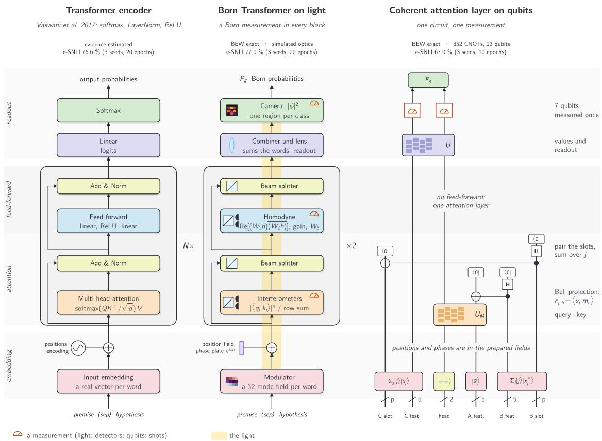  
Figure 2: Three models step by step, bottom to top, in the box colours of the original transformer figure: a transformer encoder [7], the Born Transformer drawn as optics (a beam through a modulator, interferometers with balanced detectors, beam splitters, a lens and a camera; the same weights run on qubits) and the coherent attention layer drawn as its circuit, wires running upwards (one circuit, one measurement). Bands hold the same stage; detector symbols mark the measurements.

itself the explained quantity is also the answer.) We call the model the Born Transformer;   
it has 1.53M parameters, 98k of them outside the embedding.

Fig. 2 sets the model against the original transformer [7] step by step, beside the coherent attention layer of Section 5: every nonlinearity of the original—softmax, LayerNorm, ReLU—becomes a Born measurement, or, in the coherent layer, the one measurement at the end.

## 2.2 Exact evidence: Born evidence per word

Every step above is a product, a sum or a squared modulus, and every division has the form of Eqs. (2) and (4). So, with the denominators held at their values for the input (the row sums of attention, the sum in the reference slot and the total intensity $\begin{array} { r } { Z = \sum _ { b } | \phi _ { b } | ^ { 2 } ) } \end{array}$ $F _ { g } ( a ) = P _ { g } ( a ) - b _ { g } = N _ { g } ( a ) / Z$ , with $\begin{array} { r } { N _ { g } = \sum _ { b \in S _ { q } } | \phi _ { b } | ^ { 2 } - b _ { g } Z , } \end{array}$ , is a polynomial in the amplitudes $a = ( a _ { 1 } , \ldots , a _ { n } ) $ , and $F _ { g } ( 0 ) = 0$ since every term of $N _ { g }$ carries an amplitude. Its degree is bounded step by step: the fields have degree 1, an overlap $\langle q _ { i } | k _ { j } \rangle$ degree $2 , | \langle q _ { i } | k _ { j } \rangle | ^ { 4 }$ degree 8, the attention update (times a value) degree 9, the measured feedforward doubles it to 18 per block, two blocks give $1 8 ^ { 2 } = 3 2 4$ , and the Born readout’s squared modulus 648. The evidence of word t for class g is integrated gradients from the zero baseline [5], and it adds up to the answer:

$$
e _ { g } ( t ) = a _ { t } \int _ { 0 } ^ { 1 } \frac { \partial F _ { g } } { \partial a _ { t } } ( \alpha a ) d \alpha , \qquad \sum _ { t } e _ { g } ( t ) = P _ { g } - b _ { g } .\tag{5}
$$

The sum is the fundamental theorem of calculus, $\begin{array} { r } { \sum _ { t } e _ { g } ( t ) = F _ { g } ( a ) - F _ { g } ( 0 ) } \end{array}$ with $F _ { g } ( 0 ) = 0 \colon$ the words’ evidence accounts for the answer above its no-information share, with nothing left over. The integral is computed with no quadrature error by Gauss–Legendre quadrature: m nodes integrate polynomials up to degree $2 m - 1$ exactly, and the integrand has degree 647, so 324 nodes sufice. The bound need not be tight: on ten test pairs the evidence with 81 nodes already agrees with that of 800 nodes to $1 0 ^ { - 1 3 }$ , so 324 nodes are a guarantee rather than a fine tuning. We call $e _ { g } ( t )$ the Born evidence per word (BEW). Two remarks keep the claim in its place. Integrated gradients of any smooth model is complete in the limit of many nodes—for our softmax baseline, 4,096 nodes bring the median gap from 0.1 (256 nodes, seed 0, on the first 200 test pairs; 0.04 on the 1,000 pairs of Table 1) to $1 0 ^ { - 7 }$ (largest 0.03) on those 200 pairs and keep 94 % of the top three words—and what the polynomial form adds is that a finite rule, 324 nodes here, is exact. And BEW explains the answer with the denominators held at the input, along the integration path; deleting a word recomputes them, which is why we test the evidence by deletion separately (Section 3). Where the Born evidence maps of Seeing Why [3] explain a quadratic form in closed form, one forward and one adjoint pass, BEW explains a model in which the words act on each other through attention; it stays exact, by quadrature. In double precision the gap is at most $8 \times 1 0 ^ { - 1 2 }$ on 1,000 test pairs (median $6 \times 1 0 ^ { - 1 3 } )$ ). A word’s evidence can be negative (it argues against the class). Deleting a word means setting its amplitude to zero, which is physical: the word is not sent. Integrated gradients and the Shapley value coincide for a quadratic form, as in Seeing Why [3]; at higher degree they share a monomial diferently [8], and we use integrated gradients.

Exactness says that the evidence adds up; it does not say that it is right. For that we need a task in which people have said which words decide the answer.

## 3 Natural language inference with exact evidence

## 3.1 The task: does one sentence follow from another?

Natural language inference asks whether a hypothesis follows from a premise. Given “A woman working long hours”, the hypothesis “A woman is working” follows (entailment), “A woman is sleeping” cannot be true at the same time (contradiction), and “A woman is working in a factory” may or may not be (neutral; Fig. 3). The answer is in neither sentence alone but in how the two relate, which is what attention is for. SNLI [9] collected such pairs about image captions; e-SNLI [10] added, for every pair, the words an annotator highlighted as the reason and a sentence explaining it. Those highlights are what makes the data useful here: they are an outside account of which words decide the answer, against which a model’s evidence can be checked.

## 3.2 Data and protocol

e-SNLI has 549,367 training, 9,842 dev and 9,824 test pairs, about a third per label; a pair has 23 tokens at the median (premise, separator, hypothesis; vocabulary 22,319 words seen three times or more), and annotators highlight about one word in three. A bag of words with logistic regression reaches at most 65.7 % (one bag per sentence; the hypothesis alone gives 64.8 %, the known bias of SNLI), so a model must relate the two sentences to do better. We compare three models of the same size (98–100k parameters outside a 1.43M embedding), each with two blocks, two heads and a pooled readout: the Born Transformer; a softmax transformer (real d = 64, softmax attention, GELU feed-forward of width 256, LayerNorm, a linear head); and Poly-sim-born, a real-valued polynomial transformer with normalised attention $( \boldsymbol { q } \cdot \boldsymbol { k } ) ^ { 2 } / \sum$ and a bilinear feed-forward but no constraint from measurements (a simulation reference, not a hardware model). All were trained for 20 epochs on sentences of up to 64 tokens in batches of 64 with Adam [11], learning rate $2 \times 1 0 ^ { - 3 }$ (chosen on the dev split, 9,842 pairs, for the Born and softmax models), cosine decay, word dropout 0.1, three seeds; the softmax model’s evidence is the same integrated gradients (256 nodes), which is not exact for it. Evidence is judged three ways, each on the predicted class: the gap, how far the word evidence is from summing to the explained score; deletion, deleting the top 1–5 words by evidence and recording the mean drop of the answer’s probability (AOPC) and how often the answer changes (flip@k), against a random order of deletion; and agreement, the share of the evidence’s top k words that annotators highlighted, with k the number of highlighted words in the pair (chance 0.354). Deleting a word sets its amplitude to zero in the Born models and removes the token from attention and pooling in the others, in place, so positions do not shift. The highlights are the union over the test split’s three annotators, and every metric uses the same 1,000 test pairs.

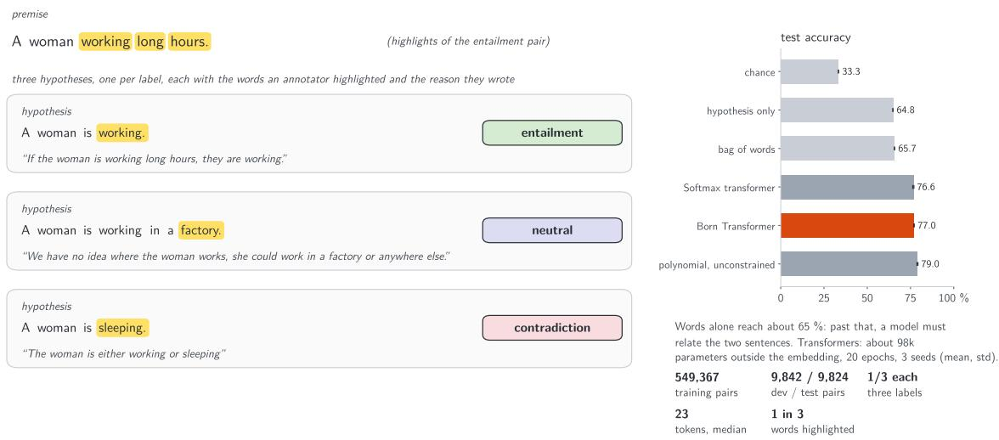  
Figure 3: The task. One premise of the e-SNLI test set with its three hypotheses, one per label; highlighted are the words the first annotator marked, quoted beneath each is their written explanation. Right: test accuracy of simple baselines and of the two transformers of the same size (three seeds); a bag of words or the hypothesis alone reaches about 65 %, so the rest requires relating the sentences. Below: the dataset in numbers.

## 3.3 Accuracy and evidence

The Born Transformer is level with the softmax model (Table 1; four test pairs and their evidence in Fig. 4); the point is not to beat it but to show that building from Born measurements costs no accuracy against a softmax model of the same size while making the evidence exact (the polynomial model without the measurement constraints is two points higher). Deletion needs care: the Born model’s probabilities move more under any deletion, random ones included (AOPC 0.125 against 0.059), so its AOPC is larger for that reason too—by evidence it is 0.49 above random against 0.26, but 4.9 times random against 5.4. The answer itself is scale-free: deleting the word the evidence ranks first changes it in 45 % of pairs against 31 %, while a random word changes it in 5–6 % for both. The other end of the ranking is a check too: words the evidence ranks last should not matter. Deleting the five lowest changes the Born model’s answer in 1 % of pairs (its probability barely moves, AOPC −0.005), against 10 % for the softmax model, whose lowest-ranked word alone changes the answer more often than a random one (6.6 % against 5.2 %). The Born model’s top words also agree more with the annotators than the softmax model’s evidence does $( 0 . 5 1 0 { \pm } 0 . 0 0 5 $ against $0 . 4 6 8 \pm 0 . 0 0 3$ over seeds), though rankings by attention agree more still (Table 2). Poly-sim-born, free of the measurement constraints but with exact evidence of its own, is two points more accurate.

<table><tr><td>model</td><td>test (%)</td><td>dev (%)</td><td>gap median / largest</td><td>AOPC (random)</td><td>flip@1 (random)</td><td>agreement with annotators</td></tr><tr><td>Born Transformer</td><td> $7 6 . 9 8 \pm 0 . 1 7$ </td><td>77.30</td><td> $6 { \times } 1 0 ^ { - 1 3 } \mathrm { ~ / ~ } 8 { \times } 1 0 ^ { - 1 2 }$ </td><td></td><td>0.618 (0.125) 0.45 (0.06)</td><td> $0 . 5 1 0 \pm 0 . 0 0 5$ </td></tr><tr><td>Softmax</td><td> $7 6 . 6 2 \pm 0 . 3 6$ </td><td>76.36</td><td>0.04 / 47</td><td>0.321 (0.059)</td><td>0.31 (0.05)</td><td> $0 . 4 6 8 \pm 0 . 0 0 3$ </td></tr><tr><td>Poly-sim-born</td><td> $7 8 . 9 8 \pm 0 . 3 1$ </td><td>78.89</td><td> $1 0 ^ { - 1 4 } \mathrm { ~ / ~ } \dot { 5 } { \times } 1 0 ^ { - 1 2 }$ </td><td>0.501 (0.065) 0.45 (0.06)</td><td></td><td> $0 . 5 2 7 \pm 0 . 0 1 1$ </td></tr></table>

Table 1: e-SNLI, 20 epochs, three seeds: accuracy and agreement as mean ± sample standard deviation, the other columns as means (dev on seed means). Gap: how far the word evidence is from summing to the explained score, the worst seed’s median and the largest over the 1,000 pairs (the Born models’ gaps are in probability, the softmax model’s in units of its logit, which it explains by integrated gradients with 256 nodes, not exact for it). AOPC and flip@1 are measured on the predicted class, with a random order of deletion in brackets. Agreement: share of the evidence’s top-k words that annotators highlighted (chance 0.354).

Like for like, and attention. The comparison in Table 1 gives each model its usual evidence: for the softmax model, integrated gradients of its logit over the embedded vectors. To compare like for like, Table 2 adds, on the same 1,000 pairs, rankings that every model can have: integrated gradients of the softmax model’s probability over one gate per word—the path and the explained quantity of BEW—the attention each word receives (averaged over blocks, heads and the words that look at it), attention × gradient (the gradient-weighted attention map $\operatorname { E } _ { h } [ ( A \odot \partial P _ { g } / \partial A ) ^ { + } ]$ of Chefer et al. [12], with the gradient of the probability in place of the class output, summed over blocks and over the words that look at each word, without their propagation across layers), gradient × input, and leave-one-out deletion, which comes within 0.2 points of the ceiling: the share of pairs in which some single deletion changes the answer. Table 2 gives every score; the text keeps to the comparisons.

The ceilings are alike, so no model is simply easier to flip. Explained the same way, the softmax model’s evidence falls 13 points below the Born Transformer’s on flip@1 (95 % interval 10–16 when seeds and pairs are both resampled); its best ranking short of trying every deletion, attention × gradient, is still five points below (2–8). The ranking comparison is robust to increasing the quadrature resolution: with 4,096 nodes the softmax model’s integrated gradients have a median gap of $1 0 ^ { - 1 0 }$ over seeds and pairs $( 5 \times 1 0 ^ { - 8 }$ in the worst seed; the largest 0.045), 99.7 % of the per-pair outcomes are those of 512 nodes, and on the pairs whose gap is below $1 0 ^ { - 2 } , 1 0 ^ { - 3 } \mathrm { ~ o r ~ } 1 0 ^ { - 4 }$ in every seed (991, 944 and 815 pairs) its flip@1 stays at 0.30–0.32. These checks indicate that integration error does not explain the observed ranking gap. At the other end of the ranking, the five words the evidence ranks last change the Born Transformer’s answer in under 1 % of pairs, the softmax model’s in 10 %. Gradient × input, the same attribution with one node at the end of the path $( a _ { t } \partial P _ { g } / \partial a _ { t } )$ , ranks the first word fairly well in the polynomial models but not the last ones, and agrees less with the annotators; in the softmax model it fails, its five lowest changing the answer more often than five random words. Integrating along the path is part of what the evidence adds.

Attention looks most like the annotators’ reason: by attention or attention × gradient the softmax model’s top words agree with them best of all. It is a weaker account of the answer: deleting the word attention ranks first changes the answer far less often than deleting the evidence’s first word, in the Born Transformer (32 against 45 % of pairs) and in Poly-sim-born (24 against 45 %). On the second device pair, “men play hockey . / men play”, attention ranks “hockey” first; in the exact model, deleting it raises the probability of entailment from 0.60 to 0.77 (on the device as well, Table 5), while deleting the word the evidence ranks first (the hypothesis’s “men”) lowers it to 0.50. Looking like a person’s reason and accounting for the answer are diferent properties, and only the evidence is checked against the answer it explains.

<table><tr><td>model</td><td>ranking</td><td>flip@1</td><td></td><td>of ceiling flip@5, lowest</td><td>agreement</td></tr><tr><td></td><td>Born Transformer evidence (BEW)</td><td>0.45 [0.43, 0.48]</td><td>84%</td><td>0.009</td><td>0.51 [0.50, 0.52]</td></tr><tr><td></td><td>attention</td><td>0.32</td><td>59%</td><td>0.077</td><td>0.50</td></tr><tr><td></td><td>attention×gradient</td><td>0.37</td><td>70%</td><td>0.064</td><td>0.53</td></tr><tr><td></td><td>gradient×input</td><td>0.41</td><td>78%</td><td>0.062</td><td>0.46</td></tr><tr><td></td><td>leave-one-out</td><td>0.53 [0.51, 0.56]</td><td>100 %</td><td>0.006</td><td>0.49</td></tr><tr><td>Softmax</td><td>IG, logit, embeddings</td><td>0.31</td><td>56 %</td><td>0.103</td><td>0.47</td></tr><tr><td></td><td>IG,  $P _ { g } ,$  word gates</td><td>0.32 [0.30, 0.34]</td><td>58%</td><td>0.099</td><td>0.46 [0.45, 0.47]</td></tr><tr><td></td><td>attention</td><td>0.34</td><td>62%</td><td>0.052</td><td>0.54</td></tr><tr><td></td><td>attention×gradient</td><td>0.40 [0.38, 0.43]</td><td>72%</td><td>0.036</td><td>0.55</td></tr><tr><td></td><td>gradient×input</td><td>0.14</td><td>26 %</td><td>0.289</td><td>0.40</td></tr><tr><td></td><td>leave-one-out</td><td>0.55 [0.53, 0.58]</td><td>100%</td><td>0.003</td><td>0.50</td></tr><tr><td>Poly-sim-born</td><td>evidence (exact)</td><td>0.45</td><td>83 %</td><td>0.017</td><td>0.53</td></tr><tr><td></td><td>attention</td><td>0.24</td><td>45%</td><td>0.103</td><td>0.45</td></tr><tr><td></td><td>attention×gradient</td><td>0.33</td><td>60%</td><td>0.027</td><td>0.50</td></tr><tr><td></td><td>gradient×input</td><td>0.43</td><td>79%</td><td>0.030</td><td>0.49</td></tr><tr><td></td><td>leave-one-out</td><td>0.54</td><td>100%</td><td>0.004</td><td>0.51</td></tr><tr><td>any</td><td>random</td><td>0.05</td><td>10%</td><td>0.20</td><td>0.35</td></tr></table>

Table 2: Every ranking on the same 1,000 test pairs, pooled over three seeds per pair; 95 % bootstrap intervals over pairs in brackets (the others are as wide, ±0.02 for flip@1 and ±0.01 for agreement; resampling the seeds as well widens them to about ±0.03 and ±0.015, and of the comparisons in the text only Born evidence against Born attention on agreement, +0.01 (−0.02 to +0.03), is not resolved). flip@1: deleting the top word changes the answer; of ceiling: flip@1 over the share of pairs that some single deletion changes; flip@5, lowest: deleting the five ranked last changes it; agreement: share of the top-k that annotators highlighted (chance 0.354; on correctly answered pairs only, every value rises by up to 0.03 and the comparisons in the text hold). The softmax model’s gated integrated gradients use 4,096 nodes (median gap $5 \times 1 0 ^ { - 8 }$ in the worst seed, largest 0.045). Attention rollout [13] gives agreement 0.52, 0.55 and 0.42.

Which part gives the evidence its quality. Poly-sim-born, the polynomial model without the measurement constraints, lets one part be swapped at a time (Table 3). With a GELU feed-forward in place of the bilinear one, the attention still a ratio of squared overlaps, the accuracy holds (77.1 %), but the model is no longer a polynomial, its integrated gradients no longer sum to the score (median gap $4 \times 1 0 ^ { - 3 }$ , largest 6), and the evidence weakens on every count: the first word changes the answer in 27 % of pairs

instead of 45 %, the five lowest in 11 % instead of $2 \%$ , and agreement with the annotators falls from 0.53 to 0.46. With softmax attention the model loses about 13 points of accuracy (78.98 to 65.65 %)—without LayerNorm, which the softmax transformer of Table 1 has, it trains poorly here, at the same learning rate, not tuned for ${ \mathrm { i t } } ,$ so this is not a verdict on softmax attention—and its evidence ranks words worse than chance at the low end. The quality of the evidence goes with the whole model being one polynomial, not with one part of it.
<table><tr><td>attention</td><td></td><td>feed-forward</td><td>test (%)</td><td>gap (median) flip@1 flip@5, lowest agreement</td><td></td><td></td><td></td></tr><tr><td> $\left( q \cdot k \right) ^ { 2 } \ _ { / }$ </td><td></td><td>/row sum bilinear</td><td> $7 8 . 9 8 \pm 0 . 3 1$ </td><td> $1 0 ^ { - 1 4 }$ </td><td>0.45</td><td>0.02</td><td> $0 . 5 3 \pm 0 . 0 1$ </td></tr><tr><td> $\left( q \cdot k \right) ^ { 2 } { \dot { \ } } /$ </td><td>row sum</td><td>GELU</td><td> $7 7 . 1 3 \pm 1 . 4 2$ </td><td> $4 \times 1 0 ^ { - 3 }$ </td><td>0.27</td><td>0.11</td><td> $0 . 4 6 \pm 0 . 0 2$ </td></tr><tr><td>softmax</td><td></td><td>bilinear</td><td> $6 5 . 6 5 \pm 0 . 4 4$ </td><td>not complete</td><td>0.15</td><td>0.25</td><td> $0 . 3 7 \pm 0 . 0 1$ </td></tr><tr><td>softmax</td><td></td><td>GELU</td><td> $6 5 . 4 7 \pm 0 . 2 5$ </td><td>not complete</td><td>0.17</td><td>0.23</td><td> $0 . 3 9 \pm 0 . 0 1$ </td></tr></table>

Table 3: Poly-sim-born (first row) with its attention, its feed-forward or both replaced; same size, training and test pairs as Table 1, three seeds. Evidence: exact quadrature for the polynomial model, integrated gradients with 256 nodes otherwise. flip@1: deleting the word ranked first changes the answer (random 0.05–0.06); flip@5, lowest: deleting the five ranked last does (random 0.17–0.20). Agreement: chance 0.354.

The model was trained on a computer, and nothing in it refers to a device. What does it take to run it on one?

## 4 One set of weights, two realisations

Nothing in the trained model refers to a device; compiling it is a matter of where the scale goes.

Optics. Every fixed matrix is divided by its largest singular value, so that it is a contraction—a block of a unitary on twice the modes, built from beam splitters and attenuators. Every word field is scaled to norm at most one. Splitting a state into its query, key, value and residual copies, fanning a key out to the slots it meets, and combining the residual are passive beam splitters, each losing a known share of the light. None of this changes the answer: the attention weights (2) and the readout (4) are ratios and do not see a common scale, and the only place where scale matters, the measured feed-forward (3), is followed by a classical gain on measured numbers that puts the lost scale back before the modulator writes $W _ { 3 } r$ . The build is optoelectronic, not passive throughout: between its interferometers are detectors, a classical gain and fresh modulators. The compiled pass equals the trained model to $2 \times 1 0 ^ { - 1 5 }$ (the largest diference on 512 test pairs); what compiling costs is light, not accuracy (Fig. 5). With shot noise at every detector and finite modulator precision, the first 512 test pairs (76.0 % noiseless) keep 74.8 % at $1 0 ^ { 1 0 }$ photons per sentence and 76.2 % at $1 0 ^ { 1 2 }$ , and 75.6 % at 10 bits; $1 0 ^ { - 2 . 8 }$ of the source light reaches the camera.

Qubits. The same weights run on qubits without copies of a state: every reading prepares its states afresh. Each overlap $\langle q _ { i } | k _ { j } \rangle$ is a Hadamard test on five qubits—the ancilla and the 16 modes of one head, with $q _ { i }$ and $k _ { j }$ normalised:

$$
{ \frac { | 0 \rangle | q _ { i } \rangle + | 1 \rangle | k _ { j } \rangle } { \sqrt { 2 } } } ~ { \frac { H { \mathrm { ~ o n ~ t h e ~ a n c i l l a } } } { \hbar } } ~ P _ { 0 } - P _ { 1 } = \mathrm { R e } \langle q _ { i } | k _ { j } \rangle ,\tag{6}
$$

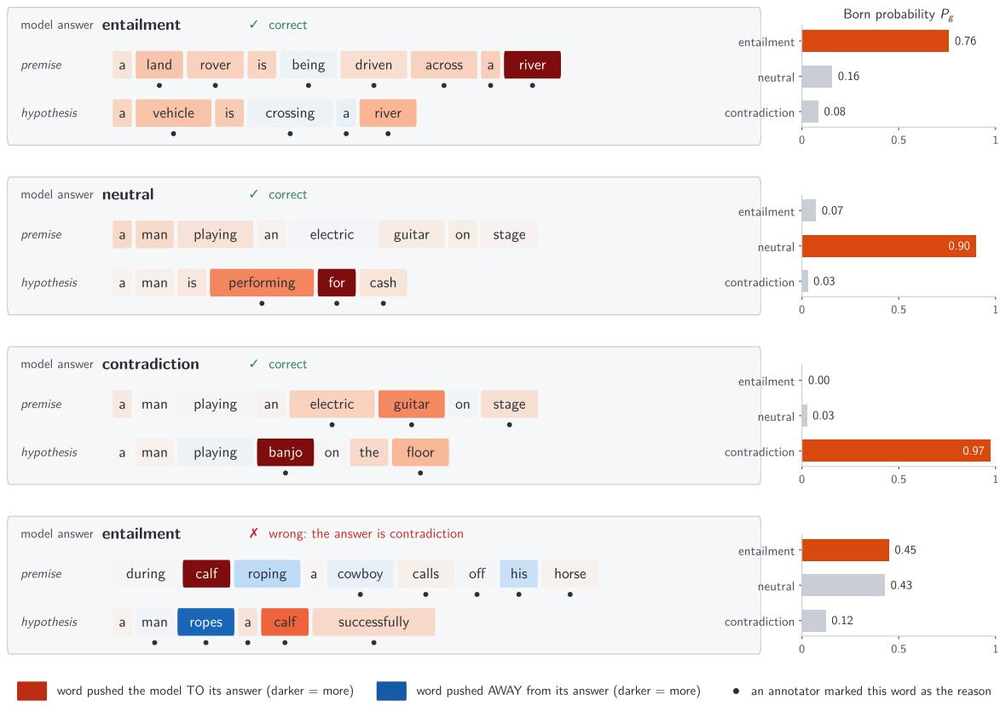  
The word evidence adds up exactly to the answer's probability above its no-information share, Pg − bg (Born-p2-ap, e-SNLI test pairs).  
Figure 4: Born evidence per word (BEW) for four e-SNLI test pairs: the first right answer of each class in test order and the first wrong one. Each word is shaded by its evidence for the model’s answer (red for, blue against; scaled within the pair); dots mark the words annotators highlighted; bars give the Born probabilities. In the wrong case the evidence shows why: “calf” in both sentences pulls towards entailment, and “ropes”, the word that should decide, pushes against it but too weakly.

and, with a phase −i on the second branch, Im $\langle q _ { i } | k _ { j } \rangle$ ; the norms are put back classically. Here the state $( | 0 \rangle | q _ { i } \rangle + | 1 \rangle | k _ { j } \rangle ) / \sqrt { 2 }$ is prepared directly from the classically known vectors, and that preparation is most of the circuit’s cost. In the same way the feed-forward readings (3) would be Hadamard tests, the combiners linear combinations of unitaries and the readout one more circuit; the costs are shots instead of light, and the arithmetic is the same. A sentence of n words (with the reference slot, n+1 slots) needs $2 \times 2 \times ( n + 1 ) ^ { 2 } \times 2 =$ $8 ( n + 1 ) ^ { 2 }$ overlap circuits for both blocks, heads and the real and imaginary parts, plus $4 ( n + 1 )$ calibrations when the attention row sums are wanted for the evidence: 512 and 32 for the seven-word pair of Section 6.

An outside check of the optical build. Every fixed matrix of the compiled pass (15 matrices, 130k beam splitters) was built as $s L \mathrm { d i a g } ( S ) { \cal R } ^ { \dagger }$ with $L , \ R ^ { \dagger }$ rectangular meshes found by the reference implementation of the Clements decomposition [14]. Rebuilt from the mesh phases, the model gives the same answers on 1,000 test pairs (77.20 %, every answer kept, $| \Delta P | \le 8 \times 1 0 ^ { - 1 5 } )$ . With independent phase errors per beam splitter, accuracy holds at 0.01 rad (76.5–76.9 %), falls to 72.5–74.5 % at 0.02 rad and collapses at 0.05 rad: the 170- and 256-mode meshes are deep.

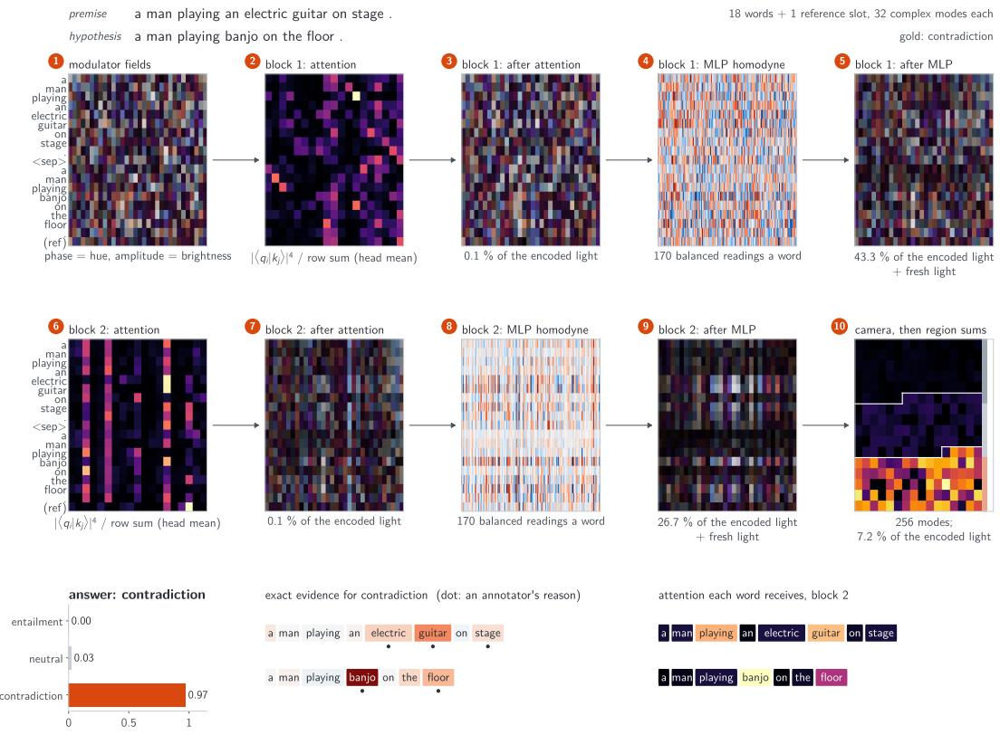  
Figure 5: One test pair through the compiled optics, stage by stage: the modulator’s fields (phase as hue), each block’s attention and field after attention, the homodyne readings of the measured feed-forward and the field after it (with the share of the encoded light left), and the camera with its three class regions; below, the answer, the exact evidence of each word and the attention each word receives in the last block.

On light, the measurements inside each block are cheap: a detector reads them and a modulator writes the next field. On qubits each of them is a separate circuit run many times. Could attention run with no measurement inside at all?

## 5 No measurement until the end: a coherent attention layer

The Born Transformer measures inside each block. On qubits, unlike linear optics, copies of a state can be held together in a tensor product, which allows attention with no measurement before the end. We prepare three copies of the sentence: copy A holds the pooled field ${ \bar { x } } = \textstyle \sum _ { j } x _ { j }$ , copies B and C hold $\textstyle \sum _ { j } | j \rangle | x _ { j } ^ { * } \rangle$ and $\textstyle \sum _ { j } | j \rangle | x _ { j } \rangle$ on a slot register and five feature qubits each, and a two-qubit head register starts in |++⟩. A map $U _ { M }$ on (A, head) turns the pooled field into a query–key image $m = U _ { M } ( \bar { x } \otimes | + + \rangle )$ ; a Bell projection of A with B gives, for every slot and head,

$$
c _ { j , h } = \langle x _ { j } | m _ { h } \rangle ,\tag{7}
$$

a query–key overlap held as an amplitude. Pairing the slot registers of B and $\mathrm { ~ C ~ } ( j = j ^ { \prime } )$ and summing over j leaves $\boldsymbol { y } = \sum _ { j } x _ { j } \otimes \boldsymbol { c } _ { j }$ on (C, head), which a second map U (values and readout together) sends to the seven qubits measured once: $P _ { g } = | \Pi _ { g } U y | ^ { 2 } / | U y | ^ { 2 }$ (Figs. 2 and 6). The weights are not normalised—a division needs a measurement—and the query is pooled over the sentence, so this is a coherent attention layer, not a transformer. It is again a ratio of polynomials (degree 6 over one denominator), and its evidence is exact.

Trained classically with general matrices (Coherent-attn) the layer reaches $7 4 . 6 7 \pm$ 0.18 % at 20 epochs, with exact evidence (AOPC 0.660, highlights 0.516). The circuits below are built from the 10-epoch models of Table 4 (seed 0; dense maps $7 3 . 1 4 \% )$ . Compiled with block encodings [15], its circuit equals the model to $3 \times 1 0 ^ { - 1 6 }$ , but needs 137k CNOTs. When every map is a brickwall of two-qubit unitaries on neighbouring qubits— $U _ { M }$ of 12 layers, U of 24—the circuit falls to 852 CNOTs on 23 qubits, still equal to the model, and passes post-selection about 4,900 and 1,300 times more often on the two pairs (Table 4, Fig. 6).
<table><tr><td>coherent attention layer</td><td>params</td><td>test (%)</td><td>CNOTs</td><td>qubits</td><td>post-selection</td></tr><tr><td>dense maps</td><td>82k</td><td>73.14</td><td>136,727</td><td>27</td><td> $1 0 ^ { - 9 } – 1 0 ^ { - 7 }$ </td></tr><tr><td>brickwall readout</td><td>18k</td><td>72.41</td><td>17,452</td><td>25</td><td> $1 0 ^ { - 8 } – 1 0 ^ { - 6 }$ </td></tr><tr><td>every map brickwall (3 seeds)</td><td>3.7k</td><td> $6 7 . 0 4 \pm 0 . 1 2$ </td><td>852</td><td>23</td><td> $1 0 ^ { - 5 } – 1 0 ^ { - 4 }$ </td></tr></table>

Table 4: The coherent attention layer as one circuit (8 slots, $p = 3 ;$ 10 epochs). The circuit equals the trained model to $\leq 3 . 3 \times 1 0 ^ { - 1 6 }$ (GPU statevector, two test pairs). Post-selection with the copies prepared apart, for the two pairs. The dense model reaches $7 4 . 6 7 \pm 0 . 1 8 \%$ at 20 epochs over three seeds.

The brickwall model keeps 3.7k parameters outside the embedding and loses six points of accuracy, but not the quality of its evidence: over three seeds (on 1,000 test pairs, at 10 epochs), deleting its top words removes as much of the answer as in the larger models (AOPC 0.666, random 0.096; flip@1 0.48), and its top words agree with the annotators’ highlights at least as often (0.530; chance 0.354).

Even at 852 CNOTs, one circuit with a pass rate of $1 0 ^ { - 4 }$ is beyond today’s devices. The Born Transformer’s circuits are not: each is a Hadamard test on five qubits. We ran them.

## 6 On a quantum computer

Under a noise model. With every overlap of both blocks read by Hadamard tests (10,000 shots) under a noise model of IBM’s ibm\_torino, a Heron r1 device (qiskit-aer, FakeTorino; gate and readout errors, T1, T2), the answer was the same as the exact model’s on all of the first 50 test pairs $( | \Delta P |$ median 0.009, at most 0.056; 266,336 circuits, median 39 two-qubit gates). The evidence is more fragile than the answer. In a hybrid form— exact numerators on the computer, the attention row sums measured and corrected for visibility—it stays complete, and on 20 pairs it correlates with the exact evidence at a median of 0.88, shares 75 % of its top words, and agrees with the annotators as well (0.48 against 0.47).

On ibm\_kingston. On a Heron r2 device, test pair 3763 (its index in the e-SNLI test split), “men play hockey . / aliens play” (contradiction; the shortest in the test set) was run with every $\langle q _ { i } | k _ { j } \rangle$ of both blocks read by a five-qubit Hadamard test: 2 × 256 overlaps and $2 \times 1 6$ row calibrations, 544 circuits of 37 CZ gates after transpilation, 2,000 shots each, 294 quantum seconds; a second pair, 3765, “men play hockey . / men play” (entailment), ran the same way. Only these overlaps ran on the device. The encoding, the projections, the normalisation of the weights, the feed-forward and the readout were computed classically between and after the two jobs, and the vectors whose overlaps the device read were known classically: the run shows that the compiled attention holds up on hardware, not that the device computes something a computer could not. The measured

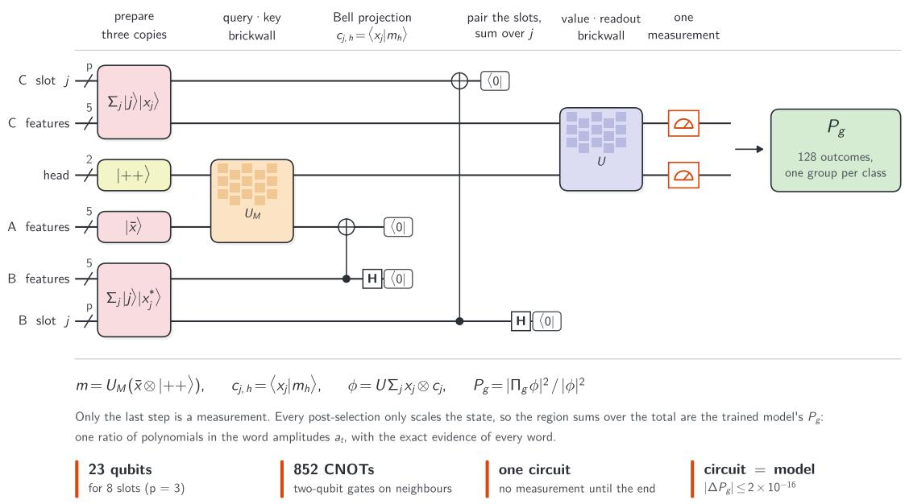  
Figure 6: The coherent attention layer as one circuit, left to right: three copies of the sentence prepared, the query–key brickwall $U _ { M } ,$ a Bell projection that leaves $c _ { j , h } = \langle x _ { j } | m _ { h } \rangle$ as an amplitude, the slots paired and summed, the value–readout brickwall U, and one measurement of seven qubits. 23 qubits, 852 CNOTs; the circuit equals the trained model.

overlaps followed the ideal ones (correlation 0.992 over the 256 of the first block), and the device’s answer followed the exact model’s (Table 5, Fig. 7): the visibility of the device (0.89 in a pilot of 30 overlaps, 0.81 as the slope over the 256 of the first block) cancels in each attention row. The intervals redraw each circuit’s 2,000 shots. The runs with a word deleted leave out the row calibrations, which serve only the hybrid evidence (2 × 196 circuits).
<table><tr><td>run</td><td>word deleted, and why</td><td>answer</td><td>device</td><td>exact</td><td>95% interval</td></tr><tr><td>pair 3763</td><td></td><td>contradiction</td><td>0.988</td><td>0.983</td><td>0.978–0.991</td></tr><tr><td></td><td>“aliens&quot;, evidence first</td><td>entailment</td><td>0.573</td><td>0.497</td><td>0.494–0.652</td></tr><tr><td></td><td>“play”, evidence nearest zero</td><td>contradiction</td><td>0.985</td><td>0.986</td><td>0.976–0.987</td></tr><tr><td>pair 3765</td><td></td><td>entailment</td><td>0.587</td><td>0.596</td><td>0.501–0.668</td></tr><tr><td></td><td>&quot;hockey&quot;, attention first</td><td>entailment</td><td>0.819</td><td>0.768</td><td>0.741-0.867</td></tr><tr><td></td><td>“men&quot;, evidence first</td><td>entailment</td><td>0.573</td><td>0.497</td><td>0.494–0.652</td></tr></table>

Table 5: The runs on ibm\_kingston: the probability of the answer, on the device and in the exact model, with the 95 % shot-noise interval of the device’s value; in every redraw the device’s answer was the same. Pair 3763 is “men play hockey . / aliens play”, pair 3765 “men play hockey . / men play”. Pair 3765 without “men” has the same words as pair 3763 without “aliens”, so the ledger reused those jobs. Jobs, circuits and quantum seconds: Table 10.

On pair 3763, deleting “aliens”, the word the evidence ranks first, turned the device’s answer to entailment, while deleting any other word keeps contradiction in the exact model (≥ 0.947); deleting the word the evidence ranks nearest zero, the hypothesis’s “play”, kept contradiction. This checks that the circuits reproduce the model under a deletion; it does not by itself validate the evidence: every model we tested (the Born and softmax transformers, three seeds each, Poly-sim-born and the coherent layer) turns to entailment without “aliens”. On pair 3765 attention and evidence disagree, and the device was asked about both. Deleting “hockey”, the word attention ranks first, raised entailment: on this pair, the word attention weighs most was working against the answer—an illustration on hardware of what Table 2 shows on average. Deleting the hypothesis’s “men”, the word the evidence ranks first, lowered it in the exact model, a fall the device’s interval cannot separate from the full pair’s.

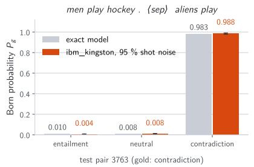

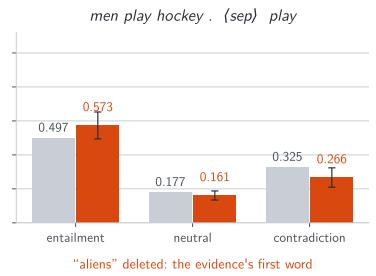

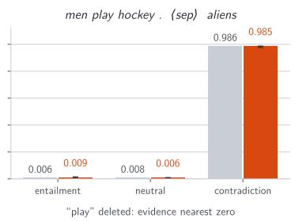

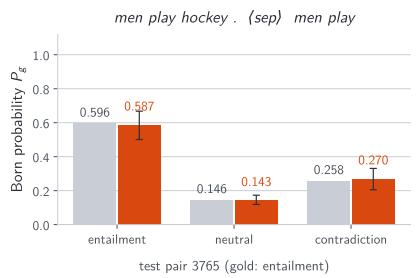

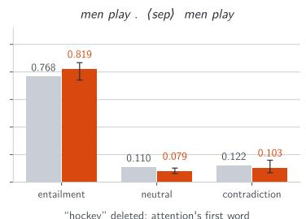

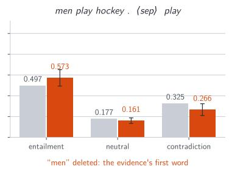  
Figure 7: The real-device run. Left: the test pair, attention read by Hadamard tests on ibm\_kingston (2,000 shots), against the exact model, with 95 % intervals from redrawing each circuit’s shots. Top middle: the same pair with “aliens” deleted, the word the exact evidence ranks first; the device’s answer turns to entailment, as the model’s. Top right: “play” deleted instead, the word the evidence ranks nearest zero; the answer stays. Bottom: a second test pair (entailment), without “hockey”, the word attention ranks first (entailment rises), and without the hypothesis’s “men”, the word the evidence ranks first (the same words, and jobs, as top middle). Only the attention overlaps ran on the device.

What did not work. The hybrid evidence (exact numerators, measured row sums) failed on the device: our row calibrations, Hadamard tests of a query with itself, compile to product states (13 CZ against 37) and missed most of the loss, and on this pair the evidence is a small total of large opposite terms, so row sums of by tens of per cent overturn it. The analysis below says which of these matters; on today’s device we show the evidence by deletion instead.

Resources and errors. To see what the qubit realisation needs, we simulated it on 300 test pairs: every overlap estimated from S shots of its Hadamard test, everything else exact, as on the device (Table 7). The answer needs about 2,000 shots per circuit to agree with the exact model on 99 % of pairs. The fourth power multiplies an overlap’s relative error by four (3.95 % becomes 15.8 % at 2,000 shots), and the row normalisation removes what is common to a row. A loss of visibility $\eta _ { i }$ shared by the circuits of row i scales each of its overlaps alike and cancels in the weights, but not in the row sum $D _ { i }$ that the

evidence holds:

$$
w _ { i j } = \frac { | \eta _ { i } \langle q _ { i } | k _ { j } \rangle | ^ { 4 } } { \sum _ { j ^ { \prime } } | \eta _ { i } \langle q _ { i } | k _ { j ^ { \prime } } \rangle | ^ { 4 } } = \frac { | \langle q _ { i } | k _ { j } \rangle | ^ { 4 } } { \sum _ { j ^ { \prime } } | \langle q _ { i } | k _ { j ^ { \prime } } \rangle | ^ { 4 } } , \qquad \hat { D } _ { i } = \eta _ { i } ^ { 4 } D _ { i } .\tag{8}
$$

A spread of visibility from circuit to circuit does not cancel (agreement 96 % at a 5 % spread, $9 2 \% \mathrm { a t } \ 1 0 \% )$ . A sentence of n tokens takes $8 ( n + 1 ) ^ { 2 }$ circuits, so about $1 0 ^ { 6 }$ shots for the seven-token device pairs, $9 \times 1 0 ^ { 6 }$ for the median sentence (23 tokens) and $7 \times 1 0 ^ { 7 }$ at 64. The hybrid evidence is robust to shot noise (correlation with the exact evidence 0.992 at 2,000 shots) but not to the calibration of the row sums: by Eq. (8) they feel the visibility to the fourth power, and a relative error of $3 \%$ in a row’s visibility leaves a correlation of 0.983, 10 % leaves 0.13. How strongly an error reaches the evidence depends on cancellation: the ratio $\textstyle \sum _ { t } | e _ { g } ( t ) | / | \sum _ { t } e _ { g } ( t ) |$ has a median of 1.08 over the test pairs but is 8.5 on pair 3763, whose evidence is a small total of large opposite terms. Our device calibrations missed far more than $1 0 \% ;$ calibration circuits as deep as the overlaps—for instance the Hadamard test of $q _ { i }$ with itself, its preparation compiled as an entangled state of the same CZ count as the overlap circuits rather than simplified to a product state— holding each row’s visibility within a few per cent, are what the evidence on hardware needs.

For the coherent attention layer the cost is the post-selection. With the copies prepared as normalised states, the Bell projection of the five feature qubits and the sum over the $2 ^ { p }$ slots each divide the amplitude, and the probability of passing has a closed form in the quantities of Section 5:

$$
P _ { \mathrm { p a s s } } = { \frac { | y | ^ { 2 } } { | { \bar { x } } | ^ { 2 } { \big ( } \sum _ { j } | x _ { j } | ^ { 2 } { \big ) } ^ { 2 } 2 ^ { 5 } 2 ^ { p } } } , \qquad y = \sum _ { j } x _ { j } \otimes c _ { j } .\tag{9}
$$

It reproduces the statevector’s $2 . 4 \times 1 0 ^ { - 5 }$ and $1 . 9 \times 1 0 ^ { - 4 }$ on the two device pairs, and over 300 test pairs it falls roughly as the number of slots to the power −1.3 (Table 6). One accepted shot takes $1 / P _ { \mathrm { p a s s } }$ runs or, with amplitude amplification, about $\pi / ( 4 \sqrt { P _ { \mathrm { p a s s } } } )$ rounds of two passes. This assumes reflections about the whole prepared state, the preparations included in the 852 CNOTs, and $P _ { \mathrm { p a s s } }$ known well enough to stop at the right round (or fixed-point amplification).

<table><tr><td>slots (words + reference)</td><td>12-16</td><td>17-32</td><td>33-54</td></tr><tr><td>test pairs</td><td>28</td><td>224</td><td>48</td></tr><tr><td>qubits</td><td>25</td><td>27</td><td>29</td></tr><tr><td> $P _ { \mathrm { p a s s } } ,$  median</td><td> $1 . 6 \times 1 0 ^ { - 5 }$ </td><td> $6 . 8 \times 1 0 ^ { - 6 }$ </td><td> $2 . 8 \times 1 0 ^ { - 6 }$ </td></tr><tr><td>runs per accepted shot,  $1 / P _ { \mathrm { p a s s } }$ </td><td> $6 . 3 \times 1 0 ^ { 4 }$ </td><td> $1 . 5 \times 1 0 ^ { 5 }$ </td><td> $3 . 5 \times 1 0 ^ { 5 }$ </td></tr><tr><td>amplification rounds</td><td>200</td><td> $3 0 0$ </td><td> $4 7 0$ </td></tr><tr><td> $\mathrm { C N O T s }$  per accepted shot, amplified</td><td> $3 \times 1 0 ^ { 5 }$ </td><td> $5 \times 1 0 ^ { 5 }$ </td><td> $\mathrm { 8 \times 1 0 ^ { 5 } }$ </td></tr></table>

Table 6: The coherent attention layer’s post-selection, Eq. (9), on 300 test pairs (the brickwall model, 852 CNOTs per pass). Amplification rounds: $\pi / ( 4 \sqrt { P _ { \mathrm { p a s s } } } )$ , two passes each.

## 7 Related work

Quantum attention. Quantum self-attention networks measure query and key circuits and form the weights classically: Gaussian-projected attention for text classification [16], query–key similarity of mixed states [17]; quantum vision transformers add orthogonal layers and a compound-matrix attention computed on the quantum side, run on superconducting hardware up to six qubits [18]; a survey sorts the field into circuit-based and quantum-linear-algebra families [19]. Like the Born Transformer’s Hadamard tests, the self-attention networks measure between the quantum and the classical steps. Quixer prepares a superposition of token unitaries by a linear combination of unitaries and applies a quantum singular value transform [20], closest in spirit to our coherent layer; quantum linear algebra can block-encode every part of a transformer for fault-tolerant machines [21, 15]. A recent theoretical construction realises single-head softmax attention with Born-rule measurements, for inputs and outputs on the probability simplex: scores read by Hadamard tests on block-encoded projections, a $\cos ^ { 2 }$ readout normalised over each row that equals the softmax on the interior of the simplex, one measure-and-reload step per attention score—hybrid, as our device runs are—and a coherent variant that is ε- approximate by quantum singular value transformation in the limit of infinite depth, with a no-go result for an exact finite-depth one with afinely encoded scores [22]. It is complementary to ours: it realises the softmax itself, as a circuit-level construction, where here the Born rule replaces the softmax in a model that is trained, explained and run.

<table><tr><td>shots per circuit</td><td>100</td><td>300</td><td>1,000</td><td>2,000</td><td> $1 0 ^ { 4 }$ </td><td> $1 0 ^ { 5 }$ </td></tr><tr><td>answer agrees  $| \Delta P | ,$  median evidence: correlation</td><td>0.92 0.054</td><td>0.96 0.029</td><td>0.977 0.018</td><td>0.990 0.013 0.992</td><td>0.997 0.006 0.999</td><td>0.997 0.002 0.9999</td></tr><tr><td>visibility spread per circuit answer agrees  $( 1 0 ^ { 4 }$  shots)</td><td>0 0.997</td><td>0.02</td><td>0.05</td><td>0.1</td><td>0.2</td><td></td></tr><tr><td>row-visibility error</td><td>0.01</td><td>0.990</td><td>0.963 0.1</td><td>0.923</td><td>0.873</td><td></td></tr><tr><td>evidence: correlation</td><td>0.998</td><td>0.03 0.983</td><td>0.13</td><td>0.3</td><td></td><td></td></tr><tr><td></td><td></td><td></td><td></td><td></td><td></td><td></td></tr><tr><td>evidence: top-3</td><td>0.93</td><td>0.83</td><td>0.31</td><td>0.23</td><td></td><td></td></tr></table>

Table 7: The Born Transformer on qubits, simulated: attention overlaps from Hadamard tests with shot noise (and, in the lower rows, a visibility that varies by circuit, or a row-sum calibration that is of), everything else exact; 300 test pairs (evidence: 100). Correlation and top-3 agreement are against the exact evidence.

Interpretable quantum models. QLens describes a classical transformer’s layers as unitaries on a state whose Born-rule measurement gives the output distribution, as a lens for interpreting it [23]. A fully coherent quantum transformer block has been read through the mutual information, entanglement and fidelity of its states [24]; compositional models of text trained classically and run on trapped ions are interpretable by construction [25], the same choice of training classically as ours; compositional circuits have also been applied to natural language inference [26], and compositional models of meaning were run on IBM hardware [27]. Quantum-inspired language models use complex word embeddings whose phases encode position [28], as our word fields do. Here the explanation is a decomposition of the answer itself into the words, exact, and checked against people.

Optical transformers. Our optics follow coherent nanophotonic meshes for neural networks [29] and electro-optic activations that tap and re-modulate light [30], as our measured feed-forward does. Transformer operations have run on an optical matrix–vector multiplier [31], and photonic accelerators target attention: its products of two dynamic operands [32] and the cost of converting signals between light and electronics [33]. The photonic transformer chip of Tian et al. [34] replaces every multiplication of attention with an optical interference read by balanced detection and drops the softmax, and runs a vision transformer on a fabricated chip (94 % on 100 MNIST test digits). We share its two observations—interference gives $\mathrm { R e } ( a b ^ { * } )$ , and attention can work without a softmax— reached there from device physics and here from the Born rule; that work has a fabricated chip, while our optics are simulated.

Polynomial and bilinear networks. Bilinear feed-forward layers, the elementwise product of two linear images, make a network’s weights readable by eigendecomposition [35]; our measured feed-forward is of that form, read here as an interference. Polynomial attention has been used for speed [6].

Attention and explanation. Whether attention weights explain a model is debated [1, 2]; our evidence is not the attention weights but an exact decomposition of the answer. Relevance propagation through transformers conserves relevance by its rules [36, 37]; here conservation is a property of integrated gradients on a model that is a polynomial once its denominators are held, and a finite quadrature computes it. Our deletion test is the form of the faithfulness metrics of rationale benchmarks such as ERASER [38], on the e-SNLI highlights [10].

## 8 Limitations

• Trained on a GPU, not on hardware; the device only runs the trained model.

• The real-device runs are a demonstration on two sentence pairs (and four deletions); statistics come from the exact runs and the noise model.

• The hybrid evidence does not yet survive the device; it needs each row’s visibility calibrated to within a few per cent.

• The coherent circuit (852 CNOTs, post-selection $1 0 ^ { - 5 } – 1 0 ^ { - 4 } )$ is beyond today’s devices; its brickwall form costs six points of accuracy.

• The optics are simulated, without crosstalk or drift; uncorrected phase errors must stay near 0.01 rad.

• One dataset with human highlights, and models far smaller and less accurate than the state of the art on SNLI.

• The guarantee of exactness grows costly with depth: the degree bound is $2 \cdot 1 8 ^ { B }$ for B blocks, so the rule needs $1 8 ^ { B }$ nodes—324 for two blocks, about $1 0 ^ { 5 }$ for four. The bound is loose (81 nodes already agree here), but deeper models would need a tighter bound, adaptive quadrature or a lower-degree feed-forward.

• On qubits the shot cost grows with the square of the sentence length, $8 ( n + 1 ) ^ { 2 }$ circuits per pass.

• The rankings compared are integrated gradients, attention, attention × gradient, gradient × input and leave-one-out; relevance propagation (LRP, AttnLRP) and sampled Shapley values were not.

• We claim no quantum advantage: the device runs computations a classical computer does at once.

Open directions. Several of these limits are where the work could go next. On light, the model awaits a bench or a photonic chip, with the mesh phases calibrated, or the model trained with phase noise, to within about 0.01 rad. On qubits, the evidence itself, and not only the answer, has yet to be measured robustly on a device—the analysis of Section 6 asks for row calibrations within a few per cent—and the coherent layer needs a higher pass rate—through amplitude amplification, or a penalty on the rate during training—before it can run. Larger models, longer sentences, other tasks with human evidence, and pictures, where Seeing Why began, are open as well. The code, the trained models and the record of every device job are released to make these steps easier to take.

## 9 Conclusion

A transformer whose every nonlinearity is a Born measurement answers natural language inference as well as a softmax transformer of its size and explains each answer exactly, word by word—exact because the model is a polynomial once its denominators are held, physical because that polynomial is what a measurement computes—in a way that can be checked: against the answer it accounts for, by deleting words, and against what people highlighted; its attention weights, as close to what people highlighted, account for the answer less well. One set of weights compiles exactly to light and to qubits; without measurements inside, attention becomes one circuit equal to the model. On a quantum computer today the answer survives, and deleting the word the evidence ranks first changes it as the model says it should; measuring the evidence itself there needs row calibrations within a few per cent, and the coherent layer a higher pass rate. Keeping the polynomial’s degree under control through attention and several layers is what makes the model interpretable by design. We hope the evidence, and not accuracy alone, becomes part of how such models are judged.

## Code and data availability

The code, the trained models of the tables (three models, three seeds, and the coherent attention layer), an interactive notebook that explains any premise and hypothesis and lets the reader delete words (runs on a CPU in Colab), a training notebook, and the ledger of every hardware job (circuits, transpiled circuits, calibrations and raw counts) are at https://github.com/stein-research/reading-why.

## Author contributions and use of AI tools

T.T. conceived the study, developed the methods and the code, ran the simulations and the hardware experiments, and wrote the manuscript. J.P. and R.J. worked with T.T. on the physics and the optics of the model, reviewed the manuscript and advised on its content and presentation. An AI assistant (Claude, Anthropic) was used under the authors’ direction to write and run simulation and analysis code, to prepare and check the hardware jobs, to write the code that draws the figures, to search the literature and check the references against their sources, and to draft and revise the text; the authors chose what to cite. The authors retained responsibility for the study design, the scientific judgments and the claims, checked the reported results against the saved data and the code, approved the final version, and take full responsibility for its content.

## A Model, training and hardware details

Table 8 sets the four models side by side, Table 9 their training and evidence, Table 10 the device runs, and Table 11 the computational setup: everything except the device runs was done on one laptop.
<table><tr><td></td><td>Born Transformer</td><td>softmax</td><td>Poly-sim-born</td><td>coherent attention layer</td></tr><tr><td>state</td><td>complex, 32 modes real, d = 64</td><td></td><td>real, d = 64</td><td>3 copies of 5 feature qubits, a slot register of  $p = 3$  qubits each, 2 head</td></tr><tr><td>blocks, heads</td><td>2, two of 16 modes 2, two</td><td></td><td>2, two</td><td>qubits 1, four (a 2-qubit register)</td></tr><tr><td>attention</td><td> $| \langle q | k \rangle | ^ { 4 }$  over its row softmax sum</td><td></td><td> $( \boldsymbol { q } \cdot \boldsymbol { k } ) ^ { 2 }$  over its row sum</td><td>Bell projection  $\langle x _ { j } | m _ { h } \rangle .$ </td></tr><tr><td>feed-forward</td><td>R  $\mathrm { e } [ ( W _ { 1 } h ) \overline { { ( W _ { 2 } h ) } } ]$  170 channels, gain, W3</td><td>GELU, width 256</td><td>bilinear, width 170</td><td>unnormalised none</td></tr><tr><td>normalisation positions</td><td>none additive fields, a</td><td>LayerNorm</td><td>none</td><td>none</td></tr><tr><td></td><td>phase per position</td><td>learned, additive</td><td>learned, additive</td><td>additive fields, a phase per position, a field per sentence</td></tr><tr><td>readout</td><td>camera of 256 pixels, three regions,  $P _ { g }$ </td><td></td><td>mean pooling, linear mean pooling, linear 7 qubits read, 128</td><td>outcomes in three groups</td></tr><tr><td>maps</td><td>dense</td><td>dense</td><td>dense</td><td>brickwalls: 12 layers  $\left( U _ { M } \right)$  , 24 (U)</td></tr><tr><td>parameters evidence</td><td>1,530,593 (98,081) exact, 324 nodes</td><td>1,532,803 (100,291)1,530,752 (98,240) IG, 256 nodes</td><td>exact, 50 nodes</td><td>1,436,192 (3,680) exact, 3 nodes</td></tr></table>

Table 8: The models. Parameters: total and, in brackets, outside the word embedding. The Born Transformer also has a reference slot with a learned gain; its embeddings and position fields start at scale 1.

<table><tr><td>data</td><td>e-SNLI: 549,367 training, 9,842 dev, 9,824 test pairs; premise &lt;sep&gt; hypothesis, at most 64 tokens; vocabulary of 22,319 (words seen at least 3</td></tr><tr><td>loss</td><td>times) cross-entropy of  $P _ { g }$  (Born models), of the logits (softmax, Poly-sim-born)</td></tr><tr><td>optimiser</td><td>Adam, learning rate  $2 \times 1 0 ^ { - 3 }$  (chosen on dev for the Born and softmax models, and used untuned for the others), cosine decay, gradient norm</td></tr><tr><td>schedule</td><td>clipped at 1 batch 64; 20 epochs (coherent layer: 10); word dropout 0.1; seeds  $0 \mathrm { - } 2 ;$  the last epoch is reported</td></tr><tr><td>precision</td><td>float32 for training, float64 for evidence and compilation</td></tr><tr><td>evidence</td><td>integrated gradients from the zero baseline with the denominators held; Gauss-Legendre with half the degree in nodes (Born Transformer: degree</td></tr></table>

Table 9: Training and evidence, the same for every model unless stated.

<table><tr><td>job</td><td>id</td><td>circuits</td><td>quantum s</td></tr><tr><td>pilot: first 30 circuits of block 1, pair 3763</td><td>dbkn49hkdqps7392qgpg</td><td>30</td><td>18</td></tr><tr><td>pair 3763, block 1</td><td>dbknllpkdqps7392rnu0</td><td>272</td><td>147</td></tr><tr><td>pair 3763, block 2</td><td>dbknn91kdqps7392rra0</td><td>272</td><td>147</td></tr><tr><td>pair 3763 without “aliens&quot;, block 1</td><td>dbkntu5gg49c73djaps0</td><td>196</td><td>106</td></tr><tr><td>pair 3763 without “aliens&quot;, block 2</td><td>dbknvdt6p51s73cn2bj0</td><td>196</td><td>106</td></tr><tr><td>pair 3765, block 1</td><td>dbkrnt0nceqs73amh5g0</td><td>272</td><td>147</td></tr><tr><td>pair 3765, block 2</td><td>dbktojonceqs73amknh0</td><td>272</td><td>147</td></tr><tr><td>pair 3763 without &quot;play&quot;, block 1</td><td>dbkucqhkdqps73937m9g</td><td>196</td><td>106</td></tr><tr><td>pair 3763 without &quot;play&quot;, block 2</td><td>dbkuel0nceqs73amlre0</td><td>196</td><td>106</td></tr><tr><td>pair 3765 without &quot;hockey&quot;, block 1</td><td>dbkut456p51s73cne7ug</td><td>196</td><td>106</td></tr><tr><td>pair 3765 without “&quot;hockey&quot;, block 2</td><td>dbkuuttgg49c73djmvi0</td><td>196</td><td>106</td></tr></table>

Table 10: Jobs on ibm\_kingston (Heron r2), Qiskit 2.6.1 and qiskit-ibm-runtime 0.51.0: SamplerV2, 2,000 shots, optimisation level 3, the best of 8 transpiler seeds, dynamical decoupling (XY4). Pair 3765 without “men” (the same words as pair 3763 without “aliens”) used those jobs. Circuits, calibrations and raw counts are in the released ledger.

<table><tr><td>hardware GPU, CPU, memory</td><td>NVIDIA GeForce RTX 5050 Laptop GPU (8 GB); Intel Core</td></tr><tr><td>quantum computer</td><td>i5-13450HX; 16 GB IBM ibm_kingston (Heron r2) through Qiskit Runtime</td></tr><tr><td>software</td><td></td></tr><tr><td>Python 3.12.3</td><td></td></tr><tr><td>PyTorch 2.11 (CUDA 12.8) [39]</td><td>models, training, evidence, optical compile</td></tr><tr><td>NumPy 2.5, SciPy 1.18</td><td>arrays, data</td></tr><tr><td>interferometer 1.1.2</td><td>outside check of the optical build (Clements meshes [14])</td></tr><tr><td>Qiskit 2.6.1 [40]</td><td>circuits, transpiling</td></tr><tr><td>qiskit-aer 0.18.2 qiskit-aer-gpu 0.18.2, cuQuantum</td><td>noisy simulations (FakeTorino)</td></tr><tr><td>24.8</td><td>statevectors of the coherent attention layer (cuStateVec)</td></tr><tr><td>qiskit-ibm-runtime 0.51.0</td><td>device jobs</td></tr><tr><td>Matplotlib 3.11</td><td>figures</td></tr><tr><td>time</td><td></td></tr><tr><td>training, 20 epochs (seed 0)</td><td>66 min Born Transformer; 18 min softmax; 32 min Poly-sim-born</td></tr><tr><td>coherent attention layer, 10 epochs ibm_kingston</td><td>28 min 1,242 quantum seconds (pilot 18; pairs 3763 and 3765 and</td></tr></table>

Table 11: Computational setup.

## References

[1] Sarthak Jain and Byron C. Wallace. “Attention is not explanation”. In Proceedings of NAACL. (2019). arXiv:1902.10186.

[2] Sarah Wiegrefe and Yuval Pinter. “Attention is not not explanation”. In Proceedings of EMNLP. (2019). arXiv:1908.04626.

[3] Teerawat Tongloy and Rangsan Jomtarak. “Seeing why: Exact evidence maps for quantum and optical image classifiers” (2026). arXiv:2611.01993.

[4] Max Born. “Zur Quantenmechanik der Stoßvorgänge”. Zeitschrift für Physik 37, 863–867 (1926).

[5] Mukund Sundararajan, Ankur Taly, and Qiqi Yan. “Axiomatic attribution for deep networks”. In Proceedings of ICML. (2017). arXiv:1703.01365.

[6] Praneeth Kacham, Vahab Mirrokni, and Peilin Zhong. “PolySketchFormer: Fast transformers via sketching polynomial kernels”. In Proceedings of the 41st International Conference on Machine Learning (ICML). Volume 235 of Proceedings of Machine Learning Research, pages 22748–22770. (2024). arXiv:2310.01655.

[7] Ashish Vaswani, Noam Shazeer, Niki Parmar, Jakob Uszkoreit, Llion Jones, Aidan N. Gomez, Lukasz Kaiser, and Illia Polosukhin. “Attention is all you need”. In Advances in Neural Information Processing Systems. Volume 30. (2017). arXiv:1706.03762.

[8] Daniel Lundstrom and Meisam Razaviyayn. “Four axiomatic characterizations of the integrated gradients attribution method”. Journal of Machine Learning Research 26, 1–31 (2025). arXiv:2306.13753.

[9] Samuel R. Bowman, Gabor Angeli, Christopher Potts, and Christopher D. Manning. “A large annotated corpus for learning natural language inference”. In Proceedings of EMNLP. (2015). arXiv:1508.05326.

[10] Oana-Maria Camburu, Tim Rocktäschel, Thomas Lukasiewicz, and Phil Blunsom. “e-SNLI: Natural language inference with natural language explanations”. In Advances in Neural Information Processing Systems. (2018). arXiv:1812.01193.

[11] Diederik P. Kingma and Jimmy Ba. “Adam: A method for stochastic optimization”. In Proceedings of ICLR. (2015). arXiv:1412.6980.

[12] Hila Chefer, Shir Gur, and Lior Wolf. “Generic attention-model explainability for interpreting bi-modal and encoder-decoder transformers”. In Proceedings of the IEEE/CVF International Conference on Computer Vision (ICCV). (2021). arXiv:2103.15679.

[13] Samira Abnar and Willem Zuidema. “Quantifying attention flow in transformers”. In Proceedings of ACL. Pages 4190–4197. (2020). arXiv:2005.00928.

[14] William R. Clements, Peter C. Humphreys, Benjamin J. Metcalf, W. Steven Kolthammer, and Ian A. Walmsley. “Optimal design for universal multiport interferometers”. Optica 3, 1460–1465 (2016).

[15] András Gilyén, Yuan Su, Guang Hao Low, and Nathan Wiebe. “Quantum singular value transformation and beyond: exponential improvements for quantum matrix arithmetics”. In Proceedings of the 51st Annual ACM SIGACT Symposium on Theory of Computing (STOC 2019). Pages 193–204. (2019).

[16] Guangxi Li, Xuanqiang Zhao, and Xin Wang. “Quantum self-attention neural networks for text classification”. Science China Information Sciences 67, 142501 (2024). arXiv:2205.05625.

[17] Fu Chen, Qinglin Zhao, Li Feng, Chuangtao Chen, Yangbin Lin, and Jianhong Lin. “Quantum mixed-state self-attention network”. Neural Networks 185, 107123 (2025). arXiv:2403.02871.

[18] El Amine Cherrat, Iordanis Kerenidis, Natansh Mathur, Jonas Landman, Martin Strahm, and Yun Yvonna Li. “Quantum vision transformers”. Quantum 8, 1265 (2024).

[19] Hui Zhang, Qinglin Zhao, Mengchu Zhou, Li Feng, Dusit Niyato, Shenggen Zheng, and Lin Chen. “A survey of quantum transformers: Architectures, challenges and outlooks” (2025). arXiv:2504.03192.

[20] Nikhil Khatri, Gabriel Matos, Luuk Coopmans, and Stephen Clark. “Quixer: A quantum transformer model” (2024). arXiv:2406.04305.

[21] Naixu Guo, Zhan Yu, Matthew Choi, Yizhan Han, Aman Agrawal, Kouhei Nakaji, Alán Aspuru-Guzik, and Patrick Rebentrost. “Quantum transformer: Accelerating model inference via quantum linear algebra” (2024). arXiv:2402.16714.

[22] Eric A. F. Reinhardt and Adam J. Hauser. “A quantum roadmap for softmax attention: Exact Born-rule analogs for softmax attention on the probability simplex” (2026). arXiv:2608.11173.

[23] Aditya Gupta, Kirandeep Kaur, Vinayak Gupta, and Chirag Shah. “QLens: Towards a quantum perspective of transformers” (2025). arXiv:2510.11963.

[24] Andrea Gasparini and Diego Iacopetta. “Watching quantum models think: Hilbertspace interpretability in quantum transformer blocks”. In 2026 IEEE International Conference on Quantum Computing and Engineering (QCE). (2026). arXiv:2609.23016.

[25] Tifany Duneau, Saskia Bruhn, Gabriel Matos, Tuomas Laakkonen, Katerina Saiti, Anna Pearson, Konstantinos Meichanetzidis, and Bob Coecke. “Scalable and interpretable quantum natural language processing: an implementation on trapped ions”. In NeurIPS 2024 Workshop on Compositional Learning. (2024). arXiv:2409.08777.

[26] Ling Sun, Peter Sullivan, Michael Martin, and Yun Zhou. “Quantum NLP models on natural language inference”. In Quantum AI and NLP 2025 Conference. (2025). arXiv:2510.15972.

[27] Robin Lorenz, Anna Pearson, Konstantinos Meichanetzidis, Dimitri Kartsaklis, and Bob Coecke. “QNLP in practice: Running compositional models of meaning on a quantum computer”. Journal of Artificial Intelligence Research 76, 1305–1342 (2023). arXiv:2102.12846.

[28] Benyou Wang, Donghao Zhao, Christina Lioma, Qiuchi Li, Peng Zhang, and Jakob Grue Simonsen. “Encoding word order in complex embeddings”. In International Conference on Learning Representations (ICLR). (2020). arXiv:1912.12333.

[29] Yichen Shen, Nicholas C. Harris, Scott Skirlo, Mihika Prabhu, Tom Baehr-Jones, Michael Hochberg, Xin Sun, Shijie Zhao, Hugo Larochelle, Dirk Englund, and Marin Soljačić. “Deep learning with coherent nanophotonic circuits”. Nature Photonics 11, 441–446 (2017). arXiv:1610.02365.

[30] Ian A. D. Williamson, Tyler W. Hughes, Momchil Minkov, Ben Bartlett, Sunil Pai, and Shanhui Fan. “Reprogrammable electro-optic nonlinear activation functions for optical neural networks”. IEEE Journal of Selected Topics in Quantum Electronics 26, 7700412 (2020). arXiv:1903.04579.

[31] Maxwell G. Anderson, Shi-Yuan Ma, Tianyu Wang, Logan G. Wright, and Peter L. McMahon. “Optical transformers”. Transactions on Machine Learning Research (2024). arXiv:2302.10360.

[32] Hanqing Zhu, Jiaqi Gu, Hanrui Wang, Zixuan Jiang, Zhekai Zhang, Rongxing Tang, Chenghao Feng, Song Han, Ray T. Chen, and David Z. Pan. “Lighteningtransformer: A dynamically-operated optically-interconnected photonic transformer accelerator”. In IEEE International Symposium on High-Performance Computer Architecture (HPCA). Pages 686–703. (2024). arXiv:2305.19533.

[33] Huize Li, Dan Chen, and Tulika Mitra. “Hybrid photonic-digital accelerator for attention mechanism”. In Design, Automation and Test in Europe Conference (DATE). (2025). arXiv:2501.11286.

[34] Ye Tian, Shuiying Xiang, Xingxing Guo, Yahui Zhang, Jiashang Xu, Shangxuan Shi, Haowen Zhao, Yizhi Wang, Xinran Niu, Wenzhuo Liu, and Yue Hao. “Photonic transformer chip: interference is all you need”. PhotoniX 6, 45 (2025).

[35] Michael T. Pearce, Thomas Dooms, Alice Rigg, Jose Oramas, and Lee Sharkey. “Bilinear MLPs enable weight-based mechanistic interpretability”. In Proceedings of ICLR. (2025). arXiv:2410.08417.

[36] Hila Chefer, Shir Gur, and Lior Wolf. “Transformer interpretability beyond attention visualization”. In Proceedings of the IEEE/CVF Conference on Computer Vision and Pattern Recognition (CVPR). Pages 782–791. (2021). arXiv:2012.09838.

[37] Reduan Achtibat, Sayed Mohammad Vakilzadeh Hatefi, Maximilian Dreyer, Aakriti Jain, Thomas Wiegand, Sebastian Lapuschkin, and Wojciech Samek. “AttnLRP: Attention-aware layer-wise relevance propagation for transformers”. In Proceedings of the 41st International Conference on Machine Learning (ICML). Volume 235 of Proceedings of Machine Learning Research, pages 135–168. (2024). arXiv:2402.05602.

[38] Jay DeYoung, Sarthak Jain, Nazneen Fatema Rajani, Eric Lehman, Caiming Xiong, Richard Socher, and Byron C. Wallace. “ERASER: A benchmark to evaluate rationalized NLP models”. In Proceedings of ACL. (2020). arXiv:1911.03429.

[39] Adam Paszke et al. “PyTorch: An imperative style, high-performance deep learning library”. In Advances in Neural Information Processing Systems. (2019). arXiv:1912.01703.

[40] Ali Javadi-Abhari, Matthew Treinish, Kevin Krsulich, Christopher J. Wood, Jake Lishman, Julien Gacon, Simon Martiel, Paul D. Nation, Lev S. Bishop, Andrew W. Cross, Blake R. Johnson, and Jay M. Gambetta. “Quantum computing with Qiskit” (2024). arXiv:2405.08810.