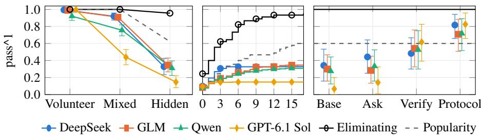
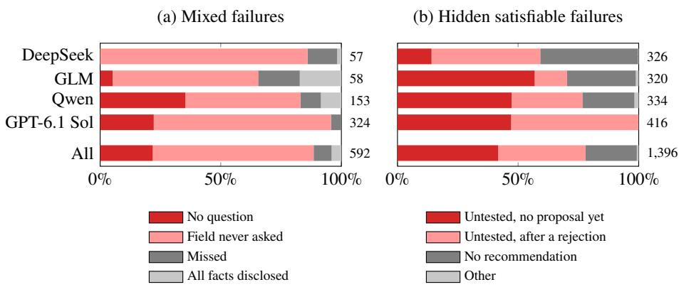

# �-Rec-Books: A Disclosure-Controlled Benchmark for Requirement Elicitation in Agentic Recommender Systems

Bharath Sivaram Narasimhan1 and Karthik R. Narasimhan2

1 Independent Researcher, Mountain View, CA, USA nbharaths@gmail.com 2 Princeton University, Princeton, NJ, USA karthikn@princeton.edu

Abstract. While conversational recommendation systems provide a more natural user interface, they face the challenge of progressively discovering a user’s needs before they can recommend an item that satisfies them. To evaluate the ability of AI agents at this elicitation process, we introduce �-Rec-Books, a benchmark that holds each user request fixed while varying only when the user reveals their requirements: all at the start (volunteer), one at the start and the rest when asked (mixed), or some never (hidden). A hidden requirement can be found only by proposing books and inferring it from the user’s accept or reject verdicts. We generate 450 tasks over a catalog of 20,000 books from Wikidata, develop a rule-based simulated user to answer the agent, and score recommendations against catalog metadata without an LLM judge. Across four agents and two search interfaces, success rates fall for every agent and interface, on average from 0.975 (volunteer) to 0.756 (mixed) and 0.283 (hidden). Mixed tasks fail mainly because agents do not ask, and when told to ask, every agent reaches at least 0.931. On hidden tasks, most failures come from agents recommending a book they never proposed to the user. When told to propose first, agents only match a simple baseline that proposes popular books, and stay well below one that uses rejection to rule out possible requirements. We release the catalog pipeline, task generator, simulated user, validators, reference agents, and all agent traces at https://github.com/nbharaths/tau-rec/tree/main/ data/tracks/books-wikidata-v2.

Keywords: Conversational recommendation · Verifiable evaluation · Preference elicitation · LLM agents · User simulation.

## 1 Introduction

Agentic recommenders combine dialogue with catalog search and metadata tools, so their evaluation must test more than ranking quality. �-Rec introduced verifiable rewards for this setting, scoring recommendations against catalog predicates without an LLM judge [32]. On a small movie catalog, success fell steeply as requirements moved from stated to hidden.

However, �-Rec leaves open a few questions around diferent conditions that may impact agent success: (1) the timing of information disclosure given a fixed request, (2)

the structure of the search interface, and (3) the overall size of the item catalog. The first question matters greatly because real users rarely state every requirement up front. For instance, in ReDial’s 11,348 human recommendation dialogues [25], users state only 36% of their first genre, era, or origin requirements unprompted, 52% in answer to a question, and 12% only after a suggestion. Users of a natural-language recommender also often add criteria after seeing results [18].

We introduce �-Rec-Books, a benchmark that makes disclosure a controlled variable. Each task family fixes a request (its predicates, answer set, persona, and reading history) and comes in a volunteer, a mixed, and a hidden variant that difer only in when each requirement is revealed. A rule-based simulated user enforces the disclosure rules, and the scoring does not make use of LLMs. Agents can find books through one of two search interfaces: keyword search, or structured search, which filters on catalog fields.

In our experiments, we find that success rate on satisfiable tasks falls for every model and interface (across 4 models, 2 interfaces) from 0.975 on volunteer to 0.756 on mixed and 0.283 on hidden tasks. Moreover, structured search beats keyword search by 7.1 points on average. In our error analysis, we find that mixed failures come from not asking and hidden failures from recommending a book without first proposing it to the user. We also show that when agents are told to propose first, they match a scripted agent that proposes popular books, but not one that also reads declines and rejections. Overall, we contribute (i) 450 tasks in matched disclosure variants, generated from catalog predicates without a retriever; (ii) a frozen, audited 20,000-work public-domain (CC0) catalog with nested 5k and 10k subsets; and (iii) validators, LLM-free reference agents, and the traces of all 32,976 trials, which regenerate every result.

## 2 Related Work

Corpora, test collections, and toolkits. Conversational recommender system (CRS) corpora range from human–human movie conversations [25,38] to knowledge-grounded [31] and synthesized ones [19]. They support training and replay but not counterfactual conditions [17], and CRS toolkits prescribe no executable task state [58]. For books, Goodreads supplies ratings and reviews and Book-Crossing ratings [50,60]. Social Book Search collected complex reader requests [20], later formalized as narrative-driven recommendation [7]. KITAB and QUEST test constraint satisfaction and set queries over entities that include books [1,28].

Eliciting requirements. Multi-round CRSs ask about items [11] or attributes. Attribute-based CRSs learn which attribute to ask about and when to recommend [46,23]. Their simulated users hold a target item, answer every attribute question, and reject wrong items without reasons. Our mixed and hidden conditions pose the same decision with free questions and verifiable outcomes, and our hidden users also decline some questions. Searching by verdicts resembles twenty-questions games for LLMs [15] and LLM preference elicitation [3]. Constraint-based recommenders relax queries that return nothing [29], while we score abstention.

Agentic recommendation. LLMs act as conversational recommenders [13] and increasingly use tools [52]. InteRecAgent’s SQL-style and similarity retrieval [16] is the closest precedent for our interface contrast. AgentRecBench scores tool-using recommender agents by hit rate, with no user in the loop [44]. WebShop scores attributematched product choices [53]. In EComAgentBench, requirements held in a user profile or revealed only through clarification are met less often than those stated in the query [12]. �-bench, ToolSandbox, and $\tau ^ { 2 }$ -bench established stateful tool evaluation [54,27,4], which �-Rec brought to recommendation [32].

Clarifying questions. Clarifying questions are well studied in information retrieval [2], as are simulated users that answer them [43]. LLMs degrade when a request is spread over turns, and they rarely ask for what is missing [22,26]. UserBench users reveal preferences gradually [36]. Other benchmarks test asking about implicit intentions [35], choosing the one question that recovers a missing variable [24], and asking about hard constraints before planning [57]. LHAW removes details from long-horizon tasks and lets agents ask a simulated user [34]. COMPASS varies how fast a simulated traveller reveals hard constraints [37]. RegretBench scores clarification policies by regret, including in product recommendation [47]. Ambig-SWE gives coding agents full, underspecified, or askable versions of the same issue [48], the closest precedent for matched disclosure variants. We add a condition where the user declines to state some requirements but judges proposals, and we vary catalog size and interface on the same tasks.

User simulation. Agenda-based simulators drive task-oriented dialogue evaluation [42], including database-checked success on MultiWOZ [8], and CRS evaluation [56]. UserSimCRS v2 packages agenda-based and LLM simulators [5]. LLM users can evaluate CRSs [51], but they reveal what they should withhold and express preferences unlike people [55,59]. Modular, human-validated, and crowdsourced studies address these gaps [10,30,6], and Sim4IA-Bench scores simulated queries and utterances against real search sessions [21]. Petruzzelli et al. vary user stereotypes [33]; we fix the facts and vary when they are disclosed.

## 3 The Books Resource

Catalog. We source works for the catalog from Wikidata [49]. We keep works that Wikidata lists as literary or written works with an author, publication date, language, English title, and mapped genre, and filter out editions, series, articles, chapters, plays, poems, and short stories. We deduplicate records by normalized title and authors, shufle them in a fixed random order, and take the first 20,000 of the 26.1k eligible works to form the catalog; the 5k and 10k catalogs are the first 5,000 and 10,000 of these, so each smaller catalog lies inside the larger ones. We correct 25 Wikidata labels and drop two kinds of faulty records (Sect. 5). The catalog covers 19 genres, 151 language and 166 country labels, and years 1460–2026.

Task families. The 450 tasks are divided into 150 task families, each of which fixes its predicates, answer set, persona, reading history and accepted formats, and varies only how its requirements are disclosed (Fig. 1). The predicates use four fields: genre, language, country of origin, and publication year. We split the task families into three tiers – simple, medium, and complex – with 2, 3–4, and 5 predicates, respectively (a year range counts as two), and together follow 13 templates, each a fixed combination of fields and year bounds. In the fifteen families with no valid recommendation (NVR), dropping any one predicate leaves at least 3 matches. Every predicate is material (i.e., dropping it adds at least one item, and at least 5%, to the answer set), and every satisfiable family keeps an acceptable answer (unread, in an accepted format) in the 5k catalog.

<table><tr><td>Family 060 (medium, 27 answers at 20k). Predicate The mixed and hidden users open with “I&#x27;m looking for one book. It should include Science Fiction.&quot; Mixed (DeepSeek, structured; success)</td><td colspan="3">Volunteer Mixed genre includes Science Fiction stated stated genre includes Young Adult stated on ask published no later than 2001 stated on ask</td></tr><tr><td>Agent  $\tilde { \cdot } \cdot \cdot \cdot$  Any particular language User  $\tilde { \cdot } \cdot \cdot \cdot$  Agent  $\tilde { \cdot } \cdot \cdot \cdot$  User “###ACCEPTED###  $\dots \dots$  Tool recommend(item_id=wd_Q1213656) succeeds. Hidden (DeepSeek, structured; failure), after a similar question.</td><td colspan="3"> $\ldots 2 \ldots$  A publication year range  $\ldots 2 \ldots$  Any additional genres  $\dots , l ^ { \ast }$  it should include Young Adult; and it should have been published no later than 2001  $\dots , \dots , ^ { 5 }$  Have Space Suit—Will Travel by Robert A. Heinlein (1958) [[candidate_id:wd_Q1213656]]  $\therefore \cdot \cdot ^ { \ast }$ </td></tr></table>

Fig. 1. Family 060 in its three disclosure conditions, with two trial excerpts (. . . omits text).

Table 1. The rule-based user’s replies and the agents’ system prompt (verbatim excerpts).
<table><tr><td>Agent turn</td><td>Rule-based user&#x27;s reply</td></tr><tr><td>Field question</td><td>Its on-ask facts; &quot;I&#x27;d rather not say (more) about&quot; a field holding a hidden fact; &quot;No preference on&quot; any other field</td></tr><tr><td>&quot;Anything else?&quot;</td><td>One undisclosed on-ask fact; once none remains, “That&#x27;s everything I can share&quot;</td></tr><tr><td>One tagged book</td><td>###ACCEPTED### if it meets every predicate, is unread, and exists in any format the user named; else ###REJECTED###, never with a reason</td></tr><tr><td>Several tags, or none</td><td>No verdict; &quot;Please choose one catalog title  $\cdots ^ { \dag } ,$  or, if it recognizes no question, &quot;Please ask about anything you need .. .</td></tr><tr><td>Prompt</td><td>Agent instruction</td></tr><tr><td>Elicitation</td><td>“Engage the user in natural conversation to understand their preferences  $\therefore \cdot \cdot ^ { \ast }$ </td></tr><tr><td>Proposals</td><td> $\tilde { \cdot } \cdot \cdot \cdot$  append its exact catalog ID as [[candidate_id:ID]] . . .&quot;</td></tr><tr><td>Verdicts</td><td>“. . . Use rejections as feedback to pick a better candidate, then call recommend() with your updated  $\mathrm { p i c k . } ^ { \prime }$ </td></tr><tr><td>Ask</td><td>adds “The user may have requirements they have not stated yet; ask about them before you recommend a book.&quot;</td></tr><tr><td>Ask-and-verify</td><td>also adds “Before you call recommend, propose the book you intend to recommend, with its candidate marker, and wait for the user&#x27;s verdict.&quot;</td></tr><tr><td>Protocol</td><td>also adds “If the user would rather not say (more) about a field, they have a requirement on that field that they will not state. A rejected book fails at least one of the user&#x27;s requirements.&quot;</td></tr></table>

Reveal tags and conditions. Each predicate carries a reveal tag (stated, on ask, or hidden), and the three conditions difer only in these tags. A volunteer user opens with a fully formulated request that states every predicate and its accepted formats. A mixed user states one predicate and reveals an on-ask predicate, or its accepted formats, when asked about the field, so one question naming all fields discloses every askable fact. A hidden user also withholds at least one predicate for the whole dialogue; asked about its field, it declines, which reveals that a requirement exists but not its value (Table 1 lists every reply). Together, the hidden predicates rule out at least 50% of the books that match the revealed ones, and no revealed fact gives a hidden one away: a task never reveals British English, say, while hiding the United Kingdom as the country.

A trial. The agent asks questions, may propose books for verdicts, and ends with the terminal recommend tool, called with one book or, to abstain, with none. A trial succeeds when its ending is correct (a book meeting every predicate on a satisfiable task, an abstention on an NVR task) and the protocol checks hold.

What each condition measures. Volunteer and mixed tasks separate satisfying stated requirements from deciding to elicit them (one broad question sufices), following needs revealed over a conversation [39]. Hidden tasks are a stress test. Real users sometimes state a requirement only after seeing a suggestion; that is critiquing [9], which we leave to later work. The hidden user never states it, so the agent must propose books before committing and search using verdicts that give no values or reasons.

Formats, histories, and checks. Wikidata does not record which formats a book comes in, so each book gets a simulated but fixed set (audiobook, ebook, hardcover, paperback), drawn from a hash of its Wikidata ID. In 36 families the user accepts only one format, and at least one otherwise valid book in the 5k catalog lacks it. In 48 families the user has a reading history that holds one valid answer and, for each hidden predicate, a book that fails only that predicate, so no single book in it gives a hidden value away. In the 17 of these with two hidden predicates, the history as a whole hints at them, but agents do no better on the 5 such tasks in the panel, the random 51 of the 150 families that every agent runs (Table 2). Personas are synthetic, and only LLM users voice them. Besides meeting the predicates, a trial must pass five protocol checks: the agent recommends at most one book, never one from the reading history, checks its formats once the user names one, abstains on NVR tasks, and calls recommend on the others.

## 4 Controlled Evaluation Design

We ask four research questions: RQ1 (disclosure): how much success is lost as requirements move from volunteered to askable or hidden, with the request held fixed? RQ2 (interface): how does a schema-aligned search interface change end-to-end success over top-20 keyword search? RQ3 (scale): how does success change with catalog size when every 5k answer is retained? RQ4 (reliability): which efects persist across models, trials, and users?

## 4.1 Experimental Setup

Agents. The agents run on three open-weight models – DeepSeek V4.1 Flash, GLM 5.3 Flash, and Qwen 3.8 27B, at temperature 0 (outputs still vary) – and the frontier model GPT-6.1 Sol at its required default temperature, all with high reasoning efort. Every agent gets the same system prompt (Table 1), which says that recommending a book that misses any requirement fails, and so does abstaining when the catalog has an answer.

Interfaces. Both interfaces ofer metadata, format-availability, and reading-history tools and the terminal recommend(item\_id), which scores the identifier passed, never a title parsed from text. The keyword interface sums per-field Okapi BM25 scores [40] and returns the top 20 without paging; the year field is not indexed, so year ranges are inexpressible. The structured interface ofers case-insensitive conjunctive filters on genre, language, country (a parent label covers its children), year range, and acceptable formats, returning pages of 20 by Wikidata sitelink count (a popularity proxy) or recency; an unknown value returns the valid vocabulary. The structured tool’s prompt line lists these fields and the keyword line does not, so the contrast compares two bundles of tool and prompt over the same metadata, not retrievers alone.

Table 2. Experimental blocks; the panel is the reliability block plus Panel, other. Blocks use the rule-based user and the 20k catalog unless a row says otherwise; 32,976 trials in all.
<table><tr><td>Block</td><td>Agents</td><td>Interfaces</td><td></td><td>Conditions Families, trials/task</td><td>RQ</td></tr><tr><td>Panel, other</td><td>all four</td><td>both</td><td>all three</td><td>33,4</td><td>1,2,4</td></tr><tr><td>Reliability block</td><td>all four</td><td>both</td><td>all three</td><td>18,8</td><td>1,2,4</td></tr><tr><td>Scale study (5k, 10k, 20k)</td><td>open-weight</td><td>both</td><td>not hidden</td><td>135,4</td><td>3,4</td></tr><tr><td>LLM users</td><td>DeepSeek</td><td>structured</td><td>all three</td><td>18, 4 × 2 users</td><td>4</td></tr><tr><td>Ask prompt</td><td>all four</td><td>structured</td><td>all three</td><td>18,8</td><td>1</td></tr><tr><td>LLM users</td><td>GPT-6.1 Sol</td><td>structured all three</td><td></td><td>18, 4 × 2 users</td><td>4</td></tr><tr><td>Field list</td><td>DeepSeek, Qwen</td><td>keyword</td><td>all three</td><td>18,8</td><td>2</td></tr><tr><td>Verify prompt</td><td>all four</td><td>structured all three</td><td></td><td>18,8</td><td>1</td></tr><tr><td>Protocol prompt</td><td>all four</td><td>structured all three</td><td></td><td>18,8</td><td>1</td></tr></table>

Users. By default the user is rule-based: it holds the task facts and answers by fixed rules (Table 1), using keyword matching to tell which fields each agent turn asks about. We checked the matching against an LLM’s labels on 200 held-out agent turns: precision 0.898, recall 0.944, and recall 0.77 on generic requests such as “Anything else?”. In the LLM-user block, GLM 5.3 Flash and Qwen 3.8 27B play the user instead, at temperature 1: they get the same rules, facts, and reveal tags but decide what to disclose and word their own replies, while verdicts still come from the identifier check. The base prompt tells agents to use rejections to pick a better candidate, but not that a rejection means a requirement failed or that a declined question hides one. A trial allows 20 agent turns, including turns that draw no verdict, and 600 s of agent time, and also ends at a context overflow or after ten calls past a budget of 150 tool calls in one turn; agents are not told these caps.

Trials. Each panel task runs four times, and the 18 families of its reliability block run eight times (Table 2).

## 4.2 Outcome Measures and Statistical Analysis

Outcome and uncertainty. With $c _ { t }$ successes among $n _ { t }$ trials of task � in the evaluated set $\begin{array} { r } { T , \mathrm { p a s s } ^ { \wedge } \mathbf { k } = \frac { 1 } { | T | } \sum _ { t \in T } { \binom { c _ { t } } { k } } / { \binom { n _ { t } } { k } } } \end{array}$ . Intervals and $p$ values come from a paired bootstrap that resamples task families [41,45]; diferences are in points (hundredths of pass^1).

Tests. We run twelve tests; all other analyses are exploratory. The interface test, structured minus keyword search at 20k averaged over agents and conditions, is tested on its own, without correction, at $p < 0 . 0 5$ . The other eleven use Holm’s correction for multiple comparisons [14]: the interface test per agent, the two disclosure gaps (mixed and hidden against volunteer), the two scale efects (5k against 20k), their interaction with the interface, and the two LLM users against the rule-based one. We also run each interface test without trials that end in a context overflow or at the tool budget and, as a robustness check, test each contrast across templates with an exact sign-flip test [45].

## 5 Resource Validation

Automated checks. A validator recomputes every answer set and acceptable answer, rechecks the NVR families and the nested catalogs, and runs the structured tool on every satisfiable family and catalog size without error.

Reference agents. The two scripted agents run through the same user, tools, scoring, and caps as the LLM agents, and propose only unread books. The popularity agent asks one question naming every field, filters on what the user states, and proposes the most popular match until one is accepted, abstaining when none is left; it uses only what the prompt tells agents. The eliminating agent adds the protocol’s meaning: a declined field holds a requirement, and a rejected book fails at least one. It lists the possible hidden requirements (one or two values of each declined field), drops every one a rejected book satisfies, proposes the book that fits the most of those left, and abstains when no candidate fits any. Both solve all 300 volunteer and mixed tasks. Of the 135 satisfiable and 15 NVR hidden tasks, the popularity agent solves 84 and 2, the eliminating agent 129 and 13 (median 3 proposals per success). Both parse the rule-based user’s reply templates, so they test solvability, not language handling. A no-ask floor never asks and recommends the most popular unread book that matches the opening request.

Catalog audit. Two annotators separately reviewed 60 records (30 across genres, 30 among the 500 most popular) under written rules and agreed on 297 of 300 judgments. They found two systematic errors, which two exclusion rules remove, and both judged all 12 sampled label corrections correct.

Task audit. They also reviewed 30 families (all 15 NVR and five satisfiable per tier) for unambiguous predicates, consistent variants, faithful wording, no giveaway of a hidden value, and NVR plausibility, agreeing on all 150 applicable judgments and finding no defect.

Reproducibility. Track books-wikidata-v2 fixes the catalog, tasks, policy, harness, and user profiles. A saved snapshot of 21 Wikidata query responses rebuilds the catalog, tasks, and answers byte for byte; released checks replay every archived tool call, score, and rule-based user reply, and scripts regenerate every result from the traces and labels without an LLM.

## 6 Results

## 6.1 RQ1: Constraint Disclosure

Success drops sharply when requirements are not stated up front, for every model and interface (Table 3, Fig. 2a). Averaged over models and interfaces, pass^1 on satisfiable families is 0.975 on volunteer, 0.756 on mixed, and 0.283 on hidden tasks. Both gaps hold after Holm correction (Table 4). The mixed gap is 23.3 points (all families) and the hidden gap, on satisfiable families, 69.3 points. Success also falls as tasks get more complex, most on hidden tasks (0.409 simple, 0.163 complex).

## 6.2 RQ2: Retrieval Interface at 20k

Interface test. Structured search adds 7.1 points at 20k, mostly through Qwen and on mixed tasks (13.2 points). It holds across families (bootstrap $p = 0 . 0 0 0 5 )$ but not templates (exact sign-flip � = 0.15), with or without overflow and budget stops. After Holm adjustment only Qwen’s and DeepSeek’s gains hold; without Qwen the average falls to 3.3 points. At 80% power, the panel detects efects of about 6 points for this contrast and 8 between two agent–interface pairs (14 on hidden tasks).

(a) By condition (b) Hidden, by rejections (c) Hidden, by prompt  
  
Fig. 2. (a, b) The panel’s 45 satisfiable families, agents pooled over interfaces (95% family-bootstrap intervals), and the scripted agents on structured search; (b) counts a hidden success only within � rejections. (c) Hidden satisfiable success on the reliability block by prompt (structured search; prompts in Table 1).

Table 3. pass^k on the panel at 20k. Elic.: share of mixed trials eliciting every askable fact. LLM average: mean of the eight LLM rows. Bold: best LLM agent per pass^k column.
<table><tr><td rowspan="2">Agent</td><td rowspan="2">Interface</td><td colspan="3">Satisfiable (45 families)</td><td>NVR (6)</td><td colspan="2">All (153 tasks)</td><td>Mixed (51)</td></tr><tr><td>Volunteer</td><td>Mixed</td><td>Hidden</td><td>Hidden</td><td>pass^1</td><td>pass^4</td><td>Elic.</td></tr><tr><td>DeepSeek</td><td>keyword</td><td>0.989</td><td>0.872</td><td>0.297</td><td>0.000</td><td>0.691</td><td>0.609</td><td>0.576</td></tr><tr><td></td><td>structured</td><td>1.000</td><td>0.967</td><td>0.358</td><td>0.000</td><td>0.760</td><td>0.666</td><td>0.859</td></tr><tr><td>GLM</td><td>keyword</td><td>0.978</td><td>0.869</td><td>0.325</td><td>0.167</td><td>0.714</td><td>0.574</td><td>0.569</td></tr><tr><td></td><td>structured</td><td>1.000</td><td>0.947</td><td>0.367</td><td>0.042</td><td>0.756</td><td>0.627</td><td>0.641</td></tr><tr><td>Qwen</td><td>keyword</td><td>0.842</td><td>0.569</td><td>0.294</td><td>0.167</td><td>0.550</td><td>0.381</td><td>0.377</td></tr><tr><td></td><td>structured</td><td>1.000</td><td>0.942</td><td>0.325</td><td>0.000</td><td>0.737</td><td>0.625</td><td>0.656</td></tr><tr><td>GPT-6.1 Sol</td><td>keyword</td><td>0.994</td><td>0.458</td><td>0.139</td><td>0.000</td><td>0.523</td><td>0.456</td><td>0.207</td></tr><tr><td></td><td>structured</td><td>1.000</td><td>0.419</td><td>0.156</td><td>0.000</td><td>0.511</td><td>0.424</td><td>0.159</td></tr><tr><td>LLM average</td><td>both</td><td>0.975</td><td>0.756</td><td>0.283</td><td>0.047</td><td></td><td></td><td></td></tr><tr><td>Scripted, popularity</td><td>structured</td><td>1.000</td><td>1.000</td><td>0.622</td><td>0.000</td><td>0.850</td><td>0.850</td><td>一</td></tr><tr><td>Scripted, eliminating</td><td>structured</td><td>1.000</td><td>1.000</td><td>0.956</td><td>0.833</td><td>0.980</td><td>0.980</td><td></td></tr><tr><td>No-ask floor</td><td></td><td>1.000</td><td>0.067</td><td>0.067</td><td>0.000</td><td>0.373</td><td>0.373</td><td>一</td></tr></table>

Tools or prompt. Adding the structured tool’s field list to the keyword prompt separates tool from prompt. For DeepSeek the field list adds 4.6 points and structured retrieval 1.4 more; for Qwen the field list adds 0.2 and retrieval 19.4. Since every requirement is a catalog field, this is a best case for filters. Agents do not skip search by recalling book IDs: only 3 of 24,644 final recommendations name a book search never returned, and all are invalid.

## 6.3 RQ3: Catalog Scale (5k–20k)

Catalog size matters far less than disclosure. Answer sets grow with the catalog (median 10 answers at 5k, 40 at 20k), and only the open-weight agents ran this study, on volunteer and mixed tasks. Fixed keyword queries find an answer for 106 of the 135 satisfiable families at 5k but only 73 at 20k. Agents lose far less but search more: keyword pass^1 falls 4.2 points from 5k to 20k, mostly through Qwen, and structured pass^1 by 0.8 (Table 4).

Table 4. Paired pass^1 contrasts in points, with 95% family-bootstrap intervals. Interface rows are structured minus keyword at 20k; the interaction is that diference at 5k minus at 20k. values come from the family bootstrap and an exact sign-flip test over templates (9 for the LLM-user rows, 13 otherwise); ≤ 0.0011 is the smallest Holm-adjusted value 10,000 resamples allow.
<table><tr><td></td><td></td><td colspan="2">Families</td><td>Templates</td></tr><tr><td>Contrast</td><td>∆pass^1</td><td>95% CI</td><td>p</td><td>p</td></tr><tr><td>Tested alone</td><td></td><td></td><td></td><td></td></tr><tr><td>Interface, model-averaged</td><td>+7.1</td><td>[+3.0, +11.4]</td><td>0.0005</td><td>0.15</td></tr><tr><td>Holm-corrected (11 tests)</td><td></td><td></td><td></td><td></td></tr><tr><td>Interface, DeepSeek</td><td>+6.9</td><td>[+2.5, +11.6]</td><td>0.0091</td><td>0.38</td></tr><tr><td>Interface, GLM</td><td>+4.2</td><td>[-0.7, +9.5]</td><td>0.288</td><td>0.69</td></tr><tr><td>Interface, Qwen</td><td>+18.7</td><td>[+11.7, +25.9]</td><td>≤ 0.0011</td><td>0.02</td></tr><tr><td>Interface, GPT-6.1 Sol</td><td>-1.2</td><td>[-8.4, +6.0]</td><td>0.753</td><td>0.83</td></tr><tr><td>Mixed – volunteer (all families)</td><td>-23.3</td><td>[-27.3, -19.3]</td><td>≤ 0.0011</td><td>0.003</td></tr><tr><td>Hidden – volunteer (satisfiable)</td><td>-69.3</td><td>[-76.3, -61.9]</td><td>≤ 0.0011</td><td>0.005</td></tr><tr><td>Keyword, 5k – 20k</td><td>+4.2</td><td>[+1.3, +7.0]</td><td>0.0255</td><td>0.42</td></tr><tr><td>Structured, 5k – 20k</td><td>+0.8</td><td>[−0.2, +1.8]</td><td>0.288</td><td>0.62</td></tr><tr><td>Interface × scale</td><td>-3.3</td><td>[-6.4, -0.3]</td><td>0.140</td><td>0.56</td></tr><tr><td>GLM user – rule-based</td><td>-10.2</td><td>[−15.7, -4.6]</td><td>≤ 0.0011</td><td>0.38</td></tr><tr><td>Qwen user – rule-based</td><td>-7.4</td><td>[-13.2, -2.3]</td><td>0.0138</td><td>0.42</td></tr></table>

## 6.4 RQ4: Reliability across Models, Trials, and Users

The disclosure gradient holds for every model and interface, at pass^4 (averaged, 0.955 on volunteer, 0.582 on mixed, and 0.099 on hidden tasks), and under both LLM users.

LLM users. With DeepSeek and structured search on the reliability block, GLM and Qwen users lower pass^1 by 10.2 and 7.4 points, mostly on mixed tasks, stating every askable value in about half the trials (rule-based user: 84.7%). They rarely leak hidden values (≤1.4% of trials [59]); GPT-6.1 Sol, which asks less, changes at most 1.2 points and trails DeepSeek under every user.

## 6.5 Agent Failure Modes

Mixed tasks fail when agents do not ask. GPT-6.1 Sol nearly solves volunteer tasks but has the lowest mixed pass^1; in 40–49% of its mixed trials it elicits no askable fact (open-weight: at most 25%), and its 101 mixed trials that elicit every askable fact all succeed. Most failed mixed trials ask no question or never ask about some field (Fig. 3); trials eliciting every askable fact succeed 98% of the time, others 52%, since popular books often meet unasked requirements. On the reliability block, the ask prompt (Table 1) raises GPT-6.1 Sol’s mixed pass^1 by 59.0 points and lifts every agent to at least 0.931. Keyword-matching errors, measured with LLM labels, move mixed success by at most 3.9 points down or 2.0 up.

Hidden tasks fail on untested commitments. In 78% of failed hidden satisfiable trials, the agent recommends a book it never proposed for a verdict (GPT-6.1 Sol: 415 of

  
Fig. 3. How failed trials end on the panel at 20k, as shares of each agent’s failures over both interfaces (� at the bar end; All pools the four agents). Missed: keyword matching missed a field question that LLM labels found; untested: never proposed for a verdict.

416), half of them before any proposal; most (73%) follow a declined question, which signals a hidden requirement. Few come from the tag format: in 8.5% of failures an earlier turn had named an acceptable book without a tag. Most other failures end at the time or turn cap.

How far proposing and elimination go. The popularity agent solves 28 of the 45 satisfiable hidden tasks, the eliminating agent 43; within three rejections they reach 0.311 and 0.622, agents 0.208 (Fig. 2b). Told to propose first (ask-and-verify, Fig. 2c), agents cut untested commitments to at most 30% of hidden failures and reach 0.483–0.617 on the reliability block, not detectably diferent from the popularity agent’s 0.600 there.

What the protocol adds. The eliminating agent (1.000) holds three things the agents lack: the meaning of a decline and of a rejection, a list of possible hidden requirements, and systematic elimination. The protocol prompt (Table 1) supplies the first. It lifts every agent, by 22.5 points on average, to 0.708–0.825, detectably above the popularity agent for 3 of the 4, and agents now abstain on 46–62% of hidden NVR tasks (ask-and-verify: at most 8%). All four stay below the eliminating agent, also within three rejections (0.383–0.600 against 0.733). Knowing the protocol thus closes part of the hidden gap, and the rest lies in search. Every structured run abstains on volunteer NVR tasks, but under the base prompt agents reach only 0.047 on hidden ones, where verdicts cannot prove that no book fits; the eliminating agent abstains on 5 of 6 once that list runs out.

## 7 Availability, Intended Use, and Maintenance

Availability. The catalog and its source snapshot, the tasks and answers, the environment, validators, reference agents, and every trace are released (code MIT; catalog and snapshot CC0 1.0; tasks, answers, and policies CC BY 4.0) at https://github.com/nbharaths/ tau-rec/tree/main/data/tracks/books-wikidata-v2.

Using the benchmark. To report results, run the panel at 20k with the rule-based user, the 20-turn cap, at least four trials per task, one or both interfaces, and two prompts:

the base prompt, which measures whether an agent asks and verifies unprompted, and ask-and-verify, under which hidden tasks measure what remains once agents propose before committing. Both prompts matter: GPT-6.1 Sol trails the other agents under the base prompt and catches up under ask-and-verify. Report pass^1 by condition (hidden NVR tasks separately), pass^4, hidden success by rejections allowed, elicitation, how trials end, and the provider. One agent’s structured run costs about US\$1.0–4.4 per prompt. The panel separates 19 of the 28 agent–interface pairs in Table 3 at the 95% level, and if it leaks into training data, the generator can draw fresh families.

Maintenance. Track IDs never change; fixes ship under a new ID, and the first author maintains the resource through the issue tracker.

## 8 Bias, Ethics, and Limitations

Catalog coverage. Wikidata and the English-title requirement favor well-documented, Anglo-American works (English on 83.2% of records, the US on 41.5%, the UK on 13.4%), and 51 of 68 task-country predicates target the US or UK. Structured search concentrates exposure on the most popular books in each answer set, far more than keyword search. Genres are skewed toward science fiction, and literary fiction is absent. Future work can extend the catalog beyond English-titled works.

Scope. The tasks are hard-filter elicitation over four metadata fields; soft preferences, read-alikes, and taste, which real book requests often contain [20], are out of scope. The rule-based user speaks in catalog labels and never explains a rejection, so the benchmark measures how reliably agents elicit and verify requirements rather than conversational skill. Mixed tasks test whether an agent asks, not how well, since one broad question discloses every askable fact. The user model has not been validated against people, and we test one frontier model.

## 9 Conclusion

Holding each request fixed, �-Rec-Books shows that when requirements are revealed matters far more than how agents search or how large the catalog is. Success on satisfiable tasks falls from 0.975 to 0.756 when requirements must be asked for and to 0.283 when some are never stated (RQ1). Told to ask, every agent reaches at least 0.931 on mixed tasks, but on hidden tasks agents told to propose first stay well below an agent that rules out requirements from rejections; explaining declines and rejections closes part of that gap. Structured search adds 7.1 points, mostly through one agent (RQ2); a four times larger catalog costs keyword search 4.2 points and structured search almost nothing (RQ3); and the gradient holds for every model and interface, at pass^4, and with LLM users (RQ4). Critiquing users, costlier elicitation, soft preferences, and human-validated user models come next.

Disclosure of Interests. The authors have no competing interests to declare that are relevant to the content of this article.

## References

1. Abdin, M.I., Gunasekar, S., Chandrasekaran, V., Li, J., Yuksekgonul, M., Peshawaria, R.G., Naik, R., Nushi, B.: KITAB: Evaluating LLMs on constraint satisfaction for information retrieval. In: International Conference on Learning Representations (2024), https://open review.net/forum?id=b3kDP3IytM

2. Aliannejadi, M., Zamani, H., Crestani, F., Croft, W.B.: Asking clarifying questions in opendomain information-seeking conversations. In: Proceedings of the 42nd International ACM SIGIR Conference on Research and Development in Information Retrieval. pp. 475–484. ACM (2019). https://doi.org/10.1145/3331184.3331265

3. Austin, D., Korikov, A., Toroghi, A., Sanner, S.: Bayesian optimization with LLM-based acquisition functions for natural language preference elicitation. In: Proceedings of the 18th ACM Conference on Recommender Systems (RecSys ’24). pp. 74–83. ACM (2024). https://doi.org/10.1145/3640457.3688142

4. Barres, V., Dong, H., Ray, S., Si, X., Narasimhan, K.: �2-Bench: Evaluating conversational agents in a dual-control environment. In: Proceedings of the 43rd International Conference on Machine Learning. Proceedings of Machine Learning Research, vol. 306, pp. 6736–6782. PMLR (2026)

5. Bernard, N., Balog, K.: UserSimCRS v2: Simulation-based evaluation for conversationa recommender systems. In: Advances in Information Retrieval. Lecture Notes in Computer Science, vol. 16486, pp. 496–510. Springer Nature Switzerland (2026). https://doi.org/ 10.1007/978-3-032-21321-1\_55

6. Bernard, N., Joko, H., Hasibi, F., Balog, K.: CRS Arena: Crowdsourced benchmarking of conversational recommender systems. In: Proceedings of the Eighteenth ACM International Conference on Web Search and Data Mining. pp. 1028–1031. ACM (2025). https://doi. org/10.1145/3701551.3704120

7. Bogers, T., Koolen, M.: Defining and supporting narrative-driven recommendation. In: Proceedings of the Eleventh ACM Conference on Recommender Systems. pp. 238–242. ACM (2017). https://doi.org/10.1145/3109859.3109893

8. Budzianowski, P., Wen, T.H., Tseng, B.H., Casanueva, I., Ultes, S., Ramadan, O., Gašić, M.: MultiWOZ – a large-scale multi-domain Wizard-of-Oz dataset for task-oriented dialogue modelling. In: Proceedings of the 2018 Conference on Empirical Methods in Natural Language Processing. pp. 5016–5026. Association for Computational Linguistics (2018). https: //doi.org/10.18653/v1/D18-1547

9. Chen, L., Pu, P.: Critiquing-based recommenders: Survey and emerging trends. User Modeling and User-Adapted Interaction 22(1–2), 125–150 (2012). https://doi.org/10.1007/s1 1257-011-9108-6

10. Chen, L., Dai, Q., Zhang, Z., Feng, X., Zhang, M., Tang, P., Chen, X., Zhu, Y., Dong, Z.: RecUserSim: A realistic and diverse user simulator for evaluating conversational recommender systems. In: Companion Proceedings of the ACM Web Conference 2025. pp. 133–142. ACM (2025). https://doi.org/10.1145/3701716.3715258

11. Christakopoulou, K., Radlinski, F., Hofmann, K.: Towards conversational recommender systems. In: Proceedings of the 22nd ACM SIGKDD International Conference on Knowledge Discovery and Data Mining. pp. 815–824. ACM (2016). https://doi.org/10.1145/29 39672.2939746

12. Du, Z., Li, T., Zhang, H.: EComAgentBench: Benchmarking shopping agents on long-horizon tasks with distributed hidden intent. In: Proceedings of the 2026 Conference on Empirical Methods in Natural Language Processing: Industry Track. pp. 1012–1027. Association for Computational Linguistics (2026)

13. He, Z., Xie, Z., Jha, R., Steck, H., Liang, D., Feng, Y., Majumder, B.P., Kallus, N., McAuley, J.: Large language models as zero-shot conversational recommenders. In: Proceedings of the 32nd ACM International Conference on Information and Knowledge Management. pp. 720–730. ACM (2023). https://doi.org/10.1145/3583780.3614949

14. Holm, S.: A simple sequentially rejective multiple test procedure. Scandinavian Journal of Statistics 6(2), 65–70 (1979)

15. Hu, Z., Liu, C., Feng, X., Zhao, Y., Ng, S.K., Luu, A.T., He, J., Koh, P.W., Hooi, B.: Uncertainty of thoughts: Uncertainty-aware planning enhances information seeking in LLMs. In: Advances in Neural Information Processing Systems. vol. 37 (2024). https://doi.org/10.52202/0 79017-0762

16. Huang, X., Lian, J., Lei, Y., Yao, J., Lian, D., Xie, X.: Recommender AI agent: Integrating large language models for interactive recommendations. ACM Transactions on Information Systems 43(4), 1–33 (2025). https://doi.org/10.1145/3731446

17. Jannach, D.: Evaluating conversational recommender systems: A landscape of research. Artificial Intelligence Review 56(3), 2365–2400 (2023). https://doi.org/10.1007/s104 62-022-10229-x

18. Kang, J., Condif, K., Chang, S., Konstan, J.A., Terveen, L., Harper, F.M.: Understanding how people use natural language to ask for recommendations. In: Proceedings of the Eleventh ACM Conference on Recommender Systems. pp. 229–237. ACM (2017). https://doi.or g/10.1145/3109859.3109873

19. Kim, M., Kim, M., Kim, H., Kwak, B.W., Kang, S., Yu, Y., Yeo, J., Lee, D.: PEARL: A reviewdriven persona-knowledge grounded conversational recommendation dataset. In: Findings of the Association for Computational Linguistics: ACL 2024. pp. 1105–1120. Association for Computational Linguistics (2024). https://doi.org/10.18653/v1/2024.findings-a cl.65

20. Koolen, M., Bogers, T., van den Bosch, A., Kamps, J.: Looking for books in social media: An analysis of complex search requests. In: Advances in Information Retrieval: 37th European Conference on IR Research, ECIR 2015. Lecture Notes in Computer Science, vol. 9022, pp. 184–196. Springer International Publishing (2015). https://doi.org/10.1007/978-3-3 19-16354-3\_19

21. Kruf, A.K., Kreutz, C.K., Breuer, T., Schaer, P., Balog, K.: Sim4IA-Bench: A user simulation benchmark suite for next query and utterance prediction. In: Advances in Information Retrieval. Lecture Notes in Computer Science, vol. 16486, pp. 594–609. Springer Nature Switzerland (2026). https://doi.org/10.1007/978-3-032-21321-1\_61

22. Laban, P., Hayashi, H., Zhou, Y., Neville, J.: LLMs get lost in multi-turn conversation. In: International Conference on Learning Representations (2026), https://openreview.net /forum?id=VKGTGGcwl6

23. Lei, W., He, X., Miao, Y., Wu, Q., Hong, R., Kan, M.Y., Chua, T.S.: Estimation-Action-Reflection: Towards deep interaction between conversational and recommender systems. In: Proceedings of the 13th International Conference on Web Search and Data Mining. pp. 304–312. ACM (2020). https://doi.org/10.1145/3336191.3371769

24. Li, B.Z., Kim, B., Wang, Z.: QuestBench: Can LLMs ask the right question to acquire information in reasoning tasks? In: Advances in Neural Information Processing Systems (2025)

25. Li, R., Ebrahimi Kahou, S., Schulz, H., Michalski, V., Charlin, L., Pal, C.: Towards deep conversational recommendations. In: Advances in Neural Information Processing Systems. vol. 31, pp. 9748–9758 (2018)

26. Li, S.S., Balachandran, V., Feng, S., Ilgen, J.S., Pierson, E., Koh, P.W., Tsvetkov, Y.: MediQ: Question-asking LLMs and a benchmark for reliable interactive clinical reasoning. In: Advances in Neural Information Processing Systems. vol. 37, pp. 28858–28888. Curran Associates, Inc. (2024). https://doi.org/10.52202/079017-0908

27. Lu, J., Holleis, T., Zhang, Y., Aumayer, B., Nan, F., Bai, H., Ma, S., Ma, S., Li, M., Yin, G., Wang, Z., Pang, R.: ToolSandbox: A stateful, conversational, interactive evaluation benchmark for LLM tool use capabilities. In: Findings of the Association for Computational Linguistics: NAACL 2025. pp. 1160–1183. Association for Computational Linguistics (2025). https://doi.org/10.18653/v1/2025.findings-naacl.65

28. Malaviya, C., Shaw, P., Chang, M.W., Lee, K., Toutanova, K.: QUEST: A retrieval dataset of entity-seeking queries with implicit set operations. In: Proceedings of the 61st Annual Meeting of the Association for Computational Linguistics (Volume 1: Long Papers). pp. 14032–14047. Association for Computational Linguistics (2023). https://doi.org/10.18653/v1/2023 .acl-long.784

29. McSherry, D.: Incremental relaxation of unsuccessful queries. In: Advances in Case-Based Reasoning: 7th European Conference, ECCBR 2004. Lecture Notes in Computer Science, vol. 3155, pp. 331–345. Springer (2004). https://doi.org/10.1007/978-3-540-286 31-8\_25

30. Meshi, O., Balog, K., Goldman, S., Caciularu, A., Tennenholtz, G., Jeong, J., Globerson, A., Boutilier, C.: ConvApparel: A benchmark dataset and validation framework for user simulators in conversational recommenders. In: Proceedings of the 19th Conference of the European Chapter of the Association for Computational Linguistics. pp. 5270–5304. Association for Computational Linguistics (2026). https://doi.org/10.18653/v1/2026.eacl-long. 244

31. Moon, S., Shah, P., Kumar, A., Subba, R.: OpenDialKG: Explainable conversational reasoning with attention-based walks over knowledge graphs. In: Proceedings of the 57th Annual Meeting of the Association for Computational Linguistics. pp. 845–854. Association for Computationa Linguistics (2019). https://doi.org/10.18653/v1/P19-1081

32. Narasimhan, B.S., Narasimhan, K.R.: �-Rec: A verifiable benchmark for agentic recommender systems. In: Proceedings of the 20th ACM Conference on Recommender Systems (RecSys ’26). pp. 915–919. ACM (2026). https://doi.org/10.1145/3773078.3831847

33. Petruzzelli, A., Martina, A.F.M., Musto, C., de Gemmis, M., Lops, P., Semeraro, G.: Simulating diverse user behavioral stereotypes for evaluating agentic conversational recommenders. In: Proceedings of the 20th ACM Conference on Recommender Systems. pp. 486–495. ACM (2026). https://doi.org/10.1145/3773078.3831840

34. Pu, G., Lee, M.S., Sehwag, U.M., Lee, D.J., Zhu, B., Maurya, Y., Raghavendra, M., Xue, Y., Denton, S.M.: LHAW: Controllable underspecification for long-horizon tasks. arXiv preprint arXiv:2602.10525 (2026)

35. Qian, C., He, B., Zhuang, Z., Deng, J., Qin, Y., Cong, X., Zhang, Z., Zhou, J., Lin, Y., Liu, Z., Sun, M.: Tell me more! Towards implicit user intention understanding of language model driven agents. In: Proceedings of the 62nd Annual Meeting of the Association for Computational Linguistics (Volume 1: Long Papers). pp. 1088–1113. Association for Computational Linguistics (2024). https://doi.org/10.18653/v1/2024.acl-long.61

36. Qian, C., Liu, Z., Prabhakar, A., Liu, Z., Zhang, J., Chen, H., Ji, H., Yao, W., Heinecke, S., Savarese, S., Xiong, C., Wang, H.: UserBench: An interactive gym environment for user-centric agents. arXiv preprint arXiv:2507.22034 (2025)

37. Qin, T., Bai, F., Hu, T.Y., Vemulapalli, R., Koppula, H.S., Xu, Z., Jin, B., Cemri, M., Lu, J., Wang, Z., Cao, M.: COMPASS: Benchmarking constrained optimization in LLM agents. arXiv preprint arXiv:2510.07043 (2025)

38. Radlinski, F., Balog, K., Byrne, B., Krishnamoorthi, K.: Coached conversational preference elicitation: A case study in understanding movie preferences. In: Proceedings of the 20th Annual SIGdial Meeting on Discourse and Dialogue. pp. 353–360. Association for Computational Linguistics (2019). https://doi.org/10.18653/v1/W19-5941

39. Radlinski, F., Craswell, N.: A theoretical framework for conversational search. In: Proceedings of the 2017 Conference on Human Information Interaction and Retrieval. pp. 117–126. ACM (2017). https://doi.org/10.1145/3020165.3020183

40. Robertson, S., Zaragoza, H.: The probabilistic relevance framework: BM25 and beyond. Foundations and Trends in Information Retrieval 3(4), 333–389 (2009). https://doi.org/ 10.1561/1500000019

41. Sakai, T.: Evaluating evaluation metrics based on the bootstrap. In: Proceedings of the 29th Annual International ACM SIGIR Conference on Research and Development in Information Retrieval. pp. 525–532. ACM (2006). https://doi.org/10.1145/1148170.1148261

42. Schatzmann, J., Thomson, B., Weilhammer, K., Ye, H., Young, S.: Agenda-based user simulation for bootstrapping a POMDP dialogue system. In: Human Language Technologies 2007: The Conference of the North American Chapter of the Association for Computational Linguistics; Companion Volume, Short Papers. pp. 149–152. Association for Computational Linguistics (2007), https://aclanthology.org/N07-2038/

43. Sekulić, I., Aliannejadi, M., Crestani, F.: Evaluating mixed-initiative conversational search systems via user simulation. In: Proceedings of the Fifteenth ACM International Conference on Web Search and Data Mining. pp. 888–896. ACM (2022). https://doi.org/10.1145/ 3488560.3498440

44. Shang, Y., Liu, P., Yan, Y., Wu, Z., Sheng, L., Yu, Y., Jiang, C., Zhang, A., Xu, F., Wang, Y., Zhang, M., Li, Y.: AgentRecBench: Benchmarking LLM agent-based personalized recommender systems. In: Advances in Neural Information Processing Systems. vol. 38, pp. 171137–171161 (2025). https://doi.org/10.52202/085713-5156

45. Smucker, M.D., Allan, J., Carterette, B.: A comparison of statistical significance tests for information retrieval evaluation. In: Proceedings of the 16th ACM Conference on Information and Knowledge Management (CIKM). pp. 623–632. ACM (2007). https://doi.org/10.1 145/1321440.1321528

46. Sun, Y., Zhang, Y.: Conversational recommender system. In: The 41st International ACM SIGIR Conference on Research & Development in Information Retrieval. pp. 235–244. ACM (2018). https://doi.org/10.1145/3209978.3210002

47. Ta, M.N., Nguyen, M.A.T., Nguyen, D.D., Wang, Y., Nakov, P.: One more turn, less regret: A regret-based multi-turn benchmark for LLMs’ clarification policies. arXiv preprint arXiv:2607.21143 (2026)

48. Vijayvargiya, S., Zhou, X., Yerukola, A., Sap, M., Neubig, G.: Ambig-SWE: Interactive agents to overcome underspecificity in software engineering. In: International Conference on Learning Representations (2026)

49. Vrandečić, D., Krötzsch, M.: Wikidata: A free collaborative knowledgebase. Communications of the ACM 57(10), 78–85 (2014). https://doi.org/10.1145/2629489

50. Wan, M., McAuley, J.: Item recommendation on monotonic behavior chains. In: Proceedings of the 12th ACM Conference on Recommender Systems. pp. 86–94. ACM (2018). https: //doi.org/10.1145/3240323.3240369

51. Wang, X., Tang, X., Zhao, W.X., Wang, J., Wen, J.R.: Rethinking the evaluation for conversational recommendation in the era of large language models. In: Proceedings of the 2023 Conference on Empirical Methods in Natural Language Processing. pp. 10052–10065. Association for Computational Linguistics (2023). https://doi.org/10.18653/v1/2023 .emnlp-main.621

52. Wang, Y., Jiang, Z., Chen, Z., Yang, F., Zhou, Y., Cho, E., Fan, X., Lu, Y., Huang, X., Yang, Y.: RecMind: Large language model powered agent for recommendation. In: Findings of the Association for Computational Linguistics: NAACL 2024. pp. 4351–4364. Association for Computational Linguistics (2024). https://doi.org/10.18653/v1/2024.findings-n aacl.271

53. Yao, S., Chen, H., Yang, J., Narasimhan, K.: WebShop: Towards scalable real-world web interaction with grounded language agents. In: Advances in Neural Information Processing Systems. vol. 35, pp. 20744–20757 (2022)

54. Yao, S., Shinn, N., Razavi, P., Narasimhan, K.: �-bench: A benchmark for tool–agent–user interaction in real-world domains. In: International Conference on Learning Representations (2025), https://openreview.net/forum?id=roNSXZpUDN

55. Yoon, S.E., He, Z., Echterhof, J., McAuley, J.: Evaluating large language models as generative user simulators for conversational recommendation. In: Proceedings of the 2024 Conference of the North American Chapter of the Association for Computational Linguistics: Human Language Technologies. pp. 1490–1504. Association for Computational Linguistics (2024). https://doi.org/10.18653/v1/2024.naacl-long.83

56. Zhang, S., Balog, K.: Evaluating conversational recommender systems via user simulation. In: Proceedings of the 26th ACM SIGKDD International Conference on Knowledge Discovery and Data Mining. pp. 1512–1520. ACM (2020). https://doi.org/10.1145/3394486.34 03202

57. Zhang, X., Deng, Y., Ren, Z., Ng, S.K., Chua, T.S.: Ask-before-Plan: Proactive language agents for real-world planning. In: Findings of the Association for Computational Linguistics: EMNLP 2024. pp. 10836–10863. Association for Computational Linguistics (2024). https: //doi.org/10.18653/v1/2024.findings-emnlp.636

58. Zhou, K., Wang, X., Zhou, Y., Shang, C., Cheng, Y., Zhao, W.X., Li, Y., Wen, J.R.: CRSLab: An open-source toolkit for building conversational recommender system. In: Proceedings of the 59th Annual Meeting of the Association for Computational Linguistics and the 11th International Joint Conference on Natural Language Processing: System Demonstrations. pp. 185–193. Association for Computational Linguistics (2021). https://doi.org/10.18653 /v1/2021.acl-demo.22

59. Zhu, L., Huang, X., Sang, J.: How reliable is your simulator? Analysis on the limitations of current LLM-based user simulators for conversational recommendation. In: Companion Proceedings of the ACM Web Conference 2024. pp. 1726–1732. ACM (2024). https: //doi.org/10.1145/3589335.3651955

60. Ziegler, C.N., McNee, S.M., Konstan, J.A., Lausen, G.: Improving recommendation lists through topic diversification. In: Proceedings of the 14th International Conference on World Wide Web. pp. 22–32. ACM (2005). https://doi.org/10.1145/1060745.1060754