# Residual Attribute Leakage Is an Interface: Auditing Privacy Evaluation After Text De-identification

Tuan Thanh Duong1 Joongmin Shin2 Jeongho Yoon1 Junyoung Son1 Heuiseok Lim1,2

1Department of Computer Science and Engineering, Korea University

2Human-inspired AI Research, Korea University

{tuanthanh02, tlswndals13, aa007878, s0ny, limhseok}@korea.ac.kr

## Abstract

A privacy evaluation of de-identified text asks a language model (the adversary) to guess a person’s protected attribute. We introduce a prior-normalised clipped leakage score of its confidence gain on the true value and audit the conclusions drawn from it. Each verdict depends on an evaluation interface (the queried person, answer options, prior, adversary model and scoring rule), which we vary on fixed releases of three corpora. In a stress test, an editor that writes the opposite-sex form at the same spans a redaction editor would redact misleads the adversary about most people, yet ranks first among editors scored on the same MedQA entries under this score, as under attack accuracy and proper scoring rules read as privacy. A relabelling-invariant reading of AUC ranks that editor sixth of eight, and a rule-aware adversary recovers the attribute from the same text. On ordinary releases most verdict changes are gains or losses of separability; of six choices varied over all pairs, only the adversary reverses comparisons (5 of its 124 changes), and the query can target the wrong person. SACC, a traceable editor we build as the instrument, lets us ablate two editing principles and show where its advantage does not hold.

## 1 Introduction

Privacy protection is essential for sharing and analysing text that describes people. Clinical narratives, legal records, and online posts support NLP research and applications, but can also expose sensitive information about the individuals involved. De-identification seeks to reduce this risk by removing explicit identifiers. Yet removing names and other direct identifiers is not enough: pronouns, kinship terms, and role nouns can still reveal sex, relationships, and occupation (Lison et al., 2021; Pilán et al., 2022). Language models can exploit these residual cues to infer personal attributes (Staab et al., 2024; Oh et al., 2026).

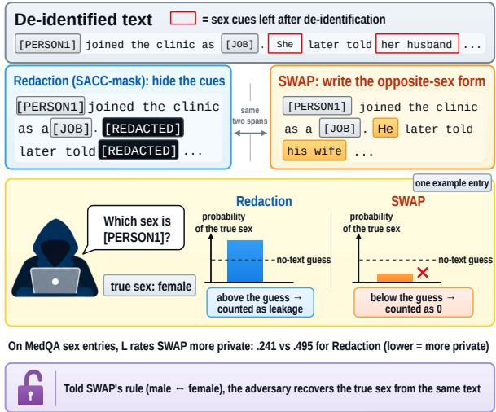  
Figure 1: Misdirection at the same spans. L ignores drops below the no-text guess, so SWAP, which misleads the adversary on most MedQA entries, scores as more private than redaction. Leakage scores use 1,473 shared MedQA SEX entries; rule-aware recovery uses 1,513 entries in a post hoc test.

Evaluating whether de-identification actually protects those attributes is therefore consequential. Inference-based privacy evaluations use an adversary language model’s predictions on released text to compare editing methods. However, when a score credits only increased confidence in the true value, an edit that confidently misleads the adversary can appear more private even if attribute information remains recoverable. An evaluation can then favour the wrong edit, not because the text reveals less, but because its scoring rule mistakes misdirection for information removal.

To systematically examine this scoring dependence, we introduce the clipped leakage score L, a prior-normalised measure of gold-value confidence gain (Section 3). For each annotated entry, L measures the increase in the probability of the true value over a document-free prior, normalised by the remaining distance to certainty and clipped to [0, 1]; scores are balanced across annotation strata and attributes, so that no subgroup dominates.

Beyond the scoring rule, the scorer chooses a person reference, candidate answers and their order, a document-free prior, and an adversary model; together, these choices form the evaluation interface. We ask how far a privacy verdict for a fixed released text changes when the interface, rather than the text, changes (Table 1).

Our first test targets the one-sidedness of L. SWAP is a deliberately invertible counterexample: it replaces sex cues with opposite-sex forms at exactly the spans a redaction editor would remove (Figure 1). On MedQA, SWAP attains the lowest L among editors scored on the same entries, while it misleads the adversary on 74% of its SEX entries. By |AUC − .5|, it ranks only sixth of eight. In a post hoc rule-aware test on 1,513 MedQA SEX entries, informing the adversary of the swap rule raises its mean gold-value probability from .252 to .769. The issue is not confined to L: attack accuracy and proper scoring rules can also reward misdirection when read as privacy (Section 4).

We next re-score fixed releases from three corpora—MedQA clinical vignettes, TAB court judgments, and SynthPAI social-media posts— varying evaluation choices one at a time under three adversary families (Section 5). Across 988 contrasts between released texts, most changed verdicts gain or lose statistical separability without reversing a comparison’s direction: the adversary family changes 124 of 504 verdicts, and only five reverse. Thus, stable rankings do not guarantee stable statistical evidence that two releases differ on the stated leakage score. Of the six protocol choices in Figure 3, only the adversary family reverses comparisons. Separate analyses identify reversals from attribute aggregation and from a text-conditioned prior confounded with redaction; a cue-deletion prior free of that confound changes separability but not direction (Section 5; Appendix E).

Our contributions are fourfold. First, we introduce L, which operationalises one-sided goldvalue confidence gain. Second, we identify and demonstrate a misdirection failure through a controlled counterexample, alternative scoring rules, and a rule-aware recovery test. Third, we audit evaluation-interface sensitivity on fixed releases, distinguishing direction reversals from changes in separability, supported by SACC (Scoped Attribute-Cue Closure), a traceable editor that makes SWAP and separate ablations of two editing principles possible (Section 6). Fourth, we derive a failuredriven reporting checklist covering misdirection, subject-reference errors, adversary sensitivity, and statistical uncertainty (Section 7). We release texts, per-entry scores, and code.1

## 2 Background and Related Work

What this score is. We introduce L as an analytical measure that isolates prior-normalised, one-sided confidence gain on the gold value. It is intended for controlled evaluation audits rather than as a comprehensive measure of attribute recoverability. Subject-level evaluation reports the share of personal attributes an adversary fails to infer, pooled over people (CPR) or averaged per person (IPR) (Oh et al., 2026); attack accuracy counts top-1 correctness; proper scoring rules score a whole predictive distribution (Brier, 1950; Gneiting and Raftery, 2007); AUC measures discrimination, and |AUC − .5| is unchanged when the labels are exchanged. Crediting only the increase above a document-free prior charges a release for what it adds rather than for what the adversary already guessed; the risk is the other half, where a drop below the prior costs nothing. Our stress test targets that one property, which attack accuracy and proper scoring rules on the gold value share when their prediction errors are read as privacy (Section 4). L is distinct from CPR and IPR, whose validity we do not assess.

Evaluation choices. A ranking depends on what its score credits: membership-inference attacks rank differently under average-case and low-falsepositive-rate metrics (Carlini et al., 2022), and anonymisation has been judged by informationtheoretic criteria, by re-identification attacks and by quantitative information flow (Sánchez and Batet, 2016; Manzanares-Salor et al., 2024; Smith, 2009; Alvim et al., 2012). Multiverse and specificationcurve analyses vary defensible analytic choices (Steegen et al., 2016; Simonsohn et al., 2020); because our choices change what is estimated and on which entries, we analyse each separately. Like Mozes and Kleinberg (2021), we ask whether an evaluation measures what it claims to, adding judge controls, bootstrap intervals, multiple-comparison corrections (Krippendorff, 2004; Efron and Tibshirani, 1993; Holm, 1979) and answer-position checks (Zheng et al., 2024; Pezeshkpour and Hruschka, 2024); none of this work varies the interface while the released text is held fixed.

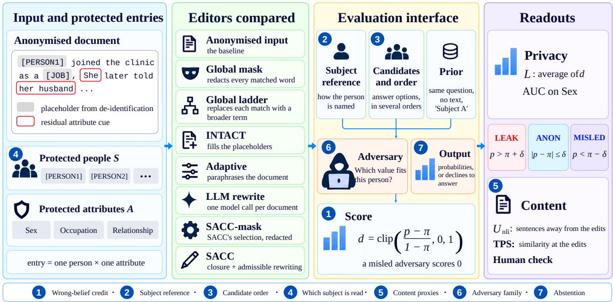  
Figure 2: The evaluation interface, from the anonymised document and protected entries to the readouts. Grey boxes: de-identification placeholders; outlined words: residual cues; circled numbers: rows of Table 1.

Attribute inference. Language models infer personal attributes from ordinary text (Staab et al., 2024), extending classifier-based attacks (Mosallanezhad et al., 2019; Elazar and Goldberg, 2018). Oh et al. (2026) evaluate anonymisation per person; we follow that framing and reuse their annotated TAB documents with our own scorer (Section 3).

Anonymisers. Span-based de-identification masks or generalises identifiers (Lison et al., 2021; Pilán et al., 2022). Language-model anonymisers rewrite under adversarial feedback (Staab et al., 2025), replace spans truthfully (Pilán et al., 2025), optimise prompts (Loiseau et al., 2026), or randomise the protected attribute (Frikha et al., 2025). Randomisation matters here because, whenever the random value is wrong, a score that floors losses at zero credits it as it credits SWAP, though a random value cannot be undone by a known rule. Appendix F surveys further related work.

## 3 Releases and Scorer

Figure 2 introduces the corpora, editors and readouts. The main protocol clips confidence gains at zero, uses each editor’s subject reference, balances candidate orders, includes all annotated subjects and uses the development adversary. Section 5 varies these choices and checks content measures and abstention (Table 1); the prior and band δ are examined separately in Appendix E.

Corpora and protected entries. We use 1,249 MedQA clinical vignettes (Jin et al., 2021), 144 TAB court judgments with per-person annotations (Oh et al., 2026; Pilán et al., 2022) and 281 SynthPAI posts (Yukhymenko et al., 2024). Each protected entry (s, a) pairs a person s (a subject) with an attribute a and a gold value g: SEX and OCCUPATION on MedQA and TAB, and RELA-TIONSHIP on SynthPAI. TAB and SynthPAI gold values come from human annotation, MedQA’s from fixed GPT-4o-mini prompts; a Longformer tagger de-identifies TAB and SynthPAI (Beltagy et al., 2020) and a rule-based tagger MedQA, whose [OCCUPATION] placeholders mostly replace the clinician or a word naming no occupation. They make OCCUPATION hard to interpret; we keep it in the overall score, the endpoint fixed before any editor was scored, but report SEX-only contrasts beside every main MedQA comparison. We call the de-identified text the anonymised input.

Residual-cue editing. The editors we compare perform one task. Given an anonymised document D, protected subjects S with the mention forms M(s) by which D refers to each, and attribute names A, find the residual cues—spans whose surface form states a value of some a ∈ A for some person—and return D′, with edits confined to those spans and the grammatical agreement they disturb.

Table 1: Seven choices in the evaluation protocol, each an alternative reading of fixed releases (effects in Section 5).
<table><tr><td>Protocol choice</td><td>Reading examined</td><td>Alternative or check</td></tr><tr><td>Wrong-belief credit</td><td>Clipping floors negative changes in gold-value confidence at zero leakage.</td><td>Signed residual; three outcome states with LEAKING and DISCLOSING.</td></tr><tr><td>Subject reference</td><td>References depend on each editor&#x27;s output.</td><td>Match references across editors or derive one from the input.</td></tr><tr><td>Candidate order</td><td>Seeded orders retain a positional bias in π.</td><td>Balance gold-first and gold-second orders for  $\operatorname { S E X ; }$  report AUC alongside L.</td></tr><tr><td></td><td>Which subject is read Aggregate all annotated subjects</td><td>Split by subject position and exclude shared references.</td></tr><tr><td>Content proxies</td><td>Accept t  $U _ { \mathrm { n l i } }$  , TPS and LLM judgments without validity checks.</td><td>Check placeholder effects, a second encoder and judgments on the anonymised input.</td></tr><tr><td>Adversary family</td><td>Evaluate with one development adversary.</td><td>Compare three model families and consider the worst case.</td></tr><tr><td>Abstention</td><td>Declined answers are dropped or assigned the prior without an explicit rule.</td><td>State the convention and report both readings.</td></tr></table>

Three requirements define a good edit: privacy, an adversary reading $D ^ { \prime }$ about s should end no better off than with no text, neither more confident in the true value nor steered towards a wrong one; utility, content stating no protected attribute of a protected subject should survive; scope, cues bound to people outside S, and attribute words naming no person, should be left alone. These are desiderata, not guarantees: the evaluation tests whether they hold under a stated adversary and scorer (Appendix A).

Editors. Each editor maps the anonymised input to a released text. Global mask redacts every match in a shared lexicon of attribute words, whoever the word describes; the global ladder replaces each match with a broader term. SACC follows two principles. Default-deny closure: fixed word lists propose cues and a rule-based binder uses a dependency parse to decide whom each describes—a protected person (directly or through a relation word, husband in her husband), a person it cannot identify (unresolved), someone else, or no person—and a cue is edited unless the binder assigns it to someone else (the other-person rule) or to no person (the non-person rule). Unresolved cues matter because de-identification often removes the name a binder would need. Admissible rewriting: a selected cue becomes a value-neutral counterpart from a fixed table (he→they), or is redacted when the table has none, and a repair step fixes verb agreement (the only tuned setting). SACC-mask keeps the selection and redacts throughout. We also score an LLM rewrite given SACC’s inputs and two anonymisers that start from the source text, INTACT (Pilán et al., 2025) and Adaptive (Loiseau et al., 2026); Section 6 also runs SACC unchanged on two unseen corpora, where scope matters (Appendix H).

The adversary. The adversary, a language model $M ,$ reads a released text y and a reference $h ( s , y )$ to the person and answers a multiple-choice question over candidate values $C \ni g$ in one token. We ask it under K seeded candidate orders $\sigma _ { k }$ shared by all editors and average the gold value’s probability, renormalised over $C \colon$

$$
p = \frac { 1 } { K } \sum _ { k = 1 } ^ { K } \operatorname* { P r } _ { M } \left[ { g } \mid { y } , { h } ( { s } , { y } ) , { \sigma } _ { k } ( C ) \right] .
$$

The prior $\pi$ is the same quantity with no text; entries whose prior already exceeds a corpus-specific threshold are excluded and the rest are eligible. For binary SEX the prior largely reflects which option comes first, so the main scores weight goldfirst and gold-second orders equally. The reference $h ( s , y )$ is the longest surviving mention carrying no cue. The development adversary, GPT-4o-mini, was used while designing SACC and also annotated MedQA; Llama (Grattafiori et al., 2024) and Qwen (Yang et al., 2025a) are held out. A reasoning adversary (GPT-4.1-mini) declines some answers; we run it on a sample and report both conventions.

The score and what it credits. Per entry, we compute the prior-normalised residual

$$
d = \mathrm { c l i p } \Big ( \frac { p - \pi } { 1 - \pi } , 0 , 1 \Big ) ,
$$

the share of the distance from the prior to certainty that the text provides. The clipped leakage score L averages d within subgroups (strata) defined by the annotations (e.g., occupation categories), then within each attribute, and then across attributes, so that no subgroup dominates (Appendix I). Lower L means a smaller clipped confidence gain on the gold value, with 0 at the prior.

Two-sided reading. Clipping sets $d = 0$ both when the text leaves the gold probability at the prior and when it pushes that probability below the prior (Figure 1). Dropping the clip yields a signed residual, in which movement below the prior is credited further; Table 1 calls this choice wrongbelief credit. To make downward shifts explicit we assign each entry to one of three states with a band $\delta = . 0 5 \mathrm { : }$ : LEAK $( p > \pi + \delta )$ , ANON $( | p - \pi | \leq \delta )$ or MISLED $( p < \pi - \delta )$ . The LEAKING rate counts LEAK entries and the DISCLOSING rate counts LEAK and MISLED together; both are balanced over strata like L. DISCLOSING records two-sided belief displacement; Section 4 tests recoverability.

Checks on the question. Three properties of the question can distort these scores. Without a document, binary answers often follow option position, so removing a cue can move the gold probability off the prior without the text stating any value; we therefore also report SEX AUC, the probability that the adversary rates a male person as more likely male than a female one, which its default answer cannot shift. An editor that paraphrases can delete the mentions a reference relies on, so when comparing paraphrasing with in-place editors we use entries where both yield the same reference. In documents describing several people the adversary may answer from another person’s cues, so we also split off each document’sfirst-named subject.

Content and statistics. $U _ { \mathrm { n l i } }$ measures content away from edits, the share of source sentences without protected cues that an NLI model finds entailed by the release (He et al., 2023); at edit sites TPS measures how much information-weighted content remains (Pilán et al., 2025), read beside Edit%, the share of characters changed. Document-bootstrap intervals are 99% for privacy and 95% for content. A paired contrast is separable if its interval excludes zero; its verdict is its sign if separable and “not separable” otherwise, so a verdict can change by a reversal or by a gain or loss of separability. Table 2 uses seeded orders and Table 3 SEX orders balanced by position; they select different entries, so no absolute value carries across. Main runs were pre-specified in dated files (Appendix I); post hoc analyses are labelled, failed predictions included.

## 4 Misdirection Scores as Privacy

SWAP is a deliberately invertible stress test of what the clipped score rewards, not a proposed

<table><tr><td></td><td colspan="5">MedQA (2,093)</td><td colspan="3">TAB (505)</td></tr><tr><td>System</td><td>L</td><td>LEAK</td><td>DISC</td><td>AUC Rk</td><td></td><td>L</td><td>LEAK</td><td>DISC</td></tr><tr><td>SWAP (flips sex cues)</td><td>.536</td><td>.564</td><td>.979</td><td>.180</td><td>6</td><td>.444</td><td>.534</td><td>.859</td></tr><tr><td>Adaptive†</td><td>.581</td><td>.704</td><td>.897</td><td>.734</td><td>3</td><td>.618</td><td>.677</td><td>.892</td></tr><tr><td>Global ladder</td><td>.628</td><td>.723</td><td>.898</td><td>.719</td><td>1</td><td>.408</td><td>.603</td><td>.800</td></tr><tr><td>SACC</td><td>.636</td><td>.728</td><td>.901</td><td>.719</td><td>1</td><td>.423</td><td>.599</td><td>.792</td></tr><tr><td>Global mask</td><td>.653</td><td>.741</td><td>.931</td><td>.737</td><td>4</td><td>.444</td><td>.634</td><td>.848</td></tr><tr><td>SACC-mask</td><td>.659</td><td>.749</td><td>.937</td><td>.739</td><td>5</td><td>.446</td><td>.620</td><td>.817</td></tr><tr><td>Anonymised input</td><td>.842</td><td>.871</td><td>.990</td><td>.888</td><td>7</td><td>.556</td><td>.642</td><td>.867</td></tr><tr><td>INTACT</td><td>.853</td><td>.879</td><td>.991</td><td>.955</td><td>8</td><td>.576</td><td>.661</td><td>.885</td></tr><tr><td>SWAP – SACC-mask, SEX</td><td>-.253</td><td>-.376</td><td>+.083</td><td></td><td></td><td>+.002</td><td>-.189</td><td>+.067</td></tr><tr><td>SWAP – SACC-mask, all</td><td>-.122</td><td></td><td>-.186 +.043</td><td></td><td></td><td>-.001</td><td>-.086</td><td>+.042</td></tr></table>

Table 2: Effect of deliberate misdirection. Development adversary, seeded orders; bottom rows: paired differences (bold: 99% CI excludes 0). SWAP misleads 74%/68% of MedQA/TAB SEX entries, SACC-mask 26%/18% (raw shares, not balanced). AUC: MedQA SEX discrimination (below .5, labels exchanged); Rk: its rank by |AUC − .5| among the eight, 1 most private; rows follow L. No TAB AUC: pooled, it mixes subjects the adversary reads through another person (Section 5); on first-named subjects SWAP ranks fifth by |AUC−.5| (Table 6). †: scored with its own subject reference.

## anonymiser: it isolates one property of the score.

Construction. SWAP starts from the SACCmask release: wherever SACC-mask redacted a SEX cue, SWAP writes the opposite-sex form instead (he for she, wife for husband), and every other selected cue stays redacted. Replacing the flipped words with redactions recovers SACC-mask on 99.7% of MedQA and all TAB documents, so the releases differ only in sex cues. Table 2 reads every system under seeded orders, as pre-specified, the only reading we report for SWAP; SWAP and SACC-mask share entries, orders and prior, so their paired contrast is directly comparable. Three of four pre-specified predictions held; the fourth— that L would also favour SWAP on TAB—did not.

The clipped leakage score rewards misdirection. On MedQA, SWAP attains lower L (.536) than every editor in Table 2, while 74% of its SEX entries are MISLED (vs. 26% for SACC-mask). On SEX entries its L is .253 below SACC-mask’s and its DISCLOSING rate .083 higher, both separable. On TAB SEX entries, L does not separate SWAP from SACC-mask, while LEAKING falls by .189 and DISCLOSING rises by .067. The credit is not the clip’s alone: read as privacy, attack accuracy, Brier score and log loss, valid measures of prediction that also score only the gold value, rate SWAP the most private release on both corpora (on TAB separably from SACC-mask for the last two), whereas DISCLOSING and |AUC − .5|, blind to the shift’s direction, do not (Appendix D, Table 6).

The information remains recoverable. SEX AUC signals this without the rule. Ranked by |AUC − .5| (Rk in Table 2), the systems scored on the shared entries keep their order from L while SWAP falls from first to sixth of eight, or fifth if Adaptive, scored with its own reference, is set aside: its AUC of .18 is an inverted separation wider than the global editors, SACC and SACC-mask leave. That reading diagnoses inverted discrimination, not recovery. SWAP’s fixed rule enables a direct test. We described the flip to the development adversary and re-scored the 1,513 MedQA SEX entries (post hoc; Appendix D). The mean probability of the gold value rises from .252 to .769, 80% of entries favour it, and L rises by .414 $( [ + . 3 7 4 , + . 4 5 4 ] )$ DISCLOSING barely changes, because knowing the rule moves misled entries into the leaking state and DISCLOSING counts both. The clip’s zero is therefore an artefact of the score, not evidence that SWAP erased the attribute: the rule-aware adversary recovers it from the same text.

## 5 Which Conclusions Survive the Interface

We now vary the evaluation interface for ordinary fixed releases, one choice at a time, over 988 contrasts between released texts (Table 3; Figure 3).

How often verdicts change. Across all pairs of releases (Figure 3), replacing L with the signed residual changes 11 of 84 verdicts (18% of MedQA and 21% of TAB pairs, none of SynthPAI’s), almost always by removing separability rather than reversing a sign; candidate order changes about 5%. The adversary family changes the most, 124 of the 504 contrasts we analyse, but only five of those are sign reversals; the other 119 gain or lose separability, statistical uncertainty rather than a reversed ranking. For the reasoning adversary, the convention for declined answers decides whether the global ladder is separably more private than SACC on MedQA. As controls, re-reading cached answers changes no verdict and new bootstrap seeds change 1–4% (Appendix C).

The adversary can reverse a comparison. Release rankings are similar under most choices, but the adversary family reorders the seven releases that all three families score on TAB $( \tau _ { \mathrm { b } } ~ = ~ . 4 2 )$ and SynthPAI (.69). The two reversals involving SACC both stem from a single contrast on TAB (SACC-mask vs. SACC): the estimated difference

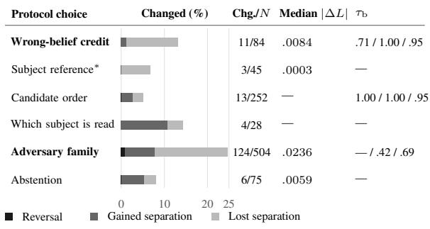  
Content proxies: no paired verdict comparison.

Figure 3: Verdict sensitivity to protocol choices over all pairs of released texts (988 contrasts; 161 involve SACC). Bars: reversals and separations gained or lost; labels: changed/compared counts, median $| \Delta L |$ and Kendall’s τ of the seven-text ranking (MedQA / TAB / SynthPAI). Values are descriptive; all exceed the bootstrap-reseeding rate (.007 / .012 / .024). No median for candidate order (verdicts only) or the subject choice (read on AUC); $\tau _ { \mathrm { b } }$ needs seven shared texts. ∗Both readings before the binder fix of Appendix V.

is +.022, −.023, and +.042 under the three families, and each is separable. Consequently, whether rewriting is more private than redaction on TAB depends on the adversary, although the effects are small. A fourth adversary (GPT-4.1-mini without reasoning, post hoc) also favours redaction, so two of four do (Appendix K). Llama’s reversal is primarily attributable to OCCUPATION; on SEX alone the difference is not separable in either direction.

The adversary may read the wrong person. In TAB’s anonymised input, SEX AUC is .98 for each judgment’s first-named person but .32 for others, whose predicted sex follows the first-named person’s (post hoc; Table 25). An AUC of .32 is consistent with systematic misattribution: pooling both groups yields .53, which reflects neither, and an editor that moves .32 toward .5 would appear to increase discrimination. In 73 of 244 TAB SEX entries the reference also matches another person (Appendix I); excluding them increases the input– SACC reduction in SEX L, and all comparisons keep their sign. Matched references also matter: when all editors share one reference, Adaptive’s MedQA advantage shrinks from .054 to a nonseparable .024 (on texts before a fix to the binder, and still not separable after it; Appendix R). On identical texts, a shared reference changes only verdicts involving Adaptive (3 of its 24; Figure 3).

Which attribute is aggregated. The verdict also changes with the attributes the score averages.

<table><tr><td></td><td colspan="6">MedQA</td><td colspan="6">TAB</td><td></td></tr><tr><td>System</td><td>L↓</td><td>AUC</td><td></td><td>DISC↓ LEAK↓ Unli ↑</td><td></td><td>TPS Edit%</td><td></td><td>L↓</td><td>AUC DISC↓</td><td>LEAK↓</td><td>Unli ↑</td><td>TPS</td><td>Edit%</td></tr><tr><td>Anonymised input</td><td>.842</td><td>.891</td><td>.991</td><td>.870</td><td>.720 1.000</td><td></td><td>0.0</td><td>.558</td><td>.979 .872</td><td></td><td>.644</td><td>.313 1.000</td><td>0.0</td></tr><tr><td>Global mask</td><td>.653</td><td>.741</td><td>.935</td><td>.745</td><td>.661</td><td>.795</td><td>2.4.433</td><td></td><td>.668 .851</td><td>.604</td><td>.291</td><td>.803</td><td>2.9</td></tr><tr><td>Global ladder</td><td>.627</td><td>.734</td><td>.895</td><td>.722</td><td>.702</td><td>.842</td><td>1.4</td><td>.397</td><td>.592 .805</td><td>.578</td><td>.296</td><td>.801</td><td>1.9</td></tr><tr><td>INTACT (Pilán et al., 2025)</td><td></td><td>.852.955</td><td>.989</td><td>.877</td><td>.737</td><td>.806</td><td>2.7</td><td>.578 .969</td><td>.895</td><td>.664</td><td>.293</td><td>.770</td><td>5.0</td></tr><tr><td>Adaptive (Loiseau et al., 2026)†</td><td></td><td>.596.724</td><td>.914</td><td>.702</td><td>.467</td><td>.772</td><td>51.7</td><td>.600  $1 . 0 0 ^ { \ddagger \mathsection }$ </td><td>.890</td><td>.661</td><td>.287</td><td>.781</td><td>5.5</td></tr><tr><td>SACC-mask</td><td>.659</td><td>.743</td><td>.940</td><td>.750</td><td>.665</td><td>.794</td><td>2.2</td><td>.438</td><td>.666 .818</td><td>.599</td><td>.319</td><td>.795</td><td>1.2</td></tr><tr><td>SACC</td><td>.635</td><td>.734</td><td>.900</td><td>.728</td><td>.706</td><td>.846</td><td>1.3</td><td>.413</td><td>.616 .795</td><td>.578</td><td>.319</td><td>.845</td><td>0.8</td></tr><tr><td>LLM rewrite†</td><td>.609</td><td></td><td>.918</td><td>.727</td><td>.661</td><td>.802</td><td>2.8.423</td><td></td><td>.787</td><td>.588</td><td>.297</td><td>.793</td><td>2.1</td></tr><tr><td>MedQA SEX-only contrasts, ∆L = system – SACC (paired; 99 % intervals in Table 44)</td><td></td><td></td><td></td><td></td><td></td><td></td><td></td><td></td><td></td><td></td><td></td><td></td><td></td></tr><tr><td>Input ∆LSex +.410</td><td>Gl. mask +.056</td><td></td><td>Gl. ladder</td><td></td><td>INTACT +.438</td><td></td><td></td><td>Adaptive† +.051</td><td></td><td>SACC-mask +.061</td><td></td><td>LLM rewrite†</td><td></td></tr></table>

Table 3: Privacy and utility under the development adversary, balanced SEX orders (2,149 MedQA and 501 TAB shared entries). †: other entries, where SACC scores L .597/.417 (Adaptive) and .635/.431 (LLM rewrite). TAB AUC: 98 first-named entries (99% CI ±.2). ‡: AUC from stored per-order probabilities on the full SEX cohort (1,506 and 98), not the other rows’ re-read cohort (agreeing within .005). §: perfect separation on 14 female subjects (a bound). Bold: best per arrowed column among shared-entry systems. MedQA L includes OCCUPATION; the inset: paired SEX-only contrasts (bold there: CI excludes 0). Cohorts, seeded orders, SynthPAI: Tables 20, 23, Appendix J.

MedQA’s OCCUPATION placeholders are hard to interpret (Section 3), and on SEX alone two contrasts reverse sign: the LLM rewrite, separably more private than SACC on the pre-specified endpoint, leaks more (+.039), as does Adaptive (+.051; Table 3). We keep the pre-specified endpoint and report both readings rather than promoting the narrower one after seeing the result (Table 44); which attributes are averaged is itself an interface choice.

Other choices, in brief. Content proxies and the band need controls of their own. Two of three LLM content judges fail no-change controls on the anonymised input, and under another encoder SACC’s TPS advantage over the ladder disappears (Appendices I and T). On TAB, placeholders hold $U _ { \mathrm { n l i } }$ near .31 for every system, so we read content at edit sites. Widening the band δ to .10 changes 5 to 11 of 56 displacement verdicts per corpus (Table 5), more than candidate order does, and a prior computed on a redaction output favours redaction by construction, while a cue-deletion prior changes one of nine verdicts’ separability and preserves SACC’s advantage on L (Appendix E), so the prior is itself a protocol choice, not a property of the text.

## 6 Evaluating SACC

SACC is the traceable controlled editor that made the releases above possible; we now ask what its two principles contribute, and under which adversaries and corpora its advantage holds.

What each principle contributes. Ablations vary one principle at a time (Table 4). The privacy gain sits in closure: editing only the cues the binder assigns to a protected person leaks more by .079 on MedQA and .122 on TAB. It matters because 41% of MedQA and 90% of TAB edited cues are unresolved, and a judge reading the source text assigns 97.5% of unresolved TAB sites to protected people. Admissible rewriting lowers L over redaction by .024 and .022, keeps more MedQA content $( U _ { \mathrm { n l i } } + . 0 4 1 )$ and leaves fewer MedQA SEX entries MISLED (−.031; Appendix O), but that privacy gain is reproduced by Qwen and not by Llama (Appendix K), so rewriting is mainly a content choice that can be dropped at little worst-case privacy cost. Scoping the selection is not itself a privacy gain: against global selection with the same rewrite step, SACC’s selection is .010 less private on MedQA and not separable on TAB, where it keeps more content. Of its two rules, the non-person rule buys content rather than privacy and the other-person rule moves neither measurably, so we do not claim that subject awareness lowers leakage.

<table><tr><td rowspan="2">Change</td><td rowspan="2">at</td><td colspan="2">MedQA</td><td colspan="2">TAB</td></tr><tr><td>∆L</td><td> $\Delta U _ { \mathrm { n l i } }$ </td><td>∆L</td><td> $\Delta U _ { \mathrm { n l i } }$ </td></tr><tr><td>Closure over binding only rewrite</td><td></td><td>+.079</td><td>+.002</td><td>+.122</td><td>+.002</td></tr><tr><td>Admissible rewriting</td><td>closure</td><td>+.024</td><td>+.041</td><td>+.022</td><td>.000</td></tr><tr><td>Closure selection</td><td>rewrite</td><td>-.010</td><td>.000</td><td>+.001</td><td>+.026</td></tr><tr><td>non-person rule</td><td>mask</td><td></td><td>-.006 +.004</td><td>-.011</td><td>1 +.026</td></tr><tr><td>other-person rule</td><td>mask</td><td>.000</td><td>-.001 +.009</td><td></td><td>+.002</td></tr></table>

Table 4: What each principle contributes, under the development adversary. Positive $\Delta L \mathbf { \cdot }$ the change lowers leakage (99% intervals); positive $\Delta U _ { \mathrm { n l i } } \mathrm { : }$ it keeps more content (95%); bold excludes 0. Indented: the selection’s two rules; rows do not add (Table 11).

What the subject list buys. The other-person rule is the only one that reads the subject list, and since nearly every annotated person here is protected, it changes no measure. Judged against the source text on TAB it is right on .32 of the sites it keeps, leaving 2.1 protected persons’ sites unedited for each one it correctly withholds (Appendix N). Scope is thus a release policy a deployment can switch off, not a privacy mechanism. Applied unchanged to 500 biographies (De-Arteaga et al., 2019) and 500 plot summaries (Bamman et al., 2013), SACC lowers input leakage by .35 and .11 while editing the fewest characters; but these corpora name many unprotected people, and there the global ladder leaks less, by .030 and .089 (Appendix N), because it edits their cues too.

Leakage relative to the input. SACC reduces L, LEAKING and DISCLOSING relative to its anonymised input on both corpora (Table 3); under the seeded reading TAB’s LEAKING reduction is the one verdict that is not separable (Appendix I). L falls by .207 on MedQA and .145 on TAB, about a quarter of the input score in each corpus (intervals in Table 27). Part of the fall is displacement: of the .274 drop in MedQA SEX LEAKING (seeded orders), .174 moves entries into the band and .101 below it, and every editor but INTACT leaves .24–.28 of entries MISLED, the input .14 (Appendix O). Most gains come from SEX, where AUC also falls (Table 3; on TAB post hoc). The MedQA SEX reduction remains separable under both held-out adversaries, as does TAB’s under Qwen (Appendix K). On MedQA exam questions, GPT-4o-mini is equally accurate on SACC’s text and on the anonymised input (73.0%), with no measurable change under any editor (Appendix Q).

Comparison with other editors. Under the ruleunaware development adversary, global mask leaks more than SACC on MedQA, while the global ladder is narrowly equivalent within ±.02 on the three MedQA privacy measures (two one-sided tests; Appendix B). SACC is more private than INTACT on both corpora and than Adaptive on TAB. On MedQA, Adaptive trades content for privacy: Edit% 51.7 vs. 1.3, and about one-third less content (U .467 vs. .706). Its lower L (−.054)

is not separable once both share one reference, because its paraphrase deletes the patient’s mention; on SEX alone it leaks more (+.051; Table 3). On TAB SACC edits about one-third fewer sites than the ladder with higher TPS (+.043), and blind annotators judge it to keep more content than the ladder and SACC-mask, by .24 and .04 on a 0–2 scale, though not more grammatical (Appendix W).

Traceability. SACC is deterministic, reads neither the source text nor a gold value, and traces each edit to its rule, which let Section 4 build SWAP at the sites SACC-mask redacts. Edits stay inside cue spans and the agreement they disturb, whereas the LLM rewrite changes an upstream placeholder in 10.4% of MedQA and 16.5% of TAB documents. SACC calls no language model: 0.17 s per MedQA document on one CPU core (Appendices G and H).

## 7 What to Report

Four things belong beside any leakage score. Score: report L with two-sided displacement and, where applicable, AUC, and explain any disagreement (e.g., SWAP, Table 2); where an editor’s rule is public, run a rule-aware adversary too. Reference and cohort: give paraphrasing and in-place editors the same reference, and report first-named and other subjects separately. Adversary and abstention: report every adversary used, including any that reverses a result, say whether it knows the editing rule, and report both conventions for declined answers. Uncertainty and content: separate reversals from changes in separability, give each nonseparable comparison’s minimum detectable difference, and validate content measures.

## 8 Conclusion

Privacy verdicts depend on the evaluation interface. SWAP ranks first by clipped leakage and attack accuracy on MedQA under a rule-unaware adversary but sixth of eight by |AUC − .5|, and, told the swap rule, that adversary recovers the attribute for most entries. Clipping hides how far confidence falls, and reading failed prediction as privacy rewards misdirection. On ordinary releases most verdict changes concern separability; of the six choices in Figure 3, only the adversary reverses comparisons (5 of its 124 changes). Separate analyses find reversals from attribute aggregation and a redaction-confounded prior, not from a confoundfree cue-deletion prior. A privacy claim can be interpreted only together with its protocol.

## Limitations

Scope of the study. SWAP exposes a mismatch in pipelines that read a stated adversary’s failed prediction as privacy; it does not make the Brier score or log loss invalid measures of prediction, nor show that every subject-level privacy metric shares the weakness. It is a single invertible construction: its rule-aware recovery result pertains to that rule and an adversary told it, and a randomised, secret or non-invertible editor needs its own attacker model and recovery test; the AUC reading, which needs no rule, is interpretable on MedQA and, with wide intervals, on TAB’s first-named subjects only. DISCLOSING measures two-sided belief displacement, not attribute recoverability. For multi-class attributes, MISLED marks a drop below the prior rather than confidence in an incorrect value. The protocol choices we vary change which entries are scored, so Figure 3 summarises their effects descriptively, and the ablation rows of Table 4 hold different things fixed, so they are not one path and do not add. All claims concern a multiple-choice scorer that is instructed which person to consider (Appendix M) on English corpora, each with a single upstream de-identifier.

Adversaries. Main claims rely on one development adversary, a proprietary API whose outputs drift between sessions and which also produced MedQA’s gold labels (Appendix I); the held-out adversaries are smaller than some used in earlier attack studies (Staab et al., 2024). Some of SACC’s results do not hold under every adversary: on TAB, its reduction of input leakage and the gain of rewriting over redaction fail under Llama and GPT-4.1- mini without reasoning, and the closure gain is untested beyond the development adversary (Appendices K and R). When given the editors’ rules, the development adversary ranks the global ladder ahead of SACC on MedQA, contrary to our pre-specified prediction (Appendix L).

Measurement. TAB’s 144 documents cannot detect differences below about .04 to .09 (Table 28), so null results reflect limited power. L excludes high-prior entries and is not a population risk measure, and which SEX entries are eligible depends on seeded candidate orders, a selection that balancing does not repair. Automatic content measures ignore grammaticality; human judges observed agreement errors after rewriting, and SACC failed its pre-specified grammar test against SACC-mask

(Appendix W).

The editor. SACC edits lexically stated evidence—primarily grammatical sex marking— using lexicons written on the evaluation corpora. Contextual evidence remains, and an LLM rewrite removes more of it: it leaks less than SACC on MedQA’s reported score under the development adversary, and by point estimate but not separably under the held-out families, though more on SEX alone (Table 44). On these benchmarks, SACC’s gains come from closure and admissible rewriting, while the rule that preserves other people’s cues (the other-person rule) has no measurable privacy effect; on the two new corpora, which name many unprotected people, the global ladder leaks less (Appendices G and N). In languages with grammatical gender, fewer rewrites would be admissible and more cues would be redacted.

Side channels. Some feminine pronouns remain redacted more often than masculine ones, and when the other-person rule leaves a cue, a reader who knows the rule can infer that a person is unprotected; disabling the rule closes this channel (Appendix G). Forms outside the lexicon, such as Mx. or neopronouns, pass unedited, so people who use them can become more distinguishable after editing; this cost falls on an already marginalised group (Lauscher et al., 2022). A deployment should add the forms used by its population.

## Ethical Considerations

We use public datasets under their licences: MedQA (MIT), TAB (MIT; published judgments of the European Court of Human Rights), SynthPAI (CC BY-NC-SA 4.0; synthetic), and the two transfer corpora in Appendix N. Our editor and scoring code are released under the MIT licence; derived texts and scores retain the corpora’s applicable licences. A script recomputes the main tables from the per-entry scores and dated run records we release. We collect no new personal data, attempt no re-identification, and query adversaries only about attributes the benchmarks already annotate. The attack follows prior attribute-inference work (Staab et al., 2024); our contribution is a way to detect when a score overstates the privacy of a release.

SWAP attributes false sex values to the people its texts describe. We built it because a leaderboard based on clipped leakage alone would reward such misdescription, and randomising the protected attribute is already a published anonymisation strategy (Frikha et al., 2025). We distribute SWAP only as evaluation code, not as an anonymiser.

SACC does not guarantee privacy: evidence outside its lexicon or across releases may remain inferable, and its rules reveal which forms it cannot rewrite (Limitations), although an adversary given the rules infers less, not more, from every edited MedQA text except SWAP’s (Appendix L). Rewriting gendered expressions is a policy choice, and clinical use was not evaluated. The binary SEX labels follow the datasets and do not imply that sex or gender is binary.

The human evaluation (Appendix W) involved three unpaid volunteers, recruited through an author (a possible source of recruitment bias); no personal information about them was collected.

Use of AI Assistants. AI assistants supported translation and literature surveying. The authors designed and conducted the study, analysed and verified the results, and take full responsibility for the content.

## References

Mário S. Alvim, Konstantinos Chatzikokolakis, Catuscia Palamidessi, and Geoffrey Smith. 2012. Measuring information leakage using generalized gain functions. In IEEE 25th Computer Security Foundations Symposium (CSF), pages 265–279. IEEE.

Chantal Amrhein, Florian Schottmann, Rico Sennrich, and Samuel Läubli. 2023. Exploiting biased models to de-bias text: A gender-fair rewriting model. In Proceedings of the 61st Annual Meeting of the Association for Computational Linguistics (Volume 1: Long Papers), Toronto, Canada. Association for Computational Linguistics.

David Bamman, Brendan O’Connor, and Noah A. Smith. 2013. Learning latent personas of film characters. In Proceedings ofthe 51st Annual Meeting of the Association for Computational Linguistics, pages 352–361, Sofia, Bulgaria.

Iz Beltagy, Matthew E. Peters, and Arman Cohan. 2020. Longformer: The long-document transformer. Preprint, arXiv:2004.05150.

Janek Bevendorff, Martin Potthast, Matthias Hagen, and Benno Stein. 2019. Heuristic authorship obfuscation. In Proceedings of the 57th Annual Meeting of the Association for Computational Linguistics, pages 1098– 1108, Florence, Italy. Association for Computational Linguistics.

Glenn W. Brier. 1950. Verification of forecasts expressed in terms of probability. Monthly Weather Review, 78(1):1–3.

Nicholas Carlini, Steve Chien, Milad Nasr, Shuang Song, Andreas Terzis, and Florian Tramèr. 2022. Membership inference attacks from first principles. In IEEE Symposium on Security and Privacy (S&P), pages 1897–1914. IEEE.

Maria De-Arteaga, Alexey Romanov, Hanna Wallach, Jennifer Chayes, Christian Borgs, Alexandra Chouldechova, Sahin Geyik, Krishnaram Kenthapadi, and Adam Tauman Kalai. 2019. Bias in bios: A case study of semantic representation bias in a highstakes setting. In Proceedings ofthe Conference on Fairness, Accountability, and Transparency, pages 120–128.

Jacob Devlin, Ming-Wei Chang, Kenton Lee, and Kristina Toutanova. 2019. BERT: Pre-training of deep bidirectional transformers for language understanding. In Proceedings of the 2019 Conference of the North American Chapter ofthe Associationfor Computational Linguistics: Human Language Technologies, Volume 1 (Long and Short Papers), pages 4171–4186, Minneapolis, Minnesota. Association for Computational Linguistics.

Yao Dou, Isadora Krsek, Tarek Naous, Anubha Kabra, Sauvik Das, Alan Ritter, and Wei Xu. 2024. Reducing privacy risks in online self-disclosures with language models. In Proceedings of the 62nd Annual Meeting ofthe Associationfor Computational Linguistics (Volume 1: Long Papers), pages 13732– 13754, Bangkok, Thailand. Association for Computational Linguistics.

Bradley Efron and Robert J. Tibshirani. 1993. An Introduction to the Bootstrap. Chapman and Hall/CRC, New York.

Yanai Elazar and Yoav Goldberg. 2018. Adversarial removal of demographic attributes from text data. In Proceedings of the 2018 Conference on Empirical Methods in Natural Language Processing, pages 11–21, Brussels, Belgium. Association for Computational Linguistics.

Pedro Faustini, Shakila Mahjabin Tonni, Annabelle McIver, Qiongkai Xu, and Mark Dras. 2025. IDT: Dual-task adversarial rewriting for attribute anonymization. Computational Linguistics, 51(4).

Oluwaseyi Feyisetan, Borja Balle, Thomas Drake, and Tom Diethe. 2020. Privacy- and utility-preserving textual analysis via calibrated multivariate perturbations. In Proceedings of the 13th International Conference on Web Search and Data Mining (WSDM), pages 178–186. ACM.

Ahmed Frikha, Nassim Walha, Krishna Kanth Nakka, Ricardo Mendes, Xue Jiang, and Xuebing Zhou. 2025. IncogniText: Privacy-enhancing conditional text anonymization via LLM-based private attribute randomization. In Proceedings of the 14th International Joint Conference on Natural Language Processing and the 4th Conference of the Asia-Pacific Chapter of the Association for Computational Linguistics, pages 2490–2501, Mumbai, India. The

Asian Federation of Natural Language Processing and The Association for Computational Linguistics.

Tilmann Gneiting and Adrian E. Raftery. 2007. Strictly proper scoring rules, prediction, and estimation. Journal of the American Statistical Association, 102(477):359–378.

Aaron Grattafiori et al. 2024. The Llama 3 herd of models. Preprint, arXiv:2407.21783.

Pengcheng He, Jianfeng Gao, and Weizhu Chen. 2023. DeBERTaV3: Improving DeBERTa using ELECTRA-style pre-training with gradientdisentangled embedding sharing. In International Conference on Learning Representations.

Zexue He, Bodhisattwa Prasad Majumder, and Julian McAuley. 2021. Detect and perturb: Neutral rewriting of biased and sensitive text via gradient-based decoding. In Findings of the Association for Computational Linguistics: EMNLP 2021, pages 4173– 4181, Punta Cana, Dominican Republic.

Sture Holm. 1979. A simple sequentially rejective multiple test procedure. Scandinavian Journal ofStatistics, 6(2):65–70.

Matthew Honnibal, Ines Montani, Sofie Van Landeghem, and Adriane Boyd. 2020. spaCy: Industrialstrength natural language processing in python.

Timour Igamberdiev and Ivan Habernal. 2023. DP-BART for privatized text rewriting under local differential privacy. In Findings of the Association for Computational Linguistics: ACL 2023, pages 13914– 13934, Toronto, Canada. Association for Computational Linguistics.

Di Jin, Eileen Pan, Nassim Oufattole, Wei-Hung Weng, Hanyi Fang, and Peter Szolovits. 2021. What disease does this patient have? a large-scale open domain question answering dataset from medical exams. Applied Sciences, 11(14):6421.

Kyuyoung Kim, Hyunjun Jeon, and Jinwoo Shin. 2025. Self-refining language model anonymizers via adversarial distillation. In Advances in Neural Information Processing Systems.

Klaus Krippendorff. 2004. Content Analysis: An Introduction to Its Methodology, second edition. Sage, Thousand Oaks, CA.

Woosuk Kwon, Zhuohan Li, Siyuan Zhuang, Ying Sheng, Lianmin Zheng, Cody Hao Yu, Joseph E. Gonzalez, Hao Zhang, and Ion Stoica. 2023. Efficient memory management for large language model serving with PagedAttention. In Proceedings of the 29th Symposium on Operating Systems Principles, pages 611–626. ACM.

Anne Lauscher, Archie Crowley, and Dirk Hovy. 2022. Welcome to the modern world of pronouns: Identityinclusive natural language processing beyond gender. In Proceedings ofthe 29th International Conference on Computational Linguistics, pages 1221–1232.

Pierre Lison, Ildikó Pilán, David Sanchez, Montserrat Batet, and Lilja Øvrelid. 2021. Anonymisation models for text data: State of the art, challenges and future directions. In Proceedings ofthe 59th Annual Meeting of the Association for Computational Linguistics and the 11th International Joint Conference on Natural Language Processing (Volume 1: Long Papers), pages 4188–4203, Online. Association for Computational Linguistics.

Zhengliang Liu, Yue Huang, Xiaowei Yu, Lu Zhang, Zihao Wu, Chao Cao, Haixing Dai, Lin Zhao, Yiwei Li, Peng Shu, Fang Zeng, Lichao Sun, Wei Liu, Dinggang Shen, Quanzheng Li, Tianming Liu, Dajiang Zhu, and Xiang Li. 2023. DeID-GPT: Zero-shot medical text de-identification by GPT-4. arXiv preprint arXiv:2303.11032.

Gabriel Loiseau, Damien Sileo, Damien Riquet, Maxime Meyer, and Marc Tommasi. 2026. Adaptive text anonymization: Learning privacy-utility tradeoffs via prompt optimization. In Findings ofthe Associationfor Computational Linguistics: ACL 2026, pages 8207–8229, San Diego, California, United States. Association for Computational Linguistics.

Asad Mahmood, Faizan Ahmad, Zubair Shafiq, Padmini Srinivasan, and Fareed Zaffar. 2019. A girl has no name: Automated authorship obfuscation using Mutant-X. Proceedings on Privacy Enhancing Technologies, 2019(4):54–71.

Benet Manzanares-Salor, David Sánchez, and Pierre Lison. 2024. Evaluating the disclosure risk of anonymized documents via a machine learning-based re-identification attack. Data Mining and Knowledge Discovery, 38:4040–4075.

Justus Mattern, Benjamin Weggenmann, and Florian Kerschbaum. 2022. The limits of word level differential privacy. In Findings of the Association for Computational Linguistics: NAACL 2022, pages 867–881, Seattle, United States. Association for Computational Linguistics.

George A. Miller. 1995. WordNet: A lexical database for English. Communications ofthe ACM, 38(11):39– 41.

Joshua R. Minot, Nicholas Cheney, Marc Maier, Danne C. Elbers, Christopher M. Danforth, and Peter Sheridan Dodds. 2022. Interpretable bias mitigation for textual data: Reducing genderization in patient notes while maintaining classification performance. ACM Transactions on Computing for Healthcare, 3(4):1–41.

Ahmadreza Mosallanezhad, Ghazaleh Beigi, and Huan Liu. 2019. Deep reinforcement learning-based text anonymization against private-attribute inference. In Proceedings of the 2019 Conference on Empirical Methods in Natural Language Processing and the 9th International Joint Conference on Natural Language Processing (EMNLP-IJCNLP), pages 2360– 2369, Hong Kong, China. Association for Computational Linguistics.

Maximilian Mozes and Bennett Kleinberg. 2021. No intruder, no validity: Evaluation criteria for privacypreserving text anonymization. arXiv preprint arXiv:2103.09263.

Myeong Seok Oh, Dong-Yun Kim, Hanseok Oh, Chaean Kang, Joeun Kang, Xiaonan Wang, Hyunjung Park, Young Cheol Jung, and Hansaem Kim. 2026. Subject-level inference for realistic text anonymization evaluation. In Proceedings of the 64th Annual Meeting ofthe Associationfor Computational Linguistics (Volume 1: Long Papers), pages 17100–17135, San Diego, California, United States. Association for Computational Linguistics.

OpenAI. 2024. GPT-4o mini: Advancing cost-efficient intelligence.

Pouya Pezeshkpour and Estevam Hruschka. 2024. Large language models sensitivity to the order of options in multiple-choice questions. In Findings of the Association for Computational Linguistics: NAACL 2024.

Ildikó Pilán, Pierre Lison, Lilja Øvrelid, Anthi Papadopoulou, David Sánchez, and Montserrat Batet. 2022. The text anonymization benchmark (TAB): A dedicated corpus and evaluation framework for text anonymization. Computational Linguistics, 48(4):1053–1101.

Ildikó Pilán, Benet Manzanares-Salor, David Sánchez, and Pierre Lison. 2025. Truthful text sanitization guided by inference attacks. Applied Soft Computing, 185:114013.

David Sánchez and Montserrat Batet. 2016. C-sanitized: A privacy model for document redaction and sanitization. Journal of the Association for Information Science and Technology, 67(1):148–163.

Rakshith Shetty, Bernt Schiele, and Mario Fritz. 2018. A4NT: Author attribute anonymity by adversarial training of neural machine translation. In 27th USENIX Security Symposium (USENIX Security 18), pages 1633–1650. USENIX Association.

Uri Simonsohn, Joseph P. Simmons, and Leif D. Nelson. 2020. Specification curve analysis. Nature Human Behaviour, 4(11):1208–1214.

Geoffrey Smith. 2009. On the foundations of quantitative information flow. In Foundations ofSoftware Science and Computational Structures (FoSSaCS), volume 5504 of Lecture Notes in Computer Science, pages 288–302. Springer.

Robin Staab, Mark Vero, Mislav Balunovic, and Mar-´ tin Vechev. 2024. Beyond memorization: Violating privacy via inference with large language models. In International Conference on Learning Representations.

Robin Staab, Mark Vero, Mislav Balunovic, and Martin´ Vechev. 2025. Large language models are advanced anonymizers. In International Conference on Learning Representations.

Sara Steegen, Francis Tuerlinckx, Andrew Gelman, and Wolf Vanpaemel. 2016. Increasing transparency through a multiverse analysis. Perspectives on Psychological Science, 11(5):702–712.

Tony Sun, Kellie Webster, Apu Shah, William Yang Wang, and Melvin Johnson. 2021. They, them, theirs: Rewriting with gender-neutral English. Preprint, arXiv:2102.06788.

Eva Vanmassenhove, Chris Emmery, and Dimitar Shterionov. 2021. NeuTral Rewriter: A rule-based and neural approach to automatic rewriting into gender neutral alternatives. In Proceedings ofthe 2021 Conference on Empirical Methods in Natural Language Processing, pages 8940–8948. Association for Computational Linguistics.

Liang Wang, Nan Yang, Xiaolong Huang, Binxing Jiao, Linjun Yang, Daxin Jiang, Rangan Majumder, and Furu Wei. 2022. Text embeddings by weakly-supervised contrastive pre-training. Preprint, arXiv:2212.03533.

An Yang et al. 2025a. Qwen3 technical report. Preprint, arXiv:2505.09388.

Tianyu Yang, Xiaodan Zhu, and Iryna Gurevych. 2025b. Robust utility-preserving text anonymization based on large language models. In Proceedings of the 63rd Annual Meeting of the Association for Computational Linguistics (Volume 1: Long Papers), pages 28922– 28941, Vienna, Austria.

Oleksandr Yermilov, Vipul Raheja, and Artem Chernodub. 2023. Privacy- and utility-preserving NLP with anonymized data: A case study of pseudonymization. In Proceedings of the 3rd Workshop on Trustworthy Natural Language Processing (TrustNLP 2023), pages 232–241, Toronto, Canada.

Hanna Yukhymenko, Robin Staab, Mark Vero, and Martin Vechev. 2024. A synthetic dataset for personal attribute inference. In Advances in Neural Information Processing Systems 37: Datasets and Benchmarks Track.

Jieyu Zhao, Tianlu Wang, Mark Yatskar, Vicente Ordonez, and Kai-Wei Chang. 2018. Gender bias in coreference resolution: Evaluation and debiasing methods. In Proceedings of the 2018 Conference ofthe North American Chapter ofthe Associationfor Computational Linguistics: Human Language Technologies, Volume 2 (Short Papers), pages 15–20, New Orleans, Louisiana. Association for Computational Linguistics.

Chujie Zheng, Hao Zhou, Fandong Meng, Jie Zhou, and Minlie Huang. 2024. Large language models are not robust multiple choice selectors. In International Conference on Learning Representations.

## A The Task and the Editor in Full

The task. Given protected subjects and attribute names, identify and edit residual cues in an anonymised document. The reported releases use a shared protected-attribute set for listed subjects. Although detection can in principle gate cues at the subject–attribute level, edit decisions in this work are aggregated by attribute, and heterogeneous policies are not evaluated.

Input. An upstream de-identifier produces a document D in which identifying spans are replaced by typed placeholders. The editor receives D, a set of protected subjects S, mention forms $M ( s )$ by which the text may refer to each $s \in S .$ , and a set of attribute names A. S contains the people designated in our panel (1,793 in the 1,249 MedQA vignettes; 586 in the 144 TAB judgments), not every person mentioned. In our corpora A = {SEX, OCCUPATION, RELATIONSHIP}; RE-LATIONSHIP enters the primary measure on SynthPAI only (Section 3). Mention forms are those maintained by a release pipeline for the people it protects. The editor does not access the source text or any gold attribute value.

Residual cues. A residual cue is a span $c =$ $( i , j , a )$ of $D$ whose surface form states a value of attribute $a \in A$ for some entity: a gendered pronoun or form of address for SEX, a kinship or marital term for RELATIONSHIP, or a role/workplace term for OCCUPATION. For SEX, cues are instances of grammatical sex marking, which say nothing about gender identity (Ethical Considerations). A cue is bound to s when the entity whose attribute it states is s. The unit is a predication rather than a word: the same pronoun can refer to a protected subject in one sentence and to a clinician in the next, so cues are bound per occurrence.

Output and objective. The editor returns $D ^ { \prime } ,$ obtained from D via edits confined to cue spans and the agreement they disturb. Three requirements define a good edit. Privacy: for every protected pair $( s , a )$ , an adversary that reads $D ^ { \prime }$ and is instructed which person to consider should be closer than on D to what it would guess without any text, neither more confident in the true value nor steered toward an incorrect one. Utility: content that states no protected attribute of a protected subject should survive. Scope: cues bound to people outside S, and uses of attribute vocabulary that refer to no person, should not be edited; S encodes the release policy on whom to protect. The baseline is D itself, the text the de-identifier already released.

Algorithm 1 SACC(D, S, M, A, P): the find half   
(lines 1–4) and the edit half (lines 5–6). DIR, REL,   
UNR: direct, relational, unresolved; the other two   
statuses leave the cue.   
1: Q ← matches of $\Lambda _ { P } [ a ]$ in $D , a \in A$ ▷ sweep   
2: $\dot { \beta } ( c ) \gets \tt B I N D ( c , S , \dot { M } )$ for c $\in Q$ ▷ bind   
$3 \colon \dot { H }  \{ c \in Q : \beta ( c ) \in \{ \mathrm { D I R } , \mathrm { R E L } , \mathrm { U N R } \} \} \setminus K$ ▷   
closure   
4: resolve overlaps in H: REL $> \mathrm { O C C } >$ SEX   
5: $D ^ { \prime }  D ,$ each $c \in H$ rewritten to $\nu ( D [ c ] )$ or redacted ▷   
admissibility   
6: return $\mathbf { R E P A I R } _ { \rho } ( D ^ { \prime } )$ ▷ agreement

The editor. SACC (Scoped Attribute-Cue Closure) is shown in Figure 5 and stated in Algorithm 1. Every step is deterministic; the only learned component is a dependency parser. SACC reads only D, mention forms, and attribute names, and traces each edit to the cue and rule that triggered it. Two principles shape the editor: closure, which puts the burden of proof on leaving a cue unchanged, and admissibility, which rewrites a cue only to a counterpart that carries no value of any protected attribute (Section 6).

A lexicon of closed lists per attribute and register is matched against the document (Figure 6 prints all patterns). For each match and each protected subject, a binder reads the dependency parse and returns one of five statuses: the cue describes the subject directly; it is a relational term whose possessor is the subject; its referent cannot be resolved; it describes another entity; or it is a non-person use (e.g., a role noun heading an organisation). Closure edits every cue except the last two, so unresolved cues are edited rather than left unchanged; a short keep-list, shared with every editor we compare against, is never edited. Admissibility then rewrites each selected cue only to a counterpart from a closed table whose outputs state no value of any protected attribute, and otherwise redacts it. A repair step re-inflects verbs affected by the rewrites. It has three settings, chosen per corpus (Appendix S): no repair; light, which rewrites a cue only when its sentence isolates one table entry and otherwise leaves it redacted; and full, which rewrites and repairs nearly every selected cue. Appendix G gives the lexicons, binder rules, keep-list and rewrite table.

Closure is the main design choice that requires justification, because de-identification removes antecedents a binder would otherwise need: 41% of cues edited on MedQA and 90% on TAB have no resolved referent (Table 12). Reading the source text, a judge assigns 1,618 of the 1,659 unresolved TAB edit sites (97.5%) to a protected person (Table 16), so editing them is correct in almost all cases. The agreement setting is the method’s only tuned parameter, chosen per corpus by five-fold cross-fitting on the development adversary (Appendix S).

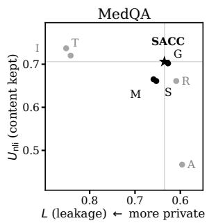

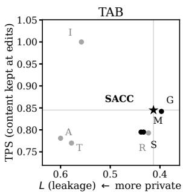  
Figure 4: Privacy–utility comparison. L versus $U _ { \mathrm { n l i } }$ on MedQA and TPS on TAB, using the scores from Table 3. I: input; M: global mask; G: global ladder; S: SACC-mask; T: INTACT; A: Adaptive; R: LLM rewrite. SACC is starred. Panel x-axes report different utility measures and scales.

## B Extended Editor Comparisons

Privacy–utility readings. Figure 4 plots the fixed-protocol panel of Table 3. Pairwise contrasts use the entry-matching conventions in Appendix I.

Against the global editors. Under the development adversary, neither global editor is demonstrably more private than SACC. Global ladder is closest (MedQA [−.021, +.003]) and its 98% intervals narrowly meet the ±.02 equivalence criterion on all three MedQA privacy measures (lowest bound −.0194, on L; Table 28); TAB cannot resolve differences below .04–.09. INTACT and Adaptive mainly target identifiers; SACC is more private than INTACT on both corpora and Adaptive on TAB, and reduces leakage when applied after either (Table 55). Against same-input LLM rewrite, it is more private on MedQA SEX under the development adversary but not separably under the held-out adversaries.

What was built on these corpora. The lexicons, keep-list and binder rules were written while reading these three corpora and the agreement setting was cross-fitted on them, so the benchmark results characterise SACC in the domains it was built in.

Two measurements bound its effect: MedQA rebuilt with TAB’s lexicon changes five documents and the input reduction by .002, and the documents nobody read while writing the selection rule gain as much as those that were read (Appendices S and I). Generalisation is what the frozen run on two outside corpora tests (Appendix N): there SACC lowers its input’s leakage by .35 and .11 while editing the fewest characters, and the ladder reaches lower leakage by editing cues outside the protected set, the privacy–scope trade-off the task definition anticipates. The ordering also survives an adversary given no candidates at all on MedQA, where it answers too rarely for the reading to be strong; TAB fails that check’s validity gate (Appendix M).

Which readings are themselves protocoldependent. Two of the editor readings themselves depend on the interface. Rewriting’s privacy gain was read under all three adversary families and is mixed (Table 33); closure’s was read under the development adversary alone, so its robustness to another adversary is untested. An adversary told each editor’s rules reads least from the global ladder, which the rule-unaware reading does not show (Appendix L).

## C Every Pair of Texts

Table 5 gives the reading of Section 5 over every pair of the eight texts, beside the perturbations that should not matter and the band width.

<table><tr><td></td><td>MedQA</td><td>TAB</td><td>SynthPAI</td></tr><tr><td>Credit for a wrong belief</td><td>5/28</td><td>6/28</td><td>0/28</td></tr><tr><td>Candidate order</td><td>4/84</td><td>5/84</td><td>4/84</td></tr><tr><td>Seed 1–5: mean / max rate</td><td>.007 / .012</td><td>.012 / .024</td><td>.024 / .036</td></tr><tr><td>δ = .02 (DISC, LEAK)</td><td>3/56</td><td>9/56</td><td>2/56</td></tr><tr><td>δ = .10 (DISC, LEAK)</td><td>5/56</td><td>11/56</td><td>5/56</td></tr><tr><td>Re-read from the cache</td><td>0/84</td><td>0/84</td><td>0/84</td></tr><tr><td>τb: clip / order / re-read</td><td>.71 / 1.00 / 1.00 1.00 / 1.00 / 1.00 .95 / .95 / .95</td><td></td><td></td></tr></table>

Table 5: Every pair of the eight texts $( L ,$ DISC, LEAK; unclipped d for the clip): verdict changes under two choices, under two perturbations that should not matter (seed, re-read) and under the band δ. Cells: changed/compared; seed: mean / maximum rate over seeds 1–5. Order and re-read use the SEX entries the request cache rebuilds; $\tau _ { b }$ over the seven texts sharing a cohort, where all three readings score them.

Magnitude and dependence (post hoc). For each protocol choice, we also summarise the absolute change in the paired point estimate, over the same all-pairs contrasts Figure 3 counts. In units of

L the median shifts are .0236 for adversary family (N = 504), .0084 for clipping (N = 84), .0059 for abstention (N = 75) and .0003 for subject reference (N = 45, both readings on one text version); candidate order’s per-pair effect sizes are not stored, and subject position is read on AUC, so its shift is not in units of L. Read against SACC alone the ordering differs: abstention leads at .0330 on only 9 contrasts (subject position’s .0388 there is likewise an AUC shift), as expected of a count over a handful of comparisons. The summaries are descriptive and use different cohorts across choices.

Bootstrap computational check (post hoc). Rereading cached requests changed no all-pairs verdict; reseeding 4,000 bootstrap draws changed 1– 4% of them. Exploratory one-sided comparisons of the all-pairs changed-verdict rates of Figure 3 against this Monte Carlo rate gave unadjusted p, averaged over seeds, of .0000 for clipping and adversary family, .0001 for candidate order and abstention, .0003 for subject position and .019 for subject reference (.073 at the least favourable seed). These seed-dependent comparisons are not populationlevel null tests and do not support the main causal or inferential claims; paired effects and their intervals are reported instead.

Joint intervals for clipping (post hoc). For this choice, the readings share a paired cohort and bootstrap draw matrix, permitting simultaneous 99% max-t intervals across its system contrasts. On MedQA, 4 of 6 comparisons remain separable (versus 5 of 6 marginally); TAB retains 3 of 7 and SynthPAI 2 of 6. MedQA clipping shifts the contrast toward SACC by +.0253 [+.0128, +.0382] against LLM rewrite, +.0310 [+.0189, +.0440] against global mask, and +.0314 [+.0191, +.0437] against SACC-mask. The other choices change the cohort between readings, so no joint interval is formed.

## D SWAP: Construction Record

Section 4 reports the construction and its results; this appendix records the design, the pre-specified predictions and the cost. SWAP is built from the scored SACC-mask text: within every region that SACC-mask replaced, each cue that the binder trace marks as SEX is rewritten to its opposite-sex form (he/she; her as his or him, depending on its dependency role; husband/wife; and the rest of the 19 sex forms the editor selects), and every other cue is written as [REDACTED]. Thus SWAP and SACC-mask differ only on sex cues; written with [REDACTED] instead, the same construction reproduces SACC-mask on 99.7% of MedQA and all TAB documents. It was scored by the development adversary using the same protocol as every other system (0.82 USD). Of four pre-specified predictions, three were confirmed; the fourth—that the clipped leakage score L would also credit SWAP on TAB—was not: there LEAKING does and L does not, so the credit the clip gives misdirection does not transfer across corpora.

The rule-aware reading, in full (post hoc). SWAP’s flip is a fixed, invertible map, so an adversary informed of it should recover sex almost perfectly, grounding the clip critique in quantitative information flow rather than in one constructed example alone. We described the map to the development adversary (0.19 USD; the 1,513 MedQA SEX entries). It answers far more informatively, but not almost perfectly: mean posterior on the gold value rises from .252 to .769 (.802 of entries now favour the gold value over its complement), and the clipped L rises with it, from .240 to .654 (+.414 [+.374,+.454], separable), the clearest demonstration that the clip’s floor at zero is a property of the scorer, not of what SWAP’s text states. DISCLOS-ING barely moves (−.021 [−.039,−.005], separable): it already charged SWAP’s misled entries as disclosure, and telling the adversary the map moves most of them from MISLED to LEAK, both of which DISCLOSING counts; only a stratum-balanced .021 move into the band instead. The rule-aware test confirms that SWAP’s misdirection preserves recoverable attribute evidence; DISCLOSING flags the belief shift that the clipped score ignores.

The same predictions under other scores. In a re-reading pre-specified after the main results (six of six predictions held), we read SWAP and SACC-mask with the measures of Section 2 on the 1,473 MedQA SEX entries that the eight releases of Table 2 share (Table 6). Recomputed first, L, LEAKING and DISCLOSING of the eight releases reproduce Table 2 exactly on MedQA and to .001 on TAB. Every reading that scores the adversary’s answer about the gold value alone—L, the signed residual, LEAKING, attack accuracy, the Brier score and log loss—rates SWAP the most private release on MedQA, and all but L do so on TAB as well, where L ranks it fourth: each credits a confident false belief at least as much as no belief. The two that do not are two-sided displacement, which charges a shift in either direction, and $| \mathrm { A U C } - . 5 |$ , which exchanging the labels leaves unchanged. Read as a protection rate (one minus accuracy, a single-attribute analogue of CPR and IPR, here balanced over the two sexes; Oh et al., 2026), SWAP scores .742 on MedQA SEX and SACC-mask .324, so an accuracy-based protection rate puts SWAP further ahead than L does. CPR and IPR over all attributes are not computable here: both need the adversary’s answer for every protected attribute of a subject, and the stored probability of the gold value, renormalised over the candidates, does not recover the top answer to an eight-option OCCUPATION question.

How the readings are computed. Every reading uses the stored gold-value probability $p$ of Section 3: the mean over the eight seeded orders of a probability renormalised over the candidates, in which a letter missing from the API’s top 20 receives no mass. Attack accuracy scores ${ \bf 1 } [ p > . 5 ]$ the Brier score $( 1 - p ) ^ { 2 }$ , which lies between 0 and 1, and log loss $- \ln \operatorname* { m a x } ( p , \epsilon )$ in nats, with $\epsilon = 1 0 ^ { - 1 2 }$ applied to the averaged $p .$ No entry has $p = 0$ , but the floor binds on 20 of SWAP’s 1,473 MedQA entries and 6 of its 244 TAB entries, and on 3 and 9 of Adaptive’s. Every reading except |AUC − .5| is aggregated exactly as L is (Appendix I, Computing the measures): averaged within strata, which for SEX are the two gold values, and then across them, so the 788 male and 685 female MedQA entries (187 and 57 on TAB) weigh equally and an accuracy of .258 is not a raw share. Each document weighs one in the point estimates, and the 99% intervals use the same 4,000 document draws as L. |AUC − .5| is instead a rank statistic over the whole cohort, with document-clustered intervals.

Told the rule, on the 1,513 entries of the ruleaware pass rather than the 1,473 of Table 6 (so the untold baselines are .259 for accuracy and 14.45 for log loss), every gold-value reading reverses: accuracy rises from .259 to .805, the Brier score falls from .723 to .146 and log loss from 14.45 to 0.58, all separable. The label-invariant reading does not weaken: |AUC − .5| moves from .320 to .382 and stays .143 [.110, .178] above SACC-mask’s. Three qualifications were recorded post hoc. On TAB the accuracy difference from SACC-mask (−.113) is not separable, while those on the Brier score (+.235) and log loss (+8.05) are; with the sexes weighted equally, that accuracy difference leans on

<table><tr><td>Reading</td><td></td><td>Prior SWAP</td><td>SACC-mask Rank M/T</td></tr><tr><td> $L \downarrow$ </td><td>yes</td><td>.241</td><td>.495 1/4</td></tr><tr><td>Signed residual ↓</td><td>yes</td><td>-.608</td><td>.285 1/1</td></tr><tr><td>LEAKING ↓</td><td>yes</td><td>.252</td><td>.626 1/1</td></tr><tr><td>Attack accuracy ↓</td><td>no</td><td>.258</td><td>.676 1/1</td></tr><tr><td>Brier score ↑</td><td>no</td><td>.723</td><td>.242 1/1 1/1</td></tr><tr><td>Log loss ↑</td><td>no</td><td>14.51</td><td>1.33</td></tr><tr><td>DISCLOSING↓</td><td>yes</td><td>.980</td><td>.897</td></tr><tr><td> $\left| \mathrm { A U C - . 5 } \right| \downarrow$ </td><td>no</td><td>.320</td><td>6/5 .237  $6 / 5 ^ { * }$ </td></tr></table>

Table 6: SWAP and SACC-mask under eight readings: the 1,473 MedQA SEX entries the releases of Table 2 share, seeded orders, development adversary. Prior: whether the reading uses the document-free prior. Arrows: the direction that would read as more private if the score were used as a privacy proxy; each keeps its usual meaning as a measure of prediction. Rank: $\mathrm { S W A P ^ { \prime } s }$ place among the eight releases, most private first, on MedQA / TAB. Every MedQA difference is separable (99%); its paired differences and AUCs match Table 2 to .002. Log loss is in nats with a floor of $1 0 ^ { - 1 2 }$ . All rows but the last are balanced over the two sexes as L is; the last is a rank statistic over the cohort. ∗TAB firstnamed subjects; the aggregate TAB AUC mixes them with subjects read through another person (Appendix I).

a stratum of 57 female entries weighed as heavily as the 187 male ones. The Brier score separates the ordinary editors by at most .002 on MedQA but gives SWAP +.482, so nearly all of its sensitivity is to misdirection and it is no drop-in replacement. Finally, .688 of SWAP’s MedQA entries give the gold value a probability below .01, against .048 of SACC’s, which is what drives the size of its log loss. That size also depends on the floor, though the ranking does not: SWAP’s MedQA log loss is 12.87 nats at $\epsilon = 1 0 ^ { - 9 }$ and 14.51 at both $1 0 ^ { - 1 2 }$ and $1 0 ^ { - 1 5 }$ (SACC-mask 1.30, 1.33, 1.33; on TAB SWAP 9.64, 10.76, 10.77). The Brier score, bounded and floor-free, makes the same point and is the safer single reading.

## E Prior Sensitivity

The document-free prior asks the question with a letter handle (“Subject A”) and no text, so for a two-valued attribute it encodes the adversary’s default answer (Section 3). Table 7 replaces it, for MedQA SEX, by the adversary’s answer on the document with every lexicon match masked. That document is the global mask’s released text, already scored with the same reference rule, orders and model, so the prior needs no new request; the entries are those of Table 45, so only the prior inside d changes. The comparison was pre-specified with three predictions, two of which failed: the gap between female and male entries was predicted to halve and instead changed sign, and at most two verdicts were predicted to move and three did, all of them SACC-mask against SACC, all sign reversals. The design did not anticipate what makes them uninformative: this prior is the global mask’s output, and on MedQA SACC-mask’s output coincides with it on most documents, so those reversals are a property of how the prior was built, not evidence that rewriting leaks more. What survives is the 39% of entries on which the adversary, reading the masked document, still gives the true sex a high probability: evidence that masking every lexicon match leaves in place (Appendix O, What still leaks).

<table><tr><td>Gold</td><td>Prior</td><td>Input</td><td>Gl. ladder</td><td>SACC-mask</td><td>SACC</td></tr><tr><td>female (700)</td><td>document-free</td><td>.808 / .181</td><td>.439 / .304</td><td>.485 / .339</td><td>.444 / .301</td></tr><tr><td>female (700)</td><td>masked document</td><td>.785 / .114</td><td>.265 / .206</td><td>.223 / .034</td><td>.274 / .213</td></tr><tr><td>male (813)</td><td>document-free</td><td>.879 / .097</td><td>.416 /.178</td><td>.503 / .199</td><td>.423 / .173</td></tr><tr><td>male (813)</td><td>masked document</td><td>.855 / .044.123 / .321</td><td></td><td>.059 / .034</td><td>.132 / .326</td></tr></table>

<table><tr><td rowspan="2"></td><td colspan="3">Document-free prior</td><td colspan="3">Masked-document prior</td></tr><tr><td>L</td><td>DISC</td><td>LEAK</td><td>L</td><td>DISC</td><td>LEAK</td></tr><tr><td>Input - SACC</td><td>+.410 +.179</td><td></td><td>+.277</td><td>+.617</td><td>+.119</td><td>+.309</td></tr><tr><td>GI. ladder – SACC</td><td>-.006 +.003</td><td></td><td>-.001</td><td>-.009</td><td>-.007</td><td>-.001</td></tr><tr><td>SACC-mask − SACC +.061 +.085 +.053</td><td></td><td></td><td></td><td>-.062</td><td>-.382</td><td>-.147</td></tr></table>

Table 7: MedQA SEX (1,513 entries) against the document-free prior and a text-conditioned one: the same question asked of the document with every lexicon match masked. Top: L / share misled by gold value. Bottom: system − SACC, 99% intervals, bold excludes zero. This prior is the global mask’s own output, identical to SACC-mask’s on 1,009 of 1,249 documents and within δ of it on 92% of entries, so the bottom block cannot rank masking against rewriting.  
Table 8: Cue-deletion prior sensitivity on MedQA SEX (1,513 entries). Values are system minus SACC; bold indicates 99% intervals excluding zero. The prior does not reuse a compared editor’s output (Table 7).

A prior free of that confound needs a document no compared editor produces. Deleting every lexicon match, rather than masking or rewriting it, gives one: the global mask’s matches with the token and its space removed and nothing else changed, scored once by the development adversary (0.10 USD). Masking and rewriting editors sit about equally close to it (Table 8), which a prespecified neutrality check required before any comparison between them could be reported. Against it SACC still lowers its input’s leakage and stays more private than SACC-mask on L and LEAKING; DISCLOSING no longer separates the two, the one verdict of nine that changes, and none reverses. The prediction that the L difference would vanish failed. The value dependence persists under this prior too, in the direction the masked-document prior gave it:

<table><tr><td>System — SACC</td><td>∆L</td><td>∆DISC</td><td>∆LEAK</td></tr><tr><td>Document-free prior</td><td></td><td></td><td></td></tr><tr><td>Anonymised input</td><td>+.410</td><td>+.179</td><td>+.277</td></tr><tr><td>Global ladder</td><td>-.006</td><td>+.003</td><td>-.001</td></tr><tr><td>SACC-mask</td><td>+.061</td><td>+.085</td><td>+.053</td></tr><tr><td>Cue-deletion prior</td><td></td><td></td><td></td></tr><tr><td>Anonymised input</td><td>+.625</td><td>+.136</td><td>+.314</td></tr><tr><td>Global ladder</td><td>-.010</td><td>-.005</td><td>-.005</td></tr><tr><td>SACC-mask</td><td>+.054</td><td>-.032</td><td>+.033</td></tr></table>

Within δ ofthe cue-deletion prior: Global mask .597; Global ladder .556; SACC-mask .584; SACC .552. For comparison, SACC-mask reaches .924 under the masked-document prior.

male entries are now the more often misled under every editor. For SACC, 33% of male and 19% of female entries are misled; the cue-deletion prior exceeds .9 on 41% of entries.

No-document prior with a matched subject handle (post hoc). Unlike the text-conditioned checks above, this control uses no document in either prior. The canonical prior uses “Subject A”, whereas the posterior uses the released text’s surviving, cue-free reference. As a check on this question mismatch, we recompute the document-free prior using the posterior’s subject handle. The reference itself can convey information even without the document and can vary by editor; this sensitivity analysis measures how subject-handle wording affects the document-free baseline.

<table><tr><td></td><td>MedQA</td><td>TAB</td></tr><tr><td>Mean prior π</td><td></td><td>.4916 → .5430.3874 → .3879</td></tr><tr><td>SACC L</td><td>+.2711 sep</td><td>.4269 → .3867 .2410 → .2407 +.2561 sep</td></tr><tr><td>Input — SACC</td><td>→ +.2859 sep</td><td>→ +.2563 sep</td></tr><tr><td>SACC-mask − SACC → +.0290 sep</td><td>+.0231 ns</td><td>+.0741 ns → +.0741 ns</td></tr></table>

Table 9: Subject-handle sensitivity of the documentfree prior. Each cell shows the canonical letter-handle prior → a document-free prior using the posterior’s subject reference (post hoc). “sep” and “ns” denote separable and non-separable paired contrasts under the privacy-interval convention. All output texts and gold values are unchanged.

MedQA’s prior rises by .0514 and SACC’s L falls by .0402; the corresponding changes on TAB are +.0005 and −.0003. The input–SACC difference remains separable on both corpora, with a slightly larger point estimate. Of these reported comparisons, only SACC-mask versus SACC on MedQA changes separability: +.0231 (non-separable) becomes +.0290 (separable), in SACC’s favour. For the MedQA SACC-mask comparison, the letter-handle prior yields the smaller estimated advantage for SACC under the development adversary. The MedQA–TAB difference indicates that a corpus’s subject-reference wording can affect the baseline and hence absolute L; acrosscorpus levels should not be read as an editor-only effect, and we compare editors within a corpus.

## F Further Related Work

Anonymisation by spans. Span-based deidentification masks or generalises identifiers (Lison et al., 2021; Pilán et al., 2022; Liu et al., 2023) and is increasingly evaluated by re-identification risk (Manzanares-Salor et al., 2024); consistent pseudonyms keep the coreference a binder could use (Yermilov et al., 2023).

Anonymisation by rewriting. Language-model anonymisers rewrite under adversarial feedback (Staab et al., 2025), replace detected spans truthfully (Pilán et al., 2025), optimise prompts (Loiseau et al., 2026) or evaluators (Yang et al., 2025b), randomise the protected attribute (Frikha et al., 2025), abstract self-disclosures (Dou et al., 2024) or distil anonymisation into small models (Kim et al., 2025); earlier work obfuscated authorship and demographic style (Shetty et al., 2018; Mahmood et al., 2019; Bevendorff et al., 2019; Faustini et al., 2025), and differentially private rewriting trades fidelity for a formal guarantee (Feyisetan et al., 2020; Igamberdiev and Habernal, 2023; Mattern et al., 2022). SACC calls no language model, leaves upstream placeholders untouched and can run after such an anonymiser (Appendix R).

Gender-neutral rewriting. Rewriting gendered English into neutral forms around singular they is a task of its own (Sun et al., 2021; Vanmassenhove et al., 2021; Amrhein et al., 2023); swapping gendered words is a debiasing augmentation (Zhao et al., 2018), sensitive spans can be regenerated neutrally (He et al., 2021), and removing gendered language from clinical notes costs classification little (Minot et al., 2022). These rewriters neutralise one attribute everywhere; SACC decides which cues to neutralise and admits only counterparts that state no protected value, and such a rewriter can serve as its rewrite step (Appendix S).

<table><tr><td>Editor on TAB</td><td>Cues edited</td><td>Precision</td><td>Recall</td></tr><tr><td>Global (SACC&#x27;s lexicon)</td><td>2,841</td><td>.66-.73</td><td>1</td></tr><tr><td>Global, person nouns only</td><td>2,060</td><td>.87-.96</td><td>.90-.96</td></tr><tr><td>Global + non-person rule</td><td>2,101</td><td>.85-.93</td><td>.90-.96</td></tr><tr><td>SACC</td><td>1,874</td><td>.89-.96</td><td>.84-.90</td></tr></table>

Table 10: Scope on TAB, judged against the source text by three LLM judges on 40 sampled cues per binder decision (range over judges; Table 13: per judge, and MedQA). Precision: share of edits on a protected person’s cue; recall: share of their cues edited. The middle editors need no subject list. A span matched under two attributes is one edit site, so Section 6 counts fewer sites (1,817 for SACC, 2,771 for global editing; Appendix G).

## G Implementation Details

Counting conventions. The same corpus is counted two ways in this paper, and the difference is a convention, not a disagreement. A cue is one lexicon match under one attribute; an edit site is a span the editor replaces once, so a span matched under two attributes is one site. On TAB 70 spans are matched by both the kinship and the sex lexicon, and this accounts for the whole difference: the binder trace’s 3,510 TAB rows cover 3,440 spans, of which the keep-listed the court is 669, so TAB’s 2,841 candidate cues are 2,771 sites and the 1,874 cues SACC edits are 1,817 sites. Counts read from the binder trace (Table 12) are per cue and before the keep-list, while audited and judged populations are per site and after it: hence 1,678 unresolved TAB cues in the trace against 1,659 unresolved sites in the judged population, and 227 cues set aside as another person’s against 214 sites. The two recall ranges, .84 to .90 from the binder audit (Table 13) and .82 to .88 in the placeholder-linking comparison below, are estimates of the same quantity on different judged samples; we have not reconciled them further.

Lexicons. SEX: personal pronouns (he, she, him, her, his, hers, himself, herself), forms of address (Mr, Mrs, Ms, Miss), gendered kinship nouns (husband, wife, widow(er), father, mother, son, daughter, brother, sister); the clinical register adds sex nouns (man, woman, boy, girl, male, female, gentleman, lady). RELATIONSHIP: kinship and marital terms. OCCUPATION: role, workplace and employment-status terms. The firstperson register matches self-descriptions (as a guy, my wife, I work as). Figure 6 gives every pattern verbatim. Within an attribute, duplicate matches are collapsed longest-first (e.g., mother and father occur in two MedQA SEX patterns). The frozen retire[dment]\* expression is a character class rather than the intended retire(?:d|ment)?; in these corpora it matched only retired and retirement. These patterns are retained for reproducibility; resolving duplicates or removing keep-listed tokens would not change an applied edit.

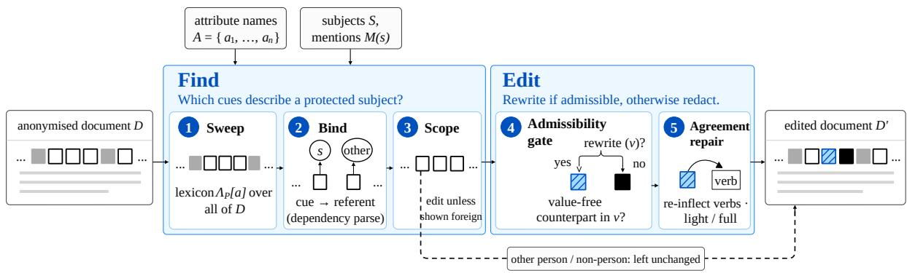

Figure 5: SACC: closure selects every cue the binder does not assign elsewhere; admissibility rewrites or redacts it. Grey: placeholder; outlined: attribute cue; hatched: rewritten by $\nu ;$ black: redacted.
<table><tr><td></td><td></td><td colspan="2">MedQA</td><td colspan="2">TAB</td></tr><tr><td>Change</td><td>at</td><td> $\Delta L$ </td><td> $\Delta U _ { \mathrm { n l i } }$ </td><td> $\Delta L$ </td><td> $\Delta U _ { \mathrm { n l i } }$ </td></tr><tr><td>Closure over binding only</td><td>rewrite</td><td> $\mathbf { + . 0 7 9 } _ { [ + . 0 6 7 , + . 0 9 2 ] }$ </td><td> $+ . 0 0 2 [ - . 0 0 2 , + . 0 0 7 ]$ </td><td> $+ . 1 2 2 _ { } [ + . 0 7 9 , + . 1 6 8 ]$ </td><td> $+ . 0 0 2 [ - . 0 0 5 , + . 0 0 9 ]$ </td></tr><tr><td>Closure selection</td><td>mask</td><td> $- . 0 0 6 [ - . 0 1 9 , + . 0 0 3 ]$ </td><td> $\pm . 0 0 4 _ { \ : [ + . 0 0 1 , + . 0 0 7 ] }$ </td><td> $- . 0 0 2 [ - . 0 5 1 , + . 0 2 3 ]$ </td><td> $+ . 0 2 8 \ [ + . 0 1 7 , + . 0 4 0 ]$ </td></tr><tr><td>non-person rule</td><td>mask</td><td> $- . 0 0 6 [ - . 0 1 8 , + . 0 0 1 ]$ </td><td> $\pm . 0 0 4 _ { \ : [ + . 0 0 2 , + . 0 0 7 ] }$ </td><td> $- . 0 1 1 \left[ - . 0 6 1 , + . 0 1 5 \right]$ </td><td> $\begin{array} { c } { 1 \cdot \cup \mathrm { { \bf { \delta } } } \mathrm { { \bf { \delta } } } \mathrm { { \bf { \delta } } } \mathrm { { \bf { \psi } } } ( \mathrm { { \bf { \psi } } } \mathrm { { \bf { \psi } } } \mathrm { { \bf { \psi } } } ( \mathrm { { \bf { \psi } } } , \mathrm { { \bf { \psi } } } \mathrm { { \bf { \psi } } } \mathrm { { \bf { \psi } } } ) } \\ { \mathrm { { \bf { \psi } } } \bot \widehat { { \bf { \psi } } } \mathrm { { \bf { \psi } } } \mathrm { { \bf { \psi } } } \mathrm { { \bf { \psi } } } ( \mathrm { { \bf { \psi } } } \mathrm { { \bf { \psi } } } , \mathrm { { \bf { \psi } } } \mathrm { { \bf { \psi } } } \mathrm { { \bf { \psi } } } \mathrm { { \bf { \psi } } } \mathrm { { \bf { \psi } } } \mathrm { { \bf { \psi } } } \mathrm { { \bf { \psi } } } \mathrm { { \bf { \psi } } } \mathrm { { \bf { \psi } } } \mathrm { { \bf { \psi } } } \mathrm { { \bf { \psi } } } \mathrm { { \bf { \psi } } } \mathrm { { \bf { \psi } } } \mathrm { { \bf { \psi } } } \mathrm { { \bf { \psi } } } } \mathrm { { \bf { \psi } } }  \mathrm { { \bf { \psi } } }  \mathrm { { \bf { \psi } } } ( \mathrm { { \bf { \psi } } } \mathrm { { \bf { \psi } } } \mathrm { \bf { \psi } } \mathrm { \bf { \psi } } \mathrm { \bf { \psi } }  \mathrm { \bf { \psi } } \mathrm { \bf { \psi } } \mathrm { \bf { \psi } } \mathrm { \bf { \psi } }  \mathrm { \bf { \psi } } \mathrm { \bf { \psi } } \mathrm { \bf { \psi } } \mathrm { \bf { \psi } } \mathrm { \bf { \psi } } \mathrm { \bf { \psi } } \mathrm { \bf { \bf { \psi } } } \mathrm { \bf { \bf { \psi } } } \mathrm { \bf { \bf \psi } } \mathrm  \bf   \end{array}$  +.020 [+.015,+.037]</td></tr><tr><td>other-person rule</td><td>mask</td><td> $. 0 0 0 [ - . 0 0 4 , + . 0 0 5 ]$ </td><td> $- . 0 0 1 [ - . 0 0 2 , + . 0 0 1 ]$ </td><td> $+ . 0 0 9 [ - . 0 0 1 , + . 0 2 1 ]$ </td><td> $+ . 0 0 2 [ - . 0 0 3 , + . 0 0 7 ]$ </td></tr><tr><td>Closure selection</td><td>rewrite</td><td> $\mathbf { - . 0 1 0 } _ { [ - . 0 2 4 , - . 0 0 1 ] }$ </td><td> $. 0 0 0 [ - . 0 0 2 , + . 0 0 3 ]$ </td><td> $+ . 0 0 1 [ - . 0 5 2 , + . 0 2 8 ]$ </td><td> $\mathbf { + . 0 2 6 } _ { } [ + . 0 1 4 , + . 0 3 9 ]$ </td></tr><tr><td>Admissible rewriting</td><td>global</td><td> $\pm . 0 2 7 \ [ + . 0 1 6 , + . 0 4 0 ]$ </td><td> $\pm . \mathbf { 0 4 4 } \left[ + . 0 3 6 , + . 0 5 3 \right]$ </td><td> $\mathbf { + . 0 2 0 } \left[ + . 0 0 4 , + . 0 3 6 \right]$ </td><td> $+ . 0 0 2 [ - . 0 0 4 , + . 0 0 8 ]$ </td></tr><tr><td>Admissible rewriting</td><td>closure</td><td> $\pm . 0 2 4 \ [ + . 0 1 2 , + . 0 3 5 ]$ </td><td> $\mathbf { + . 0 4 1 } _ { [ + . 0 3 3 , + . 0 5 0 ] }$ </td><td> $\mathbf { + . 0 2 2 } \left[ + . 0 0 6 , + . 0 3 9 \right]$ </td><td> $. 0 0 0 [ - . 0 0 7 , + . 0 0 7 ]$ </td></tr><tr><td>NeuTral Rewriter</td><td>closure</td><td> $- . 0 0 3 \left[ - . 0 1 1 , + . 0 0 6 \right]$ </td><td> $- . 0 0 4 _ { \left[ - . 0 0 9 , - . 0 0 1 \right] }$ </td><td> $- . 0 0 1 \left[ - . 0 0 8 , + . 0 0 7 \right]$ </td><td> $+ . 0 0 3 [ - . 0 0 1 , + . 0 0 7 ]$ </td></tr><tr><td>Person-noun filter</td><td>selection</td><td> $\pm . 0 0 4 \scriptstyle { [ + . 0 0 1 , + . 0 0 9 ] }$ </td><td> $. 0 0 0 [ - . 0 0 1 , + . 0 0 1 ]$ </td><td> $- . 0 0 6 [ - . 0 1 6 , + . 0 0 5 ]$ </td><td> $- . 0 0 1 \left[ - . 0 0 4 , + . 0 0 3 \right]$ </td></tr></table>

Table 11: What each principle contributes. ∆L: privacy gain of the change (99%); $\Delta U _ { \mathrm { n l i } } \mathbf { \cdot }$ : utility gain (95%); bold excludes zero. Indented: the selection’s two rules. Bottom: NeuTral Rewriter (Vanmassenhove et al., 2021) as rewrite step, the person-noun filter as selection; first and global-rewrite rows from a later pass (Appendix G).

Binder rules. In order: a non-person use if the cue is not relational and its head is an organisation, place, facility, event or law entity or one of 26 institution nouns; otherwise the referent is the possessor of the head, the subject of a copular complement, the head of an apposition, or the cue itself in argument position; a pronoun is direct when the document has at most one subject, or when exactly one person or first-person mention occurs between 400 characters before the start of the pronoun’s sentence and the pronoun itself and that mention matches $M ( s )$ , and unresolved otherwise. The 400- character window was set by hand during development and its sensitivity was not measured; since an unresolved pronoun is edited anyway, a narrower window can only move a pronoun from direct to unresolved, which leaves the edit in place. The occupation pattern represent(?:ed|ing) $( \ref { m e t h e 1 } \mathrm { i } \mathrm { h i } \mathrm { s } \mid \mathrm { h e r } \mid \mathrm { a } )$ matched twice (representing the, TAB), never a pronoun, so overlap resolution never handed a possessive pronoun to the occupation branch. The 26 institution nouns are court, tribunal, hospital, clinic, ward, school, university, college, company, firm, chambers, practice, government, ministry, department, office, police, army, military, bank, agency, council, prison, embassy, institution, workplace. The keep-list K holds the occupation expressions for which the generalisation ladder has no truthful broader term, setting nouns and first-person phrases that state employment without naming a job: the court, court, patient(s), at work, day job, I work as/at/in, as a laser and my followed by job, career, clients, patients, students, colleagues, boss, office, shift or company.

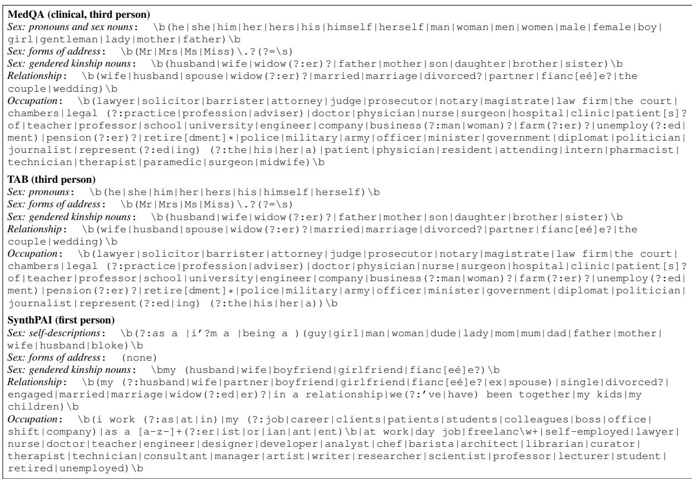  
Figure 6: SACC’s frozen, case-insensitive cue lexicons by corpus and attribute. Within-attribute overlaps are resolved longest-first; keep-listed matches are not edited.

It exempts patient 1,576 times on MedQA, the court 669 times on TAB and 44 phrases on Synth-PAI (at work 34, day job 4, my job 3, my career 2, as a laser 1), 42 of them the protected author’s own; those 42 state that the author is employed and stay in every editor’s output. Mention matching is case-insensitive containment or equality with a token of more than three characters. The lexicons were written on the three evaluation corpora and validated only by the leave-one-domain-out run of Appendix S; their false matches surfaced case by case (as a laser, matched by the SynthPAI role suffix and placed on the keep-list, and the verb miss, matched four times by the address pattern), so a held-out estimate of their false-positive rate is not available. Table 12 counts the binder’s decisions on every candidate cue.

Binder audit. A first audit against the source text found the binder sending kinship nouns of protected relatives to another person; the mentionform rule, which binds a noun matching a protected person’s mention form to that person, repairs this. We then audited the final binder on a fresh sample of 40 cues per decision and corpus, judged by

<table><tr><td></td><td></td><td colspan="3">Edited</td><td colspan="2">Left unchanged</td></tr><tr><td>Corpus</td><td>Attr. Cues</td><td>Direct</td><td>Relat.</td><td>Unres.</td><td></td><td>Other Non-pers.</td></tr><tr><td>MedQA</td><td>Sex</td><td>7,347</td><td>4,150</td><td>142 3,018</td><td>37</td><td>0</td></tr><tr><td></td><td>Occ</td><td>1,847</td><td>240</td><td>0 578</td><td>787</td><td>242</td></tr><tr><td></td><td>Rel</td><td>14</td><td>7</td><td>1</td><td>5</td><td>0</td></tr><tr><td></td><td>All</td><td>9,208</td><td>4,397</td><td>143</td><td>3,597 829</td><td>242</td></tr><tr><td>TAB</td><td>Sex</td><td>1,674</td><td>47</td><td>18 1,579</td><td>30 55</td><td>0</td></tr><tr><td></td><td>Occ</td><td>1,722</td><td>93</td><td>0</td><td>165</td><td>1,409</td></tr><tr><td></td><td>Rel</td><td>114</td><td>30</td><td>8</td><td>32</td><td>0</td></tr><tr><td></td><td>All</td><td>3,510</td><td>170</td><td>26</td><td>1,678 227</td><td>1,409</td></tr><tr><td>SynthPAI Sex</td><td></td><td>8</td><td>8</td><td>0</td><td>0 0</td><td>0</td></tr><tr><td></td><td>Occ</td><td>98</td><td>87</td><td>0</td><td>10</td><td>1</td></tr><tr><td></td><td>Rel</td><td>72</td><td>31</td><td>35</td><td>2</td><td>0</td></tr><tr><td></td><td>All</td><td>178</td><td>126</td><td>35</td><td>4</td><td></td></tr></table>

Table 12: Binder decisions by corpus and attribute, before the keep-list and overlap resolution. Unresolved cues are edited; cues assigned to another person or a nonperson use are left unchanged. Applied edits number 7,339 / 1,817 / 120 (MedQA / TAB / SynthPAI). After the keep-list, unresolved cues make up 41% of MedQA and 90% of TAB’s edited cues.

GPT-4o-mini, GPT-4.1-mini and GPT-4.1 against the source text (Table 15). Decisions that lead to an edit are correct on almost every cue, .99 of the edited cues on MedQA and .88 to .95 on TAB when weighted by population (the scope estimate of Table 13, which leaves out the keep-list and counts a relational cue as its possessor’s, gives .89 to .96 on TAB). The remaining errors are sex and relationship nouns still sent to another person (42 cues on MedQA, 62 on TAB), mostly relatives the benchmark describes only by a role or a name; the MedQA occupation cues sent to another person are the noun patient, which states no occupation. Pairwise, the judges agree moderately to well on MedQA (κ .64 to .90) and weakly on TAB (.49 to .58), so the TAB cells are only indicative. Where GPT-4o-mini and GPT-4.1-mini both attribute a sex cue that the binder sent to another person to a protected person of the document, that person’s entry keeps its leakage: on the 22 such MedQA entries, SACC lowers L from 1.000 to .930 (99% interval of the gain [.000, .277]), while global masking reaches .626 and SACC lowers L by .416 on the other 1,491 SEX entries. TAB has four such entries, too few to score.

Scope precision and recall. The audit’s populations and labels give the precision and recall of the edits (Table 13) over the cues some system edits, stratified by binder decision and by whether the cue is a person noun; the keep-list, which no system edits, is left out. A global editor edits every candidate, so its precision is the share of candidates that are a protected person’s. On TAB a quarter to a third of the global editor’s edits fall on cues the judges assign to no person (19% to 33% of its edits) or to another person (2% to 9%), against at most one in nine of $\mathrm { \bf S A C C ^ { \prime } s . }$ , which edits 84% to 90% of the protected persons’ cues. Two global editors that need no subject list close most of that gap: one that applies only the binder’s non-person rule, which is SACC-mask with the other-person rule turned off, reaches precision .85 to .93 at recall .90 to .96, and under the development adversary it is not separable from SACC-mask in privacy (∆L .000 on MedQA, +.009 [−.001, +.021] on TAB and $- . 0 0 6 \left[ - . 0 1 9 , + . 0 0 0 \right]$ on SynthPAI, so that TAB’s interval still leaves a difference of .02 undetected and the two corpora differ in sign) or in $U _ { \mathrm { n l i } }$ (at most .002 on any corpus; Table 11). Both arms of that comparison redact at their edit sites, so the rule was not ablated against the rewrite step the reported system uses; one whose lexicon drops institution and activity nouns reaches .87 to .96 at recall .90 to .96 and shares 2,027 of its 2,060 TAB edits with the first. The rule that sets aside other people’s cues, which does need the subject list, adds three to four points of precision and costs six to eight of recall; it applies to 227 of the 2,841 TAB candidates some system edits. On MedQA nearly every candidate cue is the patient’s, and the precisions differ by two to three points. An editor that edited exactly the protected persons’ cues would have precision and recall 1, so the most any subject-aware selection could add over the person-noun editor on TAB is .128, .044 and .107 of precision and .038, .048 and .104 of recall (GPT-4o-mini, GPT-4.1-mini, GPT-4.1). Three judges read the same sample and give the same reading; one of them is the development adversary’s model and GPT-4.1 is not used as an adversary anywhere, and they agree only moderately on TAB, so these are estimates to be checked by human annotation.

Closure and admissibility, ablated. Two arms, pre-specified after internal review and scored in one pass with the input, SACC-mask, SACC, the global mask and the global ladder, isolate the two principles (Table 11). Binding-only selection is SACC with unresolved cues left unedited, everything else unchanged; it edits 4,304 of SACC-mask’s 7,339 sites on MedQA and 158 of 1,817 on TAB. It leaks more than SACC on L by .079 [.067, .092] on MedQA and .122 [.079, .168] on TAB, and on DISCLOSING by .048 and .064 (separable); the loss sits on entries whose subject has no bound cue (.208 and .145) more than on the others (.020 and .081). On TAB it is barely more private than its input $( L + . 0 1 2 )$ , and it keeps no more content than SACC on either corpus $( U _ { \mathrm { n l i } } ~ \mathrm { - . 0 0 2 }$ on both, not separable). Global with ν passes the global mask through SACC’s fixed rewrite step, so it differs from the global ladder only in how a selected cue is replaced. It is not separably less private than the ladder on L (−.002 on MedQA, +.016 on TAB) and keeps more on MedQA $( U _ { \mathrm { n l i } }$ +.003 [.001, .006]) but not on TAB (−.003, not separable); on TAB’s aggregate SEX measure the ladder is more private (+.028, separable). Against it, SACC’s selection is .010 less private on MedQA $( [ - . 0 2 4 , - . 0 0 1 ]$ ; LEAKING −.013) and not separable on TAB, where it keeps more (+.026). The pre-specified predictions that binding-only selection leaks more on L and DISCLOSING on both corpora, and that global with ν is not separably less private than the ladder, were confirmed; those that binding-only selection would keep more content, and global with ν more than the ladder on both corpora, were not. The MedQA $U _ { \mathrm { n l i } }$ of this pass ran on a different GPU model from the earlier passes and differs from their values on 3 to 6 of 1,247 documents per system (mean difference at most .0003); every contrast is read within the pass.

<table><tr><td></td><td></td><td colspan="4">Precision</td><td colspan="3">Recall</td><td colspan="2">Global edits on</td></tr><tr><td>Corpus</td><td>Judge</td><td>SACC</td><td>Gl. + non-person Gl., person nouns</td><td></td><td>Global</td><td>SACC Gl. + non-person Gl., person nouns another person no person</td><td></td><td></td><td></td><td></td></tr><tr><td></td><td>MedQA GPT-4o-mini</td><td>1.000</td><td>1.000 [.999,1.000]</td><td> $1 . 0 0 0 [ . 9 9 9 , 1 . 0 0 0 ]$ </td><td>.980 [.975,.985]</td><td>.983</td><td>.988</td><td>.988</td><td>.001</td><td>.019</td></tr><tr><td></td><td>GPT-4.1-mini</td><td>1.000</td><td> $. 9 9 9 [ . 9 9 8 , 1 . 0 0 0 ]$ </td><td> $9 9 9 \left[ . 9 9 8 , 1 . 0 0 0 \right]$ </td><td>.968 [.967,.970]</td><td>.995</td><td>.999</td><td>.999</td><td>.002</td><td>.030</td></tr><tr><td></td><td>GPT-4.1</td><td>1.000</td><td>.999 [.998,.999]</td><td> $\boldsymbol { . 9 9 9 [ . 9 9 8 , . 9 9 9 ] }$ </td><td>.970 [.967,.974]</td><td>.992</td><td>.997</td><td>.997</td><td>.002</td><td>.028</td></tr><tr><td>TAB</td><td>GPT-4o-mini</td><td>.893 [.803,.963]</td><td> $. 8 5 4 [ . 7 7 2 , . 9 2 1 ]$ </td><td>.872 [.788,.940]</td><td>.658 [.591,.719]</td><td>.896</td><td>.960</td><td>.962</td><td>.016</td><td>.326</td></tr><tr><td></td><td>GPT-4.1-mini</td><td>.960 [.912,.985]</td><td> $9 3 0 [ . 8 8 1 , . 9 5 9 ]$ </td><td>.956 [.908,.985]</td><td> $. 7 2 9 [ . 6 8 2 , . 7 8 0 ]$ </td><td>.869</td><td>.944</td><td>.952</td><td>.070</td><td>.201</td></tr><tr><td></td><td>GPT-4.1</td><td>.918 [.846,.986]</td><td> $. 8 8 2 [ . 8 1 2 , . 9 4 4 ]$ </td><td>.893 [.822,.956]</td><td>.723 [.651,.795]</td><td>.838</td><td>.903</td><td>.896</td><td>.093</td><td>.185</td></tr></table>

Table 13: Scope precision and recall from source-text binder audits (three LLM judges; 40 sampled cues per decision), excluding the keep-list. Precision is the protected-subject share of edited cues; recall is the share of protected-subject cues edited (relational cues count toward their possessor). Gl. + non-person excludes non-person uses; Gl., person nouns excludes institution and activity nouns. Neither uses a subject list. “Global edits on” partitions edits assigned to another person or to no person. Brackets: 95% intervals.

Richer subject knowledge. Three variants give the binder more subject knowledge than the rule binder has; none lets the subject list change the measures. Linking every TAB [PERSON] placeholder to the person whose mention it replaced (375 decisions change; MedQA and SynthPAI have no such placeholder) sends 285 pronouns to another person, the only one named nearby, and the three judges find all but at most two of them to be protected persons’ pronouns; leakage rises (L +.072 [.036, .114], DISCLOSING +.041) and recall falls from .82–.88 to .69–.72. Replacing TAB’s placeholders by consistent surname pseudonyms (849) doubles the directly bound cues (325 against 170) but leaves 82% unresolved, and with the other-person rule turned off SACC is equally private $( L - . 0 0 1 [ - . 0 1 1 , + . 0 0 7 ] )$ and keeps as much $( U _ { \mathrm { n l i } } + . 0 0 3 )$ . Protecting only each judgment’s firstnamed subject, with GPT-4.1-mini labelling every candidate span from the source text with the audit’s prompt (Table 14), finds that subject’s cues with .86 to .95 precision on 1,450 sites but leaves the subject more exposed than the global ladder (L +.101), consistent with an adversary that reads other people’s cues as the subject’s (Table 25). The pre-specified predictions that these variants would make the subject list matter failed.

Privacy by binding decision. Grouping each entry by the binder’s decisions on its subject’s cues shows where the gain comes from. Under the development adversary, SACC lowers its input’s L by .209 on MedQA entries with a direct or relational binding and by .214 on entries whose subject has no bound cue but some unresolved one (99% intervals [.187, .231] and [.186, .244]; 1,009 and 722 entries); on TAB by .102 and .168 ([.027, .186], [.113, .232]; 91 and 259 entries). Entries with no selected cue gain nothing on either corpus. The conservative rule that edits unresolved cues therefore carries as much of the gain as positive binding does. The selection depends little on complete mention forms: dropping each at random with probability .5 never adds an edit and removes 2.1% of them on MedQA and 3.0% on TAB, the kinship and role nouns bound through a mention form (a pre-specified prediction of under 2% on each corpus failed). One seed was drawn, and the reduced inputs were not scored for privacy. Nor does it depend much on a complete subject list: removing each protected subject from S at random with probability .5 (882 of 1,793 on MedQA, 266 of 586 on TAB) never adds an edit and removes 2.1% of them on MedQA and 2.5% on TAB, because the cues of a subject missing from the list mostly become unresolved and are still edited. An attribute missing from A is not edited at all.

Runtime. On one core of an Intel Xeon Gold 6230R, our implementation takes 0.17 s per MedQA document (120 words on average) and 0.54 s per TAB document (573 words), excluding the upstream de-identifier. Most of it is dependency parsing, which this implementation repeats seven times per document because it writes several ablation variants in one pass; binding takes 2 and 74 ms per document and the rewrite step 1 and 9 ms. No step calls a model or a GPU.

What the unresolved cues are. Closure edits a cue whose referent the binder cannot resolve, and on TAB those are 90% of what it edits (Table 12), so what they describe determines whether default-deny is appropriate. GPT-4.1-mini, given the source document and the list of protected persons and allowed to answer UNCLEAR, labelled all 2,771 TAB candidate edit sites and answered UNCLEAR on none (Table 16). Of the 1,659 the rule binder leaves unresolved it assigns 1,618, or 97.5%, to a protected person, 8 to a person outside the set and 33 to no person: editing them is correct in almost all cases, and the binding-only arm of Table 11 skips 1,618 sites that do describe someone the release protects. The same comparison bounds the other direction: of the 214 sites the binder sets aside as another person’s, the judge assigns 145 to a protected person, the over-exclusion the two unseen corpora measure as leakage (Appendix N). This judge reads the source text, with the names de-identification removed, so it is not a binder the editor could use; what it shows is that

<table><tr><td></td><td></td><td colspan="2">Scope for the first-named subject</td><td colspan="3">Privacy of the first-named subject</td><td></td></tr><tr><td>Editor on TAB</td><td></td><td>Sites Precision</td><td>Recall</td><td>∆L</td><td>∆LEAK</td><td>AUC</td><td> $U _ { \mathrm { n l i } }$ </td></tr><tr><td>Anonymised input</td><td>0</td><td></td><td></td><td> $+ . 1 9 7 \left[ + . 1 1 3 , + . 2 9 2 \right]$ </td><td> $\pm . 0 9 8 _ { \ : [ + . 0 1 9 , + . 1 9 4 ] }$ </td><td>.978</td><td></td></tr><tr><td>Global ladder</td><td>2,771</td><td>.39 / .49</td><td>1/1</td><td> $- . 1 0 1 [ - . 2 5 0 , - . 0 1 3 ]$ </td><td> $- . 0 8 3 [ - . 2 2 8 , . 0 0 0 ]$ </td><td>.589</td><td>.296</td></tr><tr><td>Global, person nouns</td><td>1,990</td><td>.55 / .61</td><td>.99 / .88</td><td> $- . 0 4 2 [ - . 1 2 0 , + . 0 2 9 ]$ </td><td> $- . 0 3 3 [ - . 0 9 8 , + . 0 0 5 ]$ </td><td>.619.318</td><td></td></tr><tr><td>SACC (all subjects, rule binder)</td><td>1,817</td><td>.59 / .66</td><td>.99 / .89</td><td> $- . 0 4 8 [ - . 1 2 9 , + . 0 0 4 ]$ </td><td> $- . 0 4 9 _ { [ - . 1 2 4 , - . 0 0 3 ] }$ </td><td>.617.319</td><td></td></tr><tr><td>SACC, first-named only, rule binder</td><td>1,680</td><td>.65 / .72</td><td>.99 / .89</td><td> $- . 0 0 4 [ - . 0 2 0 , + . 0 1 4 ]$ </td><td> $- . 0 0 4 [ - . 0 2 0 , . 0 0 0 ]$ </td><td>.712.321</td><td></td></tr><tr><td>SACC, first-named only, LLM binder</td><td>1,450</td><td>.86 / .95</td><td>.97 / .92</td><td></td><td></td><td>.717.316</td><td></td></tr><tr><td>SACC, all subjects, LLM binder</td><td>2,011</td><td>.55 / .64</td><td>.99 / .95</td><td> $- . 0 4 2 [ - . 1 1 0 , + . 0 1 4 ]$ </td><td> $- . 0 3 6 [ - . 0 9 9 , + . 0 0 1 ]$ </td><td></td><td>.619.315</td></tr></table>

Table 14: Protecting TAB’s first-named subject. Scope is precision/recall for the first-named subject (GPT-4o-mini / GPT-4.1 judges); the LLM binder uses GPT-4.1-mini on source text. Privacy covers 157 first-named entries. ∆ is system minus first-named-only SACC with the LLM binder (99% intervals; bold excludes zero). $U _ { \mathrm { n l i } }$ is computed over all documents and cannot credit content retained about other subjects.

<table><tr><td>Corpus</td><td>Binder decision</td><td>Cues</td><td>n 4o-mini</td><td>i4.1-mini</td><td>4.1</td><td>Agree</td></tr><tr><td>MedQA Direct</td><td></td><td>4,397 40</td><td>.975</td><td>.975</td><td>.975</td><td>.975 (40)</td></tr><tr><td></td><td>Relational</td><td>143 40</td><td>1.000</td><td>1.000</td><td></td><td>1.000 1.000 (39)</td></tr><tr><td></td><td>Unresolved</td><td>3,59740</td><td>1.000</td><td>1.000</td><td></td><td>1.000 1.000 (40)</td></tr><tr><td></td><td>Other person, sex/rel.</td><td>42 40</td><td>.075</td><td>.200</td><td>.225</td><td>.061 (33)</td></tr><tr><td></td><td>Other person, occ.</td><td>787 40</td><td>.025</td><td>.025</td><td>.025</td><td>.000 (39)</td></tr><tr><td></td><td>Non-person</td><td>242 40</td><td>.625</td><td>.975</td><td>.900</td><td>.955 (22)</td></tr><tr><td>TAB</td><td>Direct</td><td>170 40</td><td>.925</td><td>.925</td><td>.950</td><td>.973 (37)</td></tr><tr><td></td><td>Relational†</td><td>26 26</td><td>1.000</td><td>1.000</td><td>1.000</td><td>1.000 (25)</td></tr><tr><td></td><td>Unresolved</td><td>1,678 40</td><td>.875</td><td>.950</td><td>.900</td><td>.946 (37)</td></tr><tr><td></td><td>Other person, sex/rel.</td><td>62 40</td><td>.275</td><td>.150</td><td>.150</td><td>.000 (23)</td></tr><tr><td></td><td>Other person, occ.</td><td>165 40</td><td>.550</td><td>.350</td><td>.550</td><td>.000 (8)</td></tr><tr><td></td><td>Non-person</td><td>1,409 40</td><td>.900</td><td>.900</td><td>.850</td><td>.935 (31)</td></tr></table>

Table 15: Fresh audit of the final binder: share of sampled cues whose decision is right, judged against the source text by GPT-4o-mini, GPT-4.1-mini and GPT-4.1. Cues: the decision’s population, keep-list included; Agree: the share on which all three judges give the same label (their number in brackets). Right: direct, the bound subject; relational, a person; unresolved, a protected person; left unchanged, not a protected person. †TAB’s 26 relational cues are read from the first audit’s labels; GPT-4.1 judged them separately. Cohen’s κ (4o-mini/4.1-mini, 4o-mini/4.1, 4.1-mini/4.1): MedQA .670, .637, .899; TAB .510, .493, .576.

the unresolved cues are unresolved for the released text rather than undecidable in principle, and that a binder able to resolve them would leave closure nothing to do on this corpus.
<table><tr><td rowspan="2">SACC&#x27;s binder says</td><td colspan="3">Judge reading the source says</td><td rowspan="2"></td><td rowspan="2">All Share prot.</td></tr><tr><td></td><td>protected not protected no person</td><td></td></tr><tr><td>Resolved to a protected subject</td><td>152</td><td>1</td><td>5</td><td>158</td><td>.962</td></tr><tr><td>Unresolved</td><td>1,618</td><td>8</td><td></td><td>33 1,659</td><td>.975</td></tr><tr><td>Another person</td><td>145</td><td>38</td><td>31</td><td>214</td><td>.678</td></tr><tr><td>Non-person use</td><td>95</td><td>76</td><td>569</td><td>740</td><td>.128</td></tr></table>

Table 16: SACC’s rule binder against GPT-4.1-mini reading the source document and the protected persons, on all 2,771 TAB candidate edit sites: the LLM binder of Table 14, here with every annotated person protected, which could answer UNCLEAR and never did. Share prot.: the row’s share the judge assigns to a protected person, not ground truth.

Rewrite table. Table 17 lists ν in full. Its 85 surface forms map to 30 outputs: epicene pronouns, the person for forms of address, unmarked person and kinship nouns, and the unmarked counterparts of a few sex-marked role nouns. Both agreement settings use the same table. The admissibility check is implemented as this table plus a block on outputs that state a relationship status (spouse, surviving spouse, partner); the table is not re-checked against every attribute in A at run time, and one entry escapes it: an unmarked role noun such as businessperson still states an occupation. In the reported texts this happens once (one MedQA businessman, an OCCUPATION cue, became businessperson; TAB has none), so the admissibility of Section 6 holds for all other applied rewrites.

Value asymmetry of the edits. Table 18 splits SACC’s edits of sex cues by slot and by the gender of the original form. On MedQA, where the full setting rewrites almost everything, the forms are treated alike, with two exceptions: object her became their 29 times, an error him cannot make, and the address pattern matched the verb miss four times, each redacted. On TAB the light setting leaves more feminine than masculine pronouns redacted (25% against 16% of edited pronouns), because object and possessive her share a form: a redacted pronoun raises the odds of a feminine referent by a likelihood ratio of about 1.6. The light setting rewrites a redaction only when it can isolate one table entry, which a sentence with an ambiguous her prevents; this also explains the subject pronouns, since she stays redacted in 26% of sentences that also hold her and in 12% of the others, against 13% for he. Miss and hers are not in ν and stay redacted; the title never occurs among the edited cues and hers once. The pattern also matched one ms meaning milliseconds, which the binder left unedited, and no upper-case MS.

<table><tr><td>Output</td><td>Surface forms rewritten to it</td></tr><tr><td>they</td><td>he, she</td></tr><tr><td>them</td><td>him, her</td></tr><tr><td>their</td><td>his</td></tr><tr><td>themselves</td><td>himself, herself</td></tr><tr><td>the person</td><td>mr, ms, mr., ms., mrs, mrs., sir, madam gentleman, lady, man, woman, male, fe-</td></tr><tr><td>person</td><td>male, guy, gal</td></tr><tr><td>people</td><td>gentlemen, ladies, men, women, males, females</td></tr><tr><td>child</td><td>boy, girl, son, daughter</td></tr><tr><td>children</td><td>boys, girls, sons, daughters</td></tr><tr><td>parent</td><td>father, mother, dad, mom</td></tr><tr><td>sibling</td><td>brother, sister</td></tr><tr><td>siblings</td><td>brothers, sisters</td></tr><tr><td>spouse</td><td>husband, wife</td></tr><tr><td>relative</td><td>uncle, aunt, nephew, niece</td></tr><tr><td>grandparent</td><td>grandfather, grandmother</td></tr><tr><td>grandchild</td><td>grandson, granddaughter</td></tr><tr><td>surviving spouse</td><td>widower, widow</td></tr><tr><td>monarch</td><td>king, queen</td></tr><tr><td>royal</td><td>prince, princess</td></tr><tr><td>server</td><td>waiter, waitress</td></tr><tr><td>performer</td><td>actor, actress</td></tr><tr><td>businessperson</td><td>businessman, businesswoman</td></tr><tr><td>chair</td><td>chairman, chairwoman</td></tr><tr><td>spokesperson</td><td>spokesman, spokeswoman</td></tr><tr><td>partner</td><td>boyfriend, girlfriend, fiance, fiancee</td></tr><tr><td>godparent</td><td>godfather, godmother</td></tr><tr><td>stepparent</td><td>stepfather, stepmother</td></tr><tr><td>stepchild</td><td>stepson, stepdaughter</td></tr><tr><td>youth</td><td>lad, lass</td></tr><tr><td>parental</td><td>paternal, maternal</td></tr></table>

Table 17: The rewrite table ν: 85 surface forms, 30 outputs. Case follows the source; her becomes their or them, and his their or theirs, by whether a noun phrase follows (a word, a placeholder or a number). Spouse, surviving spouse and partner state a relationship status, so they are not admissible while RELATIONSHIP is protected and those cues stay redacted. Forms not listed stay redacted.

<table><tr><td rowspan="2">Corpus Slot</td><td rowspan="2"></td><td colspan="2">Feminine form</td><td colspan="2">Masculine form</td></tr><tr><td></td><td>Edited Redacted</td><td></td><td>Edited Redacted</td></tr><tr><td rowspan="8"></td><td>MedQA subject pronoun</td><td>1,619</td><td>.000</td><td>2,031</td><td>.005</td></tr><tr><td>object pronoun</td><td>160</td><td>.000</td><td>71</td><td>.000</td></tr><tr><td>possessive determiner</td><td>1,306</td><td>.000</td><td>1,754</td><td>.001</td></tr><tr><td>possessive pronoun</td><td>1</td><td>1.000</td><td>8</td><td>.000</td></tr><tr><td>reflexive</td><td>8</td><td>.000</td><td>18</td><td>.000</td></tr><tr><td>address</td><td>4</td><td>1.000</td><td>0</td><td></td></tr><tr><td>noun</td><td>218</td><td>.000</td><td>112</td><td>.000</td></tr><tr><td>TAB subject pronoun</td><td>113</td><td>.195</td><td>559</td><td>.131</td></tr><tr><td></td><td>object pronoun</td><td>23</td><td>.348</td><td>168</td><td>.149</td></tr><tr><td></td><td>possessive determiner</td><td>129</td><td>.271</td><td>551</td><td>.191</td></tr><tr><td></td><td>possessive pronoun</td><td>0</td><td></td><td>5</td><td>.000</td></tr><tr><td></td><td>reflexive</td><td>6</td><td>.500</td><td>5</td><td>.200</td></tr><tr><td></td><td>noun</td><td>57</td><td>.825</td><td>28</td><td>.857</td></tr></table>

Table 18: SACC’s edits of sex cues by grammatical slot and gender of the original form: edits, and the share left redacted rather than rewritten. Slots from the parse of the input; MedQA’s feminine address forms are the verb miss, matched by the address pattern.

Applied edits. How often rewriting applies is known before any adversary is run, and it orders the corpora as the privacy gain of rewriting does: first-person posts have no epicene counterpart for their cues. Over the corpora, SACC applies 7,339 / 1,817 / 120 edits (MedQA / TAB / SynthPAI); the rewrite share is .994 on MedQA, .716 on TAB with the light setting and .000 on SynthPAI. The binder’s mention-form rule adds 157 edits on MedQA and 42 on TAB and lowers the TAB share from .751; before that, the fix of Appendix V had returned 21 marital rewrites to redactions, lowering it from .763 (.901 with the full setting).

## H Baselines

Global mask and global ladder. Both run SACC’s sweep over the whole document and skip the bind and scope steps, so every lexicon match is edited, whoever it describes, except the expressions on SACC’s keep-list K, which these editors leave in place as SACC does. Global masking writes a redaction over each match. The global ladder applies a fixed generalisation ladder: sex cues are rewritten to epicene pronouns and unmarked nouns, with the verb agreement the pronoun needs, and forms of address are dropped; occupation and relationship cues are replaced by the first rung above them, a sector term for a role noun or a generic kinship or partnership term for a relational noun, and are redacted when the ladder has no rung or the cue is negated. A short list of occupational expressions for which no truthful more general term exists is left in place. The ladder’s sex rewrites are therefore close to SACC’s, while its occupation and relationship rewrites still name a value of the attribute, which SACC’s admissibility rule does not allow, so SACC redacts those cues.

INTACT. INTACT (Pilán et al., 2025) replaces each span of the detector with a truthful, less specific description written by a language model. We run the released implementation and prompts with Llama-3.1-8B-Instruct on the same detector spans that produce D, so its edit sites relative to D are the detector’s placeholders, which it fills with text derived from the source.

Adaptive. We use the published outputs of Adaptive (Loiseau et al., 2026) for Qwen3-30B-A3B-Instruct-2507 with its released prompts. They are produced from the source text by Adaptive’s own pipeline, with its own placeholders, not from D. Its MedQA outputs were scored by the development adversary in a separate pass; the two systems scored in both passes agree to a mean absolute posterior difference below .0001.

LLM rewrite. The LLM rewrite receives what SACC receives and nothing else: the anonymised document, each protected subject’s mention forms and the names of its protected attributes. The prompt (Figure 7) was revised twice on a development set of 173 documents and frozen before any scored call. The scored documents are those outside that set: 91 of TAB, 221 of SynthPAI, 17 of which have no protected subject and pass through unchanged, and all 1,189 of MedQA, 19 of which likewise pass through. A call is retried up to three times, and a document fails when the reply is not valid JSON, does not end normally, or is shorter than half or longer than one and a half times the input; no document failed. The model changed at least one upstream placeholder in 10.4%, 16.5% and 3.4% of the documents it was called on (MedQA, TAB, SynthPAI). The TAB and SynthPAI samples and a first sample of 200 MedQA documents cost 0.14 USD, at a median of 1.9 seconds per MedQA document, and the remaining MedQA documents 0.19 USD.

## I Protocol Details

Panel and scorer provenance. The TAB subset uses the human subject–attribute annotations of the SPIA benchmark (Oh et al., 2026); Synth-PAI’s original human labels were remapped for this study, and MedQA’s subject–attribute labels were constructed using two fixed GPT-4o-mini annotation prompts, not the editor’s cue lexicon. Frozen entry registries admit one nonempty gold value per subject–attribute entry with annotation certainty at least 3: 3,134 MedQA, 819 TAB, and 461 SynthPAI entries. A corpus-specific prior threshold excludes 820, 226, and 107 entries, respectively, leaving 2,314, 593, and 354 eligible before the matched cohorts used in the tables. The registry and evaluation scripts are our implementation; they are not the CPR/IPR scorer in SPIA. The candidate composition is held fixed while its order varies. With $0 \leq p \leq 1$ and $\pi < 1$ , the upper clipping bound is inactive. The lower floor changes the score; $\delta \ : = \ : . 0 5$ is the fixed operational band. A post hoc no-document prior using the posterior’s surviving subject reference is tested in Appendix E (Table 9).

Cohorts and conventions. Privacy is scored on the entries every system shares. Under the orderbalanced reading of Tables 3 and 27 these are 2,149 on MedQA, 501 on TAB and 351 on SynthPAI; under the seeded reading of Tables 23 and 24, 2,093 and 505 (1,165 and 140 documents). The seeded cohort also requires the published Adaptive output, which misses 63 MedQA entries; the balanced one compares Adaptive on its own same-reference entries and drops the SEX entries whose eight orders all list the gold value on one side (7 on MedQA, 4 on TAB). Two systems are scored on other sets. The LLM rewrite is run on every MedQA document outside its prompt’s development set and on a fixed sample of 91 TAB documents (1,999 and 298 scored entries), on which SACC scores L .635 and .431 and $U _ { \mathrm { n l i } }$ .704 and .322. Adaptive is compared on the 1,008 and 487 entries on which it and SACC give the adversary the same subject reference (see Rewriting systems and the subject reference, below), where SACC scores L .597 and .417; its MedQA $U _ { \mathrm { n l i } }$ is measured on the 1,207 documents of the published output, where SACC scores .703. Every other system shares SACC’s reference on at least 99.9% of entries, and the LLM rewrite on 89% and 91%. Paired differences are always taken on the entries both systems share. TPS is computed over the documents a system edits, on every document it was run on, and is read beside the share of characters edited; the input edits nothing, so its TPS is 1 by definition, and INTACT’s edit sites relative to D are the detector’s placeholders, which it fills with text from the source. Table 29 averages each paired difference over MedQA, TAB and SynthPAI with equal weight; since it mixes MedQA’s OCCU-PATION and TAB’s aggregate SEX measures, we read it as a summary only, and every comparison we draw rests on per-corpus paired differences.

System.   
You edit anonymized documents. You change only the expressions you are asked to change and copy every   
other character exactly.   
User.   
This document has already been anonymized: bracketed placeholders stand for spans that were removed   
earlier.   
Protected people (their mention forms) and the attributes to hide for each:   
{people}   
Placeholders in this document, with the number of times each occurs: {placeholders}   
Edit the document so that it no longer reveals any listed attribute of any listed person:   
SEX: words that reveal the person’s sex or gender, such as pronouns, titles and gendered nouns.   
OCCUPATION: words that reveal the person’s job or profession.   
RELATIONSHIP: words that reveal the person’s relationship or marital status.   
Rules:   
1. Change only words that reveal a listed attribute of a listed person. Rewrite those words with   
neutral wording (for example "the person", "they", "their work") or replace those words with [REDACTED].   
2. Placeholders are not words you may change. Every placeholder listed above must appear in your output   
exactly as written, the same number of times and in the same place. Never replace a placeholder with   
[REDACTED], never put a placeholder inside the words you replace, and never join it with the words next   
to it: if a revealing word stands next to a placeholder, change only that word.   
3. Copy everything else unchanged: all other words, their order, punctuation and line breaks. Do not   
add information and do not summarise.   
Return JSON: {"text": "<the whole edited document>"}   
DOCUMENT:   
{document}  
Figure 7: The LLM-rewrite prompt (GPT-4o-mini, temperature 0, seed 0, JSON output). Braced names are filled per document: the protected people with their mention forms and attributes, the placeholders with their counts, and the anonymised document.

The MedQA input. MedQA has no span annotation, so its input comes from a rule-based tagger we wrote: spaCy person entities, sex and relationship word lists, and WordNet occupation nouns (Honnibal et al., 2020; Miller, 1995). It replaces 1,096 words with [OCCUPATION]. Most name the clinician (physician 507 times) and at least a quarter no occupation at all (head, hand, seconds, tender, Tanner, para). Tanner stage and para are sex-specific clinical terms, and the tagger also masks sex nouns, so the MedQA input has already lost some sex evidence before any editor runs. Every system receives the same D, so paired comparisons are unaffected, but the adversary can read the placeholder, which bears on MedQA’s OCCUPATION measure.

Registration. Before each run we wrote its question, design, numbered predictions and kill condition (the result that would make us drop the claim) to a dated file in the repository, and appended the outcome afterwards, failed predictions included, without editing the predictions. These are internal working files, not a public preregistration: the supplementary package ships each file with the date it records, and we claim no third-party timestamp. We therefore write “pre-specified” rather than “registered” throughout, to keep the claim to what it is: the question, its numbered predictions and its kill condition were written down before the run, and the outcome was appended afterwards without editing them.

Adversaries. Llama is meta-llama/Lla ma- 3.1- 8B- Instruct and Qwen is Qw en/Qwen3-30B-A3B-Instruct-2507, both served locally with vLLM (Kwon et al., 2023); GPT-4o-mini (OpenAI, 2024) is the snapshot gpt-4o-mini-2024-07-18 reported by the OpenAI chat-completions service. Every request asks for a single-letter completion at temperature 0 with the top 20 log-probabilities at that position, renormalised over the candidate set.

Prompts. The prior prompt is Consider   
"{handle}", a person involved in   
{domain}. No further information is   
available. Question: What is their   
{attr}? followed by the lettered options and Answer   
with a single letter. Answer:. The posterior   
prompt is Text: {text} followed by Question:   
Considering the person referred to as   
"{handle}" in the text, what is their   
{attr}?, the lettered options and the same closing lines.   
The attribute is phrased as sex, relationship status or

<table><tr><td>Decision</td><td>Reason</td><td>Effect</td><td>Where</td></tr><tr><td>Score d against a cue-free prior; drop entries with π ≥ τ</td><td>credit the text only with what it adds to the adversary&#x27;s own guess</td><td>L is read on entries the adversary cannot answer unaided</td><td>§3</td></tr><tr><td>Clip d at zero; read LEAKING and</td><td>the clip credits an adversary pushed to</td><td>DISCLOSING charges misdirec-</td><td>Fig. 8</td></tr><tr><td>DISCLOSING beside L Balance candidate orders for SEX</td><td>a wrong value with two options the prior follows a</td><td>tion as leakage balanced prior .50; seeded read-</td><td>Tab. 23</td></tr><tr><td>Report SEX AUC</td><td>position preference a measure no position preference can</td><td>ing kept MedQA .89 to .73 under SACC</td><td>Tab. 22</td></tr><tr><td>Match the subject reference</td><td>move a paraphraser deletes mentions and</td><td>rewriting systems compared on</td><td>Tab. 30</td></tr><tr><td>across editor types Split TAB SEX by subject posi-</td><td>weakens the reference the adversary reads other subjects</td><td>same-reference entries TAB SEX read on first-named</td><td>Tab. 25</td></tr><tr><td>tion Balance L over strata and at-</td><td>cues as the first-named one&#x27;s strata are unbalanced; the RELATION-</td><td>subjects beside the aggregate two attributes on MedQA and</td><td>§3</td></tr><tr><td>tributes; RELATIONSHIP on Syn- thPAI only Read MedQA through SEX</td><td>SHIP prior is too uncertain on MedQA and TAB the upstream tagger&#x27;s</td><td>TAB, three on SynthPAI MedQA OCCUPATION not inter-</td><td></td></tr><tr><td></td><td>[OCCUPATION] placeholders mostly name the clinician or no occupation</td><td>preted</td><td></td></tr><tr><td>Pair contrasts within one adver- sary; bootstrap by document; re- port detectable differences</td><td>documents are the sampling unit, and TAB has 144</td><td>TAB nulls read as statements about power</td><td>Tab. 28</td></tr><tr><td>Fix the configuration on one de- velopment adversary; read two families after freezing</td><td>keep the held-out adversaries out of the tuning</td><td>held-out families as a reference</td><td>Tab. 32</td></tr><tr><td>Unli on sentences free of pro- than the binder; TPS at the edit rately site</td><td>tected cues by a detector older of the selection, and the edit site sepa- edits</td><td>measure collateral loss independently content read away from and at the</td><td>§3</td></tr></table>

Table 19: Evaluation decisions: what each choice of the protocol is for and what it changes.

<table><tr><td>Reading</td><td>Entry cohort</td><td>Text version</td><td>Adversary</td><td>Results</td></tr><tr><td>Main, balanced SEX or- MedQA 2,149; TAB 501; After both fixes ders</td><td>SynthPAI 351</td><td></td><td>GPT-4o-mini</td><td>Tables 3, 27</td></tr><tr><td>Seeded answer orders</td><td>MedQA 2,093; TAB 505</td><td>After both fixes</td><td>GPT-4o-mini</td><td>Tables 23, 24</td></tr><tr><td>ence</td><td>Adaptive, matched refer- MedQA 1,008; TAB 487</td><td>After both fixes</td><td>GPT-4o-mini</td><td>Table 27</td></tr><tr><td>ment adversary</td><td>LLM rewrite, develop- MedQA 1,999; TAB 298</td><td>After both fixes</td><td>GPT-4o-mini</td><td>Table 27</td></tr><tr><td>tivity</td><td>Subject-reference sensi- Comparison-specific; ure 3: 45 contrasts</td><td>Fig- Before binder fix</td><td>GPT-4o-mini; Llama; Table 54, Fig. 3 Qwen</td><td></td></tr><tr><td>ings</td><td>Held-out family read- Family-specific eligible en- After both fixes tries</td><td></td><td>Llama; Qwen</td><td>Tables 32, 34</td></tr><tr><td>Upstream and held-out Comparison-specific rewrite checks</td><td></td><td>Before binder fix</td><td>As specified per test</td><td>Tables 55, 35</td></tr><tr><td>ence counts</td><td>Configuration and refer- Comparison-specific</td><td>Before both fixes</td><td>As specified per test</td><td>Tables 56, 30</td></tr></table>

Table 20: Cohort and text-version provenance for the reported comparisons. Counts denote scored subject– attribute entries, except the Figure 3 contrast count. Paired effects use the intersection of each system pair’s entries; Adaptive and LLM rewrite use their own eligible sets. The source of the version exceptions is Appendix V.

occupation.

Reading the answer. The distribution is the probability mass on the option letters, renormalised. For the local families, when an option letter is missing from the top 20, the probability of every option letter is computed directly (teacher forcing); through the API a missing letter receives no mass. Absolute scores therefore differ between the local models and the API, and every comparison is paired within one adversary.

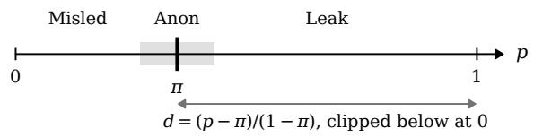  
Figure 8: One entry’s posterior p against the adversary’s prior π; the shaded band is $\pi \pm \delta .$ d is 0 for any posterior at or below the prior, so L scores MISLED as it scores no change; LEAKING counts LEAK, DISCLOSING counts LEAK and MISLED.

Candidates, orders and eligibility. A check fixed in advance found the RELATIONSHIP prior too uncertain to serve as a baseline on MedQA and TAB, so RELATIONSHIP enters the endpoint on SynthPAI only. SEX has two candidates, OCCU-PATION eight drawn in equal numbers from the registry’s occupation strata with the gold value included, and RELATIONSHIP at least five. Every entry is scored under eight seeded candidate orders, the same for every system. Entries with $\pi \geq \tau \left( \tau = . 8 , \right.$ .6 and .5 for MedQA, TAB and SynthPAI) are excluded, which removes 26.2%, 27.6% and 23.2% of each corpus’s protected entries. The thresholds were frozen in the evaluation’s first phase, before any editor was scored, after inspecting the eligible share at $\tau \in \{ . 5 , . . . , . 9 \}$ For OCCUPATION and RELATIONSHIP they are mostly entries whose gold value is the adversary’s default guess: 74% of the MedQA occupation entries whose value is unemployed and every Synth-PAI relationship entry whose value is single. For SEX the letter label carries no evidence, and the two-option prior follows the adversary’s preference for the option listed first: it is close to the share of the eight orders that list the gold value first (.50 at four of eight, .62 at five, .87 at seven), so which SEX entries are excluded is set by the seeded orders, not by the value (on TAB 37% of male and 35% of female entries; on MedQA, with τ = .8, only entries with seven or eight such orders). The orders are the same for every system, so paired contrasts are unaffected, but π for SEX measures position preference rather than a belief about sex. Deciding eligibility from the balanced SEX prior instead would admit every currently excluded entry on both corpora, since that prior depends only on the letter-handle template and the position split, not on any entry’s own content, and sits within .02 of .50 for every entry we checked (post hoc; 3.2% and 36.3% of MedQA’s and TAB’s checked entries flip, none the other way). This says nothing about those entries specifically; it says the balanced prior rarely clears any reasonable τ for a two-valued attribute, by construction. A dedicated pass, scoring the newly admitted entries for the five systems Table 27 compares (0.90 USD; not read from the stored score files, which hold only the entries already eligible under the seeded prior), finds that adding them changes no verdict there, so the eligibility filter decides no comparison we report.

A bias-invariant check, and the band. We also read the adversary’s AUC for SEX, the probability that it gives a male subject a higher Pr(male) than a female one, which no shift of its bias changes. On MedQA SACC lowers it as far as the global ladder and further than global masking and SACC-mask (Table 22). On TAB the aggregate AUC mixes two readings (Table 25): .98 for each judgment’s first-named subject and .32 for the others, whose predicted sex follows the first-named subject’s even when the adversary receives a surviving mention. Aggregated over both, the adversary’s SEX AUC is .532 on the input and .578 under SACC, so the aggregate does not show SACC reducing discrimination: raising an AUC of .32 towards chance on the subjects the adversary reads through someone else counts as an increase. The interpretable reading is that of the first-named subjects, where SACC lowers its input’s L by .246 [+.161, +.333], DIS-CLOSING by .079, LEAKING by .147 and the AUC from .98 to .62, a paired difference of +.363 (99% interval [+.182, +.563]). The DISCLOSING and LEAKING readings do not depend on the band: at δ = .02 and .10 every contrast of Table 27 that separates at .05 still separates.

References shared within a judgment. The rulebuilt reference names a subject by the longest cuefree mention that survives, and on TAB that mention is often a role. In 73 of the 244 TAB SEX entries, in 33 judgments, another subject of the same judgment receives the same reference, 40 times “the applicant”, so the question cannot single out the person asked about; 22 of these entries are female, against 57 of the 244. Leaving them out raises SACC’s reduction of its input’s SEX L from .239 to .280 on the stored scores (seeded orders) and from .262 to .304 on the order-balanced reading; the DISCLOSING reduction stays separable, and every comparison with the global editors keeps its sign (Table 21). The shared references dilute the measured reduction; they do not produce it.

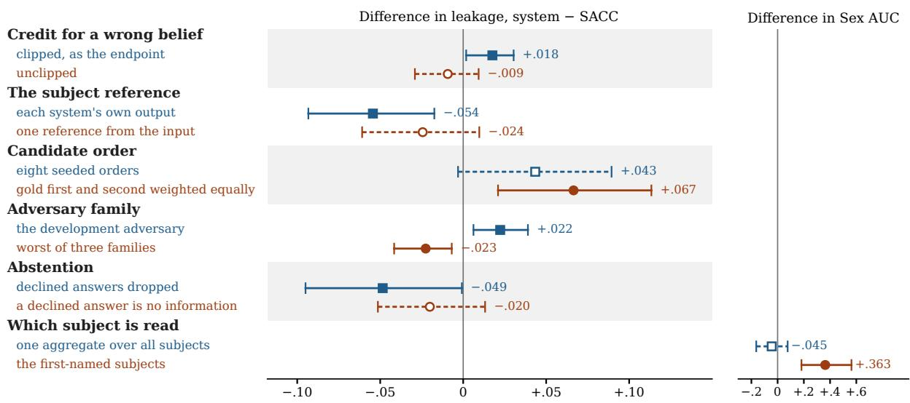  
Figure 9: Illustrative effects of six protocol choices. Each panel compares two readings of one contrast; filled markers and solid 99% intervals indicate separation from zero. Examples were selected post hoc, not sampled to estimate frequency; content proxies have no paired verdict contrast. Sources: Tables 49 (clipped vs. signed), 27 and 54 (reference, adversary), 24 (order), 21 (subject) and 53 (abstention). The second row of the reference panel and both adversary rows are read with one shared subject reference, where per-adversary intervals are reported.

<table><tr><td rowspan="2">System</td><td colspan="2">All entries</td><td colspan="2">Without shared references</td></tr><tr><td>∆L</td><td>∆DISC</td><td>∆L</td><td>∆DISC</td></tr><tr><td colspan="5">Stored scores (244 / 171 entries)</td></tr><tr><td></td><td></td><td></td><td></td><td>Anonymised input +.239 [+.155,+.330] +.137 [+.052,+.244] +.280 [+.172,+.398] +.148 [+.049,+.267]</td></tr><tr><td>Global mask</td><td></td><td></td><td></td><td>+.064[+.035,+.093] +.100 [+.016,+.197] +.057 [+.022,+.089] +.112[−.010,+.240]</td></tr><tr><td>Global ladder</td><td></td><td></td><td></td><td>−.009[−.038,+.021] +.037[−.026,+.107] −.020[−.050,+.009] +.043[−.033,+.125]</td></tr><tr><td>SACC-mask</td><td></td><td></td><td></td><td>+.044[+.018,+.075] +.061 [−.016,+.150] +.040 [+.013,+.068] +.061 [−.038,+.167]</td></tr><tr><td colspan="5">Order-balanced reading (195 / 169 entries)</td></tr><tr><td></td><td></td><td>Anonymised input +.262[+.173,+.365] +.147 [+.048,+.257] +.304 [+.196,+.429] +.131 [+.025,+.244]</td><td></td><td></td></tr><tr><td>Global mask</td><td></td><td>+.061 [+.031,+.094] +.101 [+.018,+.192] +.058 [+.027,+.090] +.109[+.008,+.215]</td><td></td><td></td></tr><tr><td>Global ladder</td><td></td><td></td><td></td><td>−.017[−.046,+.012] +.031[−.041,+.107] −.022[−.054,+.006] +.011 [−.065,+.090]</td></tr><tr><td>SACC-mask</td><td></td><td></td><td>+.052[+.023,+.087] +.059[−.004,+.133] +.047 [+.021,+.076] +.058[−.008,+.150]</td><td></td></tr></table>

Table 21: TAB SEX with and without shared subject references. The 73 of 244 ambiguous entries are excluded using the input’s reference, identically across systems. Stored and order-balanced cohorts are shown separately. ∆: system minus SACC; positive means more leakage. Brackets: 99% intervals; bold excludes zero. The split is post hoc.

The order-balanced reading. The seeded orders are not balanced by position, and the eligibility threshold keeps entries whose gold value is listed first in few of them, so the retained SEX entries carry a position preference that depends on the gold value. The main tables therefore re-read every order’s probability from the request cache and weight the orders listing the gold value first and second equally, for prior and posterior (the balanced prior is .50 for both values on every corpus). Table 22 gives the SEX-only measures on the entries reproduced for every system; the seeded reading changes no verdict of the main tables but TAB’s LEAKING (Tables 23 and 24). Re-read scores reproduce the stored ones for 98% to 99.5% of MedQA entries and 90% to 96% of TAB’s; the rest are identical requests whose cached reply a later pass replaced, as the service’s log-probabilities drift between sessions (by more than .01 on at most 13 entries per system and corpus). A pre-specified prediction that balancing alone would make TAB’s aggregate SEX measure informative failed; the subject-position split, made afterwards, explains why.

On the main tables’ cohort the re-read prior reproduces the stored one on 1,498 of 1,506 MedQA, 236 of 240 TAB and 53 of 54 SynthPAI SEX entries; 7 and 4 entries with all orders on one side leave the SEX cohort.

Stricter thresholds. Score files hold only eligible entries, so a looser threshold cannot be read

<table><tr><td></td><td colspan="5">MedQA (1,478)</td><td colspan="5">TAB (193)</td></tr><tr><td>System</td><td>AUC</td><td>∆AUC</td><td>∆L</td><td>∆DISC</td><td>∆LEAK</td><td>AUC</td><td>∆AUC</td><td>∆L</td><td>∆DISC</td><td>∆LEAK</td></tr><tr><td>Anonymised input</td><td>.891</td><td> $+ . 1 5 8 [ + . 1 3 0 , + . 1 8 5 ]$ </td><td> $+ . 4 1 3 [ + . 3 8 3 , + . 4 4 4 ]$ </td><td> $+ . 1 7 4 \scriptstyle [ + . 1 4 5 , + . 2 0 3 ]$ </td><td> $+ . 2 7 5 \left[ + . 2 4 2 , + . 3 0 8 \right]$ </td><td></td><td> $. 5 3 2 \ - . 0 4 5 \ [ - . 1 6 3 , + . 0 7 6 ]$ </td><td> $+ . 2 5 3 [ + . 1 6 4 , + . 3 6 2 ]$ </td><td> $+ . 1 5 0 _ { \ : [ + . 0 4 3 , + . 2 6 9 ] }$ </td><td> $\mathbf { + . 1 0 3 } _ { [ + . 0 0 3 , + . 2 1 6 ] }$ </td></tr><tr><td>Global mask</td><td>.741</td><td> $+ . 0 0 7 \left[ - . 0 0 8 , + . 0 2 2 \right]$ </td><td>+.057 [+.042,+.072]</td><td>+.082 [+.055,+.110]</td><td> $+ . 0 4 5 _ { \ : [ + . 0 2 2 , + . 0 7 1 ] }$ </td><td>.577</td><td> $- . 0 0 1 \left[ - . 0 7 0 , + . 0 5 5 \right]$ </td><td> $\mathbf { + . 0 6 2 } \left[ + . 0 3 2 , + . 0 9 6 \right]$ </td><td>+.103 [+.016,+.203]</td><td> $\mathbf { + . 0 5 2 } _ { [ + . 0 1 2 , + . 1 0 2 ] }$ </td></tr><tr><td>Global ladder</td><td>.734</td><td> $. 0 0 0 [ - . 0 0 9 , + . 0 0 8 ]$ </td><td> $- . 0 0 4 [ - . 0 1 5 , + . 0 0 5 ]$ </td><td>−.001 [−.018,+.016]</td><td> $- . 0 0 4 [ - . 0 1 7 , + . 0 1 0 ]$ </td><td>.557</td><td> $- . 0 2 1 \left[ - . 0 7 9 , + . 0 4 3 \right]$ </td><td></td><td> $- . 0 1 6 [ - . 0 4 7 , + . 0 1 3 ] + . 0 3 2 [ - . 0 4 0 , + . 1 1 6 ]$ </td><td> $+ . 0 0 7 \left[ - . 0 3 4 , + . 0 6 0 \right]$ </td></tr><tr><td>SACC-mask</td><td>.743</td><td> $+ . 0 0 9 [ - . 0 0 5 , + . 0 2 3 ]$ </td><td> $\mathbf { + . 0 6 1 } \left[ + . 0 4 7 , + . 0 7 5 \right]$ </td><td>+.085 [+.059,+.113]</td><td> $\pm . 0 4 9 _ { \ : [ + . 0 2 7 , + . 0 7 2 ] }$ </td><td>.604</td><td> $+ . 0 2 6 [ - . 0 2 5 , + . 0 8 9 ]$ </td><td></td><td>+.053 [+.023,+.091] +.060 [−.002,+.143] +.057 [+.003,+.124]</td><td></td></tr><tr><td>Global, person nouns</td><td>.730</td><td>-.004[−.009, .000] −.008 [−.017,−.001] −.004[−.012,+.002] −.006 [−.014,−.001]</td><td></td><td></td><td></td><td>.543 .578</td><td></td><td></td><td></td><td></td></tr><tr><td>SACC</td><td colspan="8">.734</td><td></td><td></td><td></td></tr></table>

Table 22: Balanced-order SEX evaluation under the development adversary. Eight candidate orders are reweighted equally by gold-first versus gold-second position for prior and posterior. AUC measures SEX discrimination; ∆ is system minus SACC. Brackets: 99% intervals; bold excludes zero (positive ∆AUC means greater discrimination). Only entries with reproducible cached scores and both gold-first and gold-second orders are used. The person-noun editor’s TAB paired contrasts were not computed.

<table><tr><td></td><td colspan="6">MedQA</td><td colspan="6">TAB</td></tr><tr><td>System</td><td>L↓</td><td>DISC↓</td><td> $\mathrm { L E A K } \downarrow$ </td><td> $U _ { \mathrm { n l i } } \uparrow$ </td><td>TPS</td><td>Edit%</td><td>L↓</td><td>DISC↓</td><td> $\mathrm { L E A K } \downarrow$ </td><td> $U _ { \mathrm { n l i } } \uparrow$ </td><td>TPS</td><td>Edit%</td></tr><tr><td>Anonymised input</td><td>.842</td><td>.990</td><td>.871</td><td>.720</td><td>1.000</td><td>0.0</td><td>.556</td><td>.867</td><td>.642</td><td>.313</td><td>1.000</td><td>0.0</td></tr><tr><td>Global mask</td><td>.653</td><td>.931</td><td>.741</td><td>.661</td><td>.795</td><td>2.4</td><td>.444</td><td>.848</td><td>.634</td><td>.291</td><td>.803</td><td>2.9</td></tr><tr><td>Global ladder</td><td>.628</td><td>.898</td><td>.723</td><td>.702</td><td>.842</td><td>1.4</td><td>.408</td><td>.800</td><td>.603</td><td>.296</td><td>.801</td><td>1.9</td></tr><tr><td>INTACT (Pilán et al., 2025)</td><td>.853</td><td>.991</td><td>.879</td><td>.737</td><td>.806</td><td>2.7</td><td>.576</td><td>.885</td><td>.661</td><td>.293</td><td>.770</td><td>5.0</td></tr><tr><td>Adaptive (Loiseau et al., 2026)†</td><td>.595</td><td>.908</td><td>.696</td><td>.467</td><td>.772</td><td>51.7</td><td>.598</td><td>.886</td><td>.660</td><td>.287</td><td>.781</td><td>5.5</td></tr><tr><td>SACC-mask</td><td>.659</td><td>.937</td><td>.749</td><td>.665</td><td>.794</td><td>2.2</td><td>.446</td><td>.817</td><td>.620</td><td>.319</td><td>.795</td><td>1.2</td></tr><tr><td>SACC</td><td>.636</td><td>.901</td><td>.728</td><td>.706</td><td>.846</td><td>1.3</td><td>.423</td><td>.792</td><td>.599</td><td>.319</td><td>.845</td><td>0.8</td></tr><tr><td>LLM rewrite†</td><td>.609</td><td>.910</td><td>.721</td><td>.661</td><td>.802</td><td>2.8</td><td>.436</td><td>.803</td><td>.620</td><td>.297</td><td>.793</td><td>2.1</td></tr></table>

Table 23: Table 3 with SEX read under the eight seeded candidate orders, as first pre-specified. Privacy is scored on the 2,093, 505 and 351 entries every unmarked system shares; †: scored on other entries, Adaptive on those where it gives the adversary $\mathrm { S A C C } \mathrm { \ ' } _ { \mathrm { s } }$ subject reference and the LLM rewrite on its own sample (Appendix I). Underlined: the two best per privacy and $U _ { \mathrm { n l i } }$ column among unmarked systems (TPS and Edit% are levels); grey: the LLM rewrite, which calls a language model on every document it edits.

<table><tr><td rowspan="2"> $\mathrm { S y s t e m - S A C C }$ </td><td colspan="3">MedQA</td><td colspan="3">TAB</td></tr><tr><td> $\Delta L$ </td><td>∆DISC</td><td> $\Delta \mathrm { L E A K }$ </td><td> $\Delta L$ </td><td>∆DISC</td><td>∆LEAK</td></tr><tr><td>Anonymised input</td><td> $+ . 2 0 7 [ + . 1 9 2 , + . 2 2 2 ]$ </td><td> $\mathbf { + . 0 9 2 } \left[ + . 0 7 6 , + . 1 0 8 \right]$ </td><td> $+ . 1 4 4 [ + . 1 2 5 , + . 1 6 4 ]$ </td><td> $+ . 1 3 3 [ + . 0 9 0 , + . 1 7 9 ]$ </td><td> $+ . 0 7 5 _ { } [ + . 0 3 3 , + . 1 2 2 ]$ </td><td>+.043 [−.003,+.089]</td></tr><tr><td>Global mask</td><td> $\mathbf { + . 0 1 8 } _ { [ + . 0 0 2 , + . 0 3 0 ] }$ </td><td> $+ . 0 3 3 _ { } [ + . 0 1 3 , + . 0 5 3 ]$ </td><td> $+ . 0 1 6 [ - . 0 0 2 , + . 0 3 2 ]$ </td><td> $+ . 0 2 1 [ - . 0 3 1 , + . 0 5 1 ]$ </td><td> $+ . 0 5 7 [ - . 0 1 4 , + . 1 2 3 ]$ </td><td> $+ . 0 3 6 [ - . 0 3 0 , + . 0 9 8 ]$ </td></tr><tr><td>Global ladder</td><td> $- . 0 0 8 [ - . 0 2 1 , + . 0 0 3 ]$ </td><td> $- . 0 0 3 \left[ - . 0 1 6 , + . 0 0 8 \right]$ </td><td> $- . 0 0 5 \left[ - . 0 1 8 , + . 0 0 5 \right]$ </td><td> $- . 0 1 5 \left[ - . 0 7 0 , + . 0 1 6 \right]$ </td><td> $+ . 0 0 9 [ - . 0 5 1 , + . 0 5 4 ]$ </td><td> $+ . 0 0 4 [ - . 0 5 9 , + . 0 4 7 ]$ </td></tr><tr><td>INTACT (Pilán et al., 2025)</td><td> $+ . 2 1 8 [ + . 1 9 7 , + . 2 3 8 ]$ </td><td> $\mathbf { + . 0 9 1 } _ { [ + . 0 7 2 , + . 1 0 9 ] }$ </td><td> $+ . 1 5 1 [ + . 1 2 8 , + . 1 7 3 ]$ </td><td> $+ . 1 5 3 _ { \scriptscriptstyle { [ + . 1 0 7 , + . 2 0 2 ] } }$ </td><td> $+ . 0 9 4 _ { \left[ + . 0 3 8 , + . 1 6 4 \right] }$ </td><td> $\mathbf { + . 0 6 2 } \ [ + . 0 0 5 , + . 1 2 7 ]$ </td></tr><tr><td>Adaptive (Loiseau et al., 2026)</td><td> $- . 0 0 2 [ - . 0 4 7 , + . 0 4 4 ]$ </td><td> $+ . 0 0 4 [ - . 0 3 3 , + . 0 3 5 ]$ </td><td> $+ . 0 1 8 [ - . 0 3 4 , + . 0 7 0 ]$ </td><td> $+ . 1 8 1 [ + . 1 2 8 , + . 2 4 8 ]$ </td><td> $+ . 0 9 2 _ { } [ + . 0 3 8 , + . 1 6 0 ]$ </td><td> $\mathbf { + . 0 6 2 } \left[ + . 0 0 6 , + . 1 3 0 \right]$ </td></tr><tr><td>SACC-mask</td><td> $\pm . 0 2 4 \left[ + . 0 1 2 , + . 0 3 5 \right]$ </td><td> $+ . 0 3 9 _ { \left[ + . 0 2 2 , + . 0 5 5 \right] }$ </td><td> $\pm . 0 2 4 \left[ + . 0 1 0 , + . 0 3 8 \right]$ </td><td> $\mathbf { + . 0 2 2 } \left[ + . 0 0 6 , + . 0 3 9 \right]$ </td><td>+.025 [  $. 0 1 4 , + . 0 7 2 ]$ </td><td>+.021 [  $. 0 1 7 , + . 0 6 7 ]$ </td></tr><tr><td>LLM rewrite</td><td>−.026[−.052,−.003]</td><td> $+ . 0 1 3 [ - . 0 1 2 , + . 0 3 5 ]$ </td><td></td><td>-.004[−.028,+.021] +.005[−.061,+.072] +.014[−.064,+.085] +.010[−.067,+.084]</td><td></td><td></td></tr></table>

Table 24: Table 27 with SEX read under the eight seeded candidate orders, as first pre-specified. 99% intervals; bold excludes zero.

<table><tr><td></td><td colspan="4">First-named subject (157 entries, 98 SEX)</td><td colspan="3">Other subjects (348 entries, 146 SEX)</td></tr><tr><td>System</td><td>AUC</td><td> $\Delta L , \mathrm { S E X }$ </td><td> $\Delta L$ </td><td> $\Delta \mathrm { L E A K }$ </td><td>AUC</td><td> $\mathbf { A U C } _ { A }$ </td><td> $\Delta L$ </td></tr><tr><td>Anonymised input .979 [.928,1.00]</td><td></td><td> $+ . 4 8 0 [ + . 3 0 5 , + . 6 5 1 ]$ </td><td> $+ . 2 4 6 [ + . 1 6 1 , + . 3 3 3 ]$ </td><td> $+ . 1 4 7 \ [ + . 0 5 7 , + . 2 4 1 ]$ </td><td>.320</td><td>.988</td><td> $\mathbf { + . 0 8 2 } \left[ + . 0 4 0 , + . 1 2 5 \right]$ </td></tr><tr><td>Global mask</td><td>.668 [.435,.869]</td><td> $\mathbf { + . 0 5 9 } _ { [ + . 0 0 4 , + . 1 2 1 ] }$ </td><td> $- . 0 2 0 [ - . 1 4 8 , + . 0 5 2 ]$ </td><td> $- . 0 3 3 [ - . 1 5 5 , + . 0 7 2 ]$ </td><td>.425</td><td>.738</td><td> $\mathbf { + . 0 3 7 } \left[ + . 0 1 0 , + . 0 6 6 \right]$ </td></tr><tr><td>Global ladder</td><td>.592 [.354,.810]</td><td> $- . 0 1 5 [ - . 0 5 8 , + . 0 3 9 ]$ </td><td> $- . 0 5 1 \left[ - . 1 8 2 , + . 0 1 5 \right]$ </td><td> $- . 0 3 4 [ - . 1 7 4 , + . 0 6 2 ]$ </td><td>.375</td><td>.707</td><td> $- . 0 0 5 [ - . 0 3 2 , + . 0 1 8 ]$ </td></tr><tr><td>SACC-mask</td><td>.666[.475,.839]</td><td> $+ . 0 3 2 \left[ - . 0 0 6 , + . 0 6 8 \right]$ </td><td></td><td> $+ . 0 1 3 \ [ - . 0 1 3 , + . 0 3 4 ] + . 0 1 6 \ [ - . 0 2 2 , + . 0 8 4 ]$ </td><td>.425</td><td>.777</td><td> $+ . 0 2 0 [ - . 0 0 4 , + . 0 4 2 ]$ </td></tr><tr><td>SACC</td><td>.616[.398,.812]</td><td></td><td></td><td></td><td>.378</td><td>.744</td><td></td></tr></table>

Table 25: TAB by subject position under the development adversary (stored scores, seeded orders; post hoc). AUC measures discrimination for the queried subject; $\mathbf { A U C } _ { A }$ scores other subjects’ predictions against the first-named subject’s sex (61% share that sex). Only 14 of the 98 first-named SEX entries are female. $\Delta$ is system minus SACC on SEX or the full endpoint; brackets are 99% intervals, and bold excludes zero.

from them; stricter ones can, and they leave the comparisons of Table 27 in place (Table 26): SACC lowers its input’s $L$ separably at every threshold, no global editor becomes separably more private, and the LLM rewrite’s MedQA lead keeps its sign, separable only from $\tau = . 7$ up.
<table><tr><td>Corpus</td><td>T</td><td>Entries Input</td><td></td><td>Gl. mask Gl. ladder SACC-mask LLM</td><td></td><td></td><td></td></tr><tr><td>MedQA .5</td><td></td><td>1,097 +.207</td><td></td><td>+.027</td><td>-.005</td><td>+.031</td><td>-.019</td></tr><tr><td>MedQA .6</td><td></td><td>1,435 +.203</td><td></td><td>+.022</td><td>-.006</td><td>+.027</td><td>-.025</td></tr><tr><td>MedQA .7</td><td></td><td>1,871+.204</td><td></td><td>+.018</td><td>-.007</td><td>+.025</td><td>-.027</td></tr><tr><td>MedQA .8*</td><td></td><td>2,156 +.207</td><td></td><td>+.018</td><td>-.008</td><td>+.024</td><td>-.026</td></tr><tr><td>TAB</td><td>.5</td><td></td><td>421+.141</td><td>+.021</td><td>-.017</td><td>+.021</td><td>+.001</td></tr><tr><td>TAB</td><td>.6*</td><td></td><td>505 +.133</td><td>+.021</td><td>-.015</td><td>+.022</td><td>+.005</td></tr></table>

Table 26: $\Delta L ,$ system minus SACC, keeping only entries whose development-adversary prior is below $\tau ; { * }$ the frozen threshold. Entries: SACC’s eligible entries at τ, each contrast on those the system shares (at the frozen threshold every unmarked system shares 2,093 and 505 entries under the seeded reading and 2,149 and 501 under the order-balanced reading of Table 3). Bold estimates exclude zero (99%). The LLM rewrite is scored on its own documents.

Equivalence, power and the mean of three corpora. A contrast whose 99% interval covers zero is not evidence that two systems are equal. For each such contrast of Table 27, Table 28 gives the smallest difference the comparison would detect with 80% power and whether its 98% interval (two one-sided tests at .01) lies within ±.02. On MedQA the global ladder is narrowly equivalent to SACC on all three measures; no other null comparison is. On TAB the detectable differences are .04 to .09, so its null comparisons are statements about power. Table 29 gives the mean-of-three columns of Table 3 as paired differences with intervals: averaged over the corpora, SACC is more private than global masking on DISCLOSING only, is not separable from the global ladder on any privacy measure, and keeps more content than both.

Documents the selection rule was designed on. The selection rule was designed while reading a regression subset of 60 MedQA, 53 TAB and 60 SynthPAI documents and first confirmed, in a prespecified run, on the remaining documents. Later rounds (the rewrite table, the agreement setting and both rounds of fixes) used every document, so the rest is not a held-out split, but nobody wrote the selection rule while reading it. Under the development adversary, SACC lowers its input’s L on the rest by .208 on MedQA, .114 on TAB and .123 on SynthPAI (99% intervals [.190, .225], [.064, .172], [.038, .208]), against .205, .161 and .105 on the regression subset; no difference between the two is separable, the largest being TAB’s $- . 0 4 7 \left( \left[ - . 1 4 0 , + . 0 4 2 \right] \right)$ .

Computing the measures. For a per-entry score $f ,$ which is d for L, $1 [ p > \pi + \delta ]$ for LEAKING and $\mathbf { 1 } [ | p - \pi | > \delta ]$ for DISCLOSING, and a corpus whose measures cover the attributes $A _ { c } ,$

$$
\bar { f } = \frac { 1 } { | A _ { c } | } \sum _ { a \in A _ { c } } \frac { 1 } { | \Sigma _ { a } | } \sum _ { \sigma \in \Sigma _ { a } } \frac { 1 } { | E _ { a \sigma } | } \sum _ { e \in E _ { a \sigma } } f ( e ) ,
$$

where $\Sigma _ { a }$ are the panel’s strata of attribute a and $E _ { a \sigma }$ the eligible entries in stratum $\sigma .$ Every stratum of an attribute weighs the same, whatever its size.

Intervals and non-inferiority. A paired difference between two systems is computed on the entries both are scored on. Each bootstrap draw resamples documents with replacement, gives every entry the weight of its document, recomputes $\bar { f }$ for both systems and takes the difference; a stratum absent from a draw drops out of that draw’s mean. We use 4,000 draws with seed 0 and report the percentile interval. SACC is non-inferior to a system at margin m when the upper end of the two-sided 99% interval of $L ( S A C C ) - L ( \mathrm { s y s t e m } )$ lies below m; the margin is the pre-specified minimum meaningful effect, $m = . 0 2$

Multiple comparisons. Table 27 holds 42 paired comparisons. Treated as one family, with two-sided p-values from the normal approximation to each bootstrap distribution and Holm’s step-down correction, 17 of the 21 differences whose 99% interval excludes zero remain significant at the familywise .01 level and 18 at .05. The differences that do not survive at .05 are those of the LLM rewrite on MedQA (L), INTACT on TAB (LEAKING) and Adaptive on TAB (LEAKING); at .01, those of global masking on MedQA (L) are also lost.

Rewriting systems and the subject reference. Adaptive paraphrases the whole document and deletes the patient’s mention in most MedQA vignettes, so its adversary receives a generic reference on about seven entries in ten, against two in ten under SACC; such references lower the posterior by .18 to .30 within each system (Table 30). Its lower clipped leakage score L over all MedQA entries $( \Delta L = - . 0 5 4 )$ is not separable once every system is scored with one reference built from the input (Appendix R), whereas its content score, a third below SACC’s, does not depend on the reference at all.

<table><tr><td rowspan="2"> $\mathrm { S y s t e m - S A C C }$ </td><td colspan="3">MedQA</td><td colspan="3">TAB</td></tr><tr><td>∆L</td><td>∆DISC</td><td>∆LEAK</td><td> $\Delta L$ </td><td>∆DISC</td><td>∆LEAK</td></tr><tr><td>Anonymised input</td><td> $+ . 2 0 7 \left[ + . 1 9 1 , + . 2 2 3 \right]$ </td><td> $\mathbf { + . 0 9 1 } _ { } [ + . 0 7 5 , + . 1 0 7 ]$ </td><td> $+ . 1 4 2 [ + . 1 2 4 , + . 1 6 1 ]$ </td><td> $+ . 1 4 5 [ + . 1 0 0 , + . 1 9 1 ]$ </td><td> $+ . 0 7 7 \left[ + . 0 3 2 , + . 1 2 8 \right]$ </td><td> $+ . 0 6 7 \left[ + . 0 2 1 , + . 1 1 3 \right]$ </td></tr><tr><td>Global mask</td><td> $\mathbf { + . 0 1 8 } _ { [ + . 0 0 2 , + . 0 3 1 ] }$ </td><td> $+ . 0 3 5 _ { \scriptscriptstyle { [ + . 0 1 2 , + . 0 5 3 ] } }$ </td><td>+.017[−.001,+.033]</td><td> $+ . 0 2 0 [ - . 0 3 3 , + . 0 5 0 ]$ </td><td> $+ . 0 5 6 [ - . 0 2 1 , + . 1 2 0 ]$ </td><td> $+ . 0 2 5 [ - . 0 3 9 , + . 0 7 7 ]$ </td></tr><tr><td>Global ladder</td><td> $- . 0 0 7 \left[ - . 0 2 1 , + . 0 0 3 \right]$ </td><td></td><td></td><td>-.005 [−.020,+.007] −.006[−.019,+.004] −.016[−.072,+.016]</td><td> $+ . 0 1 0 [ - . 0 5 6 , + . 0 5 9 ]$ </td><td> $. 0 0 0 [ - . 0 6 4 , + . 0 4 6 ]$ </td></tr><tr><td>INTACT (Pilán et al., 2025)</td><td> $+ . 2 1 7 \left[ + . 1 9 6 , + . 2 3 8 \right]$ </td><td> $\mathbf { + . 0 8 9 } _ { [ + . 0 6 9 , + . 1 0 7 ] }$ </td><td> $+ . 1 4 9 _ { \left[ + . 1 2 6 , + . 1 7 2 \right] }$ </td><td> $+ . 1 6 5 [ + . 1 1 7 , + . 2 1 4 ]$ </td><td> $+ . 1 0 0 [ + . 0 4 8 , + . 1 6 2 ]$ </td><td> $\mathbf { + . 0 8 6 } [ + . 0 2 7 , + . 1 4 8 ]$ </td></tr><tr><td>Adaptive (Loiseau et al., 2026)</td><td> $- . 0 0 1 \left[ - . 0 4 6 , + . 0 4 5 \right]$ </td><td> $+ . 0 0 9 [ - . 0 2 5 , + . 0 4 2 ]$ </td><td> $+ . 0 2 0 [ - . 0 3 1 , + . 0 7 2 ]$ </td><td> $+ . 1 9 3 _ { [ + . 1 3 9 , + . 2 6 0 ] }$ </td><td> $+ . 0 9 2 \ [ + . 0 3 8 , + . 1 5 7 ]$ </td><td> $+ . 0 8 4 [ + . 0 2 7 , + . 1 5 1 ]$ </td></tr><tr><td>SACC-mask</td><td> $\pm . 0 2 4 \left[ + . 0 1 1 , + . 0 3 5 \right]$ </td><td> $\mathbf { + . 0 4 0 } _ { [ + . 0 2 1 , + . 0 5 7 ] }$ </td><td> $\mathbf { + . 0 2 2 } \left[ + . 0 0 9 , + . 0 3 6 \right]$ </td><td> $\pm . 0 2 4 \ [ + . 0 0 7 , + . 0 4 2 ]$ </td><td> $+ . 0 2 2 \left[ - . 0 0 8 , + . 0 6 0 \right]$ </td><td> $+ . 0 2 1 [ - . 0 0 5 , + . 0 4 9 ]$ </td></tr><tr><td>LLM rewrite</td><td> $- . 0 2 6 [ - . 0 5 2 , - . 0 0 3 ]$ </td><td> $+ . 0 1 8 [ - . 0 0 7 , + . 0 4 1 ]$ </td><td> $+ . 0 0 1 [ - . 0 2 5 , + . 0 2 5 ]$ </td><td> $+ . 0 0 1 [ - . 0 6 4 , + . 0 6 3 ]$ </td><td> $. 0 2 2 [ - . 0 9 3 , + . 0 3 9 ]$ </td><td> $. 0 0 3 [ - . 0 7 3 , + . 0 6 6 ]$ </td></tr></table>

Table 27: System minus SACC on the entries both share (Adaptive: same-reference entries, a different cohort from the levels of Table 3, which therefore need not subtract to these differences), SEX read under balanced orders; positive: the system leaks more. 99% intervals; bold excludes zero; intervals covering zero can hide differences up to about .02 on MedQA, .07 for the two systems scored on their own entries, and .04 to .09 on TAB (Table 28).

<table><tr><td rowspan="2">System – SACC</td><td colspan="3">MedQA</td><td colspan="3">TAB</td></tr><tr><td>L</td><td>DISC LEAK</td><td></td><td>L</td><td></td><td>DISC LEAK</td></tr><tr><td>Global mask</td><td>sep.</td><td>sep.</td><td></td><td></td><td> $+ . 0 2 2 \ + . 0 5 3 \ + . 0 9 3 \ + . 0 7 5$ </td><td></td></tr><tr><td>Global ladder Adaptive†</td><td></td><td>+.016 +.017 +.016 +.056 +.074 +.067</td><td>+.061 +.045 +.069</td><td></td><td></td><td></td></tr><tr><td>SACC-mask</td><td></td><td></td><td></td><td>sep.</td><td>sep.</td><td>sep.  $+ . 0 4 5 + . 0 3 6$ </td></tr><tr><td></td><td></td><td>sep. sep. sep.</td><td></td><td>sep.</td><td></td><td></td></tr><tr><td>LLM rewrite†</td><td></td><td>sep. +.032 +.033 +.081</td><td></td><td></td><td></td><td> $+ . 0 8 6 ~ + . 0 9 1$ </td></tr></table>

Table 28: Minimum detectable difference (80% power, two-sided α = .01, from the bootstrap standard error) of each contrast of Table 27 whose interval covers zero; sep.: the interval excludes zero. Bold: shown equivalent within ±.02 (98% interval, two one-sided tests at .01).
<table><tr><td>System — SACC</td><td>∆L</td><td>∆DISC</td><td>∆LEAK</td><td>∆Unli</td></tr><tr><td>Anonymised input</td><td>+.156[+.130,+.184]</td><td>+.085[+.061,+.111]</td><td> $+ . 1 0 3 _ { [ + . 0 7 7 , + . 1 3 0 ] }$ </td><td> $+ . 0 0 3 [ - . 0 0 2 , + . 0 0 7 ]$ </td></tr><tr><td>Global mask</td><td>+.010[−.009,+.022]</td><td> $+ . 0 2 6 [ - . 0 0 3 , + . 0 5 0 ]$ </td><td></td><td>+.010[−.016,+.030] −.024[−.029,−.019]</td></tr><tr><td>Global ladder</td><td>+.003[−.022,+.026]</td><td> $+ . 0 1 8 [ - . 0 1 2 , + . 0 4 5 ]$ </td><td>+.011[−.019,+.038]</td><td>-.008[−.013,−.004]</td></tr><tr><td>INTACT</td><td>+.164[+.136,+.193]</td><td>+.094[+.067,+.124]</td><td>+.112[+.082,+.143]</td><td>−.002[−.010,+.006]</td></tr><tr><td>Adaptive†</td><td>+.092 [+.055,+.132]</td><td> $+ . 0 5 7 _ { \left[ + . 0 2 3 , + . 0 9 2 \right] }$ </td><td>+.061 [+.024,+.098]</td><td></td></tr><tr><td>SACC-mask</td><td>+.016[+.009,+.023]</td><td>+.021 [+.008,+.035]</td><td>+.014[+.004,+.025]</td><td> $- . 0 1 4 _ { [ - . 0 1 7 , - . 0 1 0 ] }$ </td></tr><tr><td>LLM rewrite†</td><td></td><td></td><td>−.018[−.063,+.025] +.015[−.028,+.055] −.011[−.062,+.036]-</td><td> $\mathbf { \delta } _ { - } \mathbf { 0 7 0 } \left[ - . 0 8 3 , - . 0 5 6 \right]$ </td></tr></table>

Table 29: Mean over MedQA, TAB and SynthPAI of each paired difference, system minus SACC, under the development adversary, SEX read under balanced orders; the three corpora’s bootstrap draws are averaged draw by draw. Privacy: positive means the system leaks more (99% intervals); $U _ { \mathrm { n l i } } { : }$ positive means it keeps more (95%). †: on its own entries as in Table 27; Adaptive’s $U _ { \mathrm { n l i } }$ is not paired on MedQA. Bold estimates exclude zero.

Subject reference. The reference is built from the released text in this order: the longest gold mention of more than three characters that survives verbatim and carries no cue, rendered as the person referred to as “. . . ”; otherwise a neutralised descriptor whose content word survives, rendered as the person the text introduces as “. . . ”; otherwise, in a single-subject document, the person this text is mainly about; otherwise a generic description of a person the text cannot name without revealing a protected attribute, which is still scored. On SynthPAI the reference is always the author of the post. Table 30 shows how often each reference type reaches the adversary on MedQA, and how much a fallback reference lowers the posterior within each system; the numbers come from the pass that scored the published Adaptive.

<table><tr><td>System</td><td></td><td></td><td>Mention Generic Main subj.</td><td>Fallback</td><td>∆p</td></tr><tr><td>SACC-mask</td><td>1,885</td><td>527</td><td>5</td><td>.220</td><td>-.303</td></tr><tr><td>SACC</td><td>1,883</td><td>529</td><td>5</td><td>.221</td><td>-.291</td></tr><tr><td>Adaptive (Loiseau et al., 2026)</td><td>714</td><td>1,126</td><td>577</td><td>.705</td><td>-.177</td></tr></table>

Table 30: Subject reference handed to the adversary on MedQA, by type, over all 2,417 scored entries. $\Delta p \mathrm { : }$ mean posterior under a fallback reference minus under a mention. From the pass that scored the published Adaptive, on the texts before both rounds (Appendix V).

Band. Re-scoring byte-identical texts on 20,208 entry pairs moves the posterior by .0012 on average (95th percentile at most .014 per corpus and family, maximum .126) and by more than δ on at most 1.8% of a corpus’s pairs, and changes the state of 0.25% of entries, so $\delta = . 0 5$ lies above the scoring noise for nearly every entry.

Utility measures. For $U _ { \mathrm { n l i } }$ , the allowed sentences are the source sentences of at least 40 characters that contain no protected cue according to a fixed cue detector that predates SACC’s binder (the subject’s mentions and the attribute lexicon, matched in the source sentences about the subject); each is the hypothesis, and the premise is a 1,200-character window of the released text centred on the median position of the sentence’s rarest content words. The cross-encoder is DeBERTa-v3-large fine-tuned for NLI (He et al., 2023), and a sentence counts as retained when entailment is the argmax. For TPS, edit regions are the character-level differences between D and the released text; the information content of an original span is its negative logprobability under BERT (Devlin et al., 2019) with the span masked and 600 characters of context on each side, and similarity is the clipped cosine of E5 embeddings (Wang et al., 2022), which replace the original metric’s sentence encoder. TPS is averaged over the documents each system edits, on every document of each corpus. With the original encoder, paraphrase-albert-small-v2, on every MedQA document, SACC’s TPS ties the global ladder’s (difference −.001, 99% interval [−.004, +.003]) and stays above every other editor’s by .10 to .16; with E5 it is above the ladder’s by .004 ([+.002, +.005]). A prediction pre-specified before that pass, that SACC would score highest with either encoder, therefore failed with the original one.

Compute. SACC runs on a CPU with a spaCy parser (Honnibal et al., 2020) and makes no model call. Llama and Qwen ran on local NVIDIA RTX A6000 cards (48 GB), which also computed $U _ { \mathrm { n l i } }$ and TPS; GPT-4o-mini was queried through the API, whose outputs can drift between sessions.

## J SynthPAI

The primary measure on SynthPAI covers SEX, OCCUPATION and RELATIONSHIP. SACC rewrites nothing on this corpus, so its output equals SACCmask; the LLM rewrite is scored on its own document sample (Table 31).

<table><tr><td>System</td><td>L</td><td></td><td>DISC LEAK</td><td> $U _ { \mathrm { n l i } }$ </td><td>∆L</td><td>∆DISC</td><td>∆LEAK</td></tr><tr><td>Anonymised input</td><td>.816</td><td>.923</td><td>.885</td><td>.777</td><td>+.112</td><td>+.089</td><td>+.101</td></tr><tr><td>Global mask</td><td>.699</td><td>.835</td><td>.783</td><td>.777</td><td>-.006</td><td>.000</td><td>-.002</td></tr><tr><td>Global ladder</td><td>.735</td><td>.884</td><td>.835</td><td>.779</td><td>+.030</td><td>+.050</td><td>+.050</td></tr><tr><td>INTACT (Pilán et al., 2025)</td><td>.813</td><td>.916</td><td>.885</td><td>.766</td><td>+.108</td><td>+.081</td><td>+.100</td></tr><tr><td>Adaptive (Loiseau et al., 2026)</td><td>.790</td><td>.905</td><td>.864</td><td>.713</td><td>+.085</td><td>+.070</td><td>+.079</td></tr><tr><td>SACC-mask</td><td>.705</td><td>.835</td><td>.785</td><td>.777</td><td>.000</td><td>.000</td><td>.000</td></tr><tr><td>SACC</td><td>.705</td><td>.835</td><td>.785</td><td>.777</td><td></td><td></td><td></td></tr><tr><td>LLM rewrite</td><td>.659</td><td>.822</td><td>.748</td><td>.627</td><td>-.029</td><td>+.001</td><td>-.008</td></tr></table>

Table 31: SynthPAI under the development adversary. $\Delta$ is system minus SACC; bold $\Delta$ estimates exclude zero; SACC is shaded.

## K Held-out Adversaries

The frozen configuration was also read under the held-out Llama-3.1-8B and Qwen3-30B-A3B (Table 32), with SACC in the light agreement setting on MedQA. SACC and SACC-mask lower L relative to the input under Qwen on every corpus and under Llama on MedQA and SynthPAI; under

Llama on TAB both reductions are positive but not separable, and the rewritten text raises that family’s LEAKING rate. The gain of rewriting over masking is separable under Qwen on both corpora, absent under Llama on MedQA and reversed under Llama on TAB (Table 33), and global masking, scored in a separate pass, reaches SACC’s leakage on most measures (Table 34). We therefore report rewriting as a configuration the development adversary selects, not one the held-out families confirm.

Table 32 gives the reduction relative to the input, input minus system, each paired within one adversary’s scoring pass; under the held-out families SACC uses the light agreement setting on MedQA. The held-out families were first scored before the full setting was chosen on MedQA, and every later held-out pass keeps the setting they used, so that SACC’s held-out numbers stay comparable across passes. On MedQA, SACC moves Llama’s entries mostly into the anonymised state and Qwen’s mostly into the misled one, though DISCLOSING improves under both. The held-out columns of Table 33 pair SACC-mask and SACC on the reported texts within one pass of each held-out family, the pass that also scores SEL+NTR, SACC’s selection with an existing gender-neutral rewriter (Appendix S).

<table><tr><td colspan="2"></td><td colspan="3">SACC-mask</td><td colspan="3">SACC</td></tr><tr><td>Corpus</td><td>Adversary</td><td>L</td><td></td><td>DISC LEAK</td><td>L</td><td></td><td>DISC LEAK</td></tr><tr><td rowspan="3">MedQA</td><td>GPT-40-mini +.183 +.053 +.120 +.207 +.092 +.144</td><td></td><td></td><td></td><td></td><td></td><td></td></tr><tr><td>Llama-3.1-8B +.160 +.056 +.071 +.160 +.052 +.079</td><td></td><td></td><td></td><td></td><td></td><td></td></tr><tr><td>Qwen3-30B</td><td></td><td></td><td></td><td></td><td></td><td>3 +.218 +.037 +.140 +.227 +.035 +.148</td></tr><tr><td rowspan="3">TAB</td><td>GPT-4o-mini</td><td></td><td></td><td></td><td></td><td>i +.111 +.050 +.022 +.133 +.075 +.043</td><td></td></tr><tr><td>Llama-3.1-8B +.049 +.075 −.092 +.028 +.003 −.150</td><td></td><td></td><td></td><td></td><td></td><td></td></tr><tr><td>Qwen3-30B</td><td></td><td></td><td></td><td></td><td></td><td>+.064 +.045 +.013 +.104 +.041 +.019</td></tr><tr><td rowspan="3"></td><td>GPT-4o-mini</td><td></td><td></td><td></td><td></td><td></td><td>i +.112 +.089 +.101 +.112 +.089 +.101</td></tr><tr><td>SynthPAI Llama-3.1-8B +.109 +.095 +.093 +.109 +.086 +.084</td><td></td><td></td><td></td><td></td><td></td><td></td></tr><tr><td>Qwen3-30B +.098 +.086 +.086 +.098 +.086 +.086</td><td></td><td></td><td></td><td></td><td></td><td></td></tr></table>

Table 32: Reduction in leakage relative to the anonymised input (input − system) under three adversaries; 99% intervals are omitted for space, and bold excludes zero.

<table><tr><td>Corpus</td><td>GPT-4o-mini</td><td>Llama-3.1-8B</td><td>Qwen3-30B</td></tr><tr><td>MedQA</td><td>+.024</td><td>.000</td><td>+.009</td></tr><tr><td>TAB</td><td>+.022</td><td>-.023</td><td>+.042</td></tr></table>

Table 33: Gain of rewriting over masking in L (SACCmask − SACC) under each adversary, paired within one scoring pass on the reported texts (light agreement setting on MedQA under the held-out families). Bold estimates exclude zero.

Table 34 gives the level of every system scored on the shared entries under the two held-out adversaries, with SACC defined as in Table 32. The global editors were scored in a different pass of each adversary from the other systems. Both passes use identical priors, and SACC-mask, scored in both, agrees across them to a mean absolute posterior difference of at most .005, so the levels are shown side by side, but no paired contrast is formed across the passes. Under the held-out adversaries SACC does not keep the position it holds under the development adversary. Global masking is at or below SACC on nearly every column; the global ladder is below it on L and LEAKING on MedQA under both families and above it on most Synth-PAI columns; and SACC-mask is below it on every TAB column under Llama but above it on L and LEAKING on MedQA under Qwen, the same dependence of the rewriting gain on the adversary as in Table 33. Under Llama on TAB, the input and INTACT have the lowest LEAKING rate of all systems: every editor raises that family’s leaking rate on that corpus.

Table 35 scores the same-input LLM rewrite under the two held-out adversaries, on its first document samples (on MedQA the 200-document one; Table 57 gives the full set) and paired with SACC on the entries both share. These are the comparisons in which the LLM rewrite is not read by its own model family. Over all entries it is not separable from SACC on L or DISCLOSING on any corpus under either family. Under Qwen on MedQA it is more private on LEAKING (−.044, 99% interval [−.103, −.003]; not tabulated) and, on the entries where both systems give the adversary the same reference, on L, with an interval that only just excludes zero; under Qwen on TAB, SACC is non-inferior to it at .02 on those entries. Elsewhere the samples are too small to decide non-inferiority either way.

GPT-4.1-mini without chain-of-thought, post hoc. After the configuration was frozen, we also read GPT-4.1-mini as a plain (no chain-of-thought) adversary, on the same 360-entries-per-corpus sample the reasoning adversary draws (Appendix R), all 8 seeded orders, five systems (anonymised input, global mask, global ladder, SACC-mask, SACC). This is the same model as that reasoning adversary, read a second way, not an additional family. On MedQA it reproduces the other families: input − SACC +.142 [+.098,+.189], separable. On TAB it does not: input − SACC −.042 [−.135,+.042], not separable, matching Llama rather than Qwen; and SACC-mask − SACC −.101 [−.165,−.042], separable and negative, reproducing Llama’s rewriting-vsmasking reversal, under a model never served locally. Two of the readings therefore show the TAB reversal, one of them through an API; Section 5 and Limitations report both readings.

## L Adversaries That Know the Rules

SACC is deterministic and its lexicon, replacement table and scope rule are published, so an adversary can know them. Two pre-specified tests give the rules to an adversary. The first gives them to classifiers: 17 counts of traces that only the editors’ rules leave, alone and with the development adversary’s score, and a TF-IDF classifier trained on the same system’s released texts, all cross-fitted by document and stacked (Table 36). The second gives them to the development adversary: each text is preceded by a description of the de-identifier and of the editor that produced it (Table 37).

On MedQA the rules give an adversary no advantage. The rule features alone cannot tell the sexes apart in any edited text (AUC .48 to .55) and add nothing to the development adversary on SACC or SACC-mask; the classifier trained on each system’s outputs infers less than the development adversary (.62 against .72 to .74). The rewrite table leaves one trace a rule-aware adversary could use, them before a noun where her was possessive: the global ladder leaves it 7.2 times per 100 female singlesubject vignettes against 0.8 per 100 male, SACC’s rewrite step 0.3 against 0.8, and neither yields a measurable gain. Under the stacked adversary, input minus SACC on AUC is +.173 [+.143, +.205], whereas SACC minus the global ladder is +.001 [−.008, +.009]. Told how each text was edited, the development adversary gives less probability to the true sex in every edited text and the same in the input. SACC’s reduction of its input grows (L .410 to .513), and it stays ahead of global masking and SACC-mask. The global ladder, whose rules reach every person, is read least and leads SACC in the editor-aware reading. Post hoc, SACC minus the ladder is +.033 [+.005, +.060] in AUC and +.075 [+.058, +.093] in L; the AUC result is the one pre-specified MedQA prediction of the two tests that failed. On L, SACC minus global mask and SACC-mask is −.111 [−.133, −.089] and −.109 [−.129, −.088], respectively (post hoc).

<table><tr><td rowspan="2">Adversary</td><td rowspan="2">System</td><td colspan="3">MedQA</td><td colspan="3">TAB</td><td colspan="3">SynthPAI</td></tr><tr><td>L</td><td>DISC</td><td>LEAK</td><td>L</td><td>DIsC</td><td>LEAK</td><td>L</td><td>DISC</td><td>LEAK</td></tr><tr><td rowspan="5">Llama-3.1-8B</td><td>Anonymised input</td><td>.665</td><td>.979</td><td>.753</td><td>.362</td><td>.867</td><td>.522</td><td>.769</td><td>.943</td><td>.941</td></tr><tr><td>Global mask</td><td>.496</td><td>.915</td><td>.673</td><td>.303</td><td>.815</td><td>.640</td><td>.653</td><td>.848</td><td>.846</td></tr><tr><td>Global ladder</td><td>.503</td><td>.927</td><td>.670</td><td>.328</td><td>.839</td><td>.684</td><td>.676</td><td>.920</td><td>.917</td></tr><tr><td>INTACT</td><td>.687</td><td>.968</td><td>.769</td><td>.363</td><td>.899</td><td>.529</td><td>.762</td><td>.933</td><td>.933</td></tr><tr><td>SACC-mask</td><td>.506</td><td>.922</td><td>.682</td><td>.313</td><td>.792</td><td>.614</td><td>.660</td><td>.848</td><td>.848</td></tr><tr><td></td><td>SACC</td><td>.506</td><td>.927</td><td>.674</td><td>.335</td><td>.864</td><td>.672</td><td>.660</td><td>.848</td><td>.848</td></tr><tr><td rowspan="6">Qwen3-30B</td><td>Anonymised input</td><td>.771</td><td>.961</td><td>.835</td><td>.518</td><td>.894</td><td>.639</td><td>.724</td><td>.937</td><td>.854</td></tr><tr><td>Global mask</td><td>.545</td><td>.920</td><td>.688</td><td>.421</td><td>.842</td><td>.588</td><td>.625</td><td>.851</td><td>.768</td></tr><tr><td>Global ladder</td><td>.531</td><td>.924</td><td>.677</td><td>.380</td><td>.825</td><td>.571</td><td>.616</td><td>.868</td><td>.784</td></tr><tr><td>INTACT</td><td>.817</td><td>.967</td><td>.860</td><td>.517</td><td>.900</td><td>.653</td><td>.713</td><td>.937</td><td>.854</td></tr><tr><td>SACC-mask</td><td>.553</td><td>.925</td><td>.696</td><td>.454</td><td>.848</td><td>.625</td><td>.626</td><td>.851</td><td>.768</td></tr><tr><td>SACC</td><td>.544</td><td>.926</td><td>.687</td><td>.414</td><td>.853</td><td>.619</td><td>.626</td><td>.851</td><td>.768</td></tr></table>

Table 34: Leakage of every system scored on the shared entries under the two held-out adversaries (lower is less leakage). Underlined: the two best in each column within an adversary. Entries per corpus: 1,719 / 1,714, 478 / 529, 350 / 333 (MedQA, TAB, SynthPAI; Llama / Qwen).
<table><tr><td>Adversary</td><td>Corpus</td><td>∆L</td><td>∆DISC</td><td>∆L, same ref.</td><td>Non-inferior at .02</td></tr><tr><td rowspan="3">Llama-3.1-8B</td><td>MedQA</td><td>-.020[−.074,+.017] -.005[−.060,+.037]</td><td></td><td>-.026[−.093,+.015]</td><td>no / no</td></tr><tr><td>TAB</td><td></td><td>+.019[−.058,+.097] +.008 [−.073,+.088]</td><td>+.048[−.032,+.128]</td><td>no /no</td></tr><tr><td>SynthPAI</td><td>-.011[-.119,+.079]</td><td>+.065[−.048,+.156]</td><td>-.011[−.119,+.079]</td><td>no /no</td></tr><tr><td rowspan="3">Qwen3-30B</td><td>MedQA</td><td>-.030[-.088,+.005]</td><td>-.003[-.068,+.062]</td><td>-.040[−.114, .000]</td><td>no / no</td></tr><tr><td>TAB</td><td></td><td>+.022[−.030,+.077] −.017[−.067,+.036] +.046[−.005,+.103]</td><td></td><td>no / yes</td></tr><tr><td>SynthPAI</td><td>-.007[−.113,+.079] +.077[−.005,+.149] -.007[−.113,+.079]</td><td></td><td></td><td>no /no</td></tr></table>

Table 35: The same-input LLM rewrite against SACC under the held-out adversaries, LLM rewrite minus SACC (negative: the LLM rewrite leaks less), on its document sample. Non-inferior: whether SACC’s deficit is shown to be below .02 on all entries / on same-reference entries. Brackets are 99% intervals. Scored on the texts before the binder fix (Appendix V).

TAB cannot answer either question: even on its input, the rule features and the development adversary rank sex below the pre-specified validity gates, since the adversary reads sex reliably only for each judgment’s first-named subject (Section 5; Appendix I). The TAB input’s AUC is .686 for the rule-feature classifier and .540 for the development adversary, both below the .80 gate; with the ruleaware prompt it is .494.

## M An Adversary With No Candidates

Every privacy number above comes from an adversary that chooses among candidates, so we prespecified an open-ended reading. Per entry the adversary receives the released text and the same subject reference as the main tables and is asked to name the attribute in one word, or UNKNOWN; there are no options and no log-probabilities, and one completion is drawn per entry and system on 400 entries per corpus sampled with a fixed seed. L needs a candidate set and is undefined here, so the measure is accuracy against the gold value under a synonym map fixed before the run, beside the share of replies naming no value, with a no-text reading as the floor (Table 38).

A pre-specified validity gate asks the input to beat that floor by .15. MedQA passes and TAB does not, so only MedQA is read, as pre-specified. There the ordering of the main tables survives an adversary with no options: both editors lower the accuracy separably, SACC is within .05 of the global ladder, and rewriting is not worse than redaction, the three pre-specified predictions. The caveat is the size of the effect, not its direction: this adversary answers at all on a quarter of the input’s entries and on under a tenth of an edited text’s, and reaches .21 accuracy on the unedited input, so most of what the editors take away is a wrong but committed answer becoming UNKNOWN. It is a check on the question format, not a second estimate of leakage, and we do not rank systems by it.

## N Two Unseen Corpora

The lexicons, rules and the one tuned setting were written on the three evaluation corpora, so we ran the frozen editor on two corpora it had not seen, each pre-specified in a dated file before its data was read: 500 encyclopaedic biographies with selfreported profession and gender labels (De-Arteaga et al., 2019) and 500 Wikipedia film plot summaries whose characters carry a gender label from a knowledge base (Bamman et al., 2013). Both keep SACC’s released configuration unchanged: the clinical register’s lexicon, the binder, the full agreement setting and the shared keep-list, and use a generic spaCy NER as upstream de-identifier with the domain phrase in the adversary’s prompts adapted for each corpus. The summaries name their characters, so the binder receives mention forms as the task defines them; the biographies name no one, so it does not. Table 39 gives the result.

<table><tr><td>System</td><td>Development</td><td>Rule features</td><td>Both</td><td>Trained on outputs</td><td>Stacked</td><td>∆, rules</td></tr><tr><td>Anonymised input</td><td>.869</td><td>.863</td><td>.885</td><td>.847</td><td>.887</td><td> $\mathbf { + . 0 1 6 } _ { } [ + . 0 0 2 , + . 0 3 0 ]$ </td></tr><tr><td>Global mask</td><td>.735</td><td>.480</td><td>.723</td><td>.616</td><td>.733</td><td> $- . 0 1 2 _ { [ - . 0 2 1 , - . 0 0 4 ] }$ </td></tr><tr><td>Global ladder</td><td>.717</td><td>.548</td><td>.711</td><td>.624</td><td>.713</td><td> $- . 0 0 7 \left[ - . 0 2 0 , + . 0 0 7 \right]$ </td></tr><tr><td>SACC-mask</td><td>.737</td><td>.491</td><td>.724</td><td>.616</td><td>.731</td><td> $- . 0 1 2 _ { [ - . 0 2 1 , - . 0 0 4 ] }$ </td></tr><tr><td>SACC</td><td>.718</td><td>.538</td><td>.718</td><td>.619</td><td>.714</td><td> $. 0 0 0 [ - . 0 1 3 , + . 0 1 2 ]$ </td></tr></table>

Table 36: Rule-aware adversaries on MedQA SEX (1,513 entries; AUC). Development: standard adversary; Rule features: logistic regression on 17 edit-rule counts; Both: their combination; Trained on outputs: TF-IDF word 1–2-grams; Stacked: all three. Fitted scores use five out-of-fold, document-level splits. $\Delta ,$ rules: Both minus Development (99% intervals; bold excludes zero).
<table><tr><td></td><td colspan="3">SEX AUC</td><td colspan="3">SEX L</td></tr><tr><td>System</td><td>Standard</td><td>Told</td><td>∆</td><td>Standard</td><td>Told</td><td>∆</td></tr><tr><td>Anonymised input</td><td>.889</td><td>.885</td><td>-.004[−.014,+.006]</td><td>.844</td><td>.850</td><td>+.006[−.001,+.014]</td></tr><tr><td>Global mask</td><td>.737</td><td>.725</td><td> $- . 0 1 2 \left[ - . 0 3 7 , + . 0 1 6 \right]$ </td><td>.489</td><td>.448</td><td>-.041[−.065,-.015]</td></tr><tr><td>Global ladder</td><td>.719</td><td>.667</td><td> $- . 0 5 2 \left[ - . 0 8 4 , - . 0 2 0 \right]$ </td><td>.428</td><td>.262</td><td>-.166[−.189,−.144]</td></tr><tr><td>SACC-mask</td><td>.739</td><td>.738</td><td> $. 0 0 0 [ - . 0 2 7 , + . 0 2 5 ]$ </td><td>.494</td><td>.446</td><td> $- . 0 4 8 \left[ - . 0 7 4 , - . 0 2 1 \right]$ </td></tr><tr><td>SACC</td><td>.719</td><td>.700</td><td> $- . 0 1 9 [ - . 0 5 3 , + . 0 1 4 ]$ </td><td>.433</td><td>.337</td><td> $- . 0 9 6 [ - . 1 2 2 , - . 0 7 1 ]$  </td></tr></table>

Table 37: Editor-aware prompting on MedQA SEX (1,513 entries). Told prefixes the frozen question with the upstream de-identifier’s and each editor’s rules. Standard and Told use matched documents, references, orders and priors, rescored in one pass (standard AUCs differ by at most .019 from stored scores in Table 36). ∆: Told minus Standard (99% intervals; bold excludes zero).

<table><tr><td></td><td colspan="2">MedQA</td><td colspan="2">TAB</td></tr><tr><td>Reading</td><td></td><td>Accuracy No answer</td><td>Accuracy</td><td>No answer</td></tr><tr><td>Anonymised input</td><td>.207</td><td>.735</td><td>.105</td><td>.780</td></tr><tr><td>Global mask</td><td>.065</td><td>.910</td><td>.040</td><td>.907</td></tr><tr><td>Global ladder</td><td>.058</td><td>.920</td><td>.060</td><td>.858</td></tr><tr><td>SACC-mask</td><td>.065</td><td>.910</td><td>.045</td><td>.890</td></tr><tr><td>SACC</td><td>.062</td><td>.915</td><td>.055</td><td>.870</td></tr><tr><td>No text</td><td>.000</td><td>1.000</td><td>.000</td><td>1.000</td></tr></table>

Table 38: An adversary given no candidates: it reads the released text and the main tables’ subject reference and names the attribute in one word, or UNKNOWN, on 400 entries per corpus (335 and 135 documents, fixed seed). Accuracy: share matching the gold value under a synonym map fixed before the run; No answer: share naming no value. L needs a candidate set and is undefined here. On MedQA, the corpus the pre-specified validity gate admits, the input exceeds SACC by +.145 [+.098,+.195], SACC the global ladder by +.005 [ .000,+.017] and SACC-mask by −.003 [−.015,+.008] (99% document bootstrap).

The main result transfers. SACC lowers its input’s leakage on both corpora, and admissible rewriting stays more private than redaction (−.016 and −.037). It edits the fewest characters of any system on both, 1.6% against the global ladder’s 1.9% and 2.8%, and on the biographies, where the content measures ran, it keeps more at the edit site than the ladder (TPS +.013 [+.011, +.015]). OCCUPATION does not transfer: the biographies profession measure moves by .004, the reach of an occupation lexicon written for two other registers. One gate failed: the NER layer masks 25% of the biographies’ characters against 12% of the summaries’, so on that corpus the content comparison with the input is compromised, and $U _ { \mathrm { n l i } }$ , whose sentences come from the source, sits at its floor for every system there.

What these corpora add is the scope trade-off of Section 6, measured where it matters. On the three evaluation corpora nearly every annotated person is protected, so editing by scope and editing globally nearly coincide. These corpora name many people a release would not protect, every person a biography mentions besides its subject and every character of a summary beyond the four its metadata names, and there the global ladder reaches lower leakage, by .030 and .089, while 14% and 29% of the cues it edits are ones the binder assigns to a person outside the protected set or to no person at all. On the summaries those are 2,000 of 7,978 edited cues, almost all other characters’ kinship and person nouns (wife 314, father 199, mother 145, husband 132, son 131). Such a noun states a protected subject’s sex by relation while describing someone else, the channel Limitations names, and on TAB two in three of the cues the binder assigns elsewhere turn out to be a protected person’s after all, so part of the ladder’s lead is an edit SACC should have made and part is content outside the release policy (next paragraph).

<table><tr><td rowspan="2">System</td><td colspan="3">Biographies</td><td colspan="3">Plot summaries</td></tr><tr><td>L</td><td>DISC</td><td>Edit%</td><td>L</td><td>DISC</td><td>Edit%</td></tr><tr><td>Anonymised input .877</td><td></td><td>.963</td><td>0.0</td><td>.577</td><td>.972</td><td>0.0</td></tr><tr><td>Global mask</td><td>.512</td><td>.792</td><td>3.3</td><td>.481</td><td>.923</td><td>5.3</td></tr><tr><td>Global ladder</td><td>.496</td><td>.763</td><td>1.9</td><td>.382</td><td>.797</td><td>2.8</td></tr><tr><td>SACC-mask</td><td>.542</td><td>.804</td><td>2.5</td><td>.508</td><td>.951</td><td>3.3</td></tr><tr><td>SACC</td><td></td><td>.526.782</td><td>1.6</td><td>.471</td><td>.893</td><td>1.6</td></tr></table>

Table 39: Frozen SACC on two corpora it was not built on, under the development adversary: 990 entries on 500 biographies (SEX, OCCUPA-TION) and 1,059 on 494 plot summaries (SEX only). Paired differences, 99% intervals: input − SACC +.351 [+.328,+.373] and +.106 [+.078,+.138]; SACC − SACCmask −.016 [−.029,−.002] and −.037 [−.060,−.013]; SACC − global ladder +.030 [+.015,+.048] and +.089 [+.063,+.116]. Of the ladder’s edited cues, 14% and 29% go to a person outside the protected set or to no person, the cues SACC leaves. Edit%: share of the input’s characters edited.

What scoping keeps, and what it misses. Neither content measure in Section 3 captures the cues that SACC leaves untouched: $U _ { \mathrm { n l i } }$ excludes all annotated subjects’ cues by construction, and TPS scores only edited spans. Table 40 reports the resulting cue population. The “another person” category is relatively rare in the evaluation panel (0.7% of MedQA lexicon matches and 8.0% of TAB’s) but common in the plot summaries (22%, or 2,000 cues). Together with non-person uses (3.8%, 34.0%, and 25.5%), this helps explain why the unseen corpora distinguish scoped from global editing more sharply than the three evaluation corpora do.

These are the binder’s classifications, not ground truth, and the two rules behind them are not equally reliable. Judged against the source text on TAB (Table 41), the non-person rule is correct on .87 of the sites it keeps, and within the selection it is the only rule that moves content in Table 11; what it moves is +.004 in $U _ { \mathrm { n l i } }$ on MedQA under masking, and on TAB the measure that moves is the one Section 3 reads as a floor. The other-person rule, the only one that reads the subject list, is correct on .32: it leaves 2.1 protected persons’ sites unedited for each site it rightly keeps, which is the overexclusion these corpora register as leakage and the audit of Table 15 already showed on a sample. So a global editor’s lower leakage here is bought partly by editing content outside the release policy and partly by making edits SACC misses, and the share of each is measured only on TAB. Turning the other-person rule off changes no measure on the benchmarks (Table 11) and would remove both the missed edits and the side channel of Limitations, at the cost of the scope the rule is for. We therefore describe it as a release policy a deployment can turn off rather than as part of the privacy mechanism, and keep it in the reported configuration because the task defines scope; an audit of the two unseen corpora remains to be done.

<table><tr><td>Corpus</td><td>Universe</td><td>Another person</td><td>Non-person</td><td>Share</td><td>Docs</td></tr><tr><td>MedQA</td><td>7,632</td><td>51</td><td>242</td><td>3.8%</td><td>39</td></tr><tr><td>TAB</td><td>2,841</td><td>227</td><td>740</td><td>34.0%</td><td>92</td></tr><tr><td>SynthPAI</td><td>134</td><td>10</td><td>1</td><td>8.2%</td><td>9</td></tr><tr><td>Biographies</td><td>1,965</td><td>149</td><td></td><td>10613.0%</td><td>112</td></tr><tr><td>Plot summaries</td><td>9,124</td><td>2,000</td><td></td><td>32725.5%</td><td>427</td></tr></table>

Table 40: The cues SACC leaves within the universe that a global mask edits (every lexicon match surviving the keep-list and overlap resolution), grouped by the binder’s decision. These cues are not captured by the automatic content measures: $U _ { \mathrm { n l i } }$ excludes every annotated subject’s cues, and TPS scores only edited spans. The counts are based on the binder’s classifications (not ground truth); Table 41 audits them on TAB.

<table><tr><td>TAB, sites SACC leaves Sites Keepable Missed Share keep. Missed/keep.</td><td></td><td></td><td></td><td></td><td></td></tr><tr><td>Non-person use</td><td>740</td><td>645</td><td>95</td><td>.872</td><td>0.15</td></tr><tr><td>Another person</td><td>214</td><td>69</td><td>145</td><td>.322</td><td>2.1</td></tr></table>

Table 41: The sites of Table 40 judged against the source text by GPT-4.1-mini (Table 16). Keepable: the judge assigns the site to no person or to one the release does not protect, so leaving it keeps content. Missed: it assigns the site to a protected person, so leaving it is an edit not made. The biographies and plot summaries are not audited, so their scope figures rest on the binder’s own labels.

## O Per-Attribute Results and the Two-Sided Reading

Table 46 gives SACC against its input per attribute (input minus SACC), with the stratum-balanced share of entries in the anonymised and misled states before and after. Table 47 compares systems with SACC per attribute, Adaptive on its same-reference entries. Table 48 counts entries in each state (δ = .05) for the attributes inside each corpus’s primary measure. On MedQA, rewriting changes the kind of protection: masking moves entries out of the leaking state into the misled and the anonymised states in similar numbers, rewriting about twice as many into the anonymised state.

Displacement under every editor. As prespecified with the readings of Appendix D, Table 42 gives the share of MedQA SEX entries in each state for every release. Every editor except IN-TACT leaves about a quarter of the entries MISLED, against .14 for the input. Of SACC’s .274 reduction in the LEAKING rate, +.174 [+.157, +.190] moves entries into the band and +.101 [+.083, +.119] into the misled state, so a third of the measured reduction is a shift towards the wrong value rather than a return to the prior. Rewriting is the better half of that trade: against SACC-mask, SACC has more ANON entries (+.080 [+.063, +.096]) and fewer MISLED ones (−.031 [−.048, −.015]). None of this shows recoverability, a boundary fixed before the run: SWAP has a published inverse, so Section 4 can test recovery directly, whereas an ordinary editor has no such rule, and a MISLED share does not license that reading.

<table><tr><td>System</td><td>LEAK</td><td>ANON</td><td>MISLED</td></tr><tr><td>Anonymised input</td><td>.851</td><td>.009</td><td>.140</td></tr><tr><td>INTACT</td><td>.874</td><td>.004</td><td>.122</td></tr><tr><td>Global mask</td><td>.617</td><td>.106</td><td>.277</td></tr><tr><td>SACC-mask</td><td>.626</td><td>.103</td><td>.272</td></tr><tr><td>Adaptive</td><td>.605</td><td>.141</td><td>.254</td></tr><tr><td>LLM rewrite†</td><td>.611</td><td>.127</td><td>.262</td></tr><tr><td>Global ladder</td><td>.576</td><td>.179</td><td>.245</td></tr><tr><td>SACC</td><td>.577</td><td>.182</td><td>.241</td></tr><tr><td>SWAP (construct)</td><td>.252</td><td>.020</td><td>.728</td></tr></table>

Table 42: MedQA SEX entries by state (δ = .05), stratum-balanced shares on the 1,473 entries the releases share; seeded orders, development adversary. †: its own document sample (1,375 entries).

On TAB the misled share splits by subject position. For the 98 first-named SEX entries the input rarely misleads the adversary (.071), and every cue editor raises the share to .20–.26 (global mask .238, global ladder .256, SACC-mask .202, SACC .208; INTACT .071): editing has its intended effect, and about a fifth of that effect is displacement. For the 146 other subjects the input already misleads about half the time (.491), because the adversary answers from the first-named person’s cues, and the editors lower the share to .34–.37 (INTACT .503). Pooling the two, as the aggregate TAB measure does, averages an editing effect against a misattribution artefact (Appendix I).

SEX-only held-out check (post hoc). We reaggregate the stored per-entry panels on SEX entries for each adversary family. Entry cohorts differ by adversary; Table 3 uses balanced shared cohorts. On TAB, the rewriting-minus-masking con-

<table><tr><td>Adversary</td><td>MedQA: input — SACC</td><td>TAB: input — SACC</td></tr><tr><td>GPT-4o-mini</td><td>+.3801 [+.3508,+.4094]</td><td>+.2465 [+.1705,+.3298]</td></tr><tr><td>Llama-3.1-8B</td><td></td><td>+.2834 [+.2408,+.3264] +.0708[−.0233,+.1766]</td></tr><tr><td>Qwen3-30B-A3B</td><td></td><td>+.4236 [+.3954,+.4546] +.2140 [+.1545,+.2791]</td></tr></table>

Table 43: Interpretable SEX-only contrasts (post hoc). Per-family input-minus-SACC L differences and paired 99% intervals from stored panels. Family-specific entry cohorts; Table 3 uses balanced shared cohorts.

trast under Llama is −.0082 and non-separable on SEX; the sign reversal of the composite endpoint is concentrated in OCCUPATION. MedQA SEX-only input reductions remain separable for all three adversaries; Llama’s TAB input comparison has an interval crossing zero.

What still leaks on MedQA. Of the 1,513 MedQA SEX entries, 874 remain in the leaking state under SACC and the development adversary. Their texts keep an unedited lexicon cue in 4% of cases (mostly kinship nouns of relatives the binder sent to another person), against 2% of anonymised entries. A sex-specific clinical term (pregnancy, menstruation, gynaecological or urological anatomy; a list fixed before counting) appears in 32% of them, against 13% of anonymised and 23% of misled entries. The upstream placeholder [SEX], which marks that a word was removed but not its value, is present in nearly all of them (95%, against 90% of anonymised entries). Most of the remaining leakage is therefore read from clinical content that no list of attribute cues covers, which a lexical editor cannot reach.

MedQA read through SEX alone. MedQA’s OCCUPATION measure inherits a defective upstream tagger (Appendix I) and the frozen endpoint averages it with SEX. Table 44 re-reads every maintable comparison on SEX alone. Five of the seven keep both their sign and their separability. The two that change are the rewriting systems, both towards SACC: Adaptive’s lead of .054 becomes a deficit of .051, and the same-input LLM rewrite’s .026 becomes .039, each separable in both readings. Narrowing the endpoint after the fact would therefore improve SACC’s standing, which is why the definition frozen before any editor was scored is kept and both readings are reported.

<table><tr><td>System – SACC on MedQA</td><td>∆L, reported</td><td>∆L, SEX only</td></tr><tr><td>Anonymised input</td><td> $+ . 2 0 7 [ + . 1 9 2 , + . 2 2 2 ]$ </td><td> $+ . 4 1 0 \ [ + . 3 8 1 , + . 4 4 0 ]$ </td></tr><tr><td>Global mask</td><td> $\mathbf { + . 0 1 8 } _ { [ + . 0 0 2 , + . 0 3 0 ] }$ </td><td> $\mathbf { + . 0 5 6 } _ { [ + . 0 4 0 , + . 0 7 1 ] }$ </td></tr><tr><td>Global ladder</td><td> $- . 0 0 8 [ - . 0 2 1 , + . 0 0 3 ]$ </td><td> $- . 0 0 6 [ - . 0 1 6 , + . 0 0 4 ]$ </td></tr><tr><td>INTACT</td><td> $+ . 2 1 8 [ + . 1 9 7 , + . 2 3 8 ]$ </td><td> $+ . 4 3 8 [ + . 4 0 7 , + . 4 6 8 ]$ </td></tr><tr><td>Adaptive*</td><td> $- . 0 5 4 _ { [ - . 0 9 3 , - . 0 1 7 ] }$ </td><td> $\mathbf { + . 0 5 1 } _ { } [ + . 0 2 5 , + . 0 7 8 ]$ </td></tr><tr><td>SACC-mask</td><td> $\pm . 0 2 4 \left[ + . 0 1 2 , + . 0 3 5 \right]$ </td><td> $\mathbf { + . 0 6 1 } \left[ + . 0 4 6 , + . 0 7 5 \right]$ </td></tr><tr><td>LLM rewrite*</td><td> $\mathbf { 0 2 6 } \left[ - . 0 5 2 , - . 0 0 3 \right]$ </td><td> $\mathbf { + . 0 3 9 } _ { [ + . 0 2 1 , + . 0 5 8 ] }$ </td></tr></table>

Table 44: MedQA’s endpoint as reported (SEX and OC-CUPATION) and read as SEX alone, the attribute its upstream tagger leaves interpretable. SACC scores L .635 and .433 on the two readings (2,156 and 1,513 entries). 99% intervals, bold excludes zero; positive means the system leaks more. ∗: the only two comparisons whose sign changes, both rewriting systems and both towards SACC, which is why the frozen endpoint is kept as it was fixed rather than narrowed after the fact.

By gold value. The measures cover entries the adversary cannot answer from its prior, mostly values other than its default guess. Table 45 splits the SEX entries by gold value. Every editor lowers L for both values on both corpora. After editing, female entries are misled more often than male ones on MedQA (.30 against .17 under SACC): with the cue gone, the adversary falls back on male, which DISCLOSING counts as disclosure. On TAB the adversary is already misled on two thirds of the 57 female entries of the input, and most male entries still leak after every editor.

<table><tr><td>Corpus</td><td>Gold value</td><td>Input</td><td>Gl. mask</td><td>Gl. ladder</td><td>SACC-mask</td><td>SACC</td></tr><tr><td>MedQA</td><td>female (700)</td><td>.808 / .181</td><td>.482 / .343</td><td>.439 / .304</td><td>.485 / .339</td><td>.444 / .301</td></tr><tr><td>MedQA</td><td>male (813)</td><td>.879 / .097</td><td>.496 / .204</td><td>.416 / .178</td><td>.503 / .199</td><td>.423 / .173</td></tr><tr><td>TAB</td><td>female (57)</td><td>.281 / .667</td><td>.175 / .614</td><td>.171 / .544</td><td>.176 / .561</td><td>.150 / .544</td></tr><tr><td>TAB</td><td>male (187)</td><td>.826 / .080</td><td>.581 / .059</td><td>.440 /.091</td><td>.541 / .070</td><td>.478 / .064</td></tr></table>

Table 45: SEX entries by gold value under the development adversary: L / share of entries in the misled state $( \delta = . 0 5 )$ , on the entries every listed system shares.

Unclipped scale. Table 49 sets L beside the mean of the unclipped residual $( p - \pi ) / ( 1 - \pi )$ , balanced in the same way. The unclipped scale credits a misled adversary more than the clip does, because a posterior below the prior lowers the mean instead of counting as zero. Three readings change between the scales; in each the clip creates a separation in SACC’s favour that the unclipped scale does not show: on MedQA, global masking and SACCmask, both less private than SACC on L, are not separable from it on the unclipped scale, and on

<table><tr><td>Corpus</td><td>Attr.</td><td>n</td><td>∆L</td><td>∆DISC</td><td>∆LEAK</td><td>ANON</td><td>MISLED</td></tr><tr><td>MedQA</td><td>Sex</td><td></td><td>1473 +.408</td><td>+.174</td><td>+.274</td><td>.009→.182 .140→.241</td><td></td></tr><tr><td>MedQA</td><td>Occ</td><td></td><td>620 +.004</td><td>+.005</td><td>+.011</td><td>.011→.016 .101→.107</td><td></td></tr><tr><td>TAB</td><td>Sex</td><td></td><td>244 +.239</td><td>+.137</td><td>+.067</td><td></td><td>.037→.174.373→.304</td></tr><tr><td>TAB</td><td>Occ</td><td></td><td>261 +.027</td><td>+.013</td><td>+.020</td><td></td><td>.230→.243 .075→.081</td></tr><tr><td>SynthPAI Sex</td><td></td><td></td><td>54 +.050</td><td>.000</td><td>+.033</td><td></td><td>.013→.013 .080→.113</td></tr><tr><td>SynthPAI Occ</td><td></td><td></td><td>233 +.009</td><td>.000</td><td>+.002</td><td>.009→.009 .034→.036</td><td></td></tr><tr><td>SynthPAI Rel</td><td></td><td></td><td>64 +.275</td><td>+.266</td><td>+.266</td><td>.208→.474 .000→.000</td><td></td></tr></table>

Table 46: SACC against the anonymised input, per attribute: ∆ is input minus SACC on L, DISCLOSING and LEAKING (99% intervals omitted for space; bold excludes zero); ANON/MISLED is the stratum-balanced share in that state $( \delta = . 0 5 )$ , input → SACC.

<table><tr><td>Corpus</td><td>System</td><td></td><td>SEX ∆L / ∆DISC OCC ∆L / ∆DISC</td></tr><tr><td></td><td>MedQA Adaptive (Loiseau et al., 2026)</td><td> $+ . 0 2 8 / + . 0 2 3$ </td><td>-.033 / -.016</td></tr><tr><td></td><td>MedQA LLM rewrite</td><td> $\mathbf { + . 0 3 9 } / + . \mathbf { 0 5 6 }$ </td><td> $- . 0 9 2 / - . 0 3 1$ </td></tr><tr><td></td><td>MedQA Global ladder</td><td> $- . 0 0 6 / + . 0 0 3$ </td><td> $- . 0 1 0 / - . 0 0 9$ </td></tr><tr><td></td><td>MedQA Global mask</td><td> $\mathbf { + . 0 5 6 } / + . 0 8 1$ </td><td> $\mathbf { - . 0 2 0 } / \mathbf { - . 0 1 4 }$ </td></tr><tr><td>TAB</td><td>Adaptive (Loiseau et al., 2026)</td><td> $\mathbf { + . 2 6 9 } / + . 1 4 5$ </td><td> $\mathbf { + . 0 9 3 } / + . 0 3 9$ </td></tr><tr><td>TAB</td><td>LLM rewrite</td><td> $+ . 0 9 7 / + . 0 8 1$ </td><td> $\mathbf { - . 0 8 7 } / - . 0 5 4$ </td></tr><tr><td>TAB</td><td>Global ladder</td><td> $- . 0 0 9 / + . 0 3 7$ </td><td> $- . 0 2 1 / - . 0 1 9$ </td></tr><tr><td>TAB</td><td>Global mask</td><td> $\mathbf { + . 0 6 4 } / \mathbf { + . 1 0 0 }$ </td><td> $- . 0 2 3 / + . 0 1 3$ </td></tr></table>

Table 47: System minus SACC on L / DISCLOSING, per attribute (companion to Table 46’s input − SACC); 99% intervals are omitted for space, and bold estimates exclude zero.

<table><tr><td>Corpus (entries)</td><td>System</td><td>ANON</td><td>LEAK</td><td>MISLED</td></tr><tr><td rowspan="6">MedQA (2093)</td><td>Input</td><td>23</td><td>1785</td><td>285</td></tr><tr><td>Global mask</td><td>172</td><td>1420</td><td>501</td></tr><tr><td>Global ladder</td><td>285</td><td>1376</td><td>432</td></tr><tr><td>INTACT</td><td>13</td><td>1828</td><td>252</td></tr><tr><td>SACC-mask</td><td>164</td><td>1436</td><td>493</td></tr><tr><td>SACC</td><td>290</td><td>1377</td><td>426</td></tr><tr><td rowspan="6">TAB (505)</td><td>Input</td><td>60</td><td>366</td><td>79</td></tr><tr><td>Global mask</td><td>66</td><td>364</td><td>75</td></tr><tr><td>Global ladder</td><td>77</td><td>354</td><td>74</td></tr><tr><td>INTACT</td><td>56</td><td>372</td><td>77</td></tr><tr><td>SACC-mask</td><td>87</td><td>345</td><td>73</td></tr><tr><td>SACC</td><td>90</td><td>343</td><td>72</td></tr><tr><td rowspan="6">SynthPAI (351)</td><td>Input</td><td>19</td><td>325</td><td>7</td></tr><tr><td>Global mask</td><td>32</td><td>309</td><td>10</td></tr><tr><td>Global ladder</td><td>27</td><td>316</td><td>8</td></tr><tr><td>INTACT</td><td>19</td><td>325</td><td>7</td></tr><tr><td>SACC-mask</td><td>32</td><td>310</td><td>9</td></tr><tr><td>SACC</td><td>32</td><td>310</td><td>9</td></tr></table>

Table 48: Entries in each state (δ = .05) under the development adversary, for the attributes in each corpus’s primary measure (counts, not shares; corpus totals in the row label).

TAB neither is SACC-mask’s deficit on L. On MedQA both systems leave more entries misled than SACC (Table 48), and on DISCLOSING, which charges misdirection, both are less private than SACC (Table 27). The two-sided reading of the main text is the one that separates these cases.

Documents. Averaging the clipped leakage score L over each document’s entries, SACC lowers the score of 1,048 of the 1,096 MedQA documents whose score moves (of 1,165); 113 of the 132 TAB documents whose score moves (of 140); 50 of the 63 SynthPAI documents whose score moves (of 246), relative to the input it receives.

## P Lexical Coverage

Table 50 splits each corpus’s entries by whether the input holds at least one cue of that attribute that SACC selects for that subject, that is, a cue in its lexicon whose binding status for the subject is direct, relational or unresolved, and gives SACC’s gain over its input on each part. Almost every SEX entry on MedQA and TAB has such a cue, and the gain is concentrated there. Fewer than half of the OCCUPATION entries have one, and even where one exists the gain is small on MedQA, whose OCCUPATION measure is uninterpretable because of the upstream tagger’s placeholders (Section 3). On SynthPAI, few SEX entries have a cue at all, and the RELATIONSHIP gain comes entirely from entries with one. Entries without a cue gain nothing separable from zero anywhere.

## Q Utility Comparisons

Table 52 gives the paired utility differences behind Table 3, SACC minus each system. On MedQA and TAB, SACC scores higher than every other editor on both measures. The exceptions are the systems that remove no attribute evidence, the input and INTACT, which keep more allowed content on MedQA by $U _ { \mathrm { n l i } }$ , and SACC-mask on TAB, which $U _ { \mathrm { n l i } }$ does not separate from SACC; there $U _ { \mathrm { n l i } }$ scores the masked text slightly above the input. On SynthPAI, where SACC rewrites nothing, its differences from the other editors are small, and the two whole-document rewriters, Adaptive and the LLM rewrite, keep less by $U _ { \mathrm { n l i } }$ . The LLM rewrite and the published Adaptive on MedQA are compared on the documents each was run on.

The clinical task. Each MedQA vignette ends with a four-option exam question, whose options and key we take from the public MedQA release. GPT-4o-mini answers it on each system’s text, in four rotations of the options (Table 51). It answers 73.0% of the questions on SACC’s text and on the anonymised input, and 74.1% on the source text: the de-identifier costs about a point, and no editor changes the rate measurably on top of it, including on the 288 vignettes that name a sex-specific clinical term. All three predictions pre-specified before the run held. From the question and its options alone, without the vignette, it answers 42.8%, so the test depends on the vignette. On the 35 vignettes without a sex-specific term whose answer on the source text changes, in at least two of the four rotations, when the sex of the people in it is swapped, it answers 40.0% after SACC and 45.0% on the input (difference −.050, 95% interval $[ - . 1 2 1 , + . 0 1 4 ] )$ ; both predictions pre-specified for these two checks held, but the subset is too small to separate the editors from one another.

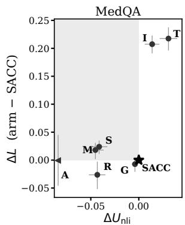

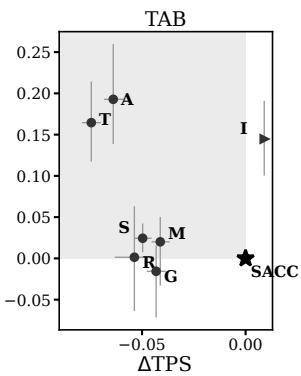  
Figure 10: Paired privacy–utility differences relative to SACC (star). Horizontal: content (95% for $U _ { \mathrm { n l i } } ,$ 99% for TPS); vertical: L (99% intervals), over shared entries with balanced SEX orders. Shading marks worse privacy and utility. Content is $U _ { \mathrm { n l i } }$ on MedQA and TPS on TAB, where $U _ { \mathrm { n l i } }$ is near its floor; axes differ across panels. I: input; M: global mask; G: global ladder; T: INTACT; A: Adaptive (same-reference entries); S: SACC-mask; R: LLM rewrite. Arrows denote values outside the scale (Adaptive on MedQA: −.237; input TPS minus SACC: +.155).

## R Robustness of the Evaluation

Three checks test whether the results depend on how they were measured, each pre-specified before it was scored. The first two ran on the texts before the binder fix of Appendix V, which changes 114 MedQA and 24 TAB documents; the reasoning adversary ran on the fixed texts.

<table><tr><td></td><td colspan="2">MedQA</td><td colspan="2">TAB</td><td colspan="2">SynthPAI</td></tr><tr><td>System – SACC</td><td>∆L</td><td> $\Delta d$ </td><td> $\Delta L$ </td><td> $\Delta d$ </td><td>∆L</td><td>∆d</td></tr><tr><td>Anonymised input</td><td>+.207 [+.192,+.222]</td><td>+.220 [+.194,+.246]</td><td>+.133 [+.090,+.179]</td><td>+.086[+.029,+.147]</td><td>+.112 [+.052,+.179]</td><td>+.116 [+.053,+.191]</td></tr><tr><td>Global mask</td><td>+.018[+.002,+.030]</td><td>−.009[−.029,+.009]</td><td>+.021 [−.031,+.051]</td><td>+.007 [−.043,+.038]</td><td>-.006[−.019, .000]</td><td>−.006[−.022,+.002]</td></tr><tr><td>Global ladder</td><td>-.008 [−.021,+.003]</td><td>-.007 [−.021,+.005]</td><td>-.015[−.070,+.016]</td><td>-.013[−.072,+.023]</td><td>+.030[−.026,+.090]</td><td>+.031 [−.025,+.090]</td></tr><tr><td>INTACT (Pilán et al., 2025)</td><td>+.218[+.197,+.238]</td><td>+.239 [+.206,+.272]</td><td>+.153 [+.107,+.202]</td><td>+.099 [+.036,+.165]</td><td>+.108 [+.048,+.176]</td><td>+.114[+.050,+.190]</td></tr><tr><td>Adaptive (Loiseau et al., 2026)</td><td>−.002[−.047,+.044]</td><td>+.013 [−.047,+.075]</td><td>+.181 [+.128,+.248]</td><td>+.128 [+.056,+.211]</td><td>+.085 [−.002,+.172]</td><td> $+ . 0 8 9 [ - . 0 0 2 , + . 1 7 9 ]$ </td></tr><tr><td>SACC-mask</td><td>+.024[+.012,+.035]</td><td>-.003 [−.020,+.014]</td><td>+.022 [+.006,+.039]</td><td>+.015[−.003,+.034]</td><td>.000[.000, .000]</td><td>.000[.000, .000]</td></tr><tr><td>LLM rewrite</td><td>-.026[−.052,−.003]</td><td>−.048[−.077,−.020]</td><td>+.005[−.061,+.072]</td><td>+.004[−.076,+.086]</td><td>−.029 [−.153,+.082]</td><td>−.035[−.168,+.088]</td></tr></table>

Table 49: Clipped (L) and unclipped (d) leakage, system minus SACC; positive means the system leaks more. Brackets are 99% intervals; bold estimates exclude zero.

<table><tr><td>Corpus</td><td></td><td>Attr. Entries</td><td>With cue</td><td> $\Delta L , { \mathrm { c u e } }$ </td><td> $\Delta L ,$  no cue</td></tr><tr><td>MedQA</td><td>Sex</td><td>1,513</td><td>.962</td><td>+.426[+.396,+.457]</td><td>.000[ .000, .000]</td></tr><tr><td>MedQA</td><td>Occ</td><td>643</td><td>.429</td><td></td><td>+.005 [−.015,+.030] +.003 [−.007,+.016]</td></tr><tr><td>TAB</td><td>Sex</td><td>244</td><td>.963</td><td>+.248 [+.163,+.344]</td><td></td></tr><tr><td>TAB</td><td>Occ</td><td>261</td><td>.441</td><td>+.055 [+.019,+.110]</td><td>+.006[−.003,+.016]</td></tr><tr><td>SynthPAI Sex</td><td></td><td>54</td><td>.074</td><td></td><td>+.001 [ .000,+.004]</td></tr><tr><td>SynthPAI Occ</td><td></td><td>233</td><td>.228</td><td>+.008[.000,+.023]</td><td>+.009[ .000,+.040]</td></tr><tr><td>SynthPAI Rel</td><td></td><td>64</td><td>.469</td><td>+.441 [+.193,+.683]</td><td>+.001 [.000,+.003]</td></tr></table>

Table 50: Share of entries whose input holds a cue SACC selects for that subject and attribute, and SACC’s gain over its input (input minus SACC) on entries with and without one. Brackets are 99% intervals; bold estimates exclude zero; — marks fewer than ten entries.
<table><tr><td></td><td></td><td colspan="3">System – SACC</td></tr><tr><td>Text</td><td>Accuracy</td><td>All</td><td>Sex-specific term (288)</td><td>Sex-dependent (35)</td></tr><tr><td>Source text</td><td>.741</td><td>+.011 [+.003,+.019]</td><td>+.013[−.004,+.031]</td><td>+.043[−.064,+.157]</td></tr><tr><td>Anonymised input</td><td>.730</td><td>.000[−.006,+.005]</td><td>+.009[−.003,+.021]</td><td>+.050[−.014,+.121]</td></tr><tr><td>Global mask</td><td>.728</td><td>−.002[−.009,+.005]</td><td>+.006[−.008,+.021]</td><td>+.014[−.086,+.129]</td></tr><tr><td>Global ladder</td><td>.729</td><td>−.001 [−.005,+.002]</td><td>+.003 [−.005,+.009]</td><td>+.021 [−.021,+.071]</td></tr><tr><td>SACC-mask</td><td>.727</td><td>−.003[−.009,+.004]</td><td>+.004[−.010,+.017]</td><td>+.036[−.064,+.143]</td></tr><tr><td>SACC</td><td>.730</td><td></td><td></td><td></td></tr><tr><td>LLM rewrite</td><td>.721</td><td>−.006[−.013, .000]</td><td>−.003[−.016,+.010]</td><td>−.039[−.117,+.039]</td></tr><tr><td>Question only</td><td>.428</td><td></td><td></td><td></td></tr></table>

Table 51: MedQA exam questions answered on each system’s text by GPT-4o-mini (four option rotations per text; the LLM rewrite on its 1,189 documents). Sexspecific term: vignettes that name a sex-specific clinical term. Sex-dependent: vignettes without such a term whose answer on the source text changes, in at least two of the four rotations, when the sex of the people in it is swapped. Question only: the exam question and its options without the vignette. Brackets are 95% document-bootstrap intervals; bold estimates exclude zero, paired within a system.

One reference for every system. Table 54 gives every entry one reference, built once from the anonymised input and given to the adversary for every system’s text, which removes a paraphraser’s weaker-reference advantage. SACC still lowers its input’s leakage on every corpus and measure under the development adversary and Qwen. On MedQA Adaptive’s lead (−.054 with output-built references) shrinks to −.024, not separable; this reading predates the binder fix. Re-scoring just the

114 changed documents on the current text confirms that the version gap is immaterial: SACC’s own MedQA L moves by −.007, and Adaptive’s shrunk lead moves from −.024 to −.017, remaining not separable and reversing no verdict (0.09 USD; the reference match, not the version difference, drives the −.054 → −.024 shift). On TAB Adaptive still leaks more than SACC, and the LLM rewrite is not separable from SACC on any corpus. Under Llama SACC’s TAB gain over its input is not separable from zero, as in Table 32.

Other upstream anonymisers. Table 55 applies SACC on TAB after INTACT (span filling) and the published Adaptive (paraphrase), with the light rewrite setting. Under the development adversary and Qwen SACC lowers L of both outputs and rewriting adds to masking; under the development adversary DISCLOSING does not separate, so part of the gain moves the adversary to a wrong value. Under Llama SACC lowers L and DISCLOSING after INTACT and only DISCLOSING after Adaptive, so the pre-specified prediction that it lowers L after both under both held-out families fails for Adaptive under Llama.

A reasoning adversary. GPT-4.1-mini, reasoning in at most five sentences before its answer letter, was run on 360 sampled entries per corpus with two candidate orders (2.24 USD; Table 53). It often declines to answer on edited text: on a fifth of SACC’s MedQA entries and a quarter of its TAB entries, against 2% and 7% of the input’s. Dropping declined answers, as pre-specified, SACC lowers its input’s MedQA L (+.095 [.044, .147]), not separably on TAB, and the global ladder is more private on MedQA (−.049 [−.095, −.001]), against the pre-specified prediction. Counting a declined answer as no information, a reading added after the run and before any contrast was read, SACC lowers its input’s MedQA L by .250 [.204, .296], no editor is separably more private, and the TAB reduction is not separable from zero. Under neither reading is SACC separably more private than SACC-mask, although rewriting makes this adversary decline more often. The gap between the two abstention readings is the largest single-choice effect in our study, which is why Section 7 asks for both.

<table><tr><td></td><td colspan="2">MedQA</td><td colspan="2">TAB</td><td colspan="2">SynthPAI</td></tr><tr><td>System</td><td> $U _ { \mathrm { n l i } }$ </td><td>TPS</td><td> $U _ { \mathrm { n l i } }$ </td><td>TPS</td><td> $U _ { \mathrm { n l i } }$ </td><td>TPS</td></tr><tr><td>Anonymised input</td><td> $- . 0 1 4 _ { \left[ - . 0 2 1 , - . 0 0 6 \right] }$ </td><td>一</td><td> $+ . 0 0 5 [ - . 0 0 3 , + . 0 1 5 ]$ </td><td>一</td><td> $. 0 0 0 [ - . 0 0 6 , + . 0 0 6 ]$ </td><td>一</td></tr><tr><td>Global mask</td><td> $+ . \mathbf { 0 4 5 } _ { [ + . 0 3 7 , + . 0 5 4 ] }$ </td><td> $\pm . 0 5 2 _ { \ : [ + . 0 5 0 , + . 0 5 4 ] }$ </td><td> $\mathbf { + . 0 2 8 } \left[ + . 0 1 7 , + . 0 4 0 \right]$ </td><td> $\mathbf { + . 0 4 1 } _ { [ + . 0 3 7 , + . 0 4 5 ] }$ </td><td> $. 0 0 0 [ - . 0 0 1 , ~ . 0 0 0 ]$ </td><td> $. 0 0 0 [ \phantom { 0 0 } . 0 0 0 , + . 0 0 2 ]$ </td></tr><tr><td>Global ladder</td><td> $\pm . 0 0 4 _ { \ : [ + . 0 0 1 , + . 0 0 7 ] }$ </td><td> $\mathbf { + . 0 0 4 } \left[ + . 0 0 2 , + . 0 0 5 \right]$ </td><td> $\mathbf { + . 0 2 3 } _ { \mathrm { [ + . 0 1 1 , + . 0 3 5 ] } }$ </td><td> $+ . 0 4 3 _ { \left[ + . 0 3 8 , + . 0 4 8 \right] }$ </td><td>一  $\cdot . 0 0 2 \left[ - . 0 0 8 , + . 0 0 3 \right]$ </td><td> $\mathbf { + . 0 0 9 } _ { [ + . 0 0 1 , + . 0 1 7 ] }$ </td></tr><tr><td>INTACT (Pilán et al., 2025)</td><td> $\mathbf { \sigma } \cdot \mathbf { 0 3 1 } \left[ - . 0 4 0 , - . 0 2 2 \right]$ </td><td> $\mathbf { + . 0 4 0 } \left[ + . 0 3 8 , + . 0 4 3 \right]$ </td><td> $\pm . 0 2 6 [ + . 0 1 0 , + . 0 4 2 ]$ </td><td> $\pm . \mathbf { 0 7 4 } \left[ + . 0 7 0 , + . 0 7 9 \right]$ </td><td> $+ . 0 1 1 [ - . 0 0 5 , + . 0 2 9 ]$ </td><td> $\cdot . 0 0 8 [ - . 0 1 7 , + . 0 0 2 ]$ </td></tr><tr><td>Adaptive (Loiseau et al., 2026)</td><td> $+ . 2 3 7 [ + . 2 2 0 , + . 2 5 3 ]$ </td><td> $\pm . \mathbf { 0 7 4 } \scriptstyle { [ + . 0 7 2 , + . 0 7 6 ] }$ </td><td> $\mathbf { + . 0 3 2 } _ { [ + . 0 1 4 , + . 0 5 1 ] }$ </td><td> $\pm . \mathbf { 0 6 4 } _ { [ + . 0 5 9 , + . 0 6 8 ] }$ </td><td> $\mathbf { + . 0 6 4 } \ [ + . 0 2 5 , + . 1 0 4 ]$ </td><td> $\cdot . 0 0 5 \left[ - . 0 1 8 , + . 0 0 5 \right]$ </td></tr><tr><td>SACC-mask</td><td> $\mathbf { + . 0 4 1 } _ { [ + . 0 3 3 , + . 0 5 0 ] }$ </td><td> $\pm . 0 5 2 _ { \ : [ + . 0 5 0 , + . 0 5 4 ] }$ </td><td> $. 0 0 0 [ - . 0 0 7 , + . 0 0 7 ]$ </td><td> $\mathbf { + . 0 5 0 } _ { [ + . 0 4 5 , + . 0 5 4 ] }$ </td><td> $. 0 0 0 [ ~ . 0 0 0 , ~ . 0 0 0 ]$ </td><td> $. 0 0 0 [ ~ . 0 0 0 , ~ . 0 0 0 ]$ </td></tr><tr><td>LLM rewrite</td><td> $+ . 0 4 3 [ + . 0 3 5 , + . 0 5 2 ]$ </td><td> $+ . 0 4 3 [ + . 0 4 0 , + . 0 4 5 ]$ </td><td> $+ . 0 2 5 [ + . 0 1 1 , + . 0 4 0 ]$ </td><td> $+ . 0 5 4 [ + . 0 4 4 , + . 0 6 3 ]$ </td><td> $+ . 1 4 1 [ + . 1 0 4 , + . 1 7 7 ]$ </td><td> $- . 0 0 2 \left[ - . 0 1 1 , + . 0 0 6 \right]$ </td></tr></table>

Table 52: Utility differences, SACC minus system; positive means SACC keeps more. $U _ { \mathrm { n l i } }$ with 95% and TPS with 99% intervals; bold estimates exclude zero. The input’s TPS is 1 by definition.

## S Configuration and Further Baselines

The agreement setting was chosen among three candidates (no repair, light, full) by five-fold crossfitting over documents on the development adversary’s $L ;$ all five folds chose full on MedQA and light on TAB (SynthPAI has nothing to rewrite). Table 56 compares the settings: with the light setting everywhere no privacy measure changes and the content scores do not fall; the full setting improves surface quality on MedQA, removing almost all agreement errors and leftover redactions, but is less private on TAB, which is why the light setting is released there. With the light setting SACC’s MedQA $U _ { \mathrm { n l i } }$ is .003 below the ladder’s $( [ - . 0 0 8 , + . 0 0 2 ] )$ ), so that lead comes from the full repair.

On all 1,189 MedQA documents outside its prompt’s development set (0.19 USD; Table 57), the same-input LLM rewrite is more private than SACC on L under all three families, through OC-CUPATION; on SEX the development adversary finds it less private, and no family separates the two on DISCLOSING. SACC keeps more content $( U _ { \mathrm { n l i } }$ +.043 [.035, .052]; TPS +.043 [.040, .045]) while editing 1.3% of characters against 2.8%. Of the pre-specified predictions, that the L difference would not be separable failed and that SACC would keep more held.

The redaction token. Part of rewriting’s MedQA $U _ { \mathrm { n l i } }$ gain is the NLI model’s response to the token [REDACTED] itself: with a differently spelled placeholder at the same sites, the gain shrinks to about 60% of its size, while privacy does not move.

An existing gender-neutral rewriter. To separate SACC’s selection from its own rewrite step, we replaced its rewrite table and agreement repair by the rule-based NeuTral Rewriter (Vanmassenhove et al., 2021), run unchanged with its own grammar correction on the pronouns SACC selects; every other selected cue stays redacted, since that system rewrites no sex-marked noun (SEL+NTR, Table 58). It keeps most of rewriting’s gain over masking under the development adversary (L: .021 of .024 on MedQA, .022 of .023 on TAB), is never separably more private than SACC under any adversary, and under the development adversary is less private on MedQA’s sex entries, where SACC also rewrites nouns. Its content scores are close (MedQA $U _ { \mathrm { n l i } }$ .702 against .706, TPS .852 against .846), so the gain lies in what is selected and admitted rather than in the particular rewriter.

A lexicon from another register. The lexicons are the only register-specific component, and MedQA’s adds clinical sex nouns and role nouns to the generic third-person lists. To see how much of the MedQA result rests on them, we rebuilt SACC on MedQA with TAB’s lexicon in both candidate pools and with the agreement setting chosen on the other corpora, leaving the binder, scope rule and rewrite table unchanged (SACC-LODO, Table 59); with MedQA’s own lexicon the same code reproduces the reported texts byte for byte. The generic lexicon changes the edits on five documents only: the clinical sex nouns are already masked in the anonymised input, and the binder leaves most clinical role nouns unedited. Under the development adversary SACC-LODO lowers its input’s L by .205 [.188, .222], against .207 for SACC, and it is not separably less private than SACC under any adversary, contrary to our pre-specified expectation that the clinical nouns would matter. The setting chosen on MedQA improves content retention rather than privacy: $U _ { \mathrm { n l i } }$ is .007 higher [.003, .012] and TPS .010 lower than with the other corpora’s setting (on the fixed texts; Table 56, on the texts before the fixes, shows a .002 difference). This holds out the lexicon and the setting only; the binder rules and rewrite table were developed on all three corpora.

<table><tr><td></td><td colspan="3">MedQA</td><td colspan="3">TAB</td></tr><tr><td>System</td><td> $\Delta L ,$  answers only</td><td> $\Delta L , { \mathrm { a b s t e n t i o n } } = \pi$ </td><td>Abstains</td><td> $\Delta L , \mathrm { a n s w e r s \ o n l y }$ </td><td> $\Delta L , { \mathrm { a b s t e n t i o n } } = \pi$ </td><td>Abstains</td></tr><tr><td>Anonymised input</td><td> $\mathbf { + . 0 9 5 } _ { } [ + . 0 4 4 , + . 1 4 7 ]$ </td><td> $\mathbf { + . 2 5 0 } _ { [ + . 2 0 4 , + . 2 9 6 ] }$ </td><td>.019</td><td> $+ . 0 5 7 [ - . 0 3 0 , + . 1 7 3 ]$ </td><td> $+ . 0 9 0 [ - . 0 0 1 , + . 1 9 3 ]$ </td><td>.068</td></tr><tr><td>Global mask</td><td> $- . 0 5 3 \left[ - . 1 2 8 , + . 0 0 6 \right]$ </td><td> $+ . 0 0 6 [ - . 0 6 3 , + . 0 5 5 ]$ </td><td>.170</td><td> $- . 0 5 2 [ - . 1 6 2 , + . 0 2 3 ]$ </td><td> $- . 0 4 0 [ - . 1 3 0 , + . 0 1 2 ]$ </td><td>.157</td></tr><tr><td>Global ladder</td><td> $- . 0 4 9 _ { [ - . 0 9 5 , - . 0 0 1 ] }$ </td><td> $- . 0 2 0 [ - . 0 5 1 , + . 0 1 3 ]$ </td><td>.216</td><td> $+ . 0 3 9 [ - . 0 6 3 , + . 1 5 2 ]$ </td><td> $- . 0 0 2 [ - . 0 7 2 , + . 0 5 8 ]$ </td><td>.264</td></tr><tr><td>SACC-mask</td><td> $+ . 0 0 3 [ - . 0 4 9 , + . 0 5 1 ]$ </td><td> $+ . 0 2 6 [ - . 0 1 0 , + . 0 6 1 ]$ </td><td>.170</td><td> $- . 0 2 4 [ - . 0 7 1 , + . 0 1 8 ]$ </td><td> $- . 0 0 5 [ - . 0 5 0 , + . 0 5 1 ]$ </td><td>.154</td></tr><tr><td>LLM rewrite</td><td> $- . 0 6 1 \left[ - . 1 3 8 , + . 0 0 4 \right]$ </td><td> $- . 0 2 0 [ - . 0 8 7 , + . 0 3 2 ]$ </td><td>.199</td><td></td><td></td><td></td></tr><tr><td>SACC</td><td></td><td></td><td>.217</td><td></td><td></td><td>.252</td></tr></table>

Table 53: A reasoning adversary, GPT-4.1-mini answering after a short chain of thought, on 360 sampled entries per corpus (two candidate orders): system minus SACC on L (positive: the system leaks more; 99% intervals), first as pre-specified, dropping the orders in which the adversary declines to answer, then counting a declined answer as no information. Abstains: share of the adversary’s replies that decline.
<table><tr><td></td><td></td><td colspan="2">Input</td><td colspan="2">Adaptive</td><td colspan="2">LLM rewrite</td></tr><tr><td>Adversary</td><td>Corpus</td><td> $\Delta L$ </td><td>∆DISC</td><td> $\Delta L$ </td><td>∆DISC</td><td> $\Delta L$ </td><td>∆DISC</td></tr><tr><td rowspan="3">GPT-4o-mini</td><td>MedQA</td><td> $+ . 2 0 0 [ + . 1 8 4 , + . 2 1 6 ]$ </td><td> $\mathbf { + . 0 8 7 } \left[ + . 0 7 0 , + . 1 0 4 \right]$ </td><td> $\cdot . 0 2 4 \left[ - . 0 6 1 , + . 0 1 0 \right]$ </td><td> $\cdot . 0 1 8 \left[ - . 0 5 0 , + . 0 0 9 \right]$ </td><td> $. 0 0 1 [ - . 0 6 1 , + . 0 3 8 ]$ </td><td> $+ . 0 2 0 [ - . 0 4 4 , + . 0 6 8 ]$ </td></tr><tr><td>TAB</td><td> $+ . 1 3 6 [ + . 0 9 7 , + . 1 8 0 ]$ </td><td> $\mathbf { + . 0 6 1 } _ { [ + . 0 2 6 , + . 1 0 2 ] }$ </td><td> $+ . 1 8 8 [ + . 1 3 5 , + . 2 5 1 ]$ </td><td> $+ . 0 8 4 _ { \left[ + . 0 3 7 , + . 1 4 6 \right] }$ </td><td> $+ . 0 4 9 [ - . 0 1 4 , + . 1 0 7 ]$ </td><td> $+ . 0 1 8 [ - . 0 5 7 , + . 0 9 3 ]$ </td></tr><tr><td>SynthPAI</td><td> $+ . 1 1 2 _ { } [ + . 0 5 2 , + . 1 7 9 ]$ </td><td>+.089 [+.036,+.143] +.085[−.002,+.172]</td><td></td><td> $+ . 0 7 0 [ - . 0 0 4 , + . 1 4 1 ]$ </td><td>-.029[−.153,+.082] +.001 [−.139,+.120]</td><td></td></tr><tr><td rowspan="3">Llama-3.1-8B TAB</td><td>MedQA</td><td> $+ . 1 4 9 _ { [ + . 1 2 6 , + . 1 7 3 ] }$ </td><td></td><td>+.044[+.024,+.068] +.037 [ .000,+.074]</td><td> $- . 0 1 5 [ - . 0 4 7 , + . 0 1 8 ]$ </td><td> $- . 0 1 8 [ - . 0 7 1 , + . 0 1 8 ]$ </td><td> $- . 0 0 9 [ - . 0 6 9 , + . 0 5 2 ]$ </td></tr><tr><td></td><td> $+ . 0 4 7 \left[ - . 0 0 2 , + . 1 0 0 \right]$ </td><td></td><td> $\begin{array} { r l } { + . 0 1 4 [ - . 0 4 8 , + . 0 7 4 ] } & { { } + . 0 8 7 [ + . 0 2 5 , + . 1 5 9 ] } \end{array}$ </td><td> $+ . 0 6 5 _ { \mathrm { \ell } } [ + . 0 1 5 , + . 1 3 6 ]$ </td><td> $+ . 0 3 6 [ - . 0 4 1 , + . 1 1 2 ]$ </td><td> $+ . 0 2 4 [ - . 0 6 9 , + . 1 2 2 ]$ </td></tr><tr><td>SynthPAI</td><td> $\mathbf { + . 1 0 8 } _ { [ + . 0 4 6 , + . 1 6 1 ] }$ </td><td></td><td>+.091 [+.021,+.149] +.079[−.001,+.150]</td><td></td><td> $+ . 0 6 6 [ - . 0 1 7 , + . 1 4 1 ] - . 0 1 1 [ - . 1 1 9 , + . 0 7 9 ]$ </td><td> $+ . 0 6 5 [ - . 0 4 8 , + . 1 5 6 ]$ </td></tr><tr><td rowspan="3">Qwen3-30B</td><td>MedQA</td><td> $+ . 2 2 1 [ + . 2 0 4 , + . 2 4 0 ]$ </td><td> $\mathbf { + . 0 3 9 } _ { [ + . 0 2 1 , + . 0 5 9 ] }$ </td><td>+.032[−.003,+.066] -.018[−.050,+.015] -.025[−.081,+.008]</td><td></td><td></td><td> $- . 0 2 8 [ - . 0 9 2 , + . 0 3 5 ]$ </td></tr><tr><td>TAB</td><td> $+ . 1 2 2 \ [ + . 0 9 0 , + . 1 5 7 ]$ </td><td> $+ . 0 4 3 \ [ + . 0 1 4 , + . 0 7 5 ]$ </td><td> $+ . 1 9 1 [ + . 1 4 3 , + . 2 5 5 ]$ </td><td>+.038[−.034,+.109] +.045[−.004,+.100]</td><td></td><td> $+ . 0 0 2 [ - . 0 4 5 , + . 0 5 2 ]$ </td></tr><tr><td>SynthPAI</td><td> $\mathbf { + . 0 9 8 } _ { [ + . 0 4 0 , + . 1 5 1 ] }$ </td><td> $\mathbf { + . 0 8 6 } _ { } [ + . 0 1 6 , + . 1 4 5 ]$ </td><td> $+ . 0 9 2 [ - . 0 5 8 , + . 2 2 1 ]$ </td><td> $+ . 0 5 2 [ - . 0 2 4 , + . 1 2 4 ]$ </td><td> $. 0 1 0 [ - . 1 1 3 , + . 0 7 8 ]$ </td><td> $+ . 0 7 7 [ - . 0 0 5 , + . 1 4 9 ]$ </td></tr></table>

Table 54: Every system scored with one subject reference, built from the anonymised input and the same for all systems: system minus SACC (SynthPAI: minus SACC-mask, which SACC equals there). Positive: the system leaks more. Brackets are 99% intervals; bold estimates exclude zero. Scored on the texts before the binder fix (Appendix V).
<table><tr><td colspan="3"></td><td colspan="2">Upstream output minus SACC</td><td>SACC-mask minus SACC</td></tr><tr><td>Adversary</td><td>Upstream</td><td> $\Delta L$ </td><td>∆DISC</td><td>∆LEAK</td><td> $\Delta L$ </td></tr><tr><td rowspan="2">GPT-4o-mini</td><td>INTACT</td><td> $\pm . 0 9 3 _ { \left[ + . 0 5 5 , + . 1 3 6 \right] }$ </td><td> $+ . 0 1 8 [ - . 0 1 0 , + . 0 5 3 ]$ </td><td> $\mathbf { + . 0 4 0 } _ { [ + . 0 0 2 , + . 0 8 1 ] }$ </td><td> $\mathbf { + . 0 1 7 } \left[ + . 0 0 2 , + . 0 3 3 \right]$ </td></tr><tr><td>Adaptive</td><td> $+ . 1 1 1 [ + . 0 7 0 , + . 1 5 6 ]$ </td><td> $+ . 0 0 9 [ - . 0 1 9 , + . 0 4 2 ]$ </td><td> $+ . 0 2 5 [ - . 0 1 0 , + . 0 6 5 ]$ </td><td> $\mathbf { + . 0 2 8 } \left[ + . 0 0 1 , + . 0 5 3 \right]$ </td></tr><tr><td rowspan="2">Llama-3.1-8B</td><td>INTACT</td><td> $\mathbf { + . 0 8 0 } _ { [ + . 0 2 4 , + . 1 4 1 ] }$ </td><td> $\mathbf { + . 0 5 7 } _ { \left[ + . 0 0 7 , + . 1 1 1 \right] }$ </td><td> $- . 0 4 3 \left[ - . 1 0 9 , + . 0 2 0 \right]$ </td><td> $- . 0 0 6 [ - . 0 2 8 , + . 0 1 3 ]$ </td></tr><tr><td>Adaptive</td><td> $+ . 0 2 5 [ - . 0 1 7 , + . 0 8 1 ]$ </td><td> $\mathbf { + . 0 6 9 } _ { } [ + . 0 2 4 , + . 1 2 5 ]$ </td><td> $- . 0 9 4 _ { \left[ - . 1 7 9 , - . 0 1 7 \right] }$ </td><td> $\mathbf { + . 0 1 5 } \left[ \begin{array} { l } { . 0 0 0 , + . 0 3 2 } \end{array} \right]$ </td></tr><tr><td rowspan="2">Qwen3-30B</td><td>INTACT</td><td> $\pm . 0 9 4 _ { \ : [ + . 0 6 1 , + . 1 2 9 ] }$ </td><td> $\mathbf { + . 0 3 5 } \left[ \begin{array} { l } { \mathbf { \sigma } . 0 0 0 , \mathbf { + } . 0 8 6 } \end{array} \right]$ </td><td> $+ . 0 3 3 [ - . 0 2 1 , + . 0 9 8 ]$ </td><td> $\mathbf { + . 0 4 7 } \left[ + . 0 2 7 , + . 0 6 8 \right]$ </td></tr><tr><td>Adaptive</td><td> $+ . 1 2 4 _ { \ : [ + . 0 8 7 , + . 1 6 3 ] }$ </td><td> $+ . 0 2 9 [ - . 0 2 8 , + . 0 7 3 ]$ </td><td> $+ . 0 3 5 [ - . 0 2 8 , + . 0 9 3 ]$ </td><td> $\mathbf { + . 0 3 7 } _ { } [ + . 0 1 6 , + . 0 6 1 ]$ </td></tr></table>

Table 55: SACC applied after two other upstream anonymisers on TAB: its gain over the text it receives, and the gain of rewriting over masking. Positive: SACC leaks less. Brackets are 99% intervals; bold estimates exclude zero. Scored on the texts before the binder fix (Appendix V).

## T Judged Audit

Three LLM judges read 180 items drawn from a sample fixed in advance (60 per corpus), each a passage with one of its subjects and the propositions it states, on the released texts. They judge which of the propositions a text still states (81 passages with reference facts) and whether an edited passage carries a grammatical or fluency fault (140 to 145 passages). GPT-4.1 was designated the primary judge before any output: it is the strongest judge in our configuration and the only one that is neither an adversary nor the LLM rewrite’s model. GPT-4o-mini and Qwen3-30B-A3B are reported beside it, and no per-item majority is formed. Each judge also reads the unedited input as a control: on it, a valid judge keeps at least .70 of the reference facts and no fewer than on an edited text, and flags the original words at SACC’s edit positions no more often than the edits themselves. Table 60 gives the levels.

<table><tr><td>Corpus</td><td>Setting</td><td>L</td><td>DISC</td><td> LEAK</td><td> $U _ { \mathrm { n l i } }$ </td><td></td><td>TPS Redactions Agr. errors</td><td></td></tr><tr><td rowspan="3">MedQA</td><td>light everywhere</td><td>.644</td><td>.911</td><td>.739</td><td>.708</td><td>.857</td><td>1720</td><td>812</td></tr><tr><td>full everywhere</td><td>.642</td><td>.904</td><td>.735</td><td>.710</td><td>.847</td><td>40</td><td>1</td></tr><tr><td>released</td><td>.642</td><td>.904</td><td>.735</td><td>.710.847</td><td></td><td>40</td><td>1</td></tr><tr><td rowspan="3">TAB</td><td>light everywhere</td><td>.420</td><td>.807</td><td>.587</td><td>.321</td><td>.843</td><td>421</td><td>8</td></tr><tr><td>full everywhere</td><td>.426</td><td>.834</td><td>.605</td><td>.319</td><td>.845</td><td>175</td><td>0</td></tr><tr><td>released</td><td>.420</td><td>.807</td><td>.587</td><td>.321</td><td>.843</td><td>421</td><td>8</td></tr><tr><td rowspan="3"></td><td>light everywhere</td><td>.705</td><td>.835</td><td>.785</td><td>.777.790</td><td></td><td>120</td><td>0</td></tr><tr><td>SynthPAI full everywhere</td><td>.705</td><td>.835</td><td>.785</td><td>.777.790</td><td></td><td>120</td><td>0</td></tr><tr><td>released</td><td>.705</td><td>.835</td><td>.785</td><td>.777.790</td><td></td><td>120</td><td>0</td></tr></table>

Table 56: Agreement setting, on the texts before the two rewrite-step fixes and the binder fix of Appendix V, which together move L by up to .007 (Tables 63 and 64); the released rows therefore differ slightly from Table 3. Redactions: redactions left in place; Agr. errors: agreement errors found by the dependency check. Bold: differs from the released configuration.

Two of the three judges fail the control, in opposite directions. GPT-4.1 finds only .665 of the reference facts in the unedited input, so its fact labels are too strict to measure loss. GPT-4o-mini flags the original words at SACC’s edit positions about as often as SACC’s rewrites (.241 against .257), and twice as often as the redactions, so its flags do not separate an edit from the text around it. Qwen3-30B-A3B passes. Under it, SACC keeps as many facts as SACC-mask (+.015, 99% interval [−.000, +.038]) and has more flagged passages than SACC-mask (+.108, [+.039, +.182]) and than the input (+.094, [+.013, +.176]). Most of these flags fall on epicene pronouns in standard use: on MedQA and TAB, 36 of its 60 agreement flags pair they with a plural verb and none pairs it with a singular verb, and 105 of its 138 possessive or reference flags are on a span that holds an epicene pronoun, such as their lungs are clear. Because the judge designated in advance fails the control, we draw no conclusion from the judges; read on its own, the one judge that passes finds no loss of facts and a fluency cost that lies mostly in singular they itself. Under GPT-4.1, SACC has fewer flagged passages than SACC-mask (−.027, [−.061, −.003]); under GPT-4o-mini it has more (+.136, [+.070, +.208]) and as many as the input. The judges agree on 73% to 87% of fact labels. An earlier audit with GPT-4o-mini and Qwen3-30B-A3B, on the texts released before the rewrite-step fix and without the input control, found about twice as many flagged passages for SACC as for SACC-mask (.312 / .268 against .165 / .133), with the same composition: of the spans flagged as agreement errors, 6 of 72 and 0 of 112 contain they followed by a singular verb, and 81 of 122 and 21 of 32 possessive or reference flags are the bare word their.

## U Worked Examples

Tables 61 and 62 show one MedQA document and one TAB passage under six systems. They were chosen by a fixed rule, not by hand: among the documents of the LLM rewrite’s first samples (200 of MedQA, 91 of TAB) on which SACC’s text differs from the global ladder’s, with MedQA restricted to inputs of 350 to 650 characters so that a vignette fits, one document is drawn with a seeded generator. MedQA vignettes are shown whole; for TAB, the passage runs from 15 words before the first word that SACC and the global ladder edit differently to 30 words after it, and each system’s text is aligned to that span of the input. They illustrate behaviour and say nothing about averages.

In the MedQA vignette, the two masking systems redact every pronoun and both mentions of the brother, and the global ladder and SACC rewrite them to epicene forms. Both repair the verb after they, but only SACC, with the full agreement setting, also repairs the second verb of the clause (They have no similar symptoms and are in good health), where the ladder leaves and is. The LLM rewrite redacts the pronouns instead of rewriting them, keeps brother twice and also redacts the patient’s age. In the TAB passage, both global editors edit Government, a use of an occupational term that refers to no person, and the ladder’s replacement breaks the sentence’s agreement; SACC and SACC-mask leave it. The LLM rewrite redacts the title Ambassador of the government’s agent, which SACC’s lexicon does not list.

## V Version History

The reported system is described once, in Section 6 and Appendices A and G. Three implementation defects, two in the rewrite step and one in the binder, were found and fixed in two rounds, each pre-specified before it was scored. Every result uses the texts fixed in both rounds except these, each marked where it appears: the configuration comparison (Table 56) and the reference counts of Table 30, scored before both rounds, and the single-reference, upstream and held-out LLMrewrite comparisons (Tables 54, 55 and 35), scored before the binder fix. The single-reference reading also supplies the subject-reference row of Table 1 and the reference panel of Figure 9, which set a contrast on the fixed texts beside one on the texts before the binder fix (bounded in Appendix R). Figure 3 reads both references on the texts before the fix: on one version the reference changes 3 of 45 all-pairs verdicts, all involving Adaptive, whereas mixing versions doubled the count, because the fix alone changes three TAB LEAKING verdicts. This appendix records what the fixes changed.

<table><tr><td>Adversary</td><td>Entries</td><td> $\Delta L$ </td><td>∆DISC</td><td> $\Delta L , { \mathrm { s a m e } } { \mathrm { r e f } } .$ </td><td> $\Delta L , \mathrm { S E X }$ </td><td> $\Delta L , \mathrm { O C C }$ </td><td>Non-inferior at .02</td></tr><tr><td>GPT-4o-mini</td><td>1,999</td><td> $\mathbf { \sigma } . \mathbf { 0 2 6 } [ - . 0 5 2 , - . 0 0 3 ]$ </td><td> $+ . 0 1 3 [ - . 0 1 2 , + . 0 3 5 ]$ </td><td> $- . 0 1 2 [ - . 0 3 7 , + . 0 1 2 ]$  一</td><td> $\mathbf { + . 0 3 9 } _ { [ + . 0 2 1 , + . 0 5 8 ] }$ </td><td> $\mathbf { . 0 9 2 } \left[ - . 1 3 8 , - . 0 4 8 \right]$ </td><td> $\mathrm { n o } / \mathrm { n o }$ </td></tr><tr><td>Llama-3.1-8B</td><td>1,573</td><td> $- . 0 4 5 \left[ - . 0 7 1 , - . 0 2 0 \right]$ </td><td> $- . 0 0 2 [ - . 0 2 8 , + . 0 2 5 ]$ </td><td> $- . 0 2 5 \left[ - . 0 5 3 , - . 0 0 3 \right]$ </td><td> $- . 0 0 4 [ - . 0 2 6 , + . 0 1 7 ]$ </td><td> $- . 0 8 { \bar { \mathbf { 5 } } } _ { [ - . 1 3 1 , - . 0 4 3 ] }$ </td><td> $\mathrm { n o } / \mathrm { n o }$ </td></tr><tr><td>Qwen3-30B</td><td></td><td>1,597 -.038[−.062,−.013]</td><td> $- . 0 1 7 \left[ - . 0 4 1 , + . 0 0 8 \right]$ </td><td> $- . 0 1 7 \left[ - . 0 4 1 , + . 0 0 4 \right]$ </td><td> $+ . 0 0 7 [ - . 0 0 9 , + . 0 2 3 ]$ </td><td> $- . 0 8 3 _ { [ - . 1 2 8 , - . 0 4 1 ] }$ </td><td>no / no</td></tr></table>

Table 57: The same-input LLM rewrite on every MedQA document outside its prompt-development set, against SACC: LLM rewrite minus SACC (negative: the LLM rewrite leaks less). Non-inferior: whether SACC’s deficit is shown to be below .02 on all entries / on same-reference entries. Brackets are 99% intervals.
<table><tr><td rowspan="2">Adversary</td><td rowspan="2">Corpus</td><td colspan="3"> $\mathrm { S E L + N T R \mathrm { ~ - ~ } S A C C }$ </td><td> $\mathrm { S A C C - m a s k - S E L + N T R }$ </td></tr><tr><td>∆L</td><td>∆DISC</td><td>∆LEAK</td><td>∆L</td></tr><tr><td rowspan="2">GPT-4o-mini</td><td>MedQA</td><td> $+ . 0 0 3 [ - . 0 0 6 , + . 0 1 1 ]$ </td><td> $+ . 0 1 3 [ - . 0 0 2 , + . 0 2 7 ]$ </td><td> $\mathbf { + . 0 1 0 } _ { [ + . 0 0 1 , + . 0 1 8 ] }$ </td><td> $\mathbf { + . 0 2 1 } \left[ + . 0 1 1 , + . 0 3 0 \right]$ </td></tr><tr><td>TAB</td><td> $+ . 0 0 1 [ - . 0 0 7 , + . 0 0 8 ]$ </td><td> $+ . 0 1 4 [ - . 0 1 0 , + . 0 4 1 ]$ </td><td> $+ . 0 0 4 [ - . 0 1 1 , + . 0 2 1 ]$ </td><td> $\mathbf { + . 0 2 2 } \left[ + . 0 0 4 , + . 0 4 1 \right]$ </td></tr><tr><td rowspan="2">Llama-3.1-8B</td><td>MedQA</td><td> $+ . 0 0 5 [ - . 0 0 2 , + . 0 1 1 ]$ </td><td> $\begin{array} { c } { - . 0 0 4 [ - . 0 2 4 , + . 0 1 8 ] } \\ { - . 0 2 2 [ - . 0 6 6 , + . 0 1 7 ] } \end{array}$ </td><td> $- . 0 0 6 [ - . 0 2 3 , + . 0 1 2 ]$ </td><td> $- . 0 0 5 [ - . 0 1 3 , + . 0 0 4 ]$ </td></tr><tr><td>TAB</td><td>一  $0 . 0 0 1 [ - . 0 0 7 , + . 0 0 5 ]$ </td><td></td><td> $- . 0 0 7 [ - . 0 4 3 , + . 0 2 5 ]$ </td><td> $\mathbf { - . 0 2 2 } \left[ - . 0 4 2 , - . 0 0 5 \right]$ </td></tr><tr><td rowspan="2">Qwen3-30B</td><td>MedQA</td><td> $. 0 0 0 [ - . 0 0 5 , + . 0 0 5 ]$ </td><td> $- . 0 0 2 [ - . 0 1 6 , + . 0 1 2 ]$ </td><td> $- . 0 0 4 \left[ - . 0 1 5 , + . 0 0 6 \right]$ </td><td> $\mathbf { + . 0 0 9 } _ { } [ + . 0 0 3 , + . 0 1 7 ]$ </td></tr><tr><td>TAB</td><td> $. 0 0 0 [ - . 0 1 0 , + . 0 0 9 ]$ </td><td> $- . 0 0 3 [ - . 0 5 5 , + . 0 3 5 ]$ </td><td> $- . 0 0 7 \left[ - . 0 6 1 , + . 0 2 3 \right]$ </td><td> $\mathbf { + . 0 4 2 } _ { [ + . 0 2 4 , + . 0 6 1 ] }$ </td></tr></table>

Table 58: SACC’s selection with an existing gender-neutral rewriter (SEL+NTR: the rule-based NeuTral Rewriter of Vanmassenhove et al., 2021 on the pronouns SACC selects, every other selected cue redacted), scored in one pass per adversary on every document. Positive: the first system leaks more. Brackets are 99% intervals; bold estimates exclude zero.

<table><tr><td></td><td></td><td colspan="3">SACC-LODO – SACC</td><td>SACC-mask</td></tr><tr><td>Adversary</td><td>Entries</td><td>∆L</td><td></td><td>∆DISC ∆LEAK</td><td>∆L</td></tr><tr><td>GPT-4o-mini</td><td></td><td>2,156 +.002[−.008,+.010]</td><td>+.010</td><td> $+ . 0 0 7$ </td><td>.000</td></tr><tr><td>Llama-3.1-8B</td><td>1,719</td><td> $. 0 0 0 [ - . 0 0 1 , + . 0 0 1 ]$ </td><td>+.005</td><td> $+ . 0 0 5$ </td><td>.000</td></tr><tr><td>Qwen3-30B</td><td>1,714</td><td> $. 0 0 0 [ \mathbf { \Lambda } . 0 0 0 , + . 0 0 1 ]$ </td><td>.000</td><td>.000</td><td>.000</td></tr></table>

Table 59: MedQA with TAB’s generic lexicon and the agreement setting chosen on the other corpora (SACC-LODO), against the reported SACC, in one pass per adversary on every document; SACC-mask: the same lexicon swap for SACC-mask. Positive: the swapped system leaks more. Brackets: 99% interval of SACC-LODO − SACC on L; bold estimates exclude zero.

<table><tr><td></td><td colspan="3">Facts kept</td><td colspan="3">Passages with a fault</td><td></td></tr><tr><td>Judge</td><td></td><td>Input Mask SACC</td><td></td><td></td><td>Input Mask</td><td>SACC</td><td>Control</td></tr><tr><td>GPT-4.1 (primary)</td><td>.665</td><td>.566</td><td>.624</td><td>.032</td><td>.044</td><td>.016</td><td>fails G1</td></tr><tr><td>GPT-4o-mini</td><td>.905</td><td>.876</td><td>.840</td><td>.241</td><td>.121</td><td>.257</td><td>fails G2</td></tr><tr><td>Qwen3-30B-A3B</td><td>.873</td><td>.801</td><td>.816</td><td>.195</td><td>.180</td><td>.288</td><td>passes</td></tr></table>

Table 60: Judged audit on 81 passages with reference facts and 139 to 145 cue-edit passages (passages a judge’s reply could not be parsed for are left out); Mask is SACC-mask. The control asks the unedited input to keep at least .70 of the facts and no fewer than the edited texts (G1), and to carry no more faults than they do (G2).

Two defects of the rewrite step, fixed. The texts released before this evaluation had two defects in the rewrite step, both corrected in every result reported here. First, the test that chooses between the possessive and the pronoun read only a following word of letters, so possessive his and her before a placeholder or a number became theirs and them (136 and 125 times on MedQA, 7 and 0 on TAB, none on SynthPAI). Second, the rewrite table was consulted by surface form, so a marital term could become spouse or partner, which still states a relationship status and is therefore not admissible (21 times on TAB, never elsewhere); those cues now stay redacted. The fix changes only these words. Table 63 gives its effect under each adversary.

Over each adversary’s whole cohort (Table 63), on L no estimate exceeds .003 in absolute value. On DISCLOSING and LEAKING one cell, Llama on TAB, moves by +.006 with an upper bound of .024; a prediction pre-specified before the fix was scored had excluded a move of that size, and we record it as failed. $U _ { \mathrm { n l i } }$ and TPS change by at most .002. With the released texts, the global ladder’s lead over SACC on MedQA was separable on L and LEAKING; after this fix it was separable on L alone, and after the binder fix below on no measure.

<table><tr><td>System</td><td>Text</td></tr><tr><td></td><td>Anonymised input A 35-year-old [SEX] comes to the [OCCUPATION] for genetic counseling prior to conception. Her younger brother has mild developmental delay, pale complexion, and has to limit his dietary intake of phenylalanine. She has no similar symptoms and is in good health. Her parents are healthy. Which of the following is the most appropriate assessment of her [OCCUPATION] status for the disease affecting her brother?</td></tr><tr><td>Global mask</td><td>A 35-year-old [SEX] comes to the [OCCUPATION] for genetic counseling prior to conception. [REDACTED] younger [REDACTED] has mild developmental delay, pale complexion, and has to limit [REDACTED] dietary intake of phenylalanine. [REDACTED] has no similar symptoms and is in good health. [REDACTED] parents are healthy. Which of the following is the most appropri- ate assessment of [REDACTED] [OCCUPATION] status for the disease affecting [REDACTED] [REDACTED]?</td></tr><tr><td>Global ladder</td><td>A 35-year-old [SEX] comes to the [OCCUPATION] for genetic counseling prior to conception. Their younger sibling has mild developmental delay, pale complexion, and has to limit their dietary intake of phenylalanine. They have no similar symptoms and is in good health. Their parents are healthy. Which of the following is the most appropriate assessment of their [OCCUPATION] status for the disease affecting their sibling?</td></tr><tr><td>SACC-mask</td><td>A 35-year-old [SEX] comes to the [OCCUPATION] for genetic counseling prior to conception. [REDACTED] younger [REDACTED] has mild developmental delay, pale complexion, and has to limit [REDACTED] dietary intake of phenylalanine. [REDACTED] has no similar symptoms and is in good health. [REDACTED] parents are healthy. Which of the following is the most appropri- ate assessment of [REDACTED] [OCCUPATION] status for the disease affecting [REDACTED] [REDACTED]?</td></tr><tr><td>SACC</td><td>A 35-year-old [SEX] comes to the [OCCUPATION] for genetic counseling prior to conception. Their younger sibling has mild developmental delay, pale complexion, and has to limit their dietary intake of phenylalanine. They have no similar symptoms and are in good health. Their parents are healthy. Which of the following is the most appropriate assessment of their [OCCUPATION] status for the</td></tr><tr><td>LLM rewrite</td><td>disease affecting their sibling? A [REDACTED] [SEX] comes to the [OCCUPATION] for genetic counseling prior to conception, [REDACTED] younger brother has mild developmental delay, pale complexion, and has to limit [REDACTED] dietary intake of phenylalanine. [REDACTED] has no similar symptoms and is in good health. [REDACTED] parents are healthy. Which of the following is the most appropriate</td></tr></table>

Table 61: MedQA document MEDQA-01206, drawn by the fixed rule of this appendix from 25 candidates. Bold: words the system wrote that are not in the input.

The binder fix. The first audit of Appendix G found sex and relationship nouns naming a protected relative sent to another person. The mentionform rule repairs this; it changes 114 MedQA and 24 TAB documents, and pre-specified gates checked that nothing else changes. It lowers MedQA L under all three adversaries (by .007, .012 and .007, intervals clear of zero) and moves no TAB L separably (Table 64); under Qwen it raises TAB’s leaking rate (+.024, [+.001, +.052]), and on MedQA it lowers SACC-mask’s Unli by .006, beyond a pre-specified bound of .005. Three main-text readings changed with it: the global ladder’s MedQA lead on L (−.015, [−.030, −.004]) is no longer separable, SACC became separably more private than global masking on MedQA L, and SACC’s TAB reduction of its input’s LEAKING rate is no longer separable from zero. The comparisons with the LLM rewrite on its samples under the held-out adversaries (Table 35) predate the fix.

Held-out families before both rounds. A pass on the texts before both rounds, with SACC in the full setting on MedQA, had read the gain of rewriting over masking as separable under Llama on MedQA (+.038) and as null under Llama on TAB; on the reported texts it is null on MedQA and reversed on TAB.

## W Human Evaluation

Design. Automatic content scores do not see grammaticality, and two of three LLM judges failed their controls (Appendix T), so people judged passages around SACC’s edits. Thirty MedQA and thirty TAB documents on which SACC’s text differs from the global ladder’s were drawn with a fixed seed; from each, one of SACC’s edit sites was drawn, and the input sentence holding it, with one sentence on each side (at most 120 words), was aligned to SACC’s, SACC-mask’s and the global ladder’s text. Annotators saw the input passage and the three versions in a random order, with the words that differ listed, never a system name or score, and labelled each version on two scales: FACTS, whether it still states all (2), some (1) or little (0) of the input’s content, where losing a word that only states a person’s sex, relationship status or occupation counts as no loss; and GRAMMAR, no error (3), a minor error (2) or an error that hinders reading (1), where singular they with plural agreement counts as grammatical. One passage in seven was an instructed attention check, and every annotator passed all of them. Three volunteers, fluent in English and not involved in this work, annotated the passages after reading the guidelines summarised here. They were recruited personally by one of the authors from outside the project and were not paid. Each passage was labelled by all three, and contrasts are paired by passage with two-sided 95% cluster-bootstrap intervals; agreement is Krippendorff’s α (Krippendorff, 2004). The tests fixed before annotation were that SACC keeps more FACTS than the global ladder and than SACC-mask, and that its GRAMMAR is non-inferior to SACC-mask’s at a margin of 0.2. The passages were labelled in two halves of thirty; each half was first analysed with two annotators, and the third annotator’s labels, added afterwards, change no test’s outcome.

<table><tr><td>System</td><td>Text</td></tr><tr><td></td><td>Anonymised input ... European Commission of Human Rights (“the Commission&quot;) under former Article 25 by the applicant. The Government of Austria are represented by their Agent, Ambassador [PERSON], Head of the International Law Department at the Federal Ministry of Foreign Affairs. The applicant&#x27;s request to the Court referred . . .</td></tr><tr><td>Global mask</td><td>European Commission of Human Rights (“the Commission&quot;) under former Article 25 by the applicant. The [REDACTED] of Austria are represented by their Agent, Ambassador [PERSON], Head of the International Law Department at the Federal Ministry of Foreign Affairs. The applicant&#x27;s request to the Court referred .. .</td></tr><tr><td>Global ladder</td><td>European Commission of Human Rights (“the Commission&quot;) under former Article 25 by the applicant. The public official of Austria are represented by their Agent, Ambassador [PERSON], Head of the International Law Department at the Federal Ministry of Foreign Affairs. The applicant&#x27;s request to the Court referred . . .</td></tr><tr><td>SACC-mask</td><td>European Commission of Human Rights (“the Commission&quot;) under former Article 25 by the applicant. The Government of Austria are represented by their Agent, Ambassador [PERSON], Head of the International Law Department at the Federal Ministry of Foreign Affairs. The applicant&#x27;s request to the Court referred .. .</td></tr><tr><td>SACC</td><td>... European Commission of Human Rights (“the Commission&quot;) under former Article 25 by the applicant. The Government of Austria are represented by their Agent, Ambassador [PERSON], Head of the International Law Department at the Federal Ministry of Foreign Affairs. The applicant&#x27;s request to the Court referred .. .</td></tr><tr><td>LLM rewrite</td><td>European Commission of Human Rights (“the Commission&quot;) under former Article 25 by the applicant. The Government of Austria are represented by their Agent, [REDACTED] [PERSON], Head of the International Law Department at the Federal Ministry of Foreign Affairs. The applicant&#x27;s request to the Court referred . . .</td></tr></table>

Table 62: TAB document TAB-e666e, drawn by the fixed rule of this appendix from 91 candidates. Bold: words the system wrote that are not in the input.

<table><tr><td>Adversary</td><td>Corpus</td><td>Changed</td><td> $\Delta L$ </td><td>∆DISC</td><td>∆LEAK</td></tr><tr><td rowspan="2">GPT-4o-mini</td><td>MedQA</td><td>642</td><td>.000[−.003,+.004]</td><td>-.003 [−.009,+.002]</td><td>-.003[−.009,+.002]</td></tr><tr><td>TAB</td><td>89</td><td>+.001 [−.001,+.002]</td><td>-.001 [−.008,+.005]</td><td>-.002[−.009,+.003]</td></tr><tr><td rowspan="2">Llama-3.1-8B</td><td>MedQA</td><td>655</td><td>-.002[−.004,+.001]</td><td>+.001 [−.010,+.014]</td><td>+.001 [−.008,+.013]</td></tr><tr><td>TAB</td><td>82</td><td>+.001 [.000,+.002]</td><td>+.006[.000,+.024]</td><td>+.006 [.000,+.025]</td></tr><tr><td rowspan="2">Qwen3-30B</td><td>MedQA</td><td>616</td><td>-.002 [−.006, .000]</td><td>-.004[−.015,+.004]</td><td>-.002[−.011,+.003]</td></tr><tr><td>TAB</td><td></td><td>91 −.003 [−.007,+.001]</td><td>-.001[−.009,+.004]</td><td>-.001[−.011,+.005]</td></tr></table>

Table 63: Fixed minus released SACC over the whole cohort of each adversary (positive: the fixed texts leak more). Changed: entries on documents the fix altered. Brackets are 99% intervals; bold estimates exclude zero.

<table><tr><td colspan="3"></td><td colspan="3">SACC</td><td>SACC-mask</td></tr><tr><td>Adversary</td><td>Corpus</td><td>Changed</td><td>∆L</td><td>∆DISC</td><td>∆LEAK</td><td>∆L</td></tr><tr><td rowspan="2">GPT-4o-mini</td><td>MedQA</td><td>448</td><td>-.007[−.012,−.003]</td><td>−.002[−.009,+.004]</td><td>-.006[−.013, .000]</td><td>-.006[−.011,−.003]</td></tr><tr><td>TAB</td><td>121</td><td>+.003 [−.007,+.016]</td><td>-.014[−.052,+.002]</td><td>+.014[−.005,+.043]</td><td>+.007 [−.009,+.029]</td></tr><tr><td rowspan="2">Llama-3.1-8B</td><td>MedQA</td><td>528</td><td>−.012[−.019,−.006]</td><td>−.003 [−.014,+.006]</td><td>-.013[−.024,−.003]</td><td>−.012[−.019,−.006]</td></tr><tr><td>TAB</td><td>103</td><td>+.020[−.004,+.050]</td><td>+.011 [.000,+.034]</td><td>+.029 [ .000,+.070]</td><td>+.011[−.002,+.031]</td></tr><tr><td rowspan="2">Qwen3-30B</td><td>MedQA</td><td>452</td><td>-.007[−.011,-.003]</td><td>+.006[.000,+.012]</td><td>-.003 [−.009,+.002]</td><td>−.009[−.013,−.005]</td></tr><tr><td>TAB</td><td>112</td><td>+.018[.000,+.043]</td><td>+.001 [−.018,+.023]</td><td>+.024[+.001,+.052]</td><td>+.017[−.001,+.042]</td></tr></table>

Table 64: The binder fix (a cue that names a protected relative is that relative’s cue), fixed minus before over the whole cohort of each adversary (negative: the fixed texts leak less). Changed: entries on the documents the fix alters. Brackets are 99% intervals; bold estimates exclude zero.

Results. Table 65 summarises the mean ratings and paired differences. SACC preserves more content than the global ladder, with the largest improvements on MedQA, and achieves higher grammaticality on both corpora. Annotators primarily attribute content loss under the ladder to overgeneralised non-person nouns (e.g., clinic → workplace, army → public servant) and the resulting degraded noun phrases. Compared to SACC-mask, rewriting retains slightly more information (separable on MedQA, not on TAB) but is marginally less grammatical, so it fails the pre-specified noninferiority test. The remaining errors are mostly agreement issues (e.g., occasional singular verbs following they), which do not arise under redaction.

<table><tr><td></td><td colspan="3">FACTS</td><td colspan="3">GRAMMAR</td></tr><tr><td>System</td><td>All</td><td>MedQA</td><td>TAB</td><td>All</td><td>MedQA</td><td>TAB</td></tr><tr><td>SACC-mask</td><td>1.90</td><td>1.91</td><td>1.89</td><td>3.00</td><td>3.00</td><td>3.00</td></tr><tr><td>SACC</td><td>1.94</td><td>1.99</td><td>1.89</td><td>2.88</td><td>2.87</td><td>2.90</td></tr><tr><td>Global ladder</td><td>1.70</td><td>1.69</td><td>1.71</td><td>2.45</td><td>2.47</td><td>2.43</td></tr><tr><td>SACC — global ladder</td><td> $+ . 2 4 [ + . 1 2 , + . 3 6 ]$ </td><td> $+ . 3 0 [ + . 1 3 , + . 4 7 ]$ </td><td> $+ . 1 8 [ - . 0 1 , + . 3 7 ]$ </td><td> $+ . 4 3 \ : [ + . 2 6 , + . 6 1 ]$ </td><td> $+ . 4 0 \left[ + . 2 2 , + . 5 9 \right]$ </td><td> $+ . 4 7 \ [ + . 1 8 , + . 7 8 ]$ </td></tr><tr><td> $\mathrm { S A C C - S A C C { \mathrm { - } } { \mathrm { m a s k } } }$ </td><td> $+ . 0 4 \left[ + . 0 1 , + . 0 8 \right]$ </td><td> $+ . 0 8 \ [ + . 0 1 , + . 1 6 ]$ </td><td>.00 [.00,.00]</td><td>-.12[−.20,−.05] −.13[−.27,−.03]</td><td></td><td> $- . 1 0 [ - . 2 3 , . 0 0 ]$ </td></tr></table>

Table 65: Human evaluation of 60 passages around SACC’s edits (30 MedQA, 30 TAB), each version labelled by three annotators: means, then paired differences with 95% intervals. FACTS 0–2, GRAMMAR 1–3; Krippendorff’s α .83 and .92.