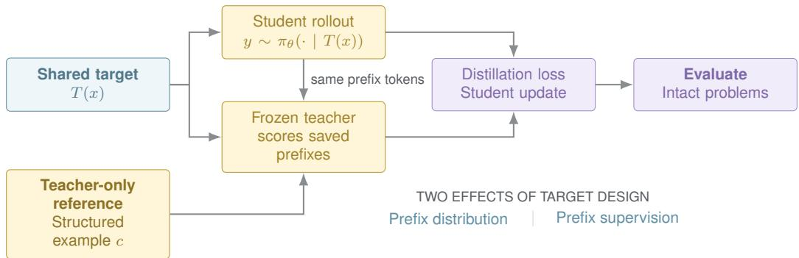
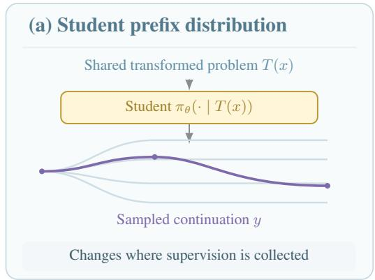
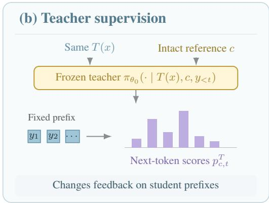
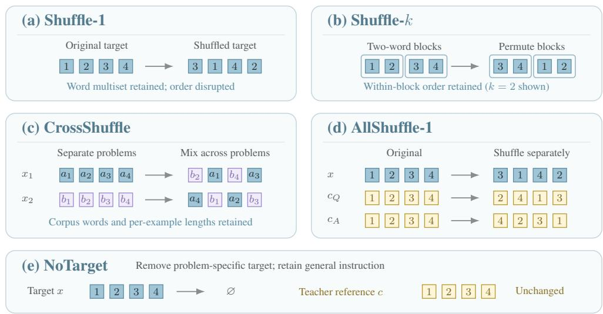
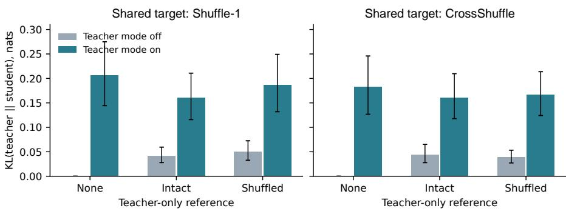

# SHUFFLED OPSD: WHEN SEMANTIC CONSISTENCY HURTS ON-POLICY SELF-DISTILLATION?

Qingyuan Zheng, Zhihao Dou

Duke University

{pearson.z,zhihao.dou}@duke.edu

§ GitHub

## ABSTRACT

Knowledge distillation improves a student model’s reasoning ability through supervision from a teacher. On-policy self-distillation (OPSD) uses the same model as both teacher and student under different contexts: the student generates reasoning trajectories from the question alone, while the teacher additionally receives a complete worked example and provides token-level supervision along those trajectories. Because the problem statement is shared, its content and ordering shape both student generation and teacher feedback. Preserving its semantic structure therefore seems natural, but does it always improve learning? We introduce Shuffled OPSD, which shuffles the words of the shared problem statement while keeping the teacher-only worked example intact. Across three mathematical reasoning benchmarks and three Qwen3 model scales, the method improves mean accuracy over both an intact-target control and Standard OPSD under matched training configurations. The largest gain over Standard OPSD is 3.52 percentage points on Qwen3-1.7B. Further controls show that preserving larger word blocks offers no advantage over word-level shuffling at the evaluated scales, whereas shuffling the teacher-only worked example reduces accuracy at every scale. Cross-problem mixing and target-removal experiments further distinguish the roles of problem content, word order, and teacher context. These results show that disrupting the shared problem statement can improve learning, while disrupting the teacher-only reference hurts performance. They challenge semantic coherence as a universally beneficial principle for OPSD and motivate closer study of how input structure shapes student generation and teacher supervision.

  
Figure 1: Shuffled OPSD transforms the problem statement shared by student and teacher during training. The transformation affects both student rollout generation and frozen-teacher scoring of the same prefixes, while the teacher-only reference remains intact. Evaluation uses the final step-50 student on the original unmodified problems.

## 1 INTRODUCTION

Recent advances in large language models (LLMs) have substantially improved mathematical reasoning through post-training methods such as reinforcement learning (Shao et al., 2024; Yu et al., 2025; Liu et al., 2025), supervised fine-tuning (Ouyang et al., 2022; Wei et al., 2021), and knowledge distillation (Zhao et al., 2026a). Among these approaches, on-policy distillation combines two useful properties: the student learns on trajectories sampled from its own policy, while a teacher provides dense token-level supervision on those trajectories (Agarwal et al., 2023; Gu et al., 2023). On-policy self-distillation (OPSD) (Zhao et al., 2026a) further removes the need for a separate teacher model by instantiating teacher and student from the same backbone under different conditioning contexts. The student sees the problem and generates its own response, while a frozen teacher scores the same prefixes with access to privileged context such as a worked solution.

Most work on OPSD has focused on the privileged information available to the teacher. Recent studies examine whether the teacher needs a correct solution, how much reasoning should be exposed, and whether useful learning persists with absent or unrelated references (Shrestha & Tessier, 2026; Zhang et al., 2026; Shen et al., 2026; Li et al., 2026; Zhao et al., 2026b). These results suggest that richer or more semantically relevant teacher context does not always translate into a better trained student. However, a separate part of the OPSD conditioning structure has received much less attention: the problem statement shared by both teacher and student is normally kept intact.

The shared problem plays a different role from teacher-only privileged information. It determines which trajectories the student generates and therefore which prefixes receive supervision. It also conditions the student and teacher distributions used to compute the distillation loss. Its structure thus affects both where learning occurs and what feedback the teacher provides. This makes the shared problem a distinct design dimension: changing its structure can alter the learning process even when the teacher reference and distillation objective remain fixed.

We ask whether preserving the semantic structure of the shared problem improves OPSD, or whether deliberately disrupting it can produce a better student. Destroying word order appears counterproductive for mathematical reasoning. Yet OPSD trains through teacher feedback on student-generated trajectories, rather than directly rewarding the semantic coherence of its inputs. A problem statement that is easier to interpret need not induce trajectories and supervision that lead to better learning. This motivates treating the shared problem as a training interface, whose structure can differ from that of the intact problems used at inference.

Based on this intuition, we introduce Shuffled OPSD. We first replace the teacher’s target-associated solution with a complete worked example from an unrelated problem, forming the UNRELATE DREF condition. Across three model scales, this condition retains performance comparable to Standard OPSD, with differences in three-benchmark mean accuracy of at most 0.55 percentage points. Building on this condition, Shuffled OPSD permutes the word order of the problem seen by both student and teacher while keeping the teacher-only reference intact. The student generates its trajectory from the shuffled problem, and the frozen teacher provides token-level supervision under the same transformed problem together with the reference. The transformation preserves the problem’s words, numbers, and symbolic content while disrupting their ordering. The distillation objective remains unchanged, and evaluation always uses the original intact problems.

Our experiments reveal a consistent pattern: replacing the teacher reference with an unrelated ex ample preserves performance, shuffling the shared problem improves it, and additionally shuffling the teacher reference reduces it. Using the final checkpoints after 50 optimizer steps, word-level shuffling improves three-benchmark mean accuracy over Standard OPSD by 3.52, 1.11, and 1.38 percentage points on Qwen3-1.7B, Qwen3-4B, and Qwen3-8B, respectively. At 1.7B and 4B, preserving larger word blocks offers no advantage over word-level shuffling. These results support selective semantic disruption: disrupting the shared problem’s ordering while retaining the structure of the teacher’s reference. They extend the study of OPSD from what information the teacher receives to how the shared input is organized.

Our contributions are as follows: First, we identify the semantic structure of the shared problem as a distinct design dimension in OPSD, affecting both student-generated trajectories and teacher supervision. Second, we introduce Shuffled OPSD, a simple input transformation that improves reasoning performance without changing the distillation objective or inference procedure. Third, through controlled interventions on the shared problem and teacher-only reference, we show that their semantic structures play different roles and establish selective semantic disruption as an effective input-design principle across three model scales.

  
Figure 2: Shuffled OPSD selectively transforms the problem statement shared by student and teacher. The transformation changes both the student prefix distribution and the distillation signal evaluated on those prefixes, while the teacher-only reference remains intact. Paths and token scores are schematic.

## 2 PRELIMINARIES

## 2.1 ON-POLICY SELF-DISTILLATION

In on-policy self-distillation (Agarwal et al., 2023; Zhao et al., 2026a), a student $\pi _ { \theta }$ generates continuation y for target x in mode $m _ { S }$ . A frozen teacher with initial parameters $\theta _ { 0 }$ scores the same prefixes with reference c and mode m :

$$
\begin{array} { r l } & { p _ { t } ^ { S } = \pi _ { \theta } ( \cdot \mid x , y _ { < t } ; m _ { S } ) , } \\ & { p _ { c , t } ^ { T } = \pi _ { \theta _ { 0 } } ( \cdot \mid x , c , y _ { < t } ; m _ { T } ) . } \end{array}\tag{1}
$$

Both models see the target, hence shared target. The reference provides teacher-only context, rather than a separate output sequence for the student to imitate.

For supervised positions $I ( y )$ , the training objective is

$$
\mathcal { L } _ { I , c } ( \theta ) = \mathbb { E } _ { x } \mathbb { E } _ { y \sim \pi _ { \theta } ( \cdot | x ; m _ { S } ) } \left[ \frac { 1 } { | I ( y ) | } \sum _ { t \in I ( y ) } \ell _ { \mathrm { c a p } } ( p _ { c , t } ^ { T } , p _ { t } ^ { S } ) \right] .\tag{2}
$$

The loss $\ell _ { \mathrm { c a p } }$ caps each signed teacher-to-student KL contribution from above at 0.05 before summation (Appendix A). It is therefore not ordinary KL. Teacher outputs, sampled tokens, and sampling probabilities are held fixed during differentiation.

## 2.2 SHARED AND TEACHER-ONLY CONDITIONING

The shared target directly conditions generation and scoring. The reference directly conditions only scoring, although the resulting updates can change later student rollouts. Our default student uses non-thinking mode and the teacher uses thinking mode, as specified by their chat templates.

Standard OPSD pairs each target with its associated solution. UnrelatedRef instead uses a worked example from another problem. Fixing this reference assignment allows us to vary the shared target independently. All evaluation uses intact problems without teacher-only context.

  
Figure 3: Input interventions in Shuffled OPSD. UnrelatedRef replaces the original teacher reference with an intact worked example from another problem. Shuffle-k additionally permutes blocks within the shared problem. CrossShuffle mixes words across problems, and NoTarget removes the specific problem statement. AllShuffle additionally shuffles the reference provided to the teacher. Here $c _ { Q }$ and $c _ { A }$ denote the reference question and solution. Permutations are illustrative.

## 3 DESIGN OF SHUFFLED OPSD

## 3.1 SEMANTIC STRUCTURE AS A DESIGN VARIABLE

OPSD provides the student and teacher with the same problem, while giving the teacher an additional reference. We distinguish two aspects of this input structure: whether the reference answers the target problem, and how the content within each input is organized. We first replace the reference with a complete worked example from another problem. We then shuffle the shared problem while keeping that example intact.

Let x denote the target problem, c the reference available only to the teacher, and $T$ a transformation of the shared problem. The student generates a trajectory $y \sim \pi _ { \boldsymbol { \theta } } ( \cdot \mid T ( x ) ; m _ { S } )$ . At each selected position t, the student and frozen teacher distributions are

$$
p _ { T , t } ^ { S } = \pi _ { \theta } ( \cdot \mid T ( x ) , y _ { < t } ; m _ { S } ) ,\tag{3}
$$

$$
p _ { T , c , t } ^ { T } = \pi _ { \theta _ { 0 } } ( \cdot \mid T ( x ) , c , y _ { < t } ; m _ { T } ) .\tag{4}
$$

Training minimizes

$$
\mathcal { L } _ { T , c } ( \theta ) = \mathbb { E } _ { x } \mathbb { E } _ { y \sim \pi _ { \theta } ( \cdot | T ( x ) ; m _ { S } ) } \left[ \frac { 1 } { | I ( y ) | } \sum _ { t \in I ( y ) } \ell _ { \mathrm { c a p } } \left( p _ { T , c , t } ^ { T } , p _ { T , t } ^ { S } \right) \right] .\tag{5}
$$

The reference c changes the feedback provided by the teacher. The transformation $T$ changes both the student’s rollout distribution and the predictions of both models on the resulting prefixes. We therefore treat reference selection and shared problem structure as separate design choices.

## 3.2 UNRELATEDREF

Standard OPSD uses the intact problem $T _ { I } ( x ) = x$ together with a reference solution associated with that problem, $c _ { \mathrm { a s s o c } } ( x )$ . Our first intervention, UnrelatedRef, retains the intact problem but replaces the reference with a complete worked example from another problem:

$$
c _ { U } ( x ) = \left( x ^ { \mathrm { { r e f } } } , a ^ { \mathrm { { r e f } } } \right) , \qquad x ^ { \mathrm { { r e f } } } \ne x .\tag{6}
$$

Here $x ^ { \mathrm { r e f } }$ and $a ^ { \mathrm { r e f } }$ denote the reference question and its worked solution. Both remain intact and are visible only to the teacher.

The reference pairing is fixed during training and reused across all subsequent interventions on the shared problem. UnrelatedRef tests whether the teacher needs a solution to the specific target problem. It also provides the starting point for Shuffled OPSD.

## 3.3 SHUFFLED OPSD

Shuffled OPSD builds on UnrelatedRef by shuffling the problem seen by both student and teacher. The unrelated worked example provided to the teacher remains intact. This allows us to change the shared problem without changing the reference.

We split x at whitespace boundaries and group the resulting words into consecutive blocks $b _ { 1 } , \dots , b _ { M }$ , each containing k words. The final block may contain fewer than k words. We sample a permutation σ and hold it fixed for that example during training:

$$
T _ { k } ( \boldsymbol { x } ) = b _ { \sigma ( 1 ) } \| b _ { \sigma ( 2 ) } \| \cdot \cdot \cdot \| b _ { \sigma ( M ) } ,\tag{7}
$$

where ∥ joins blocks with word separators.

Our main variant, Shuffle-1, permutes individual words. It preserves each word and its frequency, including numerical and symbolic strings within words, while disrupting their order. Larger blocks preserve more local order and allow us to test the value of that structure.

The student generates from $T _ { k } ( x )$ . The frozen teacher scores the same continuation using $T _ { k } ( x )$ and $c _ { U } ( x )$ as context. The student is updated with $\mathcal { L } _ { T _ { k } , c _ { U } }$ in Equation 5. The loss, optimizer, and reference pairing remain unchanged from UnrelatedRef. At inference, the student receives the original intact problem without an additional reference.

This design implements selective semantic disruption: we remove the association between the problem and reference, disrupt the order of the shared problem, and preserve the internal structure of the teacher’s worked example.

## 3.4 CONTROLS ON SEMANTIC STRUCTURE

We use matched controls to examine reference relevance, problem content and order, and the internal structure of the reference.

Reference relevance. Standard OPSD and UnrelatedRef both retain the intact target problem. Their comparison measures the effect of replacing the corresponding solution with an unrelated worked example. UnrelatedRef and Shuffle-1 use identical reference pairings, so their comparison measures the effect of shuffling the shared problem.

Problem content and order. Shuffle-k varies how much local word order is preserved. CrossShuffle pools words across training problems, globally permutes the pool, and redistributes words according to the original word count of each example. It disrupts both word order and problem membership while preserving word counts across the corpus. NoTarget removes the specific problem statement and its wrapper while retaining the general instruction. All these conditions use the same unrelated reference pairings.

Reference structure. AllShuffle-k applies block shuffling to both the shared problem and the reference provided to the teacher. AllShuffle-1 separately permutes words in the target problem, the reference question, and the reference solution. Comparing Shuffle-1 with AllShuffle-1 measures the additional effect of disrupting the reference structure.

These controls distinguish which input structures support learning. Additional experiments on reference removal and teacher mode appear in Section 4.3. Implementation details, fixed reference pairings, and permutation seeds are provided in Appendix A.

## 4 EXPERIMENTS

We evaluate Shuffled OPSD on three model scales and three competition-level mathematical reasoning benchmarks. Our main experiments compare shared-problem disruption with an intact-problem control and Standard OPSD. We then analyze how the effect changes with the amount and location of semantic structure preserved during training.

## 4.1 EXPERIMENTAL SETUP

Models and training. We experiment with Qwen3-1.7B, Qwen3-4B, and Qwen3-8B (Yang et al., 2025) using LoRA adapters (Hu et al., 2021) (r = 64, α = 128). Training examples are drawn from the OpenThoughts mathematical-reasoning subset used by the original OPSD study. All conditions use 50 optimizer steps, batch size 16, learning rate $5 \times 1 0 ^ { - 6 }$ , and training seed 42. The teacher is the frozen initial backbone in thinking mode, while the student generates in non-thinking mode with rollouts capped at 1,024 tokens. We report the step-50 checkpoint for all trained conditions. Additional implementation details appear in Appendix A.

Evaluation. We evaluate on AIME 2024, AIME 2025, and HMMT February 2025, using 30 problems per benchmark. Evaluation uses the original intact problems without teacher-only context. We sample 12 responses per problem in thinking mode with temperature 1, top-p = 0.95, and a maximum of 38,912 new tokens. Avg12 is the primary metric, and the three-benchmark mean weights all benchmarks equally. Compared conditions use the same problem order and generation seed schedule.

Statistics. Paired 95% confidence intervals are estimated with 10,000 problem-cluster bootstrap resamples, keeping all responses from each problem in the same cluster and using matched problem indices across conditions.

## 4.2 MAIN RESULTS

Table 1 shows that Shuffle-1 improves mean accuracy at all three model scales. We organize the comparisons around two questions: whether shuffling the shared problem improves learning, and whether the reference provided to the teacher should also be shuffled.

Shared problem order is a useful training variable. Shuffle-1 and UnrelatedRef use the same reference and differ only in whether the shared problem is shuffled. Shuffle-1 improves the threebenchmark mean by 3.98, 0.56, and 1.11 percentage points on Qwen3-1.7B, Qwen3-4B, and Qwen3-8B, respectively. At 1.7B and 8B, it improves all three benchmarks. Because evaluation uses intact problems, these gains show that disrupting the training input can improve reasoning on normally structured questions. The shared problem therefore serves as more than a statement to be solved: its organization is a training variable that affects student generation and teacher feedback.

The complete design outperforms Standard OPSD. Shuffle-1 exceeds Standard OPSD by 3.52, 1.11, and 1.38 percentage points across the three scales. Standard OPSD supplies a reference associated with the target, whereas Shuffle-1 combines an unrelated reference with a shuffled problem. The stronger results show that accurate pairing and intact word order are not prerequisites for effective distillation. CrossShuffle also exceeds Standard OPSD at every scale, but remains below Shuffle-1. This comparison favors retaining the words of each problem while changing their order, rather than replacing their original grouping with words drawn from other problems. The largest improvement occurs at 1.7B, showing that this input transformation is particularly effective for the smallest model in our evaluation.

Reference structure remains valuable. AllShuffle-1 additionally shuffles the reference while retaining the same shuffled problem. Mean accuracy then falls by 2.41, 0.65, and 1.57 percentage points at 1.7B, 4B, and 8B. Thus, the benefit comes from where disruption is applied, rather than from increasing disruption throughout the input. The shared problem shapes both the trajectories generated by the student and the feedback provided by the teacher. The reference supplies context only to the teacher. Their different roles are reflected in the results: disrupting shared problem order improves learning, while preserving reference structure supports stronger supervision. This pattern motivates selective semantic disruption as the central design principle of Shuffled OPSD.

Table 1: Evaluation on intact problems, using each trained condition’s final checkpoint (step 50). Entries are Avg@12 (%); Avg. is the equally weighted three-benchmark mean. ∆Ref and ∆OPSD are differences in the reported means relative to UnrelatedRef and Standard OPSD, respectively, in percentage points. UnrelatedRef uses unrelated references; OPSD uses target-associated references. Bold marks the largest value in each score column within a model size.
<table><tr><td>Model</td><td>Condition</td><td>AIME24</td><td>AIME25</td><td>HMMT25</td><td>Avg.</td><td>∆Ref</td><td>∆OPSD</td></tr><tr><td rowspan="8">Qwen3-1.7B</td><td>Frozen Base</td><td>50.28</td><td>35.00</td><td>21.94</td><td>35.74</td><td>-3.06</td><td>-3.52</td></tr><tr><td>UnrelatedRef</td><td>52.78</td><td>39.17</td><td>24.44</td><td>38.80</td><td>0.00</td><td>-0.46</td></tr><tr><td>OPSD</td><td>53.06</td><td>38.89</td><td>25.83</td><td>39.26</td><td>+0.46</td><td>0.00</td></tr><tr><td>Shuffle-1 (Ours)</td><td>57.22</td><td>45.83</td><td>25.28</td><td>42.78</td><td>+3.98</td><td>+3.52</td></tr><tr><td>CrossShuffle</td><td>53.33</td><td>44.72</td><td>25.28</td><td>41.11</td><td>+2.31</td><td>+1.85</td></tr><tr><td>AllShufle-1</td><td>51.94</td><td>42.50</td><td>26.67</td><td>40.37</td><td>+1.57</td><td>+1.11</td></tr><tr><td>NoTarget</td><td>56.67</td><td>43.33</td><td>25.28</td><td>41.76</td><td>+2.96</td><td>+2.50</td></tr><tr><td>Frozen Base</td><td>72.78</td><td>63.89</td><td>43.33</td><td>60.00</td><td>-2.50</td><td>-1.95</td></tr><tr><td rowspan="7">Qwen3-4B</td><td>UnrelatedRef</td><td>75.00</td><td>68.61</td><td>43.89</td><td>62.50</td><td>0.00</td><td>+0.55</td></tr><tr><td>OPSD</td><td>73.06</td><td>68.06</td><td>44.72</td><td>61.95</td><td>-0.55</td><td>0.00</td></tr><tr><td>Shuffle-1 (Ours)</td><td>75.28</td><td>70.00</td><td>43.89</td><td>63.06</td><td>+0.56</td><td>+1.11</td></tr><tr><td>CrossShuffle</td><td>77.22</td><td>70.28</td><td>40.83</td><td>62.78</td><td>+0.28</td><td>+0.83</td></tr><tr><td>AllShufle-1</td><td>74.72</td><td>70.28</td><td>42.22</td><td>62.41</td><td>-0.09</td><td>+0.46</td></tr><tr><td>NoTarget</td><td>74.72</td><td>65.56</td><td>45.56</td><td>61.95</td><td>-0.55</td><td>0.00</td></tr><tr><td>Frozen Base</td><td>73.61</td><td>64.17</td><td>44.17</td><td>60.65</td><td>-2.68</td><td>-2.41</td></tr><tr><td rowspan="7">Qwen3-8B</td><td>UnrelatedRef</td><td>76.11</td><td>68.89</td><td>45.00</td><td>63.33</td><td>0.00</td><td></td></tr><tr><td>OPSD</td><td>75.56</td><td>70.28</td><td></td><td></td><td>-0.27</td><td>+0.27</td></tr><tr><td>Shuffle-1 (Ours)</td><td>77.78</td><td>69.72</td><td>43.33</td><td>63.06 64.44</td><td>+1.11</td><td>0.00</td></tr><tr><td>CrossShuffle</td><td>74.17</td><td>69.17</td><td>45.83 46.94</td><td>63.43</td><td>+0.10</td><td>+1.38</td></tr><tr><td>AllShuffle-1</td><td>76.39</td><td>70.56</td><td>41.67</td><td>62.87</td><td>-0.46</td><td>+0.37</td></tr><tr><td>NoTarget</td><td>75.56</td><td>65.83</td><td>45.28</td><td>62.22</td><td>-1.11</td><td>-0.19 -0.84</td></tr><tr><td></td><td></td><td></td><td></td><td></td><td></td><td></td></tr></table>

## 4.3 ANALYSIS AND DISCUSSION

The experiments reveal a structural asymmetry in OPSD. Semantic structure in the shared problem is not uniformly beneficial, whereas structure in the teacher-only reference remains valuable. The shared problem determines where supervision is collected; the reference shapes the teacher signal at those locations.

## 4.3.1 HOW MUCH STRUCTURE SHOULD BE PRESERVED?

Among the tested target-side perturbations, the strongest disruption performs best. Shuffle-1 reaches 42.78% at 1.7B, compared with 41.02% for Shuffle-4 and 40.65% for Shuffle-8, and 63.06% at 4B, compared with 62.22% and 62.87%, respectively. Thus, preserving more local word order does not improve performance.

CrossShuffle and NoTarget further isolate what should be preserved. They reach 41.11%, 62.78%, and 63.43%, and 41.76%, 61.95%, and 62.22% across the three scales, respectively, both below Shuffle-1 at every scale. This suggests that problem-specific lexical and symbolic content matters more than intact syntax or coherent surface form. Full results appear in Appendix B.

## 4.3.2 WHERE DOES DISRUPTION HELP?

AllShuffle-1 additionally shuffles the teacher-only reference and reduces mean accuracy by 2.41, 0.65, and 1.57 percentage points at 1.7B, 4B, and 8B. Thus, the same disruption that helps on the shared problem hurts on the teacher-only context. This motivates selective semantic disruption: perturb the shared input that shapes student trajectories while preserving structured teacher guidance.

  
Figure 4: Teacher–student KL on identical prefixes, excluding the first generated token. Error bar show 95% bootstrap intervals across 32 questions.

At 1.7B, Shuffle-1 raises Avg12 from 38.80% to 42.78% and Vote12 from 48.89% to 52.22%, while Pass12 remains at 61.11%. At 4B, Avg12 rises from 62.50% to 63.06% and Vote12 from 67.78% to 72.22%, while Pass12 changes little. The gain therefore comes mainly from making successful reasoning more reliable rather than from solving substantially more problems.

Table 2: Reference and teacher-mode controls on Qwen3-1.7B. All students use non-thinking mode without a problem-specific target. On/Off denotes teacher thinking mode. Each control changes one factor relative to NoTarget. Means are three-benchmark Avg@12 (%); ∆NoTarget is in percentage points.
<table><tr><td>Condition</td><td>Reference?</td><td>Teacher mode</td><td>Mean</td><td>∆NoTarget</td></tr><tr><td>NoTarget</td><td>Yes</td><td>On</td><td>41.76</td><td>+0.00</td></tr><tr><td>NoTarget-NoRef</td><td>No</td><td>On</td><td>37.78</td><td>-3.98</td></tr><tr><td>NoTarget-SameMode</td><td>Yes</td><td>Off</td><td>38.98</td><td>-2.78</td></tr></table>

## 4.3.3 WHAT SUPERVISION SURVIVES DISRUPTION?

Under NoTarget, removing the unrelated reference lowers 1.7B accuracy from 41.76% to 37.78%, while switching the teacher to non-thinking mode lowers it to 38.98% (Table 2). Both reference context and teacher reasoning mode therefore remain useful even without a coherent shared problem.

We further replay saved Shuffle-1 and CrossShuffle trajectories from 32 questions using the frozen Qwen3-4B model, fixing continuation tokens while varying only the teacher’s reference and thinking mode.

Table 3: Teacher–student divergence on matched Shuffle-1 prefixes. Entries are uncapped $D _ { \mathrm { K L } } ( p ^ { T } \Vert p ^ { S } )$ in nats for the frozen Qwen3-4B base student, excluding the first generated position. ∆KL is thinking minus non-thinking KL, not a divergence between the two teachers.
<table><tr><td>Teacher-only reference</td><td>Non-thinking</td><td>Thinking</td><td>∆KL</td></tr><tr><td>None</td><td>0.0000</td><td>0.2064</td><td>+0.2064</td></tr><tr><td>Intact unrelated</td><td>0.0419</td><td>0.1605</td><td>+0.1186</td></tr><tr><td>Word-shuffled</td><td>0.0507</td><td>0.1869</td><td>+0.1362</td></tr></table>

Under Shuffle-1, teacher thinking increases KL from 0.0419 to 0.1605 nats with an intact unrelated reference and from 0.0507 to 0.1869 nats with a shuffled reference. Without a reference, KL reaches 0.2064 nats (Table 3), with the same qualitative pattern under CrossShuffle.

Teacher–student divergence therefore survives semantic disruption, but its magnitude alone does not explain performance: shuffling the reference increases KL while reducing final accuracy. OPSD is thus governed jointly by where supervision is collected and what teacher distribution is provided there.

## 5 RELATED WORK

Distillation on student trajectories. Knowledge distillation transfers predictive distributions (Hinton et al., 2015), and generalized distillation connects teacher supervision to privileged information (Lopez-Paz et al., 2015). Same-architecture students can also benefit from distillation (Furlanello et al., 2018). Sequence-level distillation uses teacher-generated outputs (Kim & Rush, 2016), whereas GKD and MiniLLM supervise student-generated trajectories (Agarwal et al., 2023; Gu et al., 2023). DistiLLM variants examine response sources and loss design (Ko et al., 2024; 2025). The importance of learner-visited states also arises in interactive imitation learning (Ross et al., 2011). We study the shared input that shapes those states and their supervision.

Context-conditioned self-teaching. Context distillation transfers context-induced behavior into model parameters (Snell et al., 2022; Ye et al., 2026). Related methods learn from privileged solutions (Zhao et al., 2026a), demonstrations (Shenfeld et al., 2026), textual feedback (Hubotter et al.¨ , 2026), or successful generated rationales (Zelikman et al., 2022). Recent OPSD studies examine reference benefits (Shrestha & Tessier, 2026; Zhang et al., 2026), problem-space guidance (Zhao et al., 2026b), trajectory-conditioned teachers (Feng et al., 2026), and pseudo-solutions (Li et al., 2026). Work on thinking degradation motivates changes to token-level supervision (Kaur et al., 2026; Peng et al., 2026; Shen et al., 2026). Our design complements these approaches by changing the input shared by student and teacher while retaining a fixed reference assignment.

Text perturbations and prompt structure. Word swaps in augmentation (Wei & Zou, 2019), denoising from corrupted text (Lewis et al., 2020), shuffled-text pretraining (Sinha et al., 2021a), and word-order robustness tests (Sinha et al., 2021b) provide precedents for disrupting text structure. Demonstration content and order also affect in-context prediction (Min et al., 2022; Lu et al., 2022). Shuffled OPSD uses transformed text to collect and supervise student trajectories, without reconstructing the intact target or assigning it the original answer as a label. The outcome of interest is accuracy after training, evaluated on intact problems.

## 6 CONCLUSION

Our results show that semantic coherence is not uniformly beneficial for OPSD. Shuffled OPSD improves reasoning by disrupting the shared problem while preserving a structured teacher-only reference, outperforming the compared conditions across three model scales without changing the distillation objective or inference procedure. The key finding is a structural asymmetry: shuffling the shared problem helps, whereas shuffling the teacher reference hurts, motivating selective semantic disruption as a design principle for OPSD—perturb the input that shapes student trajectories while preserving the structure that supports teacher guidance. More broadly, distillation inputs should be designed not only for semantic fidelity, but for the learning dynamics they induce, through both the trajectories they elicit and the supervision they enable.

## AI USE STATEMENT

The authors defined the research questions, interventions, experimental design, and interpretation of results. Generative AI tools assisted with writing, language editing, and debugging existing code and experimental workflows. The authors are responsible for verifying the measurements, analysis, and final manuscript.

## REPRODUCIBILITY STATEMENT

The main paper and appendix specify the data transformations, reference pairing, training configuration, evaluation protocol, and diagnostic aggregation. The complete codebase and model checkpoints will be released upon acceptance.

## REFERENCES

Rishabh Agarwal, Nino Vieillard, Yongchao Zhou, Piotr Stanczyk, Sabela Ramos, Matthieu Geist, and Olivier Bachem. On-Policy Distillation of Language Models: Learning from Self-Generated Mistakes, 2023. URL https://arxiv.org/abs/2306.13649.

Yangyang Feng, Zhuoyan Feng, and Junlan Chen. PAST: Privileged Adaptation from Complete Student Trajectories for On-Policy Self-Distillation, 2026. URL https://arxiv.org/abs/ 2608.08726.

Tommaso Furlanello, Zachary Lipton, Michael Tschannen, Laurent Itti, and Anima Anandkumar. Born Again Neural Networks. In International Conference on Machine Learning, pp. 1607–1616, 2018. URL https://proceedings.mlr.press/v80/furlanello18a.html.

Yuxian Gu, Li Dong, Furu Wei, and Minlie Huang. MiniLLM: On-Policy Distillation of Large Language Models, 2023. URL https://arxiv.org/abs/2306.08543.

Geoffrey Hinton, Oriol Vinyals, and Jeff Dean. Distilling the Knowledge in a Neural Network, 2015. URL https://arxiv.org/abs/1503.02531.

Edward J. Hu, Yelong Shen, Phillip Wallis, Zeyuan Allen-Zhu, Yuanzhi Li, Shean Wang, Lu Wang, and Weizhu Chen. LoRA: Low-rank adaptation of large language models, 2021. URL https: //arxiv.org/abs/2106.09685.

Jonas Hubotter, Frederike L¨ ubeck, Lejs Behric, Anton Baumann, Marco Bagatella, Daniel Marta,¨ Ido Hakimi, Idan Shenfeld, Thomas Kleine Buening, Carlos Guestrin, and Andreas Krause. Reinforcement Learning via Self-Distillation, 2026. URL https://arxiv.org/abs/2601. 20802.

Simran Kaur, Narutatsu Ri, Yinghui He, Liam Fowl, and Sanjeev Arora. Rethinking On-Policy Self-Distillation for Thinking Models, 2026. URL https://arxiv.org/abs/2607.05184.

Yoon Kim and Alexander M. Rush. Sequence-Level Knowledge Distillation. In Proceedings ofthe 2016 Conference on Empirical Methods in Natural Language Processing, pp. 1317–1327, 2016. doi: 10.18653/v1/D16-1139. URL https://aclanthology.org/D16-1139/.

Jongwoo Ko, Sungnyun Kim, Tianyi Chen, and Se-Young Yun. DistiLLM: Towards Streamlined Distillation for Large Language Models. In International Conference on Machine Learning, pp. 24872–24895, 2024. URL https://proceedings.mlr.press/v235/ko24c.html.

Jongwoo Ko, Tianyi Chen, Sungnyun Kim, Tianyu Ding, Luming Liang, Ilya Zharkov, and Se-Young Yun. DistiLLM-2: A Contrastive Approach Boosts the Distillation of LLMs, 2025. URL https://arxiv.org/abs/2503.07067.

Mike Lewis, Yinhan Liu, Naman Goyal, Marjan Ghazvininejad, Abdelrahman Mohamed, Omer Levy, Veselin Stoyanov, and Luke Zettlemoyer. BART: Denoising Sequence-to-Sequence Pretraining for Natural Language Generation, Translation, and Comprehension. In Proceedings of the 58th Annual Meeting of the Association for Computational Linguistics, pp. 7871–7880,

2020. doi: 10.18653/v1/2020.acl-main.703. URL https://aclanthology.org/2020. acl-main.703/.

Yijiang Li, Bingyang Wang, Yijun Liang, Yunjie Tian, Di Fu, and Nuno Vasconcelos. On-Policy Self-Distillation without Any Supervision, 2026. URL https://arxiv.org/abs/2608. 06296.

Zichen Liu, Changyu Chen, Wenjun Li, Penghui Qi, Tianyu Pang, Chao Du, Wee Sun Lee, and Min Lin. Understanding R1-Zero-Like Training: A Critical Perspective. arXiv preprint arXiv:2503.20783, 2025. URL https://arxiv.org/abs/2503.20783.

David Lopez-Paz, Leon Bottou, Bernhard Sch´ olkopf, and Vladimir Vapnik. Unifying distillation¨ and privileged information, 2015. URL https://arxiv.org/abs/1511.03643.

Yao Lu, Max Bartolo, Alastair Moore, Sebastian Riedel, and Pontus Stenetorp. Fantastically Ordered Prompts and Where to Find Them: Overcoming Few-Shot Prompt Order Sensitivity. In Proceedings of the 60th Annual Meeting of the Association for Computational Linguistics (Volume 1: Long Papers), pp. 8086–8098, 2022. doi: 10.18653/v1/2022.acl-long.556. URL https://aclanthology.org/2022.acl-long.556/.

Sewon Min, Xinxi Lyu, Ari Holtzman, Mikel Artetxe, Mike Lewis, Hannaneh Hajishirzi, and Luke Zettlemoyer. Rethinking the role of demonstrations: What makes in-context learning work?, 2022. URL https://arxiv.org/abs/2202.12837.

Long Ouyang, Jeff Wu, Xu Jiang, Diogo Almeida, Carroll L. Wainwright, Pamela Mishkin, Chong Zhang, Sandhini Agarwal, Katarina Slama, Alex Ray, et al. Training language models to follow instructions with human feedback. Advances in neural information processing systems, 35:27730–27744, 2022. URL https://proceedings.neurips.cc/paper\_files/paper/2022/hash/ b1efde53be364a73914f58805a001731-Abstract-Conference.html.

Keqin Peng, Chen Li, Yuanxin Ouyang, Yancheng Yuan, and Liang Ding. Diagnosing and Mitigating Thinking Collapse in On-Policy Self-Distillation, 2026. URL https://arxiv.org/ abs/2607.10805.

Stephane Ross, Geoffrey Gordon, and Drew Bagnell. A Reduction of Imitation Learning and Structured Prediction to No-Regret Online Learning. In Proceedings of the Fourteenth International Conference on Artificial Intelligence and Statistics, pp. 627–635, 2011. URL https: //proceedings.mlr.press/v15/ross11a.html.

Zhihong Shao, Peiyi Wang, Qihao Zhu, Runxin Xu, Junxiao Song, Xiao Bi, Haowei Zhang, Mingchuan Zhang, Y. K. Li, Y. Wu, and Daya Guo. DeepSeekMath: Pushing the Limits of Mathematical Reasoning in Open Language Models. arXiv preprint arXiv:2402.03300, 2024. URL https://arxiv.org/abs/2402.03300.

Zhanming Shen, Jintao Tong, Shaotian Yan, Chen Shen, Hao Chen, Wentao Ye, Xiaomeng Hu, Rui Miao, Haobo Wang, Junbo Zhao, Gang Chen, and Jieping Ye. Purified OPSD: On-Policy Self-Distillation Without Losing How to Think, 2026. URL https://arxiv.org/abs/2607. 02234.

Idan Shenfeld, Mehul Damani, Jonas Hubotter, and Pulkit Agrawal. Self-Distillation Enables Con-¨ tinual Learning, 2026. URL https://arxiv.org/abs/2601.19897.

Samyak Shrestha and Alexander Tessier. Rethinking Privileged Information in On-Policy Self-Distillation, 2026. URL https://arxiv.org/abs/2608.18271.

Koustuv Sinha, Robin Jia, Dieuwke Hupkes, Joelle Pineau, Adina Williams, and Douwe Kiela. Masked Language Modeling and the Distributional Hypothesis: Order Word Matters Pre-training for Little. In Proceedings of the 2021 Conference on Empirical Methods in Natural Language Processing, pp. 2888–2913, 2021a. doi: 10.18653/v1/2021.emnlp-main.230. URL https: //aclanthology.org/2021.emnlp-main.230/.

Koustuv Sinha, Prasanna Parthasarathi, Joelle Pineau, and Adina Williams. UnNatural Language Inference. In Proceedings of the 59th Annual Meeting of the Association for Computational Linguistics and the 11th International Joint Conference on Natural Language Processing (Volume 1: Long Papers), pp. 7329–7346, 2021b. doi: 10.18653/v1/2021.acl-long.569. URL https: //aclanthology.org/2021.acl-long.569/.

Charlie Snell, Dan Klein, and Ruiqi Zhong. Learning by Distilling Context, 2022. URL https: //arxiv.org/abs/2209.15189.

Jason Wei and Kai Zou. EDA: Easy Data Augmentation Techniques for Boosting Performance on Text Classification Tasks. In Proceedings of the 2019 Conference on Empirical Methods in Natural Language Processing and the 9th International Joint Conference on Natural Language Processing (EMNLP-IJCNLP), pp. 6382–6388, 2019. doi: 10.18653/v1/D19-1670. URL https://aclanthology.org/D19-1670/.

Jason Wei, Maarten Bosma, Vincent Y Zhao, Kelvin Guu, Adams Wei Yu, Brian Lester, Nan Du, Andrew M Dai, and Quoc V Le. Finetuned language models are zero-shot learners. arXiv preprint arXiv:2109.01652, 2021. URL https://arxiv.org/abs/2109.01652.

An Yang et al. Qwen3 technical report, 2025. URL https://arxiv.org/abs/2505.09388.

Tianzhu Ye, Li Dong, Xun Wu, Shaohan Huang, and Furu Wei. On-Policy Context Distillation for Language Models, 2026. URL https://arxiv.org/abs/2602.12275.

Qiying Yu, Zheng Zhang, Ruofei Zhu, Yufeng Yuan, Xiaochen Zuo, Yu Yue, Weinan Dai, Tiantian Fan, Gaohong Liu, Juncai Liu, Lingjun Liu, et al. DAPO: An Open-Source LLM Reinforcement Learning System at Scale. Advances in Neural Information Processing Systems, 38:113222– 113244, 2025. URL https://proceedings.neurips.cc/paper\_files/paper/ 2025/hash/a4277440d50f1f15d2cb4c14f7e0c0d2-Abstract-Conference. html.

Eric Zelikman, Yuhuai Wu, Jesse Mu, and Noah D. Goodman. STaR: Bootstrapping Reasoning With Reasoning, 2022. URL https://arxiv.org/abs/2203.14465.

XiuYu Zhang, Wei Chow, Junfeng Fang, Xingyu Zhu, Zhenkai Liang, and Tat-Seng Chua. What Does Privileged Information Add to On-Policy Self-Distillation?, 2026. URL https:// arxiv.org/abs/2609.20612.

Siyan Zhao, Zhihui Xie, Mengchen Liu, Jing Huang, Guan Pang, Feiyu Chen, and Aditya Grover. Self-Distilled Reasoner: On-Policy Self-Distillation for Large Language Models, 2026a. URL https://arxiv.org/abs/2601.18734.

Xuyang Zhao, Liting Zhang, Zichen Xu, Zhihu Wang, Xu Caiyue, Shiwan Zhao, and Qicheng Li. Is More Privileged Information Better? From Solution Traces to Problem-Solving Structure in Self-Distilled Reasoning, 2026b. URL https://arxiv.org/abs/2608.01589.

## A IMPLEMENTATION AND EVALUATION DETAILS

This appendix provides the implementation details shared across the Qwen3-1.7B, Qwen3-4B, and Qwen3-8B experiments. Unless explicitly varied by an intervention, all conditions use the same training data, optimization settings, rollout procedure, distillation objective, and evaluation protocol.

## A.1 TRAINING CONFIGURATION

Data. We use the full OpenThoughts mathematical-reasoning training pool used by the original OPSD study, containing 29,434 problem–solution pairs. No fixed 800-example subset is constructed. All conditions draw training examples from the same seeded ordering of this pool.

Models and optimization. Students initialize from Qwen3-1.7B, Qwen3-4B, or Qwen3-8B with fresh LoRA adapters. The backbone remains frozen and only the student adapter is optimized. The teacher is a frozen copy of the initial backbone and remains fixed throughout training. Student rollouts use non-thinking mode, while teacher scoring uses thinking mode unless explicitly changed by an intervention.

Table 4 summarizes the shared training configuration.

Table 4: Shared training configuration for all main experiments.
<table><tr><td>Setting</td><td>Value</td></tr><tr><td>Backbones</td><td>Qwen3-1.7B; Qwen3-4B; Qwen3-8B</td></tr><tr><td>Training data</td><td>Full OpenThoughts mathematical-reasoning training pool (29,434 records)</td></tr><tr><td>Training seed</td><td>42</td></tr><tr><td>Optimizer steps</td><td>50</td></tr><tr><td>Global / generation batch size</td><td>16 / 16</td></tr><tr><td>Optimizer</td><td>AdamW;  $\beta _ { 1 } = 0 . 9 , \beta _ { 2 } = 0 . 9 9 9 , { \epsilon } = 1 0 ^ { - 8 }$ </td></tr><tr><td>Learning rate</td><td> $5 \times 1 0 ^ { - 6 }$  , constant schedule</td></tr><tr><td>Warmup / weight decay</td><td>0/0</td></tr><tr><td>Gradient clipping</td><td>Global norm 0.1</td></tr><tr><td>LoRA LoRA modules</td><td> $r = 6 4 , \alpha = 1 2 8 .$  dropout 0</td></tr><tr><td></td><td>q-proj, k-proj, v-proj, o-proj, gate-proj, up-proj, down_proj</td></tr><tr><td>Student / teacher mode</td><td>Non-thinking / thinking</td></tr><tr><td>Rollout sampling</td><td>Temperature 1.1, top-p = 0.95, top-k = 20</td></tr><tr><td>Maximum prompt / response length</td><td>4,096 / 1,024 tokens</td></tr><tr><td>Distillation temperature</td><td>1.1</td></tr><tr><td>Pointwise KL cap</td><td>0.05</td></tr><tr><td>Checkpoint interval</td><td>Every 10 optimizer steps</td></tr></table>

On-policy rollouts. At each optimizer step, responses are sampled from the current student under the condition-specific input. The same generated continuation is then replayed under the student and teacher prompts to obtain next-token distributions on identical prefixes. Prompt and padding tokens are excluded from the loss. An EOS token is included when generated; responses reaching the maximum length are scored without appending an artificial EOS.

Distillation objective. Let $p _ { i t } ( v )$ and $q _ { i t } ( v )$ denote the temperature-scaled student and frozenteacher probabilities for vocabulary entry v at response position t of example i. For batch size B, the implemented objective is

$$
\mathcal { L } _ { c } = \frac { 1 } { B } \sum _ { i = 1 } ^ { B } \frac { 1 } { T _ { i } } \sum _ { t = 1 } ^ { T _ { i } } \sum _ { v \in \mathcal { V } } \operatorname* { m i n } \left\{ q _ { i t } ( v ) \log \frac { q _ { i t } ( v ) } { p _ { i t } ( v ) } , c \right\} , \qquad c = 0 . 0 5 .\tag{8}
$$

Table 5: Semantic interventions used in the experiments. Only the listed conditioning component differs from the matched control.
<table><tr><td>Condition</td><td>Shared problem</td><td>Teacher-only reference</td><td>Teacher mode</td></tr><tr><td>Standard OPSD</td><td>Intact</td><td>Associated solution</td><td>Thinking</td></tr><tr><td>UnrelatedRef</td><td>Intact</td><td>Unrelated worked example</td><td>Thinking</td></tr><tr><td>Shuffle-1</td><td>Word shuffled</td><td>Same as UnrelatedRef</td><td>Thinking</td></tr><tr><td>Shuffle-4</td><td>Four-word blocks shuffled</td><td>Same as UnrelatedRef</td><td>Thinking</td></tr><tr><td>Shuffle-8</td><td>Eight-word blocks shuffled</td><td>Same as UnrelatedRef</td><td>Thinking</td></tr><tr><td>CrossShuffle</td><td>Words redistributed across prob- lems</td><td>Same as UnrelatedRef</td><td>Thinking</td></tr><tr><td>NoTarget</td><td>Problem-specific content removed</td><td>Same as UnrelatedRef</td><td>Thinking</td></tr><tr><td>AllShuffle-1</td><td>Word shuffled</td><td>Unrelated example word shuffled</td><td>Thinking</td></tr><tr><td>NoTarget-NoRef</td><td>Same as NoTarget</td><td>None</td><td>Thinking</td></tr><tr><td>NoTarget-SameMode</td><td>Same as NoTarget</td><td>Same as UnrelatedRef</td><td>Non-thinking</td></tr></table>

The cap is applied independently to each signed vocabulary contribution before summation; negative contributions are retained. The loss is averaged over supervised positions within each response and then equally across responses. Teacher probabilities, sampled continuations, and sampling probabilities are treated as constants during differentiation. No additional temperature-squared multiplier is applied.

## A.2 SEMANTIC INTERVENTIONS

Table 5 summarizes the intervention conditions. The shared problem is always identical in the student and teacher prompts; privileged references appear only in the teacher prompt.

Unrelated references. Let the training pool contain N = 29,434 records. For training record i, UnrelatedRef uses record

$$
( i + 1 1 1 ) \bmod N\tag{9}
$$

as the teacher-only worked example. The nonzero cyclic shift prevents self-pairing and is fixed across all matched target-side interventions.

Within-problem shuffling. Shuffle-k partitions the problem into consecutive blocks of k whitespace-delimited words and permutes the block order. Shuffle-1 therefore permutes individual words, while larger k preserves progressively longer local spans. The transformation preserves the word multiset but need not preserve tokenizer-token counts.

Cross-problem shuffling. CrossShuffle pools words across the training problems, applies a fixed global permutation, and redistributes them according to the original per-example word counts. It preserves corpus-level lexical counts and example lengths while breaking problem membership.

Reference shuffling and target removal. AllShuffle-1 applies word-level shuffling separately to the shared problem, the unrelated reference problem, and its solution. These fields are never pooled together. NoTarget removes the problem-specific statement and its wrapper while retaining the general instruction. NoTarget-NoRef additionally removes the teacher reference. Generated student continuations are never shuffled.

## A.3 EVALUATION PROTOCOL

We evaluate AIME 2024, AIME 2025, and HMMT February 2025, with 30 problems per benchmark. Evaluation always uses the original intact problem statements and no teacher-only reference. For every trained condition, we evaluate and report the final checkpoint after 50 optimizer steps under the same protocol.

Table 6: Benchmark evaluation protocol.
<table><tr><td>Setting</td><td>Value</td></tr><tr><td>Benchmarks</td><td>AIME 2024; AIME 2025; HMMT February 2025</td></tr><tr><td>Problems per benchmark</td><td>30</td></tr><tr><td>Input</td><td>Original intact problem</td></tr><tr><td>Teacher-only reference</td><td>None</td></tr><tr><td>Thinking mode</td><td>Enabled</td></tr><tr><td>Temperature</td><td>1.0</td></tr><tr><td>Top-p / top-k</td><td>0.95 / disabled</td></tr><tr><td>Maximum new tokens</td><td>38,912</td></tr><tr><td>Responses per problem</td><td>12</td></tr><tr><td>Responses per checkpoint</td><td>1,080 across all three benchmarks</td></tr><tr><td>Reported checkpoint</td><td>Final saved checkpoint after 50 optimizer steps for every condition</td></tr><tr><td>Question ordering</td><td>Fixed shuffle with seed 2026</td></tr><tr><td>Generation seed</td><td> $s _ { i } = 2 0 2 6 + i$  for shuffled position i</td></tr><tr><td>Primary metric</td><td>Avg@12</td></tr><tr><td>Benchmark aggregation</td><td>Equal weight across the three benchmarks</td></tr></table>

Final-checkpoint evaluation. Checkpoints are saved every 10 optimizer steps. All trained conditions are evaluated at the final checkpoint after 50 optimizer steps. Intermediate checkpoints and benchmark scores are not used for checkpoint selection; the frozen-base rows use the untrained backbone.

Evaluation metric. Let $R _ { i , j } \in \{ 0 , 1 \}$ indicate whether response j to problem i is correct. For N problems,

$$
\mathrm { A v g @ 1 2 } = \frac { 1 } { 1 2 N } \sum _ { i = 1 } ^ { N } \sum _ { j = 1 } ^ { 1 2 } R _ { i , j } .\tag{10}
$$

The reported overall mean assigns equal weight to the three benchmarks.

Seed schedule. Within each benchmark, problems are shuffled once using seed 2026. The problem at zero-based shuffled position i uses generation seed $s _ { i } = 2 0 2 6 + i .$ . All compared conditions share the same problem ordering and seed schedule.

## A.4 STATISTICAL ESTIMATION

For paired comparisons with saved response-level outputs, conditions are aligned by problem ID and evaluated using 10,000 problem-cluster bootstrap resamples. All 12 responses from a problem remain in the same cluster, and paired conditions use identical resampled problem indices. For three-benchmark summaries, resampling is performed within each benchmark before computing the equal-weight mean.

The reported 95% intervals quantify uncertainty across evaluation problems conditional on the final checkpoints and generated responses. Main experiments use a single training seed, so these intervals do not estimate training-seed variability. Comparisons without matched response-level outputs are reported as point differences.

## B SENSITIVITY TO SHUFFLE GRANULARITY

We evaluate how the granularity of semantic disruption shapes the effectiveness of Shuffled OPSD. Shuffle-k partitions each shared problem into consecutive blocks of k whitespace-delimited words and permutes these blocks, so larger k preserves progressively more local word order. AllShuffle-k applies the same transformation to both the shared problem and the teacher-only reference.

Table 7 shows a clear pattern. For Qwen3-1.7B, Shuffle-4 and Shuffle-8 achieve three-benchmark means of 41.02% and 40.65%, respectively, both below the 42.78% obtained by Shuffle-1 in Table 1. For Qwen3-4B, Shuffle-4 and Shuffle-8 achieve 62.22% and 62.87%, respectively, compared with 63.06% for Shuffle-1. Across both model sizes, the strongest target-side intervention is therefore the most aggressive one: disrupting word order at the individual-word level. Preserving additional local structure does not improve performance and, at 1.7B, weakens it substantially.

The AllShuffle variants reveal the complementary effect on the teacher-only reference. At 1.7B, increasing the block size from 4 to 8 raises the mean from 38.80% to 40.37%, whereas at 4B it lowers the mean from 62.13% to 61.48%. More importantly, every AllShuffle variant underperforms its matched target-only Shuffle counterpart. The benefit of semantic disruption is therefore strongly location-dependent: aggressive disruption is most effective on the shared problem, while preserving structure in the teacher-only reference consistently produces stronger students.

Taken together, these results strengthen the central design principle of Shuffled OPSD. The useful signal does not come from preserving progressively more local semantic structure in the shared problem. Instead, performance is maximized by strongly disrupting the shared problem while retaining a structured teacher context.

Table 7: Sensitivity to shuffle granularity. Entries are Avg12 (%); Avg. is the equally weighted three-benchmark mean.
<table><tr><td>Model</td><td>Condition</td><td>AIME24</td><td>AIME25</td><td>HMMT25</td><td>Avg.</td></tr><tr><td rowspan="4">Qwen3-1.7B</td><td>Shuffle-4</td><td>54.17</td><td>41.39</td><td>27.50</td><td>41.02</td></tr><tr><td>Shuffle-8</td><td>56.67</td><td>41.94</td><td>23.33</td><td>40.65</td></tr><tr><td>AllShuffle-4</td><td>52.78</td><td>38.33</td><td>25.28</td><td>38.80</td></tr><tr><td>AllShuffle-8</td><td>55.83</td><td>41.39</td><td>23.89</td><td>40.37</td></tr><tr><td rowspan="4">Qwen3-4B</td><td>Shuffle-4</td><td>76.67</td><td>66.94</td><td>43.06</td><td>62.22</td></tr><tr><td>Shuffle-8</td><td>75.28</td><td>68.61</td><td>44.72</td><td>62.87</td></tr><tr><td>AllShuffle-4</td><td>73.89</td><td>69.17</td><td>43.33</td><td>62.13</td></tr><tr><td>AllShuffle-8</td><td>74.44</td><td>68.06</td><td>41.94</td><td>61.48</td></tr></table>