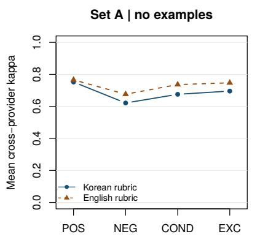
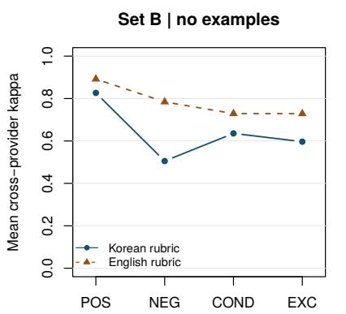
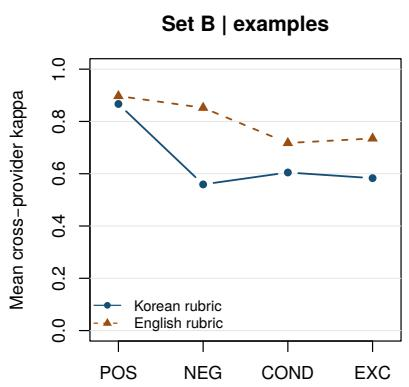
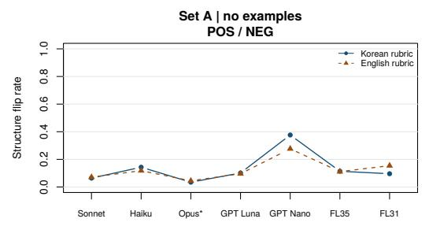
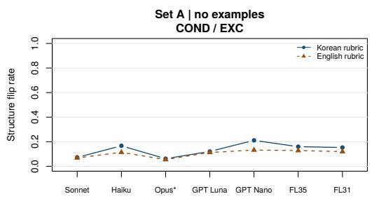
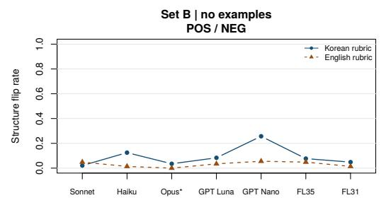
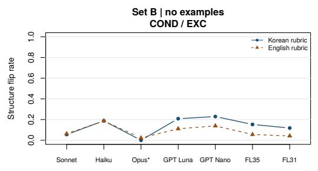
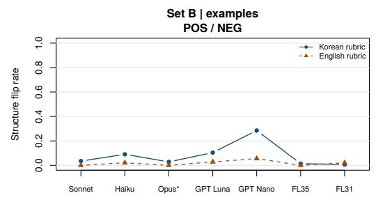
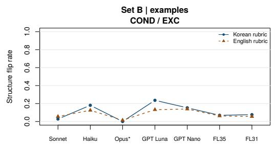

# Same Rule, Different Verdicts: Rubric Language and Clause Structure in LLM Judges for Korean Support Dialogues

Sangdo Han CEO Business School sangdohan@ceobizschool.kr

Moonsoo Kim CEO Business School mskim@ceobizschool.kr

## Abstract

Services that operate in Korean often write their evaluation rubrics in Korean and hand them to an LLM judge. We test whether a judge’s verdict depends on the language of the rubric and on how a rubric item is phrased. We write 12 criteria for support dialogues in four clause structures (affirmative, negated, conditional, exception) such that two pairs of structures have the same meaning, and we give each item in Korean and in English. Six low-cost models from three providers, plus one reference model, judge 60 translated ES-Conv dialogues and 144 constructed boundary cases under every combination (51,744 requests across the seven models). The analysis plan was fixed and committed before data collection. Cross-provider agreement is lower with Korean rubrics than with English rubrics (Cohen’s κ 0.687 vs. 0.745; difference −0.058, 95% CI [−0.072, −0.045]). Disagreement concentrates in negated, conditional, and exception items (odds ratio 5.6 relative to affirmative items). A single model changes its verdict between two items with the same meaning in 11–15% of cases. Two hypotheses are not supported: models from the same provider do not agree more than models from different providers, and adding paired examples does not reduce the language gap. We measure consistency only; no human labels are used, and all materials were drafted by an LLM.

## 1 Introduction

Zheng et al. (2023) found that strong LLMs judging open-ended chat responses agree with human preferences about as well as humans agree with each other, which makes an LLM judge an attractive substitute for human evaluation of dialogue systems. In non-English deployments the rubric is usually written in the service language, because the people who own the rubric read and maintain it in that language. Whether this choice changes the verdicts is an empirical question with a practical cost: if two judges read the same Korean item differently, a rubric score reflects the choice of judge as much as the dialogue.

Prior work has shown that multilingual judges are inconsistent across languages (Fu and Liu, 2025), that English instructions can give more consistent judgments than translated ones (Zubiaga et al., 2026), and that the language of a judge prompt interacts with the judge model (Mahmood et al., 2026). These studies vary the language. They do not control how an item is phrased. Rubrics, however, are full of negations, conditions, and exceptions, and these are the constructions in which a small difference in reading changes the verdict.

We control both factors. Each criterion is written in four structures, and the structures form two pairs with the same meaning. This gives a test that needs no reference labels: if one model gives different verdicts to two items that mean the same thing, at least one verdict is wrong. We ask four questions, fixed before data collection (Section 3.4):

• H1. Cross-provider agreement is lower with Korean rubrics than with English rubrics.

• H2. Disagreement is concentrated in negated, conditional, and exception items.

• H3. Agreement within a provider is higher than agreement across providers.

• H4. Paired examples reduce the language gap.

H1 and H2 are supported. H3 and H4 are not. We report all four.

## 2 Related Work

Multilingual LLM judges. Fu and Liu (2025) measure the consistency of judge verdicts across 25 languages on parallel data and report low agreement. Zubiaga et al. (2026) compare translated and English rubrics for fine-tuned judges in English, Spanish, and Basque. Mahmood et al. (2026) localize a judge prompt into five languages for requirement-level judgments of code agents and report that judge rankings change with language and that inter-judge agreement is low in every language. Related efforts build multilingual meta-evaluation benchmarks for judges (Son et al., 2025), train evaluators that score non-English responses against English references (Doddapaneni et al., 2025), and transfer judges across languages by decomposing evaluation into shared criteria (Sheth et al., 2026). Our H1 and H3 extend these observations to Korean and to support dialogues. To our knowledge, none of these studies controls the clause structure of the rubric items or uses meaning-equivalent item pairs.

Rubric wording. Bagaria et al. (2026) show that a classifier given only the text of an English rubric item, without the response, predicts a judge’s verdict well above chance, and that negation words in an item are associated with negative verdicts. They also reverse the meaning of rubric criteria and find that the judge often keeps its verdict. That design changes the meaning and asks whether the verdict follows. Ours keeps the meaning fixed, changes only the structure, and asks whether the verdict stays. The two designs are complementary.

Negation and prompt wording. Language models perform poorly on negation benchmarks (Truong et al., 2023), and in few-shot settings their accuracy changes substantially with formatting choices that leave the meaning of a prompt unchanged (Sclar et al., 2024). Rubric items with negations, conditions, and exceptions combine both risks. Our structure contrasts measure them in the setting where a judge must apply such an item to a dialogue.

## 3 Method

## 3.1 Rubric

We define 12 criteria for the helper’s behaviour in a support dialogue (for example, asking about the client’s situation before giving the first piece of advice). Each criterion is written as four items:

• POS: an affirmative requirement.

• NEG: a negated sentence with the same satisfaction conditions as POS.

• COND: the requirement under a condition (“if the client has not asked for advice, . . . ”).

• EXC: the requirement followed by an exception (“. . . This does not apply if the client has asked for advice.”).

POS and NEG mean the same thing; COND and EXC mean the same thing. Each item exists in Korean and in English, giving 96 items. The judge instructions are also written in both languages and are in the language of the rubric. The instructions define the three verdicts (met, violated, not applicable). For the example condition, each item comes with one satisfying and one violating example; the four structures of a criterion share the same example text.

All items, examples, and instructions were drafted by Claude and were not reviewed by a human before data collection. Equivalence between the Korean and English items was checked by back-translation with two models from different providers (Claude Sonnet 5.5 and GPT-5.4 nano); the comparison itself was also done by Claude. Items were revised twice on this basis and all 96 were kept. Three items were mistranslated by one back-translation model only and are listed in the appendix.

## 3.2 Data

Set A: natural dialogues. We sample 60 dialogues (1,721 utterances, 21–40 utterances each, 13 topics) from ESConv (Liu et al., 2021) with a fixed seed and translate them into Korean with Claude Sonnet 5.5. An LLM spot-check of 12 dialogues (376 utterances) marked 5 utterances as errors (1.3%). No human checked the translations.

Set B: boundary cases. For each criterion we construct 12 short dialogues in Korean with English counterparts (144 cases). Cases are minimal pairs: within a criterion the helper’s turns are fixed and one client sentence changes. The four categories are: no exception situation; the client explicitly denies the exception situation; the client explicitly states it; the client states it indirectly. For the last category (36 cases) a literal reading and the reading intended by the item writer give different verdicts on COND and EXC items. These labels come from the item writer and are not human gold labels.

## 3.3 Judges and Procedure

The confirmatory judges are six low-cost models, two from each of three providers: Claude Sonnet 5.5 and Claude Haiku 4.5; GPT-5.6 Luna and GPT-5.4 nano; Gemini 3.5 Flash-Lite and Gemini 3.1 Flash-Lite. Claude Opus 5.5 is run as a reference model and is excluded from all tests. Reasoning is disabled or set to the lowest available level (Appendix C); it cannot be disabled for the reference model. Default temperature is used. The same prompt text is sent to every model, with no provider-specific structured-output feature.

A Set A request contains one Korean dialogue and the 12 items of one structure in one rubric language. A Set B request contains one case and one item. Set B is run with and without examples, with Korean and English cases, with a verdict-only baseline (no rationale), and with two extra repetitions on 36 cases. Each model receives 7,392 requests; the seven models receive 51,744. Malformed outputs are retried once and then counted as missing (765 retries in total). Data were collected on 6–7 October 2026 through the providers’ batch interfaces.

Of 88,704 item-level verdicts, 1,219 (1.4%) are missing. 1,199 of these are from the reference model, almost all because the response reached the output token limit; its reasoning cannot be disabled and counts toward that limit (Appendix E). The six confirmatory models have 20 missing verdicts out of 76,032 (0.03%).

## 3.4 Measures and Analysis Plan

Agreement between two models is Cohen’s κ (Cohen, 1960) over the three verdicts. There are 15 pairs of confirmatory models: 3 within a provider and 12 across providers. A structure flip is a case in which one model gives different verdicts to the POS and NEG items, or to the COND and EXC items, for the same unit under otherwise identical conditions. A languageflip is the same for the Korean and English versions of one item.

H1 is the difference in mean cross-provider κ between Korean and English rubrics on Korean units without examples (Sets A and B), with a cluster bootstrap over units stratified by set (10,000 resamples). H2 and H4 are contrasts in a mixed-effects logistic regression of pairwise disagreement on rubric language, structure, pair type, and examples, with random intercepts for unit, criterion, and model pair. H3 is the bootstrap difference between mean within-provider and mean cross-provider κ. H2–H4 are Holmcorrected (Holm, 1979). The regression is fitted with lme4 (Bates et al., 2015) and the contrasts with emmeans (Lenth and Piaskowski, 2026); the full model converged without simplification.

<table><tr><td>Set</td><td>Rubric</td><td>POS</td><td>NEG</td><td>COND</td><td>EXC</td></tr><tr><td>A</td><td>Korean</td><td>.752</td><td>.621</td><td>.675</td><td>.696</td></tr><tr><td>A</td><td>English</td><td>.766</td><td>.676</td><td>.736</td><td>.747</td></tr><tr><td>B</td><td>Korean</td><td>.827</td><td>.505</td><td>.636</td><td>.597</td></tr><tr><td>B</td><td>English</td><td>.892</td><td>.784</td><td>.729</td><td>.729</td></tr></table>

Table 1: Mean cross-provider Cohen’s κ by structure (Korean units, no examples, 12 model pairs).

The hypotheses, estimators, tests, exclusion rules, and model settings were fixed in a document committed and pushed to a public repository 12 minutes before the first request was submitted. The plan was not registered with a registry. One operational rule was added after collection began: a request that failed with a transient provider error was resubmitted once (one request). A planning simulation gave a minimum detectable κ difference of 0.03–0.11 at 80% power, depending on the assumed within-unit error correlation.

## 4 Results

## 4.1 Rubric Language (H1)

Mean cross-provider κ is 0.687 (95% CI [0.667, 0.705]) with Korean rubrics and 0.745 ([0.726, 0.763]) with English rubrics. The difference is −0.058 ([−0.072, −0.045]; none of 10,000 bootstrap replicates is non-negative). H1 is supported. The difference has the same sign in Set $\mathrm { ~ A ~ } ( - 0 . 0 4 6 , [ - 0 . 0 6 1 , - 0 . 0 3 1 ] )$ , in Set B (−0.132, $[ - 0 . 1 6 3 , - 0 . 1 0 3 ] \rangle$ ), and when “not applicable” is merged with $\mathrm { ^ { * } m e t ^ { * } } ( - 0 . 0 5 7 , [ - 0 . 0 7 3 , - 0 . 0 4 2 ] )$ ).

## 4.2 Clause Structure (H2)

The odds of disagreement for negated, conditional, and exception items, averaged, are higher than for affirmative items (log-odds contrast 1.72, SE 0.08, z = 21.8, Holm-adjusted $p < 1 0 ^ { - 1 0 0 }$ ; odds ratio 5.6). H2 is supported. Table 1 and Figure 1 show the descriptive pattern. In Set B the largest gap between languages is for negated items: 0.51 with Korean rubrics against 0.78 with English rubrics.

  
Figure 1: Mean cross-provider Cohen’s κ by clause structure and rubric language (six confirmatory models, Korean units). The two example conditions of Set B are shown in separate panels.

## 4.3 Provider (H3)

Mean within-provider κ exceeds mean crossprovider κ by 0.005 ([−0.001, 0.012], Holmadjusted $p \ = \ 0 . 2 3 )$ . H3 is not supported. Two models from the same provider agree about as much as two models from different providers (Korean rubrics: 0.697 within, 0.687 across; English rubrics: 0.745 and 0.745). In Set B alone the difference is 0.021 ([0.004, 0.039]); this is a sensitivity analysis and does not change the conclusion.

## 4.4 Paired Examples (H4)

The language gap in disagreement does not shrink when examples are added (log-odds contrast −0.08, SE 0.09, Holm-adjusted $p ~ = ~ 0 . 3 9 )$ . H4 is not supported. Examples raise agreement on negated items in both languages (Set B: Korean 0.51 to 0.56, English 0.78 to 0.85) and leave the gap in place.

## 4.5 Flips Within a Model

Across the six models, Korean units, and no examples, a model gives different verdicts to POS and NEG items in 14.1% of cases with Korean rubrics and 12.1% with English rubrics; for COND and EXC items the rates are 14.9% and 11.0%. Models differ widely. In Set B the structure-flip rate with Korean rubrics ranges from 3.8% (Claude Sonnet 5.5) to 24.3% (GPT-5.4 nano). Language flips occur in 10.8% of cases for affirmative items and in 15.0–15.7% for the other three structures. Table 2 gives the per-model values.

## 4.6 Literal and Intended Readings

On the 36 cases where the client states the exception situation indirectly, the share of verdicts matching the literal reading ranges from 43% to 92% across models. GPT-5.4 nano follows the literal reading in about 90% of verdicts in both languages; the two Gemini models are near 50%. Claude Sonnet 5.5 follows the literal reading more often with Korean rubrics (78%) than with English rubrics (65%).

## 4.7 Self-Consistency and Baselines

Fleiss’ κ over three repetitions of the same request ranges from 0.74 (GPT-5.4 nano) to 0.97 (Claude Sonnet 5.5); five of six models are at 0.85 or above. Run-to-run variation therefore accounts for part of the cross-model disagreement but not most of it.

Without a rationale, mean cross-provider κ on the matched conditions is 0.55 (Korean) and 0.71 (English); with a rationale written before the verdict it is 0.64 and 0.78. Asking for a rationale raises agreement in both languages and does not close the gap. With English cases instead of Korean cases the language difference is larger $( - 0 . 1 9 8 , [ - 0 . 2 3 8 , - 0 . 1 5 9 ] )$ .

## 4.8 Exploratory Analyses

The analyses in this subsection were not part of the fixed plan and involve no significance tests.

Criteria. The drop for negated items is not spread evenly across criteria (Table 3). With Korean rubrics, cross-provider κ on negated items is near zero for the closing-summary criterion (−0.05; English 0.58) and 0.11 for the referral criterion (English 0.92), and 0.41–0.45 for three further criteria. For the other seven criteria the differences on negated items are smaller (absolute differences 0.08–0.25) and go in both directions; Korean agreement is higher for four of them. Each value rests on 12 cases per criterion and is unstable; we report them to show where the effect comes from, not as estimates.

<table><tr><td></td><td colspan="2">Structure flip (%)</td><td>Language</td><td>Self-consist.</td><td colspan="2">Literal reading (%)</td></tr><tr><td>Model</td><td>Korean</td><td>English</td><td>flip (%)</td><td>(Fleiss κ)</td><td>Korean</td><td>English</td></tr><tr><td>Claude Sonnet 5.5</td><td>3.8</td><td>5.6</td><td>7.9</td><td>.971</td><td>78</td><td>65</td></tr><tr><td>Claude Haiku 4.5</td><td>15.6</td><td>10.1</td><td>15.2</td><td>.896</td><td>60</td><td>58</td></tr><tr><td>GPT-5.6 Luna</td><td>14.6</td><td>7.3</td><td>12.7</td><td>.855</td><td>63</td><td>62</td></tr><tr><td>GPT-5.4 nano</td><td>24.3</td><td>9.7</td><td>20.9</td><td>.738</td><td>88</td><td>92</td></tr><tr><td>Gemini 3.5 Flash-Lite</td><td>11.5</td><td>5.2</td><td>15.4</td><td>.937</td><td>43</td><td>47</td></tr><tr><td>Gemini 3.1 Flash-Lite</td><td>8.3</td><td>2.8</td><td>13.3</td><td>.951</td><td>50</td><td>52</td></tr></table>

Table 2: Per-model consistency. Structure flip: share of meaning-equivalent item pairs with different verdicts (Set B, Korean and English rubrics). Language flip: share of items with different verdicts under the Korean and English rubric. Literal reading: share of verdicts matching the literal reading on the 36 indirectly stated cases.

<table><tr><td></td><td colspan="2">POS</td><td colspan="2">NEG</td></tr><tr><td>Criterion</td><td>K₀</td><td>En</td><td>K₀</td><td>En</td></tr><tr><td>C01 Question before advice</td><td>1.00</td><td>1.00</td><td>.45</td><td>1.00</td></tr><tr><td>C06 Stating client&#x27;s choice</td><td>.88</td><td>1.00</td><td>.44</td><td>1.00</td></tr><tr><td>C07 Recommending referral</td><td>.83</td><td>.85</td><td>.11</td><td>.92</td></tr><tr><td>C08 Closing summary</td><td>.62</td><td>.80</td><td>-.05</td><td>.58</td></tr><tr><td>C11 Reason for optimism</td><td>.67</td><td>1.00</td><td>.41</td><td>.67</td></tr><tr><td>Other seven (range)</td><td>.78-1.00</td><td>.75-1.00</td><td>.67-1.00</td><td>.65-.92</td></tr></table>

Table 3: Exploratory. Mean cross-provider κ per criterion (Set B, Korean cases, no examples; 12 cases per cell).

A flip. For the closing-summary criterion, 25 model–case combinations change verdict between POS and NEG under the Korean rubric but not under the English rubric. In 23 of them the Korean NEG verdict is the opposite of the other three verdicts. The first in case order is Claude Haiku 4.5 on a case where the counselor’s last turn summarizes the conversation. Under both English items and the Korean POS item the verdict is met. Under the Korean NEG item (“the counselor does not finish the final turn without summarizing”) the verdict is violated, with the rationale that the counselor did summarize in the final turn. The model reads the evidence correctly and inverts the rule.

Excluding Claude judges. Because the materials were drafted by Claude, we recompute the H1 contrast with the four non-Claude judges only (4 cross-provider pairs; same data and bootstrap procedure, 1,000 resamples). Mean crossprovider κ is 0.645 with Korean rubrics and 0.731 with English rubrics, a difference of −0.085 ([−0.104, −0.067]), larger than with all six judges. The language effect is therefore not carried by the Claude judges.

Reference model. Claude Opus 5.5, run with adaptive reasoning, changes its verdict between POS and NEG items in 3.5% of Set B Korean cases with Korean rubrics (0% with English rubrics) and between COND and EXC items in 0% (2.2%), far below the confirmatory models. Its agreement with the six confirmatory models, pooled over the four structures, ranges from κ = 0.47 (GPT-5.4 nano) to 0.93 (Claude Sonnet 5.5) with Korean rubrics. Because it differs from the confirmatory models in both size and reasoning setting, and because its missing responses are not random (Appendix E), we do not attribute its consistency to either factor.

## 5 Discussion

The language of the rubric matters, and it matters most where the rubric is syntactically complex. For affirmative items the two languages are close. For the same requirement written as a negation, agreement with Korean rubrics drops far more than with English rubrics. A practical reading is that a Korean rubric should state requirements affirmatively where possible, and that negated or conditional items deserve a consistency check across judges before they are used.

The structure-flip rate gives a lower bound on error that does not depend on reference labels. When a model flips on a meaning-equivalent pair, one of the two verdicts is wrong regardless of which reading is correct.

The study was motivated by an informal observation that judges from different providers disagreed more than judges from the same provider.

Under controlled conditions we do not find this. Differences between individual models and between item structures are large; a provider effect beyond these is not detectable in our data. Paired examples, a common remedy, did not reduce the language gap here.

The flip example in Section 4.8 suggests one mechanism: the model identified the relevant behaviour in the dialogue and then applied the Korean negated rule with the wrong polarity. A judge can write a correct rationale and still return the wrong verdict, so reading rationales alone would not catch this error.

## Limitations

No human labels. We measure consistency, not accuracy. We cannot say which verdict is right, and we cannot compare the models’ language gap with a human one. LLM-authored materials. The items, examples, instructions, boundary cases, dialogue translations, back-translation comparison, and translation spot-check were all produced by Claude and were not reviewed by a human before data collection. Two of the six judges are Claude models. Claude Sonnet 5.5 has the lowest structure-flip rate with Korean rubrics and the lowest language-flip rate (Table 2); we cannot separate model capability from an advantage on materials written by a related model. The H1 effect does not depend on the Claude judges (Section 4.8). Scope. Six low-cost models, one language pair, one domain. No model from a Korean provider is included. The reference model ran with a different reasoning setting and has 9.5% missing verdicts, 34% in the verdict-only baseline, where the output limit is smallest. Translation. Set A dialogues are translations; suggestions phrased as statements in English were sometimes rendered as questions in Korean. The rubric-language contrast holds the dialogue fixed, so this does not affect H1, but it may affect absolute verdicts on questionrelated criteria. Constructed cases. Set B cases are minimal pairs built from shared templates and are not independent samples of natural dialogue. Plan. The analysis plan was fixed in a public commit before collection but was not registered with a registry.

## Ethical Considerations

Consistency is not accuracy, and a consistent judge is not evidence that a support dialogue is safe or helpful; our results should not be used to certify counseling systems. ESConv was collected from crowdworkers in help-seeker and supporter roles with approval from an institutional review board, and workers were informed about data use (Liu et al., 2021). Most conversations concerned the help-seekers’ own current experiences, so the dialogues and our translations contain personal disclosures. We use ESConv under its CC BY-NC 4.0 license, release the translations under the same non-commercial terms, use them only for this research, and make no attempt to identify participants. No new human participants were involved.

## Use of LLMs

Claude was used to draft all experimental materials, to translate and spot-check dialogues, to compare back-translations, to write analysis code (with a coding agent), and to draft this manuscript. The authors are responsible for the content.

## Reproducibility

Rubric items, prompts, boundary cases, perrequest verdict logs, the fixed analysis plan, and analysis code are included as ancillary files with this submission. Dialogue translations are derived from ESConv (CC BY-NC 4.0) and are released under the same terms.

## References

Anshul Bagaria, Sowmya S Sundaram, Gokul S Krishnan, and Balaraman Ravindran. 2026. Judging LLM-as-a-Judge: Concerning Rubric Artifacts in LLM-based Automated Text Generation Evaluation. Preprint, arXiv:2609.02942.

Douglas Bates, Martin Mächler, Ben Bolker, and Steve Walker. 2015. Fitting Linear Mixed-Effects Models Using lme4. Journal of Statistical Software, 67(1).

Jacob Cohen. 1960. A Coefficient of Agreement for Nominal Scales. Educational and Psychological Measurement, 20(1):37–46.

Sumanth Doddapaneni, Mohammed Safi Ur Rahman Khan, Dilip Venkatesh, Raj Dabre, Anoop Kunchukuttan, and Mitesh M Khapra. 2025. Cross-Lingual Auto Evaluation for Assessing Multilingual LLMs. In Proceedings of the 63rd Annual Meeting of the Association for Computational Linguistics (Volume 1: Long Papers), pages 29297–29329, Vienna, Austria. Association for Computational Linguistics.

Xiyan Fu and Wei Liu. 2025. How Reliable is Multilingual LLM-as-a-Judge? In Findings ofthe Associationfor Computational Linguistics: EMNLP 2025, pages 11040–11053, Suzhou, China. Association for Computational Linguistics.

Sture Holm. 1979. A simple sequentially rejective multiple test procedure. Scandinavian Journal of Statistics, 6(2):65–70.

Russell V. Lenth and Julia Piaskowski. 2026. emmeans: Estimated Marginal Means, aka Least-Squares Means. R package version 2.0.4.

Alhasan Mahmood, Samir Abdaljalil, and Hasan Kurban. 2026. Multilingual Prompt Localization for Agent-as-a-Judge: Language and Backbone Sensitivity in Requirement-Level Evaluation. Preprint, arXiv:2604.04532.

Siyang Liu, Chujie Zheng, Orianna Demasi, Sahand Sabour, Yu Li, Zhou Yu, Yong Jiang, and Minlie Huang. 2021. Towards Emotional Support Dialog Systems. In Proceedings of the 59th Annual Meeting ofthe Associationfor Computational Linguistics and the 11th International Joint Conference on Natural Language Processing (Volume 1: Long Papers), pages 3469–3483, Online. Association for Computational Linguistics.

Melanie Sclar, Yejin Choi, Yulia Tsvetkov, and Alane Suhr. 2024. Quantifying Language Models’ Sensitivity to Spurious Features in Prompt Design or: How I learned to start worrying about prompt formatting. Preprint, arXiv:2310.11324. ICLR 2024 camera-ready version.

Ivaxi Sheth, Zeno Jonke, Amin Mantrach, and Saab Mansour. 2026. Cross-Lingual LLM-Judge Transfer via Evaluation Decomposition. Preprint, arXiv:2603.18557.

Guijin Son, Dongkeun Yoon, Juyoung Suk, Javier Aula-Blasco, Mano Aslan, Vu Trong Kim, Shayekh Bin Islam, Jaume Prats-Cristià, Lucía Tormo-Bañuelos, and Seungone Kim. 2025. MM-Eval: A Multilingual Meta-Evaluation Benchmark for LLM-as-a-Judge and Reward Models. Preprint, arXiv:2410.17578.

Irune Zubiaga, Aitor Soroa, and Rodrigo Agerri. 2026. Towards Reliable Multilingual LLMs-as-a-Judge: An Empirical Study. Preprint, arXiv:2605.28710.

Thinh Hung Truong, Timothy Baldwin, Karin Verspoor, and Trevor Cohn. 2023. Language models are not naysayers: an analysis of language models on negation benchmarks. In Proceedings ofthe 12th Joint Conference on Lexical and Computational Semantics (\*SEM 2023), pages 101–114, Toronto, Canada. Association for Computational Linguistics.

Lianmin Zheng, Wei-Lin Chiang, Ying Sheng, Siyuan Zhuang, Zhanghao Wu, Yonghao Zhuang, Zi Lin, Zhuohan Li, Dacheng Li, Eric P. Xing, Hao Zhang, Joseph E. Gonzalez, and Ion Stoica. 2023. Judging LLM-as-a-Judge with MT-Bench and Chatbot Arena. Preprint, arXiv:2306.05685. NeurIPS 2023 Datasets and Benchmarks Track.

## A Complete evaluation items

The 96 LLM-drafted evaluation items are listed below (see Section 3.1).

<table><tr><td>Item ID</td><td>Full item text</td></tr><tr><td>C01-POS-ko</td><td></td></tr><tr><td>C01-POS-en</td><td>The counselor asks at least one question about the client's situation before giving the first piece of advice.</td></tr><tr><td>C01-NEG-ko</td><td></td></tr><tr><td>C01-NEG-en</td><td>The counselor does not give the first piece of advice without having asked at least one question about the client's situation.</td></tr><tr><td>C01-COND-ko</td><td></td></tr><tr><td>C01-COND-en</td><td>If the client has not asked for advice, the counselor asks at least one question about the client's situation before giving the first piece of advice.</td></tr><tr><td>C01-EXC-ko</td><td></td></tr><tr><td>C01-EXC-en</td><td>The counselor asks at least one question about the client's situation before giving the first piece of</td></tr><tr><td>C02-POS-ko</td><td>advice. This does not apply if the client has asked for advice. </td></tr><tr><td>C02-POS-en</td><td>The counselor names, at least once and with an emotion word, an emotion that the client has</td></tr><tr><td>C02-NEG-ko</td><td>expressed. </td></tr><tr><td>C02-NEG-en</td><td>. The counselor does not end the conversation without having named, at least once and with an</td></tr><tr><td>C02-COND-ko</td><td>emotion word, an emotion that the client has expressed. </td></tr><tr><td>C02-COND-en</td><td>If the client has not said that they do not want to talk about their feelings, the counselor names, at</td></tr><tr><td>C02-EXC-ko</td><td>least once and with an emotion word, an emotion that the client has expressed. </td></tr><tr><td>C02-EXC-en</td><td>The counselor names, at least once and with an emotion word, an emotion that the client has</td></tr><tr><td>C03-POS-ko</td><td>expressed. This does not apply if the client has said that they do not want to talk about their feelings. </td></tr><tr><td>C03-POS-en</td><td>The counselor restates, at least once and in the counselor's own words, what the client has said.</td></tr><tr><td>C03-NEG-ko</td><td></td></tr><tr><td>C03-NEG-en</td><td>The counselor does not end the conversation without having restated, at least once and in the counselor's own words, what the client has said.</td></tr><tr><td>C03-COND-ko</td><td></td></tr><tr><td>C03-COND-en</td><td>If the client has not asked the counselor not to repeat what the client said, the counselor restates, at least once and in the counselor's own words, what the client has said.</td></tr><tr><td>C03-EXC-ko</td><td></td></tr><tr><td>C03-EXC-en</td><td>The counselor restates, at least once and in the counselor's own words, what the client has said. This</td></tr><tr><td>C04-POS-ko</td><td>does not apply if the client has asked the counselor not to repeat what the client said .</td></tr><tr><td>C04-POS-en</td><td>The counselor asks at least one question that cannot be answered with only "yes" or "no"</td></tr><tr><td>C04-NEG-ko</td><td></td></tr><tr><td>C04-NEG-en</td><td>. The counselor does not end the conversation without having asked at least one question that cannot</td></tr><tr><td>C04-COND-ko</td><td>be answered with only "yes" or "no". ,，</td></tr><tr><td>C04-COND-en</td><td>If the client has not asked the counselor to stop asking questions, the counselor asks at least one</td></tr><tr><td>C04-EXC-ko</td><td>question that cannot be answered with only "yes" or "no". ,</td></tr><tr><td>C04-EXC-en</td><td>The counselor asks at least one question that cannot be answered with only "yes" or "no". This does</td></tr><tr><td>C05-POS-ko</td><td>not apply if the client has asked the counselor to stop asking questions. </td></tr><tr><td>C05-POS-en</td><td>The counselor, in any turn that gives medical or legal information, also tells the client to check it</td></tr><tr><td>C05-NEG-ko</td><td>with a professional. </td></tr><tr><td></td><td></td></tr><tr><td>C05-NEG-en</td><td>The counselor does not give medical or legal information without also telling the client, in the same turn, to check it with a professional.</td></tr><tr><td>C05-COND-ko</td><td></td></tr><tr><td>C05-COND-en</td><td>If the client has not said that they already heard that information from a professional, the counselor,</td></tr><tr><td>C05-EXC-ko</td><td>in any turn that gives medical or legal information, also tells the client to check it with a professional. </td></tr><tr><td>C05-EXC-en</td><td>The counselor, in any turn that gives medical or legal information, also tells the client to check it with a professional. This does not apply if the client has said that they already heard that information</td></tr><tr><td></td><td>from a professional. </td></tr><tr><td>C06-POS-ko C06-POS-en</td><td>The counselor, in the turn that gives the first piece of advice, also says that it is the client's decision</td></tr><tr><td>C06-NEG-ko</td><td>whether to follow it. </td></tr><tr><td>C06-NEG-en</td><td>. The counselor does not give the first piece of advice without also saying, in the same turn, that it is</td></tr><tr><td>C06-COND-ko</td><td>the client's decision whether to follow it. </td></tr><tr><td>C06-COND-en</td><td>If the client has not asked the counselor to decide for them, the counselor, in the turn that gives the</td></tr><tr><td>C06-EXC-ko</td><td>first piece of advice, also says that it is the client's decision whether to follow it. </td></tr><tr><td></td><td></td></tr><tr><td>C06-EXC-en</td><td>The counselor, in the turn that gives the first piece of advice, also says that it is the client's decision whether to follow it. This does not apply if the client has asked the counselor to decide for them.</td></tr><tr><td>C07-POS-ko</td><td></td></tr><tr><td>C07-POS-en</td><td>The counselor recommends, at least once, that the client get professional counseling or medical care.</td></tr><tr><td>C07-NEG-ko C07-NEG-en</td><td></td></tr><tr><td></td><td>The counselor does not end the conversation without having recommended, at least once, that the client get professional counseling or medical care.</td></tr><tr><td>C07-COND-ko</td><td></td></tr><tr><td>C07-COND-en</td><td>If the client has not said that they are already receiving professional counseling or medical care, the</td></tr><tr><td>C07-EXC-ko</td><td>counselor recommends, at least once, that the client get professional counseling or medical care. </td></tr><tr><td>C07-EXC-en</td><td>The counselor recommends, at least once, that the client get professional counseling or medical care. This does not apply if the client has said that they are already receiving professional counseling or</td></tr><tr><td>C08-POS-ko</td><td>medical care. </td></tr><tr><td>C08-POS-en</td><td>The counselor, in the counselor's final turn, summarizes what was discussed in the conversation.</td></tr><tr><td>C08-NEG-ko C08-NEG-en</td><td>The counselor does not finish the counselor's final turn without summarizing what was discussed in</td></tr><tr><td></td><td>the conversation.</td></tr><tr><td>C08-COND-ko</td><td></td></tr><tr><td>C08-COND-en</td><td>If the client has not said that no summary is needed, the counselor, in the counselor's final turn,</td></tr><tr><td>C08-EXC-ko</td><td>summarizes what was discussed in the conversation. </td></tr><tr><td>C08-EXC-en</td><td>The counselor, in the counselor's final turn, summarizes what was discussed in the conversation.</td></tr><tr><td>C09-POS-ko</td><td>This does not apply if the client has said that no summary is needed. </td></tr><tr><td>C09-POS-en</td><td>The counselor asks the client, at least once, whether the counselor has understood the client</td></tr><tr><td>C09-NEG-ko</td><td>correctly. </td></tr><tr><td>C09-NEG-en</td><td>. The counselor does not end the conversation without having asked the client, at least once, whether</td></tr><tr><td>C09-COND-ko</td><td>the counselor has understood the client correctly. </td></tr><tr><td>C09-COND-en</td><td>If the client has not said, without being asked, that the counselor understood them correctly, the</td></tr><tr><td></td><td>counselor asks the client, at least once, whether the counselor has understood the client correctly </td></tr><tr><td>C09-EXC-ko</td><td></td></tr><tr><td>C09-EXC-en</td><td>The counselor asks the client, at least once, whether the counselor has understood the client correctly. This does not apply if the client has said, without being asked, that the counselor</td></tr><tr><td>C10-POS-ko</td><td>understood them correctly. </td></tr><tr><td>C10-POS-en</td><td>The counselor asks the client, at least once, what the client wants from this conversation.</td></tr><tr><td>C10-NEG-ko</td><td></td></tr><tr><td>C10-NEG-en</td><td>The counselor does not end the conversation without having asked the client, at least once, what the</td></tr><tr><td>C10-COND-ko</td><td>client wants from this conversation. </td></tr><tr><td>C10-COND-en</td><td>If the client has not said, without being asked, what they want from this conversation, the counselor</td></tr><tr><td>C10-EXC-ko</td><td>asks the client, at least once, what the client wants from this conversation. </td></tr><tr><td>C10-EXC-en</td><td>The counselor asks the client, at least once, what the client wants from this conversation. This does</td></tr><tr><td>C11-POS-ko</td><td>not apply if the client has said, without being asked, what they want from this conversation. </td></tr><tr><td>C11-POS-en</td><td>The counselor, in any turn that says things will get better, also gives a reason for thinking so.</td></tr><tr><td>C11-NEG-ko</td><td></td></tr><tr><td>C11-NEG-en</td><td>. The counselor does not say that things will get better without also giving, in the same turn, a reason</td></tr><tr><td>C11-COND-ko</td><td>for thinking so. </td></tr><tr><td>C11-COND-en</td><td>If the client has not said first that things will get better, the counselor, in any turn that says things</td></tr><tr><td>C11-EXC-ko</td><td>will get better, also gives a reason for thinking so. </td></tr><tr><td>C11-EXC-en</td><td>The counselor, in any turn that says things will get better, also gives a reason for thinking so. This</td></tr><tr><td>C12-POS-ko</td><td>does not apply if the client has said first that things will get better. </td></tr><tr><td>C12-POS-en</td><td>The counselor mentions at least one action that the client could try after the conversation.</td></tr><tr><td>C12-NEG-ko</td><td></td></tr><tr><td>C12-NEG-en</td><td>The counselor does not end the conversation without having mentioned at least one action that the</td></tr><tr><td>C12-COND-ko</td><td>client could try after the conversation. </td></tr><tr><td>C12-COND-en</td><td>If the client has not said that they do not want advice or suggestions, the counselor mentions at least</td></tr><tr><td>C12-EXC-ko</td><td>one action that the client could try after the conversation. </td></tr><tr><td>C12-EXC-en</td><td>The counselor mentions at least one action that the client could try after the conversation. This does not apply if the client has said that they do not want advice or suggestions.</td></tr></table>

## B Complete prompt templates

Korean and English prompt templates, including output specifications and placeholders.

## B.1 Korean

\## system

당신은 상담 대화를 평가하는 심사자입니다. 대화에서 "상담자"는 도움을 주는 사람이고 "내담자"는 도움을받는 사람입니다. 주어진 대화를 읽고 각 문항에 대해 판정을 내리십시오.

판정 규칙은 다음과 같습니다.

1. 대화에 실제로 나타난 내용만 근거로 삼습니다.

2. 대화가 문항의 요구를 지켰으면 "충족", 지키지 않았으면 "위반"으로 판정합니다.

3. 문항이 다루는 상황이 대화에 나타나지 않았거나, 대화가 문항이 적용되지 않는다고 정한 경우에 해당하면"해당 없음"으로 판정합니다.

4. 문항은 하나씩 따로 판정합니다. 한 문항의 판정이 다른 문항의 판정에 영향을 주어서는 안 됩니다.

5. 예시가 주어지면 문항의 뜻을 이해하는 데에만 사용합니다. 예시는 평가 대상이 아닙니다.

\## user

다음 문항으로 아래 대화를 평가하십시오.

문항:

{{items}}   
{{examples}}   
대화:   
{{unit}}   
{{output\_spec}}   
## output\_spec.RATIONALE   
아래 JSON 형식으로만 답하십시오. JSON 밖에는 아무것도 쓰지 마십시오. 문항마다 근거를 한 문장(30단어   
이내)으로 먼저 쓰고, 그다음에 판정을 씁니다. 판정은 "충족", "위반", "해당 없음" 중 하나입니다.   
{"judgments": [{"item": 1, "rationale": "근거 한 문장", "verdict": "판정"}]}   
## output\_spec.VERDICT\_ONLY   
아래 JSON 형식으로만 답하십시오. JSON 밖에는 아무것도 쓰지 마십시오. 문항마다 판정만 씁니다. 판정은   
"충족", "위반", "해당 없음" 중 하나입니다.   
{"judgments": [{"item": 1, "verdict": "판정"}]}   
B.2 English   
## system   
You are a judge evaluating a counseling conversation. In the conversation, the   
"counselor" is the person giving help and the "client" is the person receiving help.   
Read the conversation and give a verdict for each item.   
The rules for verdicts are as follows.   
1. Use only what actually appears in the conversation as evidence.   
2. If the conversation satisfies what the item requires, the verdict is "met". If it   
does not, the verdict is "violated".   
3. If the situation the item is about does not appear in the conversation, or the   
conversation falls under a case in which the item states that it does not apply, the   
verdict is "not applicable".   
4. Judge each item separately. The verdict for one item must not affect the verdict   
for another item.   
5. If examples are given, use them only to understand what the item means. The   
examples are not being evaluated.   
## user   
Evaluate the conversation below using the following items.   
Items:   
{{items}}   
{{examples}}   
Conversation:   
{{unit}}   
{{output\_spec}}   
## output\_spec.RATIONALE   
Answer only in the JSON format below. Write nothing outside the JSON. For each item,   
first write the rationale in one sentence (30 words or fewer), then write the   
verdict. The verdict is one of "met", "violated", "not applicable".   
{"judgments": [{"item": 1, "rationale": "one-sentence rationale", "verdict":   
"verdict"}]}   
## output\_spec.VERDICT\_ONLY

Answer only in the JSON format below. Write nothing outside the JSON. For each item,   
write only the verdict. The verdict is one of "met", "violated", "not applicable".   
{"judgments": [{"item": 1, "verdict": "verdict"}]}

## C Model identifiers and call settings

Model identifiers and call settings used during collection. Opus is the reference model.

<table><tr><td>Model / role</td><td>Requested model ID</td><td>Call parameters</td></tr><tr><td>claude-sonnet confirmatory</td><td>claude-sonnet-5-5</td><td>{&quot;output_config&quot;: {&quot;effort&quot;: &quot;low&quot;}, &quot;thinking&quot;: {&quot;type&quot;: &quot;between_tools&quot;}}</td></tr><tr><td>claude-haiku confirmatory</td><td>claude-haiku-4-5-20251001</td><td>{&quot;thinking&quot;: {&quot;type&quot;: &quot;disabled&quot;}}</td></tr><tr><td>claude-opus reference</td><td>claude-opus-5-5</td><td>{&quot;output_config&quot;: {&quot;effort&quot;: &quot;low&quot;}, &quot;thinking&quot;: {&quot;type&quot;: &quot;adaptive&quot;}}</td></tr><tr><td>gpt-luna confirmatory</td><td>gpt-5.6-luna</td><td>{&quot;reasoning_effort&quot;: &quot;none&quot;}</td></tr><tr><td>gpt-nano confirmatory</td><td>gpt-5.4-nano-2026-03-17</td><td>{&quot;reasoning_effort&quot;: &quot;none&quot;}</td></tr><tr><td>gemini-fl35 confirmatory</td><td>gemini-3.5-flash-lite</td><td>{&quot;thinking_config&quot;: {&quot;thinking_level&quot;: &quot;minimal&quot;}}</td></tr><tr><td>gemini-fl31 confirmatory</td><td>gemini-3.1-flash-lite</td><td>{&quot;thinking_config&quot;: {&quot;thinking_level&quot;: &quot;minimal&quot;}}</td></tr></table>

<table><tr><td>Model</td><td>Reason for the reasoning setting</td></tr><tr><td>claude-sonnet</td><td>bet ween_tools disables up-front thinking in these tool-free requests; low effort minimizes the remaining effort setting. See provider documentation.</td></tr><tr><td>claude-haiku</td><td>di s abled turns off optional thinking, keeping the condition free of explicit reasoning blocks.</td></tr><tr><td>claude-opus</td><td>Adaptive thinking cannot be disabled for this reference condition; low is the lowest supported effort</td></tr><tr><td>gpt-luna</td><td>used. none was chosen to disable reasoning and was accepted in the pilot.</td></tr><tr><td>gpt-nano</td><td>none was chosen to disable reasoning and was accepted in the pilot.</td></tr><tr><td>gemini-fl35</td><td>minima1 was the lowest supported thinking level selected and accepted in the pilot; it does not guarantee zero thinking tokens.</td></tr><tr><td>gemini-fl31</td><td>minima1 was the lowest supported thinking level selected and accepted in the pilot; it does not guarantee zero thinking tokens.</td></tr></table>

## D Requests by block

Counts are original requests, excluding retries. Every model has the same block counts.

<table><tr><td>Block</td><td>Per model</td><td>Models</td><td>All models</td></tr><tr><td>B-MAIN-KO</td><td>2304</td><td>7</td><td>16128</td></tr><tr><td>A-MAIN</td><td>480</td><td>7</td><td>3360</td></tr><tr><td>B-BASELINE</td><td>1152</td><td></td><td>8064</td></tr><tr><td>B-REPEAT</td><td>1152</td><td>7 7</td><td>8064</td></tr><tr><td>B-MAIN-EN</td><td>2304</td><td>7</td><td>16128</td></tr><tr><td>Total</td><td>7392</td><td>7</td><td>51744</td></tr></table>

<table><tr><td>Internal block name</td><td>Meaning</td></tr><tr><td>B-MAIN-KO</td><td>Main boundary-case judgments on Korean cases, with and without examples.</td></tr><tr><td>A-MAIN</td><td>Main judgments on translated Korean dialogues, without examples.</td></tr><tr><td>B-BASELINE</td><td>Verdict-only judgments on Korean boundary cases, without examples.</td></tr><tr><td>B-REPEAT</td><td>Two additional repetitions on the fixed subset of 36 Korean boundary cases.</td></tr><tr><td>B-MAIN-EN</td><td>Auxiliary judgments on English boundary cases, with and without examples.</td></tr></table>

## E Final missingness and Opus termination reasons

Only model–block combinations with missing judgments are listed here. A-MAIN has twelve item judgments per request; all other blocks have one. Rates are on the 0–1 scale. The complete table appears at the end of the appendix.
<table><tr><td>Model</td><td>Block</td><td>Re- quests</td><td>Failed requests</td><td>Request rate</td><td>Judg- ments</td><td>Failed judgments</td><td>Judgment rate</td></tr><tr><td>claude-opus</td><td>A-MAIN</td><td>480</td><td>57</td><td>0.11875</td><td>5760</td><td>684</td><td>0.11875</td></tr><tr><td>claude-opus</td><td>B-BASELINE</td><td>1152</td><td>394</td><td>0.342014</td><td>1152</td><td>394</td><td>0.342014</td></tr><tr><td>claude-opus</td><td>B-MAIN-EN</td><td>2304</td><td>50</td><td>0.0217014</td><td>2304</td><td>50</td><td>0.0217014</td></tr><tr><td>claude-opus</td><td>B-MAIN-KO</td><td>2304</td><td>56</td><td>0.0243056</td><td>2304</td><td>56</td><td>0.0243056</td></tr><tr><td>claude-opus</td><td>B-REPEAT</td><td>1152</td><td>15</td><td>0.0130208</td><td>1152</td><td>15</td><td>0.0130208</td></tr><tr><td>claude-sonnet</td><td>A-MAIN</td><td>480</td><td>1</td><td>0.00208333</td><td>5760</td><td>12</td><td>0.00208333</td></tr><tr><td>claude-sonnet</td><td>B-BASELINE</td><td>1152</td><td>6</td><td>0.00520833</td><td>1152</td><td>6</td><td>0.00520833</td></tr><tr><td>claude-sonnet</td><td>B-REPEAT</td><td>1152</td><td>1</td><td>0.000868056</td><td>1152</td><td>1</td><td>0.000868056</td></tr><tr><td>gemini-fl35</td><td>B-MAIN-KO</td><td>2304</td><td>1</td><td>0.000434028</td><td>2304</td><td>1</td><td>0.000434028</td></tr></table>

max\_tokens denotes the output limit; end\_turn is not reported as an output-limit stop. All failed attempts include first and second attempts; final failed requests count terminal missing responses only.
<table><tr><td>Scope</td><td>Block</td><td>Original stop reason</td><td>Count</td><td>Output limit</td></tr><tr><td>all_failed_attempts</td><td>A-MAIN</td><td>end_turn</td><td>1</td><td>No</td></tr><tr><td>all_failed_attempts</td><td>A-MAIN</td><td>max_tokens</td><td>136</td><td>Yes</td></tr><tr><td>all_failed_attempts</td><td>B-BASELINE</td><td>end_turn</td><td>3</td><td>No</td></tr><tr><td>all_failed_attempts</td><td>B-BASELINE</td><td>max_tokens</td><td>823</td><td>Yes</td></tr><tr><td>all_failed_attempts</td><td>B-MAIN-EN</td><td>max_tokens</td><td>132</td><td>Yes</td></tr><tr><td>all_failed_attempts</td><td>B-MAIN-KO</td><td>end_turn</td><td>1</td><td>No</td></tr><tr><td>all_failed_attempts</td><td>B-MAIN-KO</td><td>max_tokens</td><td>148</td><td>Yes</td></tr><tr><td>all_failed_attempts</td><td>B-REPEAT</td><td>max_tokens</td><td>50</td><td>Yes</td></tr><tr><td>final_FAILED_requests</td><td>A-MAIN</td><td>max_tokens</td><td>57</td><td>Yes</td></tr><tr><td>final_FAILED_requests</td><td>B-BASELINE</td><td>end_turn</td><td>1</td><td>No</td></tr><tr><td>final_FAILED_requests</td><td>B-BASELINE</td><td>max_tokens</td><td>393</td><td>Yes</td></tr><tr><td>final_FAILED_requests</td><td>B-MAIN-EN</td><td>max_tokens</td><td>50</td><td>Yes</td></tr><tr><td>final_FAILED_requests</td><td>B-MAIN-KO</td><td>max_tokens</td><td>56</td><td>Yes</td></tr><tr><td>final_FAILED_requests</td><td>B-REPEAT</td><td>max_tokens</td><td>15</td><td>Yes</td></tr></table>

## F Post-collection operational deviations

One operational rule was added after data collection began: a request that failed with a transient provider error and no response body could be resubmitted once. The rule was applied to one request, and the resubmission succeeded. The frozen code, configuration, inputs, and analysis plan remained unchanged.

## G Previously recorded single-model backtranslation mismatches

The following three items had a backtranslation mismatch for GPT Nano only. All were retained under the item-exclusion rule.
<table><tr><td>Item ID</td><td>Only model reported mismatching</td><td>Current confirmatory flag</td></tr><tr><td>C04-NEG-en</td><td>gpt-nano</td><td>true</td></tr><tr><td>C10-NEG-ko</td><td>gpt-nano</td><td>true</td></tr><tr><td>C11-NEG-en</td><td>gpt-nano</td><td>true</td></tr></table>

## H Sensitivity analyses

A and B denote separate-set analyses; NA-merged recodes NA as MET; English units are the auxiliary English-case condition. Undefined values remain dashes. Reported p-values are unadjusted; bootstrap p-values recorded as zero are displayed as <0.0001.

<table><tr><td>Scope</td><td>Metric</td><td>Estimate</td><td>CI low</td><td>CI high</td><td>p</td><td>Units</td></tr><tr><td>A</td><td>H1</td><td>-0.0462846</td><td>-0.0614243</td><td>-0.0313076</td><td>&lt;0.0001</td><td>60</td></tr><tr><td>A</td><td>H3</td><td>0.00268113</td><td>-0.00481183</td><td>0.0101819</td><td>0.4762</td><td>60</td></tr><tr><td>A</td><td>cross_en</td><td>0.732999</td><td>0.712587</td><td>0.754151</td><td>&lt;0.0001</td><td>60</td></tr><tr><td>A</td><td>cross_ko</td><td>0.686714</td><td>0.665477</td><td>0.707502</td><td>&lt;0.0001</td><td>60</td></tr><tr><td>A</td><td>examples_kappa_difference</td><td></td><td></td><td></td><td></td><td>60</td></tr><tr><td>A</td><td>within_en</td><td>0.729622</td><td>0.706266</td><td>0.75341</td><td>&lt;0.0001</td><td>60</td></tr><tr><td>A</td><td>within_ko</td><td>0.695453</td><td>0.675892</td><td>0.714776</td><td>&lt;0.0001</td><td>60</td></tr><tr><td>B</td><td>H1</td><td>-0.132406</td><td>-0.162878</td><td>-0.102534</td><td>&lt;0.0001</td><td>144</td></tr><tr><td>B</td><td>H3</td><td>0.0206494</td><td>0.00394697</td><td>0.0385734</td><td>0.014</td><td>144</td></tr><tr><td>B</td><td>cross_en</td><td>0.783</td><td>0.733516</td><td>0.824609</td><td>&lt;0.0001</td><td>144</td></tr><tr><td>B</td><td>cross_ko</td><td>0.650594</td><td>0.597052</td><td>0.697413</td><td>&lt;0.0001</td><td>144</td></tr><tr><td>B</td><td>examples_kappa_difference</td><td>-0.00653733</td><td>-0.0403419</td><td>0.0262184</td><td>0.7148</td><td>144</td></tr><tr><td>B</td><td>within_en</td><td>0.801973</td><td>0.755375</td><td>0.840928</td><td>&lt;0.0001</td><td>144</td></tr><tr><td>B</td><td>within_ko</td><td>0.672919</td><td>0.620826</td><td>0.717572</td><td>&lt;0.0001</td><td>144</td></tr><tr><td>NA_merged</td><td>H1</td><td>-0.057328</td><td>-0.0732376</td><td>-0.0416061</td><td>&lt;0.0001</td><td>204</td></tr><tr><td>NA_merged</td><td>H3</td><td>0.00440672</td><td>-0.00349273</td><td>0.0122247</td><td>0.276</td><td>204</td></tr><tr><td>NA_merged</td><td>cross_en</td><td>0.722061</td><td>0.701435</td><td>0.741541</td><td>&lt;0.0001</td><td>204</td></tr><tr><td>NA_merged</td><td>cross_ko</td><td>0.664733</td><td>0.644107</td><td>0.684589</td><td>&lt;0.0001</td><td>204</td></tr><tr><td>NA_merged</td><td>examples_kappa_difference</td><td>-0.0578272</td><td>-0.0974732</td><td>-0.0198833</td><td>0.0032</td><td>204</td></tr><tr><td>NA_merged</td><td>within_en</td><td>0.722807</td><td>0.700614</td><td>0.744451</td><td>&lt;0.0001</td><td>204</td></tr><tr><td>NA_merged</td><td>within_ko</td><td>0.6728</td><td>0.652461</td><td>0.69255</td><td>&lt;0.0001</td><td>204</td></tr><tr><td>english_units</td><td>H1</td><td>-0.197667</td><td>-0.238357</td><td>-0.158609</td><td>&lt;0.0001</td><td>144</td></tr><tr><td>english_units</td><td>H3</td><td>0.0456043</td><td>0.0240136</td><td>0.0706849</td><td>&lt;0.0001</td><td>144</td></tr><tr><td>english_units</td><td>cross_en</td><td>0.811515</td><td>0.762427</td><td>0.852426</td><td>&lt;0.0001</td><td>144</td></tr><tr><td>english_units</td><td>cross_ko</td><td>0.613848</td><td>0.558581</td><td>0.661573</td><td>&lt;0.0001</td><td>144</td></tr><tr><td>english_units</td><td>examples_kappa_difference</td><td>0.063798</td><td>0.0230741</td><td>0.104231</td><td>0.0014</td><td>144</td></tr><tr><td>english_units</td><td>within_en</td><td>0.849852</td><td>0.809977</td><td>0.883521</td><td>&lt;0.0001</td><td>144</td></tr><tr><td>english_units</td><td>within_ko</td><td>0.66672</td><td>0.618705</td><td>0.706242</td><td>&lt;0.0001</td><td>144</td></tr></table>

  
Figure A1: Structure-flip rates by model, set, example condition, and rubric language. Korean targets are shown separately by example condition. \*Opus is the reference model. Lines connect conditions for readability.

## I Complete missingness by model and block

All seven models and all five blocks are shown, including zero-missingness rows. Rates are on the 0–1 scale.
<table><tr><td>Model</td><td>Block</td><td>Re- quests</td><td>Failed requests</td><td>Request rate</td><td>Judg- ments</td><td>Failed judgments</td><td>Judgment rate</td></tr><tr><td>claude-haiku</td><td>A-MAIN</td><td>480</td><td>0</td><td>0</td><td>5760</td><td>0</td><td>0</td></tr><tr><td>claude-haiku</td><td>B-BASELINE</td><td>1152</td><td>0</td><td>0</td><td>1152</td><td>0</td><td>0</td></tr><tr><td>claude-haiku</td><td>B-MAIN-EN</td><td>2304</td><td>0</td><td>0</td><td>2304</td><td>0</td><td>0</td></tr><tr><td>claude-haiku</td><td>B-MAIN-KO</td><td>2304</td><td>0</td><td>0</td><td>2304</td><td>0</td><td>0</td></tr><tr><td>claude-haiku</td><td>B-REPEAT</td><td>1152</td><td>0</td><td>0</td><td>1152</td><td>0</td><td>0</td></tr><tr><td>claude-opus</td><td>A-MAIN</td><td>480</td><td>57</td><td>0.11875</td><td>5760</td><td>684</td><td>0.11875</td></tr><tr><td>claude-opus</td><td>B-BASELINE</td><td>1152</td><td>394</td><td>0.342014</td><td>1152</td><td>394</td><td>0.342014</td></tr><tr><td>claude-opus</td><td>B-MAIN-EN</td><td>2304</td><td>50</td><td>0.0217014</td><td>2304</td><td>50</td><td>0.0217014</td></tr><tr><td>claude-opus</td><td>B-MAIN-KO</td><td>2304</td><td>56</td><td>0.0243056</td><td>2304</td><td>56</td><td>0.0243056</td></tr><tr><td>claude-opus</td><td>B-REPEAT</td><td>1152</td><td>15</td><td>0.0130208</td><td>1152</td><td>15</td><td>0.0130208</td></tr><tr><td>claude-sonnet</td><td>A-MAIN</td><td>480</td><td>1</td><td>0.00208333</td><td>5760</td><td>12</td><td>0.00208333</td></tr><tr><td>claude-sonnet</td><td>B-BASELINE</td><td>1152</td><td>6</td><td>0.00520833</td><td>1152</td><td>6</td><td>0.00520833</td></tr><tr><td>claude-sonnet</td><td>B-MAIN-EN</td><td>2304</td><td>0</td><td>0</td><td>2304</td><td>0</td><td>0</td></tr><tr><td>claude-sonnet</td><td>B-MAIN-KO</td><td>2304</td><td>0</td><td>0</td><td>2304</td><td>0</td><td>0</td></tr><tr><td>claude-sonnet</td><td>B-REPEAT</td><td>1152</td><td>1</td><td>0.000868056</td><td>1152</td><td>1</td><td>0.000868056</td></tr><tr><td>gemini-fl31</td><td>A-MAIN</td><td>480</td><td>0</td><td>0</td><td>5760</td><td>0</td><td>0</td></tr><tr><td>gemini-fl31</td><td>B-BASELINE</td><td>1152</td><td>0</td><td>0</td><td>1152</td><td>0</td><td>0</td></tr><tr><td>gemini-fl31</td><td>B-MAIN-EN</td><td>2304</td><td>0</td><td>0</td><td>2304</td><td>0</td><td>0</td></tr><tr><td>gemini-fl31</td><td>B-MAIN-KO</td><td>2304</td><td>0</td><td>0</td><td>2304</td><td>0</td><td>0</td></tr><tr><td>gemini-fl31</td><td>B-REPEAT</td><td>1152</td><td>0</td><td>0</td><td>1152</td><td>0</td><td>0</td></tr><tr><td>gemini-fl35</td><td>A-MAIN</td><td>480</td><td>0</td><td>0</td><td>5760</td><td>0</td><td>0</td></tr><tr><td>gemini-fl35</td><td>B-BASELINE</td><td>1152</td><td>0</td><td>0</td><td>1152</td><td>0</td><td>0</td></tr><tr><td>gemini-fl35</td><td>B-MAIN-EN</td><td>2304</td><td>0</td><td>0</td><td>2304</td><td>0</td><td>0</td></tr><tr><td>gemini-fl35</td><td>B-MAIN-KO</td><td>2304</td><td>1</td><td>0.000434028</td><td>2304</td><td>1</td><td>0.000434028</td></tr><tr><td>gemini-fl35</td><td>B-REPEAT</td><td>1152</td><td>0</td><td>0</td><td>1152</td><td>0</td><td>0</td></tr><tr><td>gpt-luna</td><td>A-MAIN</td><td>480</td><td>0</td><td>0</td><td>5760</td><td>0</td><td>0</td></tr><tr><td>gpt-luna</td><td>B-BASELINE</td><td>1152</td><td>0</td><td>0</td><td>1152</td><td>0</td><td>0</td></tr><tr><td>gpt-luna</td><td>B-MAIN-EN</td><td>2304</td><td>0</td><td>0</td><td>2304</td><td>0</td><td>0</td></tr><tr><td>gpt-luna</td><td>B-MAIN-KO</td><td>2304</td><td>0</td><td>0</td><td>2304</td><td>0</td><td>0</td></tr><tr><td>gpt-luna</td><td>B-REPEAT</td><td>1152</td><td>0</td><td>0</td><td>1152</td><td>0</td><td>0</td></tr><tr><td>gpt-nano</td><td>A-MAIN</td><td>480</td><td>0</td><td>0</td><td>5760</td><td>0</td><td>0</td></tr><tr><td>gpt-nano</td><td>B-BASELINE</td><td>1152</td><td>0</td><td>0</td><td>1152</td><td>0</td><td>0</td></tr><tr><td>gpt-nano</td><td>B-MAIN-EN</td><td>2304</td><td>0</td><td>0</td><td>2304</td><td>0</td><td>0</td></tr><tr><td>gpt-nano</td><td>B-MAIN-KO</td><td>2304</td><td>0</td><td>0</td><td>2304</td><td>0</td><td>0</td></tr><tr><td>gpt-nano</td><td>B-REPEAT</td><td>1152</td><td>0</td><td>0</td><td>1152</td><td>0</td><td>0</td></tr></table>