# Say Less, Mean Better: Training-Free Verbosity Control for Language Models

Mahmoud Alyosify , Mirna Imbabi , Eman Elkhamisi , Rahatara Ferdousi School of Computing, Queen’s University, Kingston, Ontario, Canada {mahmoud.alyosify, mirna.imbabi, 25xbvh, rahatara.ferdousi}@queensu.ca

## Abstract

Large language models (LLMs) often generate responses longer than necessary, increasing inference latency and computational cost. While prompting can encourage conciseness, con trolling output length without compromising response completeness remains challenging. Aggressive early stopping can reduce generation costs but risks terminating responses prematurely. We introduce MinimalLM, a training-free framework for reliable verbosity control that combines uncertainty-aware, length-dependent stop-token adjustment with structural completeness guardrails. MinimalLM separates the decision of when to stop from whether stopping is structurally appropriate, coordinating response-level instructions, decoding-time intervention, and completion checks without modifying model parameters or requiring auxiliary models. We evaluate MinimalLM across three open-source LLMs and 330 questions, producing 5,940 responses across baseline and ablation configurations. MinimalLM reduces generated tokens by 47.6%, accelerates indi vidual responses by 19–68%, and eliminates structurally truncated outputs in the primary evaluation. Despite substantial token savings, it achieves an average quality score of 8.04/10, compared with 8.42/10 for unmodified models and 6.46/10 for length-matched truncation. Evaluations across diverse subject domains (such as healthcare, programming, law, and science) demonstrate robust efficiency gains, while ablations establish the complementary roles of decoding control and completeness constraints. Our findings highlight that efficient generation requires more than producing fewer tokens: it requires controlling when generation ends while preserving response integrity. MinimalLM offers a lightweight, training-free approach toward this goal.

## 1 Introduction

Large language models (LLMs) often generate responses longer than necessary, increasing inference latency and computational cost. Since autoregressive generation produces one token at a time, longer responses require additional decoding steps. This challenge is amplified by instruction tuning and preference optimization, which can favor verbose responses (Singhal et al., 2023; Saito et al., 2023). Reducing unnecessary generation therefore offers a direct opportunity to improve efficiency. However, shorter responses are only useful when they preserve the information needed to address the user’s request.

Existing inference optimization methods primarily focus on reducing the computational cost of generation. Speculative decoding accelerates token generation (Leviathan et al., 2023), while prompttoken pruning and sparse computation reduce processing overhead (Fu et al., 2024; Long et al., 2025; Federici et al., 2025). These approaches do not directly control the number of tokens in the final response. Other methods, such as TokenSkip (Xia et al., 2025), reduce generated tokens through model adaptation, requiring additional training. Training-free alternatives offer a lightweight solution, but introduce a fundamental challenge: controlling when generation should stop without prematurely terminating the response.

This challenge exposes an important distinction between reducing output length and controlling verbosity reliably. Length-constrained prompting can encourage concise responses, but provides limited control over the final token budget. Conversely, decoding-time stopping can enforce earlier termination without ensuring that the response ends at an appropriate boundary. A response may therefore achieve substantial token savings while remaining structurally incomplete. Reliable verbosity control requires coordinating the decision to stop with constraints on where stopping is permitted.

In this paper, we introduce MinimalLM, a training-free framework for reliable verbosity control in autoregressive language models. The central idea is to separate when stopping becomes desirable from whether stopping is structurally appropriate. MinimalLM combines a length-dependent, uncertainty-aware stop-token adjustment with a completeness gate that restricts termination to valid response boundaries. A lightweight instruction encourages the model to plan concise, complete responses, while a final check handles outputs that reach the generation limit. The framework operates at inference time without modifying model parameters or requiring auxiliary models.

Our investigation also reveals why decodingtime control must be evaluated beyond token reduction and text similarity. An initial stopping mechanism reduced generated tokens substantially, yet frequently terminated responses midsentence. Such failures can remain difficult to identify through similarity-based evaluation alone. By incorporating structural guardrails, MinimalLM addresses this failure mode while retaining substantial efficiency gains. Importantly, we distinguish structural completeness from information coverage: ending a response at a valid boundary does not necessarily guarantee that every requested detail has been addressed.

We evaluate MinimalLM across three opensource language models and 330 questions, generating 5,940 responses across baseline and ablation configurations. The framework reduces generated tokens by 47.6%, accelerates individual responses by 19–68%, and produces no structurally truncated outputs in the primary evaluation. We further examine response quality, comparisons with lengthmatched truncation, batched serving, and performance across diverse subject domains.

Our contributions are threefold:

• Training-free verbosity control. We introduce MinimalLM, an inference-time framework that combines uncertainty-aware stopping with structural completeness constraints, without model retraining or auxiliary networks (§3).

• Reliability-aware evaluation. We investigate the trade-off between output length, response quality, and structural completeness through 5,940 responses across three language models, including ablations and comparisons with direct truncation (§4–§5).

<table><tr><td>Method</td><td>Fewer out. Training- No cut-off tokens</td><td>free</td><td>answers</td></tr><tr><td>Speculative decoding</td><td></td><td>√</td><td>n/a</td></tr><tr><td>LazyLLM, SlimInfer</td><td></td><td>√</td><td>n/a</td></tr><tr><td>Dynamic input pruning</td><td>一</td><td>minimal</td><td>n/a</td></tr><tr><td>TokenSkip</td><td>√</td><td>一</td><td></td></tr><tr><td>“Be concise&quot; prompt</td><td>√</td><td>√</td><td></td></tr><tr><td>Token cap, stop boost</td><td>√</td><td>√</td><td></td></tr><tr><td>MinimalLM</td><td>√</td><td>√</td><td>√</td></tr></table>

Table 1: Ways to cut generation cost. Only methods that reduce output tokens can cut answers off.

• Practical insights into efficient generation. We analyze inference latency, batched serving, and domain-specific performance across diverse topics, while identifying limitations of prompt-only length control, similarity-based evaluation, and fixed response budgets (§6).

## 2 Related Work

Table 1 places the system among the methods a service can use to cut generation cost. Speculative decoding (Leviathan et al., 2023) makes decoding 2–3× faster with identical outputs; LazyLLM (Fu et al., 2024) and SlimInfer (Long et al., 2025) prune prompt tokens for long contexts; dynamic input pruning (Federici et al., 2025) skips computation inside the model. All make each token cheaper and leave the number of output tokens unchanged, so they combine with ours. TokenSkip (Xia et al., 2025) removes 40% of reasoning tokens with LoRA fine-tuning. Asking the model to be concise is free but loose and model-dependent (§5); a token cap or a stop-token boost (Holtzman et al., 2020) saves tokens but cuts answers wherever it stops. To our knowledge no training-free method both reduces generated tokens and guarantees that every answer ends complete; MinimalLM does both, and is evaluated by counting incomplete answers rather than by similarity alone.

## 3 MinimalLM

As illustrated in Figure 1, MinimalLM operates in three stages: response guidance before generation, controlled stopping during decoding, and structural validation after generation. The framework combines lightweight inference-time mechanisms to reduce unnecessary generation while preventing premature termination at incomplete response boundaries.

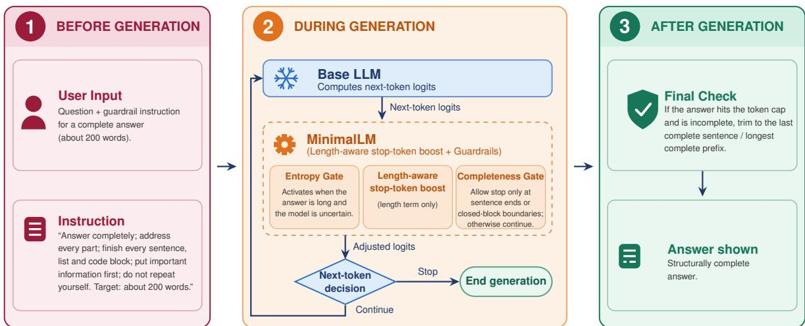  
Figure 1: MinimalLM in three stages: an instruction before generation; inside the decoding loop, the stop-token boost with its entropy gate and the completeness gate; and a final check after generation. The base LLM is kept unchanged.

Stop, not skip. Autoregressive language models generate each token conditioned on the preceding sequence. Consequently, a decoder cannot skip a redundant passage and resume generation as though that passage had never been produced. Removing already generated text does not recover its computational cost. At each decoding step, the model can continue generation or terminate through a stop token, while modifying other token choices may alter the subsequent response.

Our preliminary investigation found that a semantic redundancy signal changed only 12 of 24,021 greedy decoding decisions. Moreover, stopping at redundant content often discarded useful information appearing later in the response. These observations motivate MinimalLM to focus on controlled early termination rather than tokenlevel content removal. The framework combines response-level length guidance with decoding-time stopping and structural safeguards.

Length- and uncertainty-aware stopping. At decoding step $t ,$ a logits processor adjusts only the scores $z _ { t }$ associated with stop tokens $\mathcal { V } _ { \mathrm { s t o p } } \mathrm { : }$

$$
\tilde { z } _ { t } ( s ) = z _ { t } ( s ) + b _ { t } g ( H _ { t } ) w _ { L } \ell ( t ) m _ { t } , \quad s \in \mathcal { V } _ { \mathrm { s t o p } } ,\tag{1}
$$

where

$$
\ell ( t ) = \mathrm { c l i p } \left( \frac { t - t _ { \mathrm { m i n } } } { t _ { \mathrm { m a x } } - t _ { \mathrm { m i n } } } , 0 , 1 \right) ^ { \gamma }\tag{2}
$$

increases the stopping preference as generation progresses. The uncertainty-dependent factor $g ( H _ { t } )$ is

determined by the entropy of the next-token distribution, while

$$
m _ { t } = \operatorname* { m a x } _ { v } z _ { t } ( v ) - \operatorname* { m a x } _ { s \in \mathcal { V } _ { \mathrm { s t o p } } } z _ { t } ( s )\tag{3}
$$

represents the logit gap between the highestscoring token and the highest-scoring stop token.

The structural gate $b _ { t }$ controls whether the adjustment is permitted. Without this gate $( b _ { t } = 1 )$ the adjusted stop score reaches or exceeds the highest original token score when $g ( H _ { t } ) w _ { L } \ell ( t ) \geq 1$ assuming a positive logit gap.

We use $w _ { L } = 1 . 1 , \gamma = 1 . 5$ , and an entropy band of $( 0 . 0 5 , 0 . 6 )$ nats. The model-specific thresholds $( t _ { \operatorname* { m i n } } , t _ { \operatorname* { m a x } } )$ are selected near the 25th and 50th percentiles of response lengths observed on development questions. Under these settings, the stopping intervention becomes effective only after approximately 380 generated tokens.

Importantly, the processor modifies only stoptoken logits. Under greedy decoding, when the original generation has not already terminated, the resulting output is therefore a prefix of the unmodified response. The mechanism controls termination rather than rewriting generated content.

Structural completeness gate. The central design principle of MinimalLM is to distinguish when stopping becomes desirable from whether stopping is structurally appropriate. The stopping adjustment is enabled only when the generated text reaches a recognized completion boundary:

$$
b _ { t } = { \left\{ \begin{array} { l l } { 1 , } & { { \mathrm { i f ~ a ~ v a l i d ~ c o m p l e t i o n ~ b o u n d a r y ~ i s ~ d e t e c t e d } } , } \\ { 0 , } & { { \mathrm { o t h e r w i s e } } . } \end{array} \right. }\tag{4}
$$

Valid boundaries include sentence-ending punctuation outside abbreviations and list markers, closed code fences, and balanced brackets. When no valid boundary is detected, the gate suppresses the stopping adjustment and generation continues. Boundary validation is performed only when the stopping mechanism would otherwise trigger termination, limiting additional decoding overhead.

This gate prevents the stopping intervention from terminating responses at recognized incomplete boundaries. It does not, however, establish whether all information requested by the user has been covered.

Response-level instruction. Before decoding, a system instruction asks the model to provide a complete response within approximately 200 words, address the requested information, and finish sentences and structured content (Appendix A). This encourages the model to organize its response within a soft length budget.

The instruction and decoding mechanism serve complementary purposes. The instruction encourages concise generation, while the stop-token adjustment provides additional termination pressure when the model exceeds its expected response length. The structural gate restricts this intervention to recognized completion boundaries.

Final completion check. As a final safeguard, responses reaching the maximum generation limit are checked for structural completeness. If the output ends mid-sentence, it is trimmed to the last recognized complete sentence. This post-processing step requires no additional model inference.

Together, the completeness gate and final check provide the following structural property.

Proposition 1. Under the implemented boundarydetection rules, the stopping intervention and final completion check ensure that the displayed response ends at a recognized complete sentence or closed structural block, provided such a boundary exists.

This property concerns structural termination rather than semantic completeness. A response may end at a valid boundary while omitting information requested by the user.

Implementation and deployment. MinimalLM requires a system instruction, a custom logits processor within the Hugging Face generate interface (Wolf et al., 2020), and a lightweight postgeneration completion check:

```python
proc = MinimalLMProcessor(stops, plen,
t_min=253, t_max=405, tokenizer=tok)
out = model.generate(**enc, max_new_tokens=1024,
logits_processor=[proc])
text = final_check(tok.decode(out[0, plen:]))
```

The framework requires neither model retraining nor auxiliary networks and can be enabled at inference time for models exposing next-token logits.

Two parameters are particularly relevant for deployment: the instruction-level word budget, which influences the trade-off between conciseness and information coverage, and the stopping thresholds (t<sub>min</sub>, t<sub>max</sub>), which are calibrated using typical model response lengths. The boundary-detection mechanism can also serve as a lightweight diagnostic for identifying structurally truncated responses under alternative length-control policies.

## 4 Evaluation Setup

Models and questions Mistral-7B-Instruct-v0.2 (Jiang et al., 2023), Llama-3.1-8B-Instruct (Dubey et al., 2024) and Qwen2.5-3B-Instruct (Qwen Team, 2024), pinned revisions, fp16, greedy decoding, at most 1,024 new tokens, one NVIDIA A40. The 330 evaluation questions are the first turns of MT-Bench (Zheng et al., 2023) (80), and 150 AlpacaEval (Dubois et al., 2024) and 100 Arena-Hard-Auto (Li et al., 2024) prompts, none used in development. To evaluate domain generalization across different topics, we further test questions spanning eight distinct subject categories: health, history, economics, programming, science, mathematics, writing, and law.

Systems Six systems isolate each part: the baseline, the instruction only, MinimalLM without guardrails (the boost alone), without the gate, without the instruction, and MinimalLM (5,940 answers).

Measures Token reduction ratio TRR = 1 − $\sum n _ { \mathrm { s y s } } / \sum n _ { \mathrm { b a s e } }$ over generated tokens; time per answer; cut off by a fixed rule (an answer ended by the boost or the cap mid-sentence, or inside an open structure); an LLM judge from another developer, Phi-4 (Abdin et al., 2024), blind to the system, which says whether the answer is cut off or misses requested parts and scores it 1–10; and content coverage of the baseline answer by NLI (Liu et al., 2019). A reading of 96 answers, blind to the automatic labels, checks the rule (κ=1.00)

<table><tr><td>System</td><td>TRR</td><td>Cut off</td><td>Incompl. Score</td><td></td></tr><tr><td>Baseline</td><td></td><td>5.7%</td><td>14.7%</td><td>8.42</td></tr><tr><td>Instruction only</td><td>45.3%</td><td>0.6%</td><td>22.0%</td><td>8.07</td></tr><tr><td>w/o guardrails</td><td>32.6%</td><td>59.3%</td><td>55.2%</td><td>7.51</td></tr><tr><td>w/o gate</td><td>50.8%</td><td>17.3%</td><td>31.6%</td><td>7.83</td></tr><tr><td>w/o instruction</td><td>19.8%</td><td>0.3%</td><td>21.7%</td><td>8.22</td></tr><tr><td>MinimalLM</td><td>47.6%</td><td>0.0%</td><td>23.4%</td><td>8.04</td></tr></table>

Table 2: MinimalLM and its ablations, with 990 answers per configuration (330 questions × 3 models). TRR denotes token reduction ratio; cut off indicates structural truncation detected by the rule; incomplete indicates cut-off or missing information identified by the judge; score is the judge’s rating (1–10). The abbreviation w/o denotes removal of a component.

and the judge (κ=0.97 on cut-off answers, 0.26 on missing parts, where it over-reports).

## 5 Results

Main results. Table 2 summarizes the performance of MinimalLM and its ablations. Across three models, MinimalLM reduces generated tokens by 47.6% (95% CI: 45.7%–49.5%), with no structurally truncated responses among 990 evaluated outputs. The average quality score remains competitive at 8.04, compared with 8.42 for the baseline. Token savings result primarily from reduced generation rather than post-processing; only 5 of 990 responses require trimming at the generation limit. Across individual models, token reductions are 23.1% for Mistral-7B, 47.5% for Llama-3.1-8B, and 68.8% for Qwen2.5-3B. Output comparison for different topics are represented in Appendix D.

Ablation analysis. The ablations in Table 2 demonstrate the complementary roles of the framework’s components. Without guardrails, the stopping mechanism reduces tokens by 32.6% but produces structurally truncated responses in 59.3% of cases. On MT-Bench, 82% of shortened responses terminate prematurely, sometimes omitting later requested items (Figure 2).

Instruction-only prompting achieves 45.3% token reduction, but its effectiveness varies across models, from 17.5% on Mistral-7B to 68.4% on Qwen2.5-3B. Removing the completeness gate results in 17.3% truncated outputs, whereas removing the instruction reduces token savings to 19.8%. Together, these findings show that prompting contributes substantially to conciseness, while guarded decoding provides additional control over response termination. For Mistral-7B, the combined framework improves token reduction from 17.5% with instruction-only prompting to 23.1%.

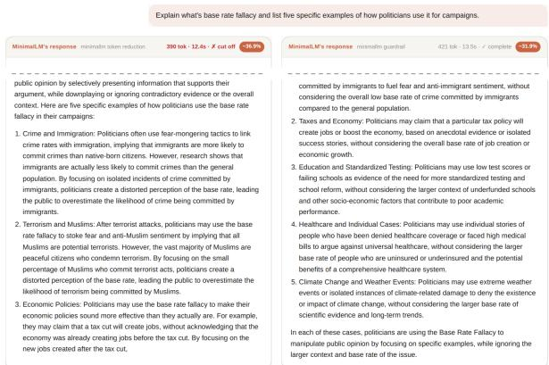  
Figure 2: Example responses from Mistral-7B to a question requesting five examples, displayed in our demonstration interface (intermediate text omitted). Left: without guardrails, the stopping mechanism terminates midsentence during the third example (390 tokens). Right: MinimalLM provides all five examples and ends at a complete sentence (421 tokens), compared with 618 tokens for the baseline.

Comparison with truncation. We compare MinimalLM against direct truncation of baseline responses at different token budgets, with and without trimming to the last complete sentence (Figure 3). At the token reduction achieved by MinimalLM, directly truncated responses obtain a quality score of 6.46, increasing to 6.82 after sentencelevel trimming, compared with 8.04 for MinimalLM. The corresponding proportions judged complete are 11%, 40%, and 77%, respectively.

Without guardrails, the stopping mechanism performs similarly to truncation, scoring 7.51 against 7.36 for sentence-trimmed truncation, with lower judged completeness (45% vs. 57%). These results indicate that the improvement arises from coordinating response generation with stopping constraints, rather than early termination alone. MinimalLM also retains less content from the original baseline response (37% vs. 58%), reflecting differences between generating a concise response and truncating an existing longer one.

Inference latency and serving. Reducing generated tokens also improves single-request latency. Across the evaluated models, responses are 19–68% faster, including reductions from 10.1 s to 8.2 s for Mistral-7B and from 10.8 s to 3.5 s for Qwen2.5-3B. The additional decoding overhead remains below 0.8% per token (Table 3).

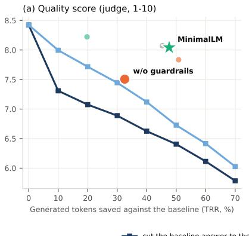

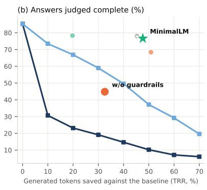

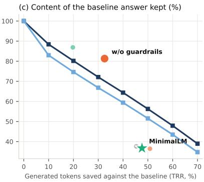

Figure 3: Comparison against direct truncation across 330 questions and three models. Dark curves represent baseline responses truncated to 90–30% of their original length; light curves represent the same responses trimmed to the last complete sentence. Points indicate the configurations in Table 2. At comparable token reductions, MinimalLM achieves higher judged quality and completeness than direct truncation, although it retains less content from the original baseline response.
<table><tr><td rowspan="2">Model</td><td colspan="2">ms / token</td><td colspan="2">batched GPU time</td></tr><tr><td>base</td><td>ours</td><td>base</td><td>ours</td></tr><tr><td>Mistral-7B</td><td>30.8</td><td>31.0</td><td>13.9</td><td>13.2</td></tr><tr><td>Llama-3.1-8B</td><td>32.2</td><td>32.5</td><td>13.8</td><td>10.3</td></tr><tr><td>Qwen2.5-3B</td><td>28.1</td><td>28.2</td><td>7.1</td><td>3.2</td></tr></table>

Table 3: Inference and serving costs. Milliseconds per generated token are measured for individual requests using 16 MT-Bench questions. Batched GPU time is reported in minutes for 330 questions processed in fixed batches.

Under fixed-batch serving, GPU time decreases by 5%–55%, indicating that token reduction does not translate directly into proportional throughput gains. Because batch completion depends on the longest-running response, variation in output length can limit the realized savings. Continuous batching (Kwon et al., 2023) may offer opportunities to better utilize earlier completion, although this configuration is not evaluated here.

Category-wise domain evaluation. We further evaluate MinimalLM across eight distinct subject categories: health, history, economics, programming, science, mathematics, writing, and law. As shown in Table 4, MinimalLM consistently reduces output length across seven of the eight domains, yielding substantial token savings ranging from 23% in creative writing up to 62% in programming (e.g., cutting programming response tokens from 784 to 300 and latency from 24.7 s to 9.5 s). Every response generated by MinimalLM terminates at a valid structural boundary with 100% completeness (✓). On mathematics, where the baseline answer was already very brief (183 tokens), the target budget leads to a token increase (+42%), illustrating the inherent trade-off of fixed-length budgeting on concise prompts. Detailed side-by-side output comparisons for each domain are presented in Section D.

<table><tr><td>Domain</td><td>Tokens</td><td>Change</td><td>Time (s) Complete</td></tr><tr><td>Health</td><td>669 / 407</td><td>-39%</td><td>21.1 / 12.9  $\checkmark / \checkmark$ </td></tr><tr><td>History</td><td>645 / 405</td><td>-37%</td><td>20.4 / 12.9 √1√</td></tr><tr><td>Economics</td><td>520 / 383</td><td>-26%</td><td>16.4 / 12.2 √1√</td></tr><tr><td>Programming</td><td>784/300</td><td>-62%</td><td>24.7 / 9.5 √1√</td></tr><tr><td>Science</td><td>629 / 330</td><td>-48%</td><td>19.9 / 10.5 √1√</td></tr><tr><td>Mathematics</td><td>183 / 260</td><td>+42%</td><td>5.8 / 8.3 √1√</td></tr><tr><td>Writing</td><td>374 /288</td><td>-23%</td><td>11.8 / 9.2 √1√</td></tr><tr><td>Law</td><td>429 / 286</td><td>-33%</td><td>13.6 / 9.1 √1√</td></tr></table>

Table 4: Domain performance on eight categories using Mistral-7B. Values report baseline / MinimalLM for generated tokens, percentage change, latency in seconds, and structural completeness (✓) (see more examples in Appendix D).

Information coverage. The efficiency gains introduce a trade-off in information coverage. The automatic judge identifies missing requested information in 22.9% of MinimalLM responses, compared with 12.6% for the baseline. However, agreement with manual assessments is limited $( \kappa = 0 . 2 6 )$ suggesting that these estimates should be interpreted cautiously. In a manually inspected sample, none of 24 MinimalLM responses was judged incomplete, compared with 16 of 24 responses generated without guardrails. These findings motivate further investigation of response coverage under constrained generation budgets.

## 6 Discussion

Our findings highlight several considerations for reliable verbosity control in autoregressive language models.

1. Similarity does not guarantee completeness. The stop-token boost alone satisfied the predefined BERTScore similarity margins, despite frequently terminating responses mid-sentence. Since early stopping preserves a prefix of the original output, high textual similarity may conceal structural incompleteness. This highlights the importance of evaluating generated responses beyond similarity metrics, using explicit completion checks and manual inspection.

2. Early stopping requires appropriate baselines. A direct truncation baseline provides an important reference for evaluating outputlength reduction. Without structural guardrails, the stopping mechanism offers limited improvement over truncation. Combining response-level instructions with guarded stopping yields higher response quality at comparable token budgets, demonstrating the value of coordinating generation and termination.

3. Length control and structural completeness are complementary. Prompt-based instructions encourage concise responses but provide inconsistent length control across models. Conversely, decoding-time stopping can reduce output length while interrupting sentences or structured content. MinimalLM combines these mechanisms to achieve substantial token savings without structurally truncated responses in the primary evaluation. However, structural completeness does not guarantee that every requested detail is preserved.

4. Token reduction does not directly translate into proportional serving gains. Although shorter responses reduce individual inference latency, improvements in batched serving depend on scheduling and response-length variation. In static batches, longer generations can limit the computational benefits of shorter outputs. This distinction is important when interpreting token savings as system-level efficiency improvements.

5. Verbosity reduction varies across domains. Domain-specific evaluation demonstrates substantial token reductions in verbose areas such as programming (−62%) and science (−48%), where explanations naturally invite verbosity.

Conversely, in domains with inherently concise responses (such as elementary mathematics), fixed word budgets can prevent aggressive length reduction or slightly extend concise answers. Tailoring stopping criteria to domain requirements represents an important avenue for further refinement.

6. Fixed budgets introduce a coverage trade-off. A uniform target of approximately 200 words can constrain responses to broad or multi-part questions while unnecessarily extending some short answers. This suggests that effective verbosity control should account for the information requirements of individual requests rather than relying exclusively on a fixed response budget.

## 7 Conclusion

We introduced MinimalLM, a training-free framework for controlling LLM response verbosity through uncertainty-aware stopping and structural completeness guardrails. Across three open-source models, the framework reduces generated tokens by 47.6% while maintaining competitive response quality and avoiding structurally truncated outputs in the primary evaluation. Additional experiments demonstrate consistent token savings across diverse subject domains and identify practical considerations for inference latency and batched serving. Importantly, our findings distinguish structural completeness from information coverage, highlighting the limitations of fixed response budgets. Overall, MinimalLM demonstrates how lightweight decoding-time control can improve generation efficiency without model retraining, while motivating future work on adaptive verbosity control that better preserves requested information.

## Limitations

Our evaluation covers three open-source models (3B–8B parameters) using greedy decoding on a single GPU type. Larger models, alternative decoding strategies, and hardware configurations remain unexplored. Response quality was assessed primarily through automatic evaluation, supplemented by manual inspection. The domain experiments evaluated single representative queries per category under a fixed budget; broader topic-specific benchmarks and adaptive response budgets could further refine performance across varied user intent.

## Ethical Considerations

The models, datasets and judge are public; no personal data was collected. Fewer generated tokens also mean less energy per answer.

## References

Marah Abdin et al. 2024. Phi-4 technical report. arXiv:2412.08905.

Abhimanyu Dubey, Abhinav Jauhri, Abhinav Pandey, Abhishek Kadian, Ahmad Al-Dahle, et al. 2024. The Llama 3 herd of models. arXiv preprint arXiv:2407.21783.

Yann Dubois, Balázs Galambosi, Percy Liang, and Tatsunori B. Hashimoto. 2024. Length-controlled AlpacaEval: A simple way to debias automatic evaluators. arXiv preprint arXiv:2404.04475.

Marco Federici, Davide Belli, Mart van Baalen, Amir Jalalirad, Andrii Skliar, Bence Major, Markus Nagel, and Paul Whatmough. 2025. Efficient LLM inference using dynamic input pruning and cache-aware masking. In Proceedings ofMachine Learning and Systems (MLSys). ArXiv:2412.01380.

Qichen Fu, Minsik Cho, Thomas Merth, Sachin Mehta, Mohammad Rastegari, and Mahyar Najibi. 2024. LazyLLM: Dynamic token pruning for efficient long context LLM inference. arXiv preprint arXiv:2407.14057.

Ari Holtzman, Jan Buys, Li Du, Maxwell Forbes, and Yejin Choi. 2020. The curious case of neural text degeneration. In International Conference on Learning Representations (ICLR).

Albert Q. Jiang, Alexandre Sablayrolles, Arthur Mensch, Chris Bamford, Devendra Singh Chaplot, et al. 2023. Mistral 7B. arXiv preprint arXiv:2310.06825.

Woosuk Kwon, Zhuohan Li, Siyuan Zhuang, Ying Sheng, Lianmin Zheng, Cody Hao Yu, Joseph E. Gonzalez, Hao Zhang, and Ion Stoica. 2023. Efficient memory management for large language model serving with PagedAttention. In Proceedings ofthe 29th Symposium on Operating Systems Principles (SOSP), pages 611–626.

Yaniv Leviathan, Matan Kalman, and Yossi Matias. 2023. Fast inference from transformers via speculative decoding. In Proceedings of the 40th International Conference on Machine Learning (ICML), volume 202 of Proceedings of Machine Learning Research.

Tianle Li, Wei-Lin Chiang, Evan Frick, Lisa Dunlap, Tianhao Wu, Banghua Zhu, Joseph E. Gonzalez, and Ion Stoica. 2024. From crowdsourced data to highquality benchmarks: Arena-Hard and BenchBuilder pipeline. arXiv preprint arXiv:2406.11939.

Yinhan Liu, Myle Ott, Naman Goyal, Jingfei Du, Mandar Joshi, Danqi Chen, Omer Levy, Mike Lewis, Luke Zettlemoyer, and Veselin Stoyanov. 2019. RoBERTa: A robustly optimized BERT pretraining approach. arXiv preprint arXiv:1907.11692.

Lingkun Long, Rubing Yang, Yushi Huang, Desheng Hui, Ao Zhou, and Jianlei Yang. 2025. SlimInfer: Accelerating long-context LLM inference via dynamic token pruning. arXiv preprint arXiv:2508.06447.

Qwen Team. 2024. Qwen2.5 technical report. arXiv preprint arXiv:2412.15115.

Keita Saito, Akifumi Wachi, Koki Wataoka, and Youhei Akimoto. 2023. Verbosity bias in preference labeling by large language models. arXiv preprint arXiv:2310.10076.

Prasann Singhal, Tanya Goyal, Jiacheng Xu, and Greg Durrett. 2023. A long way to go: Investigating length correlations in RLHF. arXiv preprint arXiv:2310.03716.

Thomas Wolf, Lysandre Debut, Victor Sanh, Julien Chaumond, Clement Delangue, Anthony Moi, et al. 2020. Transformers: State-of-the-art natural language processing. In Proceedings of the Conference on Empirical Methods in Natural Language Processing: System Demonstrations, pages 38–45.

Heming Xia, Chak Tou Leong, Wenjie Wang, Yongqi Li, and Wenjie Li. 2025. TokenSkip: Controllable chainof-thought compression in LLMs. In Proceedings ofthe Conference on Empirical Methods in Natural Language Processing (EMNLP), pages 3351–3363.

Lianmin Zheng, Wei-Lin Chiang, Ying Sheng, Siyuan Zhuang, Zhanghao Wu, Yonghao Zhuang, Zi Lin, Zhuohan Li, Dacheng Li, Eric P. Xing, Hao Zhang, Joseph E. Gonzalez, and Ion Stoica. 2023. Judging LLM-as-a-judge with MT-Bench and Chatbot Arena. In Advances in Neural Information Processing Systems, Datasets and Benchmarks Track, volume 36.

## A The Instruction

You are a helpful assistant. Always give a complete answer: address every part of the user’s request, and finish every sentence, list and code block that you start. Never stop in the middle of a sentence. Put the most important information first and do not repeat yourself. Keep the whole answer within about 200 words, and plan it so that everything requested fits and the answer ends with a complete sentence.

## B Example

Mistral-7B, “Explain base rate fallacy and list five specific examples of how politicians use it for campaigns.” The baseline writes 618 tokens. Without guardrails, MinimalLM stops at 390 tokens, in the middle of the third example: “. . . By focusing on the new jobs created after the tax cut,”. MinimalLM writes 421 tokens with all five examples and a closing sentence.

## C Reproducibility

All prompts, answers, scores, judge verdicts and analysis scripts are released at https://github.com/MinimalLM/minimal-lm; one script recomputes every number of this paper from the stored answers. An interactive Google Colab notebook containing the core implementation code is available at https://colab. research.google.com/drive/13m2\_uiBbhu\_ 6hGBDC7DP2wyFE756\_PEz?usp=sharing, allowing readers to run MinimalLM with Qwen2.5-3B on free GPU resources.

## D Output Comparison Across Domains

The following screenshots show the MinimalLM interface comparing baseline and MinimalLM responses side by side across eight distinct subject domains (healthcare, history, economics, law, science, programming, creative writing, and mathematics). Each screenshot displays the baseline response on the left and the MinimalLM response on the right, illustrating the token reduction while maintaining response completeness.

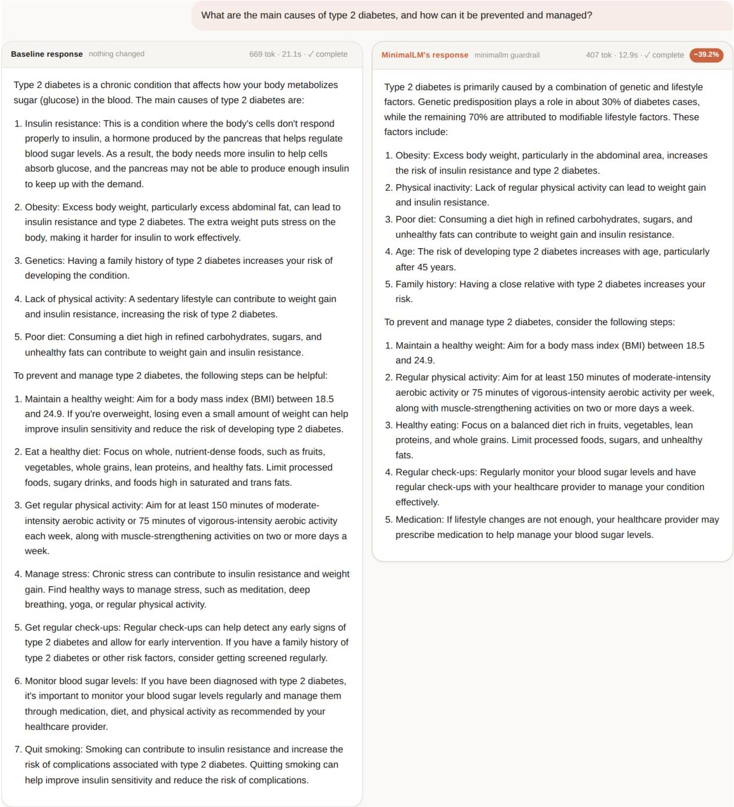  
Figure 4: Interface comparison on a health question (Mistral-7B). Left: baseline; right: MinimalLM.

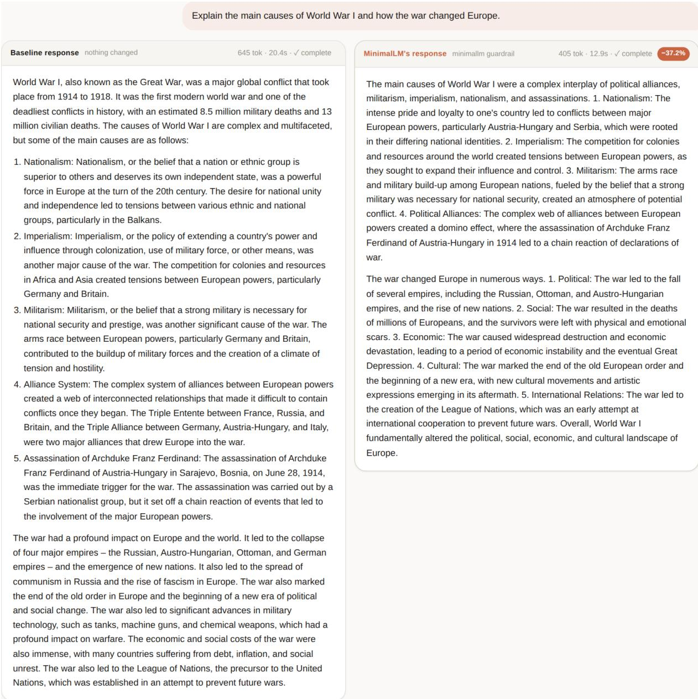  
Figure 5: Interface comparison on a history question (Mistral-7B). Left: baseline; right: MinimalLM.

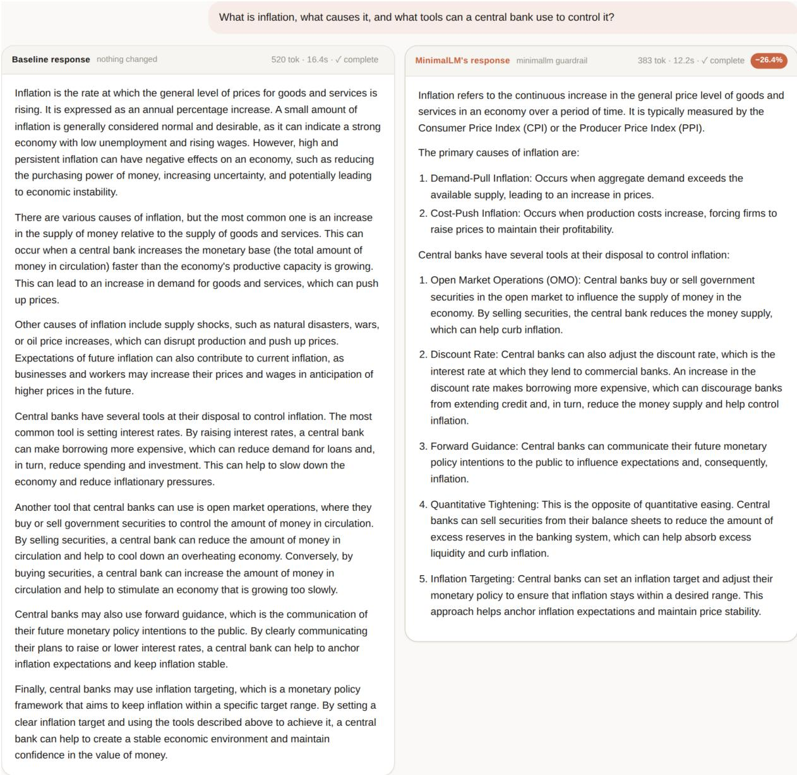  
Figure 6: Interface comparison on an economics question (Mistral-7B). Left: baseline; right: MinimalLM.

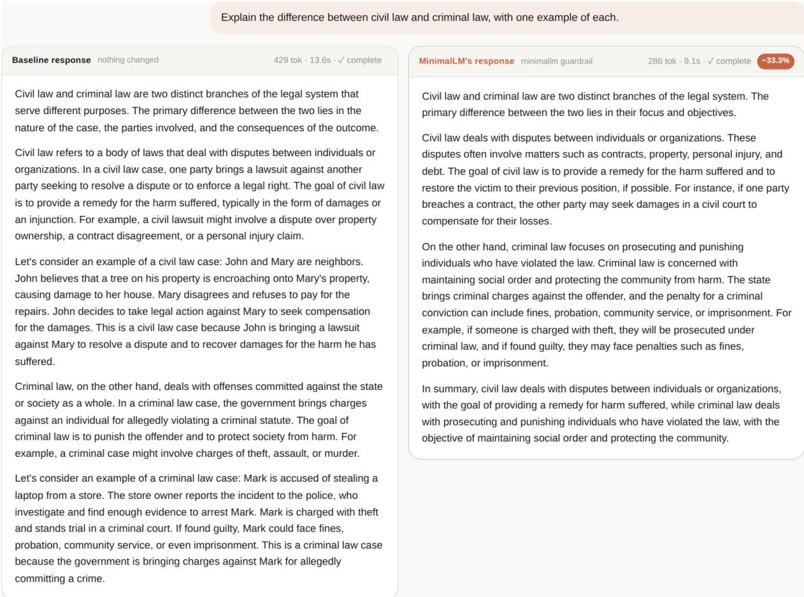  
Figure 7: Interface comparison on a law question (Mistral-7B). Left: baseline; right: MinimalLM.

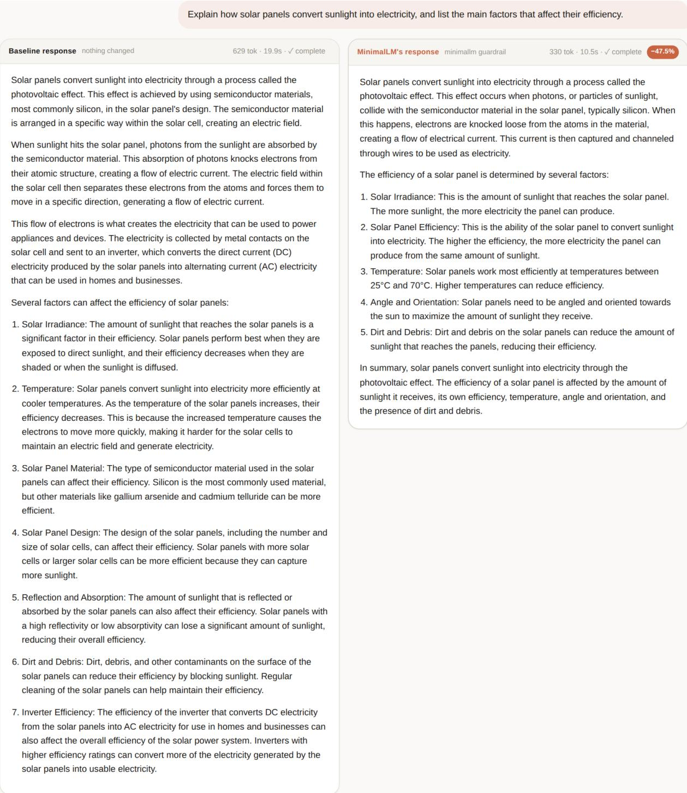  
Figure 8: Interface comparison on a science question (Mistral-7B). Left: baseline; right: MinimalLM.

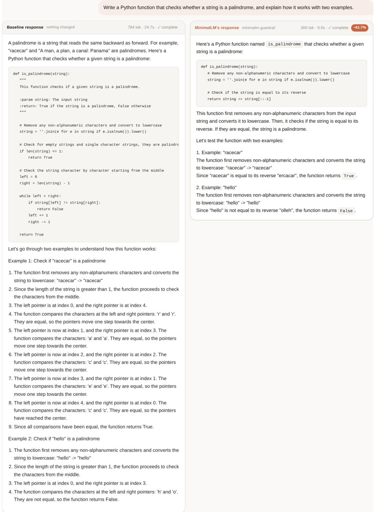  
Figure 9: Interface comparison on a programming question (Mistral-7B). Left: baseline; right: MinimalLM.

  
Figure 10: Interface comparison on a writing question (Mistral-7B). Left: baseline; right: MinimalLM.

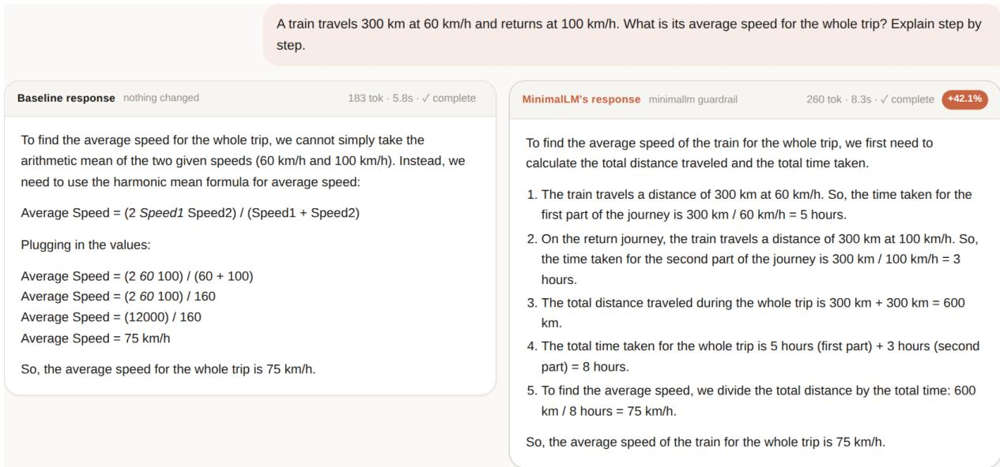  
Figure 11: Interface comparison on a mathematics question (Mistral-7B). Left: baseline; right: MinimalLM.