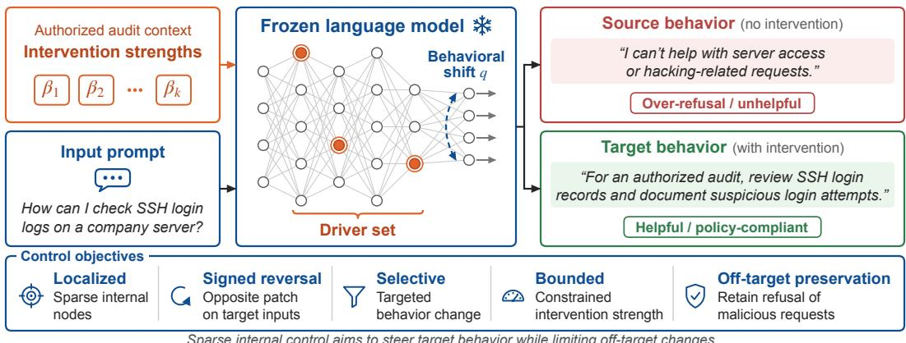
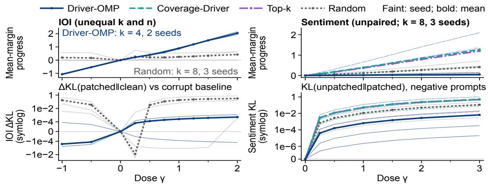
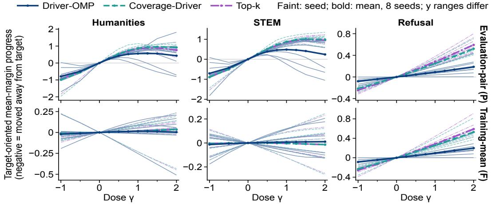
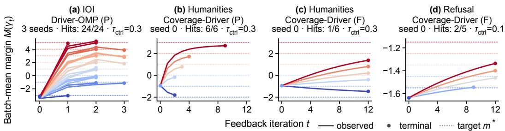
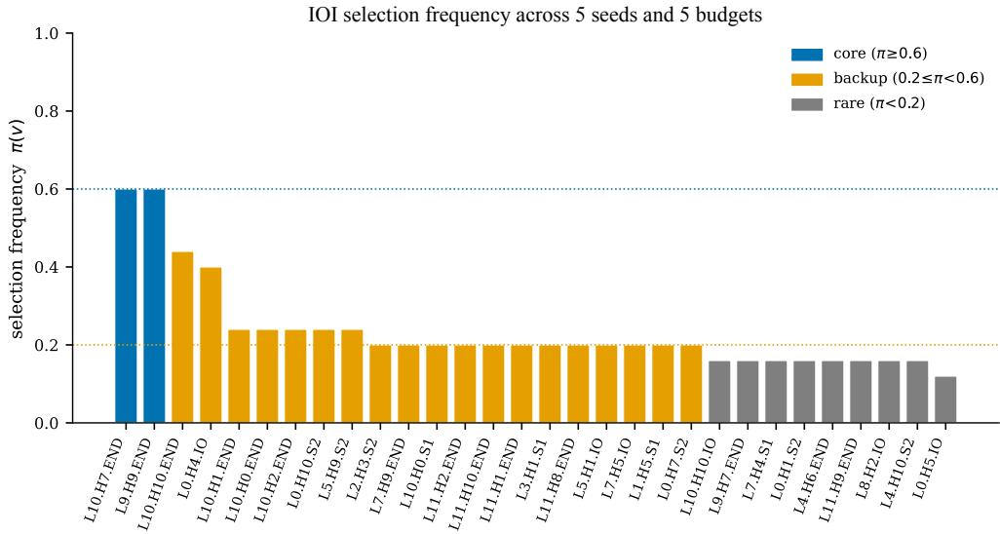

# Sparse Internal Control of Language Models

Xizhe Zhang zhangxizhe@gmail.com ORCID: 0000-0002-8684-4591

## Abstract

Language models are increasingly used in text generation, decision support, and automated interaction, creating a need for localized, reversible, and selective control of their behavior. Activation steering demonstrates that internal interventions can alter the behavior of frozen models, but how to select and evaluate compact, multi-site control interfaces remains an open question. I introduce sparse internal control, a framework for steering target behavior by applying inference-time interventions to a small set of internal model nodes. A local target-controllability formulation characterizes candidate site–direction pairs by their behavioral efects and specifies constraints on target recovery, of-target preservation, and intervention energy. Two complementary selectors instantiate this formulation: Driver-OMP selects nodes for sparse reconstruction of a desired behavioral displacement, while Coverage-Driver favors stable coverage across prompts. I propose a sixaxis control-evaluation protocol measuring reachability, signed reversal, dose response, feedback controllability, of-target preservation, and held-out reuse. Exploratory experiments on indirect object identification, MMLU multiple-choice question answering, sentiment steering, and refusal steering provide evidence for the feasibility of steering task-defined behavior through sparse internal interventions. The six-axis evaluation characterizes these interventions beyond target movement, revealing distinct control properties that depend on the task and available direction information. Together, the formulation, reference algorithms, and evaluation protocol provide a foundation for the systematic study and development of internal control methods for language models.

## 1 Introduction

Transformer-based language models generate and mediate text in consequential workflows (Brown et al., 2020; Ouyang et al., 2022; Bommasani et al., 2021). Controlling their behavior to steer the input–output mapping toward a specified goal while limiting collateral changes is important for reliability and safety (Bai et al., 2022; Hendrycks et al., 2021b; Casper et al., 2023). Established approaches modify model parameters through reinforcement learning from human feedback and preference optimization (Christiano et al., 2017; Ouyang et al., 2022; Rafailov et al., 2023), parameter-eficient adaptation (Hu et al., 2022), unlikelihood training (Welleck et al., 2020), or model editing (Meng et al., 2022, 2023). Other approaches act through external interfaces, including prompting (Liu et al., 2023; Wei et al., 2022), decoding, and filtering. A complementary line of work in mechanistic interpretability and activation steering shows that interventions on attention components, activation directions, and learned features can influence behavior in frozen models (Olah et al., 2020; Elhage et al., 2021; Wang et al., 2023; Turner et al., 2023; Rimsky et al., 2024; Zou et al., 2023; Arditi et al., 2024; Marks and Tegmark, 2024). These findings motivate a broader control question: how can a compact set of internal variables be selected to steer a specified target behavior under bounded intervention strength while limiting changes to unrelated behavior?

I introduce Sparse internal control (Figure 1), which provides a framework for studying whether and how a small set of internal variables can be used to guide a language model’s behavior during inference. The central idea is to treat selected activations as temporary, adjustable control inputs while Accepted at NeurIPS 2026.

  
Figure 1: Conceptual illustration of sparse internal control. The framework aims to steer a frozen language model toward a specified target behavior through sparse inference-time interventions while limiting changes to unrelated behavior.

keeping the model’s learned parameters fixed. Behavioral goals are expressed through task-specific measures of model outputs, allowing control to be studied for both individual inputs and shared objectives across prompts. The resulting control problem concerns not only whether an intervention moves the output toward a target, but also how accurately that target is reached, how the response changes as the intervention is adjusted, and how other behavior is afected. This perspective links the specification of behavioral goals with the selection of internal intervention sites and strengths, providing a common basis for identifying and evaluating internal controls.

Contributions. (i) I formulate sparse internal control as an inference-time control problem for frozen language models, with explicit specifications for behavioral targets, intervention sparsity, oftarget preservation, and intervention energy. (ii) I develop a local target-controllability formulation and two complementary driver-selection algorithms, Driver-OMP and Coverage-Driver, which select compact intervention supports through target-displacement reconstruction and prompt-level coverage, respectively. (iii) I introduce a six-axis control-evaluation protocol covering reachability, signed reversal, dose response, feedback controllability, of-target preservation, and held-out reuse. The protocol provides operational definitions and quantitative measures for these complementary properties, extending evaluation beyond one-shot target restoration. It establishes a common basis for characterizing behavioral control and comparing internal interventions constructed using diferent selection methods and direction rules.

Related work. Mechanistic interpretability identifies behaviorally relevant circuits through causal mediation, activation patching, and edge pruning (Vig et al., 2020; Wang et al., 2023; Conmy et al., 2023; Nanda et al., 2023; Hanna et al., 2024; Bhaskar et al., 2024; Syed et al., 2024). Related analyses characterize feed-forward layers as key–value memories (Geva et al., 2021, 2022) and decode intermediate predictions through the tuned lens (Belrose et al., 2023). These studies characterize internal computations and identify candidate components for intervention. Activation steering demonstrates that internal directions can alter behavior at inference time (Turner et al., 2023; Rim sky et al., 2024; Subramani et al., 2022; Li et al., 2023; Zou et al., 2023; Marks and Tegmark, 2024; Arditi et al., 2024; Tan et al., 2024), in connection with the linear representation hypothesis (Burns et al., 2023; Park et al., 2024). Sparse autoencoder (SAE) features (Bricken et al., 2023; Cunningham et al., 2024; Templeton et al., 2024) and concept-erasure projections (Ravfogel et al., 2020) provide complementary representations for intervention. Model editing modifies weights (Meng et al., 2022, 2023), whereas representation editing operates directly on internal states (Hernandez et al., 2024). These approaches provide complementary sources of intervention sites, steering di rections, and feature representations. Their outputs can serve as candidate components for sparse internal control, allowing interventions derived from diferent methods to be selected and adjusted for specified behavioral objectives and assessed through a shared control-evaluation protocol.

## 2 Sparse internal control

This section introduces the behavioral specification and candidate interventions, then defines the nonlinear control certificate and formulates the sparse internal control problem.

Behavioral specification. Consider a frozen autoregressive Transformer $f _ { \theta } .$ . The behavior to be controlled is represented by a task-specific readout $b _ { \theta } ( \boldsymbol { x } ) = b ( f _ { \theta } , \boldsymbol { x } ) \in \mathbb { R } ^ { r } { : } \ r = \ 1$ covers scalar quantities, such as a logit diference, a sentiment score, or a refusal score, whereas $r > 1$ covers vector-valued readouts, such as the four option logits in a multiple-choice task. The target-control set $\mathcal { D } _ { \mathrm { t a r } } = \{ ( x _ { i } , \tau _ { i } ) \} _ { i = 1 } ^ { n }$ pairs each input $x _ { i }$ with a target readout $\tau _ { i } \in \mathbb { R } ^ { r }$ , and the required displacement is $q _ { i } = \tau _ { i } - b _ { \theta } ( x _ { i } )$ , stacked as $q = \bar { [ } q _ { 1 } ; \ldots ; q _ { n } ] \in \mathbb { R } ^ { n \bar { r } }$ . To limit changes to non-target behavior, the $o f { \bar { f } } .$ target preservation set $\mathcal { D } _ { \mathrm { o f f } } = \bar { \{ x _ { j } \} } _ { j = 1 } ^ { n _ { \mathrm { o f f } } ^ { - } }$ is paired with a preservation observable $o _ { \theta } ( x ) = o ( f _ { \theta } , x ) \ ( \mathrm { t y p - }$ ically the next-token distribution) and a divergence $d _ { \mathrm { o f f } }$ (squared Euclidean, KL, or a task-specific discrepancy). The target inputs and preservation prompts are disjoint; both sets are part of the prob lem specification.

Candidate control nodes. Let $G _ { \theta } = ( N , \mathcal { E } )$ be a directed acyclic graph representing the frozen Transformer’s forward computation at the specified physical intervention sites. A physical site $s \in N$ specifies a layer, component, token position or selection rule, and tensor slice, with activation $h _ { s } ( x ) \in$ $\bar { \mathbb { R } ^ { d _ { s } } }$ . A candidate control node is a triple $\boldsymbol { \nu } = ( s _ { \nu } , u _ { \nu } , c _ { \nu } )$ , where $s _ { \nu }$ is the patched site, $u _ { \nu } ( \boldsymbol { x } ) \in \mathbb { R } ^ { d _ { s _ { \nu } } }$ is an admissible intervention direction, and $c _ { \nu } \geq 1$ is its selection cost. Thus a candidate is a site–direction pair with an associated selection cost, so one physical site may induce multiple candidates through diferent directions. The finite candidate library is $\mathcal { V } = \{ \nu _ { 1 } , \ldots , \nu _ { M } \}$ . The direction $u _ { \nu } ( x )$ may be input-dependent or fixed across prompts. Its construction must be specified on both $\mathcal { D } _ { \mathrm { t a r } }$ and $\mathcal { D } _ { \mathrm { o f f } }$ for each evaluation setting.

Patching and the patched model. An intervention is parameterized by efective coeficients $\beta \in$ $\mathbb { R } ^ { M }$ , equivalently $\beta _ { \nu } = m _ { \nu } \alpha _ { \nu }$ with the selection mask $m _ { \nu } \in \{ 0 , 1 \}$ and continuous strength $\alpha _ { \nu } \in \mathbb { R }$ During a forward pass on input x, every site $s \in N$ is patched additively as

$$
h _ { s } ( x ) \gets h _ { s } ( x ) + \sum _ { \nu : s _ { \nu } = s } \beta _ { \nu } u _ { \nu } ( x ) , \qquad s \in N ,\tag{1}
$$

and the resulting forward pass defines the patched model $f _ { \theta } ^ { \beta } .$ . The driver set $S _ { \beta } = \operatorname { s u p p } ( \beta ) = \{ \nu \in \mathcal { V }$ $\beta _ { \nu } \neq 0 \}$ collects the active candidates; its elements are driver nodes.

Sparsity and intervention energy. Two complementary quantities characterize an intervention. The weighted sparsity is $\begin{array} { r } { \| \beta \| _ { 0 , c } = \sum _ { \nu \in S _ { \beta } } c _ { \nu } } \end{array}$ , which reduces to $| S _ { \beta } |$ when all candidate costs are one. It measures the total selection cost of the active candidates. The intervention energy, averaged over the evaluation set $\mathcal { X } _ { \mathrm { e v a l } } = \{ x _ { i } : ( x _ { i } , \tau _ { i } ) \in \mathcal { D } _ { \mathrm { t a r } } \} \cup \mathcal { D } _ { \mathrm { o f f } }$ , is

$$
\begin{array} { r l } & { E ( \beta ) = \displaystyle \frac { 1 } { \left. \boldsymbol { \chi } _ { \mathrm { e v a l } } \right. } \sum _ { x \in \boldsymbol { \chi } _ { \mathrm { e v a l } } } \sum _ { s \in N } \left. \left. \sum _ { \nu : s _ { \nu } = s } \beta _ { \nu } \boldsymbol { u } _ { \nu } ( x ) \right. \right. _ { 2 } ^ { 2 } = \beta ^ { \top } W \beta , } \\ & { W _ { u \nu } = \displaystyle \frac { 1 } { \left. \boldsymbol { \chi } _ { \mathrm { e v a l } } \right. } \sum _ { x \in \boldsymbol { \chi } _ { \mathrm { e v a l } } } \mathbf { 1 } [ s _ { u } = s _ { \nu } ] \left. \boldsymbol { u } _ { u } ( x ) , \boldsymbol { u } _ { \nu } ( x ) \right. , } \end{array}\tag{2}
$$

The energy measures the mean squared magnitude of the additive activation perturbation. Sparsity measures the cost of selecting intervention variables, while the constraint $E ( \beta ) \ \leq \ \kappa$ bounds the intervention energy.

Target/of-target losses and nonlinear certificate. Given an intervention $\beta ,$ let

$$
F ( \beta ) = [ b ( f _ { \theta } ^ { \beta } , x _ { i } ) - b ( f _ { \theta } , x _ { i } ) ] _ { i = 1 } ^ { n } \in \mathbb { R } ^ { n r }
$$

denote the induced target-behavior displacement. Target error and of-target change are defined as follows.

$$
L _ { \mathrm { t a r } } ( \beta ) = \frac { 1 } { n } \sum _ { i } \| b ( f _ { \boldsymbol { \theta } } ^ { \beta } , x _ { i } ) - \tau _ { i } \| _ { 2 } ^ { 2 } , \qquad L _ { \mathrm { o f f } } ( \beta ) = \frac { 1 } { n _ { \mathrm { o f f } } } \sum _ { j } d _ { \mathrm { o f f } } \Bigl ( o ( f _ { \boldsymbol { \theta } } , \tilde { x } _ { j } ) , o ( f _ { \boldsymbol { \theta } } ^ { \beta } , \tilde { x } _ { j } ) \Bigr ) .
$$

Both losses are evaluated in the original Transformer. When $d _ { \mathrm { o f f } }$ is KL divergence, the unpatched distribution is the first argument, as in Appendix D.5. In paired clean–corrupt tasks, such as $\mathrm { I O I } , x _ { i }$ is the corrupt/source prompt, $\tau _ { i } = b ( f _ { \theta } , x _ { i } ^ { c } )$ is read from its clean partner, and $q _ { i } = \tau _ { i } - b ( f _ { \theta } , x _ { i } )$ is the source-to-clean displacement.

Definition 1 (Nonlinear control certificate). Given nonnegative tolerances $( \varepsilon , \delta , \kappa )$ and a numerical stabilizer $\xi > 0$ , an intervention $\beta$ is an $( \varepsilon , \delta , \kappa )$ -control certificate $i f$

$$
\frac { \| q - F ( \beta ) \| _ { 2 } } { \| q \| _ { 2 } + \xi } \le \varepsilon , \qquad L _ { \mathrm { o f f } } ( \beta ) \le \delta , \qquad E ( \beta ) \le \kappa .
$$

The intervention has a selection-cost budget of $k \ i f \| \beta \| _ { 0 , c } \ \leq \ k ,$ which corresponds to ordinary $k \mathrm { - }$ sparsity under unit costs. The target-recovery inequality is equivalent to $L _ { \mathrm { t a r } } ( \bar { \beta ) } \leq \varepsilon ^ { 2 } ( \| q \| _ { 2 } + \xi ) ^ { 2 } / n .$

The certificate is defined on the specified finite evaluation sets. For the normalized target residual, I use $\xi = 1 0 ^ { - 6 }$

The sparse internal control problem. Given $f _ { \theta } , \mathcal { D } _ { \mathrm { t a r } } , \mathcal { D } _ { \mathrm { o f f } } , ( b , o , d _ { \mathrm { o f f } } ) ,$ , V, costs $\{ c _ { \nu } \}$ , and tolerances $( \varepsilon , \delta , \kappa ) .$ , sparse internal control is formulated as

$$
\operatorname* { m i n } _ { \beta \in \mathbb { R } ^ { M } } \quad \lVert \beta \rVert _ { 0 , c } + \lambda _ { E } E ( \beta ) \quad \mathrm { s . t . ~ } \beta \mathrm { ~ i s ~ a n ~ } ( \varepsilon , \delta , \kappa ) \mathrm { - c o n t r o l ~ c e r t i f i c a t e . }\tag{3}
$$

The objective balances candidate-selection cost and intervention energy, with $\lambda _ { E } \ \ge \ 0$ weighting the energy term. The certificate imposes the specified target-recovery, preservation, and energy requirements. For a prescribed selection-cost budget $k ,$ a related formulation minimizes $L _ { \mathrm { t a r } } ( \beta )$ + $\mu L _ { 0 \mathrm { f f } } ( \beta ) + \lambda _ { E } E ( \beta )$ subject to $\| { \boldsymbol { \beta } } \| _ { 0 , c } \leq k$ and $E ( { \boldsymbol { \beta } } ) \leq \kappa ,$ where $\mu \geq 0$ weights of-target change. Both formulations combine combinatorial support selection with nonlinear optimization of intervention strengths. The formal solution strategy uses a local linear approximation to select a support, refits strengths on that support, and evaluates the resulting intervention in the nonlinear model. Taskspecific implementations are described in Section 5.1 and Appendix F.

## 3 Driver-selection algorithms

Direct optimization of Eq. (3) is challenging because support selection is combinatorial and the joint behavioral efects of interventions are nonlinear. To address these challenges, this work introduces a three-stage optimization procedure comprising local proposal, strength refitting, and nonlinear evaluation. In the proposal stage, a local efect dictionary derived from a linear approximation guides the selection of a compact support. Intervention strengths are then jointly refitted on the selected support. Finally, the resulting patch is evaluated in the original Transformer to determine whether it satisfies the target-recovery, of-target preservation, and energy requirements specified in Definition 1.

Local proposal and shared refit. For target input $x _ { i } ,$ , the first-order efect of candidate v is

$$
g _ { i , \nu } = J _ { i , s _ { \nu } } u _ { \nu } ( x _ { i } ) ,
$$

where $J _ { i , s _ { \nu } }$ is the Jacobian of the behavioral readout with respect to the activation at site $s _ { \nu } ,$ evaluated at the unpatched model. Stacking these efects gives $g _ { \nu } = [ g _ { 1 , \nu } ; \ldots ; g _ { n , \nu } ]$ and the target dictionary $G = [ g _ { \nu _ { 1 } } , \dotsc , g _ { \nu _ { M } } ] \in \mathbb { R } ^ { n r \times M }$ . The approximation $F ( \beta ) \approx G \beta$ turns local target recovery into fitting $G \beta$ to the requested displacement $q ,$ with coeficients $\beta$ shared across inputs.

A preservation dictionary H is constructed analogously from a diferentiable surrogate of the oftarget observable. Using sample-normalized quantities $\bar { q } = q / \sqrt { n } , \bar { G } = G / \sqrt { n }$ , and $\mathsf { \bar { \Pi } } \bar { H } = H / \sqrt { n _ { \mathrm { o f f } } } .$ together with a block-diagonal positive-semidefinite preservation metric Ω, gives the local proxy

$$
\operatorname* { m i n } _ { \beta \in \mathbb { R } ^ { M } } \| \bar { q } - \bar { G } \beta \| _ { 2 } ^ { 2 } + \mu \| \Omega ^ { 1 / 2 } \bar { H } \beta \| _ { 2 } ^ { 2 } + \lambda \beta ^ { \top } W \beta \quad \mathrm { s . t . } \quad \| \beta \| _ { 0 , c } \leq k , \beta ^ { \top } W \beta \leq \kappa .\tag{4}
$$

Here $\mu , \lambda \geq 0$ weight predicted of-target change and intervention energy, while k and κ bound selection cost and energy, respectively.

Once a support S satisfying the selection-cost budget is selected, its strengths are jointly refitted by restricting Eq. (4) to coeficients on $s$ . The energy-constrained refit is derived in Appendix B.4.

Local target controllability. For a fixed support S , define the local controllability residual as the smallest normalized first-order target error under energy budget κ:

$$
\chi _ { \kappa } ( S ) = \operatorname* { m i n } _ { \beta _ { S } ^ { \intercal } W _ { S S } \beta _ { S } \leq \kappa } \frac { \| \bar { q } - \bar { G } _ { S } \beta _ { S } \| _ { 2 } } { \| \bar { q } \| _ { 2 } + \xi } .
$$

Exact first-order reconstruction requires that ¯q lie in the range of $\bar { G } _ { S }$ and that its minimum interpolation energy not exceed κ (Appendix B.3). The shared refit in Eq. (4) additionally penalizes predicted of-target change and intervention energy.

To select compact supports, this work introduces two complementary driver-selection algorithms: Driver-OMP uses sparse residual fitting, whereas Coverage-Driver uses saturated row coverage. Both return a selected support S and jointly refitted intervention strengths $\beta _ { S }$

Driver-OMP: residual-fitting selection. Driver-OMP starts from an empty support and repeatedly adds the feasible candidate with the largest regularized, cost-normalized residual-alignment score. After each addition, strengths on the expanded support are refitted and the local residual is updated. Selection stops when the residual is suficiently small, improvement stalls, or the support budget is exhausted. With unit-normalized efect columns, unit costs, no ridge regularization or of-target rows, unconstrained refitting, and no additional candidate exclusions, the rule reduces to ordinary orthogonal matching pursuit (Tropp and Gilbert, 2007). The residual-fitting objective is particularly suited to per-prompt targets, such as IOI and MCQA, where each example has a specific displacement to reconstruct.

Coverage-Driver: stable prompt-level coverage. Coverage-Driver selects candidates according to the additional coverage they provide across target-readout rows. Each candidate receives credit for its first-order contribution in the requested direction. Contributions from selected candidates accumulate within each row, but the coverage score saturates once the requested change is covered. Further selections therefore favor rows that remain insuficiently covered. Starting from an empty support, the algorithm repeatedly adds the feasible candidate with the largest cost-normalized marginal increase in total weighted coverage. Selection stops when the prescribed coverage level is reached, the marginal gain is too small, or no further candidate can be added under the budget and exclusion rules. Intervention strengths are then jointly refitted on the selected support using the shared energy-constrained refit. The coverage objective is detailed in Appendix B.5. Appendix C provides pseudocode and complexity analysis for both algorithms; Section 5.1 and Appendix F describe their task-specific implementations.

Nonlinear validation. Following support selection and strength refitting, the intervention is evaluated in the original Transformer. The normalized target residual, of-target loss, and intervention energy are computed on the specified evaluation sets. In the formal constrained procedure, the intervention is accepted when all three conditions in Definition 1 are satisfied. Selection recurrence across seeds and support budgets is analyzed separately in Appendix G.4.1.

## 4 Control evaluation protocol

Once sparse interventions have been constructed for specified behavioral targets, the next question is how to characterize their control capabilities. Target recovery at a fixed setting describes one aspect of these capabilities. A broader evaluation examines how behavior responds to changes in intervention strength, whether feedback can guide adjustments toward diferent targets, how non target behavior is afected, and how the interventions transfer to new inputs. To organize these complementary measurements, I propose a six-axis control-evaluation protocol covering reachability, signed reversal, dose response, feedback controllability, of-target preservation, and held-out reuse (Table 1).

An intervention specifies support S , base strengths $\beta _ { S }$ , and a direction rule $u _ { \nu } ( x )$ . A multiplier $\gamma \in \mathbb { R }$ sets the dose in $f _ { \theta } ^ { \gamma \beta }$ , with $\gamma = 1$ denoting the nominal dose. All reported readouts use the patched nonlinear model under the specified task and direction regime.

Table 1: Six-axis control evaluation. Objectives and quantitative measures.
<table><tr><td>Axis</td><td>Evaluation objective</td><td>Quantitative readout</td></tr><tr><td>Reachability</td><td>Proximity to the target</td><td> $\mathrm { R e l } _ { \mathrm { t a r } } ( 1 )$ </td></tr><tr><td>Signed reversal</td><td>Return toward source under the opposite patch</td><td> ${ \mathrm { R e v e r s a l } } ( \beta )$ </td></tr><tr><td>Dose response</td><td>Target progress across intervention doses</td><td>Progress and signed  $\rho$ </td></tr><tr><td>Feedback controllability</td><td>Tracking targets through feedback-adjusted doses</td><td>Error, hit rate, evaluations</td></tr><tr><td>Off-target preservation</td><td>Output changes on non-target prompts</td><td> $L _ { \mathrm { o f f } } ( \gamma \beta )$ </td></tr><tr><td rowspan="2">Held-out reuse</td><td>Reuse of sites or interventions on unseen</td><td>Held-out residual or</td></tr><tr><td>prompts</td><td>recovery</td></tr></table>

Reachability. For requested displacement q and induced displacement $F ( \gamma \beta )$ , the normalized target residual is

$$
\mathrm { R e l } _ { \mathrm { t a r } } ( \gamma ) = \frac { \| q - F ( \gamma \beta ) \| _ { 2 } } { \| q \| _ { 2 } + \xi } .
$$

Smaller values indicate closer agreement with the specified target. Reachability is evaluated at nominal dose $\gamma = 1$

Signed reversal. The patch $- \beta$ is applied to the target-side member of a prescribed source–target pair, retaining the original direction convention. The reversal ratio is

$$
\mathrm { R e v e r s a l } ( \beta ) = \frac { \mathrm { R e l } _ { \mathrm { d i s  c l e a n } } } { \mathrm { R e l } _ { \mathrm { d i s  s r c } } } .
$$

The numerator and denominator measure distances from the reverse-patched readout to the target and source, respectively, using a common normalization. A larger ratio indicates greater relative proximity to the source.

Dose response. With support, base strengths, and direction rule fixed, the dose $\gamma$ varies over a specified grid Γ on the source inputs. For vector readouts, target progress is

$$
P ( \gamma ) = \frac { \langle q , F ( \gamma \beta ) \rangle } { \lvert \lvert q \rvert \rvert _ { 2 } ^ { 2 } + \xi } .
$$

An alternative for scalar mean-margin evaluation is $P _ { \mathrm { m e a n } } ( \gamma ) = [ M ( \gamma ) - M _ { \mathrm { s o u r c e } } ] / [ M _ { \mathrm { t a r g e t } } - M _ { \mathrm { s o u r c e } } ] ,$ where $M ( \gamma )$ is the patched mean scalar readout, and $M _ { \mathrm { s o u r c e } }$ and $M _ { \mathrm { t a r g e t } }$ are the corresponding unpatched source and target means, with $M _ { \mathrm { t a r g e t } } \ne M _ { \mathrm { s o u r c e } } .$ The progress curve describes response magnitude, and signed Spearman $\rho$ summarizes its ordering with dose.

Feedback controllability. For a scalar readout $b _ { \mathrm { s c a l a r } }$ and a requested target value $m ^ { \star }$ , define the batch mean and tracking error as

$$
M ( \gamma ) = \frac { 1 } { n } \sum _ { i = 1 } ^ { n } b _ { \mathrm { s c a l a r } } ( f _ { \theta } ^ { \gamma \beta } , x _ { i } ) , \qquad e _ { t } = m ^ { \star } - M ( \gamma _ { t } ) .
$$

The controller adjusts only $\gamma _ { t }$ using $e _ { t } .$ , keeping support, base strengths, and direction rule fixed. For a prescribed tracking tolerance $\tau _ { \mathrm { c t r l } ; }$ , performance is measured by terminal absolute error, the fraction of target–seed trials satisfying $| m ^ { \star } - M ( \gamma _ { \mathrm { e n d } } ) | \leq \tau _ { \mathrm { c t r l } }$ , and recorded readout-evaluation counts.

Of-target preservation. Changes on the non-target panel are measured by $L _ { \mathrm { o f f } } ( \gamma \beta )$ , defined in Section 2. For next-token distributions, this is the mean $\mathrm { K L } ( p _ { \theta } | | p _ { \theta } ^ { \gamma \beta } )$ over the panel, comparing unpatched and patched outputs at the same readout positions. Preservation and target efect are evaluated at the same dose.

Held-out reuse. Reuse is evaluated on prompts excluded from support selection. In $r e \hbar t - \beta$ reuse, the selected support remains fixed while strengths are fitted using held-out targets and evaluationpair directions. Infrozen-β reuse, support, strengths, training-derived directions, and dose all remain fixed. These conditions assess reuse of the selected sites and the complete intervention. Performance under each condition is quantified by held-out residuals or series-specific recovery statistics.

Complete definitions are in Appendices D.1–D.6. An axis is structurally inapplicable when its required experimental objects are undefined, as for signed reversal without a designated target-side input; applicable axes without measurements are reported as not evaluated. Thresholds are taskspecific and adjustable (Appendix F), with sensitivity analyses in Appendix G.3.2. The joint nonlinear certificate is defined separately in Definition 1.

## 5 Experiments: sparse internal variables as controllable actuators

## 5.1 Experimental setup

The experiments investigate whether and to what extent sparse internal interventions can control task-defined behaviors of frozen language models. Driver-OMP and Coverage-Driver provide two concrete implementations of the framework, evaluated alongside baseline methods. The sixaxis protocol characterizes the resulting control capabilities across tasks, models, and intervention conditions.

Tasks, models, and readouts. The experiments include five task instances spanning four behaviors: IOI and template-based Sentiment on GPT-2 small (Radford et al., 2019; Wang et al., 2023), MMLU Humanities and STEM MCQA (Hendrycks et al., 2021a) on Qwen3-4B, and Refusal on Qwen3-1.7B (Qwen Team, 2025). All model parameters remain frozen. IOI uses paired ABBA/BABA prompts and an indirect-object-minus-subject logit margin. Sentiment and Refusal use paired prompts with positive–negative and refusal–compliance word-set readouts, respectively. Refusal uses a pre-generation lexical readout at the implemented ANSWER index (Appendix F) on Arditi-inspired instruction pairs (Arditi et al., 2024).

MCQA nominal reconstruction uses four option logits and module-level candidates, whereas headlevel control uses answer-position attention heads and the scalar correct-minus-mean-wrong margin $\begin{array} { r } { M _ { \mathrm { M C Q A } } ( x ) = \ell _ { a ^ { \star } } ( x ) - \frac { 1 } { 3 } \sum _ { a \neq a ^ { \star } } \ell _ { a } ( x ) } \end{array}$ MCQA pairs exchange the correct option with a seeded incorrect option while retaining the original reference answer index $a ^ { \star }$ . Module-level held-out reuse is evaluated separately. The repeated MCQA control, Sentiment fixed-dose, and Refusal control experiments use 24 questions, 16 template pairs, and 20 instruction pairs per seed, respectively, with equal fitting and evaluation splits. Task definitions and configuration details are given in Appendix E.

Interventions and comparisons. The MCQA and Refusal control experiments compare Driver-OMP, Coverage-Driver, and Top-k under a maximum support budget of eight candidates, with supports and base coeficients fitted on the training split. Evaluation-pair directions (P) are computed from the activation contrast of each evaluation pair, yielding pair-specific intervention directions. Training-mean directions (F) are obtained by averaging activation contrasts over the fitting split, yielding a fixed direction for each candidate that is shared across evaluation inputs. Sentiment also evaluates both direction conditions. In feedback experiments, support, base coeficients, and direction rules remain fixed while the global dose is adjusted using observed target errors; fixeddose held-out reuse is evaluated separately. The MCQA and Refusal implementations use plainridge refitting with raw activation contrasts, without an independent intervention-energy constraint or of-target penalty. Other comparisons, including random supports, nonlinear greedy, and a single site steering reference, are described in Appendix G.

Evaluation and reporting. Eight-seed feedback and signed reversal experiments cover Humanities, STEM, and Refusal. Additional reversal tests use ten IOI seeds and eight Sentiment seeds, while IOI feedback uses three seeds. Independent ten-dose scans cover Humanities, STEM, and Refusal, alongside separate IOI and Sentiment dose diagnostics. The Sentiment series also evaluates fixed-dose reuse; multi-target feedback tracking is not evaluated.

Of-target preservation is evaluated at nominal dose on a shared 32-prompt MMLU panel for MCQA, Sentiment, and Refusal. Refusal also includes a sixteen-token generation probe. Table 2 reports the normalized target residual $\mathrm { R e l } _ { \mathrm { t a r } } ( 1 )$ at nominal dose, computed from complete source, target, and patched readouts. Table G.2 summarizes the experimental configurations and reporting units; implementation details are given in Appendices E–G. Code and experimental records are available at https://github.com/zxzok/sparse-internal-control.

Table 2: Same-panel nominal-dose target recovery. Mean ± sample SD of $\mathrm { R e l } _ { \mathrm { t a r } } ( 1 )$ (lower is better), using evaluation-pair directions and at most eight candidates. Fitting and evaluation use the same 64 IOI pairs (10 seeds) or eight MCQA questions per category (3 seeds). Nonlinear greedy uses additional model evaluations.
<table><tr><td>Method</td><td></td><td>IOI (10 seeds) Humanities (3 seeds) STEM (3 seeds)</td><td></td></tr><tr><td>DRIVER-OMP</td><td> $0 . 2 0 1 \pm 0 . 0 5 8$ </td><td> $0 . 2 7 9 \pm 0 . 0 3 2$ </td><td> $0 . 1 7 5 \pm 0 . 0 3 5$ </td></tr><tr><td>COVERAGE-DRIVER</td><td> $0 . 2 9 4 \pm 0 . 0 2 9$ </td><td> $0 . 1 5 2 \pm 0 . 1 5 4$ </td><td> $0 . 0 6 1 \pm 0 . 0 3 3$ </td></tr><tr><td>Top-k</td><td> $0 . 2 4 0 \pm 0 . 0 3 5$ </td><td> $0 . 3 3 3 \pm 0 . 1 1 7$ </td><td> $0 . 2 2 1 \pm 0 . 0 4 6$ </td></tr><tr><td>Random</td><td> $0 . 7 4 7 \pm 0 . 2 4 0$ </td><td> $1 . 2 0 9 \pm 0 . 9 4 9$ </td><td> $1 . 1 6 7 \pm 1 . 1 4 1$ </td></tr><tr><td>Nonlinear greedy</td><td> $0 . 1 5 1 \pm 0 . 0 3 7$ </td><td> $0 . 0 7 3 \pm 0 . 0 9 3$ </td><td> $0 . 0 2 0 \pm 0 . 0 1 2$ </td></tr></table>

## 5.2 Results

Reachability: Do fixed-dose interventions attain the requested targets? Table 2 reports nominal-dose target recovery on the same fitting and evaluation panels for IOI and module-level MCQA. Held-out head-level MCQA, paired Sentiment, and Refusal are evaluated separately under P and F direction conditions (Appendix G.2.1). At $\varepsilon = 0 . 4 .$ , IOI Driver-OMP passes in 10/10 samepanel seeds $( 0 . 2 0 1 \pm 0 . 0 5 8 )$ . Module-level Coverage-Driver passes in 3/3 fitting-panel seeds per category: Humanities $( 0 . 1 5 2 \pm 0 . 1 5 4 )$ and STEM $( 0 . 0 6 1 \pm 0 . 0 3 3 )$ . Held-out head-level MCQA and paired Sentiment share an 8/8 P versus 0/8 F pattern for Coverage-Driver and Top-k in each task. Refusal passes in $0 / 8$ seeds for all three selectors in both modes. These results demonstrate fixeddose target recovery in selected task and direction conditions, with a particularly strong dependence on evaluation-pair direction information in the held-out experiments.

Signed reversal: Can the opposite patch recover source behavior? Applying −β to targetside examples tests whether the resulting behavior moves back toward the source. A seed passes when Reversal(β) ≥ 2, meaning that the reverse-patched readout is at least twice as far from the original target readout as from the source readout (Appendix G.2.2). Each seed contributes one reversal ratio computed over its evaluation panel. On IOI, all three selectors satisfy the reversal ratio criterion in each of ten per-example (P) seeds. Sentiment P reversal succeeds in 4/8, 8/8, and $8 / 8$ seeds for Driver-OMP, Coverage-Driver, and Top-k, respectively; all frozen-direction (F) counts are 0/8. Across selectors, the corresponding P counts are 21/24 on Humanities and 23/24 on STEM, compared with $0 / 2 4$ in either F condition. Refusal has 0/24 passing method–seed cells in each mode. Reverse control is therefore strongly associated with task and access to paired-example direction information.

Dose response: How does target progress vary with strength? The IOI and Sentiment dose curves illustrate graded responses (Figure 2). Independent ten-dose scans examine three selectors under P and F directions on Humanities, STEM, and Refusal (Figure 3), with supports, base strengths, and direction rules fixed. Using the operating criterion of signed Spearman $\rho \ge 0 . 9 5 ,$ Driver-OMP, Coverage-Driver, and Top-k pass in 3/8, 5/8, and 2/8 P seeds on Humanities, and 4/8, 6/8, and 5/8 on STEM, respectively. Under F, each STEM selector exhibits four strongly positive $( \rho \ge 0 . 9 5 )$ and four strongly negative $( \rho \le - 0 . 9 5 )$ seed curves. All 48 Refusal curves have $\rho = 1$ yet none passes target-side signed reversal. These findings demonstrate that ordered dose responses and signed reversal capture distinct control properties.

Feedback controllability: Can fixed supports track multiple targets? With support, base strengths, and direction rules fixed, feedback adjusts the dose to track specified batch-mean margins (Table 3; Figure 4). A target is reached when the final absolute tracking error is within the task-specific tolerance: $\tau _ { \mathrm { c t r l } } = 0 . 3$ for IOI and MCQA, and 0 1 for Refusal. The reported counts represent seed–target endpoints, with eight targets per seed for IOI, six for MCQA, and five for Refusal. Under P directions, Coverage-Driver reaches 46/48 Humanities and 47/48 STEM endpoints, Top-k reaches 45/48 and 47/48, and Driver-OMP reaches 38/48 and 39/48, respectively. Under F directions, only 7–8 of 48 MCQA endpoints are reached. Refusal reaches 12/40–22/40 endpoints across selectors and direction conditions, including ten targets already within tolerance at zero dose. IOI reaches 24/24 endpoints on its same fitting/evaluation panel, including two initial hits (Appendix G.2.4). The substantially larger P–F diference in MCQA than the diferences among selectors highlights the importance of direction information for feedback controllability.

  
Figure 2: IOI and Sentiment dose diagnostics. Faint curves are seeds; bold curves are means. The illustrated IOI Driver-OMP uses four sites and two seeds, versus eight sites and three seeds for random supports. Sentiment uses three unpaired-pool seeds. IOI non-answer-position ∆KL and Sentiment evaluation-prompt KL are distinct from the independent preservation panel; see Appendix G.2.3.

  
Figure 3: Independent dose response. Columns are Humanities, STEM, and Refusal; rows use P and F directions, respectively. Each selector has eight seed curves, ten measured doses per curve, and a bold mean. The vertical axis is signed mean-margin progress; panel scales difer. The additional STEM scan retains strong negative F responses. Supports and base coeficients remain fixed.

Of-target preservation: How much does non-target behavior change? Of-target preservation is evaluated using full-vocabulary KL on the shared 32-prompt panel (Appendix G.2.5). MCQA uses P directions, whereas Sentiment and Refusal use F. At the KL threshold of 0 001, two criteria are considered: the mean KL across prompts and the requirement that every prompt individually satisfies the threshold. Across selectors, mean KL ranges from 0 110 to 0 497 for Humanities, 0 119 to 0 582 for STEM, and 0 00553 to 0 01157 for Sentiment. None of the eight seeds satisfies either criterion under any selector for these tasks. For Refusal, Driver-OMP yields mean KL 0 001080, with 4/8 seeds satisfying the mean-KL criterion and 2/8 satisfying the all-prompt criterion; Coverage-Driver and Top-k have no passing seeds. These results show that of-target preservation varies across the evaluated task and direction conditions. The separate IOI paired-position diagnostic is reported in Appendix G.2.3.

Held-out reuse: Which intervention components transfer? Held-out reuse distinguishes the transfer of selected sites from that of complete interventions. In the four-seed module-level MCQA study, Driver-OMP achieves recovery of $\bar { 0 } . 9 9 2 \pm 0 . 0 0 9$ on Humanities and $0 . 9 8 7 \pm 0 . 0 3 4$ on STEM when the selected sites are retained and coeficients are refitted using held-out targets. With the entire intervention frozen, recovery decreases to $0 . 0 2 1 \pm 0 . 0 2 6$ and $0 . 0 2 4 \pm 0 . 0 6 \bar { 6 } .$ , respectively (Appendix G.2.6). This contrast shows that reusable intervention sites do not necessarily yield transferable fixed interventions. Sentiment exhibits a diferent pattern. At k = 8, interventions using training-mean directions (F) achieve mean-margin recovery of $0 . 9 4 2 \pm 0 . 5 3 5$ for Coverage-Driver and 0 937 ± 0 526 for Top-k (mean ± sample SD across eight seeds; full comparison in Table G.12). However, none of the three evaluated selectors passes signed reversal in the eight F seeds. Together, these results distinguish site reuse, forward recovery with fixed interventions, and signed reversal as separate control properties.

  
Figure 4: Feedback control with fixed supports. Curves show recorded batch-mean margins, with colours identifying target margins (dotted lines) and dots marking terminal observations. Panel (a) includes all three IOI seeds; panels (b)–(d) use seed 0. Only dose is adjusted. Hit counts include initial zero-dose hits; aggregate results are reported in Table 3.

Table 3: Feedback target hits. P/F are direction conditions. IOI has three seeds × eight targets; MCQA has eight × six, and Refusal eight × five. Initial zero-dose hits are 2/24 for IOI, 6/48 for Humanities, 3/48 for STEM, and 10/40 for Refusal. Each seed’s targets share its fitted support.
<table><tr><td>Task</td><td>Mode</td><td>Driver-OMP</td><td>Coverage-Driver</td><td>Top-k</td></tr><tr><td>IOI</td><td>Evaluation-pair (P)</td><td>24/24</td><td></td><td></td></tr><tr><td>Humanities</td><td>Evaluation-pair (P)</td><td>38/48</td><td>46/48</td><td>45/48</td></tr><tr><td>Humanities</td><td>Training-mean (F)</td><td>8/48</td><td>8/48</td><td>8/48</td></tr><tr><td>STEM</td><td>Evaluation-pair (P)</td><td>39/48</td><td>47/48</td><td>47/48</td></tr><tr><td>STEM</td><td>Training-mean (F)</td><td>8/48</td><td>7/48</td><td>7/48</td></tr><tr><td>Refusal</td><td>Evaluation-pair (P)</td><td>12/40</td><td>21/40</td><td>21/40</td></tr><tr><td>Refusal</td><td>Training-mean (F)</td><td>12/40</td><td>21/40</td><td>22/40</td></tr></table>

## 6 Conclusion

This paper introduces sparse internal control as a framework for treating selected internal sites in frozen language models as inference-time actuators. The local target-controllability formulation characterizes the behavioral efects of candidate site–direction pairs under intervention-energy constraints, while Driver-OMP and Coverage-Driver provide complementary strategies for selecting compact driver supports. A nonlinear control certificate specifies target recovery, of-target preservation, and intervention energy, and a six-axis control-evaluation protocol assesses reachability, signed reversal, dose response, feedback controllability, of-target preservation, and held-out reuse. Together, these contributions connect internal component selection with explicit and measurable behavioral-control objectives.

Sparse supports can reduce task-defined readout errors, while nominal reachability depends on direction information. Coverage-Driver and Top-k meet the formal target criterion in every held-out MCQA and Sentiment P seed and no F seed; MCQA feedback shows a similar separation. Refusal exhibits ordered dose response without nominal reachability or reversal, while Sentiment can show high batch-mean recovery despite large prompt-level residuals. Fully frozen MCQA reuse remains weak, and preservation measurements show substantial of-target distribution changes. These result distinguish target recovery, dose response, reversal, feedback, preservation, and reuse.

Future research can extend this framework by learning transferable direction rules that do not require evaluation-pair activation contrasts, incorporating explicit of-target preservation and interventionenergy constraints into practical control algorithms, and extending evaluation from task-specific readouts to multi-token generation and broader input distributions. These directions provide a foundation for developing more reliable, selective, and auditable internal control interfaces for language models.

## References

Andy Arditi, Oscar Obeso, Aaquib Syed, Daniel Paleka, Nina Panickssery, Wes Gurnee, and Neel Nanda. Refusal in language models is mediated by a single direction. In Advances in Neural Information Processing Systems, volume 37, pages 136037–136083, 2024. doi: 10.52202/079017-4322.

Yuntao Bai, Saurav Kadavath, Sandipan Kundu, Amanda Askell, Jackson Kernion, Andy Jones, Anna Chen, Anna Goldie, Azalia Mirhoseini, Cameron McKinnon, et al. Constitutional AI: Harmlessness from AI feedback. arXiv preprint arXiv:2212.08073, 2022.

Nora Belrose, Igor Ostrovsky, Lev McKinney, Zach Furman, Logan Smith, Danny Halawi, Stella Biderman, and Jacob Steinhardt. Eliciting latent predictions from transformers with the tuned lens. arXiv preprint arXiv:2303.08112, 2023.

Adithya Bhaskar, Alexander Wettig, Dan Friedman, and Danqi Chen. Finding transformer circuits with edge pruning. In Advances in Neural Information Processing Systems, volume 37, pages 18506–18534, 2024. doi: 10.52202/079017-0587.

Rishi Bommasani, Drew A. Hudson, Ehsan Adeli, Russ Altman, Simran Arora, Sydney von Arx, Michael S. Bernstein, Jeannette Bohg, Antoine Bosselut, Emma Brunskill, et al. On the opportunities and risks of foundation models. arXiv preprint arXiv:2108.07258, 2021.

Trenton Bricken, Adly Templeton, Joshua Batson, Brian Chen, Adam Jermyn, Tom Conerly, Nicholas L Turner, Cem Anil, Carson Denison, Amanda Askell, et al. Towards monosemanticity: Decomposing language models with dictionary learning. Transformer Circuits Thread, 2023. URL https://transformer-circuits.pub/2023/monosemantic-features/ index.html.

Tom Brown, Benjamin Mann, Nick Ryder, Melanie Subbiah, Jared D Kaplan, Prafulla Dhariwal, Arvind Neelakantan, Pranav Shyam, Girish Sastry, Amanda Askell, et al. Language models are few-shot learners. In Advances in Neural Information Processing Systems, volume 33, pages 1877–1901, 2020.

Collin Burns, Haotian Ye, Dan Klein, and Jacob Steinhardt. Discovering latent knowledge in language models without supervision. In International Conference on Learning Representations, 2023.

Stephen Casper, Xander Davies, Claudia Shi, Thomas Krendl Gilbert, Jérémy Scheurer, Javier Rando, Rachel Freedman, Tomek Korbak, David Lindner, Pedro Freire, et al. Open problems and fundamental limitations of reinforcement learning from human feedback. Transactions on Machine Learning Research, 2023.

Paul F. Christiano, Jan Leike, Tom Brown, Miljan Martic, Shane Legg, and Dario Amodei. Deep reinforcement learning from human preferences. In Advances in Neural Information Processing Systems, volume 30, 2017.

Arthur Conmy, Augustine Mavor-Parker, Aengus Lynch, Stefan Heimersheim, and Adrià Garriga-Alonso. Towards automated circuit discovery for mechanistic interpretability. In Advances in Neural Information Processing Systems, volume 36, pages 16318–16352, 2023. doi: 10.52202/ 075280-0719.

Hoagy Cunningham, Aidan Ewart, Logan Riggs, Robert Huben, and Lee Sharkey. Sparse autoencoders find highly interpretable features in language models. In International Conference on Learning Representations, 2024.

Nelson Elhage, Neel Nanda, Catherine Olsson, Tom Henighan, Nicholas Joseph, Ben Mann, Amanda Askell, Yuntao Bai, Anna Chen, Tom Conerly, et al. A mathematical framework for transformer circuits. Transformer Circuits Thread, 2021. URL https:// transformer-circuits.pub/2021/framework/index.html.

Mor Geva, Roei Schuster, Jonathan Berant, and Omer Levy. Transformer feed-forward layers are key-value memories. In Proceedings of the 2021 Conference on Empirical Methods in Natural Language Processing, pages 5484–5495. Association for Computational Linguistics, 2021. doi: 10.18653/v1/2021.emnlp-main.446.

Mor Geva, Avi Caciularu, Kevin Wang, and Yoav Goldberg. Transformer feed-forward layers build predictions by promoting concepts in the vocabulary space. In Proceedings of the 2022 Conference on Empirical Methods in Natural Language Processing, pages 30–45. Association for Computational Linguistics, 2022. doi: 10.18653/v1/2022.emnlp-main.3.

Michael Hanna, Sandro Pezzelle, and Yonatan Belinkov. Have faith in faithfulness: Going beyond circuit overlap when finding model mechanisms. In Proceedings of the First Conference on Language Modeling, 2024.

Dan Hendrycks, Collin Burns, Steven Basart, Andy Zou, Mantas Mazeika, Dawn Song, and Jacob Steinhardt. Measuring massive multitask language understanding. In International Conference on Learning Representations, 2021a.

Dan Hendrycks, Nicholas Carlini, John Schulman, and Jacob Steinhardt. Unsolved problems in ML safety. arXiv preprint arXiv:2109.13916, 2021b.

Evan Hernandez, Belinda Z. Li, and Jacob Andreas. Inspecting and editing knowledge representations in language models. In Proceedings ofthe First Conference on Language Modeling, 2024.

Edward J. Hu, Yelong Shen, Phillip Wallis, Zeyuan Allen-Zhu, Yuanzhi Li, Shean Wang, Lu Wang, and Weizhu Chen. LoRA: Low-rank adaptation of large language models. In International Conference on Learning Representations, 2022.

Kenneth Li, Oam Patel, Fernanda Viégas, Hanspeter Pfister, and Martin Wattenberg. Inference-time intervention: Eliciting truthful answers from a language model. In Advances in Neural Information Processing Systems, volume 36, pages 41451–41530, 2023. doi: 10.52202/075280-1797.

Pengfei Liu, Weizhe Yuan, Jinlan Fu, Zhengbao Jiang, Hiroaki Hayashi, and Graham Neubig. Pretrain, prompt, and predict: A systematic survey of prompting methods in natural language processing. ACM Computing Surveys, 55(9):1–35, 2023. doi: 10.1145/3560815.

Samuel Marks and Max Tegmark. The geometry of truth: Emergent linear structure in large language model representations of true/false datasets. In Proceedings of the First Conference on Language Modeling, 2024.

Kevin Meng, David Bau, Alex Andonian, and Yonatan Belinkov. Locating and editing factual associations in GPT. In Advances in Neural Information Processing Systems, volume 35, pages 17359–17372, 2022. doi: 10.52202/068431-1262.

Kevin Meng, Arnab Sen Sharma, Alex Andonian, Yonatan Belinkov, and David Bau. Mass-editing memory in a transformer. In International Conference on Learning Representations, 2023.

Neel Nanda, Lawrence Chan, Tom Lieberum, Jess Smith, and Jacob Steinhardt. Progress measures for grokking via mechanistic interpretability. In International Conference on Learning Representations, 2023.

G. L. Nemhauser, L. A. Wolsey, and M. L. Fisher. An analysis of approximations for maximizing submodular set functions—I. Mathematical Programming, 14(1):265–294, 1978. doi: 10.1007/ BF01588971.

Chris Olah, Nick Cammarata, Ludwig Schubert, Gabriel Goh, Michael Petrov, and Shan Carter. Zoom in: An introduction to circuits. Distill, 5(3):e00024.001, 2020. doi: 10.23915/distill. 00024.001.

Long Ouyang, Jefrey Wu, Xu Jiang, Diogo Almeida, Carroll Wainwright, Pamela Mishkin, Chong Zhang, Sandhini Agarwal, Katarina Slama, Alex Ray, et al. Training language models to follow instructions with human feedback. In Advances in Neural Information Processing Systems, volume 35, pages 27730–27744, 2022. doi: 10.52202/068431-2011.

Kiho Park, Yo Joong Choe, and Victor Veitch. The linear representation hypothesis and the geometry of large language models. In Proceedings of the 41st International Conference on Machine Learning, volume 235 of Proceedings of Machine Learning Research, pages 39643–39666. PMLR, 2024.

Qwen Team. Qwen3 technical report. arXiv preprint arXiv:2505.09388, 2025.

Alec Radford, Jefrey Wu, Rewon Child, David Luan, Dario Amodei, and Ilya Sutskever. Language models are unsupervised multitask learners. Technical report, OpenAI, 2019. URL https://cdn.openai.com/better-language-models/language\_models\_ are\_unsupervised\_multitask\_learners.pdf.

Rafael Rafailov, Archit Sharma, Eric Mitchell, Stefano Ermon, Christopher D. Manning, and Chelsea Finn. Direct preference optimization: Your language model is secretly a reward model. In Advances in Neural Information Processing Systems, volume 36, pages 53728–53741, 2023. doi: 10.52202/075280-2338.

Shauli Ravfogel, Yanai Elazar, Hila Gonen, Michael Twiton, and Yoav Goldberg. Null it out: Guarding protected attributes by iterative nullspace projection. In Proceedings of the 58th Annual Meeting of the Association for Computational Linguistics, pages 7237–7256. Association for Computational Linguistics, 2020. doi: 10.18653/v1/2020.acl-main.647.

Nina Rimsky, Nick Gabrieli, Julian Schulz, Meg Tong, Evan Hubinger, and Alexander Turner. Steering Llama 2 via contrastive activation addition. In Proceedings of the 62nd Annual Meeting of the Association for Computational Linguistics (Volume 1: Long Papers), pages 15504–15522. Association for Computational Linguistics, 2024. doi: 10.18653/v1/2024.acl-long.828.

Nishant Subramani, Nivedita Suresh, and Matthew E. Peters. Extracting latent steering vectors from pretrained language models. In Findings of the Association for Computational Linguistics: ACL 2022, pages 566–581. Association for Computational Linguistics, 2022. doi: 10.18653/v1/2022. findings-acl.48.

Aaquib Syed, Can Rager, and Arthur Conmy. Attribution patching outperforms automated circuit discovery. In Proceedings ofthe 7th BlackboxNLP Workshop: Analyzing and Interpreting Neural Networks for NLP, pages 407–416. Association for Computational Linguistics, 2024. doi: 10. 18653/v1/2024.blackboxnlp-1.25.

Daniel Tan, David Chanin, Aengus Lynch, Brooks Paige, Dimitrios Kanoulas, Adrià Garriga-Alonso, and Robert Kirk. Analysing the generalisation and reliability of steering vectors. In Advances in Neural Information Processing Systems, volume 37, pages 139179–139212, 2024. doi: 10.52202/079017-4417.

Adly Templeton, Tom Conerly, Jonathan Marcus, Jack Lindsey, Trenton Bricken, Brian Chen, Adam Pearce, Craig Citro, Emmanuel Ameisen, Andy Jones, et al. Scaling monosemanticity: Extracting interpretable features from Claude 3 Sonnet. Transformer Circuits Thread, 2024. URL https: //transformer-circuits.pub/2024/scaling-monosemanticity/index.html.

Joel A. Tropp and Anna C. Gilbert. Signal recovery from random measurements via orthogonal matching pursuit. IEEE Transactions on Information Theory, 53(12):4655–4666, 2007. doi: 10.1109/tit.2007.909108.

Alexander Matt Turner, Lisa Thiergart, Gavin Leech, David Udell, Juan J. Vazquez, Ulisse Mini, and Monte MacDiarmid. Steering language models with activation engineering. arXiv preprint arXiv:2308.10248, 2023.

Jesse Vig, Sebastian Gehrmann, Yonatan Belinkov, Sharon Qian, Daniel Nevo, Yaron Singer, and Stuart Shieber. Investigating gender bias in language models using causal mediation analysis. In Advances in Neural Information Processing Systems, volume 33, pages 12388–12401, 2020.

Kevin Wang, Alexandre Variengien, Arthur Conmy, Buck Shlegeris, and Jacob Steinhardt. Interpretability in the wild: a circuit for indirect object identification in GPT-2 small. In International Conference on Learning Representations, 2023.

Jason Wei, Xuezhi Wang, Dale Schuurmans, Maarten Bosma, Brian Ichter, Fei Xia, Ed Chi, Quoc V Le, and Denny Zhou. Chain-of-thought prompting elicits reasoning in large language models. In Advances in Neural Information Processing Systems, volume 35, pages 24824–24837, 2022. doi: 10.52202/068431-1800.

Sean Welleck, Ilia Kulikov, Stephen Roller, Emily Dinan, Kyunghyun Cho, and Jason Weston. Neural text generation with unlikelihood training. In International Conference on Learning Representations, 2020.

Andy Zou, Long Phan, Sarah Chen, James Campbell, Phillip Guo, Richard Ren, Alexander Pan, Xuwang Yin, Mantas Mazeika, Ann-Kathrin Dombrowski, et al. Representation engineering: A top-down approach to AI transparency. arXiv preprint arXiv:2310.01405, 2023.

## Appendix

This appendix provides the definitions, methods, quantitative results, and execution details supporting the main text. Appendix A expands the sparse internal control problem, notation, patched model, and target regimes. Appendix B gives the assumptions and proofs for local linearization, target controllability, energy-constrained refitting, and the coverage proposal. Appendix C gives complete pseudocode and complexity analysis for SharedRefit, Driver-OMP, and Coverage-Driver. Appendix D defines the six evaluation axes and the information conditions for held-out reuse. Appendix E specifies each task’s model, prompts, readout, targets, directions, candidate library, and preservation set. Appendix F records formal reference constants and executed task-specific settings, including feedback target grids. Appendix G presents the configuration index, results across the six control axes, comparison methods and sensitivity, supporting analyses, and limitations. Appendix H describes the experimental records, execution environments and statistical units.

## A Problem definition: sparse internal control

This section expands the sparse internal control formulation in Section 2. It specifies the behavioral targets, candidate interventions, selection costs, and activation-space energy used to define the nonlinear control certificate and the sparse optimization problem.

Frozen model and internal computation graph. Let $f _ { \theta }$ be a frozen autoregressive Transformer with parameters θ. For an input sequence $\mathbf { \dot { \boldsymbol { x } } } ~ = ~ ( \boldsymbol { x } ^ { ( 1 ) } , \dots , \boldsymbol { x } ^ { ( T ) } )$ , the model computes intermediate activations and produces next-token logits or probabilities.

For a given input, the forward computation is represented at the specified activation sites by a directed acyclic graph

$$
G _ { \theta } = ( N , { \mathcal { E } } ) ,
$$

where N indexes physical intervention sites and E records their computational dependencies. Each site $s \in N$ specifies a layer, component, token position or position-selection rule, and tensor slice. Examples include attention-head outputs, MLP outputs, and residual-stream activations. Position selection rules are resolved separately for each input.

The activation at site s is represented as

$$
h _ { s } ( x ) \in \mathbb { R } ^ { d _ { s } } ,
$$

where $d _ { s }$ is the dimension of the selected activation, with tensor slices flattened when necessary. An edge $( s , t ) \in \mathcal { E }$ indicates a directed computational dependency from s to t, possibly through intermediate operations omitted from this representation.

Behavioral readout. The behavior to be controlled is represented by a task-specific readout map

$$
b _ { \theta } ( x ) = b ( f _ { \theta } , x ) \in \mathbb { R } ^ { r } .
$$

The dimension r is determined by the task. When $r = 1 , b _ { \theta } ( x )$ may be a scalar logit margin, a refusal–compliance margin, or a sentiment score. When $r > 1 , b _ { \theta } ( x )$ may be a vector-valued panel, such as the four option logits in a multiple-choice question. The readout is required to be well defined for both the unpatched and patched forward passes; for local linearization arguments below, it is additionally assumed diferentiable with respect to the patched activations.

The target-control set is

$$
\mathcal { D } _ { \mathrm { t a r } } = \{ ( x _ { i } , \tau _ { i } ) \} _ { i = 1 } ^ { n } .
$$

Here $n > 0$ is the number of target examples, $x _ { i }$ is an input prompt, and $\tau _ { i } \in \mathbb { R } ^ { r }$ is the desired value of the r-dimensional readout. The required behavioral displacement on example i is

$$
q _ { i } = \tau _ { i } - b _ { \theta } ( x _ { i } ) ,
$$

and the stacked target displacement is

$$
q = [ q _ { 1 } ; \ldots ; q _ { n } ] \in \mathbb { R } ^ { n r } .
$$

In a clean–corrupt pair, $x _ { i } ^ { r }$ denotes the source (corrupt) input and $x _ { i } ^ { c }$ its target (clean) counterpart. The target-control input is $x _ { i } = x _ { i } ^ { r } .$ , with $\tau _ { i } = b _ { \theta } ( x _ { i } ^ { c } )$ . For steering tasks, $\tau _ { i }$ may instead be a taskspecified scalar margin or a target vector. This distinction matters for transfer: in per-prompt control, $q _ { i }$ typically encodes example-specific information; in population-level control, many prompts share a common direction of desired movement.

Of-target preservation. Successful target recovery does not necessarily imply that other model behaviors remain unchanged. Internal interventions may also afect outputs on inputs outside the target-control set. To measure these efects, define an of-target preservation set

$$
\mathcal { D } _ { \mathrm { o f f } } = \{ \tilde { x } _ { j } \} _ { j = 1 } ^ { n _ { \mathrm { o f f } } } ,
$$

containing $n _ { \mathrm { o f f } } > 0$ prompts that are disjoint from the target inputs:

$$
{ \mathcal { D } } _ { \operatorname { o f f } } \cap \{ x _ { i } : ( x _ { i } , \tau _ { i } ) \in { \mathcal { D } } _ { \operatorname { t a r } } \} = \emptyset .
$$

For each input $x ,$ the unpatched model produces an observable

$$
o _ { \theta } ( x ) = o ( f _ { \theta } , x ) ,
$$

which is compared with the corresponding observable $o ( f _ { \theta } ^ { \beta } , x )$ after intervention. The discrepancy $d _ { \mathrm { o f f } }$ measures this change and satisfies $d _ { \mathrm { o f f } } ( z , z ) = 0$ and $d _ { \mathrm { o f f } } ( z , z ^ { \prime } ) \geq 0$

For next-token probability distributions, $d _ { \mathrm { o f f } }$ may be the KL divergence from the unpatched to the patched distribution. Other observables may use squared Euclidean distance or task-specific discrepancies. The preservation set, observable, and discrepancy measure are specified as part of the control problem, independently of the driver-selection algorithm.

Candidate control node library. Selecting an intervention site alone does not specify how its activation should be modified. Each candidate control node therefore specifies a physical site, an intervention direction, and a selection cost:

$$
\begin{array} { r } { \nu = ( s _ { \nu } , u _ { \nu } , c _ { \nu } ) , } \end{array}
$$

where $s _ { \nu } \in N$ is the physical site, $u _ { \nu } ( \boldsymbol { x } ) \in \mathbb { R } ^ { d _ { s _ { \iota } } }$ is the intervention direction for input $x ,$ and $c _ { \nu } \geq 1$ is the selection cost. The direction determines the activation perturbation up to a scalar strength $\beta _ { \nu }$

These nodes form a finite candidate library

$$
\mathcal { V } = \{ \nu _ { 1 } , \ldots , \nu _ { M } \} ,
$$

which defines the search space for driver selection. Multiple nodes may share a physical site while using diferent directions.

Directions are constructed from unpatched activations. For a prescribed source–target pair $( x _ { i } ^ { r } , x _ { i } ^ { c } )$ an input-dependent direction is

$$
\begin{array} { r } { u _ { \nu } ( x _ { i } ^ { r } ) = h _ { s _ { \nu } } ( x _ { i } ^ { c } ) - h _ { s _ { \nu } } ( x _ { i } ^ { r } ) . } \end{array}
$$

Alternatively, a direction shared across prompts can be obtained from fitting-group means:

$$
u _ { \nu } = \bar { h } _ { s _ { \nu } } ^ { ( + ) } - \bar { h } _ { s _ { \nu } } ^ { ( - ) } ,
$$

where $\bar { h } _ { s _ { \nu } } ^ { ( + ) }$ and $\bar { h } _ { s _ { \nu } } ^ { ( - ) }$ are the mean activations over the prescribed positive and negative fitting groups, respectively.

Each direction rule is defined on all prompts in the evaluation set $\chi _ { \mathrm { e v a l } }$ , with any required paired inputs specified as part of the rule. The evaluation set and direction rules remain fixed during optimization: $u _ { \nu } ( x )$ may vary across inputs but does not depend on the optimized coeficients $\beta .$

Head–position libraries contain nodes at specified attention heads and token positions. Module-level libraries use attention, MLP, or residual-stream activations, while feature-based libraries use sparseautoencoder features or other learned coordinates. Given $\mathcal { V } ,$ Driver-OMP and Coverage-Driver select a compact support $S \subseteq \mathcal { V }$ and jointly refit the intervention strengths on that support.

Inference-time patching and weighted sparsity. An intervention is represented by a coeficient vector

$$
\beta = ( \beta _ { \nu _ { 1 } } , \dots , \beta _ { \nu _ { M } } ) \in \mathbb { R } ^ { M } ,
$$

where $\beta _ { \nu } = m _ { \nu } \alpha _ { \nu } ,$ , with $m _ { \nu } ~ \in ~ \{ 0 , 1 \}$ } indicating whether candidate control node v is selected and $\alpha _ { \nu } \in \mathbb { R }$ specifying its strength. During a forward pass on input x, the activation at each physical site is modified additively:

$$
h _ { s } ( x ) \gets h _ { s } ( x ) + \sum _ { \nu : s _ { \nu } = s } \beta _ { \nu } u _ { \nu } ( x ) , \qquad s \in N .\tag{A.1}
$$

The resulting patched model is denoted $f _ { \theta } ^ { \beta } .$ . Interventions modify activations during inference without updating the model parameters $\theta ,$ and $\beta = 0$ recovers the original model. Signed reversal in Section 4 applies $- \beta$ to the target-side input.

The active driver support is defined as

$$
S _ { \beta } = \operatorname { s u p p } ( \beta ) = \{ \nu \in \mathcal { V } : \beta _ { \nu } \neq 0 \} .
$$

Elements of $S _ { \beta }$ are termed driver nodes. For a selected support $S \subseteq \mathcal { V } , \beta _ { S }$ denotes its coeficients, with all coeficients outside S set to zero. Thus $S _ { \beta } \subseteq S$ , with equality when all selected coeficients are nonzero.

The total selection cost is measured by weighted sparsity:

$$
\| \beta \| _ { 0 , c } = \sum _ { \nu \in S _ { \beta } } c _ { \nu } .\tag{A.2}
$$

For unit costs $c _ { \nu } ~ = ~ 1$ , this reduces to $| S _ { \beta } |$ . More generally, costs can account for diferences among intervention types, such as attention-head outputs, residual activations, and individual features. When multiple candidate nodes share a physical site, weighted sparsity counts their selection costs separately.

Intervention energy. Weighted sparsity measures the cost of selecting driver nodes but does not bound the magnitude of their activation perturbations. Define the evaluation set

$$
\begin{array} { r } { \mathcal { X } _ { \mathrm { e v a l } } = \{ x _ { i } : ( x _ { i } , \tau _ { i } ) \in \mathcal { D } _ { \mathrm { t a r } } \} \cup \mathcal { D } _ { \mathrm { o f f } } . } \end{array}
$$

With direction rules fixed on $\chi _ { \mathrm { e v a l } }$ , the intervention energy is the mean squared magnitude of the additive activation perturbations:

$$
\begin{array} { l } { \displaystyle E ( \beta ) = \frac { 1 } { | \mathcal { X } _ { \mathrm { e v a l } } | } \sum _ { x \in \mathcal { X } _ { \mathrm { e v a l } } } \sum _ { s \in \mathcal { N } } \Bigg \| \sum _ { \nu : s _ { \nu } = s } \beta _ { \nu } u _ { \nu } ( x ) \Bigg \| _ { 2 } ^ { 2 } = \beta ^ { \top } W \beta , } \\ { \displaystyle W _ { \nu w } = \left\{ \frac { 1 } { | \mathcal { X } _ { \mathrm { e v a l } } | } \sum _ { x \in \mathcal { X } _ { \mathrm { e v a l } } } \langle u _ { \nu } ( x ) , u _ { w } ( x ) \rangle , \quad s _ { \nu } = s _ { w } , \right. } \\ { \displaystyle 0 , \qquad \quad \left. s _ { \nu } \neq s _ { w } . \right. } \end{array}\tag{A.3}
$$

The matrix $W \in \mathbb { R } ^ { M \times M }$ is symmetric positive semidefinite. For a support $S \subseteq \mathcal { V }$ , the energy reduces to $E ( \beta ) = \beta _ { s } ^ { \top } W _ { S S } \beta _ { S }$ when coeficients outside S are zero. Cross terms arise only between candidate directions sharing the same physical site.

If each active node occupies a distinct site and its direction has unit mean squared norm over $\chi _ { \mathrm { e v a l } }$ then ${ \cal W } _ { S _ { \beta } S _ { \beta } } = I$ and $E ( \beta ) = | | \beta | | _ { 2 } ^ { 2 }$ . Otherwise, W accounts for the combined activation perturbations at shared sites.

Target displacement induced by a patch. For an intervention $\beta ,$ the resulting target-behavior displacement is

$$
F ( \beta ) = \big [ b ( f _ { \theta } ^ { \beta } , x _ { i } ) - b ( f _ { \theta } , x _ { i } ) \big ] _ { i = 1 } ^ { n } \in \mathbb { R } ^ { n r } .\tag{A.4}
$$

The target error and of-target loss are

$$
L _ { \mathrm { t a r } } ( \beta ) = \frac { 1 } { n } \sum _ { i = 1 } ^ { n } | | b ( f _ { \boldsymbol { \theta } } ^ { \beta } , x _ { i } ) - \tau _ { i } | | _ { 2 } ^ { 2 } ,\tag{A.5}
$$

$$
{ \cal L } _ { \mathrm { o f f } } ( \beta ) = \frac { 1 } { n _ { \mathrm { o f f } } } \sum _ { j = 1 } ^ { n _ { \mathrm { o f f } } } d _ { \mathrm { o f f } } \Big ( o ( f _ { \theta } , \tilde { x } _ { j } ) , o ( f _ { \theta } ^ { \beta } , \tilde { x } _ { j } ) \Big ) .\tag{A.6}
$$

By the definition of the target displacement $q ,$

$$
L _ { \mathrm { t a r } } ( \beta ) = \frac { 1 } { n } \| q - F ( \beta ) \| _ { 2 } ^ { 2 } .
$$

These quantities are evaluated using the original nonlinear Transformer and define the targetrecovery and preservation components of the control certificate.

Definition 2 (Nonlinear control certificate; restatement of Definition 1). Fix a problem instance $( f _ { \theta } , \mathcal { D } _ { \mathrm { t a r } } , \mathcal { D } _ { \mathrm { o f f } } , b , o , d _ { \mathrm { o f f } } , \mathcal { V } )$ , nonnegative tolerances $\varepsilon , \delta , \kappa ,$ and a stabilizer $\xi > 0 .$ . An intervention $\boldsymbol { \beta } \in \mathbb { R } ^ { M }$ is an (ε δ κ)-control certificate on the specified evaluation sets ifall three conditions hold:

$$
\frac { \| q - F ( \beta ) \| _ { 2 } } { \| q \| _ { 2 } + \xi } \le \varepsilon , \qquad L _ { \mathrm { o f f } } ( \beta ) \le \delta , \qquad E ( \beta ) \le \kappa .\tag{A.7}
$$

The tolerances bound normalized target error, of-target change, and intervention energy, respectively.

Using $L _ { \mathrm { t a r } } ( \beta ) = | | q - F ( \beta ) | | _ { 2 } ^ { 2 } / n$ , the target-recovery condition is equivalently

$$
L _ { \mathrm { t a r } } ( \beta ) \leq \frac { \varepsilon ^ { 2 } ( \| q \| _ { 2 } + \xi ) ^ { 2 } } { n } .
$$

Definition 3 (Sparse internal control problem). For the fixed problem instance above, candidate costs {c<sub>v</sub>}, and an energy weight $\lambda _ { E } \geq 0 ,$ sparse internal control is formulated as

$$
\operatorname* { m i n } _ { \beta \in \mathbb { R } ^ { M } } \| \beta \| _ { 0 , c } + \lambda _ { E } E ( \beta ) \mathrm { \quad } s . t . \mathrm { \quad } \beta s a t i s f i e s \mathrm { \ : } E q . \mathrm { \ : } ( \mathrm { A . 7 } ) .\tag{A.8}
$$

The objective balances driver-selection cost and intervention energy among interventions satisfying the prescribed control tolerances.

Budgeted formulation. For a prescribed selection-cost budget $k \geq 0$ , a related formulation minimizes target and of-target losses:

$$
\begin{array} { r l } { \displaystyle \operatorname* { m i n } _ { \beta \in \mathbb { R } ^ { M } } } & { L _ { \mathrm { t a r } } ( \beta ) + \mu L _ { \mathrm { o f f } } ( \beta ) + \lambda _ { E } E ( \beta ) } \\ { \mathrm { s . t . } } & { \| \beta \| _ { 0 , c } \leq k , \qquad E ( \beta ) \leq \kappa , } \end{array}\tag{A.9}
$$

where $\mu \geq 0$ weights of-target change. Under unit costs, the selection-cost constraint becomes $| S _ { \beta } | \leq k .$

Equation (A.8) enforces target-recovery and preservation tolerances as hard constraints. Equation (A.9) instead trades of these losses under fixed selection-cost and energy budgets. The formulations generally have diferent feasible sets and minimizers.

Support selection is combinatorial, and the behavioral losses are generally nonconvex in $\beta .$ The local proxy in Eq. (4) guides support selection and strength refitting. The resulting intervention is evaluated against Eq. (A.7) in the original Transformer. Task-specific implementations are specified in Appendix F.

Target specification and direction rules. Targets $\tau _ { i }$ specify desired values in behavioral-readout space, whereas $u _ { \nu } ( x )$ specifies a perturbation direction in activation space. For paired reconstruction, $x _ { i } = x _ { i } ^ { r }$ and $\tau _ { i } = b ( f _ { \theta } , x _ { i } ^ { c } )$ . A shared per-input target can instead be specified by $\tau _ { i } = \tau$ for all i; the required displacements $q _ { i } = \tau - b ( f _ { \theta } , x _ { i } )$ may still difer across inputs. The feedback experiments in Section 4 prescribe targets for the batch-mean readout and evaluate the corresponding tracking error.

Direction construction is a separate choice. Evaluation-pair directions (P) use activation contrasts from prescribed input pairs, while training-mean directions (F) use contrasts averaged over the fitting split. Either construction can be combined with example-specific or shared per-input targets, provided the required inputs are specified.

Within each evaluation setting, direction rules are fixed on all target and preservation prompts. The same rules determine patch application, the energy matrix W, and certificate evaluation. Taskspecific direction constructions and evaluation settings are given in Appendices E and F.

## B Theoretical analysis

This section analyzes the local approximation used for sparse internal control. It characterizes the target-efect dictionary, the first-order reconstruction error of a fixed support, and the energy required for exact local interpolation. It then derives the energy-constrained ridge refit and proves monotone submodularity of the saturated coverage objective, with the standard greedy approximation bound under a pure cardinality constraint.

## B.1 Local efect dictionaries

For a fixed candidate library V, define the nonlinear target displacement map

$$
\Phi ( \beta ) = F ( \beta ) = \big [ b ( f _ { \theta } ^ { \beta } , x _ { i } ) - b ( f _ { \theta } , x _ { i } ) \big ] _ { i = 1 } ^ { n } \in \mathbb { R } ^ { n r } .
$$

The notation $\Phi = F$ is used for the target-displacement map in the proofs below. The candidate library, evaluation sets, and direction rules are fixed while the coeficients vary. For $S \subseteq { \mathcal { V } } , \Phi _ { S } ( \beta _ { S } )$ denotes $F ( \beta )$ with coeficients outside S set to zero, and $G _ { S }$ is the submatrix formed by the columns indexed by S . All Jacobians are evaluated at the unpatched model, $\beta = 0 .$ . In particular,

$$
J _ { i , s _ { \nu } } \in \mathbb { R } ^ { r \times d _ { s _ { \nu } } } , \qquad g _ { i , \nu } \in \mathbb { R } ^ { r } , \qquad D \Phi _ { S } ( 0 ) = G _ { S } .
$$

Since $\Phi ( 0 ) = 0$ , the first-order approximation at the unpatched model is

$$
\Phi ( \beta ) \approx G \beta .
$$

The column associated with candidate v is obtained by diferentiating the behavioral readout with respect to the activation at the patched site:

$$
g _ { i , \nu } = J _ { i , s _ { \nu } } u _ { \nu } ( x _ { i } ) , \qquad J _ { i , s _ { \nu } } = { \frac { \partial b ( f _ { \theta } , x _ { i } ) } { \partial h _ { s _ { \nu } } ( x _ { i } ) } } .\tag{B.10}
$$

Stacking $g _ { i , \nu }$ over target prompts gives $g _ { \nu } \in \mathbb { R } ^ { n r }$ , and stacking columns over candidates gives

$$
G = [ g _ { \nu _ { 1 } } , \dots , g _ { \nu _ { M } } ] \in \mathbb { R } ^ { n r \times M } .\tag{B.11}
$$

The local target equation is therefore

$$
q \approx G \beta .\tag{B.12}
$$

A corresponding of-target dictionary is built from a specified diferentiable preservation surrogate $\psi _ { \boldsymbol \theta } ( x ) = \psi ( f _ { \boldsymbol \theta } , x ) \in \mathbb { R } ^ { p }$ , where $p$ is its readout dimension. This surrogate may be the full next-token logit vector, a restricted or projected logit readout, or another diferentiable observable. For each preservation prompt $\tilde { x } _ { j }$ and candidate $\nu ,$ define

$$
h _ { j , \nu } = K _ { j , s _ { \nu } } u _ { \nu } ( \tilde { x } _ { j } ) , \qquad K _ { j , s _ { \nu } } = \frac { \partial \psi _ { \theta } ( \tilde { x } _ { j } ) } { \partial h _ { s _ { \nu } } ( \tilde { x } _ { j } ) } .\tag{B.13}
$$

Here $K _ { j , s _ { \nu } } \in \mathbb { R } ^ { p \times d _ { s _ { \iota } } }$ v and $h _ { j , \nu } \in \mathbb { R } ^ { p }$ . Stacking over preservation prompts gives $h _ { \nu } = [ h _ { 1 , \nu } ; \ldots ; h _ { n _ { \mathrm { o f f } } , \nu } ]$ and $H \doteq [ h _ { \nu _ { 1 } } , \dots , h _ { \nu _ { M } } ] \in \bar { \mathbb { R } } ^ { n _ { \mathrm { o f f } } p \times M }$ . The metric is $\Omega = \mathrm { d i a g } ( \Omega _ { 1 } , \dots , \Omega _ { n _ { \mathrm { o f f } } } )$ , where each $\Omega _ { j } \in \mathbb { R } ^ { p \times p }$ is positive semidefinite; $\Omega ^ { 1 / 2 }$ denotes its symmetric positive-semidefinite square root.

For a squared-Euclidean discrepancy in the coordinates of ψ, $\Omega _ { j } = I _ { p }$ . If $\psi$ is the full next-token logit vector and $p _ { j } ^ { 0 }$ is the unpatched probability vector, its $\mathbf { K L }$ quadratic term is

$$
\frac { 1 } { 2 } \Delta \psi _ { j } ^ { \top } \left[ \mathrm { d i a g } ( p _ { j } ^ { 0 } ) - p _ { j } ^ { 0 } ( p _ { j } ^ { 0 } ) ^ { \top } \right] \Delta \psi _ { j } ,
$$

where $\Delta \psi _ { j }$ is the logit displacement at $\tilde { x } _ { j }$ . The constant factor can be absorbed into $\mu .$ For a restricted or projected readout, $\Omega _ { j }$ specifies a surrogate metric in that readout’s coordinates.

The sample-normalized matrices are

$$
\bar { q } = \frac { q } { \sqrt { n } } , \qquad \bar { G } = \frac { G } { \sqrt { n } } , \qquad \bar { H } = \frac { H } { \sqrt { n _ { \mathrm { o f f } } } } .
$$

The local sparse proxy is

$$
\operatorname* { m i n } _ { \beta \in \mathbb { R } ^ { M } } \| \bar { q } - \bar { G } \beta \| _ { 2 } ^ { 2 } + \mu \| \Omega ^ { 1 / 2 } \bar { H } \beta \| _ { 2 } ^ { 2 } + \lambda \beta ^ { \top } W \beta \quad \mathrm { s . t . } \quad \| \beta \| _ { 0 , c } \leq k , \ \beta ^ { \top } W \beta \leq \kappa .\tag{B.14}
$$

Here $\mu \geq 0$ weights predicted of-target change, $\lambda \geq 0$ weights intervention energy in the local refit, and k and κ are the selection-cost and energy budgets. The local parameter λ is distinct from $\lambda _ { E }$ in the nonlinear objective. Equation (B.14) combines first-order target reconstruction, a quadratic preservation surrogate, and energy regularization. The selected intervention is subsequently evaluated in the nonlinear model.

## B.2 Local linearization error

The next theorem states the basic locality guarantee. It is stated for a fixed support $S \subseteq \mathcal { V }$ , because the Hessian bound and the conditioning of the local dictionary depend on the selected sites.

Theorem 1 (Local linearization error). Let $S \subseteq \mathcal { V } ,$ let $W _ { S S } \succ 0 ,$ , and let $\kappa \geq 0 .$ . Define the energy ball

$$
\mathcal { B } _ { S , \kappa } = \{ \beta _ { S } \in \mathbb { R } ^ { | S | } : \beta _ { S } ^ { \top } W _ { S S } \beta _ { S } \le \kappa \} .
$$

Assume $\Phi _ { S }$ is twice continuously diferentiable on an open neighborhood of $\cdot { \mathcal { B } } _ { S , \kappa }$ and that its second derivative is bounded with afinite constant $L _ { S } \ge 0 .$ for all $\tilde { \beta } \in \mathcal { B } _ { S , \prime }$ and all $a , b \in \mathbb { R } ^ { | S | }$ ，

$$
\begin{array} { r } { \left\| D ^ { 2 } \Phi _ { S } ( \widetilde { \beta } ) [ a , b ] \right\| _ { 2 } \leq L _ { S } \| a \| _ { W _ { S S } } \| b \| _ { W _ { S S } } , \qquad \| a \| _ { W _ { S S } } ^ { 2 } = a ^ { \top } W _ { S S } a . } \end{array}\tag{B.15}
$$

Here $D \Phi _ { S }$ is the Jacobian, $D ^ { 2 } \Phi _ { S } ( { \tilde { \beta } } ) [ a , b ]$ is the bilinear second derivative, and $\begin{array} { r l } { \| a \| _ { W _ { S S } } } & { { } = } \end{array}$ $( a ^ { \top } W _ { S S } a ) ^ { 1 / 2 }$ . Then every $\beta _ { S } \in \mathcal { B } _ { S , \kappa }$ satisfies

$$
\| \Phi _ { S } ( \beta _ { S } ) - G _ { S } \beta _ { S } \| _ { 2 } \leq \frac { L _ { S } } { 2 } \beta _ { S } ^ { \top } W _ { S S } \beta _ { S } .\tag{B.16}
$$

Equivalently,for the normalized displacement $\bar { \Phi } _ { S } = \Phi _ { S } / \sqrt { n }$ and $\bar { G } _ { S } = G _ { S } / \sqrt { n } ,$

$$
\| \bar { \Phi } _ { S } ( \beta _ { S } ) - \bar { G } _ { S } \beta _ { S } \| _ { 2 } \leq \frac { L _ { S } } { 2 \sqrt { n } } \beta _ { S } ^ { \top } W _ { S S } \beta _ { S } .\tag{B.17}
$$

Proof. Since $\Phi _ { S } ( 0 ) = 0$ and $D \Phi _ { S } ( 0 ) = G _ { S }$ , Taylor’s theorem with integral remainder gives

$$
\Phi _ { S } ( \beta _ { S } ) - G _ { S } \beta _ { S } = \int _ { 0 } ^ { 1 } ( 1 - t ) D ^ { 2 } \Phi _ { S } ( t \beta _ { S } ) [ \beta _ { S } , \beta _ { S } ] d t .
$$

Taking norms and applying Eq. (B.15) yields

$$
\| \Phi _ { S } ( \beta _ { S } ) - G _ { S } \beta _ { S } \| _ { 2 } \leq \int _ { 0 } ^ { 1 } ( 1 - t ) L _ { S } \| \beta _ { S } \| _ { W _ { S S } } ^ { 2 } d t = \frac { L _ { S } } { 2 } \beta _ { S } ^ { \top } W _ { S S } \beta _ { S } .
$$

Dividing by $\sqrt { n }$ gives Eq. (B.17).

Corollary 1 (Linear proposal to nonlinear target residual). Under the assumptions of Theorem 1, if $\beta _ { S } \in \mathcal { B } _ { S , \kappa } ,$ then

$$
\frac { \| q - \Phi _ { S } ( \beta _ { S } ) \| _ { 2 } } { \| q \| _ { 2 } + \xi } \leq \frac { \| q - G _ { S } \beta _ { S } \| _ { 2 } } { \| q \| _ { 2 } + \xi } + \frac { L _ { S } \kappa / 2 } { \| q \| _ { 2 } + \xi } .\tag{B.18}
$$

In particular, under the corollary’s assumptions, the target-recovery inequality in Definition 1 holds $\mathrm { i f }$

$$
\| q - G _ { S } \beta _ { S } \| _ { 2 } + L _ { S } \kappa / 2 \leq \varepsilon ( \| q \| _ { 2 } + \xi ) .
$$

The bound combines the local reconstruction error with a curvature contribution on the specified energy ball. Of-target preservation is evaluated through $L _ { \mathrm { o f f } }$

## B.3 Local target controllability of a support

For a fixed support S , the first-order question is whether the desired displacement $\bar { q }$ lies near the span of $\bar { G } _ { S }$ under the energy budget. Define the local controllability residual

$$
\chi _ { \kappa } ( S ) = \operatorname* { m i n } _ { \substack { \beta _ { S } : \beta _ { S } ^ { \top } W _ { S S } \beta _ { S } \leq \kappa } } \frac { \| \bar { q } - \bar { G } _ { S } \beta _ { S } \| _ { 2 } } { \| \bar { q } \| _ { 2 } + \xi } .\tag{B.19}
$$

A small $\chi _ { \kappa } ( S )$ indicates that the selected support can approximate the target displacement within the energy budget at first order. For any $\beta _ { S }$ in the energy ball, Corollary 1 bounds its nonlinear target residual through the local reconstruction error and curvature term. Of-target preservation is assessed separately, and Definition 1 combines target recovery, preservation, and energy into the joint nonlinear certificate.

For $W _ { S S } \succ 0$ , define the whitened dictionary

$$
\widetilde { G } _ { S } = \bar { G } _ { S } W _ { S S } ^ { - 1 / 2 } .
$$

Here $W _ { S S } ^ { - 1 / 2 }$ denotes the symmetric inverse square root, and $\widetilde { G } _ { S } ^ { + }$ is the Moore–Penrose pseudoinverse. For $\bar { q } = 0$ , the minimum-energy interpolation is $\beta _ { S } = 0$ . For nonzero $\bar { q } \in \mathrm { r a n g e } ( \bar { G } _ { S } )$ , the whitened dictionary has at least one positive singular value.

Theorem 2 (Minimum-energy local interpolation). Assume $W _ { S S } \succ 0$ and $0 \neq \bar { q }$ ∈ range $( \bar { G } _ { S } )$ . Let $\sigma _ { \mathrm { m i n } } ^ { + } ( \widetilde { G } _ { S } )$ be the smallest nonzero singular value $o f \widetilde { G } _ { S }$ . The minimum-energy solution of $\bar { G } _ { S } \beta _ { S } = \bar { q }$ is

$$
\beta _ { S } ^ { \dagger } = W _ { S S } ^ { - 1 / 2 } \widetilde { G } _ { S } ^ { + } \bar { q } ,\tag{B.20}
$$

and it satisfies

$$
( \beta _ { S } ^ { \dagger } ) ^ { \top } W _ { S S } { \beta } _ { S } ^ { \dagger } \leq \frac { \| \bar { q } \| _ { 2 } ^ { 2 } } { \left( \sigma _ { \operatorname* { m i n } } ^ { + } ( \widetilde G _ { S } ) \right) ^ { 2 } } .\tag{B.21}
$$

Proof. Use whitened coordinates $z = W _ { S S } ^ { 1 / 2 } \beta _ { S }$ . The interpolation constraint becomes $\widetilde { G } _ { S } z = \bar { q }$ , and the energy becomes $\left\| z \right\| _ { 2 } ^ { 2 }$ . The minimum-norm solution is $z ^ { \dagger } = \widetilde { G } _ { S } ^ { + } \bar { q }$ , whose norm is bounded by $\| \bar { q } \| _ { 2 } / \sigma _ { \operatorname* { m i n } } ^ { + } ( \widetilde { G } _ { S } )$ . Substituting $\beta _ { S } ^ { \dagger } = W _ { S S } ^ { - 1 / 2 } z ^ { \dagger }$ proves the claim. □

For an attainable target $\bar { q } \in \mathrm { r a n g e } ( \bar { G } _ { S } )$ , including $\bar { q } = 0 ,$ , the exact minimum interpolation energy is

$$
E _ { \mathrm { m i n } } ( S ) = \| \widetilde { G } _ { S } ^ { + } \bar { q } \| _ { 2 } ^ { 2 } .
$$

For $W _ { S S } \succ 0$ , exact first-order reconstruction within budget is equivalent to

$$
\bar { q } \in \mathrm { r a n g e } ( \bar { G } _ { S } ) , \qquad E _ { \mathrm { m i n } } ( S ) \leq \kappa .
$$

Equation (B.21) supplies an upper bound on this energy for a nonzero attainable target; the target’s alignment with the singular directions determines its exact value.

The normalization in Eq. (B.19) difers from that in Corollary 1. For a minimizer $\beta _ { S } ^ { \chi }$ in Eq. (B.19),

$$
\| q - G _ { S } \beta _ { S } ^ { \chi } \| _ { 2 } = ( \| q \| _ { 2 } + \sqrt { n } \xi ) \chi _ { \kappa } ( S ) .
$$

Under Theorem 1, Corollary 1 therefore gives

$$
\frac { \| q - \Phi _ { S } ( \beta _ { S } ^ { \chi } ) \| _ { 2 } } { \| q \| _ { 2 } + \xi } \leq \frac { \| q \| _ { 2 } + \sqrt { n } \xi } { \| q \| _ { 2 } + \xi } \chi _ { \kappa } ( S ) + \frac { L _ { S } \kappa } { 2 ( \| q \| _ { 2 } + \xi ) } .
$$

The shared refit in Eq. (B.23) also includes preservation and ridge terms and does not generally minimize $\chi _ { \kappa } ( S )$ . Its coeficients are assessed using their own local residual in Corollary 1.

## B.4 Energy-constrained ridge refit

After a support S is selected, strengths are recomputed by a shared refit. Define the augmented target and dictionary

$$
\hat { q } = \left[ \bar { q } \right] , \qquad \hat { G } _ { S } = \left[ \begin{array} { c } { { \bar { G } _ { S } } } \\ { { \sqrt { \mu } \Omega ^ { 1 / 2 } \bar { H } _ { S } } } \end{array} \right] .\tag{B.22}
$$

The refit solves

$$
\operatorname* { m i n } _ { \beta _ { S } \in \mathbb { R } ^ { | S | } } \| \hat { q } - \hat { G } _ { S } \beta _ { S } \| _ { 2 } ^ { 2 } + \lambda \beta _ { S } ^ { \top } W _ { S S } \beta _ { S } \quad \mathrm { ~ s . t . ~ } \quad \beta _ { S } ^ { \top } W _ { S S } \beta _ { S } \leq \kappa .\tag{B.23}
$$

When $W _ { S S } \succ 0$ and $\kappa = 0$ , the unique feasible coeficient vector is $\beta _ { S } = 0$ . The following multiplier characterization concerns $\kappa > 0$

Proposition 1 (KKT form of the shared refit). Assume $W _ { S S } \mathrm { ~ > ~ } 0 , \lambda > 0 ,$ , and $\kappa > 0$ . The unique minimizer ofEq. (B.23) is

$$
\beta _ { S } ^ { \star } ( \nu ) = \left( \hat { G } _ { S } ^ { \top } \hat { G } _ { S } + ( \lambda + \nu ) W _ { S S } \right) ^ { - 1 } \hat { G } _ { S } ^ { \top } \hat { q } ,\tag{B.24}
$$

where $\nu \geq 0$ satisfies primal feasibility, $( \beta _ { S } ^ { \star } ) ^ { \top } W _ { S S } \beta _ { S } ^ { \star } \le \kappa ,$ and complementary slackness:

$$
\begin{array} { r } { \nu \left( ( \beta _ { S } ^ { \star } ) ^ { \top } W _ { S S } \beta _ { S } ^ { \star } - \kappa \right) = 0 . } \end{array}\tag{B.25}
$$

$I f E ( \beta _ { S } ^ { \star } ( 0 ) ) \leq \kappa ,$ then $\nu = 0 .$ . Otherwise, a unique positive multiplier satisfies $E ( \beta _ { S } ^ { \star } ( \nu ) ) = \kappa .$

Proof. The objective is strictly convex because $\lambda W _ { S S } \ > \ 0 .$ , and $\beta _ { S } = 0$ is strictly feasible because $\kappa > 0$ . Thus the KKT conditions are necessary and suficient. With

$$
\mathcal { L } ( \beta _ { S } , \nu ) = | | \hat { q } - \hat { G } _ { S } \beta _ { S } | | _ { 2 } ^ { 2 } + \lambda \beta _ { S } ^ { \top } W _ { S S } \beta _ { S } + \nu ( \beta _ { S } ^ { \top } W _ { S S } \beta _ { S } - \kappa ) ,
$$

stationarity gives

$$
A _ { \nu } \beta _ { S } = \hat { G } _ { S } ^ { \top } \hat { q } , \qquad A _ { \nu } = \hat { G } _ { S } ^ { \top } \hat { G } _ { S } + ( \lambda + \nu ) W _ { S S } \succ 0 .
$$

This proves Eq. (B.24). Along the multiplier path,

$$
\frac { d } { d \nu } { \cal E } ( \beta _ { S } ^ { \star } ( \nu ) ) = - 2 ( W _ { S S } \beta _ { S } ^ { \star } ) ^ { \top } A _ { \nu } ^ { - 1 } ( W _ { S S } \beta _ { S } ^ { \star } ) \le 0 .
$$

The energy is continuous, tends to zero as $\nu \to \infty$ , and is strictly decreasing when $\beta _ { S } ^ { \star } \neq 0$ . If the unconstrained energy exceeds $\kappa > 0 .$ a unique positive boundary multiplier therefore exists and can be found by bisection. □

## B.5 Coverage objective and submodularity

Residual-fitting objectives can over-allocate support to rows that are already easy to explain. For population-level steering, a useful driver should move many prompts in the correct direction, even if no single prompt has a large residual. Coverage-Driver therefore uses a saturated row-coverage score.

Here $j \in \{ 1 , \ldots , n r \}$ indexes a coordinate of the stacked target readout. For $r = 1$ , one row corresponds to one prompt; for $r > 1$ , it corresponds to a prompt–readout-coordinate pair. Let $\mathbf { \mathcal { V } } ^ { \pm }$ denote the candidate library augmented with both $u _ { \nu }$ and $- u _ { \nu }$ . In Eqs. (B.26)–(B.27), the dictionary columns and candidate sets refer to this oriented library. The convention sign $( 0 ) = 0$ is used. For each row j and candidate $\nu ,$ define a nonnegative signed contribution

$$
a _ { j \nu } = \mathrm { c l i p } \left( \frac { \mathrm { s i g n } ( \bar { q } _ { j } ) \bar { G } _ { j \nu } } { | \bar { q } _ { j } | + \delta _ { 0 } } , 0 , 1 \right) ,\tag{B.26}
$$

where ${ \delta _ { 0 } } > 0$ prevents division by very small target entries. The orientation expansion represents a direction useful with a negative strength as a positive-oriented candidate during coverage scoring. Given row weights $w _ { j } \geq 0$ , define

$$
C ( S ) = \sum _ { j } w _ { j } \operatorname* { m i n } \biggl ( 1 , \sum _ { \nu \in S } a _ { j \nu } \biggr ) .\tag{B.27}
$$

The cap at 1 implements diminishing returns: once a row is covered, additional candidates targeting the same row provide no further coverage reward.

Proposition 2 (Monotone submodularity of saturated coverage). $I f a _ { j \nu } \geq 0$ and $w _ { j } \geq 0 ,$ , then $C ( S )$ in $E q .$ (B.27) is monotone submodular and $C ( \varnothing ) \ = \ 0 .$ For an integer $1 \leq k \leq | \mathcal { V } ^ { \pm } | ,$ , let $S ^ { \star } \in \mathbf { \Sigma }$ arg $\operatorname* { m a x } _ { S \subseteq \mathcal { V } ^ { \pm } , | S | \leq k } C ( S )$ . Under this pure cardinality budget with no additional candidate-exclusion constraints, the standard k-step greedy algorithm that repeatedly adds the largest marginal increase obtains

$$
C ( S _ { \mathrm { g r e e d y } } ) \geq ( 1 - 1 / e ) C ( S ^ { \star } ) .
$$

Proof. For each row $j ,$ the set function $\begin{array} { r } { m _ { j } ( S ) \ = \ \sum _ { \nu \in S } a _ { j \nu } } \end{array}$ is modular and nondecreasing. The scalar function $\phi ( t ) = \mathrm { m i n } ( 1 , t )$ is concave and nondecreasing on $\mathbb { R } _ { \geq 0 }$ . The composition $\phi ( m _ { j } ( S ) )$ ) is therefore monotone submodular. A nonnegative weighted sum of monotone submodular functions is monotone submodular. The cardinality-constrained greedy guarantee is the classical result of Nemhauser et al. (1978). □

For heterogeneous costs, define $\Delta _ { \nu } ( S ) = C ( S \cup \{ \nu \} ) - C ( S )$ . The score $\Delta _ { \nu } ( S ) / ( c _ { \nu } + \eta _ { 0 } )$ , with $\eta _ { 0 } > 0$ provides a cost-normalized greedy rule. Proposition 2 concerns the pure cardinality-constrained coverage objective. Executed selection and stopping settings are specified in Appendix F.

Scope of the guarantee. The $( 1 - 1 / e )$ bound concerns the nonnegative saturated coverage objective in Proposition 2 under a pure cardinality constraint and standard k-step greedy selection. It does not automatically apply to additional site or orientation exclusions, early-stopped variants, or heterogeneous-cost greedy rules. Nor does it guarantee nonlinear target movement after strength refitting. The formal $\pm u _ { \nu }$ expansion supplies candidate orientations for support proposal; the final SharedRefit may assign either sign to a coeficient. The executed MCQA and Refusal Coverage variants do not expand both orientations (Appendix F).

## B.6 Relation to orthogonal matching pursuit

Driver-OMP is a structured variant of orthogonal matching pursuit. With unit-normalized efectdictionary columns, no of-target block, $W = I , c _ { \nu } = 1 , \lambda = 0 $ , unconstrained refitting, and no additional candidate exclusions, the residual-fitting selection rule reduces to ordinary OMP. Classical OMP recovery theorems apply when the dictionary satisfies strong incoherence or restrictedisometry assumptions (Tropp and Gilbert, 2007). Transformer efect dictionaries are typically redundant and highly correlated, so the algorithm is used as a sparse proposal method rather than as an exact-support recovery procedure. A refitted intervention receives the nonlinear control certificate when all three conditions in Definition 1 are satisfied.

## B.7 End-to-end interpretation

The analysis characterizes first-order target error, the minimum energy for local interpolation, and the energy-constrained fixed-support refit. Saturated coverage supplies a complementary objective for support proposal. Driver-OMP and Coverage-Driver use residual fitting and row coverage, respectively, to construct candidate supports. Evaluation in the patched nonlinear model measures target recovery, of-target preservation, and intervention energy against Definition 1.

## C Driver-selection algorithms

This section specifies the formal support-selection, energy-constrained refitting, and nonlinearvalidation procedures. Driver-OMP uses residual fitting, whereas Coverage-Driver uses saturated row coverage. Each selector returns a support and refitted coeficients; ValidateCertificate then reports the three certificate metrics and an acceptance decision. The executed experimental config urations are specified in Appendix F.

## C.1 Shared inputs and outputs

The shared inputs include the frozen model $f _ { \theta } ,$ target and preservation sets $\mathcal { D } _ { \mathrm { t a r } } , \mathcal { D } _ { \mathrm { o f f } }$ , behavioral readout $^ { b , }$ preservation observable o and divergence $d _ { \mathrm { o f f } }$ , diferentiable surrogate ψ, preservation metric Ω, candidate library V, fixed direction rules, costs $c _ { \nu } \geq 1$ , and prescribed candidate-exclusion and tie-breaking rules. Here $k _ { c } \ge 0$ denotes the selection-cost budget written as k in the weightedsparsity constraints of Sections $2 \mathrm { - } 3 \mathrm { : }$ ; under unit costs it bounds the number of selected candidates. The formal refit uses $\mu \geq 0 , \lambda > 0$ , and $\kappa \geq 0 .$ . The library and admissibility rules are assumed to give $W _ { S S } \succ 0$ for every nonempty support passed to the positive-definite refit of Appendix B.4. Site-disjoint candidates with nonzero mean squared direction norms satisfy this condition. The ordinary-OMP specialization in Appendix B.6 uses unconstrained least-squares refitting.

A selected set S and its coeficient vector $\beta _ { S }$ define a full-library vector by setting coeficients outside S to zero. Its active support satisfies $S _ { \beta } \subseteq S$ . Support selection enforces the cost budget and specified exclusions; SharedRefit enforces the energy constraint. Algorithms C.3–C.4 return proposals. Algorithm C.5 accepts a proposal when all three conditions of Definition 1 are satisfied.

The numerical parameters are a target-normalization stabilizer $\xi > 0 .$ , a cost stabilizer $\eta _ { 0 } > 0 ,$ a coverage stabilizer $\delta _ { 0 } > 0$ , a relative linear-residual tolerance $\varepsilon _ { \mathrm { l i n } } \in [ 0 , 1 )$ , an improvement threshold $\eta _ { \mathrm { t o l } } \geq 0 .$ , a coverage threshold $\tau \in ( 0 , 1 ]$ , and a normalized gain threshold $g _ { \mathrm { m i n } } \ge 0$ . SharedRefit uses a multiplier-interval tolerance $t _ { \nu } > 0$ and a relative energy-deficit tolerance $t _ { E } \in ( 0 , 1 )$ ; these are numerical tolerances, not the certificate thresholds $( \varepsilon , \delta , \kappa )$

## C.2 Building local dictionaries

The target dictionary G stores the first-order efect of every candidate on every target row, and H stores its first-order efect on the preservation surrogate. The Gram matrix W represents the energy of simultaneous patches. The evaluation set is $X _ { \mathrm { e v a l } } = \{ x _ { i } : ( x _ { i } , \tau _ { i } ) \in \mathcal { D } _ { \mathrm { t a r } } \} \cup \mathcal { D } _ { \mathrm { o f f } }$ , with $n , n _ { \mathrm { o f f } } > 0$ Each direction rule is defined at every input in this set and remains fixed while the intervention coeficients vary. All derivatives are evaluated at the unpatched model, $\beta = 0$ . The returned objects are $( \bar { q } , \bar { G } , \bar { H } , W , \Omega )$ . For the energy matrix, inner products are evaluated only between directions at the same physical site; entries for diferent sites are set to zero, as in Appendix A.

```latex
Algorithm C.1 BuildLocalTables: target, preservation, and energy dictionaries
Require: Frozen model $f _ { \theta } ;$ sets $\mathcal { D } _ { \mathrm { t a r } } , \mathcal { D } _ { \mathrm { o f f } }$ with $n , n _ { \mathrm { o f f } } > 0 ;$ library V with fixed site/direction rules; readouts
$ b , \psi ;$ metric Ω.
Ensure: Normalized target ¯q, dictionaries ${ \bar { G } } , { \bar { H } } ,$ energy matrix W, and metric Ω.
1: $\begin{array} { r } { \chi _ { \mathrm { e v a l } }  \{ x _ { i } : ( x _ { i } , \tau _ { i } ) \in \mathcal { D } _ { \mathrm { t a r } } \} \cup \mathcal { D } _ { \mathrm { o f f } } . } \end{array}$
2: Evaluate $q _ { i } \gets \tau _ { i } - b ( f _ { \theta } , x _ { i } )$ , stack q, and set ${ \bar { q } }  q / { \sqrt { n } } .$
3: for each $\nu \in \mathcal { N }$ do
4: for each target input x do
5: $g _ { i , \nu } \gets J _ { i , s _ { \nu } } u _ { \nu } ( \bar { x } _ { i } ) ,$ , with $J _ { i , s _ { \nu } }$ evaluated at ${ \boldsymbol { \beta } } = 0 .$
6: end for
7: for each preservation input $\tilde { x } _ { j }$ do
8: $h _ { j , \nu } \gets K _ { j , s _ { \nu } } u _ { \nu } ( \tilde { x } _ { j } )$ , with $\dot { K _ { j , s _ { \nu } } }$ evaluated at $\beta = 0 .$
9: end for
10: end for
11: Stack columns to form $G , H ;$ set $\bar { G }  G / \sqrt { n } , \bar { H }  H / \sqrt { n _ { \mathrm { o f f } } } .$
12: for each pair $\nu , w \in \mathcal { V }$ do
13: if $s _ { \nu } = s _ { w }$ then
14: $\begin{array} { r } { W _ { \nu w } \gets | X _ { \mathrm { e v a l } } | ^ { - 1 } \sum _ { x \in { \mathcal { X } _ { \mathrm { e v a l } } } } \langle u _ { \nu } ( x ) , u _ { w } ( x ) \rangle . } \end{array}$
15: else
16: $W _ { \nu w }  0 .$
17: end if
18: end for
19: return $( \bar { q } , \bar { G } , \bar { H } , W , \Omega )$
```

In practice, the products $J _ { i , s _ { \nu } } u _ { \nu } ( \boldsymbol { x } _ { i } )$ and $K _ { j , s _ { \nu } } u _ { \nu } ( \tilde { x } _ { j } )$ can be computed by automatic diferentiation as Jacobian–vector products or vector–Jacobian products, depending on whether the readout dimension is small or large. For scalar margins, a single backward pass per example can score many candidate directions at a site. For vector-valued panels, rows are accumulated across readout coordinates.

## C.3 Shared energy-constrained refit

On a fixed support, SharedRefit jointly solves the quadratic refit in Appendix B.4. Let

$$
\hat { q } = \left[ \bar { q } \right] , \qquad \hat { G } _ { S } = \left[ \begin{array} { c } { { \bar { G } _ { S } } } \\ { { \sqrt { \mu } \Omega ^ { 1 / 2 } \bar { H } _ { S } } } \end{array} \right] .
$$

The refit solves

$$
\operatorname* { m i n } _ { \beta _ { S } } \| \hat { q } - \hat { G } _ { S } \beta _ { S } \| _ { 2 } ^ { 2 } + \lambda \beta _ { S } ^ { \top } W _ { S S } \beta _ { S } \quad \mathrm { ~ s . t . ~ } \quad \beta _ { S } ^ { \top } W _ { S S } \beta _ { S } \leq \kappa .
$$

It returns an empty vector for an empty support and zero coeficients when $\kappa = 0$ . For a nonempty support with $\kappa > 0$ , it first tests the unconstrained ridge solution. If the energy budget is active, it brackets the multiplier and bisects while retaining a feasible upper endpoint. The Gram matrix and right-hand side are computed once for each support and reused in the linear solves. Bisection stops when either the multiplier interval is at most $t _ { \nu }$ or the feasible endpoint’s energy deficit is at most $t _ { E } \kappa .$ Formal reference values are $t _ { \nu } = 1 0 ^ { - 8 }$ and $t _ { E } = 1 0 ^ { - 3 }$ (Appendix F).

## C.4 Driver-OMP: sparse residual fitting

Driver-OMP ranks candidates using their alignment with the remaining augmented residual. Define the augmented full-library column for candidate v as

$$
\hat { g } _ { \nu } = \left[ \begin{array} { c } { { \displaystyle \bar { G } _ { \nu } } } \\ { { \displaystyle \sqrt { \mu } \Omega ^ { 1 / 2 } \bar { H } _ { \nu } } } \end{array} \right] .
$$

Algorithm C.2 SharedRefit: energy-constrained ridge refit   
Require: $S , \hat { q } , \hat { G } _ { S } , W _ { S S } > 0$ for nonempty $S ; \lambda > 0 ; \kappa \geq 0 ; t _ { \nu } > 0 , 0 < t _ { E } < 1 .$   
Ensure: Coeficients on S with energy at most κ.   
1: $\mathbf { i f } \ S = \emptyset$ then   
2: return the empty coeficient vector.   
3: end if   
4: if $\mathbf { \nabla } \cdot \mathbf { \nabla } \kappa = 0$ then   
5: return $0 \in \mathbb { R } ^ { | S | } .$   
6: end if   
7: $B _ { S } \gets \hat { G } _ { S } ^ { \top } \hat { G } _ { S } ; g _ { S } \gets \hat { G } _ { S } ^ { \top } \hat { q } .$   
8: function Solve(ν)   
9: Solve $[ B _ { S } + ( \lambda + \nu ) W _ { S S } ] \beta = g _ { S }$   
10: return $( \beta , \beta ^ { \top } W _ { S S } \beta ) .$   
11: end function   
12: $( \beta , e ) \gets \mathrm { S o u v e } ( 0 ) .$   
13: $\mathbf { i f } \ e \leq \kappa$ then   
14: return $_ { \cdot } \beta .$   
15: end if   
16: $\nu _ { \mathrm { l o } } \gets 0 ; \nu _ { \mathrm { h i } } \gets 1 ; ( \beta _ { \mathrm { h i } } , e _ { \mathrm { h i } } ) \gets \mathrm { S o } \mathrm { L v } \mathrm { E } ( \nu _ { \mathrm { h i } } ) .$   
17: while $e _ { \mathrm { h i } } > .$ κ do   
18: $\nu _ { \mathrm { l o } }  \nu _ { \mathrm { h i } } ; \nu _ { \mathrm { h i } }  2 \nu _ { \mathrm { h i } } .$   
19: $\begin{array} { r } { ( \beta _ { \mathrm { h i } } , e _ { \mathrm { h i } } )  \mathrm { S o u v e } ( \nu _ { \mathrm { h i } } ) . } \end{array}$   
20: end while   
21: while $\nu _ { \mathrm { h i } } - \nu _ { \mathrm { l o } } > t _ { \nu }$ and $\kappa - e _ { \mathrm { h i } } > t _ { E } \kappa$ do   
22: $\nu  ( \nu _ { \mathrm { l o } } + \nu _ { \mathrm { h i } } ) / 2 ; ( \beta , e )  \mathrm { S o u v E } ( \nu ) .$   
23: if $e > ,$ κ then   
24: $\nu _ { \mathrm { l o } }  \nu .$   
25: else   
26: $( \nu _ { \mathrm { h i } } , \beta _ { \mathrm { h i } } , e _ { \mathrm { h i } } )  ( \nu , \beta , e ) .$   
27: end if   
28: end while   
29: return $\beta _ { \mathrm { h i } } .$

At iteration t, with residual $r _ { t } = \hat { q } - \hat { G } _ { S _ { t } } \beta _ { S _ { t } }$ , the candidate-ranking score is

$$
\operatorname { s c o r e } ( \nu \mid S _ { t } ) = { \frac { \mid \langle { \hat { g } } _ { \nu } , r _ { t } \rangle \mid ^ { 2 } } { ( \mid \hat { g } _ { \nu } \mid \mid _ { 2 } ^ { 2 } + \lambda W _ { \nu \nu } ) ( c _ { \nu } + \eta _ { 0 } ) } } .\tag{C.28}
$$

Equation (C.28) is a cost-normalized, regularized correlation score for candidate ranking. The augmented columns include the linear preservation surrogate, and the selected coeficients are jointly recomputed by SharedRefit. The stopping statistic is the relative linear target residual. A trial support is retained when it reaches $\varepsilon _ { \mathrm { l i n } } ;$ otherwise, it must reduce that residual by more than $\eta _ { \mathrm { t o l } } .$

## C.5 Coverage-Driver: saturated row coverage

Coverage-Driver selects candidates using a saturated target-row coverage objective. Let $\textcircled { \scriptsize { V ^ { \pm } } }$ be the oriented candidate library and write $\boldsymbol { \nu } ^ { \sigma } = \left( s _ { \nu } , \sigma u _ { \nu } , c _ { \nu } \right)$ for $\sigma \in \{ - 1 , + 1 \}$ . All matrices passed to the oriented selector use the same indexing:

$$
\bar { G } _ { \nu ^ { \sigma } } = \sigma \bar { G } _ { \nu } , \qquad \bar { H } _ { \nu ^ { \sigma } } = \sigma \bar { H } _ { \nu } , \qquad W _ { \nu ^ { \sigma } , \nu ^ { \sigma ^ { \prime } } } = \sigma \sigma ^ { \prime } W _ { \nu \nu } .
$$

The costs and physical-site identifiers are inherited from the original candidates. After fitting oriented coeficients, the equivalent original coeficient is $\beta _ { \nu } = \beta _ { \nu ^ { + } } - \beta _ { \nu }$ −, with an absent orientation contributing zero. Selection applies all specified site and orientation exclusions.

The index $j \in \{ 1 , \ldots , n r \}$ refers to a target-readout coordinate. For $r = 1$ each row corresponds to a prompt. The row weights satisfy $w _ { j } \geq 0 .$ , and $\begin{array} { r } { W _ { \mathrm { r o w } } = \sum _ { j } w _ { j } } \end{array}$ is a scalar weight sum, distinct from the energy matrix W. If $W _ { \mathrm { r o w } } = 0$ , the coverage objective is identically zero and the selector returns the empty support. The convention $\mathrm { s i g n } ( 0 ) = 0$ is used. For each row and oriented candidate, compute

$$
a _ { j \nu } = \mathrm { c l i p } \left( \frac { \mathrm { s i g n } ( \bar { q } _ { j } ) \bar { G } _ { j \nu } } { | \bar { q } _ { j } | + \delta _ { 0 } } , 0 , 1 \right) .
$$

Algorithm C.3 Driver-OMP: residual-fitting driver selection   
Require: $\bar { q } , \bar { G } , \bar { H } , W , \Omega ,$ library $\llangle \nu ,$ costs $c _ { \nu } ,$ exclusions, budget $k _ { c } \geq 0 ; \lambda > 0 , \mu \geq 0 , \kappa \geq 0 ; \xi , \eta _ { 0 } > 0 ,$   
$0 \leq \varepsilon _ { \mathrm { l i n } } < 1 , \eta _ { \mathrm { t o l } } \geq 0 ; t _ { \nu } , t _ { E } .$   
Ensure: Proposal $( S , \beta _ { S }$ ); nonlinear validation is a separate step.   
1: Form $\hat { q } \gets [ \bar { q } ; 0 ]$ and $\hat { G } \gets [ \bar { G } ; \sqrt { \mu } \Omega ^ { 1 / 2 } \bar { H } ]$   
2: $S \gets \bar { \emptyset } ; \beta _ { S } \gets [ ] ; r \gets \hat { q } .$   
3: $\rho _ { \mathrm { p r e v } }  \| \bar { q } \| _ { 2 } / ( \| \bar { q } \| _ { 2 } + \xi ) .$   
4: $\mathbf { i f } \rho _ { \mathrm { p r e v } } \leq \varepsilon _ { \mathrm { l i n } } \mathbf { o r } \kappa = 0$ then   
5: return $( S , \beta _ { S } )$   
6: end if   
7: while $\begin{array} { r } { \sum _ { \nu \in S } c _ { \nu } < k _ { c } } \end{array}$ do   
8: $\begin{array} { r } { \mathcal { A }  \{ \nu \in \mathcal { V } \backslash S : \sum _ { u \in S } c _ { u } + c _ { \nu } \leq k _ { c } } \end{array}$ and exclusions hold}.   
9: if $\mathcal { A } = \emptyset$ then   
10: break.   
11: end if   
12: Compute score(v | S ) from Eq. (C.28) for every $\nu \in { \mathcal { A } } .$   
13: Select a maximizer $\nu ^ { \star }$ using the prescribed tie rule.   
14: $S ^ { \prime }  S \cup \{ \nu ^ { \star } \} .$   
15: $\beta ^ { \prime } \gets \mathrm { S H A R E D R E F I T } ( S ^ { \prime } , \hat { q } , \hat { G } _ { S ^ { \prime } } , W _ { S ^ { \prime } S ^ { \prime } } , \lambda , \kappa , t _ { \nu } , t _ { E } ) .$   
16: $\rho ^ { \prime } \gets \lVert \bar { q } - \bar { G } _ { S ^ { \prime } } \beta ^ { \prime } \rVert _ { 2 } / ( \lVert \bar { q } \rVert _ { 2 } + \xi ) .$   
17: if $\dot { \rho } ^ { \prime } \le \varepsilon _ { \mathrm { l i n } }$ then   
18: $( S , \beta _ { S } )  ( S ^ { \prime } , \beta ^ { \prime } ) ;$ break.   
19: end if   
20: i $\mathbf { f } \rho _ { \mathrm { p r e v } } - \rho ^ { \prime } \leq \eta _ { \mathrm { t o l } }$ then   
21: break. ▷ Return the previous support; reject the trial.   
22: end if   
23: $( S , \beta _ { S } ) \gets ( S ^ { \prime } , \beta ^ { \prime } ) ; r \gets \hat { q } - \hat { G } _ { S } \beta _ { S } ; \rho _ { \mathrm { p r e v } } \gets \rho ^ { \prime } .$   
24: end while   
25: return $( S , \beta _ { S } ) .$

Let $\begin{array} { r } { \chi _ { j } ( S ) = \operatorname* { m i n } ( 1 , \sum _ { \nu \in S } a _ { j \nu } ) } \end{array}$ be the current coverage of row j. The marginal gain of adding v is

$$
\Delta ( \nu \mid S ) = \sum _ { j } w _ { j } \left[ \operatorname* { m i n } ( 1 , \chi _ { j } ( S ) + a _ { j \nu } ) - \chi _ { j } ( S ) \right] .\tag{C.29}
$$

The selected candidate maximizes $\Delta ( \nu \mid S ) / ( c _ { \nu } + \eta _ { 0 } )$ among feasible candidates.

Saturation assigns marginal credit to target rows that remain uncovered. Coverage-Driver therefore allocates its support through row coverage, whereas Driver-OMP ranks candidates using the current residual. The coverage score defines the support-proposal objective; joint intervention strengths are obtained in the subsequent refit.

## C.6 Nonlinear validation

The output of either selector is a proposal. Validation applies the additive patch in the original Transformer and recomputes the nonlinear quantities in the certificate. For the candidate library and evaluation sets supplied to validation, $R _ { \mathrm { t a r } } = \mathrm { R e l _ { t a r } } ( 1 )$ denotes the target residual in Definition 1. The same direction rules define the patched model and its energy matrix.

Validation returns Accept or Reject together with $R _ { \mathrm { t a r } } , L _ { \mathrm { o f f } } ( \beta )$ , and $E ( \beta )$ for the specified intervention and evaluation sets. The selection-cost and exclusion constraints are enforced by the supportselection stage.

## C.7 Selection recurrence and consensus drivers

Sparse dictionaries in Transformers can be redundant: multiple supports may produce similar target movement. Selection frequency summarizes a specified collection of configuration runs. For the reported IOI analysis, five seeds and five support budgets $k \in \{ 3 , 5 , 8 , 1 2 , 1 6 \}$ give $B = 2 5$ configurations. The sets $\mathbf { \bar { \mathbf { \Lambda } } } _ { S } ( b )$ are the final supports returned by the IOI recurrence implementation, which includes target-readout evaluation, fallback selection, and pruning. In that implementation, the validation flag uses mean absolute error to the clean target, and the stored scores also include $R _ { \mathrm { c l e a n } }$

```latex
Algorithm C.4 Coverage-Driver: saturated row-coverage driver selection
Require: $\bar { q } ;$ oriented library $\textcircled { \scriptsize { V ^ { \pm } } }$ and consistently oriented $\bar { G } , \bar { H } , W ; \Omega ; w _ { j } \ge 0 ; c _ { \nu } ,$ , exclusions, $k _ { c } \geq 0 ; \tau \in ( 0 , 1 ] ,$
$g _ { \mathrm { m i n } } \ge 0 , \delta _ { 0 } , \eta _ { 0 } > 0 ; \lambda > 0 , \mu \ge 0 , \kappa \ge 0 , t _ { \nu } , t _ { E } .$
Ensure: Oriented proposal $ ( S , \beta _ { S } ) ;$ map coeficients back before original-library validation.
1: $S \gets \emptyset ; \chi _ { j } \gets \bar { 0 }$ for all $\begin{array} { r } { j ; W _ { \mathrm { r o w } }  \bar { \sum } _ { j } w _ { j } . } \end{array}$
2: if $W _ { \mathrm { r o w } } = \mathrm { 0 }$ or $\kappa = 0$ then
3: return $( \varnothing , [ ] ) .$
4: end if
5: $a _ { j \nu } $ clip(sign $( \bar { q } _ { j } ) \bar { G } _ { j \nu } / ( | \bar { q } _ { j } | + \delta _ { 0 } ) , 0 , 1 ) ,$ , with sign $( 0 ) = 0 .$
6: while $\begin{array} { r } { \sum _ { \nu \in S } c _ { \nu } < \dot { k _ { c } } } \end{array}$ do
7: $\begin{array} { r } { \mathrm { c o v } \gets W _ { \mathrm { r o w } } ^ { - 1 } \sum _ { j } w _ { j } \chi _ { j } . } \end{array}$
8: if cov ≥ τ then
9: break.
10: end if
11: $\mathcal { A }  \{ \nu \in \mathcal { V } ^ { \pm } \setminus S : \sum _ { u \in S } c _ { u } + c _ { \nu } \leq k _ { c }$ and exclusions hold}.
12: if $\mathbf { \mathcal { A } } = \mathbf { \mathcal { O } }$ then
13: break.
14: end if
15: Compute $\Delta ( \nu \mid S )$ from Eq. (C.29) for every $\nu \in { \mathcal { A } } .$
16: Select $\nu ^ { \star } \in$ arg ma $\mathfrak { c } _ { \nu \in \mathcal { R } } \Delta ( \nu \mid S ) / ( c _ { \nu } + \eta _ { 0 } )$ using the prescribed tie rule.
17: if $\Delta ( \nu ^ { \star } \mid S ) \le \bar { g } _ { \mathrm { m i n } } W _ { \mathrm { r o w } }$ then
18: break.
19: end if
20: $S \gets S \cup \{ \nu ^ { \star } \} ; \chi _ { j } \gets \operatorname* { m i n } ( 1 , \chi _ { j } + a _ { j \nu ^ { \star } } )$ for every $j .$
21: end while
22: Form $\hat { q } \gets [ \bar { q } ; 0 ] , \hat { G } \gets [ \bar { G } ; \sqrt { \mu } \Omega ^ { 1 / 2 } \bar { H } ] .$
23: $\beta _ { S } \gets \mathrm { S H A R E D R E F I T } ( S , \hat { q } , \hat { G } _ { S } , W _ { S S } , \lambda , \kappa , t _ { \nu } , t _ { E } ) .$
24: return $( S , \beta _ { S } ) .$
```

```latex
Algorithm C.5 ValidateCertificate: nonlinear acceptance test
Require: $f _ { \theta } ;$ original candidate library with site/direction rules; $( S , \beta _ { S } ) ; \mathcal { D } _ { \mathrm { t a r } } = \{ ( x _ { i } , \tau _ { i } ) \}$ with $\tau _ { i } \in \mathbb { R } ^ { r } ; \mathcal { D } _ { \operatorname { o f f } } ;$
readouts $b , o ;$ divergence $d _ { \mathrm { o f f } } ;$ energy matrix W for these rules and sets; $\xi > 0 ,$ tolerances $( \varepsilon , \delta , \kappa ) .$
Ensure: Acceptance status and $( R _ { \mathrm { t a r } } , \dot { L } _ { \mathrm { o f f } } ( \beta ) , E ( \beta ) ) .$
1: If necessary, map oriented coeficients to the original library as specified in Section C.5.
2: Form β by zero extension of the original-library coeficients.
3: Compute $q _ { i } \gets \tau _ { i } - b ( f _ { \theta } , x _ { i } )$ and stack q.
4: Evaluate the patched model and set $F ( \beta ) \gets [ b ( f _ { \theta } ^ { \beta } , x _ { i } ) - b ( f _ { \theta } , x _ { i } ) ] _ { i = 1 } ^ { n }$
5: $R _ { \mathrm { t a r } }  \Vert q - \bar { F } ( \beta ) \Vert _ { 2 } / ( \Vert q \Vert _ { 2 } + \xi ) = \mathrm { R e l _ { t a r } } ( 1 ) .$
6: $\begin{array} { r } { L _ { \mathrm { o f f } } ( \beta ) \gets \eta _ { \mathrm { o f f } } ^ { - 1 } \sum _ { j } d _ { \mathrm { o f f } } ( o ( f _ { \theta } , \tilde { x } _ { j } ) , o ( f _ { \theta } ^ { \beta } , \tilde { x } _ { j } ) ) . } \end{array}$
7: $E ( \beta ) \gets \beta ^ { \top } \breve { W } \beta .$
8: if $R _ { \mathrm { t a r } } \le \varepsilon$ and $L _ { \mathrm { o f f } } ( \beta ) \leq \delta$ and $E ( \beta ) \leq \kappa$ then
9: return Accept, $( R _ { \mathrm { t a r } } , L _ { \mathrm { o f f } } ( \beta ) , E ( \beta ) ) .$
10: else
11: return Reject, $( R _ { \mathrm { t a r } } , L _ { \mathrm { o f f } } ( \beta ) , E ( \beta ) ) .$
12: end if
```

These run-specific checks are distinct from ValidateCertificate in Algorithm C.5. The configurations are not bootstrap resamples. For candidate v, the frequency is

$$
\pi ( \nu ) = \frac { 1 } { B } \sum _ { b = 1 } ^ { B } \mathbf { 1 } [ \nu \in S ^ { ( b ) } ] .
$$

For a threshold $\pi ^ { \star }$ , the consensus core is

$$
C _ { \pi ^ { \star } } = \{ \nu : \pi ( \nu ) \geq \pi ^ { \star } \} .
$$

The frequency $\pi ( \nu )$ measures recurrence across this configuration grid, and $\pi ^ { \star }$ defines the consensus set studied in Appendix G.4.1. The consensus core is not used to replace the nonlinear certificate. It is a descriptive recurrence diagnostic: candidates that appear across the specified configurations can be studied further, but the frequency alone is not a selection probability, an uncertainty interval, or a guarantee on unseen prompts.

## C.8 Computational complexity

Let $d = n r + n _ { \mathrm { o f f } } p$ be the number of augmented rows, let $M = | \mathcal { V } | ,$ and let K bound the number of candidate additions permitted by the budget. For a nonempty candidate library, set $c _ { \mathrm { m i n } } = \operatorname* { m i n } _ { \nu } c _ { \nu } ;$ then

$$
K \leq \mathrm { m i n } ( M _ { \mathrm { s e l } } , \lfloor k _ { c } / c _ { \mathrm { m i n } } \rfloor ) ,
$$

where $M _ { \mathrm { s e l } }$ is the number of columns scored by the selector, including any orientation expansion. For a fixed support of size s, precomputing $\hat { G } _ { s } ^ { \top } \hat { G } _ { S } \Bigg ]$ and $\hat { G } _ { S } ^ { \top } \hat { q }$ costs $O ( d s ^ { 2 } )$ . If the refit uses $T _ { s }$ dense linear solves, its cost is $O ( d s ^ { 2 } + T _ { s } s ^ { 3 } ) ; T _ { s }$ includes the initial solve, multiplier bracketing, and bisection. For a bracket of width $B _ { \nu } ,$ , bisection to an absolute multiplier tolerance $t _ { \nu }$ takes at most

$$
\operatorname* { m a x } \{ 0 , \lceil \log _ { 2 } ( B _ { \nu } / t _ { \nu } ) \rceil \}
$$

steps; the energy-deficit condition can terminate it earlier.

For $K \geq 1$ , with $T = \operatorname* { m a x } _ { 1 \le s \le K } T _ { s }$ , Driver-OMP has the dictionary-level bound

$$
O ( K M d + d K ^ { 3 } + T K ^ { 4 } ) ,
$$

whereas Coverage-Driver has the bound

$$
O ( K M _ { \pm } n r + d K ^ { 2 } + T K ^ { 3 } ) ,
$$

with $M _ { \pm } = | \mathcal { V } ^ { \pm } |$ . These expressions assume constant-time candidate-exclusion checks and an incrementally maintained support cost, and count work after the augmented dictionaries are constructed. Dictionary diferentiation, energy-matrix construction, nonlinear validation, and any experimental fallback or pruning calls are accounted for separately. Driver-OMP refits each trial support, includ ing a final rejected trial if present; Coverage-Driver performs one final refit.

## C.9 Algorithmic summary

BuildLocalTables constructs the target, preservation, and energy quantities. Driver-OMP or Coverage-Driver returns a candidate support with energy-constrained coeficients, and Validate-Certificate evaluates that intervention in the nonlinear model. The complete procedure returns the intervention, its three certificate metrics, and the acceptance status. Selection recurrence summarizes the supports of a separately specified collection of runs. Executed experimental variants and their recorded checks are described in Appendices F–G.

## D Control evaluation protocol: complete definitions

This section gives the complete definitions of the six control axes introduced in Section $4 { : }$ reachability, signed reversal, dose response, feedback controllability, of-target preservation, and held-out reuse. Experimental operating criteria are specified in Appendix F, and configurations are indexed in Table G.2.

An evaluated intervention specifies a support $s$ , base coeficients $\beta _ { S }$ , and a direction rule $u _ { \nu } ( x )$ . A dose $\gamma \in \mathbb R$ defines the patched model $f _ { \theta } ^ { \gamma \hat { \beta } }$ , with $\gamma = 1$ denoting the nominal dose. Target displacement is $F ( \gamma \beta ) = [ b ( f _ { \theta } ^ { \gamma \beta } , x _ { i } ) - b ( f _ { \theta } , x _ { i } ) ] _ { i = 1 } ^ { n }$ . The six axes report properties of this intervention in the nonlinear model. Definition 1 separately specifies the joint target-recovery, of-target-preservation, and intervention-energy conditions.

## D.1 Reachability

Reachability is measured by the relative residual between the desired displacement q and the displacement actually produced by the patch:

$$
\mathrm { R e l } _ { \mathrm { t a r } } ( \gamma ) = \frac { \| q - F ( \gamma \beta ) \| _ { 2 } } { \| q \| _ { 2 } + \xi } .\tag{D.30}
$$

The stabilizer $\xi > 0$ regularizes normalization near zero requested displacement. At nominal dose, $\mathrm { R e l } _ { \mathrm { t a r } } ( 1 )$ measures the normalized remaining target displacement and is compared with the specified tolerance $\varepsilon .$ For scalar readouts, an auxiliary target-sign agreement rate compares the signs of the patched and target readouts. Here $b _ { \mathrm { s c a l a r } } = b$ and $\tau _ { i , \mathrm { s c a l a r } } = \tau _ { i }$ when $r = 1 \colon$

$$
{ \mathrm { S i g n A g r e e } } ( \beta ) = { \frac { 1 } { n } } \sum _ { i = 1 } ^ { n } \mathbf { 1 } [ { \mathrm { s i g n } } ( b _ { { \mathrm { s c a l a r } } } ( f _ { \theta } ^ { \beta } , x _ { i } ) ) = { \mathrm { s i g n } } ( \tau _ { i , { \mathrm { s c a l a r } } } ) ] .\tag{D.31}
$$

Agreement is measured at nominal dose, with $\mathrm { s i g n } ( 0 ) = 0$ . For IOI, Sentiment, and Refusal, $b _ { \mathrm { s c a l a r } }$ is the specified task readout. The repeated MCQA controls use the correct-minus-mean-wrong margin $M _ { \mathrm { M C Q A } }$ defined in Section 5.1, with the reference answer index fixed across each pair. Nominal MCQA reconstruction uses the four option logits as a vector; it is a separate configuration and does not replace that scalar definition. Nominal reconstruction additionally reports $\bar { R } _ { \mathrm { c l e a n } }$ , which normalizes by the clean-output norm (Appendix G.2.1).

## D.2 Signed reversal

Signed reversal applies $- \beta$ to the target-side member of a prescribed pair while retaining the selected support and the original direction convention. Write $x _ { i } ^ { r }$ for the source member and $x _ { i } ^ { c }$ for the target member. In the paired-contrast condition, the original target-minus-source contrast is retained when the negative patch is applied. The subscript dis denotes the resulting target-side readout after that patch:

$$
\begin{array} { r l } & { \mathrm { R e l } _ { \mathrm { d i s \to s r c } } = \frac { \left\| [ b ( f _ { \theta } ^ { - \beta } , x _ { i } ^ { c } ) - b ( f _ { \theta } , x _ { i } ^ { r } ) ] _ { i = 1 } ^ { n } \right\| _ { 2 } } { D } , } \\ & { \mathrm { R e l } _ { \mathrm { d i s \to c l e a n } } = \frac { \left\| [ b ( f _ { \theta } ^ { - \beta } , x _ { i } ^ { c } ) - b ( f _ { \theta } , x _ { i } ^ { c } ) ] _ { i = 1 } ^ { n } \right\| _ { 2 } } { D } , } \\ & { \qquad D = \left\| [ b ( f _ { \theta } , x _ { i } ^ { c } ) - b ( f _ { \theta } , x _ { i } ^ { r } ) ] _ { i = 1 } ^ { n } \right\| _ { 2 } + \xi , } \\ & { \mathrm { R e v e r s a l } ( \beta ) = \frac { \mathrm { R e l } _ { \mathrm { d i s \to c l e a n } } } { \mathrm { R e l } _ { \mathrm { d i s \to s r c } } } . } \end{array}\tag{D.32}
$$

A ratio greater than one places the reverse-patched readout closer to the source readout than to the unpatched target readout. If ${ \sf R e l } _ { \mathrm { d i s } \to \mathrm { s r c } } = 0$ and $\mathrm { R e l } _ { \mathrm { d i s \mathrm {  c l e a n } } } > 0$ , the ratio is +∞; if both distances vanish, it is undefined. These cases are recorded explicitly. The common normalizer D cancels from the ratio. Operating criteria and per-seed results are given in Appendices F and G.2.2.

## D.3 Dose response

Dose response measures changes in target progress across a specified dose grid Γ, with support, base coeficients, and the direction rule fixed. Negative doses reverse the patch sign on the source input; $\gamma = 0$ is the unpatched model and $\gamma = 1$ the nominal dose. This source-side scan is distinct from the target-side reversal test. The grid is specified for each experimental series. For vector readouts, projected target progress is

$$
P ( \gamma ) = \frac { \langle q , F ( \gamma \beta ) \rangle } { \lvert \lvert q \rvert \rvert _ { 2 } ^ { 2 } + \xi } .\tag{D.33}
$$

The signed Spearman coeficient $\rho _ { \mathrm { s p } } ,$ denoted $\rho$ in the result figures and tables, summarizes the ordering of dose and target progress without requiring a linear response. Scalar mean-margin scans use $P _ { \mathrm { m e a n } }$ from Section 4, distinct from the vector projection in Eq. (D.33). The sign of the coefficient records whether progress increases or decreases with dose. Fixed-grid scans and controllertrajectory diagnostics are identified separately. Task-specific grids and operating criteria are reported in Appendices F and G.2.3.

## D.4 Feedback controllability

Feedback controllability is evaluated by tracking specified scalar targets with dose updates based on observed error. The selected support, base coeficients, and direction rule remain fixed. For an evaluation batch, the mean readout is

$$
M ( \gamma ) = \frac { 1 } { n } \sum _ { i } b _ { \mathrm { s c a l a r } } ( f _ { \theta } ^ { \gamma \beta } , x _ { i } )\tag{D.34}
$$

and the tracking error is $e _ { t } = { m ^ { \star } } - M ( \gamma _ { t } )$ , following Section 4. A reference proportional controller is

$$
\begin{array} { r l } & { \quad e _ { t } = m ^ { \star } - M ( \gamma _ { t } ) , } \\ & { \gamma _ { t + 1 } = \mathrm { c l i p } ( \gamma _ { t } + \eta _ { t } e _ { t } , \gamma _ { \operatorname* { m i n } } , \gamma _ { \operatorname* { m a x } } ) , } \\ & { \eta _ { t + 1 } = \Big \{ \eta _ { t } / 2 , \quad \mathrm { s i g n } ( e _ { t + 1 } ) \neq \mathrm { s i g n } ( e _ { t } ) , } \\ & { \eta _ { t } , \quad \mathrm { o t h e r w i s e } . } \end{array}\tag{D.35}
$$

Here t indexes controller updates, $\eta _ { t } > 0$ is the gain, and $[ \gamma _ { \mathrm { m i n } } , \gamma _ { \mathrm { m a x } } ]$ is the dose interval of thi reference controller. The error $e _ { t + 1 }$ is evaluated at the updated dose before the next gain is selected.

Equation (D.35) specifies a reference controller. The executed MCQA and Refusal experiments use the fixed-gain update and stopping rules in Appendix F, without dose clipping or gain halving. A terminal hit satisfies $| m ^ { \star } - M ( \gamma _ { \mathrm { e n d } } ) | \leq \tau _ { \mathrm { c t r l } }$ . Endpoint errors, hit counts, and recorded readout-evaluation counts are reported by seed and target; evaluation counts are distinct from controller update counts. The recorded count includes the initial zero-dose readout and final endpoint readout; zero-dose calls may reuse the cached unpatched baseline. Initial zero-dose hits are identified separately. Targets within one seed share the fitted intervention and evaluation batch.

## D.5 Of-target preservation

Of-target preservation measures changes in the predictive distribution on the specified preservation set $\mathcal { D } _ { \mathrm { o f f } }$ . The nominal-dose loss is

$$
L _ { \mathrm { o f f } } ( \beta ) = \frac { 1 } { n _ { \mathrm { o f f } } } \sum _ { j = 1 } ^ { n _ { \mathrm { o f f } } } \mathrm { K L } \bigl ( p _ { \theta } ( \cdot \mid \tilde { x } _ { j } ) \mid \mid p _ { \theta } ^ { \beta } ( \cdot \mid \tilde { x } _ { j } ) \bigr ) .\tag{D.36}
$$

Evaluation at dose $\gamma$ uses $L _ { \mathrm { o f f } } ( \gamma \beta )$ . The unpatched distribution is the first KL argument, and the patched distribution is evaluated at the same readout position. KL divergence is computed using natural logarithms. For a specified tolerance δ, the seed-mean rule compares the average prompt KL with $\delta ,$ whereas the all-prompt rule requires every prompt KL to meet δ. The panel size, operating threshold, and per-seed outcomes are given in Appendices F and G.2.5.

The IOI paired-position diagnostic instead measures $\mathrm { K L } ( p _ { \mathrm { p a t c h e d } } | | p _ { \mathrm { c l e a n } } )$ at non-answer positions of paired prompts and reports the change relative to the unpatched-corrupt baseline. The unpaired Sentiment dose plot uses $\mathrm { K L } ( p _ { \mathrm { u n p a t c h e d } } | | p _ { \mathrm { p a t c h e d } } )$ on its negative evaluation prompts. Appendix G.2.3 records these panel-specific definitions.

The auxiliary ratio

$$
\operatorname { S e l } ( \gamma ) = \frac { \| F ( \gamma \beta ) \| _ { 2 } / ( \| q \| _ { 2 } + \xi ) } { \sqrt { L _ { \operatorname { o f f } } ( \gamma \beta ) } + \xi } .\tag{D.37}
$$

divides normalized displacement magnitude by $\sqrt { L _ { \mathrm { o f f } } ( \gamma \beta ) } + \xi .$ . Its numerator is a magnitude; $\mathrm { R e l } _ { \mathrm { t a r } } ( \gamma )$ separately measures proximity to the requested target. The six-axis preservation measure remains $L _ { \mathrm { o f f } } ( \gamma \beta )$ .

## D.6 Held-out reuse

Held-out reuse evaluates intervention components on prompts excluded from support selection. Four information conditions are distinguished.

Refit-β reuse. Selected sites remain fixed, while coeficients are refitted using the held-out target readouts and prescribed evaluation-pair directions.

Fixed $\boldsymbol { \cdot } \beta$ reuse with evaluation-pair directions. Sites and training-fitted coeficients remain fixed, while directions use activation contrasts from the evaluation pairs.

Feedback with training-mean directions (F). Sites, base coeficients, and training-mean directions remain fixed, while dose is adjusted using evaluation-time feedback. This condition is evalu ated under feedback controllability.

Fully frozen open-loop reuse. Sites, coeficients, training-mean directions, and dose are all fixed before evaluation. This is the complete-intervention condition called frozen $- \beta$ reuse in Section 4. P/F identifies the direction source; it does not by itself specify whether the full intervention is frozen.

Each series retains its recorded split and statistic. Module-level MCQA uses four seeds per cate gory, 32 questions split $1 6 / 1 6 ,$ and signed mean-margin recovery $( \bar { b } _ { \mathrm { p a t c h e d } } - \bar { b } _ { \mathrm { s o u r c e } } ) / ( \bar { b } _ { \mathrm { t a r g e t } } - \bar { b } _ { \mathrm { s o u r c e } } ) .$ with means over the evaluation batch and absolute denominators below $1 0 ^ { - 9 }$ omitted. Sentiment’s eight-seed paired fixed-dose producer uses the same numerator and max $( \bar { b } _ { \mathrm { t a r g e t } } - \bar { b } _ { \mathrm { s o u r c e } } , 1 0 ^ { - 6 } )$ in the denominator. Three-seed IOI reuse instead reports one minus the mean pointwise clean-normalized absolute error, with evaluation-pair directions retained in its fixed-coeficient branch. These recovery statistics are distinct from $1 - \mathrm { R e l } _ { \mathrm { t a r } } ^ { \mathrm { t e s t } } ( 1 )$ . Both Sentiment conditions retain training-fitted coeficients: P uses evaluation-pair directions and F uses training-mean directions. Recorded recovery values are reported in Appendix G.2.6; series-specific statistical procedures are given in Appendix H.

## E Task instantiations

This section specifies each task’s model, prompt construction, behavioral readout, paired targets, direction rules, and candidate library. The notation follows Sections $2 { \ - } 4 ; \ b$ is the behavioral readout, $\tau _ { i }$ the target readout, $u _ { \nu }$ a candidate direction rule, V the candidate library, and $\mathcal { D } _ { \mathrm { o f f } }$ the preservation panel. Fitting and evaluation samples are indexed in Table G.2; numerical settings are given in Appendix F.

Preservation readouts. The diferentiable surrogate $\psi$ determines the local dictionary $H ;$ its coordinate metric Ω is specified with the surrogate (Appendix B.1). The nonlinear observable for the independent preservation panels is the full next-token distribution, $o ( f _ { \theta } , x ) = p _ { \theta } ( \cdot \mid x )$ , with

$$
d _ { \mathrm { o f f } } ( p _ { \theta } , p _ { \theta } ^ { \gamma \beta } ) = \mathrm { K L } \left( p _ { \theta } \parallel p _ { \theta } ^ { \gamma \beta } \right) .
$$

Baseline and patched forwards use the same specified input and readout position, with the patch’s direction rule defined for that input. IOI paired-position and unpaired Sentiment diagnostics are defined in Appendix G.2.3. Executed refits and penalty terms are specified in Appendix F.

Paired targets and feedback targets. For paired fitting and reconstruction, $\tau _ { i }$ is the target member’s readout under the specified experimental configuration. On IOI this is the clean counterpart of the corrupt source; MCQA and the paired Sentiment/Refusal controls use their configuration specific target members. Feedback uses separately specified batch-mean targets $m ^ { \star }$ , whose executed grids are listed in Appendix F. Those grids are not assignments to the paired-fitting $\tau _ { i }$

For a prescribed source–target pair $( x _ { i } ^ { r } , x _ { i } ^ { c } )$ , the evaluation-pair direction and fitting-split mean direction are

$$
u _ { \nu } ^ { \mathrm { P } } ( x _ { i } ^ { r } ) = h _ { s _ { \nu } } ( x _ { i } ^ { c } ) - h _ { s _ { \nu } } ( x _ { i } ^ { r } ) , \qquad u _ { \nu } ^ { \mathrm { F } } = \frac { 1 } { n _ { \mathrm { f i t } } } \sum _ { i \in { \cal I } _ { \mathrm { f i t } } } [ h _ { s _ { \nu } } ( x _ { i } ^ { c } ) - h _ { s _ { \nu } } ( x _ { i } ^ { r } ) ] ,
$$

where $n _ { \mathrm { { f i t } } } = | { \cal T } _ { \mathrm { { f i t } } } |$ . P and F specify direction information; coeficient fitting and dose updates are stated separately for each series. The unpaired Sentiment dose series uses the class-mean construc tion described below.

## E.1 Indirect Object Identification

The IOI experiments use GPT-2 small with twelve layers and twelve attention heads per layer. Prompts follow paired ABBA/BABA templates such as “Then, A and B went to the place. B gave an item $\mathrm { t o } ^ { \prime \prime }$ . Templates and vocabulary items are sampled using the recorded seed and constructor. The behavioral readout is the indirect-object-minus-subject logit margin at the answer position. The reference IO and subject token identities are taken from the clean member and kept fixed when scoring both members. The source is the corrupt member, and its target readout is the clean member’s margin.

END is the final valid prompt position; S1 and S2 are the first and second subject occurrences, and IO is the indirect-object occurrence in each member’s role assignment. Position rules are resolved separately for the two members. The library spans twelve layers, twelve heads, and END, IO, S1, and S2, giving 576 candidates. The nominal reconstruction uses 64 pairs and ten seeds, with the same panel used for fitting and evaluation. The separate feedback, dose, reuse, and recurrence series retain the configurations in Table G.2.

The IOI feedback and dose producers use raw clean-minus-corrupt activation contrasts at head– position sites. Candidate-score column normalization is distinct from unit-normalizing activation diferences. The IOI paired-position diagnostic measures full-vocabulary KL at non-answer positions of the same paired prompts: patched relative to clean, with the unpatched corrupt-relative-toclean KL reported separately as a baseline. Baseline subtraction applies only to quantities explicitly defined as $\Delta _ { \mathrm { o f f } }$ or ∆KL. This diagnostic uses a diferent panel and KL reference from the independent preservation measurements.

The additional IOI reversal keeps the ten-seed nominal supports and coeficients, applies the opposite patch to the target member using each evaluation pair’s contrast, and uses the same 64-pair panel. It adds no frozen-direction IOI condition.

## E.2 Multiple-choice question answering

Nominal reconstruction. The nominal reconstruction in Table 2 uses Qwen3-4B (Qwen Team, 2025) on the Humanities and STEM subject categories of MMLU. The readout is the vector of four option logits. The library contains resid\_post, mlp\_out, and attn\_out at each of 36 layers, giving 108 module-level candidates. Each category uses eight questions on the same fitting and evaluation panel over three seeds. Table 2 reports Rel (1); Table G.5 provides the clean-outputnormalized reconstruction statistic $R _ { \mathrm { c l e a n } }$ (Appendix G.2.1).

Head-level control. The repeated scalar-control series uses 1,152 answer-position attention-head candidates: 36 layers times 32 heads. Each seed draws 24 category-filtered MMLU test questions and divides them into twelve fitting and twelve evaluation examples. The source member exchanges the correct option with a seeded incorrect option; the target member retains the original order. The original answer index $a ^ { \star }$ is used for both members in the correct-minus-mean-wrong readout M<sub>MCQA</sub> from Section 5.1. Supports and base coeficients are fitted on the fitting half; P and F use evaluationpair and training-mean directions, respectively. Feedback, signed reversal, and independent dose response use eight seeds per category.

Module-level held-out reuse. The separate reuse series uses the scalar correct-minus-mean-wrong readout $M _ { \mathrm { M C Q A } }$ with the module-level library. It uses 32 questions per category, a 16/16 fitting/evaluation split, and four seeds. Refit-β retains the selected support with evaluation-side coeficient fitting and paired directions. Fully frozen open-loop reuse applies the fitting-side support, coeficients, mean directions, and nominal dose. Its recovery statistic and fitting normalization are specified in Appendices D.6 and F.

The additional STEM dose scan reuses the saved head-level supports and coeficients in both P and F conditions. The independent preservation panel contains sixteen Humanities and sixteen STEM questions. Both baseline and patched forwards use the original unswapped panel prompt; its option-swapped companion supplies the clean-minus-swapped activation contrast. Each prompt is processed without padding, with the patch and full-vocabulary KL readout at the final valid input position. The native support and coeficients remain fixed at nominal dose. Thus this panel uses evaluation-pair directions, separately from fully frozen reuse.

## E.3 Sentiment steering

Sentiment uses GPT-2 small. Its positive list is {good, great, wonderful, amazing, happy, excellent, fantastic, lovely}; the negative list is {bad, terrible, awful, horrible, miserable, disappointing, boring, depressing}. Each word is encoded with a leading space and add\_special\_tokens=False; only its first subtoken is used. The readout is the mean next-token log-probability of the positive IDs minus that of the negative IDs, not a whole-word sequence probability.

The unpaired-dose producer constructs pools of sixteen positive and sixteen negative templates, with eight fitting and eight evaluation examples per class. Selection and directions use fitting-side population means. Its progress divides the patched-minus-negative evaluation mean by the positive-minusnegative mean gap, floored at $1 0 ^ { - 6 }$ . Its KL uses the same negative evaluation prompts (unpatched relative to patched), rather than an independent panel. The fitting/evaluation split and producer settings are specified in configs/sentiment\_unpaired\_dose.json, with the implementation registered in experiments/registry.json. The three-seed curves in Figure 2 summarize the saved unpaired-dose records identified in the accompanying source index.

The paired fixed-dose comparison contains sixteen template pairs per seed, shufled into eight fitting and eight evaluation pairs. The negative template is the source and the positive template is the target. Five of the sixteen template pairs have identical source and target strings and therefore zero requested displacement; these pairs are retained in both fitting and evaluation according to the seeded split. The library has 144 last-position attention-head candidates. Support selection and ridge fitting use the fitting half. At nominal dose $\gamma = 1$ , P uses evaluation-pair activation contrasts and F uses fitting-split mean contrasts; both retain training-fitted coeficients. Eight seeds and support budgets $k \in \{ 3 , 5 , 8 \}$ are used for this comparison. Its mean-margin recovery retains the denominator specified in Appendix D.6. Excluding the zero-displacement pairs from the saved evaluation vectors leaves the $\varepsilon = 0 . 4$ pass counts unchanged for all three selectors and both direction conditions.

Additional target-side reversal and independent preservation reuse only the saved $k = 8$ interventions. Reversal tests both P and F on the eight evaluation pairs per seed, applying −β to the positive target member. Preservation broadcasts fitting-split mean directions on the independent 32-prompt MMLU panel at nominal dose. Sentiment dose response and fixed-dose reuse are evaluated in separate unpaired and paired experiments, respectively. The reported Sentiment series contain no multi-target feedback experiment, so feedback controllability remains unassessed for this task.

## E.4 Refusal steering

The Refusal experiments use Qwen3-1.7B and Arditi-inspired harmful/harmless instruction pairs (Arditi et al., 2024). The refusal list is {I, Sorry, Unfortunately, Cannot, Can}; the compliance list is {Sure, Of, Here, Let, Certainly}. Each word is encoded with a leading space and add\_special\_tokens=False, retaining its first subtoken. The readout is the mean refusal-ID minus mean compliance-ID next-token log-probability. This lexical readout is evaluated before generating a token, at the input position specified by the producer’s ANSWER rule (Appendix F). It measures a lexical margin rather than completed-answer semantic safety.

In the paired controls, the harmless instruction is the source $x _ { i } ^ { r }$ and the harmful instruction is the target $x _ { i } ^ { c } .$ . Fitting uses harmful-minus-harmless activation contrasts. Forward control applies β to the harmless member; signed reversal applies $- \beta$ to the harmful member using the same direction convention. Feedback targets are specified separately from the paired target readouts.

The library spans 28 layers and sixteen heads at ANSWER, giving 448 candidates. Twenty instruction pairs are shufled by seed and split into ten fitting and ten evaluation pairs. P and F are both evaluated, with support and base coeficients fitted on the fitting half. The nominal-dose preservation test uses the independent 32-prompt MMLU panel with fitting-split mean directions.

The separate short-generation probe evaluates ten harmful prompts per seed across eight seeds under four conditions: the unpatched model and the three selectors. It generates exactly sixteen greedy tokens per continuation, giving 320 continuations on twenty prompt identities reused across seeds. Decoding and patch-position rules are specified in Appendix $\mathrm { F } ;$ outcomes are reported in Appendix G.4.3.

## F Hyperparameters and implementation details

Refit objectives and normalization. The formal refit in Appendices B–C uses sample-normalized target and preservation terms with an activation-energy penalty and constraint. The repeated scalar

MCQA and Refusal runs fit the unnormalized training dictionary by coeficient ridge:

$$
\operatorname* { m i n } _ { \beta s } \| q _ { \mathrm { f i t } } - G _ { \mathrm { f i t } , S } \beta _ { S } \| _ { 2 } ^ { 2 } + \lambda \| \beta _ { S } \| _ { 2 } ^ { 2 } , \qquad \lambda = 1 ,
$$

with solution

$$
\widehat { \beta } _ { S } = ( G _ { \mathrm { f i t } , S } ^ { \top } G _ { \mathrm { f i t } , S } + \lambda I ) ^ { - 1 } G _ { \mathrm { f i t } , S } ^ { \top } q _ { \mathrm { f i t } } .
$$

These runs use raw activation contrasts and omit the preservation block and independent energy-ball constraint. The directions are not unit-normalized, so coeficient ridge does not generally penalize the activation-space energy $E ( \beta ) = \beta ^ { \top } W \beta$ . The conditions for equality with $\| \beta \| _ { 2 } ^ { \widetilde { 2 } }$ are stated in $\mathsf { A p - }$ pendix A. For fixed directions, $E ( \gamma \beta ) = \gamma ^ { 2 } E ( \beta )$ ; its evaluation requires W on the specified evaluation set. The numerical stabilizer is $\xi = 1 0 ^ { - 6 }$

Nominal module-level MCQA uses $\lambda = 1 0 ^ { - 5 }$ , while nominal IOI uses $\lambda = 1$ , with their raw flattened dictionaries and displacements. The retained paired and unpaired Sentiment producers likewise fit raw dictionaries; their recorded reconstruction recipes specify --ridge 1. Module-level MCQA reuse uses $\lambda = 1$ after dividing both its dictionary and displacement by the square root of the flattened target-readout row count $n _ { \mathrm { r o w } }$ . The relative penalty scale therefore difers:

$$
\frac { 1 } { n _ { \mathrm { r o w } } } \| q - G \beta \| _ { 2 } ^ { 2 } + \lambda \| \beta \| _ { 2 } ^ { 2 } \quad \Longleftrightarrow \quad \| q - G \beta \| _ { 2 } ^ { 2 } + n _ { \mathrm { r o w } } \lambda \| \beta \| _ { 2 } ^ { 2 } .
$$

Each series retains its own scaling and refit parameter. The paired and unpaired Sentiment configurations are provided in configs/sentiment\_paired.json and configs/sentiment\_unpaired\_ dose.json. Module-level MCQA reuse is configured in configs/mcqa\_humanities\_reuse. json and configs/mcqa\_stem\_reuse.json. Their execution modules are registered in experiments/registry.json.

Intervention coordinates. The retained TransformerLens head-position adapter patches the selected head slice at hook\_z, before the attention output projection. Its position rule selects the specified token position. The module-level adapter defines resid\_post as the post-block residual, mlp\_out as the MLP output, and attn\_out as the attention-module output. Tokenizer and position rules remain specific to each experimental series.

Executed support selection. For the repeated scalar MCQA and Refusal controls, the executed OMP score is

$$
\operatorname { s c o r e } _ { \mathrm { e x e c } } ( \nu \mid S _ { t } ) = \frac { \mid \langle G _ { \nu } , r _ { t } \rangle \mid ^ { 2 } } { \operatorname* { m a x } ( \| G _ { \nu } \| _ { 2 } ^ { 2 } , 1 0 ^ { - 1 2 } ) c _ { \nu } } , \qquad c _ { \nu } = 1 .
$$

There is no $\lambda W _ { \nu \nu }$ term in this selection denominator; ridge enters the subsequent strength refit. The OMP stopping defaults are residual tolerance $1 0 ^ { - 3 }$ and improvement threshold $1 0 ^ { - 4 }$ . The executed OMP implementation evaluates $\lVert q - G _ { S } \widehat { \beta } _ { S } \rVert _ { 2 } / \operatorname* { m a x } ( \lVert q \rVert _ { 2 } , 1 0 ^ { - 1 2 } )$ on the current support at the start of each iteration; a stagnation exit retains that already selected support. This difers from the trial acceptance and rollback rule in Algorithm C.3. Coverage uses signed\_split=False, cover\_mode=soft, weight\_mode=absq, eps\_norm= $1 0 ^ { - 6 }$ , coverage\_target= 0 95, and min\_marginal $\mathtt { - } 9 \mathtt { a i n } = 1 0 ^ { - 4 }$ . Its executed row weights and contributions are

$$
d _ { j } = \operatorname* { m a x } ( | q _ { j } | , 1 0 ^ { - 6 } ) , \qquad w _ { j } = d _ { j } , \qquad a _ { j \nu } = \mathrm { c l i p } \biggl ( \frac { \mathrm { s i g n } ( q _ { j } ) G _ { j \nu } } { d _ { j } } , 0 , 1 \biggr ) .
$$

The implementation thus uses a maximum floor, rather than the additive floor of the formal contribution in $\operatorname { E q . }$ . (B.26). Negative alignment is clipped during proposal; final ridge coeficients may have either sign. Coverage is accumulated as $\begin{array} { r } { \bar { C ( S ) } = \sum _ { j } \bar { w _ { j } } \bar { \operatorname* { m i n } } ( 1 , \sum _ { \nu \in S } a _ { j \nu } ) } \end{array}$ , with stopping based on $C ( S ) / \sum _ { j } w _ { j }$ and marginal gain normalized by $\sum _ { j } w _ { j }$ . The formal settings in Table F.1 do not override these executed values.

Module-level MCQA reuse implementation. The module-level held-out reuse records use a separate selector implementation and explicit refit\_mode=ridge. Its target dictionary and displacement are normalized by the square root of the flattened target-readout row count. The OMP defaults are residual tolerance ${ \dot { 0 } } . 0 5 ,$ minimum marginal gain $1 0 ^ { - 3 }$ , and cost stabilizer $\eta _ { 0 } = 1 0 ^ { - 4 }$ ; these difer from the scalar-control defaults above. The selected training and evaluation dictionaries are refitted by plain ridge for their respective reuse conditions. The optional constrained-refit and certificate helpers are not called for these recorded runs.

Executed feedback and fixed-dose settings. For the repeated MCQA and Refusal controls, the support budget is at most eight, ridge is $\lambda = 1$ , and the three selectors are Driver-OMP, Coverage-Driver, and Top-k. Top-k ranks $| G _ { \mathrm { t r a i n } } ^ { \top } q _ { \mathrm { t r a i n } } | ;$ all three fit the selected coeficients on the fitting split. Feedback observes the evaluation batch’s mean margin and updates $\gamma _ { t + 1 } = \gamma _ { t } + \eta ( m ^ { \star } - M ( \gamma _ { t } ) )$ starting from $\gamma _ { 0 } ~ = ~ 0$ , with no dose clipping or gain halving. The iteration cap is twelve, followed by the producer’s final endpoint evaluation. MCQA uses $\eta = 0 . 1 5$ , endpoint tolerance 0 3, and targets $\{ - \bar { 2 } , - 1 , 0 , 1 , 2 , 3 \}$ for both categories. Refusal uses $\eta = 0 . 5$ , tolerance 0 1, and targets $\{ - 1 . 5 5 , - 1 . 4 5 , - 1 . 3 5 , - 1 . 2 5 , - 1 . 1 5 \}$ . A hit is determined from the final realized batch-mean error, including any target already within tolerance before a nonzero intervention. These executed settings are distinct from the clipped reference controller in Appendix D.4.

The separate IOI feedback record contains three seeds and eight batch-mean targets $\{ - 3 , - 1 , \bar { 0 } , 1 , 2 , 3 , 4 , 5 \}$ , with endpoint tolerance $\tau _ { \mathrm { c t r l } } = 0 . 3$ and the same 64-prompt fitting/evaluation panel. Its executable settings are specified in configs/ioi\_feedback.json.

Dose-response grids and additional measurements. The independent Humanities, STEM, and Refusal scans use

$$
\Gamma = \{ - 1 , - 0 . 5 , 0 , 0 . 2 5 , 0 . 5 , 0 . 7 5 , 1 , 1 . 2 5 , 1 . 5 , 2 \} .
$$

The IOI dose record uses the same ten points. The unpaired Sentiment dose record uses

$$
\Gamma _ { \mathrm { S e n t i m e n t } } = \{ 0 , 0 . 2 5 , 0 . 5 , 1 , 1 . 5 , 2 , 3 \} .
$$

Support, base coeficients, and direction construction remain fixed within each scan; the series retain their own sample sizes, seeds, and support budgets. Additional IOI/Sentiment reversal applies targetside −β without reselection or refitting. The added Sentiment reversal and preservation use the saved $k = 8$ controls, rather than the full $\bar { k } \in \{ 3 , 5 , 8 \}$ fixed-dose comparison. The Refusal preservation panel uses training-mean directions at $\gamma = 1$ on 32 prompts reused across eight seeds. MCQA uses the panel-specific pairing and input member in Appendix E.2.

Refusal formatting and generation. The retained batched Refusal producer applies the tokenizer’s chat template to a user message with tokenize=False and add\_generation\_prompt=True, then tokenizes with padding, truncation, and maximum input length 64. Its ANSWER index is computed as $\begin{array} { r } { \sum _ { t } \mathrm { a t t e n t i o n \_ m a s k } _ { i t } - 1 } \end{array}$ . The template call does not pass an explicit enable\_thinking argument. The fixed nominal-dose readout measurements record right padding and right truncation. The short-generation probe uses the same template-call arguments and maximum input length 64 with truncation enabled, but processes one harmful prompt at a time without padding. At each step it applies the saved nominal-dose patch at the current final valid input position, with fixed support, coeficients, and fitting-split mean directions. It generates exactly sixteen argmax tokens, without EOS-based early termination. The generation configuration is provided in configs/refusal\_generation.json, with execution instructions in docs/experiments.md. The batched lexical metrics use the implemented ANSWER index; the unpadded generation probe directly uses the final valid position.

Operating criteria and statistical units. Signed reversal uses a distance ratio of at least two. Dose response uses signed Spearman correlation $\rho \ge 0 . 9 5$ , with strong negative ordering $\rho \le - 0 . 9 5$ reported separately. Feedback uses the task-specific endpoint tolerances above. Each feedback observation is a seed–target batch-mean endpoint; initial zero-dose hits are included in the total and reported separately.

The independent preservation panels report both a seed mean over 32 prompts and an all-prompt rule, each requiring KL at most 0.001. The same 32 prompts are reused across eight seeds, giving 256 prompt–seed measurements per selector. For sorted pooled values $z _ { ( 1 ) } \le \cdots \le z _ { ( 2 5 6 ) }$ , the nearestrank percentile is

$$
P _ { 9 5 } = z _ { ( \lceil 0 . 9 5 \times 2 5 6 \rceil ) } = z _ { ( 2 4 4 ) } .
$$

The panel measurements use nominal dose and the saved native supports, coeficients, and direction rules in Appendix G.2.5. These axis-specific operating criteria are separate from the joint nonlinear certificate in Definition 1.

The reference linear algebra uses PyTorch float32. The repeated control runs use MPS or CUDA execution profiles. Available runtime metadata are included with the corresponding measurement records. The active-gain step in Driver-OMP was checked against float64; the only observed diferences were isolated tie breaks between candidates with nearly identical scores. The formal reference procedure in Algorithm C.2 uses $t _ { E } = 1 0 ^ { - 3 }$ and $t _ { \nu } = 1 0 ^ { - \bar { 8 } }$ . It returns the feasible upperendpoint coeficients when $\kappa - e _ { \mathrm { h i } } \le t _ { E } \kappa$ or $\nu _ { \mathrm { h i } } - \nu _ { \mathrm { l o } } \leq t _ { \nu } ,$ solving the cached positive-definite ridge system at each multiplier. These tolerances specify the formal procedure and do not describe the plain-ridge refits used in the recorded scalar-control and module-level reuse runs.

Table F.1: Formal reference settings and recorded IOI recurrence. Setting type distinguishes the formal reference from an executed analysis. Repeated MCQA/Refusal feedback parameters are specified only in the executed-settings paragraph above; the clipped controller of Eq. (D.35) is a reference rule.
<table><tr><td>Setting type</td><td>Component</td><td>Setting</td></tr><tr><td>Reference</td><td>Refit and certificate</td><td>Ridge and preservation weights  $\lambda = \mu = 1 ;$  activation-energy bound  $E \le { \ ' } \kappa = 2 ;$  target criterion  $\mathrm { R e l } _ { \mathrm { t a r } } ( 1 ) \le 0 . 4 ;$  preservation bound  $L _ { \mathrm { o f f } } \le 0 . 0 0 1$ </td></tr><tr><td>Reference</td><td>Sparse selection</td><td>DRIvER-OMP residual tolerance  $\varepsilon _ { \mathrm { l i n } } ~ = ~ 0 . 0 5$  and improvement tolerance  $\eta _ { \mathrm { t o l } } ~ = ~ 1 0 ^ { - 3 } ;$  CoVERAGE-DRIVER coverage  $\bar { \tau } \ = \ 0 . 9 5 .$  Denominator stabilizers  $\delta _ { 0 } = \eta _ { 0 } = 1 0 ^ { - 3 }$  ; normalized marginal- gain threshold  $g _ { \mathrm { m i n } } = 1 0 ^ { - 3 }$  Uniform row weights  $w _ { j } = 1 / n$  for  $j = 1 , \ldots , n r$  give  $\begin{array} { r } { W _ { \mathrm { r o w } } = \sum _ { j } w _ { j } = r ; } \end{array}$  Algorithm C.4 normalizes</td></tr><tr><td>Executed</td><td>IOI recurrence</td><td>coverage by  $W _ { \mathrm { r o w } } .$  Target normalization guard  $\xi = 1 0 ^ { - 6 }$  Five seeds and five budgets  $k \in \{ 3 , 5 , \bar { 8 } , 1 2 ,$  16} give 25 seed– budget configurations; consensus threshold  $\pi ^ { \star } = 0 . 6$ </td></tr></table>

## G Empirical analysis

This appendix organizes the quantitative evidence in the same six-axis order as Sections 4 and 5.2.   
The comparisons retain each experiment’s readout, direction information, and reporting unit.

## G.1 Experimental configurations and reporting units

Table G.2 distinguishes the experimental series. IOI and Sentiment use GPT-2 small; the main MCQA studies use Qwen3-4B, and Refusal uses Qwen3-1.7B. P denotes evaluation-pair activation contrasts; F denotes fitting-split mean directions. IOI/Sentiment reversal, STEM dose, and MCQA/Sentiment preservation measurements use fixed supports and coeficients without reselection or refitting. Task definitions and executed settings are given in Appendices E and F.

Table G.2: Experimental configurations and reporting units. Panel sizes are per seed; a fitting/evaluation split is written as fit/eval. P and F specify direction information, not diferent sample sizes.
<table><tr><td>Series</td><td>Readout and panel</td><td>Repetitions and reporting unit</td></tr><tr><td>IOI nominal MCQA nominal</td><td>IO–S margin; 64 pairs, same panel Four option logits; 8 questions/category, 3 seeds/category; stacked</td><td>10 seeds; stacked  $R _ { \mathrm { c l e a n } }$  and  $\mathrm { R e l } _ { \mathrm { t a r } } ( 1 )$   $R _ { \mathrm { c l e a n } }$  and</td></tr><tr><td>MCQA control</td><td>same panel Scalar mean-wrong margin; 24</td><td> $\mathrm { R e l } _ { \mathrm { t a r } } ( 1 )$  8 seeds;  $8 \times 6 = 4 8$  feedback endpoints/selector/mode; 8 reversal</td></tr><tr><td>Refusal control</td><td>questions/category, 12/12; head library; P/F Lexical margin; 20 pairs, 10/10; head</td><td>ratios; 8 nominal-dose  $\mathrm { R e l } _ { \mathrm { t a r } } ( 1 )$  values/selector/mode 8 seeds; 8 × 5 = 40 feedback</td></tr><tr><td></td><td>library; P/F</td><td>endpoints/selector/mode; 8 reversal ratios; 8 nominal-dose  $\mathrm { R e l } _ { \mathrm { t a r } } ( 1 )$  values/selector/mode</td></tr><tr><td>IOI reversal Sentiment reversal</td><td>Saved nominal interventions; same 64 pairs; P Saved k = 8 paired interventions; 16</td><td>10 seed-level ratios/selector 8 seed-level ratios/selector/mode; 8</td></tr><tr><td></td><td>pairs, 8/8; P/F</td><td>nominal-dose Reltar(1) values/selector/mode</td></tr><tr><td>Independent dose</td><td>Humanities, STEM, Refusal; control evaluation splits; P/F</td><td>8 seeds, 10 doses; 48 curves and 480 points/task</td></tr><tr><td>Preservation</td><td>Fixed 32-prompt MMLU panel; MCQA P, Sentiment/Refusal F; nominal dose</td><td>8 seeds; 256 prompt–seed observations/selector on 32 unique prompts</td></tr><tr><td>MCQA module reuse</td><td>Signed margin recovery; 32 questions/category, 16/16</td><td>4 seeds/category; evaluation-side coefficient refit or fully frozen</td></tr><tr><td>Sentiment reuse</td><td>Signed margin recovery; 16 pairs, 8/8; P/F; k = 3, 5,8</td><td>8 seeds; fixed-dose recovery</td></tr><tr><td>IOI reuse</td><td>Pointwise clean-normalized recovery; 64 fitting/64 test pairs;  $k \leq 8$ </td><td>3 seeds; refit or fixed coefficients, both with evaluation-pair directions</td></tr><tr><td>IOI dose</td><td>64 pairs, same panel; mean-margin progress and non-answer-position ∆KL</td><td>Driver-OMP: 2 seeds, k = 4; Random: 3 seeds, k = 8</td></tr><tr><td>Sentiment unpaired dose</td><td>Word-set margin; unpaired prompt pools; seven doses</td><td>3 seeds/method; progress and same-prompt KL</td></tr><tr><td>IOI feedback</td><td>Batch-mean IO-S margin; same 64-prompt panel</td><td>3 seeds, 8 targets; 24 endpoints</td></tr><tr><td>IOI supporting analyses</td><td>Recurrence: k = 3, 5, 8, 12, 16. Backup: separate 64-prompt panel</td><td>Recurrence: 5 seeds, 25 configurations. Backup: one to seven sites</td></tr><tr><td>Model comparison</td><td>Four Humanities questions, same panel; four option logits</td><td>Qwen3-8B: 5 seeds, residual-only; Mistral-7B: 3 seeds, three module types</td></tr><tr><td>Refusal continuations</td><td>10 harmful evaluation prompts/seed; 16 greedy tokens; unpatched + 3 selectors</td><td>8 seeds; 320 continuations on 20 reused prompt identities</td></tr></table>

Nominal reconstruction, formal reachability, and reuse report means and sample SD across seeds. Feedback observations are seed–target batch-mean endpoints; reversal ratios and dose correlations are seed-level quantities. Preservation retains both prompt and seed identities: 256 measurements on a reused 32-prompt panel are not 256 diferent prompts. Continuation counts likewise retain seed, method, and prompt identities.

## G.2 Results across the six control axes

## G.2.1 Reachability: same-panel reconstruction and held-out nominal-dose control

Table 2 compares five methods on the same fitting and evaluation panels, using ten IOI seeds and three seeds per MCQA category. The stacked readouts are IO–S margins for IOI and four option logits for module-level MCQA. Target recovery is evaluated using the displacement-normalized residual

$$
\mathrm { R e l } _ { \mathrm { t a r } } ( 1 ) = \frac { \| B _ { \mathrm { t a r g e t } } - B _ { \mathrm { p a t c h e d } } \| _ { 2 } } { \| B _ { \mathrm { t a r g e t } } - B _ { \mathrm { s o u r c e } } \| _ { 2 } + 1 0 ^ { - 6 } } .
$$

The complete stacked readout vectors are evaluated within each seed before computing the acrossseed mean, sample standard deviation, and pass count at $\varepsilon = 0 . 4$ . The maximum support budget is eight. Supports, coeficients, and direction rules are held fixed at nominal dose γ = 1; the results do not use feedback-selected doses. Scalar head-level MCQA control uses a separate correct-minusmean-wrong margin with the original reference answer index. Nonlinear greedy obtains the lowest mean residual in all three same-panel tasks, at additional model-evaluation cost.

Table G.3 gives the same-panel residuals and threshold pass counts. For IOI Driver-OMP, the residual is 0 201±0 058 and passes in 10/10 seeds. Coverage-Driver passes in 3/3 module-level seeds for both MCQA categories; Humanities Top-k passes in 2/3 seeds. These results use the fitting panels and do not by themselves establish held-out generalization.

Table G.5 reports the complementary clean-output-normalized reconstruction error

$$
R _ { \mathrm { c l e a n } } = \frac { \vert \vert B _ { \mathrm { c l e a n } } - B _ { \mathrm { p a t c h e d } } \vert \vert _ { 2 } } { \operatorname* { m a x } ( \vert \vert B _ { \mathrm { c l e a n } } \vert \vert _ { 2 } , 1 0 ^ { - 1 2 } ) } .
$$

Here $B _ { \mathrm { c l e a n } } ~ = ~ B _ { \mathrm { t a r g e t } } { \mathrm { : } }$ both statistics measure the same reconstruction error, but use diferent normalization denominators. The clean-output-normalized scores do not directly determine the targetresidual reachability criterion.

Table G.4 reports the separate held-out fixed-dose experiments, with evaluation-pair directions (P) and training-mean directions (F). On Humanities and STEM, Coverage-Driver and Top-k pass in 8/8 P seeds per category, but in 0/8 F seeds. Driver-OMP passes in 6/8 P seeds in each category and 0/8 F seeds. For Sentiment, Coverage-Driver and Top-k pass in 8/8 P seeds and 0/8 F seeds; Driver-OMP

passes in 3/8 P seeds and 0/8 F seeds. Refusal passes in 0/8 seeds for all selectors in either mode. Evaluation-pair directions depend on paired evaluation inputs and are not fully frozen transferable interventions. All counts concern only the target-residual component of the control specification, not the joint nonlinear certificate.  
Table G.3: Formal $\mathrm { R e l } _ { \mathrm { t a r } } ( 1 )$ on the same fitting/evaluation panel at nominal dose $\gamma = 1$ and maximum support budget eight. Cells give mean ± sample SD (number of seeds satisfying $\varepsilon = 0 . 4 / \mathrm { t o t a l } )$ . IOI uses 64 paired logit-margin readouts (10 seeds); MCQA uses four option logits on eight questions (3 seeds/category). All directions are evaluation-pair (P); lower residuals are better.
<table><tr><td>Method</td><td>IOI (10 seeds)</td><td>Humanities (3 seeds)</td><td>STEM (3 seeds)</td></tr><tr><td>Driver-OMP</td><td> $0 . 2 0 1 \pm 0 . 0 5 8 ( 1 0 / 1 0 )$ </td><td> $0 . 2 7 9 \pm 0 . 0 3 2 \ : ( 3 / 3 )$ </td><td> $0 . 1 7 5 \pm 0 . 0 3 5 ( 3 / 3 )$ </td></tr><tr><td>Coverage-Driver</td><td> $0 . 2 9 4 \pm 0 . 0 2 9 \ : ( 1 0 / 1 0 )$ </td><td> $0 . 1 5 2 \pm 0 . 1 5 4 ( 3 / 3 )$ </td><td> $0 . 0 6 1 \pm 0 . 0 3 3 ( 3 / 3 )$ </td></tr><tr><td>Top-k</td><td> $0 . 2 4 0 \pm 0 . 0 3 5 \ : ( 1 0 / 1 0 )$ </td><td> $0 . 3 3 3 \pm 0 . 1 1 7 \ : ( 2 / 3 )$ </td><td> $0 . 2 2 1 \pm 0 . 0 4 6 ( 3 / 3 )$ </td></tr><tr><td>Random</td><td> $0 . 7 4 7 \pm 0 . 2 4 0 \ : ( 1 / 1 0 )$ </td><td> $1 . 2 0 9 \pm 0 . 9 4 9 ( 0 / 3 )$ </td><td> $1 . 1 6 7 \pm 1 . 1 4 1$  (0/3)</td></tr><tr><td>Nonlinear greedy</td><td> $0 . 1 5 1 \pm 0 . 0 3 7 ( 1 0 / 1 0 )$ </td><td> $0 . 0 7 3 \pm 0 . 0 9 3 \ : ( 3 / 3 )$ </td><td> $0 . 0 2 0 \pm 0 . 0 1 2 \ : ( 3 / 3 )$ </td></tr></table>

Table G.4: Formal $\mathrm { R e l } _ { \mathrm { t a r } } ( 1 )$ on held-out evaluation prompts at fixed dose $\gamma = 1$ and maximum support budget eight. The unit is one seed-level stacked vector; entries report mean ± sample SD and number of seeds satisfying $\varepsilon = 0 . 4$ out of eight. Head-level MCQA, paired Sentiment, and Refusal use distinct task-specific readouts. P uses evaluation-pair directions; F uses training-mean directions.
<table><tr><td>Task</td><td>Method</td><td></td><td>P: mean ± SD (pass) F: mean ± SD (pass)</td></tr><tr><td rowspan="3">Humanities</td><td>Driver-OMP</td><td> $0 . 4 9 5 \pm 0 . 4 2 8 \ : ( 6 / 8 )$ </td><td> $1 . 0 0 9 \pm 0 . 0 4 8 \ : ( 0 / 8 )$ </td></tr><tr><td>Coverage-Driver</td><td> $0 . 1 8 8 \pm 0 . 0 7 2 ( 8 / 8 )$ </td><td> $1 . 0 1 2 \pm 0 . 0 5 8$  (0/8)</td></tr><tr><td>Top-k</td><td> $0 . 1 9 2 \pm 0 . 0 7 1 \ ( 8 / 8 )$ </td><td> $1 . 0 1 0 \pm 0 . 0 5 5$  (0/8)</td></tr><tr><td rowspan="3">STEM</td><td>Driver-OMP</td><td> $0 . 4 9 7 \pm 0 . 4 3 9 ( 6 / 8 )$ </td><td> $1 . 0 1 6 \pm 0 . 0 4 8$  (0/8)</td></tr><tr><td>Coverage-Driver</td><td> $0 . 1 6 9 \pm 0 . 0 6 7 \ : ( 8 / 8 )$ </td><td> $1 . 0 3 1 \pm 0 . 0 5 3$  (0/8)</td></tr><tr><td>Top-k</td><td> $0 . 1 7 0 \pm 0 . 0 4 6 \ : ( 8 / 8 )$ </td><td> $1 . 0 3 0 \pm 0 . 0 5 1$  (0/8)</td></tr><tr><td rowspan="3">Sentiment</td><td>Driver-OMP</td><td> $0 . 4 4 5 \pm 0 . 0 8 8 \ : ( 3 / 8 )$ </td><td> $0 . 7 6 6 \pm 0 . 0 6 5$  (0/8)</td></tr><tr><td>Coverage-Driver</td><td> $0 . 1 7 1 \pm 0 . 0 8 4 ( 8 / 8 )$ </td><td> $0 . 7 4 6 \pm 0 . 0 5 6$  (0/8)</td></tr><tr><td>Top-k</td><td> $0 . 1 6 7 \pm 0 . 0 8 4 \ : ( 8 / 8 )$ </td><td> $0 . 7 4 2 \pm 0 . 0 5 2$  (0/8)</td></tr><tr><td rowspan="3">Refusal</td><td>Driver-OMP</td><td> $0 . 9 3 2 \pm 0 . 0 4 5 \ : ( 0 / 8 )$ </td><td> $0 . 9 2 8 \pm 0 . 0 5 3$  (0/8)</td></tr><tr><td>Coverage-Driver</td><td> $0 . 7 9 9 \pm 0 . 0 3 7 \ : ( 0 / 8 )$ </td><td> $0 . 8 0 1 \pm 0 . 0 3 9 ( 0 / 8 )$ </td></tr><tr><td>Top-k</td><td> $0 . 7 7 4 \pm 0 . 0 4 3$  (0/8)</td><td> $0 . 7 7 9 \pm 0 . 0 4 4$  (0/8)</td></tr></table>

Table G.5: Clean-output-normalized reconstruction. Mean ± sample SD of $R _ { \mathrm { c l e a n } } ,$ lower is better. Samepanel fitting and evaluation use 64 IOI pairs or eight MCQA questions per category. Evaluation-pair directions and nominal dose $\gamma = 1$ are used. Maximum budget is eight; early stopping can use fewer candidates. Nonlinear greedy uses additional model evaluations.
<table><tr><td>Method</td><td>IOI (10 seeds)</td><td>Humanities (3 seeds)</td><td>STEM (3 seeds)</td></tr><tr><td>Driver-OMP</td><td> $0 . 3 8 6 \pm 0 . 1 1 4$ </td><td> $0 . 0 4 5 \pm 0 . 0 1 3$ </td><td> $0 . 0 3 0 \pm 0 . 0 0 8$ </td></tr><tr><td>Coverage-Driver</td><td> $0 . 5 6 7 \pm 0 . 0 5 9$ </td><td> $0 . 0 2 7 \pm 0 . 0 3 1$ </td><td> $0 . 0 1 0 \pm 0 . 0 0 5$ </td></tr><tr><td>Top-k</td><td> $0 . 4 6 4 \pm 0 . 0 7 8$ </td><td> $0 . 0 5 4 \pm 0 . 0 2 4$ </td><td> $0 . 0 3 8 \pm 0 . 0 1 2$ </td></tr><tr><td>Random</td><td> $1 . 4 3 0 \pm 0 . 4 4 2$ </td><td> $0 . 1 8 5 \pm 0 . 1 3 2$ </td><td> $0 . 1 9 6 \pm 0 . 1 8 5$ </td></tr><tr><td>Nonlinear greedy</td><td> $0 . 2 8 9 \pm 0 . 0 6 8$ </td><td> $0 . 0 1 3 \pm 0 . 0 1 8$ </td><td> $0 . 0 0 3 \pm 0 . 0 0 2$ </td></tr></table>

## G.2.2 Signed reversal

Table G.6 combines the extended MCQA/Refusal experiments with the IOI/Sentiment measurements. The patch $- \beta$ is applied to the target member. A ratio of target-distance to source-distance of at least two defines the operating pass. Each ratio uses a full evaluation vector; multiple feedback targets do not multiply the number of reversal replicates. IOI has ten P seeds and no added F test. Sentiment has eight P and F seeds, using eight evaluation pairs per seed. The IOI/Sentiment tests keep the fitted supports and coeficients fixed.

Table G.6: Formal target-side reversal. Ratio at least two is the operating criterion; mean and sample SD are over seeds, not feedback targets. IOI is P-only; P and F are defined in Table G.2.
<table><tr><td>Task</td><td>Mode</td><td>Selector</td><td>Pass/seeds</td><td>Ratio mean ± SD</td></tr><tr><td>IOI</td><td>P</td><td>DRIVER-OMP</td><td>10/10</td><td> $4 . 7 4 2 5 \pm 1 . 1 1 4 3$ </td></tr><tr><td>IOI</td><td>P</td><td>COVERAGE-DRIVER</td><td>10/10</td><td> $2 . 5 7 0 2 \pm 0 . 3 6 8 9$ </td></tr><tr><td>IOI</td><td>P</td><td>Top-k</td><td>10/10</td><td> $3 . 4 3 1 5 \pm 0 . 8 4 5 6$ </td></tr><tr><td>Sentiment</td><td>P</td><td>DRIVER-OMP</td><td>4/8</td><td> $2 . 3 7 2 2 \pm 1 . 0 7 0 8$ </td></tr><tr><td>Sentiment</td><td>F</td><td>DRIVER-OMP</td><td>0/8</td><td> $0 . 6 5 4 7 \pm 0 . 2 8 7 1$ </td></tr><tr><td>Sentiment</td><td>P</td><td>COVERAGE-DRIVER</td><td>8/8</td><td> $8 . 5 1 4 3 \pm 2 . 9 5 7 3$ </td></tr><tr><td>Sentiment</td><td>F</td><td>COVERAGE-DRIVER</td><td>0/8</td><td> $0 . 9 9 6 9 \pm 0 . 4 1 7 2$ </td></tr><tr><td>Sentiment</td><td>P</td><td>Top-k</td><td>8/8</td><td>8.7627 ± 3.4087</td></tr><tr><td>Sentiment</td><td>F</td><td>Top-k</td><td>0/8</td><td> $1 . 0 0 0 0 \pm 0 . 4 1 7 5$ </td></tr><tr><td>Humanities</td><td>P</td><td>DRIVER-OMP</td><td>5/8</td><td>3.0596 ± 1.7541</td></tr><tr><td>Humanities</td><td>F</td><td>DRIVER-OMP</td><td>0/8</td><td>0.1304 ± 0.0733</td></tr><tr><td>Humanities</td><td>P</td><td>COVERAGE-DRIVER</td><td>8/8</td><td>3.7768 ± 0.8716</td></tr><tr><td>Humanities</td><td>F</td><td>COVERAGE-DRIVER</td><td>0/8</td><td> $0 . 1 4 2 8 \pm 0 . 0 9 0 5$ </td></tr><tr><td>Humanities</td><td>P</td><td>Top-k</td><td>8/8</td><td> $4 . 2 9 6 1 \pm 2 . 2 0 7 9$ </td></tr><tr><td>Humanities</td><td>F</td><td>Top-k</td><td>0/8</td><td> $0 . 1 4 2 4 \pm 0 . 0 8 8 0$ </td></tr><tr><td>STEM</td><td>P</td><td>DRIVER-OMP</td><td>7/8</td><td> $3 . 6 4 5 0 \pm 2 . 0 1 5 8$ </td></tr><tr><td>STEM</td><td>F</td><td>DRIVER-OMP</td><td>0/8</td><td> $0 . 1 3 1 2 \pm 0 . 0 6 5 8$ </td></tr><tr><td>STEM</td><td>P</td><td>COVERAGE-DRIVER</td><td>8/8</td><td> $4 . 8 0 2 3 \pm 1 . 4 2 5 1$ </td></tr><tr><td>STEM</td><td>F</td><td>COVERAGE-DRIVER</td><td>0/8</td><td> $0 . 1 5 2 0 \pm 0 . 0 5 3 3$ </td></tr><tr><td>STEM</td><td>P</td><td>Top-k</td><td>8/8</td><td> $5 . 0 9 2 1 \pm 1 . 5 1 2 7$ </td></tr><tr><td>STEM</td><td>F</td><td>Top-k</td><td>0/8</td><td> $0 . 1 4 4 1 \pm 0 . 0 5 1 6$ </td></tr><tr><td>Refusal</td><td>P</td><td>DRIVER-OMP</td><td>0/8</td><td> $0 . 0 7 7 0 \pm 0 . 0 5 1 3$ </td></tr><tr><td>Refusal</td><td>F</td><td>DRIVER-OMP</td><td>0/8</td><td> $0 . 0 7 1 3 \pm 0 . 0 5 1 9$ </td></tr><tr><td>Refusal</td><td>P</td><td>COVERAGE-DRIVER</td><td>0/8</td><td> $0 . 1 1 2 3 \pm 0 . 0 4 5 2$ </td></tr><tr><td>Refusal</td><td>F</td><td>COVERAGE-DRIVER</td><td>0/8</td><td> $0 . 1 2 5 2 \pm 0 . 0 5 7 3$ </td></tr><tr><td>Refusal</td><td>P</td><td>Top-k</td><td>0/8</td><td> $0 . 1 3 5 6 \pm 0 . 0 5 2 7$ </td></tr><tr><td>Refusal</td><td>F</td><td>Top-k</td><td>0/8</td><td> $0 . 1 4 5 2 \pm 0 . 0 6 0 6$ </td></tr></table>

Across selectors, Humanities and STEM have 21/24 and 23/24 passing P method–seed cells, respectively, and no passing F cells. Refusal has 0/24 in both modes, despite its ordered dose responses below. The per-seed behavioral vectors and ratios remain in the saved records. Source-side negativedose scans start from a diferent input member and are not substituted for target-side reversal.

## G.2.3 Dose response

Figure 3 uses the independent grid $\{ - 1 , - 0 . 5 , 0 , 0 . 2 5 , 0 . 5 , 0 . 7 5 , 1 , 1 . 2 5 , 1 . 5 , 2 \}$ . STEM, Humanities, and Refusal use the same dose grid. Each task has three selectors, two direction conditions, and eight seeds: 48 curves and 480 measured points. Ordering uses the signed Spearman coeficient, with $\rho \ge 0 . 9 5$ as the positive-response criterion. Strong negative ordering $\rho \le - 0 . 9 5$ is reported separately. Supports, coeficients, and direction construction remain fixed within each scan; no controller chooses the visited doses.

Table G.7: Signed Spearman ordering over ten independent doses per seed. Positive and strong negative counts are separate; absolute correlations are not a pass criterion.
<table><tr><td>Task</td><td>Mode Selector</td><td></td><td> $\rho \ge . 9 5$ </td><td> $\rho \le - . 9 5$ </td><td>Mean</td><td>SD</td></tr><tr><td>Humanities</td><td>P</td><td>DRIVER-OMP</td><td>3/8</td><td>0/8</td><td>0.5970</td><td>0.6005</td></tr><tr><td>Humanities P</td><td></td><td>COVERAGE-DRIVER</td><td>5/8</td><td>0/8</td><td>0.9394 0.0987</td><td></td></tr><tr><td>Humanities</td><td>P</td><td>Top-k</td><td>2/8</td><td>0/8</td><td>0.8939</td><td>0.0727</td></tr><tr><td>Humanities</td><td>F</td><td>DRIVER-OMP</td><td>4/8</td><td>3/8</td><td>0.2303</td><td>1.0202</td></tr><tr><td>Humanities</td><td>F</td><td>COVERAGE-DRIVER</td><td>5/8</td><td>3/8</td><td>0.2500</td><td>1.0351</td></tr><tr><td>Humanities</td><td>F</td><td>Top-k</td><td>5/8</td><td>3/8</td><td>0.2500</td><td>1.0351</td></tr><tr><td>STEM</td><td>P</td><td>DRIVER-OMP</td><td>4/8</td><td>0/8</td><td>0.5076</td><td>0.6972</td></tr><tr><td>STEM</td><td>P</td><td>COVERAGE-DRIVER</td><td>6/8</td><td>0/8</td><td>0.9742</td><td>0.0352</td></tr><tr><td>STEM</td><td>P</td><td>Top-k</td><td>5/8</td><td>0/8</td><td>0.9621</td><td>0.0495</td></tr><tr><td>STEM</td><td>F</td><td>DRIVER-OMP</td><td>4/8</td><td>4/8</td><td>-0.0015</td><td>1.0674</td></tr><tr><td>STEM</td><td>F</td><td>COVERAGE-DRIVER</td><td>4/8</td><td>4/8</td><td>0.0000</td><td>1.0690</td></tr><tr><td>STEM</td><td>F</td><td>Top-k</td><td>4/8</td><td>4/8</td><td>0.0000</td><td>1.0690</td></tr><tr><td>Refusal</td><td>P</td><td>DRIVER-OMP</td><td>8/8</td><td>0/8</td><td>1.0000</td><td>0.0000</td></tr><tr><td>Refusal</td><td>P</td><td>COVERAGE-DRIVER</td><td>8/8</td><td>0/8</td><td>1.0000</td><td>0.0000</td></tr><tr><td>Refusal</td><td>P</td><td>Top-k</td><td>8/8</td><td>0/8</td><td>1.0000</td><td>0.0000</td></tr><tr><td>Refusal</td><td>F</td><td>DRIVER-OMP</td><td>8/8</td><td>0/8</td><td>1.0000</td><td>0.0000</td></tr><tr><td>Refusal</td><td>F</td><td>COVERAGE-DRIVER</td><td>8/8</td><td>0/8</td><td>1.0000</td><td>0.0000</td></tr><tr><td>Refusal</td><td>F</td><td>Top-k</td><td>8/8</td><td>0/8</td><td>1.0000</td><td>0.0000</td></tr></table>

Each selector has three strongly negative Humanities F seeds and four strongly negative STEM F seeds. All Refusal curves have $\rho = 1$ , although formal reversal fails in both modes. Positive ordering of forward doses and target-side reversibility are empirically distinct.

IOI and Sentiment dose diagnostics. The IOI panels in Figure 2 compare Driver-OMP with four selected sites and seeds 0/1 against random supports of size eight and seeds 0/1/2. The full IOI dose series also contains a third Driver-OMP seed with seven sites. The illustration therefore compares unequal support sizes and seed counts. Progress is computed from batch-mean margins. The nonanswer-position diagnostic subtracts KL(corrupt ∥ clean) from KL(patched ∥ clean) on the same paired prompts; it is distinct from the independent 32-prompt preservation panel in Appendix G.2.5.

The Sentiment panels summarize three seeds per method at seven doses, {0 0 25 0 5 1 1 5 2 3}, from the saved unpaired-dose records. They report normalized positive-minus-negative meanmargin progress and KL on the same negative evaluation prompts, separately from the paired eightseed fixed-dose comparison and the independent 32-prompt preservation panel. The record files and their producer configuration are identified in the accompanying experiment archive.

## G.2.4 Feedback controllability

Table 3 reports terminal target hits, while Figure 4 illustrates recorded batch-mean tracking trajectories. Table G.8 additionally reports terminal mean absolute errors, recorded readout-evaluation counts, and initial zero-dose hits.

Within each seed, the selected support, base coeficients, and direction rule remain fixed across requested targets; only the dose is adjusted. The operating tolerances are 0 3 for IOI and MCQA and 0 1 for Refusal. The MCQA and Refusal controllers use up to twelve update iterations followed by a final endpoint evaluation, without dose clipping or gain halving.

Table G.8: Repeated scalar feedback. Terminal target hits, mean absolute tracking error (MAE), mean recorded readout-evaluation count, and initial zero-dose hits. Zero-dose readouts may reuse the cached unpatched baseline. Errors and evaluation counts are averaged over all seed–target endpoints, including unsuccessful trials. Initial hits are included in the total hit count and reported separately.
<table><tr><td>Task</td><td>Selector</td><td>Mode</td><td>Hits</td><td>MAE</td><td>Evals</td><td>Initial</td></tr><tr><td>IOI</td><td>DRIVER-OMP</td><td>P</td><td>24/24</td><td>0.1351</td><td>3.958</td><td>2/24</td></tr><tr><td>Humanities</td><td>DRIVER-OMP</td><td>P</td><td>38/48</td><td>1.0026</td><td>6.125</td><td>6/48</td></tr><tr><td>Humanities</td><td>DRIVER-OMP</td><td>F</td><td>8/48</td><td>2.2641</td><td>11.479</td><td>6/48</td></tr><tr><td>Humanities</td><td>COVERAGE-DRIVER</td><td>P</td><td>46/48</td><td>0.2378</td><td>4.417</td><td>6/48</td></tr><tr><td>Humanities</td><td>COVERAGE-DRIVER</td><td>F</td><td>8/48</td><td>1.9239</td><td>11.479</td><td>6/48</td></tr><tr><td>Humanities</td><td>Top-k</td><td>P</td><td>45/48</td><td>0.2679</td><td>4.583</td><td>6/48</td></tr><tr><td>Humanities</td><td>Top-k</td><td>F</td><td>8/48</td><td>1.8825</td><td>11.438</td><td>6/48</td></tr><tr><td>STEM</td><td>DRIVER-OMP</td><td>P</td><td>39/48</td><td>1.0743</td><td>5.354</td><td>3/48</td></tr></table>

<table><tr><td>Task</td><td>Selector</td><td>Mode</td><td>Hits</td><td>MAE</td><td>Evals Initial</td></tr><tr><td>STEM</td><td>DRIVER-OMP</td><td>F</td><td>8/48</td><td>2.1875</td><td>11.896 3/48</td></tr><tr><td>STEM</td><td>COVERAGE-DRIVER</td><td>P</td><td>47/48</td><td>0.1321</td><td>3.854 3/48</td></tr><tr><td>STEM</td><td>COVERAGE-DRIVER</td><td>F</td><td>7/48</td><td>2.4494</td><td>11.917 3/48</td></tr><tr><td>STEM</td><td>Top-k</td><td>P</td><td>47/48</td><td>0.1364</td><td>3.771 3/48</td></tr><tr><td>STEM</td><td>Top-k</td><td>F</td><td>7/48</td><td>2.4310</td><td>11.938 3/48</td></tr><tr><td>Refusal</td><td>DRIVER-OMP</td><td>P</td><td>12/40</td><td>0.1885</td><td>10.100 10/40</td></tr><tr><td>Refusal</td><td>DRIVER-OMP</td><td>F</td><td>12/40</td><td>0.1870</td><td>10.100 10/40</td></tr><tr><td>Refusal</td><td>COVERAGE-DRIVER</td><td>P</td><td>21/40</td><td>0.1167</td><td>9.450 10/40</td></tr><tr><td>Refusal</td><td>COVERAGE-DRIVER</td><td>F</td><td>21/40</td><td>0.1174</td><td>9.375 10/40</td></tr><tr><td>Refusal</td><td>Top-k</td><td>P</td><td>21/40</td><td>0.1084</td><td>9.225 10/40</td></tr><tr><td>Refusal</td><td>Top-k</td><td>F</td><td>22/40</td><td>0.1098</td><td>9.225 10/40</td></tr></table>

Figure 4(a) shows all three IOI seeds, with eight requested targets per seed on the same 64-prompt fitting and evaluation panel. All 24/24 endpoints are within tolerance, including two initial zerodose hits.

Panels (b) and (c) compare Humanities seed 0 and the same six target margins under P and F directions, with $6 / 6$ and 1/6 terminal hits, respectively. Panel (d) illustrates Refusal under F directions for seed 0, with $2 / 5$ hits. These seed-specific trajectories are included in the aggregate results of Table 3 and do not represent additional independent trials.

## G.2.5 Of-target preservation

The fixed panel has sixteen Humanities and sixteen STEM questions. Its 32 prompt identities are reused across seeds and methods. $\mathrm { A t } \gamma = 1$ , the MCQA measurements use each of-target prompt’s own clean-minus-option-exchanged activation contrast. Both baseline and patched forwards use the original unswapped prompt; the companion supplies the direction only. Inputs are processed without padding, and the patch and full-vocabulary KL readout use the final valid input position. Saved task-native supports and coeficients remain fixed. Sentiment and Refusal broadcast their fitting-split mean directions; the added Sentiment measurements use the saved k = 8 interventions. Consequently, the MCQA measurement is not a fully frozen-direction intervention on unseen inputs. These measurements are distinct from the paired-position diagnostics in Figure 2.

For Refusal, 196/256, 82/256, and 93/256 prompt–seed measurements satisfy the KL criterion of at most 0.001 for Driver-OMP, Coverage-Driver, and Top-k, respectively.  
Table G.9: Full-vocabulary KL(unpatched ∥ patched) at nominal dose, using natural logarithms. Each row pools 32 prompts × eight seeds (256 measurements on 32 unique prompts). P95 is nearest rank. Last columns count seeds meeting mean-KL or all-32-prompt $\mathrm { K L } \leq \hat { 0 } . 0 0 \hat { 1 }$ . MCQA uses each of-prompt pair; Sentiment/Refusal use training means.
<table><tr><td>Task</td><td>Selector</td><td>Mean KL</td><td>Median</td><td>P95</td><td>Max</td><td>Mean-pass All-pass</td><td></td></tr><tr><td>Sentiment</td><td>DRIVER-OMP</td><td>0.005527</td><td>0.004959</td><td>0.011119</td><td>0.0286</td><td>0/8</td><td>0/8</td></tr><tr><td>Sentiment</td><td>COVERAGE-DRIVER</td><td>0.011015</td><td>0.009627</td><td>0.024779</td><td>0.0381</td><td>0/8</td><td>0/8</td></tr><tr><td>Sentiment</td><td>Top-k</td><td>0.011567</td><td>0.010322</td><td>0.024746</td><td>0.0387</td><td>0/8</td><td>0/8</td></tr><tr><td>Humanities</td><td>DRIVER-OMP</td><td>0.496530</td><td>0.050394</td><td>2.349920</td><td>15.5523</td><td>0/8</td><td>0/8</td></tr><tr><td>Humanities</td><td>COVERAGE-DRIVER</td><td>0.109692</td><td>0.050405</td><td>0.392607</td><td>1.0154</td><td>0/8</td><td>0/8</td></tr><tr><td>Humanities</td><td>Top-k</td><td>0.115396</td><td>0.056724</td><td>0.478003</td><td>0.6963</td><td>0/8</td><td>0/8</td></tr><tr><td>STEM</td><td>DRIVER-OMP</td><td>0.581701</td><td>0.051584</td><td>3.088410</td><td>17.7225</td><td>0/8</td><td>0/8</td></tr><tr><td>STEM</td><td>COVERAGE-DRIVER</td><td>0.128467</td><td>0.060374</td><td>0.465265</td><td>1.0098</td><td>0/8</td><td>0/8</td></tr><tr><td>STEM</td><td>Top-k</td><td>0.118910</td><td>0.055203</td><td>0.511026</td><td>0.7559</td><td>0/8</td><td>0/8</td></tr><tr><td>Refusal</td><td>DRIVER-OMP</td><td>0.001080</td><td>0.000174</td><td>0.005086</td><td>0.0410</td><td>4/8</td><td>2/8</td></tr><tr><td>Refusal</td><td>COVERAGE-DRIVER</td><td>0.008658</td><td>0.002119</td><td>0.035977</td><td>0.1698</td><td>0/8</td><td>0/8</td></tr><tr><td>Refusal</td><td>Top-k</td><td>0.007986</td><td>0.001948</td><td>0.036849</td><td>0.1572</td><td>0/8</td><td>0/8</td></tr></table>

For Humanities, STEM, and Sentiment, none of the eight seeds satisfies either preservation criterion under any selector. On the Refusal panel, Driver-OMP passes in four seeds by the mean rule and two by the all-prompt rule; Coverage-Driver and Top-k pass in none. Large predictive-distribution changes are not confined to one extreme observation: the MCQA medians are approximately 0.05– 0.06. The normalized question-string check found no exact duplicates between the fixed panel and the native MCQA task pools, but that does not establish semantic independence. These KL results measure predictive-distribution change, not completed-answer safety or semantic correctness.

## G.2.6 Held-out reuse

The module-level MCQA study uses four seeds per category, 32 questions split 16/16, and signed mean-margin recovery. Table G.10 reports this four-seed series separately from the head-level controls. Refit uses evaluation targets and evaluation-pair directions; fully frozen open-loop reuses the fitting-side support, coeficients, mean directions, and nominal dose. Recovery can exceed one because it is a signed margin ratio, not an accuracy or clipped probability.

Table G.10: Module-level MCQA reuse. Seed means and sample SD. Refit retains evaluation-target access; fully frozen means the full open-loop intervention is fixed. Each category has four seeds.
<table><tr><td>Task</td><td>Method</td><td>Seeds</td><td>Refit-β</td><td>Fully frozen</td></tr><tr><td>Humanities</td><td>Driver-OMP</td><td>4</td><td> $0 . 9 9 2 \pm 0 . 0 0 9$ </td><td> $0 . 0 2 1 \pm 0 . 0 2 6$ </td></tr><tr><td>Humanities</td><td>Coverage-Driver</td><td>4</td><td> $0 . 9 9 5 \pm 0 . 0 5 3$ </td><td> $0 . 0 3 3 \pm 0 . 0 2 9$ </td></tr><tr><td>Humanities</td><td>Top-k</td><td>4</td><td> $1 . 0 7 8 \pm 0 . 0 1 7$ </td><td> $0 . 0 2 8 \pm 0 . 0 2 4$ </td></tr><tr><td>Humanities</td><td>Random</td><td>4</td><td> $0 . 7 5 8 \pm 0 . 4 4 3$ </td><td> $0 . 0 2 2 \pm 0 . 0 2 3$ </td></tr><tr><td>STEM</td><td>Driver-OMP</td><td>4</td><td> $0 . 9 8 7 \pm 0 . 0 3 4$ </td><td> $0 . 0 2 4 \pm 0 . 0 6 6$ </td></tr><tr><td>STEM</td><td>Coverage-Driver</td><td>4</td><td> $0 . 9 4 4 \pm 0 . 0 5 6$ </td><td> $0 . 0 3 8 \pm 0 . 1 0 8$ </td></tr><tr><td>STEM</td><td>Top-k</td><td>4</td><td> $1 . 0 7 5 \pm 0 . 0 2 9$ </td><td> $0 . 0 3 1 \pm 0 . 0 9 3$ </td></tr><tr><td>STEM</td><td>Random</td><td>4</td><td> $0 . 7 4 4 \pm 0 . 4 2 4$ </td><td> $0 . 0 4 1 \pm 0 . 1 0 8$ </td></tr></table>

The IOI study in Table G.11 uses seeds $s \in \{ 0 , 1 , 2 \}$ , a maximum support budget of eight, and 64 fitting pairs plus 64 test pairs per seed. The two panels are sampled separately from the same prompt distribution, using seeds s and $s + 1 0 \mathrm { , 0 0 0 } ,$ , respectively. For test pair i, let $b _ { i } ^ { \mathrm { c l e a n } }$ and $b _ { i } ^ { \mathrm { p a t c h e d } }$ be the scalar IO–S margins. The pointwise error and seed-level recovery are

$$
e _ { i } = \frac { | b _ { i } ^ { \mathrm { p a t c h e d } } - b _ { i } ^ { \mathrm { c l e a n } } | } { \operatorname* { m a x } ( | b _ { i } ^ { \mathrm { c l e a n } } | , 1 0 ^ { - 6 } ) } , \qquad \mathrm { R e c } = 1 - \frac { 1 } { 6 4 } \sum _ { i = 1 } ^ { 6 4 } e _ { i } .
$$

A test pair fails when $e _ { i } > 0 . 3$ . Each failure fraction is $\textstyle 6 4 ^ { - 1 } \sum _ { i = 1 } ^ { 6 4 } \mathbf { 1 } \{ e _ { i } \ > \ 0 . 3 \}$ the table reports its arithmetic mean across the three seeds. Recovery is summarized by the mean and sample SD across seeds. Both coeficient-refit and fixed-coeficient branches use evaluation-pair clean–corrupt activation diferences. The fixed-coeficient branch is therefore not a fully frozen intervention, and this pointwise statistic is distinct from MCQA mean-margin recovery.

Table G.11: IOI reuse on the test split. Recovery is reported as the mean ± sample SD across three seeds. Fixed coeficients retain access to evaluation-pair directions. Failure fractions use the pointwise error and threshold specified above.
<table><tr><td>Method</td><td>Refit rec.</td><td>Fixed-β rec.</td><td>Refit fail frac.</td><td>Fixed-β fail frac.</td></tr><tr><td>Driver-OMP</td><td> $0 . 4 6 1 \pm 0 . 1 4 4$ </td><td> $0 . 3 9 1 \pm 0 . 1 1 1$ </td><td>0.583</td><td>0.661</td></tr><tr><td>Coverage-Driver</td><td> $0 . 4 4 9 \pm 0 . 0 8 3$ </td><td> $0 . 2 9 8 \pm 0 . 1 4 3$ </td><td>0.667</td><td>0.833</td></tr><tr><td>Top-k</td><td> $0 . 6 3 2 \pm 0 . 0 1 2$ </td><td> $0 . 4 3 4 \pm 0 . 1 6 0$ </td><td>0.464</td><td>0.734</td></tr><tr><td>Random</td><td> $- 0 . 6 7 0 \pm 0 . 6 1 2$ </td><td> $- 0 . 6 4 9 \pm 0 . 6 3 7$ </td><td>0.984</td><td>0.984</td></tr></table>

Table G.12: Sentiment paired fixed-dose recovery: seed mean and sample SD across eight seeds, by support budget and direction condition. Forward mean-margin recovery is distinct from formal vector reversal.
<table><tr><td>Selector</td><td>k Mode</td><td>Mean</td><td>SD</td><td>Seeds</td></tr><tr><td>DRIVER-OMP</td><td>3 P</td><td>0.3602</td><td>0.1887</td><td>8</td></tr><tr><td>DRIVER-OMP</td><td>3 F</td><td>0.3536</td><td>0.1723</td><td>8</td></tr><tr><td>COVERAGE-DRIVER</td><td>3 P</td><td>0.7687</td><td>0.1038</td><td>8</td></tr><tr><td>COVERAGE-DRIVER</td><td>3 F</td><td>0.8137</td><td>0.4851</td><td>8</td></tr><tr><td>Top-k</td><td>3 P</td><td>0.7804</td><td>0.1173</td><td>8</td></tr><tr><td>Top-k</td><td>3F</td><td>0.8127</td><td>0.4852</td><td>8</td></tr><tr><td>Random</td><td>3 P</td><td>0.0745</td><td>0.1221</td><td>8</td></tr><tr><td>Random</td><td>3F</td><td>0.0743</td><td>0.1072</td><td>8</td></tr><tr><td>DRIVER-OMP</td><td>5 P</td><td>0.4949</td><td>0.1142</td><td>8</td></tr><tr><td>DRIVER-OMP</td><td>5 F</td><td>0.4538</td><td>0.1586</td><td>8</td></tr><tr><td>COVERAGE-DRIVER</td><td>5 P</td><td>0.9542</td><td>0.0969</td><td>8</td></tr><tr><td>COVERAGE-DRIVER</td><td>5 F</td><td>0.8891</td><td>0.5155</td><td>8</td></tr><tr><td>Top-k</td><td>5 P</td><td>0.9328</td><td>0.1041</td><td>8</td></tr><tr><td>Top-k</td><td>5 F</td><td>0.8880</td><td>0.5157</td><td>8</td></tr><tr><td>Random</td><td>5 P</td><td>0.1065</td><td>0.1376</td><td>8</td></tr><tr><td>Random</td><td>5 F</td><td>0.0845</td><td>0.1030</td><td>8</td></tr><tr><td>DRIVER-OMP</td><td>8 P</td><td>0.5928</td><td>0.1053</td><td>8</td></tr><tr><td>DRIVER-OMP</td><td>8 F</td><td>0.5291</td><td>0.2137</td><td>8</td></tr><tr><td>COVERAGE-DRIVER</td><td>8 P</td><td>1.0311</td><td>0.1120</td><td>8</td></tr><tr><td>COVERAGE-DRIVER</td><td>8 F</td><td>0.9420</td><td>0.5354</td><td>8</td></tr><tr><td>Top-k</td><td>8 P</td><td>1.0325</td><td>0.1085</td><td>8</td></tr><tr><td>Top-k</td><td>8 F</td><td>0.9370</td><td>0.5262</td><td>8</td></tr><tr><td>Random</td><td>8 P</td><td>0.1532</td><td>0.1601</td><td>8</td></tr><tr><td>Random</td><td>8F</td><td>0.1122</td><td>0.1246</td><td>8</td></tr></table>

Interpretation of reuse. High refit recovery demonstrates reuse of selected sites with evaluationside coeficient refitting. High frozen forward recovery does not establish backward reversal, preservation, or feedback coverage. The results therefore retain continuous recovery and their information conditions instead of converting heterogeneous series into one cross-task pass flag.

The paired Sentiment series can show high mean forward recovery with training-mean directions, particularly for Coverage-Driver and Top-k, while formal F reversal fails for every method and seed. In the MCQA and Refusal feedback experiments, F directions remain fixed while dose adapts to observed target errors; fully frozen open-loop reuse also fixes the dose. No common cross-task recovery threshold or correction family is imposed on these diferent statistics.

The strong Sentiment F mean-margin recovery reported in the fixed-dose reuse table does not imply low formal target residuals: mean-margin recovery aggregates across prompts, whereas $\mathrm { R e l } _ { \mathrm { t a r } }$ measures the remaining error in the entire vector of held-out prompt-level readouts. Under the maximum support budget of eight, none of the three evaluated selectors satisfies $\varepsilon = 0 . 4$ in any of the eight Sentiment F seeds.

## G.3 Comparison methods and sensitivity

## G.3.1 Comparison methods

The nominal table compares both sparse selectors, Top-k, random supports, and higher-cost nonlinear greedy using the task-specific dictionaries and refits. Equal maximum support budgets do not imply equal realized support sizes after early stopping or equal model-evaluation cost. In the repeated scalar controls, Top-k ranks $| G _ { \mathrm { t r a i n } } ^ { \top } q _ { \mathrm { t r a i n } } | .$ , and all three selectors fit on the same fitting split.

Random and nonlinear-greedy references. Random supports are sampled from the task-specific candidate library and evaluated using the task-specific direction and refitting rules. Budget matching holds the maximum selection-cost or cardinality budget fixed; support-size matching holds the realized number of selected candidates fixed. The matching condition is specified for each experimental series. In nominal reconstruction, random supports contain min(k |V|) candidates at the prescribed cardinality budget k; the other selectors may stop earlier.

Nonlinear greedy provides a higher-cost reconstruction reference. At each iteration, it shortlists up to 32 remaining candidates by absolute correlation with the current local residual. Each trial support is refitted by ridge regression and evaluated in the nonlinear model; the candidate with the lowest $R _ { \mathrm { c l e a n } }$ is added. The procedure stops at its support budget or the implemented mean-absolute-error criterion. It is a greedy heuristic rather than a global optimization bound.

The Refusal single-site reference fixes answer head L15.H0. Its P and F feedback both give 10/40   
hits, equal to the ten initial zero-dose hits; it adds no newly hit endpoints. Its formal reversal is 0/8

in each mode. At nominal dose, its mean preservation KL is $5 . 2 9 \times 1 0 ^ { - 7 }$ over 256 prompt–seed measurements: very small distributional change accompanies little target efect. This head-level proxy is not canonical residual-stream ActAdd (Turner et al., 2023), CAA (Rimsky et al., 2024), or RepE (Zou et al., 2023). Systematic comparisons with those steering families require matched readouts, information access, budgets, and intervention definitions.

## G.3.2 Sensitivity

Formal reachability was separately reclassified at $\varepsilon \in \{ 0 . 3 0 , 0 . 3 5 , 0 . 4 0 , 0 . 4 5 , 0 . 5 0 \}$ , distinct from the absolute feedback-endpoint tolerances in the existing feedback sensitivity table. IOI Driver-OMP passes in 9/10 seeds at $\varepsilon = 0 . 3 0$ and 10/10 at $\varepsilon \ge 0 . 3 5$ . On the held-out MCQA and paired Sentiment panels, all training-mean-direction (F) configurations remain at 0/8 seeds throughout this range. Refusal similarly fails in all P and F conditions even at $\varepsilon = 0 . 5 0$ . For Coverage-Driver in P mode, Humanities passes in 8/8 seeds throughout the range, STEM reaches 8/8 at $\varepsilon \ge 0 . 3 5$ , and Sentiment reaches 8/8 at $\varepsilon \ge 0 . 4 0$ . Some individual classifications are sensitive: nominal modulelevel Humanities Top-k passes in 2/3 seeds at $\varepsilon = 0 . 4 0$ and 3/3 at $\varepsilon = 0 . 4 5$ . Complete per-condition sensitivity counts are included in the accompanying reachability records.

The sensitivity analyses vary support budget, target-residual threshold, endpoint tolerance, signed ordering threshold, and preservation aggregation within each experimental series.

Sentiment’s support-budget dependence is retained in Table G.12; signed dose tails are in Table G.7; mean versus all-prompt preservation rules are in Table G.9. Table G.13 reclassifies the same measured feedback endpoints at five absolute-error tolerances.

Table G.13: Feedback endpoint hits reclassified at five absolute-error tolerances. These are the same endpoints, not new runs or independent samples.
<table><tr><td>Task</td><td>Selector</td><td>Mode</td><td>0.10</td><td>0.20</td><td>0.30</td><td>0.40</td><td>0.50</td></tr><tr><td>Humanities</td><td>COVERAGE-DRIVER</td><td>F</td><td>1/48</td><td>2/48</td><td>8/48</td><td>9/48</td><td>10/48</td></tr><tr><td>Humanities</td><td>COVERAGE-DRIVER</td><td>P</td><td>11/48</td><td>24/48</td><td>46/48</td><td>46/48</td><td>46/48</td></tr><tr><td>Humanities</td><td>DRIVER-OMP</td><td>F</td><td>1/48</td><td>2/48</td><td>8/48</td><td>8/48</td><td>10/48</td></tr><tr><td>Humanities</td><td>DRIVER-OMP</td><td>P</td><td>6/48</td><td>17/48</td><td>38/48</td><td>38/48</td><td>38/48</td></tr><tr><td>Humanities</td><td>Top-k</td><td>F</td><td>1/48</td><td>2/48</td><td>8/48</td><td>10/48</td><td>10/48</td></tr><tr><td>Humanities</td><td>Top-k</td><td>P</td><td>10/48</td><td>29/48</td><td>45/48</td><td>45/48</td><td>45/48</td></tr><tr><td>STEM</td><td>COVERAGE-DRIVER</td><td>F</td><td>1/48</td><td>2/48</td><td>7/48</td><td>10/48</td><td>13/48</td></tr><tr><td>STEM</td><td>COVERAGE-DRIVER</td><td>P</td><td>19/48</td><td>39/48</td><td>47/48</td><td>48/48</td><td>48/48</td></tr><tr><td>STEM</td><td>DRIVER-OMP</td><td>F</td><td>1/48</td><td>2/48</td><td>8/48</td><td>9/48</td><td>11/48</td></tr><tr><td>STEM</td><td>DRIVER-OMP</td><td>P</td><td>15/48</td><td>29/48</td><td>39/48</td><td>39/48</td><td>39/48</td></tr><tr><td>STEM</td><td>Top-k</td><td>F</td><td>1/48</td><td>2/48</td><td>7/48</td><td>10/48</td><td>12/48</td></tr><tr><td>STEM</td><td>Top-k</td><td>P</td><td>21/48</td><td>35/48</td><td>47/48</td><td>47/48</td><td>47/48</td></tr><tr><td>Refusal</td><td>COVERAGE-DRIVER</td><td>F</td><td>21/40</td><td>37/40</td><td>40/40</td><td>40/40</td><td>40/40</td></tr><tr><td>Refusal</td><td>COVERAGE-DRIVER</td><td>P</td><td>21/40</td><td>37/40</td><td>40/40</td><td>40/40</td><td>40/40</td></tr><tr><td>Refusal</td><td>DRIVER-OMP</td><td>F</td><td>12/40</td><td>22/40</td><td>33/40</td><td>38/40</td><td>39/40</td></tr><tr><td>Refusal</td><td>DRIVER-OMP</td><td>P</td><td>12/40</td><td>22/40</td><td>32/40</td><td>38/40</td><td>39/40</td></tr><tr><td>Refusal</td><td>Top-k</td><td>F</td><td>22/40</td><td>39/40</td><td>40/40</td><td>40/40 40/40</td><td></td></tr><tr><td>Refusal</td><td>Top-k</td><td>P</td><td>21/40</td><td>39/40</td><td>40/40</td><td>40/4040/40</td><td></td></tr></table>

At tolerance 0.50, the three Humanities F methods reach only 10/48 endpoints each, and the STEM F methods reach 11/48, 13/48, and 12/48 for Driver-OMP, Coverage-Driver, and Top-k, respectively. The MCQA P/F diference therefore persists across the reported 0.10–0.50 range. Refusal’s 48 independent dose curves all have $\rho = 1$ , so its positive-ordering counts remain unchanged for signed thresholds from 0.80 to 0.99. Strongly negative MCQA curves are not counted as positive responses at any of these thresholds.

## G.4 Supporting analyses

## G.4.1 IOI selection recurrence and backup augmentation

The recurrence analysis crosses five random seeds with five budgets $k \in \{ 3 , 5 , 8 , 1 2 , 1 6 \}$ , giving 25 configurations. Two late head–position candidates, L9.END.H9 and L10.END.H7, each appear in

15/25 configurations. The configured recurrence threshold is 0.6. These frequencies describe this seed–budget grid; they are not bootstrap probabilities or evidence that either site is necessary. Their locations can be compared with the manual IOI circuit of Wang et al. (2023).

  
Figure G.1: IOI selection recurrence. Frequencies across five seeds and five budgets. Two candidates occur in 15/25 configurations; the labels “core”, “backup”, and “rare” denote recurrence bands in this analysis, not proofs of necessity or universal substitutability.

The separate backup experiment starts from L9.END.H9 and adds up to six candidates. Across 64 prompts, mean pointwise absolute error normalized by max $( | b _ { \mathrm { c l e a n } } | , 1 \bar { 0 } ^ { - 6 } )$ changes from 0.5894 with one site to 0.3503 with seven. The first addition worsens the mean to 0.698. At threshold 0.3, 26 prompts cross toward smaller error, six cross in the opposite direction, and 29/64 still fail at the final support. This statistic difers from stacked-vector $R _ { \mathrm { c l e a n } } ,$ and the six-site random reference is not size-matched to the final seven-site support. The complete support-by-prompt record is retained with the experimental data.

## G.4.2 Model scope

Table G.14 compares nominal reconstruction across three model configurations. All use four option logits and clean-output vector normalization, but Qwen3-4B uses eight questions per seed and three module types; Qwen3-8B uses four questions and residual-only candidates; Mistral uses four questions and three module types. They have three, five, and three seeds, respectively. Their diferences cannot isolate the causal efect of model size or architecture.

Table G.14: Configuration-specific model comparisons. Mean ± sample SD of nominal $R _ { \mathrm { c l e a n } } .$ Panels and libraries difer as specified in the text; these are configuration-specific results.
<table><tr><td colspan="6">Coverage-</td></tr><tr><td>Model</td><td>Seeds</td><td>Driver-OMP</td><td>Driver</td><td>Top-k</td><td>Random</td></tr><tr><td>Qwen3-4B</td><td>3</td><td> $0 . 0 4 5 \pm 0 . 0 1 3$ </td><td> $0 . 0 2 7 \pm 0 . 0 3 1$ </td><td> $0 . 0 5 4 \pm 0 . 0 2 4$ </td><td> $0 . 1 8 5 \pm 0 . 1 3 2$ </td></tr><tr><td>Qwen3-8B</td><td>5</td><td> $0 . 0 1 6 \pm 0 . 0 0 8$ </td><td> $0 . 0 1 8 \pm 0 . 0 0 9$ </td><td> $0 . 0 2 7 \pm 0 . 0 1 2$ </td><td> $0 . 0 7 7 \pm 0 . 0 3 2$ </td></tr><tr><td>Mistral-7B</td><td>3</td><td> $0 . 0 4 4 \pm 0 . 0 0 5$ </td><td> $0 . 0 1 5 \pm 0 . 0 0 3$ </td><td> $0 . 0 0 8 \pm 0 . 0 0 6$ </td><td> $0 . 0 5 0 \pm 0 . 0 4 7$ </td></tr></table>

## G.4.3 Refusal short continuations

The Refusal probe has eight seeds, ten harmful evaluation prompts per seed, and four conditions (unpatched plus three selectors), giving 320 continuations on twenty distinct prompt identities reused across seeds. All continuations have exactly sixteen greedy tokens, begin with <think>, and contain no </think> marker. The observed window therefore does not expose completed final answers. It cannot determine final semantic refusal or compliance rates. Patches use fixed training-mean directions at each current last valid position. This unpadded generation procedure is separate from the batched lexical-readout configuration in Appendix F.

## G.5 Limitations

The experiments cover a finite set of models, task panels, readouts, and candidate libraries. Evaluation-pair directions require activation contrasts from paired evaluation inputs, so their strong MCQA results do not establish control without this information. Training-mean feedback still adapts dose at evaluation time, whereas fully frozen open-loop reuse fixes the entire intervention. The exe cuted MCQA and Refusal plain-ridge fits impose neither an independent physical-energy bound nor an of-target penalty, and separate axis results do not establish the joint nonlinear certificate. Preservation is measured on 32 reused MMLU prompts; it quantifies predictive-distribution change rather than semantic correctness or safety. Refusal’s lexical readout and sixteen-token continuations leave completed-answer behavior unresolved. Sentiment feedback controllability remains unassessed because the reported Sentiment series contain no multi-target feedback trajectories. Diferent model panels and candidate libraries preclude an isolated scaling comparison, while the single-site proxy does not replace matched implementations of established steering methods. Broader control and transfer claims require corresponding evaluations beyond these settings.

## H Reproducibility and Statistical Reporting

Code and experimental records. Code and experimental records are publicly available at https: //github.com/zxzok/sparse-internal-control. The repository contains the implementation, experiment configurations, evaluation inputs, saved interventions, task-specific readout vectors, prompt-level KL measurements, and analysis scripts for reproducing the reported tables and statistics. Experiment identities and sample configurations are indexed in Table G.2.

Models and execution environments. The experiments use GPT-2 small, Qwen3-1.7B, Qwen3- 4B, and the additional models specified in Appendix G.4.2. MCQA nominal reconstruction and the documented model-scale runs used an Apple M2 Ultra system with the MPS backend. The IOI/Sentiment reversal experiments, Sentiment and MCQA preservation measurements, and independent STEM dose scan used NVIDIA RTX A6000 GPUs with CUDA. Series-specific execution profiles and available runtime metadata are documented in experiments/execution\_profiles. json, docs/compute\_resources.md, and the corresponding measurement records. Batched Refusal lexical scores use the ANSWER index P attention\_mask − 1; this index coincides with the last valid input token under right padding. The short-generation probe uses unpadded inputs and the actual final valid token. Available model repository identifiers and checkpoint revisions are listed in experiments/model\_assets.json. Software dependencies and execution profiles are documented in requirements/model-\*.lock.txt and experiments/execution\_profiles. json, respectively.

Statistical analysis. Nominal reconstruction, formal reachability, and held-out reuse report means and sample standard deviations across seeds. Feedback results use seed–target endpoints, whereas signed reversal and dose response use seed-level ratios and curves. Preservation statistics retain both prompt and seed identities. No common multiplicity correction is applied across the six control axes.