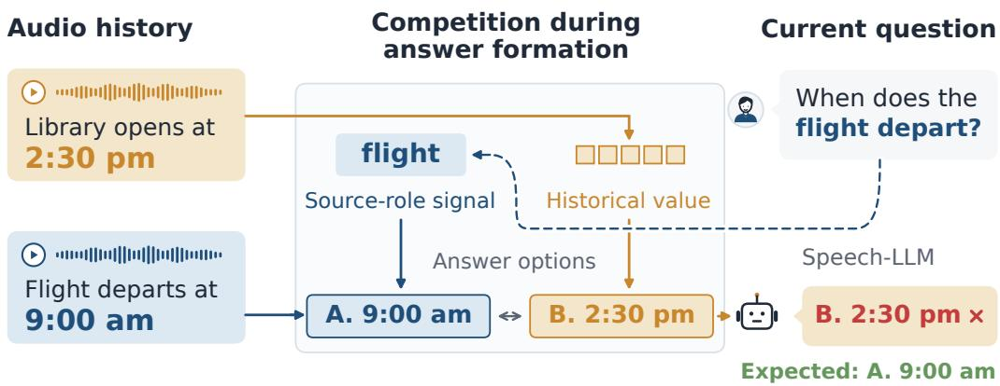
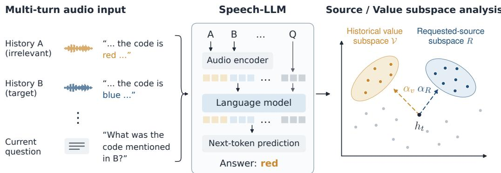
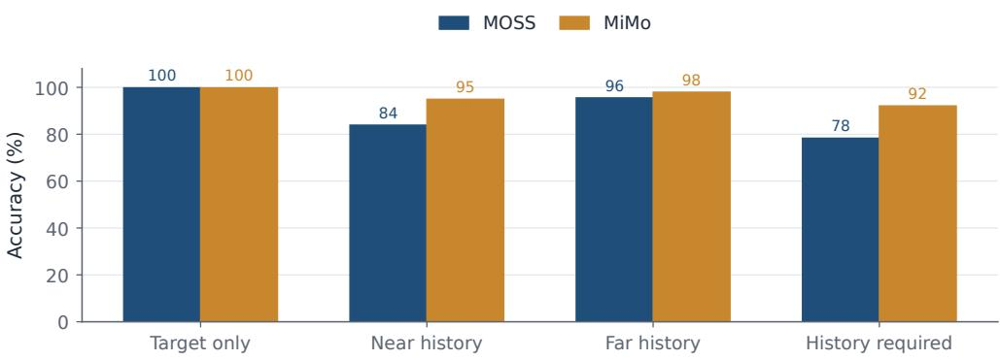
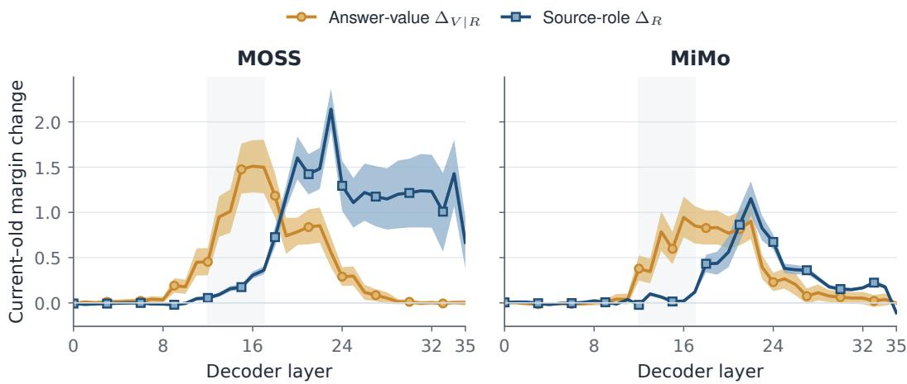
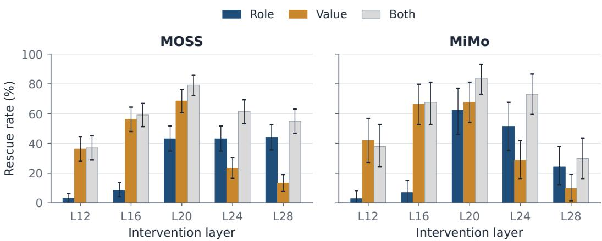
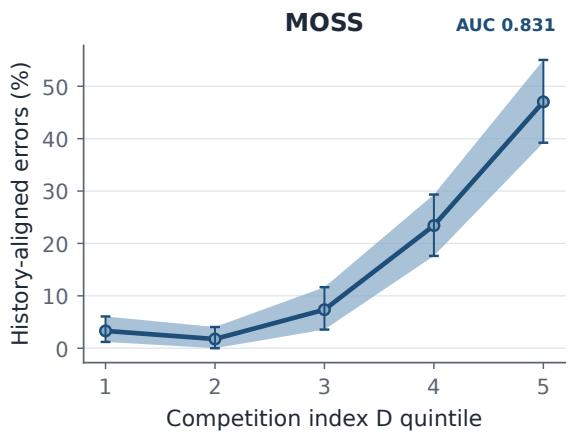
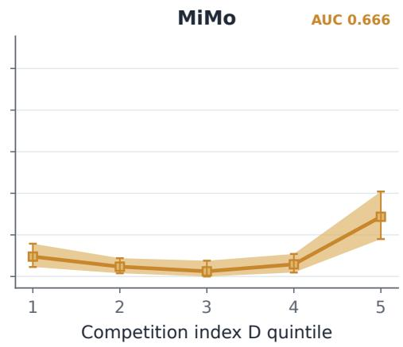
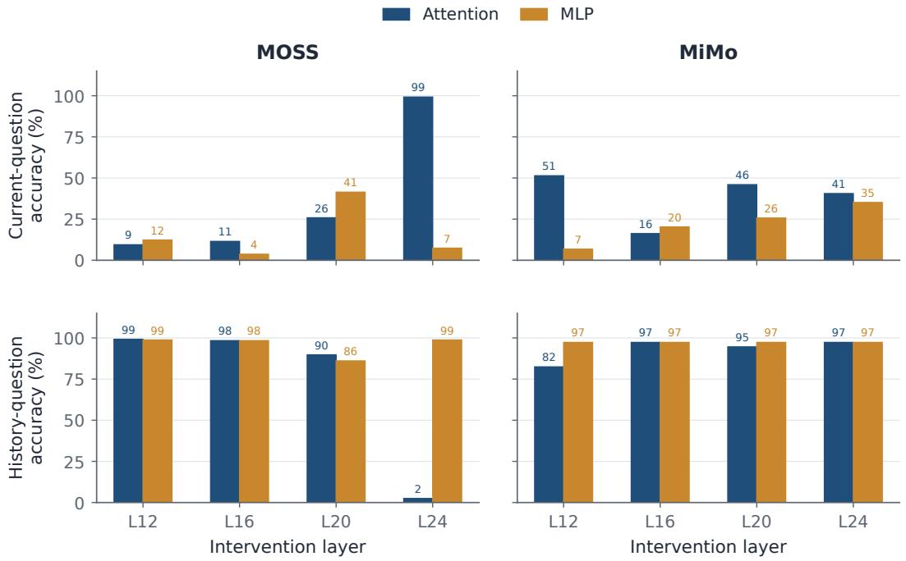

# THE RIGHT SOURCE IS NOT ENOUGH: UNDERSTANDINGHISTORY INTERFERENCE IN SPEECH-LLM MEMORY

HongJin Song1, Weiqiao Shan2, Runwu Shi3, Yifei Wu4, Yujin Wang5 Jiale Luo6, Jiasheng Kuang1, Xinyu Yang1, Zhaoqi Cui1, Chuizheng Kong1 Ziyu Wu1, Guowu Tan1, Qiuyu Fang1, Chunxiang Jin4

1. Beijing Institute of Technology

3. Institute of Science Tokyo

5. Wuhan University

2. Northeastern University, China   
4. Ant Group   
6. Sichuan University

## ABSTRACT

Speech large language models retain audio history to support multi-turn conversations. Yet remembering an event does not ensure that its information is used only when relevant. We investigate why irrelevant historical audio changes answers even when the queried event remains represented. Controlled experiments on MOSS-Audio and MiMo-Audio show that historical values direct errors toward specific competing answers, beyond a generic effect of context length. Causal interventions distinguish two paths. In open-ended question answering, most history-value errors disappear when subsequent computation cannot directly access the irrelevant source. In multiple-choice answering, many errors persist: early historical influence is carried by question–candidate states even after direct source access is blocked. Low-dimensional interventions further separate source-role information from answer-value information. Their effects peak at different depths, and changing the source-role signal does not eliminate the causal influence of competing values. On naturally occurring errors, strengthening the queried role and counteracting the historical value each improve answers; their joint intervention gives the greatest recovery. These findings support a failure of downstream evidence use beyond source identification alone: source-role information can influence a decision without exclusively controlling which historical values affect it. Reliable conversational memory therefore requires not only retention and retrieval, but also control over how retained information enters answer computation.

## 1 INTRODUCTION

Speech large language models (Speech-LLMs) increasingly retain earlier audio to support multi-turn interaction. Recent evaluations ask whether these models can recall previous utterances and reason over earlier acoustic events (Kim et al., 2025; Xiao et al., 2026; Gosai et al., 2026). Text-based studies similarly examine long-term memory and the loss of reliability as a conversation develops (Wu et al., 2025a; Laban et al., 2026). These efforts make retention and retrieval central concerns. But even an accessible memory can be used incorrectly: information that helps answer one question can interfere with another.

Figure 1 illustrates the distinction. The model remembers both a library’s opening time and a flight’s departure time, yet answers the flight question with the library’s time. The failure is not simply forget ting a fact. It concerns whether the current question constrains which remembered information can affect the answer. Distracting evidence is a known problem in reading comprehension and languagemodel reasoning (Jia & Liang, 2017; Shi et al., 2023), including retrieval-augmented QA (Yoran et al., 2024) and context-driven hallucinations (Cheng et al., 2025). Meanwhile, models can represent entity– attribute bindings and retrieve bound information (Feng & Steinhardt, 2024; Gur-Arieh et al., 2026). The question we investigate is therefore more specific: does representing the queried source prevent informationfrom other retained sourcesfrom shaping the decision?

We address this question through paired behavioral tests and internal interventions on two Speech-LLMs. First, changing an irrelevant historical value selectively increases preference for the matching incorrect answer. This directionality remains when the target audio alone is sufficient. Second, source-role information is transferable across examples with different answer values, showing that historical interference is not explained by source-identification failure alone. Third, we connect early historical access to later answer computation. Open-ended errors depend strongly on continued source access, whereas multiple-choice errors can persist through intermediate question–candidate states after that access is removed.

  
Figure 1: Historical interference during answer formation. A source-role signal can favor the queried event without excluding competing values from other memories. The example and influence paths are schematic; Table 1 provides actual test cases.

Our central analysis separates the influence of the queried source role from that of the historical answer value. Value-related interventions have their strongest effects in intermediate layers; sourcerole interventions become stronger deeper in the network. Both remain effective in natural error cases, and their joint intervention produces the largest recovery. Together, these results support competition during answer formation: a source-role signal can guide candidate scoring without making values from other events causally inactive. We contribute a controlled demonstration of this failure, a causal bridge from early access to persistent state influence, and a role–value analysis connecting that influence to actual errors. The goal is a mechanistic account of memory use, rather than a new cache-compression algorithm.

## 2 EXPERIMENTAL FRAMEWORK

## 2.1 SEPARATING SOURCE ROLE FROM SOURCE CONTENT

Each input contains audio turns followed by a text question. A turn is a source; the source needed to answer the question is the target, and other sources are irrelevant to that question. Relevance is not a permanent property of a recording. Changing the question can make the same historical event necessary rather than distracting.

We use two complementary settings. The natural-speech study constructs 1,000 three-source histories from 3,000 distinct LibriSpeech recordings (Panayotov et al., 2015), with three source-specific questions per history. Neutral and Competing conditions preserve the target recording, question, options, source order, and turn count. The additional sources either contain no candidate value or support incorrect candidates. Neutral replacements are matched in word count and duration.

Mechanistic tests use controlled synthetic speech with four answer families: times, colors, locations, and quantities. These materials support exact changes to a historical value and paired questions about different events. Each material set has 128 development and 512 test episodes, with no audio shared across episodes. The state-transfer and natural-error suites use separate material sets; the layer scan uses coherent old/current-event pairs. Four history variants per state-transfer episode yield 2,048 test conditions, not 2,048 independent episodes. Appendix A details these sets. This division combines behavioral evidence from real recordings with controlled contrasts for identifying internal effects. Unlike broad audio-QA evaluations such as MMAU, MMAR, and MMSU (Sakshi et al., 2025; Ma et al., 2025; Wang et al., 2026), these contrasts hold the target fixed while changing the role or content of another source.

In the controlled suites, questions name an event or object, not an oracle source index: “What color is the suitcase?” requires identifying the relevant fact from the recordings. Each audio turn receives the same fixed acknowledgement, so earlier assistant answers do not introduce a separate source of answer anchoring. Only the diagnostic interventions use the known source boundaries.

## 2.2 ANSWER FORMATS, MODELS, AND MEASUREMENTS

We study MOSS-Audio-8B-Instruct (Yang et al., 2026) and MiMo-Audio-7B-Instruct (Xiaomi LLM-Core Team, 2025), without updating their weights. In multiple-choice QA, the model chooses the option label with the highest next-token logit. A history-aligned error selects the value from the irrelevant source. We measure its competition with the target through

$$
m = \ell ( y ) - \ell ( h ) ,\tag{1}
$$

where $y$ and h denote the option labels for the target and historical values. A positive change in m favors the target relative to the historical value. In the role-switching layer scan, we instead use the fixed current-event minus old-event margin, so its sign describes the direction of the role change, not necessarily correctness under the original question.

For open-ended QA, choices are removed and the model generates a short answer. We classify the actual response as target value, history value, or other. Raw generation is the primary measure; sequence scores are not equated with option logits. All comparisons retain paired conditions within an episode. Confidence intervals resample whole episodes, preserving their conditions; natural-error rates first average eligible variants within each episode. Subspaces are fitted on development data. Layer grids are specified before evaluating the test set, and reported peaks describe those scans rather than held-out layer selection. Model and intervention configurations are provided in Appendix B.

## 3 CAUSAL INTERVENTIONS

We use three interventions to distinguish continued source access, propagation through intermediate states, and competition between role and value information. Figure 2 depicts the common setup. Following causal-tracing and activation-patching approaches (Meng et al., 2022; Zhang & Nanda, 2024), we test changes in model behavior after controlled internal replacements. These are diagnostic counterfactuals with known source roles, not an automatic inference-time remedy.

## 3.1 BLOCKING DIRECT SOURCE ACCESS

We retain the history but mask attention to its irrelevant source span before softmax. In the strict late-block condition, layers 0–17 process the full history normally. At layers 18–35, every position after that source, including subsequent audio, question, and candidates, is blocked from directly attending to it. The masked span includes the source’s wrapper tokens. In open-ended decoding, generated tokens are additionally blocked from that span at every layer. Thus, a surviving effect need not reflect continued direct access to the original source; influence already incorporated elsewhere can remain. Layer indices are zero-based throughout.

## 3.2 TRANSFERRING QUESTION-CONDITIONED STATES

Let $F$ be a full-access run and E a matched run with early attention from question positions to the irrelevant source blocked at layers 0–17. They receive identical audio, questions, and candidates. After layer 17, we transfer the question–candidate states from E into $F ,$ , or from F into E. Both receivers use the same strict late block. Removing or restoring the error therefore tests whether the earlier historical effect is carried by those states. The transferred region excludes the final output position, which is tested separately. Source-role experiments also transfer states between paired questions about different events in the same history; isolated-candidate transfers provide a position control.

  
Figure 2: Intervention setup. Audio turns pass through the audio encoder; the text question does not. We intervene on decoder states to separate requested-source and historical-value influences. The subspace sketch is conceptual, not a fitted embedding plot; R denotes the source-role subspace.

## 3.3 SEPARATING ROLE AND VALUE INFLUENCES

For each tested layer, we fit a rank-4 source-role basis $U _ { R }$ to development-state differences between paired questions with identical audio and values but different queried events. We separately collect differences $D _ { V }$ obtained by changing the historical value while fixing the question. Before fitting the rank-4 value basis $U _ { V }$ , we remove their projection onto the role basis:

$$
{ \cal D } _ { V \bot R } = ( I - U _ { R } U _ { R } ^ { \top } ) { \cal D } _ { V } , \qquad { \cal P } _ { R } = U _ { R } U _ { R } ^ { \top } , \quad { \cal P } _ { V } = U _ { V } U _ { V } ^ { \top } .\tag{2}
$$

Differences are centered before principal-component estimation. Interventions add projected state differences at the last 32 prompt positions, at one layer only; later layers run normally. Here “value” means semantic answer content, not an attention-head Value tensor. Subspace interventions can test information distributed across neurons (Geiger et al., 2024); our bases are estimated by principal components, not by learning a causal alignment.

The layer scan uses a development donor from the same question family but a different episode. Role and value differences are transferred separately and jointly. If their margin changes are $\Delta _ { R } , \Delta _ { V }$ , and $\Delta _ { R + V }$ , we measure

$$
\Delta _ { V | R } = \Delta _ { R + V } - \Delta _ { R } , \qquad I = \Delta _ { R + V } - \Delta _ { R } - \Delta _ { V } .\tag{3}
$$

The first quantity tests whether a value intervention retains an effect after the role intervention. The second measures interaction, without assuming additivity. Orthogonal intervention directions do not imply independent downstream computations.

For natural-error tests, we amplify the role contrast between the current and historical questions on the same audio. We counteract the historical value by moving halfway along the projected difference to a matched alternative-history state. This is a specific counterfactual replacement, not deletion of all historical information. We test the role shift, value shift, and their sum. The development-fitted bases and intervention scales are fixed before test evaluation; Appendix C gives the exact construction.

## 4 TRACING HISTORICAL INTERFERENCE

## 4.1 IRRELEVANT HISTORY PRODUCES VALUE-DIRECTED ERRORS

On the 3,000 natural-speech questions, competing history reduces MOSS accuracy from 84.23% to 78.73% and MiMo accuracy from 48.23% to 39.67%. The paired changes are −5.50 percentage points (95% CI [−6.73, −4.30]) and −8.57 points $( [ - 9 . 8 0 , - 7 . { \dot { 3 } } 7 ] )$ . These neutral-history accuracies are not single-audio baselines. Among the 1,365 questions that both models answer correctly with target audio alone, competing history still reduces accuracy by 2.79 and 10.06 points. The effect therefore persists when the required recording is demonstrably sufficient.

A performance drop alone could reflect nonspecific difficulty or position-dependent access to long contexts (Liu et al., 2024). In a fixed-length load experiment, we replace neutral turns with speech supporting a particular wrong candidate while keeping nine turns and the target question fixed. The resulting score increase is selective: each additional supporting turn raises that candidate’s score relative to the correct answer by 0.260 for MOSS and 0.089 for MiMo, whereas support for another wrong candidate contributes only 0.008 and −0.001. The corresponding directional differences have 95% CIs [0.195, 0.305] and [0.068, 0.111]. Appendix E reports the matched text and load controls. Historical interference is thus directed by the remembered value, not just the presence of more context.

The controlled relation-content test provides the same useful-versus-harmful contrast (Figure 3). Both models perform well on target-only inputs and can use the historical fact when it is requested, but retaining it can lower current-question accuracy. Here, near and far describe the semantic similarity between events, not their distance in the sequence.

The actual QA cases in Table 1 make this distinction concrete. Each model can answer the target alone and can answer a question requiring the historical fact. Yet the same retained fact sometimes replaces the target answer. A correct-use example shows that the phenomenon is not inevitable. These cases illustrate the failure; aggregate evidence is given above and in Appendix E.

## 4.2 SOURCE-ROLE INFORMATION REMAINS CAUSALLY EFFECTIVE

Could the models simply fail to represent which event a question asks about? We keep the audio, source order, and candidates fixed while switching the queried event. Transferring the question– candidate states at layer 17 makes predictions follow the donor’s queried event in 98.6–99.8% of conditions across models and directions. Transferring only isolated candidate positions changes pre dictions in roughly 1–3%. The transferable information is distributed across the question-conditioned state.

Whole-state transfer could also move the answer itself. A cross-content test therefore transfers only a development-fitted role projection between examples with different answer values. At layer 24, an earlier-to-later role shift increases the later-minus-earlier answer margin by 0.99 in MOSS and 0.63 in MiMo. The reverse shift changes it by −0.80 and −0.49. The receiver follows the role change even though the donor has different answer content.

Source-role information is therefore represented and can affect decisions independently of copying a donor answer. This does not establish perfect source selection on every failure. It does show why a general loss of source information is insufficient as the explanation. The next question is how a competing historical value remains effective alongside that role information.

## 4.3 HISTORICAL INFLUENCE CAN OUTLAST DIRECT SOURCE ACCESS

We compare answer formats on 512 episodes with four history variants each. Without displayed options, MOSS generates the historical value in 151 of 2,048 conditions and MiMo in 22. Strict later blocking reduces these counts to 2 and 3 (Table 2). Open-ended history-value errors therefore depend strongly on continued access to the irrelevant source.

Multiple-choice QA behaves differently. There are initially 175 history-aligned errors for MOSS and 94 for MiMo; 124 and 49 remain under the strict late block. This difference is not solely repeated autoregressive access. In a single-token color control for MOSS, blocking removes all 32 open-ended history-value errors, while 37 of 51 multiple-choice errors remain.

We then test the proposed state path in both directions. Transferring early-blocked question–candidate states into the late-blocked full-history run reduces the remaining errors from 124 to 6 for MOSS and from 49 to 1 for MiMo. Restoring full-access states in the early-blocked run brings them back to 125 and 49. Transferring only the final position produces little change. Because both receivers use the same strict late block, this intervention connects early historical access to influence carried by the question–candidate states rather than continued direct reading of the original source.

The two transfer directions distinguish state-carried influence from continued source reading. Correcting F alone could reflect importing a generally easier state. The reverse transfer restores historical preference in E, despite its earlier question access being blocked. With later access held fixed, the exchanged question–candidate states therefore carry an effect of early access into subsequent decisions. This establishes a route, not the identity of all information carried by it. The low-dimensional tests next distinguish requested-source information from competing answer content.

  
Figure 3: Useful recall and harmful influence coexist in the controlled relation-content test. The same near-history recordings are irrelevant to the current question but necessary for the history-required question. Each bar averages 512 test episodes; near and far conditions average two historical-value variants within each episode.

Table 1: Recorded multiple-choice examples. The first two cases switch from the correct target value to the historical value when history is retained; the last remains correct. Both denotes MOSS and MiMo. Cells show selected options. All three cases answer the historical-event question correctly; Appendix D provides full options and selection criteria.
<table><tr><td>Model</td><td colspan="2">Recordings and current question</td><td></td><td>Target only Full history</td></tr><tr><td rowspan="2">MOSS</td><td></td><td>History: When asked about the backpack, Camille Russell said its color is orange.</td><td rowspan="2">A: purple</td><td rowspan="2">C: orange</td></tr><tr><td>Target:</td><td>When asked about the suitcase, Camille Russell said its color is purple.</td></tr><tr><td rowspan="2">MiMo</td><td>History:</td><td>Question: What color is Camille Russell&#x27;s suitcase? To keep it safe, Abigail Thomas put the boarding</td><td></td><td></td></tr><tr><td>Target:</td><td>pass inside the locker. To keep it safe, Abigail Thomas put the passport inside the box.</td><td>A: box</td><td>B: locker</td></tr><tr><td>Both</td><td></td><td>Question: Where does Abigail Thomas keep the passport? History: Amelia Campbell&#x27;s backpack has a white color. Target: Amelia Campbell&#x27;s suitcase has a green color. Question: What color is Amelia Campbell&#x27;s suitcase?</td><td>A: green</td><td>A: green</td></tr></table>

Attention blocking changes normalization over unmasked positions. The paired receivers share the same later mask, so their difference tests the transferred state rather than a change in which positions are accessible. Later Query, Key, and attention weights can still respond to that state.

## 4.4 ROLE AND VALUE INFLUENCES HAVE DIFFERENT DEPTH PROFILES

We apply the factorial interventions at all 36 decoder layers on the same 512 test episodes. Figure 4 plots the role effect $\Delta _ { R }$ and the additional value effect $\Delta _ { V | R } .$ . In this role-reversal protocol, receivers initially ask about the old event; a cross-content donor shifts them toward the current-event role. The plotted margin is always current minus old, avoiding a change of scoring convention across interventions.

Table 2: History-aligned error counts on the same 2,048 test conditions per model. F permits early access; E blocks early question access; L strictly blocks later source access. State transfers occur after layer 17, with L unchanged. Counts are not counts of independent episodes. Dashes denote unreported conditions.
<table><tr><td rowspan="2">Condition</td><td colspan="2">Open-ended</td><td colspan="2">Multiple-choice</td></tr><tr><td>MOSS</td><td>MiMo</td><td>MOSS</td><td>MiMo</td></tr><tr><td>Full history (F)</td><td>151</td><td>22</td><td>175</td><td>94</td></tr><tr><td>Strict late block  $( F + L )$ </td><td>2</td><td>3</td><td>124</td><td>49</td></tr><tr><td>Replace with early-blocked state  $( F + L  E )$ </td><td>一</td><td>一</td><td>6</td><td>1</td></tr><tr><td>Restore full-access state  $( E + L  F )$ </td><td>一</td><td></td><td>125</td><td>49</td></tr></table>

  
Figure 4: Role and value interventions affect different depth ranges. Curves use 512 test episodes and pointwise 95% episode-bootstrap intervals. The margin is current-event minus old-event; positive values indicate the intervention’s direction, not accuracy under the original old-event question. Gray shading marks layers 12–17 for visual reference, not an independently established exclusive causal band.

The conditional value effect becomes appreciable around layers 9–12 and is strong in intermediate layers. At layer 16 it is 1.51 for MOSS and 0.95 for MiMo. Role effects grow deeper in the network, reaching 2.14 at layer 23 in MOSS and 1.15 at layer 22 in MiMo. Importantly, changing the role signal does not render the value intervention ineffective. Both kinds of information can still change the downstream comparison.

These curves measure intervention sensitivity, not the first layer at which a fact is represented. Each single-layer edit affects all subsequent computation. Nor do the results establish a universal additive rule: the interaction I varies across layers and models. The shared finding is the persistence of distinct role and value influences, which motivates testing whether they also contribute to spontaneous errors rather than only induced role reversals.

This comparison goes beyond asking where an edit is effective. If a role shift fully excluded the competing event from downstream scoring, changing its value would have little additional effect. Instead, $\Delta _ { V | R }$ remains substantial: the tested role shift changes the decision without making it insensitive to that value. The depth difference therefore distinguishes two causal influences on the answer, rather than assigning one layer band the label “memory” and another the label “retrieval.”

## 4.5 BOTH INFLUENCES CONTRIBUTE TO NATURALLY OCCURRING ERRORS

We freeze all history-aligned errors in the near-history test conditions and compare them with familymatched correct controls. At layer 20, 165 MOSS error conditions from 122 episodes and 47 MiMo conditions from 37 episodes reproduce in the rerun. Five initially selected MiMo errors do not reproduce and are excluded from error-recovery rates. We apply the role, value, and joint shifts from Section 3.3 to these unchanged inputs.

  
Figure 5: Recovery of spontaneous history-aligned errors. Role enhancement and the counterfactual value shift each recover errors; their joint effect is largest across the tested layers. Error bars are 95% whole-episode bootstrap intervals. These oracle diagnostic edits test causal involvement, not a deployable correction method.

Both interventions recover errors (Figure 5). At layer 20, role enhancement recovers 43.0% for MOSS and 62.2% for MiMo; the value shift recovers 68.4% and 67.6%. Their joint intervention reaches 79.1% and 83.8%. These are episode-averaged rates, not fractions computed directly from 165 and 47 rows. Matched correct controls retain almost all correct answers. Across tested layers, value shifts are most effective in the intermediate region, while role enhancement remains effective deeper in the network.

The same comparison also relates to errors across the full test population. At layer 20, define D as the margin effect of the value shift minus that of role enhancement. From the lowest to highest quintile of D, history-aligned error rates rise from 3.3% to 47.0% in MOSS and from 4.8% to 14.4% in MiMo (Appendix F). This is a descriptive association using interventions on the same examples, not an independent prediction test.

Taken together, the natural-error and role-reversal experiments support the same account: role information constrains the decision but does not act as an exclusive gate on historical values. Moduleoutput controls further show that recovery cannot be assigned uniformly to attention or MLP alone (Appendix G). They also distinguish correction from selective memory use: a MOSS layer-24 attention-output replacement restores current answers but nearly eliminates correct historical answers when that memory is required. Improving one question is not enough if the intervention removes evidence needed for another. The useful explanatory level is how these influences combine during answer computation, not a claim that one layer band or one tensor is the sole cause.

The experiments thus connect value-directed errors, usable role information, and a state-carried path beyond direct reading. Role–value interventions then explain which information contributes to spontaneous errors along this computation.

## 5 DISCUSSION AND RELATED WORK

Remembering versus using a memory. ContextDialog and Audio MultiChallenge evaluate recall and use of earlier speech (Kim et al., 2025; Gosai et al., 2026). EnvMem attributes acoustic-memory failures to changes in representations as well as retrieval bottlenecks (Xiao et al., 2026). Closely related, Lee et al. (2026) distinguish internal context awareness from adherence during decoding and strengthen contextual evidence against parametric priors. Our experiments concern competition between retained events, not only a conflict between context and prior knowledge. They identify a state-carried path and separate source-role from answer-value effects. Selective auditory attention has also been tested with multilingual distractors (Koo, 2026); here, recordings arrive in separate turns rather than as overlapping acoustic mixtures.

Binding versus restricting answer evidence. Entity-binding studies explain how models associate attributes with entities and combine retrieval mechanisms (Feng & Steinhardt, 2024; Gur-Arieh et al., 2026). Retrieval-head analyses identify attention heads needed to recover contextual facts (Wu et al., 2025b). These findings address how relevant information becomes available. Irrelevant-context studies establish that other available information can nevertheless mislead a model (Jia & Liang, 2017; Shi et al., 2023; Yoran et al., 2024; Cheng et al., 2025). Our interventions connect these questions: cross-content role transfer changes which event guides the decision, yet competing values remain effective, including in spontaneous errors. Availability of a source-role signal is therefore not equivalent to its exclusive control over candidate scoring.

Cache selection versus influence already in the state. $\mathrm { H _ { 2 } O } ,$ StreamingLLM, and SnapKV retain selected cache entries to improve inference efficiency (Zhang et al., 2023; Xiao et al., 2024b; Li et al., 2024); InfLLM retrieves relevant context blocks (Xiao et al., 2024a). SnapKV already uses the prompt’s attention pattern for selection. These methods concern which entries remain accessible; our state bridge tests influence surviving after access ends. Restrictingfuture access can leave historical influence in states formed before the restriction. Feed-forward layers also combine predictive content (Geva et al., 2021), motivating analysis beyond the initial attention read. This parametric-memory view differs from conversational KV cache; neither implies that attention alone governs a fact’s eventual use.

Answer format and implications. Multiple-choice models form answer representations and bind them to output symbols (Wiegreffe et al., 2025; Wong et al., 2026). Their predictions are also sensitive to option order (Pezeshkpour & Hruschka, 2024) and prompt order (Ok & Lee, 2026). We therefore keep candidates fixed within paired interventions and separately test open-ended generation. The bidirectional bridge identifies historical influence in question–candidate states, rather than attributing every format difference to a general failure of acoustic recall. Across the two models, the common result is coexistence of role and value influences, not identical layer peaks or one universally faulty module. A practical implication is to control historical contributions while states are formed, and to evaluate both current-question correctness and useful historical recall. Our counterfactual edits establish causal involvement; learning such control without oracle information remains a next step. The experiments do not determine the original training-data cause.

## 6 CONCLUSION

We investigated how retained audio becomes incorrect evidence for a later question. Across MOSS-Audio and MiMo-Audio, irrelevant values produce directed answer errors even when target-only recognition succeeds. The same history can support a correct answer when its event is requested, making the problem one of evidence use rather than memory retention alone. Source-role information remains causally effective, but the tested role interventions do not eliminate competing historical-value effects. Strict blocking and bidirectional state transfers establish a second distinction: multiple-choice interference can persist through question–candidate states after direct source access is removed, unlike most open-ended errors in the matched setting. Layer-wise interventions separate role and value influences, and their joint manipulation gives the greatest recovery on natural errors. Together, these results explain why correcting access alone can be insufficient: earlier access may already have changed the state used to form the answer. Reliable conversational memory therefore requires more than keeping and retrieving facts. It also requires controlling their contributions to answer computation, while retaining them for questions that actually need them.

## REPRODUCIBILITY STATEMENT

Section 2 defines the tasks and evaluation units; Section 3 specifies the interventions. Appendices A– C give data construction, inference settings, state regions, and statistical procedures. Appendix D gives the selection criteria and full answer options for the examples in Table 1. These descriptions

support interpretation of the reported results; reproducing the full study also requires the experimental code, audio materials, and per-example outputs.

## ETHICS STATEMENT

The experiments analyze released models, public speech recordings, and controlled synthetic utterances. Names in the synthetic examples are fictional experimental labels, not participant identities. We do not infer sensitive speaker attributes. The results concern reliability of historical evidence use; they should not be interpreted as estimates of privacy leakage or failure prevalence in unrestricted real conversations.

## REFERENCES

Ziling Cheng, Meng Cao, Marc-Antoine Rondeau, and Jackie CK Cheung. Stochastic chameleons: Irrelevant context hallucinations reveal class-based (mis)generalization in LLMs. In Proceedings ofthe 63rd Annual Meeting ofthe Associationfor Computational Linguistics (Volume 1: Long Papers), pp. 30187–30214, 2025. doi: 10.18653/v1/2025.acl-long.1458. URL https://aclanthology .org/2025.acl-long.1458/.

Jiahai Feng and Jacob Steinhardt. How do language models bind entities in context? In International Conference on Learning Representations, 2024. URL https://proceedings.iclr.cc/paper\_files/paper /2024/hash/9d1b7fc578c0d2d6431fc26d736ecaf3-Abstract-Conference.html.

Atticus Geiger, Zhengxuan Wu, Christopher Potts, Thomas Icard, and Noah Goodman. Finding alignments between interpretable causal variables and distributed neural representations. In Proceedings of the Third Conference on Causal Learning and Reasoning, volume 236 of Proceedings of Machine Learning Research, pp. 160–187. PMLR, 2024. URL https: //proceedings.mlr.press/v236/geiger24a.html.

Mor Geva, Roei Schuster, Jonathan Berant, and Omer Levy. Transformer feed-forward layers are key-value memories. In Proceedings ofthe 2021 Conference on Empirical Methods in Natural Language Processing, pp. 5484–5495, 2021. doi: 10.18653/v1/2021.emnlp-main.446. URL https://aclanthology.org/2021.emnlp-main.446/.

Advait Gosai, Tyler Vuong, Utkarsh Tyagi, Steven Li, Wenjia You, Miheer Bavare, Arda Uçar, Zhongwang Fang, Brian Jang, Bing Liu, and Yunzhong He. Audio MultiChallenge: A multi-turn evaluation of spoken dialogue systems on natural human interaction. In Proceedings ofthe 64th Annual Meeting of the Association for Computational Linguistics (Volume 1: Long Papers), pp. 35740–35770, San Diego, California, United States, July 2026. Association for Computational Linguistics. doi: 10.18653/v1/2026.acl-long.1654. URL https://aclanthology.org/2026.acl-long.16 54/.

Yoav Gur-Arieh, Mor Geva, and Atticus Geiger. Mixing mechanisms: How language models retrieve bound entities in-context. In International Conference on Learning Representations, 2026. URL https://proceedings.iclr.cc/paper\_files/paper/2026/hash/2eeff35664016c7f0f8aa704f0d9a83e-A bstract-Conference.html.

Robin Jia and Percy Liang. Adversarial examples for evaluating reading comprehension systems. In Proceedings of the 2017 Conference on Empirical Methods in Natural Language Processing, pp. 2021–2031, 2017. doi: 10.18653/v1/D17-1215. URL https://aclanthology.org/D17-1215/.

Heeseung Kim, Che Hyun Lee, Sangkwon Park, Jiheum Yeom, Nohil Park, Sangwon Yu, and Sungroh Yoon. Does your voice assistant remember? analyzing conversational context recall and utilization in voice interaction models. In Findings of the Association for Computational Linguistics: ACL 2025, pp. 8984–9014. Association for Computational Linguistics, 2025. doi: 10.18653/v1/2025.findings-acl.470. URL https://aclanthology.org/2025.findings-acl.470/.

Heejoon Koo. Can large audio language models ignore multilingual distractors? an evaluation of their selective auditory attention capabilities. arXiv preprint arXiv:2605.17225, 2026. URL https://arxiv.org/abs/2605.17225.

Philippe Laban, Hiroaki Hayashi, Yingbo Zhou, and Jennifer Neville. LLMs get lost in multi-turn conversation. In International Conference on Learning Representations, pp. 54738–54778, 2026. URL https://proceedings.iclr.cc/paper\_files/paper/2026/hash/59f6421e64707225fdf5b28840679 a07-Abstract-Conference.html.

Che Hyun Lee, Heeseung Kim, and Sungroh Yoon. From awareness to adherence: Bridging the context gap in spoken dialogue systems via context-aware decoding. In Interspeech 2026, pp. 3421–3426, 2026. doi: 10.21437/Interspeech.2026-1589. URL https://www.isca-archive.org/inter speech\_2026/lee26m\_interspeech.html.

Yuhong Li, Yingbing Huang, Bowen Yang, Bharat Venkitesh, Acyr Locatelli, Hanchen Ye, Tianle Cai, Patrick Lewis, and Deming Chen. SnapKV: LLM knows what you are looking for before generation. In Advances in Neural Information Processing Systems, volume 37, 2024. URL https://proceedings.neurips.cc/paper\_files/paper/2024/hash/28ab418242603e0f7323e54185d19 bde-Abstract-Conference.html.

Nelson F. Liu, Kevin Lin, John Hewitt, Ashwin Paranjape, Michele Bevilacqua, Fabio Petroni, and Percy Liang. Lost in the middle: How language models use long contexts. Transactions of the Associationfor Computational Linguistics, 12:157–173, 2024. doi: 10.1162/tacl\_a\_00638. URL https://aclanthology.org/2024.tacl-1.9/.

Ziyang Ma, Yinghao Ma, Yanqiao Zhu, Chen Yang, Yi-Wen Chao, Ruiyang Xu, Wenxi Chen, Yuanzhe Chen, Zhuo Chen, Jian Cong, Kai Li, Keliang Li, Siyou Li, Xinfeng Li, Xiquan Li, Zheng Lian, Yuzhe Liang, Minghao Liu, Zhikang Niu, Tianrui Wang, Yuping Wang, Yuxuan Wang, Yihao Wu, Guanrou Yang, Jianwei Yu, Ruibin Yuan, Zhisheng Zheng, Ziya Zhou, Haina Zhu, Wei Xue, Emmanouil Benetos, Kai Yu, Eng-Siong Chng, and Xie Chen. MMAR: A challenging benchmark for deep reasoning in speech, audio, music, and their mix. In Advances in Neural Information Processing Systems, volume 38. Curran Associates, Inc., 2025. doi: 10.52202/085713-2252. URL https://proceedings.neurips.cc/paper\_files/paper/2025/hash/610a7d6507d55be70c6d13d0b6632 27d-Abstract-Datasets\_and\_Benchmarks\_Track.html.

Kevin Meng, David Bau, Alex Andonian, and Yonatan Belinkov. Locating and editing factual associations in GPT. In Advances in Neural Information Processing Systems, volume 35, pp. 17359–17372, 2022. URL https://proceedings.neurips.cc/paper\_files/paper/2022/hash/6f1d43d5a 82a37e89b0665b33bf3a182-Abstract-Conference.html.

Hyunjong Ok and Jaeho Lee. Lost in the prompt order: Revealing the limitations of causal attention in language models. In Findings of the Association for Computational Linguistics: ACL 2026, pp. 38566–38587, 2026. doi: 10.18653/v1/2026.findings-acl.1921. URL https://aclanthology.org/202 6.findings-acl.1921/.

Vassil Panayotov, Guoguo Chen, Daniel Povey, and Sanjeev Khudanpur. LibriSpeech: An ASR corpus based on public domain audio books. In IEEE International Conference on Acoustics, Speech and Signal Processing (ICASSP), pp. 5206–5210. IEEE, 2015. doi: 10.1109/ICASSP.2015.7178964. URL https://doi.org/10.1109/ICASSP.2015.7178964.

Pouya Pezeshkpour and Estevam Hruschka. Large language models sensitivity to the order of options in multiple-choice questions. In Findings of the Association for Computational Linguistics: NAACL 2024, pp. 2006–2017, 2024. doi: 10.18653/v1/2024.findings-naacl.130. URL https://aclanthology.org/2024.findings-naacl.130/.

Sakshi, Utkarsh Tyagi, Sonal Kumar, Ashish Seth, Ramaneswaran Selvakumar, Oriol Nieto, Ramani Duraiswami, Sreyan Ghosh, and Dinesh Manocha. MMAU: A massive multi-task audio understanding and reasoning benchmark. In International Conference on Learning Representations, 2025. URL https://proceedings.iclr.cc/paper\_files/paper/2025/hash/d36f208919582785db965fe64 8b9fe59-Abstract-Conference.html.

Freda Shi, Xinyun Chen, Kanishka Misra, Nathan Scales, David Dohan, Ed H. Chi, Nathanael Schärli, and Denny Zhou. Large language models can be easily distracted by irrelevant context. In Proceedings of the 40th International Conference on Machine Learning, volume 202 of Proceedings of Machine Learning Research, pp. 31210–31227. PMLR, 2023. URL https://proceedings.mlr.press/v202/shi23a.html.

Dingdong Wang, Junan Li, Jincenzi Wu, Dongchao Yang, Xueyuan Chen, Tianhua Zhang, and Helen Meng. MMSU: A massive multi-task spoken language understanding and reasoning benchmark. In International Conference on Learning Representations, pp. 31374–31410, 2026. URL https://proceedings.iclr.cc/paper\_files/paper/2026/hash/34e278fbbd7d6d7d788c98065988e 1a9-Abstract-Conference.html.

Sarah Wiegreffe, Oyvind Tafjord, Yonatan Belinkov, Hannaneh Hajishirzi, and Ashish Sabharwal. Answer, assemble, ace: Understanding how LMs answer multiple choice questions. In International Conference on Learning Representations, 2025. URL https://proceedings.iclr.cc/paper\_files/paper /2025/hash/c248154176c08147e82c0b30961604f7-Abstract-Conference.html.

Hugh Mee Wong, Rick Nouwen, and Albert Gatt. When models decide and when they bind: A two-stage computation for multiple-choice question answering. In Findings ofthe Associationfor Computational Linguistics: ACL 2026, pp. 22804–22821, 2026. doi: 10.18653/v1/2026.findings-a cl.1144. URL https://aclanthology.org/2026.findings-acl.1144/.

Di Wu, Hongwei Wang, Wenhao Yu, Yuwei Zhang, Kai-Wei Chang, and Dong Yu. LongMemEval: Benchmarking chat assistants on long-term interactive memory. In International Conference on Learning Representations, 2025a. URL https://proceedings.iclr.cc/paper\_files/paper/2025/hash/d 813d324dbf0598bbdc9c8e79740ed01-Abstract-Conference.html.

Wenhao Wu, Yizhong Wang, Guangxuan Xiao, Hao Peng, and Yao Fu. Retrieval head mechanistically explains long-context factuality. In International Conference on Learning Representations, 2025b. URL https://proceedings.iclr.cc/paper\_files/paper/2025/hash/9b77f07301b1ef1fe810aae96c12c b7b-Abstract-Conference.html.

Chaojun Xiao, Pengle Zhang, Xu Han, Guangxuan Xiao, Yankai Lin, Zhengyan Zhang, Zhiyuan Liu, and Maosong Sun. InfLLM: Training-free long-context extrapolation for LLMs with an efficient context memory. In Advances in Neural Information Processing Systems, volume 37, 2024a. doi: 10.52202/079017-3801. URL https://proceedings.neurips.cc/paper\_files/paper/2024/hash/d842425 e4bf79ba039352da0f658a906-Abstract-Conference.html.

Guangxuan Xiao, Yuandong Tian, Beidi Chen, Song Han, and Mike Lewis. Efficient streaming language models with attention sinks. In International Conference on Learning Representations, 2024b. URL https://proceedings.iclr.cc/paper\_files/paper/2024/hash/5e5fd18f863cbe6d8ae392a93 fd271c9-Abstract-Conference.html.

Yang Xiao, Siyi Wang, Han Yin, Hong Jia, Vidhyasaharan Sethu, Eun-Jung Holden, and Ting Dang. Why can’t they remember? uncovering representation and retrieval bottlenecks in multi-turn acoustic memory. arXiv preprint arXiv:2605.27039, 2026. URL https://arxiv.org/abs/2605.27039.

Xiaomi LLM-Core Team. MiMo-Audio: Audio language models are few-shot learners. arXiv preprint arXiv:2512.23808, 2025. URL https://arxiv.org/abs/2512.23808.

Chen Yang, Chufan Yu, Hanfu Chen, Jie Zhu, Jingqi Chen, Ke Chen, Wenxuan Wang, Yang Wang, Yaozhou Jiang, Yi Jiang, Zhengyuan Lin, Ziqi Chen, Zhaoye Fei, Chenghao Liu, Jun Zhan, Kang Yu, Kexin Huang, Mingshu Chen, Qinyuan Cheng, Ruixiao Li, Shimin Li, Songlin Wang, Yang Gao, Yiyang Zhang, and Xipeng Qiu. MOSS-Audio technical report. arXiv preprint arXiv:2606.01802, 2026. URL https://arxiv.org/abs/2606.01802.

Ori Yoran, Tomer Wolfson, Ori Ram, and Jonathan Berant. Making retrieval-augmented language models robust to irrelevant context. In International Conference on Learning Representations, pp. 29862–29883, 2024. URL https://proceedings.iclr.cc/paper\_files/paper/2024/hash/8011b23e1dc3f 57e1b6211ccad498919-Abstract-Conference.html.

Fred Zhang and Neel Nanda. Towards best practices of activation patching in language models: Metrics and methods. In International Conference on Learning Representations, 2024. URL https://proceedings.iclr.cc/paper\_files/paper/2024/hash/06a52a54c8ee03cd86771136bc91eb1f-A bstract-Conference.html.

Zhenyu Zhang, Ying Sheng, Tianyi Zhou, Tianlong Chen, Lianmin Zheng, Ruisi Cai, Zhao Song, Yuandong Tian, Christopher Ré, Clark Barrett, Zhangyang Wang, and Beidi Chen. H2O: Heavyhitter oracle for efficient generative inference of large language models. In Advances in Neural

Information Processing Systems, volume 36, 2023. URL https://proceedings.neurips.cc/paper\_files /paper/2023/hash/6ceefa7b15572587b78ecfcebb2827f8-Abstract.html.

## A MATERIALS AND EVALUATION UNITS

Natural recordings. The natural-speech study uses 1,000 histories: 450 constructed from the LibriSpeech test-clean split and 550 from the test-other split. Its 3,000 main recordings are distinct; the three sources within a history come from different speakers and chapters. Each history yields three source-specific questions. Neutral replacements exclude candidate words and are matched to competing recordings in word count and duration. Text controls use the corresponding reference transcripts. A separate load experiment uses 300 nine-turn histories, with 100 targets in each of positions 1, 5, and 9. The number of competing turns is 0, 1, 2, 4, or 8; replacing neutral turns rather than appending turns keeps total turn count fixed. Average length is approximately 97.3 words, and mean duration changes by only 0.047 seconds between the extreme load conditions.

Controlled speech. Three material sets serve distinct comparisons (Table 3). Each contains 640 episodes, divided into 128 development and 512 test episodes, balanced across time, color, location, and quantity questions. Audio is synthesized at 24 kHz. The relation-content and reading-structure sets use Piper 1.3.0 with its U.S. English Lessac and Ryan voices; the coherent-role set uses Piper 1.8.0. The audits record ONNX Runtime 1.23.2. Audio hashes do not repeat across episodes. The reading-structure set also has no audio-hash or full-name overlap with the relation-content set. These controls avoid counting multiple conditions derived from one recording as independent observations.

Table 3: Material sets for the mechanistic analyses. Development/test counts are episodes. Multiple conditions within an episode share materials and remain paired.
<table><tr><td>Set</td><td>Dev / test</td><td>Main use</td></tr><tr><td>Relation-content</td><td>128 / 512</td><td>Behavior by historical relation; natural errors and correct controls; population and module tests.</td></tr><tr><td rowspan="2">Reading-structure</td><td rowspan="2">128 / 512</td><td>Question-role transfer; strict source block and</td></tr><tr><td>bidirectional state bridge; matched answer formats. Same history queried about old versus current facts;</td></tr><tr><td>Coherent role reversal</td><td>128 / 512</td><td>all-layer role-value factorial scan.</td></tr></table>

In the first two sets, a target utterance is paired with four histories. The near relation mentions a similar but different event or object (e.g., a train rather than a flight); thefar relation mentions a less similar event (e.g., a library). Each relation has two alternative values, x and y. Thus “near” and “far” describe semantic relation, not temporal distance. A separate question asks about the historical event to test its useful role. The coherent-role set instead contrasts old and current facts, with paired questions and historical-value changes. These suites complement broad audio QA benchmarks such as MMAR and MMSU (Ma et al., 2025; Wang et al., 2026); no new benchmark-wide result is inferred from the controlled tests reported here.

## B IMPLEMENTATION, PROMPTS, AND STATISTICS

Model execution. The evaluations use the released MOSS-Audio-8B-Instruct and MiMo-Audio-7B-Instruct interfaces. The relation-content and event-question-switch runs record PyTorch 2.6.0+cu126, NumPy 1.26.4, and CUDA 12.6. The strict-block, open-block, all-layer scan, and natural-error factorial runs instead record PyTorch 2.6.0, NumPy 2.2.6, and CUDA 12.4. Both groups record Python 3.10.16, Transformers 4.57.1, and SoundFile 0.14.0. Model parameters are loaded in bfloat16, with inference mode and evaluation mode enabled. The custom attention implementation uses explicitly causal scaled dot-product attention with zero dropout; intervention masks are added before normalization. Next-option scores are converted to float32 for reporting, which does not change the model’s bfloat16 forward computation. These settings describe these recorded runs, not every earlier exploratory experiment. Source metadata record model-configuration hashes, but not a uniform upstream weight revision identifier.

Conversation and output conventions. The system text for the controlled suites is: “You are a helpful assistant. Answer the question using the provided information.” Each audio arrives in a user turn with “Please listen to this recording.” and a fixed assistant acknowledgement, “Understood.” The final user turn gives the question. Multiple-choice questions append four lettered candidates and “Respond with only the letter of the selected option.” Open questions instead append “Answer briefly with the value only.” MiMo’s prepared assistant prefix includes an empty thinking block. The synthetic questions name the event or object, not an oracle source index. The intervention code, unlike the question, uses the known source boundaries to define counterfactual edits.

For multiple-choice scoring, labels A–D are checked to be single tokens (IDs 32–35). The selected label is the argmax of their logits; ties follow this fixed option order. Full-state-transfer analyses retain an additional float32 readout audit. Open generation is greedy, with at most 32 new tokens and no sampling. The case table reports the selected multiple-choice option, not a freely generated response.

Strict source blocking and state regions. The early intervention blocks attention from the question suffix to the first historical source at layers 0–17. The late intervention blocks attention from all positions following that source to its entire span at layers 18–35. This includes audio tokens and the turn wrapper. In open decoding, newly generated tokens are blocked from this source at all layers. The custom strict-block backend reproduces the corresponding unblocked option logits with zero maximum float32 difference in its recorded baseline check. The state bridge replaces post-layer-17 hidden states from the question start through the penultimate prompt position. Final-position and actual-option-position controls replace only their specified rows. Audio-prefix states are checked to agree between the full-access and early-question-blocked runs.

Intervals and denominators. The strict-bridge and natural-error analyses use 10,000 bootstrap samples. Resampling units are complete episodes, preserving all history variants and intervention conditions. The layer scan likewise pairs all factorial conditions within an episode; its bands are pointwise, not simultaneous confidence bands for peak locations. In natural-error analysis, eligible conditions are averaged within an episode before averaging episodes. At layer 20, the selected MOSS errors comprise 165 conditions in 122 episodes, all reproduced. MiMo initially contributes 52 conditions in 39 episodes; 47 conditions in 37 episodes remain history-aligned on rerun. Recovery rates use only these reproduced errors. Controls comprise 165 conditions in 139 MOSS episodes and 52 in 49 MiMo episodes. Their baseline episode accuracies are 100% and 98.0%, respectively; all three interventions reach 100% on these controls at layer 20. This error-conditioned test measures reversibility, not population-level benefit of an automatic method.

## C EXACT LOW-DIMENSIONAL INTERVENTIONS

Let $s _ { l } ( q , H )$ be the matrix of hidden states at the last 32 prompt positions after decoder layer l. Each edited position receives its corresponding projected donor difference; we do not replace the entire residual stream. Development-state differences are flattened across examples and positions, centered, and decomposed using randomized SVD with rank 4, seven iterations, and seed 20260926. Role and value bases are fitted separately at each layer. Value differences are residualized against the role basis before the second SVD, as in Equation 2.

Cross-content layer scan. For donor history $H _ { x }$ , the role difference is $s _ { l } ( q _ { \mathrm { c u r r e n t } } , H _ { x } ) \ -$ $s _ { l } ( q _ { \mathrm { o l d } } , H _ { x } )$ . The value difference is $s _ { l } ( q _ { \mathrm { c u r r e n t } } , H _ { y } ) - s _ { l } ( q _ { \mathrm { c u r r e n t } } , H _ { x } )$ , where only the old historical value changes. A development donor from the same answer family is assigned deterministically to each test receiver. We add the role projection, the value projection, or their sum to a receiver that initially asks the old-event question. All 36 layer indices are tested individually; an edit at layer 16 does not repeat at layers 17–35. Subsequent computation is allowed to respond normally. The fixed current-minus-old score records the intervention’s direction.

Natural-error factorial. Write $s _ { F } ~ = ~ s _ { l } ( q _ { \mathrm { t a r g e t } } , H _ { x } ) , ~ s _ { H } ~ = ~ s _ { l } ( q _ { \mathrm { h i s t o r y } } , H _ { x } )$ , and $\begin{array} { r l } { s _ { Y } } & { { } = } \end{array}$ $s _ { l } ( q _ { \mathrm { t a r g e t } } , H _ { y } )$ for the same episode. The exact shifts are

$$
\begin{array} { r } { \delta _ { R } = P _ { R } ( s _ { F } - s _ { H } ) , \qquad \delta _ { V } = \frac 1 2 P _ { V } ( s _ { Y } - s _ { F } ) . } \end{array}\tag{4}
$$

We evaluate $s _ { F } + \delta _ { R } , s _ { F } + \delta _ { V }$ , and $s _ { F } + \delta _ { R } + \delta _ { V }$ at layers 12, 16, 20, 24, and 28, one layer per run. The value intervention moves toward another natural utterance in the controlled set, not a zero vector or silence. Accordingly, “neutralization” in the experiment labels means counteracting the original competing value, not proving the absence of all interference. These interventions depend on counterfactual information and isolate causal sensitivity, consistent with the need to specify replacement and measurement choices in activation-patching studies (Zhang & Nanda, 2024).

Table 4: Episode-averaged recovery at layer 20, with 95% whole-episode bootstrap intervals. Each condition is evaluated on the same reproduced errors within a model.
<table><tr><td>Intervention</td><td>MOSS</td><td>MiMo</td></tr><tr><td>Role enhancement</td><td>43.0 [34.8, 51.6]</td><td>62.2 [45.9, 77.0]</td></tr><tr><td>Counterfactual value shift</td><td>68.4 [60.7, 76.2]</td><td>67.6 [54.1, 81.1]</td></tr><tr><td>Both</td><td>79.1 [72.1, 85.7]</td><td>83.8 [73.0, 93.2]</td></tr></table>

## D ILLUSTRATIVE QUESTION-ANSWERING CASES

Table 1 uses the reading-structure test set and unmodified model outputs from the question-switch evaluation. To avoid selecting by effect size, we ordered episodes by their predetermined identifiers and considered one fixed near-relation history variant. For each model, we selected the first historyaligned error for which the target-only and history-only questions were answered correctly and the full-history question about the earlier event was also answered correctly. We then selected the first case that both models answered correctly under the same criteria. Table 5 reports the complete candidate order and the answer to the historical question. These examples illustrate the error and a correct-use control; they do not estimate its prevalence.

Table 5: Complete options for the examples in Table 1, together with model answers when the question instead asks about the historical event. Both denotes MOSS and MiMo. The historical answers are correct in all three cases. The first two cases thus illustrate using a remembered fact for the wrong question, rather than failing to recall it. All three use the same near-relation variant.
<table><tr><td>Case</td><td>Model</td><td>Options in recorded order</td><td>History answer</td></tr><tr><td>Backpack (error)</td><td>MOSS</td><td>A: purple; B: black; C: orange; D: red</td><td>C: orange</td></tr><tr><td>Boarding pass (error)</td><td>MiMo</td><td>A: box; B: locker; C: suitcase; D: drawer</td><td>B: locker</td></tr><tr><td>Backpack (control)</td><td>Both</td><td>A: green; B: blue; C: white; D: yellow</td><td>C: white</td></tr></table>

For the two error cases, the historical questions are “What color is Camille Russell’s backpack?” and “Where does Abigail Thomas keep the boarding pass?” For the correct-use control, the historical question is “What color is Amelia Campbell’s backpack?” These paired questions change the requested object while leaving the recordings unchanged. The names are synthetic and do not identify real participants.

## E ADDITIONAL BEHAVIORAL RESULTS

Figure 3 reports controlled relation-content performance, separately from the natural-recording study in Section 4.1. Near and far bars average the two alternative historical values within each of 512 episodes. The history-required condition asks about the old event using the same near-history recordings. Both models retain substantial ability to use historical information when it is relevant, even though irrelevant history lowers current-answer accuracy.

The text results show that the audio front end is not necessary for this behavioral effect, while the relative audio/text magnitudes differ across models. In the fixed-nine-turn study, increasing the competing load from zero to eight reduces audio accuracy from 84.67% to 65.67% for MOSS and from 48.33% to 39.67% for MiMo. This complements the candidate-specific score analysis in Section 4.1: content and its support for an answer matter even when turn count and approximate duration are fixed.

Table 6: Natural-recording controls. Accuracy (%) with neutral versus competing history on 3,000 questions; changes and intervals are percentage points, clustered by history. Text uses reference transcripts of the same materials.
<table><tr><td>Model</td><td>Input</td><td>Neutral</td><td>Competing</td><td>Change</td><td>95% CI</td></tr><tr><td>MOSS</td><td>Audio</td><td>84.23</td><td>78.73</td><td>-5.50</td><td>[-6.73, -4.30]</td></tr><tr><td>MOSS</td><td>Text</td><td>98.10</td><td>96.57</td><td>-1.53</td><td>[-2.20, -0.87]</td></tr><tr><td>MiMo</td><td>Audio</td><td>48.23</td><td>39.67</td><td>-8.57</td><td>[-9.80, -7.37]</td></tr><tr><td>MiMo</td><td>Text</td><td>70.43</td><td>52.50</td><td>-17.93</td><td>[-19.47,-16.40]</td></tr></table>

## F POPULATION ASSOCIATION

For the full relation-content test population at layer 20, we compute $D = \Delta _ { V } - \Delta _ { R }$ from the same two diagnostic interventions used in the natural-error factorial. Larger D means the counterfactual value shift changes the target–history margin more than role enhancement does. Figure 6 groups examples into quintiles of D and reports the frequency of baseline history-aligned errors. The association is stronger in MOSS than MiMo. The displayed AUC is a within-population descriptive statistic: these interventions require matched counterfactual runs on the evaluated examples and are not a deployable or independently validated error detector.

  
Figure 6: Association between relative intervention effects and spontaneous historical errors. Curves show observed error rates by competition-index quintile; bands use episode-cluster resampling. These are same-population associations, not held-out predictive performance.

## G ATTENTION AND MLP OUTPUT CONTROLS

Module-output transfers test whether the recovery can be assigned to attention or MLP alone. At layers 12, 16, 20, and 24, the donor contains only the target audio, while the receiver retains both sources. For each of the current-event and history-event questions, we replace the last 32 positions of the selected module output with its corresponding target-only donor. The historical question deliberately lacks its required evidence in this donor, making this a selectivity control rather than a clean recovery target. Figure 7 shows marked layer and model differences. For example, a MOSS layer-24 attention-output intervention strongly restores current answers but leaves historical-question accuracy near zero. Recovery alone therefore need not indicate selective preservation of useful memory. The common role–value effect should not be interpreted as one universally faulty module.

  
Figure 7: Module-output interventions on reproduced natural errors. Upper row: current-question accuracy. Lower row: accuracy when the historical event is requested. Numbers are episode-averaged percentages. Blue and ochre distinguish attention and MLP transfers, not models.