# TOKENIZER MYTHS AND WHERE TO FIND THEM

Rylan Schaeffer Stanford Computer Science rschaef@cs.stanford.edu

Sanmi Koyejo Stanford Computer Science sanmi@cs.stanford.edu

## ABSTRACT

Tokenization is a fundamental component of modern language models: before a model sees data, its tokenizer has already determined how the data appears. We identify and challenge three myths in the tokenization research literature. Myth #1: Bits-Per-Byte (BPB) is agnostic to the tokenizer and/or the vocabulary size: BPB is tokens per byte times bits per token, and the two factors do not cancel; using untrained models, we show that BPB prefers some tokenizers over others: the model has learned nothing, but the tokenizer–model pair has. Myth #2: lower BPB means a better model: On untrained models, BPB strongly prefers some vocabulary sizes, even though accuracy remains at chance, and on real models trained on the same data, BPB correlates weakly with downstream performance. Myth #3: different “tokenizer-agnostic” metrics yield consistent results: The “unigramnormalized loss” is not tokenizer-agnostic; its reported correlation of 0.989 with BPB comes from a confounder and falls to 0.057 once fixed; from the same data the two metrics select different vocabularies at each model size. We present a tokenizer trilemma: no metric can score only the true distribution best, give the same predictions the same score, and tie all untrained models, so choosing a metric is choosing a research question. We conclude with a caution for reading the tokenization literature and a conjecture for future work.

## 1 INTRODUCTION

Tokenizers shape what language models see: a tokenizer cuts raw text into the units that a model reads and writes. Tokenization research asks how this choice affects a wide range of model properties, such as the model’s cost in different languages (Petrov et al., 2023; Ahia et al., 2023), its compute at inference (Liu et al., 2025; Pagnoni et al., 2025), the amount of training data it needs (Hwang et al., 2026), its spelling and its robustness to noise (Xue et al., 2022), its arithmetic (Singh & Strouse, 2024), its under-trained tokens (Land & Bartolo, 2024), and the vocabulary size that suits its parameter count (Tao et al., 2024), among many others (Cognetta et al., 2026). Many of these studies compare language models that read the same text through different tokenizers: models with different vocabulary sizes (Tao et al., 2024; Meister, 2026), models whose vocabularies come from different algorithms (Ali et al., 2024; Schmidt et al., 2024; Liu et al., 2025; Altıntas¸ et al., 2026), and byte-level models against token-level ones (Xue et al., 2022; Yu et al., 2023; Wang et al., 2024a; Slagle, 2024; Pagnoni et al., 2025; Hwang et al., 2026).

These comparisons need metrics to quantify the effects of tokenization, and whatever metric is chosen must compare tokenizers on a level playing field. One standard metric, the token-averaged negative log likelihood, is unfair because it divides the total loss by the number of tokens, and different tokenizers cut the same text into different numbers of tokens. The common remedy is Bits-Per-Byte (BPB), which divides the same total loss by the number of bytes. A second remedy proposes a metric which divides each token’s probability by the token’s frequency (Roh et al., 2020). We examine three incorrect beliefs about these metrics that permeat the literature.

The incorrect first belief is that BPB is agnostic to the tokenizer and its vocabulary size (Myth #1, Section 2); it fails the same untrained-model test that the per-token loss also fails. To make the point, we consider randomly initialized models which are approximately uniform under modern parameterizations such as µP (Appendix H). BPB is tokens per byte times bits per token, and the two factors move in opposite directions as the vocabulary grows, which permits a BPB minimum (around 24K on English web text; Penedo et al., 2024). Thus, a BPB comparison across tokenizers includes a head start from the tokenizer alone, even when the model has learned nothing.

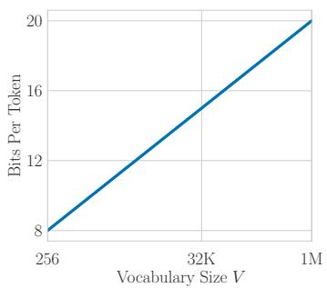

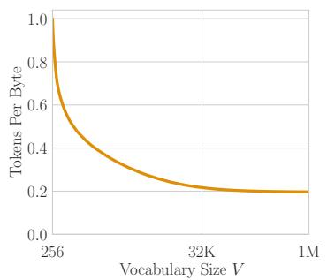

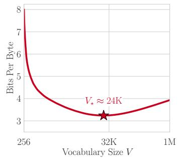  
Figure 1: Myth #1: Bits-Per-Byte Is Agnostic to the Tokenizer and/or Its Vocabulary Size. For untrained models that output uniform distributions, BPB on held-out test data prefers certain vocabulary sizes over others (right). For uniform distributions, BPB is a product of two functions: the number of bits per token, which increases with vocabulary size (left), and the number of tokens per byte, which decreases with vocabulary size (center). The product has a minimum (right). Corpus: FineWeb-Edu-dedup, English (Penedo et al., 2024).

The second incorrect belief is that a lower BPB means a better model (Myth #2, Section 3). Untrained models on standard benchmarks exhibit BPB which moves by more than 6 bits per byte, even while accuracy stays at random chance. Trained models from TokEval (Meister, 2026) similarly exhibit weak correlations between BPB and downstream metrics on most benchmarks we test. One reason is structural: the code length of a correct answer splits exactly into the cost of answering with one of the options, the cost of choosing the correct option, and the cost of spelling it out (Equation (6)), whereas accuracy reads only the middle term. On 49 released models from TokSuite (Altıntas¸ et al., 2026) and TokEval, a change of tokenizer moves mostly the first term, which accuracy ignores (Figure 6). Several tokenizer studies have reported that BPB and task scores disagree (Liu et al., 2025; Land, 2026; Tempus et al., 2026; Yavuz et al., 2026; Meister, 2026; Marathe et al., 2026); our factorization gives a general reason.

The third incorrect belief is that different “tokenizer-agnostic” metrics yield consistent results; it fails when comparing BPB against the unigram-normalized loss (Myth #3, Section 4; Roh et al., 2020; Tao et al., 2024). The loss scores each model against its own tokenizer’s unigram model, but it equals the difference between the model’s BPB and that unigram model’s BPB, times bytes per token, so the per-token denominator returns (Equation (8)). Tao et al. (2024) support the loss with its correlation of 0.989 with BPB across their runs, but this high correlation is attributable to a confounder, and removing it reduces the correlation to 0.057. From the same data, the two metrics select different vocabularies at each model size.

No metric can be tokenizer-agnostic in the full sense (Section 5). One would want a metric under which only the true distribution scores best, the same predictions get the same score, and untrained models tie under different tokenizers. No metric has all three (Theorem 1). BPB keeps the first two properties and gives up the third, which is Myth #1. The unigram-normalized loss gives up the second: it makes each tokenizer’s unigram model score zero, but it scores the same predictions differently under different tokenizers. Two metrics that give up different properties measure different things, so nothing forces them to agree; this is the disagreement of Myth #3.

Appendix A reviews related work. We conclude with a caution for reading comparisons across tokenizers and a conjecture about discrimination and compression (Section 6).

## 2 MYTH #1: BITS-PER-BYTE IS AGNOSTIC TO THE TOKENIZER AND/OR THE VOCABULARY SIZE

To fairly compare models that use different tokenizers, many publications advocate for Bits-Per-Byte (BPB), arguing that BPB is agnostic to tokenization scheme and vocabulary size:

1. Karpathy (2026): “Bits per byte (BPB): vocab size-independent evaluation metric.”

2. Pagnoni et al. (2025): “[W]e instead report Bits-Per-Byte (BPB), a tokenizer independent version of perplexity.”

3. Gao et al. (2020): “Bits per byte is preferred over bits per character or perplexity [...] due to its invariance to different tokenization schemes [...]”

4. Liu et al. (2025): “[W]e evaluate language modeling performance using bits-per-byte (BPB), which normalizes the loss by the tokenizer’s encoding efficiency to fairly compare models with different tokenizers.”

5. Limisiewicz et al. (2026): “Both works use normalized negative log likelihood enabling a fair comparison across tokenizers.”

6. Meister (2026): “We evaluate the resulting models on bits-per-byte (a tokenizer-agnostic version of perplexity) [...].”

7. Slagle (2024): “To fairly compare [...] we measure the cross-entropy of the test dataset in terms of bits-per-byte.”

8. Kallini et al. (2025): “[W]e compare models using bits-per-byte (BPB), a tokenizeragnostic alternative to perplexity [...].”

This folk wisdom is wrong. To see why, we consider token-averaged negative log-likelihood that the community agrees is not tokenizer-agnostic, and then show that BPB fails the same test.:

Fix an evaluation corpus of D documents, where document d contains $B ^ { ( d ) }$ bytes, and $B \ =$ $\textstyle \sum _ { d = 1 } ^ { D } B ^ { ( d ) }$ is the total number of bytes. Tokenizer τ cuts document d into $N _ { \tau } ^ { ( d ) }$ tokens $t _ { 1 } ^ { ( d ) } , \ldots , t _ { N _ { \tau } ^ { ( d ) } } ^ { ( d ) } ,$ each drawn from a vocabulary of $V _ { \tau }$ possible tokens, with $\begin{array} { r } { N _ { \tau } = \sum _ { d = 1 } ^ { D } N _ { \tau } ^ { ( d ) } } \end{array}$ as the total number of tokens. Two tokenizers applied to the same corpus therefore agree on B but differ in $N _ { \tau }$ and $V _ { \tau }$ : the byte count belongs to the text, while the token count and the vocabulary size belong to the tokenizer. A tokenizer-model pair $( \tau , p )$ obtains a total log loss of:

$$
L ( \tau , p ) = \sum _ { d = 1 } ^ { D } \sum _ { n = 1 } ^ { N _ { \tau } ^ { ( d ) } } - \log p \big ( t _ { n } ^ { ( d ) } \mid t _ { < n } ^ { ( d ) } \big ) .\tag{1}
$$

One ubiquitous metric, the token-averaged negative log likelihood, divides by the token count $N _ { \tau }$ :

$$
\mathrm { N L L } ( \tau , p ) = \frac { L ( \tau , p ) } { N _ { \tau } } .\tag{2}
$$

The community has ruled out using NLL to compare models with different tokenizers because NLL divides the total loss by the number of tokens $N _ { \tau }$ , and different tokenizers cut the same text into different numbers of tokens. Consider untrained models that, under $\mu \mathrm { P }$ and its modern successors, are approximately uniform over $V _ { \tau }$ tokens (Appendix H). For the uniform model $p ^ { \mathrm { u n i f } }$

$$
\mathrm { N L L } ( \tau , p ^ { \mathrm { u n i f } } ) = \frac { 1 } { N _ { \tau } } \sum _ { d = 1 } ^ { D } \sum _ { n = 1 } ^ { N _ { \tau } ^ { ( d ) } } - \log \frac { 1 } { V _ { \tau } } = \log V _ { \tau } .\tag{3}
$$

In this case, NLL declares that the “best” model is the one with the smallest vocabulary size, even though all models are equally untrained. Token-averaged NLL is not agnostic to the tokenizer. As a solution, the research community turned to Bits-Per-Byte (BPB)1, which divides the total log loss by the byte count B rather than the token count $N _ { \tau }$

$$
\mathrm { B P B } ( \tau , p ) = \frac { L ( \tau , p ) } { B } = \underbrace { \frac { N _ { \tau } } { B } } _ { \mathrm { t o k e n s p e r b y t e } } \times \underbrace { \frac { L ( \tau , p ) } { N _ { \tau } } } _ { \mathrm { t o k e n - a v e r a g e d N L L } } .\tag{4}
$$

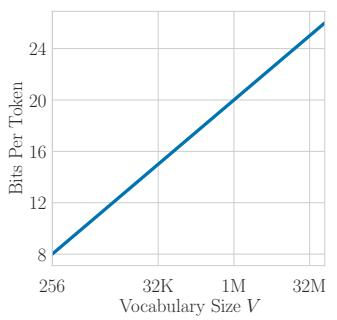

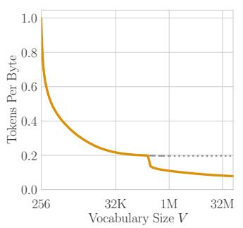

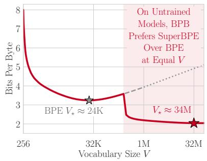  
Figure 2: Myth #1, Continued: Bits-Per-Byte Is Agnostic to the Tokenization Algorithm. The three panels of Figure 1 for SuperBPE (Liu et al., 2025) (color) against standard BPE (gray, dashed), for untrained models on the same held-out corpus. Up to the transition point $t = 2 6 2 \mathrm { { K } }$ the two tokenizers coincide. Above t, SuperBPE merges across pre-token boundaries and scores lower at every vocabulary size (shaded). Beyond 1.05 million, where the BPE sweep ends, the dotted BPE curve holds tokens per byte fixed. BPB prefers one tokenization algorithm (SuperBPE) over another (BPE), even for untrained models. Corpus: FineWeb-Edu-dedup, English (Penedo et al., 2024).

Dividing by bytes removes the token count, but BPB fails the same test of untrained models. To see why, let us again consider untrained models with different vocabulary sizes that place uniform probability on each of their Vτ tokens and ask whether BPB scores all model-tokenizer pairs equally:

$$
\mathrm { B P B } ( \tau , p ^ { \mathrm { u n i f } } ) = \frac { L ( \tau , p ^ { \mathrm { u n i f } } ) } { B } = \frac { 1 } { B } \sum _ { d = 1 } ^ { D } \sum _ { n = 1 } ^ { N _ { \tau } ^ { ( d ) } } - \log \frac { 1 } { V _ { \tau } } = \underbrace { \frac { N _ { \tau } } { B } } _ { \mathrm { t o k e n s p e r b y t e } } \times \underbrace { \log V _ { \tau } } _ { \mathrm { n a t s p e r 0 k e n } } .\tag{5}
$$

BPB depends on the tokenizer in two ways: (1) how many tokens the tokenizer produces per byte, and (2) how many bits the tokenizer-model pair spends per token. The first factor decreases with vocabulary size while the second increases with it, and the two generally don’t cancel: on a real English pretraining corpus (Penedo et al., 2024) with BPE tokenizers (Gage, 1994; Sennrich et al., 2016), BPB is minimized near vocabulary size 24K (Figure 1); among untrained models that have learned nothing, BPB ranks some tokenizer-model pairs strictly above others. Untrained models do not tie under BPB, so BPB is not agnostic to the tokenizer either.

If a metric were agnostic to the tokenizer, models that have learned nothing would tie. They do not. On this corpus the minimum sits near 24K. On four other corpora (code, French, Hindi, and Russian), with the same BPE pipeline trained on each, the minimum sits anywhere from 504 (Hindi) to 117K (Russian; Table 2 in Appendix B). On a fifth, Chinese, no minimum appears in a sweep to 1.05 million. Under SuperBPE (Liu et al., 2025), which merges across pre-token boundaries once the vocabulary passes a transition point t, the minimum moves to about 34 million for t = 262K (Figure 2), a stress test of the metric rather than a recommendation. From t to 1.05 million, where our BPE sweep ends, SuperBPE scores lower than BPE at every vocabulary size. At 1.05 million, the gap between the untrained models is 1.74 BPB. At a vocabulary size of 200K, the released BPE and SuperBPE (t = 180K) tokenizers of Liu et al. (2025) differ by 0.88 BPB on the same English corpus, again for untrained models. What matters is the preference, not its location: when the model has learned nothing, the metric still prefers some tokenizer families and vocabulary sizes over others, and that preference is tokenizer dependence.

## 3 MYTH #2: LOWER BITS-PER-BYTE MEANS A BETTER MODEL

Lower BPB means a shorter code for the evaluated text; it does not imply better downstream performance. We show this with standard evaluation protocols.

We construct 81 nested BPE tokenizers, with vocabulary sizes ranging from $2 ^ { 8 } ~ \mathrm { t o } ~ 2 ^ { 2 0 }$ , and score uniform distributions on standard tasks: MMLU (Hendrycks et al., 2021), MMLU-Pro (Wang et al.,

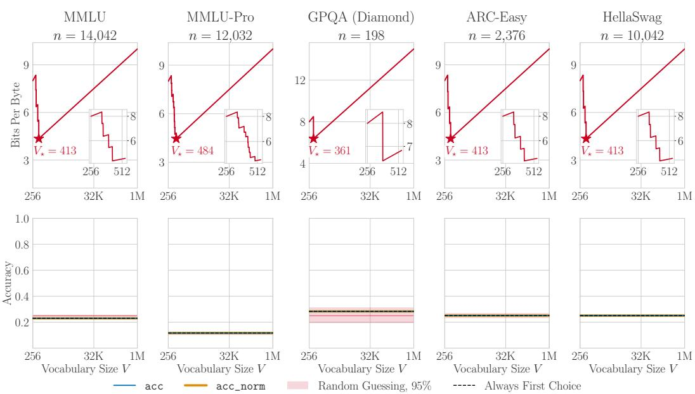  
Figure 3: Myth #2: Lower Bits-Per-Byte Means a Better Model (Option-Letter Scoring). Untrained models that output uniform distributions. Top: BPB of the correct label drops one step at each merge that shortens a label (inset), then rises with log V. Bottom: accuracy is constant, at the fraction of items whose correct answer is listed first. Red band, for reference: central 95% of a uniform random guesser; black dashed: always choosing the first option. BPB strongly prefers a vocabulary of a few hundred tokens, whereas accuracy finds all models to be equally useless.

2024b), GPQA (Rein et al., 2024), ARC (Clark et al., 2018), HellaSwag (Zellers et al., 2019), PIQA (Bisk et al., 2020), and WinoGrande (Sakaguchi et al., 2020).

On multiple-choice question-answering benchmarks, there are at least two standard ways to score models: (1) In option-letter scoring, the prompt lists the options under labels, and the model is scored on a label; (2) in answer-text scoring, the prompt shows only the question, and the model is scored on the text of each answer. Table 1 shows both. In both, lm-evaluation-harness appends each option to the prompt and computes its log-likelihood (Gao et al., 2025); acc picks the option with the highest log-likelihood and acc norm the highest per character, with ties going to the first.

Table 1: Two Standard Ways to Score Multiple-Choice Question-Answering Problems. Example problem from ARC-Easy (Clark et al., 2018). The correct option is bold, and marks a leading space. Accuracy compares the four scored strings; BPB charges the correct one.
<table><tr><td>Prompt</td><td>Option-Letter Scoring</td><td>Answer-Text Scoring</td></tr><tr><td rowspan="3"></td><td>Question: Which piece of safety equipment is used to keep mold spores from entering the respiratory</td><td>Question: Which piece of safety equipment is used to keep mold spores from</td></tr><tr><td>system? A. safety goggles B. breathing mask C. rubber gloves</td><td>entering the respiratory system? Answer:</td></tr><tr><td>D. lead apron Answer: A,B, C, D</td><td>_safety goggles,</td></tr><tr><td>Bytes charged</td><td>2</td><td>breathing mask, rubber gloves, lead apron 15</td></tr></table>

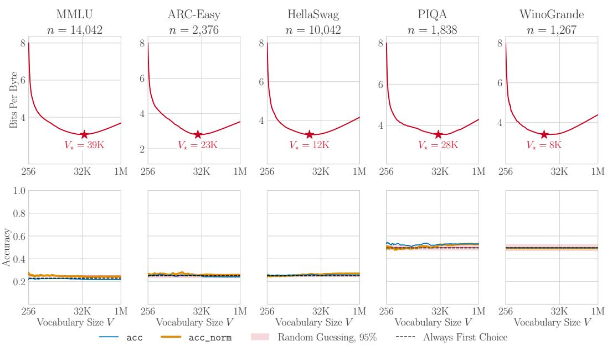  
Figure 4: Myth #2: Lower Bits-Per-Byte Means a Better Model (Answer-Text Scoring). Untrained models that output uniform distributions, scored on answer text (WinoGrande: on a shared continuation). Top: BPB of the correct answers has an interior minimum on every benchmark (star), between 8K and 39K. Bottom: accuracy on the same strings moves by at most a few points and has no common preferred vocabulary size. Red band, for reference: central 95% of a uniform random guesser; dashed: always choosing the first option. BPB concludes that vocabulary sizes between 8K and 39K are strongly preferable, whereas accuracy finds all models to be equally useless.

BPB reads the same strings: it charges the code length of each correct option, given the prompt, and divides by the bytes of those options. Accuracy and BPB therefore differ only in the metric.

In both approaches, code length strongly prefers a vocabulary size whereas accuracy does not. On option labels, accuracy is exactly constant (Figure 3): the first label is never longer in tokens than the others, so the uniform model always picks it; MMLU accuracy is 0.2295, the fraction of items whose answer is listed first, at every vocabulary size, while its code length moves between 4.34 and 10.00 bits-per-byte. On answer text, BPB is minimized between 8K and 39K (Figure 4), whereas accuracy is flat at chance and never peaks at the BPB minimum. The reason is that the uniform model charges every token the same log $V _ { \tau } \mathrm { i }$ : when accuracy compares the options of one item, log $V _ { \tau }$ cancels, but BPB multiplies it by tokens per byte. To understand where the jagged edges of Figure 3 emerge from, see a simple mathematical derivation in Appendix C.

These measurements concern models that have learned nothing.

Among trained models that differ in the tokenizer, BPB and task scores are weakly coupled on the same text. We use the model-tokenizer pairs of Meister (2026): one 24-layer network trained with 85 tokenizers2 on the same documents in the same order; the tokenizer also changes the parameter count (0.98B to 1.60B) and the number of tokens trained on (9.0B to 10.5B). On four standard benchmarks, BLiMP (Warstadt et al., 2020), GSM8K (Cobbe et al., 2021), MBPP (Austin et al., 2021), and HumanEval (Chen et al., 2021), we measure each model’s BPB on each benchmark’s own text: every problem followed by its reference answer, in the prompt format that produced the released scores, and for BLiMP the grammatical sentence of each pair. We score the reference answer because the log-likelihood of gold reference solutions tracks pass@k on generative benchmarks as pretraining scales (Schaeffer et al., 2026). BPB and the score are then computed from the same benchmark. See Appendix F for more information.

The correlations are weak and noisy on every benchmark (Figure 5). The Pearson correlation between BPB and the score is +0.02 for BLiMP, with a 95% bootstrap interval of [ 0.27, +0.31];

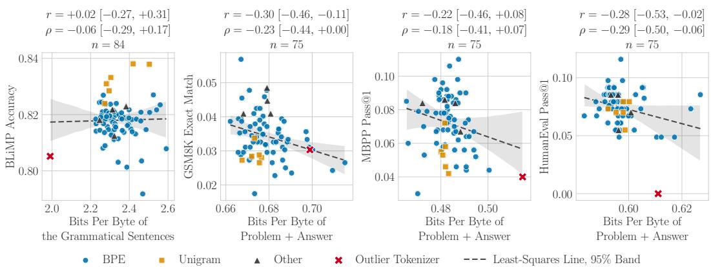  
Figure 5: Myth #2: Lower Bits-Per-Byte Means a Better Model (Trained Models). Each point is one model-tokenizer pair from Meister (2026): every model has the same layers and saw the same documents in the same order; the tokenizer varies. The horizontal axis is BPB on the benchmark’s own text; for BLiMP, the grammatical sentence of each pair, scored alone. Each panel gives the Pearson (r) and Spearman (ρ) correlations between BPB and downstream performance. Dashed line and band: least-squares line with a 95% bootstrap band. On trained models, the correlation is relatively weak, with or without the outlier tokenizer (red cross, Appendix F).

0.22 for MBPP; 0.28 for HumanEval; and 0.30 for GSM8K; the intervals for BLiMP and MBPP include zero. Even the strongest, on GSM8K, is weak: it accounts for less than a tenth of the variance in the score. This holds for a grammaticality benchmark scored by log-likelihood, a math benchmark scored by exact match, and two code benchmarks scored by pass@1. While the released scores are noisy3, BLiMP, the least noisy score, is also the least correlated.

BPB charges for every bit of the correct answer, but a task score depends on only part of those bits. Five published tokenizer sweeps and one comparison of byte-level with token-level models report that BPB and task scores disagree, and two of them suggest a mechanism (Appendix A). To see where the bits go, we split the code length of the correct answer into the part that a task score reads and the part that it ignores. On a generative benchmark, the split cannot be computed exactly, because many strings reach the same outcome and their total probability cannot be summed. On a multiple-choice benchmark, it can, because the options are the only strings that are scored. For an item with prompt $x ,$ correct string $y ^ { \star }$ and correct option $c ^ { \star }$ , let $F$ be the event that the response is one of the options and Y the option it selects. The chain rule splits the code length of the correct string into three terms:

$$
\underbrace { - \log p ( y ^ { \star } \mid x ) } _ { \mathrm { w h a t ~ B P B ~ e h a r g e s } } = \underbrace { - \log p ( F \mid x ) } _ { \mathrm { f o r m a t ~ c o m p l i a n c e } } + \underbrace { - \log p ( Y = c ^ { \star } \mid F , x ) } _ { \mathrm { a n s w e r ~ d i s c t i m i n a t i o n } } + \underbrace { - \log p ( y ^ { \star } \mid Y = c ^ { \star } , F , x ) } _ { \mathrm { e x a c t r e n d e r i n g } } .\tag{6}
$$

We call these the format term, the decision term, and the rendering term. Under forced choice, accuracy (acc) depends only on the distribution over the options, which the format term does not change. For the uniform model of Figure 4, MMLU’s correct answers average 44.3 bytes and cost about 135 bits at the vocabulary size that minimizes its BPB, about 39K: 95.5 in the format term and 40.0 in the decision term, because this model favors the option with the fewest tokens. Moving the vocabulary from 39K to $2 ^ { 2 0 }$ adds 27.8 bits to the same answers, 20.0 of them in the format term, while accuracy stays at chance.

On trained models, most of the BPB difference between tokenizers lies in the format term. If a change of tokenizer moved only the format term, BPB would move and accuracy would not. We measure which term moves more on 49 released models from two sets, in each of which the tokenizer varies: TokSuite (Altıntas¸ et al., 2026), 16 runs of 14 tokenizers trained for the same number of tokens, and TokEval (Meister, 2026), 33 runs of 24 tokenizers trained on the same documents in the same order. Each model is scored on four benchmarks, MMLU, ARC-Easy, HellaSwag, and GPQA, once on the option letter and once on the answer text. Each option is one string, so the rendering

Which Term Moves With BPB Across Tokenizers?  
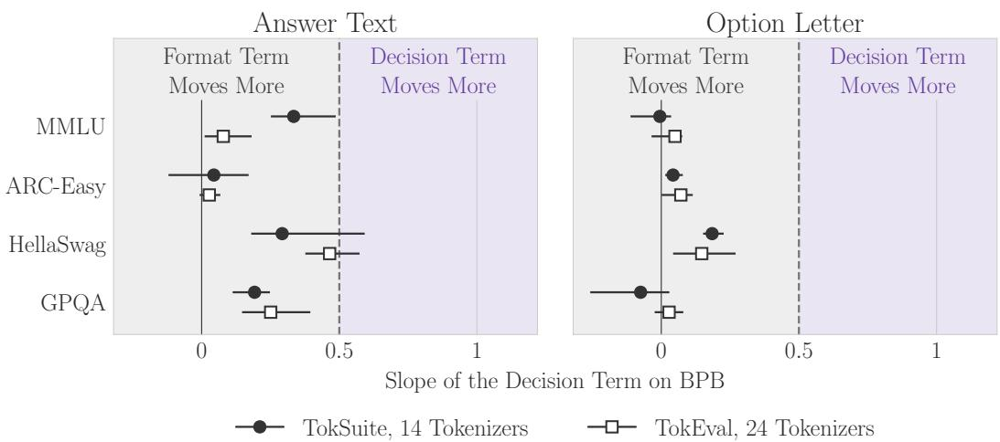

Figure 6: Myth #2, Continued: Lower Bits-Per-Byte Means a Better Model (Where the Differences Lie). Each marker is the least-squares slope of the decision term on BPB across the tokenizers of one set, with its 95% bootstrap interval; the format term’s slope is one minus it. Most of the difference lies in the format term, which accuracy ignores, not in the decision term, which it reads.

term is zero, and the other two terms can be computed exactly (Appendix G). Figure 6 gives the slope of the decision term on BPB across tokenizers in all sixteen conditions.

In all sixteen conditions, the decision term’s slope is below one half, so the format term carries more of the difference; only on HellaSwag answer text does the slope’s interval reach above one half. On answer text, the decision term’s slope lies between 0.03 and 0.46. On MMLU letters, the decision term is the larger term but carries almost none of the difference: it is 83% of the BPB in TokSuite and 75% in TokEval, yet its slope is 0.05 or less in both. Every model is at chance on option letters, so the decision term stays near its chance value whatever the tokenizer.

A strictly proper score on the exact text must charge for rendering. A task sees only the outcome a response reaches; BPB sees the exact string. Fix a prompt, and let a model give the distribution $Q$ over exact responses; in Equation (6), $Q \ = \ p ( \cdot \ | \ x )$ . Let $o ( y )$ be the outcome of response y, such as the option it selects or whether a program passes its tests. The model then gives each outcome a the probability $\bar { Q } ( a )$ , the sum of $Q ( y )$ over the responses $y$ with $o ( y ) = a . \mathrm { ~ A ~ }$ score that measures only the task depends on $Q$ only through $\bar { Q }$ . A score is strictly proper if, for every true distribution ${ \dot { P } } ,$ , the prediction P gets a strictly better expected score than every other prediction (Gneiting & Raftery, 2007); the log loss behind BPB is strictly proper.

Proposition 1 (No score is both strictly proper and blind to rendering). If two or more responses have the same outcome, no score is both strictly properfor the distribution over exact responses and afunction ofQ¯ alone.

Proof. Choose an outcome a that two or more responses reach. Let $Q _ { 1 } \neq Q _ { 2 }$ give every outcome the same probability but spread the probability of a differently over the responses that reach it. Then $\bar { Q } _ { 1 } = \bar { Q } _ { 2 } ,$ , so a function of Q¯ gives $\dot { Q } _ { 1 }$ and $Q _ { 2 }$ the same expected score under every true distribution. But under $P = Q _ { 1 }$ , a strictly proper score gives $Q _ { 1 }$ a strictly better expected score than $Q _ { 2 }$ □

The two predictions in the proof differ only in the rendering term of Equation (6). This term matters when many strings reach one outcome, as in the GSM8K, MBPP, and HumanEval scores of Figure 5: many solutions reach the same final number, and many programs pass the same tests. There, BPB on the reference answer charges for how the model spreads probability over those strings, and the score does not, so the two can move apart. A score on outcomes can still be strictly proper: on a multiple-choice item, the decision term is the log loss of the distribution over options, which is the distribution that accuracy reads. Accuracy itself reads only which option is largest, so it is not strictly proper even over options.

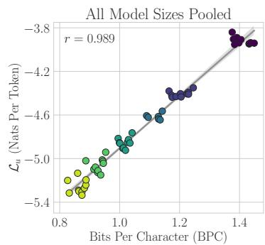

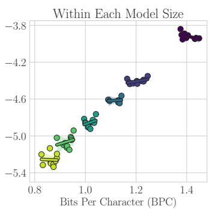  
Model Size (Pearson r Within That Size)

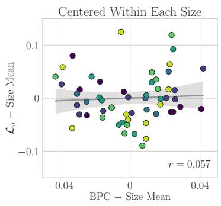  
33M (r = 0.61) 85M (r = +0.48) 151M (r = +0.12)  
Figure 7: Myth #3: Different “Tokenizer-Agnostic” Metrics Yield Consistent Results (Correlation). The 56 points of Figure 11 of Tao et al. (2024), digitized and colored by model size, with least-squares fits and 95% confidence bands (bootstrap on the left and right; analytic in the center, where each model size has few points). Left: pooled, $\mathcal { L } _ { u }$ and BPC correlate at $r = 0 . 9 8 9$ . Center: within each model size, where the points differ in vocabulary size, the correlation ranges from 0.61 to +0.48. Right: with each size’s mean removed from both metrics, $r = 0 . 0 5 7$ . The pooled correlation comes from differences between model sizes; within a size, little remains.

## 4 MYTH #3: DIFFERENT “TOKENIZER-AGNOSTIC” METRICS YIELD CONSISTENT RESULTS

Not all tokenizer papers use Bits-Per-Byte. Roh et al. (2020) proposed the unigram-normalized perplexity to compare language models with different vocabulary sizes, and Tao et al. (2024) reformulated it as a loss to fit scaling laws for the vocabulary size:

$$
\mathcal { L } _ { u } ( \tau , p ) ~ = ~ \frac { 1 } { N _ { \tau } } \sum _ { d = 1 } ^ { D } ~ \sum _ { n = 1 } ^ { N _ { \tau } ^ { ( d ) } } - \log \frac { p ( t _ { n } ^ { ( d ) } \mid t _ { < n } ^ { ( d ) } ) } { u _ { \tau } \left( t _ { n } ^ { ( d ) } \right) } ,\tag{7}
$$

where $u _ { \tau } ( t )$ is the frequency of token t. $\mathcal { L } _ { u }$ is the model’s loss per token minus that of the tokenizer’s unigram distribution. To justify the metric, Tao et al. (2024) report that $\mathcal { L } _ { u }$ is highly correlated with bits per character (BPC; on one text, BPC is BPB times a constant): Pearson $r = 0 . 9 8 9$ across their models (their Figure 11; reproduced in our Figure 7, left).

This claim has three problems.

Unigram-normalized loss is not tokenizer-agnostic. Roh et al. (2020) call their metric “independent of the vocabulary size” and conclude that a difference in it “purely comes from the ability of LM”. Tao et al. (2024) call their loss “vocabulary-insensitive” and write that the difference in $\mathcal { L } _ { u }$ “comes from the ability of the language model itself”. A 2026 survey of tokenization lists $\mathcal { L } _ { u }$ among the metrics that “can be used to compare across different tokenizers” and writes that normalizing the loss “by the vocabulary’s unigram distribution [...] corrects for vocabulary size” (Cognetta et al., 2026). However, by the same argument as for BPB, none of these claims hold. Splitting the logarithm in Equation (7) gives

$$
\mathcal { L } _ { u } ( \tau , p ) ~ = ~ \underbrace { \frac { B } { N _ { \tau } } } _ { \mathrm { b y t e s ~ p e r ~ t o k e n } } \times \Big [ \mathrm { B P B } ( \tau , p ) - \mathrm { B P B } ( \tau , u _ { \tau } ) \Big ] .\tag{8}
$$

$\mathcal { L } _ { u }$ is the difference between the model’s BPB and that of its tokenizer’s unigram model, converted back to a per-token quantity. It measures improvement over a reference, a legitimate question; what fails is the claim that it removes tokenizer effects. Changing the tokenizer changes all three terms: the model’s BPB, the unigram reference, and the bytes per token, the same per-token denominator that the community rejected for NLL.

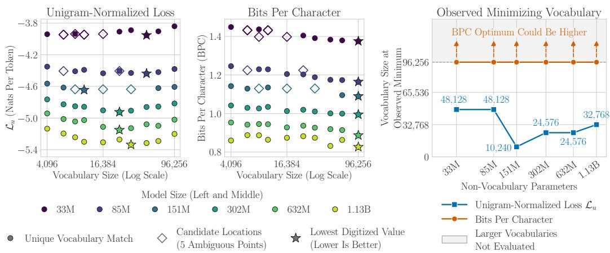  
Figure 8: Myth #3: Different “Tokenizer-Agnostic” Metrics Yield Consistent Results (Minima). Left and center: the 56 digitized runs of Figure 11 of Tao et al. (2024) against vocabulary size; stars mark each model size’s minimum, and hollow diamonds show candidate vocabularies for five runs whose match is ambiguous. Right: the vocabulary at each minimum. BPC is always lowest at the largest vocabulary trained, and its optimum may lie beyond it (arrows); $\mathcal { L } _ { u }$ is lowest inside the grid. Unigram-normalized loss and BPC pick different vocabularies from the same data.

The correlation between metrics comes from model size, not from the metrics. When com puting the correlation between unigram-normalized loss and BPB, Tao et al. (2024) use multiple model sizes from 33M to 1.13B (non-vocabulary) parameters. As scaling laws tell us, larger models reach lower losses (Kaplan et al., 2020; Hoffmann et al., 2022). This produces a strong global correlation between $\mathcal { L } _ { u }$ and BPB (Figure 7, left). We digitized Figure 11 and labeled each point with its model size.4 However, the point of $\mathcal { L } _ { u }$ is to compare vocabularies at a fixed model size, which pooling model sizes cannot test. Within each model size, the correlation ranges from 0.61 to +0.48 (Figure 7, center). With each size’s mean removed, the Pearson correlation falls to 0.057 (Figure 7, right).5

The two metrics select different vocabularies from the same data. Even if neither metric is tokenizer-agnostic, one might hope that they select the same vocabularies. However, this is not the case. $\mathcal { L } _ { u }$ is lowest inside the grid, between 10,240 and 48,128, and its minimum moves up and down with model size (Figure 8, left). In comparison, BPC is lowest at the largest vocabulary trained for every model size, 96,256: the best evaluated point, not a located optimum (Figure 8, center). Thus, from the same data, the two metrics select different vocabularies at each model size. Tao et al. (2024) also test the vocabulary that their law predicts on downstream tasks (their Table 2), but this test does not settle the disagreement: it compares one trained model per vocabulary, their own law says the two models have almost the same loss, and the predicted vocabulary comes from a units error in the released fitting code (Appendix E).

## 5 CAN ANY METRIC BE TOKENIZER-AGNOSTIC? THE TOKENIZER TRILEMMA

All three myths come from metrics that fail in unexpected ways. One might then ask whether any metric has three obviously desirable properties. None does.

Every tokenizer-model pair $( \tau , p )$ assigns a probability to every text; call these its predictions. We would like a metric to have three properties:

(P1) Only the truth scores best: with the tokenizer fixed, every prediction other than the true data distribution gets a worse expected score;

(P2) Same predictions, same score: two pairs that give every text the same probability get the same score, however their tokenizers split the text;

(P3) Untrained models tie: models that have learned nothing, such as $p ^ { \mathrm { u n i f } }$ , get the same score under every tokenizer.

NLL breaks (P2), because two pairs with the same predictions can split a text into different numbers of tokens, and it breaks (P3) by Equation (3). BPB repairs (P2), because its denominator B belongs to the text, not to the tokenizer. This is why the community switched to BPB, and why it believes BPB is tokenizer-agnostic. But Figure 1 shows that BPB breaks (P3).

Why no metric can have all three. Uniform pairs do not make the same predictions. BPE builds its vocabulary from data, so common byte sequences become single tokens, and a uniform model over that vocabulary gives common text a higher probability before any training. The model has learned nothing, but the pair has. A metric with (P1) and (P2) judges pairs only by their predictions, and it must tell different predictions apart. So it cannot score these uniform pairs as equal: one tokenizer gets a head start. A tokenizer that learns nothing from data shows the contrast: cut text into blocks of k bytes, and every uniform pair scores exactly 8 bits per byte, for every $k . ^ { 6 }$

Theorem 1 (The tokenizer trilemma). If two lossless tokenizers, each with its untrained reference model, make different predictions, no metric has all of (P1), (P2), and (P3).

Proofsketch. Let text be drawn from the predictions of the first uniform pair. Because the first tokenizer is lossless, some autoregressive model on it, not necessarily of a given size, copies the predictions of the second uniform pair. By (P1), the first uniform pair beats that copy; by (P2), the copy scores the same as the second uniform pair. So the two uniform pairs do not tie, which breaks (P3). Appendix D gives the full result, in which each untrained reference is conditioned on the length of the text. □

Every metric in this paper gives up at least one property, and each choice answers a different question. BPB keeps (P1) and (P2) and gives up (P3), which is Myth #1; it answers which pair encodes this text in fewer bits? Subtracting each tokenizer’s untrained score keeps (P1) and (P3) and gives up (P2); it answers how far did each model move from its own tokenizer’s starting point? The unigram-normalized loss of Myth #3 is a score of this second kind, with each tokenizer’s unigram model as the reference. Metrics that give up different properties can rank the same runs differently, as Myth #3 shows. Keeping (P2) and (P3) means giving some different predictions the same score, which gives up (P1). Code length and accuracy face the same conflict at the level of the task (Proposition 1, Myth #2): a score under which only the truth scores best must tell every two different predictions apart, so a coarser question, such as which option a model picks, needs a score on coarser outcomes. No metric has all three properties; picking a metric is picking a question.

## 6 DISCUSSION

Read the Tokenization Literature with Caution. The tokenization literature needs careful reading: results that appear to conflict often answer different questions. Modifying tokenization can introduce several degrees of freedom at once, for example by decoupling compute from the number of unique training bytes, and this makes experiments hard to compare. Papers can rest a claim on weak evidence: Tao et al. (2024) support their predicted vocabulary with a downstream gain between two vocabularies to which their own released law assigns almost the same loss (Appendix E). Papers can also be mutually inconsistent: Tao et al. (2024) and Limisiewicz et al. (2026) reach opposing prescriptions for how to optimally scale vocabulary size, but without identifying or explaining the factors responsible for the apparent contradiction.

BPB measures one thing well: how many bits a tokenizer-model pair needs to encode a text. Several of the papers we quote use it for exactly that, even where they call it tokenizer-agnostic. The myths begin when that fact is read as the answer to different questions.

Intelligence as Discrimination, Not Compression. The machine learning research community has frequently viewed intelligence as prediction or, equivalently, compression. This view draws on Solomonoff induction, Kolmogorov complexity, and the Minimum Description Length principle, which formalize Occam’s razor as a preference for the shortest description (Solomonoff, 1964; Kolmogorov, 1965; Rissanen, 1978). It continues in theories of universal intelligence (Hutter, 2005) and in work that measures language models by how well they compress (Deletang et al., 2024; Huang ´ et al., 2024).

We conjecture that this view is correct only near the true data distribution, where the distribution with the shortest expected code is also the one that most often identifies the correct continuation. Far from the true data distribution, intelligence is the ability to discriminate: to identify the correct continuation or the correct action from plausible incorrect continuations or plausible incorrect actions. There, compression and discrimination come apart. A model can shorten its code by spending fewer bits on format and rendering (Equation (6)), which do not help it identify the correct continuation. And the decision term is a log-probability of the correct choice, while identifying that choice requires only that every plausible incorrect choice receive less mass (Schaeffer et al., 2025). The models of Section 3 are far from the true data distribution, and in them the two have already come apart. Across models that differ in the tokenizer, the code length moves mostly with the format term, and the decision term carries a minority of its spread (Figure 6). So most of what separates these models in BPB is not their ability to discriminate. If the conjecture holds, compression is a proxy for intelligence only near the true data distribution, and a measure of intelligence far from it must score discrimination directly.

## REFERENCES

Orevaoghene Ahia, Sachin Kumar, Hila Gonen, Jungo Kasai, David Mortensen, Noah A. Smith, and Yulia Tsvetkov. Do all languages cost the same? Tokenization in the era of commercial language models. In Conference on Empirical Methods in Natural Language Processing (EMNLP), 2023. arXiv:2305.13707.

Rami Al-Rfou, Dokook Choe, Noah Constant, Mandy Guo, and Llion Jones. Character-level language modeling with deeper self-attention. In Proceedings of the AAAI Conference on Artificial Intelligence, volume 33, pp. 3159–3166, 2019. doi: 10.1609/aaai.v33i01.33013159. arXiv:1808.04444.

Mehdi Ali, Michael Fromm, Klaudia Thellmann, Richard Rutmann, Max Lubbering, Johannes Lev-¨ eling, Katrin Klug, Jan Ebert, Niclas Doll, Jasper Schulze Buschhoff, et al. Tokenizer choice for LLM training: Negligible or crucial? In Findings of the Association for Computational Linguistics: NAACL 2024, 2024. arXiv:2310.08754.

Gul Sena Altıntas¸, Malikeh Ehghaghi, Brian Lester, Fengyuan Liu, Wanru Zhao, Marco Ciccone,¨ and Colin Raffel. TokSuite: Measuring the impact of tokenizer choice on language model behavior. In International Conference on Machine Learning (ICML), 2026. arXiv:2512.20757.

Jacob Austin, Augustus Odena, Maxwell Nye, Maarten Bosma, Henryk Michalewski, David Dohan, Ellen Jiang, Carrie Cai, Michael Terry, Quoc Le, and Charles Sutton. Program synthesis with large language models, 2021. arXiv:2108.07732.

Akshita Bhagia, Jiacheng Liu, Alexander Wettig, David Heineman, Oyvind Tafjord, Ananya Harsh Jha, Luca Soldaini, Noah A. Smith, Dirk Groeneveld, Pang Wei Koh, Jesse Dodge, and Hannaneh Hajishirzi. Establishing task scaling laws via compute-efficient model ladders. In Conference on Language Modeling (COLM), 2025. arXiv:2412.04403.

Stella Biderman, Hailey Schoelkopf, Lintang Sutawika, Leo Gao, Jonathan Tow, Baber Abbasi, Alham Fikri Aji, Pawan Sasanka Ammanamanchi, Sidney Black, Jordan Clive, et al. Lessons from the trenches on reproducible evaluation of language models, 2024. arXiv:2405.14782.

Yonatan Bisk, Rowan Zellers, Ronan Le Bras, Jianfeng Gao, and Yejin Choi. PIQA: Reasoning about physical commonsense in natural language. In Proceedings of the AAAI Conference on Artificial Intelligence, 2020.

Charlie Blake, Constantin Eichenberg, Josef Dean, Lukas Balles, Luke Y. Prince, Bjorn Deiseroth,¨ Andres Felipe Cruz-Salinas, Carlo Luschi, Samuel Weinbach, and Douglas Orr. u-µP: The unit scaled maximal update parametrization. In International Conference on Learning Representations (ICLR), 2025. arXiv:2407.17465.

Blake Bordelon, Lorenzo Noci, Mufan Bill Li, Boris Hanin, and Cengiz Pehlevan. Depthwise hyperparameter transfer in residual networks: Dynamics and scaling limit. In International Conference on Learning Representations (ICLR), 2024. arXiv:2309.16620.

Kaj Bostrom and Greg Durrett. Byte pair encoding is suboptimal for language model pretraining. In Findings of the Association for Computational Linguistics: EMNLP 2020, pp. 4617–4624, 2020. doi: 10.18653/v1/2020.findings-emnlp.414.

Kris Cao and Laura Rimell. You should evaluate your language model on marginal likelihood over tokenisations. In Conference on Empirical Methods in Natural Language Processing (EMNLP), 2021. arXiv:2109.02550.

Mark Chen, Jerry Tworek, Heewoo Jun, Qiming Yuan, Henrique Ponde de Oliveira Pinto, Jared Kaplan, Harri Edwards, Yuri Burda, Nicholas Joseph, Greg Brockman, et al. Evaluating large language models trained on code, 2021. arXiv:2107.03374.

Nadezhda Chirkova, German Kruszewski, Jos Rozen, and Marc Dymetman. Should you marginalize´ over possible tokenizations? In Annual Meeting of the Association for Computational Linguistics (ACL): Short Papers, 2023. arXiv:2306.17757.

Dokook Choe, Rami Al-Rfou, Mandy Guo, Heeyoung Lee, and Noah Constant. Bridging the gap for tokenizer-free language models, 2019. arXiv:1908.10322.

Woojin Chung and Jeonghoon Kim. Exploiting vocabulary frequency imbalance in language model pre-training. In Advances in Neural Information Processing Systems (NeurIPS), 2025. arXiv:2508.15390.

Peter Clark, Isaac Cowhey, Oren Etzioni, Tushar Khot, Ashish Sabharwal, Carissa Schoenick, and Oyvind Tafjord. Think you have solved question answering? Try ARC, the AI2 reasoning challenge, 2018. arXiv:1803.05457.

Karl Cobbe, Vineet Kosaraju, Mohammad Bavarian, Mark Chen, Heewoo Jun, Lukasz Kaiser, Matthias Plappert, Jerry Tworek, Jacob Hilton, Reiichiro Nakano, Christopher Hesse, and John Schulman. Training verifiers to solve math word problems, 2021. arXiv:2110.14168.

Marco Cognetta, Vilem Zouhar, Sangwhan Moon, and Naoaki Okazaki. Two counterexamples´ to tokenization and the noiseless channel. In Joint International Conference on Computational Linguistics, Language Resources and Evaluation (LREC-COLING), 2024. arXiv:2402.14614.

Marco Cognetta, Christopher Akiki, Pawan Sasanka Ammanamanchi, Catherine Arnett, Thomas Bauwens, Pavel Chizhov, Pieter Delobelle, Konstantin Dobler, Desmond Elliott, Omer Gold man, Tatsuya Hiraoka, Valentin Hofmann, Eugene Jang, Julie Kallini, Ilker Kesen, Sachin Kumar, Sander Land, Jindˇrich Libovicky, Tomasz Limisiewicz, Alisa Liu, Clara Meister, Ben-´ jamin Minixhofer, Sangwhan Moon, Tiago Pimentel, David Pohl, Suchir Salhan, Tomohiro Sawada, Pavel Stepachev, Gianluca Vico, Philip Whittington, Xiulin Yang, and Yuval Pinter. Tokenization: A survey for modern NLP, 2026. alphaXiv, 30 September 2026. https: //www.alphaxiv.org/abs/2609.tokenization-survey-modern-nlp.

Ryan Cotterell, Sabrina J. Mielke, Jason Eisner, and Brian Roark. Are all languages equally hard to language-model? In Conference of the North American Chapter of the Association for Computa tional Linguistics (NAACL): Short Papers, pp. 536–541, 2018. arXiv:1806.03743.

Gautier Dagan, Gabriel Synnaeve, and Baptiste Roziere. Getting the most out of your tokenizer\` for pre-training and domain adaptation. In International Conference on Machine Learning (ICML), volume 235 of Proceedings of Machine Learning Research, pp. 9784–9805, 2024. arXiv:2402.01035.

Sam Dauncey and Roger Wattenhofer. You can learn tokenization end-to-end with reinforcement learning. In International Conference on Machine Learning (ICML), 2026. arXiv:2602.13940.

Gregoire Del´ etang, Anian Ruoss, Paul-Ambroise Duquenne, Elliot Catt, Tim Genewein, Christo-´ pher Mattern, Jordi Grau-Moya, Li Kevin Wenliang, Matthew Aitchison, Laurent Orseau, Marcus Hutter, and Joel Veness. Language modeling is compression. In International Conference on Learning Representations (ICLR), 2024. arXiv:2309.10668.

Nolan Dey, Bin Claire Zhang, Lorenzo Noci, Mufan Li, Blake Bordelon, Shane Bergsma, Cengiz Pehlevan, Boris Hanin, and Joel Hestness. Don’t be lazy: CompleteP enables compute-efficient deep transformers. In Advances in Neural Information Processing Systems (NeurIPS), 2025. arXiv:2505.01618.

Shuoyang Ding, Adithya Renduchintala, and Kevin Duh. A call for prudent choice of subword merge operations in neural machine translation. In Proceedings of Machine Translation Summit XVII: Research Track, pp. 204–213, 2019. arXiv:1905.10453.

Zhengxiao Du, Aohan Zeng, Yuxiao Dong, and Jie Tang. Understanding emergent abilities of language models from the loss perspective. In Advances in Neural Information Processing Systems (NeurIPS), 2024. arXiv:2403.15796.

Lukas Edman, Helmut Schmid, and Alexander Fraser. CUTE: Measuring LLMs’ understanding of their tokens. In Conference on Empirical Methods in Natural Language Processing (EMNLP), pp. 3017–3026, 2024. doi: 10.18653/v1/2024.emnlp-main.177. arXiv:2409.15452.

Samir Yitzhak Gadre, Georgios Smyrnis, Vaishaal Shankar, Suchin Gururangan, Mitchell Wortsman, Rulin Shao, Jean Mercat, Alex Fang, Jeffrey Li, Sedrick Keh, Rui Xin, Marianna Nezhurina, et al. Language models scale reliably with over-training and on downstream tasks. In International Conference on Learning Representations (ICLR), 2025. arXiv:2403.08540.

Philip Gage. A new algorithm for data compression. The C Users Journal, 12(2):23–38, 1994.

Matthias Galle. Investigating the effectiveness of BPE: The power of shorter sequences. In´ Conference on Empirical Methods in Natural Language Processing and International Joint Conference on Natural Language Processing (EMNLP-IJCNLP), pp. 1375–1381, 2019.

Leo Gao, Stella Biderman, Sid Black, Laurence Golding, Travis Hoppe, Charles Foster, Jason Phang, Horace He, Anish Thite, Noa Nabeshima, Shawn Presser, and Connor Leahy. The Pile: An 800GB dataset of diverse text for language modeling, 2020. arXiv:2101.00027.

Leo Gao, Jonathan Tow, Baber Abbasi, Stella Biderman, Sid Black, Anthony DiPofi, Charles Foster, Laurence Golding, Jeffrey Hsu, Alain Le Noac’h, Haonan Li, Kyle McDonell, Niklas Muennighoff, Chris Ociepa, Jason Phang, Laria Reynolds, Hailey Schoelkopf, Aviya Skowron, Lintang Sutawika, Eric Tang, Anish Thite, Ben Wang, Kevin Wang, and Andy Zou. The language model evaluation harness. Zenodo, June 2025. URL https://github.com/EleutherAI/ lm-evaluation-harness. Version v0.4.9. doi: 10.5281/zenodo.15699229.

Juan Luis Gastaldi, John Terilla, Luca Malagutti, Brian DuSell, Tim Vieira, and Ryan Cotterell. The foundations of tokenization: Statistical and computational concerns. In International Conference on Learning Representations (ICLR), 2025. arXiv:2407.11606.

Gemma Team, Aishwarya Kamath, Johan Ferret, Shreya Pathak, Nino Vieillard, Ramona Merhej, Sarah Perrin, Tatiana Matejovicova, Alexandre Rame, Morgane Rivi ´ ere, et al. Gemma 3 technical\` report, 2025. arXiv:2503.19786.

Tilmann Gneiting and Adrian E. Raftery. Strictly proper scoring rules, prediction, and estimation. Journal ofthe American Statistical Association, 102(477):359–378, 2007.

Omer Goldman, Avi Caciularu, Matan Eyal, Kris Cao, Idan Szpektor, and Reut Tsarfaty. Unpacking tokenization: Evaluating text compression and its correlation with model performance. In Findings ofthe Associationfor Computational Linguistics: ACL 2024, 2024. arXiv:2403.06265.

Thamme Gowda and Jonathan May. Finding the optimal vocabulary size for neural machine translation. In Findings of the Association for Computational Linguistics: EMNLP 2020, pp. 3955–3964, 2020. doi: 10.18653/v1/2020.findings-emnlp.352. arXiv:2004.02334.

Aaron Grattafiori, Abhimanyu Dubey, Abhinav Jauhri, Abhinav Pandey, Abhishek Kadian, Ahmad Al-Dahle, Aiesha Letman, Akhil Mathur, Alan Schelten, Alex Vaughan, et al. The Llama 3 herd of models, 2024. arXiv:2407.21783.

Alex Graves. Generating sequences with recurrent neural networks, 2013. arXiv:1308.0850.

Yuling Gu, Oyvind Tafjord, Bailey Kuehl, Dany Haddad, Jesse Dodge, and Hannaneh Hajishirzi. OLMES: A standard for language model evaluations. In Findings of the Association for Computational Linguistics: NAACL 2025, pp. 5020–5048, 2025. doi: 10.18653/v1/2025.findings-naacl. 282. arXiv:2406.08446.

Jonathan Hayase, Alisa Liu, Noah A. Smith, and Sewoong Oh. Sampling from your language model one byte at a time. In International Conference on Machine Learning (ICML), 2026. arXiv:2506.14123.

David Heineman, Valentin Hofmann, Ian Magnusson, Yuling Gu, Noah A. Smith, Hannaneh Hajishirzi, Kyle Lo, and Jesse Dodge. Signal and noise: A framework for reducing uncertainty in language model evaluation. In Advances in Neural Information Processing Systems (NeurIPS), 2025. arXiv:2508.13144.

Dan Hendrycks, Collin Burns, Steven Basart, Andy Zou, Mantas Mazeika, Dawn Song, and Jacob Steinhardt. Measuring massive multitask language understanding. In International Conference on Learning Representations (ICLR), 2021.

Jordan Hoffmann, Sebastian Borgeaud, Arthur Mensch, Elena Buchatskaya, Trevor Cai, Eliza Rutherford, et al. Training compute-optimal large language models, 2022. arXiv:2203.15556.

Ari Holtzman, Peter West, Vered Shwartz, Yejin Choi, and Luke Zettlemoyer. Surface form competition: Why the highest probability answer isn’t always right. In Conference on Empirical Methods in Natural Language Processing (EMNLP), pp. 7038–7051, 2021. doi: 10.18653/v1/ 2021.emnlp-main.564. arXiv:2104.08315.

Hongzhi Huang, Defa Zhu, Banggu Wu, Yutao Zeng, Ya Wang, Qiyang Min, and Xun Zhou. Overtokenized transformer: Vocabulary is generally worth scaling. In International Conference on Machine Learning (ICML), volume 267 of Proceedings ofMachine Learning Research, pp. 26261– 26282, 2025. arXiv:2501.16975.

Yuzhen Huang, Jinghan Zhang, Zifei Shan, and Junxian He. Compression represents intelligence linearly. In Conference on Language Modeling (COLM), 2024. arXiv:2404.09937.

Marcus Hutter. Universal Artificial Intelligence: Sequential Decisions Based on Algorithmic Probability. Springer, 2005.

Sukjun Hwang, Brandon Wang, and Albert Gu. Dynamic chunking for end-to-end hierarchical sequence modeling. In International Conference on Learning Representations (ICLR), pp. 149273– 149313, 2026. arXiv:2507.07955.

Julie Kallini, Shikhar Murty, Christopher D. Manning, Christopher Potts, and Robert Csord´ as.´ MrT5: Dynamic token merging for efficient byte-level language models. In International Conference on Learning Representations (ICLR), 2025. arXiv:2410.20771.

Jared Kaplan, Sam McCandlish, Tom Henighan, Tom B. Brown, Benjamin Chess, Rewon Child, Scott Gray, Alec Radford, Jeffrey Wu, and Dario Amodei. Scaling laws for neural language models, 2020. arXiv:2001.08361.

Andrej Karpathy. autoresearch, 2026. https://github.com/karpathy/autoresearch, commit 228791fb, prepare.py.

Ayush Kaushal and Kyle Mahowald. What do tokens know about their characters and how do they know it? In Conference of the North American Chapter of the Association for Computational Linguistics (NAACL), pp. 2487–2507, 2022. doi: 10.18653/v1/2022.naacl-main.179. arXiv:2206.02608.

Andrei N. Kolmogorov. Three approaches to the quantitative definition of information. Problems of Information Transmission, 1(1):1–7, 1965.

Laszl´ o Kozma and Johannes Voderholzer. Theoretical analysis of byte-pair encoding. In´ 34th Annual European Symposium on Algorithms (ESA 2026), volume 388 of Leibniz International Proceedings in Informatics (LIPIcs), pp. 80:1–80:17, 2026. doi: 10.4230/LIPIcs.ESA.2026.80. arXiv:2411.08671.

Taku Kudo. Subword regularization: Improving neural network translation models with multiple subword candidates. In Annual Meeting ofthe Associationfor Computational Linguistics (ACL), pp. 66–75, 2018. doi: 10.18653/v1/P18-1007.

Taku Kudo and John Richardson. SentencePiece: A simple and language independent subword tokenizer and detokenizer for neural text processing. In Conference on Empirical Methods in Natural Language Processing (EMNLP): System Demonstrations, pp. 66–71, 2018. doi: 10. 18653/v1/D18-2012.

Sander Land. MinGram: A minimalist unigram tokenizer with high compression and competitive morphological alignment, 2026. arXiv:2606.27019.

Sander Land and Max Bartolo. Fishing for Magikarp: Automatically detecting under-trained tokens in large language models. In Conference on Empirical Methods in Natural Language Processing (EMNLP), 2024. arXiv:2405.05417.

Celine Lee, Jing Nathan Yan, Chen Liang, Jiaxin Shi, Yin Zhang, Jeremiah Liu, Pengcheng Yin, Fernando Pereira, Ed Chi, Derek Cheng, Alexander M. Rush, and Ruoxi Wang. The effi ciency gap in byte modeling. In International Conference on Machine Learning (ICML), 2026. arXiv:2605.12928.

Jia Peng Lim, Shawn Tan, Davin Choo, and Hady W. Lauw. A partition cover approach to tokenization. In Advances in Neural Information Processing Systems (NeurIPS), volume 38, 2025. arXiv:2501.06246.

Tomasz Limisiewicz. Here’s my take on “Tokenizer Myths” myths. https://x.com/ TomLimi/status/2108238090074829309, 2026. Thread of 13 posts on X, 8 October 2026.

Tomasz Limisiewicz, Artidoro Pagnoni, Srini Iyer, Mike Lewis, Sachin Mehta, Alisa Liu, Margaret Li, Gargi Ghosh, and Luke Zettlemoyer. Compute optimal tokenization, 2026. arXiv:2605.01188.

Alisa Liu, Jonathan Hayase, Valentin Hofmann, Sewoong Oh, Noah A. Smith, and Yejin Choi. SuperBPE: Space travel for language models. In Conference on Language Modeling (COLM), 2025. arXiv:2503.13423.

Jonas F. Lotz, Antonio V. Lopes, Stephan Peitz, Hendra Setiawan, and Leonardo Emili. Beyond´ text compression: Evaluating tokenizers across scales. In Annual Meeting of the Association for Computational Linguistics (ACL), pp. 32155–32173, 2025. arXiv:2506.03101.

Nicholas Lourie, Michael Y. Hu, and Kyunghyun Cho. Scaling laws are unreliable for downstream tasks: A reality check. In Findings of the Association for Computational Linguistics: EMNLP 2025, pp. 16167–16180, 2025. doi: 10.18653/v1/2025.findings-emnlp.877. arXiv:2507.00885.

Ian Magnusson, Akshita Bhagia, Valentin Hofmann, Luca Soldaini, Ananya Harsh Jha, Oyvind Tafjord, Dustin Schwenk, Evan Pete Walsh, Yanai Elazar, Kyle Lo, Dirk Groeneveld, Iz Beltagy, Hannaneh Hajishirzi, Noah A. Smith, Kyle Richardson, and Jesse Dodge. Paloma: A benchmark for evaluating language model fit. In Advances in Neural Information Processing Systems (NeurIPS): Datasets and Benchmarks Track, 2024. arXiv:2312.10523.

Ian Magnusson, Nguyen Tai, Ben Bogin, David Heineman, Jena D. Hwang, Luca Soldaini, Akshita Bhagia, Jiacheng Liu, Dirk Groeneveld, Oyvind Tafjord, Noah A. Smith, Pang Wei Koh, and Jesse Dodge. DataDecide: How to predict best pretraining data with small experiments. In International Conference on Machine Learning (ICML), volume 267 of Proceedings ofMachine Learning Research, pp. 42487–42502, 2025. arXiv:2504.11393.

Kalyani Marathe, Artidoro Pagnoni, Tomasz Limisiewicz, Margaret Li, Mike Lewis, Luke Zettlemoyer, and Srinivasan Iyer. Breaking the token ceiling: Distilling smaller, stronger byte models, 2026. arXiv:2609.12303.

Prasanna Mayilvahanan, Thaddaus Wiedemer, Sayak Mallick, Matthias Bethge, and Wieland Bren-¨ del. LLMs on the line: Data determines loss-to-loss scaling laws. In International Conference on Machine Learning (ICML), volume 267 of Proceedings of Machine Learning Research, pp. 43302–43330, 2025. arXiv:2502.12120.

Clara Meister. TokEval: A tokenizer evaluation suite. In Conference on Language Modeling (COLM), 2026. arXiv:2608.18062v3 (9 September 2026). Models and per-run metrics: Hugging Face repository cmeister/tokenizer-lm-ablations, revision da6f830b.

Sabrina J. Mielke. Can you compare perplexity across different segmentations? https: //sjmielke.com/comparing-perplexities.htm, 2019. Blog post, 23 April 2019.

Sabrina J. Mielke, Zaid Alyafeai, Elizabeth Salesky, Colin Raffel, Manan Dey, Matthias Galle, Arun´ Raja, Chenglei Si, Wilson Y. Lee, Benoˆıt Sagot, and Samson Tan. Between words and characters: A brief history of open-vocabulary modeling and tokenization in NLP, 2021. arXiv:2112.10508.

Benjamin Minixhofer, Fabian Paischer, and Navid Rekabsaz. WECHSEL: Effective initialization of subword embeddings for cross-lingual transfer of monolingual language models. In Conference of the North American Chapter of the Association for Computational Linguistics (NAACL), pp. 3992–4006, 2022. doi: 10.18653/v1/2022.naacl-main.293. arXiv:2112.06598.

Benjamin Minixhofer, Edoardo M. Ponti, and Ivan Vulic. Zero-shot tokenizer transfer. In´ Advances in Neural Information Processing Systems (NeurIPS), 2024. arXiv:2405.07883.

Artidoro Pagnoni, Ram Pasunuru, Pedro Rodriguez, John Nguyen, Benjamin Muller, Margaret Li, Chunting Zhou, Lili Yu, Jason Weston, Luke Zettlemoyer, Gargi Ghosh, Mike Lewis, Ari Holtzman, and Srinivasan Iyer. Byte latent transformer: Patches scale better than tokens. In Annual Meeting ofthe Associationfor Computational Linguistics (ACL), 2025. arXiv:2412.09871.

Guilherme Penedo, Hynek Kydl´ıcek, Loubna Ben Allal, Anton Lozhkov, Margaret Mitchell, Colinˇ Raffel, Leandro von Werra, and Thomas Wolf. The FineWeb datasets: Decanting the web for the finest text data at scale. In Advances in Neural Information Processing Systems (NeurIPS): Datasets and Benchmarks Track, 2024.

Aleksandar Petrov, Emanuele La Malfa, Philip Torr, and Adel Bibi. Language model tokenizers introduce unfairness between languages. In Advances in Neural Information Processing Systems (NeurIPS), 2023. arXiv:2305.15425.

Buu Phan, Brandon Amos, Itai Gat, Marton Havasi, Matthew Muckley, and Karen Ullrich. Exact byte-level probabilities from tokenized language models for FIM-tasks and model ensembles. In International Conference on Learning Representations (ICLR), 2025. arXiv:2410.09303.

Tiago Pimentel and Clara Meister. How to compute the probability of a word. In Conference on Empirical Methods in Natural Language Processing (EMNLP), pp. 18358–18375, 2024. arXiv:2406.14561.

Alec Radford, Jeffrey Wu, Rewon Child, David Luan, Dario Amodei, and Ilya Sutskever. Language models are unsupervised multitask learners. OpenAI technical report, 2019. https://cdn.openai.com/better-language-models/language\_models\_ are\_unsupervised\_multitask\_learners.pdf.

Jack W. Rae, Sebastian Borgeaud, Trevor Cai, Katie Millican, Jordan Hoffmann, Francis Song, John Aslanides, Sarah Henderson, Roman Ring, Susannah Young, et al. Scaling language models: Methods, analysis & insights from training Gopher, 2021. arXiv:2112.11446.

Nived Rajaraman, Jiantao Jiao, and Kannan Ramchandran. An analysis of tokenization: Transformers under Markov data. In Advances in Neural Information Processing Systems (NeurIPS), volume 37, 2024. arXiv:2404.08335.

David Rein, Betty Li Hou, Asa Cooper Stickland, Jackson Petty, Richard Yuanzhe Pang, Julien Dirani, Julian Michael, and Samuel R. Bowman. GPQA: A graduate-level Google-proof Q&A benchmark. In Conference on Language Modeling (COLM), 2024.

Jorma Rissanen. Modeling by shortest data description. Automatica, 14(5):465–471, 1978.

Joshua Robinson, Christopher Michael Rytting, and David Wingate. Leveraging large language models for multiple choice question answering. In International Conference on Learning Representations (ICLR), 2023. arXiv:2210.12353.

Jihyeon Roh, Sang-Hoon Oh, and Soo-Young Lee. Unigram-normalized perplexity as a language model performance measure with different vocabulary sizes, 2020. arXiv:2011.13220.

Phillip Rust, Jonas Pfeiffer, Ivan Vulic, Sebastian Ruder, and Iryna Gurevych. How good is your ´ tokenizer? On the monolingual performance of multilingual language models. In Annual Meeting of the Association for Computational Linguistics and International Joint Conference on Natural Language Processing (ACL-IJCNLP), pp. 3118–3135, 2021. arXiv:2012.15613.

Keisuke Sakaguchi, Ronan Le Bras, Chandra Bhagavatula, and Yejin Choi. WinoGrande: An adversarial Winograd schema challenge at scale. In Proceedings of the AAAI Conference on Artificial Intelligence, 2020.

Rylan Schaeffer, Brando Miranda, and Sanmi Koyejo. Are emergent abilities of large language models a mirage? In Advances in Neural Information Processing Systems (NeurIPS), 2023. arXiv:2304.15004.

Rylan Schaeffer, Hailey Schoelkopf, Brando Miranda, Gabriel Mukobi, Varun Madan, Adam Ibrahim, Herbie Bradley, Stella Biderman, and Sanmi Koyejo. Why has predicting downstream capabilities of frontier AI models with scale remained elusive? In International Conference on Machine Learning (ICML), volume 267 of Proceedings of Machine Learning Research, pp. 53177–53266, 2025. arXiv:2406.04391.

Rylan Schaeffer, Noam Levi, Brando Miranda, and Sanmi Koyejo. Pretraining scaling laws for generative evaluations of language models. In International Conference on Learning Representations (ICLR), 2026. URL https://proceedings.iclr.cc/paper\_files/paper/2026/ hash/55d7fbeddfd9bb6dace146cc4fa02ff0-Abstract-Conference.html.

Craig W. Schmidt, Varshini Reddy, Haoran Zhang, Alec Alameddine, Omri Uzan, Yuval Pinter, and Chris Tanner. Tokenization is more than compression. In Conference on Empirical Methods in Natural Language Processing (EMNLP), 2024. arXiv:2402.18376.

Craig W. Schmidt, Varshini Reddy, Chris Tanner, and Yuval Pinter. Boundless byte pair encoding: Breaking the pre-tokenization barrier. In Conference on Language Modeling (COLM), 2025. arXiv:2504.00178.

Mike Schuster and Kaisuke Nakajima. Japanese and Korean voice search. In 2012 IEEE International Conference on Acoustics, Speech and Signal Processing (ICASSP), pp. 5149–5152, 2012. doi: 10.1109/ICASSP.2012.6289079.

Rico Sennrich, Barry Haddow, and Alexandra Birch. Neural machine translation of rare words with subword units. In Annual Meeting of the Association for Computational Linguistics (ACL), pp. 1715–1725, 2016. doi: 10.18653/v1/P16-1162.

Claude E. Shannon. Prediction and entropy of printed English. Bell System Technical Journal, 30 (1):50–64, 1951. doi: 10.1002/j.1538-7305.1951.tb01366.x.

Aaditya K. Singh and DJ Strouse. Tokenization counts: The impact of tokenization on arithmetic in frontier LLMs, 2024. arXiv:2402.14903.

Kevin Slagle. SpaceByte: Towards deleting tokenization from large language modeling. In Advances in Neural Information Processing Systems (NeurIPS), 2024. arXiv:2404.14408.

Ray J. Solomonoff. A formal theory of inductive inference. Part I. Information and Control, 7(1): 1–22, 1964.

Sho Takase, Ryokan Ri, Shun Kiyono, and Takuya Kato. Large vocabulary size improves large language models. In Findings of the Association for Computational Linguistics: ACL 2025, pp. 1015–1026, 2025. doi: 10.18653/v1/2025.findings-acl.57. arXiv:2406.16508.

Chaofan Tao, Qian Liu, Longxu Dou, Niklas Muennighoff, Zhongwei Wan, Ping Luo, Min Lin, and Ngai Wong. Scaling laws with vocabulary: Larger models deserve larger vocabularies. In Advances in Neural Information Processing Systems (NeurIPS), 2024. arXiv:2407.13623.

Jan Tempus, Philip Whittington, Craig W. Schmidt, Dennis Komm, and Tiago Pimentel. Tokenisation via convex relaxations, 2026. arXiv:2605.22821.

Tristan Thrush, Christopher Potts, and Tatsunori Hashimoto. Improving pretraining data using perplexity correlations. In International Conference on Learning Representations (ICLR), 2025. arXiv:2409.05816.

Omri Uzan, Craig W. Schmidt, Chris Tanner, and Yuval Pinter. Greed is all you need: An evaluation of tokenizer inference methods. In Annual Meeting of the Association for Computational Linguistics (ACL): Short Papers, pp. 813–822, 2024. arXiv:2403.01289.

Tim Vieira, Benjamin LeBrun, Mario Giulianelli, Juan Luis Gastaldi, Brian DuSell, John Terilla, Timothy J. O’Donnell, and Ryan Cotterell. From language models over tokens to language models over characters. In International Conference on Machine Learning (ICML), 2025a. arXiv:2412.03719.

Tim Vieira, Tianyu Liu, Clemente Pasti, Yahya Emara, Brian DuSell, Benjamin LeBrun, Mario Giulianelli, Juan Luis Gastaldi, Timothy J. O’Donnell, and Ryan Cotterell. Language models over canonical byte-pair encodings. In International Conference on Machine Learning (ICML), pp. 61413–61443, 2025b. arXiv:2506.07956.

Changhan Wang, Kyunghyun Cho, and Jiatao Gu. Neural machine translation with byte-level subwords. In Proceedings of the AAAI Conference on Artificial Intelligence, volume 34, pp. 9154– 9160, 2020. doi: 10.1609/aaai.v34i05.6451.

Junxiong Wang, Tushaar Gangavarapu, Jing Nathan Yan, and Alexander M. Rush. MambaByte: Token-free selective state space model. In Conference on Language Modeling (COLM), 2024a. arXiv:2401.13660.

Yubo Wang, Xueguang Ma, Ge Zhang, Yuansheng Ni, Abhranil Chandra, Shiguang Guo, Weiming Ren, Aaran Arulraj, Xuan He, Ziyan Jiang, Tianle Li, Max Ku, Kai Wang, Alex Zhuang, Rongqi Fan, Xiang Yue, and Wenhu Chen. MMLU-Pro: A more robust and challenging multitask language understanding benchmark. In Advances in Neural Information Processing Systems (NeurIPS): Datasets and Benchmarks Track, 2024b.

Alex Warstadt, Alicia Parrish, Haokun Liu, Anhad Mohananey, Wei Peng, Sheng-Fu Wang, and Samuel R. Bowman. BLiMP: The benchmark of linguistic minimal pairs for English. Transactions ofthe Associationfor Computational Linguistics (TACL), 8:377–392, 2020.

Anna Wegmann, Dong Nguyen, and David Jurgens. Tokenization is sensitive to language variation. In Findings of the Association for Computational Linguistics: ACL 2025, pp. 10958–10983, 2025. arXiv:2502.15343.

Philip Whittington, Gregor Bachmann, and Tiago Pimentel. Tokenisation is NP-complete. In Annual Meeting of the Association for Computational Linguistics (ACL), pp. 28133–28153, 2025. doi: 10.18653/v1/2025.acl-long.1365.

Sarah Wiegreffe, Oyvind Tafjord, Yonatan Belinkov, Hannaneh Hajishirzi, and Ashish Sabharwal. Answer, assemble, ace: Understanding how LMs answer multiple choice questions. In International Conference on Learning Representations (ICLR), 2025. arXiv:2407.15018.

Jingjing Xu, Hao Zhou, Chun Gan, Zaixiang Zheng, and Lei Li. Vocabulary learning via optimal transport for neural machine translation. In Annual Meeting ofthe Associationfor Computational Linguistics and International Joint Conference on Natural Language Processing (ACL-IJCNLP), pp. 7361–7373, 2021. doi: 10.18653/v1/2021.acl-long.571. arXiv:2012.15671.

Linting Xue, Aditya Barua, Noah Constant, Rami Al-Rfou, Sharan Narang, Mihir Kale, Adam Roberts, and Colin Raffel. ByT5: Towards a token-free future with pre-trained byte-to-byte models. Transactions of the Association for Computational Linguistics (TACL), 10:291–306, 2022.

Greg Yang and Edward J. Hu. Tensor programs IV: Feature learning in infinite-width neural networks. In International Conference on Machine Learning (ICML), 2021. arXiv:2011.14522.

Greg Yang, Edward J. Hu, Igor Babuschkin, Szymon Sidor, Xiaodong Liu, David Farhi, Nick Ryder, Jakub Pachocki, Weizhu Chen, and Jianfeng Gao. Tensor programs V: Tuning large neural networks via zero-shot hyperparameter transfer. In Advances in Neural Information Processing Systems (NeurIPS), 2021. arXiv:2203.03466.

Greg Yang, Dingli Yu, Chen Zhu, and Soufiane Hayou. Tensor programs VI: Feature learning in infinite-depth neural networks. In International Conference on Learning Representations (ICLR), 2024. arXiv:2310.02244.

Ahmetcan Yavuz, Clara Meister, and Tiago Pimentel. Objective vs. search: Decomposing what makes a good tokeniser. In Conference on Empirical Methods in Natural Language Processing (EMNLP), 2026. arXiv:2609.19145.

Lili Yu, Daniel Simig, Colin Flaherty, Armen Aghajanyan, Luke Zettlemoyer, and Mike Lewis. ´ MEGABYTE: Predicting million-byte sequences with multiscale transformers. In Advances in Neural Information Processing Systems (NeurIPS), 2023.

Rowan Zellers, Ari Holtzman, Yonatan Bisk, Ali Farhadi, and Yejin Choi. HellaSwag: Can a machine really finish your sentence? In Annual Meeting of the Association for Computational Linguistics (ACL), 2019.

Vilem Zouhar, Clara Meister, Juan Luis Gastaldi, Li Du, Mrinmaya Sachan, and Ryan Cotterell.´ Tokenization and the noiseless channel. In Annual Meeting of the Association for Computational Linguistics (ACL), 2023a. arXiv:2306.16842.

Vilem Zouhar, Clara Meister, Juan Luis Gastaldi, Li Du, Tim Vieira, Mrinmaya Sachan, and Ryan´ Cotterell. A formal perspective on byte-pair encoding. In Findings of the Association for Computational Linguistics: ACL 2023, pp. 598–614, 2023b. doi: 10.18653/v1/2023.findings-acl.38.

## A RELATED WORK

A language model assigns a probability to each unit of text in turn, and its tokenizer decides what those units are. A tokenizer is a set of choices: the size of its vocabulary, the algorithm that builds the vocabulary from a corpus, the pre-tokenization rule that splits text into pieces such as words, numbers and punctuation before the algorithm runs, and the rule that picks one segmentation of each piece. Studies vary each choice in turn: the algorithm (Bostrom & Durrett, 2020), the pretokenization rule (Dagan et al., 2024), and the inference rule (Uzan et al., 2024). Together these choices set how many tokens a text becomes, often reported as fertility, the number of tokens per word, and how many alternatives each prediction chooses among, the vocabulary size V. For a model that has learned nothing, these are the two factors of BPB in Equation (5). Because the vocabulary is learned from a corpus, a tokenizer carries information about text before any model is trained; Myth #1 rests on this fact. Two surveys cover the field (Mielke et al., 2021; Cognetta et al., 2026).

Tokenization research asks how these choices affect a wide range of model properties. A tokenizer that cuts text into fewer, longer tokens lowers the compute that a model spends per byte (Liu et al., 2025; Pagnoni et al., 2025). The same content needs up to fifteen times more tokens in some languages than in others (Petrov et al., 2023). Speakers of those languages therefore pay more for commercial models and get poorer results (Ahia et al., 2023). A monolingual tokenizer in place of a multilingual one raises a model’s downstream scores on almost every task and language (Rust et al., 2021). The tokenizer also decides what a model can do with the characters of its text. How digits are split changes arithmetic accuracy (Singh & Strouse, 2024). Models know the spelling of their tokens but fail at many manipulations of characters (Kaushal & Mahowald, 2022; Edman et al., 2024), and byte-level models are more robust to noise (Xue et al., 2022). In training, tokens that are almost absent from the data stay under-trained (Land & Bartolo, 2024), and Tao et al. (2024) predict that the vocabulary size that suits a model grows with its parameter count. At inference, sampling the next byte from a tokenized model is biased unless its token probabilities are converted exactly to byte probabilities (Phan et al., 2025). A trained model can also be moved to a new tokenizer (Minixhofer et al., 2022; 2024). Theory has followed these questions. Greedy BPE approximates the best sequence of merges for compression: Zouhar et al. (2023b) tie its approximation factor to the unknown optimum, and Kozma & Voderholzer (2026) bound the factor for every input. Finding the tokenization that compresses a corpus most is NP-hard (Whittington et al., 2025; Lim et al., 2025). Gastaldi et al. (2025) give conditions under which a tokenizer keeps statistical estimators consistent. On some Markov sources, transformers trained on characters fall back to a unigram model, while with a suitable tokenizer even a unigram model over tokens comes close to the optimal crossentropy (Rajaraman et al., 2024). In that setting the tokenizer, not the model, carries the structure of the source; Myth #1 measures the same kind of head start for a model that has learned nothing. Most of these questions are answered by comparing models trained with different tokenizers, and such a comparison needs a metric that does not itself favor one tokenizer. Appendix A.2 reviews the work on such comparisons, after a short history of the tokenizers they compare.

## A.1 HOW TOKENIZERS EVOLVED

Sennrich et al. (2016) adapted byte pair encoding (BPE), a compression algorithm that repeatedly replaces the most frequent pair of adjacent symbols with a new symbol (Gage, 1994), to make translation open-vocabulary. Kudo (2018) proposed the Unigram language model, which prunes a large vocabulary by likelihood; the unigram tokenizers of Appendices F and G are of this kind. Byte-level BPE starts from the 256 byte values, so every string has an encoding (Radford et al., 2019; Wang et al., 2020); the tokenizers of Figure 1 are of this kind. Most current open models use byte-level BPE, or a SentencePiece tokenizer that falls back to bytes (Kudo & Richardson, 2018), and their vocabularies have grown: GPT-2 had about 50K tokens (Radford et al., 2019), Llama 3 has 128K (Grattafiori et al., 2024), and Gemma 3 has 262K (Gemma Team et al., 2025). Recent tokenizers merge across pre-token boundaries into multi-word tokens (Liu et al., 2025; Schmidt et al., 2025); Figure 2 measures SuperBPE for untrained models. A second line of work removes the fixed tokenizer, with models that read characters or bytes directly (Xue et al., 2022) or pool bytes into segments (Yu et al., 2023; Slagle, 2024; Pagnoni et al., 2025; Hwang et al., 2026). These models share no vocabulary with subword models, so several of these papers compare the two in bits per byte (Section 2).

## A.2 COMPARING MODELS ACROSS TOKENIZERS

Units of comparison. A comparison across tokenizers has always needed a unit that belongs to the text. Shannon (1951) measured the entropy of English in bits per letter, and Schuster & Nakajima (2012) noted that word perplexities cannot be compared across word inventories of different sizes. Character-level models were scored in bits per character on enwik8 and text8, and several enwik8 results reported in bits per character are in bits per byte (Al-Rfou et al., 2019). Models with different segmentations were placed on one scale by a conversion of units. Graves (2013) converted bits per character to word perplexity through the average word length, and others converted bits per byte to word perplexity (Al-Rfou et al., 2019; Choe et al., 2019). Mielke (2019) stated the principle: perplexities per token cannot be compared across segmentations, but any metric whose denominator does not depend on the segmentation can. This principle is property (P2) of Section 5, and Theorem 1 shows that a metric with (P1) and (P2) gives up (P3). Across languages the count of characters also depends on the writing system, so Cotterell et al. (2018) divided by the characters of an aligned English translation. GPT-2 divided the log-probability of each benchmark by that benchmark’s own unit and reported bits per byte on enwik8 (Radford et al., 2019). The Pile made bits per byte its preferred metric (Gao et al., 2020), and Gopher used it to compare with models that have other tokenizers (Rae et al., 2021). Byte-level models use it against subword baselines (Slagle, 2024; Pagnoni et al., 2025; Hwang et al., 2026; Lee et al., 2026), and Section 2 quotes several of their reasons. Two papers qualified this practice. Paloma reports bits per byte but states that a normalization by bytes only partly corrects for different vocabularies, and that a fixed vocabulary is better (Magnusson et al., 2024). Deletang et al. (2024) expected the two effects of a lossless tokenizer,´ fewer symbols and a larger alphabet, to compensate, and found instead that the compression rate of their transformers changed with the vocabulary. Myth #1 gives a counterexample to automatic compensation: on English web text with BPE, the two effects do not cancel for a model that has learned nothing.

A separate line of work makes the probability of a string exact. A string has many tokenizations, and its probability is the sum over all of them. The canonical tokenization usually carries almost all of this sum, but not always on text outside the training domain or with long, complex words (Cao & Rimell, 2021; Chirkova et al., 2023). Exact methods convert token probabilities into probabilities of words, characters or bytes (Pimentel & Meister, 2024; Vieira et al., 2025a; Phan et al., 2025; Hayase et al., 2026), and a token model can be restricted to canonical tokenizations (Vieira et al., 2025b). Appendix D defines the predictions of a pair through its canonical tokenization, the convention that these methods examine.

Tokenizer metrics and task scores. A statistic of a tokenizer’s output that tracks task scores would let one choose a tokenizer without training a model on it. Whether compression is such a statistic is disputed. Galle (2019) found in translation that, at a fixed vocabulary size, the compres-´ sor that needs fewer tokens gives the higher BLEU. Lower fertility went with higher task scores across models with monolingual and multilingual tokenizers (Rust et al., 2021). Goldman et al. (2024) found that compression correlates with downstream performance when the tokenizer’s training data, and with it the vocabulary size, is varied. They read compression as a 0-gram language model that gives every token the same probability, which is the uniform model of Section 2. Their correlation is with the token count; the code length of that model is the token count times log V, and V varied across their tokenizers. Schmidt et al. (2024) found no such relation across fifty-four runs of eighteen tokenizer variants; their token count correlates weakly with accuracy, with the sign opposite to the claim. Ali et al. (2024) report that fertility and parity “are not always predictive of model downstream performance.” These studies fix different things and score different outcomes, so their results do not conflict. Renyi efficiency, another intrinsic metric, tracked translation quality in´ Zouhar et al. (2023a), and Cognetta et al. (2024) built tokenizers that raise it while translation quality falls. In recent studies, the tokenizer matters little for English tasks but consistently for multilingua ones (Lotz et al., 2025). The sign of the correlation between token count and task score also change with the kind of task (Wegmann et al., 2025).

Controlled sweeps of tokenizers. Several studies train one recipe with several tokenizers and report that BPB separates the tokenizers more consistently than task scores do, and that the two rankings sometimes disagree. At fixed model size and training compute, Liu et al. (2025) report that “the ranking of models according to BPB and downstream task performance are not consistent.”

Land (2026) finds over twenty seeds that unigram-family tokenizers “consistently beat BPE in bitsper-byte,” while the task scores were “too noisy at this scale to separate most methods.” Tempus et al. (2026) find that their tokenizer “consistently improves [...] the bits-per-byte (BpB) achieved by language models; it also improves downstream task performance, but less consistently.” Yavuz et al. (2026) find that bottom-up tokenizers “consistently achieve lower bits-per-byte in most settings,” while grammatical acceptability shows “no consistent relationship between design choice and performance.” Meister (2026) finds that information-theoretic tokenizer metrics correlate with BPB, while metrics of structure, such as the handling of digits and line breaks, are the ones that correlate with task accuracy. From byte-level and token-level models of about a billion parameters trained on up to a trillion bytes, Marathe et al. (2026) conclude that “BPB (Bits-Per-Byte) does not allow fair comparison across models with different training objectives (Distillation and Cross-Entropy) and tokenization schemes.” They suggest that the gap may come from how much compute each model spends per unit of data at a fixed budget. Of the five tokenizer sweeps, only Liu et al. (2025) suggest a mechanism: the tokens a task scores tend to be among the hardest to predict. Marathe et al. (2026) also note that BPB reads only the probability of the correct target, while accuracy reads its rank. Equation (6) gives a general mechanism and makes this observation exact. BPB charges for the probability outside the offered options and for exact rendering, and a change of tokenizer moves those two terms whether or not it moves the decision. Section 3 measures the split directly, on released models of Altıntas¸ et al. (2026) and Meister (2026).

The code length of the correct answer as a proxy for accuracy. Studies of scaling and of data selection use the code length of the correct answer as a smooth stand-in for accuracy. Accuracy is discontinuous, and abilities that appear suddenly under accuracy change smoothly under continuous metrics (Schaeffer et al., 2023). With one recipe and one tokenizer, models with the same pretraining loss reach the same task scores (Du et al., 2024). The average downstream error also falls predictably with the validation loss (Gadre et al., 2025), although a reanalysis finds predictable scaling for fewer than half of the tasks (Lourie et al., 2025). Accuracy also depends on how the probability of each incorrect option changes (Schaeffer et al., 2025). Current practice predicts the code length of the correct answer from training compute, or from model size and data, and maps it to accuracy with a sigmoid (Grattafiori et al., 2024; Bhagia et al., 2025). Bhagia et al. (2025) divide this code length by bytes to reduce the effect of the tokenizer. Small experiments that choose pretraining data rank the candidates by the probability or the bits per byte of the correct answer, because these are less noisy than accuracy (Magnusson et al., 2025; Heineman et al., 2025). These studies mostly hold the tokenizer fixed. Others compare across tokenizers. Bits per character tracks benchmark scores across released models with different tokenizers (Huang et al., 2024). Thrush et al. (2025) select pretraining data by the correlation between bits per byte and benchmark scores across ninety released models. These correlations pool models that differ in size and training data as well as in the tokenizer; Section 3 holds the layers and the training documents fixed and varies the tokenizer, and there the correlation is weak. Loss-to-loss scaling laws change little with the tokenizer (Mayilvahanan et al., 2025). Dauncey & Wattenhofer (2026) compare tokenization methods by the bits per byte of the correct continuation, because accuracy is at chance at their scale. Their comparison ranks the methods by the code length of the correct continuations; it does not rank them by accuracy, and Figure 4 shows that the two rankings can come apart. A separate line of work studies the scored string. When the answer text is scored, other strings with the same meaning compete for its probability (Holtzman et al., 2021). When the option letter is scored, the model must bind each letter to its option (Robinson et al., 2023). The two formats can give very different accuracies for the same model (Biderman et al., 2024), and the ability to answer with a letter appears abruptly during pretraining (Gu et al., 2025; Wiegreffe et al., 2025; Bhagia et al., 2025). Equation (6) separates the two.

Reference models and vocabulary size. A second remedy divides out a reference model. Roh et al. (2020) divide perplexity by the perplexity of a unigram model. Their proof splits one word type into two, and their experiments remove rare words from a word-level vocabulary. These arguments cover changes to a word-level vocabulary; neither changes a subword segmentation. Tao et al. (2024) made this ratio the loss of their scaling laws for the vocabulary size, which Section 4 examines. The vocabulary size itself has been tuned since subwords were introduced. In translation, the best number of BPE merges depends on the architecture, and a poor choice alone can cost several BLEU points (Ding et al., 2019). BLEU peaks at a vocabulary of 8K types or fewer on all but the largest data set of Gowda & May (2020). VOLT chooses the vocabulary by trading the entropy per character of a unigram token model against the vocabulary size (Xu et al., 2021). For large language models, Tao et al. (2024) fit compute-optimal vocabulary sizes and predict that larger models need larger vocabularies. Controlled sweeps report higher task scores with larger vocabularies (Takase et al., 2025) and lower loss with larger input vocabularies (Huang et al., 2025), and the gain of a larger vocabulary is concentrated on the most frequent words (Chung & Kim, 2025). For code, the pretokenizer matters more than the vocabulary size (Dagan et al., 2024). Limisiewicz et al. (2026) replace the vocabulary size with a compression rate and find that the loss-optimal rate lies near four bytes per token and falls slowly with compute. To compare losses across vocabularies, three of these studies use a unit meant to remove the token: bits per byte (Limisiewicz et al., 2026), a loss per word (Chung & Kim, 2025), and the unigram-normalized loss (Tao et al., 2024). A loss per byte or per word includes the head start of Myth #1, which itself changes with the vocabulary. The unigramnormalized loss is still a loss per token (Equation (8)), and Section 4 shows that it ranks the same runs differently from bits per character.

Released sets of models trained with different tokenizers. At least four such sets exist. The release that accompanies Meister (2026) holds 231 models over 98 tokenizers, with per-model BPB and task scores; Section 3 uses the 102 runs that share the same layers and the same training documents (Appendix F). Altıntas¸ et al. (2026) release twenty-two models: one model of about a billion parameters for each of fourteen off-the-shelf tokenizers, all with the same number of training tokens, and eight more that vary the seed, the model size, or the amount of training text. Schmidt et al. (2024) release the models of their study and ten larger ones, with per-model accuracy and no BPB. Liu et al. (2025) release 8B models trained with BPE and with SuperBPE at the same training compute.

## B SETUP OF THE VOCABULARY SWEEPS

BPE on English. Figures 1 and 2 use FineWeb-Edu-dedup (Penedo et al., 2024), the fineweb-edu-dedup configuration of HuggingFaceTB/smollm-corpus at revision 3ba9d60. We split by parquet shard: the tokenizer trains on the leading shards and the held-out split, which every measurement reads, comes from the last eight, so no document is in both splits. The training split holds 10.0 GB and the held-out split 1.04 GB. Staging uses no random seed: it reads the shards in order and keeps every non-empty document until the split reaches its target size. Each document ends with one newline, so the byte count B is the file size. We apply no Unicode normalization; the tokenizer reads raw UTF-8 bytes. The tokenizer is byte-level BPE (Gage, 1994; Sennrich et al., 2016) with the GPT-2 pre-tokenization regex (Radford et al., 2019) and no special tokens, trained with the Rust trainer of gigatoken.7 Its vocabulary is the 256 byte values plus the merges, so m merges give $V = 2 5 6 + m$ . We train one merge list to $V = 2 ^ { 2 0 }$ , and each smaller vocabulary is a prefix of it, so the pre-tokenizer and the training text are the same at every size. BPE applies merges in rank order, so the number of times merge $j$ fires does not depend on any later merge. One counting pass over the held-out pre-tokens therefore gives the exact token count $N _ { \tau }$ at every integer vocabulary size from $2 5 6 ~ \mathrm { t o } ~ 2 ^ { \frac { 1 } { 2 0 } }$ . Every point of the BPE curves is observed, not interpolated or fitted, and each minimum is the smallest observed value. Three checks confirm the counts: at $V = 2 5 6$ the count equals the byte count, at $2 ^ { 2 0 }$ it equals a direct encode, and direct encodes with prefix tokenizers match it at several sizes in between.

Other corpora. The other corpora go through the same pipeline, each with its own merge list trained on its own training split. Code is codeparrot/github-code-clean at revision c48d40f, restricted to twelve programming languages, with the last eight shards held out. French, Hindi, Russian and Chinese are the fra Latn, hin Deva, rus Cyrl and cmn Hani partitions of FineWeb-2 at revision af9c133, with the last two shards of each partition held out. Each training split holds 10.0 GB. Each held-out split holds 1.04 GB, except French, whose last two shards hold only 0.223 GB. Table 2 lists the minimum of each sweep.

SuperBPE. Figure 2 uses SuperBPE (Liu et al., 2025) with transition point $t = 2 ^ { 1 8 }$ . Its first t 256 merges are the English BPE merges. Its later merges are learned on the same training split with no pre-tokenization, so a token can span whitespace and document boundaries. We learn them in one greedy pass to $V = 2 ^ { 2 6 }$ , so each smaller SuperBPE vocabulary is a prefix. Our implementation follows the released code of Liu et al. (2025) at commit bbd0976, with three changes: our first stage uses the GPT-2 regex instead of theirs, our second stage drops pre-tokenization entirely where theirs keeps a reduced regex, and our first-stage merges never apply across a first-stage pre-token boundary. We count SuperBPE tokens by encoding the held-out split directly on a grid of 67 sizes from 256 to $2 ^ { 2 6 }$ , a quarter octave apart above $2 ^ { 1 0 }$ , and every encoding above t decodes back to the exact text.

Table 2: Myth #1: Bits-Per-Byte Is Agnostic to the Tokenizer and/or Its Vocabulary Size. The minimum of BPB for untrained uniform models in each vocabulary sweep, on each corpus’s heldout split. Each minimum is the smallest observed value: at every integer vocabulary size for BPE, and on the grid of 67 sizes for SuperBPE. Chinese reaches its smallest value near the end of its sweep, where BPB is flat to six decimal places, so its V is a lower bound and we count no minimum. Where BPB is lowest for untrained models depends on the corpus and the tokenization algorithm.
<table><tr><td rowspan="2">Corpus and tokenizer</td><td rowspan="2">Largest V</td><td colspan="2">At the minimum</td><td>At the largest V</td></tr><tr><td>V</td><td>BPB</td><td>BPB</td></tr><tr><td>English, BPE</td><td> $2 ^ { 2 0 }$ </td><td>24,114</td><td>3.2386</td><td>3.9320</td></tr><tr><td>Code, BPE</td><td> $2 ^ { 2 0 }$ </td><td>8,271</td><td>4.2467</td><td>5.3694</td></tr><tr><td>French, BPE</td><td> $2 ^ { 2 0 }$ </td><td>26,977</td><td>3.3195</td><td>3.9718</td></tr><tr><td>Hindi, BPE</td><td> $2 ^ { 1 8 }$ </td><td>504</td><td>2.5790</td><td>4.5190</td></tr><tr><td>Russian, BPE</td><td> $2 ^ { 2 0 }$ </td><td>117,360</td><td>1.8260</td><td>1.9632</td></tr><tr><td>Chinese, BPE</td><td> $2 ^ { 2 0 }$ </td><td>≥ 1,048,558</td><td>3.2068</td><td>3.2068</td></tr><tr><td>English, SuperBPE  $\left( t = 2 ^ { 1 8 } \right)$ </td><td> $2 ^ { 2 6 }$ </td><td>33,554,432</td><td>2.0379</td><td>2.0410</td></tr></table>

## C WHY THE CODE LENGTH HAS A MINIMUM, AND WHERE IT LIES

Under the uniform model, both metrics count tokens. Let $T _ { i , c }$ be the number of tokens that option c adds to the prompt of item $i ,$ and $\ell _ { i , c }$ its length in characters. Every token costs log $V _ { \tau }$ (Equation (3)), so option c costs $T _ { i , c } \log V _ { \tau }$ , and

$$
\mathsf { a c c : } \quad \arg \operatorname* { m i n } _ { c } T _ { i , c } , \qquad \mathsf { a c c \_ n o r m : } \quad \arg \operatorname* { m i n } _ { c } T _ { i , c } / \ell _ { i , c } .\tag{9}
$$

log $V _ { \tau }$ multiplies every option equally and cancels: vocabulary size reaches accuracy only through which option has the fewest tokens. With the correct options as the corpus, Equation (5) gives

$$
\mathrm { B P B } ( \tau , p ^ { \mathrm { u n i f } } ) = \frac { N _ { \tau } } { B } \log V _ { \tau } ,\tag{10}
$$

and here log $V _ { \tau }$ does not cancel. Tokens per byte fall as the vocabulary grows while each token gets more expensive. These opposing trends permit a minimum; they do not force one. On Chinese web text none appears up to $2 ^ { 2 0 }$ (Table 2).

Where the minimum lies. For two tokenizers with $V _ { \tau _ { 1 } } < V _ { \tau _ { 2 } }$ , Equation (10) gives

$$
\mathrm { B P B } ( \tau _ { 2 } , p ^ { \mathrm { u n i f } } ) < \mathrm { B P B } ( \tau _ { 1 } , p ^ { \mathrm { u n i f } } ) \quad \Longleftrightarrow \quad \frac { N _ { \tau _ { 2 } } } { N _ { \tau _ { 1 } } } < \frac { \log V _ { \tau _ { 1 } } } { \log V _ { \tau _ { 2 } } } .\tag{11}
$$

BPB falls exactly when the larger vocabulary cuts the token count by a larger factor than it raises the cost of each token. A label stops shortening once it is a single token. MMLU’s four labels become single tokens at $V _ { \tau } ~ = ~ 3 2 7$ , 336, 380 and 413; at 413, tokens per byte reach exactly $\frac { 1 } { 2 }$ and BPB reaches its minimum, 4.34. Above that, BPB is exactly ${ \frac { 1 } { 2 } } \log _ { 2 } V _ { \tau }$ . Across the five letter benchmarks the minima lie between 361 and 484. On MMLU, ARC-Easy and HellaSwag, answer text keeps shortening, so its minimum lies four to seven octaves higher. The matched pairs show this directly: from labels to answer text, the minimum moves from 413 to 38,968 on MMLU, to 23,170 on ARC-Easy, and to 11,585 on HellaSwag. What sets the location is how fast merges shorten the strings, not their length: GPQA diamond’s answers are as long as MMLU’s (43.8 against 44.3 bytes), but they shorten slowly, and their minimum moves only from 361 to 435.

## D FORMAL STATEMENT OF THE TOKENIZER TRILEMMA

Setting. Fix the finite set $\mathcal { X }$ of all texts of n bytes. Write $\tau ( x ) = ( t _ { 1 } , \dots , t _ { N _ { \tau } ( x ) } )$ for the canonical tokenization of $x ,$ the tokens that the encoder of τ outputs. A pair $( \tau , p )$ gives the canonical path $\tau ( x )$ the mass

$$
q _ { \tau , p } ( x ) = \prod _ { k = 1 } ^ { N _ { \tau } ( x ) } p ( t _ { k } \mid t _ { < k } ) ,\tag{12}
$$

and BPB as computed in practice scores this mass: $\begin{array} { r } { \mathrm { B P B } ( \tau , p ) = \frac { 1 } { B } \sum _ { d } - \log q _ { \tau , p } ( x ^ { ( d ) } ) } \end{array}$ . The masses sum over $\dot { \boldsymbol { \mathcal X } }$ to some $m _ { \tau , p } \leq 1$ , because $p$ can also spend probability on token sequences that are not canonical tokenizations of texts in $\mathcal { X }$ . So $q _ { \tau , p }$ is a distribution only when $m _ { \tau , p } = 1 ;$ the normalized distribution of the pair is $Q _ { \tau , p } = q _ { \tau , p } / m _ { \tau , p } . \mathrm { ~ A ~ }$ metric assigns a loss $S ( \tau , p ; x )$ to a pair on a text, lower being better. Formally, the three properties are as follows:

(P1) Only the truth scores best (strict propriety; Gneiting & Raftery, 2007). For every distribution $P$ on $\mathcal { X }$ and every $\tau \colon \mathbb { E } _ { P } S ( \tau , p ; \mathbf { \bar { \cal X } } ) { \bf \bar { \Psi } } < \bar { \mathbb { E } _ { P } } S ( \tau , p ^ { \prime } ; \mathbf { \bar { \cal X } } )$ whenever $q _ { \tau , p } = P \neq q _ { \tau , p ^ { \prime } }$

(P2) Same predictions, same score (representation invariance). If $q _ { \tau , p } = q _ { \tau ^ { \prime } , p ^ { \prime } }$ , then $S ( \tau , p ; x ) =$ $S ( \tau ^ { \prime } , \mathbf { \hat { \boldsymbol { p } } ^ { \prime } } ; x )$ for every x.

(P3) Untrained models tie (null neutrality). Each τ has a designated reference model $p _ { \tau } ^ { 0 }$ , and $\begin{array} { r } { \mathbb { E } _ { P } S ( \tau , p _ { \tau } ^ { 0 } ; X ) = \mathbb { E } _ { P } S ( \tau ^ { \prime } , p _ { \tau ^ { \prime } } ^ { 0 } ; X ) } \end{array}$ for every $P$ and every $\tau , \tau ^ { \prime }$

(P1) and (P2) are stated for the masses that BPB scores, and the per-tex $\mathrm { B P B } , \mathrel { - } \log q _ { \tau , p } ( x ) / n .$ has both. The data distribution $P$ is normalized, and so are the masses of the references and of the copy in the proof below; for these models, $q _ { \tau , p } = Q _ { \tau , p } .$ . The theorem does not by itself describe every empirical quantity called BPB, such as one over texts of different lengths, or one that sums the probability of a text over all of its tokenizations. (P3) asks for a tie under every $P$ because neutrality should not depend on which corpus is evaluated; the proof uses one $P$ only.

Corpus ratios and per-text averages. (P1) classifies a score by its value under $P .$ . For a per-text loss, this value is $\mathbb { E } _ { P } S$ . For a corpus ratio of total log loss to total length, it is the large-corpus limit $\mathbb { E } _ { P } [ - \log q _ { \tau , p } ( X ) ] / \mathbb { E } _ { P } [ \ell _ { \tau } ( X ) ]$ , where $\ell _ { \tau } ( x )$ is the length of x in bytes or in tokens of $\tau$ . With the tokenizer fixed, this denominator does not depend on $p ,$ so the ratio keeps (P1), and the proof below holds with this limit in place of $\mathbb { E } _ { P } S$ . An average of per-text losses, each divided by its own length, is minimized by the distribution proportional to $P ( x ) \dot { / } \ell _ { \tau } ( x )$ , so it breaks (P1) unless every text has the same length. On $\mathcal { X }$ the two forms coincide for bytes, but not for tokens: $N _ { \tau } ( x )$ varies among texts of n bytes. The unigram-normalized loss (Equation (7)) is a corpus ratio over tokens. With the tokenizer fixed, its unigram term and its denominator do not depend on $p ,$ , so it keeps (P1). Each tokenizer’s unigram model scores zero, so it keeps (P3) with that model as the reference. Pairs with the same predictions under different tokenizers get different unigram terms and denominators, so it gives up (P2).

Representability. Under a lossless tokenizer, every distribution $Q$ on $\mathcal { X }$ is the mass of some model: let $p ( t _ { k } \mid t _ { < k } )$ be the Q-mass of the texts whose canonical tokenization begins with $t _ { \leq k }$ , divided by that of the texts whose canonical tokenization begins with $t _ { < k }$ . No canonical tokenization of an n-byte text is a proper prefix of another, because a proper prefix spells fewer bytes, so Equation (12) telescopes to $q _ { \tau , p } ( x ) = Q ( x )$ . This construction uses arbitrary conditional distributions, so the theorem is an impossibility result for scores over the unrestricted class of autoregressive models. A fixed finite architecture need not represent every distribution; for such a class, the argument needs the class to contain the references and the copy.

The uniform reference. The uniform model’s mass ${ V _ { \tau } ^ { - N _ { \tau } ( x ) } }$ sums to some $m _ { \tau } \ \leq \ 1$ over $x ,$ because the model also spends probability on token sequences that are not canonical tokenizations of texts in . We therefore take as reference the uniform model conditioned on emitting a canonical tokenization of a text in $x ,$ whose mass is the normalized distribution $Q _ { \tau } ^ { 0 } ( x ) = V _ { \tau } ^ { - N _ { \tau } ( x ) } / m _ { \tau }$ Conditioning adds the same constant, log $m _ { \tau }$ , to the code length of every text, so it cannot remove a head start that varies from text to text. The constant differs between tokenizers, so this reference is not identical to the raw uniform model of Figure 1, and the two can rank tokenizers differently. Two uniform references coincide only if $N _ { \tau } ( x )$ log $V _ { \tau }$ differs between the tokenizers by one constant across $x ;$ BPE and the byte tokenizer fail this as soon as two n-byte texts receive different numbers of BPE tokens.

Theorem 2 (Theorem 1, formal). Let $\tau _ { 1 }$ and τ be lossless tokenizers on $\mathcal { X }$ whose references predict distinct distributions, $Q _ { \tau _ { 1 } } ^ { 0 } \neq Q _ { \tau _ { 2 } } ^ { 0 }$ . No metric on pairs builtfrom $\tau _ { 1 }$ and $\tau _ { 2 }$ has $( P l ) , ( P 2 )$ , and (P3).

Proof. Let $P = Q _ { \tau _ { 1 } } ^ { 0 }$ , and let $p ^ { \prime }$ be a model with $q _ { \tau _ { 1 } , p ^ { \prime } } = Q _ { \tau _ { 2 } } ^ { 0 }$ , which exists by representability. Then

$$
\begin{array} { r } { { \mathbb E } _ { P } S ( \tau _ { 1 } , p _ { \tau _ { 1 } } ^ { 0 } ; X ) \stackrel { \scriptscriptstyle ( \mathrm { P 1 } ) } { < } { \mathbb E } _ { P } S ( \tau _ { 1 } , p ^ { \prime } ; X ) \stackrel { \scriptscriptstyle ( \mathrm { P 2 } ) } { = } { \mathbb E } _ { P } S ( \tau _ { 2 } , p _ { \tau _ { 2 } } ^ { 0 } ; X ) , } \end{array}
$$

so the two references do not tie under $P _ { \mathrm { { : } } }$ , which contradicts (P3).

## E TABLE 2 OF TAO ET AL. (2024) DOES NOT SUPPORT THEIR LAW

Tao et al. (2024) support their predicted vocabulary with a downstream comparison in their Table 2. Two models with 2.87B non-vocabulary parameters, trained with the same $1 . 2 \times 1 0 ^ { 2 1 }$ FLOPs, differ in vocabulary: 32K, and the predicted optimum, 35K. At this fixed budget, the vocabulary also changes how many tokens each model trains on and how many characters of text those tokens cover. The 35K model’s reported average accuracy over seven benchmarks is 0.6 points higher (Figure 9). This gain does not support the law that predicts it, for three independent reasons: two concern the statistics, and one concerns the released fitting code.

The law says the two models are the same. Evaluated at this setting, the released loss model of their Approach 3 predicts values of $\mathcal { L } _ { u }$ for the two vocabularies that differ by $4 . 5 \times 1 0 ^ { - 5 }$ nats per token: the changes in its vocabulary term and its data term almost cancel. For scale, $\mathcal { L } _ { u }$ in their largest released training run scatters by about 0.009 nats per token around its trend from one checkpoint to the next. A change this small in the mean loss does not tightly bound the change in accuracy, because probability can move between test items with little change in the mean; items near the decision boundary are one way this can happen. So the law does not rule out a gain of a point, but it gives no reason to expect one.

The accuracy gain is uncertain. Each vocabulary is one trained model. The $\pm$ values in their Table 2, which the caption calls standard deviations, are numerically consistent with standard errors of the mean over test items: they match the formula of Lighteval, the evaluation library the paper uses. No per-task gain exceeds the standard error of an unpaired difference, $\sqrt { 2 }$ times the reported value. An unpaired test is not the right one, because both models answer the same items. The paper releases no per-item outputs and no repeated training runs, so the released summaries do not establish a reproducible accuracy advantage or permit the preferred paired analysis.

The predicted vocabulary comes from a units error. The released fitting code converts characters to tokens by evaluating the tokens-per-character function at $V / 1 0 0 0$ instead of $V .$ We refit the law with the released procedure: L-BFGS-B minimizes a Huber loss from each of 486 starting points, and the fit kept is the one with the lowest relative squared error among those whose two exponents lie between 0.1 and 1. Refit with each run’s actual token count, the same law describes the training losses about as well $( R ^ { 2 } = 0 . 9 6 8$ , against 0.972), but its optimum at this budget moves to about 20K, and it predicts that 35K is slightly worse than 32K. Similar $R ^ { 2 }$ values do not locate this optimum: refits that hold it anywhere from 10K to 64K reach an $R ^ { 2 }$ within 0.001 of the best. It stays below 32K, though: with the actual token counts, the released procedure selects an optimum below 32K on two computing platforms and in each of 60 refits that leave out one training run. Each of 2,486 starting points predicts that 35K is worse than 32K. The code, both conversions, the objective, the starting points, the selected coefficients, and these checks are in results/reanalysis/ in the code repository, which will be released.

## F TOKEVAL’S RELEASED MODELS: TASK SCORE AGAINST CODE LENGTH ON THE BENCHMARK’S OWN TEXT

Models. Meister (2026) released 231 trained models with their scores on BLiMP, GSM8K, MBPP, and HumanEval, in the Hugging Face repository cmeister/tokenizer-lm-ablations (revision da6f830b); where TokEval’s paper and this release differ, we follow the release. We use the std-1B regime, in which every model has the same 24 layers of width 1,536, a context of 2,048 tokens, and a batch of 220 tokens per step, and saw the same documents in the same order with the same optimizer settings. The tokenizer changes four other quantities. The vocabulary, 64K to 200K entries, sets the size of the embedding tables, so the parameter count is 0.98B to 1.60B. The same documents take 9.0B to 10.5B tokens, so the number of training steps changes too. With the tokens per byte, the bytes in one context and the compute spent on each byte change as well. After excluding six runs whose names mark continued or token-matched training, 102 runs remain over 85 tokenizers. We average a tokenizer’s repeated runs.

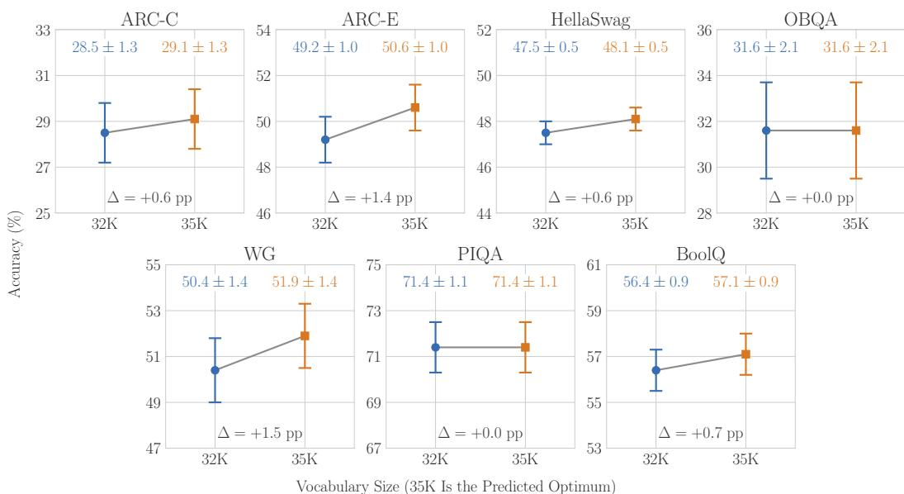  
Figure 9: Table 2 of Tao et al. (2024), With Its Reported Error Bars. Each panel is one benchmark, and each point is one trained model. The bars are the reported values, which are numerically consistent with the standard errors of the mean over test items.

Text. The released evaluation code scores the models with tasks of the lm-evaluation-harness (Gao et al., 2025), and we take every string from the same tasks. GSM8K has 1,319 test problems, each after the eight fixed chain-of-thought examples of its task. MBPP has 500 test problems, each after three fixed examples. HumanEval has 164 problems and no examples. BLiMP has 67,000 sentence pairs and no prompt. For each item, the scored text is the problem followed by its reference answer: the reference solution for GSM8K, the reference code for MBPP, the canonical solution for HumanEval, and the grammatical sentence of the pair for BLiMP, which has no problem. The few-shot examples condition the model and are not charged, because they are the same for every item. We write each GSM8K reference solution in the format of the task’s examples: the calculator annotations are removed, the steps are joined with one space, and the text ends with “The answer is n.” Each text follows the beginning-of-sequence token, as in training. BPB is the code length of the scored text, summed over the items of a benchmark, divided by its bytes.

Checks. One of the 102 models cannot be scored, because its tokenizer needs a loader that is not public. For each of the other 101 models we recompute BLiMP accuracy from our own loglikelihoods of the two sentences of each pair. It agrees with the released accuracy within 0.0013 for every model, so the models and tokenizers load as they did in the original evaluation.

Intervals. Every interval of Figure 5, of its discussion in Section 3, and of this appendix is a 95% percentile bootstrap interval over tokenizers. The unit is the tokenizer: the runs of one tokenizer are averaged first, so each tokenizer is one point however often it was trained. Each interval draws 10,000 resamples of the tokenizers with replacement, each tokenizer keeping its code length and score together. The Pearson and the Spearman correlation are computed on the same resamples, and the interval runs from the 2.5th to the 97.5th percentile. The resampling treats the tokenizers as independent, although many share their training data or their algorithm. It does not carry the uncertainty from the training runs or from the benchmark items: each tokenizer’s code length and score enter as fixed values. The band around each least-squares line is a percentile interval of the line refitted on 1,000 resamples of the same points.

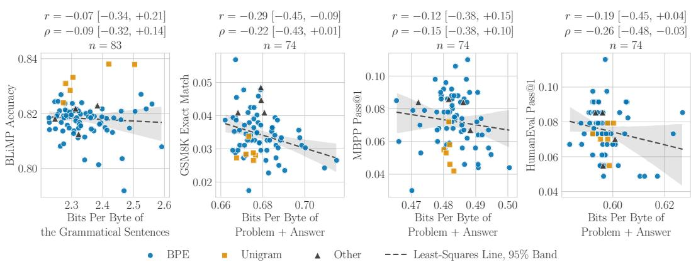  
Figure 10: Figure 5 Without the Outlier Tokenizer. Axes, markers, and statistics as in Figure 5, now over 83 scored tokenizers (74 for the three generated tasks), without whitespace-balanced-unigram. Without the outlier, every correlation stays weak.

Table 3: The Sign of a Correlation Between a Code Length and a Score Depends on the Text the Code Length Is Measured On. Spearman correlation across TokEval’s tokenizers between a released BPB and a released score, with 95% bootstrap intervals; n = 84 for BLiMP and 74 for the other three. A negative sign means that the shorter code goes with the higher score. The held-out mixture is TokEval’s own validation text; the code and multilingual texts are its released code and FLORES evaluations.
<table><tr><td>BPB measured on</td><td>BLiMP</td><td>GSM8K</td><td>MBPP</td><td>HumanEval</td></tr><tr><td>Held-out mixture</td><td>+0.11 [−0.13,+0.34]</td><td>-0.65 [-0.78,-0.47]</td><td>-0.16 [-0.39, +0.09]</td><td>-0.26 [−0.45, -0.05]</td></tr><tr><td>Code</td><td>+0.17 [−0.06, +0.38]</td><td>-0.59 [−0.74, -0.39]</td><td>-0.18 [−0.40, +0.06]</td><td>-0.31 [−0.48, -0.11]</td></tr><tr><td>Multilingual</td><td>+0.31 [+0.10, +0.48]</td><td>-0.14 [−0.37, +0.09]</td><td>+0.36 [+0.15, +0.54]</td><td>-0.04 [−0.26, +0.18]</td></tr></table>

One outlier tokenizer. Figure 5 and its discussion in Section 3 include every scored tokenizer; the red cross is whitespace-balanced-unigram, an outlier. It is a unigram tokenizer whose pre-tokenizer drops one space at the start of a text. Its held-out BPB in the released grid is the highest by a wide margin, 0.840 against 0.749 for the next tokenizer, and its scores are 0.030 on GSM8K, 0.040 on MBPP, and exactly zero on HumanEval. Figure 10 repeats Figure 5 without it: the Pearson correlations move by at most 0.093, and every correlation stays weak. The noise ceilings, Table 3, and the held-out comparisons below leave it out; Figure 6 and Appendix G keep it among their TokEval tokenizers.

Noise. The released scores are noisy. From 17 configurations that Meister (2026) ran twice (15 for GSM8K, MBPP, and HumanEval), the standard deviation of a score across tokenizers is 2.4 times its run-to-run standard deviation for BLiMP, 1.4 times for GSM8K, 1.2 times for MBPP, and 1.6 times for HumanEval. If the noise is independent and additive, a score that spreads k times its run-to-run standard deviation can correlate with no quantity more strongly than $\sqrt { 1 - k ^ { - 2 } } .$ . With the run-to-run noise of the code length as well, measured on the same 17 configurations, the ceilings are 0.90 for BLiMP, 0.66 for GSM8K, 0.51 for MBPP, and 0.77 for HumanEval. With the outlier tokenizer or without it, every Pearson correlation of Figure 5 is less than half its ceiling, so noise weakens these correlations but does not explain why they are weak.

Held-out text as an early signal. A reply to Figure 5, made by Limisiewicz (2026), is that BPB belongs not on the benchmark’s own text but on a held-out slice of the pretraining mixture, where it is “a good early signal of LM performance that allows meaningful comparison across tokenizers,” though “not a perfect predictor.” This reply compares a code length on one distribution with a score on another, and a correlation between the two, of either sign, is not evidence that the code length measures the score. TokEval’s held-out mixture is 37% English web text, 33% multilingual web text, 16% mathematics, and 14% code by bytes (Meister, 2026, Table 7); GSM8K is gradeschool math word problems. On these models the sign of such a correlation depends on which text is chosen (Table 3). BPB on the held-out mixture co-ranks with GSM8K, Spearman 0.65 $\left[ - 0 . 7 8 , - 0 . 4 7 \right] ( n = 7 4 )$ , while BPB on multilingual text co-ranks with BLiMP and MBPP in the wrong direction: the tokenizers with the longer multilingual code have the higher scores. Where the differences are small, between tokenizers whose GSM8K scores differ by less than one run-to-run standard deviation, the lower held-out BPB goes with the higher score in 61% of pairs, against 50% for a coin flip. The comparison of like with like, BPB on the GSM8K text against the GSM8K score, gives $\mathrm { \bar { o n l y } - 0 . 2 2 ~ [ - 0 . 4 3 , + 0 . 0 1 ] }$ over the same 74 tokenizers. Whatever the held-out BPB tracks on GSM8K, it is not how well the model codes GSM8K text. The comparisons of this paper therefore measure the code length and the score on the same strings.

## G THE FORMAT AND DECISION TERMS ON TRAINED MODELS

Models. TokSuite (Altıntas¸ et al., 2026) trained one network of about 1B non-embedding parameters with 14 tokenizers, from bytes to a 256K vocabulary, on 100B tokens each. We use 16 of its released models: the 14 main models, one per tokenizer, and two more seeds of the Llama 3.2 model, which with its main model give three runs that differ in the model seed only. TokEval (Appendix F) fixes the documents and their order; we use 33 of its std-1B runs over 24 tokenizers: the vocabulary sweep, the unigram tokenizers and the BPE tokenizers matched to them, the Llama 3 tokenizer, the tokenizers trained on English or code data, and the three at the extremes of held-out BPB; 9 configurations have a second seed. Each model is scored on four benchmarks, MMLU, ARC-Easy, HellaSwag, and GPQA, once on the option letter and once on the answer text, with the lm-evaluation-harness (Gao et al., 2025): one string per option, the beginning-of-sequence token in front as in training, and the model in float32. An option y after a prompt x is scored as in TokSuite’s own evaluation: the model reads the tokens of the whole string xy, and the option is charged for the tokens from position $| \mathrm { e n c } ( x ) |$ on. The harness’s own rule feeds $\operatorname { e n c } ( x )$ followed by those tokens, a sequence that the tokenizer never produces when enc(x) is not a prefix of $\operatorname { e n c } ( x y )$ . This happens only for two TokSuite tokenizers, TokenMonster and BLOOM; for every other tokenizer the two rules give the same numbers. Under either rule, the tokens charged to the option can then miss some of its bytes or include some of the prompt’s. Table 4 gives the slopes under both rules.

Terms. For an item with prompt x, scored strings $y _ { 1 } , \ldots , y _ { k }$ and correct index g, let $p ( y _ { c } \mid x )$ be the harness’s score of option c: the product of the model’s probabilities of the tokens charged to it. The format term $\mathrm { i s } - \mathrm { l o } \overline { { \mathrm { g } } } _ { 2 } \sum _ { c } p ( y _ { c } \mid x )$ and the decision term $\begin{array} { r } { \mathrm { i s } - \log _ { 2 } \left[ p ( y _ { g } \mid x ) / \sum _ { c } p ( \bar { y } _ { c } \mid x ) \right] } \end{array}$ Their sum is the code length of the correct string, checked per item. Here $\bar { F }$ is the event that the response is one of the k scored strings, so a correct paraphrase lies outside F. The rendering term of Equation (6) is zero under this definition of F, because an option is one string. The split is algebraic: it holds for the harness’s scores, which are not exact probabilities of the scored strings, because the harness appends no end symbol and scores one tokenization of each string. Per tokenizer and benchmark, each term is summed over the items and divided by the bytes of the correct strings; the runs of one tokenizer are averaged. Figure 6 gives the slope of the decision term D on the BPB B of the correct answers across tokenizers, $\mathrm { C o v } ( D , B ) / \mathrm { V a r } ( B )$ . The format term’s slope is one minus it, because B is the sum of the two terms. A slope is a least-squares coefficient, not a fraction of the differences: it falls below zero when the decision term moves against B, and above one when the format term does. The decision term’s fraction of the BPB itself, which Section 3 quotes for MMLU letters, is the mean decision term over the mean BPB.

Results. Figures 11 and 12 give the two terms and the accuracy of every tokenizer on the answer text of each benchmark. In TokEval, which fixes the documents, accuracy co-ranks across the 24 tokenizers with the decision term at $\rho = - 0 . 9 4 \left[ - 0 . 9 8 , - 0 . 8 3 \right]$ ] on HellaSwag and $- 0 . 8 9 \ [ - 0 . 9 7 , - 0 . 7 0 ]$ on ARC-Easy, and with the code length of the correct answer at 0.81

Table 4: The Decision Term’s Slope in All Sixteen Conditions, Under Both Scoring Rules. Slope: Cov(D, B)/ Var(B) across tokenizers, with its 95% bootstrap interval. Figure 6 draws all sixteen under TokSuite’s rule; the harness’s rule changes only TokSuite’s numbers.
<table><tr><td colspan="2"></td><td colspan="2">TokSuite&#x27;s Rule (Used)</td><td colspan="2">Harness&#x27;s Rule</td></tr><tr><td>Benchmark</td><td>Scored</td><td colspan="2">Slope [95% Interval]</td><td colspan="2">Slope [95% Interval]</td></tr><tr><td colspan="6">TokSuite, 14 tokenizers</td></tr><tr><td>MMLU</td><td>Letter</td><td></td><td>-0.01 [−0.11, +0.04]</td><td></td><td>+0.04 [−0.10, +0.04]</td></tr><tr><td>MMLU ARC-Easy</td><td>Text Letter</td><td>+0.04 +0.04</td><td>+0.33 [+0.25, +0.49] [+0.01,+0.08]</td><td>+0.04 +0.06</td><td>+0.19 [+0.15, +0.49] [+0.02, +0.07]</td></tr><tr><td>ARC-Easy HellaSwag</td><td>Text Letter</td><td>+0.18</td><td>[−0.12, +0.17] [+0.15, +0.23]</td><td>+0.08</td><td>[−0.08, +0.17] [+0.05, +0.23]</td></tr><tr><td>HellaSwag GPQA</td><td>Text Letter</td><td>+0.29 -0.07</td><td>[+0.18, +0.59] −0.26, +0.03</td><td>+0.26 -0.07</td><td>[+0.17, +0.37] [−0.26, +0.03]</td></tr><tr><td>GPQA</td><td>Text</td><td>+0.19</td><td>[+0.11, +0.25]</td><td>+0.17</td><td>[+0.11, +0.21]</td></tr><tr><td colspan="6"></td></tr><tr><td>TokEval, 24 tokenizers</td><td></td><td></td><td></td><td></td><td></td></tr><tr><td>MMLU</td><td>Letter</td><td></td><td>+0.05 [−0.04, +0.08]</td><td></td><td>Same</td></tr><tr><td>MMLU</td><td>Text</td><td>+0.08</td><td>[+0.01, +0.18]</td><td></td><td>Same</td></tr><tr><td>ARC-Easy</td><td>Letter</td><td>+0.07</td><td>[+0.00, +0.11]</td><td></td><td>Same</td></tr><tr><td>ARC-Easy</td><td>Text</td><td>+0.03</td><td>[−0.01, +0.07]</td><td></td><td>Same</td></tr><tr><td>HellaSwag</td><td>Letter</td><td>+0.15</td><td>[+0.04, +0.27]</td><td></td><td>Same</td></tr><tr><td>HellaSwag</td><td>Text</td><td>+0.46</td><td>[+0.38, +0.57]</td><td></td><td>Same</td></tr><tr><td>GPQA</td><td>Letter</td><td>+0.03</td><td>[−0.02, +0.08]</td><td></td><td>Same</td></tr><tr><td></td><td></td><td></td><td></td><td></td><td></td></tr><tr><td>GPQA</td><td>Text</td><td></td><td>+0.25 [+0.15, +0.39]</td><td></td><td>Same</td></tr></table>

[ 0.89, 0.61] and 0.37 [ 0.65, 0.00]. On MMLU, the two are alike: $- 0 . 4 3 \ [ - 0 . 7 4 , + 0 . 0 1 ]$ for the decision term and 0.47 [ 0.78, 0.05] for the code length.

Why HellaSwag differs. Only on HellaSwag answer text does the interval of the decision term’s slope reach above one half (Table 4). HellaSwag’s correct endings were written by people, and its wrong endings are samples from a GPT language model, filtered so that a BERT model found them hard to tell from the real ones (Zellers et al., 2019). The models are pretrained on mostly humanwritten text. A pair that codes such text in fewer bits per byte codes the human-written correct ending in fewer bits but gains less on the machine-written wrong endings, so the decision term falls with the BPB. Most of the slope remains without the passage: scored after the beginning-of-sequence token alone, the decision term keeps 95% [65%, 144%] of its slope across TokEval’s tokenizers. Without the passage, the models pick the correct ending 31% of the time, against 25% by chance and 36% with the passage.

## H RANDOMLY INITIALIZED MODELS ARE APPROXIMATELY UNIFORM UNDER MODERN PARAMETERIZATIONS

The untrained models of this paper give every token of their vocabulary the same probability, $p ^ { \mathrm { u n i f } } ( t ) = 1 / V _ { \tau }$ . Under $\mu \mathrm { P }$ and its successors, the parameterizations used to transfer hyperparameters from small models to large ones, a randomly initialized model is close to $p ^ { \mathrm { u n i f } }$ , and it comes closer as its width grows.

The logit scale sets the distance from uniform. At a fixed context, a model of width w with vocabulary size $V = V _ { \tau }$ has logits $z = \alpha W h$ , where $h \in \mathbb { R } ^ { w }$ is the output of the final normalization layer, $\boldsymbol { W } \doteq \mathbb { R } ^ { V \times w }$ is the readout, and α is an output multiplier. After RMSNorm with unit gain, $\| \dot { h } \| ^ { 2 } = w$ . If the entries of $W$ are drawn independently with mean zero and variance $\sigma ^ { 2 } .$ , and $W$ is not tied to the input embedding, the logits of different tokens are independent given $h ,$ each with mean zero and variance

$$
s ^ { 2 } \ = \ \alpha ^ { 2 } \sigma ^ { 2 } w .\tag{13}
$$

For Gaussian logits, the law of large numbers over the V tokens gives $\begin{array} { r } { \frac { 1 } { V } \sum _ { u = 1 } ^ { V } e ^ { z _ { u } } \approx \mathbb { E } \big [ e ^ { z } \big ] \ = \ } \end{array}$ $e ^ { s ^ { 2 } / 2 }$ , so the softmax gives token v the probability

$$
p ( v ) = \frac { e ^ { z _ { v } } } { \sum _ { u = 1 } ^ { V } e ^ { z _ { u } } } \approx \frac { 1 } { V } e ^ { z _ { v } - s ^ { 2 } / 2 } .\tag{14}
$$

Each token gets the uniform probability $1 / V$ times a random factor whose mean is one. The text being scored does not depend on the draw of $W$ , so the expected code length of each of its tokens is

$$
\mathbb { E } \big [ - \log p ( t ) \big ] \ \approx \ \log V + \frac { s ^ { 2 } } { 2 } .\tag{15}
$$

The extra $s ^ { 2 } / 2$ nats per token is the expected Kullback–Leibler divergence $D _ { \mathrm { K L } } ( p ^ { \mathrm { u n i f } } \parallel p )$ , and it is zero exactly when $s ^ { \widehat { 2 } } = 0$ . A simulation of Gaussian logits at $V = \widetilde { 2 } ^ { 1 5 }$ matches $s ^ { 2 } / 2 .$ , for the extra code length and for the reverse divergence $D _ { \mathrm { K L } } ( p \Vert p ^ { \mathrm { u n i f } } )$ , to within 0.2% at five positive values of $s ^ { 2 }$ up to 2.

$\mu \mathbf { P }$ and its successors shrink the logit scale with width. $\mu \mathrm { P }$ sets the scale of every layer so that each layer learns features at a rate that does not depend on the width, which lets hyperparameters tuned on a small model transfer to a large one (Yang & Hu, 2021; Yang et al., 2021). Its readout makes the logits at initialization vanish as the width grows: with $s _ { 0 } ^ { 2 }$ the logit variance at the base width $w _ { 0 }$ where the hyperparameters are tuned,

$$
s ^ { 2 } ( w ) = s _ { 0 } ^ { 2 } \frac { w _ { 0 } } { w } .\tag{16}
$$

Yang et al. (2021) also report better transfer when the readout is initialized at zero; then $s ^ { 2 } = 0$ and the model is exactly uniform at initialization. u-µP (Blake et al., 2025) draws every weight with unit variance, multiplies the readout by $1 / w _ { ; }$ , and scales the logits by a tuned $\alpha _ { \mathrm { l o s s } }$ before the softmax, so $s ^ { 2 } = \alpha _ { \mathrm { l o s s } } ^ { 2 } / \dot { w }$ . Depth-µP scales each residual branch by one over the square root of the depth (Yang et al., $2 0 2 4 ;$ Bordelon et al., 2024), and CompleteP by one over the depth (Dey et al., 2025); both keep the readout of $\mu \mathrm { P } .$ In a pre-norm transformer, neither changes $s ^ { 2 }$ , because the final normalization fixes $\| h \| ^ { 2 } = w$ at every depth.

Example. A readout tuned with $s _ { 0 } ^ { 2 } = 0 . 1$ at $w _ { 0 } = 2 5 6$ has $s ^ { 2 } = 0 . 0 0 6 3$ at width 4,096. Its expected code length exceeds that of $p ^ { \mathrm { u n i f } }$ by 0.0031 nats, or 0.0045 bits, per token, against 15 bits per token for $p ^ { \mathrm { u n i f } }$ at $V = 2 ^ { 1 5 }$

The head start remains for every $s ^ { 2 }$ . The logit variance of Equation (13) does not depend on the tokenizer, so by Equation (15) a randomly initialized model scores

$$
\mathrm { B P B } \approx \frac { N _ { \tau } } { B } \left( \log V _ { \tau } + \frac { s ^ { 2 } } { 2 } \right) ,\tag{17}
$$

in the nats per byte of Section 2: tokens per byte times a cost per token that still grows with log $V _ { \tau }$ The comparison across tokenizers of Section 2 therefore keeps a head start for every $s ^ { 2 }$ , and $p ^ { \mathrm { u { \bar { n i f } } } }$ is the case $s ^ { 2 } = 0$

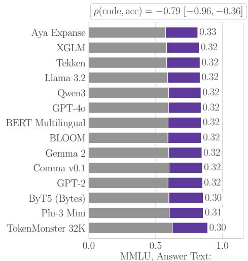  
Bits Per Byte of the Correct Answer

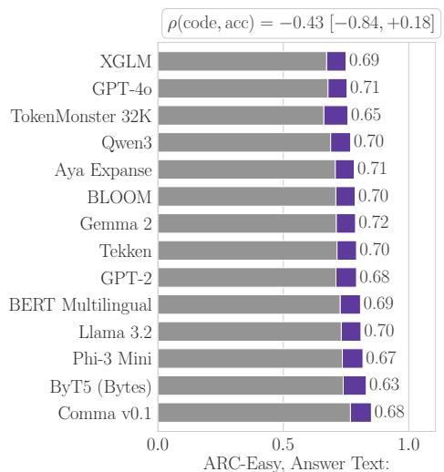  
Bits Per Byte of the Correct Answer

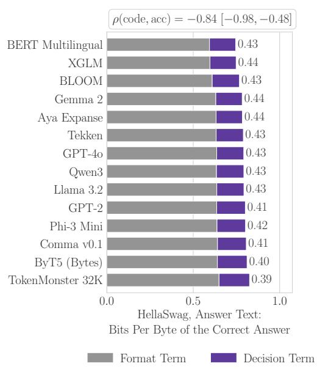

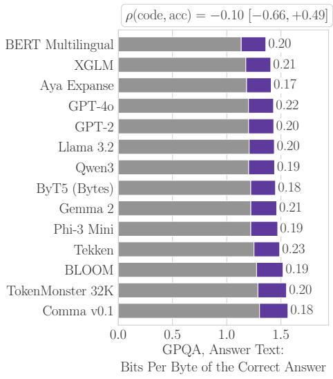  
Figure 11: TokSuite: The Format and Decision Terms of Every Tokenizer. One bar per tokenizer on the answer text of each benchmark, sorted by the code length of the correct answer: the format term, then the decision term, with the accuracy at the end of the bar. The box gives the Spearman correlation of the code length with accuracy across tokenizers and its 95% bootstrap interval.

Number at the Bar: Accuracy

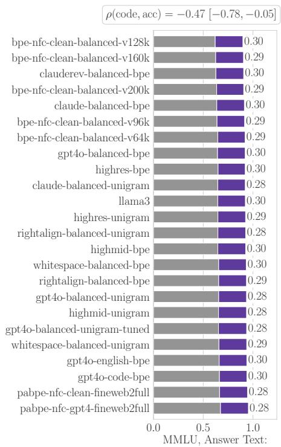  
Bits Per Byte of the Correct Answer

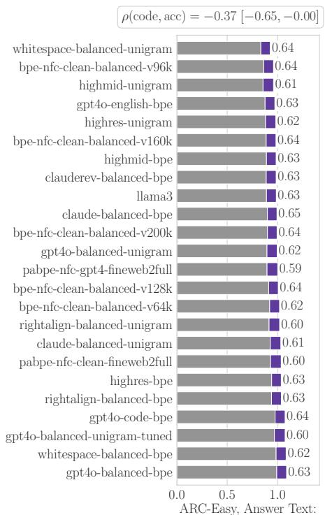  
Bits Per Byte of the Correct Answer

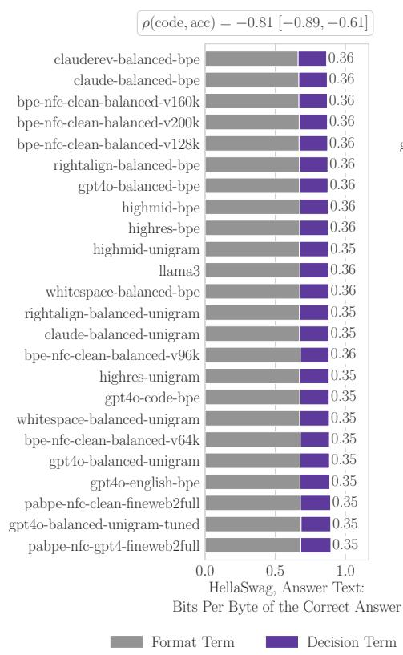

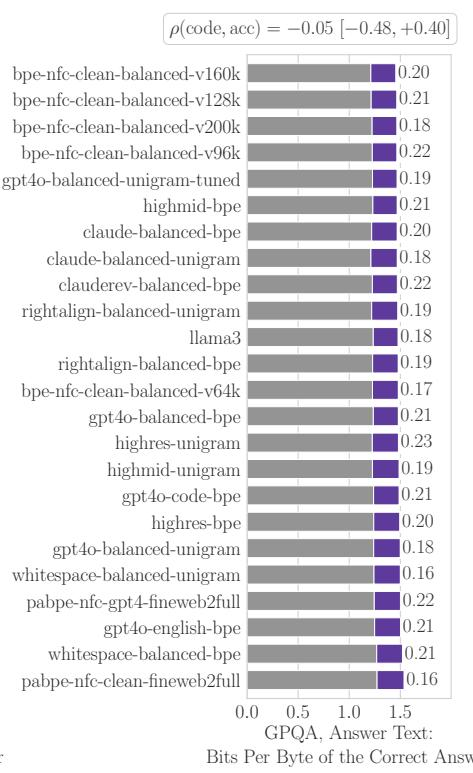  
Figure 12: TokEval: The Format and Decision Terms of Every Tokenizer. As Figure 11, for the 24 TokEval tokenizers, which saw the same documents in the same order; runs of one tokenizer are averaged.