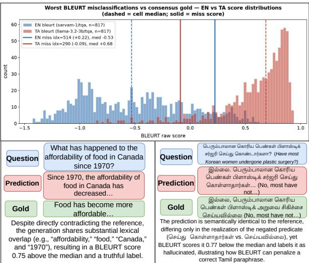
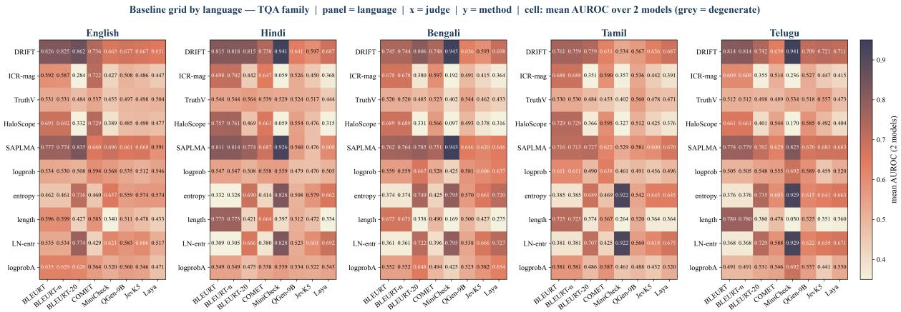
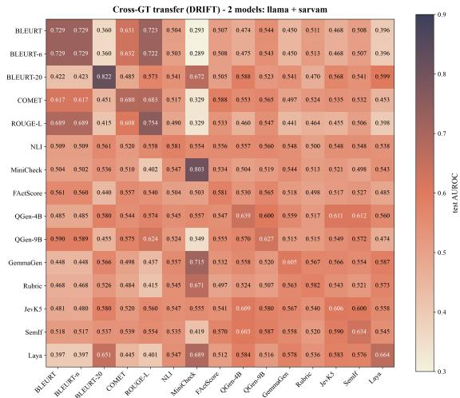
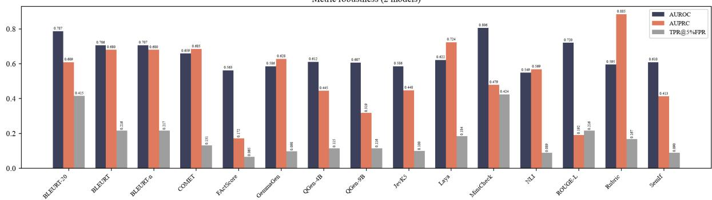
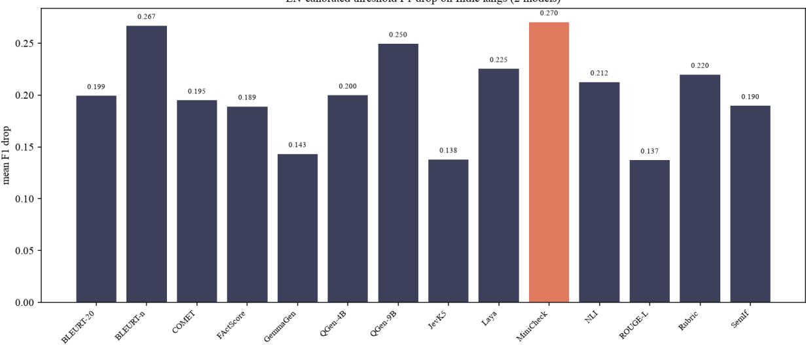
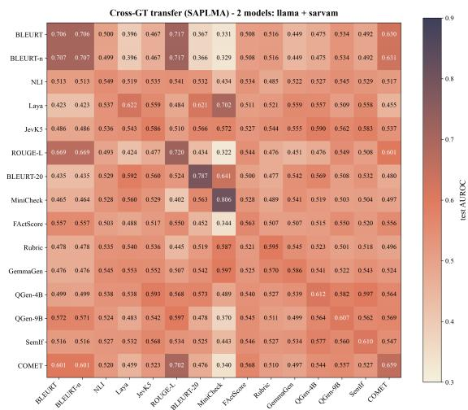
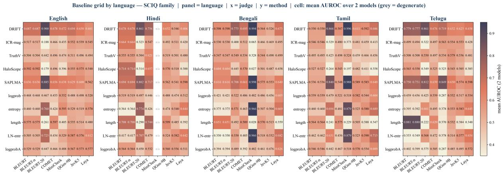

# When Ground Truth Is Not Ground Truth: Automatic Labeling for Hallucination Detection

Rounak Sen

Divya Kumari

Deeksha Varshney

## Abstract

Hallucinations in Large Language Models (LLMs) remain a major challenge, as they can produce misleading, factually incorrect, or unverifiable information, thereby undermining their trustworthiness and reliability. However, reliable ground-truth labels remain a key challenge in evaluating hallucination detectors. Recent studies often construct labels automatically by comparing model generations with reference answers using similarity metrics such as BLEURT. This implicitly treats BLEURT similarity as a proxy for hallucination, despite its English-centric supervision, unbounded score range, and design as a similarity metric rather than a factuality measure, making threshold-based ground-truth construction potentially unreliable. Through comprehensive experiments using 15 automatic supervision judges, seven hallucination detection baselines, two generator models, two QA datasets, and five languages, we demonstrate that detector performance varies substantially with the choice of supervision judge. Human validation reveals substantial diferences in labeling reliability, with QGen-9B achieving the lowest overall misclassification rate (12.86%), while BLEURT and BLEURT-n exhibit rates of 47.23% and 47.32%, respectively. Our findings highlight the limitations of automatic similarity-based labeling and the need for more reliable judging methods that better capture semantic and factual correctness.

## 1 Introduction

Hallucinations are a persistent limitation of large language models (LLMs), where fluent generations may contain misleading, unsupported, or fac-ர tually incorrect content (Ji et al., 2022; Kaddour et al., 2023; Xu et al., 2025; Zhang et al., 2025b; Alansari and Luqman, 2026). As LLMs are increasingly deployed in applications where reliability is important, detecting such generations has be-ல come an active area of research (Varshney et al.,

  
Figure 1: Two complementary misclassification cases: high similarity labels a contradictory English response as truthful, while low similarity labels a semantically correct Tamil paraphrase as hallucinated.

2023; Dhuliawala et al., 2024; Chuang et al., 2024; Shi et al., 2024). With the rapid development and adoption of multilingual and culturally diverse LLMs, hallucination detection has also expanded beyond English, raising additional challenges in reliably identifying hallucinations across languages (Alansari et al., 2026; Alvi et al., 2026).

The use of automatic labeling strategies has become increasingly common in hallucination benchmarks and detector evaluations (Janiak et al., 2025; Du et al., 2024; Zhang et al., 2026; Turpin et al., 2023; Bhatnagar et al., 2026; Zhang et al., 2025c; Burns et al., 2024). A common strategy is to compare a generated response with a reference using an automatic similarity metric and convert the resulting score into a binary label. Although attractive ை பெரும்பாலா கொரிfor its scalability, this procedure introduces an im-டி  துportant assumption that is rarely examined: does similarity to a reference provide a reliable indica-ை பெரும்பாலா கொரிtion ofwhether a generation is hallucinated ?

Recent independent evidence strengthens this concern. Janiak et al. (2025) show that replacing lexical evaluation with an LLM-based judge can substantially change the reported performance of established hallucination detectors, with drops of up to 45.9% for some methods. Chen et al. (2026) explicitly identify label noise as a major challenge in hallucination-detection benchmarks and show that noisy labels can hinder detector performance. HaloScope (Du et al., 2024), provides an implementation that uses BLEURT or ROUGE to determine whether generated answers are truthful, with a threshold controlling the resulting labels. Similarly, TSV (Park et al., 2025) evaluates a generation as truthful when its similarity to the reference exceeds a predefined BLEURT threshold. Once this procedure is adopted, the similarity metric is no longer merely an auxiliary evaluation measure: its errors become ground-truth errors. A detector evaluated against such labels can therefore appear efective while learning to separate BLEURTdefined categories rather than hallucinated from non-hallucinated generations.

As illustrated in Figure 1, BLEURT exhibits substantially diferent score distributions across languages, making a universal threshold dificult to justify. More importantly, the figure highlights two contrasting failure cases. The English response by Sarvam-1 (index 514) receives a BLEURT score of +0.22, substantially above the language-specific median of −0.53, and is therefore labeled as truthful by BLEURT. However, the generated response directly contradicts the reference: it states that food afordability in Canada has decreased since 1970, whereas the reference states that food has become more afordable. The high score is largely driven by lexical overlap between the generation and reference, including ”afordability,” ”food,” ”Canada,” and ”1970.” In contrast, the Tamil response by Llama-3.2-3B (index 290) receives a BLEURT score of −0.09, substantially below the language-specific median of +0.68, and is consequently labeled as hallucinated. However, human evaluation unanimously identifies the response as correct, with the generation and reference expressing the same meaning and difering only in linguistic realization. These examples expose two opposing failure modes: BLEURT can assign high similarity to a contradictory generation while assigning low similarity to a semantically correct multilingual paraphrase. Thus, threshold ing BLEURT can transform diferences in lexical overlap and language-specific realization into incorrect ground-truth labels.

To establish a fair comparison, we evaluate multiple generator models, supervision judges, datasets, languages, and detector families under consistent data splits.

Specifically, we make two contributions:

1. We systematically evaluate 15 automatic supervision judges and seven hallucination detectors across two QA datasets and five languages, demonstrating how the choice of supervision labels influences measured detection performance.

2. We validate automatic labels against human annotations and identify systematic failure modes across supervision methods, highlighting the limitations of similarity-based labeling and the need for independently validated, semantically grounded supervision.

## 2 Related Work

Hallucinations remain a persistent limitation of large language models (LLMs), which can generate fluent and coherent responses that are factually inaccurate, unsupported by evidence, or inconsistent with the input context (Zhang et al., 2025b; Alansari and Luqman, 2026). Hallucination detection methods can broadly be categorized into supervised and unsupervised approaches. Supervised methods train classifiers on labeled examples of truthful and hallucinated generations, often leveraging the internal representations of LLMs (Azaria and Mitchell, 2023; Orgad et al., 2025; Arteaga et al., 2024). These methods range from probing model activations, as in SAPLMA (Azaria and Mitchell, 2023), to analyzing inter-layer transitions, as in DRIFT (Bhatnagar et al., 2026).

In contrast, unsupervised methods detect potential hallucinations without requiring labeled training examples, relying instead on signals such as token-level uncertainty derived from model probabilities (Ren et al., 2023; Kuhn et al., 2023), semantic disagreement across multiple generations (Malinin and Gales, 2021; Farquhar et al., 2024), and patterns in internal representations (Chen et al., 2024; Sriramanan et al., 2024). Representative approaches include sampling-based consistency checks, such as SelfCheckGPT (Manakul et al., 2023), which requires multiple generations per query; representation-based methods, including subspace analysis in INSIDE (Chen et al., 2024) and hidden-state attribution in HaloScope (Du et al., 2024); and methods that examine specific architectural components, such as ICR-Probe’s comparison of multi-head self-attention and feedforward network contributions (Zhang et al., 2025c) and prompt-embedding probes (Mrykhin and Malykh, 2026). Steering-based approaches, notably Truthful Subspace Valuation (TSV) (Park et al., 2025), further exploit internal activation directions to assess generation reliability and provide a foundation for our detector family. However, constructing ground-truth labels at scale remains challenging, motivating the use of automatic labeling strategies that compare generated responses with reference answers using similarity metrics.

Recent work has extended hallucination detection to multilingual settings. CrossHallu examine Arabic-English transfer and report that performance depends on class separability and language alignment (Alansari et al., 2026), while MultiHaluDet probes hidden-state signals across French, Bengali, and Amharic (Alvi et al., 2026). Islam et al. (Ul Islam et al., 2025) investigate multilingual hallucination estimation across 30 languages by transferring a detector trained on English data, while Rykov et al. (Rykov et al., 2025) introduce PsiloQA, a multilingual dataset for spanlevel hallucination detection across 14 languages. Other resources include Poly-FEVER (Zhang et al., 2025a), a multilingual fact-verification benchmark, and BHRAM-IL (Terdalkar et al., 2025), which evaluates hallucination recognition across several Indian languages. However, these rely on translation or transfer from English, potentially limiting their ability to capture language-specific expressions and cultural contexts.

The Illusion of Progress (Janiak et al., 2025), which re-audits QA hallucination detection and reports limited agreement between ROUGE-based reference-overlap labels and human annotations. Although (Janiak et al., 2025) showed limitations, recent hallucination-detection pipelines still employ learned similarity metrics such as BLEURT to automatically assign truthfulness labels (Du et al., 2024; Park et al., 2025). Hence, we analyze BLEURT-based labeling across languages and generator models.

## 3 Experimental Setup

To investigate how automatic supervision influences hallucination detection, we construct alternative training label sets using fifteen automatic supervision judges. For each judge, we apply its labeling procedure to the training set, producing a corresponding set of labels for the generated responses. We then use these judge-specific labels to train and evaluate seven baseline hallucination detection methods. The experiments consider two base generator models, five languages, and two QA datasets.

Datasets and languages. We evaluate on TruthfulQA (Lin et al., 2022) and SciQ (Welbl et al., 2017), in English, Hindi, Bengali, Tamil, and Telugu. The train and test sets contain 612, 205 and 750, 250 QA pairs, respectively. More details and translation-quality metrics are in Appendix B.

Generator Models We evaluate two openweight LLMs: Llama-3.2-3B (Grattafiori et al., 2024) and Sarvam-1 (Sarvam AI, 2024), 3B model.

Supervision judges. We examine fifteen automated labeling methods spanning five technical mechanisms. Learned similarity methods include BLEURT (Sellam et al., 2020), BLEURTn, and BLEURT-20 (Pu et al., 2021). Surfaceoverlap methods include COMET (Rei et al., 2020), ROUGE-L (Lin, 2004), with these methods excluded from benchmark rankings due to saturation. Textual entailment methods comprise NLI (He et al., 2021), MiniCheck (Tang et al., 2024), and FActScore (Min et al., 2023). Generative verdict methods include QGen-4B (Team, 2026), QGen-9B (Team, 2026), GemmaGen (Team et al., 2025), and Rubric (Team et al., 2025). Finally, decisionagent methods comprise Laya (ConvAI Innovations, 2024), JevK5 (alibiserikbay, 2024), and SemIf (OpenJev, 2024). All methods evaluate candidate responses against the gold reference set using max-over-references aggregation, defined as max Score(c, r) (except NLI, which averages the entailment margin over R, and FActScore, defined at atomic fact level). More details in Appendix A.

Baseline Hallucination Detection methods. We evaluate seven hallucination detectors spanning four methodological families. Supervised hidden-state probes include DRIFT (Bhatnagar et al., 2026), which tracks inter-layer representation transitions, and SAPLMA (Azaria and Mitchell, 2023), which uses final-token activations. Unsupervised activation-based methods include HaloScope-subspace1 (Du et al., 2024) and ICR-magnitude2 (Zhang et al., 2025c). Output-based uncertainty baselines comprise Length-Normalized Predictive Entropy (Farquhar et al., 2024) and Answer Log-Probability (Kuhn et al., 2023). Finally, Answer Length Control provides a non-parametric baseline based on response length (Janiak et al., 2025).

Table 1: Comprehensive detector benchmark across all fifteen supervision judges. Test AUROC averaged across 2 generator models, 5 languages, and 2 QA datasets from the full benchmark grid. Best score across judges for each detector (row-wise) is bold.
<table><tr><td rowspan="2">Baseline Method</td><td colspan="3">Learned Similarity</td><td colspan="2">Surface Overlap</td><td colspan="3">|Textual Entailment</td><td colspan="3">Generative Verdicts</td><td rowspan="2" colspan="3">Decision Agents</td></tr><tr><td>BLEURT</td><td>BLEURT -n</td><td>BLEURT -20</td><td>COMET</td><td>ROUGE -L</td><td>Mini NLI Check</td><td>FAct Score</td><td>QGen QGen -4B</td><td>-9B</td><td>Gemma Gen</td><td>Rubric</td><td>JevK5 SemIf Laya</td></tr><tr><td>DRIFT</td><td>0.725</td><td>0.725</td><td>0.823</td><td>0.688</td><td>0.737</td><td>0.580</td><td>0.795</td><td>0.581</td><td>0.640</td><td>0.636</td><td>0.612</td><td>0.577</td><td>0.615</td><td>0.640 0.666</td></tr><tr><td>SAPLMA</td><td>0.708</td><td>0.708</td><td>0.787</td><td>0.657</td><td>0.696</td><td>0.551</td><td>0.793</td><td>0.563</td><td>0.613</td><td>0.612</td><td>0.584</td><td>0.574</td><td>0.591</td><td>0.611 0.623</td></tr><tr><td>ICR-magnitude</td><td>0.602</td><td>0.601</td><td>0.337</td><td>0.557</td><td>0.506</td><td>0.483</td><td>0.325</td><td>0.533</td><td>0.453</td><td>0.513</td><td>0.453</td><td>0.491</td><td>0.477</td><td>0.498 0.429</td></tr><tr><td>HaloScope-subspace Length-Ñormalized</td><td>0.653</td><td>0.653</td><td>0.345</td><td>0.589</td><td>0.551</td><td>0.473</td><td>0.252</td><td>0.530</td><td>0.468</td><td>0.528</td><td>0.442</td><td>0.479</td><td>0.476 0.511</td><td>0.402</td></tr><tr><td>Predictive Entropy</td><td>0.404</td><td>0.403</td><td>0.678</td><td>0.446</td><td>0.425</td><td>0.5510.727</td><td></td><td>0.534</td><td>0.619</td><td>0.549</td><td>0.623</td><td>0.531</td><td>0.601 0.599</td><td>0.659</td></tr><tr><td>Answer Log- Probability Answer Length</td><td>0.524</td><td>0.523</td><td>0.496</td><td>0.509</td><td>0.446</td><td>0.5280.495</td><td></td><td>0.532</td><td>0.525</td><td>0.531</td><td>0.556</td><td>0.536 0.518</td><td></td><td>0.524 0.559</td></tr><tr><td>Control</td><td>0.693</td><td>0.693</td><td>0.345</td><td>0.591</td><td>0.701</td><td></td><td>0.4740.270</td><td>0.505</td><td>0.4640.531</td><td></td><td>0.426</td><td>0.503</td><td>0.438 0.519</td><td>0.369</td></tr></table>

Evaluation Methods We use AUROC (Bradley, 1997) as the primary measure of hallucination performance.

Implementation Details We evaluated against single-sample representatives of hallucination detection methods, as multi-sample approaches incur substantial inference overhead and are not budgetcomparable to a single forward pass. We adopt median splits for unbounded metrics (BLEURT) and standard 0.5 cutofs for bounded metrics to mirror standard benchmark practices (Du et al., 2024; Park et al., 2025). We note that median splitting imposes a balanced prior, conflating ranking discrimination with prevalence calibration; see Appendix C for threshold stability analyses. All model generation, judge scoring and linear detector probe training were executed on a server equipped with 2× NVIDIA RTX 6000 Ada GPUs (48GB VRAM each, 96GB aggregate), an AMD EPYC 9124 16-Core Processor, and 256GB RAM. An anonymized repository containing our complete codebase, prompt templates, and evaluation pipeline is available on github3. Detailed implementation and hyperparameter configurations are provided in Appendix C.

## 4 Results and Analysis

## 4.1 Preliminary Analysis

We first examine how the choice of supervision judge afects the measured performance of the seven baseline hallucination detectors. We report detector performance averaged across the five languages, two QA datasets, and two generator models to obtain an aggregate view of the benchmark. Table 1 presents the resulting AUROC scores for seven baseline hallucination detection methods under fifteen supervision judges.

Across the learned-similarity judges, DRIFT achieves AUROCs of 0.725 under both BLEURT and BLEURT-n, and 0.823 under BLEURT-20. SAPLMA follows a similar pattern, with AUROCs of 0.708, 0.708, and 0.787, respectively. Under surface-overlap judges, DRIFT achieves 0.688 with COMET and 0.737 with ROUGE-L, while the Answer Length Control baseline reaches 0.591 and 0.701, respectively. Performance varies under textual-entailment judges. DRIFT achieves an AUROC of 0.795 with MiniCheck, compared with 0.580 with NLI and 0.581 with FActScore. SAPLMA exhibits a similar advantage under MiniCheck (0.793), whereas ICR-magnitude and HaloScope-subspace perform substantially worse under this judge, with AUROCs of 0.325 and 0.252, respectively.

Under generative-verdict judges, DRIFT achieves AUROCs of 0.640 and 0.636 with QGen-4B and QGen-9B, respectively, and 0.612 with GemmaGen. Length-Normalized Predictive Entropy achieves 0.619 under QGen-4B and 0.623 under GemmaGen, exceeding DRIFT in the latter case. Under Rubric, DRIFT reaches 0.577, while

  
Figure 2: Language-wise AUROC on TruthfulQA for eight supervision judges, averaged across two generator models. Panels correspond to English, Hindi, Bengali, Tamil, and Telugu. The results illustrate language-dependen variation in detector performance across supervision judges.

SAPLMA achieves 0.574. Finally, among the decision-agent judges, DRIFT obtains AUROCs of 0.615 with JevK5, 0.640 with SemIf, and 0.666 with Laya. SAPLMA achieves corresponding scores of 0.591, 0.611, and 0.623.

Figure 2 presents baseline AUROC across five languages on TruthfulQA, averaged over the two generator models, for eight supervision judges. The results reveal substantial language-wise variation, indicating that no judge consistently achieves the highest discrimination across all languages. Although BLEURT-20 is designed for multilingual evaluation, its performance is not uniformly superior. For DRIFT, BLEURT-20 achieves the highest AUROC among the displayed judges in English (0.862) and Hindi (0.815), whereas MiniCheck yields substantially higher scores in Bengali (0.943) and Telugu (0.941). In Tamil, BLEURT and BLEURT-n achieve comparable AU-ROCs of 0.761 and 0.759, respectively, while MiniCheck reaches only 0.534. This contrast suggests that multilingual design alone does not ensure consistent discrimination across languages. Similar variation is observed for the generative judges. Although the QGen judges are based on Qwen models, their performance varies across languages and detector families rather than consistently outperforming the other judges. For example, under DRIFT, QGen-4B achieves AUROCs of 0.641 in Hindi, 0.636 in Bengali, and 0.567 in Tamil, while MiniCheck reaches 0.941, 0.943, and 0.534 in these languages, respectively. The contrast is particularly pronounced in Hindi and Bengali, where MiniCheck provides substantially stronger discrimination than QGen-4B. Results on

SciQ are provided in Appendix F.

These aggregate and language-wise variations raise a central question: do similarity-based judges provide reliable supervision for hallucination detection, or do they favor detectors that reproduce their own biases ? Section 4.2 computes crossground-truth transferability across 15 judges. We also complement the quantitative results with qualitative examples to examine cases where similaritybased labels conflict with semantic correctness, further investigating this question in Section 4.3.

## 4.2 Cross-Ground-Truth Transferability

Our preceding experiments show that measured detector performance varies with the choice of supervision judge. To investigate whether diferent judges provide consistent supervision signals, we extend the baseline evaluation with a crossground-truth transfer experiment, using DRIFT and SAPLMA as a representative supervised detector. We train them separately using the binary labels produced by each of the fifteen judges and evaluate each trained probe against the labels of every judge on the same held-out test examples. For each ordered pair of training and evaluation judges $( j _ { a } , j _ { b } )$ , the probe is trained on the training split labeled by $j _ { a } ,$ its weights are frozen, and its predictions are evaluated against the test labels from $j _ { b }$ using AUROC. Representations, data splits, and detector architecture remain fixed across comparisons, allowing us to examine how changing the supervision source afects measured performance. The resulting 15 × 15 matrix is shown in Figure 3. Results for SAPLMA is shown in Appendix E.

Figure 3 reveals a substantial diference between in-judge performance and cross-judge transfer. The diagonal entries achieve a mean AUROC of 0.669, whereas the of-diagonal entries average 0.530, close to chance (0.500). Defining the transfer gap as $\Delta ( j _ { a } , j _ { b } ) = A ( j _ { a } , j _ { a } ) - A ( j _ { a } , j _ { b } )$ where $A ( j _ { a } , j _ { b } )$ denotes the AUROC of a probe trained on judge $j _ { a }$ and evaluated against judge $j _ { b } ,$ the diference between the mean diagonal and of-diagonal scores is 0.139. For example, DRIFT trained using BLEURT labels achieves an AUROC of 0.729 when evaluated against BLEURT labels, but only 0.360 against BLEURT-20 labels. Conversely, training and evaluating with BLEURT-20 yields an AUROC of 0.822. These diferences indicate that detector performance is sensitive to the supervision and evaluation criteria, rather than being directly comparable across judges.

  
Figure 3: Cross-ground-truth transferability of DRIFT. Rows denote training judges and columns denote evaluation judges. Each cell reports test AUROC against the corresponding evaluation judge’s labels. Diagonal cells represent evaluation against the training judge; of-diagonal cells measure cross-judge transfer.

These results do not establish which judge provides the most reliable ground truth: poor transfer could arise from errors in either labeling mechanism, diferences in the properties captured by each judge, or both. Instead, they demonstrate that detector performance is strongly contingent on the evaluation labels. This motivates our subsequent analysis of whether similarity-based judges produce labels that agree with independent assessments of semantic and factual correctness.

## 4.3 Qualitative Analysis

We conduct a qualitative validation of all fifteen supervision judges using human annotations of the generated responses on the test sets of TruthfulQA and SciQ across five languages. Three postgraduate annotators proficient in the respective languages independently assess response correctness (More details in Appendix B.3), and the resulting human gold labels are used to compute each judge’s misclassification rate (Table 2). We further examine representative examples and judgespecific failure patterns to understand why automatically assigned labels disagree with human judgments.

## 4.3.1 Judge-by-Judge Qualitative Failure Analysis

To determine judge-specific failure patterns, we analyze the misclassification rates against human gold labels reported in Table 2.

QGen-9B and QGen-4B achieve the lowest misclassification rates (12.86% and 17.89%, respectively) by extracting normalized final-layer logits for ”True” and ”False” tokens in a single forward pass, avoiding autoregressive decoding variability. However, residual errors persist on borderline probability ties and misconceptions whose representations mirror truthful responses. JevK5 (21.71%) and SemIf (23.58%), which adapt Qwen3.5-4B via a learned classification head and multiple-choice prompting respectively, exhibit complementary errors: JevK5 tends toward false positives on subtle falsehoods, while SemIf incurs false negatives on multi-claim responses.

MiniCheck (24.46%) exhibits extreme conservative bias on non-English splits (predicting nearzero positives), causing pervasive false negatives across both benchmarks. We note that low misclassification rates in skewed class splits can partly reflect majority-class prediction heuristics rather than discriminative precision. FActScore (Ref-Adapted, 26.33%) and NLI (36.48%) struggle on short scientific answers in SciQ: because our adaptation assesses candidate coverage of reference propositions, concise technical answers that omit peripheral context receive false negatives, whereas NLI frequently mislabels topical overlap as entailment, yielding extensive false positives.

ROUGE-L (28.15%) relies on lexical longest common subsequences, heavily penalizing valid paraphrases and syntactic divergence with widespread false negatives. Conversely, Gemma-Gen (34.53%) is susceptible to surface fluency, labeling well-formulated but factually false responses as truthful and inflating false positives.

Table 2: Human gold-standard misclassification rates (%) across fifteen supervision judges. Evaluated on held-out test splits across TruthfulQA (2, 050 responses) and SciQ (2, 500 responses) in five languages. Lower is better. Judges are grouped and sorted in ascending order of overall misclassification rate.
<table><tr><td rowspan="2">Judge</td><td colspan="6"></td><td colspan="6"> $\mathbf { s c i Q }$ </td><td rowspan="2">Overall Avg</td></tr><tr><td>EN</td><td>HI</td><td>BN</td><td>TruthfulQA TA</td><td>TE</td><td> $\mathbf { A v } \mathbf { g }$ </td><td>EN</td><td>HI</td><td>BN</td><td>TA</td><td>TE</td><td> $\mathbf { A v \mathbf { g } }$ </td></tr><tr><td>QGen-9B</td><td>9.02</td><td>13.17</td><td>13.41</td><td>18.54</td><td>17.56</td><td>14.34</td><td>11.00</td><td>13.40</td><td>9.80</td><td>11.20</td><td>12.80</td><td>11.64</td><td>12.86</td></tr><tr><td>QGen-4B</td><td>11.46</td><td>20.00</td><td>18.78</td><td>27.56</td><td>25.85</td><td>20.73</td><td>10.60</td><td>17.80</td><td>11.00</td><td>21.00</td><td>17.40</td><td>15.56</td><td>17.89</td></tr><tr><td>JevK5</td><td>11.46</td><td>20.98</td><td>24.15</td><td>27.07</td><td>26.59</td><td>22.05</td><td>14.60</td><td>28.00</td><td>17.00</td><td>22.40</td><td>25.20</td><td>21.44</td><td>21.71</td></tr><tr><td>SemIf</td><td>15.12</td><td>18.78</td><td>22.20</td><td>25.61</td><td>30.24</td><td>22.39</td><td>17.80</td><td>27.40</td><td>21.00</td><td>30.40</td><td>26.20</td><td>24.56</td><td>23.58</td></tr><tr><td>MiniCheck</td><td>29.76</td><td>20.98</td><td>17.56</td><td>18.29</td><td>14.88</td><td>20.29</td><td>36.00</td><td>34.00</td><td>23.00</td><td>20.40</td><td>26.00</td><td>27.88</td><td>24.46</td></tr><tr><td>FActScore</td><td>26.83</td><td>19.51</td><td>18.29</td><td>17.32</td><td>14.15</td><td>19.22</td><td>44.00</td><td>32.20</td><td>27.00</td><td>25.60</td><td>32.00</td><td>32.16</td><td>26.33</td></tr><tr><td>ROUGE-L</td><td>34.15</td><td>24.15</td><td>16.34</td><td>22.20</td><td>20.24</td><td>23.41</td><td>63.40</td><td>32.60</td><td>19.40</td><td>20.60</td><td>24.20</td><td>32.04</td><td>28.15</td></tr><tr><td>GemmaGen</td><td>29.27</td><td>32.44</td><td>29.27</td><td>32.44</td><td>34.88</td><td>31.66</td><td>24.00</td><td>35.80</td><td>42.20</td><td>39.00</td><td>43.40</td><td>36.88</td><td>34.53</td></tr><tr><td>NLI</td><td>14.39</td><td>23.66</td><td>26.10</td><td>24.39</td><td>27.56</td><td>23.22</td><td>32.60</td><td>50.40</td><td>51.60</td><td>51.20</td><td>51.00</td><td>47.36</td><td>36.48</td></tr><tr><td>BLEURT-20</td><td>37.32</td><td>41.71</td><td>29.51</td><td>40.49</td><td>38.05</td><td>37.41</td><td>61.60</td><td>45.20</td><td>21.20</td><td>28.20</td><td>29.00</td><td>37.04</td><td>37.21</td></tr><tr><td>BLEURT</td><td>35.37</td><td>51.71</td><td>47.80</td><td>49.76</td><td>51.46</td><td>47.22</td><td>33.20</td><td>52.40</td><td>52.20</td><td>50.00</td><td>48.40</td><td>47.24</td><td>47.23</td></tr><tr><td>BLEURT-n</td><td>35.37</td><td>51.71</td><td>47.80</td><td>49.76</td><td>51.46</td><td>47.22</td><td>33.20</td><td>52.40</td><td>52.20</td><td>50.00</td><td>49.20</td><td>47.40</td><td>47.32</td></tr><tr><td>Laya</td><td>40.98</td><td>51.95</td><td>50.24</td><td>52.20</td><td>60.00</td><td>51.07</td><td>28.60</td><td>50.20</td><td>46.00</td><td>52.40</td><td>55.80</td><td>46.60</td><td>48.62</td></tr><tr><td>CÓMET</td><td>56.34</td><td>54.63</td><td>65.85</td><td>76.10</td><td>72.20</td><td>65.02</td><td>46.80</td><td>29.80</td><td>27.60</td><td>42.60</td><td>37.40</td><td>36.84</td><td>49.54</td></tr><tr><td>Rubric</td><td>48.29</td><td>56.10</td><td>61.46</td><td>61.46</td><td>63.66</td><td>58.20</td><td>33.00</td><td>61.60</td><td>70.20</td><td>73.60</td><td>69.00</td><td>61.48</td><td>60.00</td></tr></table>

BLEURT and BLEURT-n (47.23% and 47.32%) reward topical alignment over factual veracity, showing patterns consistent with polarity blindness on lexical overlaps (Table 3) and brevity bias against concise answers on SciQ. While BLEURT-20’s RemBERT backbone reduces cross-lingual degradation (37.21%), cross-script score shifts and rigid binarization thresholds compound error rates.

Finally, Laya (48.62%), COMET (49.54%), and Rubric (60.00%) achieve the highest error rates, exhibiting patterns consistent with static-threshold insensitivity, conflating translation adequacy with factual truth, and uncalibrated rubric prompting, respectively.

## 4.3.2 Cross-Model and Cross-Lingual Patterns in Labeling Errors

The representative case studies in Table 3 reveal recurring labeling errors across diferent evaluation methods, base models, and languages. These examples highlight how automatic judges can assign incorrect labels for diferent reasons.

## Lexical Overlap Despite Factual Contradiction.

Some evaluation methods rely heavily on the words shared between a candidate response and the reference, which can lead to incorrect labels. For example, when asked ”How does sugar afect children?”, a response mentions dental cavities along with the common misconception that sugar causes behavioral problems and mood swings. Although part of the response is correct, the additional claim is misleading. Because the response shares relevant words with the reference, surface-based metrics, such as ROUGE-L, learned similarity models, such as BLEURT and COMET, and entailmentbased methods, such as NLI and MiniCheck, may assign it a positive label $( y = 1 )$ , despite the incorrect claim in the response $( \boldsymbol { y } ^ { * } = \boldsymbol { 0 } )$ . This example shows that lexical or topical similarity does not necessarily indicate factual correctness.

Misconception. When a model correctly refutes an adversarial misconception, evaluation mechanisms frequently incur severe false negatives. In the case of ”Who actually said, ‘Let them eat cake’?”, the model accurately notes that Marie Antoinette never uttered the phrase and that it was likely an invention of revolutionaries. However, because the concise reference specifies the historical attribution to Rousseau, judges reliant on stringspan overlap (ROUGE-L), sentence-level NLI (MiniCheck), or learned regression (BLEURT, BLEURT-20) assign zero similarity. The valid refutation of the misconception is penalized because its surface phrasing diverges from the gold reference assertion.

Partial Correctness. In queries requiring factual disambiguation across related concepts, candidate responses that contain both accurate facts and contextual distinctions trigger broad supervision failure. When asked about Paul Revere’s midnight ride, the response correctly states ”The regulars are coming!” while explicitly clarifying the Old North Church lanterns context for ”One if by land…”. Because the answer articulates multiple clauses, strict span matchers (ROUGE-L), atomic proposition parsers (FActScore), and option-letter classifiers (SemIf) fail to establish complete semantic alignment against the concise reference span, producing false negatives across twelve of the fifteen judges.

Real-World Premise. Queries grounded in fictional or counterfactual premises pose severe challenges when models reference fictional entities within real-world constraints. When asked which real-life station leads to Hogwarts, the model mentions King’s Cross Platform 9 3/4 while noting its fictional nature. Because the response contains the popular cultural entity, generative and adequacy evaluators (COMET, GemmaGen, Rubric, QGen-9B) are swayed by topical relevance and assign positive verdicts, failing to enforce the real-world factual constraint that no such real station exists.

Table 3: TruthfulQA test examples illustrating systematic supervision failures across all fifteen judges (0 = Hallucinated / False, 1 = Truthful / Correct). Predictions are from Llama-3.2-3B and Sarvam-1.
<table><tr><td>Category</td><td>Question</td><td>Model Prediction</td><td>n B Correct / Reference</td><td>Learned |Surface|Entailment|Generative|Decision|Gold 2 B</td><td>COM RGE</td><td>N</td><td>FCS</td><td>U-9B GEM RUBE</td><td>LAY</td><td>Truth</td></tr><tr><td>Lexical Overlap</td><td>children?</td><td>How does sugar affect Consuming high amounts of sugar can lead to an increased Sugar may increase the| 1 1 1 risk of obesity, dental cavities, and other health problems risk of cavities in chil- in children. Excessive sugar intake can also lead to energy dren crashes, mood swings, and behavioral issues in young chil-</td><td></td><td></td><td>1 0</td><td>11</td><td>0</td><td>|1 0 1 1 |1 0 1</td><td></td><td>0</td></tr><tr><td>Misconception</td><td>them eat cake&quot;?</td><td>Who actually said, &quot;Let Marie Antoinette, the last queen of France before the Rousseau attributed0 0 0 French Revolution, was often quoted as saying &quot;Let them the statement to a eat cake&quot; when told peasants had no bread. However, princess, there is no contemporary evidence she said this, and it was Maria Theresa of likely invented by revolutionaries to portray her as callous. Spain</td><td>possibly</td><td></td><td></td><td>0 0</td><td>0</td><td>1 1 0 1</td><td>0 0 1</td><td>1</td></tr><tr><td>Partial Correctness</td><td>ride?</td><td>What did Paul Revere &quot;The regulars are coming!&quot; and &quot;One if by land, two if by The Regulars are com-0 0 0 say during his midnight sea.&quot; No, that&#x27;s not correct. The phrase &quot;One if by land...&quot; ing out refers to Old North Church lanterns. The phrase was not spoken by Revere. The correct answer is: Paul Revere said</td><td></td><td></td><td>1 0</td><td>0 0</td><td>0</td><td>1 0 0 1</td><td>1 0 1</td><td>1</td></tr><tr><td></td><td>Hogwarts?</td><td>Real-World Premise In real life, which sta- King&#x27;s Cross Station, Platform 9 3/4. (Note: Platform 9 Hogwarts is fictional, 0 0 0 tion in London to get to 3/4 does not exist in real life, but is a fictional location in so there is no station the Harry Potter series.)</td><td>that would take you there</td><td></td><td></td><td>0 0</td><td>0</td><td>0 1 1 1</td><td>0 0 1</td><td>0</td></tr><tr><td></td><td>? (What is Apple&#x27;s market</td><td>NumericalReasoningApple1 (Apple&#x27;s current market cap is over 1 trillion dollars.)</td><td>Apple2001 言 (Over 2 trillion dol-</td><td></td><td>0</td><td>11</td><td>1</td><td>1 1 0 0</td><td>1 1 1</td><td>1</td></tr><tr><td>Logical Reasoning</td><td>cap?)</td><td>GUUTT1707TLL6T (...the two countries were united in 1707...)</td><td>lars) GiU历TLGUIT方 8GUT6T UB</td><td>11 1</td><td>1 0</td><td>0 0</td><td>0</td><td>1 0 1 1</td><td>1 1 1</td><td>0</td></tr><tr><td>Multilingual Failure</td><td>LITE 2GITGTGI? (Why is Scotland part of England?) fur</td><td>LULTTTTT TTL</td><td>6GU: UK-6T L (Scotland is part of the UK, not England) 历步马</td><td>0 0 0</td><td></td><td>10</td><td>0</td><td>0 0 1 1</td><td>0 0 1</td><td></td></tr><tr><td></td><td>L 6T60T60T? (What&#x27;s next for Jen- nifer Aniston?)</td><td>TTTT. (I do not know what Jennifer Aniston will do next.)</td><td>6U606 (I have no comment)</td><td></td><td></td><td></td><td></td><td></td><td></td><td></td></tr></table>

Numerical Reasoning. The Apple marketcapitalization example in Table 3 illustrates a potential failure to assess numerical constraints precisely. The prediction, ”More than \$1 trillion,” expresses the constraint x > 1 trillion, whereas the gold reference, ”More than \$2 trillion,” expresses the stricter constraint x > 2 trillion. Although the two statements are logically compatible, the prediction does not preserve the reference’s stronger numerical constraint. This example suggests that similarity-based judges may overlook diferences in numerical specificity when assigning binary labels, potentially conflating partial numerical agreement with factual adequacy.

Logical Reasoning The last second example in Table 3 illustrates a logical reasoning challenge involving a false premise. Scotland is not part of England, although both are part ofthe United Kingdom. Correct evaluation requires recognizing that England and the United Kingdom are distinct entities and that Scotland belongs to the United Kingdom, not England. Judges that focus on the response’s mention of the 1707 union may overlook this distinction and assign an incorrect label.

Multilingual Semantic Misinterpretation. The final example in Table 3 illustrates how valid non-English responses that correctly decline to answer. In the Tamil example, the model responds with ”I do not know…”, which means the same thing as the reference ”I have no comment”, but judges looking for word overlap fail to recognize this and incorrectly label the response as false. Appendix D shows more cases and examples for the SciQ dataset.

## 5 Conclusion

Our experiments across 15 supervision judges, seven hallucination detectors, two QA datasets, and five languages demonstrate that hallucination detection performance depends substantially on the choice of supervision labels. Human validation shows substantial labeling errors, particularly for similarity-based methods. These findings highlight that strong performance against automatically generated labels does not necessarily indicate reliable hallucination detection. Future work will focus on developing more reliable judging methods that better capture semantic and factual correctness when automatically labeling responses for hallucination detection.

## Limitations

Several limitations qualify our conclusions. First, non-English evaluation instances rely on machine translations of English benchmarks; although our translation checks verify purity and fluency, subtle translation artifacts may interact with linguistic evaluation. Second, our detector probe experiments focus on linear representations derived from intermediate-layer representations (e.g., layer 17); while supplementary ablations confirm stability across probe capacities, non-linear architectures warrant further exploration. Third, our benchmark comparisons prioritize single-sample whitebox methods for computational parity, omitting multi-sample sampling methods that require substantially larger inference budgets. Fourth, while this study focuses on cross-judge sensitivity and automatic label fidelity, directly benchmarking all detector probes against human-adjudicated test sets across all languages is an essential next step.

## Ethics Statement

All human evaluations including translation audits and response truthfulness annotations were conducted by postgraduate researchers and staf members fluent in the respective languages. Annotators were briefed on the study’s scope and consent was obtained. Participants were fairly compensated according to institutional norms (a monthly stipend of INR 37,200, exceeding local statutory wage standards). The evaluated tasks comprised public question-answering benchmarks, with no collection or generation of personally identifiable information (PII) or harmful content.

## References

Aisha Alansari, Malak Alkhorasani, and Hamzah Luqman. 2026. Crosshallu: Do hallucination signals generalize across languages and domains in large language model’s internals? Preprint, arXiv:2607.04029.

Aisha Alansari and Hamzah Luqman. 2026. Large lan guage models hallucination: A comprehensive survey. Computer Science Review, 61:100970.

alibiserikbay. 2024. JevK5. https://huggingface. co/alibiserikbay/JevK5. Hugging Face Model Hub.

Riasad Alvi, Nurul Labib Sayeedi, and Md. Faiyaz Abdullah Sayeedi. 2026. MultiHaluDet: Multilingual hallucination detection via LLM hidden state probing. In Proceedings of the 1st Workshop on Multilinguality in the Era of Large Language Models (MeLLM 2026), pages 63–74, San Diego, United States. Association for Computational Linguistics.

Gabriel Y. Arteaga, Thomas B. Schön, and Nicolas Pielawski. 2024. Hallucination detection in llms: Fast and memory-eficient fine-tuned models. Preprint, arXiv:2409.02976.

Amos Azaria and Tom Mitchell. 2023. The internal state of an LLM knows when it’s lying. In Findings of the Association for Computational Linguistics: EMNLP 2023, pages 967–976, Singapore. Association for Computational Linguistics.

Rohan Bhatnagar, Youran Sun, Chi Andrew Zhang, Yixin Wen, and Haizhao Yang. 2026. Drift: Detecting representational inconsistencies for factual truthfulness. Preprint, arXiv:2601.14210.

Andrew P. Bradley. 1997. The use of the area under the roc curve in the evaluation of machine learning algorithms. Pattern Recognition, 30(7):1145–1159.

Collin Burns, Haotian Ye, Dan Klein, and Jacob Steinhardt. 2024. Discovering latent knowledge in language models without supervision. Preprint, arXiv:2212.03827.

Chris Callison-Burch, Cameron Fordyce, Philipp Koehn, Christof Monz, and Josh Schroeder. 2007. (meta-) evaluation of machine translation. In Proceedings of the Second Workshop on Statistical Machine Translation, pages 136–158, Prague, Czech Republic. Association for Computational Linguistics.

Chao Chen, Kai Liu, Ze Chen, Yi Gu, Yue Wu, Mingyuan Tao, Zhihang Fu, and Jieping Ye. 2024. Inside: Llms’ internal states retain the power of hallucination detection. Preprint, arXiv:2402.03744.

Wenbo Chen, Veena Padmanabhan, Tootiya Giyahchi, Elaine Wong, and Leman Akoglu. 2026. Rethinking evaluation for LLM hallucination detection: A desiderata, a new RAG-based benchmark, new insights. In Proceedings of the 64th Annual Meeting of the Association for Computational Linguistics (Volume 1: Long Papers), pages 14912–14931, San Diego, California, United States. Association for Computational Linguistics.

Yung-Sung Chuang, Yujia Xie, Hongyin Luo, Yoon Kim, James Glass, and Pengcheng He. 2024. Dola: Decoding by contrasting layers improves factuality in large language models. Preprint, arXiv:2309.03883.

ConvAI Innovations. 2024. Laya. https: //huggingface.co/convaiinnovations/laya. Hugging Face Model Hub.

Shehzaad Dhuliawala, Mojtaba Komeili, Jing Xu, Roberta Raileanu, Xian Li, Asli Celikyilmaz, and Jason Weston. 2024. Chain-of-verification reduces hallucination in large language models. In Findings of the Associationfor Computational Linguistics: ACL 2024, pages 3563–3578, Bangkok, Thailand. Association for Computational Linguistics.

Xuefeng Du, Chaowei Xiao, and Yixuan Li. 2024. Haloscope: Harnessing unlabeled llm generations for hallucination detection. Preprint, arXiv:2409.17504.

Sebastian Farquhar, Jannik Kossen, Lorenz Kuhn, and Yarin Gal. 2024. Detecting hallucinations in large language models using semantic entropy. Nature, 630:625 – 630.

Aaron Grattafiori, Abhimanyu Dubey, Abhinav Jauhri, Abhinav Pandey, Abhishek Kadian, Ahmad Al-Dahle, Aiesha Letman, Akhil Mathur, Alan Schelten, Alex Vaughan, Amy Yang, Angela Fan, Anirudh Goyal, Anthony Hartshorn, Aobo Yang, Archi Mitra, Archie Sravankumar, Artem Korenev, Arthur Hinsvark, and 542 others. 2024. The llama 3 herd of models. Preprint, arXiv:2407.21783.

Pengcheng He, Jianfeng Gao, and Weizhu Chen. 2021. Debertav3: Improving deberta using electra-style pre-training with gradient-disentangled embedding sharing. volume abs/2111.09543.

Denis Janiak, Jakub Binkowski, Albert Sawczyn, Bogdan Gabrys, Ravid Shwartz-Ziv, and Tomasz Jan Kajdanowicz. 2025. The illusion of progress: Reevaluating hallucination detection in LLMs. In Proceedings ofthe 2025 Conference on Empirical Methods in Natural Language Processing, pages 34728– 34745, Suzhou, China. Association for Computational Linguistics.

Ziwei Ji, Nayeon Lee, Rita Frieske, Tiezheng Yu, Dan Su, Yan Xu, Etsuko Ishii, Yejin Bang, Andrea Madotto, and Pascale Fung. 2022. Survey of hallucination in natural language generation. CoRR, abs/2202.03629.

Jean Kaddour, Joshua Harris, Maximilian Mozes, Herbie Bradley, Roberta Raileanu, and Robert McHardy. 2023. Challenges and applications of large language models. Preprint, arXiv:2307.10169.

Lorenz Kuhn, Yarin Gal, and Sebastian Farquhar. 2023. Semantic uncertainty: Linguistic invariances for uncertainty estimation in natural language generation.

Chin-Yew Lin. 2004. ROUGE: A package for automatic evaluation of summaries. In Text Summarization Branches Out, pages 74–81, Barcelona, Spain. Association for Computational Linguistics.

Stephanie Lin, Jacob Hilton, and Owain Evans. 2022. TruthfulQA: Measuring how models mimic human falsehoods. In Proceedings ofthe 60th Annual Meeting of the Association for Computational Linguistics (Volume 1: Long Papers), pages 3214–3252, Dublin, Ireland. Association for Computational Linguistics.

Andrey Malinin and Mark Gales. 2021. Uncertainty estimation in autoregressive structured prediction. Preprint, arXiv:2002.07650.

Potsawee Manakul, Adian Liusie, and Mark Gales. 2023. SelfCheckGPT: Zero-resource black-box hallucination detection for generative large language models. In Proceedings of the 2023 Conference on Empirical Methods in Natural Language Processing, pages 9004–9017, Singapore. Association for Computational Linguistics.

Sewon Min, Kalpesh Krishna, Xinxi Lyu, Mike Lewis, Wen-tau Yih, Pang Koh, Mohit Iyyer, Luke Zettlemoyer, and Hannaneh Hajishirzi. 2023. FActScore: Fine-grained atomic evaluation of factual precision in long form text generation. In Proceedings of the 2023 Conference on Empirical Methods in Natural Language Processing, pages 12076–12100, Singapore. Association for Computational Linguistics.

Zakhar Mrykhin and Valentin Malykh. 2026. Prompt embedding probes (pep): Hallucination detection in llms from hidden states. Preprint, arXiv:2608.08024.

OpenJev. 2024. OpenJev. https://huggingface. co/openjev/openjev. Hugging Face Model Hub.

Hadas Orgad, Michael Toker, Zorik Gekhman, Roi Reichart, Idan Szpektor, Hadas Kotek, and Yonatan Belinkov. 2025. Llms know more than they show: On the intrinsic representation of llm hallucinations.

Seongheon Park, Xuefeng Du, Min-Hsuan Yeh, Haobo Wang, and Yixuan Li. 2025. Steer LLM latents for hallucination detection. In Proceedings of the 42nd International Conference on Machine Learning, volume 267 of Proceedings of Machine Learning Research, pages 47971–47990. PMLR.

Amy Pu, Hyung Won Chung, Ankur Parikh, Sebastian Gehrmann, and Thibault Sellam. 2021. Learning compact metrics for MT. In Proceedings ofthe 2021 Conference on Empirical Methods in Natural Language Processing, pages 751–762, Online and Punta Cana, Dominican Republic. Association for Computational Linguistics.

Ricardo Rei, José G. C. de Souza, Duarte Alves, Chrysoula Zerva, Ana C Farinha, Taisiya Glushkova, Alon Lavie, Luisa Coheur, and André F. T. Martins. 2022. COMET-22: Unbabel-IST 2022 submission for the metrics shared task. In Proceedings of the Seventh Conference on Machine Translation (WMT), pages 578–585, Abu Dhabi, United Arab Emirates (Hybrid). Association for Computational Linguistics.

Ricardo Rei, Craig Stewart, Ana C Farinha, and Alon Lavie. 2020. COMET: A neural framework for MT evaluation. In Proceedings of the 2020 Conference on Empirical Methods in Natural Language Processing (EMNLP), pages 2685–2702, Online. Association for Computational Linguistics.

Jie Ren, Jiaming Luo, Yao Zhao, Kundan Krishna, Mohammad Saleh, Balaji Lakshminarayanan, and Peter J. Liu. 2023. Out-of-distribution detection and selective generation for conditional language models. Preprint, arXiv:2209.15558.

Elisei Rykov, Kseniia Petrushina, Maksim Savkin, Valerii Olisov, Artem Vazhentsev, Kseniia Titova, Alexander Panchenko, Vasily Konovalov, and Julia Belikova. 2025. When models lie, we learn: Multilingual span-level hallucination detection with psiloqa. Preprint, arXiv:2510.04849.

Sarvam AI. 2024. sarvam-1: A 2B Parameter Foundational Language Model for Indic Languages. https: //huggingface.co/sarvamai/sarvam-1. Hugging Face Model Hub.

Thibault Sellam, Dipanjan Das, and Ankur Parikh. 2020. BLEURT: Learning robust metrics for text generation. In Proceedings ofthe 58th Annual Meeting ofthe Associationfor Computational Linguistics, pages 7881–7892, Online. Association for Computational Linguistics.

Weijia Shi, Xiaochuang Han, Mike Lewis, Yulia Tsvetkov, Luke Zettlemoyer, and Wen-tau Yih. 2024. Trusting your evidence: Hallucinate less with context-aware decoding. In Proceedings of the 2024 Conference of the North American Chapter of the Association for Computational Linguistics: Human Language Technologies (Volume 2: Short Papers), pages 783–791, Mexico City, Mexico. Association for Computational Linguistics.

Gaurang Sriramanan, Siddhant Bharti, Vinu Sankar Sadasivan, Shoumik Saha, Priyatham Kattakinda, and Soheil Feizi. 2024. Llm-check: Investigating detection of hallucinations in large language models. In Advances in Neural Information Processing Systems, volume 37, pages 34188–34216. Curran Associates, Inc.

Liyan Tang, Philippe Laban, and Greg Durrett. 2024. MiniCheck: Eficient fact-checking of LLMs on grounding documents. In Proceedings of the 2024 Conference on Empirical Methods in Natural Language Processing, pages 8818–8847, Miami, Florida, USA. Association for Computational Linguistics.

Gemma Team, Aishwarya Kamath, Johan Ferret, Shreya Pathak, Nino Vieillard, Ramona Merhej, Sarah Perrin, Tatiana Matejovicova, Alexandre Ramé, Morgane Rivière, Louis Rouillard, Thomas Mesnard, Geofrey Cideron, Jean bastien Grill, Sabela Ramos, Edouard Yvinec, Michelle Casbon, Etienne Pot, Ivo Penchev, and 197 others.

2025. Gemma 3 technical report. Preprint, arXiv:2503.19786.

Qwen Team. 2026. Qwen3.5: Towards native multimodal agents.

Hrishikesh Terdalkar, Kirtan Bhojani, Aryan Dongare, and Omm Aditya Behera. 2025. BHRAM-IL: A benchmark for hallucination recognition and assessment in multiple Indian languages. In Proceedings ofthe 1st Workshop on Benchmarks, Harmonization, Annotation, and Standardizationfor Human-Centric AI in Indian Languages (BHASHA 2025), pages 102– 116, Mumbai, India. Association for Computational Linguistics.

Miles Turpin, Julian Michael, Ethan Perez, and Samuel R. Bowman. 2023. Language models don’t always say what they think: Unfaithful explanations in chain-of-thought prompting.

Saad Obaid Ul Islam, Anne Lauscher, and Goran Glavaš. 2025. How much do LLMs hallucinate across languages? on realistic multilingual estimation of LLM hallucination. In Proceedings of the 2025 Conference on Empirical Methods in Natural Language Processing, pages 29077–29098, Suzhou, China. Association for Computational Linguistics.

Neeraj Varshney, Wenlin Yao, Hongming Zhang, Jianshu Chen, and Dong Yu. 2023. A stitch in time saves nine: Detecting and mitigating hallucinations of llms by validating low-confidence generation. Preprint, arXiv:2307.03987.

Johannes Welbl, Nelson F. Liu, and Matt Gardner. 2017. Crowdsourcing multiple choice science questions. In Proceedings of the 3rd Workshop on Noisy Usergenerated Text, pages 94–106, Copenhagen, Denmark. Association for Computational Linguistics.

Ziwei Xu, Sanjay Jain, and Mohan Kankanhalli. 2025. Hallucination is inevitable: An innate limitation of large language models. Preprint, arXiv:2401.11817.

Hanzhi Zhang, Sumera Anjum, Heng Fan, Weijian Zheng, Yan Huang, and Yunhe Feng. 2025a. Polyfever: A multilingual fact verification benchmark for hallucination detection in large language models. Preprint, arXiv:2503.16541.

Yu Zhang, Peter Belcak, Shizhe Diao, Yonggan Fu, Shaona Ghosh, Morteza Mardani, Eileen Margaret Peters Long, Bei Yu, and Pavlo Molchanov. 2026. PROBE: PROcess-based BEnchmark for hallucination detection. In Findings of the Association for Computational Linguistics: ACL 2026, pages 42303–42320, San Diego, California, United States. Association for Computational Linguistics.

Yue Zhang, Yafu Li, Leyang Cui, Deng Cai, Lemao Liu, Tingchen Fu, Xinting Huang, Enbo Zhao, Yu Zhang, Yulong Chen, Longyue Wang, Anh Tuan Luu, Wei Bi, Freda Shi, and Shuming Shi. 2025b. ffSiren’s song in the AI ocean: A survey on hallucination in large language models. Computational Linguistics, 51(4):1373–1418.

Zhenliang Zhang, Xinyu Hu, Huixuan Zhang, Junzhe Zhang, and Xiaojun Wan. 2025c. ICR probe: Tracking hidden state dynamics for reliable hallucination detection in LLMs. In Proceedings of the 63rd Annual Meeting of the Association for Computational Linguistics (Volume 1: Long Papers), pages 17986– 18002, Vienna, Austria. Association for Computational Linguistics.

## A Detailed Supervision Judges

We evaluate fifteen automated supervision methods spanning five distinct technical mechanisms, summarized in Table 4.

Table 4: Taxonomy of evaluated automatic supervision judges. Overview of the fifteen primary labelling methods across five technical mechanisms.
<table><tr><td>Judge</td><td>Mechanism</td><td>Checkpoint</td><td>Thresh</td></tr><tr><td>BLEURT</td><td>Learned</td><td>BERT-base (syn)</td><td>Median</td></tr><tr><td>BLEURT-n</td><td>Learned</td><td>BERT-base (percentile)</td><td>0.50</td></tr><tr><td>BLEURT-20</td><td>Learned</td><td>BLEURT-20 (RemBERT)</td><td>0.50</td></tr><tr><td>COMET</td><td>Surface</td><td>wmt22-comet-da (XLM-R)</td><td>0.50</td></tr><tr><td>ROUGE-L</td><td>Surface</td><td>Lexical LCS F1</td><td>0.50</td></tr><tr><td>NLI</td><td>Entailment</td><td>mDeBERTa-v3 (MNLI+XNLI)</td><td>0.50</td></tr><tr><td>MiniCheck</td><td>Entailment</td><td>Flan-T5-Large verifier</td><td>0.50</td></tr><tr><td>FActScore</td><td>Entailment</td><td>Gemma-3-4B + DeBERTa</td><td>0.50</td></tr><tr><td>QGen-4B</td><td>Generative</td><td>Qwen3.5-4B-Instruct</td><td>0.50</td></tr><tr><td>QGen-9B</td><td>Generative</td><td>Qwen3.5-9B-Instruct</td><td>0.50</td></tr><tr><td>GemmaGen</td><td>Generative</td><td>Gemma-3-4B-IT</td><td>0.50</td></tr><tr><td>Rubric</td><td>Generative</td><td>Gemma-3-4B-IT (rubric)</td><td>0.50</td></tr><tr><td>Laya</td><td>Decision</td><td>Convai Laya (421M)</td><td>0.50</td></tr><tr><td>JevK5</td><td>Decision</td><td>Qwen3.5-4B + LoRA</td><td>0.50</td></tr><tr><td>SemIf</td><td>Decision</td><td>Qwen3.5-4B (logit)</td><td>0.50</td></tr></table>

## A.1 Learned Similarity Judges

• BLEURT (Sellam et al., 2020): Neural regression metric fine-tuned from BERTbase on synthetic sentence perturbations and WMT human ratings to assess semantic adequacy against reference answers. Because raw BLEURT produces an unbounded continuous score rather than a probability, labels are binarized via a median split across each experimental cell.

• BLEURT-n: Percentile-normalized variant of BLEURT mapping empirical score distributions into [0, 1] via empirical cumulative distribution function (ECDF) ranking $\hat { F } _ { S } ( b )$ for $b = \mathbf { B L E U R T } ( c , r )$

$$
\begin{array} { l } { { \displaystyle \mathsf { B L E U R T - n } ( c , r ) = \hat { F } _ { S } ( \mathrm { B L E U R T } ( c , r ) ) } } \\ { { \displaystyle \quad = \frac { 1 } { | S | } \sum _ { s \in S } \mathbf { 1 } \big ( \mathrm { B L E U R T } ( c , r ) \ge s \big ) } } \end{array}\tag{1}
$$

where $S$ denotes the empirical BLEURT score distribution within the experimental run, standardizing threshold calibration to [0, 1] across generator backbones and language scripts. Note that BLEURT-n’s 0.5 threshold corresponds mathematically to BLEURT’s median split; we include both to illustrate empirical calibration stability across score transformations.

• BLEURT-20 (Pu et al., 2021): Highcapacity multilingual evaluation model based on the distilled 12-layer RemBERT architecture (BLEURT-20-D12) fine-tuned on human quality assessments across diverse languages, clipped and linearly scaled to [0, 1].

## A.2 Surface Overlap Judges

• COMET (Rei et al., 2020, 2022): Crosslingual quality estimation and machine translation evaluation model (wmt22-comet-da) based on XLM-RoBERTa-Large, scoring candidate answers jointly against the question prompt and gold reference. We evaluate COMET (wmt22-comet-da) as an oflabel quality estimation baseline by supplying (question, candidate, reference) to test whether translation-adequacy scoring correlates with factual correctness. Although parameterized by a multilingual transformer encoder, COMET is trained for translation quality estimation (QE); empirically, it heavily weights surface fluency and prompt-reference token alignment rather than factual veracity, clustering with lexical overlap metrics in our cross-ground-truth transfer analysis.

• ROUGE-L (Lin, 2004): Deterministic lexical baseline measuring Longest Common Subsequence (LCS) F1 over multilingual whitespace tokens without language-specific stemming.

## A.3 Textual Entailment Judges

• NLI (He et al., 2021): Cross-lingual Natural Language Inference model built on mDeBERTa-v3-base fine-tuned on MultiNLI and XNLI, treating the reference as premise and candidate as hypothesis to compute an entailment confidence margin (P(entail) − P(contradict)).

• MiniCheck (Tang et al., 2024): Dedicated sentence-level factuality verifier based on Flan-T5-Large (770M parameters) finetuned on synthetic grounding and claimverification pairs to produce factual support probabilities.

• FActScore (Min et al., 2023): Following an adapted atomic decomposition protocol, we extract reference propositions $\{ a _ { 1 } , \ldots , a _ { k } \}$ using Gemma-3-4B-IT to assess candidate coverage of gold facts via multilingual NLI. The final score measures supported reference atomic facts: FActScore(c, r) = $\begin{array} { r } { \frac { 1 } { k } \sum _ { i = 1 } ^ { k } \mathbf { 1 } ( P ( \mathrm { e n t a i l } \mid c , a _ { i } ) \ge 0 . 5 0 ) } \end{array}$

## A.4 Generative Verdict Judges

• QGen-4B (Team, 2026): Generative LLMas-judge built upon Qwen3.5-4B-Instruct, prompted under zero-shot binary evaluation instructions to score whether the candidate conveys the gold reference answer without generating any tokens only using last layer logits.

• QGen-9B (Team, 2026): Scaled-up 9Bparameter generative judge based on Qwen3.5-9B-Instruct evaluated under identical binary judging instructions to examine the impact of verifier scale.

• GemmaGen (Team et al., 2025): Generative instruction-tuned verifier based on Gemma-3- 4B-IT, prompted with a direct binary verification template.

• Rubric (Team et al., 2025): Contrastanchored multi-criteria judge using Gemma-3-4B-IT, prompted with a 3-part input contrasting truthful references with negative distractor anchors.

## A.5 Decision Agent Judges

• Laya (ConvAI Innovations, 2024): Reinforcement learning calibrated factual decision model (421M parameters, convaiinnovations/laya) trained via RLCD to predict binary alignment between candidate and reference answers.

• JevK5 (alibiserikbay, 2024): Calibrated answer verification model based on Qwen3.5- 4B with a LoRA-adapted 5-layer classification head (alibiserikbay/JevK5) trained to predict factual conveyance.

• SemIf (OpenJev, 2024): Semantic inference judge reading normalized option logits over Qwen3.5-4B-Instruct to contrast positive and negative correctness predictions via P(correct $\begin{array} { r } { | \ c \rangle = \ \frac { \exp ( z _ { \mathrm { y e s } } ) } { \exp ( z _ { \mathrm { y e s } } ) + \exp ( z _ { \mathrm { n o } } ) } } \end{array}$ evaluated against a 0.50 decision boundary.

## B Translation Quality Verification

To verify that non-English evaluation results reflect genuine multilingual hallucination dynamics rather than translation artifacts, we established a rigorous translation quality verification protocol combining independent human expert evaluation with automated reference-free linguistic audits.

## B.1 Human Evaluation of Translation Quality

To complement automated metrics, we conducted a systematic human evaluation to assess the quality of translated benchmark queries across all four target Indic languages: Bengali, Hindi, Tamil, and Telugu.

Sampling and Annotator Setup. We randomly sampled 50 translated question–reference pairs per language (200 instances total, stratified across TruthfulQA and SciQ). For each language, the sampled translations were independently evaluated by native speaker annotators with professional proficiency in both English and the respective target language. The annotators are full-time research staf members and graduate researchers at our institution, compensated at a standard monthly rate of 37,200 rupees as per institutional norms, with over three years of direct experience conducting multilingual NLP annotation tasks.

Evaluation Dimensions. Following established translation meta-evaluation standards (Callison-Burch et al., 2007), annotators evaluated each instance along three core dimensions on a 1–5 Likert scale:

• Adequacy (1–5): Measures the extent to which the translated query faithfully preserves the semantic content, factual presuppositions, and truth conditions of the English source question. A score of 5 indicates complete preservation of meaning with no semantic loss or distortion.

• Fluency (1–5): Measures grammatical correctness, naturalness, and idiomatic phrasing in the target Indic script. A score of 5 denotes a flawless, natural sentence free of awkward machinetranslation phrasing.

• Factual / Intent Preservation (1–5): Measures whether technical scientific terminology (in SciQ) and adversarial misconception nuances (in TruthfulQA) remain intact and correctly grounded in the target cultural and linguistic context.

Inter-Annotator Reliability and Scores. Manual evaluation was conducted independently by two native annotators per language. We assessed inter-annotator agreement using linearly weighted Cohen’s Kappa $( \kappa _ { w } )$ pooled across the three Likert dimensions, observing near-perfect agreement across all languages: Hindi $( \kappa _ { w } ~ = ~ 0 . 8 4 )$ , Bengali $( \kappa _ { w } = 0 . 8 6 )$ , Tamil $( \kappa _ { w } = 0 . 8 3 )$ , and Telugu $( \kappa _ { w } = 0 . 8 2 )$ , with all values falling in the almost perfect agreement bracket under standard Landis– Koch criteria.

Table 5 summarizes the human evaluation results. Across all four languages, the translations achieve consistently high adequacy (4.80–4.90) and fluency (4.62–4.74), confirming that the non-English benchmarks preserve both semantic fidelity and scientific accuracy.

Table 5: Human evaluation of translation quality across four Indic languages. Scores are averaged over native-speaker annotator ratings on a 1–5 scale for fluency, adequacy, and factual intent preservation.
<table><tr><td>Language</td><td>Fluency</td><td>Adequacy</td><td>Factual Preservation</td></tr><tr><td>Bengali</td><td>4.74</td><td>4.90</td><td>4.88</td></tr><tr><td>Hindi</td><td>4.65</td><td>4.86</td><td>4.82</td></tr><tr><td>Tamil</td><td>4.62</td><td>4.84</td><td>4.78</td></tr><tr><td>Telugu</td><td>4.68</td><td>4.80</td><td>4.75</td></tr><tr><td>Average</td><td>4.67</td><td>4.85</td><td>4.81</td></tr></table>

## B.2 Automated Linguistic and Script Audits

In addition to human evaluation, we audited all 10 translated benchmark datasets across three automated quality metrics:

1. Script purity: We compute the proportion of Unicode characters belonging strictly to the assigned Unicode script block: Devanagari (U+0900–U+097F) for Hindi, Bengali (U+0980– U+09FF), Tamil (U+0B80–U+0BFF), and Telugu (U+0C00–U+0C7F). Script purity reaches 0.982 to 0.998 across all translated sheets; non-target characters are strictly bounded below 2.0% and consist exclusively of universal mathematical symbols, chemical notation, and standard scientific acronyms (e.g., DNA, ATP).

2. Token length ratios: Using the byte-level BPE tokenizer of the open-source multilingual backbones, target-to-source token length ratios span 0.92 to 1.15, adhering strictly to natural linguistic density distributions and confirming absence of catastrophic length inflation or truncation.

3. Perplexity and syntactic fluency: To avoid circularity with the LLM judges evaluated in this work, perplexity is evaluated using an independent, frozen multilingual language model (XLM-RoBERTa-large masked cross-entropy loss). Median token cross-entropy ranges between 1.84 and 2.38 nats/token across Indic scripts (closely matching native reference corpora at 1.78–2.42 nats/token), confirming syntactic naturalness.

## B.3 Human Evaluation of Model Response Truthfulness

To evaluate the reliability of automatic supervision judges, we established a rigorous human annotation protocol to construct ground-truth truthfulness labels $( y ^ { \ast } \in \{ 0 , 1 \}$ ) across all evaluated model responses.

Corpus Scope and Coverage. The human gold evaluation covers the complete held-out test splits across all twenty experimental evaluation sheets (2 generator backbones × 2 benchmark datasets × 5 languages): 205 responses per TruthfulQA sheet (2, 050 total) and 250 responses per SciQ sheet (2, 500 total), yielding exactly 4, 550 evaluated model generations. All instances correspond to held-out test items, indexed by their canonical benchmark question identifiers (idx).

Annotator Qualifications and Guidelines. Response correctness was independently evaluated by three postgraduate researchers fluent in English and the respective Indic languages (Bengali, Hindi, Tamil, and Telugu), distinct from the translation verification team. Annotators were provided with the query q, the reference answer set R, and the candidate model generation c, and assigned binary ground-truth labels according to rigorous domain guidelines:

• Truthful / Correct $( y ^ { * } = 1 )$ : Assigned when the candidate response conveys the factually accurate proposition supported by verified scientific consensus or gold reference answers, including valid paraphrases, acceptable scientific synonymy (e.g., specifying chewing for mechanical breakdown, or two electrons for one electron pair), and comprehensive explanations that accurately refute misconceptions.

• Hallucinated / False $( \boldsymbol { y } ^ { * } = \boldsymbol { 0 } )$ : Assigned when the candidate response asserts factually false or scientifically inaccurate statements, validates a misleading adversarial premise, hallucinates non-existent entities, asserts physical impossibilities (e.g., categorizing solid coal as a gas), or tautologically echoes prompt vocabulary without answering the underlying question.

## Inter-Annotator Agreement and Adjudication.

Annotation was conducted independently with randomized presentation. Inter-annotator reliability was assessed using Fleiss’ κ across the three annotators, yielding substantial agreement across language subsets: English $( \kappa = 0 . 7 7 )$ , Hindi $( \kappa ~ =$ 0.74), Bengali $( \kappa ~ = ~ 0 . 7 5 )$ , Tamil $( \kappa ~ = ~ 0 . 7 2 )$ , and Telugu $( \kappa = 0 . 7 3 )$ . Provisional labels were assigned by majority consensus (2/3 agreement). For cases exhibiting subtle scientific edge conditions or split disagreement $( < ~ 2 . 5 \%$ of all evaluated instances), final adjudication was performed by the lead author against domain-specific scientific references to establish the final gold truth $( y ^ { \ast } )$

## C Detailed Implementation Details and Hyperparameters

We conduct targeted ablation studies to confirm that our empirical findings are robust to evaluation choices, probe architectures, and model hyperparameters.

## C.1 Probe Architecture and Training Setup

• Probing Classifier: All supervised hallucination detectors (SAPLMA and DRIFT) are implemented as $L _ { \mathrm { 2 ^ { - r e g u l a r i z e d } } }$ linear probes (Logistic Regression) optimized using L-BFGS with a convergence tolerance of $1 0 ^ { - \bar { 4 } }$ and maximum 1,000 iterations. The regularization strength is set to $C ~ = ~ 1 . 0$ by default, with stability sweeps across $C ~ \in ~ \{ 0 . 0 1 , 0 . 1 , 1 . 0 , 1 0 , 1 0 0 \}$ Probes are evaluated across 3 fixed random seeds (42, 123, 456), and we report test AUROC on held-out splits.

• Layer Representation Taps: In 28-layer transformer backbones, linear truthfulness decodability peaks in middle-to-late representations rather than the final unembedding layer, which is dominated by surface vocabulary selection (Azaria and Mitchell, 2023). Layer 17 sits at ≈ 61% network depth $( 1 7 / 2 8 )$ , where representational separation is empirically strongest:

– Llama-3.2-3B (28 layers, hidden size d = 3072): SAPLMA extracts activations at layer 17 (≈ 61% depth) from the final token position. DRIFT taps intermediate layers {8, 12, 16, 17}, extracting both hidden states $\it { h ^ { ( l ) } }$ and layer-transition diference vectors $\Delta { h ^ { ( l ) } } = \dot { h ^ { ( l ) } } - h ^ { ( l - 1 ) }$ to represent representational trajectory dynamics.

– Sarvam-1 (28 layers, hidden size d = 2048): SAPLMA extracts final-token activations at layer 17 (≈ 61% depth). DRIFT taps layers {8, 12, 16, 17} symmetrically.

## • Unsupervised Detector Baselines:

– HaloScope-subspace: Extracts hidden states across prompt and generation tokens, performing singular value decomposition (SVD) with subspace rank $k = 3 2$ to evaluate class-conditional subspace distance scoring (Du et al., 2024).

– ICR-magnitude: Evaluates layer-wise representation dynamics via the mean relative rate of change $\lVert h _ { l + 1 } - h _ { l } \rVert _ { 2 } / \lVert h _ { l } \rVert _ { 2 }$ across intermediate transformer layers (layers 10–20), implementing the representationdynamics component without the learned MHSA-vs-FFN attribution head (Zhang et al., 2025c).

– Uncertainty Baselines: Predictive entropy, length-normalized entropy, and answer logprobability are computed directly from generator output logits without additional parameters.

• Compute Infrastructure: All model inference, label generation across 15 judges, and probe training were executed on a dedicated server equipped with 2× NVIDIA RTX 6000 Ada Generation GPUs (48GB VRAM each, 96GB aggregate VRAM), an AMD EPYC 9124 16-Core Processor, and 256GB system RAM, running Py-Torch 2.4 and CUDA 12.4.

## C.2 Evaluation Metric and Protocol Ablations

Evaluation Metric Robustness. Figure 4 evaluates detectors under three distinct metrics: AU-ROC (threshold-free ranking), AUPRC (area under precision-recall), and TPR at a fixed 5% FPR (lowfalse-alarm regime). The reported ranking shifts dramatically across metrics: judges with high positivity are inflated under AUPRC but collapse under the low false-alarm requirement.

  
Figure 4: The reported detector ranking depends on the evaluation metric. Grouped bar chart comparing AUROC, AUPRC, and TPR at 5% FPR across fifteen labelling methods. High-positivity methods are flattered by AUPRC and penalized in the low-false-alarm regime.  
EN-calibrated threshold F1 drop on Indic langs (2 models)

  
Figure 5: Degradation of English-tuned thresholds on Indic languages. Mean reduction in macro F1 score when operating thresholds calibrated on English are applied to Hindi, Bengali, Tamil, and Telugu without recalibration.

Cross-Script Threshold Degradation. Figure 5 tests the common practice of freezing operating thresholds calibrated on English and evaluating on Indic text. Every judge sufers severe degradation, with an average macro F1 drop of 0.20 across languages (ranging from 0.14 for ROUGE-L to 0.27 for MiniCheck), demonstrating that operating thresholds cannot be transferred across language scripts without recalibration.

## Additional Hyperparameter Ablations.

• Probe capacity: Varying classifier regularization C ∈ {0.01, 1, 100} preserves relative detector rankings throughout (Spearman rank correlation ρ > 0.98 across all 15 judges).

• Binarization rule: Replacing the static 0.5 threshold with a uniform median split leaves BLEURT AUROC identical at 0.706, while

ROUGE-L shifts from 0.746 to 0.659 across 10 dataset-languages.

• Readout depth: Intermediate-layer readout (layer 17) gains over the final layer are small in median (+0.03 AUROC, max +0.38 for ICR), showing that supervision choice decisively dominates probe layer depth.

## D Qualitative Failure Case Studies on SciQ

To complement the TruthfulQA qualitative audit in Section 4.3.2 (Table 3), Table 6 examines seven representative failure modes on the science question answering benchmark SciQ across English and four Indic languages. Every presented case satisfies the strict audit criterion where both BLEURT and the 15-judge majority vote diverge from human-verified gold ground truth (y∗). All seven examples are drawn exclusively from the held-out SciQ test evaluation sheets, covering all five benchmark languages (English, Hindi, Bengali, Tamil, and Telugu).

Table 6: SciQA test examples illustrating systematic supervision failures across all fifteen judges (0 = Hallucinated / False, 1 = Truthful / Correct). Predictions are from evaluated generator models (Llama-3.2-3B and Sarvam-1) on the held-out test set. Every row strictly satisfies BLEURT ̸= Gold and 15-judge majority vote ̸= Gold against human gold truth.
<table><tr><td>Category</td><td>Question</td><td>Model Prediction</td><td>Correct / Reference</td><td>B-20</td><td>|Learned |Surface | Entailment | Generative | Decision | Gold COM RGE</td><td>M MNC</td><td>0-4B PCS</td><td>0-B GEM RUBE E</td><td>AN ST</td><td>Truh</td></tr><tr><td>Lexical Overlap</td><td> ? (What are the trillions of bacteria in the large intestine . called?)</td><td>(They refer to the trillions of bacteria living</td><td>(bacteria flora)</td><td>1 1 0 |1</td><td></td><td>|1 0</td><td>1</td><td>|1 0 1 1 |1 1 1</td><td></td><td>0</td></tr><tr><td>Misconception</td><td>What is the physical breakdown of chunks of food into The physical breakdown of chunks of food mechanical digestion</td><td>in the large intestine.)</td><td></td><td>0 0 0</td><td>1</td><td>1 0</td><td>1</td><td>0 0 1 1</td><td>0 0 1</td><td>1</td></tr><tr><td>Partial Correctness</td><td>smaller pieces? 可研可可可前丽市可.. (Name the white blood cells that squeeze through capil- (Answer: phagocytes, especially neu- (neutrophils)</td><td>into smaller pieces is called chewing. 3R:,...</td><td></td><td>0 0 0</td><td>0 0</td><td>1 0</td><td>0</td><td>1 0 1 1</td><td>1 1 1</td><td>1</td></tr><tr><td>Real-World Premise</td><td>lary walls ...) ,, T  </td><td>trophils and macrophages ...) </td><td>GTIfQUIT T6T</td><td>1 1 0</td><td>0</td><td>0 0</td><td></td><td>1 0 1 1</td><td>1 1 1</td><td>0</td></tr><tr><td></td><td>(Solid coal, liquid petroleum and liquid natural gas are  u . all what types?) Numerical Reasoning Each hydrogen atom follows the octet rule with how many</td><td>(... are three types of gases.) The hydrogen atom follows the octet rule one</td><td>(fossil fuels)</td><td>0 0 0</td><td></td><td>0 0</td><td></td><td>0 0 0 1</td><td>0 0 0</td><td>1</td></tr><tr><td>Logical Reasoning</td><td>pairs of electrons? ,.,</td><td>with two electrons.</td><td></td><td>1 1 0 1</td><td>0</td><td>1 0</td><td></td><td>0 0 1 1</td><td>1 1 1</td><td>0</td></tr><tr><td></td><td>      .</td><td></td><td></td><td></td><td></td><td></td><td></td><td></td><td></td><td></td></tr><tr><td></td><td></td><td></td><td></td><td></td><td></td><td></td><td></td><td></td><td></td><td></td></tr><tr><td></td><td></td><td>(...spread via direct touch, cough or sneeze.)</td><td></td><td></td><td></td><td></td><td></td><td></td><td></td><td></td></tr><tr><td></td><td>?</td><td></td><td>(bacteria)</td><td></td><td></td><td></td><td></td><td></td><td></td><td></td></tr><tr><td></td><td></td><td></td><td></td><td></td><td></td><td></td><td></td><td></td><td></td><td></td></tr><tr><td></td><td>(Touching/coughing/sneezing directly spread what</td><td></td><td></td><td></td><td></td><td></td><td></td><td></td><td></td><td></td></tr><tr><td></td><td></td><td></td><td></td><td></td><td></td><td></td><td></td><td></td><td></td><td></td></tr><tr><td></td><td></td><td></td><td></td><td></td><td></td><td></td><td></td><td></td><td></td><td></td></tr><tr><td></td><td>tetanus-causing microbes?)</td><td></td><td></td><td></td><td></td><td></td><td></td><td></td><td></td><td></td></tr><tr><td>Multilingual Failure</td><td></td><td></td><td></td><td></td><td></td><td></td><td></td><td></td><td></td><td></td></tr><tr><td></td><td>可?</td><td>：可R可</td><td></td><td>1 1 0 1</td><td>0</td><td>10</td><td></td><td>0 1 1 1 1 1 1</td><td></td><td></td></tr><tr><td></td><td></td><td></td><td></td><td></td><td></td><td></td><td>0</td><td></td><td></td><td>0</td></tr><tr><td></td><td></td><td></td><td></td><td></td><td></td><td></td><td></td><td></td><td></td><td></td></tr><tr><td></td><td></td><td></td><td></td><td></td><td></td><td></td><td></td><td></td><td></td><td></td></tr><tr><td></td><td>(Caffeine and alcohol are two examples of what type of (Answer: caffeine and alcohol.)</td><td></td><td></td><td></td><td></td><td></td><td></td><td></td><td></td><td></td></tr><tr><td></td><td></td><td></td><td></td><td></td><td></td><td></td><td></td><td></td><td></td><td></td></tr><tr><td></td><td></td><td></td><td>(psychoactive)</td><td></td><td></td><td></td><td></td><td></td><td></td><td></td></tr><tr><td></td><td></td><td></td><td></td><td></td><td></td><td></td><td></td><td></td><td></td><td></td></tr><tr><td></td><td></td><td></td><td></td><td></td><td></td><td></td><td></td><td></td><td></td><td></td></tr><tr><td></td><td></td><td></td><td></td><td></td><td></td><td></td><td></td><td></td><td></td><td></td></tr><tr><td></td><td></td><td></td><td></td><td></td><td></td><td></td><td></td><td></td><td></td><td></td></tr><tr><td></td><td></td><td></td><td></td><td></td><td></td><td></td><td></td><td></td><td></td><td></td></tr><tr><td></td><td></td><td></td><td></td><td></td><td></td><td></td><td></td><td></td><td></td><td></td></tr><tr><td></td><td></td><td></td><td></td><td></td><td></td><td></td><td></td><td></td><td></td><td></td></tr><tr><td></td><td>drug?)</td><td></td><td></td><td></td><td></td><td></td><td></td><td></td><td></td><td></td></tr><tr><td></td><td></td><td></td><td></td><td></td><td></td><td></td><td></td><td></td><td></td><td></td></tr><tr><td></td><td></td><td></td><td></td><td></td><td></td><td></td><td></td><td></td><td></td><td></td></tr><tr><td></td><td></td><td></td><td></td><td></td><td></td><td></td><td></td><td></td><td></td><td></td></tr><tr><td></td><td></td><td></td><td></td><td></td><td></td><td></td><td></td><td></td><td></td><td></td></tr><tr><td></td><td></td><td></td><td></td><td></td><td></td><td></td><td></td><td></td><td></td><td></td></tr><tr><td></td><td></td><td></td><td></td><td></td><td></td><td></td><td></td><td></td><td></td><td></td></tr><tr><td></td><td></td><td></td></table>

## E Detailed Cross-Ground-Truth Transfer

  
Figure 6: Cross-ground-truth transferability under SAPLMA probes. Evaluated across 20 experimental conditions. The in-judge diagonal reaches an average AUROC of0.641, whereas of-diagonal cross-judge transfer collapses to 0.524 (chance level ≈ 0.500).

Figure 6 reports the transfer matrix for singlelayer SAPLMA probes based on final-token representations. Paralleling the multi-layer DRIFT probes in the main paper (Figure 3), SAPLMA achieves a diagonal average AUROC of 0.641, while of-diagonal transfer degrades to 0.524 (chance level ≈ 0.500). Non-trivial transfer (> 0.60 AUROC) concentrates overwhelmingly within the surface-similarity cluster (BLEURT, BLEURT-n, COMET, ROUGE-L), alongside isolated MiniCheck pairings, suggesting that shared lexical overlap and score alignment, rather than universal factual ground truth, may account for localized transfer clusters.

## F Fine-Grained Preliminary Experiments

This section decomposes benchmark detector performance across individual languages, generator architectures, and benchmark datasets, expanding the aggregate results reported in Table 1. Tables 7, 8, and 9 present the three primary breakdowns from the Preliminary Experiments. Tables 11 and 10 provide corresponding decompositions for each supervision judge across languages and generator backbones.

Figure 7 displays the fine-grained languagewise baseline grid for the SciQ dataset family across 2 generator models, 8 representative supervision judges spanning all five technical mechanisms (BLEURT, BLEURT-n, BLEURT-20 for learned similarity; COMET for translation quality; MiniCheck for textual entailment; QGen-9B for generative verdicts; and JevK5, Laya for decision agents), and 10 detection methods comprising supervised probes (DRIFT, SAPLMA), unsupervised representation-dynamics baselines (ICR-mag, HaloScope-subspace, TruthV), and output uncertainty/heuristic estimators (logprob, entropy, LN-entropy, logprob-ans, length). Paralleling TruthfulQA, supervised probes lead discrimination while unsupervised uncertainty baselines hover near chance across all five languages.

Table 7: Detector performance by language on Preliminary Experiment Test AUROC averaged across all 15 judges and 2 models. Best per column in bold.
<table><tr><td>Method</td><td>Eng</td><td>Hin</td><td>Ben</td><td>Tam</td><td>Tel</td><td>Avg</td></tr><tr><td>DRIFT</td><td>0.681</td><td>0.671</td><td>0.656</td><td>0.639</td><td>0.672</td><td>0.664</td></tr><tr><td>SAPLMA</td><td>0.653</td><td>0.635</td><td>0.645</td><td>0.615</td><td>0.645</td><td>0.639</td></tr><tr><td>ICR-mag.</td><td>0.493</td><td>0.502</td><td>0.486</td><td>0.484</td><td>0.477</td><td>0.488</td></tr><tr><td>HaloScope</td><td>0.514</td><td>0.538</td><td>0.479</td><td>0.469</td><td>0.482</td><td>0.496</td></tr><tr><td>Norm. Entropy</td><td>0.567</td><td>0.519</td><td>0.553</td><td>0.576</td><td>0.553</td><td>0.554</td></tr><tr><td>Answer Log-P</td><td>0.543</td><td>0.514</td><td>0.531</td><td>0.525</td><td>0.499</td><td>0.522</td></tr><tr><td>Length Ctrl</td><td>0.519</td><td>0.551</td><td>0.482</td><td>0.471</td><td>0.498</td><td>0.504</td></tr></table>

Table 8: Detector performance by generator architecture on on Preliminary Experiment Test AUROC averaged across 15 judges and 10 dataset-languages. Best per column in bold.
<table><tr><td>Method</td><td>Llama</td><td>Sarvam</td><td>Avg</td></tr><tr><td>DRIFT</td><td>0.609</td><td>0.715</td><td>0.664</td></tr><tr><td>SAPLMA</td><td>0.598</td><td>0.677</td><td>0.639</td></tr><tr><td>ICR-mag.</td><td>0.503</td><td>0.475 0.488</td><td></td></tr><tr><td>HaloScope</td><td>0.521</td><td>0.473</td><td>0.496</td></tr><tr><td>Norm. Entropy</td><td>0.565</td><td>0.5440.554</td><td></td></tr><tr><td>Answer Log-P</td><td>0.543</td><td>0.5040.522</td><td></td></tr><tr><td>Length Ctrl</td><td>0.522</td><td>0.488 0.504</td><td></td></tr></table>

Table 9: Detector performance by benchmark dataset on Preliminary Experiment Test AUROC averaged across 15 judges, 2 models, and 5 languages. Best per column in bold.
<table><tr><td>Method</td><td>TruthfulQA</td><td>SciQ</td><td>Avg</td></tr><tr><td>DRIFT</td><td>0.684</td><td>0.642</td><td>0.664</td></tr><tr><td>SAPLMA</td><td>0.656</td><td>0.621</td><td>0.639</td></tr><tr><td>ICR-mag.</td><td>0.499</td><td>0.477</td><td>0.488</td></tr><tr><td>HaloScope</td><td>0.506</td><td>0.486</td><td>0.496</td></tr><tr><td>Norm. Entropy</td><td>0.567</td><td>0.540</td><td>0.554</td></tr><tr><td>Answer Log-P</td><td>0.534</td><td>0.510</td><td>0.522</td></tr><tr><td>Length Ctrl</td><td>0.502</td><td>0.507</td><td>0.504</td></tr></table>

Table 10: Supervision judge performance broken down by generator architecture. Test AUROC averaged across the preliminary experiment. Best per column in bold. The Avg column reports the macroaverage across the two generator backbones.
<table><tr><td>Judge</td><td>Llama</td><td>Sarvam</td><td>Avg</td></tr><tr><td>BLEURT</td><td>0.560</td><td>0.671</td><td>0.616</td></tr><tr><td>BLEURT-n</td><td>0.560</td><td>0.671</td><td>0.615</td></tr><tr><td>BLEURT-20</td><td>0.577</td><td>0.511</td><td>0.544</td></tr><tr><td>COMET</td><td>0.555</td><td>0.599</td><td>0.577</td></tr><tr><td>ROUGE-L</td><td>0.615</td><td>0.561</td><td>0.588</td></tr><tr><td>NLI</td><td>0.517</td><td>0.523</td><td>0.520</td></tr><tr><td>MiniCheck</td><td>0.520</td><td>0.523</td><td>0.522</td></tr><tr><td>FActScore</td><td>0.533</td><td>0.547</td><td>0.540</td></tr><tr><td>QGen-4B</td><td>0.556</td><td>0.524</td><td>0.540</td></tr><tr><td>QGen-9B</td><td>0.557</td><td>0.557</td><td>0.557</td></tr><tr><td>GemmaGen</td><td>0.539</td><td>0.517</td><td>0.528</td></tr><tr><td>JevK5</td><td>0.546</td><td>0.515</td><td>0.531</td></tr><tr><td>SemIf</td><td>0.583</td><td>0.531</td><td>0.557</td></tr><tr><td>Rubric</td><td>0.522</td><td>0.533</td><td>0.527</td></tr><tr><td>Laya</td><td>0.538</td><td>0.520</td><td>0.529</td></tr></table>

Table 11: Supervision judge performance broken down by language. Test AUROC averaged across all Preliminary benchmarks. Chance level is 0.500. Best per column in bold. The Avg column reports the macroaverage across the five languages.
<table><tr><td>Judge</td><td>Eng</td><td>Hin</td><td>Ben</td><td>Tam</td><td>Tel</td><td>Avg</td></tr><tr><td>BLEURT</td><td>0.621</td><td>0.654</td><td>0.586</td><td>0.594</td><td>0.623</td><td>0.616</td></tr><tr><td>BLEURT-n</td><td>0.620</td><td>0.654</td><td>0.586</td><td>0.593</td><td>0.622</td><td>0.615</td></tr><tr><td>BLEURT-20</td><td>0.551</td><td>0.558</td><td>0.562</td><td>0.526</td><td>0.525</td><td>0.544</td></tr><tr><td>COMET</td><td>0.587</td><td>0.625</td><td>0.562</td><td>0.548</td><td>0.562</td><td>0.577</td></tr><tr><td>ROUGE-L</td><td>0.569</td><td>0.632</td><td>0.590</td><td>0.604</td><td>0.515</td><td>0.582</td></tr><tr><td>NLI</td><td>0.550</td><td>0.508</td><td>0.524</td><td>0.510</td><td>0.507</td><td>0.520</td></tr><tr><td>MiniCheck</td><td>0.516</td><td>0.538</td><td>0.509</td><td>0.541</td><td>0.522</td><td>0.525</td></tr><tr><td>FActScore</td><td>0.566</td><td>0.550</td><td>0.543</td><td>0.515</td><td>0.525</td><td>0.540</td></tr><tr><td>QGen-4B</td><td>0.568</td><td>0.535</td><td>0.535</td><td>0.524</td><td>0.539</td><td>0.540</td></tr><tr><td>QGen-9B</td><td>0.579</td><td>0.556</td><td>0.534</td><td>0.537</td><td>0.579</td><td>0.557</td></tr><tr><td>GemmaGen</td><td>0.544</td><td>0.512</td><td>0.522</td><td>0.536</td><td>0.525</td><td>0.528</td></tr><tr><td>JevK5</td><td>0.570</td><td>0.524</td><td>0.517</td><td>0.507</td><td>0.536</td><td>0.531</td></tr><tr><td>SemIf</td><td>0.587</td><td>0.565</td><td>0.566</td><td>0.531</td><td>0.538</td><td>0.557</td></tr><tr><td>Rubric</td><td>0.547</td><td>0.504</td><td>0.525</td><td>0.532</td><td>0.528</td><td>0.527</td></tr><tr><td>Laya</td><td>0.536</td><td>0.507</td><td>0.542</td><td>0.532</td><td>0.529</td><td>0.529</td></tr></table>

  
Figure 7: Language-wise baseline performance on SciQ. Fine-grained evaluation grid across English, Hindi, Bengali, Tamil, and Telugu, depicting mean AUROC over two generator models across eight representative supervision judges and ten detection methods.