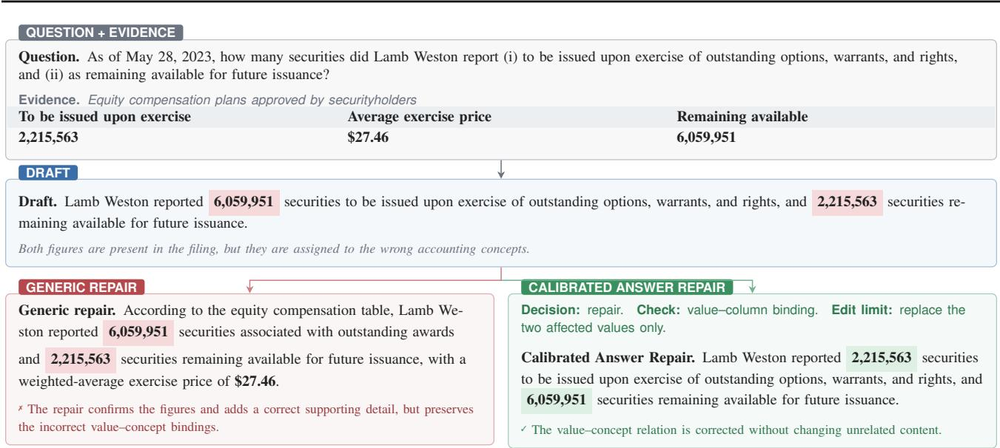
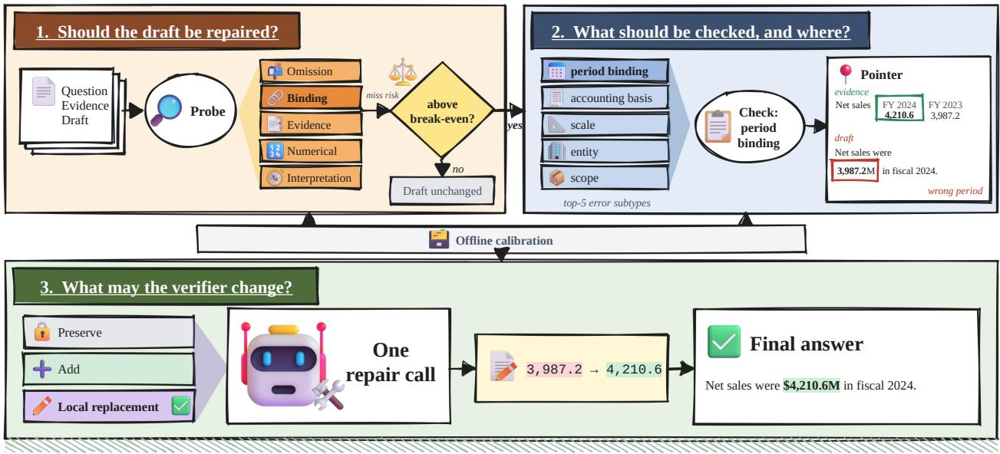
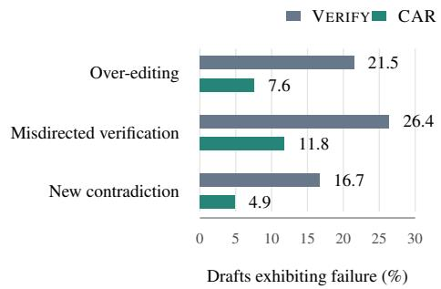
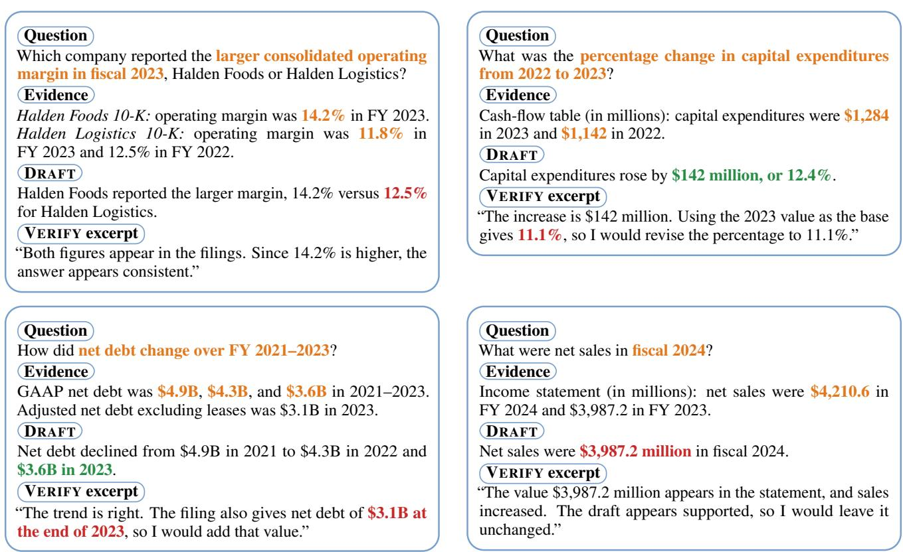
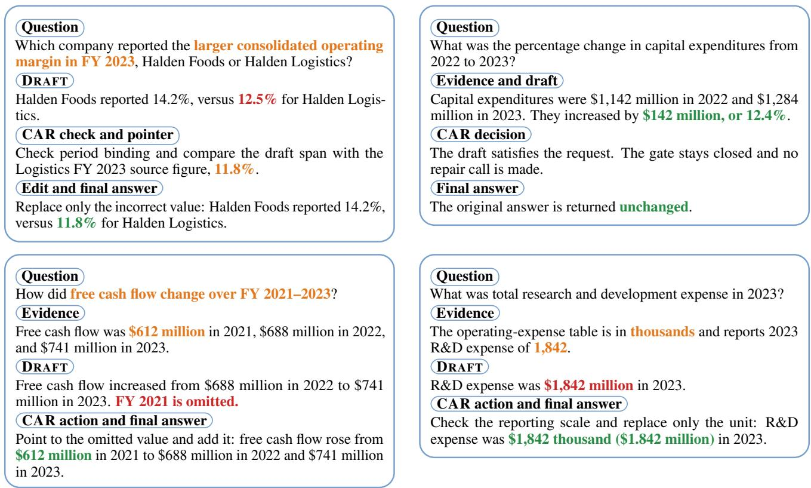

# When Self-Verification Hurts: Calibrated Answer Repair for Financial Question Answering

Celine Guo \* 1 Weida Liang \* 1 Yujian Fu 1 Anqi Dang 2 Yanzheng Jin 1 Kenji Kawaguchi 1 Wenya Wang 2

## Abstract

Financial question answering can fail even when a model extracts a plausible number from the supplied evidence: the answer may attach it to the wrong entity, period, unit, or accounting concept. Asking the model to verify and revise its draft can help, but open-ended revision may alter content that was already correct or inspect the wrong relation and reinforce the original error. We formulate repair as a decision that balances the information it may recover against the correct content it may damage. Based on this trade-off, we introduce Calibrated Answer Repair (CAR), which first estimates whether a draft is likely to benefit from repair, then selects a targeted check, localizes the relevant evidence or draft span, and limits the permitted edit. Across FinRank, Fin-RATE, and FinQA with three open-weight models, CAR outperforms generic verification in all dataset–model settings. At the system level, it recovers 14.6% of initially missed answer requirements while damaging 2.1% of initially correct ones. Its post-draft token cost is over 30 percent lower than the iterative revision alternatives. Ablations on two dataset–model settings show that evidence localization and bounded editing are the main contributors to CAR’s gains.

## 1. Introduction

Financial reports rarely present an answer as an isolated number. Even a simple numerical question may require a system to combine narrative text, tables, and intermediate calculations, and then determine which company, reporting period, unit, and accounting concept a value describes (Zhu et al., 2021; Chen et al., 2021; 2022). Financial question answering therefore requires both numerical reasoning and precise grounding in the supplied evidence. Language models can succeed at finding or computing a value while failing to ground it correctly: a number may appear in the filing but belong to a different period or entity. Because related figures often occur in the same passage or table, the resulting answer can still appear precise and well supported while expressing the wrong relation (Mansouri et al., 2026; Jiang et al., 2026; Stolfo, 2024).

A natural response is to ask the model to verify its draft against the evidence and revise any detected error (Madaan et al., 2023; Zhao et al., 2023; Dhuliawala et al., 2024; Gou et al., 2024). However, self-verification can introduce errors of its own (Huang et al., 2024; Kamoi et al., 2024). We explore two main risks: (1) over-editing, in which the verifier changes correct content while fixing a local error, and (2) misdirected verification, in which it checks the wrong relation or evidence and consequently preserves the original error or adds an irrelevant claim. Reliable repair must therefore decide whether to repair, what to check and where to inspect, and which edit contract to apply.

Figure 1 illustrates the problem. The draft contains both values reported in the filing, but assigns each value to the other column. A generic verifier confirms that both numbers occur in the evidence and therefore leaves the swap uncorrected. It may even add a valid but irrelevant detail, supporting the current answer without fixing the error.

This example shows why confirming the presence of a number is insufficient: the verifier must check what that number refers to. Revision carries a second risk when it changes parts of the draft that were already correct. CAR addresses both risks by deciding when to repair, what relation to inspect, and how narrowly to edit.

Motivated by this trade-off, we propose Calibrated Answer Repair (CAR). It first estimates whether a draft is likely to benefit from revision and leaves it unchanged when repair is unlikely to help. If revision is worthwhile, it tells the model what to check and where to look, pointing to relevant source text or the sentence or calculation in the draft. It then limits edits to adding supported information or correcting only a confirmed error, leaving unrelated content unchanged.

We evaluate CAR on FinRank, Fin-RATE, and FinQA, which cover evidence grounding, multi-document financial analysis, and numerical reasoning. Across three openweight models, CAR outperforms DRAFT, generic verification, and COVE in all nine dataset–model settings, and SC-VERIFY and RARR in eight. At the system level, it recovers 14.6% of initially missed information while damaging 2.1% of initially correct information. Its token cost is 35.2–55.3% lower than the iterative revision alternatives. A blinded audit further finds lower rates of over-editing, misdirected verification, and newly introduced contradictions. Our contributions are:

  
Figure 1. A value–concept binding error: both values appear in the filing, but the draft assigns them to the wrong accounting concepts. Generic verification checks presence without confirming what each value refers to.

1. We derive a break-even rule that balances the information a repair can recover against the correct content it may damage.

2. We introduce CAR, which combines a calibrated repair gate, targeted verification, and bounded editing.

3. We evaluate repair across three financial QA benchmarks and test routing, evidence localization, and edit scope through controlled ablations in two dataset–model settings.

## 2. Related Work

Financial question answering. Financial QA benchmarks cover a range of evidence structures and reasoning demands. TAT-QA combines numerical reasoning over tables and text, FinQA provides program supervision for multistep calculations, and ConvFinQA extends financial reasoning to conversational questions (Zhu et al., 2021; Chen et al., 2021; 2022). FinRank focuses on answer grounding and provenance within released per-question candidate pools containing supporting passages and hard negatives, an emphasis shared by evidence-based QA evaluations of source quality and answer attribution (Gao et al., 2023b; Schimanski et al., 2024). It is not a full-filing retrieval setting. Fin-RATE evaluates detailed reasoning, cross-company comparison, and longitudinal analysis over financial filings using benchmark-provided gold context (Mansouri et al., 2026; Jiang et al., 2026). Together, these benchmarks span confusable-evidence grounding, multi-document financial analysis, and numerical reasoning.

Post-hoc verification and repair. Existing methods improve generated answers through feedback, evidence gathering, or structured verification. Self-Refine alternates modelgenerated feedback and revision (Madaan et al., 2023). Verify-and-Edit and RARR retrieve external evidence before editing reasoning chains or unsupported claims (Zhao et al., 2023; Gao et al., 2023a). Chain-of-Verification generates dedicated questions for checking an initial response, while CRITIC incorporates feedback from external tools (Dhuliawala et al., 2024; Gou et al., 2024). Sampling-based methods additionally use agreement or disagreement across generations as a reliability signal (Wang et al., 2023; Manakul et al., 2023). Recent studies also examine the conditions under which models can successfully correct their own outputs (Huang et al., 2024; Kamoi et al., 2024). Building on this literature, CAR treats verification as a selective repair process that jointly determines whether to edit, what relation to check, and how much of the draft to change.

Selective prediction and fine-grained evaluation. Selective prediction allows a system to abstain when its confidence is insufficient, while model cascades allocate additional computation to selected examples (Geifman & El-Yaniv, 2017; Kamath et al., 2020; Varshney & Baral, 2022). These approaches motivate using additional computation only where it is likely to improve the output. CAR applies this principle after an answer has been generated, choosing between preserving the draft and invoking repair. Fine-grained evaluation provides a complementary perspective: FActScore decomposes long-form outputs into atomic claims so that supported and unsupported content can be assessed separately (Min et al., 2023). We similarly assess answer requirements before and after repair, distinguishing recovered requirements from regressions that aggregate answer accuracy can obscure.

## 3. When Is Repair Worthwhile?

To formalize when repair is worthwhile, we score answers against atomic answer requirements: facts a complete answer must state correctly, including what each value refers to. In Figure 1, both values appear but are assigned to the wrong relations, so neither requirement is met. Requirement coverage is the fraction of requirements satisfied, and the missing or incorrect fraction is the miss rate m. The rubric for each question lists these requirements. Rubrics provide supervision during development. At test time, they are used only by the evaluator and are never shown to CAR.

## 3.1. A Break-Even Rule

Repair can recover missed requirements but may also damage those already satisfied. Let f be the recovery rate (the fraction of missed requirements recovered) and d the damage rate (the fraction of satisfied requirements lost). For each dataset–model setting, we estimate these rates by applying the repair to every calibration draft and comparing requirement satisfaction before and after repair.

For miss rate m, the expected change in requirement coverage is

$$
G ( m ) = m f - ( 1 - m ) d .\tag{1}
$$

Repair is worthwhile when $G ( m ) \geq 0 .$ , which gives

$$
m \geq m ^ { \star } = \frac { d } { f + d } .\tag{2}
$$

The threshold falls as recovery improves and rises as damage increases, so an error alone does not make repair worthwhile. Because f and d are averages estimated on calibration data, this is a calibrated decision rule for expected coverage on new questions, not a guarantee of positive gain on every individual question.

## 3.2. Turning the Rule into a Gate

At test time, the rubric and miss rate are unavailable. CAR predicts mb from the question, evidence, draft, and a non- editing, evidence-grounded probe, using rubric-based miss rates from calibration drafts as supervision. The probe runs on every question, whether or not repair follows.

At test time, CAR opens the repair gate when

$$
\widehat { \boldsymbol { m } } \geq m ^ { \star } ,\tag{3}
$$

and otherwise returns the draft unchanged. The threshold is determined by the observed recovery and damage rates rather than tuned as an additional hyperparameter. Because the probe has already inspected the evidence, the gate decides whether to proceed from diagnosis to targeted repair, not whether to perform verification. Section 4 describes check selection and the permitted edit.

## 4. Calibrated Answer Repair

CAR structures repair around three decisions: whether it is worthwhile, what to check and where, and how much of the answer to change. These decisions address unnecessary revision, misdirected verification, and over-editing. Figure 2 illustrates them with a period-binding error: the draft assigns FY 2023 net sales to FY 2024, and a targeted local repair corrects the value using the supplied evidence while preserving the rest of the draft.

## 4.1. Learning from Calibration Errors

CAR learns from labeled calibration data. The draft model first answers each calibration question, and the rubric identifies which answer requirements are missing or incorrect. For each unmet requirement, a fixed language model uses the question, evidence, draft, and requirement to write a short description of the error.

We organize these descriptions at two levels. Five broad error families capture the main questions a verifier may need to ask. Within each family, similar calibration errors are grouped and named once, producing 25 more specific error subtypes. The probe predicts the five broad families, while the subtypes are used later to choose specific checks. The resulting error types are fixed before test time and listed in Appendix A.

The same calibration data show how repair changes an answer. We repair every calibration draft and compare its requirements before and after repair to estimate the overall recovery and damage rates. Additional trials vary the verification check and allowed edit, showing which checks recover each subtype and how often each edit limit damages correct content. Rubric-based miss rates provide the supervision for the diagnostic predictor. These estimates are computed separately for each dataset–model setting.

  
Figure 2. Overview of CAR: diagnosis gates repair, predicted error subtypes guide the check and pointer, and an edit limit constrains one repair call.

## 4.2. Should the Draft Be Repaired?

Because the rubric and true miss rate are unavailable at test time, a non-editing, evidence-grounded probe examines the question, evidence, and draft and returns five binary judgments, one for each broad error family. A ridge regression model combines these judgments with input features to estimate the draft’s miss rate mb .

If mb is below the break-even point m⋆, CAR returns the draft unchanged. Otherwise, it proceeds from diagnosis to targeted repair according to Equation 3, and the gate controls whether the answer may be edited, not whether evidence is inspected.

## 4.3. What Should Be Checked, and Where?

The probe examines the current question, evidence, and draft. Its five family-level judgments, combined with text features, estimate the likely missed share for the repair gate, not which check to run. Separately, error labels from semantically similar calibration questions suggest which relation may be wrong. The selected check tests that relation, while a pointer directs inspection to the relevant span in the current draft or supplied evidence. Calibration-measured check recovery weights the subtype hypotheses. The resulting weights determine check selection within a fixed budget. Retrieval, smoothing, check-scoring, and pointer-construction details appear in Appendices A, E, and C.

## 4.4. What May the Verifier Change?

Even a well-targeted check can damage correct content if it triggers a full rewrite. CAR preserves the draft when no edit has positive expected gain. Otherwise, it selects an addition or local replacement according to the suspected error and pointer. For an omission, it inspects the source passage and permits addition only. For binding errors, it inspects the draft span against the source row or column. For evidence errors, it inspects the claim and its strongest supporting passage. For numerical errors, it inspects the calculation span and operands. For interpretation errors, it inspects the requested relation and evidence. These latter checks permit only local replacement.

For each action, calibration trials provide a recovery rate and a damage rate. CAR applies the expected-gain rule from Equation 1, using the predicted miss rate in place of the unknown true rate. It selects the action with the largest positive expected gain and preserves the draft if none is expected to help.

In Figure 1, the selected check asks which value belongs to each column, the pointer identifies the affected sentence and table columns, and the edit is limited to replacing the two swapped values.

The selected checks, pointer, and edit action are combined in one repair call. The prompt format and edit-validation procedure are detailed in Appendix E. Each question receives one diagnostic probe, and only those passing the gate receive a repair call.

<table><tr><td>Partition</td><td>FinRank</td><td>Fin-RATE</td><td>FinQA</td></tr><tr><td>Calibration</td><td>910</td><td>5,250</td><td>6,251</td></tr><tr><td>Development</td><td>140</td><td>750</td><td>883</td></tr><tr><td>Held-out test</td><td>135</td><td>1,500</td><td>1,147</td></tr></table>

Table 1. Partition sizes by benchmark.

## 5. Experimental Setup

## 5.1. Benchmarks and Primary Metrics

Our evaluation covers three financial question-answering benchmarks with complementary evidence and reasoning demands:

• FinRank (Mansouri et al., 2026) evaluates answer grounding and provenance over per-question evidence. We report Grounded Answer Accuracy (GAA), which counts an answer as correct only when its content is correct and at least one returned passage identifier belongs to the gold support set. This joint criterion measures both answer quality and evidence attribution, rather than passage ranking alone.

• Fin-RATE (Jiang et al., 2026) covers detailed reasoning (DR-QA), cross-company comparison (EC-QA), and longitudinal tracking (LT-QA). We use its gold-context setting, giving every method the same benchmark-provided supporting context. The official evaluator assigns each answer one of four labels—Correct, Partial, Incorrect, or Failure. Correctness Rate (CR) is the percentage labeled Correct, and we report it by subtask and use their unweighted mean as a summary.

• FinQA (Chen et al., 2021) tests numerical reasoning over financial text and tables. We report Numerical Answer Accuracy (NAA), the proportion of normalized final answers that match the gold execution result. NAA directly evaluates the requested numerical result without requiring a generated program.

Further evidence-pool, input-cap, and normalization details appear in Appendices F and C.

## 5.2. Models and Data Partitions

Answer-generation and repair calls use Qwen3-8B and Qwen3-14B (Yang et al., 2025), and Mistral-Small-24B-Instruct-2501 (Mistral AI, 2025). Within each dataset– model configuration, the same model generates the shared draft and handles subsequent diagnostic, verification, and repair calls. Model weights remain fixed. Serving and decoding details are provided in Appendix E. Table 1 summarizes the calibration, development, and held-out test partitions.

FinRank uses the released held-out-ticker split. Fin-RATE uses fixed 70/10/20 splits within each subtask, grouped by filing bundle (1,750/250/500 questions per subtask). FinQA uses its official split.

Fin-RATE uses the official three-judge fusion of GPT-5, DeepSeek-V3.2, and Qwen3-235B. Labels map to 0 (Failure), 1 (Incorrect), 3 (Partial), and 5 (Correct) before fusion. Weights, ordered as DeepSeek/Qwen/GPT-5, are 0.70/0.10/0.20 for DR-QA and 0.14/0.12/0.74 for EC-QA and LT-QA. Only a fused Correct label counts toward CR. This benchmark evaluator is separate from the requirement judge. We use Claude Sonnet 5 (Anthropic, 2026) to label each answer-requirement/candidate-answer pair with the prompt in Appendix E. Those labels measure requirement transitions and support calibration of the gate and edit actions. On 400 stratified requirement decisions, Claude’s labels agree with adjudicated human judgments in 91.8% of cases (κ = 0.83). Calibration data provide labels and paired repair outcomes, development data select non-test hyperparameters, and held-out data provide benchmark scores. Gold answers, requirements, and scoring annotations are reserved for evaluation or offline calibration. The Fin-RATE gold context is the shared inference-time evidence.

## 5.3. Comparison Methods

• DRAFT returns the shared initial answer without post-draft processing.

• VERIFY applies one generic evidence-grounded checkand-revise pass.

• SC-VERIFY generates three independent reviews and returns the majority-voted normalized answer. Aggregation and tie-breaking are specified in Appendix E.

• COVE (Dhuliawala et al., 2024) uses factored verification: it answers draft-generated questions independently from evidence alone, then revises the shared draft.

• RARR (Gao et al., 2023a) checks draft-derived claims against the shared evidence pool, localizes mismatches, and minimally edits them under its edit-distance limit.

• CAR uses the calibrated gate to decide whether to proceed from diagnosis to repair, then selects a check and pointer and constrains the edit.

Implementation details for the supplied-evidence COVE and RARR adaptations appear in Appendix E.2.

## 5.4. Evaluation and Cost

Within each dataset–model configuration, all methods receive the same question, evidence, and initial draft. For Fin-RATE this evidence is the benchmark-provided gold context. Requirement coverage, recovery, and damage follow the definitions in Section 3.

Inference cost is the additional post-draft input and output tokens. For CAR,

$$
C _ { \mathrm { C A R } } = C _ { \mathrm { p r o b e } } + { \nVdash } [ \mathrm { r e p a i r ~ g a t e ~ o p e n s } ] C _ { \mathrm { r e p a i r } } .\tag{4}
$$

The evidence-grounded probe runs on every question, so its cost is included whether or not the gate opens. The cost of SC-VERIFY includes all three reviews. Recovery, damage, calls, and token totals are macro-averaged over the dataset–model configurations. A blinded two-annotator audit compares VERIFY and CAR on 144 paired drafts for over-editing, misdirected verification, and newly introduced contradictions.

## 6. Results

## 6.1. End-to-End Performance

Table 2 shows that CAR improves over DRAFT, VERIFY, and COVE in all nine settings, and over SC-VERIFY and RARR in eight. It trails the latter two only on Qwen3-14B FinRank (35.56% vs. 36.30%).

Fin-RATE Macro CR is the unweighted mean of the official DR-QA, EC-QA, and LT-QA Correctness Rates. The full subtask results appear in Appendix F.1.

Effects vary by task and model. On FinRank, CAR exceeds SC-VERIFY by 4.44 points for Qwen3-8B and 3.70 for Mistral-24B, but trails by 0.74 for Qwen3-14B. Fin-RATE task-level gains appear in Section 7.4. On FinQA, generic verification lowers accuracy, while CAR gains 2.09–2.79 points over SC-VERIFY by avoiding changes to correct calculations.

## 6.2. How Does Generic Verification Fail?

Figure 3 shows that CAR reduces all three audited failure modes, with the largest difference in misdirected verification. Inter-annotator agreement ranged from 87.8% to 95.1% across labels (Cohen’s κ = 0.75–0.82).

  
Figure 3. Failure rates in the blinded 144 paired drafts.

## 6.3. Repair Safety and Cost

Table 3 separates repair behavior from benchmark score. Generic VERIFY recovers 8.1% of initially missed requirements but damages 6.7% of those already satisfied. SC-VERIFY recovers 9.8% and damages 5.5% at three calls per question. COVE recovers 11.7% and damages 4.8% at 4.00 calls per question, while RARR recovers 13.8% and damages 2.4% at 3.58 calls per question. At the system level, CAR has the highest recovery rate at 14.6% and the lowest damage rate at 2.1%, with 1.54 calls per question. Because this aggregate includes drafts for which the gate stays closed, it does not by itself isolate the safety of the edit policy.

We also separate system-level transitions from outcomes conditional on intervention and actual edits. Gate-open recovery and damage are measured only on drafts sent to repair. Changed-answer damage is conditioned on an answer change, while edit rate is the share of all questions whose final answer differs from the draft (Table 4).

Among gate-open drafts, recovery is 20.3% and damage is 5.3%, while only 35.0% of final answers change, and 8.4% of changed answers damage a satisfied requirement. The lower overall damage therefore reflects both selective intervention and outcomes after editing. These aggregate rates do not isolate the causal contribution of the gate from that of the edit limit.

The saving is not obtained by ignoring diagnosis. Every CAR example pays for the probe, and 54.1% additionally invoke repair, for an average of 1.54 calls per question. Including both calls, CAR uses 5,343 additional post-draft tokens per question. This is 156.4% of the 3,417 tokens used by VERIFY, or 56.4% more. It uses 49.0% fewer tokens than SC-VERIFY, 55.3% fewer than COVE, and 35.2% fewer than RARR.

## 6.4. Component Ablations

Table 5 reports Qwen3-14B FinRank performance when changing the gate, pointer, check selection, or edit constraint.

We repeat the four single-factor ablations on FinQA with Mistral-24B to test the component effects on another dataset, model family, and a larger numerical-answer test set. The results and one-factor controls appear in Appendix F.2.

<table><tr><td>Dataset / Metric</td><td>Model</td><td>DRAFT</td><td>VERIFY</td><td>SC-VERIFY</td><td>CoVE</td><td>RARR</td><td>CAR</td></tr><tr><td rowspan="3">FinRank / GAA</td><td>Qwen3-8B</td><td>23.70</td><td>22.96</td><td>25.19</td><td>25.93</td><td>28.15</td><td>29.63</td></tr><tr><td>Qwen3-14B</td><td>31.11</td><td>31.85</td><td>36.30</td><td>34.07</td><td>36.30</td><td>35.56</td></tr><tr><td>Mistral-24B</td><td>29.63</td><td>30.37</td><td>31.11</td><td>31.11</td><td>33.33</td><td>34.81</td></tr><tr><td rowspan="3">Fin-RATE / Macro CR</td><td>Qwen3-8B</td><td>5.53</td><td>5.73</td><td>6.13</td><td>6.67</td><td>7.47</td><td>8.20</td></tr><tr><td>Qwen3-14B</td><td>11.27</td><td>11.60</td><td>12.33</td><td>13.07</td><td>14.07</td><td>14.67</td></tr><tr><td>Mistral-24B</td><td>16.73</td><td>17.13</td><td>17.87</td><td>18.07</td><td>19.40</td><td>20.07</td></tr><tr><td rowspan="3">FinQA /NAA</td><td>Qwen3-8B</td><td>63.21</td><td>62.77</td><td>64.08</td><td>62.95</td><td>65.65</td><td>66.43</td></tr><tr><td>Qwen3-14B</td><td>68.35</td><td>68.00</td><td>69.22</td><td>70.27</td><td>71.32</td><td>72.01</td></tr><tr><td>Mistral-24B</td><td>70.18</td><td>69.66</td><td>70.88</td><td>71.05</td><td>72.28</td><td>72.97</td></tr></table>

Table 2. Held-out benchmark scores (percent, with higher values indicating better performance). Bold marks the best method per setting.
<table><tr><td>Method</td><td>Recovery (%)</td><td>Damage (%)</td><td>Calls/q</td><td>Tokens per question</td><td>Rel. cost (%)</td></tr><tr><td>DRAFT</td><td></td><td></td><td>0.00</td><td>0</td><td>0.0</td></tr><tr><td>VERIFY</td><td>8.1</td><td>6.7</td><td>1.00</td><td>3,417</td><td>100.0</td></tr><tr><td>SC-VERIFY</td><td>9.8</td><td>5.5</td><td>3.00</td><td>10,467</td><td>306.3</td></tr><tr><td>COVE</td><td>11.7</td><td>4.8</td><td>4.00</td><td>11,960</td><td>350.0</td></tr><tr><td>RARR</td><td>13.8</td><td>2.4</td><td>3.58</td><td>8,240</td><td>241.1</td></tr><tr><td>CAR</td><td>14.6</td><td>2.1</td><td>1.54</td><td>5,343</td><td>156.4</td></tr></table>

Table 3. Requirement transitions and post-draft cost, macro-averaged across settings. Relative cost is normalized to VERIFY at 100.0%.

<table><tr><td>CAR metric</td><td>Rate (%)</td></tr><tr><td>Overall recovery</td><td>14.6</td></tr><tr><td>Overall damage</td><td>2.1</td></tr><tr><td>Gate-open recovery</td><td>20.3</td></tr><tr><td>Gate-open damage</td><td>5.3</td></tr><tr><td>Changed-answer damage</td><td>8.4</td></tr><tr><td>Edit rate</td><td>35.0</td></tr></table>

Table 4. System-level and conditional repair outcomes.
<table><tr><td>Variant</td><td>GAA</td></tr><tr><td>Full CAR</td><td>35.56</td></tr><tr><td>Always repair</td><td>30.37</td></tr><tr><td>No pointer</td><td>28.89</td></tr><tr><td>Fixed checklist</td><td>31.85</td></tr><tr><td>Unbounded rewrite</td><td>27.41</td></tr></table>

Table 5. FinRank GAA for Qwen3-14B CAR variants.

## 7. Analysis

## 7.1. Does Selective Repair Help?

<table><tr><td>Dataset</td><td>f</td><td>Always-repair Always-repair d</td><td> $m ^ { \star }$ </td><td>Gate-open rate (%)</td></tr><tr><td>FinRank</td><td>0.142</td><td>0.095</td><td>0.401</td><td>62.7</td></tr><tr><td>Fin-RATE</td><td>0.115</td><td>0.089</td><td>0.436</td><td>55.4</td></tr><tr><td>FinQA</td><td>0.068</td><td>0.081</td><td>0.543</td><td>44.1</td></tr></table>

Table 6. Break-even quantities averaged across models.

The calibration pattern follows the break-even rule. On Fin-Rank, recovery exceeds damage $( f = 0 . 1 4 2 , d = 0 . 0 9 5 )$ giving the lowest threshold $( m ^ { \star } = 0 . 4 0 1 )$ and the highest gate-open rate (62.7%). On FinQA, damage exceeds recovery $( f = 0 . 0 6 8 , d = 0 . 0 8 1 )$ , so the threshold rises to

0.543 and the gate opens for 44.1% of drafts. Fin-RATE falls between these cases. Relative to always applying the repair pipeline, selective repair raises requirement coverage by 1.48, 0.80, and 0.81 points on FinRank, Fin-RATE, and FinQA, respectively. Across models, thresholds range from 0.395 to 0.408 on FinRank, 0.427 to 0.453 on Fin-RATE, and 0.527 to 0.566 on FinQA. Their gate-open rates range from 59.8 to 66.7%, 52.6 to 58.9%, and 40.2 to 47.8%, respectively (Appendix D). The separated ranges show greater threshold variation across benchmarks than across models within a benchmark.

We compare miss-rate predictors using text features, probe verdicts, and their combination (Table 7).

<table><tr><td>Miss-rate input</td><td>MAE↓</td><td>Pearson r ↑</td></tr><tr><td>Dataset mean only</td><td>0.196</td><td></td></tr><tr><td>Text features only</td><td>0.171</td><td>0.344</td></tr><tr><td>Probe verdicts only</td><td>0.158</td><td>0.473</td></tr><tr><td>Text + probe</td><td>0.146</td><td>0.512</td></tr></table>

Table 7. Miss-rate prediction on grouped development folds.

Adding the five evidence-grounded verdicts reduces MAE from 0.171 to 0.146, a 14.6% reduction, and raises Pearson correlation from 0.344 to 0.512 versus text features alone. Probe verdicts alone also outperform text features, while combining both gives the lowest error. These results support using the probe to diagnose each draft, separately from the later gate decision to permit an edit.

## 7.2. Which Repair Components Matter?

On Qwen3-14B FinRank, question-specific routing adds 3.71 GAA points over the fixed checklist (35.56 vs. 31.85). Always repair, no pointer, and unbounded rewrite score 30.37, 28.89, and 27.41, respectively, making localization and edit scope the larger contributors in this setting. The FinQA–Mistral-24B ablation shows the same ordering on numerical answer accuracy: removing the pointer costs 2.70 points and removing the edit bound costs 4.01, compared with 2.44 for always repairing. The fixed-checklist gap is 0.87 points, small relative to the pointer and edit-scope effects (Appendix F.2).

## 7.3. Do Pointers Localize Relevant Content?

Among omissions, source pointers place a supporting passage in the top three for 72.8% of FinRank cases and 52.4% of Fin-RATE cases, compared with 46.9% and 20.1% under random ranking. On FinQA numerical failures, calculation pointers overlap the reference span in 68.9% of cases and localize all required operands in 51.7%, versus 41.6% and 27.4% with answer-sentence pointers. For Fin-RATE, penalizing passages that resemble the draft lowers source Hit@3 from 52.4% to 29.2%. The drop suggests that an omitted fact often appears in context topically related to content already in the draft. Question relevance is therefore a better ranking signal here than draft novelty. Full definitions and breakdowns appear in Appendix C.

## 7.4. How Do Fin-RATE Gains Vary by Task?

CAR improves all Fin-RATE model–subtask pairs. Absolute gains are largest on DR, while EC and LT also improve from lower baselines. Table 8 reports model-level point changes: DR gains range from 4.4 to 5.4, EC from 1.4 to 2.8, and LT from 2.2 to 2.8. For Qwen3-8B, EC rises from 0.4 to 1.8. Point changes are more informative than relative percentages from a near-zero starting value. Full Correctness Rates appear in Appendix F.1.

<table><tr><td>Model</td><td>DR-QA</td><td>EC-QA</td><td>LT-QA</td></tr><tr><td>Qwen3-8B</td><td>4.4</td><td>1.4</td><td>2.2</td></tr><tr><td>Qwen3-14B</td><td>5.4</td><td>2.0</td><td>2.8</td></tr><tr><td>Mistral-24B</td><td>4.8</td><td>2.8</td><td>2.4</td></tr></table>

Table 8. Fin-RATE CAR minus DRAFT CR.

## 8. Conclusion

CAR makes repair selective, targeted, and bounded. It outperforms standard verification approaches in all nine benchmark–model settings and stronger verification variants in eight. Its post-draft token cost is higher than a single verification pass but lower than the iterative revision alternatives. Controlled ablations show that evidence localization and bounded edits matter across both judge-based and numerical-answer evaluation, while the fixed-checklist gap is small on FinQA.

## Limitations

Our evaluation covers three English-language financial benchmarks and three open-weight models. Results may not transfer directly to other domains, languages, or model families, and the calibrated repair policy relies on paired development outcomes. Fin-RATE uses benchmark-provided gold context, so our experiments focus on answer repair rather than end-to-end retrieval. Requirement-level outcomes use an independent judge, while benchmark metrics and a blinded audit provide complementary checks.

## Ethical Considerations

Higher requirement coverage does not make a financial answer safe for investment, accounting, or regulatory use. Deployed systems should expose their evidence, avoid unsupported repairs, and retain qualified human review for consequential decisions.

The benchmarks are based on public financial disclosures, but redistribution remains subject to the corresponding dataset licenses. Failure annotation, calibration, and repeated model inference also incur compute and data-transfer costs.

Writing assistance. A generative AI assistant helped organize and edit the manuscript and check internal consistency.

## References

Anthropic. Introducing Claude Sonnet 5. Anthropic, June 2026. URL https://www.anthropic.com/news/ claude-sonnet-5.

Chen, Z., Chen, W., Smiley, C., Shah, S., Borova, I., Langdon, D., Moussa, R., Beane, M., Huang, T.-H., Routledge, B., and Wang, W. Y. FinQA: A dataset of numerical reasoning over financial data. In Proceedings of the 2021 Conference on Empirical Methods in Natural Language Processing, pp. 3697–3711. Association for Computational Linguistics, 2021. URL https://aclanthology.org/2021.emnlp-main.300/.

Chen, Z., Li, S., Smiley, C., Ma, Z., Shah, S., and Wang, W. Y. ConvFinQA: Exploring the chain of numerical reasoning in conversational finance question answering. In Proceedings of the 2022 Conference on Empirical Methods in Natural Language Processing, pp. 6279–6292. Association for Computational Linguistics, 2022. doi: 10.18653/v1/2022.emnlp-main.421. URL https://aclanthology.org/2022.emnlp-main.421/.

Dhuliawala, S., Komeili, M., Xu, J., Raileanu, R., Li, X., Celikyilmaz, A., and Weston, J. Chain-ofverification reduces hallucination in large language models. In Findings of the Association for Computational Linguistics: ACL 2024, pp. 3563–3578. Association for Computational Linguistics, 2024. doi: 10.18653/v1/2024.findings-acl.212. URL https:// aclanthology.org/2024.findings-acl.212/.

Gao, L., Dai, Z., Pasupat, P., Chen, A., Chaganty, A. T., Fan, Y., Zhao, V., Lao, N., Lee, H., Juan, D.-C., and Guu, K. RARR: Researching and revising what language models say, using language models. In Proceedings of the 61st Annual Meeting of the Association for Computational Linguistics (Volume 1: Long Papers), pp. 16477–16508. Association for Computational Linguistics, 2023a. doi: 10.18653/v1/2023.acl-long.910. URL https://aclanthology.org/2023.acl-long.910/.

Gao, T., Yen, H., Yu, J., and Chen, D. Enabling large language models to generate text with citations. In Proceedings ofthe 2023 Conference on Empirical Methods in Natural Language Processing, pp. 6465–6488. Association for Computational Linguistics, 2023b. doi: 10.18653/v1/2023.emnlp-main.398. URL https:// aclanthology.org/2023.emnlp-main.398/.

Geifman, Y. and El-Yaniv, R. Selective classification for deep neural networks. In Advances in Neural Information Processing Systems, volume 30, 2017. URL https: //proceedings.neurips.cc/paper\_files/paper/ 2017/hash/4a8423d5e91fda00bb7e46540e2b0cf1- Abstract.html.

Gou, Z., Shao, Z., Gong, Y., Shen, Y., Yang, Y., Duan, N., and Chen, W. CRITIC: Large language models can selfcorrect with tool-interactive critiquing. In International Conference on Learning Representations, 2024. URL https://openreview.net/forum?id=Sx038qxjek.

Huang, J., Chen, X., Mishra, S., Zheng, H. S., Yu, A. W., Song, X., and Zhou, D. Large language models cannot self-correct reasoning yet. In International Conference on Learning Representations, 2024. URL https: //arxiv.org/abs/2310.01798.

Jiang, Y., Chen, J., Makri, E., Chen, J., Li, P., Maatouk, A., Tassiulas, L., Brenner, E., Xiang, B., and Ying, R. Fin-RATE: A real-world financial analytics and tracking evaluation benchmark for LLMs on SEC filings. In Proceedings of the 32nd ACM SIGKDD Conference on Knowledge Discovery and Data Mining, 2026. doi: 10.1145/3770855.3817528. URL https: //doi.org/10.1145/3770855.3817528.

Kamath, A., Jia, R., and Liang, P. Selective question answering under domain shift. In Proceedings ofthe 58th Annual Meeting ofthe Associationfor Computational Linguistics, pp. 5684–5696. Association for Computational Linguistics, 2020. doi: 10.18653/v1/2020.acl-main.503. URL https://aclanthology.org/2020.acl-main.503/.

Kamoi, R., Zhang, Y., Zhang, N., Han, J., and Zhang, R. When can LLMs actually correct their own mistakes? A critical survey of self-correction of LLMs. Transactions ofthe Associationfor Computational Linguistics, 12: 1417–1440, 2024. URL https://aclanthology.org/ 2024.tacl-1.78/.

Madaan, A., Tandon, N., Gupta, P., Hallinan, S., Gao, L., Wiegreffe, S., Alon, U., Dziri, N., Prabhumoye, S., Yang, Y., Gupta, S., Majumder, B. P., Hermann, K., Welleck, S., Yazdanbakhsh, A., and Clark, P. Self-Refine: Iterative refinement with self-feedback. In Advances in Neural Information Processing Systems, volume 36, 2023. URL https://papers.nips.cc/paper\_files/paper/ 2023/hash/91edff07232fb1b55a505a9e9f6c0ff3- Abstract-Conference.html.

Manakul, P., Liusie, A., and Gales, M. SelfCheck-GPT: Zero-resource black-box hallucination detection for generative large language models. In Proceedings of the 2023 Conference on Empirical Methods in Natural Language Processing, pp. 9004–9017. Association for Computational Linguistics, 2023. doi: 10.18653/v1/2023.emnlp-main.557. URL https:// aclanthology.org/2023.emnlp-main.557/.

Mansouri, S., Saad, D., Wahrenburg, M., Weissel, M., and Woebbeking, F. FinRank: An evidence-grounded benchmark for financial question answering and retrieval over

SEC filings. arXiv preprint arXiv:2608.07400, 2026. URL https://arxiv.org/abs/2608.07400.

Min, S., Krishna, K., Lyu, X., Lewis, M., Yih, W.-t., Koh, P., Iyyer, M., Zettlemoyer, L., and Hajishirzi, H. FActScore: Fine-grained atomic evaluation of factual precision in long-form text generation. In Proceedings of the 2023 Conference on Empirical Methods in Natural Language Processing, pp. 12076–12100. Association for Computational Linguistics, 2023. URL https://aclanthology.org/2023.emnlp-main.741/.

Mistral AI. Mistral-Small-24B-Instruct-2501 model card. Hugging Face, 2025. URL https://huggingface.co/ mistralai/Mistral-Small-24B-Instruct-2501.

Schimanski, T., Ni, J., Kraus, M., Ash, E., and Leippold, M. Towards faithful and robust LLM specialists for evidence-based question-answering. In Proceed ings ofthe 62nd Annual Meeting ofthe Associationfor Computational Linguistics (Volume 1: Long Papers), pp. 1913–1931. Association for Computational Linguistics, 2024. doi: 10.18653/v1/2024.acl-long.105. URL https://aclanthology.org/2024.acl-long.105/.

Stolfo, A. Groundedness in retrieval-augmented longform generation: An empirical study. In Findings of the Association for Computational Linguistics: NAACL 2024, pp. 1537–1552. Association for Computational Linguistics, 2024. doi: 10.18653/v1/2024.findings-naacl.100. URL https:// aclanthology.org/2024.findings-naacl.100/.

Varshney, N. and Baral, C. Model cascading: Towards jointly improving efficiency and accuracy of NLP systems. In Proceedings of the 2022 Conference on Empirical Methods in Natural Language Processing, pp. 11007–11021. Association for Computational Linguistics, 2022. doi: 10.18653/v1/2022.emnlp-main.756. URL https://aclanthology.org/2022.emnlp-main.756/.

Wang, X., Wei, J., Schuurmans, D., Le, Q. V., Chi, E. H., Narang, S., Chowdhery, A., and Zhou, D. Selfconsistency improves chain of thought reasoning in language models. In International Conference on Learning Representations, 2023. URL https://openreview.net/ forum?id=1PL1NIMMrw.

Yang, A., Li, A., Yang, B., et al. Qwen3 technical report. arXiv preprint arXiv:2505.09388, 2025. URL https: //arxiv.org/abs/2505.09388.

Zhao, R., Li, X., Joty, S., Qin, C., and Bing, L. Verifyand-edit: A knowledge-enhanced chain-of-thought framework. In Proceedings of the 61st Annual Meeting of the Associationfor Computational Linguistics (Volume

1: Long Papers), pp. 5823–5840. Association for Computational Linguistics, 2023. doi: 10.18653/v1/2023.acllong.320. URL https://aclanthology.org/2023.acllong.320/.

Zhu, F., Lei, W., Huang, Y., Wang, C., Zhang, S., Lv, J., Feng, F., and Chua, T.-S. TAT-QA: A question answering benchmark on a hybrid of tabular and textual content in finance. In Proceedings of the 59th Annual Meeting of the Association for Computational Linguistics and the 11th International Joint Conference on Natural Language Processing (Volume 1: Long Papers), pp. 3277–3287. Association for Computational Linguistics, 2021. doi: 10.18653/v1/2021.acl-long.254. URL https://aclanthology.org/2021.acl-long.254/.

## A. Failure Families and Induction

Annotation source. For each missed calibration requirement, a frozen LLM annotator receives the question, supplied evidence, draft, and missed requirement and writes a short failure description that abstracts away company names, products, dates, and values. The annotator is used only on calibration data. We manually review a subset to ensure that the descriptions identify the failed relation without copying instance-specific content.

The annotation instruction is:

Describe why the draft fails to state the missed answer requirement. Name the missing or incorrect relation, but abstract away instance-specific entities, dates, products, and values. Do not propose a repair and do not infer failures beyond the supplied requirement.

Fixed families, induced leaves. The hierarchy contains five fixed families and 25 fine-grained leaves induced from the pooled calibration descriptions. We embed the descriptions, cluster them bottom-up, assign canonical names, and merge clusters that receive the same name. The resulting hierarchy is frozen before test evaluation and shared across dataset–model settings. Table 9 summarizes the five families. Table 10 gives all leaves used for estimation and routing.

In the frozen calibration export, Evidence leaves account for 5.4% of labeled errors, and f\_causal\_overclaim is the only zero-observation leaf. The accompanying label manifest reports the exact count and percentage for every leaf. Test labels are not used to estimate these frequencies.

Annotation record. Each calibration record contains the question identifier, answer requirement, draft, satisfaction and recoverability judgments, generated failure description, induced leaf and family, reference error span when existing content is wrong, and supporting-passage set. We retain satisfied and unrecoverable requirements so that miss rates and population-level transitions are computed over the complete cohort.

Question-conditioned leaf distribution. At test time, a fixed all-MiniLM-L6-v2 encoder embeds the first 700 characters of the new question as a normalized 384-dimensional vector. We compare it by cosine similarity with the calibration questions and retrieve the 50 nearest questions. The retrieval unit is the question: all failure labels attached to each neighbor contribute to the local counts, so a question with multiple missed requirements contributes multiple labels. No LLM is used in this retrieval stage.

Let $n _ { g } ( q )$ and $n _ { \ell } ( q )$ be the neighborhood counts for family $g$ and leaf $\ell ,$ and let $p _ { g }$ and $p _ { \ell | g }$ be their global calibration frequencies. We smooth at both levels,

$$
P ( g \mid q ) = \frac { n _ { g } ( q ) + \tau _ { g } p _ { g } } { \sum _ { g ^ { \prime } } n _ { g ^ { \prime } } ( q ) + \tau _ { g } } ,\tag{5}
$$

$$
P ( \ell \mid g , q ) = \frac { n _ { \ell } ( q ) + \tau _ { \ell } p _ { \ell \mid g } } { n _ { g } ( q ) + \tau _ { \ell } } ,\tag{6}
$$

and set $\pi _ { \ell } ( q ) = P ( g ( \ell ) \mid q ) P ( \ell \mid g ( \ell ) , q )$ . We use $\tau _ { g } = 2$ and $\tau _ { \ell } = 4$ and pass the five highest-mass leaves to the repair planner. The neighborhood size was selected on the development split from {20, 50, 120} using top-k leaf recall, and the choice was stable across this range. Question features used by the gate are deliberately excluded from semantic retrieval.

Pooling and stability. Leaf-specific check efficacy is shrunk toward its parent-family estimate. We induce the hierarchy once from pooled calibration descriptions so that leaf identities remain comparable across the nine settings. The hierarchy, sentence encoder, neighbor count, and smoothing strengths are frozen before test evaluation.

## B. Diagnostic Probe

The probe receives the question, the same supplied evidence blocks and identifiers shown to the draft, the draft, and the fixed family definitions. Its instruction and output format are:

Inspect the draft without rewriting it. For each of the five error   
families, decide whether the question and supplied evidence pro   
vide a concrete reason to suspect that the draft omits or misstates   
information requested by the question. Return one verdict and a   
short evidence-grounded rationale per family. A verdict must be   
exactly yes or no. Do not propose edits, use outside information,   
or assume access to an evaluation rubric.   
Question: <question>   
Evidence: <same evidence blocks and identifiers as   
Draft>   
Draft: <draft>   
Error-family definitions: <five fixed definitions>   
Output format: Emit exactly five records in this fixed or  
der: Omission: <yes|no>, rationale: <reason>,   
Binding: <yes|no>, rationale: <reason>, Evidence:   
<yes|no>, rationale: <reason>, Numerical: <yes|no>,   
rationale: <reason>, Interpretation: <yes|no>,   
rationale: <reason>.

The predictor converts yes to 1 and no to 0, in the fixed order Omission, Binding, Evidence, Numerical, Interpretation. The miss-rate model combines this five-value vector with textual features of $( q , x , y ^ { 0 } ) ;$ : question length and number of requested relations, named entities and periods, evidence length and structure, draft length, and whether the draft explicitly states relevant entities, dates, quantities, and comparison terms.

We select the ridge regularization strength with five questiongrouped folds, keeping all examples derived from the same question together. The target is the calibration miss rate computed from answer requirements. We search $\alpha \in$ $\{ 1 0 ^ { - 4 } , 1 0 ^ { - 3 } , 1 0 ^ { - 2 } , 1 0 ^ { - 1 } , 1 , 1 0 , 1 0 0 \}$ on the development split. Neither the target nor the rubric is available to the model at test time. The gate threshold is not tuned separately. It is fixed by Equation 2.

<table><tr><td>Family</td><td>Definition</td><td>Typical checks and localization</td></tr><tr><td>Omission</td><td>A requested entity, period, qualifier, comparison, or result is absent.</td><td>Retrieve the supporting source passage and append only the supported missing relation.</td></tr><tr><td>Binding</td><td>A stated value is attached to the wrong entity, period, unit, or accounting concept.</td><td>Trace the value to its row, column, and passage, then locally replace the incorrect binding</td></tr><tr><td>Evidence</td><td>A claim is unsupported, weakly supported, or grounded in a distractor passage.</td><td>Compare the draft sentence with its strongest evidence and verify provenance.</td></tr><tr><td>Numerical</td><td>The selected operands, operation, scale, sign, or computed result is wrong.</td><td>Point to the calculation span and recompute from cited inputs.</td></tr><tr><td>Interpretation</td><td>The answer misstates a comparison, trend, aggregation, or requested relation.</td><td>Re-read the question relation and check the conclusion against the evidence.</td></tr></table>

Table 9. The five fixed failure families. Fine-grained leaves are induced from calibration data and used for hierarchical smoothing and routing.
<table><tr><td>Family</td><td>Leaf</td><td>Definition</td></tr><tr><td>Omission</td><td>f_omit_narrative f_omit_absent</td><td>A requested fact appears in narrative evidence but is absent from the answer.</td></tr><tr><td></td><td>f_omit_derivable</td><td>The requested fact is not supported by the supplied evidence and cannot be recovered by verification.</td></tr><tr><td></td><td></td><td>The required inputs are present, but the answer omits a value that must be derived.</td></tr><tr><td></td><td>f_omit_table</td><td>A requested value appears in a supplied table but is not reported.</td></tr><tr><td></td><td>f_omit_clause</td><td>A multi-part question is answered only in part.</td></tr><tr><td>Binding</td><td>f_entity</td><td>A value is attributed to the wrong company or entity.</td></tr><tr><td></td><td>f_concept</td><td>A related but different accounting concept is substituted for the requested one</td></tr><tr><td></td><td>f_period</td><td>A value from the wrong fiscal year or quarter is used.</td></tr><tr><td></td><td>f_unit</td><td>The currency, magnitude, or percentage-point unit is wrong</td></tr><tr><td></td><td>f_scope</td><td>Consolidated, segment, or regional reporting scopes are confused.</td></tr><tr><td></td><td>f_version</td><td>A superseded value is used instead of its restated version.</td></tr><tr><td></td><td>f_basis</td><td>GAAP and adjusted, reported and constant-currency, or similar bases are mixed.</td></tr><tr><td>Evidence</td><td>f_unsupported</td><td>The answer asserts a claim not supported by the supplied evidence.</td></tr><tr><td></td><td>f_wrong_evidence</td><td>A value or claim is taken from the wrong passage or table.</td></tr><tr><td></td><td>f_cross_source</td><td>Conflicting sources are combined without resolving the inconsistency.</td></tr><tr><td>Numerical</td><td>f_scale</td><td>Thousands, millions, percentages, or percentage points are confused.</td></tr><tr><td></td><td>f_arithmetic</td><td>The intended operation is correct but its arithmetic result is wrong.</td></tr><tr><td></td><td>f_operation</td><td>The wrong operation is used, such as a difference instead of percentage change.</td></tr><tr><td></td><td>f_sign</td><td>The direction of change or numerical sign is reversed.</td></tr><tr><td></td><td>f_aggregation</td><td>Components are double-counted or a subtotal is added to its own parts.</td></tr><tr><td></td><td>f_denominator</td><td>A ratio or growth rate uses the wrong denominator.</td></tr><tr><td></td><td>f_unsupported_explanation</td><td>The stated explanation or reason is not given by the evidence.</td></tr><tr><td>Interpretation</td><td>f_definition</td><td>A financial term is defined or applied incorrectly.</td></tr><tr><td></td><td>f_wrong_driver</td><td>A secondary driver is emphasized while the dominant driver is omitted.</td></tr><tr><td></td><td>f_causal_overclaim</td><td>Correlation or co-occurrence is overstated as a causal relation.</td></tr></table>

Table 10. The complete 25-leaf taxonomy. Frequencies are computed from the frozen calibration-label export rather than from test outputs. The pooled calibration corpus contains 5,019 labeled errors.

## C. Pointer Construction

The pointer candidate universe matches the evidence available to every end-to-end method. For FinRank, candidates are the released per-question supporting passages and hard negatives. For Fin-RATE, we segment the benchmarkprovided gold context at document and table boundaries into overlapping, length-bounded chunks. Pointers rank only within this shared context and perform no additional retrieval. For FinQA, candidates come from the supplied pre\_text, linearized table, and post\_text. The gold\_inds are retained only for evaluation. A fixed offthe-shelf text encoder embeds the question and candidates, and cosine similarity ranks candidates by question relevance. The encoder is not fine-tuned on any evaluation benchmark. We fix the encoder, chunking, and k on the development split.

For omissions, the repair call receives the top-k passages ranked by question relevance. We also evaluate the noveltypenalized retrieval score

$$
s _ { \mathrm { n o v e l } } ( c ) = \sin ( c , q ) - \lambda \operatorname* { m a x } _ { u \in y ^ { 0 } } \sin ( c , u ) .\tag{7}
$$

as a pointer-ranking ablation.

For wrong content, a frozen off-the-shelf support scorer evaluates every draft-sentence and passage pair. It is not trained on FinRank, Fin-RATE, or FinQA and receives no gold support annotations at test time. For each sentence, the scorer selects its best-matching passage and ranks the pair by how poorly that passage supports the sentence. Reference error spans are the minimal draft spans marked during calibration annotation as asserting the incorrect value, entity, period, or concept. We report sentence-overlap accuracy and joint sentence–passage accuracy. Encoder and scorer configurations are fixed before test evaluation, and their local compute is reported separately from generative token cost.

<table><tr><td>Setting</td><td>Metric</td><td>Pointer</td><td>Comparison</td></tr><tr><td>FinRank</td><td>Source Hit@3</td><td>72.8</td><td>46.9 random</td></tr><tr><td>Fin-RATE</td><td>Source Hit@3</td><td>52.4</td><td>20.1 random</td></tr><tr><td>Fin-RATE</td><td>Source Hit@3</td><td>52.4 relevance</td><td>29.2 novelty</td></tr><tr><td>FinQA</td><td>Span overlap</td><td>68.9</td><td>41.6 answer sent.</td></tr><tr><td>FinQA</td><td>All operands</td><td>51.7</td><td>27.4 answer sent.</td></tr></table>

Table 11. Pointer localization results. Values are percentages. “Novelty” subtracts similarity to the draft from question relevance.

For FinQA, the test-time pointer is constructed from the question, evidence, and numerical mentions in the naturallanguage draft. Gold program operands and supporting facts are used only for evaluation: after alignment to draft mentions, the smallest expression or sentence containing the answer and required operands defines the reference calculation span. A pointer is correct when its marked expression overlaps this span. Operand localization additionally requires all operands used by the gold program.

## D. Hierarchical Calibration

For a candidate check a and edit policy $\eta ,$ let $y ^ { a , \eta }$ be its repaired calibration answer, $M _ { \ell } ( y ^ { 0 } )$ the missed requirements assigned to leaf ℓ, and $C ( \boldsymbol { y } ^ { 0 } )$ the requirements already satisfied. Single-check recovery and policy-specific damage are

$$
e _ { a \ell \eta } = P ( J ( z , y ^ { a , \eta } ) = 1 \mid z \in M _ { \ell } ( y ^ { 0 } ) ) ,\tag{8}
$$

$$
d _ { a , \eta , b } = P ( J ( z , y ^ { a , \eta } ) = 0 \mid z \in C ( y ^ { 0 } ) , \eta , b ) ,\tag{9}
$$

where $\eta$ is the edit policy and b is the editable fraction of the draft.

We stabilize sparse check–leaf pairs with a regularized multilevel logit model,

$$
\mathrm { l o g i t } ( e _ { a \ell \eta } ) = \mu + \alpha _ { a } + \rho _ { \eta } + \beta _ { g ( \ell ) } + \gamma _ { \ell } + \delta _ { a , g ( \ell ) } ,\tag{10}
$$

where $g ( \ell )$ is the parent family. The fitted terms provide hierarchically smoothed efficacy estimates. They are not interpreted as Bayesian posterior quantities.

For a set of checks S under edit policy η, combined recovery

is discounted for overlap,

$$
G _ { \ell } ( S , \eta ) = 1 - \prod _ { a \in S } \left( 1 - \omega _ { | S | } e _ { a \ell \eta } \right) ,\tag{11}
$$

where ω is estimated from randomized multi-check trials. The check selector described in Section 4.3 uses $\overline { { G } } _ { \ell } ( S )$ , the calibration-average recovery for check set S over admissible edit policies. The same trials provide the plan-level damage estimate $\widehat { d } ( S , \eta , b )$ , with separate parameters for append, local replacement, unrestricted rewriting, and editable-span bins.

Gate-level f and d are micro-averaged requirement transitions from the always-repair version of the complete downstream CAR pipeline. We estimate them over the full paired calibration population, including probe-negative questions. Check assignments in the calibration trials are randomized within dataset–model strata, and the candidate edit policies include append, bounded local replacement, and unrestricted rewrite as a matched control. The semantic-neighborhood probabilities $\pi _ { \ell } ( q )$ , defined in Appendix A, weight likely error types for routing. They do not imply that a draft contains exactly one failure.

## E. Repair Prompts and Edit Policies

## E.1. Model and Decoding Configuration

Qwen3-8B, Qwen3-14B, and Mistral-Small-24B-Instruct-2501 are served with vLLM and their official chat templates in BF16 with a 32,768-token context. The Qwen models use non-thinking mode. DRAFT, probe, verification, and repair calls use deterministic decoding $( T = 0 )$ , while each SC-VERIFY run uses three independently seeded samples $( T = 0 . 7 , \mathrm { t o p } – p = 0 . 9 5 )$ . Within each dataset–model setting, the same pinned checkpoint generates the draft and handles subsequent verification calls. Maximum new-token limits are 512 for draft generation, 256 for the probe, and 384 for repair. The append contract allows at most 80 new tokens. Local replacement allows at most two spans covering no more than 20% of the draft tokens. The run manifest records checkpoint and tokenizer SHAs, software and dataset versions, split question identifiers, generation and bootstrap seeds, and hardware inventory.

The evaluated checkpoints were released in 2025, before the public releases of Fin-RATE and FinRank in 2026, so they could not have been trained on these benchmark releases. FinQA was published in 2021, however, and release chronology alone cannot rule out pretraining exposure to FinQA or to source documents used by any benchmark. We therefore do not make a blanket claim that pretraining contamination is impossible (Yang et al., 2025; Mistral AI, 2025; Jiang et al., 2026; Mansouri et al., 2026; Chen et al., 2021).

<table><tr><td>Check the draft against the supplied evidence and revise it only when a supported correction is needed. Ensure that the final answer addresses the complete question and that each value or claim has the correct entity, period, unit, accounting concept, and supporting evidence. If the draft is already correct and complete,</td></tr><tr><td>return it unchanged. Do not use outside information. Question: &lt;question&gt; Evidence: &lt;same evidence blocks and identifiers as Draft&gt; Draft: &lt;shared initial draft&gt;</td></tr></table>

<table><tr><td>Dataset</td><td>Model</td><td>Always-repair f</td><td>Always-repair d</td><td> $m ^ { \star }$ </td><td>Gate-open rate</td></tr><tr><td>FinRank</td><td>Qwen3-8B</td><td>0.132</td><td>0.091</td><td>0.408</td><td>66.7%</td></tr><tr><td>FinRank</td><td>Qwen3-14B</td><td>0.153</td><td>0.100</td><td>0.395</td><td>61.5%</td></tr><tr><td>FinRank</td><td>Mistral-24B</td><td>0.141</td><td>0.094</td><td>0.400</td><td>59.8%</td></tr><tr><td>Fin-RATE</td><td>Qwen3-8B</td><td>0.104</td><td>0.086</td><td>0.453</td><td>58.9%</td></tr><tr><td>Fin-RATE</td><td>Qwen3-14B</td><td>0.117</td><td>0.089</td><td>0.432</td><td>54.7%</td></tr><tr><td>Fin-RATE</td><td>Mistral-24B</td><td>0.125</td><td>0.093</td><td>0.427</td><td>52.6%</td></tr><tr><td>FinQA</td><td>Qwen3-8B</td><td>0.058</td><td>0.065</td><td>0.528</td><td>47.8%</td></tr><tr><td>FinQA</td><td>Qwen3-14B</td><td>0.071</td><td>0.079</td><td>0.527</td><td>44.3%</td></tr><tr><td>FinQA</td><td>Mistral-24B</td><td>0.075</td><td>0.098</td><td>0.566</td><td>40.2%</td></tr></table>

Table 12. Setting-specific break-even quantities from always-repair calibration trials.

SC-VERIFY aggregation. Each review is scored after dataset-specific normalization. The voting key is the normalized answer and, for FinRank, the returned passage identifier. A fixed sample order resolves a three-way tie. Each of the three independent reviews receives the same question, evidence blocks, and shared initial draft.

## E.2. Supplied-Evidence Baseline Adaptations

COVE. COVE first generates verification questions from the shared draft. Each question is answered in a separate call using the same evidence pool. These factored answer calls receive neither the draft nor answers to other verification questions. A final call uses the original draft and the independently obtained answers to produce a corrected answer.

RARR. RARR derives check questions from the shared draft and searches only within the supplied evidence pool. It applies an agreement check between draft claims and retrieved evidence. When they disagree, it localizes the mismatch and minimally revises that content under an editdistance limit. It does not retrieve external evidence.

## E.3. Prompt Templates

All answer-generation and answer-verification methods receive identical evidence blocks in the same order: the draft, diagnostic probe, generic verifier (including each SC-VERIFY review), and CAR. CAR’s pointer refers only to passage IDs in the shared evidence or to spans in the draft or calculation. It neither introduces evidence nor repeats passage text. No test-time generation or verification component receives the evaluation rubric, gold answer, or gold passage annotations. The requirement judge is an offline evaluator and receives only one answer requirement and a candidate answer. Angle-bracketed fields below are populated with instance-specific inputs. Dataset-specific output schemas add only the required final-answer and passage-identifier fields.

## Draft.

Question: <question>

Evidence: <evidence blocks with identifiers>

## Diagnostic probe.

Its instruction and output format are given in Appendix B.   
Generic verification.

Calibrated repair.

Check only the listed relations, beginning from the supplied   
pointer. Treat the five error hypotheses as possibilities, not as   
claims that the draft is wrong. Use only the supplied evidence.   
Preserve all draft content outside the allowed edit scope. Return   
an empty edit list if no supported correction is found.   
Question: <question>   
Evidence: <same evidence blocks and identifiers as   
Draft>   
Draft: <shared initial draft>   
Selected checks: <selected checks>   
Top-5 error hypotheses: <five predicted error subtypes   
and short definitions>   
Pointer: <passage IDs and/or draft or calculation   
span, references shared evidence>   
Edit limit: <add only, at most 80 tokens, or local   
replacement, at most two spans and 20% of draft   
tokens>   
Output format: Return JSON with an edits array:   
{"edits":[   
{"type":"append",   
"target\_span":"","new\_text":"...",   
"passage\_id":"..."}   
]}   
For local replacement, set type to replace and target\_span   
to the exact draft text. For an addition, leave it empty. If no   
supported edit is found, return {"edits":[]}.   
Requirement judge.   
Given one answer requirement and one candidate answer, decide   
whether the answer clearly satisfies the requirement. Mark it un   
satisfied if it is absent, factually incorrect, attached to the wrong   
entity, period, unit, scope, or accounting basis, contradicted else   
where in the answer, or left ambiguous by competing final values.   
Return only satisfied or unsatisfied and one short rationale   
grounded in the requirement and answer.   
Answer requirement: <one requirement>   
Candidate answer: <candidate answer>

## E.4. Checks, Pointers, and Validation

Checks. Each check names a relation and an evidenceinspection procedure. Representative checks trace a figure to its entity, match a quantity to its reporting period, verify an accounting-concept binding, confirm direct evidence support, or recompute an operation from cited inputs and units. Checks are phrased as questions to resolve rather than assertions that an error exists.

Pointer block. For an omission, the pointer gives the IDs of the highest-ranked source passages. For suspected wrong content, it identifies the least-supported draft sentence and its best-matching passage ID. In short numerical contexts, it marks the relevant expression or calculation span. Passage text is not copied into the pointer: the verifier sees each shared evidence block only once. The family scores accompany the pointer as coarse guidance.

Bounded edit policies. The append policy permits a supported addition without deleting the draft. The localreplacement policy permits substitution only within a specified span. Both policies limit output length and require the model to cite the evidence used for the edit. Append is not assumed to be semantically risk-free: a contradictory addition either fails validation or is counted as damage during evaluation.

Structured response. The repair call returns a list of records containing the edit type, the source span for a replacement, the proposed text, and a supporting-passage identifier. The validator locates replacement spans first by exact match and then after canonicalizing quotation marks, emphasis, and whitespace. It processes edits in response order and rejects a replacement if its source span cannot be located or overlaps an accepted edit. A parsing failure, unsupported evidence identifier, or empty valid-edit set returns the original draft.

## F. Additional Benchmark Results

## F.1. Fin-RATE Subtasks

Table 13 reports official Correctness Rate separately for DR-QA, EC-QA, and LT-QA. Each subtask test partition contains 500 questions, so Macro CR also equals the Correctness Rate over the pooled 1,500-question test partition. All methods receive the same benchmark-provided gold context.

<table><tr><td>Model</td><td>Method</td><td>DR</td><td>EC</td><td>LT</td><td>Macro CR</td></tr><tr><td>Qwen3-8B</td><td>DRAFT</td><td>12.8</td><td>0.4</td><td>3.4</td><td>5.53</td></tr><tr><td></td><td>VERIFY</td><td>13.2</td><td>0.4</td><td>3.6</td><td>5.73</td></tr><tr><td></td><td>SC-VERIFY</td><td>13.8</td><td>0.6</td><td>4.0</td><td>6.13</td></tr><tr><td></td><td>CAR</td><td>17.2</td><td>1.8</td><td>5.6</td><td>8.20</td></tr><tr><td>Qwen3-14B</td><td>DRAFT</td><td>26.4</td><td>1.6</td><td>5.8</td><td>11.27</td></tr><tr><td></td><td>VERIFY</td><td>26.8</td><td>1.8</td><td>6.2</td><td>11.60</td></tr><tr><td></td><td>SC-VERIFY</td><td>28.0</td><td>2.2</td><td>6.8</td><td>12.33</td></tr><tr><td></td><td>CAR</td><td>31.8</td><td>3.6</td><td>8.6</td><td>14.67</td></tr><tr><td>Mistral-24B</td><td>DRAFT</td><td>34.0</td><td>4.6</td><td>11.6</td><td>16.73</td></tr><tr><td></td><td>VERIFY</td><td>34.6</td><td>4.8</td><td>12.0</td><td>17.13</td></tr><tr><td></td><td>SC-VERIFY</td><td>35.6</td><td>5.4</td><td>12.6</td><td>17.87</td></tr><tr><td></td><td>CAR</td><td>38.8</td><td>7.4</td><td>14.0</td><td>20.07</td></tr></table>

Table 13. Official Fin-RATE Correctness Rate by subtask on the fixed test partition. Macro CR is the unweighted mean of DR-QA, EC-QA, and LT-QA. All values are percentages.

## F.2. FinQA Component Ablation

We repeat the four one-factor ablations on FinQA with Mistral-24B. The 1,147-question test split provides a larger numerical evaluation in a different model family. Numerical Answer Accuracy (NAA) directly checks the requested result. Each variant changes one component. Always repair still runs the probe but forces the gate open. No pointer removes only the localization cue while retaining the full evidence pool. Fixed checklist replaces question-specific check selection. Unbounded rewrite retains the other checks and pointer but removes the edit-scope limit.

<table><tr><td>Variant</td><td>NAA (%)</td><td>CAR advantage (pp)</td></tr><tr><td>Full CAR</td><td>72.97</td><td></td></tr><tr><td>Always repair</td><td>70.53</td><td>2.44</td></tr><tr><td>No pointer</td><td>70.27</td><td>2.70</td></tr><tr><td>Fixed checklist</td><td>72.10</td><td>0.87</td></tr><tr><td>Unbounded rewrite</td><td>68.96</td><td>4.01</td></tr></table>

Table 14. FinQA NAA and CAR’s advantage over each variant on Mistral-24B (percentage points).

## F.3. FinQA Normalization and Input Audit

The model input contains the released pre\_text, linearized table, and post\_text, and each field is capped at 4,500 characters. The released gold\_inds are evaluation metadata and are excluded from model prompts. We strip currency symbols and thousands separators, normalize percentages to the scale implied by the reference answer, and accept an absolute tolerance of $1 0 ^ { - 4 }$ after normalization. Answers containing two unresolved competing final values are marked incorrect.

In a manual audit of 300 FinQA questions, 289 (96.3%) retained all answer-bearing content, although 25 (8.3%) had at least one input field truncated by the 4,500-character cap. These categories are not mutually exclusive.

## F.4. FinRank Evidence Pool

FinRank’s released supporting passages and curated hard negatives are shuffled before inference. The resulting perquestion candidate pool contains a median of 7 passages (range 5–12). GAA jointly evaluates answer correctness and provenance: a response must be correct and return a passage identifier in the gold support set. This generation-oriented metric is distinct from FinRank’s original ranking metric.

## G. Illustrative Case Studies

Orange marks the relation requested by the question, red marks incorrect or damaging content, and green marks correct or recovered content.

  
Figure 4. Four generic-verification failures: missed period binding, a wrong-denominator revision, an irrelevant adjusted value, and presence-only checking.

  
Figure 5. CAR examples: local correction, no-op on a correct draft, targeted addition, and unit correction.