# When Strong Reasoners Join the Pool: Small Union Premiums and Costly Runaway Generations in LLM Routing

Teng-Ruei Chen

Abstract—Routing benchmarks often judge a router against a hindsight oracle that counts a query as solved whenever any model’s recorded answer is correct, but under stochastic decoding that oracle mixes two different objects: the clairvoyant ceiling of committing to one model per query and the premium of calling several models and keeping any correct answer. A companion study measured this premium at 3.5 percentage points (pp) for 11 small open models on MATH-500; how large it is once current reasoning models enter the pool was unknown. We measure it with a fixed-protocol, pre-committed generation on a single NVIDIA B300: all 500 MATH-500 problems, 30 seeded samples per problem, Llama-3.3-70B-Instruct and NVIDIA’s Nemotron Nano 9B v2 and Nemotron Super 49B v1.5 (a NAS derivative of the same 70B) under vendor sampling, a 65,536-token cap, a pinned Math-Verify scorer, and an append-only attempt ledger, for 45,000 scored responses. The two reasoning models both reach 96.1% accuracy against 76.2% for the 70B baseline. The empirical product-coupling premium is 0.215–0.588 pp across all two- and three-model pools; the empirical plug-in selection headroom over always calling Nano is 1.27 pp; and resampling Nano three times gives practically the same empirical any-correct rate as calling all three models once. Only 31 responses reached the cap, 25 of them with exactly periodic tails, yet the capped responses account for up to 60.2% of a model’s output-length-squared proxy, and long generations made a fourth planned model, Llama-3.1-8B, too slow to finish. The premium is far below the companion’s 3.5 pp, but models, pool size and protocol changed together; an oracle gap should therefore be reported with the pool, the protocol, the samples per cell and the decoding budget that produced it.

Index Terms—LLM routing, oracle evaluation, stochastic decoding, reasoning models, test-time compute, repeated sampling, NVIDIA B300, reproducibility.

## I. INTRODUCTION

Serving large language models (LLMs) is a cost–quality problem, and routing—choosing one model per query from a pool—is one of its most studied answers [2], [3], [4]. Routing benchmarks commonly compare a router with an oracle that credits a query whenever any pool member answered it correctly [4], and a large router-to-oracle gap is easily read as headroom that better routing could capture.

That reading assumes the oracle is a property of the queries and the models. Under stochastic decoding it is not: each recorded answer is one sample, so the oracle is a union over separate samples, and it can exceed anything a router that commits to a single model per query could attain [1]. Our companion study [1] formalized this as two decision classes: the clairvoyant single-commit ceiling $R _ { i } = \operatorname* { m a x } _ { m } p _ { i m }$ and a named product-coupling union $\begin{array} { r } { U _ { i } ^ { \perp } = 1 - \prod _ { m } ( 1 - p _ { i m } ) } \end{array}$ , whose difference $\Delta _ { i } ^ { \perp } = U _ { i } ^ { \perp } - R _ { i }$ is a premium that requires more than one call per query. On a pool of 11 small open models it measured premiums of 0.37, 3.54 and 5.10 pp on GSM8K, MATH-500 and GPQA-Diamond [1].

Two questions were left open. The first is how large the premium remains once current reasoning models are in the pool: they solve most competition problems in most samples, and a pool containing one may leave little for a union to add. The second is practical: reasoning models write long, variablelength answers, and the decoding budget that a fair comparison requires has a cost that small-model studies rarely faced. Both matter to anyone who sizes a multi-model deployment from a benchmark’s oracle.

This report addresses both with one fixed-protocol measurement on a single NVIDIA B300. We generated 30 seeded samples for every MATH-500 problem from three current models—Llama-3.3-70B-Instruct [5], NVIDIA Nemotron Nano 9B v2 [6], and Nemotron Super 49B v1.5 [7], a neuralarchitecture-search derivative of the same 70B model [8]— under a protocol fixed before generation, and scored all 45,000 responses with a pinned verifier. The study is a prospective empirical extension of the companion framework, not a replication of its numbers: pinning revisions, fixing the pool before any output and drawing every response with its own seed address two limitations the companion lists for its archived tensors—unpinned revisions and outcomeinformed pool selection—and replace independence imposed by a resampling rule with independently seeded generation. The contributions are:

1) A measurement of the union premium with strong reasoners in the pool. The empirical product-coupling premium is 0.215–0.588 pp across all two- and threemodel pools, and its marginally identified interval never exceeds [0, 0.827] pp. Under one protocol, changing only the pool moves it by a factor of almost three; the companion’s 11-model pool gave 3.54 pp on the same problems under a different protocol (Section V).

2) A decomposition of the oracle gap that separates routing from sampling. Over the best single model, the empirical plug-in selection headroom is 1.27 pp and the product union adds a further 0.588 pp; a benchmark oracle built from one sample per model would report anywhere between 97.4% and 98.6% depending only on which sample it kept; and resampling the cheapest strong model three times gives practically the same empirical any-correct rate as calling all three models once (Sections V and VI).

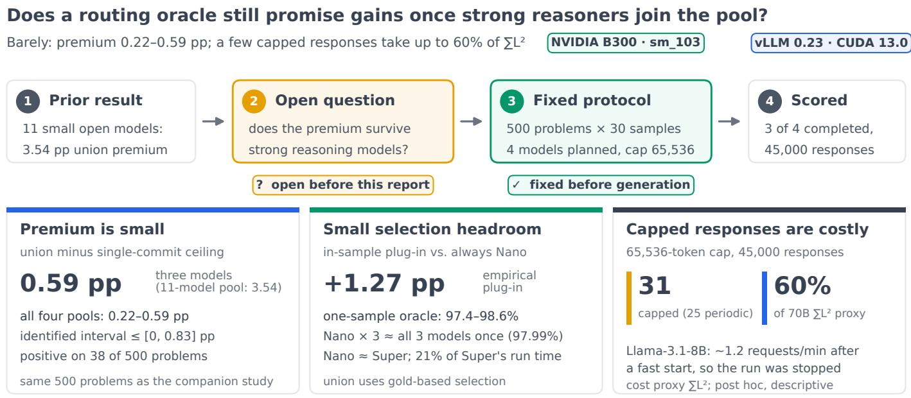  
Fig. 1. Overview. Top: the question; the prior result of the companion study [1], a 3.54 pp union premium for 11 small open models on MATH-500 under its own protocol; and the protocol fixed before generation on one NVIDIA B300, planned for four models, of which three completed (the scoring amendment is described in Section IV). Bottom: the findings. The empirical union premium over the single-commit ceiling is 0.215–0.588 pp across pools. The empirical plug-in selection headroom over always calling Nano is 1.27 pp, an oracle built from one sample per model ranges over 97.4–98.6%, and resampling Nano three times gives practically the same empirical any-correct rate as calling all three models once. Of 45,000 responses, 31 hit the cap, 25 of them with exactl periodic tails; the capped responses take 60.2% of the 70B output-length-squared proxy, and the Llama-3.1-8B run was stopped for cost.

3) A cost account of the decoding budget. A uniform 65,536-token cap truncated 31 of 45,000 responses, 25 with exactly periodic tails, yet the capped responses take up to 60.2% of a model’s output-length-squared proxy, and the 70B run spent 53.9% of its formal wall time on its last 11 requests; we also report how length separates wrong from correct answers and what tighter caps would have cut (Section VII).

4) An auditable execution record. Pre-commitment, seed manifests, an append-only attempt ledger, a gold selfequivalence check, two-launch engine probes and hard ware and software provenance, with every deviation documented and two archive gaps stated (Section IV).

Fig. 1 summarizes the study. Section II positions it, Section III recalls the estimands, Section IV describes the protocol and platform, Sections V–VII report results, Section VIII discusses implications, Section IX states limitations, and Section X concludes.

## II. RELATED WORK

We group prior work into three lines and compare them with this study in Table I.

Routing and its oracle. Cascades such as FrugalGPT [2] (2023) and learned routers such as RouteLLM [3] (2024) select among models per query; RouterBench [4] (2024) standardized the evaluation and its per-query oracle; RouteLLM mainly reports cost–quality trade-offs against a strong-model baseline, and RouterBench also uses graded quality scores. Where an evaluation records one binary correctness label per query and model, its oracle is a union of single samples. Our companion study [1] re-estimated per-cell success from 30 archived samples and formalized the single-commit ceiling, the product-coupling union and the coupling-aware premium interval used here.

Repeated sampling and test-time compute. Selfconsistency [9] (2023), the unbiased pass@k estimator [10] (2021), repeated-sampling scaling [11] (2024) and computeoptimal test-time scaling [12] (2024) show that drawing more samples from one model can rival larger models. Our RoR study [13] (2026) asked whether a fixed call budget is better spent resampling one model or rerouting across models; Section VI gives a direct instance of that comparison.

Length, overthinking and degeneration. Neural text degeneration into repetition is a long-known failure of sampling [14] (2020); for reasoning models, overthinking—long outputs without accuracy gains—is now well documented [15], [16] (2024–2025). We contribute a cost account of the few responses that do not terminate within a fixed cap.

## III. ESTIMANDS

We follow the notation of the companion study [1]. Fix a protocol: queries, model pool P, prompt template, decoder settings, length cap and scorer. For query i and model m, pim is the probability that one sampled response is scored correct.

TABLE I  
POSITIONING AGAINST PRIOR EVALUATIONS. ✓: ADDRESSED; –: NOT ADDRESSED.
<table><tr><td>Study</td><td>Multi-sample cell success rates</td><td>Ceiling vs. union separated</td><td>Protocol fixed before generation</td><td>Current reasoning models</td><td>Decoding-cost accounting</td></tr><tr><td>RouterBench [4]</td><td></td><td></td><td></td><td></td><td></td></tr><tr><td>RouteLLM [3]</td><td></td><td></td><td></td><td></td><td></td></tr><tr><td>Repeated sampling [11]</td><td></td><td></td><td></td><td></td><td></td></tr><tr><td>Routing oracle [1]</td><td>V</td><td></td><td>archived tensors</td><td></td><td></td></tr><tr><td>This report</td><td>√</td><td></td><td>√</td><td></td><td></td></tr></table>

Definition 1 (Ceiling, union and premium). The clairvoyant single-commit ceiling is $R _ { i } \ = \ \operatorname* { m a x } _ { m \in P } p _ { i m } ;$ the named product-coupling union is $\begin{array} { r } { U _ { i } ^ { \perp } = 1 - \prod _ { m \in P } ( 1 - p _ { i m } ) , } \end{array}$ ; the premium is $\Delta _ { i } ^ { \bot } = U _ { i } ^ { \bot } - R _ { i } \geq 0 .$

$R _ { i }$ is the best a router that commits to one model per query can expect, even if it knew every $p _ { i m } ;$ no single-commit policy exceeds it [1]. $U _ { i } ^ { \bot }$ is the success of calling every model once and keeping any correct answer, which presupposes gold based selection and $| P |$ calls; it is not a deployable selector at equal cost. With only the marginals fixed, the attainable union probabilities form the interval $[ R _ { i }$ , min $\{ 1 , \sum _ { m } p _ { i m } \} ]$ , so the premium is only identified up to [0, min $\left\{ 1 , \sum _ { m } p _ { i m } \right\} - R _ { i } ]$ [1]; we report the product value and this interval.

We estimate $p _ { i m }$ by $\hat { p } _ { i m } = c _ { i m } / 3 0$ from the 30 frozen samples, plug it into each estimand per query, and average over the 500 queries. Three further descriptive quantities connect the estimands to practice. The empirical plug-in selection headroom $\hat { R } - \operatorname* { m a x } _ { m } \bar { \hat { p } } _ { m }$ estimates what a clairvoyant per-query router would add over always calling the best single model; because the best model and the per-query maxima are chosen on the same samples, it is an in-sample quantity. The single-draw oracle for sample index j is $\begin{array} { r } { \frac { \bar { 1 } } { 5 0 0 } \sum _ { i } \operatorname* { m a x } _ { m } s _ { i m j } } \end{array}$ , the oracle a benchmark would report from one recorded sample per model. The within-model any-correct rate for k samples is estimated by the unbiased pass@k $1 - \binom { 3 0 - c _ { i m } } { k } \big / \binom { 3 0 } { k }$ [10]. All quantities are descriptive for these fixed queries and this protocol; we make no population claim.

## IV. PROTOCOL AND PLATFORM

## A. Queries, models and decoding

The queries are all 500 problems of MATH-500 [17], [18] (Hugging Face HuggingFaceH4/MATH-500, revision 2343f79f) in source order, each with the instruction to reason step by step and put the final answer in \boxed{}. No subset was drawn, so the query set is identical to the MATH-500 pool of the companion study. Each model received the prompt as a single user message with no system message, rendered by its own pinned chat template.

Table II lists the models and decoding. We used each vendor’s recommended sampling: temperature 0.6 with topp 0.9 for Llama and 0.95 for the Nemotron models, whose native reasoning mode stayed on. Every response is a separate request with $n = 1$ and its own seed, derived by hashing a pre-committed salt with the model, query and sample index; the 60,032 formal and preflight seeds were checked for collisions before any generation. The completion cap was fixed at 65,536 tokens for every model; a response that reached it is scored 0.

TABLE II  
MODELS AND DECODING (PINNED HUGGING FACE REVISIONS).
<table><tr><td>Model</td><td>Revision</td><td> $T$ </td><td>top-p</td><td>Reasoning</td></tr><tr><td>Llama-3.3-70B-Instruct</td><td>6f6073b4</td><td>0.6</td><td>0.9</td><td></td></tr><tr><td>Nemotron Nano 9B v2</td><td>6533e8de</td><td>0.6</td><td>0.95</td><td>on</td></tr><tr><td>Nemotron Super 49B v1.5</td><td>420ba7d2</td><td>0.6</td><td>0.95</td><td>on</td></tr><tr><td colspan="5">All: BF16 weights and KV cache, cap 65,536, 30 samples/query.</td></tr></table>

## B. Scoring

The scorer extracts the last unescaped \boxed{} of the final region—the text after the closing $< / \mathrm { t h i n k } >$ for reasoning models—and compares it with the gold answer using Math-Verify 0.9.0 [19] in a fresh, resource-limited CPU worker per comparison, run strictly serially. Unclosed reasoning, missing or malformed boxes and length-truncated responses score 0. Exceptions handled inside the verifier are recorded per response. A scorer exception that escapes the verifier stops scoring unless it is one of three pre-specified raising locations in the pinned source and reproduces exactly in a fresh worker, in which case it scores 0 and is reported; none occurred. Before scoring, all 500 gold answers passed a self-equivalence check in the same worker.

## C. Pre-commitment, ledger and amendments

Rules, salts, query set, scorer and the confirmatory analysis were written to a dated pre-commitment before any request. That analysis was the ceiling, product union and premium of four-model pools, with no routing headroom. Every generation attempt was registered in an append-only, hash-chained ledger before it started and closed with the hashes of all its files; each model was allowed one infrastructure retry with identical configuration. Each model’s engine was launched twice before preflight to confirm that its resolved configuration, chat template, end-of-sequence tokens and sampling parameters were identical across launches, and an eight-request preflight per model confirmed that every request ran with its manifest seed and that the KV cache was BF16 in the kernels (Nano’s Mamba state was float32 as required).

We record every deviation. Before any generation, the 70B model was changed from Llama-3.1-70B to Llama-3.3-70B, the parent of Super 49B, and two engine-record serializer defects found by the first probes were fixed; each change superseded the commitment with an identical rule set. The plan also included Llama-3.1-8B-Instruct. Its formal run was stopped by the author after three hours, before any response of any model was scored: after a fast start it completed only ∼1.2 requests per minute, so the remaining ∼10,400 requests would have taken several more days (Section VII). The attempt is recorded as quarantined, and a dated amendment replaced the four-model pools with the three-model pools Q1–Q4 (all pairs and the triple) before scoring. Everything else reported here—the premium interval, selection headroom, single-sample oracles, finite-k paths, pass@k, paired tests, subject and level breakdowns, and the length and loop diagnostics—is post hoc and descriptive.

TABLE III EXECUTION PLATFORM.
<table><tr><td>GPU</td><td>1× NVIDIA B300 SXM6 AC (Blackwell) compute capability 10.3, 148 SMs</td></tr><tr><td>GPU memory Power limit</td><td>275,040 MiB HBM, ECC on 1,100 W</td></tr><tr><td>Host link</td><td>PCIe Gen6× 16, KVM pass-through</td></tr><tr><td>CPU / RAM</td><td>30 vCPU AMD EPYC 9575F / 251 GiB Ubuntu 24.04.5, Linux 6.8 / 580.178.04</td></tr><tr><td>OS / driver CUDA stack</td><td>CUDA 13.0, PyTorch 2.11.0+cu130</td></tr><tr><td></td><td>cuDNN 9.19, NCCL 2.28.9</td></tr><tr><td>Engine</td><td>vLLM 0.23.0 (V1), FlashInfer 0.6.12</td></tr><tr><td>Scorer</td><td>Math-Verify 0.9.0, SymPy 1.14.0 Python 3.12.3, separate CPU host</td></tr></table>

Two records are not in the archive. The scorer receipt pins the gold bundle, the dataset revision and the hash of its source file, but the bundle itself was not retrieved from the scoring host; it can be rebuilt from the pinned revision and checked against the recorded hashes. The superseded v3 commitment is identified by its hash in the v4 commitment, but its body is not included.

## D. Platform

Table III summarizes the platform; the full record, including raw nvidia-smi and package dumps, accompanies the data release. Each model ran alone on the GPU through one vLLM [20] engine call containing all 15,000 of its requests.

## V. CEILINGS AND PREMIUMS

## A. Per-model accuracy

Table IV and Fig. 2(a) summarize the three models. Both reasoning models are near the top of the benchmark: Nano and Super each solve 96.1% of all samples (Table IV), and each answers more than 430 problems correctly in all 30 samples. The 70B baseline, Super’s parent, reaches 76.2%. Super beats it on 231 problems and loses on 20; the two reasoning models split their disagreements almost evenly (Nano higher on 41, Super higher on 46). No problem is unsolved by all three models, and 243 problems are solved by every model in every sample.

Sampling noise is also model-dependent. The 70B model has 195 problems with $0 < \hat { p } < 1$ and produces 3.16 distinct final answers per problem on average; Nano and Super have 65 and 63 such problems and 1.54 and 1.37 distinct answers. Single sample labels are therefore far less noisy for the reasoning models, which is consistent with the small premiums below.

## B. Single-commit ceilings and union premiums

Table V and Fig. 3(a) give the main result. Every pool’s ceiling $\bar { \hat { R } }$ lies between 96.67% and 97.40%, and the product union adds between 0.215 and 0.588 pp. Even the marginally identified upper end of the premium, the largest union any coupling consistent with the measured marginals could produce, is at most 0.827 pp. The premium is positive on at most 38 of the 500 problems.

Holding the protocol fixed and changing only the pool, the premium ranges from 0.215 to 0.588 pp, consistent with the companion’s finding that pool composition is a material conditioning choice [1]. The contrast with the companion study is illustrative rather than controlled. On the same 500 problems, its 11-model pool had a full-pool product premium of 3.54 pp and an identified interval of [0, 4.79] pp [1]; here the full-pool premium is 0.588 pp and the interval [0, 0.827] pp, about onesixth of both. Models, pool size, temperature and length cap all differ, so this is not an effect of model strength; it shows that the premium is not a fixed property of the benchmark. Pairing Super with its parent (Q1) leaves the smallest premium, 0.215 pp: once Super is in the pool, calling the 70B model as well almost never helps.

Fig. 4(a) shows where the premium lives. It is non-zero only where no model is certain, and is bounded by $1 - \hat { R } _ { i }$ ; with two models above 96%, few problems leave room for a union to add anything.

## C. From best model to oracle

Table S2 and Fig. 3(b) decompose the distance from the best single model to the union. Always calling Nano yields 96.13%. Committing to the model with the highest estimated success on each problem gives the empirical ceiling of 97.40%, an empirical plug-in selection headroom of 1.27 pp; the product union adds 0.588 pp more. This is the companion’s decomposition [1] instantiated with a baseline selected on the same data. The true ceiling bounds every single-commit policy, but 1.27 pp is a plug-in estimate from 30 samples per cell, not a guaranteed router gain or an upper bound on one.

The last column and the grey bands of Fig. 3(a) show how single-sample oracles can mislead. A benchmark that recorded one sample per model and computed its oracle would report, for the three-model pool, anything from 97.4% to 98.6% depending only on which sample it kept (mean 97.98%, essentially $\hat { U } ^ { \perp } )$ For the 70B–Super pair the range is 95.2–98.0%, a swing of nearly 3 pp that dwarfs both the selection headroom (0.58 pp) and the premium (0.215 pp) it would be read as.

## D. Finite-sample behavior

The premium estimate depends on how many samples are used. Fig. 5(a) recomputes it from the first k of the 30 frozen samples. With one sample per cell every pˆ is 0 or 1, so the plugin premium is identically 0.00; it rises to 0.48 pp at $k = 1 0$ and 0.588 pp at k = 30 for the three-model pool. A rising prefix path is not evidence of convergence. The companion shows that, under iid sampling within cells and independent streams across models, the plug-in premium has non-positive bias in expectation [1]; drawing every response with its own seed brings the present design closer to those assumptions without proving them. A single-sample oracle, by contrast, can land above or below the 30-sample union depending on which sample is kept. Both are reasons to report k alongside any oracle number.

TABLE IV  
PER-MODEL RESULTS OVER 500 × 30 SAMPLES.
<table><tr><td>Model</td><td>Acc. (%)  $\hat { p }$ </td><td>All-30 correct</td><td>None-30 correct</td><td>Median tokens</td><td>p99 tokens</td><td>Capped at 65,536</td></tr><tr><td>Llama-3.3-70B</td><td>76.19</td><td>260</td><td>45</td><td>463</td><td>2,039</td><td>6</td></tr><tr><td>Nemotron Nano  $9 \mathrm { B } \ \mathrm { v } 2$ </td><td>96.13</td><td>433</td><td>2</td><td>1,890</td><td>18,096</td><td>9</td></tr><tr><td>Nemotron Super  $4 9 \mathrm { B } \ \mathrm { v } 1 . 5$ </td><td>96.09</td><td>431</td><td>6</td><td>2,249</td><td>22,804</td><td>16</td></tr></table>

(a) Nano and Super solve 431–433 problems in all 30 samples  
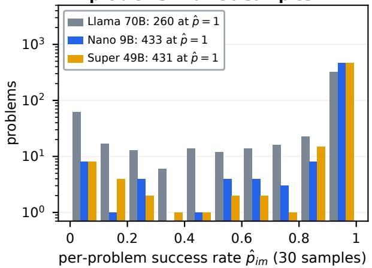

(b) 70B: 96% → 54% from level 1 to 5; the reasoners stay above 91%  
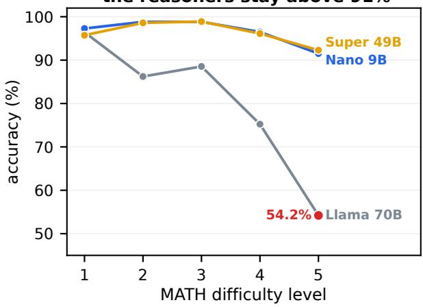  
Fig. 2. Per-model results. (a) Distribution of per-problem success rates $\hat { p } _ { i m }$ over 30 samples (log scale); the legend gives the number of problems each model solves in every sample. (b) Accuracy by MATH difficulty level.

(a) Ceilings reach 96.7–97.4%; the union adds only 0.22–0.59 pp  
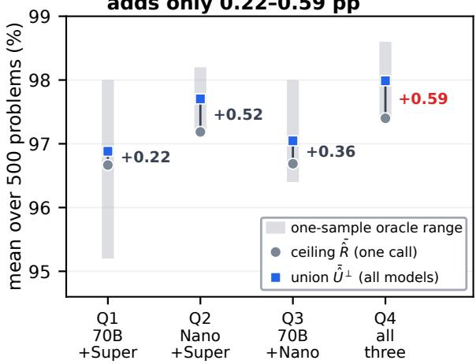

(b) Plug-in headroom exceeds the premium in every pool  
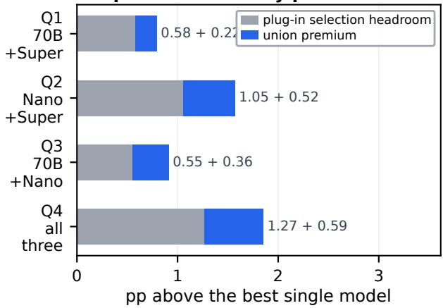  
Fig. 3. Ceilings and premiums per pool (Q1 = 70B + Super, Q2 = Nano + Super, Q3 = 70B + Nano, Q4 = all three). (a) Single-commit ceiling $\bar { \hat { R } }$ (one call, clairvoyant), product union $\hat { U } ^ { \perp }$ (all models, gold-based selection) and the premium between them; the grey band is the range, over the 30 sample indices, of an oracle computed from one recorded sample per model. (b) Gain over the best single model, split into empirical plug-in selection headroom (R¯ˆ minus the best model’s accuracy) and union premium $\begin{array} { r } { ( \bar { \hat { U } } ^ { \bar { \perp } } - \bar { \hat { R } } ) , } \end{array}$ in percentage points.

## E. Where the premium arises

Table S3, Fig. 2(b) and Fig. 4(b) break the results down by subject and difficulty. The 70B model falls from 96.4% on level-1 problems to 54.2% on level 5, while Nano and Super stay above 91% (91.5% and 92.3% on level 5). The premium concentrates on the hardest level (1.34 pp) and on geometry (2.01 pp), the subject on which all three models are weakest; it is zero on number theory.

TABLE V  
SINGLE-COMMIT CEILING, PRODUCT-COUPLING UNION AND PREMIUM PER POOL, WITH THE MARGINALLY IDENTIFIED PREMIUM INTERVAL OF [1]. MEANS OVER 500 PROBLEMS; PP = PERCENTAGE POINTS.
<table><tr><td>Pool</td><td>Members</td><td>k</td><td> $\hat { \hat { R } } \left( \% \right)$ </td><td> $\bar { \hat { U } } ^ { \perp } \left( \mathcal { I } _ { o } \right)$ </td><td> $\bar { \hat { \Delta } } ^ { \perp } \mathsf { \Gamma } ( \mathsf { p p } )$ </td><td>Marginal interval (pp)</td></tr><tr><td>Q1</td><td> $7 0 \mathrm { B } + \mathrm { S u p e r }$ </td><td>2</td><td>96.67</td><td>96.88</td><td>0.215</td><td>[0, 0.400]</td></tr><tr><td>Q2</td><td> $\mathrm { N a n o + S u p e r }$ </td><td>2</td><td>97.19</td><td>97.70</td><td>0.518</td><td>[0, 0.760]</td></tr><tr><td>Q3</td><td> $7 0 \mathrm { B } + \mathrm { N a } \mathrm { { n o } }$ </td><td>2</td><td>96.69</td><td>97.05</td><td>0.360</td><td>[0, 0.653]</td></tr><tr><td>Q4</td><td> $7 0 \mathrm { { B } + N a n o + S u p e r }$ </td><td>3</td><td>97.40</td><td>97.99</td><td>0.588</td><td>[0, 0.827]</td></tr></table>

(a) The premium appears only where no model is certain (38 of 500 problems)  
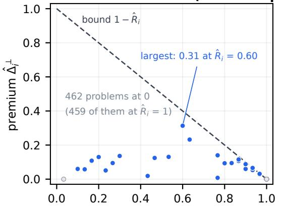

(b) Geometry and level 5 carry the largest premium  
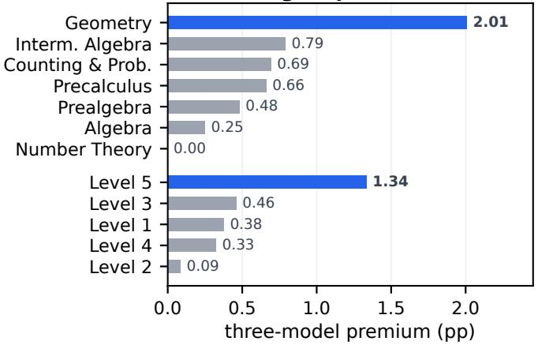  
per-problem ceiling $\hat { R } _ { j }$ (three-model pool)  
Fig. 4. Where the premium arises. (a) Per-problem premium against ceiling for the three-model pool; it is bounded by $1 - { \hat { R } } _ { i }$ and is zero whenever some model solves the problem in every sample. (b) Three-model premium by subject and by difficulty level.

(a) Few samples hide the premium: 0 at $k = \bar { \bf 1 } ,$ 0.59 pp at $k = 3 0$ (Q4)  
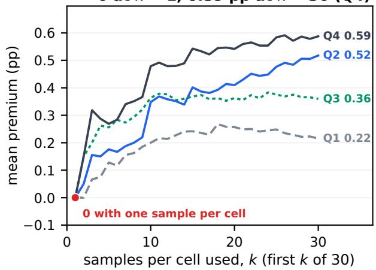

(b) Nano sampled 3 times ≈ all three models once (point estimates)  
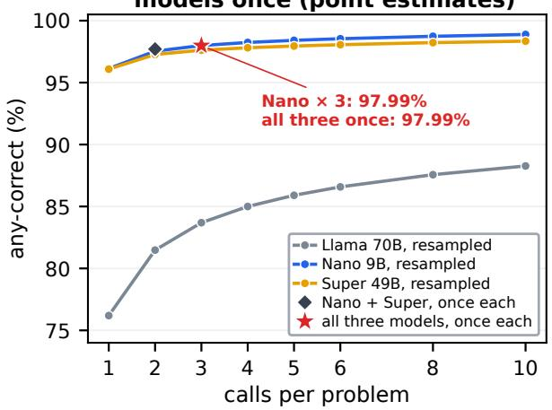  
Fig. 5. Sampling. (a) Mean plug-in premium recomputed from the first k of the 30 frozen samples per cell; with one sample every pˆ is 0 or 1 and the plug-in premium is identically zero. (b) Any-correct rate against calls per problem: resampling one model (lines, unbiased pass@k) versus calling different models once (markers, product union); gold-based selection in both.

## F. Paired comparisons

Table S4 reports exploratory two-sided Wilcoxon signedrank tests on the per-problem differences in success counts and a Friedman test across the three models, over these 500 fixed problems. Super and Nano each exceed the 70B model by about 20 pp $( p < 1 0 ^ { - 1 5 } )$ ). The Nano–Super difference of +0.05 pp is not significant; this does not establish that the two models are equivalent.

## VI. RESAMPLE OR REROUTE

The union compares calling several models; an obvious alternative at the same number of calls is to sample the same model several times [11], [13]. Table S5 and Fig. 5(b) put the two side by side, with gold-based any-correct selection in both. Resampling Nano three times reaches 97.99%, practically the same as calling all three models once (97.99%; no equivalence test was run); with two calls, Nano twice (97.54%) is within 0.2 pp of Nano plus Super (97.70%). At an equal number of calls, the excess of the union over the ceiling can therefore be matched without model diversity, in line with the companion’s point that the union premium is not an equal-cost routing gain [1]. Nano’s formal run took 21% of Super’s wall time for the same 15,000 requests (one batch each, including loading and the long-response tail; Section VII), so resampling the small reasoning model looks like the cheaper option on these problems; the cost of a three-call strategy was not measured. Resampling cannot rescue a weak model: the 70B model reaches only 91.0% even with all 30 samples.

## VII. THE COST OF THE DECODING BUDGET

## A. The cap rarely binds

Fig. 6(a) shows the length distributions. Ninety-nine percent of responses end below 2,039, 18,096 and 22,804 tokens for the 70B, Nano and Super models. Only 31 of 45,000 responses reached 65,536 tokens (6, 9 and 16).

To check whether the cap cut off genuine reasoning, we inspected only token IDs, after generation and without gold. In 25 of the 31 capped responses the last 4,096 tokens repeat exactly with a period of at most 2,048 tokens (Table S6; the test required 95% of positions to match, and all 25 match on every position), four of them a single token repeated; this describes the tail, not the whole response. All capped responses have a tiny share of distinct tokens in their tail (Fig. 6(b)); for Nano and Super no response that ended normally has a tail as repetitive as any capped one. The 70B separation is weaker, because five of its few long normal responses also repeated before stopping. Truncating the existing outputs post hoc (Table S7) shows that a 32,768-token cap would have cut 2 and 5 correct answers of Nano and Super and none of the 70B model’s; this re-scores existing outputs and is not a run with a smaller cap, so it cannot show what a larger cap would have recovered.

## B. A few capped responses take an outsized share of a lengthsquared proxy

In a dense Transformer each generated token attends to all earlier ones, so the quadratic part of a response’s attention cost grows with the square of its length. The capped responses are at most 0.11% of each model’s responses but account for 11.4%, 12.8% and 60.2% of the output-length-squared proxy $\textstyle \sum _ { r } L _ { r } ^ { 2 }$ for Nano, Super and 70B (Fig. 7(a)); the periodic-tail subset alone accounts for 10.2%, 11.2% and 30.1% (Table S6). The proxy is not measured GPU time, ignores length-linear costs, and overstates the cost for Nano, a hybrid Mamba–Transformer whose Mamba layers scale linearly with length. The engine’s progress clock shows a matching concentration in wall time: the 70B run completed its first 14,989 requests in 31 minutes and its last 11 requests took a further 39.65 minutes, 53.9% of its 73.6-minute formal run including model loading.

The fourth planned model points in the same direction. Llama-3.1-8B hit the cap in 2 of its 8 preflight requests. In its formal run it finished 4,354 responses within twelve minutes and then only ∼1.2 requests per minute: after 3.0 hours, 4,565 of 15,000 were done. With several more days in prospect, the run was stopped before any scoring and the model removed (Section IV). Its formal responses were never scored or inspected, so we report this as an observation consistent with the pattern above, not as a measured loop rate.

TABLE VI  
FORMAL-RUN EXECUTION ON THE B300 (ONE ENGINE CALL PER MODEL,15,000 REQUESTS). THROUGHPUT INCLUDES MODEL LOADING AND THELONG-RESPONSE TAIL.
<table><tr><td>Model</td><td>Wall (min)</td><td>Output tokens</td><td>Tokens/s</td><td>Capped</td></tr><tr><td>Llama-3.3-70B</td><td>74</td><td>9.5M</td><td>2,147</td><td>6</td></tr><tr><td>Nemotron Nano 9B v2</td><td>78</td><td>46.0M</td><td>9,806</td><td>9</td></tr><tr><td>Nemotron Super 49B v1.5</td><td>368</td><td>57.3M</td><td>2,597</td><td>16</td></tr></table>

## C. Execution cost and length as a signal

Table VI lists the wall-clock cost of each run. Nano generated 46.0 M tokens in 78 minutes and Super 57.3 M tokens in 368 minutes; at nearly equal observed accuracy, Nano needed 5.4 GPU-minutes per 1,000 correct answers against 25.5 for Super (formal wall time, including loading), a 4.7× difference on this GPU.

Wrong answers are also much longer than correct ones (Table S8, Fig. 7(b)). The median wrong answer of Nano is 9,924 tokens against 1,833 for a correct one, and of Super 12,265 against 2,184; wrong answers are 3.9% of the reasoning models’ responses but about 15% of their tokens. Length alone separates wrong from correct responses with an AUROC of 0.89 (Nano) and 0.88 (Super). This is a post hoc description, not an evaluated early-stopping rule, but it suggests where budget-aware decoding could save compute.

## VIII. DISCUSSION

Relation to the companion study. The new data support two of the companion’s empirical premises: pool composition alone moves the premium under one protocol, and at an equal number of calls resampling one strong model practically matches the multi-model union (as point estimates). The remaining quantities instantiate its definitions on a new pool. Relative to the companion’s 11-model pool (3.54 pp), the present premium is about one-sixth as large, but models, pool size and decoding protocol changed together, so the contrast shows that an oracle premium is a property of a pool and protocol rather than of the benchmark; it does not isolate an effect of model strength. Because each response was drawn with its own seed, the product coupling is closer to a design property than in the archived setting; the same-index union differs from the product value by less than 0.01 pp, which is compatible with, but does not establish, cross-model independence.

Implications for routing evaluation. An oracle gap is not evidence of routing headroom unless it is reported together with the pool, the decoding protocol, the number of samples per cell, and its split into selection headroom and union premium. On MATH-500 with these models, the empirical plug-in selection headroom over a single strong model is 1.27 pp, an in-sample quantity rather than a bound on a learned router; a small headroom in accuracy can still coexist with useful cost savings, which this study did not evaluate.

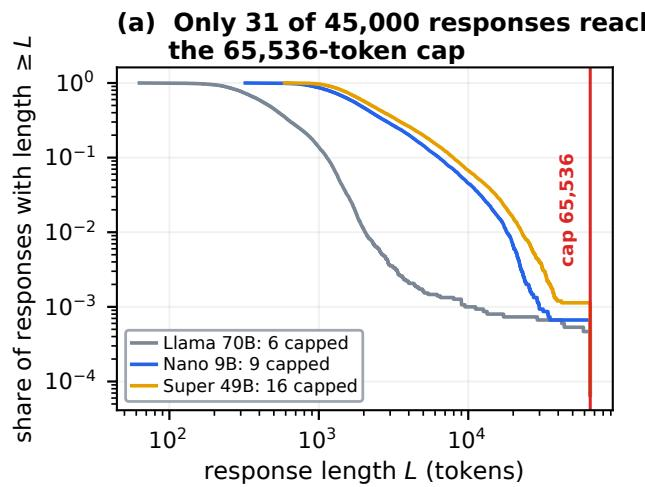

(b) 25 of 31 capped tails are strict repetition loops  
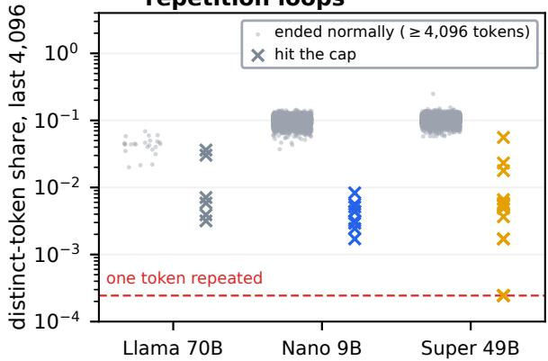

Fig. 6. Runaway generations. (a) Share of responses at least L tokens long; the red line is the 65,536-token cap. (b) Share of distinct tokens in the last 4,096 tokens of responses that ended normally (grey, length ≥ 4,096) and of responses that hit the cap (×); the dashed line marks a single token repeated.  
(a) At most 0.11% of responses, up to 60% of the ∑L² length proxy  
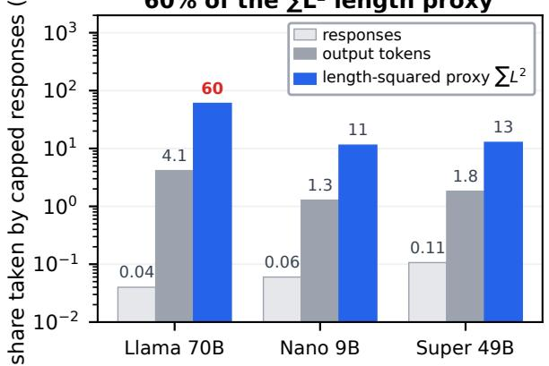

(b) Wrong answers are 2.2–5.6× longer (AUROC 0.82–0.89)  
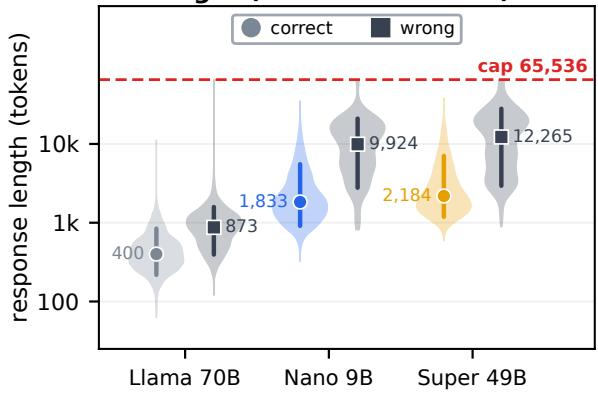  
Fig. 7. Cost of the decoding budget. (a) Share of responses, output tokens and the output-length-squared proxy $\textstyle \sum L ^ { 2 }$ taken by capped responses (log scale). (b) Length distributions of correct and wrong responses (shaded, log scale) with medians and 10–90% ranges.

Implications for deployment. Two observations are relevant to anyone serving reasoning models. First, NVIDIA’s NASderived Super 49B is about 20 pp more accurate than the 70B model it was derived from, and the 9B Nano reaches Super’s observed accuracy in 21% of Super’s formal-run wall time; on this benchmark, resampling a small strong reasoner reaches practically the same empirical any-correct rate as a three-model ensemble, with gold-based selection in both. Second, a handful of capped generations take 11.4–60.2% of the length-squared proxy and, for the 70B run, stretch the end of the batch; whether detecting them early would save time without losing answers was not evaluated.

## IX. LIMITATIONS

The results describe three models, one benchmark near its ceiling, one decoding protocol and one GPU. MATH-500 leaves little room at the top; the companion study found the largest premium on GPQA-Diamond [1], which we did not run. The comparison with the 11-model pool spans different models, temperatures and caps, so it cannot isolate model strength. The union and resampling rates use gold-based selection and are not deployable selectors. The removal of Llama-3.1-8B is a deviation from the original plan, made for cost before scoring. Our loop diagnostic and cost proxy are post hoc and descriptive; the length-squared proxy assumes dense attention, and throughput includes loading and tail effects of a single large engine call. Only one scorer channel was used, so robustness to the scorer is not tested, and the gold bundle is identified by hashes rather than included in the archive.

## X. CONCLUSION

Under a protocol fixed before generation, 45,000 samples from three current models on MATH-500 show that the empirical premium a hindsight oracle adds over the empirical single-commit ceiling is at most 0.588 pp with strong reasoning models in the pool, against 3.54 pp for the companion’s small model pool under a different protocol; that an oracle built from one sample per model can differ from the 30-sample union by more than the premium itself; and that resampling the smallest strong model gives practically the same empirical any-correct rate as a three-model union. The uniform 65,536- token cap was reached by 31 responses, most with periodic tails, yet these few responses take 11.4–60.2% of a lengthsquared proxy of decoding cost. Routing papers should report the ceiling, the premium, the samples per cell and the decoding budget together; the execution record is archived to make that possible.

## ARTIFACT STATEMENT

The run record and all code are archived on Zenodo (DOI 10.5281/zenodo.23724735). The archive holds the dated pre-commitments (v1, v2 and v4) and the scoring amendment, the seed manifests, the append-only attempt ledger with perfile hashes, the engine-probe and preflight receipts, all 45,000 scored responses with their scorer statuses, the quarantined Llama-3.1-8B attempt, the platform record, the generation, scoring and analysis code with its tests, and the source of this report; one script regenerates every number, table and figure from the archived record. Two records are missing: the gold bundle, which the scorer receipt pins by hash together with the dataset revision and can be rebuilt from it, and the body of the superseded v3 commitment, which the v4 commitment identifies by hash. Host IP addresses and hardware serial numbers were removed from operational logs before release, and every hash-bound file is byte-identical to the original. The code is released under the MIT License and the run record under CC BY 4.0; model responses remain subject to the licences of the models that produced them (Llama 3.3 Community License; NVIDIA Open Model License).

## DISCLOSURES

During the preparation of this work, the author used OpenAI Codex and Anthropic Claude to assist with code implementation, experiment execution and monitoring, adversarial checks, LaTeX drafting, and language editing. The author independently determined the research questions, protocol, estimands and final claims; reviewed and edited all assisted output; and takes full responsibility for the code, data, figures, analysis, and contents of the article. All reported numerical results were produced by recorded generation, scoring and analysis code over frozen run artifacts rather than by generative text output.

The author is the founder of Krixvon; no Krixvon product, data, funding, or other resource was used in this research.

This research received no specific grant from funding agencies in the public, commercial, or not-for-profit sectors.

## REFERENCES

[1] T.-R. Chen, “What does a routing oracle measure under stochastic decoding? Coupling, scorer choice, and single-commit ceilings,” 2026, arXiv:2607.03436.

[2] L. Chen, M. Zaharia, and J. Zou, “FrugalGPT: How to use large language models while reducing cost and improving performance,” 2023, arXiv:2305.05176.

[3] I. Ong, A. Almahairi, V. Wu, W.-L. Chiang, T. Wu, J. E. Gonzalez, M. W. Kadous, and I. Stoica, “RouteLLM: Learning to route LLMs with preference data,” 2024, arXiv:2406.18665.

[4] Q. J. Hu, J. Bieker, X. Li, N. Jiang, B. Keigwin, G. Ranganath, K. Keutzer, and S. K. Upadhyay, “RouterBench: A benchmark for multi-LLM routing system,” 2024, arXiv:2403.12031.

[5] A. Grattafiori et al., “The Llama 3 herd of models,” 2024, arXiv:2407.21783.

[6] NVIDIA, “NVIDIA Nemotron Nano 2: An accurate and efficient hybrid Mamba-Transformer reasoning model,” 2025, arXiv:2508.14444.

[7] A. Bercovich et al., “Llama-Nemotron: Efficient reasoning models,” 2025, arXiv:2505.00949.

[8] A. Bercovich et al., “Puzzle: Distillation-based NAS for inferenceoptimized LLMs,” 2024, arXiv:2411.19146.

[9] X. Wang, J. Wei, D. Schuurmans, Q. Le, E. Chi, S. Narang, A. Chowdhery, and D. Zhou, “Self-consistency improves chain of thought reasoning in language models,” in Proc. Int. Conf. Learn. Represent. (ICLR), 2023, arXiv:2203.11171.

[10] M. Chen et al., “Evaluating large language models trained on code,” 2021, arXiv:2107.03374.

[11] B. Brown, J. Juravsky, R. Ehrlich, R. Clark, Q. V. Le, C. Ré, and A. Mirhoseini, “Large language monkeys: Scaling inference compute with repeated sampling,” 2024, arXiv:2407.21787.

[12] C. Snell, J. Lee, K. Xu, and A. Kumar, “Scaling LLM test-time compute optimally can be more effective than scaling model parameters,” 2024, arXiv:2408.03314.

[13] T.-R. Chen, “Resample or reroute? Budget-aware test-time model selection for large language models,” 2026, arXiv:2607.08665.

[14] A. Holtzman, J. Buys, L. Du, M. Forbes, and Y. Choi, “The curious case of neural text degeneration,” in Proc. Int. Conf. Learn. Represent. (ICLR), 2020, arXiv:1904.09751.

[15] X. Chen et al., “Do NOT think that much for 2+3=? On the overthinking of o1-like LLMs,” 2024, arXiv:2412.21187.

[16] Y. Sui et al., “Stop overthinking: A survey on efficient reasoning for large language models,” 2025, arXiv:2503.16419.

[17] D. Hendrycks, C. Burns, S. Kadavath, A. Arora, S. Basart, E. Tang, D. Song, and J. Steinhardt, “Measuring mathematical problem solving with the MATH dataset,” in Proc. NeurIPS Datasets and Benchmarks Track, 2021, arXiv:2103.03874.

[18] H. Lightman, V. Kosaraju, Y. Burda, H. Edwards, B. Baker, T. Lee, J. Leike, J. Schulman, I. Sutskever, and K. Cobbe, “Let’s verify step by step,” in Proc. Int. Conf. Learn. Represent. (ICLR), 2024, arXiv:2305.20050.

[19] Hugging Face, “Math-Verify: A robust mathematical expression evaluation system,” https://github.com/huggingface/Math-Verify, 2025, version 0.9.0, commit 664828c9.

[20] W. Kwon, Z. Li, S. Zhuang, Y. Sheng, L. Zheng, C. H. Yu, J. E. Gonzalez, H. Zhang, and I. Stoica, “Efficient memory management for large language model serving with PagedAttention,” in Proc. ACM Symp. Operating Systems Principles (SOSP), 2023, arXiv:2309.06180.

## SUPPLEMENTARY MATERIAL

## S1. SCORER OUTCOMES

Table S1 lists every scorer status. Responses with a verifierhandled exception were all scored 0 by the unchanged rule and are reported separately; no pre-specified deterministic scorer failure occurred.

TABLE S1  
SCORER STATUS COUNTS PER MODEL (15,000 RESPONSES EACH).
<table><tr><td>Scorer status</td><td>70B</td><td>Nano</td><td>Super</td></tr><tr><td>correct</td><td>11429</td><td>14420</td><td>14413</td></tr><tr><td>not equivalent</td><td>3507</td><td>556</td><td>526</td></tr><tr><td>length-truncated</td><td>6</td><td>9</td><td>16</td></tr><tr><td>reasoning unterminated</td><td>0</td><td>0</td><td>13</td></tr><tr><td>reasoning malformed</td><td>0</td><td>0</td><td>1</td></tr><tr><td>no boxed answer</td><td>0</td><td>2</td><td>0</td></tr><tr><td>boxed empty</td><td>0</td><td>0</td><td>1</td></tr><tr><td>boxed unbalanced</td><td>1</td><td>0</td><td>0</td></tr><tr><td>unparseable (handled exc.)</td><td>38</td><td>11</td><td>30</td></tr><tr><td>not equivalent (handled exc.)</td><td>19</td><td>2</td><td>0</td></tr><tr><td>total</td><td>15000</td><td>15000</td><td>15000</td></tr></table>

## S2. ADDITIONAL TABLES FOR SECTIONS V AND VI

Tables S2–S5 give the decomposition plotted in Fig. 3, the per-subject and per-level results, the paired tests, and the resample-versus-reroute comparison.

TABLE S2  
FROM THE BEST SINGLE MODEL TO THE UNION, PER POOL $( \mathrm { Q 1 } = 7 0 \mathrm { B } +$ SUPER, Q2 = NANO + SUPER, $\mathrm { Q 3 } = 7 0 \mathrm { B } + \mathrm { N A N O } .$ $\mathrm { Q } 4 = \mathrm { A L I }$ L THREE). HEADROOM $\equiv \hat { R }$ MINUS THE BEST SINGLE MODEL’S ACCURACY; PREMIUM $= \hat { U } ^ { \perp } - \hat { R } ;$ THE ONE-SAMPLE ORACLE RANGE IS THE MINIMUM AND MAXIMUM, OVER THE 30 SAMPLE INDICES, OF AN ORACLE COMPUTED FROM ONE RECORDED SAMPLE PER MODEL.
<table><tr><td>Pool</td><td>Best (%)</td><td> $\bar { \hat { R } }$  (%)</td><td> $\bar { \hat { U } } ^ { \perp }$  (%)</td><td>Headroom (pp)</td><td>Premium (pp)</td><td>One-sample oracle (%)</td></tr><tr><td>Q1</td><td>96.09</td><td>96.67</td><td>96.88</td><td>0.58</td><td>0.215</td><td>95.2–98.0</td></tr><tr><td>Q2</td><td>96.13</td><td>97.19</td><td>97.70</td><td>1.05</td><td>0.518</td><td>97.2-98.2</td></tr><tr><td>Q3</td><td>96.13</td><td>96.69</td><td>97.05</td><td>0.55</td><td>0.360</td><td>96.4–98.0</td></tr><tr><td>Q4</td><td>96.13</td><td>97.40</td><td>97.99</td><td>1.27</td><td>0.588</td><td>97.4–98.6</td></tr></table>

TABLE S3  
ACCURACY (%) PER MODEL AND THREE-MODEL PREMIUM $\bar { \Delta } _ { Q 4 } ^ { \perp }$ (PP) BY SUBJECT AND DIFFICULTY LEVEL.
<table><tr><td>Subject / level</td><td>n</td><td>70B</td><td>Nano</td><td></td><td>Super Premium</td></tr><tr><td>Algebra</td><td></td><td>12493.6</td><td>99.5</td><td>99.4</td><td>0.25</td></tr><tr><td>Counting &amp; Prob.</td><td></td><td>38 74.4</td><td>95.7</td><td>97.6</td><td>0.69</td></tr><tr><td>Geometry</td><td></td><td>41 54.0</td><td>85.9</td><td>85.8</td><td>2.01</td></tr><tr><td>Interm. Àlgebra</td><td></td><td>97 59.0</td><td>94.5</td><td>93.9</td><td>0.79</td></tr><tr><td>Number Theory</td><td>62</td><td>80.0</td><td>99.6</td><td>99.6</td><td>0.00</td></tr><tr><td>Prealgebra</td><td></td><td>82 87.9</td><td>95.0</td><td>94.8</td><td>0.48</td></tr><tr><td>Precalculus</td><td></td><td>56 63.5</td><td>97.0</td><td>97.1</td><td>0.66</td></tr><tr><td>Level 1</td><td></td><td>43 96.4</td><td>97.3</td><td>95.7</td><td>0.38</td></tr><tr><td>Level 2</td><td></td><td>9086.2</td><td>98.8</td><td>98.6</td><td>0.09</td></tr><tr><td>Level 3</td><td>105</td><td>88.5</td><td>98.8</td><td>98.9</td><td>0.46</td></tr><tr><td>Level 4</td><td>128</td><td>75.2</td><td>96.5</td><td>96.1</td><td>0.33</td></tr><tr><td>Level 5</td><td></td><td>134 54.2</td><td>91.5</td><td>92.3</td><td>1.34</td></tr></table>

TABLE S4

EXPLORATORY TWO-SIDED WILCOXON SIGNED-RANK TESTS ON PER-PROBLEM DIFFERENCES IN SUCCESS COUNTS (ZERO DIFFERENCES DROPPED, SCIPY 1.13.1) AND A FRIEDMAN TEST.
<table><tr><td>Comparison</td><td>Mean diff. (pp) Non-zero</td><td></td><td>W</td><td>p</td></tr><tr><td>Super – 70B</td><td>+19.89</td><td>251</td><td></td><td> $1 , 2 6 6 . 5 \ < 1 0 ^ { - 1 5 }$ </td></tr><tr><td>Nano — Super</td><td>+0.05</td><td>87</td><td>1,714</td><td>0.392</td></tr><tr><td>Nano - 70B</td><td>+19.94</td><td>243</td><td></td><td> $1 , 1 3 8 . 5 \ < 1 0 ^ { - 1 5 }$ </td></tr><tr><td>Friedman, 3 models</td><td></td><td></td><td></td><td> $\chi ^ { 2 } = 3 1 5 . 8 ~ < 1 0 ^ { - 1 5 }$ </td></tr></table>

TABLE S5

RESAMPLE VERSUS REROUTE AT EQUAL CALLS (GOLD-BASED ANY-CORRECT; UNBIASED PASS@k FOR RESAMPLING, PRODUCT UNION FOR REROUTING).
<table><tr><td>Calls</td><td>Strategy</td><td>Type</td><td>Any-correct (%)</td></tr><tr><td>2</td><td>Nano, 2 samples</td><td>resample</td><td>97.54</td></tr><tr><td>2</td><td>Super, 2 samples</td><td>resample</td><td>97.27</td></tr><tr><td>2</td><td>Nano + Super (Q2)</td><td>reroute</td><td>97.70</td></tr><tr><td>3</td><td>Nano, 3 samples</td><td>resample</td><td>97.99</td></tr><tr><td>3</td><td>Super, 3 samples</td><td>resample</td><td>97.62</td></tr><tr><td>3</td><td>70B + Nano + Super (Q4)</td><td>reroute</td><td>97.99</td></tr></table>

## S3. ADDITIONAL TABLES FOR SECTION VII

Tables S6–S8 give the capped-response counts, the post hoc tighter-cap analysis, and the length statistics.

TABLE S6  
CAPPED RESPONSES: COUNT, EXACTLY PERIODIC TAILS, AND THEIR SHARE OF RESPONSES, OUTPUT TOKENS AND THE OUTPUT-LENGTH-SQUARED PROXY $\sum { L } ^ { 2 } ;$ ; THE LAST COLUMN IS THE SHARE TAKEN BY THE PERIODIC-TAIL SUBSET ALONE.
<table><tr><td>Model</td><td>Capped Periodic</td><td></td><td colspan="3">Share taken by capped (%)</td><td>Periodic</td></tr><tr><td></td><td></td><td>tail</td><td>responses tokens</td><td></td><td> $\textstyle \sum L ^ { 2 }$ </td><td>∑  $L ^ { 2 }$  (%)</td></tr><tr><td>Llama 70B</td><td>6</td><td>3</td><td>0.040</td><td>4.15</td><td>60.2</td><td>30.1</td></tr><tr><td>Nano 9B</td><td>9</td><td>8</td><td>0.060</td><td>1.28</td><td>11.4</td><td>10.2</td></tr><tr><td>Super 49B</td><td>16</td><td>14</td><td>0.107</td><td>1.83</td><td>12.8</td><td>11.2</td></tr></table>

TABLE S7  
POST HOC: CORRECT ANSWERS LOST AND OUTPUT TOKENS SAVED UNDER TIGHTER CAPS.
<table><tr><td>Model</td><td>Correct lost / tokens saved (%) cap 8,192</td><td>cap 16,384</td><td>cap 32,768</td></tr><tr><td>Llama 70B</td><td>0.01 / 5.4</td><td>0.00 / 4.3</td><td>0.00 / 2.6</td></tr><tr><td>Nano 9B</td><td>4.64 /  11.6</td><td>0.51 / 2.8</td><td>0.01 / 0.7</td></tr><tr><td>Super 49B</td><td>7.33 /  16.4</td><td>1.19 / 5.3</td><td>0.03 /  1.0</td></tr></table>

TABLE S8

LENGTH OF CORRECT AND WRONG RESPONSES, SHARE OF WRONG RESPONSES AND OF THEIR OUTPUT TOKENS, AUROC OF LENGTH AS A WRONG-ANSWER SIGNAL, AND GPU-MINUTES PER 1,000 CORRECT ANSWERS.
<table><tr><td rowspan="2">Model</td><td colspan="2">Median tokens</td><td colspan="2">Wrong share (%)</td><td colspan="2">AUROC GPU-min</td></tr><tr><td>correct</td><td>wrong</td><td>resp.</td><td>tokens</td><td>length</td><td>per 1k</td></tr><tr><td>Llama 70B</td><td>400</td><td>873</td><td>23.8</td><td>42.6</td><td>0.82</td><td>6.4</td></tr><tr><td>Nano 9B</td><td>1,833</td><td>9,924</td><td>3.9</td><td>14.7</td><td>0.89</td><td>5.4</td></tr><tr><td>Super 49B</td><td>2,184</td><td>12,265</td><td>3.9</td><td>15.1</td><td>0.88</td><td>25.5</td></tr></table>