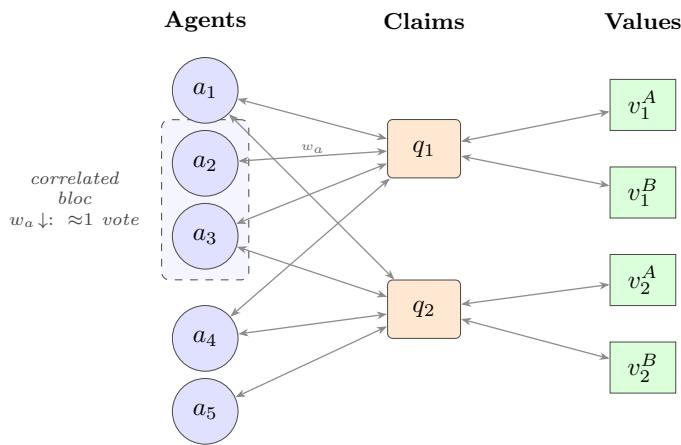
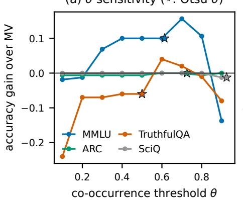
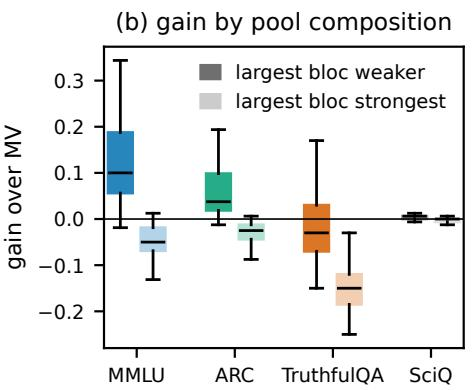
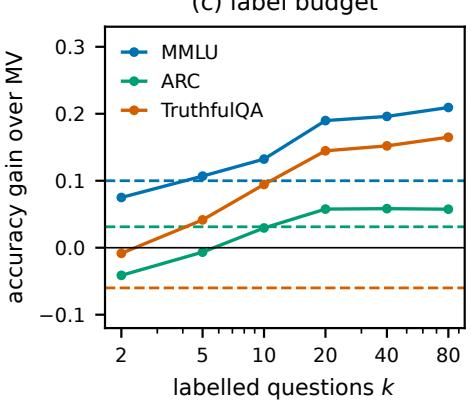
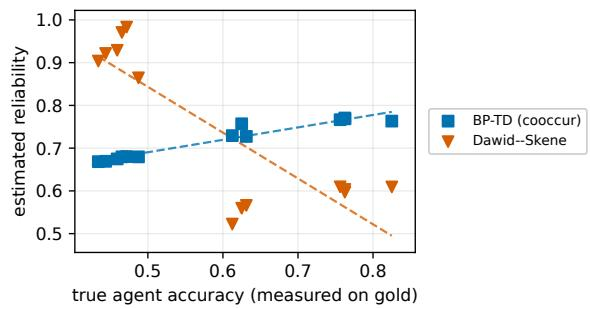
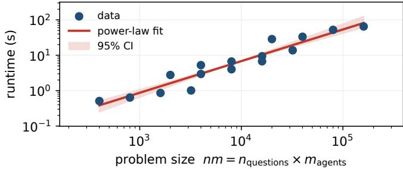
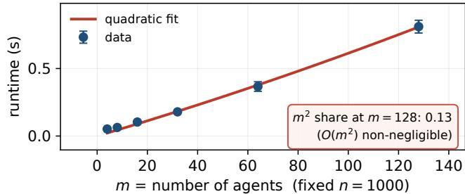
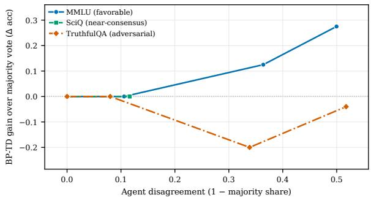
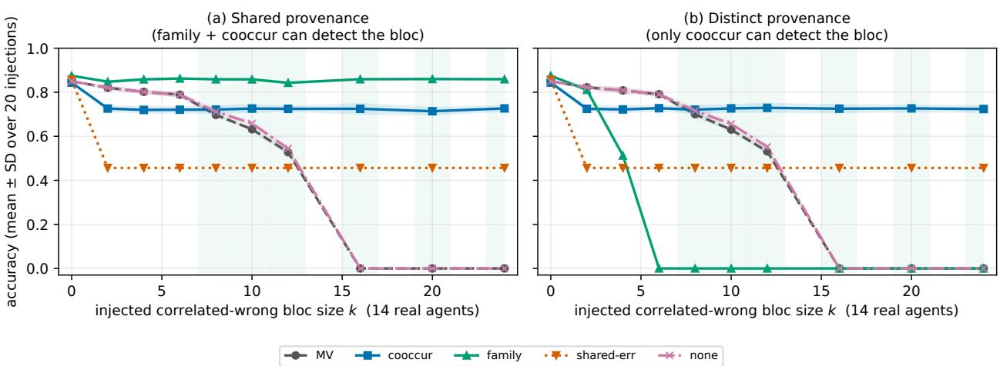

# Where Is the Truth When AI Agents Disagree?

Dependence-Aware Belief Propagation for Unsupervised Truth Discovery

[Extended Version]

Laure Berti-Equille

IRD, ESPACE-DEV

Montpellier, France

laure.berti@ird.fr

Abstract— LLM agents often give conflicting answers to the same question, and many deployed agents are variants of one base model, so their errors are correlated. We study truth discovery among such agents: inferring the true answer and each agent’s reliability without labels. Classical truth-discovery and crowdsourcing estimators reward an agreeing bloc and can fall below majority vote. We propose BP-TD, which adds peragent decorrelation weights to mean-field variational inference on a one-coin Dawid–Skene model, so that agents sharing a base model count together as about one vote. Its first iteration is exactly a weighted vote; later iterations estimate agent reliability. With 13 local agents on MMLU, BP-TD beats majority vote without any labels (0.716 vs. 0.624 on 160 questions; 0.707 vs. 0.674 on 10,000) and ranks agents by their true accuracy, which classical estimators invert. The gain depends on the pool: over 2,852 sub-pools of four benchmarks, decorrelation helps when the largest correlated bloc is weaker than the other agents and hurts when it is the strongest, and we found no label-free statistic that tells the two cases apart. Labels change the picture quickly: with 20 labelled questions, selecting the single best agent is more accurate than every aggregator we tested on MMLU, ARC and TruthfulQA.

Index Terms—truth discovery, LLM agents, source depen dence, variational inference, data quality, ensembling

## I. INTRODUCTION

Ask the same factual question to several large language model (LLM) agents and you will often get several different answers: on a multiple-choice item, one model answers A, another B, a third abstains. As LLM agents are wired together into pipelines, debates, and mixtures, this disagreement is no longer a curiosity but an operational problem—a system must commit to one answer, ideally the true one, and ideally without paying for ground-truth labels at every step. Deciding which answer to trust is exactly truth discovery (TD): a dataquality problem with two decades of theory for conflicting Web sources and crowd workers [1], [2], [3], [4]. Whether that theory transfers to AI agents, and when it does, has not been characterized.

The gap. Classical TD rests on a structural assumption: sources are conditionally independent given the truth, so that agreement is evidence of correctness and reliability can be estimated from how often a source sides with the emerging consensus. This assumption is routinely violated by AI agents for a reason specific to them: deployed agents are frequently variants of the same base model—prompt personas, self-consistency samples, or retrieval wrappers around one LLM—so their errors are strongly correlated. Reliabilityby-agreement then rewards a correlated bloc that may be confidently and unanimously wrong, and the standard TD machinery inverts: it can rank the agreeing-but-wrong majority as most reliable.

Our approach. We propose BP-TD, which places a peragent decorrelation weight $w _ { a }$ inside mean-field variational inference on a one-coin Dawid–Skene model. Agents that share a base model, or that agree with each other far more than chance, share one vote. The weights come either from provenance or from answer co-occurrence, with no labels. The first iteration of BP-TD is exactly a $w _ { a } \mathrm { - w e i g h t e d }$ plurality vote; later iterations add per-agent reliability estimates. We test the method on 13 local agents and four benchmarks, against classical, dependence-aware and concurrent LLM-aggregation methods, and we vary the agent pool to find out when decorrelation helps and when it hurts.

## Contributions.

C1. Why classical TDfails on LLM agents. Reliability estimators that reward agreement rank a correlated bloc of weak agents as the most reliable and fall below majority vote. The same implementations work on independent agents, so the failure comes from the dependence, not from the estimators.

C2. A decorrelation method and what each part does. BP-TD discounts dependence groups found from provenance or from answer co-occurrence. We show that its first iteration is a weighted vote, separate the effect of the weights from that of iteration and of the threshold choice, and give label-free settings of its one hyperparameter.

C3. When agent truth discovery helps. Decorrelation helps when the largest correlated bloc is weaker than the other agents and hurts when it is the strongest; this holds across thousands of sub-pools of four benchmarks and in a controlled stress test. The gain on MMLU survives at 10,000 questions. Twenty labels are worth more than any aggregation we tested, so BP-TD is useful when labels cannot be had and the pool’s largest bloc is not its strongest.

The code, the cached agent answers with provenance, and every script behind the numbers below are released.

## II. RELATED WORK

Classical truth discovery. A large body of work jointly estimates source trust and claim belief by iterating between the two. Iterative fixed-point methods include TruthFinder [1] and the Investment and Sums/Hubs–Authorities schemes [6], while CRH and CATD [3] cast the problem as joint optimization with confidence-aware weighting; earlier fixed-point corroboration [18], correlation-aware fusion [31], and knowledge fusion over machine-extracted triples [19] broaden the family (surveyed in [21], [22], [23]), and controlled evaluations find no estimator dominates across source regimes [20], [24]. These methods are unsupervised and effective when sources err independently, but they provide no account of why a method should be expected to help on a given workload—the regime question we make central.

Crowdsourcing aggregation. Latent-variable models treat each source as a noisy annotator and infer a confusion structure: Dawid–Skene estimates per-annotator error rates by EM [4], and LTM extends this with a generative Bayesian treatment of truth and reliability [5]; further variants estimate annotator ability and item difficulty (GLAD [27]), infer confusability by minimax entropy [28], or aggregate by message passing—order-optimal in [26], variational/BP in [29]— with a uniform benchmark of seventeen such methods [25]. Belief propagation over the Dawid–Skene model is itself established and provably optimal under independent annotators [13]; our contribution is the dependence-aware decorrelation layer that keeps inference valid when annotators—here, agents—are correlated, which that line does not address. Our messagepassing update reduces to a one-coin Dawid–Skene model when agent weights are uniform; the contribution is not the latent-variable machinery but the dependence-aware weighting layered on top of it.

Source dependence and copying. A key assumption of the above is conditional independence of sources, which copying violates. Dong et al. [2] detect copying among Web sources from shared false values and down-weight copied evidence, with global detection of complex copying networks across many sources [30]; in crowdsourcing, spectral and coupledconfusion methods handle correlated annotators beyond independent Dawid–Skene [12]. Large-scale evidence confirms the phenomenon directly for LLMs: higher-capability and sameprovider models make correlated errors even across architectures [14]. Our setting is the agent analogue: agents that share a base model exhibit correlated errors by construction. We adapt this intuition with family- and agreement-based discounting so that a correlated bloc counts as roughly one effective vote, and we show that a shared-error signal—the direct copy-detection analogue—degrades when the dependent bloc is the majority.

LLM ensembling, self-consistency, and debate. Recent work aggregates multiple LLM samples or agents— self-consistency [8], multi-agent debate [10], mixture-ofagents style ensembling [9], learned pairwise-ranking fusion [32], sampling-and-voting at scale [33], juries of diverse judges [34], and LLM-as-a-judge evaluation [35], often leaning on self-reported model confidence [11]—generally assuming a cooperative crowd whose members add complementary signal. Reference-free aggregation of LLM judges has been studied directly [15], and recent analyses question the diversity assumption: mixing distinct models can underperform ensembling a single strong one [16], and correlated judges cap panel gains regardless of the aggregation rule [17]. Concurrent work aggregates dependent LLM judges with second-order answer statistics (ISP and OW [36]), with Ising models of judge dependence [37], or by separating quality from shared confounders (CARE [38]). The Ising aggregator is defined for binary labels only, so we use a mean-field surrogate.

What is new here. BP-TD builds on one-coin Dawid–Skene inference [4], [29], discounting of dependent sources [2], [31], and grouping of correlated voters (our ClusterVote baseline). What differs with BP-TD is the dependence signal it uses: provenance or raw answer co-occurrence, never the current truth estimate, which we show is circular when the dependent bloc is the majority. It differs from cluster voting in keeping soft per-agent weights inside a reliability model rather than collapsing each group to one hard vote; on MMLU, with identical groups, this is worth +0.043 (Sec. VI-B). The main empirical finding—decorrelation helps when the largest correlated bloc is weaker than the other agents and hurts when it is the strongest—is not specific to BP-TD: any rule that discounts a group of agreeing agents gives up that group’s votes, which costs accuracy exactly when the group is right.

Signed graphs. Balance theory and signed bipartite graph neural networks [7] exploit the sign of relations for representation learning. We use signed agreement for the opposite purpose: not to embed agents, but to detect correlated blocs and decorrelate their votes during inference, keeping the aggregator unsupervised and label-blind.

## III. PROBLEM FORMULATION

We are given a set of agents $A ~ = ~ \{ a _ { 1 } , \ldots , a _ { m } \}$ (here, LLM-based answerers) responding to a set of questions $Q =$ $\{ q _ { 1 } , \ldots , q _ { n } \}$ , where each question $q$ has a known, finite answer set $V _ { q }$ of size $| V _ { q } |$ . For each $( a , q )$ pair, agent a either asserts a single value $y _ { a q } \in V _ { q }$ or abstains; let $A _ { q } \subseteq A$ denote the agents that answer $q .$ We seek, with no gold labels at inference time, (i) the latent truth $t _ { q } ^ { \star } \in V _ { q }$ for every question, and (ii) a scalar reliability $r _ { a } \in [ 0 , 1 ]$ for every agent, used as a relative ranking score, not a calibrated probability of correctness (BP-TD recovers the ranking, not the magnitude).

We represent the observations as a tripartite agent–question– value graph (Fig. 1): nodes are agents, questions, and candidate values, and an edge $( a , q , v )$ exists iff $y _ { a q } = v$ . This makes the inference structure explicit—belief flows from agents to questions (which value is likely true) and back from questions to agents (how reliable each agent is).

The dependence problem. Classical truth discovery and the Dawid–Skene model [4] assume agents are conditionally independent given the truth, so that agreement is evidence of correctness. This assumption is violated for LLM ensembles: agents that share a base model, a prompt template, or a retrieval corpus produce correlated errors, and a single such bloc can manufacture a spurious majority. Our goal is therefore aggregation that down-weights dependent agents so a correlated bloc contributes roughly one effective vote.

  
Fig. 1. The agent–question–value graph and the two messages of BP-TD. An edge links an agent to the value it asserts on a question. Truth update (agents→questions, Eq. 1): each agent sends its weighted vote wa E log ra to the value it chose. Reliability update (questions→agents, Eqs. 2–3): each agent receives the current belief in the values it asserted, which updates its Beta reliability. Dashed box: a dependence group (agents on one base model); each member’s vote is scaled by wa, so the group counts as about one vote.

## IV. METHOD: BP-TD

BP-TD combines (i) variational message passing on a onecoin Dawid–Skene factor graph with (ii) a per-agent decorrelation weight $w _ { a }$ that encodes how much an agent’s vote should count given its dependence on others. On terminology: the inference is mean-field variational message passing (coordinate ascent on the evidence lower bound), not sum-product belief propagation. We keep the name BP-TD because the updates are messages passed along the edges of the agent–question– value graph of Fig. 1, and loopy BP and mean-field updates share this structure; the estimator itself is the mean-field one below.

## A. Variational message passing

We adopt a one-coin observation model: with probability $r _ { a }$ agent a emits the true value, and otherwise emits a value drawn uniformly from the $| V _ { q } | { - } 1$ wrong alternatives. Placing a Be $\tan ( \alpha _ { 0 } , \beta _ { 0 } )$ prior on each $r _ { a } ,$ mean-field variational inference factorizes the posterior over the question beliefs $b _ { q } ( \cdot )$ and the reliabilities $r _ { a }$ , and alternates two closed-form updates:

$$
\begin{array} { r } { \log b _ { q } ( v ) \propto \sum _ { a \in A _ { q } } w _ { a } \big [ \mathbf { 1 } [ y _ { a q } = v ] \mathbb { E } \log r _ { a } } \end{array}
$$

$$
+ \ \mathbf { 1 } [ y _ { a q } \neq v ] \big ( \mathbb { E } \log ( 1 - r _ { a } ) - \log ( | V _ { q } | - 1 ) \big ) \big ] ,
$$

$$
\begin{array} { r } { \alpha _ { a } = \alpha _ { 0 } + \sum _ { q } b _ { q } ( y _ { a q } ) , } \end{array}\tag{1}
$$

(2)

$$
\begin{array} { r } { \beta _ { a } = \beta _ { 0 } + \sum _ { q } \big ( 1 - b _ { q } ( y _ { a q } ) \big ) . } \end{array}\tag{3}
$$

Intuition. The truth update (Eq. 1) is a weighted vote: each answering agent adds $w _ { a }$ E log $r _ { a }$ to its asserted value and a smaller $w _ { a } \mathbb { E } \log ( 1 - r _ { a } )$ to the $| V _ { q } | - 1$ competitors, so reliable agents push their answer harder while $w _ { a }$ shrinks the influence of dependent agents. The reliability update (Eqs. 2–3) is conjugate Beta accounting: $\alpha _ { a }$ accumulates the belief mass on $\therefore { } a \mathbf { \hat { s } } { }$ chosen value $( \sum _ { q } b _ { q } ( y _ { a q } ) )$ and $\beta _ { a }$ the complementary mass, so $\mathbb { E } [ r _ { a } ] = \alpha _ { a } / ( \hat { \alpha } _ { a } \hat { + \beta _ { a } } )$ rises for agents that agree with confident consensus. The two updates form a soft, EMstyle loop; setting $w _ { a } \equiv 1$ removes decorrelation and recovers one-coin Dawid–Skene / SSTF-VI.

One pass is a weighted vote. At initialization every agent has the same prior reliability, so E log $r _ { a }$ and $\mathbb { E } \log ( 1 - r _ { a } )$ are the same constants for all a. Eq. (1) then gives log $b _ { q } ( v ) =$ $\begin{array} { r } { c _ { q } + \kappa \sum _ { a \in A _ { a } } w _ { a } \mathbf { 1 } [ y _ { a q } = v ] } \end{array}$ with $\kappa = \mathbb { E } \log r - \mathbb { E } \log ( 1 - r ) +$ $\log ( | V _ { q } | - 1 ) { \quad \stackrel { } { > } \quad } 0 .$ , so the first truth update ranks values exactly as the $w _ { a }$ -weighted plurality vote. A single pass $( T { = } 1 )$ therefore predicts the weighted vote, and with $w _ { a } \equiv 1$ it predicts majority vote. Reliability estimation affects the predicted answers only from the second iteration on. We report both the one-pass weighted vote and the iterated estimator, and state the iteration count of every BP-TD row.

Why $w _ { a }$ tempers the likelihood. The weights are not part of the generative model; they enter Eq. (1) as exponents on each agent’s likelihood term. This is a composite (power) likelihood: when k agents are near-copies, the product of their k likelihood terms counts the same evidence k times, and raising each to the power $1 / k$ restores roughly one $\mathrm { c o p y } ^ { \bullet } \mathrm { s }$ worth of evidence. The update for $b _ { q }$ stays a closed-form coordinate-ascent step for this tempered objective, and the reliability update (Eqs. 2–3) is unchanged. A generative model of dependence (e.g. a latent bloc variable) would replace this heuristic correction; we leave that to future work.

## B. Dependence-aware decorrelation

The decorrelation weight $w _ { a } ~ \in ~ ( 0 , 1 ]$ is the core contribution: it discounts an agent in proportion to the size of the dependent bloc it belongs to, so that a k-agent bloc contributes $\textstyle \sum _ { a \in { \mathrm { b l o c } } } w _ { a }$ ≈ 1 effective vote rather than k. We compare three ways to define the blocs, ordered by how much external information they require:

family (structural). Agents sharing a base-model family form one cluster; $w _ { a } = 1 / \vert \mathrm { f a m i l y } ( a ) \vert$ |. Requires only provenance (which base model produced each agent), no observed answers. Cheapest, label-free, fixed.

cooccur (empirical, truth-free). Discount each agent by its number of above-threshold neighbors in the signed cooccurrence graph—how often two agents give the same answer, regardless of whether it is correct: $w _ { a } = 1 / { \left( 1 + \right. }$ $| \{ b : \operatorname { a g r e e } ( a , b ) \geq \theta \} | )$ , so an agent that agrees with $k { - } 1$ others counts as ${ \approx } 1 / k$ of a vote. Uses the answer matrix but not any estimate of truth. Adapts to behavior without trusting the current belief.

shared error (truth-aware). Following copy detection on shared false values [2], cluster agents that agree on the same likely-wrong answers, where “wrong” is read off the current beliefs $b _ { q } ;$ recomputed each iteration. Most principled in principle—correlated mistakes are the strongest dependence signal.

Why shared\_error fails when family/cooccur succeed. shared\_error defines dependence relative to the inferred truth: two agents are dependent if they share errors. But when the dependent bloc is the majority, it defines the belief $b _ { q } \mathrm { - } { \mathrm { t h e } }$ bloc’s answers look correct, so its members appear to share no errors and escape discounting. The measure is thus circular precisely in the regime it is meant to fix: it trusts the consensus to decide who is correlated, but the correlation is what corrupts the consensus. By contrast, family (provenance) and cooccur (raw agreement) never consult the bloc-defined truth, so they detect and discount a dominant bloc regardless of whether it is currently winning the vote—which is why they are robust (Sec. VI). The signed-agreement view underlying cooccur connects to balance theory on signed graphs [7], used here to decorrelate rather than to embed.

## C. Algorithm and complexity

Algorithm 1 summarizes BP-TD. Let $\begin{array} { r } { | E | = \sum _ { q } | A _ { q } | \leq } \end{array}$ nm be the number of asserted answers. Each iteration costs $O ( | E |$ $| \bar { V } | )$ for the truth update (Eq. 1) plus $O ( | E | )$ for the reliability update (Eqs. 2–3), and the dependence step costs $O ( m ^ { 2 } )$ for cooccur/shared\_error (pairwise agent agreement) or $O ( m )$ for family. Per iteration this is $O ( n m | \bar { V } | + m ^ { 2 } )$ linear in the data and quadratic only in the (small) agent count; total cost is that times the number of iterations T.

Algorithm 1 BP-TD: dependence-aware variational truth dis  
covery   
1: Input: answers $\left\{ y _ { a q } \right\}$ , value sets $\{ V _ { q } \} ,$ prior $( \alpha _ { 0 } , \beta _ { 0 } ) ,$   
dependence mode ∈ {family, cooccur, shared\_error},   
iterations T, optional seed set S   
2: Init: $\mathbb { E } [ r _ { a } ]  \hat { \alpha } _ { 0 } / ( \alpha _ { 0 } + \beta _ { 0 } ) ; b _ { q } $ uniform on $V _ { q }$ ▷ clamp $b _ { q }$   
$f o r \ q \in S$ to seeds   
3: Compute $w _ { a }$ ▷ family/cooccur precomputed once;   
shared\_error recomputed in the loop   
4: for τ = 1 to T do   
5: for all questions $q \not \in S$ do   
6: update $b _ { q } ( v )$ via Eq. (1) and normalize   
7: end for   
8: for all agents a do   
9: update $\alpha _ { a } , \beta _ { a }$ via Eq. $( 2 ) ; \mathbb { E } [ r _ { a } ] \gets \alpha _ { a } / \big ( \alpha _ { a } + \beta _ { a } \big )$   
10: end for   
11: smooth $\mathbb { E } [ r _ { a } ]$ over the signed agreement graph (weight λ)   
12: if mode = shared\_error then   
13: recompute $w _ { a }$ from current $b _ { q }$   
14: end if   
15: end for   
16: Output: t⋆q = arg maxv $b _ { q } ( v )$ and reliabilities $\mathbb { E } [ r _ { a } ]$

## D. Variants

One-pass runs a single truth+reliability update $( T { = } 1 )$ , the cheapest setting, and is exactly the $w _ { a } \cdot$ -weighted vote shown above. Full loopy iterates Eqs. (1)–(2) to convergence, which is the default and the variant behind every $\mathrm { ^ { 6 6 } B P \mathrm { - } T D ^ { 3 } }$ row unless a row is marked one-pass. Two further steps run in each iteration. The truth messages are damped $( b _ { q } \gets 0 . 7 b _ { q } ^ { \mathrm { n e w } } + 0 . 3 b _ { q } ^ { \mathrm { o l d } } )$ The reliability means are then smoothed over the signed agreement graph W (agreement minus disagreement rate per agent pair): $\begin{array} { r } { \bar { r } _ { a } \gets \frac 1 2 + ( 1 - \lambda ) ( \bar { r } _ { a } - \frac 1 2 ) + \lambda \sum _ { b } W _ { a b } ( \bar { r } _ { b } - \frac 1 2 ) / \sum _ { b } | W _ { a b } | } \end{array}$ with $\lambda = 0 . 4$ , so an agent that agrees with reliable agents and disagrees with unreliable ones gains reliability. Iteration stops when the largest belief change is below $1 0 ^ { - 4 }$ (at most 100 iterations); the mean iteration count per dataset and variant is given with each result table (7–21 for most rows; 93 on SciQ when $\theta { = } 0 . 2$ is selected, where beliefs converge slowly near unanimity). Removing the smoothing $( \lambda = 0 )$ changes fullset MMLU accuracy by less than 0.013 (Sec. VI-B). Semisupervised seeding clamps a fraction S of questions to known answers, which propagates through the reliability update to calibrate the rest; we evaluate only on $Q \backslash S$

## V. EXPERIMENTAL SETUP

We evaluate BP-TD under a deliberately conservative, leakage-free protocol and report every operating point— including those unfavorable to our method.

a) Agent pool: The pool has 13 answering agents built on 5 base models, all served locally via Ollama (no external API calls). Table I lists every agent with its base model and accuracy. The pool combines (i) six direct-prompting agents (qwen2.5:14b, qwen2.5:7b, llama3.2, mistral, phi3.5, gemma2; the two qwen2.5 sizes share one base model); (ii) two self-consistency agents (five sampled chains, majority over chains); (iii) three persona agents; and (iv) two retrieval-augmented (RAG) agents. Terminology: an agent is one answering configuration; its base model (or family) is the underlying LLM; a dependence group is a set of agents that BP-TD discounts together, defined either by base model (family) or by answer agreement (cooccur). Three further configurations were run and are excluded because they never produced a parseable answer: two deepseek-r1 reasoning agents returned only truncated <think> traces at the harvest token budget, and an external CLI agent (OpenClaw) had no headless command configured. OpenClaw is kept in the released answer files as an all-abstain row; it casts no vote and does not change any result. The pool is intentionally correlated: the mean signed pairwise agreement (agree minus disagree per co-answered question, $\in \ [ - 1 , 1 ] )$ is 0.33–0.35 on MMLU and TruthfulQA (raw agree-rate ≈0.66). It is also unbalanced in a way that matters for the results: on MMLU the largest dependence group (6 llama3.2 agents) is the least accurate (0.43–0.49), while the second group (4 qwen2.5 agents) is the most accurate (0.76–0.83). Some agents are exact or near copies: the three qwen2.5:7b agents have the same accuracy on MMLU, TruthfulQA and ARC. Sec. VI-C varies this composition.

b) Datasets: Four closed-book multiple-choice benchmarks, all answered by the same pool. MMLU (160 questions, stride-sampled across subjects) has high disagreement among agents. SciQ (160) is grade-school science on which almost every agent is right. TruthfulQA-MC1 (100) is adversarial by construction: popular misconceptions are offered as wrong answers. ARC-Challenge (160) is grade-school reasoning with moderate disagreement. For scale we use two further MMLU harvests of 5,000 and 10,000 questions answered by the same 13 agents served with vLLM in half precision (Sec. VI-E). The SciQ and TruthfulQA harvests cover their full question sets only at this size; we did not harvest them at larger scale. A BoolQ pilot is reported in Appendix B; it is not a valid closed-book test because 11 of the 13 agents did not see the passage the task requires.

TABLE I  
AGENT POOL: BASE MODEL, AGENT TYPE, AND ACCURACY PER DATASET (MEASURED ON GOLD, ON ANSWERED QUESTIONS). OPENCLAW NEVER ANSWERS.
<table><tr><td>Agent</td><td>Base model</td><td>Type</td><td>MMLU</td><td>SciQ</td><td>TQA</td><td>ARC</td></tr><tr><td>direct:qwen2.5:14b</td><td>qwen2.5</td><td>direct</td><td>0.825</td><td>0.988</td><td>0.810</td><td>0.919</td></tr><tr><td>direct:qwen2.5:7b</td><td>qwen2.5</td><td>direct</td><td>0.762</td><td>0.981</td><td>0.740</td><td>0.906</td></tr><tr><td>rag:qwen2.5:7b</td><td>qwen2.5</td><td>RAG</td><td>0.762</td><td>0.975</td><td>0.740</td><td>0.906</td></tr><tr><td>sc:qwen2.5:7b</td><td>qwen2.5</td><td>self-cons.</td><td>0.756</td><td>0.981</td><td>0.740</td><td>0.906</td></tr><tr><td>sc:1lama3.2:latest</td><td>llama3.2</td><td>self-cons.</td><td>0.487</td><td>0.950</td><td>0.520</td><td>0.744</td></tr><tr><td>rag:1lama3.2:latest</td><td>llama3.2</td><td>RAG</td><td>0.472</td><td>0.969</td><td>0.520</td><td>0.731</td></tr><tr><td>direct:llama3.2:latest</td><td>llama3.2</td><td>direct</td><td>0.465</td><td>0.950</td><td>0.531</td><td>0.725</td></tr><tr><td>persona:cautious</td><td>llama3.2</td><td>persona</td><td>0.459</td><td>0.950</td><td>0.580</td><td>0.713</td></tr><tr><td>persona:expert</td><td>llama3.2</td><td>persona</td><td>0.444</td><td>0.956</td><td>0.540</td><td>0.694</td></tr><tr><td>persona:skeptic</td><td>llama3.2</td><td>persona</td><td>0.434</td><td>0.925</td><td>0.580</td><td>0.694</td></tr><tr><td>direct:mistral:7b</td><td>mistral</td><td>direct</td><td>0.631</td><td>0.944</td><td>0.560</td><td>0.762</td></tr><tr><td>direct:phi3.5:latest</td><td>phi3.5</td><td>direct</td><td>0.625</td><td>0.981</td><td>0.500</td><td>0.850</td></tr><tr><td>direct:gemma2:2b</td><td>gemma2</td><td>direct</td><td>0.613</td><td>0.931</td><td>0.440</td><td>0.694</td></tr><tr><td>openclaw</td><td>openclaw</td><td>CLI</td><td></td><td></td><td></td><td></td></tr></table>

c) Baselines: Majority vote (MV); the classical TD and crowdsourcing estimators Dawid–Skene, TruthFinder, Investment, Sums, CRH, CATD, LTM, WeightedMV and SSTF-IV/VI [3], [1], [4], [6], [5]; the dependence-aware ACCU and DEPEN [2], [30], correlation fusion (PochampallyCorr) [31], a mean-field Ising aggregator over the signed agreement graph (IsingMF), and ClusterVote (agents grouped by agreement $\geq \theta ,$ each group casting one vote decided by its internal majority); and the concurrent LLM aggregators CARE-SVD [38] and ISP / OW-I [36]. For LTM, our singletruth implementation sets each agent’s false-positive rate to $( 1 - \mathrm { s e n s i t i v i t y } ) / ( | V _ { q } | - 1 )$ , which makes its update identical to one-coin Dawid–Skene; its predictions coincide with Dawid– Skene on every dataset, so we report one row. CARE is run from the authors’ released code: each (question, option) pair becomes a binary item scored 1 if the agent chose it, and the option with the highest CARE score is predicted. Its structurelearning step needs an invertible judge-correlation matrix; our pools contain agents with identical answers, which makes the matrix singular, and the published solver then returns no solution on most splits (341 of 520 solves on MMLU, all on the other datasets). We therefore report CARE with a small ridge $( 1 0 ^ { - 3 } I )$ added to the correlation matrix, and give the unmodified results in Appendix A. ISP and OW-I have no released code; we implement them from the paper’s equations, estimating the second-order statistics from answer co-occurrence. Two single-agent references bound the value of labels: the best agent selected on the validation half (ties broken at random) and, in Sec. VI-F, the best agent selected on k labelled questions.

d) Protocol and test of record: Each dataset is split 40 times at random into a validation half and a test half. Methods with a hyperparameter select it on the validation half (grids in Appendix A) and are scored on the test half; label-free methods are scored on the test half directly. We report the mean test accuracy over the splits. One test is used for every comparison: the Nadeau–Bengio corrected resampled-t over the splits, which accounts for the overlap between splits, with Holm correction across all comparisons in a table. A method marked “val.-tuned” uses the labels of the validation half to pick its hyperparameter and is therefore not label-free; every BP-TD variant marked “no labels” fixes θ in advance (0.5) or sets it with the label-free Otsu rule (Sec. VI-B), or does not use θ (family). BP-TD is label-blind: its predictions are identical when the gold labels are shuffled or erased.

e) Reproducibility and data availability: We release the BP-TD implementation, all baselines, the harvested agent answers with base-model provenance, the agent prompts and persona texts, and the split seeds on GitHub (https://github. com/LaureBerti/BPTD) and as an archived artifact on Zenodo (DOI: 10.5281/zenodo.21294747, all versions; the version used in this paper is v2.0.0, 10.5281/zenodo.23916537), released under the MIT license. Every number above is recomputable on CPU from the bundled cached answers, with no model re-querying; we redistribute only the derived agent answers from the public MMLU, TruthfulQA, SciQ and ARC benchmarks, not the source corpora.

## VI. RESULTS

We first compare all methods on the four benchmarks (Sec. VI-A), then take BP-TD apart to see where its gain comes from (Sec. VI-B), vary the agent pool (Sec. VI-C), and finally look at reliability recovery, scale, labels, and the regime question (Secs. VI-D–VI-G).

## A. Main comparison

Table II gives every method on every benchmark. MMLU is the only benchmark on which any aggregator significantly beats majority vote, and only decorrelated BP-TD does so: every BP-TD variant with decorrelation reaches 0.713–0.751 against 0.624 for majority vote, including the three variants that use no labels (0.713–0.716). The classical estimators and the concurrent aggregators do not beat majority vote; Dawid– Skene, Investment and SSTF-VI are significantly below it. Correlation fusion (PochampallyCorr, 0.743) is numerically close to BP-TD with θ tuned (0.751); the difference is not significant (p=1.0 after Holm), and correlation fusion’s splitto-split spread is twice BP-TD’s (SD 0.085 vs. 0.046). We therefore do not claim that BP-TD beats correlation fusion; we claim that it beats majority vote and the classical estimators, and that it does so without labels.

On SciQ every method is at or near 0.97: almost all agents are right, so there is nothing to correct. On TruthfulQA no aggregator beats majority vote, decorrelated BP-TD is below it (not significantly), and Dawid–Skene, Investment, ISP and OW-I are significantly below it. On ARC, BP-TD family is the best label-free aggregator (0.879 vs. 0.847), but the gain is not significant. On all four benchmarks the best agent selected with the validation labels is the most accurate method (0.823, 0.976, 0.801, 0.905).

TABLE II  
ACCURACY ON THE TEST HALVES, MEAN OVER 40 SPLITS. $^ { + } / { } ^ { - } ;$ SIGNIFICANTLY ABOVE/BELOW MAJORITY VOTE (NADEAU–BENGIO CORRECTED RESAMPLED-t, HOLM-CORRECTED WITHIN THE DATASET). [n]: MEAN NUMBER OF ITERATIONS OF LOOPY BP-TD; ROWS MARKED ONE-PASS USE ONE ITERATION. CARE, ISP AND OW-I WERE RUN ON THE SAME SPLITS IN A SEPARATE PASS (HOLM FAMILY OF 7). BOLD: BEST AGGREGATOR PER COLUMN (THE BEST-AGENT ROW USES LABELS AND IS EXCLUDED).
<table><tr><td>Method</td><td>MMLU (160)</td><td>SciQ (160)</td><td>TruthfulQA (100)</td><td>ARC (160)</td></tr><tr><td>Majority vote (MV)</td><td>0.624</td><td>0.969</td><td>0.650</td><td>0.847</td></tr><tr><td>BP-TD cooccur, θ val.-tuned</td><td>0.751+ [12]</td><td>0.969 [92]</td><td>0.629 [14]</td><td>0.842 [18]</td></tr><tr><td>one-pass = weighted vote</td><td>0.715+</td><td>0.969</td><td>0.622</td><td>0.843</td></tr><tr><td>BP-TD cooccur, θ=0.5 (no labels)</td><td>0.716+</td><td>0.969</td><td>0.615</td><td>0.832</td></tr><tr><td>BP-TD cooccur, Otsu θ (no labels)</td><td>0.713+</td><td>0.961</td><td>0.617</td><td>0.843</td></tr><tr><td>BP-TD family (no labels)</td><td>0.716+ [11]</td><td>0.976 [9]</td><td>0.586 [11]</td><td>0.879 [11]</td></tr><tr><td>one-pass = weighted vote</td><td>0.717+</td><td>0.976</td><td>0.599</td><td>0.877</td></tr><tr><td>BP-TD none  $( w _ { a } \equiv 1 )$ </td><td>0.513− [18]</td><td>0.969 [7]</td><td>0.566 [14]</td><td>0.849 [21]</td></tr><tr><td>ClusterVote, θ val.-tuned</td><td>0.698</td><td>0.969</td><td>0.674</td><td>0.839</td></tr><tr><td>ClusterVote,  $\theta { = } 0 . 5$ </td><td>0.672</td><td>0.969</td><td>0.653</td><td>0.826</td></tr><tr><td>PochampallyCorr</td><td>0.743</td><td>0.962</td><td>0.645</td><td>0.870</td></tr><tr><td>ACCU</td><td>0.530</td><td>0.969</td><td>0.562</td><td>0.850</td></tr><tr><td>DEPEN</td><td>0.570</td><td>0.969</td><td>0.556</td><td>0.866</td></tr><tr><td>IsingMF (surrogate)</td><td>0.620</td><td>0.969</td><td>0.593</td><td>0.851</td></tr><tr><td>CARE-SVD (ridge, γ val.-tuned)</td><td>0.580</td><td>0.959</td><td>0.683</td><td>0.859</td></tr><tr><td>ISP</td><td>0.639</td><td>0.969</td><td>0.526⁻</td><td>0.853</td></tr><tr><td>OW-I</td><td>0.587</td><td>0.969</td><td>0.553-</td><td>0.852</td></tr><tr><td>Dawid–Skene (= LTM here)</td><td>0.500-</td><td>0.969</td><td>0.551-</td><td>0.840</td></tr><tr><td>CRH</td><td>0.558</td><td>0.969</td><td>0.570</td><td>0.849</td></tr><tr><td>CATD</td><td>0.493</td><td>0.965</td><td>0.555</td><td>0.844</td></tr><tr><td>TruthFinder</td><td>0.525</td><td>0.969</td><td>0.554</td><td>0.858</td></tr><tr><td>Investment</td><td>0.506⁻</td><td>0.969</td><td>0.554⁻</td><td>0.817</td></tr><tr><td>Sums</td><td>0.619</td><td>0.969</td><td>0.590</td><td>0.848</td></tr><tr><td>SSTF-IV</td><td>0.624</td><td>0.969</td><td>0.650</td><td>0.847</td></tr><tr><td>SSTF-VI</td><td>0.504⁻</td><td>0.969</td><td>0.555</td><td>0.839</td></tr><tr><td>WeightedMV</td><td>0.599</td><td>0.969</td><td>0.580</td><td>0.851</td></tr><tr><td>Best agent, val.-selected (uses labels)</td><td>0.823+</td><td>0.976</td><td>0.801+</td><td>0.905</td></tr></table>

## B. Where the gain comes from

Weights, not iteration. One pass of BP-TD is exactly a $w _ { a }$ -weighted vote (Sec. IV), and on every benchmark the one-pass and loopy cooccur rows at θ=0.5 differ by at most 0.007 $( p > 0 . 7 5 ) ;$ for family weights the largest difference is 0.013 (TruthfulQA). Iteration adds accuracy only with θ tuned on MMLU (0.751 vs. 0.715, not significant). The reason is visible in the weights: at the value usually selected (θ=0.7) the strongest agent, qwen2.5:14b, leaves its group and keeps a full vote, and iterating then raises the reliability of the strong qwen2.5 agents. Without decorrelation, iteration hurts: BP-TD none falls from 0.624 (one pass, identical to majority vote) to 0.513 after 18 iterations, because the reliability update rewards the large, weak llama3.2 bloc. The signed reliability smoothing changes full-set MMLU accuracy by less than 0.013 in either direction.

Soft weights versus hard groups. At θ=0.5 the cooccurrence groups on MMLU are exactly the base-model families, recovered from the answers alone. With these identical groups, the soft weighted vote beats ClusterVote, which reduces each group to one vote decided by its internal majority: 0.716 vs. 0.672 (+0.043, p=0.017). The soft weights keep a split inside a group as fractional votes and break ties between groups; hard grouping throws both away. On the other benchmarks the difference is not significant.

The threshold θ. Fig. 2a shows full-set accuracy as a function of θ. On MMLU the gain is flat at +0.10 for $\theta \in [ 0 . 4 , 0 . 6 ]$ , peaks at +0.16 for θ=0.7, and turns negative at θ=0.9, where only near-identical agents are grouped and the weak bloc again outvotes the rest. The label-free Otsu rule, which splits the pairwise agreement values into two classes, chooses θ=0.61 on MMLU and lands on the plateau. On TruthfulQA most thresholds are below majority vote, and on ARC and SciQ the curve is flat. A fixed θ=0.5 or the Otsu rule loses about 0.035 on MMLU relative to tuning θ on 80 labels, but tuning on very few labels is worse than either (Sec. VI-F).

## C. When decorrelation helps: the agent pool

Our pool has a large, weak llama3.2 group and a smaller, strong qwen2.5 group (Table I), which is the case that decorrelation favours. To see how much the result depends on this, we evaluated the label-free methods on 713 sub-pools per benchmark: 378 random sub-pools of 5, 7, 9 and 11 agents, and 335 sub-pools built so that the four qwen2.5 agents form the largest group (all four plus up to three llama3.2 agents and any subset of the other three). For each sub-pool we record whether its largest group is also its most accurate one; this uses the labels only to describe the pool.

(c) label budget  
(a) θ sensitivity (⋆: Otsu θ)  

  
Fig. 2. (a) Gain of loopy BP-TD cooccur over majority vote as a function of θ (full sets); stars mark the label-free Otsu θ. (b) Gain of BP-TD family over majority vote across sub-pools. Dark: random sub-pools whose largest base-model group is not the most accurate group; light: sub-pools whose largest group is the most accurate (random and constructed). (c) Gain of the best agent selected on k labelled questions (solid) against label-free BP-TD family (dashed, k=0); mean over 40 draws.

Fig. 2b gives the answer. When the largest group is weaker than the rest, BP-TD family beats majority vote on MMLU in 98% of random sub-pools (median +0.10) and on ARC in 87% (median +0.04). When the largest group is the most accurate, it loses on MMLU in 84% of random and 87% of constructed sub-pools (median −0.03 and −0.05) and on ARC in 77% and 94%. On TruthfulQA it loses in most sub-pools of either kind, and on SciQ the gain stays near zero. On MMLU, BP-TD cooccur (θ=0.5 or Otsu) gives the same picture; on ARC it gains little in either kind of sub-pool. The gain is therefore not a property of the method alone; it is a property of the method and the pool.

A controlled version gives the same picture. We added k noisy copies of the strongest agent (qwen2.5:14b, 10% of answers replaced by random wrong options) to the full pool. On MMLU, majority vote rises from 0.612 to 0.808 at k=10, because the copies are mostly right; BP-TD family stays at 0.71–0.72, because it discounts the copies as one group; undiscounted BP-TD none reaches 0.825. TruthfulQA and ARC behave alike. Decorrelation is the right correction against a weak dominant bloc and the wrong one against a strong dominant bloc.

## D. Reliability recovery

BP-TD estimates a reliability for each agent, and on MMLU these estimates rank agents by their true accuracy. On the full 160 questions the Spearman correlation is ρ=+0.94 (bootstrap over agents, 95% CI [0.75, 1.0]; Fig. 3), whereas Dawid– Skene, CRH and agreement frequency give −0.62, −0.62 and −0.58: they rank the weak llama3.2 bloc first. On the 40 test halves of 80 questions the correlation is 0.86 ± 0.09 for BP-TD cooccur (θ=0.5; minimum 0.63) and $- 0 . 6 5 \pm 0 . 0 5$ for Dawid–Skene. On ARC, BP-TD family also recovers the ranking (0.91 ± 0.05). On SciQ and TruthfulQA the estimates vary as much between splits as their mean, so no ranking can be recovered. On the MMLU harvests of 5,000 and 10,000 questions, where the half-precision agents are closer to one another in accuracy, the correlation is lower but still positive (0.75 and 0.68), and every baseline remains negative. Reliability estimates are what iteration adds to the weighted vote, and they are the output that matters when the goal is to choose or audit agents rather than to answer questions.

  
Fig. 3. Estimated vs. true per-agent reliability on MMLU. BP-TDcooccur recovers the ranking (Spearman ρ=+0.94); Dawid–Skene inverts it (ρ=−0.62). Dashed lines are least-squares fits.

## E. Scale

Table III repeats the comparison on all 5,000 and 10,000 questions of the larger MMLU harvests (10 splits; each test half has 2,500 or 5,000 questions). The gain over majority vote is smaller than on the 160-question sample but significant: +0.074 with θ tuned, and +0.032–0.036 for BP-TD family with no labels. BP-TD none stays below majority vote, and the best agent selected on the validation half is again the most accurate method. Runtime grows close to linearly with the number of answers: one pass takes 16, 433 and 940 ms on 160, 5,000 and 10,000 questions, and loopy BP-TD needs about 11 iterations at scale. On synthetic data up to n m=160,000 the fitted runtime exponent is 0.89 (95% CI [0.79, 1.04]; Fig. 4),

TABLE III  
MMLU AT SCALE (VLLM, HALF PRECISION): ACCURACY ON THE TEST HALVES, MEAN OVER 10 SPLITS, GAIN OVER MAJORITY VOTE IN BRACKETS. MARKS AS IN TABLE II.
<table><tr><td>Method</td><td>5,000 questions</td><td>10,000 questions</td></tr><tr><td>Majority vote</td><td>0.681</td><td>0.674</td></tr><tr><td>BP-TD cooccur, θ val.-tuned</td><td>0.755+ (+0.074)</td><td>0.748+ (+0.073)</td></tr><tr><td>one-pass = weighted vote</td><td> $0 . 7 5 5 ^ { + } \ ( + 0 . 0 7 3 )$ </td><td> $0 . 7 4 4 ^ { + } \ ( + 0 . 0 6 9 )$ </td></tr><tr><td>BP-TD cooccur, θ=0.5</td><td>0.710 (+0.029)</td><td> $0 . 7 0 2 ^ { + } \ ( + 0 . 0 2 8 )$ </td></tr><tr><td>BP-TD cooccur, Otsu θ</td><td>0.737 (+0.056)</td><td> $0 . 7 1 5 \ ( + 0 . 0 4 0 )$ </td></tr><tr><td>BP-TD family</td><td>0.718+ (+0.036)</td><td>0.707+ (+0.032)</td></tr><tr><td>BP-TD none</td><td>0.637- (-0.044)</td><td> $0 . 6 3 3 ^ { - } ~ ( - 0 . 0 4 1 )$ </td></tr><tr><td>ClusterVote, θ val.-tuned</td><td>0.740+ (+0.059)</td><td>0.729+ (+0.055)</td></tr><tr><td>Best agent, val.-selected</td><td> $0 . 7 9 0 ^ { + } ~ ( + 0 . 1 0 9 )$ </td><td> $0 . 7 8 7 ^ { + } \ ( + 0 . 1 1 3 )$ </td></tr></table>

## (a) Log-log runtime scaling with bootstrap CI

(b) Agent-axis sweep exposes the $O ( m ^ { 2 } )$ term  
  
Fig. 4. Scalability (synthetic). (a) log–log runtime vs. n · m; (b) agent-axis sweep (n=1000) exposing the $\dot { O } ( m ^ { 2 } )$ term.

and with n fixed the cost has the predicted quadratic term in the number of agents.

## F. Labels

Label budget. Fig. 2c compares label-free BP-TD with the best agent selected on k labelled questions (40 random draws; ties broken at random). The best agent overtakes BP-TD family at k=5 on MMLU and k=20 on ARC; on TruthfulQA it overtakes majority vote at $k { = } 5 ;$ on SciQ all differences stay below 0.015. Using the same few labels to tune θ is a poor use of them: on MMLU, tuning on 2, 5 or 10 labels gives 0.600, 0.637 and 0.669, below the 0.713 of the label-free Otsu rule; tuning beats the label-free choice only from about 40 labels.

Seeding. Clamping 1–20% of the questions to their gold answers changes the accuracy on the remaining questions by at most 0.001 on MMLU and SciQ, 0.01 on ARC and 0.02 on TruthfulQA (40 draws; SD up to 0.03). With 13 agents each seed adds one observation per agent to the reliability counts, which is too little to move them.

  
Fig. 5. BP-TD’s accuracy gain over majority vote vs. per-question agent disagreement (1−majority share), stratified into quartiles within each dataset (single held-out split). The gain rises with disagreement on MMLU, is nonpositive throughout on TruthfulQA, and is flat on SciQ.

Do the classical estimators work at all? On synthetic data with 13 independent agents of accuracy 0.30–0.92, Dawid– Skene (and LTM) beat majority vote (0.992 vs. 0.978 on 160 questions, 0.992 vs. 0.973 on 1,000; 20 seeds), as does BP-TD none. Their collapse on MMLU is therefore caused by the data: Dawid–Skene’s answers agree on 98.8% of questions with the plurality of the six llama3.2 agents, which is right only 47% of the time. On the same independent agents, BP-TD cooccur loses a little (0.983), the price of discounting agents that agree only because they are right.

## G. When does agent truth discovery work?

The sub-pool study gives the practical rule: decorrelation helps when the agents that agree most are not the agents that are most often right. Two further analyses refine it.

Disagreement. Within MMLU, the gain over majority vote grows with per-question disagreement $( + 0 . 0 0 , + 0 . 0 0 , + 0 . 1 2 5 ,$ +0.275 across quartiles on one held-out split; Fig. 5); within TruthfulQA it is never positive; within SciQ it is flat. MMLU and TruthfulQA have nearly the same mean signed agreement (0.33 and 0.35), so how much agents agree does not decide the outcome; whether their shared answer points toward or away from the truth does.

A wrong bloc. On the ARC answers we appended k synthetic agents that all give the same wrong answer (Fig. 6). Majority vote and BP-TD none collapse once the bloc is the majority. BP-TD family is unaffected when the bloc shares a base model (≈0.86 at every k); when the bloc hides its provenance, BP-TD cooccur still recovers the truth (≈0.72). The truth-aware shared\_error weights fail throughout (≈0.46), because the bloc defines the current truth estimate and so appears to share no errors. This is the mirror image of the strong-bloc experiment of Sec. VI-C: the same discount that rescues the answer from a wrong bloc throws away a right one.

No label-free diagnostic. A practitioner needs to know which case applies without labels. We tested two candidate statistics, chosen before seeing the results, on the 2,852 subpools: the agreement between the largest group’s plurality answer and the plurality answer of the other agents, and the fraction of questions on which BP-TD changes majority vote’s answer. Neither separates sub-pools where BP-TD helps from those where it hurts: the AUC is 0.53–0.67 per benchmark for the first and 0.48–0.85 for the second, and 0.53 and 0.51 when the benchmarks are pooled. Telling the two cases apart remains the main open problem; where it cannot be done, spending a few labels on choosing an agent is the safer option.

  
Fig. 6. Controlled correlated-bloc stress test on the real ARC answers: we append k synthetic agents sharing one wrong answer per question and sweep k at fixed hyperparameters, under (a) shared and (b) distinct bloc provenance (↑ better). Curves: majority vote (MV) and four BP-TD variants (cooccur, family, shared-err, none). Mean ± SD over 20 injections.

## VII. DISCUSSION AND LIMITATIONS

What the gain means in practice. Consider a pipeline that answers 10,000 MMLU-style questions with these 13 agents and no labels. BP-TD family answers about 320 more questions correctly than majority vote (0.707 vs. 0.674) and reports which agents are reliable; its one-pass form (0.702) runs in under a second on CPU. If the pool’s largest group is its strongest, the same choice costs about 300–500 answers per 10,000 (median −0.03 to −0.05 on MMLU sub-pools). If 20 questions can be labelled, choosing the best agent is better still: on the 160-question MMLU sample it reaches 0.805, against 0.711 for BP-TD family. BP-TD is therefore a tool for the label-free case, for pools in which redundant variants of a weak model would otherwise outvote stronger, independent models, and for auditing agent reliability.

Limitations. (i) Benchmarks and scale. The regime results rest on four benchmarks, of which only MMLU was harvested at scale; SciQ and TruthfulQA were not. All agents are local open models of up to 14B parameters; larger API-served models were not tested and may be less redundant. (ii) Pool composition. The headline gain depends on a pool whose largest group is weak (Sec. VI-C). (iii) No diagnostic. We found no label-free way to tell whether decorrelation will help. (iv) Dependence model. The weights are a heuristic tempering of the likelihood, not a generative model of dependence, and the truth-aware shared\_error weights fail when the dependent bloc is the majority. (v) Contamination. The base models have likely seen these benchmarks. Every aggregator receives the same answers, so contamination does not favour one aggregator on a given answer matrix, but it can change the answer matrix itself: if models of one family memorized the same items, their errors are more shared, which is the variable our regime analysis depends on. The TruthfulQA result in particular may partly reflect contamination rather than the benchmark’s adversarial design alone.

## VIII. CONCLUSION

Truth discovery among LLM agents fails in its classical form because agents built on one base model agree for reasons unrelated to the truth. Discounting such agents, as BP-TD does with provenance or co-occurrence weights inside a Dawid– Skene model, recovers a significant gain over majority vote on MMLU without labels, at 160 and at 10,000 questions, and recovers the ranking of agents by accuracy where classical estimators invert it. Its first iteration is a weighted vote; iteration contributes the reliability estimates. Across thousands of sub-pools, the gain appears when the largest correlated group is weaker than the other agents and reverses when it is the strongest, and we found no label-free statistic that predicts which case holds. With twenty labelled questions, choosing the best single agent is better than every aggregator we tested. Two directions follow: a label-free test for the direction of shared errors, and a rule for switching from aggregation to agent selection as labels arrive.

## ACKNOWLEDGMENT

The author used DeepL as a writing-assistance tool for translating and enhancing the text and for LATEX proofreading, and Claude for automating the experiments. All scientific contributions—experimental design, algorithm development, formalization, data collection and analysis, result interpretation, and the claims made in the paper—are entirely the author’s own work. The AI assistant did not generate any experimental results, derive any mathematical content, or contribute to the conceptual framing of the research.

## APPENDIX A

## HYPERPARAMETER GRIDS AND CARE DETAILS

Tuned methods select their hyperparameter on the validation half by accuracy and freeze it before scoring the test half. Grids: BP-TD cooccur $\theta \in \{ 0 . 2 , \ldots , 0 . 8 \}$ (step 0.1); Cluster-Vote $\theta \in \{ 0 . 3 , \ldots , 0 . 7 \}$ ; TruthFinder $\gamma \in \{ 0 . 1 , 0 . 3 , 0 . 5 , 1 . 0 \}$ ; $\mathbf { C A R E - S V D } \gamma \in \{ 0 . 1 , 0 . 2 , 0 . 2 5 , 0 . 5 , 0 . 7 5 , 1 , 2 , 3 , 5 , 7 , 1 0 \}$ (the authors’ grid). The thresholds most often selected for BP-TD cooccur are 0.7 on MMLU, 0.2 on SciQ, 0.5 on TruthfulQA and 0.8 on ARC. Label-free BP-TD uses θ=0.5 or the Otsu threshold of the off-diagonal signed agreements (mean 0.56 over MMLU test halves). Tuning the iteration count of Dawid– Skene and LTM, CATD’s α and TruthFinder’s γ on the validation half does not lift them above majority vote on MMLU (Dawid–Skene 0.501, CATD 0.493, LTM 0.500, TruthFinder 0.525).

CARE without the ridge. With the published code unchanged, the structure solve fails on 341 of 520 solves on MMLU and on all 520 on SciQ, TruthfulQA and ARC, and CARE then returns majority vote. Its accuracy is 0.598 (γ=1) and 0.607 (γ tuned) on MMLU, and equal to majority vote on the other three benchmarks. On synthetic independent agents the ridge version is slightly below majority vote (0.959 vs. 0.978), which suggests that the one-indicator-per-option encoding we use for multiple choice is not where CARE is strongest.

## APPENDIX B BOOLQ PILOT

Before the main harvest we ran the same pool on 128 BoolQ questions. BoolQ asks a yes/no question about a passage, but only the two RAG agents received a passage; the other 11 agents answered from memory. The pilot therefore does not test closed-book aggregation, and we do not use it in the regime analysis. Under the protocol of Sec. V (40 splits), no aggregator differs significantly from majority vote (0.682): ClusterVote 0.722, BP-TD cooccur 0.706, BP-TD family 0.681, Dawid–Skene 0.654, PochampallyCorr 0.640. The best agent selected on the validation half reaches 0.826, significantly above majority vote.

## REFERENCES

[1] X. Yin, J. Han, and P. S. Yu, “Truth discovery with multiple conflicting information providers on the web,” IEEE TKDE, vol. 20, no. 6, pp. 796– 808, 2008. doi:10.1109/TKDE.2007.190745

[2] X. L. Dong, L. Berti-Equille, and D. Srivastava, “Integrating conflicting data: the role of source dependence,” PVLDB, vol. 2, no. 1, pp. 550–561, 2009. doi:10.14778/1687627.1687690

[3] Q. Li, Y. Li, J. Gao, B. Zhao, W. Fan, and J. Han, “Resolving conflicts in heterogeneous data by truth discovery and source reliability estimation,” SIGMOD, pp. 1187–1198, 2014. doi:10.1145/2588555.2610509

[4] A. P. Dawid and A. M. Skene, “Maximum likelihood estimation of observer error-rates using the EM algorithm,” Applied Statistics, vol. 28, no. 1, pp. 20–28, 1979. doi:10.2307/2346806

[5] B. Zhao, B. I. P. Rubinstein, J. Gemmell, and J. Han, “A Bayesian approach to discovering truth from conflicting sources for data integration,” PVLDB, vol. 5, no. 6, pp. 550–561, 2012. doi:10.14778/2168651.2168656

[6] J. Pasternack and D. Roth, “Knowing what to believe (when you already know something),” COLING, pp. 877–885, 2010. https://aclanthology.org/ C10-1099/

[7] J. Huang, H. Shen, Q. Cao, S. Tao, and X. Cheng, “Signed bipartite graph neural networks,” CIKM, pp. 740–749, 2021. doi:10.1145/3459637.3482392

[8] X. Wang, J. Wei, D. Schuurmans, Q. Le, E. Chi, S. Narang, A. Chowdhery, and D. Zhou, “Self-consistency improves chain of thought reasoning in language models,” ICLR, 2023. doi:10.48550/arXiv.2203.11171

[9] J. Wang, J. Wang, B. Athiwaratkun, C. Zhang, and J. Zou, “Mixtureof-agents enhances large language model capabilities,” ICLR, 2025. doi:10.48550/arXiv.2406.04692

[10] Y. Du, S. Li, A. Torralba, J. B. Tenenbaum, and I. Mordatch, “Improving factuality and reasoning in language models through multiagent debate,” ICML, pp. 11733–11763, 2024. doi:10.48550/arXiv.2305.14325

[11] S. Kadavath, T. Conerly, A. Askell, T. Henighan, D. Drain, E. Perez, N. Schiefer, Z. Hatfield-Dodds, N. DasSarma, E. Tran-Johnson, S. Johnston, S. El-Showk, A. Jones, N. Elhage, T. Hume, A. Chen, Y. Bai, S. Bowman, S. Fort, D. Ganguli, D. Hernandez, J. Jacobson, J. Kernion, S. Kravec, L. Lovitt, K. Ndousse, C. Olsson, S. Ringer, D. Amodei, T. Brown, J. Clark, N. Joseph, B. Mann, S. McCandlish, C. Olah, and J. Kaplan, “Language models (mostly) know what they know,” arXiv:2207.05221, 2022. doi:10.48550/arXiv.2207.05221

[12] Y. Zhang, X. Chen, D. Zhou, and M. I. Jordan, “Spectral methods meet EM: A provably optimal algorithm for crowdsourcing,” NeurIPS, pp. 1260–1268, 2014. https://proceedings.neurips.cc/paper files/paper/ 2014/hash/700c82b01b20a5e3e160dab2e511c48a-Abstract.html

[13] J. Ok, S. Oh, J. Shin, and Y. Yi, “Optimality of belief propagation for crowdsourced classification,” ICML, PMLR vol. 48, pp. 535–544, 2016. https://proceedings.mlr.press/v48/ok16.html

[14] E. Kim, A. Garg, K. Peng, and N. Garg, “Correlated errors in large language models,” ICML, pp. 30038–30066, 2025. doi:10.48550/arXiv.2506.07962

[15] G. Sun, A. Kagrecha, P. Manakul, P. Woodland, and M. Gales, “SkillAggregation: Reference-free LLM-dependent aggregation,” ACL, pp. 15532– 15548, 2025. doi:10.18653/v1/2025.acl-long.756

[16] W. Li, Y. Lin, M. Xia, and C. Jin, “Rethinking mixture-of-agents: Is mixing different large language models beneficial?” arXiv:2502.00674, 2025. doi:10.48550/arXiv.2502.00674

[17] G. Kohli, “Nine judges, two effective votes: Correlated errors undermine LLM evaluation panels,” arXiv:2605.29800, 2026. doi:10.48550/arXiv.2605.29800

[18] A. Galland, S. Abiteboul, A. Marian, and P. Senellart, “Corroborating information from disagreeing views,” WSDM, 2010, pp. 131–140. doi:10.1145/1718487.1718504

[19] X. L. Dong, E. Gabrilovich, G. Heitz, W. Horn, K. Murphy, S. Sun, and W. Zhang, “From data fusion to knowledge fusion,” PVLDB, vol. 7, no. 10, pp. 881–892, 2014. doi:10.14778/2732951.2732962

[20] D. A. Waguih and L. Berti-Equille, “Truth discovery algorithms: An experimental evaluation,” QCRI Tech. Rep., arXiv:1409.6428, 2014. https://arxiv.org/abs/1409.6428

[21] Y. Li, J. Gao, C. Meng, Q. Li, L. Su, B. Zhao, W. Fan, and J. Han, “A survey on truth discovery,” ACM SIGKDD Explorations, vol. 17, no. 2, pp. 1–16, 2016. doi:10.1145/2897350.2897352

[22] L. Berti-Equille and J. Borge-Holthoefer, Veracity of Data: From Truth Discovery Computation Algorithms to Models of Misinformation Dynamics. Synthesis Lectures on Data Management, Morgan & Claypool, 2015. doi:10.2200/S00676ED1V01Y201509DTM042

[23] L. Berti-Equille and M. L. Ba, “Veracity of big data: Challenges of crossmodal truth discovery,” ACM J. Data Inf. Qual., vol. 7, no. 3, pp. 1–3, 2016. doi:10.1145/2935753

[24] L. Berti-Equille, “Data veracity estimation with ensembling truth discovery methods,” in Proc. IEEE Int. Conf. Big Data, pp. 2628–2636, 2015. doi:10.1109/BigData.2015.7364062

[25] Y. Zheng, G. Li, Y. Li, C. Shan, and R. Cheng, “Truth inference in crowdsourcing: Is the problem solved?” PVLDB, vol. 10, no. 5, pp. 541– 552, 2017. doi:10.14778/3055540.3055547

[26] D. R. Karger, S. Oh, and D. Shah, “Iterative learning for reliable crowdsourcing systems,” NeurIPS, pp. 1953–1961, 2011. https://papers. nips.cc/paper/4396-iterative-learning-for-reliable-crowdsourcing-systems

[27] J. Whitehill, P. Ruvolo, T. Wu, J. Bergsma, and J. Movellan, “Whose vote should count more: Optimal integration of labels

from labelers of unknown expertise,” NeurIPS, pp. 2035– 2043, 2009. https://papers.nips.cc/paper files/paper/2009/hash/ f899139df5e1059396431415e770c6dd-Abstract.html

[28] D. Zhou, J. C. Platt, S. Basu, and Y. Mao, “Learning from the wisdom of crowds by minimax entropy,” NeurIPS, pp. 2204– 2212, 2012. https://papers.nips.cc/paper files/paper/2012/hash/ 46489c17893dfdcf028883202cefd6d1-Abstract.html

[29] Q. Liu, J. Peng, and A. Ihler, “Variational inference for crowdsourcing,” NeurIPS, pp. 701–709, 2012. https://papers.nips.cc/paper files/ paper/2012/hash/cd00692c3bfe59267d5ecfac5310286c-Abstract.html

[30] X. L. Dong, L. Berti-Equille, Y. Hu, and D. Srivastava, “Global detection of complex copying relationships between sources,” PVLDB, vol. 3, no. 1– 2, pp. 1358–1369, 2010. doi:10.14778/1920841.1921008

[31] R. Pochampally, A. Das Sarma, X. L. Dong, A. Meliou, and D. Srivastava, “Fusing data with correlations,” SIGMOD, pp. 433–444, 2014. doi:10.1145/2588555.2593674

[32] D. Jiang, X. Ren, and B. Y. Lin, “LLM-Blender: Ensembling large language models with pairwise ranking and generative fusion,” ACL, pp. 14165–14178, 2023. doi:10.18653/v1/2023.acl-long.792

[33] J. Li, Q. Zhang, Y. Yu, Q. Fu, and D. Ye, “More agents is all you need,” TMLR, 2024. https://arxiv.org/abs/2402.05120

[34] P. Verga, S. Hofstatter, S. Althammer, Y. Su, A. Piktus, A. Arkhang-¨ orodsky, M. Xu, N. White, and P. Lewis, “Replacing judges with juries: Evaluating LLM generations with a panel of diverse models,” arXiv:2404.18796, 2024. https://arxiv.org/abs/2404.18796

[35] L. Zheng, W.-L. Chiang, Y. Sheng, S. Zhuang, Z. Wu, Y. Zhuang, Z. Lin, Z. Li, D. Li, E. P. Xing, H. Zhang, J. E. Gonzalez, and I. Stoica, “Judging LLM-as-a-judge with MT-Bench and Chatbot Arena,” NeurIPS Datasets and Benchmarks Track, vol. 36, 2023. https://proceedings.neurips.cc/paper files/paper/2023/ hash/91f18a1287b398d378ef22505bf41832-Abstract-Datasets and Benchmarks.html

[36] R. Ai, Y. Pan, D. Simchi-Levi, M. Tambe, and H. Xu, “Beyond majority voting: LLM aggregation by leveraging higher-order information,” ICML, 2026. https://arxiv.org/abs/2510.01499

[37] K. Balasubramanian, A. Podkopaev, and S. P. Kasiviswanathan, “Dependence-aware label aggregation for LLM-as-a-judge via Ising models,” arXiv:2601.22336, 2026. https://arxiv.org/abs/2601.22336

[38] J. Zhao, C. Shin, T.-H. Huang, S. S. S. Namburi GNVV, and F. Sala, “CARE: Confounder-aware aggregation for reliable LLM evaluation,” ICML, 2026. https://arxiv.org/abs/2603.00039