# Whose Efect Is It? How Objectives Inflate Learned Subspace Interventions

Toygar Tanyel∗

contact.toygar@gmail.com

Serkan Ayvaz

seay@mmmi.sdu.dk

Centre for Industrial Software

University of Southern Denmark

## Abstract

Interpretability often locates concepts by copying part of a language model’s state from one input into another (activation patching). A larger output change counts as stronger evidence that this part carries the concept. Methods that learn which part to copy often change the output more than the whole state does. By that reading, learned parts isolate the concept more cleanly. Yet the whole contains the part. So whose efect is this excess, the network’s or the method’s? Copying the whole state learns nothing, so it shows what the network produces. We prove that, to first order, the efects of orthogonal parts add up to that of the whole. A part therefore exceeds the whole exactly when the rest moves the output back, which does not require isolating the concept more cleanly. Objectives that reward a larger efect select such parts. Distributed alignment search with cross-entropy, for example, exceeds the whole-state copy just before the output on almost all tasks, and inside the network at most sites. In both, changing only its objective to target what the network produces removes most of the excess. It therefore comes largely from the objective, so a larger learned efect alone is not stronger evidence.

Keywords: interpretability, causal abstraction, interchange interventions, distributed alignment search, activation patching

## Contents

Terms and Symbols 3   
1 Introduction 5   
Preliminaries 7   
3 Theoretical Analysis 10   
4 Experimental Setup 16   
5 Results at the Readout 18   
6 Results Inside the Network 21   
Published Benchmark Results 27   
8 A Reporting Check for Learned Efects 30   
9 Related Work 32   
10 Discussion 34   
11 Conclusion 38   
A Error Terms, Extensions and Counterexamples 38   
B Experimental Details 42   
C Details and Further Results at the Readout 47   
D Details and Further Results Inside the Network 58   
E Re-examining the Published Results 62   
F The OwnEfect Library 68

<table><tr><td>term</td><td>meaning</td><td>defined</td></tr><tr><td> $x _ { b } , x _ { s } ; y _ { b } , y _ { s }$ </td><td>a pair's base and source inputs; the labels, the next token Section 2.1 each expects</td><td></td></tr><tr><td>mirror; mirrored</td><td>a pair with base and source exchanged; a test set that holds every pair with its mirror</td><td>Section 2.1; Appendix A.1</td></tr><tr><td>z</td><td>the log odds of the source label over the base label,</td><td>Section 2.1</td></tr><tr><td> $T$ </td><td> $o _ { y _ { s } } - o _ { y _ { b } }$  the total effect, the change in z when the whole input is replaced, as in causal mediation analysis</td><td>Section 2.1</td></tr><tr><td>site; cell; map</td><td>a set of (layer, position) locations in the residual stream; one region of the sentence at one layer; an effect at every</td><td>Section 2.2</td></tr><tr><td> $h _ { b } , h _ { s } , \Delta$ </td><td>cell of a model for one task the base and source runs' states at a location, and  $\Delta = h _ { s } - h _ { b }$ </td><td>Section 2.2</td></tr><tr><td>whole-state patching</td><td>replacing the whole state at a site; its effect G is the indirect effect through the site (CausalGym's vanilla)</td><td>Definition 1</td></tr><tr><td> $e ( d )$ </td><td>the effect of the rank-one interchange along a unit direction d</td><td>Definition 1</td></tr><tr><td>inflated; excess</td><td>a learned effect above G, the effect of whole-state patching Section 2.2 at the same site; the difference</td><td></td></tr><tr><td>effect-seeking, target-aimed, representation-</td><td>objectives that reward a larger effect, aim at a target effect, or ignore the effect</td><td>Section 2.3</td></tr><tr><td>only cut; complete; partial; readout</td><td>a site whose states, with the inputs both runs share, fix the output; complete: every position of one layer, or the readout, the last block's output at the last position;</td><td>Definition 2</td></tr><tr><td> $G ^ { * }$  , best context</td><td>partial: a proper part of a layer, such as one position, that is not itself a cut the effect of whole-state patching at a cell in its best context: the cell alone, or the effect it adds when swapped together with one other region of the same layer,</td><td>Section 6</td></tr><tr><td>to first order w, M</td><td>whichever is larger on the training pairs terms of second and higher order in ∆ are neglected the gradient of z in the state at a location, at the midpoint between the base and source states (the readout</td><td>Section 3.2 Section 3.2</td></tr><tr><td>the range; the trace</td><td>gradient at the readout), and  $M = \operatorname { s y m } \mathbb { E } [ w \Delta ^ { \top } ]$   $[ \lambda _ { D } , \lambda _ { 1 } ] ,$  the first-order effects of the rank-one interchanges at a site, with upper end  $\lambda _ { 1 } .$  the largest</td><td>Theorem 5</td></tr><tr><td>m, û; θ</td><td>eigenvalue of M and the predicted maximum; tr M, to first order the effect of whole-state patching the directions of the mean change of the state and of the Proposition 7 readout gradient; the angle between them</td><td></td></tr><tr><td>maximum effect (out-of-sample maximum); in-sample</td><td>the largest mean effect of one direction, found on training pairs and measured on test pairs; the largest exact effect of one direction, found and measured on test pairs; the largest first-order effect of one direction,  $\lambda _ { 1 } .$  the upper</td><td>Section 4.1 and Appendix C.1</td></tr><tr><td> $T$ </td><td>case; margin above one task in one model; the maximum effect minus  $T ,$  a case has a margin above  $T$  when the interval of its maximum effect lies above  $T$ </td><td>and Section 4.1</td></tr><tr><td> $\boldsymbol { \hat { u } } , \boldsymbol { \hat { b } } , \boldsymbol { v _ { 1 } }$ </td><td>measured: the class-signed mean change of the state, the Section 4.3 mean readout gradient, the top eigenvector of M</td><td></td></tr><tr><td>through attention weights (through attention)</td><td>the part of an effect that freezing every downstream attention pattern removes</td><td>Section 4.4</td></tr><tr><td>two-label task</td><td>a task whose pairs all contrast the same two answers (one Section 5 label pair)</td><td></td></tr><tr><td>licensor</td><td>the word that licenses the negative-polarity item  $( N o$  against The)</td><td>Sections 5 and 7</td></tr><tr><td>route; route test; off-route; off-route effect</td><td>the cells of a map at which the interval of  $G ^ { * }$  zero; the test of a cell against  $G ^ { * }$  direction (cross-entropy DAS unless stated otherwise), the interval of its effect e lies above zero, that of  $G ^ { * }$  does not,</td><td>lies aboveSection 6 ; a cell where, for a given and Algorithm 1</td></tr><tr><td>live</td><td>and e lies significantly above  $G ^ { * } ;$  e at such a cell of a cell: reached by the input's change, when some test Appendix D.1 pair changes the tokens up to it</td><td></td></tr></table>

Table 1: Terms and symbols, in the order a reader meets them, with where each is defined.

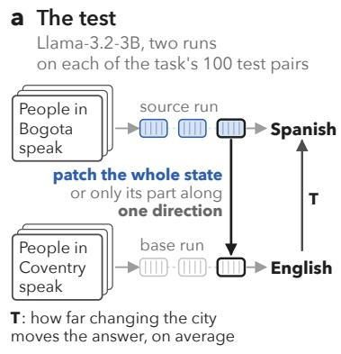

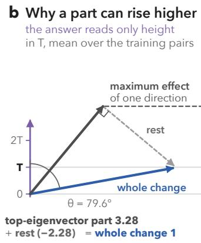

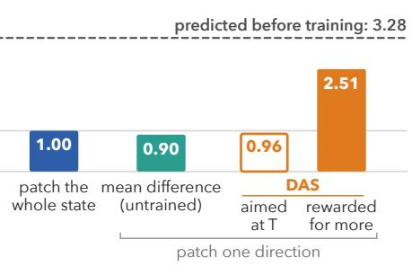  
Figure 1: A learned part of a state can change a model’s output more than the whole state does. Llama-3.2-3B (Grattafiori et al., 2024) on RAVEL’s city-to-language task (Huang et al., 2024), a typical case. (a) The patched state is the readout, where whole-state patching gives exactly T. The direction is the same for every pair. (b) The first-order picture (Proposition 7). With two answers and uncapped logits, the readout gradients of all pairs share almost exactly one direction, the readout direction, drawn as height. Its measured angle θ to the mean change of the state predicts the maximum efect before training. (c) DAS is trained with cross-entropy (rewarded for more) or a per-pair squared error aimed at T. With cross-entropy, it lies above T on all 100 test pairs.

## 1 Introduction

A standard way to study how a language model computes is to intervene on it. An internal state is changed, and the resulting change in the output is measured. Much of our current understanding of the internal mechanisms of language models rests on such evidence. This understanding is considered critical for their safety (Bereska and Gavves, 2024), and the same evidence guides how models are edited and steered (Meng et al., 2022; Panickssery et al., 2024). A common form of such interventions is the interchange intervention, also known as activation patching (Zhang and Nanda, 2024; Heimersheim and Nanda, 2024). The model runs on a base input, part or all of one internal state is replaced by its value on a source input, and the output is observed (Geiger et al., 2021, 2025). Distributed alignment search (DAS) learns which part of the state to replace. It trains a subspace so that the patched output follows a high-level causal model (Geiger et al., 2024; Wu et al., 2023). Benchmarks rank such localisation methods by how strongly the intervention produces the counterfactual output, or by how often it does so, a score called interchange intervention accuracy (IIA) (Arora et al., 2024; Huang et al., 2024; Mueller et al., 2025).

Published results contain a puzzle. A learned part of a state often changes the output more than the whole state does (Figure 1). For example, on the CausalGym benchmark, the score of DAS is a median of two to three times that of patching the whole state. Arora et al. (2024) report that DAS “consistently finds the most causally-eficacious features”. In another case, Tigges et al. (2024) train a one-dimensional DAS direction for sentiment, and their code patches it at every position of a layer. At its best layer, the direction scores 109.8% on their logit-diference metric, while patching the whole state scores exactly 100%. If these scores are taken to measure what the network itself computes, they imply that a part of a state contributes more than the whole state. Is this excess an efect of the network, or of the training objective?

Earlier work has reported such excesses and related problems, and has proposed causes for them. Makelov et al. (2024) attribute one case to a pathway that the network leaves dormant, an interpretation that Wu et al. (2024b) dispute. Sutter et al. (2025, §7) note that a linear alignment map can “sometimes achieve IIA higher than the DNN’s accuracy” and suggest that it “may also ‘learn the task’ ”. Grant et al. (2026) show that interventions can push internal states of the network’s distribution and activate hidden pathways. Bao et al. (2026, §1) argue that objectives that maximise probability make steering prone to overfitting, and they propose CDAS, which trains the interchange of DAS with a distribution-matching objective instead. However, none of these works says in general when a learned part exceeds the efect of patching the whole state, by how much, or where a given kind of training objective places it.

Our goal is to separate the part of a learned efect that the network itself produces from any excess beyond it, and to answer these three questions. Such a separation requires a reference that involves no training. We use whole-state patching, which copies the entire state of the source run at the site of the learned intervention and learns nothing. CausalGym, RAVEL and MIB (Arora et al., 2024; Huang et al., 2024; Mueller et al., 2025) already report it as a baseline; we make it the reference for every method. At the readout, the last state before the output, whole-state patching has exactly the same efect as replacing the whole input, that is, the total efect T of the input.

Our analysis rests on a decomposition. To first order, when a state is split into orthogonal parts, the efects of patching the parts add up to the efect of patching the whole state, whichever method chose the parts. A part therefore exceeds the whole exactly when the other parts move the output back, which does not require that it isolate the high-level variable more cleanly. The network fixes the range of efects that a part can have, and the upper end of this range can be computed before any training. The training objective decides where in this range a learned part ends up.

Our contributions are as follows.

1. We prove the decomposition at any rank, and that objectives rewarding a larger efect select the upper end of the range. Lean checks every first-order statement.

2. At the readout, changing only the objective moves DAS from far above T (cross-entropy) to close to T (a squared error aimed at T), across fourteen models.

3. Inside the network, cross-entropy DAS exceeds whole-state patching at most sites, including sites where the latter shows no significant efect, mostly through attention.

4. On CausalGym, DAS’s lead over whole-state patching is an excess, not a better region. We propose a three-step check whose values our library OwnEfect computes.

The paper is organised as follows. Section 2 defines whole-state patching and the other quantities we use, and Section 3 develops the theory. Section 4 describes the experimental setup. We then test the theory in three settings. At the readout, the efect of whole-state patching is known exactly (Section 5), while inside the network it has to be measured (Section 6). The third setting is that of published benchmark results (Section 7). Alongside each result, we test the alternative explanations that a reader might raise. Section 8 turns the comparison into a reporting check. Section 9 reviews related work, Section 10 discusses implications and limitations, and Section 11 concludes. The appendices give further details.

## 2 Preliminaries

To decide whether a learned efect comes from the network or from the training objective, we need a unit of measurement and a reference. Our unit is the total efect of the input, and our reference for every learned efect is the efect of whole-state patching at the same site. Section 7 compares published scores with this reference in their own units.

## 2.1 Input Pairs and the Total Efect

A model maps a token sequence to next-token logits o at the last position, and all runs are deterministic (evaluation mode). A pair consists of a base input $x _ { b }$ and a source input $x _ { s }$ Their expected next tokens are y and $y _ { s }$ . The mirror of a pair is the same pair with the two inputs exchanged. We measure the output by the log odds of the source label over the base label, $z = o _ { y _ { s } } - o _ { y _ { b } }$ . The total efect of the source input is $T = z ( x _ { s } ) - z ( x _ { b } )$ , the change in z when the whole input is replaced. Because the counterfactual label is the source input’s own next token, $T$ is the efect that the counterfactual asks for. In the words of CausalGym, a successful intervention “makes the model behave as if its input was” the source (Arora et al., 2024). The total efect $T$ is the value that CausalGym’s log odds ratio (Arora et al., 2024) takes when the whole input is replaced, and it is the unit of logit-diference recovery (Zhang and Nanda, 2024; Heimersheim and Nanda, 2024). It is also the total efect of the input on z in causal mediation analysis, which Geiger et al. (2025, Definition 52) express with interchange interventions. We report each mean efect over test pairs divided by the mean $T _ { \cdot }$ , that is, as a multiple of T. The symbols T, G and e (Definition 1) denote means in log odds unless a statement holds for each pair, and $T _ { i } , G _ { i }$ and $e _ { i }$ are the values for pair i.

Interchange intervention accuracy (IIA), the usual score in causal abstraction, is the fraction of pairs on which the patched output agrees with the counterfactual output of a high-level causal model, usually judged by the most likely token. On our tasks, this output is $y _ { s } ,$ , and we count a pair when the patched output prefers $y _ { s }$ to $y _ { b }$ . This count applies a threshold to the same quantity z, so it can also show an efect above that of whole-state patching. On pairs where whole-state patching already makes the output prefer $y _ { s }$ , however, it hides the excess (Section 7.2).

## 2.2 Sites and Interchange Interventions

A site is a set S of (layer, position) locations in the residual stream, where layer ℓ is the output of block $\ell ,$ counting from 0. A cell is one region of the input sentence, such as the subject, at one layer, and a map shows an efect at every cell of a model for one task. Table 1 lists the terms we use, and a running example illustrates them (Figure 2). We write $h _ { b }$ and $h _ { s }$ for the states that the base and source runs compute at a location, and $\Delta = h _ { s } - h _ { b }$

Definition 1 (whole-state patching). Whole-state patching at S runs the base input with the states at S replaced by those of the source run. Its efect G(S) is the resulting change in z. A subspace interchange at a single location along a matrix P with orthonormal columns

The test: patch one state from a second run, and watch the answer move Qwen2.5-0.5B on a movie review; every number is a mean over the task's 100 test pairs

2 A complete cut: G = T exactly every path to the answer passes through the patched cells  
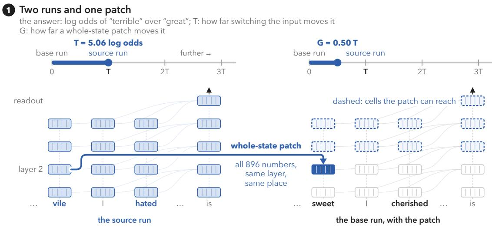

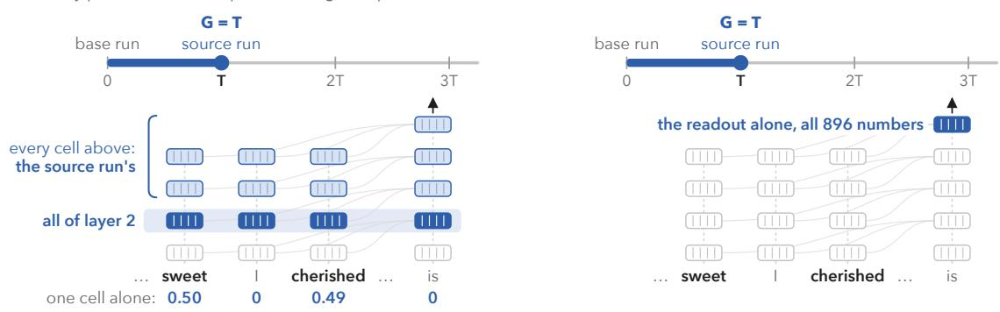

## 3 Inside the readout: through one score, DAS stops partway and goes further

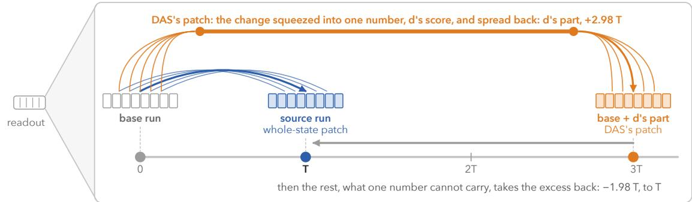  
Is the excess an effect of the network, or of the objective that learned the direction?

Figure 2: Patching a complete cut moves the answer by exactly T; patching one learned direction of the readout moves it three times as far. All of a layer and the readout are complete cuts (Proposition 3). The direction d is that of DAS with cross-entropy, one for all test pairs; its efect is the mean of three training runs. Figure 3 shows why the rest pulls back.

replaces $h _ { b }$ by $h _ { b } + P P ^ { \top } \Delta$ . For rank one, P = d with $\| d \| = 1$ , and we write $e ( d )$ for its efect.

Whole-state patching learns nothing; it transfers whatever the network computes at $S$ and nothing else. CausalGym calls it the vanilla intervention, and standard activation patching performs it (Arora et al., 2024; Heimersheim and Nanda, 2024). Its efect $G ( S )$ is the indirect efect of the input through S in causal mediation analysis (Geiger et al., 2025, Definition 52), as in causal tracing (Meng et al., 2022). We use G(S) as the reference for every method, because it is the efect that the network itself produces at the site. We call a learned efect inflated when it exceeds $G ,$ the efect of whole-state patching at the same site, and we call the diference its excess.

## 2.3 Training Objectives

Every method that CausalGym ranks applies a subspace interchange, and the methods difer only in how they choose P. DAS trains P so that the patched output follows the source label. Its loss is cross-entropy (Geiger et al., 2022, 2024; Arora et al., 2024), a linear logit diference (Tigges et al., 2024) or, in CDAS, a Jensen–Shannon divergence to the next-token distribution of the source run (Bao et al., 2026, §3.3). Other methods choose P without running the intervention, from the states alone or together with their class labels, for example a diference of means between classes, a linear probe, PCA, k-means or LDA (Arora et al., 2024; Tigges et al., 2024). A class groups the inputs of a task by type, for example sentences with a singular or with a plural subject.

The usual distinction between supervised and unsupervised methods (Geiger et al., 2025, Section 3.6) places a linear probe and DAS in the same group. However, the probe is fitted to the states, while DAS is fitted to the efect of the intervention. Since our results depend on the objective, we group methods by what their objective requires of that efect. An efect-seeking objective keeps rewarding a larger efect, as DAS does with cross-entropy or a logit diference. A target-aimed objective is minimised at a target efect, for example a squared error to the total efect. A representation-only objective ignores the efect of the intervention altogether. Methods that choose P without running the intervention have this kind of objective, and so does the readout gradient (the gradient of z with respect to the state at the readout), which depends on the output but not on the intervention. Our theory concerns these kinds of objective rather than one particular method, and the efect-seeking method we measure is DAS.

## 2.4 Complete and Partial Cuts

Whether whole-state patching gives exactly T depends on the site.

Definition 2 (cuts). A cut for a pair is a site C such that the output is a function of the states at C and of side inputs (weights, position indices, attention mask) that are the same in the base and the source run. A cut is complete if it is of one of the following two kinds.

(a) All positions of one layer, in a model whose blocks read only the states of the previous block, for a base and a source of the same length with aligned positions and the same padding.

(b) The readout, the output of the last block at the last position. Only the final normalisation and the unembedding (and, in Gemma-2, its logit cap) follow it.

A partial cut is a proper subset of a kind-(a) cut that is not itself a cut, because the output also reads the other positions. An example is the single position in one layer that most published maps patch.

At a cut, the output depends on the input only through the states at the cut. Whole-state patching at a complete cut therefore gives exactly the total efect T (Proposition 3). At a partial cut it need not (Remark 4). In the running example (Figure 2), the two sentences difer in two words, the adjective and the verb. Patching either word alone at layer 2 moves the answer about half as far as patching the whole layer, because the output still reads the other word as in the base run.

## 2.5 A Running Example

Six figures illustrate the argument on one sentence, a movie review from the sentiment templates of Tigges et al. (2024), processed by Qwen2.5-0.5B. Figure 2 sets up the comparison, and Figure 3 explains why a part can exceed the whole. Figure 6 marks where whole-state patching shows an efect of the sentiment and what DAS reports there. Figure 7 shows how a learned direction can raise the attention to a site where whole-state patching leaves it as in the base run, Figure 8 that a learned efect follows the target of its objective, and Figure 10 shows what to report, with one cell of a second template. Among the six small models whose maps cover this task, Qwen2.5-0.5B lies in the middle at the readout, where DAS with cross-entropy gives 3.0 T, against 2.0 to 4.8 T across the six models.

In the figures, G is the efect of whole-state patching at a cell or a set of cells, and $G ^ { * }$ is its efect in the cell’s best context (Section 6). Unless a figure states otherwise, every number in the figures is a mean over the task’s 100 test pairs, that is, 50 pairs and their mirrors.

## 3 Theoretical Analysis

This section answers the three questions of the introduction with four results, one exact and three to first order. We first show that whole-state patching gives exactly T at a complete cut. We then show when a part exceeds whole-state patching and by how much, where a training objective places it, and how large the excess is when all pairs share one readout direction. The rest of the paper builds on these results, and every first-order statement is machine-checked in Lean (Appendix A.6).

## 3.1 Whole-State Patching and the Total Efect

Proposition 3 (complete-cut identity). For each pair and complete cut $C , \ G ( C ) = T$ exactly.

Proof. Downstream of C, the output is computed from the states at C and from side inputs that agree between the two runs. For kind (a), equal lengths, aligned positions and the same padding make the position indices and the attention mask agree. For kind (b), only the final normalisation, the unembedding and, in Gemma-2, the logit cap follow, and they read that one state. After the interchange the states at $C$ are the source run’s, so the patched output is the source run’s output, and $G ( C ) = z ( x _ { s } ) - z ( x _ { b } ) = T$ ■

This identity has precedents. In causal mediation analysis, it states that a complete cut fully mediates the efect of the input, so that the indirect efect through the cut equals the total efect. Geiger et al. (2025, Remark 53) show that this equality is equivalent to an abstraction in which the input afects the output only through the mediator. For the cuts of Definition 2, the equality holds for every pair, because they are defined through the computation itself. In activation patching, denoising metrics assign 100% to the clean run, here the source run, and at a kind-(a) cut this level equals $T ,$ as in the code of Tigges et al. (2024). Beyond these precedents, our contribution is to read an efect above $T$ at a complete cut as an efect that whole-state patching at that cut cannot produce.

Remark 4 (partial cuts). At a partial cut, $G ( S )$ is not bounded by T. In Pythia-410m, on the sentiment task of Tigges et al. (2024), whole-state patching at the adjective and verb positions restores 120.3% and 121.7% of $T$ at layers 14 and 15, with interval lower bounds of at least 104%. A run that mixes base and source states therefore changes the output more than the source run does. Among the seven models of our re-run of the sentiment experiment (Table 10), whole-state patching exceeds 100% only in this one. Whether or not $G ( S )$ exceeds T, at a partial cut the reference is $G ( S )$ itself, not $T$

## 3.2 The Range of Subspace Efects

Fix one location whose hidden dimension is at least 2. For pair i, let $F _ { i } ( h )$ be the value of z when the base run carries the state h at this location and everything after it is recomputed. Let $\begin{array} { r } { w _ { i } = \nabla F _ { i } ( h _ { b , i } + \frac { 1 } { 2 } \Delta _ { i } ) } \end{array}$ be its gradient at the midpoint between the base and the source state, and define

$$
M = \mathrm { s y m } \mathbb { E } [ w \Delta ^ { \top } ] , \qquad \mathrm { s y m } A = \textstyle { \frac { 1 } { 2 } } ( A + A ^ { \top } ) ,\tag{1}
$$

with eigenvalues $\lambda _ { 1 } \geq \cdots \geq \lambda _ { D }$ , where $D$ is the hidden dimension. Here and below, to first order means that terms of second and higher order in $\Delta$ are neglected. This assumes that $F _ { i }$ is three times continuously diferentiable on the ball with diameter $[ h _ { b } , h _ { s } ]$ , which contains every subspace-patched state (Appendix A.1).

Theorem 5 (the Rayleigh range). To first order in $\Delta .$

(i) a rank-one interchange along a unit d has mean efect $\mathbb { E } [ e ( d ) ] = d ^ { \top } M d .$ , which takes every value in $[ \lambda _ { D } , \lambda _ { 1 } ]$ as d ranges over unit vectors;

(ii) whole-state patching at the location has mean efect tr $M = \textstyle \sum _ { j } \lambda _ { j }$ , with an error of third order in $\Delta _ { - }$ ;

(iii) a rank-k interchange along P has mean efect tr $( P ^ { \top } M P )$ , which lies between the sum of the k smallest and the sum of the k largest eigenvalues;

(iv) for a single pair, $\begin{array} { r } { \lambda _ { 1 } = \frac { 1 } { 2 } \big ( w ^ { \top } \Delta + \| w \| \| \Delta \| \big ) \ge w ^ { \top } \Delta } \end{array}$ , with equality if and only if w and $\Delta$ are parallel and $w ^ { \top } \Delta \geq 0$

Proof. For one pair, a subspace patch $h _ { b } \mapsto h _ { b } + v , v = P P ^ { \top } \Delta$ , keeps the state in the ball with diameter $[ h _ { b } , h _ { s } ]$ , on its boundary since $v ^ { \top } ( \Delta - v ) = 0$ (Thales’ theorem), and changes z by $\begin{array} { r } { w ^ { \top } v + \frac { 1 } { 2 } v ^ { \top } \bar { H } ( v - \bar { \Delta } ) } \end{array}$ up to third order, with w and the Hessian H taken at the midpoint; to first order the change is $w ^ { \top } v$

(i) The rank-one patch is $v = d d ^ { \top } \Delta ,$ so $e ( d ) = ( w ^ { \top } d ) ( d ^ { \top } \Delta ) = d ^ { \top } w \Delta ^ { \top } d$ to first order. A quadratic form sees only the symmetric part of its matrix, so $e ( d ) = d ^ { \top } \operatorname { s y m } ( w \Delta ^ { \top } ) d ;$ , and averaging over pairs gives $\mathbb { E } [ e ( d ) ] = d ^ { \top } M d$ . On the unit sphere this Rayleigh quotient lies in $[ \lambda _ { D } , \lambda _ { 1 } ]$ and attains both ends at unit eigenvectors. The sphere is connected for $D \geq 2$ and the quotient is continuous, so it takes every value in between.

(ii) Whole-state patching is the patch $v = \Delta$ . Its first-order efect is $w ^ { \top } \Delta = \mathrm { t r } ( w \Delta ^ { \top } )$ whose mean is $\mathrm { t r } \mathbb { E } [ w \Delta ^ { \top } ] = \mathrm { t r } M$ , since a matrix and its transpose, and so its symmetric part, have the same trace. The second-order term ${ \begin{array} { l } { { \frac { 1 } { 2 } } v ^ { \top } H ( v - \Delta ) } \end{array} }$ vanishes at $v = \Delta$ , so the error is of third order.

(iii) The patch is $v = P P ^ { \top } \Delta$ , with first-order efect $( P ^ { \top } w ) ^ { \top } ( P ^ { \top } \Delta ) = \mathrm { t r } ( P ^ { \top } \Delta w ^ { \top } P ) =$ $\mathrm { t r } \left( P ^ { \top } \operatorname { s y m } ( w \Delta ^ { \top } ) P \right)$ , whose mean is $\mathrm { t r } ( P ^ { \top } M P )$ . For a symmetric M and P with k orthonormal columns, Ky Fan’s maximum principle bounds $\mathrm { t r } ( P ^ { \top } M P )$ above by the sum of the k largest eigenvalues; applied to −M, it bounds it below by the sum of the k smallest.

(iv) For one pair, $\begin{array} { r } { M = \frac { 1 } { 2 } ( w \Delta ^ { \top } + \Delta w ^ { \top } ) } \end{array}$ maps every vector into span $( w , \Delta )$ , so all its eigenvalues but two, $\mu _ { + } \geq \mu .$ −, are zero. Their sum is tr $M = w ^ { \top } \Delta$ , and the sum of their squares is $\begin{array} { r } { \| M \| _ { F } ^ { 2 } = \frac { 1 } { 2 } ( ( w ^ { \top } \Delta ) ^ { 2 } + \| w \| ^ { 2 } \| \Delta \| ^ { 2 } ) } \end{array}$ , so their product is $\frac { 1 } { 4 } \big ( ( w ^ { \top } \Delta ) ^ { 2 } - \| w \| ^ { 2 } \| \Delta \| ^ { 2 } \big )$ and $\mu _ { \pm } = \frac { 1 } { 2 } ( w ^ { \top } \Delta \pm \| w \| \| \Delta \| )$ . By Cauchy–Schwarz $\| w \| \| \Delta \| \ge | \bar { w } ^ { \top } \Delta |$ , so $\mu _ { + } \geq 0$ is the largest eigenvalue, $\lambda _ { 1 }$ , and $\begin{array} { r } { \lambda _ { 1 } - w ^ { \top } \Delta = \frac { 1 } { 2 } ( \| w \| \| \Delta \| - w ^ { \top } \Delta ) \geq 0 } \end{array}$ , with equality if and only if w and $\Delta$ are parallel and $w ^ { \top } \Delta \geq 0$

Theorem 5 places every rank-one method on a single scale. In any orthonormal basis, the rank-one efects sum to tr $M$ , the efect of whole-state patching, so one of them exceeds it exactly when the others sum to a negative number. For the top eigenvector of M, the eigenvector of $\lambda _ { 1 }$ , the others sum to $\sum _ { j \geq 2 } \lambda _ { j }$ , which by (iv) is negative for a single pair unless w and $\Delta$ point in the same direction (Figure 1b and Figure 3).

An efect above that of whole-state patching does not mean that a direction isolates the variable more cleanly, as the following two-dimensional example shows.

Example 1 (two dimensions). Let the change of the state be $\Delta = ( 1 , 0 )$ , along the variable, and let the gradient of z at the site be $w = ( 1 , 1 )$ , at $4 5 ^ { \circ }$ to it. Then $M = \bigl ( \begin{array} { l l } { 1 } & { 1 / 2 } \\ { 1 / 2 } & { 0 } \end{array} \bigr )$ . Its trace, 1, is the efect of whole-state patching, and its eigenvalues are 1.207 and $- 0 . 2 0 7$ . The direction of the variable gives exactly 1. The top eigenvector, which bisects w and $\Delta .$ , gives more, 1.207, because it leaves out the orthogonal direction, whose efect is −0.207. The bisector moves the state by 0.354 along the second coordinate, which the input does not change at all, and the orthogonal direction moves it back by the same amount. The negative contribution of the orthogonal direction is thus not a separate mechanism, because it is negative only through moving the state back along the second coordinate. If the gradient is turned to $w = ( 0 , 1 )$ , whole-state patching gives 0, while the bisector of the new w and $\Delta$ gives $1 / 2$ . This is the form of the illusion described by Makelov et al. (2024). In this illusion, a direction combines a disconnected part, which the input changes but the output does not read, with a dormant part, which the output reads but the input does not change.

With both gradients, the excess is an efect that whole-state patching does not produce, although it transfers the entire change. In general, whenever the efect of whole-state patching is positive, a part can exceed it only through its component orthogonal to $\Delta$ (Appendix A.6).

When a site has several locations that are patched along the same d (for example every position of a layer), the patch adds $d d ^ { \top } \Delta _ { t }$ at each location t. To first order, $e ( d ) \approx$ $\begin{array} { r } { \sum _ { t } ( \boldsymbol { d } ^ { \top } \boldsymbol { w } _ { t } ) ( \boldsymbol { d } ^ { \top } \Delta _ { t } ) } \end{array}$ , so (i)–(iii) and Corollary 6 hold with $\begin{array} { r } { M = \mathrm { s y m } \mathbb { E } \big [ \sum _ { t } w _ { t } \Delta _ { t } ^ { \top } \big ] } \end{array}$ , whose trace is the first-order efect of whole-state patching at the site.

## 3.3 Directions Selected by Training Objectives

Corollary 6 (selection; first order).

(i) An efect-seeking objective in pure form, strictly decreasing in the mean efect, selects a unit vector of the top eigenspace of M and reports $\lambda _ { 1 }$ . Its excess over whole-state patching $\begin{array} { r } { i s - \sum _ { j \geq 2 } \lambda _ { j } } \end{array}$ . The excess is positive for a single pair unless w and $\Delta$ are positively parallel (Theorem $5 ( i v ) )$ , and, whenever $w _ { i } = c _ { i } \bar { w }$ for scalars $c _ { i }$ , unless w¯ and $\mathbb { E } [ c \Delta ]$ are positively parallel.

(ii) An objective that depends on d only through the mean efect and is uniquely minimised at a target τ (a target-aimed objective in pure form) selects the level set $\{ d : d ^ { \top } M d = \tau \}$ when it is non-empty, which holds if and only if $\lambda _ { D } \leq \tau \leq \lambda _ { 1 }$

(iii) At the readout, tr $M = T$ up to an error of third order (Proposition 3, Theorem ${ \it 5 ( i i ) }$ An efect-seeking objective therefore departs from T by $- \textstyle \sum _ { j \geq 2 } \lambda _ { j }$ , and a target-aimed one with $\tau = T$ reaches T when $T \in [ \lambda _ { D } , \lambda _ { 1 } ]$ . This condition holds under one shared direction (Proposition 7), but not always (Appendix A.5).

Proof. (i) By Theorem 5(i) the mean efect of a unit d is d⊤ $M d \leq \lambda _ { 1 }$ , with equality exactly on the unit vectors of the top eigenspace. An objective strictly decreasing in the mean efect is therefore minimised exactly there, and the direction it selects reports $\lambda _ { 1 }$ . Whole-state patching has mean efect tr M (Theorem 5(ii)), so the excess is $\begin{array} { r } { \lambda _ { 1 } - \mathrm { t r } M = - \sum _ { j \ge 2 } \lambda _ { j } } \end{array}$ . For a single pair this is $\lambda _ { 1 } - w ^ { \top } \Delta$ , positive unless w and ∆ are positively parallel (Theorem $\mathrm { 5 ( i v ) } )$ . For $w _ { i } = c _ { i } \bar { w }$ and $\begin{array} { r } { m = \mathbb { E } [ c \Delta ] } \end{array}$ $\mathbb { E } [ w \Delta ^ { \top } ] = \bar { w } m ^ { \top }$ , so $M = \mathrm { s y m } ( \bar { w } m ^ { \top } )$ is the single-pair matrix with w¯ and m in place of w and $\Delta$ , and the same argument gives an excess of $\begin{array} { r } { \frac { 1 } { 2 } ( \| \bar { w } \| \| m \| - \bar { w } ^ { \top } m ) } \end{array}$ , positive unless $\bar { w }$ and m are positively parallel.

(ii) By Theorem 5(i), unit vectors d with $d ^ { \top } M d = \tau$ exist if and only if $\lambda _ { D } \leq \tau \leq \lambda _ { 1 }$ and when they do, such an objective is minimised exactly at them.

(iii) The readout is a complete cut, so whole-state patching there gives T exactly (Proposition 3) and tr M up to an error of third order (Theorem 5(ii)). Hence tr $M = T$ up to that error, and (i) and (ii) with $\tau = T$ give the rest. Under one shared direction, $M = \mathrm { s y m } ( \bar { w } m ^ { \top } )$ has, as in the proof of Theorem 5(iv), eigenvalues $\mu _ { + } \geq 0 \geq \mu _ { - }$ besides zeros, so $\lambda _ { D } \leq \mu _ { - } \leq \mathrm { t r } M \leq \mu _ { + } = \lambda _ { 1 }$ : the trace, and with it T, lies in the range. ■

Outside these cases, the excess in (i) can be negative (Appendix A.5). Our measurements at the readout include such a case, indirect object identification (IOI) with twenty names, where even the maximum efect lies below T in every model (Section 5.4).

6 The maximum: 3.1 T

7 Two directions give T

## Why a part of the state can move the answer more than the whole state

Qwen2.5-0.5B, the movie review's last state, drawn in the plane of the change a patch makes and the direction the answer reads

4 Turn d  
1 The answer reads a direction  
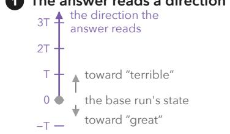  
The answer's scale, upright: how high a change goes is how far it moves the answer, to first order.

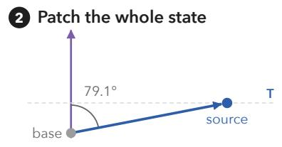  
The change runs almost sideways, at 79.1° to the direction the answer reads: the answer sees only T.

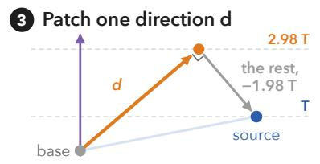  
Only DAS's part along d comes across, 2.98 T. The rest, at a right angle, lowers the effect: −1.98 T. Together, T.

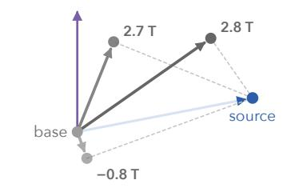  
Each direction brings its own part, and moves the answer by that part's height.  
5 Every part ends on one circle

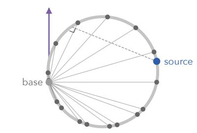  
The right angle at each foot puts every part on the circle whose diameter joins base and source: Thales' theorem.

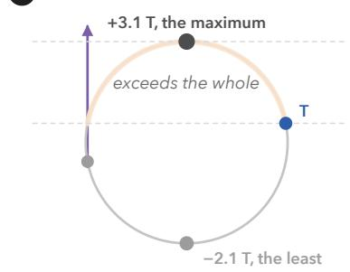  
The highest part moves the answer 3.1 times as far as the whole state; the lowest, −2.1 T, the wrong way.

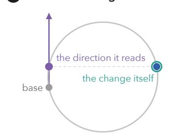  
The direction the answer reads and the change itself, the mean difference, both give T (measured 1.00 and 1.04).  
8 The point depends on the loss

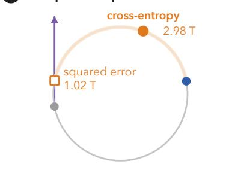  
Measured: cross-entropy DAS near the maximum (2.98 T); the squared error, aimed at T, near the whole state (1.02 T).  
9 The angle sets the circle

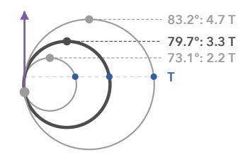  
The paper's angles, interquartile range 73.1 to 83.2° (median 79.7°): maxima of 2.2 to 4.7 T, predicted before training.

For one pair the circle is exact (in all 896 numbers, a sphere with the same highest and lowest points); heights are first order. The drawing uses the task's mean change and readout direction, so its top, 3.14 T, is the maximum the angle predicts. One direction serves all 100 pairs, each with its own circle, so its mean effect lies between −2.38 and 3.40 T (M's eigenvalues); measured, the top eigenvector gives 3.24 T.

Figure 3: A part of the state can change the answer more than the whole, because the rest of the change lowers the efect. Figure 2’s review at the readout, in the plane of the mean change and the readout direction (angle θ, Proposition 7). (1) Figure 2’s scale of the answer, stood upright. In (3) and (8), measured values are drawn at their heights. (9) The interquartile range of θ over the two-label cases of the thirteen uncapped models.

Cross-entropy of the source label, unlike the objectives of Corollary 6, is not a function of the mean efect alone. However, until it saturates, it rewards a larger log probability of the source label, and with it larger log odds. At the readout it therefore behaves almost like an efect-seeking objective in pure form, and the linear logit diference of Tigges et al. (2024) is exactly such an objective. The behaviour of cross-entropy difers in one respect. Its derivative with respect to the logit of the base label equals that label’s probability $p _ { b }$ When the base label is improbable, cross-entropy gives little reward for lowering it, and the learned direction stays below the maximum efect (Section 5.4).

Part (ii) requires an objective that is a function of the mean efect alone. The CDAS divergence to the next-token distribution of the source run (Bao et al., 2026) and a per-pair squared error on z are not, and each can end up away from T (Appendix A.5). When every pair shares one readout direction, however, the squared error provably reaches T to first order (Appendix A.6).

## 3.4 One Shared Readout Direction

Proposition 7 (one shared direction). Suppose $\mathbb { E } [ w \Delta ^ { \top } ] = \bar { w } m ^ { \top }$ for vectors w, m¯ : for instance a shared readout direction, $w _ { i } = c _ { i } \bar { w }$ with $m = \mathbb { E } [ c \Delta ]$ , or a single code, in which every pair changes the state along one direction, $\Delta _ { i } = s _ { i } \Delta$ , with $\bar { w } = \mathbb { E } [ s w ]$ and $m = \Delta$ Let $\theta = \angle ( \bar { w } , m ) \in [ 0 ^ { \circ } , 9 0 ^ { \circ } ) , \hat { w } = \bar { w } / \| \bar { w } \| , \hat { m } = m / \| m \|$ , and write $e ( d )$ for the mean $e f f e c t .$ To first order:

(i) $\boldsymbol { e } ( d ) = ( d ^ { \top } \bar { w } ) ( d ^ { \top } m )$ and tr $M = \bar { w } ^ { \top } m ,$

(ii) the readout direction and the direction of the mean change of the state both give the trace: $e ( \hat { w } ) = e ( \hat { m } ) = \mathrm { t r } M ;$

(iii) for the unit d at angle φ from mˆ toward wˆ in their span,

$$
\begin{array} { l } { \displaystyle \frac { e ( d ) } { \operatorname { t r } M } = 1 + \frac { \sin \varphi \sin ( \theta - \varphi ) } { \cos \theta } , } \\ { \displaystyle \frac { \lambda _ { 1 } } { \operatorname { t r } M } = \frac { 1 } { 2 } \big ( 1 + \frac { 1 } { \cos \theta } \big ) , } \end{array}\tag{2}
$$

so every direction strictly between mˆ and wˆ exceeds the trace, and the maximum is attained at the bisector $\varphi = \theta / 2$ , uniquely up to sign.

Proof. (i) $M = \mathrm { s y m } ( \bar { w } m ^ { \top } )$ , and a quadratic form sees only the symmetric part, so $e ( d ) =$ $\begin{array} { r } { d ^ { \top } \bar { w } m ^ { \top } d = ( d ^ { \top } \bar { w } ) ( d ^ { \top } m ) } \end{array}$ ; the trace of wm¯ ⊤ is $\bar { w } ^ { \top } m$

(ii) For $\begin{array} { r } { d = \hat { w } , e ( \hat { w } ) = \| \bar { w } \| \hat { w } ^ { \top } m = \bar { w } ^ { \top } m } \end{array}$ , and likewise $e ( \hat { m } ) = \bar { w } ^ { \top } m$

(iii) For d in the span, $d ^ { \top } \bar { w } = \| \bar { w } \| \cos ( \theta - \varphi )$ and $d ^ { \top } m = \| m \| \cos \varphi$ . Since $\theta < 9 0 ^ { \circ }$ the trace tr $M = \| \bar { w } \| \| m \|$ cos θ is positive, so $e ( d ) / \operatorname { t r } M = \cos \varphi \cos ( \theta - \varphi ) / \cos \theta ,$ and expanding cos $\theta = \cos ( \varphi + ( \theta - \varphi ) )$ gives cos φ $\cos ( \theta - \varphi ) - \cos \theta = \sin \varphi \sin ( \theta - \varphi )$ , the first line of (2). For $0 < \varphi < \theta$ both sines are positive, so every direction strictly between $\hat { m }$ and $\hat { w }$ exceeds the trace. Since cos $\begin{array} { r } { \varphi \cos ( \theta - \varphi ) = { \frac { 1 } { 2 } } [ \cos \theta + \cos ( 2 \varphi - \theta ) ] } \end{array}$ , the in-span maximum is $\begin{array} { r } { \frac { 1 } { 2 } \| \bar { w } \| \| m \| ( 1 + \cos \theta ) } \end{array}$ , attained only at $\varphi \ : = \ : \theta / 2$ up to sign, and its ratio to the trace is the second line. A unit $d = d _ { \parallel } + d _ { \perp }$ with $d _ { \perp }$ orthogonal to the span has $e ( d ) = ( d _ { \parallel } ^ { \top } \bar { w } ) ( d _ { \parallel } ^ { \top } m ) = \| d _ { \parallel } \| ^ { 2 } e ( d _ { \parallel } / \| d _ { \parallel } \| )$ (or 0 if $d _ { \parallel } = 0 )$ , which is below the in-span maximum unless $d _ { \perp } = 0$ , because that maximum is positive. So the maximum over all unit d is the in-span one, which is $\lambda _ { 1 }$ ■

Figure 3 illustrates this result. Consider a mirrored test set, in which every pair appears with its mirror, and in which the class fixes each pair’s label, as in CausalGym. When the change of the state is a single code, a diference of means and a heavily penalised probe return $\pm \hat { m }$ , and the readout gradient returns $\hat { w } .$ . Both directions give the trace (Proposition 7(ii)), and a direction above the trace must combine mˆ and wˆ. Only an objective that rewards an efect above the trace favours such a combination, and Equation (2) predicts how far a method with such an objective goes. PCA and k-means use the states alone and have no such objective. A larger rank does not change this picture. Under one shared direction, every rank below the dimension has, to first order, the same predicted maximum as rank one, so an efect-seeking objective in pure form reports the same excess at every such rank (Appendix A.3).

## 4 Experimental Setup

We measure every method at the readout and at every cell of a map inside the network. This section describes the tasks, models and objectives, the intervention sites, the measured quantities and the evaluation, and Appendix B gives full details of the data, the models, the training and the compute.

## 4.1 Tasks, Models and Objectives

The 90 tasks come from six published sources. They include the 29 tasks of CausalGym (Arora et al., 2024) and re-paired versions of its six number-agreement tasks, in which only the number of the subject changes (number-only agreement). The other tasks are the constructions of Kumon and Yanaka (2026), sentiment templates (Tigges et al., 2024), SST sentences (Socher et al., 2013), RAVEL (Huang et al., 2024), and indirect object identification (IOI) (Wang et al., 2023), both in its original templates and in a sentence frame of our own. The fourteen models range from 124M to 32B parameters and come from six families (Radford et al., 2019; Biderman et al., 2023; Ben Allal et al., 2025; Qwen Team, 2025; Grattafiori et al., 2024; Gemma Team et al., 2024). Pythia, Qwen2.5 and Llama are each included at three or more sizes, so that size can be compared within a family. We call the six smallest models (124M–1B) the small models and the four models of 7–9B the large models.

In each model and task, we train rank-one DAS at the readout with four objectives, each from the same three random initialisations. The objectives are cross-entropy of the source label, a per-pair squared error to each pair’s total efect, the CDAS divergence (Bao et al., 2026), and the mean efect itself, which we call the mean-efect objective. Training runs for ten passes over the training pairs, and we keep each direction after the first and after the tenth pass. Counts refer to the directions after one pass unless stated otherwise. We score each direction by its exact efect on the test pairs. Inside the network, we add a second per-pair squared error, aimed at the cell’s G. There, this squared error is trained from three initialisations, like cross-entropy, and the other objectives from one.

Each task in a model is a case. The maximum efect of a case is the largest mean efect that we find for a single direction. We search for this direction by gradient ascent on the unit sphere, using the training pairs, and measure its efect on the test pairs. The maximum efect is thus an out-of-sample estimate, the out-of-sample maximum, because the search does not use the test pairs. The largest exact (not first-order) efect that a separate search finds on the test pairs themselves is the in-sample maximum, the counterpart of $\lambda _ { 1 }$ on the same pairs. The predicted maximum is $\lambda _ { 1 }$ (the largest eigenvalue of M), the largest first-order efect of a single direction and the upper end of the range. Where all pairs share one readout direction, the angle of Proposition $^ { 7 , }$ measured on the training pairs, estimates the same quantity. The margin above $T$ is the maximum efect minus $T _ { i }$ and a case has a margin above $T$ when the interval of its maximum efect lies above T. We keep the 1168 cases that have at least 20 test clusters (a cluster is a pair together with its mirror) and whose interval for T lies above zero. We call this the population rule. A case counts as above or below a value only when its 95% interval does, and intervals resample clusters.

## 4.2 Intervention Sites

Patching a cell replaces the state at the last token of its region (CausalGym’s last strategy), and the region of the start-of-text token is never patched. The patch copies the source run’s state at the last token of the same region.

The maps of Section 6 cover every region at every second layer $( 0 , 2 , 4 , \ldots )$ and the readout cell, in each of the six small models. For CausalGym’s 29 tasks, the maps of Section 7 also cover the odd layers, and there cross-entropy DAS is trained under CausalGym’s protocol.

## 4.3 Quantities Measured at the Readout

Throughout, M, $\lambda _ { 1 }$ , tr M, ˆb and $v _ { 1 }$ , the top eigenvector of M, use gradients at the midpoint of each pair’s patch, as in (1). Versions with gradients at the base point are used to check the trace (Proposition 9). We compute $\lambda _ { 1 }$ exactly in the span of the pairs’ gradients and diferences. $\lambda _ { 1 }$ and tr M come from the test pairs, and $v _ { 1 }$ and the angle θ of Figure 4b come from the training pairs.

The angle θ lies between two directions. The first, uˆ, is the mean change of the state over the pairs. Each pair’s change is multiplied by +1 or −1 according to the pair’s class, and the class fixes the pair’s label. On IOI, where the class does not fix the label, the sign follows the label instead. The second, $\hat { b } ,$ is the mean readout gradient, signed in the same way. This is the angle of Proposition 7 when the change of the state is a single code.

## 4.4 Evaluation and Statistical Tests

An efect is the mean log odds ratio over a task’s test pairs. Frozen attention replaces the attention probabilities of every head and query row, in every block from the site’s block onward, by those of the unpatched base run in the same batch. These probabilities are the attention weights. The part of an efect that freezing removes is the part that runs through the attention weights, which we also call, for short, the part that runs through attention. Intervals are 95% bootstrap intervals that resample test clusters, unless stated otherwise.

cross-entropy ends up at 87% of the maximum, squared error ends up 3.0% from T (medians)

## a Two losses, one range

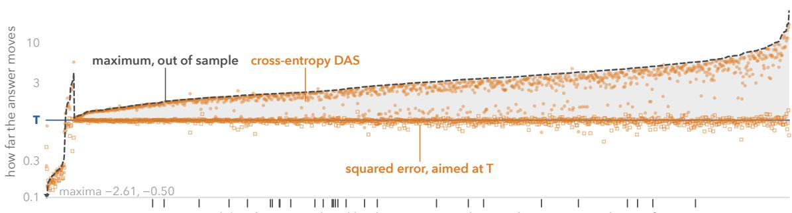  
1168 model–task cases, ordered by their maximum, those without a margin above T first  
ticks: the 28 cases with a margin where cross-entropy is not above T, 27 of them negative-polarity constructions  
DAS follows the prediction: rank correlation 0.71–0.98

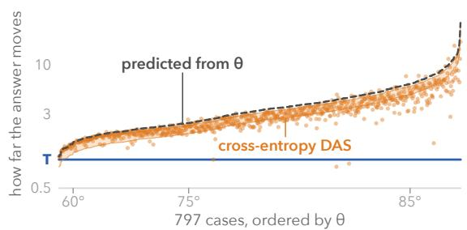

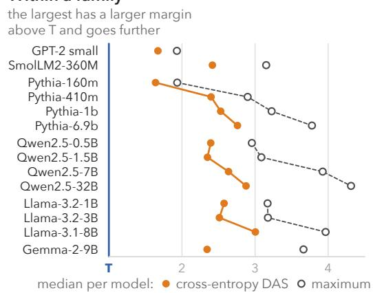  
Figure 4: At the readout, the loss determines where DAS ends up, and one angle predicts the maximum efect. Exact efects on test pairs. (a) Every case in all fourteen models. Grey shows the margin above T, up to the maximum. A case has this margin when the interval of its maximum lies above T; the cases without it come first, and some of them have maxima above T with intervals that reach T. The ticked cases are discussed in Section 5.4. (b) The two-label cases of the thirteen uncapped models, except one case whose DAS efect is not above zero. The prediction comes from Proposition 7, and the band shows the interquartile range of DAS as a share of it. The rank correlation is Spearman’s, per model. (c) Lines join a family’s sizes and are not a test. The test of size compares ratios per task (Table 6).

## 5 Results at the Readout

We begin where the reference is known exactly. At the readout, whole-state patching moves the output by exactly T, so the position of every method in the range can be read directly against it. This section tests four predictions of the theory there. Cross-entropy should exceed T wherever some direction can, the errors of two first-order estimates of T should stand in a fixed relation, a single angle should predict the maximum efect before training, and cross-entropy should fall short of that maximum where the base label is improbable. Appendix C gives the details of the measurement and further tests.

## 5.1 The Efect of the Training Loss

Changing only the loss moves DAS from far above T, with cross-entropy, to close to T, with the per-pair squared error or the CDAS divergence. With cross-entropy, DAS ends up above T in 1096 of the 1124 cases with a margin above T (1103 of all 1168 cases; Figure 4a), at a median of 1.64–3.00 T per model, or a median of 0.76–0.97 of the maximum efect per model. After ten passes, it lies in much the same place, close to the optimum of its objective, so its position after one pass is mostly not due to unfinished training (Appendix C.2). In contrast, from the same initialisations, the per-pair squared error ends up a median of 3.0% from T (farther on the sentiment templates, which train for 25 steps per pass against 100 elsewhere and come to 4.4% after ten passes, and where the maximum efect itself lies below T), and the CDAS divergence at a median of 0.91–1.06 T per model. Interchange intervention accuracy follows the loss as well (Section 7.2). Thus, from the same initial directions, the loss determines the efect of the trained direction.

A confound. A second feature that changes together with the target does not explain the excess. Such a feature would move the output toward the base label under whole-state patching and so lower G. CausalGym’s six number-agreement tasks change the lemma of the subject together with its number (senators against minister). On pairs built from the same rows that change only the number, cross-entropy DAS ends up at a median of 1.20–2.14 T per model, against 1.17–2.09 T on CausalGym’s pairs of the same tasks, and its interval lies above T in 84 of the 84 model–task cases. Changing only the lemma moves the output by 0.00 T on average. The excess of DAS therefore does not come from a lemma efect that lowers G. These pairs, however, cannot separate number from a feature of the plural form itself.

Held-out evaluation. Testing on held-out pairs removes the part of an efect that is specific to the training entities, but not a shift that every entity shares, so it does not remove the excess either. On IOI’s held-out templates, cross-entropy DAS lies above T in all 13 cases of the task with two names, and on RAVEL’s test prompts in 223 of the 224 cases with a margin above T. Where the test pairs difer from the training pairs in construction or template, the margin above T itself often disappears, and the excess with it (Appendix C.3).

## 5.2 Accuracy of the First-Order Approximation

The first-order approximation describes the readout closely. The trace of M, which is the first-order value of the efect of whole-state patching, lies a median of 0.05–3.8% from T per model. Its error also has the form that the theory predicts. On mirrored test sets, computing M at the midpoint of the patch rather than at the base point should, to leading order, halve the error and reverse its sign (Proposition 9). The two errors have opposite signs in 880 of the 882 cases where both are nonzero (Figure 5); the two exceptions are mirrored tasks of Pythia-160m. On sets that are not mirrored, the midpoint trace should be the more accurate one, but in one task of each Llama model the base-point trace is significantly closer to T. The main exception to the first-order approximation, left out of these counts, is Gemma-2-9B, which passes its final logits through a soft cap κ tanh(o/κ). In this model the approximation is less accurate, and the in-sample maximum lies above the predicted maximum in 47 of its 71 tasks, and in none once the cap is removed. Removing

## The trace's error follows the theory

915 mirrored cases in thirteen models; opposite signs in 880 of the 882   
with both errors nonzero; ratio: median −0.52, interquartile range −0.53 to −0.51

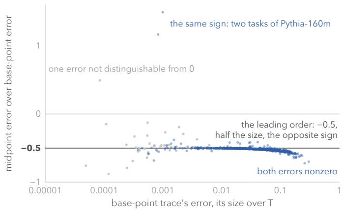  
Figure 5: The error of the trace has the form that the theory predicts. Every mirrored task of the main population in the thirteen uncapped models, with errors divided by $T$ on test pairs. The line shows the leading order (Proposition 9), at which the midpoint error is $- \frac 1 2$ times the base-point error. At the largest errors, the ratio falls a little below $- \frac 1 2$ , beyond the leading order. Least-squares slopes of the signed errors through 0 range from −0.49 to −0.60 across models.

the cap accounts for most, but not all, of the diference between Gemma-2 and the other families (Appendix C.4). The checks of the trace and of the angle therefore use the other thirteen models. We made this split after seeing the results for Gemma-2.

## 5.3 Predicting the Maximum Efect Before Training

In a two-label task, every pair contrasts the same two answers. Where the logits are not capped, the readout gradients then share almost exactly one direction, because only the final normalisation, whose Jacobian depends on the state, makes them difer. A single angle therefore predicts the maximum efect before training. The angle θ between the readout direction and the mean change of the state, computed from the training pairs, gives the maximum efect within a median of 2.1–5.6% per model (Appendix C.2). Since the median angle is $7 9 . 7 ^ { \circ }$ (interquartile range 73.1–83.2◦), most of the change of the state is orthogonal to the readout direction. An efect-seeking objective chooses a direction between the change and the readout direction. For the mean change, patching along this direction moves the state further in the readout direction than the whole change does (Proposition 7). Across cases, the angle also ranks the efects that cross-entropy DAS reaches (rank correlation 0.71–0.98 per model; Figure 4b). DAS ends up close to the direction that the theory predicts, the top eigenvector of M (median | cos | of 0.89–0.98 per model). The readout direction itself, in contrast, gives $T ,$ as predicted. The angle tells how far an efect-seeking method exceeds T at the readout, not where the network computes the variable, because it is measured at the readout, through which every efect on the output passes.

## 5.4 Higher Ranks, Shortfalls and Model Size

Higher ranks. We also trained DAS at the readout at ranks 2 to 64, at a rank equal to the number of labels minus one for tasks with more than two labels (the label rank), and on the orthogonal complement of one trained direction (Appendix C.5 gives the protocol and all counts). The excess is not limited to rank one. Every case above $T$ at rank one stays above $T$ at the higher ranks wherever both have a margin above $T ,$ except for three cases that lose significance at one rank. Outside Gemma-2, no trained run of cross-entropy DAS lies significantly above the predicted maximum for its rank $k ,$ the sum of the k largest eigenvalues of M. With more than two labels, a larger rank can enlarge the margin above T. On IOI with twenty names, the maximum efect lies below $T$ at rank one in every model, but from rank 16 onward DAS lies above $T$ in every case, so in this task rank one understates the excess. On the other tasks with more than two labels, the growth of the predicted maximum with the rank does not carry over from the training pairs to the test pairs.

Where cross-entropy does not exceed T. Of the 28 cases with a margin above T in which cross-entropy is not above $T ,$ one is the sentiment classification task of Pythia-160m, where after one pass the run from one initialisation lags far behind the other two (Appendix C.6). The other 27 belong to the 112 cases of the negative-polarity constructions of Kumon and Yanaka (2026), in which a word such as ever needs a licensor such as no. In the one-directional form that the authors build, every base label is ever, to which the models give a median probability of 0.003–0.006 per model. The derivative of cross-entropy with respect to the base label’s logit equals that label’s probability, which is nearly zero here. Lowering ever accounts for 0.79–0.95 of the maximum efect in log odds, but its share of the gain of cross-entropy DAS is lower by 0.56–0.86 in absolute terms (Figure 11). Cross-entropy DAS therefore stays below the maximum efect on these constructions, and it does not exceed T where the margin above T is smaller.

Model size. Within a family, the largest model has a larger margin above T, and the excess of DAS grows with it. Measured as multiples of T, the maximum efect grows by a median of 24–41% per task from the smallest to the largest of three sizes in $\mathrm { P y }$ thia, Qwen2.5 and Llama, and cross-entropy DAS grows by 16–29%. From Qwen2.5-7B to Qwen2.5-32B, both quantities still grow, by 18% and 9% (Table 6). The predicted maximum, $\lambda _ { 1 } / T _ { ☉ }$ , which is computed before training, grows with the maximum efect at every step in all three families, so the growth is a property of the network, not of the search that finds it. These statements rest on a test within families, whose smallest step holds only with CausalGym’s tasks (Appendix C.7 gives its design, intervals and limits).

## 6 Results Inside the Network

Inside the network, the reference is no longer known in advance. Most sites there are partial cuts, so whole-state patching at a site moves the output by its own amount G, which has to be measured. This section compares learned efects with $G$ at every cell of a map. It shows that DAS exceeds whole-state patching at most cells and also changes the output where whole-state patching shows no significant efect, that much of this excess runs through attention, and that, as at the readout, the target of the loss decides where a learned efect ends up.

Algorithm 1 Route test for one cell (layer $\ell ,$ region r).   
1: Input: model, training and test pairs, a direction d (any method), T from two plain   
forward passes per pair   
2: $e \gets$ efect of the rank-one interchange along $d$ at $( \ell , r )$   
3: $c $ the context, none or one other region $r ^ { \prime }$ of layer $\ell ,$ with the largest $G ( \{ ( \ell , r ) \} )$ or   
$G ( \{ ( \ell , r ) , ( \ell , r ^ { \prime } ) \} ) - G ( \{ ( \ell , r ^ { \prime } ) \} )$ on the training pairs   
4: $G ^ { * } \gets$ the same quantity in context c on the test pairs, that is, the efect of whole-state   
patching in its best context   
5: $e _ { \mathrm { f r z } } $ the efect along d with every downstream attention pattern frozen to the base   
run’s   
6: intervals for $e , G ^ { * } , e - G ^ { * } , e / G ^ { * }$ and $1 - e _ { \mathrm { f r z } } / e ,$ resampling test pairs with their mirrors   
7: if $G ^ { \ast } \mathrm { ^ , }$ interval lies above 0 then   
8: report $e / G ^ { * }$ : an excess over $G ^ { * }$ where its interval lies above 1   
9: else if $e \mathrm { { s } }$ interval and that of $e - G ^ { * }$ lie above 0 then   
10: of-route; report $e / T , G ^ { * } \mathrm { \Sigma _ { s } }$ upper bound and the share freezing removes, $1 - e _ { \mathrm { f r z } } / e$   
11: else   
12: no evidence that the network uses the cell; report e and $G ^ { * }$ with their intervals   
13: end if

The maps cover 78 tasks (CausalGym’s 29 and 49 from the other sources) in the six small models, at every region and every second layer, with the efect of cross-entropy DAS averaged over its three trained runs; 460 of them meet the population rule. Figure 6 shows the map of the running example. Unless stated otherwise, DAS in this section is trained with cross-entropy.

For a reference that is harder to exceed, we also measure $G ^ { * }$ , the efect of whole-state patching in the cell’s best context. This is the efect of patching the cell alone, or the efect that the cell adds when it is patched together with one other region of its layer (any region but the start-of-text region), whichever is larger on the training pairs. The cells at which the interval of $G ^ { * }$ lies above zero form the route of the map. Algorithm 1 gives the test of a cell against $G ^ { * }$ , which we call the route test. Its branches show two ways in which a learned efect e can exceed what the network produces at a cell. Where the interval of $G ^ { * }$ lies above zero, e can lie above $G ^ { * }$ . Where it does not, e can still change the output. A cell is of-route for a direction when the interval of its efect e lies above zero, the interval of $G ^ { * }$ does not, and e lies significantly above $G ^ { * }$ . At such a cell, whole-state patching in its best context shows no significant positive efect. We call e at such a cell an of-route efect. In either case, e is inflated where it lies above G. Unless stated otherwise, of-route cells are those of cross-entropy DAS.

An of-route cell has the signature of the illusion described by Makelov et al. (2024), and its of-route efect has the behavioural signature of what Grant et al. (2026) call a pernicious divergence. A map can be read as showing where an intervention succeeds or as showing the route of the network itself on these inputs. The route test separates these two readings but does not choose between them.

Inside the network: where whole-state patching moves the answer, and what DAS reports there Qwen2.5-0.5B on the same movie review, every second of its 24 layers; every number is a mean over the task's 100 test pairs

## 1 At one cell, the whole state moves the answer 0.09 T, and DAS's direction 0.86 T the verb at layer 10, patched two ways: all of its state, or only its part along DAS's direction

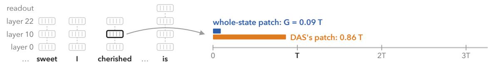

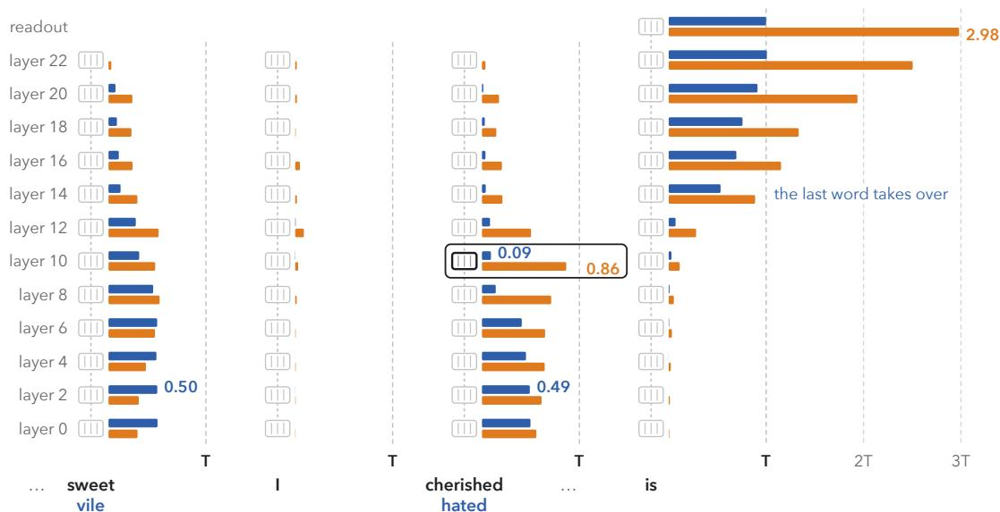  
in the sentence: I thought this movie was sweet, I cherished it. Conclusion: This movie is

Figure 6: The network moves the sentiment from two words to the last word, and at most cells cross-entropy DAS moves the answer further than whole-state patching of the cell. G is the efect of whole-state patching at the cell, and DAS is the mean of its three trained runs. The words before sweet are not drawn, because the change of the input does not reach them. Counts use false-discovery control over the cells of each model (Appendix D.1).

## 6.1 Learned Efects and Whole-State Patching Across Sites

Cross-entropy DAS lies significantly above G at 16,489 of the 18,221 cells that the change of the input reaches (the live cells), by a median of 0.14 T at those cells. This holds for 94–97% of each source’s cells on the syntactic tasks (those of CausalGym, those of Kumon and Yanaka, and number-only agreement) and for 53–81% on RAVEL, IOI, SST and the sentiment templates. Even against the best context, DAS lies significantly above $G ^ { * }$ at 15,998 of the live cells. Summed over the live cells, 0.51–0.64 of the efect of DAS lies beyond $G ^ { * }$ . This range covers every model and each of three ways of summing (Appendix D.5). The four large models, mapped on three of these tasks, look much the same. We report this only as a description, because three maps per model are too few for a test (Appendix D.2). In the six small models, at the 4300 of-route cells, where whole-state patching in its best context shows no significant positive efect, the efects of DAS are mostly small (a median of 0.04 T, and nine in ten below 0.43 T).

A stronger reference. Choosing the second region of $G ^ { * }$ on the same test pairs on which $G ^ { * }$ is measured can only raise $G ^ { * }$ . Even then, DAS lies above $G ^ { * }$ at 15,954 of the live cells, against 15,998 with the region chosen on the training pairs, and where $G ^ { * }$ uses a second region, it exceeds G by a median of only 0.002 T.

A confound. A second feature that cancels the target’s efect within a cell does not explain the of-route efects either, because the output receives only the net efect that whole-state patching measures. At the of-route cells, the upper bound of the interval of $G ^ { * }$ has a median of 0.001 T, and nine in ten of these upper bounds lie below 0.013 T. The network itself therefore passes on to the output little of what DAS isolates at these cells.

Prediction before training. The route test does not rest on the first-order theory, because it compares two efects measured by forward passes at the same cell. The theory explains why the first can exceed the second. The first-order excess at a cell, $( \lambda _ { 1 } - \mathrm { t r } M ) / T$ is the largest excess that a single direction can reach there to first order, and it is computed from the gradients of the test pairs before any training. It ranks the cells by how much DAS exceeds $G$ only in part (mean rank correlation 0.62 over the maps; Appendix D.3). It does not bound the excess, because at 4894 cells at least one of the three trained runs of DAS exceeds the predicted maximum, mostly through attention. We report this as a description rather than a test.

## 6.2 How Learned Directions Change Attention

The state at a site also afects how much attention the last position pays to that site. To first order, in the first block that reads the site, whole-state patching changes this attention only through the part of the change of the state that a head reads. A learned direction, in contrast, can raise this attention even where the head reads none of the change, and thus where whole-state patching leaves it as in the base run (Proposition 8; Figure 7 shows such a rise in a later block). Freezing the attention weights, as in path patching (Goldowsky-Dill et al., 2023; Tigges et al., 2024), separates every path through the attention weights, including the path through this rise, from the paths through the values that the site passes on.

Proposition 8 (raising attention that whole-state patching leaves low). Take a site at position p before the readout position n, and one head at n in the first block that reads the site’s layer; its query q and its scores on positions other than p do not depend on the site. Its score on p is $q ^ { \top } W _ { K } \mathrm { L N } ( h _ { p } )$ (scaled). Let a be the score’s gradient in $h _ { p }$ at $h _ { b } ,$ , let α be the base run’s attention weight on $p ,$ , let $L = \log ( 1 / \alpha )$ , and write σ for the logistic function. To first order in the score:

(i) whole-state patching changes the score by $a ^ { \top } \Delta$ , and a rank-one interchange along d by $( a ^ { \top } d ) ( d ^ { \top } \Delta )$ , whose maximum over d is ${ \begin{array} { l } { { \frac { 1 } { 2 } } ( a ^ { \top } \Delta + \| a \| \| \Delta \| ) } \end{array} }$ , at the bisector of aˆ and $\hat { \Delta } ,$

(ii) with the other scores and the values fixed, and for $t > 0 \colon i f a ^ { \top } \Delta \leq L - t$ , whole-state patching leaves the weight on p at most $\begin{array} { r } { \sigma \big ( - t - \log ( 1 - \alpha ) \big ) ; i f \frac { 1 } { 2 } ( a ^ { \top } \Delta + \| a \| \| \Delta \| ) \ge L + t , } \end{array}$ some rank-one interchange raises it to at least $\sigma ( t )$ . For a diference the head does not read $( a ^ { \top } \Delta = 0 )$ and $t \leq L$ , both conditions hold if and only if $\| a \| \| \Delta \| \geq 2 ( L + t )$

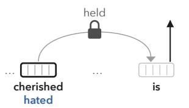

Inside the network, much of DAS's excess runs through attention Qwen2.5-0.5B, the movie review, the verb at layer 10; the 50 pairs whose source is negative, DAS's first run

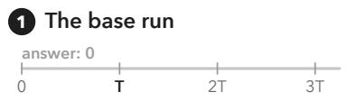

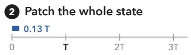

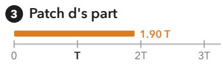

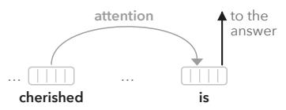

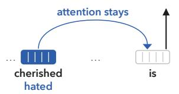

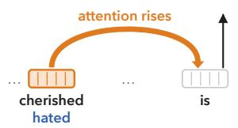

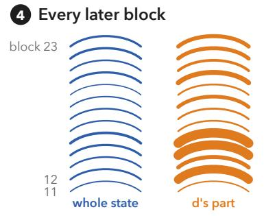

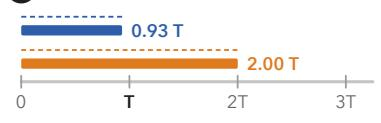

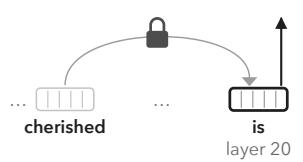  
Figure 7: Holding attention takes DAS’s excess away at the verb, but not at the last word. The beam in steps 1–3 is the attention of head 3 in block 12 from the last word to the verb; the arcs in step 4 are this attention summed over the 14 heads of each block that reads layer 10, and in the first of these blocks, which Proposition 8 describes, no head’s attention rises by more than 0.02. All steps use the 50 test pairs whose source is negative and DAS’s first run. On the other 50 pairs the same direction lowers this attention and moves the answer 0.03 T; over all 100 pairs and its three runs, DAS gives the 0.86 T of Figure 6. Held means that attention is frozen, with every attention pattern after the patched cell kept at the base run’s; in steps 5 and 6 the beam and its lock stand for all of them. The dashed lines are the same patches with attention free. At the last word the patch is at the position the answer is read from, so holding attention leaves its excess, which comes from the geometry of d’s part, as at the readout (Figure 3). Over all 18,221 live cells of six models, holding attention removes 0.58 of DAS’s summed excess over G and keeps 0.90 of the summed G.

Appendix D.4 gives the proof, the range in which the first-order statement holds and a test of where the attention to the site rises.

Much of the excess of DAS above G∗ runs through attention, 0.47–0.56 per model (Appendix D.5). At the verb of the running example, holding attention takes nearly all of the excess away, and at the last word it takes none of it away, because there the patch is at the position from which the answer is read (Figure 7). Whole-state patching, in contrast, keeps 0.90 of its efect summed over the cells when attention is frozen, so freezing does not remove every efect. Over the live cells, it removes 0.39 of the summed efect of DAS and 0.58 of its summed excess, e − G. Freezing only the attention of the readout position, from the block of the site onward, removes 0.43 of that excess, so most of the excess that runs through attention runs through the attention of the readout position. At cells with a

2 Every cell: one loss, two targets

The excess is the objective's: a learned effect follows its target

Qwen2.5-0.5B, the movie review: the verb at layer 10, then every live cell of six models; means over the test pairs, in T

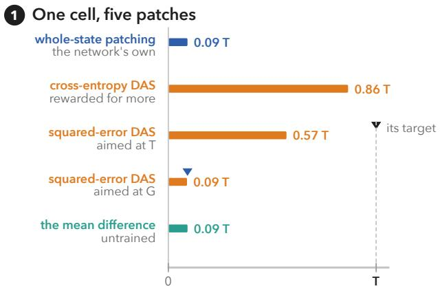

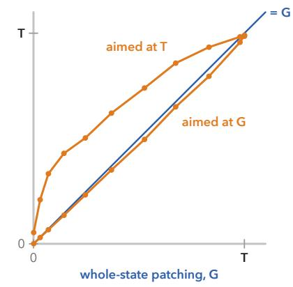  
Figure 8: The excess comes from the objective. Inside the network too, a learned efect follows the target of its objective. In step 1, cross-entropy DAS and the squared error aimed at G are means over three runs, and the squared error aimed at $T$ is one run; each triangle marks a target, T or the cell’s G. Step 2 sorts the 18,221 live cells of six models into bins of G and shows the median efect in each bin. Aimed at T, the squared error lies a median of 0.09 T above G and meets G as G nears T; aimed at G, it lies near G (slope 0.91 and intercept 0.00 T, by least squares). Cross-entropy, another loss, is not drawn. It lies a median of 0.11 T above G, close to the squared error aimed at $T$ while G is well below $T ,$ but past T as $G$ nears T. The untrained mean diference is left out of step 2 because its comparison leaves out IOI, where a pair’s class does not fix its answer.

smaller $G ^ { * }$ , a larger share of the DAS efect tends to run through attention. At the of-route cells, freezing removes 0.75 of the summed efect of DAS. How much runs through attention depends on the task. Freezing removes more of the DAS efect on negative polarity and filler–gap than on agreement or on the other sources.

## 6.3 The Target of the Squared-Error Loss

At the readout, a per-pair squared error aimed at the total efect T ends up close to $T .$ Inside the network, where a cell produces only part of $T ,$ , the same loss ends up above the efect of whole-state patching at the cell (Figure 8). Over all the cells (trained from one initialisation, and reported as a description), it lies a median of 0.09 T above $G ,$ as cross-entropy does (0.11 T), and every other objective that we trained to make the output follow the source also gives an excess. Of its excess above $G ^ { * }$ , 0.55 runs through attention. DAS trained with this squared error or with the CDAS divergence also produces of-route efects. Of the 4630 live cells where the interval of $G ^ { * }$ does not lie above zero, it is of-route at 4354 with the squared error and at 3720 with the CDAS divergence, against 4300 with cross-entropy. At all but 36 of these cells, both efects lie below $T ,$ so a target or bound at $T$ rarely constrains them there, whereas whole-state patching, whose efect is near zero at every one of these cells, marks them (Appendix D.6).

When the same loss is aimed instead at the cell’s G, it ends up near G (Figure 8; slope 0.91 and intercept 0.00 T across the cells, by least squares). Outside IOI, the untrained diference of means also lies near G (slope 0.88 and intercept 0.00 T). The comparison leaves out IOI, because there a pair’s class does not fix its answer. Summed over the live cells outside IOI, the diference of means and the mean gradient of z at the cell give 0.88 and 0.93 times the efect of whole-state patching, but their bisector already gives 2.11 times it. The excess therefore depends on which direction is patched rather than on training as such, and to first order an efect-seeking objective selects a direction at the upper end of the range (Corollary 6).

At the readout and inside the network alike, the efect of a learned direction follows the target of its objective, so a learned efect alone cannot measure the network itself. The efect of whole-state patching, G, does measure the network, because whole-state patching learns nothing and G is the indirect efect of the input through the site. It also takes only a few forward passes per pair to compute (Section 8).

## 7 Published Benchmark Results

Because part of a learned efect is chosen by the objective, published scores based on learned efects show something diferent once they are compared with whole-state patching. We re-examine the two results from the introduction, CausalGym’s ranking of localisation methods and a sentiment direction reported above 100%, and we ask what RAVEL and MIB, which score accuracy instead, can show.

## 7.1 The CausalGym Ranking

CausalGym ranks seven localisation methods on 29 tasks by the log odds ratio of their interventions. It takes each method’s best region at each layer and averages over layers. Its vanilla intervention is whole-state patching scored in the same way, which the benchmark calls “a significantly more expressive intervention than any methods we tested” (Arora et al., 2024, App. E). Even so, the score of DAS divided by that of vanilla is a median of 2.1–3.1 at every published size (Figure 9a, Table 9). The released code passes the base and source token positions to its interventions in swapped order, which matters on 19 of the 29 tasks (Appendix E.2). On the other ten, DAS lies above vanilla in all 90 entries (one entry per task and size), and the other methods in 76 of 600. With the call corrected, the diference of means and the probes rise to near vanilla on the 19 tasks, while PCA and k-means stay low on most of them, and DAS, retrained in the same code, stays above vanilla and above every other method on all 19 tasks at each of the five sizes that we re-ran.1 Consistent with Corollary 6, only the method whose objective rewards a larger efect consistently exceeds vanilla. CausalGym itself suggests that much of the higher score of DAS comes from its access to the outputs, and it reports selectivity, the score minus that on a control task with arbitrary labels (Arora et al., 2024, §§5.2–5.3). By its selectivity tables, the median ratio of the selectivity of DAS to that of vanilla ranges from 0.52 to 1.70 over the nine sizes and lies above 1 only at 14m and 31m, so at every other size DAS is no more selective than vanilla

## a Only DAS consistently exceeds whole-state patching

CausalGym's published scores over vanilla, its whole-state patching: one dot per task and size above vanilla beyond rounding: DAS in 251 of 261 entries, the four others in 92 of their 1044

the ten tasks where base and source positions coincide

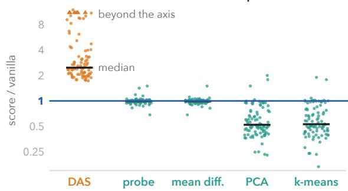

the 19 tasks where the released code's swap matters  
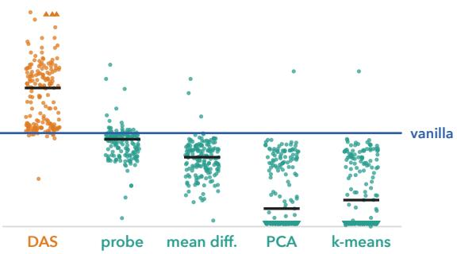  
b The DAS–vanilla gap lies beyond G\* CausalGym's aggregate on our maps of its 29 tasks, G\* at DAS's best region in each layer; median per model

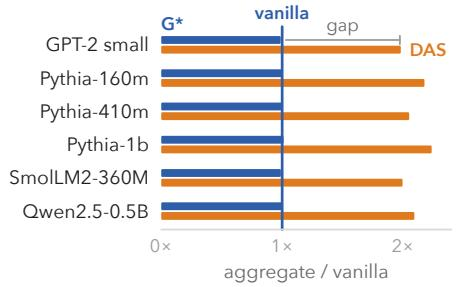  
c The published 109.8% is within the spread DAS re-run in 7 models: three runs' mean and 95% band; the band holds 100% in 6, lies below it in 1, above in none

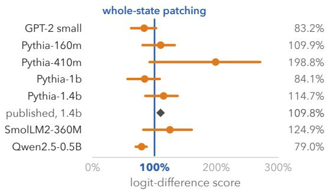  
Figure 9: What benchmark scores measure. (a) CausalGym’s published scores. LDA and the random baseline are in Table $^ { 9 , }$ so the subtitle’s counts cover the four methods drawn. The probe strip shows the higher-scoring of two probes, and Appendix E.2 describes the swap. (b) Each bar is aggregated over layers as CausalGym aggregates a method and divided by vanilla’s aggregate; the context of $G ^ { * }$ is chosen on the test pairs. Table 8 gives the share of the gap beyond $G ^ { * }$ . (c) The sentiment direction of Tigges et al. (2024), re-run with the authors’ code (the mean of three trained runs) at a complete cut (Table 10). The 95% bands account for the choice of layer; at Pythia-410m, the band holds 100% only with its small-sample factor (Section 7.3).

on the median task. Selectivity, however, controls for a whole task, whereas whole-state patching gives a control at each cell.

To compare DAS with $G ^ { * }$ , whole-state patching in its best context, we rebuilt Causal-Gym’s maps in six models (Appendix E.1). Here the context of $G ^ { * }$ is chosen on the test pairs, as CausalGym’s aggregate chooses each method’s region on the pairs that it scores. On the rebuilt maps, we compare the excess of DAS over $G ^ { * }$ at the best region of DAS in each layer with the gap between DAS and vanilla, both summed over layers. Per model, this excess is 1.02–1.08 times the ${ \mathrm { g a p } } ,$ or 1.01–1.05 times without the one task whose $T$ is near zero. At these regions, $G ^ { * }$ thus gives about what the best region of vanilla gives (Figure 9b), and the gap between DAS and vanilla is an excess over what whole-state patching produces at the same regions. The path that CausalGym reads from its negative-polarity map holds on the rebuilt map of $\mathrm { P y }$ thia-1b and follows the cells where whole-state patching has its largest efect. DAS also stays on the licensor into layers where whole-state patching there has almost no efect, a row that CausalGym’s route analysis (Arora et al., 2024, §6) does not discuss. Neither the excess of DAS over $G ^ { * }$ nor this row, by itself, shows a better-localised variable.

## 7.2 Accuracy-Based Benchmarks

RAVEL and MIB rank methods by how often the intervened output matches the counterfactual label (Huang et al., 2024; Mueller et al., 2025). The exception is MIB’s IOI task, which MIB scores by a squared distance between logits. Where the label is the source input’s own next token, as on our tasks, the count thresholds the log odds of that label over its competitors, of which z, the log odds over $y _ { b } ,$ is one. Accuracy can therefore show the excess where whole-state patching still gets some test pairs wrong, but not once it gets every pair right. Sutter et al. (2025, §7) observed the excess as measured by accuracy.

We compared accuracies wherever we trained DAS, and we report the comparison as a description. At the readout, the accuracy of cross-entropy DAS is a median of 0.96–1.00 per model, that of the squared error 0.86–0.94 and that of whole-state patching 0.93–0.97. There, whole-state patching gives the accuracy of the network itself on the source inputs. In 555 of the 1103 cases where the efect of cross-entropy DAS lies above T, its accuracy is significantly higher than that of whole-state patching, and in 13 it is significantly lower. Inside the network, at 8800 of the 16,489 live cells where DAS lies significantly above G, its accuracy is significantly higher than that of whole-state patching at the same cell (medians 0.33 against 0.16), and at 30 cells it is significantly lower. Both accuracies are 1, with every test pair right, in 317 of those readout cases and at 322 of those cells, where accuracy cannot show the excess. Where the two accuracies do not difer significantly, accuracy does not show the excess that the efect shows. Two directions with equal accuracy can thus difer in how much of their efect the network itself produces, and only the comparison with whole-state patching separates them. These counts compare cross-entropy DAS with whole-state patching at the same site. They do not cover whole-state patching in its best context $\left( G ^ { * } \right)$ , whose accuracy is not measured, or the size of the excess where the two accuracies agree.

## 7.3 A Published Sentiment Direction

Tigges et al. (2024) report that a one-dimensional DAS direction scores 109.8% on their logit-diference metric in Pythia-1.4b (71.1% for logistic regression) when their code patches it at every position of a layer. This site is a complete cut, where whole-state patching scores exactly 100% (Proposition 3), and their code trains the direction at the adjective alone, so its objective does not act on this site (Appendix E.3). We re-ran the authors’ code on seven models from three initialisations. At 1.4b, the re-run gives 114.7% [85.0, 137.4], a band that accounts for the choice of layer and contains both the published value and 100%. The same kind of band includes 100% in five models for every trained run and lies below 100% in one, with or without its small-sample factor (Figure 9c). The direction of Pythia-410m, at 198.8%, is the exception. Its band includes 100% only because of that factor, without which the direction lies above 100% for every trained run. The band, with its small-sample factor, was chosen after the first trained run of Pythia-410m and of Pythia-160m had been seen. In any case, a score above 100% at a complete cut exceeds the efect of whole-state patching there, which is exactly 100%.

## 8 A Reporting Check for Learned Efects

A learned efect needs a reference at its own site. Control tasks and random-network baselines adjust a comparison for a whole task or a whole network, not for a single site. A control task asks whether the score of the same network drops when the labels are arbitrary, and a random-network baseline whether a trained network gives a larger efect than an untrained one. Neither asks whether whole-state patching in the trained network produces the efect at that cell, or how large this efect is. This question matters because, as CausalGym notes, “DAS finds causal efect at all timesteps, even when the model has just been initialised” (Arora et al., 2024, §6). The reference therefore has to involve no training, be measured at the same site and transfer everything that the network computes there, as whole-state patching at that site does, and at a complete cut its efect is known exactly.

Wherever a learned efect e is reported, we recommend comparing it with whole-state patching in three steps, and Figure 10 applies them to the movie review of the running example and to the last word of a second template, “I heard the doctor use the word vaccination and I felt very”. The steps use the quantities of the route test (Algorithm 1), namely $G ^ { * }$ , the learned efect e and e with attention frozen. Each quantity that the steps report comes with an interval that resamples the test pairs, each pair together with its mirror.

1. Measure $G ^ { * }$ , the efect of whole-state patching at the same site in its best context, with its interval. At a complete cut, $G ^ { * }$ equals $T$ and needs no separate measurement.

2. Report the ratio $e / G ^ { * }$ . Where its interval lies above one, attribute the excess $e - G ^ { * }$ to the direction that the training objective chose, and do not take it, by itself, as stronger evidence about the site.

3. Where $G ^ { * }$ does not lie above zero but e does, do not read e as evidence that the network uses the site. If $e - G ^ { * }$ also lies above zero, the cell is of-route.

In every case, also freeze attention to see whether e runs through attention.

What the steps measure. A ratio $e / G ^ { * }$ above one marks an excess of the method above $G ^ { * }$ . A ratio below one is no evidence against the method, because a direction patched at the cell alone can fall short of the efect that the cell produces together with another region. The share of e that freezing attention removes shows whether e runs through attention. A benchmark can divide the score of each method by the score of whole-state patching computed in the same way, as Figure 9a does with CausalGym’s vanilla intervention.

Cost and library. At a cell, the steps take at most five forward passes with a patch per test pair and no gradient, and the direction may come from any method. Our library OwnEfect measures the quantities of the three steps, with their intervals, for a direction or subspace from any method. At a cell inside the network, it gives $G ^ { * }$ , e, the excess $e - G ^ { * }$ the ratio $e / G ^ { * }$ and the share of e that freezing attention removes; at the readout, where $G ^ { * } = T$ , it gives $e / T$ . Before any training, it also computes the quantities of the theory on

What to report beside a learned effect  
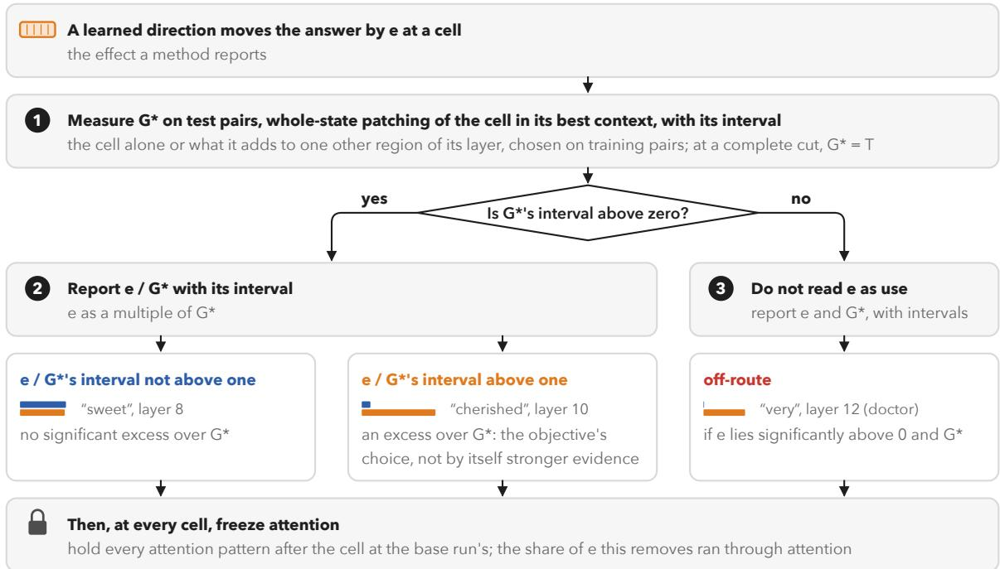

## The report: each learned effect beside whole-state patching

Qwen2.5-0.5B, the movie review, then a second template; e is cross-entropy DAS, the mean of three runs; means over test pairs, in T

<table><tr><td></td><td></td><td>G*</td><td>e/ G* [interval]</td><td>e, frozen</td><td></td></tr><tr><td>cell</td><td>e 0.31</td><td>[interval] 0.50 [0.47, 0.54]</td><td>0.62 [0.52, 0.72]</td><td>(removed) 0.30 (3%)</td><td>reading below G*, little via attention</td></tr><tr><td>&quot;sweet&quot;, layer 2 &quot;sweet&quot;, layer 8</td><td>0.53</td><td>0.54 [0.51, 0.57]</td><td>0.97 [0.90, 1.04]</td><td>0.44 (17%)</td><td>within G*, little via attention</td></tr><tr><td>&quot;cherished&quot;, layer 10</td><td>0.86</td><td>0.102 [0.093, 0.110]</td><td>8.5 [7.8, 9.3]</td><td>0.09 (89%)</td><td>excess, mostly via attention</td></tr><tr><td>the readout</td><td>2.98</td><td>1 (exact)</td><td>2.98 [2.91, 3.05]</td><td>2.98 (0%)</td><td>excess, not via attention</td></tr><tr><td>&quot;I&quot;, layer 16</td><td>0.048</td><td>≈ 0, at most 0.0004</td><td></td><td>0.006 (88%)</td><td>off-route, mostly via attention</td></tr><tr><td>&quot;very&quot;, layer 12 (doctor)</td><td>0.49</td><td>≈ 0, at most 0.042</td><td></td><td>0.43 (12%)</td><td>off-route, little via attention</td></tr></table>

Figure 10: What to report beside a learned efect. The bars show G∗ in blue and e in orange (blue is whole-state patching and orange DAS, as in Figure 6). Most of-route efects are smaller than the second template’s (median 0.04 T, nine in ten below 0.43 T). Intervals are 95% and resample each pair with its mirror. OwnEfect computes $G ^ { * } , e , e / G ^ { * }$ and the share that freezing removes, with their intervals.

the pairs at hand, among them the range and its upper end, the predicted maximum. It covers the architectures of all the models that we measure and reproduces our measured values on GPT-2 (Appendix F).

## 9 Related Work

This section relates our reference and our analysis to four bodies of work. Benchmarks report whole-state patching as a baseline, and our analysis extends critiques of subspace patching. We also discuss studies of training objectives and of methods that can create the efects that they report. Finally, our work borrows from the practice of activation patching.

## 9.1 Interchange Interventions and Their Benchmarks

Causal abstraction gives interchange interventions their meaning (Geiger et al., 2021, 2025). DAS and its scaled variants learn the intervened subspace (Geiger et al., 2024; Wu et al., 2023). CausalGym scores localisation methods by the log odds ratio of their interventions, while RAVEL and MIB score them by how often the intervened output matches a counterfactual label (Arora et al., 2024; Huang et al., 2024; Mueller et al., 2025). RAVEL’s Disentangle score also rewards leaving other attributes unchanged. MIB scores its IOI task by the squared distance between the logit of the network and that of a causal model. Each benchmark also reports whole-state patching at the same site as a baseline (CausalGym’s vanilla, RAVEL’s Full Rep., MIB’s Full Vector). On RAVEL’s pairs, this baseline is expected to fail, because the pairs also require other attributes to stay unchanged. MIB reports that on these pairs “the full vector baseline entirely fails completely” (Mueller et al., 2025). In the BlackboxNLP 2025 shared task, which extends MIB, featurizers that exceed DAS are reported as significant gains (Arad et al., 2025). A featurizer maps a hidden state to the features on which an intervention acts.

We use whole-state patching as the reference for the efect of every method, rather than as a baseline in a results table. Benchmarks with ground truth use models that are compiled or trained to implement a known algorithm (Sharkey et al., 2025). In contrast, whole-state patching gives a reference for the size of an efect in any trained model, and at a complete cut its value is known exactly. We show that, to first order, the efect of whole-state patching is the trace of the matrix whose range contains the efect of every rank-one method, and that the objective of a method determines where in this range its efect ends up.

## 9.2 Interpretability Illusions

Makelov et al. (2024) show that subspace patching can activate a dormant pathway (Example 1): “the variation in the disconnected part activates the dormant part, which then achieves the causal efect”. Whole-state patching leaves the dormant part unchanged, so under this reading as well, the efect is one that the network does not produce. Wu et al. (2024b) reply that such efects can still be meaningful. Consider the case of one shared direction with $\theta = 9 0 ^ { \circ }$ . Then tr $M = 0$ (Proposition $7 ( \mathrm { i } )$ , whose proof does not use the angle), while $\lambda _ { 1 } = { \textstyle { \frac { 1 } { 2 } } } \| \bar { w } \| \| m \|$ (Theorem 5(iv) with $\bar { w }$ and m in place of $w$ and $\Delta )$ . If, moreover, no pair moves the state along $\hat { w } ,$ then wˆ is dormant in the sense of Makelov et al. (2024). Since $\hat { m }$ is orthogonal to the shared readout direction, it is also disconnected to first order. Their definition is stronger, because it requires that no value along this direction changes the output. The bisector gives the upper end of the range, and under these conditions it has the form of their illusory direction. Their Lemma A.1 finds the same $\pi / 4$ angle optimal under a stronger dormancy assumption. An angle near $9 0 ^ { \circ }$ has been measured in practice.

Moral framing in a pretrained model is linearly decodable, but it is nearly orthogonal to the readout direction of the model’s judgments and has no measurable efect on its verdicts (Konrad et al., 2026a). In this case, whole-state patching at the readout has almost no efect, while to first order the upper end of the range does not vanish. At smaller angles, the same geometry produces the inflation that we measure. However, the illusion of Makelov et al. (2024) is defined by its mechanism rather than by its size. In their expository toy model, a linear network writes its input into the state along (1, 0, 1) and reads its output along $( 0 , 2 , 1 )$ , so $\Delta$ is a multiple of $( 1 , 0 , 1 )$ and $w = ( 0 , 2 , 1 )$ . Then cos $\theta = 1 / \sqrt { 1 0 } , \theta \approx 7 2 ^ { \circ }$ and their illusory direction $v = ( 1 , 1 , 0 ) / \sqrt { 2 }$ gives $( w ^ { \top } v ) ( v ^ { \top } \Delta ) = w ^ { \top } \Delta$ , exactly the efect of whole-state patching. Their IOI table shows both patterns that we measure against whole-state patching at the same site. A residual direction decreases the logit diference by 140.7% (interchange accuracy 74.8%), whereas the whole residual vector decreases it by 123.6% (54.8%). Their illusory MLP direction decreases the logit diference by 46.7%, whereas patching the whole MLP gives −8% (Makelov et al., 2024, Table 1). They validate the residual direction as “faithful to the model’s computation to a high degree” and argue that patching subspaces of the residual stream is “less prone to illusions”. The direction they validate also has a larger efect than whole-state patching. The check of Section 8, however, measures the size of an efect, not whether the direction of the intervention is the direction of the variable.

Sutter et al. (2025) show that causal abstraction becomes vacuous when alignment maps are unconstrained. Our result, in contrast, needs no non-linearity. A rank-one orthogonal map trained with an efect-seeking objective already reports an efect larger than that of whole-state patching, and for a linear map their $\ S 7$ observes the same kind of excess in accuracy. The site where causal tracing localises a fact need not be the site where editing the fact works (Hase et al., 2023). There too, the success of an intervention at a site and the efect of patching that site come apart. Grant et al. (2026) separate the divergent representations that causal interventions create into two kinds. Harmless ones lie in the behavioural null space, and pernicious ones “activate hidden network pathways and cause dormant behavioral changes”. An of-route efect has the behavioural signature of what they call a pernicious divergence. We find such efects for learned interchanges in unmodified models on natural tasks, and they run mostly through attention (Section 6.2). A learned interchange can activate such a pathway without leaving the scale of natural states, because its edit $d d ^ { \top } \Delta$ is no longer than $\Delta .$

## 9.3 Training Objectives and Methods That Can Create the Efects They Report

DAS trains its rotation with the distributed form of the interchange intervention training objective of Geiger et al. (2022). This objective guarantees an abstraction when the loss is zero, though “the reverse does not hold”. With cross-entropy, the loss is zero only when the patched output gives the source label with certainty. This is more than whole-state patching gives. Until it saturates, the loss therefore keeps rewarding a larger efect. CDAS keeps the interchange of DAS. It trains this interchange with a Jensen–Shannon divergence to the next-token distribution of the source run, “a weaker but more faithful supervision signal” (Bao et al., 2026, §1). The divergence is not a function of the mean efect alone, because it compares whole next-token distributions. At the readout, it ends up exactly at the efect of whole-state patching where one direction reproduces the source run, and elsewhere it need not (Appendix A.5). Inside the network, its target is the next-token distribution of the source run, not the output of whole-state patching at the site, so it can move the output where the network itself produces no efect (Section 6.3).

An intervention that is trained to produce an output can create that output. ReFT, for example, trains interventions built on DAS as a fine-tuning method (Wu et al., 2024a). Control tasks show that a probe can learn the task itself (Hewitt and Liang, 2019). Amnesic probing shows that decodable information need not be used (Elazar et al., 2021), and randomisation tests show that a saliency map can ignore the model (Adebayo et al., 2018). Unlike these tests, our reference is whole-state patching at the same site in the trained network. Apparent emergent abilities can come from the metric that scores fixed model outputs, and a continuous metric removes them (Schaefer et al., 2023). The excess that we measure difers in kind. The objective changes the intervention, and the output really moves further. A change of metric can therefore hide the excess but cannot remove it. Accuracy can show the excess, but saturated accuracy hides it (Section 7.2).

## 9.4 Activation Patching Practice

Logit-diference recovery and its normalisation are standard (Zhang and Nanda, 2024; Heimersheim and Nanda, 2024). Attribution patching estimates the efect of whole-state patching by a first-order value, the trace of M built with gradients at the base point (Remark 10). The adequacy of its first-order approximation is listed as an open problem (Sharkey et al., 2025). Our test of the trace answers this question in part. At the readout, the trace built with midpoint gradients lies close to T, and on mirrored sets the error of the base-point trace, which attribution patching uses, is to leading order −2 times its error (Proposition 9). Inside the network, the midpoint trace is the closer of the two at most cells (Appendix D.3). $\mathrm { A t P ^ { * } }$ notes that attribution patching misses saturated attention (Kramár et al., 2024). Proposition 8 concerns the same saturation. To first order in the score, a small attention weight α becomes large only once the score changes by about $L = \log ( 1 / \alpha )$ , a change that a learned direction can reach where whole-state patching does not.

We borrow attention freezing from path patching (Goldowsky-Dill et al., 2023) and from Tigges et al. (2024). Steering vectors act mostly through attention values, whether they are added or trained. Freezing all attention scores during refusal steering lowers its performance by only 8.83% (Cheng et al., 2026). Learned task vectors steer through the OV circuits of attention heads (Yang et al., 2026). In our measurements, the efect of whole-state patching runs mostly outside the attention weights (freezing them keeps 0.90 of it), whereas the of-route efect of a learned interchange runs largely through the attention weights of the readout position (Section 6.2).

Circuits can recover more than the logit diference of the full model, and the score changes with the ablation method (Miller et al., 2024). Whole-state patching involves no such choice, because it swaps the whole state exactly and learns nothing.

## 10 Discussion

A large learned efect suggests a simple reading, in which the site encodes the variable and the network uses it there. Our results instead divide a learned efect into two parts. One part is the efect of whole-state patching at the site. The other part is the excess, which, to first order, the objective chooses within the range of efects that the network allows. This section discusses what the excess measures and what it implies for interpretability and for safety and security. It ends with the limitations of our account.

## 10.1 Interpreting Efects Beyond Whole-State Patching

The excess is not an artefact of a metric, as some apparent efects are. The patched output does move further than under whole-state patching, because some part of the network’s state can move it further than the whole state. Whether such a part exists depends on the network and the inputs, not on any method, while how far a learned method moves the output beyond whole-state patching depends on its objective. To first order, the theory says when such a part exists. Under a shared readout direction, the upper end of the range and the trace coincide only when the readout direction and the mean change of the state point the same way (Corollary 6). On the two-label tasks of our models whose logits are not capped, these directions lie at a median angle of 79.7◦, so the upper end and the trace are far apart. The excess of a learned method is the part of this gap that its objective selects.

Each earlier explanation of such excesses is consistent with this account (Sections 9.2 and 9.3). Suppose that the readout direction and the mean change of the state are at a right angle, and that no pair moves the state along the readout direction. Then the direction that gives the upper end of the range has the form of the illusory direction of Makelov et al. (2024). However, their illusion is defined by how it arises, not by how large it is. The excess does not need a non-linear alignment map of the kind that Sutter et al. (2025) analyse, because a single direction reaches it. A learned interchange can also activate a hidden pathway in the sense of Grant et al. (2026). Bao et al. (2026, §1) argue that the training objective and the intervention protocol determine whether a steering intervention is faithful. In our results, the objective controls the excess. The same squared error ends up above whole-state patching when it is aimed at T, and near it when it is aimed at the cell’s own G (Section 6.3).

## 10.2 Implications for Interpretability

For interpretability, this division bears on what a map or a ranking reports. A map of learned efects shows where an objective can move the output. When the map is compared with the efects of whole-state patching, it also shows where the network itself produces the efect and where a learned direction changes the output but whole-state patching does not. This comparison mostly separates what holds in published readings from what does not, rather than overturning the readings. On the rebuilt map of Pythia-1b, the path that CausalGym infers from its negative-polarity map holds. By contrast, our re-run of the published sentiment direction is not reliably above whole-state patching at its site. The comparison does change what the ranking of methods shows. A ranking by efect size rewards the objective that seeks the largest efect (Section 7). The same comparison is needed wherever a method is credited with a larger efect. For example, a featurizer that scores above DAS (Arad et al., 2025) may localise better, or it may report a larger excess. Whole-state patching at the same site shows how much of its higher score lies beyond what the network itself produces. This comparison does not depend on how a featurizer is built.

The decomposition of Theorem 5, by contrast, covers interventions that patch an orthogonal subspace of a state, as DAS, probes and the diference of means do. For a sparse dictionary or a non-linear featurizer, the efects of its parts need not add up to that of the whole, and whole-state patching at the same site remains the reference.

For the debate about interpretability illusions, the comparison gives a quantity to measure. Consider an efect that whole-state patching does not produce. It is a question of interpretation whether such an efect is an illusion (Makelov et al., 2024) or, as Wu et al. (2024b, §4) would read substantiated cases, “evidence of latent causal structure rather than a worrisome illusion”. Whole-state patching does not settle this question. Instead, it shows at each cell how much of the efect the network itself produces, and freezing attention then shows how much of the rest of the efect runs through attention.

The comparison also qualifies a common inference. When an intervention along a direction moves the output, this is often taken as evidence of what the network represents. For instance, the success of activation steering “can be thought of as evidence” for the linear representation hypothesis (Sharkey et al., 2025, §3.2.2). Our evidence comes from interchanges, not from activation steering. For interchanges, success alone does not support that inference, because a learned direction can move the output at a site where whole-state patching does not. Success shows what a direction can make the network do, whereas whole-state patching at the same site shows what the network itself does.

## 10.3 Implications for Safety and Security

Interventions are also used to change models, not only to explain them. They serve to choose where a model’s knowledge is edited (Meng et al., 2022), to steer its behaviour (Panickssery et al., 2024), to find the direction that mediates its refusals (Arditi et al., 2024) and to audit where fine-tuning installs an evaluation-to-deployment mismatch (Konrad et al., 2026b). Some of these applications aim to make a model safer, for example by removing a harmful behaviour or by auditing what drives it. Doing so requires knowing what the efect of an intervention says about the model. A learned direction that removes a behaviour shows that the behaviour can be changed. Whole-state patching at the same site, in contrast, shows whether the network itself produces the behaviour through that site, or whether only the learned direction changes it there. The steering, refusal and audit directions above are diferences of means, not trained directions. Suppose that the pairs of a mirrored set change the state along one direction, up to sign, and that each pair’s class fixes its label. Then, to first order, an interchange along a diference of means, such as these directions, has the same efect as whole-state patching and so shows no excess, while a direction trained toward a larger efect exceeds it (Proposition 7 and Corollary 6). Here too, we test interchanges, not activation steering, editing or ablation. For those uses, the same question arises, but our numbers do not carry over to them.

Our results are dual-use, like interpretability in general (Bereska and Gavves, 2024). Consider a learned direction that raises the attention to a site where whole-state patching leaves it as in the base run. Such a direction shows what a patched state at the site can make the network do, but it is also a means to change the model’s behaviour. Anyone with a model’s weights can already do so more directly. For instance, editing one direction out of the weights reduces the model’s refusals (Arditi et al., 2024). We therefore expect our results to add little to misuse. The larger risk is to read too much into the check. Reporting the check removes one source of overclaiming, but it does not show that a mechanism is complete or that a model is safe.

## 10.4 Limitations and Future Work

Our account is first order. At the readout, where the final logits are not capped, it describes the maximum efect and the efect of whole-state patching closely in all but a few tasks (Section 5.2). Exact efects go beyond it in two places, and in both we find why. Under Gemma-2’s soft cap, the in-sample maximum exceeds the predicted maximum in 47 of 71 tasks and in none once the cap is removed (Appendix C.4). Inside the network, where DAS exceeds the predicted maximum, freezing attention removes 0.85 of its efect (Appendix D.3). There, the first-order range ranks the cells by their excess only in part and does not bound it (Section 6.1), and Proposition 8, which describes how a learned direction can raise the attention to a site, does not predict where the efect runs through attention better than simple predictors do (Appendix D.4).

Our measurements cover base checkpoints, not instruction-tuned ones, of 124M–32B parameters (Table 3), at ranks 1 to 64 at the readout and at rank one inside the network, where the four models of 7–9B are described on three syntactic tasks only. The reference has limits of its own. Inside the network, G and $G ^ { * }$ patch the state at the last token of a region, and $G ^ { * }$ adds at most one other region of the layer. An efect that the network produces only through the earlier tokens of a region, or through three or more regions together, is therefore not part of $G ^ { * }$ . The intervals of the maps resample each pair with its mirror, but the maps lack the analysis at the level of sentences that we report at the readout (Appendix C.1).

Because the account concerns objectives rather than DAS (Corollary 6), it covers any method, including methods yet to come, that trains an orthogonal subspace toward a larger efect. Four directions follow from our results.

• What a localisation should require. Causal abstraction counts a site as realising a variable when interventions there produce the counterfactual output. Constraining the alignment map, for example to be linear, does not rule out an excess, because a single orthogonal direction already reaches it (Section 9.2). Requiring that the efect be one that the network itself produces at the site would rule it out. How such a condition enters the theory of causal abstraction, and which published localisations meet it, is open.

• Where a model can be moved beyond its own efect. At the readout, a single angle measured before training predicts how far a learned part can move the output beyond whole-state patching (Section 5.3). Inside the network, where much of the excess runs through attention, a predictor that includes attention would show before any training where a learned intervention can move a model most, which matters both for steering a model and for protecting it.

• Hidden routes. Of-route efects run largely through attention, at sites through which the network itself carries no significant efect (Section 6.2). Whether inputs, and not only edits, can open these routes would tell whether they belong to the intervention or are latent in the network. Part of this question is which property of a task decides where they arise, since more of the efect runs through attention on negative polarity and filler–gap than on agreement, and how the share through attention changes with model size.

• Edits made for safety. An edit trained to remove a behaviour is trained toward an efect. It may therefore suppress the behaviour through a route that the network does not use for it, and leave the network’s own route in place. Testing this needs a reference for edits other than interchanges, such as ablation and steering, and measurements on the instruction-tuned models on which such edits are made.

## 11 Conclusion

Patching a learned part of a model’s state can change the model’s output more than patching the whole state does. We asked whose efect this excess is. To first order, the efects of orthogonal parts add up to that of the whole, so a part exceeds the whole exactly when the rest moves the output back, and an objective that rewards a larger efect selects such a part. The network fixes the range of efects that a part can have, and the objective chooses where in this range a learned direction ends up. At the readout, where all pairs share one readout direction, a single angle measured before training predicts the upper end of the range, and cross-entropy DAS goes most of the way to it. Changing only the objective of DAS so that it aims at what whole-state patching produces removes most of the excess, at the readout and inside the network. Inside the network, cross-entropy DAS exceeds whole-state patching at most sites, and it also changes the output, mostly by small amounts and largely through attention weights, at sites where whole-state patching shows no significant positive efect. The excess is therefore largely the objective’s, not the network’s.

A larger learned efect alone is thus not stronger evidence. The three steps of Section 8 compare it with whole-state patching wherever it is reported, benchmarks can score methods in the same way, and OwnEfect computes their quantities with intervals, in a few forward passes per pair, for a direction from any method. Which property of a task decides where of-route efects arise, and how the share of the efect of DAS that runs through attention changes with model size, remain open (Section 10.4). Read beside whole-state patching at the same site, a learned efect shows how much of it the network itself produces.

## Acknowledgments and Disclosure of Funding

The computations and AI model evaluations for this work were performed on the Bitten AI Supercomputer through the UCloud platform provided by the eScience Center at SDU. The authors declare no competing interests. This work received no third-party funding.

## Appendix A. Error Terms, Extensions and Counterexamples

This appendix bounds the error of the expansion on which the first-order statements of Section 3 rest. It extends the range to rank k and to a direction confined to a subspace, and it gives exact counterexamples that mark where the statements stop holding. Every statement, proof and exact example is machine-checked in Lean 4 with Mathlib (Appendix A.6), except the expected share of a random projection in Appendix A.4. The measurements on trained models are not.

## A.1 The Error of the Midpoint Expansion

Fix a pair and a location. Let F be z as a function of the state at the location, with the rest of the base run recomputed after the location. Assume that F is three times continuously diferentiable on a closed ball around $h _ { b } + \frac { 1 } { 2 } \Delta$ that contains every patched state considered. For a subspace patch $v = P P ^ { \top } \Delta$ , the ball with diameter $[ h _ { b } , h _ { s } ]$ sufices, since $\begin{array} { r } { \| v - \frac { 1 } { 2 } \Delta \| = \frac { 1 } { 2 } \| \Delta \| } \end{array}$ . The constant in $O ( \| \Delta \| ^ { 3 } )$ below is a bound on the third derivative of F on this ball. Let $\begin{array} { r } { \bar { h } = h _ { b } + \frac { 1 } { 2 } \Delta , w = \nabla F ( \bar { h } ) } \end{array}$ and ${ H } = \nabla ^ { 2 } { F } ( \bar { h } )$ . For a patch $h _ { b } \mapsto h _ { b } + v$ Taylor expansion about h¯ gives

$$
\begin{array} { r } { F ( h _ { b } + v ) - F ( h _ { b } ) \ = \ w ^ { \top } v + \frac { 1 } { 2 } v ^ { \top } H ( v - \Delta ) + O ( \| \Delta \| ^ { 3 } ) } \end{array}\tag{3}
$$

for $\| v \| \leq \| \Delta \|$ , because $\begin{array} { r } { \frac { 1 } { 2 } ( v - \frac { 1 } { 2 } \Delta ) ^ { \top } H ( v - \frac { 1 } { 2 } \Delta ) - \frac { 1 } { 2 } ( \frac { 1 } { 2 } \Delta ) ^ { \top } H ( \frac { 1 } { 2 } \Delta ) = \frac { 1 } { 2 } v ^ { \top } H ( v - \Delta ) } \end{array}$

• Whole-state patching $( v = \Delta )$ . The second-order term vanishes, so $G = w ^ { \top } \Delta +$ $O ( \| \Delta \| ^ { 3 } )$ and Theorem 5(ii) holds to third order.

• Rank one $( v = d d ^ { \top } \Delta )$ . The second-order term is $- \textstyle { \frac { 1 } { 2 } } ( d ^ { \top } \Delta ) d ^ { \top } H ( I - d d ^ { \top } ) \Delta$ . It does not vanish in general, so Theorem $5 ( \mathrm { i } )$ and Corollary 6 carry a second-order error.

• Mirrored test sets at the readout. Suppose that the test set contains every pair together with its mirror, the same pair with base and source exchanged (Section 2.1). The mirror has the same midpoint, the opposite diference $- \Delta$ and the opposite measure $- z \ ( \mathrm { s o } \ - H )$ . Its second-order term is the negative of that of the pair, and the mean over the test set has no second-order term for any d. Every CausalGym test set is mirrored in this sense (all 100 pairs of each task).

Third order for every d would require an expansion about the midpoint between the base state and the patched state, $h _ { b } + \scriptscriptstyle \frac { 1 } { 2 } d d ^ { \top } \Delta$ . The gradient at that point depends on $d ,$ and we do not use this expansion.

Proposition 9 (the trace’s error on a mirrored set). At the readout, on a test set that holds every pair with its mirror, let $g ( t ) = z ( h _ { b } + t \Delta )$ on the segment from a $p a i r ^ { \prime } s$ base state to its source state, so that $\begin{array} { r } { T = g ( 1 ) - g ( 0 ) = \int _ { 0 } ^ { 1 } g ^ { \prime } } \end{array}$ . The pair and its mirror together contribute $\frac { 1 } { 2 } \left( g ^ { \prime } ( 0 ) + g ^ { \prime } ( 1 ) \right)$ to the trace built with base-point gradients and $g ^ { \prime } ( \scriptstyle { \frac { 1 } { 2 } } )$ to the trace built with midpoint gradients. These are the trapezoid rule and the midpoint rule for T. To leading order their errors are tr $M _ { \mathrm { b a s e } } - T \approx g ^ { ( 3 ) } / 1 2$ and tr $M _ { \mathrm { m i d } } - T \approx - g ^ { ( 3 ) } / 2 4$ , so

$$
\mathrm { t r } M _ { \mathrm { m i d } } - T \approx - \textstyle \frac { 1 } { 2 } \big ( \mathrm { t r } M _ { \mathrm { b a s e } } - T \big ) ,
$$

and $\textstyle { \frac { 1 } { 3 } } { \bigl ( } \operatorname { t r } M _ { \mathrm { b a s e } } + 2 \operatorname { t r } M _ { \mathrm { m i d } } { \bigr ) }$ , Simpson’s rule, gives T to fifth order.

Proof. The mirror has base $h _ { s }$ , diference $- \Delta$ and measure $- z ,$ , so its base-point term is $\nabla F ( h _ { s } ) ^ { \top } \Delta = g ^ { \prime } ( 1 )$ and its midpoint term is $g ^ { \prime } ( \ L _ { 2 } ^ { 1 } )$ , the same as that of the pair. The errors are those of the two quadrature rules for $\textstyle \int _ { 0 } ^ { 1 } g ^ { \prime }$ ■

For a polynomial path of degree at most four, the relation and Simpson’s rule hold exactly. For any path with $| g ^ { ( 5 ) } | \le B$ on [0, 1], they hold up to $B / 4 8 0$ and $B / 7 2 0$ (both machine-checked, Appendix A.6). The diference tr $M _ { \mathrm { b a s e } } - \mathrm { t r } M _ { \mathrm { m i d } } \approx g ^ { ( 3 ) } / 8$ estimates the third-order term from the data before any direction is trained. It thus checks the first-order approximation in each model and task. At a partial cut, the function F of the mirrored pair is computed on the run of the other sentence, so it difers from that of the pair, and the relation holds only at a complete cut.

## A.2 Attribution Patching

Remark 10 (attribution patching estimates the trace). Attribution patching (AtP) estimates the efect of whole-state patching at a site on one pair by $w _ { b } ^ { \top } \Delta .$ , where $w _ { b }$ is the gradient at the base state (Nanda, 2023; Kramár et al., 2024). Its signed mean over pairs is the trace of M built with base-point gradients. This trace agrees with the midpoint trace to third order at a complete cut on a mirrored set, and to second order elsewhere. AtP thus estimates the reference, which is the efect of whole-state patching, and not a subspace efect. To first order, AtP reports tr M, and a subspace method with an efect-seeking objective (Section 2.3) reports $\lambda _ { 1 }$ , the upper end of the range.

## A.3 Rank k

For P with k orthonormal columns, (3) with $v = P P ^ { \top } \Delta$ gives the first-order mean efect $\mathbb { E } [ \boldsymbol { w } ^ { \top } \boldsymbol { P } \boldsymbol { P } ^ { \top } \Delta ] = \mathrm { t r } ( \boldsymbol { P } ^ { \top } \mathbb { E } [ \Delta \boldsymbol { w } ^ { \top } ] \boldsymbol { P } ) = \mathrm { t r } ( \boldsymbol { P } ^ { \top } \boldsymbol { M } \boldsymbol { P } )$ . By Ky Fan’s principle, as in Theorem 5(iii), its maximum over P is $\sum _ { j \leq k } \lambda _ { j }$ and its minimum is $\begin{array} { r } { \sum _ { j > D - k } \lambda _ { j } . \mathrm { ~ A t ~ } k = D _ { ! } } \end{array}$ , it equals tr M. Under one shared direction (Proposition 7), a larger rank does not raise the maximum. Take columns $q _ { 1 } , \ldots , q _ { k }$ and let $\begin{array} { r } { \boldsymbol { v } = \sum _ { l } ( q _ { l } ^ { \top } \bar { w } ) q _ { l } } \end{array}$ be the projection of w¯ on their span. Then $\mathrm { t r } ( P ^ { \top } M P ) = \sum _ { l } ( q _ { l } ^ { \top } \bar { w } ) ( q _ { l } ^ { \top } m ) = v ^ { \top } m$ . The reflection $2 v - \bar { w }$ has the same norm as w¯, so $2 \operatorname { t r } ( P ^ { \top } M P ) - \bar { w } ^ { \top } \tilde { m } = ( 2 \bar { v } - \bar { w } ) ^ { \top } m \leq \| \bar { w } \| \| m \|$ . Every rank-k interchange therefore stays at or below $\begin{array} { r } { \frac 1 2 ( \bar { w } ^ { \top } m + \| \bar { w } \| \| m \| ) = \lambda _ { 1 } } \end{array}$ , the first-order maximum at rank one. For every $k < D$ some interchange reaches this value. One example is the top eigenvector of M completed by $k - 1$ orthonormal directions that are orthogonal to it and to $\bar { w } .$ , which add nothing. An efect-seeking objective in pure form, that is, one strictly decreasing in the mean efect (Corollary 6(i)), therefore reports the same excess at every rank below D. Unless $\bar { w }$ and m point in the same direction, such an objective returns the trace only at $k = D$ , that is, for the whole state. Without one shared direction, M can have several positive eigenvalues, and the maximum grows with the rank. Where a task has more than two labels, as IOI with twenty names does, rank-one interchanges can understate what a larger rank reports. Section 5.4 measures this.

## A.4 Confining the Direction to a Subspace

Let U be a subspace with orthonormal basis $P \in \mathbb { R } ^ { D \times k }$ , let $\Pi = P P ^ { \top }$ , and suppose that U contains every diference, $\Pi \Delta _ { i } = \Delta _ { i } . \ ( \mathrm { i } )$ Pair by pair, the rank-k interchange along $P$ is whole-state patching, since $h _ { b } + \Pi \Delta = h _ { s }$ . A special case is a single code, in which every diference is a multiple of one vector, $\Delta _ { i } = s _ { i } \Delta$ . The rank-one interchange along $\pm \bar { \Delta } / \| \bar { \Delta } \|$ is then whole-state patching, whatever the objective. Such an interchange can neither exceed the efect of whole-state patching nor change attention in a way that whole-state patching does not. (ii) To first order, a unit $d \in U$ has $e ( d ) = d ^ { \top } \Pi M \Pi d ,$ so only Πw enters. The compression $P ^ { \top } M P$ has the same trace as $M .$ , and its range lies inside the range of M. Confinement thus shrinks the range around the same trace, and the confined excess never exceeds the unconfined excess, although it need not vanish for $k \geq 2$ . For example, take two pairs, one with $\Delta _ { 1 } = \mathbf { e } _ { 1 }$ and $w _ { 1 } = { \mathbf e } _ { 1 } + { \mathbf e } _ { 2 }$ and one with $\Delta _ { 2 } = { \bf e } _ { 2 }$ and $w _ { 2 } = 0$ . They give a confined maximum of 1.207 tr M on $U = \operatorname { s p a n } ( \mathbf { e } _ { 1 } , \mathbf { e } _ { 2 } )$ . (iii) For an attention score, the same argument replaces a by Πa. For $k \geq 2$ , the largest score change over unit $d \in U$ is $\begin{array} { r } { \frac { 1 } { 2 } ( \boldsymbol { a } ^ { \top } \Delta + \| \boldsymbol { \Pi } \boldsymbol { a } \| \| \Delta \| ) } \end{array}$ . A confined direction can therefore raise the attention to the site beyond whole-state patching (Proposition 8) only to the extent that $U$ contains the score’s gradient.

The efect of subspace size alone. Now drop the assumption that U contains the diferences, and assume instead the hypothesis of Proposition 7 with $m \in U$ . The first-order confined maximum, ma $\mathfrak { c } _ { d \in U , \| d \| = 1 } ( d ^ { \top } \bar { w } ) ( d ^ { \top } m )$ , is then $\textstyle \frac { 1 } { 2 } \big ( 1 + \| \Pi w \| / ( \| \bar { w } \| \cos \theta ) \big )$ times the trace. Suppose that U is spanned by the code direction and k − 1 random directions. In expectation, the projection on U then keeps a $( k - 1 ) / ( D - 1 )$ share of the squared length of the part of w¯ orthogonal to the code direction, and so about a $\sqrt { ( k - 1 ) / ( D - 1 ) }$ share of its length. For $k = 8$ and $D = 2 0 4 8$ , the confined maximum is about 1.003, 1.03 and 1.10 times the trace at $\theta = 6 0 ^ { \circ } , 8 0 ^ { \circ }$ and $8 5 ^ { \circ }$ , against 1.50, 3.38 and 6.24 for an unconfined direction.

## A.5 Counterexamples and Objectives Aimed at a Target

An indefinite M need not make the maximum exceed the trace. Two pairs with $w _ { 1 } = { \mathbf { e } } _ { 1 } , \Delta _ { 1 } = { \mathbf { e } } _ { 1 } + { \scriptstyle { \frac { 1 } { 2 } } } { \mathbf { e } } _ { 3 }$ and $w _ { 2 } = { \bf e } _ { 2 } , \Delta _ { 2 } = { \bf e } _ { 2 } - { \textstyle \frac { 1 } { 2 } } { \bf e } _ { 3 }$ give

$$
M = \left( \begin{array} { c c c } { { 0 . 5 } } & { { 0 } } & { { 0 . 1 2 5 } } \\ { { 0 } } & { { 0 . 5 } } & { { - 0 . 1 2 5 } } \\ { { 0 . 1 2 5 } } & { { - 0 . 1 2 5 } } & { { 0 } } \end{array} \right) ,
$$

with tr $M = 1$ and eigenvalues 0.5 and $0 . 2 5 \pm { \sqrt { 0 . 0 9 3 7 5 } } \approx 0 . 5 5 6 , - 0 . 0 5 6$ . The maximum is below the trace, although M is indefinite.

The maximum can lie below T. Take two pairs whose readout directions are orthogonal, $w _ { 1 } = \Delta _ { 1 } = \mathbf { e } _ { 1 }$ and $w _ { 2 } = \Delta _ { 2 } = { \bf e } _ { 2 }$ . They give $M = { \textstyle { \frac { 1 } { 2 } } } I$ on their span, so tr $M = 1$ , while every unit d has $\begin{array} { r } { d ^ { \top } M d \leq \frac { 1 } { 2 } } \end{array}$ . The best rank-one interchange reaches half the trace, and an objective aimed at T has no solution (Corollary 6(iii) requires $T$ to lie inside the range). At real readouts, with LayerNorm and unembedding, the out-of-sample maximum of IOI with twenty names (43–44 label pairs) lies below T in every model (Appendix C.5).

A per-pair squared error can miss T. Take two pairs with $w _ { 1 } = { \mathbf { e } } _ { 1 } , \Delta _ { 1 } = { \mathbf { e } } _ { 1 } + 3 { \mathbf { e } } _ { 2 }$ and $w _ { 2 } = \Delta _ { 2 } = { \bf e } _ { 3 }$ . They have per-pair efects $T _ { 1 } = T _ { 2 } = 1$ , and $T = \mathrm { t r } M = 1$ lies inside the range, since the unit $( \mathbf { e } _ { 1 } + \mathbf { e } _ { 2 } ) / \sqrt { 2 }$ reaches it. Yet at every unit d whose mean efect is T, the per-pair squared error $\textstyle { \frac { 1 } { 2 } } \sum _ { i } ( e _ { i } ( d ) - T _ { i } ) ^ { 2 }$ is at least $1 0 0 / 1 2 1$ . At the unit $( \mathbf { e } _ { 1 } + \mathbf { e } _ { 3 } ) / \sqrt { 2 }$ , it is $1 / 4 ,$ , so its minimiser avoids T. Every minimiser lies at a mean efect of $( 1 6 0 - 9 \sqrt { 1 0 } ) / 1 8 5 \approx 0 . 7 1 T$

Objectives aimed at a target (Corollary 6(ii)). To bound the measured efect, an objective has to state its target in the unit of the measurement. The divergence of CDAS (Bao et al., 2026) targets the whole next-token distribution of the source run, not the mean efect. When all pairs share a single code, the divergence reaches its target exactly, because the patch along the code reproduces the source run. Variation between pairs that shows in the distribution over the vocabulary can move its minimiser away from the code, in either direction. A per-pair squared error on z is not a target-aimed objective in pure form either, because it depends on more than the mean efect. It reaches T when one readout direction lets a single d reproduce every pair, and every minimiser then has mean efect T (Appendix A.6). Otherwise, it can end up well below T, as in the example above. At the readout of our models, the divergence ends up at a median of 0.91–1.06 T per model (Section 5.1), but it ranges from −0.15 to 1.95 T across cases. The squared error lies within 7.2% of T in three quarters of the cases (Appendix C.2).

## A.6 Machine-Checked Statements

Every statement of Section 3 except Remark 4, which is a measurement, is checked in Lean 4 (v4.35.0-rc4) with Mathlib, and so are Proposition 8 and every statement of this appendix except the expected share of a random projection in Appendix A.4. In full, the checked statements are Proposition 3, Theorem 5 with its rank-k form under one shared direction and its sum over any orthonormal basis, and the statement that a part exceeds the whole only through its component orthogonal to ∆, with its example. They also include Corollary 6, the derivative of cross-entropy with respect to the base label’s logit, Propositions 7 and 8, and the midpoint expansion of Appendix A.1 and Proposition 9 with their remainders. Finally, they include Remark 10, confinement (Appendix A.4), the exact examples and the minimum of the squared error in Appendix A.5, and the bound of Appendix C.4. That bound shows that, where its two conditions hold and the two labels’ raw logits move toward the source’s answer, the cap can only raise exact efects relative to first order. A first-order statement is checked as an exact statement about the first-order efect that it defines. The step from the network to that quantity is the expansion of Appendix A.1. This expansion is checked for whole-state patching and for mirrored pairs. It is also checked for a general patch when F is diferentiable on the whole space, which holds for the networks we measure. The Lean sources are at https://github.com/tanyelai/whose-efect. One command builds every theorem, with no unproved step and with only Lean’s standard axioms, and the notes of the sources map each statement to its theorems and files. The statements about trained models are measurements and are not formalised. The Lean statement of Proposition 3 takes as its hypothesis that the cuts of Definition 2 factor through their states. This hypothesis is exactly what that definition states.

## Appendix B. Experimental Details

This appendix describes the data, the models, the training of each direction and the compute, in enough detail to repeat the experiments. Section 4 explains where we intervene, how each direction is scored and the route test (Algorithm 1).

## B.1 Data

Every source uses CausalGym’s format, in which a base sentence and a source sentence are split into regions, and each sentence comes with the label that continues it. We build each source as its authors’ code builds it, with the changes that our method needs and a few stated choices. The changes are one-token labels, minimal pairs where the source has them, and training and test rows from one task. The data notes of the repository list every change and its reason.

Sources of the main measurement. These sources are used in Sections 5 and 6. Table 4 counts the tasks of each source, and Table 2 shows one test pair from each source.

• CausalGym (Arora et al., 2024) (MIT licence). We use the 29 tasks as released, with the authors’ mirrored splits of 400 training and 100 test pairs. We also re-pair its six number-agreement tasks so that base and source difer only in the number of the subject. These are the number-only agreement tasks. As a control, a second set of pairs difers only in the lemma of the subject. Both sets are balanced by class but not mirrored pair by pair.

• Kumon & Yanaka (Kumon and Yanaka, 2026) (MIT licence). We use seven filler–gap and eight negative-polarity constructions as the authors’ loader builds them (the first half of the test rows, mirrored, with each label represented by its first token). The negative-polarity pairs come in two forms. One is the authors’ one-directional form (every base label is ever), and the other is mirrored. The authors’ out-of-distribution test file and a test split without strings shared with training serve as held-out tests (Appendix C.3).

• Sentiment (Tigges et al., 2024) (MIT licence). We use the English templates of the authors’ code. Some templates difer only in punctuation, quotes or one word, and we keep one template from each such group. We also leave out the template whose variable is which review is asked about. We apply the authors’ per-model filter to one-token words, combine every adjective with every verb, and use the authors’ answer pair for each template (great/terrible on five templates; happy/sad, good/bad, Positive/Negative or pleased/disappointed on the others). The authors’ transfer setting, in which a direction trained on the movie template is evaluated on another template, serves as a held-out test (Appendix C.3). For SST (Socher et al., 2013), we use sentences with the labels and split of the same repository (MIT licence), in its two prompt scafolds. Positive and negative sentences are paired at random, so they are not minimal pairs. There are 200 training and 50 test pairs, each with its mirror (400 and 100 in the task’s files, as Table 2 counts them).

• RAVEL (Huang et al., 2024) (MIT licence). We build two-label tasks from two values of an attribute, with base and source sharing one prompt. An entity is kept for a model when the model’s most likely next token is the label (RAVEL’s criterion). Each prompt is used both in the form that RAVEL gives it and with a start-of-text token. A version rebuilt with test rows from RAVEL’s test prompts and training rows from its other prompts serves as a held-out test (Appendix C.3). Many prompts open with one example, as the prompt of Figure 1 does (People in Cape Town speak Afrikaans, English, Xhosa., which the figure leaves out).

<table><tr><td>source: task</td><td>pair</td><td></td><td>label pairs</td><td>train/ test</td></tr><tr><td>CausalGym: negative polarity npi_any_subj-relc</td><td>No/The · farmer · that · contacted · no · guard · has · caught</td><td>any / some</td><td>1</td><td>400/100</td></tr><tr><td>agreement agr_sv_num_subj-relc__</td><td>CausalGym, number only: The · senators/senator · that · hurt · have / was the : athletes</td><td></td><td>9</td><td>400/100</td></tr><tr><td>num Kumon &amp; Yanaka: negative polarity NPIConditionals</td><td>The actors : riding : a mountain · if/while · the cousins · are</td><td>ever / still</td><td>5</td><td>200/50</td></tr><tr><td>Tigges et al.: movie template</td><td>I thought this movie was · sweet/vile · , great / I · cherished/hated· it. Conclusion: This movie is</td><td>terrible</td><td>1</td><td>240/100</td></tr><tr><td>sentiment_movie SST: continuation sst_continuation</td><td>I like Frank the Pug, though./The charms of willful eccentricity, at least as evidenced by this latest cinematic</td><td>good  /  bad</td><td></td><td>1400/100</td></tr><tr><td>RAVEL: city to continent</td><td>essay, are beginning to wear a bit thin. : Overall the movie was just very Rome is a city in the continent of Europe. Asia / : Yishui/Marbella · is a city in the</td><td>Europe</td><td>1</td><td>400/100</td></tr><tr><td>IOI, Wang et al.: twenty names</td><td>continent of While · Jessica · and · Andrew · were Jessica / working at the store, : Andrew/Jessica Andrew</td><td></td><td></td><td>43 400/100</td></tr><tr><td>ioi_wang_20 IOI, ours: one name pair</td><td>: gave a ring to Then, when · Mary · and · John · went Mary / John 1 400/100 to the school, : John/Mary : gave a</td><td></td><td></td><td></td></tr></table>

Table 2: One test pair from each data source. Each row shows the first pair of one task’s test file, split into its regions. Regions are separated by dots, a region where base and source difer is written base/source, as in the map figures, and the start-of-text token is left out. Labels: the next token of the base input, then that of the source input. Label pairs: the distinct pairs among the task’s test pairs. Train/test: the pairs in the task’s files; the readout keeps those whose labels are single tokens. Kumon & Yanaka’s, Tigges et al.’s and RAVEL’s tasks are built per model and shown as built for GPT-2. Table 4 counts the tasks of each source. The maps of Section 6 cover 78 tasks of these sources in the six small models (Appendix D.1), and in the four large models they cover the first task shown and two more of CausalGym’s tasks.

• IOI (Wang et al., 2023) (MIT licence). We use the authors’ templates with two or twenty one-token names, with and without a start-of-text token. We also use our own sentence frame with our own names, which carries a start-of-text token. Training on ten of the authors’ fifteen templates and testing on the other five serves as a held-out test (Appendix C.3).

The sentiment direction of Section 7.3 follows the authors’ own protocol, which has 22–28 test prompts per model.

<table><tr><td>model</td><td>layers</td><td>width</td><td>heads</td><td>licence</td><td>readout</td><td>maps</td><td>benchmarks</td></tr><tr><td>Pythia-14m</td><td>6</td><td>128</td><td>4</td><td>Apache-2.0</td><td></td><td></td><td>C</td></tr><tr><td>Pythia-31m</td><td>6</td><td>256</td><td></td><td>Apache-2.0</td><td></td><td></td><td>C</td></tr><tr><td>Pythia-70m</td><td>6</td><td>512</td><td></td><td>Apache-2.0</td><td></td><td></td><td>C</td></tr><tr><td>Pythia-160m</td><td>12</td><td>768</td><td>12</td><td>Apache-2.0</td><td>√</td><td>√</td><td>c, s, p</td></tr><tr><td>Pythia-410m</td><td>24</td><td>1024</td><td>16</td><td>Apache-2.0</td><td>√</td><td>√</td><td> $\mathrm { c } , \mathrm { s } , \mathrm { p }$ </td></tr><tr><td>Pythia-1b</td><td>16</td><td>2048</td><td>8</td><td>Apache-2.0</td><td>√</td><td>√</td><td>s, p</td></tr><tr><td>Pythia-1.4b</td><td>24</td><td>2048</td><td>16</td><td>Apache-2.0</td><td></td><td></td><td>S</td></tr><tr><td>Pythia-6.9b</td><td>32</td><td>4096</td><td>32</td><td>Apache-2.0</td><td>√</td><td>√</td><td></td></tr><tr><td>GPT-2 small</td><td>12</td><td>768</td><td>12</td><td>MIT</td><td>√</td><td>√</td><td>s, p</td></tr><tr><td>SmolLM2-360M</td><td>32</td><td>960</td><td>15 (5)</td><td>Apache-2.0</td><td>√</td><td>√</td><td>s, p</td></tr><tr><td>Qwen2.5-0.5B</td><td>24</td><td>896</td><td>14 (2)</td><td>Apache-2.0</td><td>√</td><td>√</td><td>S, p</td></tr><tr><td>Qwen2.5-1.5B</td><td>28</td><td>1536</td><td>12 (2)</td><td>Apache-2.0</td><td>√</td><td></td><td></td></tr><tr><td>Qwen2.5-7B</td><td>28</td><td>3584</td><td>28 (4)</td><td>Apache-2.0</td><td>√</td><td>√</td><td></td></tr><tr><td>Qwen2.5-32B</td><td>64</td><td>5120</td><td>40 (8)</td><td>Apache-2.0</td><td>√</td><td></td><td></td></tr><tr><td>Llama-3.2-1B</td><td>16</td><td>2048</td><td>32 (8)</td><td>Llama 3.2 Community</td><td>√</td><td></td><td></td></tr><tr><td>Llama-3.2-3B</td><td>28</td><td>3072</td><td>24 (8)</td><td>Llama 3.2 Community</td><td>√</td><td></td><td></td></tr><tr><td>Llama-3.1-8B</td><td>32</td><td>4096</td><td>32 (8)</td><td>Llama 3.1 Community</td><td>√</td><td>√</td><td></td></tr><tr><td>Gemma-2-9B</td><td>42</td><td>3584</td><td>16 (8)</td><td>Gemma Terms of Use</td><td>√</td><td> $\checkmark$ </td><td></td></tr></table>

Table 3: Models. Width is the width of the residual stream, and heads counts the query heads, with the key–value heads in parentheses where there are fewer. The last three columns show where each model is used. Readout refers to Section 5 and Appendix C.1 (every readout analysis), and maps refers to Section 6. Benchmarks refers to Section 7, where c marks CausalGym’s released code, s the code of the sentiment authors, and p our maps under CausalGym’s protocol. All models are base checkpoints (not instruction-tuned) under the Hugging Face organisations of their authors (EleutherAI, gpt2, HuggingFaceTB, Qwen, meta-llama, google). Our runs read them at pinned revisions, and CausalGym’s code reads them at their current address. Pythia is the non-deduplicated suite; at 14m and 31m, the weights at that address were replaced in February 2026 (Appendix E.2). Licences are as released by their authors. Sources: Pythia (Biderman et al., 2023); GPT-2 (Radford et al., 2019); SmolLM2 (Ben Allal et al., 2025); Qwen2.5 (Qwen Team, 2025); Llama (Grattafiori et al., 2024); Gemma-2 (Gemma Team et al., 2024).

## B.2 Models

Table 3 lists the models. All our own runs use float32 and eager attention, in evaluation mode. CausalGym’s code runs as its authors set it up (Appendix B.5). The readout measurement covers all fourteen models. The maps inside the network cover the six small models (124M–1B) and, on three CausalGym tasks, the four large models (7–9B). The other four models, Qwen2.5-1.5B and 32B and Llama-3.2-1B and 3B, are measured only at the readout (Section 10.4). Gemma-2 caps its final logits at 30, and Appendix C.4 measures it with and without the cap.

Layers and token positions. In Hugging Face, layer ℓ (Section 2.2) is hidden\_states[ℓ+ 1], except that the library’s last entry already includes the final normalisation. The readout (Definition 2) is the raw output of the last block at the last position, before this normalisation. The patch at a cell copies the source run’s state at the last token of the same region (Section 4.2). This token sits at a diferent absolute position whenever the two sentences have diferent numbers of tokens before it. On CausalGym’s test pairs, in the four tokenisers of the six small models, this never happens for the negative-polarity and filler–gap tasks. It happens for 4–28% of the number-agreement pairs, for 62–66% of the gender-agreement pairs, and for every pair of the eight tasks whose sentences leave a region empty.

## B.3 Training the Directions

DAS is rank one. We train a free vector v, initialised as a standard Gaussian draw scaled to unit length, and patch $h _ { b } + d d ^ { \top } \Delta$ along $d = v / \| v \|$ . Training makes one pass over the task’s training pairs in batches of 4 (100 steps on 400 pairs), with Adam at a learning rate of $5 \cdot 1 0 ^ { - 3 }$ . At the readout, we also train for ten passes, each pass in a new order. The learning rate, batch size and single pass follow CausalGym, except that our rate is constant, whereas CausalGym’s follows a schedule. Cross-entropy and the Jensen–Shannon divergence of CDAS are computed over the full vocabulary. The per-pair squared error is the batch mean of $( e _ { i } - T _ { i } ) ^ { 2 }$ , where $e _ { i }$ is the efect of the patch on pair i and $T _ { i }$ is the total efect of that pair. Inside the network, a second version uses $G _ { i } ,$ the efect of whole-state patching at the cell on pair i, in place of $T _ { i }$ . The mean-efect objective is minus the batch mean of $e _ { i }$ . One seeded generator draws both the initial direction and the batch order. Its seed is $1 0 0 ( \ell + 1 ) + r$ at layer ℓ and region r of a map. At the readout, it is 2000 plus the task’s index in its readout task list (the repository gives each list). Each further initialisation adds 100,000 (maps) or 1000 (readout). CausalGym’s 29 tasks are in alphabetical order, and a number-only task takes the position of the CausalGym task that it re-pairs.

The representation-only directions of Appendix E.2 follow CausalGym’s definitions and are fitted on base states with the base class as the label. The probes use L2 penalties with the saga solver, and k-means uses ten initialisations. The sentiment direction (Section 7.3) is trained with the authors’ code. This code uses an orthogonally parametrised rotation and Adam with learning rate $1 0 ^ { - 3 }$ for 64 epochs, trains at the adjective position and keeps the direction of the last epoch.

## B.4 Evaluation

Efects are evaluated in batches of 25 with right padding on the maps, and in batches of equal length on the readout runs. At the readout and on the maps, intervals use 2000 resamples of test clusters (percentile intervals, and basic intervals for ratios involving $\lambda _ { 1 } )$ . RAVEL’s pairs share entities across clusters. At the readout we therefore use an analytic two-way cluster interval by the entity of each value (Cameron et al., 2011) for four RAVEL quantities, namely $T$ in the population rule, the margin above T, the excess and the comparison with the squared error (Appendix C.1). For the sentiment direction, intervals use 10,000 circular-block resamples of neighbouring prompts (blocks of two), and a band that is simultaneous over the layers accounts for the choice of layer (Section 7.3). Because there are few blocks, the band includes a small-sample factor, which widens it (Appendix E.3).

## B.5 Compute and Availability

The measurements ran on NVIDIA B200 GPUs on UCloud (SDU eScience Center), in float32 with TF32 of and with deterministic kernels. PyTorch 2.14.1 and Transformers 5.18.0 were pinned, and every model was loaded at a pinned revision. Every output was checked against a run record that holds its sha256 and the fingerprint of the code that wrote it. With several runs sharing a GPU, the readout measurement of one model takes 1–3 hours at 124M–1.5B, 4 hours at 3B and 4–5 hours at 7–8B. It takes 14 hours for Gemma-2, which is measured with and without its cap, and 2 hours for Qwen2.5-32B, which runs alone on its GPU. A map inside the network takes 0.01–5.4 hours at 124M–1B (median 0.6). CausalGym’s own code also ran on the $\mathrm { G P U }$ , in its own environment (PyTorch 2.7.0, Transformers 4.46.2, pyvene 0.1.6) and with the models at their current address. The checks of its token positions (Appendix E.2) ran on the same machine. The code, the scripts that build every data source and the Lean proofs are at https://github.com/tanyelai/whose-efect. They come with OwnEfect, a small library that measures a learned efect beside whole-state patching at the same site, with intervals, for a direction from any method (Appendix F). Its name refers to the efect that the network itself produces at a site. One script per experiment re-runs that experiment, and one script rebuilds each table and figure from the outputs of the scoring scripts.

## Appendix C. Details and Further Results at the Readout

This appendix describes the measurement behind Section 5, with its population and checks.   
It also reports every further test of the findings of that section, in the order of its subsections.

## C.1 Details of the Readout Measurement

The measurement. Every number in Section 5 comes from one measurement. For each model and task, it uses the training and test pairs whose labels are single tokens. At the readout cell, it measures the efect of whole-state patching, $T ,$ and the exact efect of every direction on every test pair. It builds M from midpoint gradients (Theorem 5) and computes its top eigenvalue exactly in the span of the pairs. Each initialisation has its own batch order, and the four objectives (cross-entropy, the squared error, the divergence of CDAS and the mean-efect objective) train together on this order. The efect of an objective is the mean of the per-pair efects of its three initialisations. The maximum efect of Section 4.1, the out-of-sample maximum, is found on the training pairs and measured on the test pairs. The search uses Adam on an unnormalised vector v with $d = v / \| v \|$ . It takes 100 full-batch steps on the training pairs, with a step size of $1 0 ^ { - 3 }$ that decays on a cosine schedule to $1 0 ^ { - 5 }$ and it keeps the best iterate. It starts from two directions. The first is the direction that the mean-efect objective reaches after ten passes, from whichever of its three initialisations ends with the largest efect on the training pairs. The second is the top eigenvector of M built from midpoint gradients on the training pairs. The in-sample maximum (Section 4.1) comes from a separate search on the test pairs and is measured on the same pairs. It is the exact counterpart of $\lambda _ { 1 }$ , which is also computed on the test pairs, and it is never below the out-of-sample maximum. The margin above $T ,$ the intervals (for RAVEL, two-way by entity) and the counting rule are those of Section 4. After false-discovery control over the tasks of a model (Benjamini–Hochberg, $q = 0 . 0 2 5 )$ , cross-entropy DAS lies above $T$ in 1093 rather than 1096 of the tasks with a margin above T. The mean-efect objective does so in 1121 rather than 1124 of them. In Gemma-2, at least one trained run of cross-entropy DAS lies above $\lambda _ { 1 }$ in 25 rather than 34 tasks. Table 4 gives the results for every source. RAVEL’s plain and JSON prompts of one attribute (121 model–task cases) and SST’s two prompt scafolds (14) count as separate tasks. With each construction counted once, cross-entropy DAS lies above T in 966 of the 994 cases with a margin above T, with the same 28 misses.

The population. The main population consists of 1168 cases in the fourteen models, selected by the population rule of Section 4.1. The rule asks for at least 20 test clusters, which the bootstrap needs, and for an interval for T above zero, which is needed because efects are expressed in units of T. Both conditions are fixed before any training and do not depend on any trained direction. Of the tasks with data, the two conditions leave out 19 model–task cases. Of these, 14 have 10–18 test clusters. Some of them are sentiment templates, where the one-token word filter leaves fewer sentences. These are one template in each of Pythia-160m, 410m, 1b and 6.9b, four templates in SmolLM2-360M and the book-review template in GPT-2 and Gemma-2. The others are four RAVEL attributes, in Pythia-1b, Pythia-6.9b and Llama-3.2-1B (two). In these cases, cross-entropy DAS lies at 1.2–3.4 T, as it does elsewhere. In the remaining 5 cases, the input does not change the output in the way that the labels assume. Two of them are the filler\_gap\_embed\_ 4 tasks of Qwen2.5-0.5B and Pythia-160m, and one is Llama-3.2-3B’s JSON prompt of a city’s latitude. The intervals for T of these three include zero (for RAVEL, by the two-way interval). The other two are Gemma-2’s two IOI tasks on the templates of Wang et al. (2023), with T at −15.2 and −14.6. Gemma-2 expects a start-of-text token, which the prompts of RAVEL and IOI lack in the form that their sources use. Without this token, Gemma-2 names the wrong person on those templates, and too few RAVEL prompts give both answers, so only 8 of the population’s 24 RAVEL tasks are built. With the token, its IOI T is 10.7–12.9, and 23 RAVEL tasks are built. Cross-entropy DAS then lies above T in 22 of the 23 RAVEL tasks, and the remaining one has no margin above T. It also lies above T in the two-name IOI task (1.53 T), and the twenty-name task has no margin above T. In Llama-3.1-8B, Qwen2.5-7B and Qwen2.5-32B, RAVEL’s object-size task is built from its JSON prompts only, because none of its plain test prompts has two known entities for each value. Including the left-out tasks would add only tasks in which cross-entropy DAS lies above T, or ratios whose denominator T is near or below zero.

Numerical checks. Every identity that the measurement relies on is checked by comparing two float32 computations of the same quantity. The first two comparisons are between the logits computed from the readout and the model’s logits, and between T from the readout and T from the forward pass. The other two are between the efect of whole-state patching at the readout cell and $T ,$ and between an unpatched run with attention frozen and the base run. In each comparison, the two values must agree within the rounding error of a float32 dot product as long as the model’s width, for results as large as the model’s logits. This tolerance is $2 \gamma _ { D } o _ { \mathrm { m a x } }$ for a logit and $8 \gamma _ { D } o _ { \mathrm { m a x } }$ for an efect, with $\gamma _ { D } = D u / ( 1 - D u )$ $u = 2 ^ { - 2 4 }$ and D the hidden size. Here $O _ { \mathrm { m a x } }$ is the largest |label logit| over a sample of test inputs (up to ten rows per task in the six small models and three in the others; for Qwen2.5-32B, the saved logits of its readout runs). Because $O _ { \mathrm { m a x } }$ is taken over a sample, it can only be smaller than its maximum over all inputs, so the tolerance is, if anything, tighter. Pythia-160m’s logits lie near 840, where one float32 step is $6 \times 1 0 ^ { - 5 }$ . Its tolerance is therefore the widest, 0.31 log odds for an efect, about a fourteenth of its median T. Every deviation lies far inside the tolerance of its model.

<table><tr><td>source</td><td>tasks</td><td>n</td><td>margin</td><td> $\mathrm { c e } > T$ </td><td> $\mathrm { c e } / T$ </td><td> $\mathrm { s q \% }$ </td></tr><tr><td>CausalGym</td><td>29</td><td>404</td><td>404</td><td>404</td><td>2.79</td><td>2.4</td></tr><tr><td>CausalGym, number only</td><td>6</td><td>84</td><td>84</td><td>84</td><td>1.56</td><td>1.1</td></tr><tr><td>Kumon &amp; Yanaka</td><td>15</td><td>210</td><td>210</td><td>183</td><td>1.61</td><td>4.0</td></tr><tr><td>sentiment templates</td><td>9</td><td>118</td><td>118</td><td>117</td><td>3.35</td><td>8.4</td></tr><tr><td>SST</td><td>2</td><td>28</td><td>26</td><td>26</td><td>3.78</td><td>2.5</td></tr><tr><td>RAVEL</td><td>25</td><td>270</td><td>255</td><td>255</td><td>2.35</td><td>3.7</td></tr><tr><td>IOI, one label pair</td><td>1</td><td>13</td><td>13</td><td>13</td><td>1.80</td><td>0.5</td></tr><tr><td>IOI, 43 label pairs</td><td>1</td><td>13</td><td>0</td><td>0</td><td>0.16</td><td>83.1</td></tr><tr><td>IOI, our frame, one label pair</td><td>1</td><td>14</td><td>14</td><td>14</td><td>1.82</td><td>0.4</td></tr><tr><td>IOI, our frame, 44 label pairs</td><td>1</td><td>14</td><td>0</td><td>0</td><td>0.20</td><td>79.2</td></tr><tr><td>all</td><td>90</td><td>1168</td><td>1124</td><td>1096</td><td>2.34</td><td>3.0</td></tr></table>

Table 4: Results at the readout, per data source. The main population over the fourteen models. tasks: distinct tasks; n: model–task cases; margin: cases with a margin above $T ,$ where the interval of the out-of-sample maximum lies above $T \colon \mathrm { c e } > T \colon$ cases among these where the interval of cross-entropy DAS lies above $T \colon \mathrm { c e } / T \colon$ : the median over the n cases of the efect of cross-entropy DAS divided by $T ; \mathrm { s q \% } $ : the median distance of the per-pair squared error from $T ,$ in percent. The rows of IOI split its tasks by their label pairs. With one label pair, every pair contrasts the same two names. With many, the maximum lies below T at rank one (Appendix A.5). The cases with a margin above T where cross-entropy DAS is not above T are one-directional negative-polarity constructions, to whose base label the models give little probability (Section 5.4), and Pythia-160m’s sentiment classification. In that task, one initialisation lags behind after one pass, and cross-entropy reaches the maximum after ten passes (Appendix C.6).

Intervals when sentences repeat. Some test sets reuse sentences across pairs, but mirror-pair resampling treats these pairs as independent. In six of the sentiment templates, the pairs come from 10–21 sentences, and RAVEL’s size tasks reuse bases. As a sensitivity analysis, we resample together every row that shares a base or a source sentence. This leaves 1029 of 1168 cases with at least 20 clusters. The six templates are not among them, so their intervals use mirror pairs only. The sensitivity analysis changes no classification of cross-entropy against T, and no comparison of crossentropy with the squared error, from above to not above. It changes 3 classifications and 3 comparisons from not above to above, all in RAVEL tasks, where resampling by sentence is less strict than RAVEL’s two-way interval. In addition, 12 classifications of where the squared error ends up change (GPT-2 small: npi\_ever\_subj-relc, ravel\_city\_country, ravel\_city\_language\_json, ravel\_nobel\_prize\_winner\_gender; Pythia-160m: ravel\_nobel\_prize\_winner\_country\_of\_birth\_json, ravel\_physical\_ object\_texture; Pythia-410m: cleft; Gemma-2-9B: ravel\_physical\_object\_category\_ json; Qwen2.5-7B: NPISimple; Pythia-6.9b: ravel\_occupation\_work\_location\_json; Qwen2.5-1.5B: NPISimple; Qwen2.5-32B: cleft). RAVEL’s two-way interval is analytic. The variance of a ratio of sums is $V _ { A } + V _ { B } - V _ { A B }$ over the clusters of the entities of the two values and of their pairs (Cameron et al., 2011). Each term is bias-reduced (CR2), and the sum is never below max $( V _ { A } , V _ { B } )$ . The interval uses Student’s t with the smaller efective number of clusters, less one, as its degrees of freedom.

Pairs shared by training and test. Every efect that we report is measured on test pairs held out from training, except in tasks with few templates, where some pairs occur in both sets. Three of Kumon and Yanaka’s negative-polarity tasks (NPIDeterminermono, NPIOnlyScope, NPISimple) also have 8, 6 and 5 of their 50 test pairs in training (twice as many of 100 in their mirrored forms). In 3 of the six number-only agreement tasks, 2 to 4 of the 100 test pairs also occur in training. We rebuilt the two tasks with the most shared pairs, NPIDeterminermono and NPIOnlyScope, without shared pairs. They give the same classification of cross-entropy in 25 of the 28 model–task cases. In two other cases, the classification moves from including T to above T, and in Qwen2.5-1.5B’s determiner construction it moves from above T to including T.

The example in Figure 1. Figure 1 shows a typical case. We chose its model and task together among the two-label cases in the thirteen models whose logits are not capped. We considered only cases whose question can be followed without linguistics (RAVEL, sentiment, IOI), that are asked as a sentence with a minimal pair, and that have enough distinct sentences to be scored when rows sharing a sentence are resampled together. Among these, we chose the case whose cross-entropy DAS lies nearest the median of all 798 two-label cases (2.68 T). Its cross-entropy DAS lies at the 45th percentile of all two-label cases. The choice does not take into account how far DAS falls below the predicted maximum. Here, DAS reaches 0.766 of the predicted maximum, the 24th percentile of the same cases (median 0.857, interquartile range 0.773–0.941), and 2.75 T after ten passes. The out-of-sample maximum is 3.01 T.

## C.2 Training Losses and the First-Order Approximation

Cross-entropy ends near its own optimum. After ten passes, cross-entropy DAS lies above T in 1102 of the 1124 cases with a margin above T, at 0.81–0.98 of the maximum efect (0.76–0.97 after one pass). Its runs from the three initialisations reach the same direction (median | cos | 0.995 at ten passes and 0.979 at one). We also optimised its objective exactly from the top eigenvector of M (Theorem 5), a starting point unrelated to its training. In each of the fourteen models, the median | cos | between this optimum and DAS is 0.986–0.998, and the optimum has a median of 0.3–2.2% more efect than DAS. In the 7–32B models, a tenth of the tasks gain more than 3–13% per model, and none gains more than 24%. Most of the distance between DAS and the maximum efect is due to the objective, not to unfinished training. We also applied the first-order approximation before training to the measure of cross-entropy itself, log p(ys). Outside the negative-polarity tasks, it does not predict the size of this distance. Whether it predicts the direction of this distance cannot be tested. In every task, at least one of the two directions that such a test would compare, the first-order optimum and the mean-efect direction, deviates from the top eigenvector of M by an angle whose sine is below 0.05. A deviation this small does not define a direction. On mirrored test sets, the first-order optimum coincides with this eigenvector. There, a pair and its mirror cancel the softmax terms, so the first-order value of log $p ( y _ { s } )$ is half that of the log odds, and the same direction maximises both. The first-order approximation thus predicts no deviation from the top eigenvector, while cross-entropy DAS deviates from it by a median sine of 0.15–0.44 per model.

The squared error ends near T. With the squared error, three quarters of the 1168 cases lie within 7.2% of T. Cross-entropy DAS lies above the squared error in 1102 of the 1124 cases with a margin above T. All the other cases are one-directional negative-polarity tasks, and in all but one of them (Llama-3.2-1B’s NPIOnly), cross-entropy DAS does not lie above T. The squared error lies farther from $T$ on the sentiment templates (Table 4) and on IOI with twenty names, where the maximum efect itself lies below $T .$ In all 27 cases whose maximum efect lies below T, cross-entropy DAS stays below $T ,$ , as the second counterexample of Appendix A.5, in which the maximum lies below $T ,$ predicts. The data do not show that the squared error reaches the first-order optimum of its loss instead of $T .$ . Where the two difer, $T$ is significantly closer in 4–43 tasks per model, although the optimum is closer in more tasks, 5–30 per model (236 against 170 of the 839 tasks, and 43 of the tasks where T is closer are Gemma-2’s). The trained direction is far from that optimum (median | cos | 0.50), and the two predicted values are a few percent apart. One pass leaves the squared error short of convergence. After ten passes, it ends up a median of 2.4% from $T$ (three quarters within 5.0%). On the sentiment templates, which train for a median of 25 steps per pass against 100 elsewhere, it ends up 4.4% from $T$ after ten passes, against 8.4% after one. The divergence of CDAS ends up at 0.95–1.08 T per model after ten passes.

Checks of the setup. No direction can exceed the in-sample maximum, which is 0.96–1.00 of $\lambda _ { 1 }$ (per-model medians in the thirteen models whose final logits are not capped). The test that no trained run of cross-entropy DAS lies above $\lambda _ { 1 }$ therefore asks only whether the first-order approximation describes the in-sample maximum. In Gemma-2, it does not (Appendix C.4). In a two-label task whose logits are not capped, the gradient of $z$ with respect to the normalised state is the same for every pair, up to sign. The readout lies before the final normalisation, whose Jacobian depends on the state, so the readout gradients share one direction only approximately. Let s be the class sign of a pair. In the thirteen uncapped models, the shared fraction $\| \mathbb { E } [ s w ] \| / \mathbb { E } \| w \|$ is at least 0.9996 on the test pairs, with gradients at the midpoint between the base and source states. The readout direction gives T (median 1.000 T, interquartile range 0.997–1.003 T over the 798 such cases), as Proposition 7(ii) predicts. The angle therefore determines $\lambda _ { 1 } / \operatorname { t r } M$ , so predicting this ratio from the angle tests only whether an angle measured on training pairs carries over to test pairs. It does, since the angle from the training pairs gives the maximum efect within a median of 2.1–5.6% per model. The margin above $T$ is defined from the maximum efect, and one of the two starting points of its search is the direction of the mean-efect objective. Whether the mean-efect objective lies above $T$ therefore mostly measures how well its initialisations agree.

The two forms of the angle. The angle θ of Section 4.3 is the angle of Proposition 7 when the change of the state is a single code. With one shared readout direction, the proposition instead weights each pair’s change by the size of its gradient. Over the 798 two-label cases of the thirteen models whose logits are not capped, the two angles difer by a median of $0 . 0 3 ^ { \circ }$ and at most 0.95◦. This comparison uses the test pairs, while the θ used for the prediction comes from the training pairs. The prediction from the angle is undefined $9 0 ^ { \circ }$ or more, so the readout direction from the training pairs is signed toward the change, which keeps its angle below $9 0 ^ { \circ }$ . When it is signed by class alone, on the test pairs, no two-label task has an angle of $9 0 ^ { \circ }$ or more (the largest is 89.0◦).

The trace. On mirrored test sets, the error of the midpoint trace is $- \frac 1 2$ times the error of the base-point trace (Proposition 9). Figure 5 shows every mirrored task of the uncapped models. Over every mirrored task, Gemma-2’s included, wherever both errors are nonzero, Simpson’s combination of the two traces is closer to $T$ than either trace in all but three tasks. The exceptions are two tasks of Pythia-160m, its sentiment classification and the value form of RAVEL’s gender of Nobel laureates, and Gemma-2’s sentiment completion. On sets that are not mirrored, the base-point trace is never significantly closer to $T$ than the midpoint trace in the small models, and in the other models only in one task of each Llama model. In Gemma-2, whose final logits are capped, the two errors have opposite signs in 51 of 52 mirrored tasks where both are nonzero (Appendix C.4).

## C.3 Held-Out Evaluation

DAS is evaluated on held-out pairs. This tests whether a direction generalises across inputs, not which path its efect takes. Write the efect of a direction d on the pairs of entity ϵ as $e _ { \epsilon } ( d ) = s ( d ) + r _ { \epsilon } ( d )$ , where $s ( d ) = \mathbb { E } _ { \epsilon } [ e _ { \epsilon } ( d ) ]$ is the part shared across entities. Suppose that ˆd is fitted on some entities and evaluated on new ones drawn from the same distribution. Then $\mathbb { E } [ r _ { \epsilon } ( \hat { d } ) ] = 0 .$ , so the expected held-out efect is $\mathbb { E } [ s ( \hat { d } ) ]$ . Held-out evaluation thus removes the entity-specific part $r _ { \epsilon } ,$ but not the shared part s, which includes any change of the output that is common to all entities. If a direction raises the attention to the site on every entity alike, the efect of this rise is part of s, and so is a shift toward the upper end of the range that every entity shares. Both survive held-out evaluation as fully as the part of the efect that whole-state patching also produces. We test held-out templates at the readout only. There, neither they nor held-out prompts remove this shift. On IOI’s held-out templates, cross-entropy DAS lies above T in all 13 cases of the task with two names. On RAVEL’s test prompts, it lies above T in 223 of the 224 cases with a margin above T, and on the split of Kumon and Yanaka without shared strings in 172 of 196 such cases. When the test pairs difer from the training pairs in construction or template, the margin above T itself often disappears. It remains in 97 of 210 cases on the out-of-distribution test set of Kumon and Yanaka, and in 60 of 121 cases on the sentiment transfer test, which evaluates a direction trained on the movie template on another template. Cross-entropy DAS ends up at a median of 0.45 T and 0.83 T on these two tests. Where the margin remains, cross-entropy DAS lies above T in 90 of these cases on the first test and in 54 on the second. Out-of-distribution tests thus remove the excess mainly where they remove the margin above T itself.

## C.4 Gemma-2’s Logit Soft Cap

Gemma-2 passes its final logits through $\psi ( o ) = \kappa \operatorname { t a n h } ( o / \kappa )$ with κ = 30 (Gemma Team et al., 2024). At the midpoint between the base and source states, the raw logits o of the two labels lie at a median depth |o| of 1.4κ into the cap, beyond 0.66κ, where $\psi ^ { \prime \prime \prime }$ changes sign. In the text of this subsection, medians are taken over Gemma-2’s 57 fully mirrored tasks, and in Table 5 over all its tasks. Every result outside this subsection uses the model as released. With the cap, the angle of Proposition 7 predicts the out-of-sample maximum only within a median of 28% over Gemma-2’s two-label tasks (2.1–5.6% per model where the logits are not capped). Removing the cap isolates its contribution (Table 5). The weights, test pairs and hidden states stay the same, so only the final logits difer.

<table><tr><td>median over tasks</td><td>with the cap</td><td>without</td><td>other families</td><td>gap closed</td></tr><tr><td>distance of the midpoint trace from  $T$ </td><td>0.061</td><td>0.033</td><td>0.025-0.039</td><td>100%</td></tr><tr><td>share of tasks with a trained run above</td><td>0.21</td><td>0.00</td><td>0.00</td><td>100%</td></tr><tr><td>the angle&#x27;s error on  $\lambda _ { 1 } / \operatorname { t r } M \ ( | \log | )$ </td><td>0.073</td><td>0.056</td><td>0.046–0.050</td><td>74.5%</td></tr><tr><td>readout gradients&#x27; shared fraction</td><td>0.98049</td><td>0.99988</td><td>0.99995-0.99996</td><td>99.6%</td></tr><tr><td>readout direction, exact over first order, minus 1</td><td>0.061</td><td>0.032</td><td>0.027-0.038</td><td>100%</td></tr></table>

Table 5: Gemma-2 with and without its final logit cap. The table gives five measures of how well the first-order approximation describes the readout, over all of Gemma- $\mathrm { - 2 ^ { \circ } s }$ tasks. It gives each measure with the cap, without it, and as the range of the medians of the other three large families. The last column is the share of the gap to that range that removing the cap closes. With the cap, at least one trained run of cross-entropy DAS lies above $\lambda _ { 1 }$ in 40 of the 190 tasks measured both ways. The counts 34 and 25 in Appendix C.1 refer to the tasks of the main population, before and after false-discovery control.

With and without the cap. Without the cap, three measures fall inside the range of the other families, and the other two close most of the gap. The cap therefore accounts for most of Gemma-2’s diference, but not for all of it. In the main population, the interval of the in-sample maximum lies above $\lambda _ { 1 }$ in $4 7$ of 71 tasks with the cap (a median of 1.26 times $\lambda _ { 1 } )$ and in 0 without it. Without the cap, no trained run of cross-entropy DAS lies above $\lambda _ { 1 }$ . In the other models, the in-sample maximum lies at $\lambda _ { 1 }$ or just below, at a median of 0.96–1.00 times $\lambda _ { 1 }$ per model and at most 1.02 times $\lambda _ { 1 }$

Mechanism (exploratory). The final normalisation bends the path of each pair in the space of raw logits. At the midpoint between the base and source states, the label logits lie a median of 0.042κ further out than the midpoint of the straight line between their base and source values, in every pair of the median task. They therefore lie where the cap is flatter. First-order values use the gradient at this point, so they fall below the exact efects. The sign of this diference follows from a theorem. Suppose that a label’s raw logit stays beyond the inflection point on one side and that the normalisation bends the midpoint outward. Then the capped exact change is at least as large in size as the raw change times the cap’s slope at the bent midpoint (by Hermite–Hadamard for $\psi ^ { \prime } ,$ , then by the bend). Where the source label’s raw logit rises and the base label’s falls, the cap can therefore only raise exact efects relative to first order (Appendix A.6). Both conditions hold in a median of 96% of the (pair, label) cases of a task. From the saved raw logits alone, the cap’s share of the first-order error of the trace is a median of 0.136 (log of exact over first order). It would be 0.030 if the path were straight. Measured with the real gradients, the share is 0.127 (rank correlation 0.996 over tasks). The tanh expansion itself is accurate here. For one label at the median depth that moves by the median 0.33κ, the exact error is 1.2% and its leading term is 1.2%. The size of the error comes from the bend of the normalisation combined with the curvature of the cap. We write the log ratio of the in-sample maximum to $\lambda _ { 1 }$ as $\log ( \operatorname* { m a x } / \lambda _ { 1 } )$ . The cap shifts this log ratio by a median of 0.26, more than it shifts the log ratio of $T$ to the trace (0.127). We have not computed what produces the rest of this shift along the path of the maximising direction.

Ranking the cap’s shift before training. Over Gemma-2’s 57 fully mirrored tasks, we measure how far whole-state patching moves the raw logits of the two labels relative to κ (median over test pairs, before any direction is trained). This quantity ranks the cap’s shift of $\log ( \operatorname* { m a x } / \lambda _ { 1 } )$ on the same task (Spearman 0.57, one-sided permutation $p < 0 . 0 0 1 )$ The cap raises this log ratio in 53 of these tasks. The depth of the midpoint into the cap, which enters $\lambda _ { 1 }$ through the cap’s slope, ranks the shift more closely (0.88, exploratory). Over the means of 33 label families, the rank correlation is 0.65. Within label families, the permutation test has little power (33 families for 57 tasks, $p = 0 . 1 4 )$ , so we cannot say whether the ranking also holds there. By source, the rank correlation is 0.72 over the 29 CausalGym tasks and 0.38 over the other 28 tasks. This diference is within chance (Fisher’s $z , p = 0 . 0 7 )$

## C.5 Results for Higher Ranks

We trained DAS at the readout of all fourteen models at ranks k = 1, 2, 4, 16 and 64. Where a task has more than two labels, we also trained it at the label rank, the number of labels minus one. Finally, we trained it on the complement of one trained direction $( k = D - 1 )$ . These runs use the pairs, initialisations and intervals of Appendix C.1, its training budgets of one and ten passes, three of its objectives (cross-entropy, the squared error aimed at T and the mean-efect objective) and M at the midpoint. At $1 < k < D - 1$ , the parameter is a $D \times k$ matrix. Its first column is the initial direction of the corresponding rank-one run, and its other columns are Gaussian draws scaled by $1 / \sqrt { D }$ . Every forward pass patches along the QR basis P of this matrix, and Adam updates the matrix. On the complement, the parameter is one vector u, initialised at the initial direction of the corresponding rank-one run, and the patch is $h _ { b } + ( I - \hat { u } \hat { u } ^ { \top } ) \Delta$ with $\hat { u } = u / \lVert u \rVert$ . The rank-k maximum is found in the same parametrisation.

The first-order bound. In the thirteen models whose logits are not capped, no trained run of cross-entropy DAS lies significantly above the first-order rank-k maximum $K _ { k } =$ $\lambda _ { 1 } + \cdots + \lambda _ { k }$ , at any trained rank and with either budget (none of 41,286 tests). Under Gemma-2’s cap, some trained runs do so at every rank (101–195 of 426 tests per rank from 1 to 64 and at $D - 1$ , and 4 of 132 at the label rank), as at rank one (Appendix C.4). This bound holds only to first order. The exact efect of the Ky Fan subspace, the span of the top k eigenvectors of M, lies above $K _ { k }$ in 10–27 of 1097 cases per rank, by at most 1.4%.

The excess at every rank. After one pass, cross-entropy DAS lies significantly above T in 1096 of the 1124 model–task cases with a margin above T at rank one, and at ranks 2, 4, 16 and 64 in 1098 of 1121, 1097 of 1121, 1127 of 1148 and 1127 of 1148 cases. After ten passes, the counts at the same five ranks are 1102, 1102, 1102, 1131 and 1127. After one pass, cross-entropy DAS also lies above the squared error aimed at $T$ in 1102, 1099, 1105, 1130 and 1125 of the cases with a margin above T, again in this order. On the complement of one direction, where the first-order approximation puts the margin above T at $| \lambda _ { D } |$ , it lies significantly above T in 1129 of 1149 cases. Among the cases with a margin above T at both ranks, every case above T at rank one stays above T at ranks 2 to 64 and at the label rank, with three exceptions. The first is Pythia-410m’s JSON prompt of RAVEL’s object colours at rank 64, where the interval over its three entities widens (1.94 T, lower bound 0.67). The other two are one-directional negative-polarity constructions of the Llama-3.2 models, whose lower bounds come to 0.99 and 1.00. In the other direction, 5–9 cases per rank move from not above T at rank one to above T. The other cases with a margin above T in which DAS is not above $T$ at ranks 2 to 64 or at the label rank are all among the rank-one misses. These misses are the one-directional negative-polarity tasks and Pythia-160m’s sentiment classification (Section 5.4). The margin above T can itself shrink. In 3 agreement tasks of Pythia-160m, the out-of-sample maximum beyond rank one, which does not start from the rank-one solution, falls below that at rank one.

Tasks with two labels. Under one shared direction, a larger rank adds nothing to the maximum (Appendix A.3). In the two-label tasks of the thirteen uncapped models, $K _ { k }$ exceeds $\lambda _ { 1 }$ by a median of 0.2–1.8% of T per model at ranks 2 to 64. Per model, the out-ofsample maximum at rank k is a median of 1.000–1.007 times that at rank one (1.032–1.038 in Gemma-2, under its cap). The efect of cross-entropy DAS at rank k is a median of 0.97–1.01 times its efect at rank one per model (0.97–1.00 at rank 64). The subspace of DAS contains most of the top eigenvector. The share of the top eigenvector of the training pairs that lies in the subspace of DAS is a median of 0.79–0.97 at rank one and 0.91–0.99 at rank 64, and the other columns add no efect.

Tasks with more than two labels. Without one shared direction, M can have several positive eigenvalues (Appendix A.3). On IOI with twenty names (43–44 label pairs), the out-of-sample maximum lies below T at rank one in every model, and cross-entropy DAS lies at a median of 0.15–0.23 T per model. At ranks 16 and 64 and at the label rank, a margin above $T$ appears in all 27 model–task cases, and DAS lies above $T$ in all of them (1.13–1.60 T at rank 16). There, rank one understates the excess. In the 21 other tasks per model with more than two labels (Kumon and Yanaka’s constructions and agreement over several verbs), $K _ { k }$ on the test pairs grows by a median of 0.36–1.74 T from rank one to rank 16. This growth does not transfer from the training pairs. Over the same step, the $\mathrm { K y }$ Fan subspace of the training pairs changes the efect on the test pairs by −0.02 to +0.05 T, the out-of-sample maximum changes by −0.02 to +0.13 T, and DAS changes by −0.02 to +0.02 T (per-model medians). This holds although every test label pair of the negative-polarity and agreement tasks also occurs in training.

Efects reached by the objectives. In the thirteen uncapped models (per-model medians), cross-entropy reaches 0.63–0.92 of $K _ { k }$ at ranks 1 to 64, as at rank one. The mean-efect objective reaches 0.87–0.97 of $K _ { k }$ after ten passes. At the label rank, where $K _ { k }$ includes growth specific to the test pairs, the two objectives reach 0.26–0.63 and 0.68–0.87. Ten passes add 1–8% to cross-entropy. The squared error aimed at T ends up at 0.94–1.00 T at every rank, and the exact efect of the Ky Fan subspace is 0.96–1.00 of its first-order value.

## C.6 Where Cross-Entropy Does Not Exceed T

In Pythia-160m’s sentiment classification, the runs from the three initialisations reach 1.47, 1.38 and 0.15 T after one pass. After ten passes, cross-entropy reaches 2.10 T, the out-ofsample maximum. The test set is mirrored, so the direction that is optimal for cross-entropy there also maximises the log odds. On the negative-polarity constructions, whether crossentropy lies above $T$ depends on the size of the margin above T. The misses have a median out-of-sample maximum of 2.4 T, and the other cases have 3.5 T (rank-sum $p = 0 . 0 0 1 )$ . The probability of ever does not separate them (p = 0.35). On the one-directional pairs, DAS

## Cross-entropy seeks the source label's logit

one-directional: maximum's share 0.79–0.95, DAS's lower in all fourteen models mirrored: maximum and DAS 0.00–0.04 apart

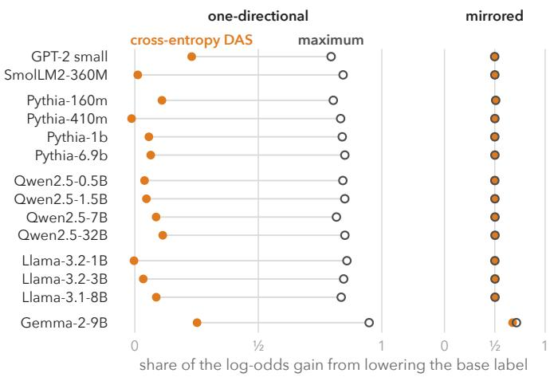  
Figure 11: Cross-entropy concentrates on the logit of the source label. The eight negative-polarity constructions of Kumon and Yanaka (2026), the source of 27 of the ticks in Figure 4a, with medians per model, ordered as in Figure 4c. On the left, every base label is ever. On the right, the same pairs are mirrored as a control, because a pair and its mirror give every direction a share of one half to first order.

takes a smaller share of its gain in log odds from lowering the logit of the base label than the maximum does. On the same pairs in mirrored form, this gap closes, and every model’s shares lie at 0.50–0.51, except those of Gemma-2-9B, which are 0.72 for the maximum efect and 0.68 for DAS (Section 5.4, Figure 11). The efect of cross-entropy DAS on these tasks is about the same in the four large models, 7.6–8.1 log odds. It lies above T in Llama-3.1-8B, Qwen2.5-7B and Pythia-6.9b, where T is 5.1–5.8 log odds, and falls short of T in Gemma-2, where T is 8.7. In Gemma-2, cross-entropy lies above T on one of the eight constructions and significantly below T on four. Gemma-2’s larger margin, a maximum of 44 log odds against 20–21, comes from lowering ever (41 against 17), and cross-entropy DAS does not gain this part of the efect in any model (exploratory).

## C.7 Results by Model Size

Comparing small and large models across families mixes size with training data, tokeniser and architecture. Our statements about size therefore rest on a test within families. The test of Section 5.4 compares three sizes within each family, whose models share one tokeniser. These are Pythia 410m, 1b and 6.9b; Qwen2.5 0.5B, 1.5B and 7B; and Llama 3.2-1B, 3.2-3B and 3.1-8B. In Qwen2.5, the test takes one further step, from 7B to 32B. Pythia-160m, which is smaller than the three sizes, is drawn on its family’s line in Figure 4c. On each task of the common set of a family, we take the maximum efect (the out-of-sample maximum over T), cross-entropy DAS (its efect over T) and the share of the maximum that cross-entropy reaches (the ratio of the two). We compare sizes by the median per-task log ratio, with a task bootstrap. The test asks that a larger model have a larger margin above T and that cross-entropy DAS report a larger excess in it. For each of these two quantities, the interval of the median log ratio must lie above zero at both steps up from the smallest size, to the middle size and to the largest. The test also asks that cross-entropy take a smaller share of the maximum from the smallest to the largest of the three sizes. The step from Qwen2.5-7B to 32B is held to the same three conditions.

<table><tr><td></td><td colspan="2">max.</td><td colspan="2">DAS</td><td colspan="2">share</td></tr><tr><td>step</td><td>change</td><td>interval</td><td>change</td><td>interval</td><td>change</td><td>interval</td></tr><tr><td colspan="7">Pythia (84 tasks)</td></tr><tr><td> $4 1 0 \mathrm { m }  1 \mathrm { b }$ </td><td>+8.3</td><td> $[ + 5 . 2 , + 1 1 . 3 ]$ </td><td>+5.5</td><td>[+2.7, +9.2]</td><td>-1.6</td><td> $[ - 2 . 4 , - 0 . 5 ]$ </td></tr><tr><td> $4 1 0 \mathrm { m }  6 . 9 \mathrm { b }$ </td><td>+23.9</td><td>[+20.3, +29.6]</td><td>+15.8</td><td>[+14.1, +18.0]</td><td>-6.0</td><td>[−7.8,-4.0]</td></tr><tr><td colspan="7">Qwen2.5 (84 tasks; 86 for the step to 32B)</td></tr><tr><td> $0 . 5 \mathrm { B }  1 . 5 \mathrm { B }$ </td><td>+4.8</td><td> $[ + 2 . 5 , + 6 . 9 ]$ </td><td>+3.3</td><td> $[ + 0 . 6 , + 6 . 0 ]$ </td><td>-1.5</td><td> $[ - 3 . 4 , - 0 . 7 ]$ </td></tr><tr><td> $0 . 5 \mathrm { B }  7 \mathrm { B }$ </td><td>+30.1</td><td> $[ + 2 5 . 1 , + 3 3 . 0 ]$ </td><td>+18.1</td><td> $[ + 1 3 . 0 , + 2 1 . 6 ]$ </td><td>-8.5</td><td> $[ - 1 0 . 5 , - 7 . 6 ]$ </td></tr><tr><td> $\mathrm { 7 B }  \mathrm { 3 2 B }$ </td><td>+18.0</td><td> $[ + 1 0 . 6 , + 2 2 . 7 ]$ </td><td>+8.5</td><td> $[ + 5 . 2 , + 1 1 . 0 ]$ </td><td>-5.4</td><td> $[ - 7 . 9 , - 3 . 5 ]$ </td></tr><tr><td colspan="7">Llama (84 tasks)</td></tr><tr><td> $\mathrm { 3 . 2 \mathrm { - } 1 B \to 3 . 2 \mathrm { - } 3 B }$ </td><td>+2.4</td><td> $[ + 0 . 6 , + 4 . 3 ]$ </td><td>+1.7</td><td> $[ - 0 . 7 , + 3 . 7 ]$ </td><td>-0.9</td><td> $[ - 1 . 6 , - 0 . 3 ]$ </td></tr><tr><td> $3 . 2 – 1 \mathrm { B }  3 . 1 – 8 \mathrm { B }$ </td><td>+41.4</td><td> $[ + 3 4 . 9 , + 5 4 . 7 ]$ </td><td>+28.9</td><td> $[ + 2 4 . 5 , + 3 5 . 4 ]$ </td><td>-9.2</td><td> $[ - 1 1 . 5 , - 7 . 1 ]$ </td></tr></table>

Table 6: Model size within a family (the scale series). For each family, the table gives the median over its common tasks of the per-task log ratio x, shown as the change in percent that it implies, $1 0 0 ( e ^ { x } - 1 )$ . The changes run from the smallest of its three sizes to the middle one and to the largest, and in Qwen2.5 from 7B to 32B, with 95% task-bootstrap intervals. The columns give the out-of-sample maximum efect over T (max.), the efect of cross-entropy DAS over T (DAS) and the ratio of the two, the share of the maximum that cross-entropy reaches (share). The test asks that the maximum and DAS grow at both steps (both intervals above zero) and that the share fall to the largest size (its interval below zero). All three hold in every family and in the step to 32B, except for Llama’s DAS, whose interval for the first step includes zero. In no family does the maximum or DAS fall from the middle size to the largest by its interval.
<table><tr><td></td><td colspan="2">Pythia</td><td colspan="2">Qwen2.5</td><td colspan="2">Llama</td></tr><tr><td>source</td><td>max.</td><td>DAS</td><td>max.</td><td>DAS</td><td>max.</td><td>DAS</td></tr><tr><td>CausalGym</td><td>+29 (29)</td><td>+20</td><td>+39 (28)</td><td>+29</td><td>+74 (29)</td><td>+52</td></tr><tr><td>CausalGym number-only</td><td>+18 (6)</td><td>+15</td><td>+22 (6)</td><td>+17</td><td>+42 (6)</td><td>+34</td></tr><tr><td>IOI (Wang et al.)</td><td>+24 (2)</td><td>+11</td><td>+20 (2)</td><td>+3</td><td>+17 (2)</td><td>+6</td></tr><tr><td>IOI (ours)</td><td>+19 (2)</td><td>+14</td><td>+3 (2)</td><td>-11</td><td>+8 (2)</td><td>+6</td></tr><tr><td>Kumon &amp; Yanaka</td><td>+23 (15)</td><td>+14</td><td>+32 (15)</td><td>+17</td><td>+55 (15)</td><td>+30</td></tr><tr><td>RAVEL</td><td>+25 (20)</td><td>+9</td><td>+5 (20)</td><td>-1</td><td>+4 (19)</td><td>-3</td></tr><tr><td>SST</td><td>+51 (2)</td><td>+55</td><td>+65 (2)</td><td>+51</td><td>+46 (2)</td><td>+30</td></tr><tr><td>Tigges et al.</td><td>+26 (8)</td><td>+22</td><td>+60 (9)</td><td>+43</td><td>+33 (9)</td><td>+29</td></tr></table>

Table 7: Where the growth with size comes from (descriptive, no intervals). For each data source, the table gives the median per-task change from the smallest to the largest size of each family, in percent, for the maximum efect (max.) and for cross-entropy DAS. The number of tasks per source is given in parentheses. RAVEL’s rows pass a filter in each model, so its test rows difer across sizes.

In Pythia and Qwen2.5, all three conditions hold (Table 6). They hold again from Qwen2.5-7B to 32B, on the 86 tasks that the two models share. There, the maximum grows by a median of 18% per task (interval 11% to 23%), and cross-entropy DAS grows by 9% (5% to 11%). The share of the maximum that cross-entropy reaches falls by 5% (3.5% to 7.9%). In Llama, the maximum grows at both steps and the share falls. Cross-entropy DAS grows from the smallest to the largest size, but from 1B to 3B it grows by only 1.7% (interval −0.7% to 3.7%), an interval that includes zero. From the smallest to the largest of the three sizes, the maximum grows by a median of 24% per task in Pythia, 30% in Qwen2.5 and 41% in Llama. Cross-entropy DAS grows by 16%, 18% and 29%, and the share falls by 6%, 9% and $9 \%$ (in 74 of 84, 79 of 84 and $7 7$ of 84 tasks). Table $7$ gives the same changes for each data source. The predicted maximum, $\lambda _ { 1 } / T _ { \ d }$ which is computed before training, grows at every step, with a median over the common tasks of 3.40, 3.61 and 4.00 in Pythia, 3.15, 3.31 and 4.06 in Qwen2.5 (4.68 at 32B) and 3.46, 3.52 and 4.24 in Llama.

Limits. The test has three limits. First, the step between the two smaller sizes of Qwen2.5 and Llama, whose embeddings are tied, is small and rests on Causa $\mathrm { l G y }$ m’s tasks; without these tasks, the growth at that step does not hold. Second, most of the growth comes with the largest of the three sizes, where the embeddings are untied and, in Llama, the model is the one from which the two smaller models were pruned and distilled. These steps do not separate size from those changes. However, Pythia, which never ties its embeddings, grows at about the same rate per doubling at both steps, and Qwen2.5 still grows from 7B to 32B, with untied embeddings at both sizes. Third, the growth is uneven across sources (Table 7), and RAVEL, whose test rows pass a filter in each model, shows almost no growth in Qwen2.5 and Llama.

## Appendix D. Details and Further Results Inside the Network

This appendix describes the maps behind Section $6 ,$ with their cells, counts and controls. It also reports every further test of the findings of that section.

## D.1 Results on the Maps of the Six Small Models

Cells and quantities. The full grid holds 78 tasks in the six small models. These are CausalGym’s 29 tasks and 49 tasks from the other sources (Kumon and Yanaka’s constructions, number-only agreement, RAVEL, IOI, SST and the sentiment templates). The population rule of Section 4.1 leaves out eight maps, and 460 remain. The maps left out are those of sentiment templates with fewer than 20 test clusters and those of filler\_ gap\_embed\_4 in Qwen2.5-0.5B and Pythia-160m, whose interval for $T$ does not lie above zero. Every count excludes the 2065 cells whose region is empty in some row, where the patch would take the token of another region. A cell is live when, in some pair, base and source difer in at least one token up to that cell. At each live cell, we measure on test pairs the efect of whole-state patching, $G ,$ and its value in the best context, $G ^ { * }$ , with the context chosen on the training pairs. A cell is of-route (Algorithm 1) when the interval of DAS lies above zero, the interval of $G ^ { * }$ does not, and DAS lies significantly above $G ^ { * }$ . There are 4300 such cells. At 152 more cells, the interval of DAS lies above zero and that of $G ^ { * }$ does not, but the diference between DAS and $G ^ { * }$ is not significant. We also measure cross-entropy DAS and the squared error aimed at G from three initialisations, the mean-efect objective, the squared error aimed at $T$ and the CDAS divergence from one initialisation, and the untrained directions. Each is measured twice, once with attention free to change and once with every downstream attention pattern frozen to that of the base run. The first-order range comes from the midpoint gradients of the test pairs, computed before any training. Intervals resample mirrored pairs together. Correlations are averaged across maps, which serve as the units. Cell counts use per-cell intervals after false-discovery control over the cells of each model (Benjamini–Hochberg, $q = 0 . 0 2 5$ , with $p \textmd { - }$ values from the standard error of the resampling). The exception is the of-route cells, which are counted on raw intervals (4300, and 4270 after the control). On raw intervals, the counts are 16,560 cells above $G ,$ 16,099 above $G ^ { * }$ and 5872 above the predicted maximum, against 16,489, 15,998 and 4894 after the control.

A stronger reference. Where $G ^ { * }$ uses a second region, it exceeds G by a median of 0.002 T (90th percentile 0.05 T), so the second region adds little. With that region chosen on the test pairs, which can only raise $G ^ { * }$ , DAS lies above $G ^ { * }$ at 15,954 of the 18,221 live cells, against 15,998 with the region chosen on the training pairs. We also measured DAS with the whole state of the second region of $G ^ { * }$ patched at the same time, and we subtracted the efect of patching that region alone, as for $G ^ { * }$ . Where $G ^ { * }$ has no second region, DAS was measured alone. In this measurement, DAS lies above $G ^ { * }$ at 16,110 cells, and the share of its efect beyond $G ^ { * }$ is 0.52–0.62 per model. The doubt does not arise at a complete cut, where there is no choice of positions, because inflation at the readout is measured against $T$ itself.

The of-route cells. At the 4300 of-route cells, the net efect that whole-state patching measures is not above zero, even in the best context, and at 1147 of these cells the interval of $G ^ { * }$ lies below zero. The upper bound of the interval of $G ^ { * }$ has a median of 0.001 T, and nine in ten of these upper bounds lie below 0.013 T. As the definition requires, DAS lies significantly above $G ^ { * }$ at these cells (4270 of them after false-discovery control).

## D.2 The Large Models

The four large models (Llama-3.1-8B, Gemma-2-9B, Qwen2.5-7B and Pythia-6.9b) were mapped on three of CausalGym’s tasks, negative polarity, filler–gap and subject–verb agreement, at every second layer and at the readout. Their results are close to those in the small models. Three maps per model are too few for a test, because a bootstrap’s 2.5% quantile over three maps would be the smallest map itself. We therefore describe these maps without a test across maps, and we compare them with the small models on the same tasks. DAS lies significantly above $G$ at 1322 of the 1352 live cells (with false-discovery control per model), against 1190 of 1218 in the small models. Per model, Gemma-2 included, 0.58–0.71 of the efect of DAS summed over live cells lies beyond $G ^ { * }$ , the efect of whole-state patching in its best context, and 0.65–0.71 in the three models whose logits are not capped. The share in the small models is 0.56–0.65 per model. Of the part beyond $G ^ { * }$ , 0.61–0.71 runs through attention in the uncapped models (0.57–0.72 in the small models). Gemma-2, whose logits are capped, gives 0.58 and 0.61. It is left out of the shares of the uncapped models, but the count of cells above G includes it.

## D.3 The First-Order Approximation Inside the Network

Where the first-order approximation holds. The midpoint trace is a median of 1.01–1.03 times $G$ per model, and it is closer to $G$ than the base-point trace at 79–86% of cells. Its per-layer medians lie close to G in the first layers and near the readout and exceed it most in between, by at most 5–10% per model. Untrained directions have exact efects within a few percent of their first-order efects (per-model medians 0.96–1.03), whereas cross-entropy DAS has 1.05–1.19 times its first-order efect, so, inside the network, training reaches efects beyond first order (exploratory). Cross-entropy DAS exceeds the predicted maximum at 4894 cells (the run from any of its three initialisations, with a Bonferroni correction over the three runs and then false-discovery control). At these cells, the median $G ^ { * }$ is 0.01 T, and freezing attention removes 0.85 of the efect of DAS.

Ranking the excess before training. Across the full grid, the first-order excess $( \lambda _ { 1 } -$ $\mathrm { t r } M ) / T$ and the other predictors are computed on the resampled pairs, and the excess of DAS, $( e - G ) / T$ , on the pairs left out. Each rank correlation is averaged over the resamples. The mean rank correlation of the first-order excess is 0.62 over the 460 maps. Pooled over the maps, its rank correlation exceeds that of each of seven untrained predictors by at least +0.139 at the lower bound. The seven are the layer, $G , - G ,$ , the mean size of the efect of whole-state patching per pair, $\mathbb { E } | G _ { i } | .$ , that size minus $G , G ^ { * } - G _ $ , and the efect of the mean diference minus $G .$ The best single predictor, E $| G _ { i } |$ , reaches 0.45. If the best of the seven is chosen afterwards on each map, the chosen predictor difers from map to map, and its correlation is an upper bound for that of any single one of the seven. This per-map best reaches 0.68, and the first-order excess does not exceed it. The diference is $- 0 . 0 6 5 \ [ - 0 . 1 3 6 .$ +0.002] over the 59 constructions and $- 0 . 0 6 5 \left[ - 0 . 0 9 1 , - 0 . 0 4 0 \right]$ over maps, and per model the first-order excess falls significantly below this bound in four of the six models. The sources difer. On CausalGym’s 29 tasks, the first-order excess has a higher rank correlation than the per-map best $\left( + 0 . 0 8 8 \ [ + 0 . 0 5 5 , \ + 0 . 1 2 3 ] \right.$ over 25 constructions). Its mean correlation there is 0.79, against 0.67 for the best single predictor and 0.70 for the per-map best. On the other sources taken together, it falls below the per-map best $\left( - 0 . 1 5 6 \ [ - 0 . 2 4 5 , - 0 . 0 6 5 ] \right)$ . For each source separately, the comparisons are over maps and descriptive. The first-order excess has a higher rank correlation than the per-map best on IOI $\left( + 0 . 1 4 4 \ [ + 0 . 0 9 2 , + 0 . 2 0 2 ] \right)$ and number-only agreement $\left( + 0 . 0 4 1 \ [ + 0 . 0 1 8 , + 0 . 0 6 1 ] \right)$ , and it performs on par with it on Kumon and Yanaka’s constructions $\left( - 0 . 0 0 2 \ [ - 0 . 0 7 5 , \ + 0 . 0 5 6 ] \right)$ . It falls below the per-map best on RAVEL $( - 0 . 4 4 9 \ [ - 0 . 5 0 0 , - 0 . 4 0 0 ] )$ , the sentiment templates $( - 0 . 2 4 6 \ [ - 0 . 3 2 6 , - 0 . 1 7 2 ] )$ ) and SST $\left( - 0 . 1 3 2 \ [ - 0 . 2 2 9 , - 0 . 0 5 4 ] \right)$ . On RAVEL, where its correlation is 0.32, the layer alone ranks the excess better. At the live cells below the readout that lie before the last position, the norm of the input change, alone and divided by the layer, can be added to the predictors, which makes nine. There, the correlation of the first-order excess is 0.48 (0.76 on CausalGym’s tasks). It lies above the correlation of the norm by $+ 0 . 1 1 2 \ [ + 0 . 0 5 5 , + 0 . 1 7 2 ]$ but below the best of nine predictors chosen on each map $\left( - 0 . 2 4 0 \ [ - 0 . 3 6 3 , - 0 . 1 3 0 ] \right)$ . The ranking by the first-order excess therefore fails at these cells. Attention does not explain this failure. The first-order excess ranks these cells better in maps where freezing attention removes more of the efect of DAS at them (Spearman +0.579 across maps). We include G among the predictors instead of computing a rank correlation that controls for G. Such a correlation, computed on the same pairs by residualising the ranks on those of $G ,$ is biased under its null hypothesis.

## D.4 The Attention to the Site

Proof of Proposition 8. (i) To first order a patch v at p changes the score by $a ^ { \top } v$ . Wholestate patching is $v = \Delta$ , and the rank-one interchange along d is $v = d d ^ { \top } \Delta$ , which gives $( a ^ { \top } d ) ( d ^ { \top } \Delta ) = d ^ { \top } \mathrm { s y m } ( a \Delta ^ { \top } )$ d. Its maximum over unit d is the top eigenvalue of $\operatorname { s y m } ( a \Delta ^ { \top } )$ , which is ${ \frac { 1 } { 2 } } { \bigl ( } a ^ { \top } \Delta + \| a \| \| \Delta \| { \bigr ) }$ by the proof of Theorem 5(iv) with a in place of $w$ . Its eigenvector is $\hat { a } + \hat { \Delta }$ , since sym $\begin{array} { r } { ( a \Delta ^ { \top } ) ( \hat { a } + \hat { \Delta } ) = \frac 1 2 \| a \| \| \Delta \| ( 1 + \hat { a } ^ { \top } \hat { \Delta } ) ( \hat { a } + \hat { \Delta } ) } \end{array}$ , so the maximum is at the bisector (if $\hat { a } = - \hat { \Delta }$ the maximum is 0 and there is no bisector).

(ii) Let s be the score on $p$ and Z the sum of the exponentials of the other scores, so that $\alpha = e ^ { s } / ( e ^ { s } + Z )$ and log $\begin{array} { r } { \frac { \alpha } { 1 - \alpha } = s - \log Z } \end{array}$ . With Z fixed, a score change $\delta$ gives the weight $\begin{array} { r } { \sigma ( \log { \frac { \alpha } { 1 - \alpha } } + \delta ) } \end{array}$ , which is increasing in δ. Since log $\alpha = - L , \delta \leq L - t$ gives a weight of at most $\sigma ( - t - \log ( 1 - \alpha ) )$ , and $\delta \geq L + t$ a weight of at least $\sigma ( t - \log ( 1 - \alpha ) ) \geq \sigma ( t )$ Whole-state patching has $\delta = a ^ { \top } \Delta$ , and the rank-one interchange at the maximum of (i) has $\begin{array} { r } { \delta = \frac { 1 } { 2 } ( { a } ^ { \top } { \Delta } + \| { a } \| \| { \Delta } \| ) } \end{array}$ . With $a ^ { \top } \Delta = 0$ the first condition holds whenever $t \leq L$ , and the second reads $\begin{array} { r } { \frac 1 2 \| a \| \| \Delta \| \ge L + t . } \end{array}$ 7

The statement is first order through the LayerNorm of the site, so it is accurate only while $\| \Delta \|$ is small compared with the centred state. The attention can rise within this range, because the condition of Proposition $8 ( \mathrm { i i } )$ compares the change of the score, $\| a \| \| \Delta \|$ , with the negative log weight $L ,$ not with the state. For larger diferences, whole-state patching can also change a score that it leaves unchanged to first order, and the largest first-order change of the score overstates how much the attention weight rises.

Where the attention to the site rises. In the first block that reads the site, the first-order description of Proposition 8 holds (median correlations 0.93–0.99 per model), as expected for the first-order form of a single block. Outside IOI’s maps, this block contains the largest rise of attention to the site at 36–66% of the live cells before the last position, per model; at the other cells, the largest rise comes in a later block. Before training, we compute for each cell a predictor of where this rise occurs, namely the largest first-order change in the head’s score (Proposition $8 ( \mathrm { i } ) )$ minus L. Within each map, on the same cells and wherever the interval of DAS excludes zero, we rank-correlate this predictor with the share of the efect of DAS that runs through attention, that is, the share that freezing removes. This correlation does not exceed the highest correlation of three simple predictors with the same share, namely the norm of the change of the state, the attention weight and $- G$ . The first-order description therefore predicts where the efect of DAS runs through attention no more closely than these simple predictors do.

## D.5 The Summed Excess and Its Share Through Attention

Where DAS lies significantly above G, it does so by a median of 0.14 T (quartiles 0.04–0.40 T). We sum the excess of DAS over $G ^ { * }$ across the live cells where this excess is positive. Per model, this sum is 0.54–0.64 of the efect of DAS summed over live cells, and the network itself does not produce this part. The share is 0.51–0.62 when cells where DAS lies below $G ^ { * }$ count against it, and 0.54–0.63 when we count only cells whose excess over $G ^ { * }$ is significant. The per-model 95% intervals of all three shares lie within 0.50–0.67. Half of the excess summed in the first way lies at cells whose $G ^ { * }$ is below 0.27 T. The smaller $G ^ { * }$ is at a cell, the larger the share of that part that runs through attention (rank correlation of $G ^ { * }$ with the share that freezing removes, −0.55 to −0.37 per model). The part of each cell is weighted by the share of the whole efect of DAS, not of its excess, that freezing removes. This share is clipped to [0, 1] and set to zero where the interval of DAS includes zero. This weighting gives the lower of two estimates, by which 0.47–0.56 of the excess runs through attention per model. In the other estimate, we compare each cell’s excess over $G ^ { * }$ with and without freezing, with $G ^ { * }$ held fixed and the reduction clipped to [0, excess]. Freezing then removes 0.56–0.66 of the excess per model. How much of the efect runs through attention depends on the task. Freezing removes a median of 0.57–0.72 of the efect of DAS per model on negative polarity and filler–gap. In every model, this is more than on agreement (0.16–0.26), both among CausalGym’s tasks and when Kumon and Yanaka’s constructions are compared with number-only agreement. On the other sources, freezing removes 0.19–0.30. At the of-route cells, freezing only the attention row of the readout position removes 0.61 of the summed efect of DAS.

## D.6 Details of the Training-Target Experiment

As in Appendix D.1, cross-entropy and the squared error aimed at $G$ are trained from three initialisations, and the squared error aimed at T from one (descriptive; Figure 8 shows them at one cell). Over the live cells, we fit each efect against G by least squares. Cross-entropy has a slope of 1.46 and an intercept of 0.22 T. The squared error aimed at T has 0.80 and 0.21 T, and the squared error aimed at G has 0.91 and 0.00 T. The untrained mean diference, outside IOI, has 0.88 and 0.00 T. Cross-entropy lies above G however large G is; the squared error aimed at T lies above G while G is below T and meets it as $G$ nears T; the last two follow G.

The other objectives where whole-state patching shows no efect. Inside the network, every objective that we trained to make the output follow the source gives an excess (all but cross-entropy from one initialisation, reported as a description), while the squared error aimed at the cell’s own G ends up near G. We consider the 4630 live cells where the interval of whole-state patching in its best context does not lie above zero. At these cells, DAS trained with the squared error aimed at $T$ reaches a median of 0.04 T, lies significantly above $G ^ { * }$ at 4368 cells and loses 0.66 of its efect when attention is frozen. With the CDAS divergence, DAS reaches a median of 0.02 T, lies significantly above $G ^ { * }$ at 3791 cells and loses 0.68 of its efect. The route test (Algorithm 1) also requires the interval of the learned efect itself to lie above zero. By this test, DAS is of-route at 4354 of these cells with the squared error, at 3720 with the CDAS divergence and at 4300 with cross-entropy. At all but 36 of these cells, the efects of the squared error and of the CDAS divergence both lie below T (the largest is 1.40 T), so a target or bound at $T$ rarely constrains them there. In contrast, whole-state patching has an efect near zero at every one of these cells, so the comparison with it marks them where a bound at T does not.

## Appendix E. Re-examining the Published Results

This appendix gives the details behind Section 7. It covers the rebuilt CausalGym maps, the re-run of CausalGym’s corrected code and the re-run of the sentiment direction.

## E.1 Rebuilding CausalGym’s Maps

The rebuilt maps. We rebuilt CausalGym’s maps for its 29 tasks in the six small models, at every layer (174 maps, Section 4.2). We follow the benchmark’s protocol, that is, the rows as published, the first token of each label, one epoch, batch size 4, Adam at $5 \cdot 1 0 ^ { - 3 }$ and cross-entropy of the source label. We use three initialisations, a constant learning rate, float32 and a renormalised direction. CausalGym’s paper instead uses one initialisation, a linear schedule with warmup, bfloat16 at 1b (float32 up to 410m) and pyvene’s orthogonally parametrised rotation. In the three models with published values, we compare with these values on the ten tasks that the released code reads correctly (Appendix E.2). Our vanilla score equals the published one to its two decimals in 25 of 30 cases and difers by 0.01 in the rest. In 28 cases, the published DAS value lies within the 95% resampling range of our aggregate for a single initialisation, with the resamples of the three initialisations pooled. Pythia-1b’s negative-polarity DAS map matches Figure 5(b) of CausalGym’s paper layer by layer (Spearman 0.99, against 0.95 with the layers ofset by one).

Where the gap between DAS and vanilla comes from. CausalGym’s aggregate puts DAS above vanilla in every rebuilt map, by a median factor of 2.04 (quartiles 1.46–2.71). The interval of this factor lies above one in 172 of 174 maps, and per model the median factor is 2.0–2.2 (Table 8). On the negative-polarity map, the factor is 2.36 in Pythia-1b (2.38 published) and 2.43 in GPT-2. We define the gap between DAS and vanilla as the sum over layers of the efect of the best region of DAS minus the best efect of vanilla. At the best region of DAS in each layer, $G ^ { * }$ gives about what the best region of vanilla gives, so the gap lies beyond $G ^ { * }$ . Per model, the excess of DAS over $G ^ { * }$ is 1.02–1.08 times the gap when the context of $G ^ { * }$ is chosen on the test pairs. We choose it there because CausalGym’s aggregate picks the best region of each method on the pairs that it scores. A context chosen on those pairs can only raise $G ^ { * }$ , so this ratio is the lower one. On the maps where the gap is established (all but Qwen2.5-0.5B’s and Pythia-160m’s filler\_gap\_embed\_4), the ratio is 1.01–1.05 with that context and 1.01–1.05 with the context chosen on the training pairs, as in Section 6. Little of the gap lies at cells where the interval of $G ^ { * }$ does not lie above zero. In four models, at most 0.02 of it lies there. In Qwen2.5-0.5B, the share is 0.40, almost all of it from one task whose $T$ is 0.12, and it is 0.00 at of-route cells, where DAS also lies significantly above $G ^ { * }$ . In Pythia-160m, one task with $T = - 0 . 1 0$ dominates both sums, and the share is not established. Pooled over the six models, the share is 0.11 [0.01, 0.21]. It is 0.03 without filler\_gap\_embed\_4, whose small $T$ weighs heavily in the sums, and 0.03 [0.01, 0.05] where DAS also lies significantly above $G ^ { * }$ . Freezing attention removes a median of 0.21–0.40 of the excess of DAS per model, and 0.67 on $\mathrm { P y }$ thia-1b’s negative-polarity map.

How the route test reads CausalGym’s map. The path that CausalGym reads from its map lies on the route of the map, and it follows the cells where whole-state patching has its largest efect. CausalGym writes that “the negation feature is moved to the complementiser that in the early layer, into the auxiliary verb at middle layers, and the main verb in later layers” (Arora et al., 2024, §6). On the rebuilt Pythia-1b map, whole-state patching has its largest efect at the licensor through layer 3, at that at layer 4, at the auxiliary has to layer 8 and at the main verb from layer 9 onward (Figure 12, right). The DAS map also shows one row that this reading does not use, the licensor row $( N o / T h e )$ . The best region of DAS stays on the licensor to layer 8, and from layer 6 it reports 1.1–1.4 T there, where

<table><tr><td>model</td><td>R</td><td></td><td>beyond</td><td> $G ^ { * }$ </td><td></td><td> $G ^ { * } \mathrm { n o t }$  above 0</td><td></td><td>off-route</td><td>through attention</td><td>published</td></tr><tr><td>GPT-2 small</td><td>1.98</td><td>1.03</td><td>[1.00, 1.06]</td><td></td><td></td><td>0.01 [0.00, 0.05]</td><td></td><td>0.01 [0.00, 0.05]</td><td>0.40</td><td></td></tr><tr><td>Pythia-160m</td><td>2.18</td><td>1.08</td><td>[0.95, 1.09]</td><td></td><td></td><td>not establishedª</td><td></td><td></td><td>0.30</td><td>9/10, 9/10</td></tr><tr><td>Pythia-410m</td><td>2.05</td><td>1.02</td><td>[0.99, 1.04]</td><td></td><td></td><td>0.02 [0.00, 0.04]</td><td></td><td>0.02 [0.00, 0.04]</td><td>0.21</td><td>10/10, 10/10</td></tr><tr><td>Pythia-1b</td><td>2.24</td><td>1.02</td><td>[0.99, 1.04]</td><td></td><td>0.02</td><td>[0.00, 0.04]</td><td></td><td>0.02 [0.00, 0.04]</td><td>0.37</td><td>6/10, 9/10</td></tr><tr><td>SmolLM2-360M</td><td>2.00</td><td>1.02</td><td>[1.01, 1.04]</td><td></td><td></td><td>0.02 [0.00, 0.04]</td><td></td><td>0.02 [0.00, 0.04]</td><td>0.36</td><td></td></tr><tr><td>Qwen2.5-0.5B</td><td>2.09</td><td></td><td>1.03 [1.02, 1.07]</td><td></td><td></td><td>0.40 [0.00, 0.52]</td><td></td><td>0.00 [0.00, 0.01]</td><td>0.33</td><td></td></tr></table>

Table 8: CausalGym’s maps rebuilt under its protocol, per model (29 tasks, every layer). R¯: CausalGym’s aggregate, DAS divided by vanilla, as a median over tasks. The gap is the aggregate of DAS minus that of vanilla, summed over layers. Shares are ratios of sums over the tasks of a model, with intervals that resample constructions (a task together with its \_ mod twin). Beyond $G ^ { * } ;$ : the excess of DAS over $G ^ { * }$ , the efect of whole-state patching in its best context (chosen on the test pairs), at the best region of DAS in each layer, as a share of the gap. $G ^ { * }$ not above 0: the share at cells where the interval of $G ^ { * }$ does not lie above zero. Of-route: the same share, counted only where DAS also lies significantly above $G ^ { * }$ Through attention: the median share of the excess of DAS that freezing attention removes. Published: of the ten tasks that the released code reads correctly, the tasks where vanilla equals the published value to its two decimals, and the tasks where the published DAS lies within the 95% resampling range of our single-initialisation aggregates; – where CausalGym publishes no values for the model. aOne task, filler\_gap\_embed\_4, whose T is −0.10, dominates both sums of Pythia-160m. The same task holds 0.39 of Qwen2.5-0.5B’s 0.40 (0.01 without it). Shares are sums in units of each map’s $T ,$ so a map with a small T weighs heavily. Per map, the median share beyond $G ^ { * }$ is 0.99–1.01, and the share where $G ^ { * }$ is not above 0 has median 0 in every model.

Rebuilt at every layer, DAS stays on the licensor after the network has moved on Pythia-1b, CausalGym's negative-polarity task under its protocol; means over the test pairs, in T  
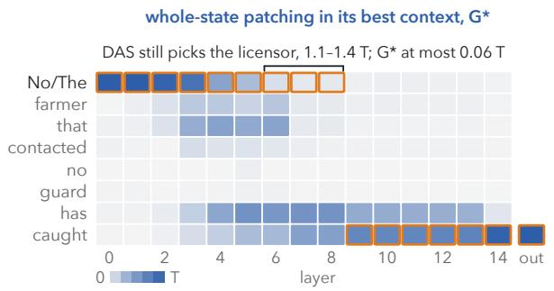

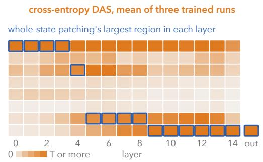  
Figure 12: On the map rebuilt at every layer, DAS stays on the licensor in layers where whole-state patching at the licensor has almost no efect. Words run down and layers across, and each cell’s shade gives its efect on one scale from 0 to T. The outlines mark the best region of DAS in each layer on the left and whole-state patching’s largest region on the right.

whole-state patching, even in its best context, gives at most 0.06 T (Figure 12). Freezing attention removes 97% or more of this efect. The route test does not mark these cells as of-route, because the interval of $G ^ { * }$ there lies above zero, although $G ^ { * }$ is small. It classifies them instead as cells where the efect of DAS lies far above $G ^ { * }$ , so that almost all of this efect is excess. The row also appears in the published map, where CausalGym’s Figure 5(b) shades it through the late layers.

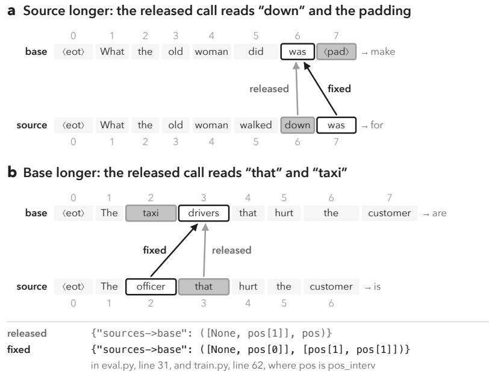  
Figure 13: What the released call reads, and the fix. Two training pairs drawn by CausalGym’s own sampler, in Pythia’s tokeniser (Appendix E.2). Outlined boxes mark each sentence’s last token of the intervened region, which the fixed call reads. Grey boxes mark what the released call reads instead, which is the state that it patches in for the source and, for the base, the state that it collects, on which the representation-only methods are fitted. After each sentence, its label. In the code, pos[0] holds the token positions of the source sentence and pos[1] those of the base sentence, one position per sentence, at the last token of the intervened region.

## E.2 Token Positions in the Released Code

CausalGym’s released code passes the token positions of base and source to its interventions in swapped order (Figure 13). This has no efect where the two sentences have the same number of tokens up to the end of the intervened region, which holds on all ten negativepolarity and filler–gap tasks. On the other 19 tasks, it fails for 12–100% of the training pairs, and there an intervention reads a token other than the region’s last. With the two positions in order, the call reads each sentence at the last token of the region on every pair, and on the ten tasks it changes nothing.

Table 9 divides every published score by vanilla, at each of the nine published sizes. Over all 29 tasks, the score of DAS lies above vanilla, beyond the rounding of the tables, in 251 of 261 entries (one entry per task and size), while the scores of the other methods lie above vanilla in 112 of their 1740 entries.

In the published scores, the diference of means lies at the level of vanilla on the ten tasks whose positions coincide (median 0.96–1.00 per size) and at 0.54–0.71 on the other 19 (Figure 9a). Since the ten are exactly the negative-polarity and filler–gap tasks, this diference could also come from the kind of task. We therefore re-ran the authors’ code on the five Pythia sizes up to 410m, once as released and once with the two positions in order, on the 19 tasks and on two of the ten as controls. As released, the code reproduces the published scores at 70m, 160m and 410m to the second decimal on all 19 tasks (LDA on 11–18); at 14m and 31m, the weights at the published address were replaced in February 2026, so the published values cannot serve as a reference there. On the controls, the deterministic methods give identical rows in both conditions. With the positions in order, the diference of means rises from a median of 0.58–0.78 of vanilla to 0.96–0.98 and the probes reach 0.96–1.00, while PCA and k-means stay at 0.12–0.36. Retrained DAS lies at a median of 1.9–3.7 times vanilla per size, above every other method on all 19 tasks at each of the five sizes. The order of the positions thus explains the lower published scores of the diference of means and the probes on these tasks, but on most of them not those of PCA and k-means.

<table><tr><td>method / vanilla</td><td>14m</td><td>31m</td><td>70m</td><td>160m</td><td>410m</td><td>1b</td><td>1.4b</td><td>2.8b</td><td>6.9b</td></tr><tr><td>DAS</td><td>3.06</td><td>2.83</td><td>3.08</td><td>2.41</td><td>2.09</td><td>2.38</td><td>2.08</td><td>2.10</td><td>2.47</td></tr><tr><td>probe, first setting</td><td>0.94</td><td>0.98</td><td>0.97</td><td>0.98</td><td>0.96</td><td>0.95</td><td>0.90</td><td>0.88</td><td>0.85</td></tr><tr><td>probe, second setting</td><td></td><td></td><td></td><td>0.78</td><td>0.95</td><td>0.89</td><td>0.74</td><td>0.88</td><td>0.65</td></tr><tr><td>mean difference</td><td>0.87</td><td>0.72</td><td>0.78</td><td>0.65</td><td>0.84</td><td>0.78</td><td>0.77</td><td>0.70</td><td>0.71</td></tr><tr><td>PCA</td><td>0.44</td><td>0.43</td><td>0.43</td><td>0.47</td><td>0.56</td><td>0.46</td><td>0.48</td><td>0.45</td><td>0.41</td></tr><tr><td>k-means</td><td>0.46</td><td>0.42</td><td>0.43</td><td>0.47</td><td>0.57</td><td>0.48</td><td>0.50</td><td>0.47</td><td>0.41</td></tr><tr><td>LDA</td><td>0.07</td><td>0.04</td><td>0.03</td><td>0.03</td><td>0.04</td><td>0.04</td><td>0.02</td><td>0.02</td><td>0.03</td></tr><tr><td>random</td><td>0.02</td><td>0.01</td><td>0.01</td><td>0.00</td><td>0.01</td><td>0.00</td><td>0.00</td><td>0.00</td><td>0.00</td></tr><tr><td>DAS above vanilla</td><td>26/29</td><td>28/29</td><td>29/29</td><td>28/29</td><td>26/29</td><td>29/29</td><td>29/29</td><td>29/29</td><td>27/29</td></tr></table>

Table 9: CausalGym’s published scores divided by the score of its vanilla intervention (whole-state patching scored in the same way, in the same units). The scores come from CausalGym’s per-size tables (Arora et al., 2024, App. E.2). The table gives medians over its 29 tasks at all nine published sizes. Of its seven methods, the probe has two settings, and the three smallest sizes publish only one of them (–). The last row gives the number of tasks per size in which DAS lies above vanilla beyond the rounding of the tables. Every value has two decimals, so a diference is known to ±0.01. The other six methods lie above vanilla in 112 of their 1740 method–task–size entries, by a median of 1.03×. On the ten tasks that the released code reads correctly (Appendix E.2), they do so in 76 of 600 entries. Over the entries with vanilla ≥ 0.5 alone, the medians of DAS are 2.0–2.9, and the other methods lie above vanilla in 94 of 1627 entries.

## E.3 Re-running the Sentiment Direction

The re-run of Section 7.3 covers seven models, each with three initialisations (Table 10). Three details of the code of Tigges et al. (2024) matter for what the published number measures. First, the authors’ results script builds Table 1a from the all-position column, taking the maximum over layers. Their text describes the adjective and verb positions, so only the script shows that the published number comes from a complete cut. Second, the best-epoch reload restores the saved state dictionaries of the rotation module, which alias its live weights, so it returns the last epoch. At the selected layer, the directions under the two rules have cosine 0.997 or more and values within 0.9 points. At other layers, the values difer by up to 20 points. Third, the code trains the direction by patching it at the adjective alone, a partial cut, so its objective never acts on the complete cut that the published number reads. We copy the behaviour of the code, including the orthogonal parametrisation of the rotation, gradient clipping and the seed. Because the table keeps the best of the layers, the interval at the selected layer accounts for that choice. It is a max-type studentised band, simultaneous over the layers, on blocks of two neighbouring prompts (11–14 blocks per model). Each bound is at 2.5%, as for every interval in this paper. Under that band, our run at Pythia-1.4b is consistent with the published value. The band does not lie above 100% in any model, for any initialisation. The conservative Bonferroni interval does not lie above 100% in any model either (Table 10). The direction of Pythia-410m has the highest value, 198.8%, with a band from 91.9 to 271.0%. This result depends on the small-sample correction, which widens both the band and the Bonferroni interval when there are so few blocks. With u the number of blocks, the band multiplies the standard deviation of the resampling by $\sqrt { u / ( u - 1 ) }$ and its critical value by $t _ { 0 . 9 7 5 , u - 1 } / z _ { 0 . 9 7 5 }$ The Bonferroni interval uses the same scaled standard deviation with Student’s t on u − 1 degrees of freedom. Without the correction, the band runs from 104.8 to 262.3%, above 100% for every initialisation, and the Bonferroni interval lies above 100% too. The band of every other model gives the same result without the correction. The directions from the three initialisations lie within half a point of each other (198.5 to 199.0%), so the two that we had not seen when we chose the band cannot test that choice.

<table><tr><td>model</td><td>layers</td><td>selected</td><td>score (%)</td><td>band, choice counted</td><td></td><td>Bonferroni-t</td><td>whole-state patching, partial cut (%)</td></tr><tr><td>GPT-2 small</td><td>12</td><td>7</td><td>83.2</td><td>[62.1, 102.6] includes</td><td></td><td>[56.7, 109.8] includes</td><td>98.3</td></tr><tr><td>Pythia-160m†</td><td>12</td><td>4</td><td>109.9</td><td>[80.6, 132.8] includes</td><td></td><td>[74.9, 144.9] includes</td><td>99.7</td></tr><tr><td>Pythia-410m†</td><td>24</td><td>14</td><td>198.8</td><td>[91.9, 271.0] includes</td><td></td><td>[71.6, 326.0] includes</td><td>121.7</td></tr><tr><td>Pythia-1b</td><td>16</td><td>7</td><td>84.1</td><td>[56.3, 108.5] includes</td><td></td><td>[49.7, 118.4] includes</td><td>99.3</td></tr><tr><td>Pythia-1.4b</td><td>24</td><td>10</td><td>114.7</td><td>[85.0, 137.4] includes</td><td></td><td>[78.5, 150.9] includes</td><td>99.5</td></tr><tr><td>SmolLM2-360M</td><td>32</td><td>20</td><td>124.9</td><td>[81.8, 160.3] includes</td><td></td><td>[70.5, 179.3] includes</td><td>100.0</td></tr><tr><td>Qwen2.5-0.5B</td><td>24</td><td>13</td><td>79.0</td><td>[69.5, 87.3] below</td><td></td><td>[67.7, 90.4] below</td><td>99.8</td></tr></table>

Table 10: The sentiment direction re-run on seven models. We use the authors’ code with three initialisations per model. The score is the efect of patching the direction at every position of a layer, a complete cut where whole-state patching gives exactly 100%. It is given in % on the authors’ logit-diference metric (the share of the gap from the flipped run to the clean one), at the layer that the published rule selects (the largest over layers), averaged over the initialisations. Layers are numbered as in the rest of the paper, the output of block ℓ as layer ℓ. Interval: a band that is simultaneous over the layers and so counts the choice of layer (blocks of two neighbouring prompts, 10,000 resamples), compared with 100%. Each initialisation on its own gives the same result. Bonferroni-t: a conservative t interval at the selected layer, corrected over the layers as if they were independent (neighbouring layers are strongly correlated). †The band was chosen after the first initialisation of this model had been seen, but before its other two initialisations were seen. Whole-state patching, partial cut: the efect of whole-state patching at the adjective and verb positions, as its largest value over the layers after the first block. At the embeddings, where only these two positions difer, this site is a complete cut, and the efect is exactly 100%. Published, Pythia-1.4b: 109.8%.

## Appendix F. The OwnEfect Library

This appendix describes the library of Section 8 in full. Besides the quantities of the three steps of that section, the library computes those of the theory on the given pairs. For the range of Theorem 5 at a cell or at the readout, it reports the trace, $\lambda _ { 1 }$ (with its interval at the readout), $\lambda _ { D }$ and the position of a given direction in the range. The upper end $\lambda _ { 1 }$ , the predicted maximum, is computed before any training and bounds the efect that a rank-one direction can reach to first order. Inside the network, training exceeds it at some cells (Section 6.1). The value that Proposition 7 computes from a single angle predicts $\lambda _ { 1 }$ on a two-label set, and the trace test of Proposition 9 checks the first-order approximation on a mirrored set. The library also checks Proposition 3 on the given model. It works on Hugging Face models with the GPT-2, GPT-NeoX (Pythia), Llama, Qwen2 and Gemma-2 architectures (SmolLM2 uses the Llama architecture), loaded with eager attention. It takes pairs in CausalGym’s format, that is, a base and a source split into regions, with two single-token labels. It follows the conventions of the paper. Layers and cells are as in Section 4.2, the best context is chosen on the training pairs or on the given pairs, efects are in units of the mean $T ,$ , and intervals resample a pair with its mirror 2000 times. The patches need only forward passes. The range and the angle need one gradient per pair, at the midpoint between the base and source states, and the trace test needs a second gradient, at the base point. The calls of the library are documented with the code (Appendix B.5).

On tiny random models of each family, the test of the library checks three statements exactly. Patching every position of a layer gives $T ,$ , a patch along a pair’s own diference equals whole-state patching, and Theorem $5 ( \mathrm { i v } )$ holds for one pair. On GPT-2, from our pairs and saved directions, the library reproduces the values of our measurement. At the readout of 29 CausalGym tasks, $T$ and the exact efect of every saved direction on each test pair (104,400 values) agree within $2 . 3 \times 1 0 ^ { - 4 }$ log odds, and $\lambda _ { 1 }$ and the trace agree within $5 . 5 \times 1 0 ^ { - 6 }$ . On the 26 two-label tasks, the cosine of the angle and the shared fraction of the readout gradients (Appendix C.2) agree within $1 . 8 \times 1 0 ^ { - 7 }$ . Inside the network, we compare at the 114 live cells (Section 6.1) below the readout in three maps. At every cell, the context that the library chooses for $G ^ { * }$ on the training pairs is the same as ours. The values of $G ,$ , of $G ^ { * }$ (in that context and in the context chosen on the test pairs) and of five saved directions, each measured with attention free and with attention frozen, agree per test pair within $3 . 3 \times 1 0 ^ { - 4 }$ log odds. The value of $w ^ { \top } \Delta$ agrees per pair within $7 . 8 \times 1 0 ^ { - 4 }$ , and $\lambda _ { 1 }$ agrees within $6 . 6 \times 1 0 ^ { - 5 }$ . The library recomputes the whole-state patches at every cell and the base run with every patch, whereas the scripts behind our maps share these passes. It therefore needs about twice the forward passes counted below.

Cost. Consider one cell of a template with R regions besides the start-of-text region, which is neither mapped nor used as a context. At this cell, Algorithm 1 runs at most five forward passes with a patch per test pair. Three of them are for $G ^ { * }$ (the cell alone, and its context alone and together with the cell), one is along the direction, and one is along the direction with attention frozen. The $2 R - 1$ patches that choose the context of $G ^ { * }$ (the cell alone, each other region alone, and each other region together with the cell) run on each training pair. The total efect $T$ and the base run take forward passes without a patch, which every cell shares. Over a map, the patches of single regions and of pairs of regions are shared by every cell of their layer. This amounts to $R ( R + 1 ) / 2$ whole-state patches per layer and training pair, at most as many on the test pairs, and 2R patches along directions per layer and test pair. No gradient is computed, and the direction may come from any method.

## References

Julius Adebayo, Justin Gilmer, Michael Muelly, Ian Goodfellow, Moritz Hardt, and Been Kim. Sanity checks for saliency maps. In Advances in Neural Information Processing Systems (NeurIPS), 2018.

Dana Arad, Yonatan Belinkov, Hanjie Chen, Najoung Kim, Hosein Mohebbi, Aaron Mueller, Gabriele Sarti, and Martin Tutek. Findings of the BlackboxNLP 2025 shared task: Localizing circuits and causal variables in language models. In BlackboxNLP Workshop: Analyzing and Interpreting Neural Networks for NLP, 2025.

Andy Arditi, Oscar Obeso, Aaquib Syed, Daniel Paleka, Nina Panickssery, Wes Gurnee, and Neel Nanda. Refusal in language models is mediated by a single direction. In Advances in Neural Information Processing Systems (NeurIPS), 2024.

Aryaman Arora, Dan Jurafsky, and Christopher Potts. CausalGym: Benchmarking causal interpretability methods on linguistic tasks. In Annual Meeting of the Association for Computational Linguistics (ACL), 2024.

Yuntai Bao, Xuhong Zhang, Jintao Chen, Ge Su, Yuxiang Cai, Hao Peng, Bing Sun, Haiqin Weng, Liu Yan, and Jianwei Yin. Faithful bi-directional model steering via distribution matching and distributed interchange interventions. In International Conference on Learning Representations (ICLR), 2026.

Loubna Ben Allal, Anton Lozhkov, Elie Bakouch, Gabriel Martín Blázquez, Guilherme Penedo, Lewis Tunstall, Andrés Marafioti, Agustín Piqueres Lajarín, Hynek Kydlíček, Vaibhav Srivastav, Joshua Lochner, Caleb Fahlgren, Xuan-Son Nguyen, Ben Burtenshaw, Clémentine Fourrier, Haojun Zhao, Hugo Larcher, Mathieu Morlon, Cyril Zakka, Colin Rafel, Leandro von Werra, and Thomas Wolf. SmolLM2: When Smol goes big — datacentric training of a fully open small language model. In Conference on Language Modeling (COLM), 2025.

Leonard Bereska and Stratis Gavves. Mechanistic interpretability for AI safety — a review. Transactions on Machine Learning Research, 2024.

Stella Biderman, Hailey Schoelkopf, Quentin Gregory Anthony, Herbie Bradley, Kyle O’Brien, Eric Hallahan, Mohammad Aflah Khan, Shivanshu Purohit, USVSN Sai Prashanth, Edward Raf, Aviya Skowron, Lintang Sutawika, and Oskar van der Wal. Pythia: A suite for analyzing large language models across training and scaling. In International Conference on Machine Learning (ICML), 2023.

A. Colin Cameron, Jonah B. Gelbach, and Douglas L. Miller. Robust inference with multiway clustering. Journal of Business & Economic Statistics, 29(2):238–249, 2011.

Stephen Cheng, Sarah Wiegrefe, and Dinesh Manocha. What drives representation steering? A mechanistic case study on steering refusal. In Conference on Empirical Methods in Natural Language Processing (EMNLP), 2026.

Yanai Elazar, Shauli Ravfogel, Alon Jacovi, and Yoav Goldberg. Amnesic probing: Behavioral explanation with amnesic counterfactuals. Transactions of the Association for Computational Linguistics, 9:160–175, 2021.

Atticus Geiger, Hanson Lu, Thomas Icard, and Christopher Potts. Causal abstractions of neural networks. In Advances in Neural Information Processing Systems (NeurIPS), 2021.

Atticus Geiger, Zhengxuan Wu, Hanson Lu, Josh Rozner, Elisa Kreiss, Thomas Icard, Noah Goodman, and Christopher Potts. Inducing causal structure for interpretable neural networks. In International Conference on Machine Learning (ICML), 2022.

Atticus Geiger, Zhengxuan Wu, Christopher Potts, Thomas Icard, and Noah Goodman. Finding alignments between interpretable causal variables and distributed neural representations. In Conference on Causal Learning and Reasoning (CLeaR), 2024.

Atticus Geiger, Duligur Ibeling, Amir Zur, Maheep Chaudhary, Sonakshi Chauhan, Jing Huang, Aryaman Arora, Zhengxuan Wu, Noah Goodman, Christopher Potts, and Thomas Icard. Causal abstraction: A theoretical foundation for mechanistic interpretability. Journal of Machine Learning Research, 26(83):1–64, 2025.

Gemma Team, Morgane Riviere, Shreya Pathak, Pier Giuseppe Sessa, et al. Gemma 2: Improving open language models at a practical size. arXiv preprint arXiv:2408.00118, 2024.

Nicholas Goldowsky-Dill, Chris MacLeod, Lucas Sato, and Aryaman Arora. Localizing model behavior with path patching. arXiv preprint arXiv:2304.05969, 2023.

Satchel Grant, Simon Jerome Han, Alexa R. Tartaglini, and Christopher Potts. Addressing divergent representations from causal interventions on neural networks. In International Conference on Learning Representations (ICLR), 2026.

Aaron Grattafiori, Abhimanyu Dubey, Abhinav Jauhri, Abhinav Pandey, et al. The Llama 3 herd of models. arXiv preprint arXiv:2407.21783, 2024.

Peter Hase, Mohit Bansal, Been Kim, and Asma Ghandeharioun. Does localization inform editing? Surprising diferences in causality-based localization vs. knowledge editing in language models. In Advances in Neural Information Processing Systems (NeurIPS), 2023.

Stefan Heimersheim and Neel Nanda. How to use and interpret activation patching. arXiv preprint arXiv:2404.15255, 2024.

John Hewitt and Percy Liang. Designing and interpreting probes with control tasks. In Conference on Empirical Methods in Natural Language Processing (EMNLP), 2019.

Jing Huang, Zhengxuan Wu, Christopher Potts, Mor Geva, and Atticus Geiger. RAVEL: Evaluating interpretability methods on disentangling language model representations. In Annual Meeting of the Association for Computational Linguistics (ACL), 2024.

Phongsakon Mark Konrad, Toygar Tanyel, and Serkan Ayvaz. Decoded but unused: Instruction tuning routes moral framing into the judgment readout. In Mechanistic Interpretability Workshop at ICML 2026, 2026a. URL https://openreview.net/forum?id=da9ylT2doy.

Phongsakon Mark Konrad, Toygar Tanyel, and Serkan Ayvaz. Routing subspaces: Auditing evaluation-to-deployment mismatch in fine-tuned language models. arXiv preprint arXiv:2607.20436, 2026b. To appear in Advances in Neural Information Processing Systems (NeurIPS).

János Kramár, Tom Lieberum, Rohin Shah, and Neel Nanda. AtP\*: An eficient and scalable method for localizing LLM behaviour to components. arXiv preprint arXiv:2403.00745, 2024.

Ryoma Kumon and Hitomi Yanaka. Fine-grained analysis of shared syntactic mechanisms in language models. In Annual Meeting of the Association for Computational Linguistics (ACL), 2026.

Aleksandar Makelov, Georg Lange, Atticus Geiger, and Neel Nanda. Is this the subspace you are looking for? An interpretability illusion for subspace activation patching. In International Conference on Learning Representations (ICLR), 2024.

Kevin Meng, David Bau, Alex Andonian, and Yonatan Belinkov. Locating and editing factual associations in GPT. In Advances in Neural Information Processing Systems (NeurIPS), 2022.

Joseph Miller, Bilal Chughtai, and William Saunders. Transformer circuit evaluation metrics are not robust. In Conference on Language Modeling (COLM), 2024.

Aaron Mueller, Atticus Geiger, Sarah Wiegrefe, Dana Arad, Iván Arcuschin, Adam Belfki, Yik Siu Chan, Jaden Fried Fiotto-Kaufman, Tal Haklay, Michael Hanna, Jing Huang, Rohan Gupta, Yaniv Nikankin, Hadas Orgad, Nikhil Prakash, Anja Reusch, Aruna Sankaranarayanan, Shun Shao, Alessandro Stolfo, Martin Tutek, Amir Zur, David Bau, and Yonatan Belinkov. MIB: A mechanistic interpretability benchmark. In International Conference on Machine Learning (ICML), 2025.

Neel Nanda. Attribution patching: Activation patching at industrial scale. Blog post, 2023. URL https://www.neelnanda.io/mechanistic-interpretability/attribution-patching.

Nina Panickssery, Nick Gabrieli, Julian Schulz, Meg Tong, Evan Hubinger, and Alexander Turner. Steering Llama 2 via contrastive activation addition. In Annual Meeting of the Association for Computational Linguistics (ACL), 2024.

Qwen Team. Qwen2.5 technical report. arXiv preprint arXiv:2412.15115, 2025.

Alec Radford, Jefrey Wu, Rewon Child, David Luan, Dario Amodei, and Ilya Sutskever. Language models are unsupervised multitask learners. OpenAI technical report, 2019. URL https://cdn.openai.com/better-language-models/language\_models\_are\_unsuperv ised\_multitask\_learners.pdf.

Rylan Schaefer, Brando Miranda, and Sanmi Koyejo. Are emergent abilities of large language models a mirage? In Advances in Neural Information Processing Systems (NeurIPS), 2023.

Lee Sharkey, Bilal Chughtai, Joshua Batson, Jack Lindsey, Jefrey Wu, Lucius Bushnaq, Nicholas Goldowsky-Dill, Stefan Heimersheim, Alejandro Ortega, Joseph Isaac Bloom, Stella Biderman, Adrià Garriga-Alonso, Arthur Conmy, Neel Nanda, Jessica Mary Rumbelow, Martin Wattenberg, Nandi Schoots, Joseph Miller, William Saunders, Eric J. Michaud, Stephen Casper, Max Tegmark, David Bau, Eric Todd, Atticus Geiger, Mor Geva, Jesse Hoogland, Daniel Murfet, and Thomas McGrath. Open problems in mechanistic interpretability. Transactions on Machine Learning Research, 2025.

Richard Socher, Alex Perelygin, Jean Wu, Jason Chuang, Christopher D. Manning, Andrew Ng, and Christopher Potts. Recursive deep models for semantic compositionality over a sentiment treebank. In Conference on Empirical Methods in Natural Language Processing (EMNLP), 2013.

Denis Sutter, Julian Minder, Thomas Hofmann, and Tiago Pimentel. The non-linear representation dilemma: Is causal abstraction enough for mechanistic interpretability? In Advances in Neural Information Processing Systems (NeurIPS), 2025.

Curt Tigges, Oskar J. Hollinsworth, Atticus Geiger, and Neel Nanda. Language models linearly represent sentiment. In BlackboxNLP Workshop: Analyzing and Interpreting Neural Networks for NLP, 2024.

Kevin Ro Wang, Alexandre Variengien, Arthur Conmy, Buck Shlegeris, and Jacob Steinhardt. Interpretability in the wild: a circuit for indirect object identification in GPT-2 small. In International Conference on Learning Representations (ICLR), 2023.

Zhengxuan Wu, Atticus Geiger, Thomas Icard, Christopher Potts, and Noah Goodman. Interpretability at scale: Identifying causal mechanisms in Alpaca. In Advances in Neural Information Processing Systems (NeurIPS), 2023.

Zhengxuan Wu, Aryaman Arora, Zheng Wang, Atticus Geiger, Dan Jurafsky, Christopher D. Manning, and Christopher Potts. ReFT: Representation finetuning for language models. In Advances in Neural Information Processing Systems (NeurIPS), 2024a.

Zhengxuan Wu, Atticus Geiger, Jing Huang, Aryaman Arora, Thomas Icard, Christopher Potts, and Noah D. Goodman. A reply to Makelov et al. (2023)’s “interpretability illusion” arguments. arXiv preprint arXiv:2401.12631, 2024b.

Haolin Yang, Hakaze Cho, Kaize Ding, and Naoya Inoue. Task vectors, learned not extracted: Performance gains and mechanistic insights. In International Conference on Learning Representations (ICLR), 2026.

Fred Zhang and Neel Nanda. Towards best practices of activation patching in language models: Metrics and methods. In International Conference on Learning Representations (ICLR), 2024.