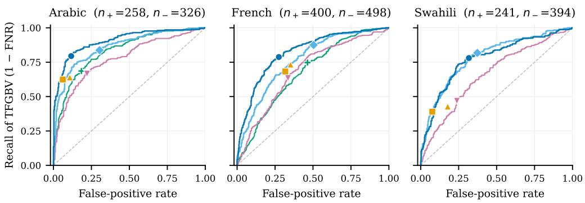

# ALTO: African and Levantine Tech-Facilitated Gender-Based Violence Corpus

Tianwei Zhang,<sup>1</sup> Ivy Njoki Nyagwencha,<sup>1</sup> Zahraa Dirani,<sup>1</sup> Shalini Joshi,<sup>1</sup> Scott A. Hale<sup>1,2</sup> <sup>1</sup>Meedan, <sup>2</sup>Oxford Internet Institute, University of Oxford, Correspondence: terry@meedan.org, scott@meedan.org

## Abstract

Tech-facilitated gender based violence (TFGBV) is a pervasive online harm afecting women and gender minority groups through its many direct and covert forms. Current models and annotated datasets for gendered harm detection are dominated by data from, and models trained in, Global North languages. In collaboration with civil society organizations (CSOs) from Jordan, Francophone West Africa, and Kenya, we developed a community-led approach to crowdsource culturally and linguistically relevant instances of TFGBV in Levantine Arabic, African French, and Swahili. We annotated the crowdsourced data using active learning to develop a small but performant dataset (N=3022) called ALTO to improve TFGBV detection in the three languages. Through benchmarking and fine-tuning experiments, we show that existing harmful content detection models show poor TFGBV recall within ALTO and improve with fine-tuning. We found that models often miss covert harms across all languages, while error rates are markedly higher in Swahili. We report the experimental results and release the annotation taxonomy, dataset, and trained models.<sup>1</sup>

## 1 Introduction

Tech-facilitated gender based violence (TFGBV) is a global problem consistently linked with offline harms, including depression, anxiety, and stress (Benítez-Hidalgo et al., 2026) that afects women and other gender minority populations most acutely (Turner et al., 2024). TFGBV was estimated to impact between 16% and 58% of women (Hicks, 2021), with a disproportionately greater prevalence against women and girls from the Larger World (i.e., Global South) (EIU, 2021). Online violence also has ofline manifestations, with 41% of women in the public sphere reporting ofline violence linked to online encounters in a recent survey (Posetti et al., 2025).

The use of an automated content moderation system is necessary given the volume of online content (Tonneau et al., 2026). Two commonly used model architectures for automated TFGBV detection are fine-tuned, encoder-only models such as BERT (Devlin et al., 2019) and zero- or fewshot decoder-only models such as OpenAI’s GPT safety fine-tuned models (OpenAI, 2025). The underlying pre-training and fine-tuning are based on large corpora, often derived from publicly available online text, including social media (Luccioni and Viviano, 2021). Most online content is in English (Hale, 2014), and performance degrades for less-represented languages in real-life settings (Tonneau et al., 2025). Language availability also varies across annotated TFGBV datasets, with English accounting for 41.3% of available resources, while the next most represented languages, Spanish and Arabic, each account for only 12.7% (Abercrombie et al., 2023). The language disparity in TFGBV detection resources can expose women, girls, and gender minority people in the Larger World to more harm. In this work, we make three major contributions:

• We survey available TFGBV datasets and classifiers for Levantine Arabic, African French, and Swahili, finding that resources in these languages are sparse or form an extremely small part of larger datasets,

• We find existing models like Perspective API, GPT-OSS-Safeguard, and Learning from the Worst (Vidgen et al., 2021) perform poorly on detecting TFGBV in the three languages with distinct misclassification patterns, and

• We develop novel annotated TFGBV datasets using active learning on crowdsourced data and show that they improve model performance.

## 2 Related Work

TFGBV Framework. This paper operationalizes the UNFPA (2021) TFGBV framework, which defines TFGBV under three aspects: tech facilitation, gender-based, and the presence harm or violence in many forms. Past work has focused narrowly on the conceptualization of misogyny and sexism, whereas TFGBV encompasses various forms of violence perpetrated against individuals on the basis of gender (Abercrombie et al., 2023). Jiang et al. (2024) operationalized the TFGBV framework by reannotating past datasets from Kirk et al. (2023) and Guest et al. (2021), but their efort was limited by the misogyny and sexism target labels in the underlying datasets. Little academic work has been done since to collect and annotate harmful content using the TFGBV framework.

Identity Harm Detection. There is an established line of work on harmful and abusive content detection with labels for target identities (e.g. Kwarteng et al., 2022; Tonneau et al., 2025; Ousidhoum et al., 2019; Yadav et al., 2023; Muhammad et al., 2025). There is also extensive work on misogynistic and sexist content detection (e.g. Mulki and Ghanem, 2021b; Guest et al., 2021; Kirk et al., 2023). Within the past work, we found few resources that adopted TFGBV harm types defined in the latest international guidelines (Dunn, 2020; UN Women, 2024), such as threats and incitement of physical and sexual violence and doxxing (Mulki and Ghanem, 2021b; Nobata et al., 2016). Despite Cook and Parrott’s (2009) call to include more harm types, such as physical and sexual violence, when assessing aggression against women, labelling eforts targeting additional harm types remain scarce. We address this gap by developing a fine-grained TFGBV taxonomy that covers a broader range of harm types.

Resources in African and Levantine Languages. Hate and abusive content detection datasets remain biased toward English and European languages (Tonneau et al., 2024a). Arabic is a notable exception with several past datasets developed for harmful content and gendered harm (Abercrombie et al., 2023). However, Haj Ahmed et al. (2025) documented a dialectal bias toward Modern Standard Arabic, Gulf, and Egyptian varieties, with detection performance degrading on Levantine Arabic. Let-Mi (Mulki and Ghanem, 2021b) is the only dataset specifically targeting Levantine Arabic misogyny, while MLMA and ArMIS contain mixed dialects (Ousidhoum et al., 2019; Almanea and Poesio, 2022).

French spoken and used online in Africa is strongly influenced by the local languages, forming distinct varieties of French from the European counterpart (Boutin and Dodo, 2018). Despite French’s status as a high-resource language within NLP research, it remains biased towards Standard French (Ahia et al., 2021). Past datasets on French hate speech and gender harm detection (e.g. Ousidhoum et al., 2019; Chiril et al., 2020) also do not represent African varieties, demonstrating a gap in the availability of data for this populous region.

The recent AfriHate corpus (Muhammad et al., 2025) contains 15 languages, including Swahili and North African Arabic, and labels instances of hate and targets. Fine-tuned models achieved strong performance in low-resource multilingual hate detection (Swahili F1=0.895). However, at the time of this study, the released AfriHate dataset did not contain the identity target labels for Swahili. Hate speech detection datasets for other African regions have been developed, such as NaijaHate (Tonneau et al., 2024b) and EkoHate (Ilevbare et al., 2024) for Nigerian languages, (Ayele et al., 2023) and (Ibrahim et al., 2024) for Amharic.

The paucity of gendered harm detection datasets in Levantine Arabic, African French, and Swahili, used by nearly 500 million people,<sup>2</sup> forms a central motivation for this work.

Active Learning (AL). Despite the promising fewshot performance of LLMs (Brown et al., 2020), the social implications of TFGBV detection necessitate that the dataset be annotated through participatory design with annotators knowledgeable in GBV to reflect survivor and feminist perspectives (Muller et al., 2021). By using a model’s internal uncertainty to query subsequent annotation candidates, active learning (AL, Lewis and Gale, 1994) is an established strategy for reducing annotation costs and the potential harm to annotators through fewer annotations. Schröder et al. (2022) and Zhang et al. (2022) describe the recent development of uncertainty and diversity sampling techniques in transformer models, which we implement. AL has been applied to text classification in two approaches: through embedding-space diversity (Zhang et al., 2017) and predictive uncertainty (Wang et al., 2024). We combined both in our implementation (§3.2).

## 3 Dataset Creation

## 3.1 Data Collection

We used an ensemble approach that combined crowdsourcing via community tiplines and social media scraping to establish the data pool. CSO partners operated and promoted the tiplines in their respective regions and languages (Appendix B). The tiplines were operated using Meedan’s Check software,<sup>3</sup> and were accessible to community members via WhatsApp, Telegram, and Facebook Messenger. The community tipline enabled individuals to share potential TFGBV content they encountered online.

While the tipline supported sampling local, community-reported instances, we saw uneven engagement across the regions. Following prior work, we boosted the number of potentially positive instances by using keyword sampling on social media (e.g. Vidgen et al., 2021; Kirk et al., 2022; Muhammad et al., 2025). The keywords were curated by the CSO partners, based on their past work and existing literature on harmful content in the relevant languages.<sup>4</sup>

We used the keywords to sample instances from X, where harmful content increased after the ownership change and rebranding to X from Twitter (Hickey et al., 2023, 2025). Keywords were entered manually into the search bar, and new results were loaded by scrolling while a browser script saved the loaded Tweets to a local file. All identifying user tags and URLs were replaced with a special token to protect user privacy. In total across tiplines and social media, we collected n=8,710 items for Arabic, n=5,628 for African French, and n=4,798 for Swahili, forming the full data pool, where a subset was sampled using AL for targeted annotation.

## 3.2 Active Learning

We implement AL using a pool-based approach, in which an unlabelled pool is queried at each round t for labelling by the annotators, forming the batch $B _ { t }$ . A combination of diversity and uncertainty sampling approaches was used to produce each batch.<sup>5</sup> Table 1 shows the sampling strategy used for each AL round. Two approaches were combined to maximize uncertainty and diversity as suggested by Monarch (2021): prediction uncertainty was implemented using normalized entropy (Shannon, 1948) and diversity sampling was implemented using model activation uncertainty (Zhang et al., 2017) (Appendix B.1).

<table><tr><td>Batch</td><td>ar</td><td>fr</td><td>SW</td><td>Sampling Strategy</td></tr><tr><td> $\boldsymbol { B } _ { 1 }$ </td><td>50</td><td>100</td><td>50</td><td>KMeans diversity</td></tr><tr><td> $B _ { 2 }$ </td><td>130</td><td>100</td><td>137</td><td>KNN uncertainty and diversity</td></tr><tr><td> $B _ { 3 }$ </td><td>217</td><td>194</td><td>113</td><td>PLM entropy+activation: binary</td></tr><tr><td> $B _ { 4 + }$ </td><td>557</td><td>632</td><td>742</td><td>2 PLM entropy+activation: multilabel</td></tr><tr><td>Total</td><td>954</td><td>1026</td><td>1042</td><td></td></tr></table>

Table 1: Annotation batch sizes and sampling strategies for Arabic (ar), French (fr), and Swahili (sw). Batches B2–B4+ use a cumulatively growing annotated seed set from previous batches.

## 4 Annotation

## 4.1 Recruitment and Training

Annotators. To build a dataset for detecting TFGBV, which overwhelmingly targets women and girls (Hicks, 2021), we recruited annotators who self-identify as women. Annotations from the targeted group often diverge from majority judgements, and standard majority aggregation can obscure their perspectives (Fleisig et al., 2023). Prior work has therefore recommended specialized rater pools for content involving identity-based attacks (Goyal et al., 2022). Our design follows Kirk et al. (2023), who recruited trained annotators who “all self-identify as women’’ to mitigate labelling bias and include the communities most afected. We acknowledge that a single-gender pool does not capture all perspectives on TFGBV (see Limitations).

Annotators were native speakers from the study regions who were members of or consultants engaged by the CSO partners, consistent with evidence that local expertise is critical for lowresource hate speech annotation (Nkemelu et al., 2023). Two annotators and one expert annotator were assigned to each language, with the expert responsible for adjudicating disagreements. The expert annotators had previous experience with gendered disinformation research and collaborated closely with the lead researcher during adjudication. Prior to annotation, the lead researcher and expert annotators conducted training sessions for all annotators. We provided annotators with annotation guidelines that included detailed explanations of the annotation process, taxonomy, and worked examples. Annotator wellbeing. Exposure to harmful content during annotation can cause vicarious trauma among annotators (Dubberley et al., 2015). Following guidelines from Vidgen et al. (2019), we provided annotators with trauma-mitigation training before they began annotating. A content moderation researcher hosted the training sessions and introduced trauma recognition, harm-minimizing approaches to annotating, and techniques for maintaining well-being. Annotation began only after completion of this training.

## 4.2 Labels and Taxonomy

The annotation labels reflect the UNFPA (2021) TFGBV framework, which we operationalized as three components: tech-facilitation, gendered content, and harm. Given the online nature of the data, tech-facilitation was assumed and not explicitly annotated. Gendered content was defined as a binary label indicating whether the content was directed at or about women, girls, and other vulnerable gender or sexual identities, without consideration of the harm contained. This definition enabled annotating gendered references that are present but harmless, giving the trained models more nuance. Each instance was then labelled for harm and violence types.

We developed a hierarchical taxonomy of harm and violence types based on international civil society and agency frameworks (i.e. Dunn, 2020; UNFPA, 2021; UN Women, 2024) and prior work on hate and harmful content detection (Bianchi et al., 2022; Cook and Parrott, 2009; Kirk et al., 2023; Mulki and Ghanem, 2021a). As international guidelines aim to capture the broad range of violence encompassed by TFGBV, they often lack clear, fine-grained class definitions that have been shown necessary for hate speech annotation in machine learning applications (Banko et al., 2020; Vidgen and Derczynski, 2021). The resulting taxonomy refines high-level TFGBV types (Tier 1) into fine-grained subtypes (Tier 2), with clear annotation instructions and examples for each subtype (Appendix B).

## 4.3 Annotation Procedure

The annotation was completed using the HumanSignal platform.<sup>6</sup> We followed the prescriptive paradigm of annotation, in which annotators applied the labels and taxonomy based on researcher-defined labels (Röttger et al., 2022; Cabitza et al., 2023). While the prescriptive paradigm discourages subjective label interpretations, we adopted a participatory design approach that incorporated annotator feedback.

<table><tr><td colspan="2">Variable Label</td><td>ar</td><td>fr</td><td>SW</td></tr><tr><td>Gender</td><td>Non-Gendered Gendered</td><td>222 486</td><td>236 746</td><td>395 439</td></tr><tr><td>Tier 1</td><td>Non-TFGBV Doxxing Harass. &amp; Hate Speech Threats &amp; Incite. Unsure</td><td>446 0 248 32 6</td><td>525 0 382 24 1</td><td>385 87 268 12 1</td></tr><tr><td>Tier 2 Total</td><td>Animosity Damning Derogation Doxx. Threats Doxx. Disclosure Obj. and Dehuman. Sexual Harass. Threats &amp; Incite. Phys. Threats &amp; Incite. Sex</td><td>32 20 107 0 0 28 11 8 3 954</td><td>94 1 38 0 0 4 0 19 4 1026 1042</td><td>27 0 133 64 21 20 6 3 4</td></tr></table>

Table 2: Counts of adjudicated or fully agreed labels for Arabic (ar), French (fr), and Swahili (sw) per variable. Total represents the number of annotated instances, differing from the variable-level sums.

After each of the two initial batches of annotation $( B _ { 1 } \ \& \ B _ { 2 } )$ , we met with the annotators to discuss disagreements. This process revealed limitations in the annotation guidelines and difering interpretations, leading to refinements for subsequent batches. For example, we found that the initial definition of gendered content was not adequately defined for instances where men were targeted using female gendered slurs. The discussion helped clarify that such content is gendered but not TFGBV in most cases, as such content does not directly target a minoritised gender. An exception was agreed for egregious use of gendered slurs where such use is likely distressful to readers in the target group. After the annotation guideline change, previous instances were re-annotated under the new guidelines in subsequent rounds and the latest annotation was kept to ensure coherency.

## 4.4 Annotation Results

The distribution of labels is shown in Table 2. Gendered content was more frequent than nongendered content in all languages, indicating a substantial presence of gendered expression in our samples. In Tier 1 of our taxonomy, Harassment and Hate Speech was the most prevalent TFGBV category, with 248 instances in Arabic, 382 in French, and 268 in Swahili. There were the most instances of Threats and Incitements of Violence in Arabic than the other languages. By contrast, Swahili had significantly more instances of Doxxing, with none in our French or Arabic data. We note, however, that our datasets are not designed to be representative of content online.

For the finer-grained Tier 2 of our taxonomy, we noted an imbalance across languages. Derogation was the most common label within Harassment and Hate Speech for Arabic and Swahili, with 107 and 133 instances, respectively, while animosity was the most common in French with 94. The Arabic dataset contained 22 instances of Damning, a unique Arabic label introduced by Mulki and Ghanem (2021b), one in French and none in Swahili. Overall, the annotation results indicate diferences in how TFGBV manifests across languages and the ability of our sampling approach to capture positive TFGBV instances.

<table><tr><td>Lang.</td><td>Gender α</td><td>Tier-1 α</td><td>Tier-2 α</td></tr><tr><td>ar</td><td>0.399</td><td>0.538</td><td>0.627</td></tr><tr><td>fr</td><td>0.661</td><td>0.534</td><td>0.451</td></tr><tr><td>SW</td><td>0.553</td><td>0.474</td><td>0.624</td></tr></table>

Table 3: Inter-annotator agreement (Krippendorf’s α) for Arabic (ar), French (fr) and Swahili (sw) across annotation variables.

The inter-annotator agreement was measured for each annotated variable (Table 3) using Krippendorf’s alpha (α). For whether content was gendered, we had the lowest agreement for Arabic $( \alpha ~ = ~ 0 . 3 9 9 )$ while French $\begin{array} { l l l } { ( \alpha } & { = } & { 0 . 6 6 1 ) } \end{array}$ and Swahili $( \alpha = 0 . 5 5 3 )$ were higher. We had moderate agreement for Tier-1 (α = 0.538) and Tier-2 $( \alpha = 0 . 6 2 7 )$ labels in Arabic

A similar pattern of higher alpha for Tier 2 than Tier 1 was also observed in Swahili, indicating that Tier 2 labelling tends to be more consistent once a Tier 1 label was agreed upon. This was, however, not seen for French, as alpha was lower for Tier 2 than for Tier 1. The moderate agreement in our dataset is broadly consistent with those reported in comparable harmful content annotation tasks. For example, Lee et al. (2024) reported α between 0.34 and 0.46 for annotating English hate speech, and Muhammad et al. (2025) reported free marginal Randolph’s κ between 0.46 and 0.81 for hate speech in 15 African languages. The moderate IAAs across the three variables reflect the subjective and dificult nature of TFGBV annotation.

## 5 Experiments

## 5.1 Experimental Setup

We designed two related experiments to test our dataset’s ability to improve TFGBV detection. The first benchmark experiment examines the performance of existing of-the-shelf models on ALTO and existing datasets. In the second, we fine-tune on a portion of the benchmarking data (Bench) and our annotated data (ALTO) and conduct error analysis to understand misclassification patterns.

Existing Data. Our survey of datasets identified a number of candidate models, and a set of criteria was applied for inclusion. Our benchmarking data includes all datasets that: 1) are labelled for gender, 2) fit the definition of harm under our TFGBV framework, and 3) are publicly accessible.

We reviewed 140 datasets from Abercrombie et al. (2023), Vidgen and Derczynski (2020) and a targeted search on HuggingFace and identified four mono- and multilingual datasets for inclusion. All four support Arabic of mixed dialects, three support French with no specific varieties, and one supports Swahili as a subset of a larger Kenyan dataset, highlighting a gap in TFGBV detection resources for these languages. Furthermore, in large datasets, such as the representative sample from HateDay (Tonneau et al., 2025) with 45,000 items from Kenya, only 17 TFGBV instances were captured, demonstrating the need for targeted sampling.

Existing models. We report the performance of existing harm detection models to establish baseline TFGBV detection performance. We identified candidate models from the hate and harm detection literature, commercial solutions, and the opensource model repository HuggingFace. Candidates were included based on criteria that replicate models readily implementable for content moderation by small- to medium-sized platforms. Specifically, we included models based on three criteria: 1) language support, 2) public availability in a pretrained state without requiring further fine-tuning with a transparent model card or methodology, and 3) architectural diversity, covering both decoderonly generative models and encoder-based classifiers. The benchmarked models included models from OpenAI (OpenAI, 2025), Vidgen et al. (2021), and Perspective API (Google, 2026) (Appendix C.2). The fine-tuned models are encoderonly models most commonly used in NLP research for their respective languages (Appendix C.3).

<table><tr><td>Dataset</td><td>Lang.</td><td>Gender</td><td>Harm</td><td>Public</td><td>Labels</td><td>Incl.</td></tr><tr><td>AfriHate (Muhammad et al., 2025)</td><td>SW</td><td>√</td><td>√</td><td>△</td><td>Hate with target</td><td>xa</td></tr><tr><td>HateDay (Tonneau et al., 2025)</td><td>ar, sw, fr</td><td>√</td><td>√</td><td>√</td><td>Hate with target</td><td>√</td></tr><tr><td>LAHM (Yadav et al., 2023)</td><td>ar, fr</td><td>x</td><td>√</td><td>x</td><td>Fine-grained hate incl. sexism</td><td>x</td></tr><tr><td>ArMIS (Almanea and Poesio, 2022)</td><td>ar</td><td>△</td><td>√</td><td>√</td><td>Misogyny and sexism</td><td>√</td></tr><tr><td>French Sexism (Chiril et al., 2020)</td><td>fr</td><td>√</td><td>△</td><td>△</td><td>Sexism</td><td>xb</td></tr><tr><td>ArMi (Mulki and Ghanem, 2022)</td><td>ar</td><td>△</td><td>√</td><td>√</td><td>Misogyny</td><td>√</td></tr><tr><td>MLMA (Ousidhoum et al., 2019)</td><td>ar, fr</td><td>√</td><td>√</td><td>√</td><td>Hate with target</td><td>√</td></tr></table>

Table 4: Candidate TFGBV datasets that cover gender, targets and harm, and whether they are included (Incl.) in the Bench dataset (✓ = yes, ✗ = no, = partial). <sup>a</sup>Gender labels not public. <sup>b</sup>Counter-speech annotated as positives

<table><tr><td>Lang</td><td>ALTO- train</td><td>ALTO- test</td><td>Bench- train</td><td>Bench- test</td></tr><tr><td>ar</td><td>467</td><td>117 (44.4%)</td><td>3316 (13.3%)</td><td>829 (13.3%)</td></tr><tr><td>fr</td><td>(44.1%) 718</td><td>180 (45.0%)</td><td>3632 (2.9%)</td><td>907</td></tr><tr><td>SW</td><td>(44.4%) 508 (38.0%)</td><td>127 (37.8%)</td><td>564 (2.5%)†</td><td>(2.9%) 140 (2.1%)†</td></tr><tr><td>Total</td><td>1693 (42.4%)</td><td>424 (42.7%)</td><td>7512 (7.4%)</td><td>1876 (7.4%)</td></tr></table>

Table 5: Dataset size by language and split, with the positive TFGBV class as a percentage of each split’s total (in brackets). †Swahili positive-class support in Bench is very low (n = 14 train, n = 3 test); metrics on this subset has limited statistical power.

Data setup. The surveyed datasets were combined into language-specific benchmark datasets (Table 5). The labels in the original datasets were standardized to produce binary gendered content and harm labels if they target women and girls. Similarly, we standardized the ALTO labels to binary gendered and harm labels for comparability. For the ALTO dataset, we retained only annotations that achieved full agreement, were adjudicated, or had minor disagreements (i.e., Tier 1 agreed) resulting in N = 2117 for the experiments but we release the full dataset with all annotations. The benchmark datasets (Bench) and ALTO were split into 80% for training and 20% for testing. The ALTO dataset split was stratified on binarized Tier 1, gendered content, and batches. Bench was stratified from each dataset on binarized labels of gendered content and harm label.

Benchmarking experiment. We evaluated the performance of existing harmful content detection models on the surveyed Bench-test and ALTO-test. All benchmarking experiments were completed using the binarized TFGBV labels. The ALTO model results were reported at 5-fold crossvalidation (CV) using out-of-fold performance. The LFTW model was trained only on English data, which does not meet our criteria. However, it is a widely used pre-trained hate speech detection tool, is frequently benchmarked in the harmful content literature, and has demonstrated strong performance (e.g. Bianchi et al., 2022; Tonneau et al., 2025). We addressed LFTW’s linguistic limitations by translating the collected data into English using the Google Translate API.<sup>7</sup> Translating harmful content from low-resource languages allowed us to assess English-only models’ ability to capture culturally and linguistically specific expressions of TFGBV.

Fine-tuning experiment. We fine-tuned three monolingual and one multilingual pretrained language models (PLMs) for the three languages. Each PLM was initialized from their released checkpoint with a three-head classification layer fitted for the binarized annotation targets of gendered content, presence of harmful content, and TFGBV. The ALTO fine-tuning was evaluated using 5-fold CV, while Bench-train was kept constant within the training data. All training hyperparameters are reported in Appendix C.

## 6 Experimental Results

## 6.1 Benchmarking Results

Table 6 shows the benchmarking results on the positive TFGBV class. We find that evaluating on ALTO, existing models have language-dependent magnitudes of F1 ranges. Within the benchmarked models, Arabic has the highest F1 between 0.685 and 0.733, African French is lower at 0.619–0.675, and Swahili is the lowest at 0.498–0.504.

<table><tr><td></td><td colspan="6">Arabic (ar)</td><td colspan="6">French (fr)</td><td colspan="6">Swahili (sw)</td></tr><tr><td></td><td></td><td colspan="2">ALTO</td><td colspan="3">Bench</td><td colspan="3">ALTO</td><td colspan="3">Bench</td><td colspan="3">ALTO</td><td colspan="3">Bench</td></tr><tr><td>Model</td><td>P</td><td>R</td><td>F1</td><td>P</td><td>R</td><td>F1</td><td>P</td><td>R</td><td>F1</td><td>P R</td><td></td><td>F1</td><td>P</td><td>R</td><td>F1</td><td>P</td><td></td><td>F1</td></tr><tr><td>OSS-SG-120B</td><td>.890</td><td>.624</td><td>.733</td><td>.371</td><td>.418</td><td>.393</td><td>.633</td><td>.682</td><td>.657</td><td>.200</td><td>.577</td><td>.297</td><td>.758</td><td>.390</td><td>.515</td><td>.000</td><td>.000</td><td>.000</td></tr><tr><td>OSS-SG-20B</td><td>.825</td><td>.640</td><td>.721</td><td>.362</td><td>.536</td><td>.432</td><td>.626</td><td>.733</td><td>.675</td><td>.165</td><td>.654</td><td>.264</td><td>.595</td><td>.427</td><td>.498</td><td>.000</td><td>.000</td><td>.000</td></tr><tr><td>LFTW</td><td>.705</td><td>.667</td><td>.685</td><td>.288</td><td>.427</td><td>.344</td><td>.603</td><td>.635</td><td>.619</td><td>.058</td><td>.654</td><td>.107</td><td>.546</td><td>.469</td><td>.504</td><td>.000</td><td>.000</td><td>.000</td></tr><tr><td>P-API</td><td>.747</td><td>.686</td><td>.715</td><td>.127</td><td>.391</td><td>.192</td><td>.564</td><td>.748</td><td>.643</td><td>.041</td><td>.769</td><td>.078</td><td></td><td></td><td></td><td></td><td></td><td></td></tr><tr><td>ALTO (mono)</td><td>.844</td><td>.795</td><td>.818</td><td>.561</td><td>.627</td><td>.592</td><td>.697</td><td>.787</td><td>.739</td><td>.359</td><td>.538</td><td>.431</td><td>.601</td><td>.780</td><td>.679</td><td>.118.667 .200</td><td></td><td></td></tr><tr><td>ALTO (multi)</td><td></td><td>.686.837</td><td>.754</td><td>.479</td><td>.936</td><td>.634</td><td>.582</td><td>.875</td><td>.699</td><td>.189</td><td>.385</td><td>.253</td><td>.573</td><td>.817</td><td></td><td></td><td></td><td>7 .674 .118 .667 .200</td></tr></table>

Table 6: TFGBV-class precision (P), recall (R), and F1 by language on the full ALTO dataset (n=2,117) and Bench-test. Shaded rows are encoders fine-tuned on ALTO, and their ALTO values are 5-fold CV predictions (inter-fold $\sigma \le 0 . 0 8 )$ . ALTO (mono): monolingual models ALTO (multi): a single multilingual model trained on all three languages. P-API was not evaluated on sw (–). Bold = best per metric.

We observed a drop in performance across both existing and fine-tuned models when changing the evaluation set from ALTO to Bench. The F1 scores of benchmarked models dropped from a simple average of 0.675 on ALTO to an average of 0.202 on Bench. Recall between evaluation sets regressed less from an average recall of 0.682 for ALTO to 0.485 for Bench (Appendix A.2). The extreme positive label bias in Bench is especially evident for Swahili where none of the 3 positive samples were detected the of-the-shelf models.

The best and worst models for each language differed. Across all languages on ALTO, OSS-SG-20B and 120B were the best of-the-shelf models. Interestingly, the 20B model often achieved better recall of TFGBV than the larger 120B counterpart while the latter achieved better precision. The worstperforming model for TFGBV detection on ALTO was the LFTW model which relied on translated texts with the exception of Swahili where OSS-SG-20B performed slightly worst.

## 6.2 Fine-tuning Results

Fine-tuning on ALTO and Bench significantly improved TFGBV detection performance beyond existing models, primarily by improving recall (Appendix A.3). Arabic and French improved from the best recall of 0.686 and 0.748 from Perspective API to 0.837 and 0.875 by the multilingual ALTO model after fine-tuning. Swahili recall improved from 0.469 by LFTW to 0.817 by the multilingual model. Precision improved modestly on ALTO evaluation, while a larger improvement was observed on Bench evaluation. Monolingual fine-tuning achieved higher F1 for all languages across ALTO and Bench except for Arabic Bench where the multilingual model excelled. In general, multilingual fine-tuning achieved higher recall but worse precision than the monolingual models.

## 6.3 Error Analysis

Table 7 shows the errors by TFGBV subcategory measured by false-negative rates (FNR) and falsepositive rates (FPR). Animosity, often a more covert form of harm, is the category most misclassified in nearly all languages. For this category, models showed an FNR between 0.33 and 0.66 across all languages. Fine-tuning on ALTO decreased FNR, and multilingual fine-tuning improved it substantially (0.00–0.22) over monolingual fine-tuning (0.14–0.47). The more direct insult type, derogation, showed a lower FNR range across languages: 0.26–0.38 for Arabic, 0.21–0.53 for French, and 0.33–0.62 for Swahili.

Between languages, Swahili showed a higher FNR range for all labels (0.33–0.80) than Arabic (0.00–0.66) and French (0.12–0.47). In Swahili, existing models struggled with objectification and doxxing, with OSS-SG between 0.62–0.77 and LFTW highest at 0.77–0.80. The high error rate for LFTW shows that translated text does not meaningfully convey harmful signals in Swahili. Finetuning on ALTO, even with only tens of labelled instances, improves doxxing FNR by -0.31 and objectification FNR by -0.25 from OSS-SG-120B to multilingual.

## 7 Discussion

Regression between datasets. The reduction of F1 for all models between ALTO and Bench reported in Table 6 were mostly driven by lower precision. In the Bench dataset, the proportion of positive TFGBV samples is markedly smaller (7%)

<table><tr><td>TFGBV Tier-2 Category</td><td>n</td><td>OSS-SG-120B OSS-SG-20B LFTW P-API ALTO (mono) ALTO (multi)</td><td></td><td></td><td></td><td></td><td></td></tr><tr><td rowspan="7">Derogation Arabic</td><td>103</td><td>.35</td><td>.38</td><td>.30</td><td>.26</td><td>.14</td><td>.11</td></tr><tr><td>Animosity</td><td>32 .50</td><td>.50</td><td>.59</td><td>.66</td><td>.47</td><td>.22</td></tr><tr><td>Objectification</td><td>26 .23</td><td>.23</td><td>.27</td><td>.15</td><td>.15</td><td>.08</td></tr><tr><td>Damning</td><td>16 .50</td><td>.44</td><td>.25</td><td>.31</td><td>.31</td><td>.38</td></tr><tr><td>Sexual harassment</td><td>10 .00</td><td>.10</td><td>.00</td><td>.10</td><td>.00</td><td>.00</td></tr><tr><td>Non-TFGBV, gendered</td><td>136 .12</td><td>.18</td><td>.21</td><td>.17</td><td>.23</td><td>.59</td></tr><tr><td>Non-TFGBV, not gendered</td><td>190 .02</td><td>.05</td><td>.23</td><td>.19</td><td>.04</td><td>.10</td></tr><tr><td rowspan="6">Animosity rench</td><td></td><td>91 .46</td><td>.40</td><td>.48</td><td>.47</td><td>.30</td><td>.18</td></tr><tr><td>Derogation</td><td>38 .45</td><td>.37</td><td>.53</td><td>.21</td><td>.32</td><td>.16</td></tr><tr><td>Threats of violence</td><td>17 .18</td><td>.12</td><td>.24</td><td>.12</td><td>.35</td><td>.18</td></tr><tr><td>Non-TFGBV, gendered</td><td>278 .54</td><td>.59</td><td>.46</td><td>.60</td><td>.45</td><td>.79</td></tr><tr><td>Non-TFGBV, not gendered 220</td><td>.03</td><td>.05</td><td>.17</td><td>.29</td><td>.06</td><td>.14</td></tr><tr><td>Derogation 120</td><td>.56</td><td>.55</td><td>.44</td><td></td><td>.20</td><td></td></tr><tr><td rowspan="7">Animosity Swabkii Doxxing</td><td>21</td><td>.62</td><td>.52</td><td>.33</td><td></td><td>.14</td><td>.15</td></tr><tr><td>Objectification</td><td>20 .65</td><td>.65</td><td>.80</td><td></td><td>.45</td><td>.00 .40</td></tr><tr><td></td><td>.62</td><td>.77</td><td>.77</td><td></td><td>.46</td><td>.31</td></tr><tr><td>Non-TFGBV, gendered</td><td>13 89 .19</td><td>.40</td><td>.33</td><td></td><td>.66</td><td>.75</td></tr><tr><td>Non-TFGBV, not gendered 305</td><td>.04</td><td>.11</td><td>.21</td><td></td><td>.22</td><td></td></tr><tr><td></td><td></td><td></td><td></td><td></td><td></td><td>.26</td></tr></table>

Table 7: Error rate per tier-2 category where available and model on ALTO-full (5-fold out-of-fold prediction). Red rows: FNR of TFGBV positives. Blue rows: FPR on the non-TFGBV items split by presence of gendered content. Darker shading means more errors and lower error rates are better for all rows.

than in the ALTO test set (42.7%, Table 5). The reduction in model performance when evaluating on a real-world dataset was also observed by previous work (Tonneau et al., 2025), where model precision averaged 0.094 on realistic datasets against 0.40 on academic datasets. Including Bench thus shows realistic performance, which ALTO finetuning improves.

Language resource performance. Within NLP research, Arabic and French are considered highresource languages despite our studied dialects being lower-resourced (Ahia et al., 2021). Our finetuning experiment showed that these two languages adapted well to new dialectal data and achieved strong final performance, given their larger pretraining resources. By contrast, Swahili saw the largest absolute gains (F1 + 0.17-0.18, Appendix A.3) but only modest final performance for comparable training data size, suggesting that improving model pre-training resources is necessary for domain-specific adaptations such as TFGBV detection to produce larger gains (Wu and Dredze, 2020).

Fine-tuning tradeofs. While multilingual ALTO-fine-tuned models achieved the lowest FNR across nearly all categories, except Arabic Damning and French Threats, we observed a trade-of: significantly higher FPR for negative, gendered items, including items that discuss gendered content or use a gendered word. For example, the fine-tuned models predicted the phrase fr:“Il m’as [sic] clairement pris pour une go facile. Mais bon il s’est tiré une balle dans le pied là” (en: he clearly took me as an easy girl but he shot himself in the foot.) was flagged because “go facile” is an African French slang for a promiscuous girl that is used in a reclaimed manner and is a observed failure mode (Röttger et al.). The higher FPR in multilingual models than in monolingual models for gendered negative samples could reflect a loss of languagespecific nuance from multilingual pre-training, as suggested by Chang et al. (2024).

## 8 Conclusion

TFGBV is a serious and prevalent harm facing women and gender minorities online that disproportionately afects those in regions with fewer detection resources. To address this gap, we introduced ALTO, a novel annotated dataset for TFGBV detection in Levantine Arabic, African French, and Swahili. We used active learning to sample annotations from both community-reported and scraped sources. We find that ALTO fine-tuning improves TFGBV detection, whereas of-the-shelf harmful content detection models do not generalize well to specific TFGBV subtypes in these languages. Our work showed that targeted, community-led data collection and active learning can improve model performance with modest data sizes for lowresource settings.

## Limitations

There are several limitations of this work that may be opportunities for future works. The first is the use of binarized labels mapped from the original multi-label annotation in the experiments. The binary labels for TFGBV compress the nuance in Tier 1 and Tier 2 TFGBV, improving prediction performance but reducing interpretability. The decision was motivated by the small number of agreed instances for the Tier 1 and 2 labels, a similar challenge and approach that were reported by Bianchi et al. (2022). Nonetheless, we release the dataset with all agreed or adjudicated labels (i.e., gendered content, Tier 1 and 2 TFGBV) for other researchers to use.

The data collected from social media in this study were limited to one platform, X. This aligns with many previous studies but limits the potential manifestations of TFGBV to those unmoderated on X. The tipline submissions included various sources, but we excluded those from imageor video-based platforms (e.g., Instagram, TikTok), as this paper focused on text-based TFGBV. Future work can sample potential TFGBV from more platforms and media types. We also hope to pursue future work using the diverse forms of media omitted in this study.

There is also a linguistic limitation to the data collection approach. While we used keywords from the Levantine and African French contexts, the social media sampling approach could not guarantee that the returned samples were exclusively Levantine Arabic and African French. However, because the annotators are from the respective regions, the annotation approach should capture Levantine and Francophone African perspectives on TFGBV. For Swahili, the common usage of Sheng, a mix of Swahili and English, also means that our samples are not purely Swahili. We believe this linguistically nuanced sample more accurately reflects platform users in these regions.

We also recognize a limitation in the annotator demographics of this study. While TFGBV targets women, it is also prevalent against other minority sexual and gender identities (UNFPA, 2021). All of the annotators in this study were women, which limits the perspectives of other minority identities, such as LGBTQ+ individuals, who can also be survivors of TFGBV (Cabitza et al., 2023). A considerable body of work has shown that annotator identities and beliefs can strongly influence labelling and classifier behaviours (e.g. Fleisig et al., 2023; Jiang et al., 2024; Waseem, 2016), we encourage future work to include annotators from diverse identities without diminishing the perspective of the target identity annotators.

We cannot fully rule out data contamination in our experiments (Sainz et al., 2023), since the benchmark datasets and models also contained Twitter data. While we limited our Twitter/X sampling to content from the last two years (i.e. after most benchmarked resources’ time periods), this does not guarantee a mutually exclusive sample. Despite that, the cross-validation on held-out data in ALTO and Bench, with varying and moderately strong performance, suggests that data contamination in ALTO may be limited.

Lastly, we did not evaluate the English translation used to evaluate the LFTW model at scale because the translation classification experiment was designed to demonstrate TFGBV detection performance when using a publicly available translation service. Therefore, translation-quality efects on prediction are part of the experimental design rather than a confounding factor. We do note that in the N=20 translations from each language that annotators reviewed, recent and covert TFGBV nuances are often missed by machine translations.

## Ethical Considerations

Risks. The dataset contains harmful content that may be distressing to users. We include a content warning before the harmful sections of the paper and note the same for the research repository. There is also the risk of the data being used for malicious purposes, such as training harmful generative models, we prohibit this under the Intended Use.

Privacy. To protect the identity of individuals whose data we have included, all user tags and URLs were replaced with the respective representative token <USER> and <URL>. Additionally, content labelled as Doxxing was excluded from the dataset to protect the survivors.

Intended Use. Our dataset is released under a CC BY license and requires prospective users to agree to use the data consistent with its intended purpose before they are able to download it.<sup>8</sup>

We further strictly prohibit the use of ALTO to train, fine-tune, or develop harmful generative models. Use of the dataset in developing content moderation systems should be in conjunction with a human moderation process.

Past Datasets and Models. All past datasets and models were released under CC BY 4.0 and Apache 2.0 licenses, which our use for research is permitted. Perspective API’s use for research falls within Google API Terms of Service<sup>9</sup>.

## References

Muhammad Abdul-Mageed, AbdelRahim Elmadany, and El Moatez Billah Nagoudi. 2021. ARBERT & MARBERT: Deep bidirectional transformers for Arabic. Proceedings of the 59th Annual Meeting of the Association for Computational Linguistics and the 11th International Joint Conference on Natural Language Processing (Volume 1: Long Papers), pages 7088–7105.

Gavin Abercrombie, Aiqi Jiang, Poppy Gerrardabbott, Ioannis Konstas, and Verena Rieser. 2023. Resources for automated identification of online gender-based violence: A systematic review. In The 7th Workshop on Online Abuse and Harms (WOAH), pages 170–186. Association for Computational Linguistics.

David Ifeoluwa Adelani, Hannah Liu, Xiaoyu Shen, Nikita Vassilyev, Jesujoba O. Alabi, Yanke Mao, Haonan Gao, and En-Shiun Annie Lee. 2024. SIB-200: A simple, inclusive, and big evaluation dataset for topic classification in 200+ languages and dialects. In Proceedings of the 18th Conference of the European Chapter of the Association for Computational Linguistics (Volume 1: Long Papers), pages 226–245, St. Julian’s, Malta. Association for Computational Linguistics.

Orevaoghene Ahia, Julia Kreutzer, and Sara Hooker. 2021. The low-resource double bind: An empirical study of pruning for low-resource machine translation. In Findings of the Associationfor Computational Linguistics: EMNLP 2021, pages 3316–3333. Association for Computational Linguistics.

Jesujoba O. Alabi, David Ifeoluwa Adelani, Marius Mosbach, and Dietrich Klakow. 2022. Adapting pre-trained language models to African languages via multilingual adaptive

fine-tuning. In Proceedings of the 29th International Conference on Computational Linguistics, pages 4336–4349, Gyeongju, Republic of Korea. International Committee on Computational Linguistics.

Dina Almanea and Massimo Poesio. 2022. ArMIS - the arabic misogyny and sexism corpus with annotator subjective disagreements. In Proceedings of the Thirteenth Language Resources and Evaluation Conference, pages 2282–2291. European Language Resources Association.

Abinew Ali Ayele, Seid Muhie Yimam, Tadesse Destaw Belay, Tesfa Asfaw, and Chris Biemann. 2023. Exploring Amharic Hate Speech Data Collection and Classification Approaches. In Proceedings of the 14th International Conference on Recent Advances in Natural Language Processing, pages 49–59, Varna, Bulgaria. INCOMA Ltd., Shoumen, Bulgaria.

Michele Banko, Brendon MacKeen, and Laurie Ray. 2020. A unified taxonomy of harmful content. In Proceedings of the Fourth Workshop on Online Abuse and Harms (WOAH), pages 125– 137, Online. Association for Computational Linguistics.

Vivian Benítez-Hidalgo, Guadalupe Pastor-Moreno, Isabel Ruiz-Pérez, and Sua Amaya-Santos. 2026. Technology-facilitated sexual violence against women and its health impact: A mixed-methods systematic review. BMC Public Health, 26(1):543.

Federico Bianchi, Stefanie Hills, Patricia Rossini, Dirk Hovy, Rebekah Tromble, and Nava Tintarev. 2022. It’s not just hate: A multidimensional perspective on detecting harmful speech online. In Proceedings of the 2022 Conference on Empirical Methods in Natural Language Processing, pages 8093–8099, Abu Dhabi, United Arab Emirates. Association for Computational Linguistics.

Akissi Béatrice Boutin and Jean-Claude Dodo. 2018. View on the Updating of Nouchi Lexicon and Expressions. In Ellen Hurst-Harosh and Fridah Kanana Erastus, editors, African Youth Languages : New Media, Performing Arts and Sociolinguistic Development, pages 53–73. Springer International Publishing, Cham.

Tom B. Brown, Benjamin Mann, Nick Ryder, Melanie Subbiah, Jared Kaplan, Prafulla Dhariwal, Arvind Neelakantan, Pranav Shyam, Girish Sastry, Amanda Askell, Sandhini Agarwal, Ariel Herbert-Voss, Gretchen Krueger, Tom Henighan, Rewon Child, Aditya Ramesh, Daniel M. Ziegler, Jefrey Wu, Clemens Winter, and 12 others. 2020. Language Models are Few-Shot Learners. arXiv preprint. ArXiv:2005.14165 [cs].

Federico Cabitza, Andrea Campagner, and Valerio Basile. 2023. Toward a Perspectivist Turn in Ground Truthing for Predictive Computing. Proceedings of the AAAI Conference on Artificial Intelligence, 37(6):6860–6868.

Tyler A. Chang, Catherine Arnett, Zhuowen Tu, and Benjamin K. Bergen. 2024. When Is Multilinguality a Curse? Language Modeling for 250 High- and Low-Resource Languages. In Proceedings of the 2024 Conference on Empirical Methods in Natural Language Processing, pages 4074–4096, Miami, Florida, USA. Association for Computational Linguistics.

Patricia Chiril, Véronique Moriceau, Farah Benamara, Alda Mari, Gloria Origgi, and Marlène Coulomb-Gully. 2020. He said “who’s gonna take care of your children when you are at ACL?”: Reported sexist acts are not sexist. In Proceedings of the 58th Annual Meeting of the Association for Computational Linguistics, pages 4055–4066, Online. Association for Computational Linguistics.

Sarah Cook and Dominic Parrott. 2009. Exploring a taxonomy for aggression against women: can it aid conceptual clarity? 35(6):462–476. \_eprint: https://onlinelibrary.wiley.com/doi/pdf/10.1002/a

Jacob Devlin, Ming-Wei Chang, Kenton Lee, and Kristina Toutanova. 2019. BERT: Pre-training of deep bidirectional transformers for language understanding. In Proceedings ofthe 2019 Conference of the North American Chapter of the Association for Computational Linguistics: Human Language Technologies, Volume 1 (Long and Short Papers), pages 4171–4186, Minneapolis, Minnesota. Association for Computational Linguistics.

Sam Dubberley, Elizabeth Grifin, and Haluk Mert Bal. 2015. Making secondary trauma a primary issue: A study of eyewitness media and vicarious trauma on the digital frontline. Eyewitness Media Hub, pages 1–69.

Suzie Dunn. 2020. Technology-facilitated genderbased violence: An overview.

EIU. 2021. Measuring the prevalence of online violence against women.

Eve Fleisig, Rediet Abebe, and Dan Klein. 2023. When the Majority is Wrong: Modeling Annotator Disagreement for Subjective Tasks. In Proceedings of the 2023 Conference on Empirical Methods in Natural Language Processing, pages 6715–6726, Singapore. Association for Computational Linguistics.

Google. 2026. Perspective API: Attributes and languages.

Nitesh Goyal, Ian D. Kivlichan, Rachel Rosen, and Lucy Vasserman. 2022. Is Your Toxicity My Toxicity? Exploring the Impact of Rater Identity on Toxicity Annotation. Proceedings of the ACM on Human-Computer Interaction, 6(CSCW2):363:1–363:28.

Ella Guest, Bertie Vidgen, Alexandros Mittos, Nishanth Sastry, Gareth Tyson, and Helen Margetts. 2021. An Expert Annotated Dataset for the Detection of Online Misogyny. In Proceedings of the 16th Conference of the European Chapter of the Association for Computational Linguistics: Main Volume, pages 1336–1350, Online. Association for Computational Linguistics.

Ahmed Haj Ahmed, Rui-Jie Yew, Xerxes Minocher, and Suresh Venkatasubramanian. 2025. Navigating Dialectal Bias and Ethical

<sup>.20321.</sup>Complexities in Levantine Arabic Hate Speech Detection. In Proceedings of the 4th Workshop on Arabic Corpus Linguistics (WACL-4), pages 103–108, Abu Dhabi, UAE. Association for Computational Linguistics.

Scott A. Hale. 2014. Global connectivity and multilinguals in the twitter network. In Proceedings of the SIGCHI Conference on Human Factors in Computing Systems, CHI ’14, page 833–842, New York, NY, USA. Association for Computing Machinery.

Daniel Hickey, Daniel M. T. Fessler, Kristina Lerman, and Keith Burghardt. 2025. X under Musk’s leadership: Substantial hate and no reduction in inauthentic activity.

Daniel Hickey, Matheus Schmitz, Daniel Fessler, Paul Smaldino, Goran Muric, and Keith Burghardt. 2023. Auditing Elon Musk’s impact on hate speech and bots. Proceedings of the International AAAI Conference on Web and Social Media, 17(1):1133–1137.

Jacqueline Hicks. 2021. Global Evidence on the Prevalence and Impact of Online Gender-based Violence (OGBV). report, The Institute of Development Studies and Partner Organisations.

Nuhu Ibrahim, Felicity Mulford, Matt Lawrence, and Riza Batista-Navarro. 2024. Resources for Annotating Hate Speech in Social Media Platforms Used in Ethiopia: A Novel Lexicon and Labelling Scheme. In Proceedings of the Fifth Workshop on Resources for African Indigenous Languages @ LREC-COLING 2024, pages 115– 123, Torino, Italia. ELRA and ICCL.

Comfort Ilevbare, Jesujoba Alabi, David Ifeoluwa Adelani, Firdous Bakare, Oluwatoyin Abiola, and Oluwaseyi Adeyemo. 2024. EkoHate: Abusive Language and Hate Speech Detection for Code-switched Political Discussions on Nigerian Twitter. In Proceedings of the 8th Workshop on Online Abuse and Harms (WOAH 2024), pages 28–37, Mexico City, Mexico. Association for Computational Linguistics.

Aiqi Jiang, Nikolas Vitsakis, Tanvi Dinkar, Gavin Abercrombie, and Ioannis Konstas. 2024. Reexamining Sexism and Misogyny Classification with Annotator Attitudes. In Findings of the Association for Computational Linguistics: EMNLP 2024, pages 15103–15125, Miami, Florida, USA. Association for Computational Linguistics.

Hannah Kirk, Bertie Vidgen, Paul Rottger, Tristan Thrush, and Scott A. Hale. 2022. Hatemoji: A test suite and adversarially-generated dataset for benchmarking and detecting emoji-based hate. In Proceedings of the 2022 Conference of the North American Chapter of the Association for Computational Linguistics: Human Language Technologies, pages 1352–1368, Seattle, United

States. Association for Computational Linguistics.

Hannah Kirk, Wenjie Yin, Bertie Vidgen, and Paul Röttger. 2023. SemEval-2023 task 10: Explainable detection of online sexism. In Proceedings of the 17th International Workshop on Semantic Evaluation (SemEval-2023), pages 2193–2210, Toronto, Canada. Association for Computational Linguistics.

Joseph Kwarteng, Serena Coppolino Perfumi, Tracie Farrell, Aisling Third, and Miriam Fernandez. 2022. Misogynoir: challenges in detecting intersectional hate. Social Network Analysis and Mining, 12(1):166.

Nayeon Lee, Chani Jung, Junho Myung, Jiho Jin, Jose Camacho-Collados, Juho Kim, and Alice Oh. 2024. Exploring Cross-Cultural Differences in English Hate Speech Annotations: From Dataset Construction to Analysis. In Proceedings of the 2024 Conference of the North American Chapter of the Association for Computational Linguistics: Human Language Technologies (Volume 1: Long Papers), pages 4205– 4224, Mexico City, Mexico. Association for Computational Linguistics.

David D. Lewis and William A. Gale. 1994. A sequential algorithm for training text classifiers. In Proceedings ofthe 17th annual international ACM SIGIR conference on Research and development in information retrieval, SIGIR ’94, pages 3–12, Berlin, Heidelberg. Springer-Verlag.

Alexandra Sasha Luccioni and Joseph D. Viviano. 2021. What’s in the Box? A Preliminary Analysis of Undesirable Content in the Common Crawl Corpus. arXiv preprint. ArXiv:2105.02732 [cs].

Louis Martin, Benjamin Muller, Pedro Javier Ortiz Suárez, Yoann Dupont, Laurent Romary, Éric Villemonte de la Clergerie, Djamé Seddah, and Benoît Sagot. 2020. Camembert: a tasty french language model. In Proceedings of the 58th Annual Meeting of the Association for Computational Linguistics.

Robert Monarch. 2021. Human-In-the-Loop Machine Learning: Active Learning and Annotation for Human-Centered AI. Manning Publications Co. LLC.

Shamsuddeen Hassan Muhammad, Idris Abdulmumin, Abinew Ali Ayele, David Ifeoluwa Adelani, Ibrahim Said Ahmad, Saminu Mohammad Aliyu, Paul Röttger, Abigail Oppong, Andiswa Bukula, Chiamaka Ijeoma Chukwuneke, Ebrahim Chekol Jibril, Elyas Abdi Ismail, Esubalew Alemneh, Hagos Tesfahun Gebremichael, Lukman Jibril Aliyu, Meriem Beloucif, Oumaima Hourrane, Rooweither Mabuya, Salomey Osei, and 8 others. 2025. AfriHate: A multilingual collection of hate speech and abusive language datasets for African languages. In Proceedings of the 2025 Conference of the Nations of the Americas Chapter of the Association for Computational Linguistics: Human Language Technologies (Volume 1: Long Papers), pages 1854–1871, Albuquerque, New Mexico. Association for Computational Linguistics.

Hala Mulki and Bilal Ghanem. 2021a. ArMI at FIRE2021: Overview of the first shared task on Arabic misogyny identification. In Working Notes of FIRE 2021 - Forum for Information Retrieval Evaluation. CEUR.

Hala Mulki and Bilal Ghanem. 2021b. Let-Mi: An Arabic Levantine Twitter Dataset for Misogynistic Language. arXiv preprint. ArXiv:2103.10195 [cs].

Hala Mulki and Bilal Ghanem. 2022. Working Notes of the Workshop Arabic Misogyny Identification (ArMI-2021). In Proceedings of the 13th Annual Meeting of the Forum for Information Retrieval Evaluation, FIRE ’21, pages 7–8, New York, NY, USA. Association for Computing Machinery.

Michael Muller, Christine T. Wolf, Josh Andres, Michael Desmond, Narendra Nath Joshi, Zahra Ashktorab, Aabhas Sharma, Kristina Brimijoin, Qian Pan, Evelyn Duesterwald, and Casey Dugan. 2021. Designing Ground Truth and the Social Life of Labels. In Proceedings of the 2021 CHI Conference on Human Factors in Computing Systems, CHI ’21, pages 1–16, New York, NY, USA. Association for Computing Machinery.

Daniel Nkemelu, Harshil Shah, Michael Best, and Irfan Essa. 2023. Tackling Hate Speech in Lowresource Languages with Context Experts. In

Proceedings of the 2022 International Conference on Information and Communication Technologies and Development, ICTD ’22, pages 1– 11, New York, NY, USA. Association for Computing Machinery.

Chikashi Nobata, Joel Tetreault, Achint Thomas, Yashar Mehdad, and Yi Chang. 2016. Abusive Language Detection in Online User Content. In Proceedings of the 25th International Conference on World Wide Web, WWW ’16, pages 145–153, Republic and Canton of Geneva, CHE. International World Wide Web Conferences Steering Committee.

OIF. 2026. LA LANGUE FRANÇAISE DANS LE MONDE. Technical report, Organisation internationale de la Francophonie.

OpenAI. 2025. Introducing gpt-oss-safeguard | OpenAI.

Nedjma Ousidhoum, Zizheng Lin, Hongming Zhang, Yangqiu Song, and Dit-Yan Yeung. 2019. Multilingual and multi-aspect hate speech analysis. In Proceedings of the 2019 Conference on Empirical Methods in Natural Language Processing and the 9th International Joint Conference on Natural Language Processing, pages 4675–4684, Hong Kong, China. Association for Computational Linguistics.

Julie Posetti, Lea Hellmueller, Kaylee Williams, Pauline Renaud, Nermine Aboulez, and Nabeelah Shabbir. 2025. Tipping point: The chilling escalation of online violence against women in the public sphere.

Paul Röttger, Bertie Vidgen, Dirk Hovy, and Janet B. Pierrehumbert. 2022. Two Contrasting Data Annotation Paradigms for Subjective NLP Tasks. arXiv preprint. ArXiv:2112.07475 [cs].

Paul Röttger, Bertie Vidgen, Dong Nguyen, Zeerak Waseem, Helen Margetts, and Janet Pierrehumbert. HateCheck: Functional tests for hate speech detection models. In Proceedings of the 59th Annual Meeting of the Association for Computational Linguistics and the 11th International Joint Conference on Natural Language Processing (Volume 1: Long Papers), pages 41– 58. Association for Computational Linguistics.

Alan Said, Ben Fields, Brijnesh J. Jain, and Sahin Albayrak. 2013. User-centric evaluation of a kfurthest neighbor collaborative filtering recommender algorithm. In Proceedings of the 2013 conference on Computer supported cooperative work, CSCW ’13, pages 1399–1408. Association for Computing Machinery.

Oscar Sainz, Jon Campos, Iker García-Ferrero, Julen Etxaniz, Oier Lopez de Lacalle, and Eneko Agirre. 2023. NLP Evaluation in trouble: On the Need to Measure LLM Data Contamination for each Benchmark. In Findings of the Associationfor Computational Linguistics: EMNLP 2023, pages 10776–10787, Singapore. Association for Computational Linguistics.

Christopher Schröder, Andreas Niekler, and Martin Potthast. 2022. Revisiting Uncertainty-based Query Strategies for Active Learning with Transformers. In Findings ofthe Associationfor Computational Linguistics: ACL 2022, pages 2194– 2203, Dublin, Ireland. Association for Computational Linguistics.

Claude Elwood Shannon. 1948. A mathematical theory of communication. The Bell System Technical Journal, 27(3):379–423.

Manuel Tonneau, Diyi Liu, Samuel Fraiberger, Ralph Schroeder, Scott A. Hale, and Paul Röttger. 2024a. From languages to geographies: Towards evaluating cultural bias in hate speech datasets. In Proceedings of the 8th Workshop on Online Abuse and Harms (WOAH 2024), pages 283–311, Mexico City, Mexico. Association for Computational Linguistics.

Manuel Tonneau, Diyi Liu, Niyati Malhotra, Scott A. Hale, Samuel Fraiberger, Victor Orozco-Olvera, and Paul R”ottger. 2025. Hate-Day: Insights from a global hate speech dataset representative of a day on Twitter. In Proceedings of the 63rd Annual Meeting of the Association for Computational Linguistics (Volume 1: Long Papers), pages 2297–2321, Vienna, Austria. Association for Computational Linguistics.

Manuel Tonneau, Diyi Liu, Ryan McGrady, Kevin Zheng, Ralph Schroeder, Ethan Zuckerman, and Scott Hale. 2026. Language Disparities in Moderation Workforce Allocation by Social Media Platforms. In Proceedings of the 2026 ACM Conference on Fairness, Accountability,

and Transparency, pages 4756–4772. Association for Computing Machinery, New York, NY, USA.

Manuel Tonneau, Pedro Quinta De Castro, Karim Lasri, Ibrahim Farouq, Lakshmi Subramanian, Victor Orozco-Olvera, and Samuel Fraiberger. 2024b. NaijaHate: Evaluating Hate Speech Detection on Nigerian Twitter Using Representative Data. In Proceedings of the 62nd Annual Meeting of the Association for Computational Linguistics (Volume 1: Long Papers), pages 9020–9040, Bangkok, Thailand. Association for Computational Linguistics.

Heather A. Turner, David Finkelhor, Kimberly Mitchell, and Deirdre Colburn. 2024. Prevalence of technology-facilitated abuse among sexual and gender minority youths. JAMA Network Open, 7(2):e2354485.

UN Women. 2024. Technology-facilitated genderbased violence: developing a shared research agenda.

UNESCO. 2021. World Kiswahili Language Day. UNESCO.

UNFPA. 2021. Technology-facilitated genderbased violence: Making all spaces safe.

Bertie Vidgen and Leon Derczynski. 2020. Directions in abusive language training data, a systematic review: Garbage in, garbage out. PLOS ONE, 15(12):e0243300.

Bertie Vidgen and Leon Derczynski. 2021. Directions in abusive language training data: Garbage in, garbage out. PLOS ONE, 15(12):1–32.

Bertie Vidgen, Alex Harris, Dong Nguyen, Rebekah Tromble, Scott Hale, and Helen Margetts. 2019. Challenges and frontiers in abusive content detection. In Proceedings of the Third Workshop on Abusive Language Online, pages 80–93, Florence, Italy. Association for Computational Linguistics.

Bertie Vidgen, Tristan Thrush, Zeerak Waseem, and Douwe Kiela. 2021. Learning from the worst: Dynamically generated datasets to improve online hate detection. In Proceedings of the 59th Annual Meeting of the Association for Computational Linguistics and the 11th International Joint Conference on Natural Language

Processing (Volume 1: Long Papers), pages 1667–1682, Online. Association for Computational Linguistics.

Qunbo Wang, Hangu Zhang, Wentao Zhang, Lin Dai, Yu Liang, and Haobin Shi. 2024. Deep active learning for multi label text classification. Scientific Reports, 14(1):28246.

Zeerak Waseem. 2016. Are You a Racist or Am I Seeing Things? Annotator Influence on Hate Speech Detection on Twitter. In Proceedings of the First Workshop on NLP and Computational Social Science, pages 138–142, Austin, Texas. Association for Computational Linguistics.

Thomas Wolf, Lysandre Debut, Victor Sanh, Julien Chaumond, Clement Delangue, Anthony Moi, Pierric Cistac, Tim Rault, Rémi Louf, Morgan Funtowicz, Joe Davison, Sam Shleifer, Patrick von Platen, Clara Ma, Yacine Jernite, Julien Plu, Canwen Xu, Teven Le Scao, Sylvain Gugger, and 3 others. 2020. Transformers: State-of-the-art natural language processing. In Proceedings of the 2020 Conference on Empirical Methods in Natural Language Processing: System Demonstrations, pages 38–45, Online. Association for Computational Linguistics.

Shijie Wu and Mark Dredze. 2020. Are All Languages Created Equal in Multilingual BERT? In Proceedings of the 5th Workshop on Representation Learning for NLP, pages 120–130, Online. Association for Computational Linguistics.

Ankit Yadav, Shubham Chandel, Sushant Chatufale, and Anil Bandhakavi. 2023. LAHM : Large Annotated Dataset for Multi-Domain and Multilingual Hate Speech Identification. arXiv preprint. ArXiv:2304.00913 [cs].

Ye Zhang, Matthew Lease, and Byron Wallace. 2017. Active Discriminative Text Representation Learning. Proceedings of the AAAI Conference on Artificial Intelligence, 31(1).

Zhisong Zhang, Emma Strubell, and Eduard Hovy. 2022. A Survey of Active Learning for Natural Language Processing. In Proceedings ofthe 2022 Conference on Empirical Methods in Natural Language Processing, pages 6166–6190, Abu Dhabi, United Arab Emirates. Association for Computational Linguistics.

## A Additional Results

## A.1 Classification Performance

  
ALTO fine-tuned (mono) ALTO fine-tuned (multi) OSS-SG-120B (no score) OSS-SG-20B (no score) LFTW P-API  
Figure 1: ROC for full ALTO over 5-fold CV and benchmarked models.

## A.2 Full Benchmarking Results

<table><tr><td></td><td></td><td colspan="6">ALTO-full</td><td colspan="6">Bench-test</td></tr><tr><td></td><td></td><td colspan="3">Non-TFGBV</td><td colspan="3">TFGBV</td><td colspan="3">Non-TFGBV</td><td colspan="3">TFGBV</td></tr><tr><td>Lang</td><td>Model</td><td>P</td><td>R</td><td>F1</td><td>P</td><td>R</td><td>F1</td><td>P</td><td>R</td><td>F1</td><td>P</td><td>R</td><td>F1</td></tr><tr><td rowspan="6">ar</td><td>OSS-SG-120B</td><td>0.759</td><td>0.939</td><td>0.840</td><td>0.890</td><td>0.624</td><td>0.733</td><td>0.909</td><td>0.892</td><td>0.900</td><td>0.371</td><td>0.418</td><td>0.393</td></tr><tr><td>OSS-SG-20B</td><td>0.758</td><td>0.893</td><td>0.820</td><td>0.825</td><td>0.640</td><td>0.721</td><td>0.923</td><td>0.855</td><td>0.888</td><td>0.362</td><td>0.536</td><td>0.432</td></tr><tr><td>LFTW</td><td>0.747</td><td>0.779</td><td>0.763</td><td>0.705</td><td>0.667</td><td>0.685</td><td>0.905</td><td>0.839</td><td>0.871</td><td>0.288</td><td>0.427</td><td>0.344</td></tr><tr><td>P-API</td><td>0.767</td><td>0.816</td><td>0.790</td><td>0.747</td><td>0.686</td><td>0.715</td><td>0.863</td><td>0.588</td><td>0.700</td><td>0.127</td><td>0.391</td><td>0.192</td></tr><tr><td>MARBERTv2</td><td>0.845</td><td>0.883</td><td>0.864</td><td>0.844</td><td>0.795</td><td>0.818</td><td>0.942</td><td>0.925</td><td>0.933</td><td>0.561</td><td>0.627</td><td>0.592</td></tr><tr><td>AfroXLMR-L-76L (M)</td><td>0.844</td><td>0.696</td><td>0.763</td><td>0.686</td><td>0.837</td><td>0.754</td><td>0.989</td><td>0.844</td><td>0.911</td><td>0.479</td><td>0.936</td><td>0.634</td></tr><tr><td rowspan="6">fr</td><td>OSS-SG-120B</td><td>0.728</td><td>0.683</td><td>0.705</td><td>0.633</td><td>0.682</td><td>0.657</td><td>0.987</td><td>0.932</td><td>0.959</td><td>0.200</td><td>0.577</td><td>0.297</td></tr><tr><td>OSS-SG-20B</td><td>0.751</td><td>0.648</td><td>0.695</td><td>0.626</td><td>0.733</td><td>0.675</td><td>0.989</td><td>0.902</td><td>0.944</td><td>0.165</td><td>0.654</td><td>0.264</td></tr><tr><td>LFTW</td><td>0.694</td><td>0.665</td><td>0.679</td><td>0.603</td><td>0.635</td><td>0.619</td><td>0.985</td><td>0.689</td><td>0.811</td><td>0.058</td><td>0.654</td><td>0.107</td></tr><tr><td>P-API</td><td>0.726</td><td>0.536</td><td>0.617</td><td>0.564</td><td>0.748</td><td>0.643</td><td>0.986</td><td>0.470</td><td>0.636</td><td>0.041</td><td>0.769</td><td>0.078</td></tr><tr><td>CamemBERT-large</td><td>0.809</td><td>0.725</td><td>0.765</td><td>0.697</td><td>0.787</td><td>0.739</td><td>0.986</td><td>0.972</td><td>0.979</td><td>0.359</td><td>0.538</td><td>0.431</td></tr><tr><td>AfroXLMR-L-76L (M)</td><td>0.832</td><td>0.496</td><td>0.621</td><td>0.582</td><td>0.875</td><td>0.699</td><td>0.981</td><td>0.951</td><td>0.966</td><td>0.189</td><td>0.385</td><td>0.253</td></tr><tr><td rowspan="5">SW</td><td>OSS-SG-120B</td><td>0.712</td><td>0.924</td><td>0.804</td><td>0.758</td><td>0.390</td><td>0.515</td><td>0.977</td><td>0.912</td><td>0.943</td><td>0.000</td><td>0.000</td><td>0.000</td></tr><tr><td>OSS-SG-20B</td><td>0.701</td><td>0.822</td><td>0.757</td><td>0.595</td><td>0.427</td><td>0.498</td><td>0.975</td><td>0.875</td><td>0.922</td><td>0.000</td><td>0.000</td><td>0.000</td></tr><tr><td>LFTW</td><td>0.701</td><td>0.761</td><td>0.730</td><td>0.546</td><td>0.469</td><td>0.504</td><td>0.976</td><td>0.891</td><td>0.931</td><td>0.000</td><td>0.000</td><td>0.000</td></tr><tr><td>AfroXLMR-base</td><td>0.835</td><td>0.683</td><td>0.751</td><td>0.601</td><td>0.780</td><td>0.679</td><td>0.992</td><td>0.891</td><td>0.938</td><td>0.118</td><td>0.667</td><td>0.200</td></tr><tr><td>AfroXLMR-L-76L (M)</td><td>0.849</td><td>0.627</td><td>0.721</td><td>0.573</td><td>0.817</td><td>0.674</td><td>0.992</td><td>0.891</td><td>0.938</td><td>0.118</td><td>0.667</td><td>0.200</td></tr></table>

Table 8: Per-class precision (P), recall (R), and F1 (Non-TFGBV vs. TFGBV) by model on the full ALTO dataset (n=2,117) and on Bench-test, for Arabic (ar), French (fr), and Swahili (sw). Zero-shot systems are scored on every ALTO item; shaded rows are encoder models fine-tuned on ALTO, whose ALTO values are 5-fold CV predictions (inter-fold $\sigma \le 0 . 0 8 )$ . AfroXLMR-large-76L was trained as a single multilingual model (M). Bold = best per column and language.

## A.3 Fine-tuning Significance Test

<table><tr><td></td><td colspan="2">Arabic</td><td colspan="3">French</td><td colspan="3">Swahili</td></tr><tr><td>System</td><td>F1 [95% CI]</td><td>∆F1 [95% CI] F1 [95% CI]</td><td></td><td></td><td></td><td>∆F1 [95% CI] F1 [95% CI]</td><td></td><td>∆F1 [95% CI]</td></tr><tr><td>OSS-SG-120B</td><td>.73 [.69,.78]</td><td> $- . 0 8 ^ { * } \ [ - . 1 3 , - . 0 4 ]$ </td><td>.66 [.62,.69]</td><td></td><td> $- . 0 8 ^ { * } \ [ - . 1 2 , - . 0 4 ]$ </td><td>.52 [.45,.57]</td><td></td><td> $- . 1 6 ^ { * } \ [ - . 2 3 , - . 1 0 ]$ </td></tr><tr><td>OSS-SG-20B</td><td>.72 [.67,.77]</td><td> $- . 1 0 ^ { * } \ [ - . 1 5 , - . 0 5 ]$ </td><td></td><td>.68 [.64,.71]</td><td> $- . 0 6 ^ { * } \ [ - . 1 0 , - . 0 3 ]$ </td><td>.50 [.44,.55]</td><td></td><td> $- . 1 8 ^ { * } \ [ - . 2 4 , - . 1 2 ]$ </td></tr><tr><td>LFTW</td><td>.69 [.64,.73]</td><td> $- . 1 3 ^ { * } \ [ - . 1 8 , - . 0 8 ]$ </td><td></td><td>.62 [.58,.66]</td><td> $- . 1 2 ^ { * } \ [ - . 1 6 , - . 0 8 ]$ </td><td>.50 [.45,.56]</td><td></td><td> $- . 1 7 ^ { * } \ [ - . 2 3 , - . 1 2 ]$ </td></tr><tr><td>P-API</td><td>.72 [.67,76]</td><td> $- . 1 0 ^ { * } \ [ - . 1 5 , - . 0 5 ]$ </td><td>.64 [.60,.68]</td><td></td><td> $- . 1 0 ^ { * } \ [ - . 1 3 , - . 0 6 ]$ </td><td></td><td></td><td></td></tr><tr><td>ALTO fine-tuned (mono)†</td><td>.82 [.78,.85]</td><td></td><td>.74 [.71,.77]</td><td></td><td></td><td>.68 [.63,.72]</td><td></td><td></td></tr><tr><td>ALTO fine-tuned (multi)</td><td>.75 [.72,79]</td><td> $- . 0 6 ^ { * } \ [ - . 1 0 , - . 0 3 ]$ </td><td></td><td>.70 [.67,.73]</td><td> $- . 0 4 ^ { * } \ [ - . 0 7 , - . 0 1 ]$ </td><td>.67 [.63,.72]</td><td></td><td> $- . 0 1 \ [ - . 0 4 , + . 0 3 ]$ </td></tr></table>

Table 9: TFGBV-class F1 of each system on all ALTO-full items (ar n=584, fr n=898, sw n=635) with 95% item-bootstrap CIs, and the paired bootstrap diference ∆F1 from the monolingual ALTO fine-tuned encoder on the same items (negative means ALTO fine-tune is better), with its 95% percentile $\mathrm { { C I } . ^ { * } }$ the CI of ∆F1 excludes 0 (two-sided bootstrap $p ,$ Holm-corrected within the language, $p < 0 . 0 5 )$ . † denotes comparison model. P-API does not support Swahili.

## B Annotation

## B.1 Active Learning Details

The first batch of annotations $( B _ { 1 } )$ was bootstrapped from to sample a diverse set of labels. The second batch $( B _ { 2 } )$ was sampled using a mix of diversity and uncertainty approaches implemented with the k-Nearest Neighbour algorithm, which selects k nearest and farthest neighbours (Said et al., 2013). For $B _ { 3 }$ and $B _ { 4 }$ , a pre-trained language model (PLM) was fine-tuned on data from previous batches and instances exhibiting the highest uncertainty or diversity were selected for annotation in $B _ { 3 + }$

Normalized entropy $E ( x )$ for prediction uncertainty was defined as:

$$
E ( x ) = { \frac { - \sum _ { i = 1 } ^ { K } p _ { i } ( x ) \log p _ { i } ( x ) } { \log K } }\tag{1}
$$

where $p _ { i }$ is the predicted probability of class i for data point $x \in \mathcal { U } .$ , and $K$ is the total number of classes. As $E ( p )$ is normalized by maximum entropy log K, the resulting values are between 0 and 1, corresponding to minimum and maximum entropy. The samples in  were ranked by $E ( x )$ and the top N samples were selected using stratified sampling based on the predicted labels. The batch size and N were determined by the researchers based on the previous round’s performance relative to the annotation budget of 1,000 annotations.

Diversity was achieved through activation uncertainty, leveraging the transformer architecture of PLMs to identify diverse candidates for annotation. In a transformer-based PLM, the feature space evolves during fine-tuning, whereas in traditional AL it remains static (Wang et al., 2024). We selected candidate instances at each model uncertainty round $( B _ { t }$ where $t > 2 )$ by computing the inverse L2-norm of the last hidden layer of the PLM and selecting k candidates from with the lowest values. This corresponds to the leastconfident semantic representation in the current feature space and to potentially out-of-distribution instances (Zhang et al., 2017). The L2-norm $A ( x )$ was calculated as:

$$
A ( x ) = { \frac { 1 } { \| h ( x ) \| _ { 2 } + \epsilon } }\tag{2}
$$

where $h ( x )$ is the activations for the last hidden layer of the PLM when predicting the label of data point $x \in \mathcal { U }$ and ϵ is a small positive constant to avoid division by zero for very low activations.

## B.2 Annotator Demographics

Each language in our dataset was annotated by two annotators and reviewed by an expert annotator. The annotator demographics are presented here.

Levantine Arabic. Three female annotators between the ages of 25–30 years old were recruited. Two annotators are from Jordan, and one is from Lebanon. Two annotators hold undergraduate degrees, and one holds a master’s degree.

Swahili. Four female annotators between the ages of 25–35 years old were recruited. The additional annotator was due to a change of one annotator after $B _ { 2 }$ of annotation. All annotators were from Kenya. They all hold an undergraduate degree.

African French. Two female annotators were recruited, one from Benin and one from Nigeria. All hold an undergraduate degree.

## B.3 Recruitment and Compensation

All main annotators were members of or consultants engaged by the partner CSOs, and the expert annotators were native speakers and researchers on the study. We provided financial support to the CSOs that included compensation for the annotation work. The partner CSOs were from Jordan, Kenya, Benin and Nigeria.

## B.4 Annotation Guidelines

The complete annotation guideline is available on the project repository.

## C Experimental and Computing Setup

## C.1 Benchmarking Experiment

The benchmarking experiment design varied by model architecture type. All experiments were run using the HuggingFace Transformers package (Wolf et al., 2020).

Decoder-only Models. The GPT-OSS-Safeguard models were accessed through the AWS Bedrock platform.<sup>10</sup> The inference server location was set to Ireland to ensure processing of all data within a GDPR region. The temperature of the models were set to 0.00.

Encoder-only Models. Inference by the LFTW model (Vidgen et al., 2021) was completed on Google Colab using an A100 GPU. The Perspective API was accessed through Google Cloud.<sup>11</sup>

Arabic is only supported under the TOXICITY attribute, which returns a probability between 0 and 1 for the presence of toxic content. The predicted probabilities were binarized using a threshold, with scores above the threshold assigned a positive TFGBV label and scores at or below assigned a negative label. Thresholds between 0.1 and 0.9 were evaluated using F1, with 0.2 chosen as the final label threshold.

## C.2 Benchmarked Models

GPT-OSS-Safeguard (OSS-SG-20B/120B) Safety fine-tuned decoder-only models from OpenAI (2025)

Perspective API (P-API) Google Jigsaw’s content moderation model, distilled encoder model<sup>12</sup>

Learning-from-the-Worst (LFTW) A widely used fine-tuned encoder model for harmful content moderation by Vidgen et al. (2021)

## C.3 Fine-tuning Models

ALl fine-tuning models were pre-trained language models (PLM) of the encoder architecture.

MARBERTv2 (Arabic) BERT model fine-tuned on a large Arabic Twitter corpus (Abdul-Mageed et al., 2021)

AfroXLMR-base (Swahili) A multilingual RoBERTa model fine-tuned on 17 African languages including Swahili (Alabi et al., 2022) also benchmarked by Muhammad et al. (2025)

AfroXLMR-large-76L (multilingual) A larger model than AfroXLMR-base trained on 76 African languages (Adelani et al., 2024)

CamemBERT (French) A French fine-tuned BERT model (Martin et al., 2020)

## C.4 Fine-tuning Experiment

Each encoder is fine-tuned end to end with a threehead classifier. The pooled or [CLS] output passes through a dropout layer (p=0.1) and a single linear classifier layer with three sigmoid heads for gendered content, hate and TFGBV. The TFGBV prediction is the third head at a threshold of 0.5, while the other two heads are auxiliary training signals only. The loss is binary cross-entropy with a perlabel positive-class weight $n _ { \mathrm { n { e g } } } / n _ { \mathrm { p o s } }$ of the training set, summed over the three heads. The hyperparameters were:

Learning rate $= 2 \times 1 0 ^ { - 5 }$ for all, $5 \times 1 0 ^ { - 6 }$ for AfroXLMR-large-76L

Optimizer: AdamW (weight decay 0.01), 10 % linear warm-up then linear decay

Epochs = 10, last epoch kept (no early stopping or model selection)

Batch size = 32

Max token length = 128

## C.5 Computing Resources

All fine-tuning experiments were done on HuggingFace jobs using an A100-small GPU. 5-fold cross-validation of fine-tuning took between 30 minutes for the monolingual models and 2 hours for the multilingual models.

## D TFGBV Taxonomy

Content warning: This table contains examples of explicit hate speech, slurs, sexual content, and threats of violence that may be distressful to readers. Please exercise caution.
<table><tr><td>Tier 1</td><td>Tier 2</td><td>Definition</td><td>Examples</td></tr><tr><td></td><td></td><td>Content that contains tech- facilitation and gendered content but does not commit violence or harm against the target. This could be content that is neutral, factual, or encouraging.</td><td>She has made us proud Kenyans especially women, balancing career and being a Mum and wife, is not easy. Congratulations to &lt;USER&gt; [EN] Glory be to God! Most of the unfair and in- sensitive comments are from people of the same gender as this engineer. May God strengthen</td></tr><tr><td></td><td></td><td></td><td>Le respect pour la femme n’est pas une question de vente mais d’éducation. Une fille peut vite coucher avec toi alors que pendant se temps, elle fait poiroter un autre. Cela ne fait pas pour au- tant d’elle une fille facile ou qui se vend gratu- itement. [EN] Respect for women isn&#x27;t a question of trans- action, but of upbringing. A girl can sleep with</td></tr><tr><td>Harassment Hate Speech</td><td>and Derogation</td><td>Explicit misogynistic or abusive content directed towards or about</td><td>you quickly while, at the same time, keeping someone else waiting. That doesn&#x27;t make her an &#x27;easy&#x27; girl or one who &#x27;gives it away for free.</td></tr><tr><td></td><td></td><td>one or a group of targets. This may be expressed as subjective</td><td>She is a lying whore and has never said anything true while in office.</td></tr><tr><td></td><td></td><td>opinions, baseless accusations,</td><td>A hopeless whore who used to be fucked</td></tr><tr><td></td><td></td><td>negative descriptions, or attacks.</td><td>in parliament&#x27;s toilets, the reason why she remains enamored by politicians...Tusimuone</td></tr><tr><td></td><td></td><td></td><td>kesho Roysambu wallai. Umbwa nyinyi [EN] Let&#x27;s not see them tomorrow in Roysambu,</td></tr><tr><td></td><td></td><td></td><td>I swear. You dogs.</td></tr><tr><td></td><td></td><td></td><td>Personne te respecte car t’aime une salope que t’appelle ta femme...</td></tr><tr><td></td><td></td><td>Content that may not necessarily be explicit or have a clear tar-</td><td>[EN] Nobody respects you because you love a slut that you call your wife</td></tr><tr><td></td><td>Animosity</td><td>get but expresses misogyny or are</td><td>Women should be cherished like flowers.</td></tr><tr><td></td><td></td><td>harmful towards gendered targets.</td><td>Kwanini miaka ya sasa wanawake wanafanya</td></tr><tr><td></td><td></td><td>Also known as covert or implicit</td><td>umalaya bado wakiwa na umri mdogo tofauti na zamani?</td></tr><tr><td></td><td></td><td>misogyny. These may be casual use of gendered slurs, stereotyp-</td><td>[EN] Why is it that nowadays women engage in prostitution while still very young, unlike in the</td></tr><tr><td></td><td></td><td>ing, or backhanded compliments, condescending messages or dis-</td><td>past?</td></tr><tr><td></td><td></td><td>guised as memes.</td><td></td></tr><tr><td></td><td></td><td></td><td>[EN] You’re not the one who can decide such a</td></tr><tr><td></td><td></td><td></td><td>thing, you can just decide what to wear and how</td></tr><tr><td></td><td></td><td></td><td>to do your makeup, nothing more.</td></tr><tr><td></td><td></td><td></td><td></td></tr><tr><td></td><td></td><td></td><td>le secret avec les femmes, c&#x27;est de leur par-</td></tr><tr><td></td><td></td><td></td><td></td></tr><tr><td></td><td></td><td></td><td></td></tr><tr><td></td><td></td><td></td><td>ler uniquement en période d’ovulation, sinon le</td></tr><tr><td></td><td></td><td></td><td></td></tr><tr><td></td><td></td><td></td><td></td></tr><tr><td></td><td></td><td></td><td>reste du temps elles ne sont bonnes qu&#x27;à péter</td></tr><tr><td></td><td></td><td></td><td></td></tr><tr><td></td><td></td><td></td><td></td></tr><tr><td></td><td></td><td></td><td></td></tr><tr><td></td><td></td><td></td><td></td></tr><tr><td></td><td></td><td></td><td></td></tr><tr><td></td><td></td><td></td><td></td></tr><tr><td></td><td></td><td></td><td>les couilles</td></tr><tr><td></td><td></td><td></td><td></td></tr><tr><td></td><td></td><td></td><td></td></tr><tr><td></td><td></td><td></td><td></td></tr><tr><td></td><td></td><td></td><td></td></tr><tr><td></td><td></td><td></td><td></td></tr><tr><td></td><td></td><td></td><td></td></tr><tr><td></td><td></td><td></td><td></td></tr><tr><td></td><td></td><td></td><td></td></tr><tr><td></td><td></td><td></td><td></td></tr><tr><td></td><td></td><td></td><td></td></tr><tr><td></td><td></td><td></td><td></td></tr><tr><td></td><td></td><td></td><td></td></tr><tr><td></td><td></td><td></td><td></td></tr><tr><td></td><td></td><td></td><td>[EN] The secret with women is to only talk to</td></tr><tr><td></td><td></td><td></td><td></td></tr><tr><td></td><td></td><td></td><td></td></tr><tr><td></td><td></td><td></td><td></td></tr><tr><td></td><td></td><td></td><td></td></tr><tr><td></td><td></td><td></td><td></td></tr><tr><td></td><td></td><td></td><td></td></tr><tr><td></td><td></td><td></td><td></td></tr><tr><td></td><td></td><td></td><td></td></tr><tr><td></td><td></td><td></td><td></td></tr><tr><td></td><td></td><td></td><td></td></tr><tr><td></td><td></td><td></td><td></td></tr><tr><td></td><td></td><td></td><td></td></tr><tr><td></td><td></td><td></td><td></td></tr><tr><td></td><td></td><td></td><td></td></tr><tr><td></td><td></td><td></td><td></td></tr><tr><td></td><td></td><td></td><td></td></tr><tr><td></td><td></td><td></td><td></td></tr><tr><td></td><td></td><td></td><td></td></tr><tr><td></td><td></td><td></td><td></td></tr><tr><td></td><td></td><td></td><td></td></tr><tr><td></td><td></td><td></td><td></td></tr><tr><td></td><td></td><td></td><td></td></tr><tr><td></td><td></td><td></td><td></td></tr><tr><td></td><td></td><td></td><td></td></tr><tr><td></td><td></td><td></td><td></td></tr><tr><td></td><td></td><td></td><td></td></tr><tr><td></td><td></td><td></td><td></td></tr><tr><td></td><td></td><td></td><td></td></tr><tr><td></td><td></td><td></td><td></td></tr><tr><td></td><td></td><td></td><td></td></tr><tr><td></td><td></td><td></td><td></td></tr><tr><td></td><td></td><td></td><td></td></tr><tr><td></td><td></td><td></td><td></td></tr><tr><td></td><td></td><td></td><td>them during ovulation, the rest of the time they</td></tr></table>

Table 10 – continuedfrom previous page
<table><tr><td>Tier 1</td><td>Tier 2</td><td>Definition</td><td>Examples</td></tr><tr><td rowspan="3"></td><td>Objectification and Dehumanization</td><td>Harmful characterisation of gen- dered targets as non-human enti- ties (e.g. insects, animals, disease or refuse), or reduction to sex- ual objects. Harmful comments about a gender minority&#x27;s bodies, clothing choices, or sexual lives can also be considered objectifica- tions.</td><td>Feminists are Western cancer dumped on us. Tafuta mumama slightly used wa 31 yrs hapo alafu frst born ako 3yrs na make sure amekula character development proper. Hajakula pipe kama miezi nane, kula vizuri alafu shika hiyo jadui, usiambie mtu...</td></tr><tr><td></td><td>Unwanted content of a sexual na- ture with the purpose or effect</td><td>hold onto that magic, and don&#x27;t tell anyone. Depuis quand les femmes doivent elles être ap- plaudies pour s’être renseignées sur comment sucer une bite ou se mettre en position de leu- vrette. [EN] Since when do women deserve applause for learning how to suck a dick and geting into doggy-style position. Anakaa like some babe naeza weka mimba just</td></tr><tr><td>Threats and Incite- ment of Harm and Violence</td><td>ing, humiliating or offensive envi- ronment. Threats and Incite- ment of Physical Vi-</td><td>an intimidating, hostile, degrad- will shoot you or slay you.</td></tr><tr><td rowspan="6"></td><td rowspan="6">olence</td><td rowspan="6">Expressing intent, willingness, desire, or the encouragement of others, to commit physical vio- lence. This could include, but is not limited to: killing, beating, harming.</td><td>U</td></tr><tr><td></td></tr><tr><td>[EN] I swear by God that wherever I find you I</td></tr><tr><td>Mwambie ajidishi. Umbwa! [EN] Tell her to kill herself. Dog!</td></tr><tr><td>if you can get home addresses for scumfucks, my knife is *awfully* lonely lately.</td></tr><tr><td></td></tr><tr><td rowspan="3">ment of Sexual Vio- lence</td><td rowspan="3">Threats and Incite- Expressing intent, willingness,</td><td rowspan="3"></td><td>Il faut souvent frapper ta femme ou ta copine</td></tr><tr><td>pour qu’elle sache que tu es le chef [EN] It is necessary to beat your wife or girl-</td></tr><tr><td>Raping her would put her in her place. </td></tr><tr><td rowspan="2"></td><td rowspan="2">Damning</td><td rowspan="2">Wishes to a deity or spiritual power (e.g. God) to cause harm, such as illness or death, on the tar-</td><td> </td></tr><tr><td>[EN] May God curse and burn you and put can- cer in your brain.</td></tr><tr><td>Doxxing</td><td>Full or Partial Dis- closure</td><td>Public release of personally iden- tifiable data or private informa- tion of a target. This could in- clude, but is not limited to: le-</td><td>Her address is XXX road. Go get her!</td></tr></table>

Table 10 – continuedfrom previous page
<table><tr><td>Tier 1</td><td>Tier 2</td><td>Definition</td><td>Examples</td></tr><tr><td></td><td>Threat or Incitement of Doxxing</td><td>desire, or encouraging others to disclose personally identifiable data or private information of a target. This could include, but is not limited to: legal name, ad- dress, phone number, workplace,</td><td>Expressing intent, willingness, yeah i wish eron would release all the info he&#x27;s referencing</td></tr></table>

## E GPT-OSS-Safeguard Prompt

```markdown
Tech-facilitated Gendered Based Violence Policy (#TFGBV)
## GOAL
You are classifying whether the input contains gendered content and
potential types of TFGBV. The content could be in Swahili, Arabic, or
French, you should use cultural context from the linguistic region to
answer.
Use the content and any provided context to decide:
1. Whether the content is gendered.
2. If yes, assign exactly one dominant `tfgbv_tier1`.
3. Then assign up to two `tfgbv_tier2` labels under that same tier 1.
## DEFINITIONS
- **gendered content**: Content is gendered if it targets, describes,
refers to, or frames a person or group on the basis of: gender
identity, gender expression, being women, girls, non-binary,
transgender, or gender-diverse people, sexuality or sexual minority
identity, including LGBTQI+ identities, or uses gendered or
sexuality-based stereotypes/slurs.
- **tech-facilitated gender based violene**: any harmful act directed
at an individual or group on the basis of actual or perceived gender
identify, gender expression, or sexual characteristics. that is
enabled, amplified, or mediated by technology.
- **harm**: Any damaging effects on someone or a group that could be
physical, sexual, psychological, social, political, or economic, or
other infringements of rights and freedoms.
### Allowed taxonomy
#### Tier 1: `hhs` = Harassment and Hate Speech
Use when the dominant behavior is misogynistic, sexist, hateful,
degrading, insulting, dehumanizing, or sexually harassing speech.
Allowed tier 2 under `hhs`:
- `hhs_drg` = Derogation
Explicit gender-based insults, abusive attacks, negative
descriptions, or baseless accusations.
- `hhs_ani` = Animosity
Implicit or covert gender-based hostility, stereotypes,
condescension, backhanded compliments, or meme-like harmful speech.
- `hhs_obj` = Objectification and dehumanization
Treating targets as sexual objects or as non-human, or reducing
them to bodies, clothing, sexual value, or sexual availability.
- `hhs_sex` = Sexual harassment
Unwanted sexualized content or remarks that violate dignity or
create a hostile, degrading, humiliating, or offensive environment.
```

#### Tier 1: \`ti\` = Threats and Incitement   
Use when the dominant behavior is threatening harm, expressing   
desire/willingness to harm, or encouraging others to commit harm.   
Allowed tier 2 under \`ti\`:   
- \`ti\_phy\` = Threats and incitement of physical violence   
Threats or encouragement to kill, beat, attack, injure, or make   
someone self-harm.   
- \`ti\_sex\` = Threats and incitement of sexual violence   
Threats or encouragement to rape, molest, sexually assault, or   
commit sexual violence.   
- \`ti\_dmn\` = Damning   
Invoking God, curses, or supernatural harm against the target.   
#### Tier 1: \`dox\` = Doxxing   
Use when the dominant behavior is revealing, requesting, or   
encouraging release of personal/private identifying information to   
cause harm.   
Allowed tier 2 under \`dox\`:   
- \`dox\_ful\` = Full or partial disclosure   
Posting or exposing personal, private, or identifying information   
such as address, phone number, workplace, legal name, documents, or   
correspondence.   
- \`dox\_thr\` = Threat or incitement of doxxing   
Threatening to reveal such information, asking others to reveal it,   
or encouraging disclosure.   
#### Tier 1: \`non\` = Gendered but non-TFGBV   
Use when the content is gendered but does not fit \`hhs\`, \`ti\`, or   
\`dox\`.   
Allowed tier 2 under \`non\`:   
- \`non\` = Content that contains gendered content but does not commit   
violence or harm against the target. This could be content that is   
neutral, factual, or encouraging.   
## VIOLATES (TFGBV)   
Mark \`gendered\_content: 1\` when the content is gendered.   
For TFGBV categories:   
- assign \`hhs\` when the content includes explicit or implicit   
gender-based harassment, hate, dehumanization, objectification, or   
sexual harassment,   
- assign \`ti\` when the content includes physical threats, sexual   
threats, or curses/damning against a gendered target,   
- assign \`dox\` when the content discloses or encourages disclosure of   
private identifying information of a gendered target.   
## SAFE (Non-TFGBV)   
Non-TFGBV can be gendered or non-gendered.

Mark \`gendered\_content: 0\` only when:   
- the content is not gendered,   
- the content contains profanity but no gendered targeting or   
framing,   
- the content is harmful but unrelated to gender,   
- or the evidence is insufficient to conclude the content is   
gendered.   
Return \`gendered\_content: 1\` only when:   
- content is gendered but does not fit within TFGBV taxonomy   
- content is supportive, neutral, or not likely to cause harm based   
on gender   
For non-TFGBV gendered content:   
- assign \`non\` when the content is gendered but does not qualify as   
\`hhs\`, \`ti\`, or \`dox\`.   
## PROCEDURE AND AMBIGUITY   
- First determine whether the content is gendered.   
- If not gendered, return \`gendered\_content: 0\`.   
- If gendered, then determine whether the dominant category is \`hhs   
\`ti\`, \`dox\`, or \`non\`.   
- If multiple tier 1 categories appear, choose the single dominant   
one.   
- Prefer \`dox\` over \`ti\` when disclosure of private information is   
the central act.   
- Prefer \`ti\` when direct bodily or sexual violence is the central   
act.   
- Sexualized insults without a direct threat are usually \`hhs\`, not   
\`ti\`.   
- Mere mention of personal information without disclosure or   
incitement is not \`dox\`.   
- Neutral or supportive gender references should be \`non\`, with   
\`gendered\_content: 1\`.   
- If gendered\_content is not present, but the content still fits   
within the TFGBV framework, you may still label it using the   
taxonomy.   
## LABEL FORMAT   
Return exactly one JSON object and nothing else, with this schema:   
{   
"gendered\_content": 1 | 0,   
"tfgbv\_tier1": "hhs" | "ti" | "dox" | "non",   
"tfgbv\_tier2": ["..."]   
}   
Return exactly one JSON object and nothing else.   
## EXAMPLES

```jsonl
Example 1
Content: Ukiwa deadbeat alafu uone mtoto wako anakula vinono hivi na
kumeremeta kama maraika huwa unalala na amani juu unajua ulipanda
mbegu kwa mama anajua kukaa taoni. <URL>
Output:
{"gendered_content":1,"tfgbv_tier1":"hhs","tfgbv_tier2":["hhs_drg",
"hhs_obj"]}
Example 2
Content: Lit by alot Ameharibia wanawake sifa za nafasi ya uongozi
First Woman Dictator in East Africa Why not just serve the people
like a Mother, then they elect you out of their own volition? Anyway,
check on your Kenyan friends and relatives in TZ Wata dissappear
wengi <URL>
Output:
{"gendered_content":1,"tfgbv_tier1":"non","tfgbv_tier2":["non"]}
Example 3
����::Content
Output:
<sup>ق</sup>ريب<sup>ا</sup> ب<sup>الل</sup>ه ي<sup>ا</sup> صبيه <sup>ق</sup>وم <sup>ق</sup>عدي<sup>ل</sup>ن<sup>ا</sup> <sup>هال</sup>صب{"gendered_content":1,"tfgbv_tier1":"hhs","tfgbv_tier2":["hhs_ani"]}
Example 4
Content: Name: William Kamket Position: MP Tiaty Constituency
Offense: Defending Abductions Number: 0722 676867 Action: Inject
#RutoMustGo
Output:
{"gendered_content":1,"tfgbv_tier1":"dox","tfgbv_tier2":["dox_ful"]}
Example 5
بوه اا إ :Content
Output:
اكالاللكاا{"gendered_content":1,"tfgbv_tier1":"hhs","tfgbv_tier2":["hhs_ani"]}
Example 6
ن أ ات ا وااة ا :Content

Output:
{"gendered_content":1,"tfgbv_tier1":"non","tfgbv_tier2":["non"]}
Example 7
�تااوا:Content
Output:
{"gendered_content":0,"tfgbv_tier1":"non","tfgbv_tier2":["non"]}
Example 8
Content: Btw if you still support Ruto fuck you, tombwa wewe,
kumanina zako
Output:
{"gendered_content":0,"tfgbv_tier1":"non","tfgbv_tier2":["non"]}
```