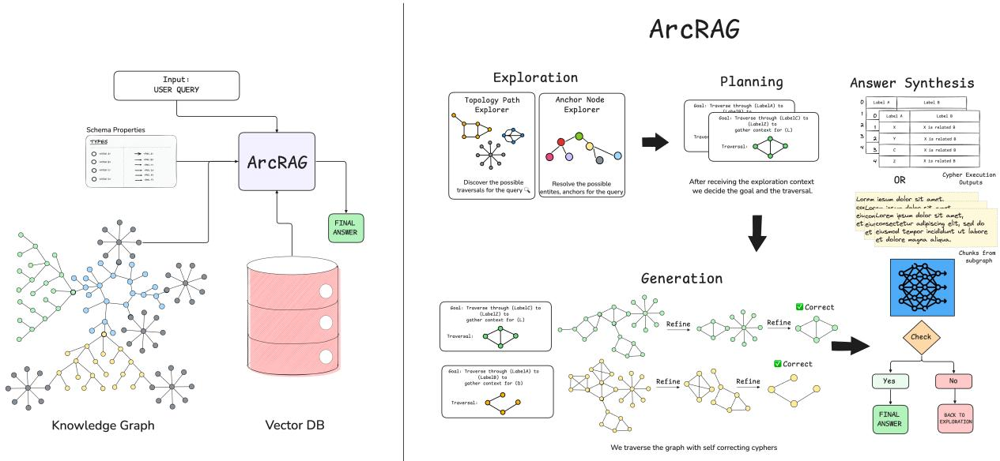
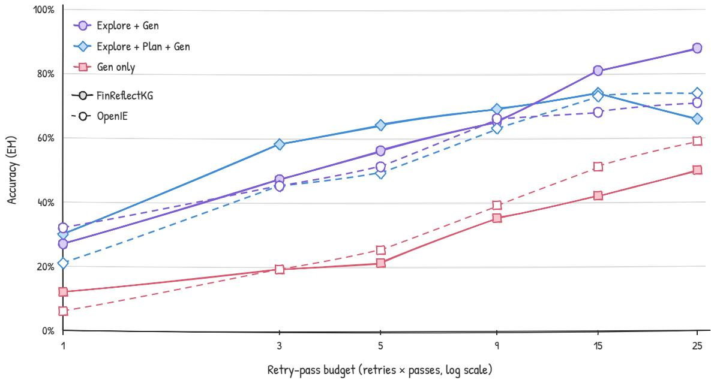
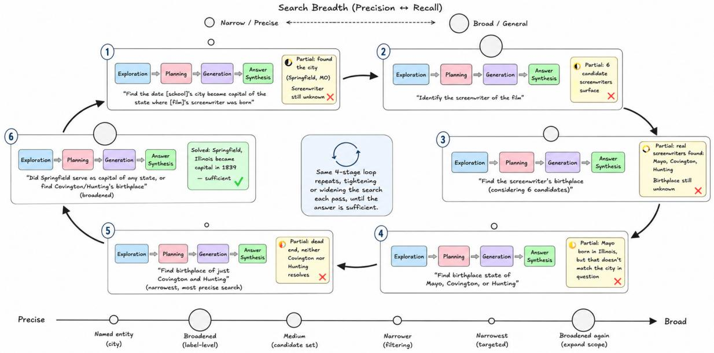

# ArcRAG: Agentic Compositional Retrieval over Knowledge Graphs

Jyotin Goel\* Abhinav Arun Tejas Prakash Agarwal

Bhaskarjit Sarmah Stefano Pasquali

Domyn jyotin.goel@domyn.com

## Abstract

Graph-based retrieval-augmented generation (GraphRAG) answers questions by retrieving over a knowledge graph built from a corpus. Yet retrieval strategies are designed around the structure their own construction pipeline produces, and whether they survive a change of construction is rarely tested. We study this cross-construction portability: whether one retrieval procedure, with no construction-specific schema, relation names, or retuning, stays effective when the graph is built differently. We introduce ArcRAG, which induces a query-local graph interface at inference time (the node labels, relation descriptors, and property keys reachable from the entities a question names), plans multi-hop traversals against it, and executes and repairs them as Cypher. We build each of the MuSiQue, HotpotQA, and TriviaQA corpora as a schema-guided graph (typed nodes, a closed relation set, source provenance) and as an open-information-extraction graph (untyped nodes, free-text relations), with the retriever’s configuration fixed across them. We compare against a construction-agnostic Direct-Cypher agent, ablate each stage across retry and pass budgets on both graph families, and compare with results reported for prior GraphRAG systems, most of which design retrieval together with their own graph construction. Across the two constructions, we find that retrieval need not be co-designed with the graph: query-time interface induction keeps a construction-agnostic retriever effective when the construction changes, although construction still shapes absolute accuracy.

## 1 Introduction

Retrieval-augmented generation (RAG) grounds a language model in an external corpus by retrieving information pieces (passages) most similar to a query and conditioning generation on them. Similarity ranking is sufficient when the answer is contained in a single passage, and insufficient when the answer must be composed across several. Consider a question of the form which member of a given film’s cast has two children who attended a particular university: answering it requires enumerating a set, testing a property of each of its elements, and verifying a constraint that no individual passage asserts. Top-k alone cannot perform these operations. Graph-based RAG addresses this by retrieving over a knowledge graph (KG) rather than a flat collection of passages, so that the relations connecting evidence are part of what retrieval returns. Composition, though, is only half of what these settings demand: in regulated domains — finance, law, healthcare, compliance — questions are seldom one-hop, and an answer must also be traceable to the specific disclosure, clause, or record it rests on. Success in these settings is evidence returned together with the path that connects it, rather than the k passages nearest a query.

Dense embedding retrieval, the workhorse of naive RAG, cannot supply that, and the reason is structural rather than a matter of scale. Each passage is represented independently, while a multihop question depends on the relations among passages. As corpora grow and reasoning chains lengthen, the relevant facts remain individually retrievable yet become relationally invisible: a vector index surfaces the constituent pieces without representing the path that joins them, leaving the generator to reconstruct those connections from semantically similar text amid substantial surrounding noise. FinReflectKG–MultiHop demonstrates that this is not a deficiency stronger models will absorb: even reasoning-oriented models perform better given precisely KG-linked evidence than given text-only page windows that contain the same facts in less structured context (Arun et al., 2025b). Knowledge graphs close this representational gap directly. Typed edges turn “which entity connects to which” into a traversable structure, and the traversal followed during retrieval can itself serve as provenance. This is the insight behind GraphRAG (Edge et al., 2025) and the class of graph-based retrieval systems it inspired, and it reduces the open problem to a single question: given a knowledge graph, how should one retrieve over it?

The difficulty in answering that question is that a knowledge graph is not one kind of object. Graphs differ in schema commitment, from open information extraction with free-text relation strings to schema-guided extraction against a closed, typed relation set, and in whether edges carry provenance back to a source chunk. Most GraphRAG systems fix one point in this space and design retrieval for it, and cross-construction portability is rarely tested directly.

Instead, each fixes a point in that space and builds a strategy that presupposes it. Personalized PageRank presupposes a dense synonymy-linked entity graph, and returns a ranked passage list rather than a traversal a user can cite (Gutiérrez et al., 2025a); GraphRAG’s global search presupposes a hierarchical Leiden partition and the community summaries precomputed over it (Edge et al., 2025); LightRAG’s dual-level retrieval presupposes an entity-and-relation keyword index and remains a one-hop lookup (Guo et al., 2025); and PathRAG selects paths by a heuristic computed once over a precomputed path index, with no mechanism for noticing a wrong turn (Chen et al., 2025). Agentic methods loosen the fixed strategy but not the coupling: LLM-guided traversal over graphs (Sun et al., 2024; Luo et al., 2024; Jiang et al., 2023; Jin et al., 2024) proceeds against node and edge semantics known in advance, and the BYOKG line (Mavromatis et al., 2025; Agarwal et al., 2024a) queries unfamiliar graphs but pairs exploration with a per-graph preparation or linking stage rather than deriving the semantics at query time (§2).

What these strategies share is not a common weakness but a common coupling: because each encodes assumptions about the graph it runs on, retrieval and construction cannot be varied independently. Agentic methods that let a language model walk a graph directly (Sun et al., 2024; Luo et al., 2024; Jiang et al., 2023; Jin et al., 2024) loosen the fixed-strategy assumption but not the coupling: they traverse using node and edge semantics supplied in advance, most often those of a curated graph with a fixed ontology (§2). The strategy we describe is specified independently of construction: one retrieval procedure, applied unchanged to graphs that differ in edge semantics and connectivity.

ArcRAG separates graph retrieval into exploration and exploitation. It reads each graph’s schema by introspection, which says how the graph is stored, and an Explorer queries the graph at inference time for a query-local graph interface: the relation descriptors and paths reachable from the entities the question names. Exploration is also prompted to surface aliases and paraphrased relation descriptors near those entities, so later stages work over the variants a noisy graph contains without an offline canonicalization pass. A Planner and a Generator then exploit what was found, choosing paths and executing them as Cypher, and the search returns to exploration when the evidence falls short. No step requires graph-specific prompts, relation names, or retuning (§4).

Two questions organize the paper, each paired with the contribution that addresses it.

• RQ1, mechanism. Does inducing a querylocal graph interface and planning executable traversals against it improve compositional retrieval over direct Cypher generation, and how do exploration, planning, and retry and pass budgets account for the difference?

• RQ2, portability. Can the same retrieval procedure, with one configuration per dataset and no graph-specific prompts or relation names, operate across knowledge graphs produced by structurally different construction methods, and what accounts for the accuracy that changes between them?

Our contributions are the following.

• A formulation of cross-construction portability for graph retrieval: whether one retrieval procedure can operate when relation semantics, typing, and provenance are not fixed by its construction pipeline (§4).

• ARCRAG, which induces a query-local graph interface from the target graph at inference time and plans, executes, and repairs compositional traversals against it (§4).

• A controlled evaluation: a comparison with a Direct-Cypher agent, component ablations across retry and pass budgets on both graph families, and a paired transfer design over schema-guided and open-vocabulary constructions of the same three corpora (§5, §6).

<table><tr><td>System</td><td>Semantics</td><td>Prep.</td><td>Interface</td><td>Programs</td><td>Cross-constr.</td></tr><tr><td>GraphRAG (Edge et al., 2025)</td><td>own</td><td>√</td><td>x</td><td>x</td><td>x</td></tr><tr><td>HippoRAG (Gutiérrez et al., 2025a)</td><td>own</td><td>√</td><td>x</td><td>x</td><td>O</td></tr><tr><td>HippoRAG 2 (Gutiérrez et al., 2025b)</td><td>own</td><td>√</td><td>x</td><td>x</td><td>x</td></tr><tr><td>LightRAG (Guo et al., 2025)</td><td>own</td><td>√</td><td>x</td><td>x</td><td>x</td></tr><tr><td>PathRAG (Chen et al., 2025)</td><td>own</td><td>√</td><td>x</td><td>x</td><td>x</td></tr><tr><td>StepChain GraphRAG (Ni et al., 2025)</td><td>own</td><td>√</td><td>x</td><td>x</td><td>x</td></tr><tr><td>Graph-R1 (Luo et al., 2026)</td><td>own</td><td>√</td><td>x</td><td>x</td><td>x</td></tr><tr><td>KGP (Wang et al., 2023)</td><td>own</td><td>√</td><td>x</td><td>x</td><td>o</td></tr><tr><td>Think-on-Graph (Sun et al., 2024)</td><td>curated</td><td>x</td><td>0</td><td>x</td><td>0</td></tr><tr><td>RoG (Luo et al., 2024)</td><td>curated</td><td>√</td><td>x</td><td>x</td><td>x</td></tr><tr><td>Graph-CoT (Jin et al., 2024)</td><td>prompt</td><td>0</td><td>x</td><td>x</td><td>x</td></tr><tr><td>SymKGQA (Agarwal et al., 2024b)</td><td>curated</td><td>o</td><td>x</td><td>√</td><td>x</td></tr><tr><td>BYOKG (Agarwal et al., 2024a)</td><td>explored</td><td>√</td><td>x</td><td>√</td><td>x</td></tr><tr><td>BYOKG-RAG (Mavromatis et al., 2025)</td><td>schema</td><td>0</td><td>x</td><td>√</td><td>x</td></tr><tr><td>ArcRAG (ours)</td><td>induced</td><td>0</td><td> $\checkmark$ </td><td> $\checkmark$ </td><td> $\checkmark$ </td></tr></table>

Table 1: Positioning along the portability axis, to our reading of each system’s paper and released implementation. Semantics: where the retriever’s knowledge of node and relation types comes from (own: fixed by the system’s own construction; curated: a curated KG such as Freebase or Wikidata; prompt: a graph description in the prompt; explored: offline exploration of the target graph; schema: a global schema read from the graph; induced: induced per question at inference time). Prep.: a graph-specific step before questions are answered. Interface: an explicit per-query description of relevant structure passed to later stages. Programs: executes a graph query language. Cross-constr.: the same method evaluated on more than one construction of the same data. ✓ yes, ✗ no, ◦ partial; partial entries are discussed in $\ S 2$

Within the two LLM-extracted, entity-centric constructions we evaluate, the results support a bounded form of cross-construction portability: retrieval need not be co-designed with each construction when the retriever operates against an interface induced from the graph at query time.

## 2 Related Work

GraphRAG over a fixed construction. GraphRAG (Edge et al., 2025) precomputes community summaries over a hierarchical partition; HippoRAG (Gutiérrez et al., 2025a) runs personalized PageRank over an OpenIE graph, and HippoRAG 2 (Gutiérrez et al., 2025b) adds denser phrase and passage indexing; LightRAG (Guo et al., 2025) maintains entity and relation keyword indices; and PathRAG (Chen et al., 2025) prunes relational paths. A second group varies what is indexed: hyperedges for n-ary facts (Luo et al., 2025), hierarchical aggregation (Huang et al., 2025), token-efficient construction (Xiao et al., 2025), separate similarity and relatedness indices (Zhang et al., 2025), context-dependent structure (Lau et al., 2026), and path tracking (Li et al., 2025). In each case retrieval is designed together with the structure its own indexing step produces.

The hierarchical lexical graph (Ghassel et al., 2025) makes this coupling explicit: its retrievers address the statement, fact, topic, and chunk node types of its own graph model directly in their graph queries. Some works do vary construction: KGP (Wang et al., 2023) compares several passage-similarity graphs, HippoRAG ablates its extractor, and Han et al. (2026) find GraphRAG performance stable across the LLMs used for construction. Studies that compare constructions directly hold a simple retriever fixed in order to judge the graphs (da Cruz et al., 2025), or recombine fixed retrieval operators with different graph types to find the best pairing (Zhou et al., 2026). In each case the graph is the object of study and the retriever an instrument; whether a system transfers across constructions that differ in schema commitment, typing, and provenance is not tested. Surveys characterize when graph structure helps over flat retrieval (Xiang et al., 2026). Table 1 summarizes these differences.

Iterative and agentic graph retrieval. IRCoT (Trivedi et al., 2023) interleaves reasoning with passage retrieval, and KGP traverses its passage graph with a fine-tuned LLM. Over knowledge graphs, StructGPT (Jiang et al., 2023) exposes reading interfaces for structured data; Think-on-Graph (Sun et al., 2024) extends reasoning paths by querying candidate relations and entities step by step; RoG (Luo et al., 2024) plans relation paths and grounds them in the graph; Graph-CoT (Jin et al., 2024) interleaves reasoning with graph function calls; StepChain GraphRAG (Ni et al., 2025) decomposes questions and searches a graph built on the fly from retrieved passages; and Graph-R1 (Luo et al., 2026) trains an agentic retriever with reinforcement learning. Several of these explore the graph at query time, so we do not claim novelty for LLM-guided traversal. They differ from ArcRAG in two respects. Exploration is interleaved step by step with answering rather than summarized into an interface that a planner commits to. And each is developed and evaluated on a single graph, most often a curated KG whose relation names are meaningful by design; Think-on-Graph also compares source KGs on the same questions, but each is a curated ontology rather than a construction of the corpus.

Querying unfamiliar graphs. Closest to our setting is work that answers questions over graphs not seen during development. BYOKG (Agarwal et al., 2024a) explores an unseen graph once to generate query–program exemplars that ground later program synthesis; SymKGQA (Agarwal et al., 2024b) generates step-by-step symbolic programs from few-shot examples and grounds them with a retrieval-based resolver; and text-to-Cypher work (Ozsoy et al., 2024) translates questions into graph queries given a schema. GRA (Dragic et al., 2026) navigates a hybrid knowledge graph with generic tools and discovers everything domain-specific at run time, but is evaluated on a single graph. The most similar system, BYOKG-RAG (Mavromatis et al., 2025), generates entities, relation paths, and OpenCypher queries over custom graphs and refines them against retrieved context. It makes no construction assumptions, but its retrievers presuppose the conventions of curated KGs: relation semantics carried by edge types listed in a global schema, nodes addressed by name, and meaningful edge direction. Graphs whose relations are openvocabulary strings stored as edge properties, as in our open-information-extraction constructions, violate these conventions : their schema exposes a single relationship type, so retrievers that select among types have nothing to select. This is the setting a query-local interface is designed for. These systems are also evaluated as KGQA over curated benchmark graphs (Freebase-based GrailQA and

<table><tr><td>Graph</td><td>Corpus</td><td>Nodes</td><td>Edges</td></tr><tr><td rowspan="2">FinReflectKG</td><td>MuSiQue</td><td>58,418</td><td>80,676</td></tr><tr><td>HotpotQA TriviaQA</td><td>33,203 72,266</td><td>63,493 99,915</td></tr><tr><td rowspan="2">HippoRAG OpenIE</td><td></td><td></td><td></td></tr><tr><td>MuSiQue</td><td>85,520</td><td>142,315</td></tr><tr><td rowspan="2"></td><td>HotpotQA</td><td>101,200</td><td>130,053</td></tr><tr><td>TriviaQA</td><td>162,687</td><td>193,470</td></tr></table>

Table 2: Graphs produced by the two construction methodologies over the same three corpora.

MetaQA for BYOKG; encyclopedic, temporal, and medical KGs for BYOKG-RAG), where answers are graph entities; none evaluates multiple constructions of the same corpus.They establish that LLMs can synthesize executable programs over graphs they were not built for, and ArcRAG builds on that; our Direct-Cypher agent (§5) represents this approach under our setup.

## 3 Knowledge Graph Construction

We construct graphs over the same corpora using two extraction methodologies, chosen because they differ along three of the axes identified in §1: schema commitment, relation vocabulary, and connectivity. Both are existing published pipelines rather than contributions of this work, applied unmodified except where a corpus requires it, and neither is presupposed by the retrieval harness. The order below is expositional and implies no precedence.

Schema-guided construction. We apply FinReflectKG’s pipeline (Arun et al., 2025a), in which an extraction agent proposes triples chunk by chunk and a reflection pass checks each proposal for faithfulness to its source chunk before committing it, to MuSiQue, HotpotQA, and TriviaQA. Two adaptations are inherently corpus-specific. In place of table-aware chunking we chunk at the passage level, following each corpus’s existing paragraph segmentation so that chunk boundaries align with the units the hybrid dense and BM25 retriever already indexes. In place of the business-defined disclosure schema — segments, risk factors, related parties — we extract against an LLM-constructed schema suited to encyclopedic text. The extraction-andcommit reflection loop is otherwise the same loop used for the financial 10-K graph. The resulting graphs have typed nodes and a closed relation set.

Open-vocabulary construction. Over the same chunks we build a second set of graphs using HippoRAG’s methodology (Gutiérrez et al., 2025a): open information extraction with no predefined relation vocabulary, entity nodes linked across passages by embedding-based synonym edges, and the graph treated as a corpus-wide superposition rather than a per-document structure.

  
Figure 1: ArcRAG at inference (left) and the harness (right): exploration → planning → generation → synthesis.

Function Fixed in code Decided by the   
LLM   
EXPLORE read-only queries; which relations and   
explorer, turn, and paths to follow   
depth budget   
PLAN output format; [vali- subplans, hop order,   
dation against Sˆq] answer type   
ACCEPTABLE error, empty result, [none]   
unbound variable,   
row cap   
REFINE traversal shape fixed; revised predicates   
attempt budget and bindings   
SUFFICIENT iteration cap whether evidence   
answers q; follow  
up q′  
Table 3: What each function of Algorithm 1 fixes in code and what the LLM decides.

What the harness consumes. Both families are stored as labeled property graphs; OpenIE holds its predicates in an edge property under a single relationship type. The harness reads each graph’s schema by introspection, with no hand-written schema or construction-specific names. The one other difference it observes, whether edges point to source chunks, selects the retrieval store and the evidence answers are composed from (§4.5).

Algorithm 1 ArcRAG retrieval   
Require: question q, graph G, accompanying store D   
Ensure: answer a   
1: q′ ← q, W ← ∅   
2: repeat   
3: R ← RETRIEVE(D, PHRASES(q′))   
4: A ← ANCHORS(R)   
5: if D is a chunk store then   
6: Gq ← G[VR], Σ ← ∅   
7: else   
8: $G _ { q } \gets G , \ \Sigma  \mathcal { R }$ {triples as hints}   
9: end if   
10: $\hat { S } _ { q } , \mathcal { T } _ { q } \gets \mathrm { E }$ XPLORE $\left( G _ { q } , A , \Sigma \right)$   
11: P ← PLAN(q′, Sˆq, Iq)   
12: for each subplan π ∈ P do   
13: B ← A   
14: for each hop h ∈ π in order do   
15: Q ← COMPILE(h, Sˆq, B); Rh ← EXEC(Q)   
16: while ¬ACCEPTABLE(Rh) within budget do   
17: Q ← REFINE(Q, Rh); Rh ← EXEC(Q)   
18: end while   
19: if ¬ACCEPTABLE(R ) then break   
20: B ← NODES(Rh); W ← W ∪ EDGES(Rh)   
21: end for   
22: end for   
23: Z ← PASSAGES(W) if chunk store, else ROWS(W)   
24: a ← COMPOSE(q, Z)   
25: ok, q′ ← SUFFICIENT(q, a, Z)   
26: until ok or q′ = ⊥ or iteration cap   
27: return a

## 4 Methodology

Real-world knowledge graphs are incomplete and noisy (Paulheim, 2017): one entity is stored under several names, one relation as several predicate strings, and edges a question needs may be missing; open information extraction leaves entity and relation phrases uncanonicalized altogether (Vashishth et al., 2018). A retriever written against one construction’s schema inherits its assumptions about all three. ArcRAG’s stages can instead be read through the exploration exploitation trade-off familiar from search (Kocsis and Szepesvári, 2006), although no stage implements a bandit or tree-search policy. The Explorer explores: it establishes what the graph contains around the entities a question names, including their variants, without committing to an answer. The Planner and Generator exploit: they commit to the most promising explored paths and execute them as queries. When the evidence does not support an answer, the search returns to exploration. The budgets reflect the same trade-off: retries extend exploitation and passes renew exploration, and how much the Planner’s guidance adds depends on both the budget and the graph (Appendix D).

## 4.1 Setup

The target is a labeled property graph $\begin{array} { r l } { G } & { { } = } \end{array}$ $( V , E , \ell _ { V } , \ell _ { E } , p _ { V } , p _ { E } )$ with node and edge labels and key–value properties. Its schema $S _ { G }$ , the node labels, relationship types, and property keys, is read by introspection before any question (line 1); none is written by hand. $S _ { G }$ shows where relations are stored: in relationship types for a schema-guided graph, in an edge property for an open-vocabulary one. We write $\rho ( e )$ for the resulting relation descriptor of edge e. For a question $q$ with anchors $A \subseteq V$ , the entities it names, exploration yields the query-local interface $\hat { S } _ { q } \mathbf { : }$ the descriptors and signatures $( t _ { i } , \rho , t _ { j } )$ observed near A, with the paths $\mathcal { T } _ { q }$ that confirm them. Executed queries return the witness $W$ , the subgraph connecting the anchors to an answer. Only provenance depends on the graph family: whether edges point to source chunks selects the store that seeds retrieval and the evidence the answer reads (lines 6–10 and 20). Beyond introspection, ArcRAG needs only a hybrid text index over that store. Algorithm 1 and Table 3 specify the procedure.

## 4.2 Explore

Without exploration, a query generator guesses which entities and relations exist: $S _ { G }$ says how the graph is stored, not what lies near a question. Exploration supplies this, and canonicalizes at query time: explorers are prompted to surface candidate aliases and paraphrased relation descriptors near the anchors, so later stages reason over the observed variants instead of relying on an offline canonicalization pass. Phrases from the question are retrieved by reciprocal rank fusion (Cormack et al., 2009) of dense and sparse search (line 4) to obtain anchors (line 5); chunks bound later queries to the subgraph they induce, while retrieved triples only hint where to look (lines 6–10). Two explorers each issue one batch of read-only Cypher queries (line 11), locating relations through $S _ { G }$ . Their report, $\hat { S } _ { q } ,$ , scales with the exploration budget, not the graph, and is a per-question view, not an ontology. Exploration gives the largest gain in our ablations (Appendix D).

## 4.3 Plan

The Planner is the exploitation heuristic: it decides which explored paths are worth executing, so the Generator need not find them by trial and error. From $S _ { G } , \hat { S } _ { q }$ , and $\mathcal { T } _ { q }$ it fixes the answer type and emits a bounded set of subplans, each a traversal from anchors it attaches (line 12); a bridge question needs one, a comparison or aggregation several. One subplan is always an open neighborhood scan, so some evidence is gathered even if targeted subplans fail. The plan is fixed for its pass. Its value depends on the graph and the budget: on the typed graph it helps most when retries are scarce, while on the open-vocabulary graph it is neutral at small budgets and slightly ahead at large ones (Appendix D).

## 4.4 Generate

The Generator executes rather than proposes, so every result can be checked before it reaches the answer. It compiles each subplan into one readonly Cypher query over the descriptors and variants surfaced in $\hat { S } _ { q }$ (line 14). One query chains the subplan’s hops: an open far end enumerates a set, the next hop steps across the rows returned, and a filter applies a constraint no single passage states. On chunk-backed graphs, queries are scoped to the retrieved chunks. The first attempt is the least constrained; an unacceptable result (Table 3) is refined by revising predicates and bindings while the traversal shape stays fixed (lines 15–17). This limits uncontrolled rewrites but does not guarantee that a correct earlier candidate survives. A subplan still unacceptable when its budget runs out is left to the outer loop; acceptable results join the witness (line 18).

## 4.5 Answer Synthesis

The witness determines what the answer model reads (lines 20–21). Where its edges point to source chunks, the answer is composed from those passages, which keep qualifications a triple drops; otherwise it is composed from the returned rows, at the coarser grain of an edge. The graph’s provenance, not a per-experiment choice, decides which applies. Each answer can be traced to the evidence it was given and the witness re-executed, though we do not verify claim-level attribution.

## 4.6 Retrieve–Answer Loop

The loop is where the search returns to exploration. Within a pass, an unacceptable result triggers another attempt; across passes, an answer the evidence does not support yields a follow-up question $q ^ { \prime }$ that seeds a fresh pass (lines 22–23), which can reach relations or paths the previous one missed. The witness accumulates across passes, and the loop stops when the answer is judged sufficient, no follow-up can be formed, or the cap is reached. More passes raise accuracy in every ablated configuration (Appendix D).

## 5 Experimental Setup

## 5.1 Datasets and Samples

We evaluate on three QA benchmarks that differ in how much composition an answer requires. MuSiQue (Trivedi et al., 2022) chains up to four single-hop questions, with the bridging entities absent from the question text. HotpotQA (Yang et al., 2018) is predominantly two-hop. TriviaQA (Joshi et al., 2017) is predominantly single-hop and serves as a control for whether the harness degrades performance when little traversal is needed. For each dataset, both graph families are built and frozen before evaluation (Table 2), and questions are answered end to end, with no gold passages, entities, or hop counts supplied. Main results follow the validation-sample convention of HippoRAG and IRCoT (Gutiérrez et al., 2025a). The component ablations use a stratified sample of 100 questions drawn from all three datasets and run on both graph families.

## 5.2 Baselines

We compare against two kinds of reference. The first is results reported for prior GraphRAG systems (Table 4), most of which design retrieval together with their own graph construction (§2). The second is a Direct-Cypher agent: the Generator alone with a single attempt and a single pass, compiling Cypher from the question and the introspected schema with no exploration, planning, refinement, or follow-up pass. Given more retries and passes, the Generator alone becomes an ablation of ArcRAG, which we compare with Explorer + Generator and the full pipeline at each budget.

## 5.3 Protocol

Within each dataset, the configuration is identical for both graph families; only the graph and its accompanying store change, as determined by provenance (§4.1). For the transfer comparison (Table 5), baseline figures come from the common harness of Bai et al. (2025). The external systems answer with Llama-3.3-70B-Instruct, GPT-4, or Qwen2.5 models depending on the source, whereas ArcRAG uses gpt-oss-120b for its agents and Nemotron-3- Super-120B-A12B for answering (Appendix B.2); these comparisons share a benchmark convention but not a backbone, and we treat them as context rather than as controlled retriever comparisons.

## 5.4 Metrics

Exact match (EM) is the primary metric; tokenlevel F1 is reported for comparability with prior work, which on TriviaQA reports F1 only. Both use the normalization of prior GraphRAG work (Gutiérrez et al., 2025a), taking the maximum over references and averaging over questions. Ablations report EM. Token footprints are given in Appendix C.

## 5.5 Configuration

Models, budgets, caps, and retrieval settings are listed in Appendix B.2. Within each dataset, every setting is the same for both graph families.

## 6 Results

Studies that vary graph construction hold a simple retriever fixed to judge the graphs, and compare graphs from a single construction family (da Cruz et al., 2025). We ask the reverse question: whether one system, with its configuration fixed, stays effective when a schema-guided construction is replaced by an open-vocabulary one. We report what each stage contributes across retry and pass budgets (RQ1), how accuracy carries across the two constructions (RQ2), and where the results sit among reported figures.

## 6.1 Mechanism

For RQ1, query-local exploration improves on direct Cypher generation at every budget we test: on the stratified ablation sample, adding the Explorer raises accuracy at all 18 retry and pass settings, by 15–39 points on FinReflectKG and 12–32 on the open-vocabulary graphs (Appendix D). At five retries and five passes, ArcRAG’s best configurations reach 88.0% and 74.0%, against 50.0% and 59.0% for the Generator alone and 12.0% and 6.0% for the single-attempt Direct-Cypher agent. Planning is graph-dependent: it gives the best accuracy at budgets up to 9 on FinReflectKG, but not on the open-vocabulary graphs. Because exploration and planning add LLM calls, these comparisons control retries and passes, not total inference cost.

<table><tr><td rowspan="2">Method</td><td colspan="2">MuSiQue</td><td colspan="2">HotpotQA</td><td>TriviaQA</td></tr><tr><td>EM</td><td>F1</td><td>EM</td><td>F1</td><td>F1</td></tr><tr><td>GraphRAG (Edge et al., 2025)</td><td>27.3</td><td>38.5</td><td>55.2</td><td>68.6</td><td>45.1</td></tr><tr><td>LightRAG (Guo et al., 2025)</td><td>20.0</td><td>29.3</td><td>33.3</td><td>44.9</td><td>40.2</td></tr><tr><td>PathRAG (Chen et al., 2025)</td><td>8.4</td><td>20.8</td><td>23.8</td><td>41.2</td><td>37.4</td></tr><tr><td>HippoRAG (Gutiérrez et al., 2025a)</td><td>27.8</td><td>40.5</td><td>58.5</td><td>73.1</td><td></td></tr><tr><td>HippoRAG 2 (Gutiérrez et al., 2025b)</td><td>37.2</td><td>48.6</td><td>62.7</td><td>75.5</td><td>46.9</td></tr><tr><td>HyperGraphRAG (Luo et al., 2025)</td><td>10.1</td><td>23.2</td><td>29.5</td><td>46.9</td><td>45.0</td></tr><tr><td>HiRAG (Huang et al., 2025)</td><td></td><td></td><td>37.0</td><td>52.3</td><td></td></tr><tr><td>TERAG (Xiao et al., 2025)</td><td>18.8</td><td>29.6</td><td>46.9</td><td>59.8</td><td></td></tr><tr><td>CatRAG (Lau et al., 2026)</td><td></td><td>45.0</td><td></td><td></td><td></td></tr><tr><td>NeuroPath (Li et al., 2025)</td><td>31.4</td><td>44.3</td><td>50.5</td><td>64.7</td><td></td></tr><tr><td>StepChain GraphRAG (Ni et al., 2025)</td><td></td><td></td><td>66.7</td><td>79.5</td><td></td></tr><tr><td>Graph-R1 (Luo et al., 2026)</td><td></td><td>46.2</td><td></td><td>62.7</td><td>71.9</td></tr><tr><td>ArcRAG (w/ FinReflectKG)</td><td>44.0</td><td>53.0</td><td>74.5</td><td>80.8</td><td>87.9</td></tr></table>

Table 4: Best EM and F1 reported for each method on each dataset, taken across all models and configurations its authors evaluated. Protocols, answer models, and scoring code differ across sources, so this is a best-reported summary rather than a controlled comparison. Prior work reports F1 only on TriviaQA.

<table><tr><td rowspan="2">Method</td><td colspan="2">MuSiQue</td><td colspan="2">HotpotQA</td><td>TriviaQA</td></tr><tr><td>EM</td><td>F1</td><td>EM</td><td>F1</td><td>F1</td></tr><tr><td>HippoRAG</td><td>26.2</td><td>35.1</td><td>52.6</td><td>63.5</td><td></td></tr><tr><td>HippoRAG 2</td><td>37.2</td><td>48.6</td><td>62.7</td><td>75.5</td><td>46.9</td></tr><tr><td>ArcRAG (w/ OpenIE Graph)</td><td>38.0</td><td>45.0</td><td>65.5</td><td>72.2</td><td>71.6</td></tr><tr><td>ArcRAG (w/ FinReflectKG)</td><td>44.0</td><td>53.0</td><td>74.5</td><td>80.8</td><td>87.9</td></tr></table>

Table 5: Transfer across knowledge-graph families. All ArcRAG prompts, models, and hyperparameters are fixed within a dataset; only the graph family and its provenance-determined evidence store change. HippoRAG and HippoRAG 2 figures for MuSiQue and HotpotQA are as reported by Bai et al. (2025) under a common harness; the HippoRAG 2 TriviaQA figure is from Luo et al. (2026). As above, prior work reports F1 only on TriviaQA.

## 6.2 Cross-Construction Transfer

The open-vocabulary graphs carry one node label, one relationship type, and no chunk provenance (§3). With the same configuration, ArcRAG obtains 38.0 EM on MuSiQue, 65.5 EM on HotpotQA, and 71.6 F1 on TriviaQA over them (Table 5). Their introspected schema is nearly empty, so the relation semantics the system uses come from the query-local interface alone. The schemaguided graphs score higher by 6.0 EM, 9.0 EM, and 16.3 F1: portability is not invariance, and because the two families differ in both structure and provenance, these gaps reflect their combined effect. Against HippoRAG and HippoRAG 2 as reported by Bai et al. (2025), the open-vocabulary row is well above HippoRAG and within 4 points of HippoRAG 2 on MuSiQue and HotpotQA, higher on EM and lower on F1. For RQ2, one configuration operates across both constructions and remains competitive on the one with no relation schema.

## 6.3 Position Against Reported Results

Table 4 lists, for each prior system, the best figure its authors report on each dataset, taken across all models and configurations they evaluated. With the schema-guided graph, ArcRAG obtains 44.0 EM on MuSiQue, 74.5 EM on HotpotQA, and 87.9 F1 on TriviaQA, above every figure in the table on every metric; the narrowest margin is HotpotQA F1, 80.8 against 79.5 for StepChain GraphRAG. Because protocols, answer models, and scoring code differ across sources, this places ArcRAG at the top of the reported range rather than establishing a controlled improvement over any one system.

## Limitations

This is an early study of cross-construction portability, and its scope reflects that. We evaluate two graph families over the same three corpora, chosen to differ in kind rather than degree: schema-guided extraction with typed nodes, a closed relation set, and chunk provenance, against open information extraction with untyped nodes, free-text relations, and no provenance. Two maximally different constructions test portability more severely than several similar ones would, but they do not establish transfer to curated ontologies or to graphs with different node granularities.

Because the two families differ in both structure and provenance, the accuracy gap between them reflects both, and we do not separate the two. Canonicalization at query time is a design property of the harness; we do not measure how much noise or variation it absorbs. Comparisons with prior GraphRAG systems use their best reported figures, whose protocols and answer models differ from ours, rather than reruns under a shared setup. Each configuration is run once, and the answer model samples at temperature 1.0 and also judges whether its own evidence is sufficient, so the results carry run-to-run variance that we do not quantify.

The benchmarks are public and the answer model is a large pretrained model, so parametric knowledge may contribute to absolute scores; comparisons that share the answer model limit but do not remove this effect. Our experiments use encyclopedic QA and do not establish reliability for the regulated domains that motivate traceable retrieval: an executable witness does not guarantee factual correctness, and deployment there would require domain-specific validation and human oversight.

Finally, graph construction still affects accuracy, so we do not claim that retrieval and construction never benefit from co-design.

## Ethical Considerations

Data. All experiments use public benchmarks built from Wikipedia and web text: MuSiQue (CC BY 4.0), HotpotQA (CC BY-SA 4.0), and TriviaQA (CC BY 4.0). We use them for research evaluation, consistent with their licenses, and the knowledge graphs we build from them are derived artifacts of the same text. These corpora concern public figures and encyclopedic facts; we collect no new data from people and process no private information.

Models. Agents use gpt-oss-120b (Apache 2.0) and answers use Nemotron-3-Super-120B-A12B (NVIDIA Nemotron Open Model License); dense retrieval uses Qwen3-Embedding-0.6B (Apache 2.0). All are openly released models, used within

the terms of their licenses. Graphs extracted by language models inherit their errors and biases, as well as those of the source text, and retrieval over such a graph can surface them.

Intended use and risks. Our motivation includes regulated domains where answers must be traceable, but our experiments use encyclopedic QA and do not establish reliability there. An executable witness shows how an answer was reached, not that it is correct, and we do not verify claim-level attribution. Any deployment in finance, law, healthcare, or compliance would require domain-specific validation and human oversight.

## References

Dhruv Agarwal, Rajarshi Das, Sopan Khosla, and Rashmi Gangadharaiah. 2024a. Bring your own KG: Self-supervised program synthesis for zero-shot KGQA. In Findings of the Association for Computational Linguistics: NAACL 2024, pages 896–919, Mexico City, Mexico. Association for Computational Linguistics.

Prerna Agarwal, Nishant Kumar, and Srikanta Bedathur. 2024b. SymKGQA: Few-shot knowledge graph question answering via symbolic program generation and execution. In Proceedings ofthe 62nd Annual Meeting of the Association for Computational Linguistics (Volume 1: Long Papers), pages 10119–10140, Bangkok, Thailand. Association for Computational Linguistics.

Abhinav Arun, Fabrizio Dimino, Tejas Prakash Agarwal, Bhaskarjit Sarmah, and Stefano Pasquali. 2025a. Finreflectkg: Agentic construction and evaluation of financial knowledge graphs. Preprint, arXiv:2508.17906.

Abhinav Arun, Reetu Raj Harsh, Bhaskarjit Sarmah, and Stefano Pasquali. 2025b. FinReflectKG – MultiHop: Financial QA benchmark for reasoning with Knowledge Graph evidence. arXiv preprint arXiv:2510.02906.

Jiaxin Bai, Wei Fan, Qi Hu, Qing Zong, Chunyang Li, Hong Ting Tsang, Hongyu Luo, Yauwai Yim, Haoyu Huang, Xiao Zhou, Feng Qin, Tianshi Zheng, Xi Peng, Xin Yao, Huiwen Yang, Leijie Wu, Yi Ji, Gong Zhang, Renhai Chen, and Yangqiu Song. 2025. Autoschemakg: Autonomous knowledge graph construction through dynamic schema induction from web-scale corpora. Preprint, arXiv:2505.23628.

Boyu Chen, Zirui Guo, Zidan Yang, Yuluo Chen, Junze Chen, Zhenghao Liu, Chuan Shi, and Cheng Yang. 2025. Pathrag: Pruning graph-based retrieval augmented generation with relational paths. Preprint, arXiv:2502.14902.

Gordon V. Cormack, Charles L. A. Clarke, and Stefan Büttcher. 2009. Reciprocal rank fusion outperforms condorcet and individual rank learning methods. In Proceedings of the 32nd International ACM SIGIR Conference on Research and Development in Information Retrieval (SIGIR ’09), pages 758–759, New York, NY, USA. Association for Computing Machinery.

Tiago da Cruz, Bernardo Tavares, and Francisco Belo. 2025. Ontology learning and knowledge graph construction: A comparison of approaches and their impact on rag performance. Preprint, arXiv:2511.05991.

Marius Dragic, Ruben Ifrah, and Alexandre Rio. 2026. Schema-agnostic graph reasoning agent for hybrid knowledge graphs. Preprint, arXiv:2608.15834.

Darren Edge, Ha Trinh, Newman Cheng, Joshua Bradley, Alex Chao, Apurva Mody, Steven Truitt, Dasha Metropolitansky, Robert Osazuwa Ness, and Jonathan Larson. 2025. From local to global: A graph rag approach to query-focused summarization. Preprint, arXiv:2404.16130.

Abdellah Ghassel, Ian Robinson, Gabriel Tanase, Hal Cooper, Bryan Thompson, Zhen Han, Vassilis Ioannidis, Soji Adeshina, and Huzefa Rangwala. 2025. Hierarchical lexical graph for enhanced multi-hop retrieval. In Proceedings ofthe 31st ACM SIGKDD Conference on Knowledge Discovery and Data Mining V.2, KDD ’25, page 4457–4466. ACM.

Zirui Guo, Lianghao Xia, Yanhua Yu, Tu Ao, and Chao Huang. 2025. Lightrag: Simple and fast retrievalaugmented generation. Preprint, arXiv:2410.05779.

Bernal Jiménez Gutiérrez, Yiheng Shu, Yu Gu, Michihiro Yasunaga, and Yu Su. 2025a. Hipporag: Neurobiologically inspired long-term memory for large language models. Preprint, arXiv:2405.14831.

Bernal Jiménez Gutiérrez, Yiheng Shu, Weijian Qi, Sizhe Zhou, and Yu Su. 2025b. From rag to memory: Non-parametric continual learning for large language models. Preprint, arXiv:2502.14802.

Haoyu Han, Li Ma, Yu Wang, Harry Shomer, Yongjia Lei, Zhisheng Qi, Kai Guo, Zhigang Hua, Bo Long, Hui Liu, Charu C. Aggarwal, and Jiliang Tang. 2026. Rag vs. graphrag: A systematic evaluation and key insights. Preprint, arXiv:2502.11371.

Haoyu Huang, Yongfeng Huang, Junjie Yang, Zhenyu Pan, Yongqiang Chen, Kaili Ma, Hongzhi Chen, and James Cheng. 2025. Retrieval-augmented generation with hierarchical knowledge. Preprint, arXiv:2503.10150.

Jinhao Jiang, Kun Zhou, Zican Dong, Keming Ye, Wayne Xin Zhao, and Ji-Rong Wen. 2023. Structgpt: A general framework for large language model to reason over structured data. Preprint, arXiv:2305.09645.

Bowen Jin, Chulin Xie, Jiawei Zhang, Kashob Kumar Roy, Yu Zhang, Zheng Li, Ruirui Li, Xianfeng Tang, Suhang Wang, Yu Meng, and Jiawei Han. 2024. Graph chain-of-thought: Augmenting large language models by reasoning on graphs. Preprint, arXiv:2404.07103.

Mandar Joshi, Eunsol Choi, Daniel S. Weld, and Luke Zettlemoyer. 2017. Triviaqa: A large scale distantly supervised challenge dataset for reading comprehension. Preprint, arXiv:1705.03551.

Levente Kocsis and Csaba Szepesvári. 2006. Bandit Based Monte-Carlo Planning. In European Conference on Machine Learning, pages 282–293.

Kwun Hang Lau, Fangyuan Zhang, Boyu Ruan, Yingli Zhou, Qintian Guo, Ruiyuan Zhang, and Xiaofang Zhou. 2026. Breaking the static graph: Contextaware traversal for robust retrieval-augmented generation. Preprint, arXiv:2602.01965.

Junchen Li, Rongzheng Wang, Yihong Huang, Qizhi Chen, Jiasheng Zhang, and Shuang Liang. 2025. Neuropath: Neurobiology-inspired path tracking and reflection for semantically coherent retrieval. Preprint, arXiv:2511.14096.

Haoran Luo, Haihong E, Guanting Chen, Qika Lin, Yikai Guo, Fangzhi Xu, Zemin Kuang, Meina Song, Xiaobao Wu, Yifan Zhu, and Luu Anh Tuan. 2026. Graph-r1: Towards agentic graphrag framework via end-to-end reinforcement learning. Preprint, arXiv:2507.21892.

Haoran Luo, Haihong E, Guanting Chen, Yandan Zheng, Xiaobao Wu, Yikai Guo, Qika Lin, Yu Feng, Zemin Kuang, Meina Song, Yifan Zhu, and Luu Anh Tuan. 2025. Hypergraphrag: Retrieval-augmented generation via hypergraph-structured knowledge representation. Preprint, arXiv:2503.21322.

Linhao Luo, Yuan-Fang Li, Gholamreza Haffari, and Shirui Pan. 2024. Reasoning on graphs: Faithful and interpretable large language model reasoning. Preprint, arXiv:2310.01061.

Costas Mavromatis, Soji Adeshina, Vassilis N. Ioannidis, Zhen Han, Qi Zhu, Ian Robinson, Bryan Thompson, Huzefa Rangwala, and George Karypis. 2025. Byokg-rag: Multi-strategy graph retrieval for knowledge graph question answering. Preprint, arXiv:2507.04127.

Tengjun Ni, Xin Yuan, Shenghong Li, Kai Wu, Ren Ping Liu, Wei Ni, and Wenjie Zhang. 2025. Stepchain graphrag: Reasoning over knowledge graphs for multi-hop question answering. Preprint, arXiv:2510.02827.

Makbule Gulcin Ozsoy, Leila Messallem, Jon Besga, and Gianandrea Minneci. 2024. Text2cypher: Bridging natural language and graph databases. Preprint, arXiv:2412.10064.

Heiko Paulheim. 2017. Knowledge graph refinement: A survey of approaches and evaluation methods. Semant. Web, 8(3):489–508.

Jiashuo Sun, Chengjin Xu, Lumingyuan Tang, Saizhuo Wang, Chen Lin, Yeyun Gong, Lionel M. Ni, Heung-Yeung Shum, and Jian Guo. 2024. Think-ongraph: Deep and responsible reasoning of large language model on knowledge graph. Preprint, arXiv:2307.07697.

Harsh Trivedi, Niranjan Balasubramanian, Tushar Khot, and Ashish Sabharwal. 2022. Musique: Multihop questions via single-hop question composition. Preprint, arXiv:2108.00573.

Harsh Trivedi, Niranjan Balasubramanian, Tushar Khot, and Ashish Sabharwal. 2023. Interleaving retrieval with chain-of-thought reasoning for knowledge-intensive multi-step questions. Preprint, arXiv:2212.10509.

Shikhar Vashishth, Prince Jain, and Partha Talukdar. 2018. Cesi: Canonicalizing open knowledge bases using embeddings and side information. In Proceedings of the 2018 World Wide Web Conference on World Wide Web - WWW ’18, WWW ’18, page 1317–1327. ACM Press.

Yu Wang, Nedim Lipka, Ryan A. Rossi, Alexa Siu, Ruiyi Zhang, and Tyler Derr. 2023. Knowledge graph prompting for multi-document question answering. Preprint, arXiv:2308.11730.

Zhishang Xiang, Chuanjie Wu, Qinggang Zhang, Shengyuan Chen, Zijin Hong, Xiao Huang, and Jinsong Su. 2026. When to use graphs in rag: A comprehensive analysis for graph retrieval-augmented generation. Preprint, arXiv:2506.05690.

Qiao Xiao, Hong Ting Tsang, and Jiaxin Bai. 2025. Terag: Token-efficient graph-based retrievalaugmented generation. Preprint, arXiv:2509.18667.

Zhilin Yang, Peng Qi, Saizheng Zhang, Yoshua Bengio, William W. Cohen, Ruslan Salakhutdinov, and Christopher D. Manning. 2018. Hotpotqa: A dataset for diverse, explainable multi-hop question answering. Preprint, arXiv:1809.09600.

Nan Zhang, Prafulla Kumar Choubey, Alexander Fabbri, Gabriel Bernadett-Shapiro, Rui Zhang, Prasenjit Mitra, Caiming Xiong, and Chien-Sheng Wu. 2025. Sirerag: Indexing similar and related information for multihop reasoning. Preprint, arXiv:2412.06206.

Yingli Zhou, Yaodong Su, Youran Sun, Shu Wang, Taotao Wang, Runyuan He, Yongwei Zhang, Sicong Liang, Xilin Liu, Yuchi Ma, and Yixiang Fang. 2026. In-depth analysis of graph-based rag in a unified framework. Preprint, arXiv:2503.04338.

## Appendix

## A Overview

These appendices give implementation details and hyperparameters (Appendix B), a token-cost analysis including a comparison by graph family (Appendix C), full component-ablation results (Appendix D), a qualitative example (Appendix E), and reproducibility notes (Appendix F).

The reasoner (gap analysis) makes no LLM call — its output is built deterministically from the retrieved triplets.

## A.0.1 Stage Settings

## B Additional Implementation Details

All values in this section reflect the pipeline’s source and configuration as run. The three corpora (MuSiQue, HotpotQA, TriviaQA) are served by structurally identical pipelines, each built on a single shared processing loop. The four agents — Exploration, RootPlanner, Planner, and Generator — contain no construction-specific names in their prompts or code. A corpus differs only in its percorpus constants (Memgraph connection, Qdrant collection, retrieval depth), its schema, which is read from the graph by introspection rather than written by hand, and its per-corpus context prompt.

## B.1 System Overview

Per query, each endpoint runs an iterative retrieve– answer loop (Algorithm 1), capped at 6 passes:

1. Introspect the graph’s schema (node labels, relationship types, and property keys) once per graph, and cache it.

2. Rewrite the query once, before entering the loop.

3. Loop, each pass running the shared pipeline:

• Exploration — extract search phrases → hybrid retrieve → deterministic gap analysis → 2 parallel graph explorers.

• Planning — the RootPlanner decomposes the query into at most 4 ordered subplans; the PlannerAgent attaches each subplan’s binding anchors.

• Generation — the GeneratorAgent emits one read-only Cypher query per subplan.

• Execute every subplan’s final Cypher, render deduplicated chunk context, answer the original query, and self-judge sufficiency.

• Stop once the answer is judged sufficient, or the proposed follow-up query is empty; otherwise re-run on the followup query, accumulating context across passes.

Terminology note. RootPlanner and PlannerAgent together implement the Planner stage (PLAN in Algorithm 1); GeneratorAgent implements the Generator (COMPILE and REFINE); the two explorers implement EXPLORE; and the answerer implements COMPOSE and SUFFICIENT. A pass is one iteration of the outer loop; hops refer only to traversal depth within a subplan’s query. Node-creator and visualize/report/extractor calls (Table 10) are internal sub-steps of Generation, not separately named stages.

## B.2 Hyperparameters

## B.2.1 Models

LLMs and embeddings are served via an OpenAIcompatible gateway.

Each graph’s schema is read from Memgraph by introspection and cached; the same schema is injected into every agent call for that graph. Each corpus is queried through a dedicated client instance bound to its own port.

Graph family scope. The following applies to the FinReflectKG (typed, chunk-backed) runs: all three are typed chunk-KGs (entities extracted from Wikipedia/web text; every relationship carries a back-pointer to its source chunk). The OpenIE runs (Table 12) differ: open-vocabulary extraction with no fixed relation vocabulary and no chunk back-pointers. They are stored as labeled property graphs with a single node label and relationship type, the predicate held in an edge property, so their introspected schema is minimal; it is injected in the same way.

## B.2.2 Retrieval: Hybrid Dense + BM25 with RRF Fusion

Per search phrase, a dense leg and a BM25 leg each prefetch a fixed number of candidates, fused with weighted Reciprocal Rank Fusion, returning the top-k hits. No multivector rerank is applied.

<table><tr><td>Stage</td><td>Temp.</td><td>Top-p</td><td>Thinking</td><td>Max tokens</td></tr><tr><td>Query refinement</td><td>0.0</td><td>0.95</td><td>off</td><td>8,192</td></tr><tr><td>Search-phrase extraction</td><td>0.0</td><td>0.95</td><td>off</td><td>8,192</td></tr><tr><td>Explorer Cypher generation</td><td>0.1</td><td>0.95</td><td>off</td><td>8,192</td></tr><tr><td>Explorer report synthesis</td><td>0.2</td><td>0.95</td><td>off</td><td>8,192</td></tr><tr><td>RootPlanner</td><td>0.0</td><td>0.95</td><td>off</td><td>8,192</td></tr><tr><td>Planner subplan expansion</td><td>0.2</td><td>0.95</td><td>off</td><td>8,192</td></tr><tr><td>Generator (Cypher)</td><td>0.2</td><td>0.95</td><td>off</td><td>8,192</td></tr><tr><td>Answer + sufficiency</td><td>1.0</td><td>0.95</td><td>on</td><td>16,000</td></tr></table>

Table 6: Sampling parameters by pipeline stage.
<table><tr><td>Setting</td><td>Value</td></tr><tr><td>Parallel explorers</td><td>2 (anchored-path, topology-path)</td></tr><tr><td>Cyphers per explorer</td><td>6 (one shot)</td></tr><tr><td>Explorer turns</td><td>3 (passed; unused on the active subgraph-bound path)</td></tr><tr><td>Explorer timeouts</td><td>LLM 30 s / Cypher 5 s; report retried once</td></tr><tr><td>RootPlanner</td><td>2 attempts, 30 s timeout each</td></tr><tr><td>Subplan hard cap</td><td>4 (≥1 is a mandatory open-ended neighborhood scan)</td></tr><tr><td>Subplan expansion</td><td>LLM-based expansion plus deterministic skeleton conversion</td></tr><tr><td>Generator attempts / subplan</td><td>5 base + up to 2 extra retries (≤ 7 total); Cypher timeout 10 s</td></tr><tr><td>Loop iteration cap</td><td></td></tr></table>

Table 7: Stage-level settings shared across corpora.

<table><tr><td>Role</td><td>Model</td></tr><tr><td>Agents (explorers, plan- gpt-oss-120b ners, generator)</td><td></td></tr><tr><td>Query rewrite</td><td>gpt-oss-120b</td></tr><tr><td>sufficiency judge</td><td>Answer composition and Nemotron-3-Super-120B-A12B</td></tr><tr><td>Dense embedder</td><td>Qwen3-Embedding-0.6B</td></tr><tr><td>Sparse retriever</td><td>BM25</td></tr></table>

Table 8: Models by pipeline role. Full model identifiers are given in Appendix F; BM25 uses a server-side IDF modifier, and the embedder its native width.

<table><tr><td>Knob</td><td></td><td>MuSiQue HotpotQA TriviaQA</td><td></td></tr><tr><td>Dense prefetch</td><td>30</td><td>30</td><td>30</td></tr><tr><td>BM25 prefetch</td><td>30</td><td>30</td><td>30</td></tr><tr><td>Top-k fused hits</td><td>10</td><td>10</td><td>10</td></tr></table>

Table 9: Retrieval knobs by corpus. These are the only per-corpus retrieval settings; within a corpus they are identical for both graph families.

Shared fusion constants: RRF k = 60, dense weight = 2.0, sparse weight = 1.0. The adaptive metadata filter is None for all three corpora (chunks carry no metadata, so retrieval is unscoped). Qdrant dense-field distance is cosine, with a separate collection per corpus. A 256-dimensional multivector setting is defined in configuration but not applied on these pipelines — the dense field uses the embedding model’s native width.

<table><tr><td colspan="2">Prompt Tokens</td></tr><tr><td>Root planner</td><td>3,354</td></tr><tr><td>Generator</td><td>1,415</td></tr><tr><td>Explorer (anchored / topology)</td><td>1,377 / 1,197</td></tr><tr><td>Node creator Visualize / report / extractor</td><td>852 703 / 536–672 / 449</td></tr><tr><td>Injected schema</td><td>Tokens</td></tr><tr><td>MuSiQue (FinReflectKG)</td><td>2,790</td></tr><tr><td>HotpotQA (FinReflectKG)</td><td>2,039</td></tr><tr><td>TriviaQA (FinReflectKG)</td><td>2,733</td></tr><tr><td>OpenIE (each corpus)</td><td>[..]</td></tr><tr><td>Per-corpus context prompt</td><td>444-574</td></tr></table>

Table 10: Fixed per-call costs (exact, tokenized from the prompts).

## B.2.3 LLM Sampling Parameters

Agent default: temperature = 0.1, top-p = 0.95, thinking enabled. Per-stage call-site overrides:

Other shared pipeline defaults: triplet enrichment enabled, evidence threading disabled, subplan expansion enabled, 3 explorer turns, and no adaptive metadata filter. Subgraph scoping confines every explorer/generator Cypher query to the chunks retrieved for that query, via a shared identifier list bound at the top of each query.

## C Token-Cost Analysis

Three views follow: the persisted footprint of the stored result files, the fixed per-call prompt costs, and a comparison of the footprint by graph fam-

<table><tr><td>Corpus</td><td>Graph family</td><td>Context tok (mean/p90)</td><td>Answer tok (mean)</td><td>Total tok/rec</td></tr><tr><td rowspan="2">MuSiQue MuSiQue</td><td>FinReflectKG</td><td>3,282 / 5,940</td><td>136</td><td>12,085</td></tr><tr><td>OpenIE</td><td>5,753 / 15,826</td><td>131</td><td>9,723</td></tr><tr><td rowspan="2">HotpotQA HotpotQA</td><td>FinReflectKG</td><td>3,637 / 7,618</td><td>117</td><td>9,924</td></tr><tr><td>OpenIE</td><td>2,449 / 5,815</td><td>143</td><td>6,287</td></tr><tr><td>TriviaQA</td><td>FinReflectKG</td><td>32,632 / 78,394</td><td>103</td><td>38,815</td></tr><tr><td>TriviaQA</td><td>OpenIE</td><td>4,873 / 12,650</td><td>125</td><td>8,949</td></tr></table>

Table 11: Persisted-footprint comparison by graph-construction family (same measurements as Table 12, regrouped by family).

<table><tr><td rowspan="2">Corpus</td><td rowspan="2">Graph</td><td colspan="2">Context tok</td><td rowspan="2">Answer</td><td rowspan="2">Total tok tok/rec</td></tr><tr><td>mean</td><td>p90</td></tr><tr><td rowspan="2">MuSiQue</td><td>FinReflectKG</td><td>3,282</td><td>5,940</td><td>136</td><td>12,085</td></tr><tr><td>OpenIE</td><td>5,753</td><td>15,826</td><td>131</td><td>9,723</td></tr><tr><td rowspan="2"></td><td>HotpotQA FinReflectKG</td><td>3,637</td><td>7,618</td><td>117</td><td>9,924</td></tr><tr><td>OpenIE</td><td>2,449</td><td>5,815</td><td>143</td><td>6,287</td></tr><tr><td rowspan="2">TriviaQA</td><td>FinReflectKG</td><td>32,632</td><td>78,394</td><td></td><td>10338,815</td></tr><tr><td>OpenIE</td><td>4,873 12,650</td><td></td><td>125</td><td>8,949</td></tr></table>

Table 12: Persisted footprint per record, by corpus and graph family. Each run has 1,000 records; the six runs total 85.78M tokens.

ily. The footprints are measured from stored outputs, and the prompt costs are tokenized from the prompts themselves.

## C.1 Persisted Footprint (Result JSONLs)

Per-record token footprint of the stored artifacts — a well-defined proxy for answer-stage I/O and for the cost of any re-processing pass:

Composition (estimated: field-level proportions from the full runs, rescaled to the 85.78Mtoken total). The retrieved graph-row context fed to the answerer is the dominant footprint at ∼60.0M tokens (∼70%). Generated Cyphers and plans account for ∼17.2M (∼20%); explorer and planner working notes account for ∼6.9M (∼8%). The actual generated answers total only ∼0.6M tokens (∼0.7%) — answer output is negligible; cost is overwhelmingly input.

## C.2 Fixed Per-Call Costs

Every agent call carries a fixed prompt template and the graph’s introspected schema, in addition to context that varies with the question. Table 10 gives the fixed parts, tokenized from the prompts; the variable context is not included.

## C.3 Footprint by Graph Family

This comparison regroups Table 12 by graph construction: schema-guided FinReflectKG versus open-vocabulary OpenIE, queried by the same pipeline with the same per-corpus configuration. It describes cost, not accuracy; accuracy by graph family is reported in the main paper, and component ablations in Appendix D.

Which family retrieves more context? The direction is not consistent across corpora:

• MuSiQue — OpenIE retrieves more context than FinReflectKG: 5,753 vs. 3,282 mean tokens (∼ 1.75×). One possible explanation is that, without typed anchors to narrow the search, retrieval over the open-vocabulary graph returns more candidate rows; we have not tested this.

• HotpotQA — the direction reverses: FinReflectKG retrieves more context than OpenIE: 3,637 vs. 2,449 mean tokens (∼ 1.49×).

• TriviaQA — FinReflectKG is the outlier by a wide margin: 32,632 vs. 4,873 mean tokens (∼ 6.7×), with an even wider p90 gap (78,394 vs. 12,650). The mean/p90 ratio within Fin-ReflectKG itself (∼ 2.4×) is consistent with a heavy right tail, in which a subset of queries run toward the iteration cap and accumulate large context.

Context is not the same as total footprint. On Total tok/rec, FinReflectKG is consistently the more expensive family across all three corpora — 12,085 vs. 9,723 (MuSiQue), 9,924 vs. 6,287 (HotpotQA), 38,815 vs. 8,949 (TriviaQA) — even for MuSiQue, where FinReflectKG’s own retrieved context is the smaller of the two. That means noncontext fields (subplans, exploration reports) make up a larger share of the FinReflectKG footprint than the OpenIE footprint for MuSiQue specifically.

<table><tr><td rowspan="2">Configuration</td><td rowspan="2">Retries</td><td colspan="3">FinReflectKG: passes</td><td colspan="3">OpenIE: passes</td></tr><tr><td>1</td><td>3</td><td>5</td><td>1</td><td>3</td><td>5</td></tr><tr><td rowspan="3">Generator only</td><td>1</td><td>12.0</td><td>19.0</td><td>21.0</td><td>6.0</td><td>17.0</td><td>19.0</td></tr><tr><td>3</td><td>18.0</td><td>35.0</td><td>42.0</td><td>19.0</td><td>39.0</td><td>49.0</td></tr><tr><td>5</td><td>19.0</td><td>42.0</td><td>50.0</td><td>25.0</td><td>51.0</td><td>59.0</td></tr><tr><td rowspan="3">Explorer + Generator</td><td>1</td><td>27.0</td><td>47.0</td><td>56.0</td><td>32.0</td><td>45.0</td><td>51.0</td></tr><tr><td>3</td><td>34.0</td><td>65.0</td><td>76.0</td><td>41.0</td><td>66.0</td><td>68.0</td></tr><tr><td>5</td><td>53.0</td><td>81.0</td><td>88.0</td><td>42.0</td><td>66.0</td><td>71.0</td></tr><tr><td rowspan="3">Explorer + Planner + Generator</td><td>1</td><td>30.0</td><td>58.0</td><td>64.0</td><td>21.0</td><td>45.0</td><td>49.0</td></tr><tr><td>3</td><td>29.0</td><td>69.0</td><td>74.0</td><td>36.0</td><td>63.0</td><td>73.0</td></tr><tr><td>5</td><td>31.0</td><td>60.0</td><td>66.0</td><td>41.0</td><td>70.0</td><td>74.0</td></tr></table>

Table 13: Component ablations on both graph families: EM (%) by configuration, Generator retries per query, and full pipeline passes, on the same stratified sample. Generator only at 1 retry and 1 pass is the Direct-Cypher agent; at larger budgets it is ArcRAG’s Generator without exploration or planning. For each graph family and retry and pass budget, the best configuration is in bold and the lowest in red; at 1 retry and 3 passes on OpenIE, two configurations tie for best.

## D Component Ablations

Table 13 and Figure 2 vary which stages run and how much budget they receive, on both graph families. All runs use the same stratified sample of 100 questions: 33 from MuSiQue, 34 from HotpotQA, and 33 from TriviaQA. Two budgets are varied: retries, the number of attempts the Generator is allowed per query, and passes, the number of full iterations of the retrieve–answer loop. The figure plots accuracy against their product to show the overall trend; the table separates the two. We read the results as a search problem. The Explorer expands the frontier, establishing which relations and paths actually exist around the anchors; the Planner acts as a heuristic, ranking candidate paths and committing to some of them; each Generator retry tests a candidate by trial and error; and each pass restarts the search from a follow-up question.

Direct-Cypher baseline and Generator alone. With one retry and one pass, the Generator alone is a Direct-Cypher agent: it compiles Cypher from the question and the introspected schema in a single attempt, with no exploration or plan, and answers 12.0% of questions on FinReflectKG and 6.0% on OpenIE. With more retries and passes it is no longer a plain text-to-Cypher baseline but ArcRAG’s Generator without exploration or planning: its refinement loop loosens or tightens a query in response to the result, and further passes restart retrieval from a follow-up question. This raises accuracy to 50.0% and 59.0% at 5 retries and 5 passes. That it does better on OpenIE at high budgets suggests that, with a single relationship type, almost any query pattern is valid, so refinement becomes a search over predicate strings; we have not tested this explanation.

Exploration. Adding the Explorer improves on the Generator alone at every budget on both graph families: by 15–39 points on FinReflectKG and by 12–32 on OpenIE. The relative gain is largest where the schema says least: at one retry and one pass on OpenIE, exploration raises accuracy from 6.0% to 32.0%. As budgets grow on OpenIE, the Direct-Cypher agent closes part of the gap, and exploration’s advantage narrows to 12 points at 5 retries and 5 passes.

Planning. The Planner’s contribution depends on the graph. On FinReflectKG it improves on Explorer + Generator when the Generator has a single retry (by 3–11 points) and gives the best accuracy at every retry–pass budget up to 9; at 5 retries Explorer + Generator is ahead by 21–22 points, which suggests that committing to a plan narrows the search the Generator would otherwise perform. On OpenIE the pattern reverses: the Planner is no better than Explorer + Generator at budgets up to 9, and 11 points behind at one retry and one pass, while at larger budgets it is ahead by 3–5 points, within sampling noise at this sample size. One possible reason is that on an open-vocabulary graph a plan commits to specific predicate strings, and a single retry cannot repair a wrong commitment; we have not tested this explanation either.

Summary. Query-local exploration is the component that transfers: it improves on direct Cypher generation at every budget on both constructions. The Planner is a graph-dependent heuristic. On a typed graph it tells the Generator which explored path to try, which matters most when retries are scarce; on an open-vocabulary graph its guidance adds little at small budgets and a few points at large ones.

Figure 2: Accuracy (%) of the three configurations as the retry–pass budget (retries × passes, log scale) grows. Budgets 3, 5, and 15 can each be reached with two settings (e.g. 1 retry × 5 passes or 5 retries × 1 pass); Table 13 reports every setting separately.  
  
Figure 3: Iterative search process with adaptive search breadth.

## E Qualitative Examples and Error Analysis

## E.1 Example: Multi-Hop Self-Correction (MuSiQue, 4-hop)

Question. Find the date when the city that is the location of Greenwood Laboratory School became the capital of the state in which the screenwriter of thefilm “The Poor Boob” was born.

Reasoning trace. Figure 3 visualizes the six passes. In Pass 1, the system resolves Greenwood Laboratory School to Springfield, Missouri, successfully identifying the city but leaving the film’s screenwriter unknown. Since only part of the reasoning chain is resolved, answer synthesis marks the pass as insufficient.

In Pass 2, the planner broadens the search from a precise entity lookup to a wider search over film credits, retrieving six candidate screenwriters. Although additional evidence is obtained, none can yet be confirmed as the correct writer.

In Pass 3, the search narrows again by investigating the birthplaces of the candidate set. This eliminates several false leads and identifies the actual credited writers—Margaret Mayo, Z. Wall Covington, and Gardner Hunting—but their birthplaces remain unresolved.

In Pass 4, the planner further narrows the search to the birth states of these three writers. Margaret Mayo is found to have been born in Illinois, while the remaining candidates provide no useful evidence. This partially resolves the reasoning chain but creates a conflict with the earlier Missouri anchor.

In Pass 5, the system performs its most targeted search, attempting to resolve only Covington’s and Hunting’s birthplaces. Neither search succeeds, producing no additional evidence.

Finally, in Pass 6, the planner broadens the search once more, abandoning the exhausted candidate-specific searches and instead querying whether Springfield served as the capital of any state. Combining this with the Illinois evidence from Margaret Mayo, the system retrieves that Springfield, Illinois became the state capital in 1839, completing the reasoning chain and producing a sufficient answer.

Final answer. 1839 (correct).

Discussion. This example demonstrates the iterative search strategy illustrated in Figure 3. Rather than repeatedly attempting the same retrievals, each pass contributes partial progress by either discovering new entities, eliminating incorrect hypotheses, or adapting the search scope from precise entitylevel retrieval to broader graph exploration. Evidence accumulates across passes and incrementally refines the active reasoning chain until the sixth pass has sufficient evidence to answer the question.

## F Compute and Reproducibility

All language models and the embedder were accessed through an OpenAI-compatible inference API; no models were trained or fine-tuned, and no local GPUs were used. The pipeline is implemented in Python using the OpenAI client library for model calls, the Neo4j Python driver for Cypher queries over Memgraph via the Bolt protocol, and the Qdrant client for hybrid dense and BM25 retrieval ([versions]). The six main runs (three datasets, two graph families, 1,000 questions each) persist 85.78M tokens (Appendix C), and the component ablations comprise 54 runs over the same 100-question sample. All settings are listed in Appendix B.2; agents run near-greedy (temperature 0.0–0.2), the answer model runs at temperature 1.0, and each configuration was run once.