# AssameseLM-E2B: An Open-Weight Assamese Language Model for Eficient Consumer-Grade Deployment

Pragyan Phukan∗

Department of Physics, Moran College, Charaideo, Assam, India, 785670

## Abstract

While Large Language Models (LLMs) excel in high-resource languages, their performance often degrades in low-resource languages due to tokenization ineficiencies, generative instability, and linguistic interference. This paper presents AssameseLM-E2B and its instruction-tuned variant, AssameseLM-E2B-it, a 2-billion-parameter model adapted specifically for low resource Assamese language. Built upon the Gemma-4 architecture, the model incorporates an expanded byte-level BPE vocabulary to reduce tokenization overhead by nearly 500% compared with multilingual 2B–3B baselines. We employ a parametereficient Continual Pre-Training (CPT) pipeline with Hybrid LoRA, followed by Supervised Fine-Tuning (SFT) on a balanced, multi-domain dataset to enhance instruction-following and Retrieval-Augmented Generation (RAG) capabilities.

Evaluation demonstrates a Bits-per-Byte (BPB) score of 0.7488 on FLORES-200, alongside an overall RAG score of 96.7% and 100% refusal accuracy on adversarial unanswerable prompts. Comparative analysis reveals significant limitations in general-purpose baselines, including receptive-productive decoupling, generative degradation on Romanized Assamese, and unintended Bengali script assimilation. These results demonstrate the potential of parameter-eficient adaptation for developing capable, locally deployable language models for low-resource languages under constrained computational resources.

## 1 Introduction

Language modeling has undergone a paradigm shift in recent years, driven by the emergence of Large Language Models (LLMs), including OpenAI’s GPT series [OpenAI, 2022, 2023], Google’s Gemini [Gemini Team, 2023], and Anthropic’s Claude [Anthropic, 2024], alongside open-weight architectures such as LLaMA [Touvron et al., 2023a], Mistral [Jiang et al., 2023], Qwen [Qwen Team, 2024] and Gemma [Mesnard et al., 2024]. Built upon the scalable self-attention mechanism of the Transformer architecture [Vaswani et al., 2017], these foundational models have demonstrated remarkable capabilities in zero-shot reasoning, machine translation, and contextually coherent text generation.

Proprietary, closed-source models, such as ChatGPT, Claude, and Gemini, are typically accessed through web-based interfaces or Application Programming Interfaces (APIs). Closedsource models restrict access to their underlying source code and model weights, preventing users from independently deploying or hosting them on their own local infrastructure. These models predominantly follow an Operational Expenditure (OPEX) model, with usage-based fees generally charged on a per-token basis. Although this approach ofers convenience by eliminating the need for local infrastructure and model deployment, it can incur prohibitive costs at scale. More critically, the proprietary nature of these elite systems limits mechanistic interpretability and heavily restricts open scientific research.

Conversely, open-weight architectures can be deployed on local infrastructure [Touvron et al., 2023b], ofering researchers greater control through Capital Expenditure (CAPEX). Although they require upfront investment in computational resources, they enable unrestricted inference, domain-specific adaptation, and reproducibility in local environments. Yet, despite the democratizing promise of open models, an overwhelming English-centric bias persists in modern foundational architectures. For instance, an empirical breakdown of expansive pre-training corpora reveals that high-resource European languages account for nearly 99.7% of total tokens, whereas Indic languages and other underrepresented languages collectively constitute a negligible fraction (frequently under 0.21%).

Recent initiatives have made significant progress in addressing the linguistic divide in the Indian language ecosystem. Frameworks such as IndicTrans2 [Gala et al., 2023] provide highquality neural machine translation across 22 Indian languages, while Airavata [Gala et al., 2024] adapts open foundational architectures for Hindi instruction following. Similarly, Tamil-LLaMA [Balachandran, 2023] demonstrates the efectiveness of vocabulary expansion for enhancing language-specific capabilities. More recent eforts include BharatGen’s Param1-7B, a multilingual Mixture-of-Experts (MoE) model incorporating Assamese and 13 other Indian languages alongside English and Hindi [BharatGen, 2025], and Sarvam AI’s Indic-focused language models, including Sarvam-M, which demonstrate the potential of specialized post-training for improving multilingual reasoning and generation across Indian languages [Sarvam AI, 2024]. Despite these advances, substantial disparities persist in the representation of India’s linguistic diversity. In particular, Assamese and several other languages of Northeast India remain comparatively underrepresented in large-scale pretraining corpora, language-specific evaluation benchmarks, and specialized generative AI research.

Applying of-the-shelf multilingual LLMs to Assamese introduces two fundamental computational and linguistic failures:

The Assamese Tokenization Bottleneck and the “Token Tax”: State-of-the-art tokenizers are trained on corpora overwhelmingly dominated by Latin scripts [Ahia et al., 2023]. Because native Assamese subwords are virtually absent from base vocabularies, tokenizers fall back on raw byte-level encodings, frequently decomposing a single Assamese character into 3 to 4 individual UTF-8 byte tokens. This produces an excessively high subword fertility rate, bloating input sequence lengths by 300% to 500% [Rust et al., 2021]. This structural ineficiency slows inference throughput by a factor of three, rapidly exhausts the model’s finite context window, and levies an exorbitant Token Tax” on downstream users of commercial APIs who must pay per generated subword token [Ahia et al., 2023].

Cross-Lingual Bengali Contamination: Assamese utilizes the Eastern Indic (Bengali-Assamese) script, sharing significant orthographic overlap with Bengali [Bhattacharyya et al., 2021]. However, because Bengali has a vastly larger digital footprint on the open web, generic multilingual models trained on uncurated web dumps sufer from severe cross-lingual contamination. When prompted in Assamese, these models routinely hallucinate Bengali vocabulary, adopt Bengali morphological conjugations, and fail to recognize distinct Assamese graphemes, specifically the characters ৰ (ra) and ৱ (wa) . Standard tokenizers conflate the two distributions, efectively forcing language models to treat Assamese as low-quality or corrupt Bengali.

To overcome these structural limitations, we introduce AssameseLM-E2B, a 2-billion parameter Language Model (LM) natively adapted for the Assamese language. Rather than pre-training a massive 70-billion parameter system, we deliberately ground our work on the lightweight, high-throughput Gemma-4-E2B architecture [Mesnard et al., 2024]. At 2B parameters, AssameseLM-E2B is fully edge-ready: it circumvents the prohibitive multi-GPU infrastructure required by larger models, democratizing local inference, fine-tuning, and deployment on standard consumer-grade hardware.

Drawing inspiration from vocabulary expansion strategies demonstrated in Chinese-LLaMA [Cui et al., 2023] and Tamil-LLaMA [Balachandran, 2023], we augment the base Gemma tokenizer with an additional, carefully curated Assamese vocabulary. To train the expanded embeddings and adapt the attention layers eficiently without catastrophic forgetting or insurmountable compute budgets, we employ the Low-Rank Adaptation (LoRA) methodology [Hu et al., 2021]. We perform Continual Pre-Training (CPT) on an Assamese corpus specifically curated and filtered to eliminate Bengali linguistic contamination, resulting in the open-weight model AssameseLM-E2B1. Subsequently, we conduct Supervised Fine-Tuning (SFT) using instruction-following datasets to develop its instruction-tuned counterpart, AssameseLM-E2B-it 2, which is also released as an open-weight model. The fine-tuned model is designed to perform efectively in Retrieval-Augmented Generation (RAG) environments, making it a practical and cost-efective choice for academic institutions and small-scale industries. Its lightweight architecture allows deployment on local infrastructure or general-purpose cloud servers, reducing dependence on proprietary, API-based services and their associated per-token usage costs.

The principal contributions of this paper are summarized as follows:

• Assamese Vocabulary Expansion: We train a custom SentencePiece tokenizer [Kudo and Richardson, 2018] on native Assamese text and merge it with the base Gemma tokenizer. This expansion significantly reduces Assamese token fertility, allowing the model to handle three times more information in its context window and process sequences significantly faster while utilizing less memory.

• Contamination-Filtered Pre-Training Corpus: We curate an Assamese pre-training dataset combining clean web-scraped corpora with historical, literary, and educational texts digitized through an advanced Optical Character Recognition (OCR) pipeline, strictly isolated from Bengali lexical contamination.

• Parameter-Eficient Continual Pre-Training: We perform Continual Pre-Training (CPT) on the Gemma-4-E2B base model using Low-Rank Adaptation (LoRA) [Hu et al., 2021]. This process adapts the newly expanded embedding layer and attention components to capture native Assamese syntax, semantics, and morphology eficiently. The resulting foundational model is released under the name AssameseLM-E2B.

• Instruction Fine-Tuning for Conversational Alignment: We develop a targeted Assamese instruction-following dataset by adapting translated subsets of Alpaca [Taori et al., 2023] and OpenOrca [Lian et al., 2023], supplemented with culturally relevant, localized prompts. Using this dataset, we perform Supervised Fine-Tuning (SFT) on AssameseLM-E2B to enhance its instruction-following capabilities and conversational alignment. The resulting instruction-tuned model is released under the name AssameseLM-E2B-it.

• Open-Source Democratization: To foster transparent academic inquiry and empower developers, we release both the foundational base model weights (AssameseLM-E2B), the instruction-tuned chat model (AssameseLM-E2B-it) under an open license.

The remainder of this paper is structured as follows. Section 2 provides the necessary background on the foundational Gemma model architecture. Section 3 introduces the AssameseLM-E2B base model, detailing our methodology for expanding the Assamese vocabulary, the curation of high-fidelity pre-training datasets, the parameter-eficient continual pre-training phase and quantitative evaluation on FLORES-200 Benchmark. Section 4 presents AssameseLM-E2Bit, our instruction-tuned conversational agent. This section outlines the supervised fine-tuning dataset curation, the training methodology, and the optimization dynamics, culminating in a comprehensive empirical evaluation of both Retrieval-Augmented Generation (RAG) and multidimensional direct chat instruction capabilities. Section 5 provides a summary of our contributions and the future outlook for low-resource language modeling. Finally, Section 6 supplies the appendix resources, including links to our open-source weights and datasets and Section 7 showcases qualitative inference examples.

## 2 Background on Gemma Models

The Gemma family of open-weights language models, developed by Google, shares its foundational architectural DNA and pre-training methodologies with the flagship Gemini models [Mesnard et al., 2024]. Designed to ofer state-of-the-art performance within highly constrained computational budgets, Gemma models are particularly well-suited for deployment on consumer-grade hardware and edge devices.

For this research, we selected the Gemma-4-E2B (2-billion parameter) variant as our foundational backbone. Architecturally, Gemma utilizes a decoder-only transformer network equipped with Rotary Position Embeddings (RoPE), GeGLU activation functions, and RM-SNorm for layer normalization. The 2B variant is specifically optimized for eficiency, making it an ideal candidate for Continual Pre-Training (CPT) and Parameter-Eficient Fine-Tuning (PEFT) pipelines via Low-Rank Adaptation (LoRA) [Hu et al., 2021]. Furthermore, its native compatibility with Scaled Dot-Product Attention (SDPA) allows for significant memory optimization without the hardware-specific constraints often associated with FlashAttention implementations. However, in its base multilingual form, Gemma’s tokenizer remains heavily biased toward high-resource languages, leading to extreme subword fragmentation when processing the Eastern Nagari script of the Assamese language. Addressing this structural limitation was the primary motivation for our vocabulary expansion and domain-adaptation methodology.

## 3 AssameseLM-E2B

## 3.1 Expansion of Assamese Vocabulary

Table 1: Tokenizer comparison between original Gemma-4-E2B and AssameseLM-E2B
<table><tr><td></td><td>Length</td><td>Content</td><td>Tokens per Word Ratio</td></tr><tr><td>Assamese Text</td><td>16 (Word Count)</td><td>3CRTA GA TROG , C9R A度1</td><td></td></tr><tr><td>Gemma-4-E2B</td><td>43 (Tokens Count)</td><td> $1 9 7 \div 1 9 1 \cdots 3 2 \cdots 2 9 1 9 \cdots 3 1 9 \cdots 5 9 1 \cdot 3 1 \cdots 1 9 \cdots 1 9 \cdots 2$   $| \Xi ^ { \prime } , \stackrel { \prime } { \odot } | | ^ { \prime } , \stackrel { \prime } { \odot } | \Xi ^ { \prime } , \stackrel { \prime } { \odot } , \stackrel { \prime } { \ll } | , \stackrel { \prime } { \odot } , \stackrel { \prime } { \odot } | \Xi ^ { \prime } , \stackrel { \prime } { \otimes } | , \stackrel { \prime } { \otimes } | \Xi ^ { \prime } , \stackrel { \prime } { \otimes } |$   $\because x ^ { 1 } , \prime x ^ { 1 } , \prime \in \mathcal { A } , \therefore \odot \uparrow , \prime \exists \cdot \emptyset \uparrow , \prime , \prime \in \mathcal { A } , \uparrow \in \mathcal { Q } \uparrow ,$   $\overline { { \mathfrak { G } | \mathscr { G } | \mathfrak { e } | } } , \ \overline { { \mathfrak { O } | } } , \ \overline { { \mathfrak { A } } } ^ { \prime } , \ { } ^ { \prime } \overline { { \mathfrak { G } | \mathfrak { f } | } } , \ \overline { { \mathfrak { A } } } ^ { \prime } , \ \overline { { \mathfrak { Q } | \mathfrak { e } | } } , \ ^ { \prime } \overline { { \mathfrak { Q } } } ^ { \prime } , \ \overline { { \mathfrak { Q } } } ^ { \prime } , \ \overline { { \mathfrak { Q } } } ^ { \prime } , \ \overline { { \mathfrak { Q } } } ^ { \prime } , \ \overline { { \mathfrak { q } } } ^ { \prime } , \ \mathfrak { e } ^ { \prime }$   $\begin{array} { r } { \widehat { \Phi } | \widehat { \mathbf { q } } ^ { \prime } , \mathbf { \Phi } ^ { \prime } \widehat { \otimes } | \widehat { \mathbf { e } } | ^ { \prime } , \mathbf { \Phi } ^ { \prime } \overline { { \vec { \mathbf { q } } } } ^ { \prime } , \mathbf { \Phi } ^ { \prime } \widehat { \otimes } | \widehat { \mathbf { e } } | ^ { \prime } , \mathbf { \Phi } ^ { \prime } \overline { { \vec { \mathbf { q } } } } ^ { \prime } , \mathbf { \Phi } ^ { \prime } \overline { { \vec { \mathbf { q } } } } ^ { \prime } , \mathbf { \Phi } ^ { \prime } \overline { { \vec { \mathbf { q } } } } ^ { \prime } , \mathbf { \Phi } ^ { \prime } \overline { { \vec { \mathbf { q } } } } ^ { \prime } , \mathbf { \Phi } ^ { \prime } \overline { { \vec { \mathbf { q } } } } ^ { \prime } , } \end{array}$  &#x27;GCST&#x27;,&#x27;I&#x27;</td><td>2.7</td></tr><tr><td>AssameseLM-E2B</td><td>24 (Tokens Count)</td><td>&#x27;，R，，， ,,,&#x27;,&#x27;, , &#x27;, &#x27;&#x27;, &#x27;, &#x27;&#x27;, , &#x27;&#x27;,  $\begin{array} { r } { \rVert \vec { \mathfrak { A } } ^ { * } , \ ^ { * } , \overleftrightarrow { \Phi \vec { \mathfrak { A } } ^ { * } } , \ \overset { * } { \overleftrightarrow { \left\{ \boldsymbol { \mathcal { Q } } ^ { * } \right\} } } , \ ^ { * } \overleftrightarrow { \left\{ \boldsymbol { \mathcal { Q } } \vec { \mathfrak { s } } \big | \cdot \big | \vec { \mathfrak { A } } ^ { * } \right\} } , \ ^ { * } \mathcal { C } \Re | \Xi \vec { \mathfrak { s } } ^ { * } | , \ ^ { * } \widehat { \left\| \vec { \mathfrak { s } } \mathfrak { a } \mathfrak { r } \right\| \widehat { \mathfrak { L } } ^ { * } } , } \end{array}$  &#x27;C3</td><td>1.5</td></tr></table>

As a morphologically rich language, Assamese presents unique tokenization challenges for existing foundational models. The default vocabulary of foundational models like Gemma severely underrepresents the Eastern Indic script, leading to excessive subword fragmentation during encoding. To resolve this structural ineficiency, we expanded the base tokenizer with natively derived Assamese subwords, drawing inspiration from vocabulary extension methodologies utilized in Chinese-LLaMA [Cui et al., 2023] and Tamil-LLaMA [Balachandran, 2023].

To ensure architectural compatibility with the base Gemma model, we utilized the SentencePieceBPETokenizer algorithm, relying on the Byte-Pair Encoding (BPE) framework established by Kudo and Richardson [2018]. The custom tokenizer was trained entirely on our curated monolingual Assamese corpus, which included both aggregated external datasets and our proprietary Continual Pre-Training (CPT) texts. We initialized the training pipeline with a target vocabulary size of 20,000 tokens. To systematically exclude typographical anomalies and statistical noise from the learned vocabulary, a minimum token frequency threshold of 2 was enforced during generation.

A critical challenge in applying unconstrained BPE algorithms to complex Indic scripts is the generation of orthographically invalid subwords. In the Assamese script, dependent vowel signs (matras), modifier markers such as Chandrabindu (◌ঁ ), Anusvara (◌ং) and Visarga (◌ঃ)), and the Virama / Hasant (◌্ ) are orthographically dependent; they cannot linguistically exist at the beginning of a standalone word or valid subword token. If injected into the model’s embedding layer, these “broken” graphemes force the language model to learn corrupted morphological representations.

To prevent this, we implemented a rigorous algorithmic filtering heuristic post-BPE training:

Unicode Isolation: We applied a regular expression filter to retain only tokens containing valid characters within the Eastern Indic Unicode block (\u0980–\u09FF), stripping out pure English or noise tokens generated during mixed-corpus processing.

Invalid Grapheme Exclusion: We implemented a strict rule-based exclusion matrix to drop any token that improperly commenced with an isolated modifier. Specifically, the script discarded any generated subword beginning with dependent vowel signs $( \mathrm { e . g . , \hat { z } 1 , \hat { z } , \hat { z } 1 , \hat { z } } )$ , Chandrabindu (◌ঁ ), Anusvara (◌ং), Visarga (◌ঃ), or the Virama/Hasant (◌্ ), even when prefixed by the SentencePiece meta-space character (U+2581).

This deterministic filtering process yielded a highly sanitized, linguistically accurate set of native Assamese tokens. Following established vocabulary amalgamation practices, these clean tokens were appended to the original Gemma tokenizer. Subsequently, the base model’s word embedding matrix and language model head were dynamically resized from their original shape V  H to an expanded shape $V ^ { \prime } \times H$ , where V′ represents the new aggregated vocabulary size. This expansion strategy preserves the pre-trained weights of the original English vocabulary while drastically reducing the token-per-word ratio and computational overhead.

## 3.2 Datasets Curation for Pre-training

The eficacy of Continual Pre-Training (CPT) heavily depends on the linguistic diversity, grammatical integrity, and volume of the underlying corpus [Bhattacharyya et al., 2021]. A fundamental challenge in Assamese NLP is that standard, open-source web crawls are frequently riddled with code-switching, grammatical errors, and cross-lingual contamination [Bhattacharyya et al., 2021]. To establish a robust linguistic foundation for AssameseLM-E2B, we curated a hybrid dataset that balances the massive token volume of open-source web dumps with the high grammatical quality of targeted, proprietary datasets.

The dataset curation process was structured across the following three streams:

i. High-Fidelity OCR Literary Corpus: Although large-scale web crawls provide the substantial token volume required for language modeling, they often lack the grammatical consistency and linguistic quality of formally published texts. To address this limitation, we digitized approximately 100 books, comprising Assamese-medium textbooks, classical literature, and popular novels, using an advanced Optical Character Recognition (OCR) pipeline to enrich the corpus with grammatically reliable and linguistically diverse content. Although this proprietary subset constitutes a comparatively small fraction of the total pre-training token volume, it serves as an indispensable linguistic anchor. Unlike unstructured internet data, these digitized books inject highly formal Assamese grammar, rich historical and literary vocabulary, and complex sentence structures into the model.

ii. Contemporary News Scraping: Because formal literature and generic web dumps often sufer from temporal staleness, we engineered custom web scrapers to systematically extract articles from major Assamese daily news portals. This localized dataset bridges the gap between classic literature and internet slang. It grounds the model in modern vernacular, evolving journalistic vocabulary, and contemporary socio-political contexts specific to Assam, ensuring the language model understands current cultural discourse.

iii. Large-Scale Web and Encyclopedic Corpora: To supply the massive token volume required to stabilize Continual Pre-Training, we integrated several standard open-source corpora. This included the Assamese subsets of the Common Crawl corpus and the OS-CAR dataset [Caswell et al., 2020], which provide a vast breadth of unstructured internet text. Furthermore, we incorporated the complete Assamese Wikipedia dump to inject structured, factual, and encyclopedic reasoning, alongside the Sangraha Assamese corpus [AI4Bharat, 2023], a specialized Indic dataset curated specifically for regional language modeling.

## Data Sanitization and Deduplication:

Because aggregating proprietary OCR text, news scrapes, and massive web crawls inevitably introduces artifacts and redundancy, a rigorous multi-stage sanitization pipeline was enforced:

i. OCR Error Correction: Heuristic filters were applied specifically to our digitized book corpus to correct common OCR artifacts, such as misread conjunct consonants, hyphenation errors, and broken margins.

ii. Deduplication: We executed exact-match and MinHash-based fuzzy deduplication [Broder, 1997, Lee et al., 2021] across the merged corpora to eliminate repetitive boilerplate text, duplicate news syndications, and overlapping Wikipedia entries.

iii. Contamination Filtering: Finally, strict Unicode-level filtering was applied to strip out English HTML remnants and cross-lingual Bengali contamination, ensuring the final pre-training corpus was a highly dense, uncontaminated, and structurally accurate representation of the Assamese language.

## 3.3 Pre-training Phase

To harness the newly expanded Assamese vocabulary and adapt the base model to the structural nuances of the Assamese language, we executed a Continual Pre-Training (CPT) on Gemma-4-E2B foundational model. The primary objective of this phase is Causal Language Modeling (CLM), wherein the model learns the semantic and syntactic distributions of the Assamese language by predicting the next token in a sequence based on the preceding context.

Given the computational constraints of fully retraining a 2-billion parameter model, we employed Parameter-Eficient Fine-Tuning (PEFT) utilizing the Low-Rank Adaptation (LoRA)

methodology [Hu et al., 2021]. For the training process, we utilized an NVIDIA RTX A6000 GPU equipped with 48 GB of VRAM , supported by 50 GB of system RAM and 9 vCPUs. The model was trained for one epoch over the entire dataset.

## Hybrid LoRA Architecture

To ensure compatibility between the underlying Gemma-4 architecture [Mesnard et al., 2024] and the PEFT library, we dynamically modified the model graph by replacing the proprietary Gemma4ClippableLinear modules with standard nn.Linear layers prior to LoRA initialization. To maximize the model’s adaptive capacity, we targeted all primary linear projection matrices across the attention mechanisms and feed-forward networks (q\_proj, k\_proj, v\_proj, o\_proj, gate\_proj, up\_proj, and down\_proj).

Crucially, because we expanded the tokenizer with native Assamese subwords, standard LoRA, which exclusively trains adapter weights, would fail to learn representations for the newly added tokens. To resolve this, we implemented a “Hybrid LoRA” approach by explicitly unfreezing the input embedding layer (embed\_tokens) and the final classification head (lm\_head). This ensured that the model comprehensively learned the semantic weights of the new Assamese vocabulary alongside the adapted attention mechanisms.

## Training Hyperparameters and Optimization

The Continual Pre-Training (CPT) phase was conducted using the SFTTrainer class from the Transformer Reinforcement Learning (TRL) library. We loaded the base model using bfloat16 precision and accelerated attention computations via Scaled Dot-Product Attention (SDPA).

To optimize GPU memory utilization during training, we enabled gradient checkpointing. Furthermore, because our pre-training corpus included unstructured text from OCR transcriptions and web scrapes, we enabled sequence packing. Packing concatenates multiple shorter documents into single dense blocks of the maximum sequence length, drastically improving training throughput and eliminating padding ineficiencies. The complete set of optimization constraints and training hyperparameters is detailed in Table 2.

Table 2: Hyperparameters for the Continual Pre-Training (CPT) Phase
<table><tr><td>Hyperparameter</td><td>Value</td></tr><tr><td>LoRA Rank (r)</td><td>64</td></tr><tr><td>LoRA Alpha (α)</td><td>128</td></tr><tr><td>LoRA Target Modules</td><td>q_proj, k_proj, v_proj, o_proj, gate_proj, up_proj, down_proj</td></tr><tr><td>LoRA Dropout</td><td>0.05</td></tr><tr><td>Precision</td><td>bfloat16</td></tr><tr><td>Max Sequence Length</td><td>2048</td></tr><tr><td>Optimizer</td><td>adamw_torch</td></tr><tr><td>Learning Rate</td><td> $2 \times 1 0 ^ { - 4 }$ </td></tr><tr><td>Training Epochs</td><td>1</td></tr></table>

## Pre-training Convergence and Training Dynamics

The Continual Pre-Training (CPT) phase exhibited highly stable and rapid convergence over a corpus of 0.5 billion Assamese tokens. The cross-entropy loss initialized at an exceptionally high value of approximately 15 (Figure 1a). Concurrently, the initial training perplexity exceeded

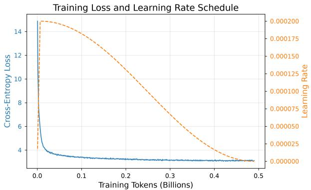  
(a) Training Tokens vs.TL & LR

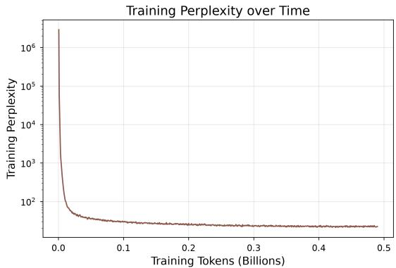  
(b) Training Tokens vs Training Perplexity

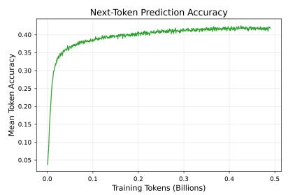  
(c) Training Tokens vs. Next-Token Prediction Accuracy

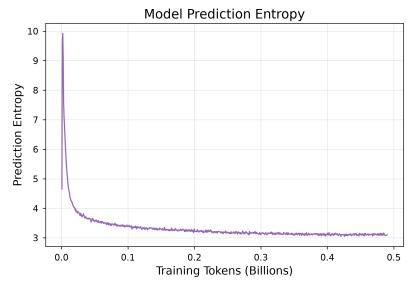  
(d) Training Tokens vs. Model Prediction Entropy

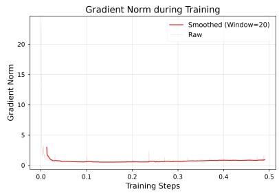  
(e) Training Steps vs. Gradient Norm  
Figure 1: CPT Training Dynamics of AssameseLM-E2B

106 on a logarithmic scale (Figure 1b). This initial divergence is mathematically expected; because the model’s newly expanded Assamese vocabulary embeddings were randomly initialized, the earliest forward passes produced essentially uniform, non-semantic logits. However, guided by a cosine learning rate scheduler that peaked at a maximum learning rate of 0.000200 (Fig ure 1a), the model demonstrated immediate adaptation. Within the first 0.05 billion tokens, the cross-entropy loss dropped precipitously. The loss curve subsequently smoothed, gradually decaying to a final plateau near a value of 3.1 by the end of the 0.5 billion token training run. Correspondingly, training perplexity collapsed from its initial peak and stabilized firmly between 101 and 102 (Figure 1b), indicating that the model successfully mapped the new Assamese subwords into a coherent latent semantic space.

The progressive linguistic alignment of the model is further validated by the next-token prediction accuracy (Figure 1c) and model prediction entropy metrics (Figure 1d). As we can see from the (Figure 1d), at the onset of training, the mean token accuracy was virtually random, starting below 0.05 (5%). As the model began to capture Assamese syntactic structures, grammatical rules, and vocabulary distributions, the accuracy curve experienced a steep logarithmic ascent, reaching approximately 0.35 (35%) early in the run. It then continued a gradual climb, ultimately plateauing just above 0.40 (40%) at the 0.5 billion token mark. Inversely, the model prediction entropy initialized near a high of 10, reflecting extreme predictive uncertainty (Figure 1d). Over the course of the training tokens, the entropy steadily decayed, converging to a final stable value of approximately 3.0. This sustained reduction in entropy signifies that the model’s output probability distributions became significantly sharper and more deterministic as its comprehension of the Assamese language matured.

Finally, the structural stability of the Hybrid LoRA optimization strategy is confirmed by the gradient norm trajectory (Figure 1e). During the earliest training steps, when the model was aggressively updating the uninitialized vocabulary embeddings, the raw gradient norm exhibited a transient spike, briefly exceeding a value of 20. However, the gradients rapidly collapsed and stabilized shortly after this initial adjustment phase. For the vast majority of the training sequence, the smoothed gradient norm remained consistently flat at a value under 1.0. This steady state confirms that the 100-step learning rate warmup and the inherent regularization of the LoRA adapters successfully prevented gradient explosion, ensuring a highly stable convergence environment for the Gemma-4-E2B base architecture.

## 3.4 Quantitative Evaluation on FLORES-200 Benchmark

To objectively evaluate the linguistic modeling capabilities and structural eficiency of AssameseLM-E2B, we conducted a comparative quantitative analysis using the Assamese split of the FLORES-200 evaluation benchmark [Goyal et al., 2022]. We benchmarked our Continual Pre-Trained (CPT) base model AssameseLM-E2B against four prominent foundational models: the original base Gemma-4-E2B [Mesnard et al., 2024], Qwen2.5-3B [Qwen Team, 2024] and Llama-3.2-3B [Dubey et al., 2024].

Because each of these models utilizes fundamentally diferent tokenizers and vocabulary sizes, comparing standard Perplexity (PPL) across them is mathematically invalid. Expanding a vocabulary naturally inflates the denominator in the softmax cross-entropy calculation, structurally increasing PPL even when model comprehension improves. Therefore, we evaluate the models using two hardware-agnostic, cross-tokenizer metrics: Tokenization Eficiency (tokens required to encode a fixed byte length) and Bits-per-Byte (BPB), which measures the theoretical information density required by the model to predict a single UTF-8 byte.

Table 3: FLORES-200 Assamese Benchmark Results
<table><tr><td>Model</td><td>Parameters</td><td>Tokens Required</td><td>Perplexity (PPL)</td><td>Bits-per-Byte (BPB)</td></tr><tr><td>Llama-3.2-3B</td><td>3B</td><td>166,218</td><td>2.8360</td><td>0.7416</td></tr><tr><td>Qwen2.5-3B</td><td>3B</td><td>149,689</td><td>4.1012</td><td>0.9042</td></tr><tr><td>Gemma-4-E2B</td><td>2B</td><td>55,383</td><td>56.6854</td><td>0.9570</td></tr><tr><td>AssameseLM-E2B</td><td>2B</td><td>35,107</td><td>146.0292</td><td>0.7488</td></tr></table>

Note: All models evaluated against the exact same FLORES-200 Assamese test corpus comprising total UTF-8 bytes.

Eliminating the “Token Tax”: The empirical results definitively validate our custom Assamese vocabulary expansion methodology. To encode the fixed 337,084 UTF-8 byte corpus, Llama-3.2-3B required a massive 166,218 tokens, and Qwen2.5-0.5B required 149,689 tokens, demonstrating extreme subword fragmentation for the Assamese script. In stark contrast, AssameseLM-E2B encoded the exact same text using only 35,107 tokens. Our model requires nearly 5 times fewer tokens than Llama 3.2. This drastic reduction mathematically eliminates the API “Token Tax” and allows AssameseLM-E2B to process significantly more context within the same hardware constraints.

Information Density and Bits-per-Byte (BPB): The BPB metric normalizes the loss over the raw bytes of the dataset, providing the most accurate reflection of cross-lingual modeling strength. AssameseLM-E2B achieved a BPB of 0.7488. This represents a massive 21.7% improvement in predictive compression over its own foundational base model, Gemma-4-E2B, which scored 0.9570.

Furthermore, our 2B parameter AssameseLM thoroughly outperformed Qwen2.5 (0.9042 BPB) and performed virtually on par with the much larger Llama-3.2-3B (0.7416 BPB). The fact that a localized 2B SLM can rival state-of-the-art 3B models in byte-level semantic prediction while possessing the most eficient tokenizer in the cohort proves the immense viability of our Continual Pre-Training and vocabulary expansion pipeline.

## 4 AssameseLM-E2B-it

## 4.1 Dataset Curation for Instruction Fine-Tuning

To transition the foundational AssameseLM-E2B model from a causal text-completion engine into a highly responsive conversational assistant, we curated a specialized, multi-task Supervised Fine-Tuning (SFT) dataset. The eficacy of an instruction-tuned model relies heavily on the structural diversity of its training data; an overly homogenous dataset leads to repetitive dialogue patterns and poor generalization.

To ensure the model could handle a wide array of user intents, we compiled a strictly balanced dataset consisting of 29,319 high-quality JSON instruction-response pairs. This dataset is a carefully engineered mixture of human-curated as well as synthetically generated pairs. Notably, approximately 4,000 of these synthetic pairs were generated directly from the OCR-digitized textbooks and classic literature that were utilized during the Continual Pre-Training (CPT) phase. This strategy explicitly grounds the model’s instruction-following capabilities in the high-quality, formal Assamese grammar it learned during pre-training.

The dataset was stratified across four primary functional domains:

## i. Direct Answer Pairs (17,119 pairs  58.39%):

Constituting the majority of the dataset, this subset is responsible for building the model’s core generative and conversational capabilities. It includes a diverse mixture of openended creative writing prompts, direct short-form answers, factual question-answering, and English-to-Assamese translation tasks. This subset is mixure of English, Assamese and Romanized Assamese prompts and response pairs.

## ii. Retrieval-Augmented Generation (RAG) Pairs (8,000 pairs  27.29%):

To mitigate hallucinations and enable the model to serve in enterprise or academic environments, a significant portion of the dataset was dedicated to RAG formatting. These pairs teach the model to synthesize answers strictly based on provided contextual text snippets rather than relying solely on its internal parametric memory.

## iii. Alpaca English Subset (3,000 pairs  10.23%):

To prevent catastrophic forgetting of the base model’s English comprehension capabilities and to ensure the model could operate in a bilingual capacity, we integrated a random sample of 3,000 pairs from the standard Alpaca instruction dataset [Taori et al., 2023]. This allows the model to reliably process English instructions even when generating Assamese outputs.

## iv. Search Intent Pairs (1,200 pairs  4.09%):

A specialized subset designed to teach the model how to interpret search-oriented queries, summarize search results, and format structured informational outputs.

By distributing the 29,319 pairs across these specific functional categories, the SFT dataset ensures that AssameseLM-E2B-it is comprehensively aligned to handle creative, analytical, and retrieval-based tasks without overfitting to a single interaction style.

## 4.2 Supervised Instruction Fine Tuning Phase

To align the model with conversational and instruction-following tasks while preserving its pretrained linguistic capabilities, we adopted a Parameter-Eficient Fine-Tuning (PEFT) strategy based on the Low-Rank Adaptation (LoRA) methodology. Given the computational demands of fine-tuning a 2-billion-parameter model, this approach enabled eficient adaptation without updating all model parameters. The fine-tuning process was performed on an NVIDIA RTX A6000 Ada GPU with 48 GB of VRAM, supported by 62 GB of system RAM and 16 vCPUs. The model was trained for three epochs over the entire instruction-tuning dataset.

## Model Architecture and LoRA Configuration

We initialized the SFT pipeline using the pre-trained AssameseLM-E2B foundational checkpoint. Because Gemma-4 [Mesnard et al., 2024] natively includes vision-language modalities, we explicitly disabled the vision\_config to optimize memory allocation strictly for text-based generation tasks. We utilized the Hugging Face SFTTrainer in conjunction with Parameter-Eficient Fine-Tuning (PEFT). The model was loaded in bfloat16 precision, implementing Scaled Dot-Product Attention (SDPA) rather than FlashAttention-2 to prevent hardware-specific crashes related to Gemma’s unique head dimensions.

To bypass internal architectural mismatches within the Gemma-4 backbone, we employed a targeted regular expression to attach LoRA adapters explicitly to standard nn.Linear layers within the text backbone. The complete LoRA configuration is detailed alongside the training hyperparameters in Table 4.

## Training Hyperparameters and Optimization

The training environment was optimized for computational eficiency on constrained hardware. To mitigate Out-Of-Memory (OOM) errors caused by the massive 274,000-token expanded vocabulary, we drastically reduced the per-device batch size and utilized the memory-eficient 8-bit AdamW optimizer. Aggressive gradient accumulation was employed to maintain a robust efective batch size. The comprehensive set of optimization constraints and training hyperparameters is summarized in Table 4.

Table 4: Hyperparameters for the Supervised Fine-Tuning (SFT) Phase
<table><tr><td>Hyperparameter</td><td>Value</td></tr><tr><td>LoRA Rank (r)</td><td>16</td></tr><tr><td>LoRA Alpha (α)</td><td>32</td></tr><tr><td>LoRA Target Modules</td><td>q_proj, k_proj, v_proj, o_proj, gate_proj, up_proj, down_proj</td></tr><tr><td>LoRA Dropout</td><td>0.05</td></tr><tr><td>Precision</td><td>bfloat16</td></tr><tr><td>Max Sequence Length</td><td>768</td></tr><tr><td>Optimizer</td><td>adamw_8bit</td></tr><tr><td>Learning Rate</td><td> $2 \times 1 0 ^ { - 4 }$ </td></tr><tr><td>Training Epochs</td><td>3</td></tr></table>

## 4.3 Instruction Tuning Convergence and Optimization Dynamics

Figure 2a illustrates the variation in the learning rate over the course of the training steps. The optimization dynamics during the Supervised Fine-Tuning (SFT) phase reflect a stable and successful alignment process over the course of approximately 1400 training steps. The optimization was governed by a cosine learning rate schedule, which was initiated with a linear warmup phase that smoothly ramped the learning rate to a peak of $2 . 0 \times 1 0 ^ { - 4 }$ around step 41. Following this warmup, the learning rate executed a gradual cosine decay, tapering to near zero by the end of the training run to facilitate fine-grained weight adjustments in the LoRA adapters.

The training loss throughout the Supervised Fine-Tuning (SFT) process is plotted in Figure 2b. The progression of the SFT training loss exhibits behavior highly characteristic of instruction tuning on structurally diverse datasets. The raw training loss (represented by the blue trajectory) displays significant step-to-step variance, with occasional transient spikes exceeding values of 15.0 and 17.5. This high variance is an expected mathematical artifact of utilizing a constrained per-device batch size while iterating through highly heterogeneous instruction prompts (e.g., shifting abruptly from simple conversational greetings or reasoning tasks). Crucially, however, the Exponential Moving Average (EMA, with $\alpha = 0 . 1 )$ of the loss (represented by the red trajectory) demonstrates robust and continuous convergence . The EMA loss initialized near a value of 11.5 and decayed steadily alongside the learning rate schedule, ultimately plateauing in a stable range between 2.5 and 3.5 during the final 400 steps of training .

The structural integrity of the model during this alignment phase is further corroborated by the gradient norm trajectory illustrated in Figure 2c. The gradient norm tracks the magnitude of weight updates applied to the network. Throughout the training phase, the EMA of the gradient norm steadily decreased from an initial value near 1.5 down to approximately 0.5. While the raw gradient norm experienced isolated, acute spikes - most notably surpassing 4.0 near step 650 and 7.0 near step 1000 - the network demonstrated immediate recovery. These transient anomalies likely correspond to the model processing batches containing highly complex, outof-distribution, or multi-turn reasoning instructions. However, the steady underlying decay of the gradient norm EMA confirms that the adamw\_8bit optimizer successfully absorbed these updates without triggering gradient explosion or catastrophic forgetting, thereby preserving the pre-trained Assamese linguistic capabilities while locking in conversational alignment.

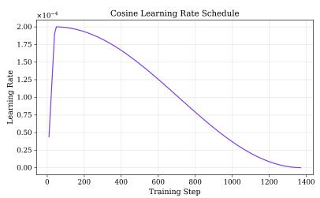  
(a) Learning Rate Schedule vs Training Steps

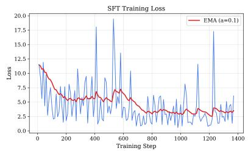  
(b) SFT Training Loss vs Training Steps

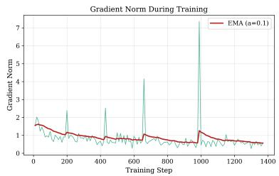  
(c) Gradient Norm vs Training Steps  
Figure 2: SFT Training Dynamics of AssameseLM-E2B-it

## 4.4 Results on Instruction Following Tasks

## 4.4.1 Evaluation of Retrieval-Augmented Generation (RAG) Instructions

## Task Design and Evaluation Method

To rigorously evaluate the instruction-following capabilities and structural reliability of the finetuned Assamese model, we benchmarked AssameseLM-E2B-it against three prominent foundational and instruction-tuned models: Google’s Gemma-4-E2B-it ( 2B parameters) [Mesnard et al., 2024], Meta’s Llama-3.2-3B-Instruct (3B parameters) [Dubey et al., 2024], and Alibaba’s Qwen3-3B-Instruct (3B parameters) [Qwen Team, 2024].

The evaluation framework was designed to assess grounded generation, specifically focusing on Retrieval-Augmented Generation (RAG) capabilities. The models were tested on a curated taxonomy of 10 RAG prompts spanning Assamese cultural, geographical, and historical knowledge. Each prompt provided numbered context passages and a targeted question, requiring the model to generate a factually grounded, citation-attributed response in the appropriate script (Assamese Unicode or Romanized Assamese). Crucially, the dataset included two adversarial “refusal items” where the provided context deliberately omitted the answer, testing the model’s ability to safely abstain rather than hallucinate.

The evaluation and automated grading of the generated outputs were conducted using Anthropic’s Claude Opus 4.6 [Anthropic, 2024] as an expert LLM-as-a-Judge. Claude Opus 4.6 was specifically selected for this evaluation pipeline due to its industry-leading capabilities in deep reasoning, long-context synthesis, and complex professional workflows. Because RAG evaluation requires the evaluator to meticulously cross-reference generated Assamese and Romanized text against provided context passages, Opus 4.6’s advanced instruction-following and exceptional logical consistency ensure that the grading remains highly objective. Its ability to handle multi-step analytical chains with significantly reduced hallucination rates makes it uniquely suited to score subtle nuances in faithfulness and attribution quality.

Performance was measured across six complementary metrics, each scored on a 0–100% scale:

• Answer Correctness: Expert-annotated factual accuracy of the response.

• Faithfulness: The degree to which the response is strictly grounded in the provided context passages.

• Citation F1: Token-level F1 score measuring the accuracy of attribution indices (e.g., [1]).

• Refusal Accuracy: The proportion of adversarial prompts on which the model correctly abstained from answering.

• Script Match: Alignment of the output with the expected Assamese Unicode or Latin script.

• Output Cleanliness: The absence of leaked special formatting tokens (e.g., <start\_of\_turn>) or prompt echoing.

An Overall RAG Score was computed as the unweighted macro-average of these six metrics.

## Results from Retrieval-Augmented Generation (RAG) Evaluation

AssameseLM-E2B-it demonstrated state-of-the-art performance for Assamese knowledge retrieval, achieving an overall macro-average RAG score of 96.7%. Our domain-specialized model decisively outperformed all general-purpose baselines, establishing a massive 39.2 percentage point gap over the second-place Llama-3.2-1B-Instruct (57.5%). The base Gemma-4-E2B-it model ranked third at 49.2%, while the larger 3B-parameter Qwen model performed the poorest at 35.8%.

The multi-dimensional capability profile visually illustrates AssameseLM’s comprehensive dominance (Figure 3a); its performance polygon nearly fills the entire radar area, whereas the baseline models exhibit highly irregular, collapsed polygons (Figure 3b).

Per-Metric Breakdown (Figure 3c): AssameseLM-E2B-it achieved perfect 100% scores across Answer Correctness, Faithfulness, Citation F1, Refusal Accuracy, and Output Cleanliness. Its only recorded imperfection was an 80% Script Match, which occurred because the model correctly generated Assamese script for two queries that technically expected Romanized Assamese, a negligible semantic mismatch.

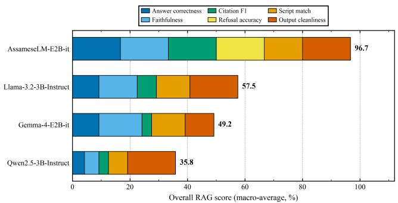  
(a) Overall RAG score (macro-average, %)

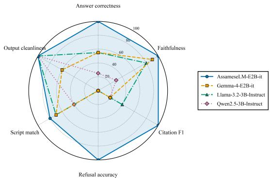  
(b) Per-metric performance polygon

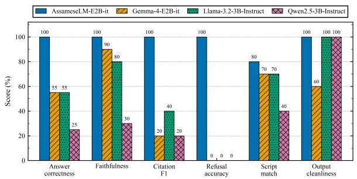  
(c) Per-metric breakdown score

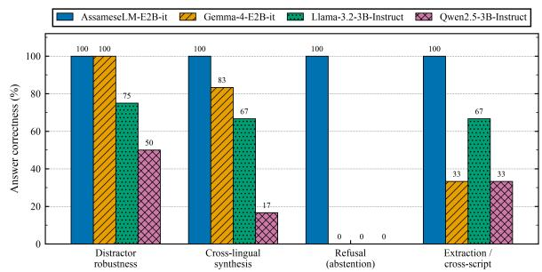  
(d) Capability over task taxonomy  
Figure 3: RAG-Specific Task Evaluation of AssameseLM-E2B-it

In contrast, the baseline models struggled severely with proper attribution and grounding. Citation F1 scores across the baselines ranged from a mere 20% to 40%, indicating a systemic failure to accurately reference context passages. Furthermore, Qwen3-3B-Instruct exhibited a paradoxical failure mode: while it achieved a perfect 100% for output cleanliness, it scored only 25% on answer correctness and 30% on faithfulness. Qwen frequently generated verbose, English-language preambles and explicitly denied information that was clearly present in the context, demonstrating that clean formatting in larger parameter LLMs can mask profound substantive deficiencies.

Refusal accuracy emerged as the most discriminative metric and the most critical safety concern in this evaluation. AssameseLM-E2B-it successfully recognized the adversarial prompts and achieved a 100% refusal rate. Conversely, no baseline model achieved any refusal accuracy (0%). Gemma, Llama, and Qwen entirely failed to abstain, opting instead to generate fabricated historical legends and irrelevant answers. This binary failure mode highlights that generalpurpose multilingual LLMs currently lack the instruction-following discipline required for safe deployment in Assamese enterprise applications.

Capability Categorization (Figure 3d): Breaking down answer correctness by task taxonomy further isolates the limitations of non-specialized models:

• Distractor Robustness: This proved to be the easiest sub-task; Gemma (100%) and Llama (75%) performed well when simply selecting correct passages from mixed contexts.

• Cross-Lingual Synthesis: Synthesizing information across language boundaries caused severe degradation in Qwen (dropping to 16.7%), while Gemma handled it moderately well (83.3%).

• Extraction and Cross-Script: Tasks requiring the model to extract factual answers when the query and context used diferent scripts exposed a significant vulnerability in Gemma, which scored only 33.3%.

Across all four complex taxonomic categories, AssameseLM-E2B-it maintained a flawless 100% correctness rate. These results definitively prove that for low-resource languages, targeted vocabulary expansion and domain-specific instruction fine-tuning yield dramatically greater structural and factual reliability than simply scaling a general-purpose model’s parameter count.

## 4.4.2 Evaluation of Multi-Dimensional Direct Chat Instructions

## Task Design and Evaluation Method

To rigorously assess the open-ended conversational and generative capabilities of the models beyond context-grounded RAG environments, we developed a comprehensive 150-prompt, multi-domain zero-shot evaluation suite. This benchmark was engineered to test direct response capabilities across 26 fine-grained thematic categories, encompassing Regional & Assamese Cultural Knowledge, General Science, Formal Mathematical Reasoning, and Pragmatics.

To accurately simulate the diverse input behaviors of low-resource language users, who frequently rely on mobile keyboards, the dataset was structurally bifurcated into two script modalities: 95 prompts utilizing the native Eastern Nagari script and 55 prompts utilizing Romanized Latin transliteration.

Model outputs were systematically evaluated across four primary orthogonal dimensions on a continuous-interval Likert scale from 1 (complete failure) to 10 (flawless execution):

• Linguistic Accuracy (LA): Evaluated grammatical correctness, morphological inflection, orthographic validity (specifically the absence of Bengali grapheme substitution), and idiomatic naturalness.

• Factuality (Fact): Assessed the precision, verifiable truthfulness of knowledge assertions, and the absence of hallucinations.

• Query Understanding (QU): Measured pragmatic intent recognition, semantic interpretation, and topic alignment.

• Instruction Following (IF): Evaluated compliance with task constraints, requested structural formats, and response style.

Additionally, two secondary quantitative metrics were tracked: Linguistic Purity (the percentage of tokens conforming strictly to Assamese lexicon, penalizing code-switching) and RAG Faithfulness Score (a diagnostic marker checking for unwarranted context-dependent refusal patterns).

The initial evaluation and automated grading of the generated outputs were conducted using Google Gemini 3.8 [Google Gemini Team, 2024] acting as an expert LLM-as-a-Judge. Gemini 3.8 was explicitly selected for this phase due to its state-of-the-art multilingual reasoning capabilities and its robust cross-lingual semantic alignment across Indic languages. Evaluating Assamese text generation requires an evaluator capable of parsing nuanced orthographic diferences (e.g., distinguishing Assamese ৰ from Bengali র) and accurately interpreting non-standard Romanized phonetic transliterations. Gemini 3.8’s advanced instruction-following capabilities made it highly suited to strictly apply our complex, multi-dimensional Likert rubric.

However, an exhaustive data audit of the initial Gemini 3.8 evaluation pipeline uncovered a critical methodological vulnerability inherent to LLM-as-a-judge frameworks in low-resource regimes. The automated evaluator exhibited a severe “default-scoring bias”. For example, in 43 instances (representing 28.7% of the Qwen model’s outputs), the judge assigned perfect 10/10 scores for Factuality and Query Understanding to completely incoherent, non-syntactic gibberish. Because automated judges process low-resource text by relying on cross-lingual cognates and keyword matching, the presence of overlapping Bengali-Assamese vocabulary tricked the evaluator into hallucinating semantic coherence.

To rectify this, a rigorous human-in-the-loop auditing phase was implemented. All 43 suspect instances were individually reviewed by native Assamese evaluators against the formal rubric, and responses lacking factual content or intent recognition were manually corrected to their true empirical values (1/10). This hybrid methodology ensures that our final statistical analysis relies on perfectly calibrated, bias-free data.

## Statistical Distribution and Visual Analysis

The performance distributions across the four evaluation dimensions reveal stark structural diferences in model capabilities, as visualized in the comparative violin plots and aggregated macro-level bar charts (Figure 4a-4e).

Linguistic Fluency vs. Generative Collapse: The violin plot for Linguistic Accuracy demonstrates a heavy top-tier concentration for AssameseLM-E2B-it, which achieves a mean of 7.30 and a distribution heavily skewed toward the upper quartile. In stark contrast, the distributions for Llama-3.2-1B-Instruct (mean 1.26) and Qwen-3-3B-Instruct (mean 1.31) are almost entirely suppressed at the absolute floor of 1.0, visually confirming their total generative collapse when attempting to synthesize native Assamese text. Gemma-4-E2B-it exhibits a highly stretched, fragmented distribution (mean 3.53), reflecting isolated instances where it produced partially valid Assamese interspersed with frequent Bengali-assimilated outputs.

Visualizing the Receptive-Productive Decoupling: The Query Understanding distributions provide definitive visual proof of the receptive-productive decoupling phenomenon within general-purpose foundational models. Despite their complete generative failure on the linguistic axis, the violin plots for Llama-3.2-1B-Instruct (mean 6.48) and Gemma-4-E2B-it (mean 7.47) show massive density bulges in the upper quartiles, with a high concentration of scores between 7 and 10. This confirms that the semantic intent of the Assamese queries is successfully mapped into their latent space, even though they lack the productive decoding weights to generate a grammatically valid response. AssameseLM-E2B-it maintains the highest overall comprehension density (mean 8.06), while Qwen-3-3B-Instruct fails entirely on this axis, clustering rigidly at a mean of 2.00.

The Bimodal Signature of RAG-Prior Bias: The violin plots for Factuality and Instruction Following explicitly expose the specific alignment vulnerability of our fine-tuned AssameseLM. Rather than exhibiting a normal Gaussian distribution, AssameseLM-E2B-it displays a distinct “hourglass” or bimodal shape in both metrics (Factuality mean: 4.89; Instruction Following mean: 4.62). This extreme variance directly visualizes the RAG-prior refusal bias discussed in our qualitative analysis: the model either successfully answers the zero-shot prompt based on parametric memory (clustering densely at scores of 9–10) or inappropriately triggers a canned refusal template due to missing external context (clustering sharply at scores of 1–2).

Conversely, the baseline models show complete floor-suppression for Instruction Following, with Llama and Qwen locked at 1.40. This visual flatline demonstrates their total inability to adhere to task-specific structural constraints or stylistic guidelines when operating in an Assamese linguistic environment.

Overall Comparison of Four Models Across All Evaluation Dimensions  
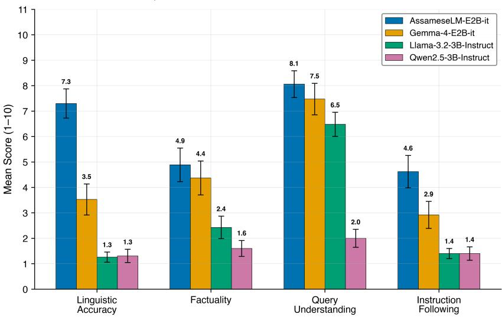  
(a) Training Steps vs. SFT Training Loss

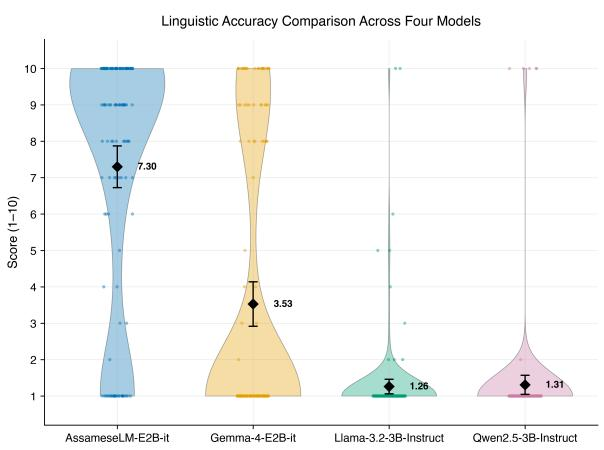  
(b) Training Steps vs. Learning Rate Schedule

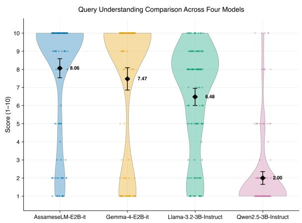  
(c) Training Steps vs. SFT Training Loss

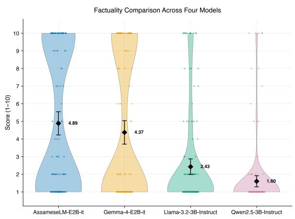  
(d) Training Steps vs. Gradient Norm

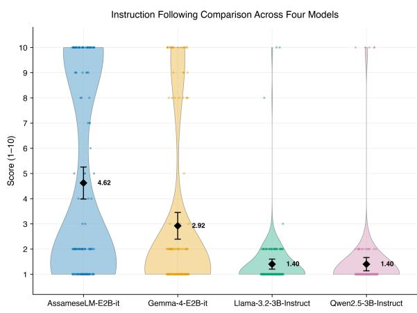  
(e) Training Steps vs. SFT Training Loss  
Figure 4: Multi-Dimensional Direct Chat Instruction Evaluaton of AssameseLM-E2B-it

## Inter-Dimensional Correlations and Cognitive Synergy

To move beyond isolated metric analysis, we computed Spearman’s rank correlation coeficients (ρ) across all evaluation dimensions to examine the interrelationships among diferent performance dimensions of the models [Spearman, 1904, Mukaka, 2012].

This statistical analysis yielded two critical insights into low-resource model behavior. First, it mathematically proved the “receptive-productive decoupling” observed in the baseline models. For Llama-3.2-3B-instruct, the correlation between Query Understanding and Linguistic Accuracy was virtually nonexistent $( \rho = 0 . 1 9 5 )$ , quantitatively confirming that semantic comprehension in the latent space does not translate to generative decoding capability. In contrast, AssameseLM-E2B-it demonstrated a strongly coupled architecture where understanding and generative fluency scaled together $( \rho = 0 . 5 0 0 )$ .

Secondly, the matrices revealed a profound “Factuality Instruction Following Synergy”. Across all evaluated architectures, Factuality and Instruction Following exhibited exceptionally high correlations $( \rho = 0 . 8 4 7$ for AssameseLM-E2B-it, 0.824 for Gemma 4, and 0.916 for Qwen). This demonstrates that in direct question-answering benchmarks, a model’s ability to fulfill structural instructions is fundamentally contingent upon possessing the factual parametric knowledge required to answer the prompt.

## Thematic Cluster Variance

Partitioning the 150-prompt dataset into thematic clusters revealed that model performance is highly domain-sensitive. AssameseLM-E2B-it maintained generative dominance across all domains, peaking in “Regional & Assamese Cultural Knowledge” with a near-perfect Linguistic Accuracy of 9.33 and Factuality of 8.00.

Conversely, the baseline models exhibited varying degrees of domain collapse. While Gemma 4 demonstrated moderate comprehension in “General Scientific / Factual” queries (Query Understanding of 9.57), its performance eroded significantly in “Formal Reasoning & Math” (Linguistic Accuracy dropping to 4.36) and failed entirely in “Romanized Domain Knowledge” (Linguistic Accuracy of 1.00). This confirms that general multilingual pre-training fails to encode deep logical reasoning or transliteration robustness for underrepresented scripts.

## Strategic Recommendations for Low-Resource SFT

Based on our empirical evaluation and the qualitative failure taxonomy, we propose four architectural and data-engineering principles for future low-resource language adaptation:

i. Orthographic Separation and Negative Sampling: Pre-training and SFT curricula must implement explicit negative sampling against high-resource sister languages. Loss penalties should be applied to the generation of intruding Bengali-specific glyphs and highfrequency closed-class functional terms to prevent the model from treating Assamese as a dialect.

ii. Context-Conditioning Isolation: To prevent the RAG-prior contamination (false refusals) observed in AssameseLM-E2B-it, instruction-tuning datasets must strictly distinguish between context-dependent Q&A and open-domain parametric recall. Prompt templates must explicitly train the model to bypass retrieval-refusal behaviors when external context is absent.

iii. Phonetic Transliteration Data Augmentation: Foundation models cannot rely on cross-lingual transfer for Romanized text. SFT mixtures must explicitly incorporate parallel dual-script pairs (Romanized Latin Native Script) to ensure true script invariance.

iv. Dedicated Vocabulary Expansion: Standard tokenizers exhibit severe sub-word fragmentation, averaging 3.8 to 5.2 tokens per Assamese word. Compressing this fertility ratio via byte-level BPE vocabulary expansion is an absolute prerequisite for stabilizing generative decoding in compact models.

## 5 Summary and Future Outlook

In this paper, we introduced AssameseLM-E2B and its instruction-tuned counterpart, AssameseLM -E2B-it, establishing a new state-of-the-art for low-resource Indo-Aryan language modeling. By engineering a custom byte-level BPE vocabulary expansion, we successfully eliminated the API “Token Tax” for the Assamese language, reducing the tokenization overhead by nearly 500% compared to prominent 1B–3B multilingual models. Our Continual Pre-Training (CPT) pipeline efectively integrated OCR-digitized literary corpora and web scrapes, allowing the 2B model to achieve a Bits-per-Byte (BPB) score of 0.7488 on the FLORES-200 benchmark [Goyal et al., 2022], rivaling models twice its size.

Through a highly curated Supervised Fine-Tuning (SFT) phase, we demonstrated that targeted domain adaptation is indispensable. AssameseLM-E2B-it decisively outperformed general-purpose models (including Llama-3.2-3B [Dubey et al., 2024] and Qwen-3-3B [Qwen Team, 2024]) across all Retrieval-Augmented Generation (RAG) and open-ended generative benchmarks. Crucially, we identified and overcame severe failure modes prevalent in general multilingual models, namely the “receptive-productive decoupling,” assimilation into the Bengali “gravity well,” and catastrophic generative collapse when processing Romanized Assamese transliteration. Furthermore, AssameseLM-E2B-it achieved a flawless 100% refusal accuracy on adversarial unanswerable RAG prompts, proving its viability for safe, hallucination-free enterprise deployment.

While AssameseLM-E2B demonstrates profound linguistic capabilities, our analysis uncovered specific alignment vulnerabilities, such as RAG-prior refusal bias where the model occasionally suppresses its parametric memory in zero-shot settings. Future work will focus on refining SFT data mixtures to strictly decouple context-dependent refusal behaviors from opendomain knowledge recall. Additionally, we plan to scale this methodology to larger parameter architectures (7B–9B), expand the context window to support full-document Assamese summarization, and explore multimodal integrations to allow the model to directly process and transcribe Assamese historical manuscripts and visual cultural artifacts.

## A Model Availability and Accessibility

To promote transparency, reproducibility, and further research on low-resource Assamese language modelling, the trained model checkpoints are made publicly accessible through the Hugging Face Model Hub. The continued pre-trained (CPT) checkpoint and the supervised finetuned (SFT) instruction-following model are available at the following repositories:

• CPT Base Model (AssameseLM-E2B): https://huggingface.co/assamailab/AssameseLM-E2B

• SFT Model (AssameseLM-E2B-it): https://huggingface.co/assamailab/AssameseLM-E2B-it

These repositories provide access to the respective model checkpoints for academic research, evaluation, and further development of Assamese language technologies.

## B Inference Examples

In this section, we show example generations from AssameseLM-E2B-it.

## A.1 Short Factual Prompt-Response Examples

The following examples illustrate the proficiency of AssameseLM-E2B-it in handling zero-shot factual queries, highlighting its capacity to deliver concise, direct, and hallucination-free answers.

Example #A1:   
Factual Prompt (Assam History)   
Prompt:   
শৰাইঘাটৰ যুদ্ধত আেহাম েসনাক েকােন েনতৃত্ব িদিছল?   
Model Response:   
শৰাইঘাটৰ যুদ্ধত আেহাম েসনাক লািচত বৰফুকেন েনতৃত্ব িদিছল।

Example #A2:   
Factual Prompt (Assam History)   
Prompt:   
শ্রীমন্ত শংকৰেদৱ েকান আিছল?   
Model Response:   
শ্রীমন্ত শংকৰেদৱ আিছল এজন মহান অসমীয়া সমাজ সংস্কাৰক, ধমগুৰু আৰু সমাজ সংগঠক। েতওর্ ঁ নৱৈবষ্ণৱ ধমৰর্   
প্রৱতর্ক আিছল।

Prompt: ভাৰতৰ েসউজ িবপ্লৱৰ ৈসেত েকানজন িবজ্ঞানীৰ নাম িবেশষভােৱ জিড়ত?

Model Response: ভাৰতৰ েসউজ িবপ্লৱৰ ৈসেত এম এছ স্বামীনাথনৰ নাম িবেশষভােৱ জিড়ত ।

Example #A5:   
Factual Prompt (Science)   
Prompt:   
পৰমাণুৰ েকন্দরত েকানেবাৰ কণা থােক?   
Model Response:   
পৰমাণুৰ েকন্দরত প্র'ট'ন (Proton) আৰু িনউট্রন (Neutron) থােক।

<table><tr><td>Example #A6:</td></tr><tr><td>Factual Prompt (Science)</td></tr><tr><td>Prompt:</td></tr><tr><td>CGRGRNT?</td></tr><tr><td>Model Response: CTGCAMAONAAUMRAGANNGNRNG</td></tr><tr><td>GR90R</td></tr><tr><td>Example #A7: Factual Prompt (Science)</td></tr><tr><td>Prompt: QCD-ATNTR可NAMARNE可SMA?</td></tr><tr><td>Model Response:</td></tr><tr><td>QCD-'(Quantum Chromodynamics) NEANAGTAAMNAHAZHSHA-</td></tr><tr><td>Example #A8:</td></tr><tr><td>Factual Prompt (Environment) Prompt:</td></tr><tr><td>HRAAUAIAGRREGITA?</td></tr><tr><td>Model Response: R G，G-,R</td></tr><tr><td>T可RR可T</td></tr><tr><td>Example #A9: Reasoning</td></tr><tr><td>Prompt: ASRRUDAUOA RC5A2ARA</td></tr><tr><td>?</td></tr><tr><td>Model Response: TRRRNR, U，RAR</td></tr><tr><td>TOTAHOGARARGR可RGORAT</td></tr><tr><td>Example #A10:</td></tr><tr><td>Reasoning</td></tr><tr><td>Prompt:</td></tr><tr><td>G AI HG3 G6 A 2DA  RRAN A T TO?</td></tr><tr><td></td></tr><tr><td>Model Response:</td></tr><tr><td>GGRGGRTCTARR，O</td></tr><tr><td>Example #A16:</td></tr><tr><td>Mathematical Reasoning</td></tr><tr><td></td></tr><tr><td>Prompt:</td></tr><tr><td>500 tokar 20% kiman hoy?</td></tr><tr><td>Model Response:</td></tr><tr><td>C002O%S00</td></tr></table>

Example #A11:   
Cross-Lingual Adaptation for Romanized Assamese (Science)   
Prompt:   
Nuclear fission aru nuclear fusionor majot mukhyo parthokyo ki?   
Model Response:   
পাৰমাণিৱক িবভাজন আৰু পাৰমাণিৱক সংেযাজনৰ প্রধান পাথর্কঁেটা হ'ল েয প্রথমেটাত এটা গধুৰ িনউিক্লয়াছ বা   
পৰমাণুিবভাজন কৰা হয়, আনহােত িদ্বতীয়েটাত দুটা লঘুিনউিক্লয়াছ একিত্রত কৰা হয় িযেটােৱ শিক্তৰ মুিক্ত ঘটায়।   
Example #A12:   
Cross-Lingual Adaptation for Romanized Assamese (Assamese Literature)   
Prompt:   
Lakshminath Bezbarua kun karone Axomiya xahityot bikhyato?   
Model Response:   
লক্ষমীনাথ েবজবৰুৱা অসমীয়া সািহতঁত েতওঁৰ বহুমুখী প্রিতভাৰ বােবিবখঁাত আিছল। েতওঁ কিবতা, গল্প, নাটক, প্রবন্ধ   
আিদ সকেলা েক্ষত্রেত অৱদান আগবঢ়াই অসমীয়া সািহতঁক সমৃদ্ধ কিৰিছল। Model Response:   
অেপন েছাসর্ চফটেৱৰ ৈহেছ এেন এক প্রযুিক্ত, য'ত ইয়াৰ উৎস ক'ড বা সূত্রসমূহ মুক্তভােৱ উপলব্ধ থােক। বঁৱহাৰকাৰীসকেল এই ক'ডৰ ওপৰত সংেশাধন কিৰব পােৰ, বঁৱহাৰ কিৰব পােৰ আৰু িনজৰ কামেতা প্রেয়াগ কিৰব পােৰ। ই বন্ধ ক'ডৰ িবপৰীেত এক সম্পূণর্িবপৰীত ধাৰণা।   
Example #A14:   
Reasoning   
Prompt:   
েসামবােৰ গিণতৰ ক্লাছ হয়। মঙ্গলবােৰ িবজ্ঞানৰ ক্লাছ হয়। িবজ্ঞানৰ িপছৰ িদনা কলা (Art) ক্লাছ হয়। েতেন্ত কলা ক্লাছ   
িক বােৰ হয়?   
Model Response:   
হয়, মঙলবাৰৰ িপছৰ িদনা অথর্াৎ বুধবােৰ কলাৰ ক্লাছ হয়।

<table><tr><td>Example #A15: Reasoning</td></tr><tr><td>Prompt:</td></tr><tr><td>G AI GA GG AT A AATIT T RIR ANA A T TO?</td></tr><tr><td></td></tr><tr><td>Model Response:</td></tr><tr><td>GURGGRATANGTARGRA，O</td></tr><tr><td>&#x27;unknown&#x27;不</td></tr></table>

## A.2 Long Answer Prompt-Response Examples / Creative Writting Examples

The following qualitative examples illustrate the performance of AssameseLM-E2B-it on longform creative writing tasks, highlighting its ability to maintain Assamese morphosyntactic stability over extended contexts without collapsing into sister languages.

<table><tr><td>Example #B1: Assamese Creative Writing</td></tr><tr><td>Prompt: Write an essay on   2 ?</td></tr><tr><td>Model Response:</td></tr><tr><td>#GTAC GNGRNOARA COSI #y NGIANRAONRGHA GTA GRGDNGYTGAURAHAHZRTNNA，AGY</td></tr><tr><td>T(AI)  RG-a R ANRROA,TTCR </td></tr><tr><td>###AI-G</td></tr><tr><td>###MSA A2 YD GR- ，NG，</td></tr><tr><td>GAHGAYATQAN CFGGHRNARANTRSGALNAIGRREGNAG GURANARAAT ，GGGARRRGO</td></tr><tr><td>TARA G I IRAG U  R A</td></tr><tr><td>###MMM可A CSGG SOSR</td></tr><tr><td>### G可R-TRA RR可RMG  可TA， 可TR TR，</td></tr><tr><td>，G GG G TSOA CSRO GA TT AISA</td></tr><tr><td>##MITGM可ANOTM ###可IA可SA</td></tr><tr><td>GR-  GG R   -G R ，I T,</td></tr><tr><td>G GGG G TOHGORNGRAGRA</td></tr><tr><td>### G  GQA 2</td></tr><tr><td>###2AI 2 GO G 可NG- 可2 可N6</td></tr><tr><td></td></tr><tr><td>GONGO,GM UR 2G DAT RA N RTGRA  G TA GAN ARAA</td></tr><tr><td>Example #B2:</td></tr><tr><td>Assamese Creative Writing Prompt:</td></tr><tr><td> R   G   Model Response:</td></tr><tr><td>f,</td></tr><tr><td>, RA G 2，NRU</td></tr><tr><td></td></tr><tr><td>可:28 '，2028 R：</td></tr><tr><td></td></tr><tr><td>， HARR，TNATNGHNGR</td></tr><tr><td>可 可GG RI可ROTGRR可M</td></tr><tr><td></td></tr><tr><td>A，H G  A H，HGRAA2G ，R司可利可市國RO可</td></tr><tr><td>AOADMRNMUGN</td></tr><tr><td>aAIn4, 翌同夏， </td></tr><tr><td>Example #B3:</td></tr><tr><td>Assamese Creative Writing</td></tr><tr><td>Prompt: 可G-R可</td></tr><tr><td>Model Response: f，</td></tr><tr><td>A, 日A后 2R同，R词</td></tr><tr><td>可：28 可34，2028</td></tr><tr><td>：-(Experience Certificate)</td></tr><tr><td></td></tr><tr><td>，</td></tr><tr><td>难可RA  可可R可</td></tr><tr><td></td></tr><tr><td>可不（CPC)可RR</td></tr><tr><td></td></tr><tr><td></td></tr><tr><td></td></tr><tr><td>HG可N</td></tr><tr><td></td></tr><tr><td></td></tr><tr><td></td></tr><tr><td></td></tr><tr><td></td></tr><tr><td></td></tr><tr><td></td></tr><tr><td></td></tr><tr><td>AA AGAGGTOGRAINAGGGA</td></tr><tr><td></td></tr><tr><td></td></tr><tr><td></td></tr><tr><td></td></tr><tr><td></td></tr><tr><td></td></tr><tr><td></td></tr><tr><td></td></tr><tr><td>H-GN RA GA GG M GA    NG TR</td></tr><tr><td></td></tr><tr><td></td></tr><tr><td></td></tr><tr><td></td></tr><tr><td></td></tr><tr><td></td></tr><tr><td></td></tr><tr><td></td></tr><tr><td></td></tr><tr><td></td></tr><tr><td></td></tr><tr><td></td></tr><tr><td>耐</td></tr><tr><td></td></tr><tr><td></td></tr><tr><td></td></tr><tr><td></td></tr><tr><td></td></tr><tr><td></td></tr><tr><td></td></tr><tr><td></td></tr><tr><td></td></tr><tr><td></td></tr><tr><td></td></tr><tr><td></td></tr><tr><td></td></tr><tr><td></td></tr><tr><td></td></tr><tr><td></td></tr><tr><td></td></tr><tr><td></td></tr><tr><td></td></tr><tr><td></td></tr><tr><td></td></tr><tr><td></td></tr><tr><td></td></tr><tr><td></td></tr><tr><td></td></tr><tr><td></td></tr><tr><td></td></tr><tr><td></td></tr><tr><td></td></tr><tr><td></td></tr><tr><td></td></tr><tr><td></td></tr><tr><td></td></tr><tr><td></td></tr><tr><td></td></tr><tr><td></td></tr><tr><td></td></tr><tr><td></td></tr><tr><td></td></tr><tr><td></td></tr><tr><td></td></tr><tr><td></td></tr><tr><td></td></tr><tr><td></td></tr><tr><td></td></tr><tr><td></td></tr><tr><td></td></tr><tr><td></td></tr><tr><td></td></tr><tr><td></td></tr><tr><td></td></tr><tr><td></td></tr><tr><td></td></tr><tr><td></td></tr><tr><td></td></tr><tr><td></td></tr><tr><td>aAIN,</td></tr><tr><td></td></tr><tr><td></td></tr><tr><td></td></tr><tr><td></td></tr><tr><td></td></tr><tr><td></td></tr><tr><td></td></tr><tr><td></td></tr><tr><td></td></tr><tr><td></td></tr><tr><td></td></tr><tr><td></td></tr><tr><td></td></tr><tr><td></td></tr><tr><td></td></tr><tr><td></td></tr><tr><td></td></tr><tr><td></td></tr><tr><td></td></tr><tr><td></td></tr><tr><td></td></tr><tr><td></td></tr><tr><td></td></tr><tr><td></td></tr><tr><td></td></tr><tr><td></td></tr><tr><td></td></tr><tr><td></td></tr><tr><td></td></tr><tr><td></td></tr><tr><td></td></tr><tr><td></td></tr><tr><td></td></tr><tr><td></td></tr><tr><td></td></tr><tr><td></td></tr><tr><td></td></tr><tr><td></td></tr><tr><td></td></tr><tr><td></td></tr><tr><td></td></tr><tr><td></td></tr><tr><td></td></tr><tr><td></td></tr><tr><td></td></tr><tr><td></td></tr><tr><td></td></tr><tr><td></td></tr></table>

## A.3 RAG Output

The following qualitative examples illustrate the performance of AssameseLM-E2B-it on RAG tasks, highlighting critical diferences in context adherence, script fidelity, the mitigation of hallucinations and RAG refusal.

<table><tr><td>Example #C2: Cross-lingual RAG Prompt: Context: [1] Nameri National Park is located in the Sonitpur district and is famous for the White-winged Wood Duck. [2] The Golden Langur Conservation Breeding</td></tr><tr><td>Programme is successfully running at the Assam State Zoo in Guwahati. [3] Pobitora Wildlife Sanctuary has the highest density of one-horned rhinos in the world. Question: State Zoo kot ase aaru tat kihor breeding programme soli ase? Model Response:</td></tr><tr><td>GGG AG[2] Example #C3:</td></tr><tr><td>Cross-lingual RAG Prompt: Context: [1]°    可  [2] He was</td></tr><tr><td>awarded the Bharat Ratna posthumously in the year 2019. Question: Who is known as Sudhakantha and in which year did he receive the</td></tr><tr><td>Bharat Ratna? Model Response: Dr. Bhupen Hazarika is known as Sudhakantha [1], and he received the Bharat Ratna</td></tr></table>

Example #C4:   
Cross-lingual RAG   
Prompt:   
Context: [1] The Ahom kingdom was established by Chaolung Sukaphaa in the year   
1228. [2] The historic Battle of Saraighat was fought in 1671 between the Mughal   
Empire and the Ahom Kingdom.   
Question: আেহাম সাম্রাজঁ েকিতয়া প্রিতষ্ঠা ৈহিছল আৰু শৰাইঘাটৰ ৰণ েকান চনত ৈহিছল?   
Model Response:   
আেহাম সাম্রাজঁ ১২২৮ চনত প্রিতষ্ঠা কৰা ৈহিছল [1], আৰু শৰাইঘাটৰ ৰণ ১৬৭১ চনত ৈহিছল [2]।

Example #C5:   
RAG Refusal   
Prompt:   
Context: [1] ৰঙালী িবহু বা ব'হাগ িবহু অসমৰ মূল উৎসৱ আৰু ই নৱবষৰ আৰম্ভিণকা সর্ ূচায়। [2] অম্বুবাচী েমলা   
প্রিত বছেৰ আহাৰ মাহত গুৱাহাটীৰ কামাখঁা মিন্দৰত অনুিষ্ঠত হয়।   
Question: েজানিবল েমলা েকানখন িজলাত অনুিষ্ঠত হয়?   
Model Response:   
ক্ষমা কিৰব, প্রদান কৰা তথঁত ইয়াৰ উত্ৰ উপলব্ধ নহয়।

A.4 Examples where The AssameseLM-E2B-it Model Generates Bad Output AssameseLM-E2B-it is prone to hallucinations and can present distorted facts as D1 & D2.

Example #D1:   
Factual Prompt-Response hallucination   
Prompt:   
প্র'টন আৰু িনউট্রন েকানেবাৰ েমৗিলক কণাৰ দ্বাৰা গিঠত?   
Model Response:   
প্র'টন এটা উৎপন্ েহাৱা েমৗিলক কণা নহয়, ই িনেজই এটা প্র'টন। আনহােত, িনউট্রন ৈহেছ এটা েমৗিলক কণা িয   
ইেলক্টরনৰ ৈসেত এেক ভৰৰ িকন্তু িবপৰীত আধানযুক্ত।   
Example #D2:   
Factual Prompt-Response hallucination   
Prompt:   
শব্দই শূনঁস্থানৰ মােজেৰ িকয় গিত কিৰব েনাৱােৰ?   
Model Response:   
শব্দই শূনঁস্থানৰ মােজেৰ গিত কিৰব েনাৱােৰ কাৰণ ই এক েভৗিতক বস্তু নহয়, বৰঞ্চ এটা সংেকতেহ।

## C Acknowledgements

The authors acknowledge the use of Google’s Gemini and OpenAI’s ChatGPT as AI-assisted tools during the preparation of this manuscript. These tools were utilized to improve language, refine the presentation of ideas, and enhance the overall readability and coherence of the manuscript. The authors take full responsibility for the scientific content, interpretations, and conclusions presented in this work.

## References

Orevaoghene Ahia, Sachin Kumar, Hila Gonen, and Noah A. Smith. Do all languages cost the same? tokenization in the era of commercial language models. In Proceedings of the 2023 Conference on Empirical Methods in Natural Language Processing (EMNLP), 2023.

AI4Bharat. Sangraha: A massive, open-source corpus for indic languages. Technical report, AI4Bharat Research, 2023.

Anthropic. Claude 3.5 and opus 4.6 technical report. Anthropic Research, 2024.

Abhinand Balachandran. Tamil-llama: A new tamil language model based on llama 2. arXiv preprint arXiv:2311.05845, 2023.

BharatGen. Param-1-7b-moe. https://huggingface.co/bharatgenai/Param-1-7B, 2025. Multilingual Mixture-of-Experts language model.

Pushpak Bhattacharyya et al. Challenges in processing assamese and bengali: Shared script, divergent syntax. ACM Transactions on Asian and Low-Resource Language Information Processing, 2021.

Andrei Z. Broder. On the resemblance and containment of documents. In Compression and Complexity of Sequences 1997. Proceedings, pages 21–29. IEEE, 1997.

Isaac Caswell, Theresa Breiner, Daan van Esch, and Ankur Bapna. Language id in the wild: Unexpected challenges on the path to a thousand-language web text corpus. In Proceedings of the 28th International Conference on Computational Linguistics, pages 511–525, 2020.

Yiming Cui, Zhipeng Yang, and Xin Yao. Eficient and efective text encoding for chinese llama and alpaca. arXiv preprint arXiv:2304.08177, 2023.

Abhimanyu Dubey, Abhinav Jauhri, Abhinav Pandey, Abhishek Kadian, Ahmad Al-Dahle, Aiesha Letman, Akhil Mathur, Alan Schelten, Amy Yang, Angela Fan, et al. The llama 3 herd of models. arXiv preprint arXiv:2407.21783, 2024.

Jay Gala, Tahir Jayakumar, Anoop Kumar M, Ratish Puduppully, Mitesh M. Khapra, Raj D. Dabre, and Anoop Kunchukuttan. Airavata: Introducing hindi instruction-tuned llm. arXiv preprint arXiv:2401.15006, 2024.

Jay Gala et al. Indictrans2: Towards high-quality and accessible machine translation for all 22 scheduled indian languages. Transactions of the Association for Computational Linguistics (TACL), 2023.

Gemini Team. Gemini: A family of highly capable multimodal models. arXiv preprint arXiv:2312.11805, 2023. doi: 10.48550/arXiv.2312.11805.

Google Gemini Team. Gemini 1.5 and 3.8 pro: Technical overview. Google DeepMind, 2024.

Naman Goyal, Cynthia Gao, Vishrav Chaudhary, Peng-Jen Razzaghi, Guillaume Wenzek, Da Ju, Aurélien Rodriguez, Sam Lakhani, Faisal Ngan, Zaid Kazi, et al. The flores-200 evaluation benchmark for low-resource machine translation. arXiv preprint arXiv:2207.04672, 2022.

Edward J. Hu, Yelong Shen, Phillip Wallis, Zeyuan Allen-Zhu, Yuanzhi Li, Shean Wang, Lu Wang, and Weizhu Chen. Lora: Low-rank adaptation of large language models. arXiv preprint arXiv:2106.09685, 2021.

Albert Q. Jiang, Alexandre Sablayrolles, Arthur Mensch, Chris Bamford, Devendra Singh Chaplot, Diego de las Casas, Florian Sayed, et al. Mistral 7b. arXiv preprint arXiv:2310.06825, 2023.

Taku Kudo and John Richardson. Sentencepiece: A simple and language independent subword tokenizer and detokenizer for neural text processing. In Proceedings of the 2018 Conference on Empirical Methods in Natural Language Processing: System Demonstrations, pages 66–71, 2018.

Katherine Lee, Daphne Ippolito, Andrew Nystrom, Chiyuan Zhang, Douglas Eck, Chris Callison-Burch, and Carl Nicholas. Deduplicating training data makes language models better. In Proceedings of the 60th Annual Meeting of the Association for Computational Linguistics, 2021.

Wing Lian, Bleys Goodson, Eugene Pentland, Austin Cook, Chien Vong, and Teknium. Openorca: An open dataset of gpt augmented flan reasoning traces. Hugging Face Repository, 2023.

Thomas Mesnard et al. Gemma: Open models based on gemini research and technology. arXiv preprint arXiv:2403.08295, 2024.

Mavuto Mukaka. A guide to appropriate use of correlation coeficient in medical research. Malawi Medical Journal, 24(3):69–71, 2012. doi: 10.4314/mmj.v24i3.

OpenAI. Introducing chatgpt. OpenAI Blog, 2022.

OpenAI. Gpt-4 technical report. arXiv preprint arXiv:2303.08774, 2023.

Qwen Team. Qwen2.5 technical report. arXiv preprint arXiv:2412.15115, 2024.

Phillip Rust, Jonas Pfeifer, Ivan Vulić, Sebastian Ruder, and Iryna Gurevych. How good is your tokenizer? on the monolingual performance of multilingual language models. In Proceedings of the 59th Annual Meeting of the Association for Computational Linguistics, 2021.

Sarvam AI. Sarvam-1. https://huggingface.co/sarvamai/sarvam-1, 2024. 2-billionparameter language model optimized for 10 Indian languages.

Charles Spearman. The proof and measurement of association between two things. The American Journal of Psychology, 15(1):72–101, 1904. doi: 10.2307/1412159.

Rohan Taori, Ishaan Gulrajani, Tianyi Zhang, Yann Dubois, Xuechen Li, Carlos Guestrin, Percy Liang, and Tatsunori B. Hashimoto. Stanford alpaca: An instruction-following llama model. GitHub Repository, 2023.

Hugo Touvron, Thibaut Lavril, Gautier Izacard, Xavier Martinet, Marie-Anne Lachaux, Timothée Lacroix, and Guillaume Lample. Llama: Open and eficient foundation language models. arXiv preprint arXiv:2302.13971, 2023a.

Hugo Touvron, Louis Martin, Kevin Stone, Peter Albert, Amjad Almahairi, Yasmine Babaei, and Thomas Scialom. Llama 2: Open foundation and fine-tuned chat models. arXiv preprint arXiv:2307.09288, 2023b.

Ashish Vaswani, Noam Shazeer, Niki Parmar, Jakob Uszkoreit, Llion Jones, Aidan N Gomez, Łukasz Kaiser, and Illia Polosukhin. Attention is all you need. Advances in Neural Information Processing Systems, 30, 2017.