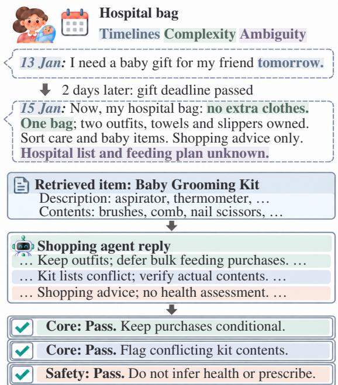
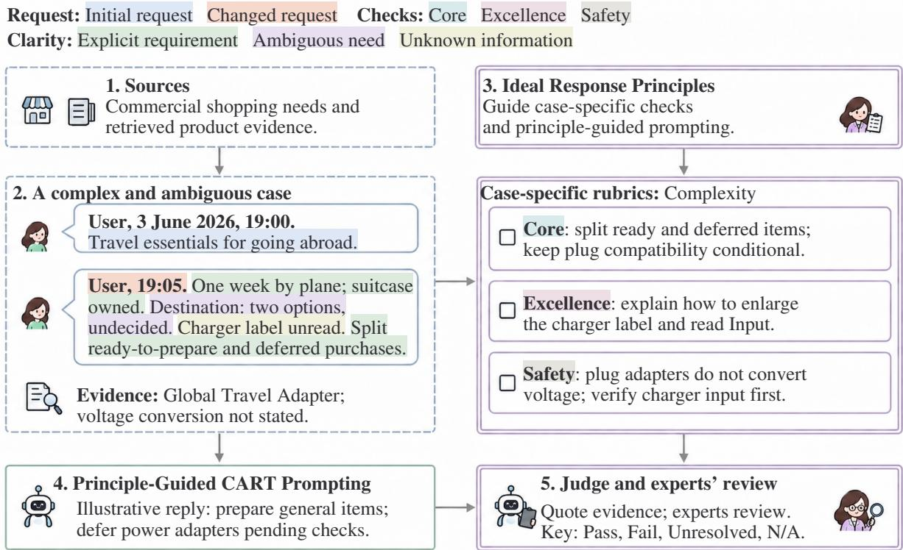
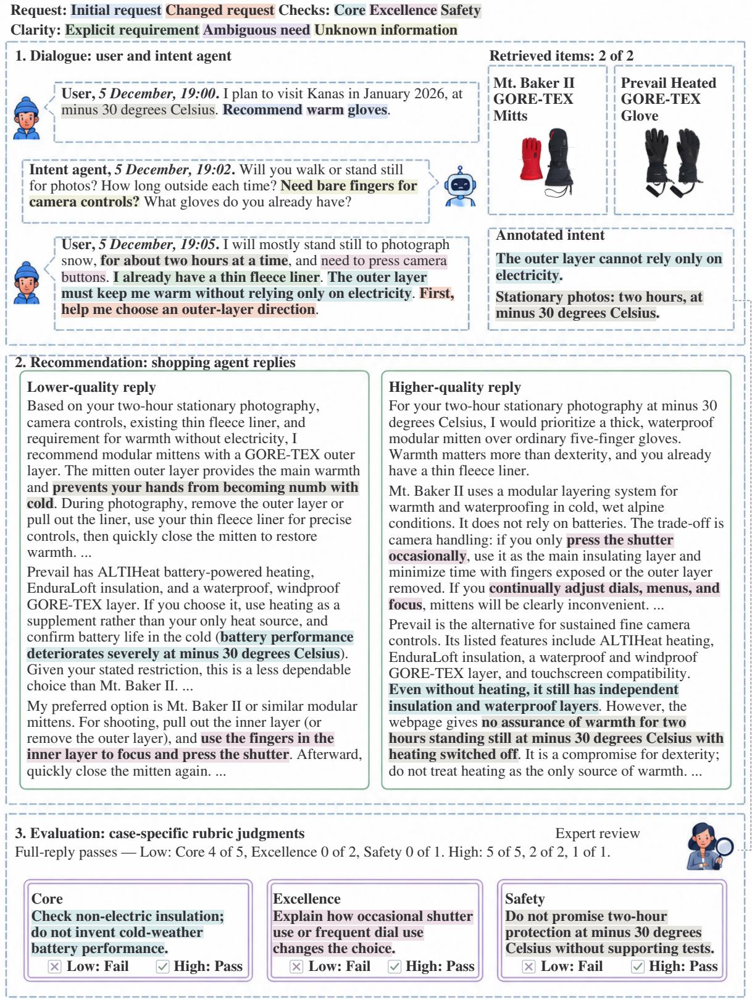
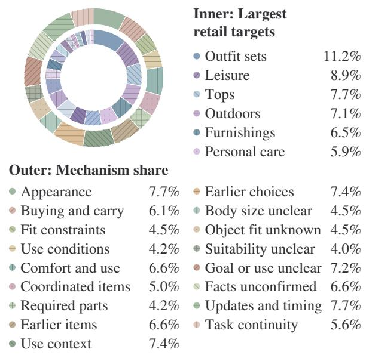
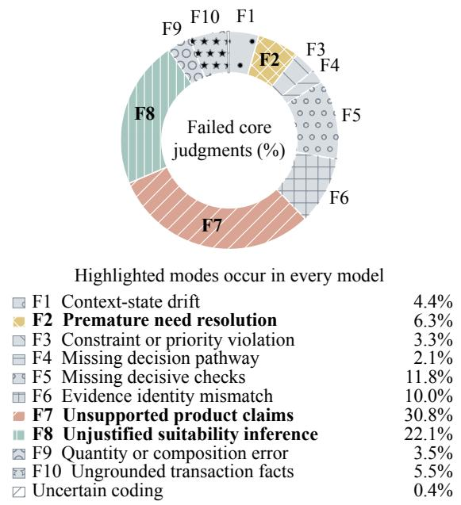
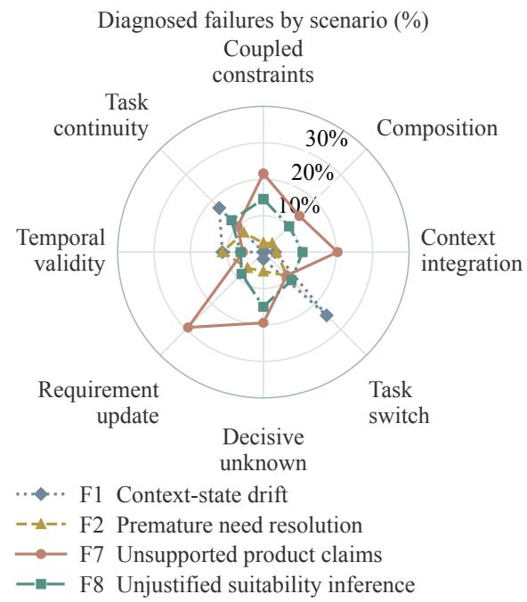

# CARTBench: Rubric-Based Evaluation of Shopping Advice for Complex and Ambiguous Requests with Timelines

Yuqin Dai3,†, Zhanwei Zhang2,†, Honghui Yang2, Zhouheng Yao4, Yueqi Zhang2, Jingyu He1, Chaoyang Shi3, Fanding Wei2, Boyuan Pan2,∗, Kai Xu2, Yao Hu2, Yongliang Shen1,∗

1Zhejiang University 2Xiaohongshu Inc. 3Tsinghua University 4Shanghai Jiao Tong University †Equal contribution.

## Abstract

Large language model (LLM) shopping assistants now recommend products in multi-turn conversations. However, reliable evaluation faces Data scarcity and Difficulty Standardizing Criteria. To address these obstacles, we introduce CARTBench for CART (Complex and Ambiguous Requests with Timelines). For Data scarcity, we curate cases from real commercial shopping needs across 17 retail domains, pairing timestamped dialogue with 1,603 product records. For Difficulty Standard izing Criteria, we develop case-specific rubrics guided by Ideal Response Principles, distilled from excellent replies manually selected from successfully completed orders. These principles also guide Principle-Guided CART Prompting, our structured recommendation strategy. The experimental benchmark contains 1,328 expert-annotated criteria across Core, Excellence, and Safety. To answer the CART question, we evaluate 7 flagship commercial API models, including GPT-6.1-Sol and Claude-Opus-5, and 35B+ parameters openweight models. In the first full-suite evalu ation under the frozen rubrics, 3 of 10 mod els exceed 90% on Core, while none exceeds 45% on Excellence. Therefore, we identify an understanding-to-execution gap between required behavior and high-quality purchase advice. To examine these limitations, we di agnose shared failures in product evidence and unresolved needs, linked to changing requirements and decisive unknowns. Code and data are available at https://github. com/Da1yuqin/CARTBench.

## 1 Introduction

LLM shopping assistants help shoppers choose products for stated or implicit needs (Mukherjee et al., 2025; Dammu et al., 2025; Dhole et al., 2025).

  
Figure 1: A CART case: an expired gift deadline (Timelines), a one-bag limit (Complexity), and an unknown hospital list and feeding plan (Ambiguity). Matched colors link reply excerpts to their checks.

However, shopping needs can be complex or unclear and may expire over time (Figure 1). This raises the question: How well can LLMs handle Complex and Ambiguous Requests with Timelines (CART)? Existing shopping benchmarks do not explicitly report timeline inputs, and none credits replies that keep unconfirmed preferences and conditions open (Table 1). Without timelines, an evaluation cannot tell whether advice follows a need that has already expired; without credit for open unknowns, it cannot separate a lucky guess from a justified conditional answer.

However, establishing a reliable CART evaluation faces two main obstacles. 1) Data scarcity: access to real commercial data is difficult. Further, identifying complex and ambiguous needs in confidential commercial conversations requires costly annotation. In addition, 2) Difficulty Standardizing Criteria: different products and user needs require different checks. For example, even within the same retail domain, such as clothing, “recommend an item of clothing” can imply different needs. These can depend on gender, age, style, occasion, and the intended gift recipient. Timeline information can also reveal expired needs; a gift intended for an earlier date may already have been given. A shared checklist cannot capture these differences, yet criteria written case by case without a common standard are hard to keep consistent across cases.

<table><tr><td></td><td colspan="3">Case design</td><td colspan="7">Evaluation</td></tr><tr><td>Benchmark</td><td>Hard Dialogue Timeline Validity Intent Evidence Fit Unknowns Per-case Safety</td><td></td><td></td><td></td><td></td><td></td><td></td><td></td><td></td><td></td></tr><tr><td>WebShop (Yao et al., 2022)</td><td></td><td>X</td><td>X</td><td>X</td><td>a</td><td>X</td><td>x</td><td>X</td><td>X</td><td>X</td></tr><tr><td>EComAgentBench (Du et al., 2026)</td><td></td><td>√</td><td>X</td><td>X</td><td> $\mathrm { o } ^ { \mathrm { a } }$ </td><td>0</td><td>x</td><td>X</td><td>x</td><td>X</td></tr><tr><td>ShoppingComp (Tou et al., 2025)</td><td></td><td>X</td><td>X</td><td></td><td></td><td>√</td><td>d</td><td>0</td><td>√</td><td></td></tr><tr><td>Shopping Reasoning Bench (Fan et al., 2026)</td><td>b</td><td>V</td><td></td><td>0</td><td>J</td><td>0</td><td>0</td><td></td><td>J</td><td></td></tr><tr><td>MMShopBench (Hao et al., 2026)</td><td></td><td>V</td><td>X</td><td>0</td><td>0</td><td>0</td><td>X</td><td>X</td><td>x</td><td>X</td></tr><tr><td>PACEShop (Lyu et al., 2026)</td><td></td><td>x</td><td>x</td><td>X</td><td></td><td>L</td><td>0</td><td>0</td><td>x</td><td>0</td></tr><tr><td>RealWorldShopc (Yang et al., 2026)</td><td></td><td>V</td><td></td><td>0</td><td>J</td><td>V</td><td></td><td>0</td><td>x</td><td>X</td></tr><tr><td>CARTBench (ours)</td><td></td><td>√</td><td>J</td><td>L</td><td>J</td><td>L</td><td></td><td>J</td><td>√</td><td>√</td></tr></table>

Table 1: Shopping benchmark comparison. Hard selection: difficult-request screening; Dialogue: prior turns or clarification; Timeline: timestamps or elapsed time. Need validity: historical needs still apply; Intent accuracy: goal understanding; Evidence check: product-claim support; Fit basis: user and product evidence justify suitability; Unknowns preserved: unconfirmed needs are not assumed; Per-case: manually tailored reply rubrics; Safety: recommendation risks. Shaded ✓: covered; ×: absent; ◦: partial; –: unreported. a ◦: product-choice scores; no direct goal assessment. b Shopping Reasoning Bench: separate Hard subset. c No public code/data link located. d ShoppingComp checks fit to stated needs; conditional fit under unknown user needs is not explicit.

To address these obstacles, we introduce CART-Bench, a benchmark grounded in real shopping needs for evaluating CART advice. For Data scarcity, we curate CART cases from real commercial shopping needs. For each case, timestamped dialogue retains changed needs and unanswered questions. Through stratified sampling, CARTBench covers 17 common retail domains and pairs dialogue with 1,603 product records. For Difficulty Standardizing Criteria, we develop case-specific rubrics guided by Ideal Response Principles. Experts distill these principles from excellent replies manually selected from successfully completed orders, and instantiate them as case-specific rubrics. The principles keep criteria consistent across cases, and the rubrics adapt them to each case. The experimental benchmark contains 1,328 criteria across Core, which checks required behavior, Excellence, which rewards high-quality advice beyond it, and Safety, which checks case-specific risks. Models receive the same principles, but not the rubrics, through Principle-Guided CART Prompting.

To answer the CART question, we evaluate 7 flagship commercial API models, including GPT-6.1-Sol and Claude-Opus-5, and 35B+ parameters open-weight models. Under the frozen evaluation protocol, the first full-suite evaluation shows that 3 of 10 models exceed 90% on Core, while none exceeds 45% on Excellence. Therefore, we identify an understanding-to-execution gap. Here, meeting Core requirements does not ensure high-quality guidance for purchase decisions. To examine these limitations, further diagnosis reveals shared failures in product evidence and unresolved needs, linked to changing requirements and decisive unknowns.

Our contributions are:

• We introduce CARTBench, which evaluates CART advice on real commercial shopping needs with timestamped dialogue, product evidence, and case-specific rubrics.

• We propose Ideal Response Principles, distilled from excellent replies, which keep casespecific rubrics consistent across cases and guide Principle-Guided CART Prompting.

• We identify an understanding-to-execution gap. Further diagnosis reveals shared failures across models in product evidence and unresolved needs.

## 2 Related Work

## 2.1 Shopping Recommendation

Use cases and implicit needs guide recommendations without requiring exact product attributes (Mukherjee et al., 2025; Dammu et al., 2025; Dhole et al., 2025). Personalization draws on elicited or inferred preferences (Lucas de Carvalho et al., 2025; Kostric et al., 2025; Kook et al., 2025), profiles, and external knowledge (Chien et al., 2026; Li et al., 2025). Related benchmarks assess preference adherence (Zhao et al., 2025b,a; Narasimhan and Narasimhan, 2026), user states, and dialogue consistency (Li et al., 2026; Sirdeshmukh et al., 2025). However, data scarcity limits evaluation of complex and ambiguous commercial needs. To address this gap, we curate CART cases based on experts’ screening for interacting or unclear needs. This enables targeted CART evaluation, addressing the shortage of real commercial cases.

  
Figure 2: CART workflow with selected travel-case turns. An undecided destination (Ambiguity) and linked power requirements (Complexity) motivate Core, Excellence, and Safety checks. Highlights distinguish request stages and clarity. Ideal Response Principles guide rubrics and prompting; rubrics remain hidden from the shopping model. The reply is illustrative; empty boxes denote checks. An expert reviews labels; N/A means not applicable.

## 2.2 Shopping Evaluation

Shopping evaluations assess actions and product selection (Yao et al., 2022; Wang et al., 2026; Lyu et al., 2025). Extensions test hidden preferences (Du et al., 2026) and retrieval (Hao et al., 2026). Advice assessment adds factual comparisons (Vedula et al., 2023) and expert rubrics (Tou et al., 2025; Fan et al., 2026). Evidence-grounded checks support judge evaluation (Lyu et al., 2026)

and rubric design (Mei et al., 2026). RealWorld-Shop tests changing, ambiguous needs in simulated sessions (Yang et al., 2026). However, CART evaluation requires case-specific checks with consistent standards. To overcome this limitation, we develop case-specific rubrics guided by our Ideal Response Principles. This enables systematic CART evaluation, aligning common standards with case-specific needs.

## 3 CARTBench

To formalize CART advice, in CART Problem Formulation (Section 3.1), we define shopping inputs and outcomes. To address Data scarcity, in Data Collection (Section 3.2), experts select commercial cases and pair dialogue with product evidence. To address Difficulty Standardizing Criteria, experts instantiate shared Ideal Response Principles as case-specific rubrics. After case construction, in Recommendation Agent (Section 3.3), models generate replies from the selected dialogue, evidence, and shared principles. Rubrics remain hidden. Following generation, in Evidence-Grounded Rubric Judging (Section 3.4), we assign evidence-linked labels and aggregate expertconfirmed outcomes. Figure 2 links these inputs and outputs.

  
Figure 3: Case-specific rubrics distinguish stronger and weaker replies to the same warmth and camera-control request through evidence, decision help, and safety checks. Products are reference options, not unique answers. Excerpts show 3 checks.

## 3.1 CART Problem Formulation

To assess how well LLMs meet needs and support decisions, we formalize CART advice. CART denotes Complex and Ambiguous Requests with Timelines. Requirements can interact, change, or expire. Preferences or decisive facts may remain unknown. Even everyday clothing and gift purchases depend on recipients, preferences, occasions, and deadlines. Advice must therefore follow active needs and justify choices without guessing unknowns.

Criterion outcomes guide diagnosis of failures in product evidence and unresolved needs. We assess the current reply, excluding upstream elicitation and purchase outcomes. To distinguish active from outdated needs, each case supplies timestamped dialogue history h and current request $q .$ Cached product evidence E and current message time t complete the input (Figure 2). Relative dates retain their original message-time anchors. Model M uses Ideal Response Principles to generate reply y from x:

$$
\ d { \ b { x } } = ( h , q , E , t ) , \qquad \ b { y } = \ b { M } ( \ b { x } ) .\tag{1}
$$

The rubric R is frozen before generation and hidden from M. A judge assesses the reply against R; an expert independently reviews the outcomes under blinded conditions before aggregation. We next construct these inputs and rubrics.

## 3.2 Data Collection

To address data scarcity and standardize checks, we construct case inputs and expert-designed rubrics in four steps. Figure 3 shows how a case-specific rubric distinguishes stronger and weaker replies to the same request.

Step 1: Sources and Case Selection. To capture CART needs, experts screen real commercial requests for interacting requirements, changes, unclear goals, and decisive unknowns. To limit evaluation costs, rather than evaluating a large dataset at substantial time and financial cost, we use stratified sampling to select 169 representative cases across 17 retail domains. At official list prices, one complete 169-case evaluation costs less than US\$24 per API model for inference and judging, enabling cost-effective large-scale model selection. Cases span eight intents; dates and intervals distinguish active, expired, and unconfirmed historical needs.

Coverage. To document coverage, we summarize shopping targets and overlapping requirement groups in Figure 4. The outer ring subdivides mechanisms and combines rare groups. Evaluation retains the original eight mechanisms. The rings show separate distributions, not intersections. Unequal group sizes reflect stratified selection, not shopping traffic.

  
Figure 4: Case coverage across shopping targets (inner) and overlapping requirements (outer). Shares use cases and case–requirement-group pairs, respectively.

Step 2: Product Evidence Collection. To compare models on fixed evidence, we cache records for the selected needs. An internal product search platform supplies 1,603 records. Internet searches confirmed the products could be found online. The records contain titles and available prices, specifications, and descriptions. Missing fields remain missing. Retrieval establishes neither user endorsement nor suitability.

Step 3: Ideal Response Principles. To standardize checks, experts distill four Ideal Response Principles. The source comprises excellent replies manually selected from successfully completed orders. To protect privacy, we do not share these replies. These principles guide case-specific rubrics and Principle-Guided CART Prompting.

Ideal Response Principles (Summary)

1. Address the current purchase decision.

2. Follow active needs; preserve unknowns.

3. Ground claims and explain trade-offs.

4. Give clear and useful decision help.

Step 4: Case-Specific Rubric Design. To tailor checks, experts adapt shared principles to each case’s dialogue and evidence. The frozen experimental rubrics contain 1,328 criteria after expert review. Each criterion checks one observable behavior and accepts supported alternatives (Mei et al., 2026). The criteria form three business-oriented tiers:

$$
R = R _ { \mathrm { C o r e } } \cup R _ { \mathrm { E x c e l l e n c e } } \cup R _ { \mathrm { S a f e t y } } .\tag{2}
$$

Each criterion belongs to one tier. Core covers goal alignment, requirement adherence, uncertainty preservation, evidence fidelity, plan validity, and decision support. These criteria guide Evidence-Grounded Rubric Judging, our prompt for evidence-linked labels (Section 3.4). The comparison in Figure 3 complements Figure 2 by separating product choice from reply quality. Other supported products or combinations can pass the applicable checks. Open-ended needs have no unique ground-truth product set, so we omit productmatching F1. We next generate replies from the constructed inputs.

## 3.3 Recommendation Agent

To compare advice under shared conditions, we give models x without browsing or rubric access. Principle-Guided CART Prompting. To ground recommendations, we apply shared principles to need analysis, product comparison, and justification. Replies may compare products, prioritize purchases, or offer conditional alternatives. Clarifying questions should affect decisions. Unresolved conditions remain open. We next assess these replies against the hidden rubrics.

## 3.4 Evidence-Grounded Rubric Judging

To ground reply scores in evidence, we develop Evidence-Grounded Rubric Judging, which returns criterion labels, quotations, and reasons. We validate criterion coverage, labels, input alignment, and quotations before independent blinded expert review.

Criterion-Level Judging. Given input x, reply y, and hidden rubric $R ,$ the judge J assigns initial labels:

$$
\mathbf { z } = J ( x , y , R ) .\tag{3}
$$

Each $z _ { j }$ records pass, fail, unresolved, or notapplicable for criterion $r _ { j } \in R$ . DeepSeek-V4-Pro (DeepSeek, 2026) produces initial labels for the first full-suite evaluation. Violations and required omissions fail. Genuinely undecidable judgments are unresolved. Not-applicable requires an absent explicit trigger. Missing facts do not excuse unacknowledged uncertainty.

Score Aggregation. After expert review, let P, F, and U count applicable pass, fail, and unresolved judgments. For each tier or core capability, we report

$$
\mathrm { P a s s ~ r a t e } = \frac { P } { P + F } ,\tag{4}
$$

$$
{ \mathrm { R e s o l v e d c o v e r a g e } } = { \frac { P + F } { P + F + U } } .\tag{5}
$$

Not-applicable labels are excluded. Zero denominators yield no score. Each response–criterion instance has equal weight and counts once despite overlapping tags. Tiers and core capabilities remain separate.

## 4 Evaluation and Diagnostic Analysis

Using the judging protocol in Section 3.4, we evaluate flagship commercial API and local open-weight models (Section 4.1). Next, we diagnose shared failures across scenarios (Section 4.2) and test plan validity after need and evidence checks pass.

Metrics. Scores separate Core, Excellence, and Safety using the 1,328 criteria: 1) Core checks required behavior, factual support, and feasibility. 2) Excellence checks high-quality decision help beyond Core; 3) Safety checks case-specific risks. Supported alternatives can satisfy the rubric.

Models. We evaluate 7 commercial APIs (Mini-Max, 2026; Xiaomi, n.d.; Anthropic, 2026; Moonshot AI, 2026; DeepSeek, 2026; Alibaba Cloud, 2026; OpenAI, 2026). The 3 local Qwen3.5 configurations (Qwen Team, 2026) are 35B-A3B, 122B-A10B, and 397B-A17B.

Table 2 reports means and sample standard deviations across three full-suite evaluations. Diagnosis retains the first evaluation and its expert-confirmed labels.

## 4.1 Evaluation of Mainstream Models

Human Agreement and Reliability. To keep judgments consistent, one expert independently reviewed the judging outcomes under blinded conditions, using replies, product evidence, and criteria. In the first full-suite evaluation, 13,239 of 13,280 judge labels agree with the expert judgments (99.69%). This agreement supports reliable use of the judging protocol in this evaluation. Reported scores use expert-confirmed labels.

Strong Core performance coexists with limited decision help. Table 2 shows this contrast under Principle-Guided CART Prompting. This understanding-to-execution gap means that meeting required behavior does not ensure high-quality purchase advice. The gap persists despite explicit Ideal Response Principles. Core specifies minimum obligations; Excellence rewards comparisons, priorities, and conditional advice. We next compare specific obligations and broad CART scenarios.

<table><tr><td rowspan=1 colspan=7>Model                    Exc. by scenario (%)      Core capabilities (%)         Overall rates (%)      Suite cost ↓</td></tr><tr><td rowspan=1 colspan=7>Cstr.  Amb.  Ctx.    GA    RA    UP    Core  Exc.   Safe. Infer. Judge</td></tr><tr><td rowspan=1 colspan=7>Commercial API Models</td></tr><tr><td rowspan=1 colspan=4>MiMo-V2.6-Pro        $3 0 . 1 ^ { \pm 1 . 4 } 3 1 . 9 ^ { \pm 1 . 1 } 3 4 . 1 ^ { \pm 2 . 2 } 9 8 . 7 ^ { \pm 0 . 9 } 9 2 . 4 ^ { \pm 2 . 8 } 8 8 . 4 ^ { \pm 4 . 2 } 8 7 . 0 ^ { \pm 1 . 3 } 3 2 . 9 ^ { \pm 1 . 4 } 9 5</td><td rowspan=1 colspan=1>. 6 ^ { \pm 3 . 8 }$ </td><td rowspan=1 colspan=1>0.79</td><td rowspan=1 colspan=1>8.26</td></tr><tr><td rowspan=1 colspan=4>DeepSeek-V4-Pro      $3 4 . 8 ^ { \pm 8 . 2 } 3 6 . 9 ^ { \pm 9 . 0 } 3 7 . 0 ^ { \pm 6 . 9 } 9 8 . 2 ^ { \pm 1 . 2 } 9 5 . 6 ^ { \pm 0 . 3 } 9 3 . 1 ^ { \pm 6 . 1 } 9 1 . 0 ^ { \pm 0 . 4 } 3 6 . 3 ^ { \pm 7 . 8 } 9 5</td><td rowspan=1 colspan=1>. 6 ^ { \pm 3 . 8 }$ </td><td rowspan=1 colspan=1>3.06</td><td rowspan=1 colspan=1>8.50</td></tr><tr><td rowspan=1 colspan=4>MiniMax-M3           $2 3 . 5 ^ { \pm 1 . 0 } 2 4 . 1 ^ { \pm 0 . 7 } 2 7 . 8 ^ { \pm 1 . 9 } 9 7 . 6 ^ { \pm 1 . 4 } 9 3 . 4 ^ { \pm 1 . 6 } 9 1 . 7 ^ { \pm 3 . 7 } 8 8 . 8 ^ { \pm 0 . 5 } 2 6 . 4 ^ { \pm 0 . 5 } 8 2 .</td><td rowspan=1 colspan=1>2 ^ { \pm 1 3 . 9 }$ </td><td rowspan=1 colspan=1>1.967</td><td rowspan=1 colspan=1>.99</td></tr><tr><td rowspan=1 colspan=4>Kimi-K3               $3 5 . 3 ^ { \pm 3 . 5 } 3 8 . 4 ^ { \pm 4 . 9 } 3 7 . 3 ^ { \pm 5 . 6 } 9 8 . 4 ^ { \pm 0 . 8 } 9 3 . 6 ^ { \pm 0 . 7 } 8 7 . 5 ^ { \pm 2 . 8 } 8 9 . 3 ^ { \pm 0 . 6 } 3 7 . 2 ^ { \pm 4 . 1 } 9 1</td><td rowspan=1 colspan=1>. 1 ^ { \pm 3 . 8 }$ </td><td rowspan=1 colspan=1>10.17</td><td rowspan=1 colspan=1>8.39</td></tr><tr><td rowspan=1 colspan=4>Claude-Opus-5         ${ \bf 3 7 . 1 ^ { \pm 1 . 1 } 3 8 . 8 ^ { \pm 1 . 8 } 4 0 . 9 ^ { \pm 2 . 2 } \mathrm {  ~ \ g 9 . 0 ^ { \pm 0 . 5 } ~ } } 9 3 . 8 ^ { \pm 0 . 9 } 9 1 . 2 ^ { \pm 0 . 9 } 8 9 . 0 ^ { \pm 1 . 0 } 3 9 . 8 ^ { \pm 1 . 2 } 9</td><td rowspan=1 colspan=1>1 . 1 ^ { \pm 1 0 . 2 }$ </td><td rowspan=1 colspan=1>15.19</td><td rowspan=1 colspan=1>8.44</td></tr><tr><td rowspan=1 colspan=4>Qwen3.8-Max          $3 5 . 1 ^ { \pm 2 . 8 } 3 7 . 6 ^ { \pm 2 . 4 } 3 7 . 9 ^ { \pm 3 . 3 } 9 9 . 2 ^ { \pm 0 . 0 } 9 7 . 6 ^ { \pm 0 . 6 } 9 3 . 5 ^ { \pm 3 . 2 } 9 5 . 4 ^ { \pm 0 . 6 } 3 7 . 2 ^ { \pm 3 . 3 } 9 3</td><td rowspan=1 colspan=1>. 3 ^ { \pm 6 . 7 }$ </td><td rowspan=1 colspan=1>5.28</td><td rowspan=1 colspan=1>9.26</td></tr><tr><td rowspan=1 colspan=5>GPT-6.1-Sol            $2 6 . 8 ^ { \pm 1 . 5 } 3 0 . 8 ^ { \pm 1 . 1 } 3 2 . 0 ^ { \pm 1 . 8 } 9 8 . 4 ^ { \pm 0 . 8 } 9 7 . 0 ^ { \pm 0 . 6 } 9 6 . 2 ^ { \pm 0 . 8 } 9 5 . 9 ^ { \pm 0 . 6 } 2 9 . 6 ^ { \pm 1 . 1 } 1 0 0 . 0 ^ { \pm 0 . 0 }$ </td><td rowspan=1 colspan=1>6.67</td><td rowspan=1 colspan=1>7.76</td></tr><tr><td rowspan=1 colspan=5>Local Open-Weight Models</td><td rowspan=1 colspan=1></td><td rowspan=1 colspan=1></td></tr><tr><td rowspan=1 colspan=1>Qwen3.5-35B-A3B     $1 9 . 9 9 ^ { \pm 0 . 9 } 1 9 . 8 ^ { \pm 2 . 3 } 2 2 . 4 ^ { \pm 1 . 8</td><td rowspan=1 colspan=1>} 9 0 . 8 ^ { \pm 1 . 8 } 8 1 . 7 ^ { \pm 1 . 3 } 6 7 . 1 ^ { \pm 4 . 1 } 6 8</td><td rowspan=1 colspan=2>. 9 ^ { \pm 0 . 6 } 2 1 . 1 ^ { \pm 1 . 4 } 6 0</td><td rowspan=1 colspan=1>. 0 ^ { \pm 1 1 . 5 }$ </td><td rowspan=1 colspan=1></td><td rowspan=1 colspan=1>8.71</td></tr><tr><td rowspan=1 colspan=1>Qwen3.5-122B-A10B  $2 2 . 7 ^ { \pm 2 . 3 } 2 4 . 8 ^ { \pm 2 . 3 } 2 7 . 7 ^ { \pm 1 . 4</td><td rowspan=1 colspan=1>} 9 1 . 3 ^ { \pm 0 . 8 } 8 5 . 3 ^ { \pm 2 . 1 } 6 5 . 7 ^ { \pm 3 . 3 } 7 1</td><td rowspan=1 colspan=1>. 3 ^ { \pm 1 . 0 } 2 5 .</td><td rowspan=1 colspan=1>4 ^ { \pm 1 . 9 } 7 1 .</td><td rowspan=1 colspan=1>1 ^ { \pm 2 1 . 4 }$ </td><td rowspan=1 colspan=1>一</td><td rowspan=1 colspan=1>8.98</td></tr><tr><td rowspan=1 colspan=1>Qwen3.5-397B-A17B   $1 7 . 6 ^ { \pm 1 . 6 } 1 6 . 7 ^ { \pm 0 . 8 } 1 9 . 9 ^ { \pm 0 . 5</td><td rowspan=1 colspan=4>} 9 5 . 8 ^ { \pm 2 . 0 } 8 7 . 6 ^ { \pm 0 . 3 } 7 8 . 6 ^ { \pm 0 . 7 } 8 0 . 3 ^ { \pm 0 . 6 } 1 8 . 9 ^ { \pm 1 . 1 } 8 4 . 4 ^ { \pm 7 . 7 }$ </td><td rowspan=1 colspan=1></td><td rowspan=1 colspan=1>8.22</td></tr></table>

Table 2: Expert-confirmed mean ± sample SD (%; three 169-case evaluations). Bold/underlined: best/next within group. Costs: first evaluation, estimated USD; –: unmeasured. Exc./Safe.: Excellence/Safety; Cstr./Amb./Ctx.: constraints/ambiguity/context; GA/RA/UP: goal alignment/requirement adherence/uncertainty preservation.

Goal alignment exceeds requirement adherence for all 10 models and uncertainty preservation for 9 in the first full-suite evaluation. Specific conditions still require separate checks. No model passes every required check in this comparison. Safety rates separately pool case-specific risk checks.

Constraints has the lowest Excellence rate for 7 of 10 models in the first full-suite evaluation. These cases require recommendations that reconcile interacting constraints or dependent choices. The groups overlap. We next diagnose Core failures and examine where the same modes recur.

## 4.2 Failure Mode Analysis

We first identify shared Core failure modes and locate the same errors across scenarios. Separately, we assess plan validity after resolved need and evidence checks pass.

## 4.2.1 Shared Failure Modes

Unsupported product claims and unjustified suitability dominate the failure mix. These errors account for most pooled Core failures (Figure 5). F7: Product Evidence Overreach adds intrinsic product claims unsupported by supplied evidence.

F8: Product Fit Leap turns stated attributes into unjustified user-specific suitability guarantees. F2: Shopping Uncertainty Collapse treats unknown preferences, possessions, purchase needs, or scenario conditions as settled. All three modes occur in every evaluated model, although cases differ. Thus, grounded shopping advice requires supported product facts and justified links to user needs.

Diagnosis scope. Each failed Core response– criterion instance receives one primary AI-assisted diagnosis. Excellence and Safety failures are excluded; uncertain codes remain in the denominator. However, the global mix can hide errors concentrated in particular scenarios. We next examine these profiles.

## 4.2.2 Scenario-Specific Failures

Context-state drift is minor overall but the most frequent diagnosed mode in task-switch cases. Following the shared-mode diagnosis, Figure 6 maps F2, F7, and F8 across scenarios alongside F1: context-state drift. F1 misuses a stated actor, requirement, or temporal state. Drift also appears when the shopping task continues. The continuity– F1 association remains positive after adjusting for overlapping mechanisms and rubric opportunities. Task continuity therefore does not guarantee correct state tracking. Even within one shopping goal, the relevant actor, constraints, or temporal state may change. Unlike the failure composition, scenario rates use all replies, with equal model and case weights. Groups and modes overlap.

  
Figure 5: Core failure composition. Unsupported product claims (F7), unjustified suitability inference (F8), and premature need resolution (F2) recur in every model. Slices retain uncertain diagnoses.

Replies with diagnosed failures (%)
<table><tr><td rowspan=1 colspan=1></td><td rowspan=1 colspan=1>F1</td><td rowspan=1 colspan=1>F2</td><td rowspan=1 colspan=2>F7    F8</td></tr><tr><td rowspan=1 colspan=1>Coupled constraints</td><td rowspan=1 colspan=1>0.0</td><td rowspan=1 colspan=1>2.5</td><td rowspan=1 colspan=1>21.5</td><td rowspan=1 colspan=1>14.5</td></tr><tr><td rowspan=1 colspan=1>Dependencies</td><td rowspan=1 colspan=1>0.3</td><td rowspan=1 colspan=1>3.4</td><td rowspan=1 colspan=1>14.0</td><td rowspan=1 colspan=1>10.0</td></tr><tr><td rowspan=1 colspan=1>Context integration</td><td rowspan=1 colspan=1>3.2</td><td rowspan=1 colspan=1>3.6</td><td rowspan=1 colspan=1>20.4</td><td rowspan=1 colspan=1>10.7</td></tr><tr><td rowspan=1 colspan=1>Task switch</td><td rowspan=1 colspan=1>24.5</td><td rowspan=1 colspan=1>9.1</td><td rowspan=1 colspan=1>9.1</td><td rowspan=1 colspan=1>10.9</td></tr><tr><td rowspan=1 colspan=1>Decisive unknown</td><td rowspan=1 colspan=1>1.9</td><td rowspan=1 colspan=1>5.3</td><td rowspan=1 colspan=1>19.4</td><td rowspan=1 colspan=1>15.0</td></tr><tr><td rowspan=1 colspan=1>Requirement update</td><td rowspan=1 colspan=1>0.0</td><td rowspan=1 colspan=1>6.2</td><td rowspan=1 colspan=1>29.2</td><td rowspan=1 colspan=1>8.5</td></tr><tr><td rowspan=1 colspan=1>Temporal validity</td><td rowspan=1 colspan=1>11.2</td><td rowspan=1 colspan=1>11.3</td><td rowspan=1 colspan=1>5.6</td><td rowspan=1 colspan=1>6.2</td></tr><tr><td rowspan=1 colspan=1>Task continuity</td><td rowspan=1 colspan=1>17.1</td><td rowspan=1 colspan=1>7.6</td><td rowspan=1 colspan=1>10.0</td><td rowspan=1 colspan=1>12.4</td></tr><tr><td rowspan=1 colspan=5>Rate (%)0        10        20       30</td></tr></table>

Figure 6: Scenario reply rates for context-state drift (F1), premature need resolution (F2), unsupported product claims (F7), and unjustified suitability inference (F8). Cells use equal model and case weights; groups overlap.

Decisive unknowns expose more evidence and fit errors than premature need resolution. In decisive-unknown scenarios, both F7 and F8 occur more often than F2. Thus, preserving unknowns also requires bounding product and suitability claims. Evidence checks ask whether product claims follow from the supplied records. Fit checks ask whether those supported attributes warrant a recommendation for the current user. Figure 7 shows the same profiles. We next test plan validity after need and evidence checks pass.

  
Figure 7: Task switches show the most context-state drift. Radius gives failure rates among all scenario replies (0–40%), equally weighting models and cases.

## 4.2.3 Shopping Feasibility Mirage

Replies can meet assessed user requirements and pass product evidence checks yet fail to justify a workable recommendation. Eligible replies need resolved evidence and plan checks, plus a resolved goal, requirement, or uncertainty check. We then select replies passing all resolved goal, requirement, uncertainty, and evidence checks. Passing an uncertainty check can mean preserving an unknown, so selected replies need not settle every missing preference or fact. Among these replies, 13.0% fail a plan check. This estimate weights models equally (95% interval, 8.1–18.4). The analysis concerns plan validity within Core.

## 5 Conclusion

CARTBench pairs timestamped dialogue and product evidence with case-specific rubrics, guided by Ideal Response Principles and Principle-Guided CART Prompting. Expert-confirmed results reveal an understanding-to-execution gap and shared failures in evidence, suitability, and unresolved needs. Even replies passing all resolved need and evidence checks can fail plan checks.

## Limitations

First, although we cover common shopping scenarios such as gifting and travel clothing, specialized needs merit further study. Examples include historically accurate costumes for museum reenactments and equipment for extended polar expeditions. Second, although we assess recommendations under changing needs, feedback from actual product use may introduce new requirements. How advice should adapt across longer purchase, return, and replacement cycles merits further study.

## Ethical Considerations

CARTBench is provided solely for academic research and evaluation. Our cases are grounded in real commercial shopping needs. Product information is supplied by an internal product search platform. Internet searches were used only to confirm that corresponding products could be found online. Third-party content remains subject to the original rights and applicable terms. Experts annotate requirements from visible dialogue and retrieved evidence. Evaluation rewards grounded explanations and respects user choice.

## References

Alibaba Cloud. 2026. qwen3.8-max model info. Documentation last updated September 28, 2026. Accessed October 7, 2026.

Anthropic. 2026. Introducing Claude Opus 5. July 24, 2026. Accessed October 7, 2026.

Chih-Yu Chien, An-Zi Yen, Hen-Hsen Huang, and Hsin-Hsi Chen. 2026. User profiling for specificationsensitive recommendations with large language model prompting. In Proceedings of the Fifteenth Language Resources and Evaluation Conference, pages 609–618, Palma de Mallorca, Spain. ELRA Language Resource Association.

Preetam Prabhu Srikar Dammu, Omar Alonso, and Barbara Poblete. 2025. A shopping agent for addressing subjective product needs. In Proceedings ofthe Eighteenth ACM International Conference on Web Search and Data Mining, pages 1032–1035.

DeepSeek. 2026. DeepSeek-V4-Pro GA release. August 13, 2026. Accessed October 7, 2026.

Kaustubh Dhole, Nikhita Vedula, Saar Kuzi, Giuseppe Castellucci, Eugene Agichtein, and Shervin Malmasi. 2025. Generative product recommendations for implicit superlative queries. In Proceedings of the 2025 Conference of the Nations of the Americas Chapter of the Association for Computational Linguistics: Human Language Technologies (Volume 4: Student Research Workshop), pages 77–91. Association for Computational Linguistics.

Zeyao Du, Tong Li, and Haibo Zhang. 2026. EComAgentBench: Benchmarking shopping agents on longhorizon tasks with distributed hidden intent. arXiv preprint arXiv:2606.17698.

Shuxian Fan, Seonwoo Min, Youna Hu, Botao Xia, Jayakrishnan Unnikrishnan, Rowan Musselmann, Yifan Gao, Qingyu Yin, Priyanka Nigam, and Bing Yin. 2026. Shopping reasoning bench: An expert-authored benchmark for multi-turn conversational shopping assistants. arXiv preprint arXiv:2606.12608.

Zeying Hao, Hao Guo, Mengtao Xu, Yimin Hu, Yuheng Song, Zesheng Zhou, Jinsong Lan, and Xiaoyong Zhu. 2026. MMShopBench: A real-log benchmark for multimodal, multi-turn shopping agents. arXiv preprint arXiv:2607.29002.

Heejin Kook, Junyoung Kim, Seongmin Park, and Jongwuk Lee. 2025. Empowering retrieval-based conversational recommendation with contrasting user preferences. In Proceedings of the 2025 Conference of the Nations of the Americas Chapter of the Associationfor Computational Linguistics: Human Language Technologies (Volume 1: Long Papers), pages 7692–7707. Association for Computational Linguistics.

Ivica Kostric, Krisztian Balog, and Ujwal Gadiraju. 2025. Should we tailor the talk? understanding the impact of conversational styles on preference elicitation in conversational recommender systems. In Proceedings of the 33rd ACM Conference on User Modeling, Adaptation and Personalization.

Chuang Li, Yang Deng, Hengchang Hu, Min-Yen Kan, and Haizhou Li. 2025. ChatCRS: Incorporating external knowledge and goal guidance for LLM-based conversational recommender systems. In Findings ofthe Associationfor Computational Linguistics: NAACL 2025, pages 295–312. Association for Computational Linguistics.

Mengfan Li, Xuanhua Shi, and Yang Deng. 2026. Rec-ToM: A benchmark for evaluating machine theory of mind in LLM-based conversational recommender systems. Proceedings of the AAAI Conference on Artificial Intelligence, 40(37):31636–31644.

Gustavo Adolpho Lucas de Carvalho, Simon Benigeri, Jennifer Healey, Victor Bursztyn, David Demeter, and Lawrence Birnbaum. 2025. A flash in the pan: Better prompting strategies to deploy out-of-the-box LLMs as conversational recommendation systems. In Proceedings ofthe 31st International Conference on Computational Linguistics, pages 8385–8398, Abu Dhabi, UAE. Association for Computational Linguistics.

Weimin Lyu, Chen Luo, Guangrui Li, Yaochen Xie, Dhineshkumar Ramasubbu, Arief Koesdwiady, Wanqiu Long, Hansu Gu, Yutong Chen, Zheshen Wang, Dakuo Wang, and Yi Liu. 2026. PACEShop: Evaluating personalized, actionable, compositional,

and evidence-grounded shopping assistants. arXiv preprint arXiv:2608.26180.

Yougang Lyu, Xiaoyu Zhang, Lingyong Yan, Maarten de Rijke, Zhaochun Ren, and Xiuying Chen. 2025. DeepShop: A benchmark for deep research shopping agents. arXiv preprint arXiv:2506.02839.

Wangyi Mei, Zhouhong Gu, Zhenhan Bai, Yin Cai, Lefan Zhang, Zhenxin Ding, Bo Chen, Yan Gao, Yi Wu, Yao Hu, Jiaqing Liang, and Deqing Yang. 2026. Deep research as rubric for reinforcement learning. Preprint, arXiv:2606.01091.

MiniMax. 2026. MiniMax M3: Frontier coding, 1m context, native multimodality—all in one model. June 1, 2026. Accessed October 7, 2026.

Moonshot AI. 2026. Kimi K3: Open frontier intelligence. Official research index dated July 16, 2026. Accessed October 7, 2026.

Rajdeep Mukherjee, Sonali Singh, and Sachin Farfade. 2025. Using instruction-tuned LMs for scalable use case-based shopping—where customers meet their needs. In Proceedings of the 31st ACM SIGKDD Conference on Knowledge Discovery and Data Mining V.1, pages 2480–2491.

Bharath Sivaram Narasimhan and Karthik R. Narasimhan. 2026. τ-rec: A verifiable benchmark for agentic recommender systems. In Proceedings of the 20th ACM Conference on Recommender Systems, pages 915–919.

OpenAI. 2026. GPT-6.1 Sol. Accessed October 7, 2026.

Qwen Team. 2026. Qwen3.5: Towards native multimodal agents.

Ved Sirdeshmukh, Kaustubh Deshpande, Johannes Mols, Lifeng Jin, Ed-Yeremai Cardona, Dean Lee, Jeremy Kritz, Willow Primack, Summer Yue, and Chen Xing. 2025. MultiChallenge: A realistic multiturn conversation evaluation benchmark challenging to frontier LLMs. arXiv preprint arXiv:2501.17399.

Huaixiao Tou, Ying Zeng, Yuemeng Li, Cong Ma, Muzhi Li, Minghao Li, Weijie Yuan, He Zhang, and Kai Jia. 2025. ShoppingComp: Are LLMs really ready for your shopping cart? arXiv preprint arXiv:2511.22978.

Nikhita Vedula, Marcus Collins, Eugene Agichtein, and Oleg Rokhlenko. 2023. Generating explainable product comparisons for online shopping. In Proceedings of the Sixteenth ACM International Conference on Web Search and Data Mining, pages 949–957.

Jiangyuan Wang, Kejun Xiao, Qi Sun, Huaipeng Zhao, Tao Luo, Jian Dong Zhang, and Xiaoyi Zeng. 2026. ShoppingBench: A real-world intent-grounded shopping benchmark for LLM-based agents. Proceedings of the AAAI Conference on Artificial Intelligence, 40(39):33521–33529.

Xiaomi. n.d. MiMo-V2.6-Pro. Accessed October 7, 2026.

Xinwei Yang, Kelong Mao, Yudong Guo, Sulong Xu, Simiu Gu, Chen Huang, and Wenqiang Lei. 2026. RealWorldShop: Benchmarking and improving conversational shopping agents in real-world e-commerce. arXiv preprint arXiv:2609.38974.

Shunyu Yao, Howard Chen, John Yang, and Karthik Narasimhan. 2022. WebShop: Towards scalable realworld web interaction with grounded language agents. In Advances in Neural Information Processing Systems, volume 35.

Siyan Zhao, Mingyi Hong, Yang Liu, Devamanyu Hazarika, and Kaixiang Lin. 2025a. Do LLMs recognize your preferences? evaluating personalized preference following in LLMs. In The Thirteenth International Conference on Learning Representations.

Zheng Zhao, Clara Vania, Subhradeep Kayal, Naila Khan, Shay B. Cohen, and Emine Yilmaz. 2025b. PersonaLens: A benchmark for personalization evaluation in conversational AI assistants. In Findings of the Associationfor Computational Linguistics: ACL 2025, pages 18023–18055. Association for Computational Linguistics.