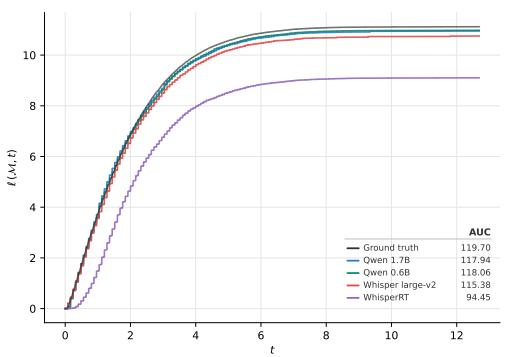
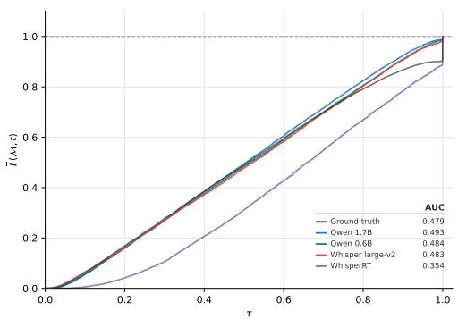
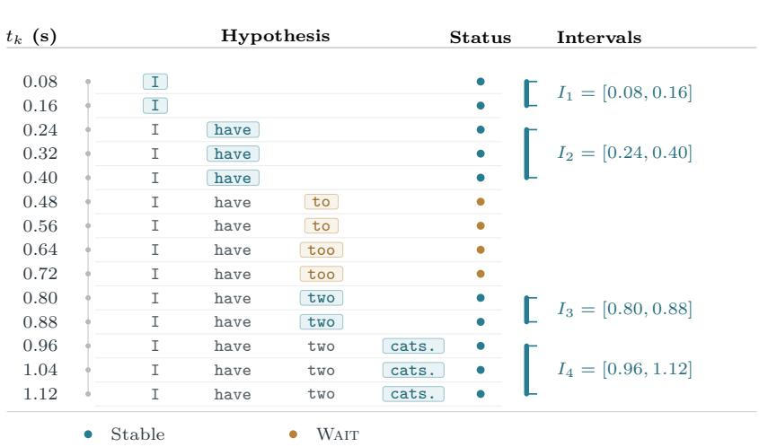
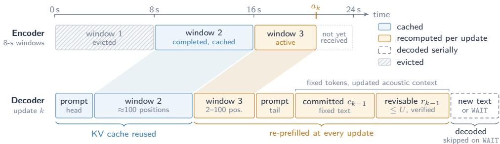
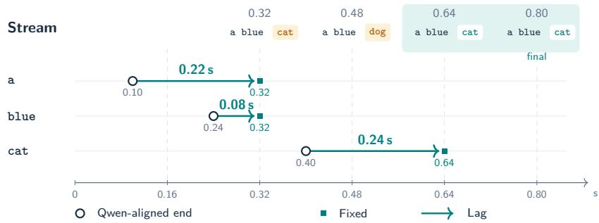
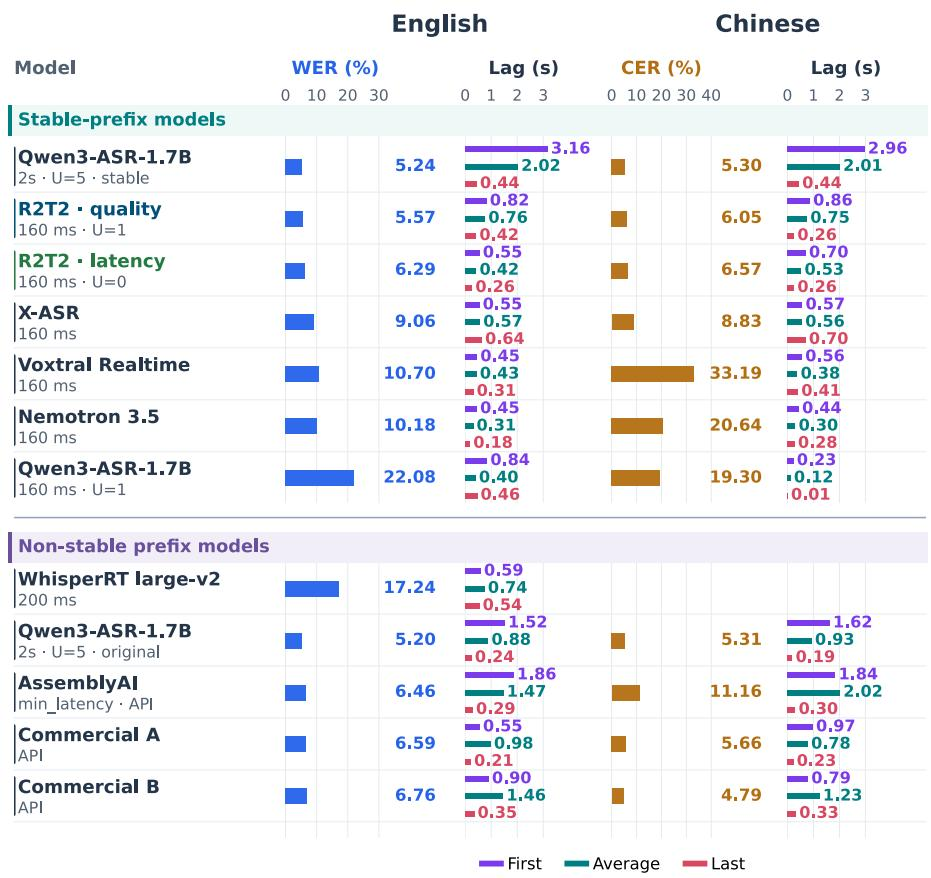
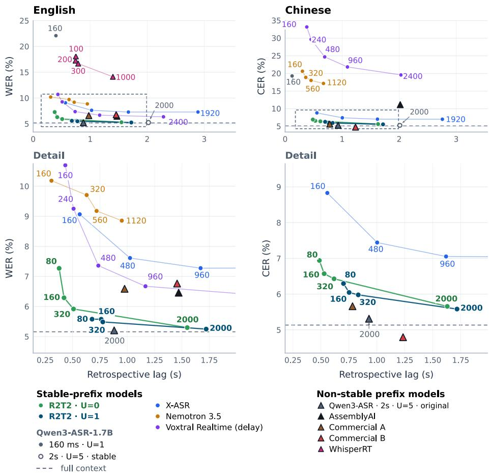

# Confucius4-R2T2: A Stable-Prefix Streaming ASR Model for Real Real-Time Transcription

Daniel Huang†, Qi He†, Shaoxiong Duan‡, Yingjie Li†, Qiao Cheng†, Yitao Duan†

## Abstract

Streaming speech recognition is increasingly consumed by machines, such as translators and voice agents, that act on each token as it appears. A token that is later revised costs wasted work or a wrong action. In this work, we present Confucius4-R2T2 (short for Real Real-Time Transcription), a stable-prefix streaming ASR model that never modifies its earlier output while maintaining high accuracy and low latency. R2T2 is obtained by post-training Qwen3-ASR-1.7B on 1,500 hours of Chinese and English audio while freezing its pre-trained audio encoder and projector. The adaptation is based on the concept of Longest Stable Prefix (LSP), a new notion that we introduce in this work. We prove that LSP is monotone under the prefix order, consistent with the full-audio output, and maximal among labels that equal a whole earlier output. Learning from LSP labels converts a full-context model into a stable-prefix streaming one without any architectural change. Extensive evaluations show that R2T2 brings streaming recognition close to the base model’s full-context quality while delivering stable text with low emission lag. Its gains extend beyond the post-training languages, demonstrating a practical path from fullcontext ASR to stable streaming. We open-source the model weights and code at https://huggingface.co/netease-youdao/Confucius4-R2T2 and https://github.com/netease-youdao/Confucius4-R2T2.

## 1 Introduction

Streaming automatic speech recognition (ASR) must produce useful transcriptions while audio is still arriving. The rapid advance of large language models (LLMs) with strong reasoning and tool-use capabilities increases the demand for partial transcripts to be consumed immediately by something else: a live caption on a screen, a downstream machine translation system, or a voice AI agent that must decide when to respond and which tool to call. In all of these settings, an emitted token is an action, in the sense that downstream components start working on it. A well-documented failure mode is that tokens emitted early are later revised as more audio arrives, a phenomenon variously called flicker [Shangguan et al., 2020], revision [Niehues et al., 2018], or hypothesis instability [Bruguier et al., 2023]. When the recognizer revises a token, the consumer must discard or redo the work built on it, and a human reader sees the text change. A revision is therefore not a cosmetic defect. It is wasted computation and, in an agent, a possibly wrong side efect. This irreversibility is why output stability, meaning that earlier output is never modified by later output, matters as much as accuracy and latency.

Stability has been recognized as a practical concern for some time, and prior work addresses it from diferent perspectives and under diferent terms. Some methods rely on inferencetime commitment rules. Liu et al. [2020] introduce local agreement, which commits only the longest common prefix of two consecutive partial hypotheses. Polák et al. [2022] extend this to the beam level, call the committed output a stable prefix, and compare several commitment strategies (Hold-n, LA-n, SP-n). Arivazhagan et al. [2020] propose targetsufix deletion (mask-k), which discards the last k tokens of each partial hypothesis. A complementary line trains for stability indirectly. Prefix training [Niehues et al., 2016, 2018] exposes the model to randomly truncated training pairs, and self-training [Sen et al., 2023] further improves the flicker–latency trade-of. Both lower the revision rate, but neither guarantees that earlier tokens are never revised. In simultaneous machine translation, Hoang et al. [2026] train on stable-prefix targets and obtain stability by construction through prefix decoding.

In this work, we present Confucius4-R2T2, a streaming ASR model that treats output stability as a first-class requirement. Before proceeding, we state precisely what we require of such a model, because the word “stable” has been used for diferent objects such as a statistic of a system’s output over time [McGraw and Gruenstein, 2012], an inference-time commit rule applied to an unchanged model [Liu et al., 2020], or a training target [Hoang et al., 2026].

Definition 1 (Stable-prefix streaming ASR model). Let $x _ { < t }$ be the audio received up to time t. A streaming ASR model M is a recognizer together with its decoding strategy. Let $y _ { t } = \mathcal { M } ( x _ { \leq t } )$ be its released text at time t. M is a stable-prefix streaming ASR model if, for every audio signal x and all $t \leq t ^ { \prime } , y _ { t } \preceq y _ { t ^ { \prime } } $ , where  denotes the prefix order.

We highlight two key properties. First, it is purely behavioral. It constrains only the ordering of outputs, not mechanisms such as causal encoders or chunked attention, nor training recipes. Such mechanisms are neither suficient (a causal encoder can feed a decoder that still revises) nor necessary (a bidirectional encoder behind a non-retracting commit rule is stable). Second, stability is orthogonal to accuracy and latency. A system that emits nothing until the end of the utterance is stable but slow, and one that emits a fixed token sequence is stable but inaccurate. Accuracy and latency already have well-calibrated metrics, so we treat stability as a constraint to be satisfied while optimizing them. These considerations motivate our definition of the longest stable prefix in Section 4.3, leading to some subtle but important diferences from related concepts, and enabling an efective non-streamingto-streaming adaptation method.

Confucius4-R2T2, short for Real Real-Time Transcription, is a stable-prefix streaming ASR model built by post-training Qwen3-ASR-1.7B on 1,500 hours of additional Chinese and English audio. It retains the pre-trained audio encoder and its bidirectional processing within the available audio window, so the encoder is neither causalized nor masked. Confucius4- R2T2 supports configurable chunk sizes from 80 ms to 2 s. Our main contributions are as follows:

1. We introduce a new concept of Longest Stable Prefix (LSP) and prove a number of its properties. We show that our definition provides the label that can be extracted from a non-stable model to train a stable one. We prove that our label is monotone under the prefix order, consistent with the full-audio output, and maximal among labels that equal a whole earlier output.

2. We present LSP learning, a two-stage training recipe that converts a full-context model into a stable-prefix streaming model with LSP labels, without causalizing the encoder or using attention masks.

3. We open-source Confucius4-R2T2 and conduct extensive evaluations on a range of benchmarks. Our experiments show that Confucius4-R2T2 achieves state-of-the-art performance in terms of recognition accuracy (approaching full-context recognizers) and latency, even compared against proprietary models, while maintaining a stableprefix guarantee.

## 2 Related Work

Streaming ASR trades of accuracy, emission latency, and output stability. We organize prior work by which of these it controls. Stability, meaning that emitted text is never revised, is a property of the whole model, including its decoding and commit rule, not of the encoder alone.

Architectures. Streaming architectures bound the acoustic context seen by the encoder, through monotonic attention [Chiu and Rafel, 2018], or through chunked, cascaded, or dual-mode models that serve both streaming and full-context operation [Yu et al., 2021, Zhang et al., 2021, Wu et al., 2021, Narayanan et al., 2021]. Released systems include the streaming Zipformer transducer X-ASR [Guo, 2026] and the cache-aware FastConformer– RNNT model Nemotron 3.5 [NVIDIA, 2026]. Pre-trained full-context models have also been converted for streaming, by adding a CTC branch with streaming attention masks [Zhou et al., 2025] or by causalizing the encoder [Krichli et al., 2026]. These designs decide how context is processed. They do not by themselves guarantee that emitted text is final.

Output stability. Work on stability falls into three groups. Measurement: McGraw and Gruenstein [2012] call a prefix stable if all later incremental results share it, and estimate, per word, the probability of this event so that a client can display the longest prefix above a threshold; Shangguan et al. [2020] analyze instability of partial hypotheses. Inference-time repair: reranking favors consistency with earlier output [Bruguier et al., 2023], while Local Agreement and hold-n commit a common prefix of successive hypotheses or withhold their last n tokens [Liu et al., 2020]. The same idea is used with frozen Whisper models [Macháček et al., 2023, Wang et al., 2024], and the Qwen3-ASR-1.7B configuration in our comparisons re-decodes accumulated audio and revises an unconfirmed sufix [Shi et al., 2026]. These are per-step rules. Paired with a bufer that never retracts, they yield non-retracting output, but the underlying recognizer keeps revising and agreement is not learned. Training: in simultaneous translation, Hoang et al. [2026] train on targets anchored to the translation of the complete source, keeping the committed length nondecreasing, and obtain flicker-free output by decoding with the committed prefix forced. Our target follows the same finalanchored principle.4 It difers in crediting a raw output only when the whole output is a prefix of the full-audio output, and it is used in speech recognition.

Emission timing in speech language models. Speech ReaLLM defers generation with a BLANK token and alignment-based training [Seide et al., 2024], SpeechLLM-XL uses chunk-aligned targets from CTC alignment [Jia et al., 2025], and Voxtral Realtime learns delayed emission from timestamp-based targets with non-emitting padding [Mistral AI, 2026b]. Other work learns segmentation policies or derives read/write decisions at inference from output confidence [Wan et al., 2026, Guo et al., 2025]. These methods time emission against the acoustics. We instead time it against what the full-context model will output.

## 3 Preliminaries

## 3.1 Notation

Let $\boldsymbol { x } = ( x _ { 1 } , \dots , x _ { T } )$ be an utterance of $T$ audio frames of $\delta = 8 0$ ms, and $x _ { \leq t }$ its first t frames. The recognizer M maps any audio prefix to a token sequence. Write

$$
\bar { y } = \mathcal { M } ( x ) ,\tag{1}
$$

$$
y _ { t } = \mathcal { M } ( x _ { \leq t } ) , \qquad n _ { t } = | y _ { t } | ,\tag{2}
$$

$$
\ell _ { t } = \left| \mathrm { l c p } ( y _ { t } , \bar { y } ) \right| ,\tag{3}
$$

where $\log ( \cdot )$ denotes the longest common prefix shared by all input sequences and $\bar { y }$ is the full-context output, not a human reference: it is what the same model produces when it sees the whole utterance (so $y _ { T } = \bar { y } )$ . We write $u \preceq v$ if u is a prefix of v. In streaming operation the model is queried every $\Delta$ , a chunk length that is a multiple of δ. At each query the encoder is applied to the audio received so far, so the representations of $x _ { \leq t }$ may difer from those of the first t frames of the full utterance.

## 3.2 Goals

Besides the stable-prefix property (Definition 1), we aim for:

• High accuracy: WER comparable to full-context ASR models of similar size.

• Low latency: below 500 ms at the smallest chunk sizes.

• Configurability: the chunk length ∆ is configurable to prioritize either quality or speed, without retraining.

• Unified dual-mode model: the same model runs in streaming and full-context modes, and recovers most of the full-context quality in the latter.

## 3.3 Challenges

The key issue in streamizing a model is context bounding: how much context is appropriate (suficient but not excessive) to decode the right content? This needs a target for what the model should emit at time t, and a practical way to label that target at scale.

Targets. A forced aligner such as Qwen3-ForcedAligner [Shi et al., 2026] gives word timestamps, which could serve as context boundaries. However, a token’s own acoustic features are often insuficient to determine it, and later audio disambiguates; requiring emission at the timestamp would force the model to guess.

Residual interference. More context is not always better. Revision of earlier words as audio arrives is a known efect [McGraw and Gruenstein, 2012, Shangguan et al., 2020]. In our setting, when we feed audio progressively to a full-context model, the number of correct tokens does not grow monotonically, because the newly appended tail disturbs earlier tokens, a phenomenon we call residual interference. A streaming model must be trained to be resilient against such interference.

Prior work bounds context by construction, through chunk-wise incremental decoding [Shi et al., 2026] or limited look-ahead [Wang et al., 2020, Moritz et al., 2020], rather than learning when the available context sufices.

## 4 Approach

## 4.1 Design Considerations

Accuracy and latency conflict, and the stable-prefix property is trivial to obtain if either is ignored. The open problem is stability together with full-context accuracy and low latency.

We therefore adapt a full-context model with a frozen encoder: no causalization or attention masks. A pre-trained model brings strong representations, data eficiency and a withinmodel reference for measuring streaming loss [Kumar et al., 2025]. Its main liability is the train–test mismatch: the encoder was trained on complete utterances, so its representations of truncated audio difer from those of the full utterance. XLSR-Transducer [Kumar et al., 2025], Two-Pass Whisper [Zhou et al., 2025] and Chunked AED [Zeineldeen et al., 2024] address the mismatch by training the encoder with chunking or masking. Since our encoder is frozen, we address it in the decoder, through longest-stable-prefix learning: the decoder learns to emit Wait when the audio received so far does not determine the next token. The mismatch is thus handled by deciding when to commit, not by changing the representations.

Freezing the encoder keeps the bidirectional representations that give the pre-trained model its accuracy, and leaves full-context decoding to depend only on the decoder. Causalization is costly: Krichli et al. [2026] report that causalizing Whisper’s encoder by LoRA fine-tuning is worse than leaving it intact at chunk sizes above roughly 300 ms. A primary motivation for causal encoders is computational eficiency, since a bidirectional encoder must be re-run on the growing audio at each query. We show that this cost can be reduced with inference optimizations such as cache reuse and Wait-terminated decoding (Section 7).

The Wait token separates the timing decision (when to emit) from the content decision (what to emit) in the supervision, rather than building timing into the encoder. DSM and F-DSM [Takagi et al., 2026] also separate the two decisions in LLM-based streaming ASR. Unlike F-DSM’s factorized head, our Wait is a token in the same vocabulary as the text tokens without any architectural change. This remains a recognition task, and streaming behavior emerges when the model learns to emit the right content against residual interference, making near-lossless streaming conversion a natural consequence of the design rather than an empirical coincidence.

## 4.2 Architecture

R2T2 is post-trained from Qwen3-ASR-1.7B, which consists of the Qwen3-1.7B LM, a projector, and an AuT encoder with 300M parameters and a hidden size of 1,024. AuT is an attention-encoder-decoder (AED) based ASR model that downsamples Fbank features by a factor of eight, yielding a 12.5 Hz token rate. It also uses a dynamic flash attention window size ranging from 1 s to 8 s, which we utilize to implement encoder caching (Section $7 )$ . Other than that, there is no architectural change. In particular, no additional layers or heads are added.

## 4.3 Longest Stable Prefix Learning

We address the challenges mentioned in Section 3.3 with Longest Stable Prefix (LSP) learning. The term was first introduced by McGraw and Gruenstein [2012] to describe an ideal path that an incremental speech recognizer’s results could follow. Another related but different object was introduced for training in simultaneous translation by Hoang et al. [2026]. In this section, we first present our definition and highlight their diferences and the consequences. We give the topic a detailed and rigorous treatment in Appendix A.

Definition 2 (Model-admissible final-anchored prefix). The longest stable prefix at time t is $L _ { t } = \mathrm { L S P } ( \mathcal { M } , x , t ) = \bar { y } _ { 1 . . m _ { t } }$ , where

$$
m _ { t } = \operatorname * { m a x } _ { j \leq t } n _ { j } \cdot { \bf 1 } [ y _ { j } \preceq \bar { y } ] ,\tag{4}
$$

and $m _ { t } = 0$ (so $L _ { t } = \emptyset )$ if no output so far is a prefix of ${ \bar { y } } .$

We call a label model-admissible at t if it equals an output the model produced from audio available at t, that is, $y _ { j }$ for some $j \leq t ;$ a truncation of one output, or a string assembled from several, is not model-admissible. In words, $L _ { t }$ is the longest earlier output that is entirely a prefix of ${ \bar { y } } .$ . It is therefore model-admissible, it never shrinks, and $L _ { T } = \bar { y }$

Comparison. None of the three definitions says anything about accuracy, since $\bar { y }$ is itself a model output. They difer along two axes (Table 1): what the prefix is anchored $^ { \mathrm { t o , } }$ and whether the label is model-admissible.

The two anchors are close but diferent. Because $y _ { T } = \mathcal { M } ( x ) = \bar { y }$ , the full-context output is the last output of the run, so the all-future criterion also requires agreement with $\bar { y } ;$ no definition is y¯-blind. What the all-future criterion adds is agreement with every intermediate output, and that is what can shorten it: a prefix shared by $y _ { t }$ and $y _ { T }$ may be broken by some $y _ { t ^ { \prime } }$ with $t < t ^ { \prime } < T$ and restored later. The other two test the endpoint only.

Example 1 (Appendix A, Example 3). Let ${ \bar { y } } = { } ^ { 4 } a$ b c d $e ^ { \mathfrak { s } }$ and let the run produce $y _ { 1 } = { ^ { \iota } a }$ $b \ c \ x ^ { , - } , \ y _ { 2 } = { ^ { 4 } a \ \hat { b } ^ { , 5 } } , \ y _ { 3 } = { ^ { 4 } a }$ b c d e”. At $t = 2$ the all-future label and ours are both $^ { * } a \ b ^ { * } ;$ the final-anchored label is $^ { \iota } a \textit { b c } ^ { \prime \prime }$ , through the agreeing head of $y _ { 1 }$ , whose tail diverges. No output of the run equals “a b c”. At t = 3 all three name the whole utterance.

Example 2 (The all-future label (Definition 3) is the strictest mid-run). Let $\bar { y } = \mathit { \ " { a } } \ \boldsymbol { b } \ d ^ { \prime \prime }$ and let the run produce $y _ { t } = { ^ { \alpha } a \ b ^ { \prime \prime } } , y _ { t + 1 } = { ^ { \alpha } a \ c ^ { \prime \prime } } , y _ { t + 2 } = { ^ { \alpha } a \ b \ d ^ { \prime \prime } }$ At t the all-future label is $^ { 6 } a ^ { \prime 5 } ,$ since its second token does not survive $y _ { t + 1 }$ , while ours and the final-anchored label are $^ { 6 } a \textit { b } ^ { \prime }$

The final-anchored label contains the other two and is therefore the longest of the three, but it is not model-admissible: Example 1 separates it from ours, Example 2 separates the all-future label from both, and all three coincide once the raw outputs already form an append-only chain (Propositions 1–4).

<table><tr><td>Formulation</td><td>Anchored to</td><td>Equals a whole earlier output Credit</td><td></td></tr><tr><td>All-future (Def. 3)</td><td>all later outputs, y included</td><td>not in general</td><td>partial</td></tr><tr><td>Final-anchored (Def. 4)</td><td>y</td><td>not in general</td><td>partial,  $\operatorname* { m a x } _ { j \leq t } \ell _ { j }$ </td></tr><tr><td>Ours (Def. 2)</td><td>y</td><td>yes, by construction</td><td>all-or-nothing</td></tr></table>

Table 1: Three hindsight prefix definitions, with $\ell _ { j } = | \mathrm { l c p } ( y _ { j } , \bar { y } ) |$ All-future is due to McGraw and Gruenstein [2012], final-anchored to Hoang et al. [2026]. The third column is model admissibility in the strict sense; under the weak reading (prefix of an earlier output), all three would qualify and the column would not discriminate.

As a learning target. The final-anchored label is a partial-credit maximum, so it can name a string no output equals: the agreeing head of an output whose tail the model itself revised. Supervising on it credits a state in which the model had not settled, and the amount credited is decided by comparing every past output with the complete ${ \bar { y } } ,$ hence by audio that has not arrived. Ours credits an output only if all of it agrees with $\bar { y } ;$ the label is then always an output the model actually produced (Proposition $7 )$ and is the longest such prefix of y¯ (Theorem 1). The all-future label is a truncation of $y _ { t }$ and, as Example 2 shows, can be shortened by an intermediate output that departs and returns; in general it equals no earlier output.

The price is conservativeness. One diverging token zeroes the credit for that step, so our label is never longer than the final-anchored one and biases the model toward later emission. We accept this to keep admissibility, and measure its efect in Section 5.1.

## 5 Training Data Construction

The training data for streamization comprise approximately 1,500 hours of proprietary Chinese and English audio. ASR models can hallucinate on non-speech audio, degrade under noise and reverberation, or translate instead of transcribing when language cues conflict. Therefore we augment training examples to target these failure modes. Noise augmentation includes pure-noise replacement and mixed-noise injection, with additive-noise signal-tonoise ratios (SNRs) sampled from 10–35 dB. We also apply reverberation using real or simulated room impulse responses. Additionally, we flip the language tag for a subset of Chinese and English samples while keeping the transcription target unchanged.

## 5.1 Streamability: Selecting the Right LSP Supervision

LSP is model-specific and its quality is actually measurable. Indeed, to select a good teacher or backbone model, it is necessary to quantify the model’s potential for streamization. For this purpose we introduce the notion of streamability. The length $l _ { x , t } = \left| \mathrm { L S P } ( \mathcal { M } , x , t ) \right|$ reflects the number of tokens M produces when seeing $x _ { \leq t }$ that are in agreement with the output when it sees the full input sequence. From a streaming perspective, greater l means shorter latency. If we marginalize over data, we can have for any time t

$$
l ( \mathcal { M } , t ) = \frac { 1 } { | \mathcal { N } ( t ) | } \sum _ { x \in \mathcal { N } ( t ) } | \mathrm { L S P } ( \mathcal { M } , x , t ) |\tag{5}
$$

where $\mathcal { N } ( t ) = \{ x : | x | \geq t \}$ is the set of data samples whose lengths are at least t, so it is meaningful to count their LSPs.

We can plot the curve of $l ( \mathcal { M } , t )$ against t. The two variables can also be normalized to make the patterns more prominent: each data point $( t , l _ { x , t } )$ is transformed into $( \tau _ { x , t } , \bar { l } _ { x , t } )$ where $\tau _ { x , t } = t / | x |$ , and $\bar { l } _ { x , t } = | \mathrm { L S P } ( \mathcal { M } , x , t ) | / | \mathcal { M } ( x ) |$ with $\mathcal { M } ( x )$ being the full-utterance transcript. $( \tau _ { x , t } , \bar { l } _ { x , t } )$ is then aggregated across x:

$$
\bar { l } ( \mathcal { M } , \tau ) = \frac { 1 } { \vert \mathcal { N } ( 0 ) \vert } \sum _ { x } \bar { l } _ { x , t = \tau \vert x \vert }\tag{6}
$$

We can also further aggregate across time and obtain $s ( \mathcal { M } ) = \mathrm { A U C }$ (area under the curve), which we define as M’s streamability. It is a single measurement for a model’s responsiveness when fed with an incremental audio sequence. We use it to evaluate both a base model’s streamization potential and a teacher model’s annotation quality.

Figure 1 shows both the unnormalized (Equation 5, left) and normalized (Equation 6, right) streamability plots for a number of models on 1,860 English utterances from the selected Buckeye Speech Corpus [Pitt et al., 2007] subset, which contains manually verified wordlevel timestamps providing a timing reference. For each model and utterance, we construct LSP targets from cumulative audio prefixes at 80 ms intervals.

  
Figure 1: Streamability plots on 1,860 Buckeye utterances. The curves compare Qwen3-ASR-1.7B, Qwen3-ASR-0.6B, Whisper large-v2, and WhisperRT, with manually timestamped ground truth as a timing reference. Left: unnormalized (Equation 5). Right: normalized (Equation 6). Insets report AUC over the displayed domains.

Qwen3-ASR-1.7B achieves the highest normalized streamability of 0.493, indicating the greatest potential for streaming adaptation among the evaluated models. WhisperRT, which is a streaming variant of Whisper large-v2 constructed by fine-tuning its encoder with a causal attention mask and adapting the encoder-decoder alignment, performs the worst among the models. Interestingly, its streamability is worse than its full-context base model’s (red line). This is caused by the instability of its output, resulting in much shorter LSPs.

Several curves exceed the timestamp-based reference (black line) during the final part of normalized time. This indicates greater relative progress toward their respective final transcripts. Because the model and ground-truth transcripts can difer in content and length, this observation alone does not establish that corresponding words were correctly predicted before their acoustic ends. Such an interpretation would require an additional word-aligned analysis.

We find in practice that s(M) is a good indicator of a full-context model’s responsiveness. We use it to assess the model’s potential for streamization. However, whether it can serve as a solid gauge for general streamization (e.g., simultaneous translation) remains open. In addition, R2T2 uses a self-distillation approach, avoiding cross-model teacher–student distribution mismatch. Whether a stronger teacher model could produce more capable streaming models is also open. We believe both issues are interesting directions for future exploration.

## 5.2 LSP Annotation

Given a model M, the audio sequence $\boldsymbol { x } = ( x _ { 1 } , \dots , x _ { T } )$ is fed into M progressively frame-byframe at an interval $\delta = 8 0$ ms to produce $\mathrm { L S P } ( \mathcal { M } , x , t )$ . During the same process, we also record the intervals where the model’s output agrees with its LSP. These are the “stable” regions of the model. We merge consecutive stable regions into intervals and label them by their starting and ending timestamps $I _ { i } = [ s _ { i } , e _ { i } ]$ . Each interval is a maximal run of consecutive audio-prefix endpoints at which the teacher hypothesis equals the LSP and that prefix remains unchanged. The start $s _ { i }$ is the first endpoint in the run, and the end $e _ { i }$ is the last; an uncertain continuation or a change of prefix ends the run. We store each interval with its corresponding stable prefix.

Outside the stable intervals, the model’s outputs are unstable. Therefore, the model should learn when to defer uncertain continuations with a special Wait token.

During training, we cut each sample at a random position t and discard the subsequence $x _ { > t }$ , simulating the situation where the model sees only $x _ { \leq t }$ . The corresponding label is

$$
\begin{array} { r } { y _ { t } ^ { * } = \left\{ \begin{array} { l l } { \mathrm { L S P } ( \mathcal { M } , \boldsymbol { x } , t ) , } & { \exists i : ~ s _ { i } \leq t \leq e _ { i } , } \\ { \mathrm { L S P } ( \mathcal { M } , \boldsymbol { x } , t ) \oplus \mathrm { W a r T } , } & { \mathrm { o t h e r w i s e } . } \end{array} \right. } \end{array}\tag{7}
$$

Figure 2 illustrates the construction: blue marks agreement with a stable prefix, and orange marks uncertain continuations for successive hypotheses.

  
Figure 2: Stable-prefix interval extraction. A teacher ASR model decodes progressively longer audio prefixes every 80 ms. Each row shows the complete recognition hypothesis. Blue indicates predictions matching the stable reference prefix, whereas orange indicates uncertain continuations requiring waiting. Intervals $I _ { i } = [ s _ { i } , e _ { i } ]$ describe the persistence of each stable prefix. Checkpoints with unstable continuations fall outside these intervals.

The extracted stable-prefix intervals and waiting annotations provide temporal supervision for streaming commitment. Cuts within stable intervals supervise the stable transcription, while cuts in the gaps add an explicit waiting signal. Only the prefix content is inherited from the preceding annotation endpoint; the waiting decision uses t directly. Before the first endpoint, the target consists only of Wait. $\mathrm { A t } \stackrel { - } { t } = T$ , we use the complete reference transcription, preserving the original ofline recognition objective.

This formulation jointly supervises lexical recognition and emission timing. By separating stable content from uncertain continuations, the model learns to preserve previously recognized text while deferring predictions that require additional acoustic context, supporting the output monotonicity constraint.

## 6 Training

Confucius4-R2T2 is trained in two stages: supervised fine-tuning (SFT) and reinforcement learning (RL). SFT familiarizes the model with LSP output and the Wait token and improves its resilience to residual tail interference common in streaming but not experienced during its pre-training. RL further enforces the model’s ability to trade of quality and speed while suppressing undesired behaviors such as unsupported continuations, repetitions, language inconsistency, and hallucinated speech on no-speech inputs. The audio encoder and projector are frozen during both stages. This preserves the pre-trained acoustic representations and their projection into the language decoder’s input space. Freezing these components also reduces the number of trainable parameters and avoids storing their gradients and optimizer states.

## 6.1 Supervised Fine-Tuning

SFT uses a cross-entropy loss to adapt the model to LSP targets and the Wait action. Training runs for one epoch using fused AdamW, an initial learning rate of $1 0 ^ { - 5 }$ , 2% warmup followed by linear decay, and an efective global batch size of 64. During SFT, only the language-decoder parameters are tuned. This focuses adaptation on the LSP response format and emission timing in the decoder.

Acoustic Context and Prefix Sampling. The encoder attention window is also sampled between 1 and 8 seconds to train commitment behavior under varying amounts of acoustic context, while preserving bidirectional attention within each window.

Each example uses the complete utterance and its full transcription with probability 10%; otherwise, we sample a prefix cut (90%). Conditional on choosing a prefix cut, the supervision timestamp is sampled within an LSP stable interval with probability 50% and in a gap between these intervals otherwise. Cuts may fall between annotation endpoints. The recognizer receives audio from the start of the utterance to the sampled timestamp. Complete-utterance examples supervise ofline recognition; interval cuts supervise stableprefix transcription, and gap cuts additionally supervise waiting through Equation 7.

## 6.2 Reinforcement Learning

Starting from the SFT model, we apply Group Relative Policy Optimization (GRPO) [Shao et al., 2024] to refine recognition quality and waiting behavior. For each prompt, the model samples multiple streaming trajectories and uses their relative rewards to guide policy optimization. Rollouts span one, two, or four streaming turns, allowing continuations to be assessed as additional audio arrives.

Reward Design. To refine the model’s recognition accuracy and emission behavior, we employ a multi-dimensional reward function during GRPO training. Character Error Rate (CER) provides the primary recognition signal, while complementary rewards penalize redundant predictions, repetitions, language inconsistencies, and premature continuation at uncertain acoustic boundaries.

The reward consists of eight components, summarized in Table 7. The Tail and Cut Marker components are designed to discourage unsupported continuation and supervise the placement of the Wait token. The remaining components score recognition fidelity and penalize selected hallucination patterns. Component-specific efects require controlled ablations.

For a generated response yt and its supervision target ${ \boldsymbol y } _ { t } ^ { * }$ , the raw reward combines the individual components using predefined weights, with special-case rules for empty, exactmatch, and other degenerate predictions. The final reward is obtained through a smooth nonlinear transformation:

$$
R ( y _ { t } , y _ { t } ^ { * } ) = \operatorname { t a n h } ( 3 R _ { \mathrm { r a w } } ( y _ { t } , y _ { t } ^ { * } ) ) ,\tag{8}
$$

where $R _ { \mathrm { r a w } }$ denotes the weighted reward after applying the special-case rules.

Details for both stages are provided in Appendix B.

## 7 Streaming Inference

The encoder produces one audio token every $\delta = 8 0$ ms but the model is configurable to decode at a coarse granularity, i.e., performing chunk-wise decoding with chunk size $\Delta = k \delta$ to trade quality for speed. At the $\Delta = 1 6 0$ ms chunk used in our main results, R2T2 performs 6.25 updates per second for each stream. A less-than-1 RTF (Real Time Factor) requires that every update finishes before the next chunk arrives. This section describes how we keep the cost of an update low enough to meet that assumption.

For models whose decoder input places audio before the transcript, repeated-prefix decoding reprocesses accumulated audio and text, as in Qwen3-ASR-1.7B streaming [Shi et al., 2026]. In the 2 s, $U = 5$ reference in Table 3, each update re-encodes all audio received so far and pre-fills the decoder with the audio representations and the previous transcript, excluding its last five tokens, which are regenerated. The first two chunks are decoded without a transcript prefix, and no cache is retained across updates [Qwen Team, 2026].

To reduce cost without modifying the model or the output monotonicity constraint, we introduce four techniques: cache reuse (Section 7.1), Wait-terminated decoding (Section 7.2), bounded context (Section 7.3), and pre-fill verification of the revisable sufix (Section 7.4). Through LSP training (Section 6), the model emits only the stable prefix supported by the received audio and defers the uncertain tail with Wait. Its output therefore never needs to be rolled back, and an update that predicts Wait ends right after the pre-fill. Recomputation of old audio is removed by caching, which the 8-s attention windows of the Qwen3-ASR-1.7B encoder make possible, and the context is bounded so that the cost per update does not grow over long streams. None of these optimizations changes the trained model.

At inference, a provisional-token budget U can be used to delay the commitment of a sufix of predicted text so that subsequent updates can reconsider it. This withholding principle is related to the hold-n policy of Liu et al. [2020]. For $U > 0 .$ , the decoder may use the provisional sufix, but only released text enters the committed history.

Table 2 compares the resulting work per update with that of Qwen3-ASR-1.7B and of a causal interleaved design [Seide et al., 2024], which we include as a theoretical reference and did not implement. In that design, the encoder is fully causal, and the decoder input alternates between audio chunks and the text committed after each of them. Since no earlier state ever changes, each update processes only the new chunk. We did not adopt this design for two reasons. First, it requires training a causal encoder and retraining the decoder on interleaved sequences, whereas R2T2 keeps the pre-trained Qwen3-ASR-1.7B encoder frozen. Second, it cannot revise its output, because generated text is never re-read under later audio; this rules out the quality-priority mode $( U = 1 )$ . The price of keeping the Qwen3-ASR-1.7B architecture is that R2T2 re-encodes the active window and re-pre-fills the retained text at every update. Both are bounded, and the pre-fill processes them in parallel rather than serially.

<table><tr><td>Design</td><td>Encoder</td><td>Decoder pre-fill</td><td>Serial steps</td><td>Revisable</td><td>Trained</td></tr><tr><td>QS†</td><td>all audio</td><td>all  $\mathrm { a u d i o + t e x t }$ </td><td> $5 + \mathrm { n e w }$ </td><td>last 5</td><td>language</td></tr><tr><td>R2T2</td><td>active window</td><td>active window + text</td><td>new</td><td>last U</td><td>decoder</td></tr><tr><td>CI‡</td><td>new chunk</td><td>new chunk</td><td>new</td><td>none</td><td>enc. + dec.</td></tr></table>

Table 2: Work per update for three streaming designs. All audio grows with the stream at 12.5 positions per second, the active window holds at most 8 s (100 positions), and text is the retained transcript, which is bounded only in R2T2 (Section 7.3). New is the number of newly generated tokens, which is zero when R2T2 predicts Wait. Revisable gives the trailing tokens that the next update may change: Qwen3-ASR-1.7B regenerates them, whereas R2T2 verifies them in the pre-fill. Trained lists the components trained on top of Qwen3-ASR-1.7B. For R2T2, only the language decoder is trained; the audio encoder and projector remain frozen. † Qwen3-ASR-1.7B Streaming. ‡ Causal interleaved (theoretical; not implemented).

  
Figure 3: Decoder input at update k with $W = 1$ retained window. The encoder outputs and KV cache of completed windows are reused, whereas the active window, the prompt tail, and all retained text are pre-filled again at every update because new audio precedes the text.

## 7.1 Cache Reuse

Figure 3 shows the decoder input at update k: the prompt head, the encoder outputs of the retained audio, the prompt tail, the committed transcript $c _ { k - 1 }$ , and, if $U > 0$ , the revisable sufix $r _ { k - 1 }$ of at most U tokens.

Encoder-Side Caching. The Qwen3-ASR-1.7B encoder attends within non-overlapping windows, whose size we fix to 8 s at inference. Once a window is complete, its outputs no longer depend on later audio and can be cached. Only the active window is re-encoded at each update; it grows from 2 to 100 positions over its 50 updates.

Decoder-Side Caching. The prompt head and the completed windows form a prefix of the decoder input that is identical across updates, so their KV cache is reused. Everything after this prefix is pre-filled again at each update: the active window, the prompt tail, and the retained text. This includes the committed text: its tokens are fixed, but the audio preceding it has changed, and so have its KV entries.

## 7.2 Wait-Terminated Decoding

The prediction at the last pre-fill position is the first action of each update. If it is Wait, the update ends without any serial decoding step; otherwise, the model decodes greedily until it predicts Wait or EOS. The number of serial steps therefore follows the amount of newly generated text, and updates that fall in silence or where the continuation is not yet stable cost a single pre-fill. Qwen3-ASR-1.7B, in contrast, regenerates five tokens at every update whether or not new speech has arrived, which at 160 ms amounts to 31.25 serial steps per second.

## 7.3 Bounded Context

Caching removes completed audio from the recomputation but not from the context: the cached windows and the re-pre-filled transcript still grow with the stream. We therefore retain only the W most recent completed windows in addition to the active one, and evict each older window together with the text committed before that window ends. Because text is always committed after the audio it transcribes, eviction never removes the transcript of retained audio, which would otherwise be transcribed a second time. The context is thus limited to $8 ( W { + } 1 )$ s of audio and its transcript. We use $W = 1$ , in line with prior findings that LLM-based streaming ASR needs only limited left context [Jia et al., 2025]. Since eviction changes the left context of the retained window, its KV cache is rebuilt once per eviction, i.e., once every 8 s.

## 7.4 Pre-fill Verification

With $U > 0 ,$ , the last U generated tokens remain revisable. Instead of regenerating them as Qwen3-ASR-1.7B does, we verify them in the pre-fill. Since the previous sufix $r _ { k - 1 }$ is part of the decoder input, the pre-fill already yields the model’s greedy prediction at each of its positions under the new audio. We keep the longest prefix of $r _ { k - 1 }$ that agrees with these predictions, truncate the KV cache at the first disagreement, take the replacement token from the pre-fill logits, and resume decoding. This is the verification step of speculative decoding [Leviathan et al., 2023, Chen et al., 2023], with the previous sufix as the draft. Under greedy decoding, it produces the same output as regeneration up to numerical precision, and a sufix that is still correct costs no decoding step. Qwen3-ASR-causal [Fuxa, 2026] applies a similar check to the whole hypothesis; we restrict it to the U-token sufix so that committed text is never revised. The accuracy and latency efects of U are analyzed in the next section.

## 8 Evaluations

## 8.1 Experimental Setup

We evaluate R2T2 on English and Chinese benchmarks and assess transfer to ten additional languages; dataset and baseline details are provided in Appendix C.1. The main comparison evaluates R2T2 with 160 ms chunks under diferent provisional-token budgets U. Committed text remains unchanged under the policy in Section 7.2. The chunk-size sweep in Figure 6 uses the same R2T2 checkpoint and the same English and Chinese cohorts. All R2T2 streaming evaluations use $\bar { W } = 1$ , retaining one completed audio window in addition to the active window (Section 7.3). We group configurations by their output policy: stable-prefix models preserve released text, whereas non-stable prefix models expose revisable hypotheses. In the 2 s Qwen3-ASR-1.7B reference in Table 3, all five rollback tokens $( U = 5 )$ remain visible and can be revised as more audio arrives. Figures 5 and 6 also include a base run at 2 s with $U = 5$ that withholds the provisional sufix and returns only committed text, like R2T2.

Recognition Accuracy. We report English WER and Chinese CER after standard text normalization. Macro averages give equal weight to each dataset; the total macro average combines error percentages across all 13 main test sets, rather than pooling word and character edit counts.

Streaming Latency. For R2T2, we score normalized committed updates; the final streaming transcript may difer from a full-context decode. Only identical units (English words or Chinese characters) matched by Levenshtein alignment contribute to retrospective emission lag, so it should be interpreted alongside WER/CER. For each pair, the lag is the audio time when its output prefix first becomes permanently stable minus its Qwen force-aligned reference end time (Figure 4). We exclude utterances with high recognition error from lag scoring.

  
Figure 4: Retrospective lag from Qwen-aligned reference word ends (circles) to the end times when the corresponding transcript prefixes become permanently stable (squares).

The lag is measured on the audio timeline and excludes execution, queueing, transport, and rendering. It characterizes transcript responsiveness when inference keeps pace with incoming audio, a condition not verified by runtime measurements here. For APIs, we estimate each update’s audio time from the amount of audio supplied; these estimates are approximate because server-side bufering is undisclosed.

## 8.2 Recognition Quality and Model Comparison

Table 3 reports the main recognition comparison, lists chunk sizes, and marks revisable intermediate hypotheses with an asterisk $( ^ { * } )$ . Both R2T2 columns use 160 ms chunks: $U =$ 1 prioritizes recognition quality, whereas $\dot { U } = 0$ prioritizes lower emission latency. The base model’s full-context decode, obtained by decoding the complete utterance, provides an ofline WER/CER reference. The 2 s, U = 5 base configuration provides a strong accuracy reference, but with higher emission lag (Figure 5).

<table><tr><td rowspan="2">Dataset</td><td colspan="9">Open-source</td><td colspan="3">Proprietary</td></tr><tr><td>Base Offline</td><td>Base* 2s U = 5</td><td>Base 160 ms U = 1</td><td>R2T2 160 ms 160 ms U = 1</td><td>U = 0</td><td>160 ms</td><td>X-ASR WhisperRT* 200 ms</td><td>Nemotron 3.5 160 ms</td><td>Voxtral Realtime 160 ms</td><td>min_latency</td><td>AssemblyAI* Comm. A* Comm. B*</td><td></td></tr><tr><td>English (WER, %)</td><td></td><td></td><td></td><td></td><td></td><td></td><td></td><td></td><td></td><td></td><td></td><td></td></tr><tr><td>AMI</td><td>9.18</td><td>9.25</td><td>24.79</td><td>10.07</td><td>10.40</td><td>14.41</td><td>24.19</td><td>18.11</td><td>17.58</td><td>12.00</td><td>13.27</td><td>8.44</td></tr><tr><td>Giga-clean</td><td>8.60</td><td>8.61</td><td>24.37</td><td>8.81</td><td>9.04</td><td>10.26</td><td>13.81</td><td>12.67</td><td>12.16</td><td>9.21</td><td>8.84</td><td>9.46</td></tr><tr><td>LS-clean</td><td>1.62</td><td>1.67</td><td>18.37</td><td>1.91</td><td>2.12</td><td>3.86</td><td>4.70</td><td>3.71</td><td>3.05</td><td>1.89</td><td>1.73</td><td>1.25</td></tr><tr><td>LS-other</td><td>3.39</td><td>3.54</td><td>25.74</td><td>4.12</td><td>4.55</td><td>9.64</td><td>9.86</td><td>8.27</td><td>8.70</td><td>3.37</td><td>3.57</td><td>2.48</td></tr><tr><td>VoxPopuli</td><td>3.12</td><td>3.02</td><td>20.71</td><td>2.29</td><td>3.54</td><td>5.68</td><td>8.28</td><td>5.69</td><td>8.00</td><td>4.75</td><td>3.17</td><td>3.14</td></tr><tr><td>Earnings22</td><td>6.26</td><td>6.68</td><td>29.72</td><td>7.61</td><td>9.06</td><td>15.95</td><td>35.08</td><td>17.22</td><td>12.12</td><td>7.47</td><td>10.32</td><td>8.96</td></tr><tr><td>TED-LIUM</td><td>2.26</td><td>2.33</td><td>19.18</td><td>2.46</td><td>2.77</td><td>3.75</td><td>6.67</td><td>5.11</td><td>5.89</td><td>3.23</td><td>3.08</td><td>3.30</td></tr><tr><td>EN-RealSI</td><td>6.84</td><td>6.54</td><td>13.76</td><td>7.33</td><td>8.84</td><td>8.97</td><td>35.36</td><td>10.69</td><td>18.08</td><td>9.73</td><td>8.73</td><td>17.05</td></tr><tr><td>Chinese (CER, %)</td><td></td><td></td><td></td><td></td><td></td><td></td><td></td><td></td><td></td><td></td><td></td><td></td></tr><tr><td>Wenet-net</td><td>4.87</td><td>4.94</td><td>19.79</td><td>5.75</td><td>6.17</td><td>8.81</td><td>N/A</td><td>24.70</td><td>27.36</td><td>12.91</td><td>5.13</td><td>4.79</td></tr><tr><td>Wenet-meeting</td><td>5.85</td><td>5.97</td><td>20.38</td><td>6.74</td><td>7.34</td><td>11.33</td><td>N/A</td><td>20.18</td><td>66.50</td><td>11.84</td><td>7.07</td><td>3.75</td></tr><tr><td>SPEECHIO-06</td><td>5.90</td><td>6.10</td><td>24.47</td><td>7.19</td><td>7.43</td><td>7.86</td><td>N/A</td><td>22.52</td><td>35.33</td><td>15.08</td><td>5.67</td><td>5.34</td></tr><tr><td>SPEECHIO-07</td><td>6.15</td><td>6.19</td><td>21.16</td><td>7.29</td><td>7.94</td><td>11.22</td><td>N/A</td><td>24.28</td><td>26.84</td><td>10.84</td><td>6.45</td><td>6.46</td></tr><tr><td>CN-RealSI</td><td>2.91</td><td>3.34</td><td>10.72</td><td>3.27</td><td>3.98</td><td>4.92</td><td>N/A</td><td>11.52</td><td>9.92</td><td>5.15</td><td>3.99</td><td>3.64</td></tr><tr><td>Total macro average</td><td>5.15</td><td>5.25</td><td>21.01</td><td>5.76</td><td>6.40</td><td>8.97</td><td>N/A</td><td>14.21</td><td>19.35</td><td>8.27</td><td>6.23</td><td>6.01</td></tr></table>

Table 3: English WER and Chinese CER (%). Base denotes Qwen3-ASR-1.7B; Ofline uses full-context decoding. The total macro average combines English and Chinese error rates with equal weight for each of the datasets. Within each row, bold marks the lowest error; underlining marks the lowest error within each open-source or proprietary group. Base Ofline and Base $2 \mathrm { s } \ ( U = 5 )$ are reference-only and excluded from both highlighting comparisons. \* denotes revisable partial hypotheses; N/A denotes unavailable results.

Adaptation and Recognition Quality. The matched comparison in Table 3 shows that R2T2 develops strong recognition with small audio chunks. At 160 ms and $U = 1$ it improves on the base model on every listed English and Chinese test set, reducing the total macro recognition error by nearly three quarters. For unadapted Qwen3-ASR-1.7B at 160 ms, initial $U = 0$ runs showed severe hallucination and unreliable termination, preventing usable recognition-error evaluation. The main table therefore reports only $U = 1$ for this baseline at 160 ms. R2T2 also operates with U = 0 at this chunk duration. These findings suggest that R2T2 has learned to transcribe partial audio and wait for additional context when needed, consistent with the LSP supervision described in Section 5.2.

R2T2’s streaming recognition closes most of the gap to the base model’s full-context performance, leaving a modest diference of about 0.6 percentage points. Some gap is expected, as resolving certain ambiguities requires future context unavailable when streaming output is committed. On VoxPopuli, it even outperforms the full-context reference. R2T2 therefore delivers accurate recognition from small audio chunks with stable-prefix output: once text is committed, it remains unchanged. Figure 5 further relates this recognition quality to low emission lag.

Overall Comparison and Practical Applicability. Among the configurations ranked in Table 3, R2T2 with $U = 1$ has the lowest total average error of 5.76, surpassing even all three evaluated proprietary APIs. It also leads the eligible open-source configurations on all test sets at the evaluated 160 ms settings. These rankings exclude the full-context and 2 s base references. R2T2’s overall lead is reinforced by its streaming responsiveness: it achieves lower mean emission lag than all three proprietary APIs in both languages, alongside lower English macro error (Figure 5). The Chinese accuracy advantage of Commercial A and Commercial B is accompanied by later transcript stabilization, highlighting the importance of assessing accuracy and responsiveness together.

  
Figure 5: English WER, Chinese CER, and retrospective emission lag for the main streaming configurations and the two 2 s, U = 5 base variants with diferent output policies. Within each dataset, Average is the mean lag; First and Last average the lags of the first and last matched units.

Chinese-language support alone does not ensure competitive recognition: Nemotron 3.5 and Voxtral Realtime support Chinese but perform substantially worse on this cohort, with Voxtral Realtime’s Wenet-meeting result also showing sensitivity to the speech domain. WhisperRT does not support Chinese, so its Chinese entries are unavailable. R2T2’s lead among the ranked configurations on both RealSI language cohorts is particularly relevant to practical streaming use. RealSI contains long-form speech from real-world simultaneous interpretation, bringing the evaluation closer to sustained speech use cases than isolated utterance tests. Strong recognition on this benchmark, combined with committed output, highlights R2T2’s applicability to streaming tasks that consume text incrementally without repeatedly replacing earlier content.

Cross-Language Transfer. Although R2T2 is post-trained only on Chinese and English, its streaming gains extend to 10 additional languages: at 160 ms and U = 1, recognition error is lower than the base model’s at the same setting on all 18 test sets (Table 8 in Appendix C.2).

## 8.3 Emission Lag and Inference Trade-ofs

Stability and Recognition–Latency Trade-of. Figure 5 illustrates a recognition–lag trade-of: among the short-chunk baselines, stable-prefix models tend to ofer lower emission lag at higher recognition error. Non-stable prefix models, including the evaluated proprietary APIs, can use later context to correct earlier hypotheses, often achieving better final WER/CER but stabilizing later, as seen in the Chinese results of Commercial A and Commercial B. Changes to displayed text cause transcript flicker and may require downstream reprocessing [McGraw and Gruenstein, 2012, Bruguier et al., 2023]. The two Qwen3-ASR-1.7B variants at 2 s and U = 5 illustrate the cost of requiring stable output: both achieve similarly strong final recognition, but withholding provisional text produces substantially higher mean and initial lag than displaying revisable hypotheses.

R2T2 narrows this gap by combining strong recognition quality with emission lag comparable to the short-chunk stable-prefix baseline. Its explicit commitment boundary supports immutable incremental output, whereas applications receiving revisable text need an additional stability or finalization policy [Macháček et al., 2023]. Retrospective lag reflects revisions that change earlier text through later prefix fixation, while unchanged provisional text receives credit from its first appearance. Permitting revisions therefore does not invariably increase this metric, and flicker frequency itself is not measured here. R2T2 uses Wait to end decoding for the current audio update; detecting the end of speech and flushing the final output remain separate runtime operations.

  
Figure 6: Recognition error and retrospective emission lag across chunk sizes, decoding delays, and API settings. Triangles denote non-stable prefix models.

Chunk-Size and Provisional-Sufix Sensitivity. Figure 6 compares recognition error and mean retrospective emission lag across chunk sizes and provisional-token budgets. Curves connect measured settings; dashed lines indicate the base model’s full-context recognition error. R2T2’s budget U controls the recognition–lag trade-of at inference without changing the checkpoint or requiring further training. Both modes release only committed text, keeping the provisional sufix internal. At 160 ms, withholding one token reduces to tal macro recognition error by about one tenth while adding a few tenths of a second to mean lag. Even with $U = 0 ,$ , R2T2 maintains lower macro error in both languages than the other open-source baselines evaluated at 160 ms, although some achieve lower lag with substantially higher error. Withholding a token also reduces sensitivity to chunk duration: doubling it from 160 ms to 320 ms brings little additional recognition benefit with $U = 1$ whereas $U = 0$ is more sensitive. This is consistent with the provisional sufix allowing additional context to arrive before commitment. At 2 s, the larger chunks already provide more context, so withholding one token brings only small changes in recognition quality and lag. Compared with 160 ms, however, the modest recognition improvement comes with substantially higher emission lag.

Chunk duration alone therefore does not determine responsiveness. Smaller chunks do not always produce lower lag because the timing and distribution of speech, including word boundaries and pauses, afect when enough context becomes available for commitment. Waiting for that context can delay output even when the real-time factor (RTF) is below one. Nevertheless, 80 ms chunks with U = 0 provide a latency-priority setting, keeping mean retrospective lag below half a second in both languages at some cost to recognition quality. These values describe emission timing on the audio timeline rather than measured serving latency (Section 8.1). The baseline configurations illustrate a similar trade-of: providing more audio context can improve recognition while delaying stable output. Non-stable prefix models, represented by triangles in Figure 6, can also achieve strong final recognition, but revisions to earlier text delay prefix fixation, making their retrospective lag less competitive than R2T2’s short-chunk modes.

Tokenization Considerations. A fixed provisional-token budget does not correspond to a fixed delay in milliseconds: the duration of the speech represented by those tokens varies with speaking rate, language, and tokenization. With Qwen3-ASR-1.7B’s byte-pair encoding (BPE) tokenizer, the text represented by one token can be a prefix of the text represented by another. Consequently, agreement between text prefixes does not necessarily imply agreement between decoder token sequences. This distinction requires care when constructing streaming supervision and implementing inference.

## 9 Conclusion

Confucius4-R2T2 shows that a strong full-context ASR model can be adapted to accurate streaming recognition while retaining its pre-trained audio encoder and projector and preserving released text. LSP supervision and explicit waiting targets train the model to recognize partial audio and defer uncertain continuations. Across the evaluated English and Chinese benchmarks, R2T2 closes most of the recognition gap to the base model’s full-context inference while providing low retrospective emission lag and leading the ranked configurations in combined macro error. Its transfer gains extend beyond the two posttraining languages. Configurable chunk duration and provisional-token budget expose different recognition–lag trade-ofs without retraining, while cache reuse, bounded context, and sufix verification limit repeated inference work. These findings support R2T2 as a practical foundation for applications that consume stable text incrementally, with deployment performance and broader generalization remaining priorities for further evaluation.

## References

Rosana Ardila, Megan Branson, Kelly Davis, Michael Kohler, Josh Meyer, Michael Henretty, Reuben Morais, Lindsay Saunders, Francis Tyers, and Gregor Weber. Common Voice: A massively-multilingual speech corpus. In Proceedings of the Twelfth Language Resources and Evaluation Conference, pages 4218–4222. European Language Resources Association, 2020. URL https://aclanthology.org/2020.lrec-1.520/.

Naveen Arivazhagan, Colin Cherry, I Te, Wolfgang Macherey, Pallavi Baljekar, and George Foster. Re-translation strategies for long form, simultaneous, spoken language translation. In 2020 IEEE International Conference on Acoustics, Speech and Signal Processing, pages 7919–7923, 2020. doi: 10.1109/ICASSP40776.2020.9054585. URL https://doi.org/10. 1109/ICASSP40776.2020.9054585.

Antoine Bruguier, David Qiu, Trevor Strohman, and Yanzhang He. Flickering reduction with partial hypothesis reranking for streaming ASR. In 2022 IEEE Spoken Language Technology Workshop, pages 38–45, 2023. doi: 10.1109/SLT54892.2023.10023016. URL https://doi.org/10.1109/SLT54892.2023.10023016.

Jean Carletta, Simone Ashby, Sebastien Bourban, Mike Flynn, Mael Guillemot, Thomas Hain, Jaroslav Kadlec, Vasilis Karaiskos, Wessel Kraaij, Melissa Kronenthal, Guillaume Lathoud, Mike Lincoln, Agnes Lisowska, Iain McCowan, Wilfried Post, Dennis Reidsma, and Pierre Wellner. The AMI meeting corpus: A pre-announcement. In Machine Learning for Multimodal Interaction, volume 3869 of Lecture Notes in Computer Science, pages 28–39. Springer, 2006. doi: 10.1007/11677482\_3. URL https: //doi.org/10.1007/11677482\_3.

Charlie Chen, Sebastian Borgeaud, Geofrey Irving, Jean-Baptiste Lespiau, Laurent Sifre, and John Jumper. Accelerating large language model decoding with speculative sampling. arXiv preprint arXiv:2302.01318, 2023. doi: 10.48550/arXiv.2302.01318. URL https: //arxiv.org/abs/2302.01318.

Guoguo Chen, Shuzhou Chai, Guan-Bo Wang, Jiayu Du, Wei-Qiang Zhang, Chao Weng, Dan Su, Daniel Povey, Jan Trmal, Junbo Zhang, Mingjie Jin, Sanjeev Khudanpur, Shinji Watanabe, Shuaijiang Zhao, Wei Zou, Xiangang Li, Xuchen Yao, Yongqing Wang, Zhao You, and Zhiyong Yan. Gigaspeech: An evolving, multi-domain ASR corpus with 10,000 hours of transcribed audio. In Interspeech 2021, pages 3670–3674, 2021. doi: 10.21437/ Interspeech.2021-1965. URL https://doi.org/10.21437/Interspeech.2021-1965.

Shanbo Cheng, Zhichao Huang, Tom Ko, Hang Li, Ningxin Peng, Lu Xu, and Qini Zhang. Towards achieving human parity on end-to-end simultaneous speech translation via LLM agent. arXiv preprint arXiv:2407.21646, 2024. URL https://arxiv.org/abs/2407. 21646. RealSI benchmark: https://github.com/byteresearchcla/RealSI.

Chung-Cheng Chiu and Colin Rafel. Monotonic chunkwise attention. In International Conference on Learning Representations, 2018. URL https://arxiv.org/abs/1712.05382.

Alexis Conneau, Min Ma, Simran Khanuja, Yu Zhang, Vera Axelrod, Siddharth Dalmia, Jason Riesa, Clara Rivera, and Ankur Bapna. FLEURS: Few-shot learning evaluation of universal representations of speech. In 2022 IEEE Spoken Language Technology Workshop (SLT), pages 798–805, 2023. doi: 10.1109/SLT54892.2023.10023141. URL https://doi. org/10.1109/SLT54892.2023.10023141.

Miguel Del Rio, Peter Ha, Quinten McNamara, Corey Miller, and Shipra Chandra. Earnings-22: A practical benchmark for accents in the wild. arXiv preprint arXiv:2203.15591, 2022. URL https://arxiv.org/abs/2203.15591.

Quentin Fuxa. Qwen3-ASR-causal. GitHub repository, 2026. URL https://github.com/ QuentinFuxa/Qwen3-ASR-causal. Rolling full-hypothesis decoding; accessed 13 September 2026.

Jun Guo. X-ASR. GitHub repository, 2026. URL https://github.com/Gilgamesh-J/ X-ASR. Accessed 2026-10-30.

Shoutao Guo, Shaolei Zhang, Zhengrui Ma, and Yang Feng. Large language models are read/write policy-makers for simultaneous generation. In Proceedings of the AAAI Conference on Artificial Intelligence, 2025. URL https://arxiv.org/abs/2501.00868.

François Hernandez, Vincent Nguyen, Sahar Ghannay, Natalia Tomashenko, and Yannick Estève. Ted-lium 3: Twice as much data and corpus repartition for experiments on speaker adaptation. In Speech and Computer, pages 198–208, 2018. doi: 10.1007/ 978-3-319-99579-3\_21. URL https://doi.org/10.1007/978-3-319-99579-3\_21.

Hieu Hoang, Amittai Axelrod, and Matt Post. Dynamic lagging using stable-prefix training for simultaneous translation. arXiv preprint arXiv:2609.05799, 2026. URL https:// arxiv.org/abs/2609.05799.

Junteng Jia, Gil Keren, Wei Zhou, Egor Lakomkin, Xiaohui Zhang, Chunyang Wu, Frank Seide, Jay Mahadeokar, and Ozlem Kalinli. Eficient streaming LLM for speech recognition. In ICASSP 2025 – 2025 IEEE International Conference on Acoustics, Speech and Signal Processing, pages 1–5, 2025. doi: 10.1109/ICASSP49660.2025.10890853. URL https://doi.org/10.1109/ICASSP49660.2025.10890853.

Tomer Krichli, Bhiksha Raj, and Joseph Keshet. WhisperRT: Turning Whisper into a causal streaming model. IEEE Transactions on Audio, Speech and Language Processing, pages 1–13, 2026. doi: 10.1109/TASLPRO.2026.3739135. URL https://doi.org/10.1109/ TASLPRO.2026.3739135. Accepted for publication.

Shashi Kumar, Srikanth Madikeri, Juan Zuluaga-Gomez, Esaú Villatoro-Tello, Iuliia Thorbecke, Petr Motlicek, Manjunath K E, and Aravind Ganapathiraju. XLSR-Transducer: Streaming ASR for self-supervised pretrained models. In 2025 IEEE International Conference on Acoustics, Speech and Signal Processing (ICASSP), pages 1–5. IEEE, 2025. doi: 10.1109/ICASSP49660.2025.10888110. URL https://doi.org/10.1109/ICASSP49660. 2025.10888110.

Yaniv Leviathan, Matan Kalman, and Yossi Matias. Fast inference from transformers via speculative decoding. In Proceedings of the 40th International Conference on Machine Learning, volume 202 of Proceedings of Machine Learning Research, pages 19274–19286. PMLR, 2023. URL https://proceedings.mlr.press/v202/leviathan23a.html.

Danni Liu, Gerasimos Spanakis, and Jan Niehues. Low-latency sequence-to-sequence speech recognition and translation by partial hypothesis selection. In Proceedings of Interspeech 2020, pages 3620–3624, 2020. doi: 10.21437/Interspeech.2020-2897. URL https://www. isca-archive.org/interspeech\_2020/liu20s\_interspeech.html.

Dominik Macháček, Raj Dabre, and Ondřej Bojar. Turning Whisper into real-time transcription system. In Proceedings of the 13th International Joint Conference on Natural Language Processing and the 3rd Conference of the Asia-Pacific Chapter of the Association for Computational Linguistics: System Demonstrations, pages 17–24, 2023. doi: 10.18653/v1/2023.ijcnlp-demo.3. URL https://aclanthology.org/2023.ijcnlp-demo. 3/.

Ian McGraw and Alexander Gruenstein. Estimating word-stability during incremental speech recognition. In Proceedings of Interspeech 2012, pages 1019–1022, 2012. doi: 10.21437/Interspeech.2012-301. URL https://doi.org/10.21437/Interspeech. 2012-301.

Mistral AI. Voxtral Mini 4B Realtime 2602 model card. Hugging Face model card, 2026a. URL https://huggingface.co/mistralai/Voxtral-Mini-4B-Realtime-2602. Accessed 2026-10-23.

Mistral AI. Voxtral Realtime. arXiv preprint arXiv:2602.11298, 2026b. URL https:// arxiv.org/abs/2602.11298.

Niko Moritz, Takaaki Hori, and Jonathan Le Roux. Streaming automatic speech recognition with the Transformer model. In ICASSP 2020 – IEEE International Conference on Acoustics, Speech and Signal Processing, pages 6074–6078, 2020. doi: 10.1109/icassp40776. 2020.9054476. URL https://doi.org/10.1109/ICASSP40776.2020.9054476.

Arun Narayanan, Tara N. Sainath, Ruoming Pang, Jiahui Yu, Chung-Cheng Chiu, Rohit Prabhavalkar, Ehsan Variani, and Trevor Strohman. Cascaded encoders for unifying streaming and non-streaming ASR. In ICASSP 2021 – 2021 IEEE International Conference on Acoustics, Speech and Signal Processing, pages 5629–5633, 2021. doi: 10.1109/ICASSP39728.2021.9414607. URL https://doi.org/10.1109/ICASSP39728. 2021.9414607.

Jan Niehues, Eunah Cho, Thanh-Le Ha, and Alex Waibel. Pre-translation for neural machine translation. In Proceedings of COLING 2016, the 26th International Conference on Computational Linguistics: Technical Papers, pages 1828–1836. The COLING 2016 Organizing Committee, 2016. URL https://aclanthology.org/C16-1172/.

Jan Niehues, Ngoc-Quan Pham, Thanh-Le Ha, Matthias Sperber, and Alex Waibel. Lowlatency neural speech translation. In Interspeech 2018, pages 1293–1297, 2018. doi: 10.21437/interspeech.2018-1055. URL https://www.isca-archive.org/interspeech\_ 2018/niehues18\_interspeech.html.

NVIDIA. Nemotron 3.5 ASR Streaming 0.6B model card. Hugging Face model card, 2026. URL https://huggingface.co/nvidia/nemotron-3.5-asr-streaming-0.6b. Accessed 2026-10-19.

Vassil Panayotov, Guoguo Chen, Daniel Povey, and Sanjeev Khudanpur. LibriSpeech: An ASR corpus based on public domain audio books. In 2015 IEEE International Conference on Acoustics, Speech and Signal Processing, pages 5206–5210, 2015. doi: 10.1109/ICASSP. 2015.7178964. URL https://doi.org/10.1109/ICASSP.2015.7178964.

Mark A. Pitt, Laura Dilley, Keith Johnson, Scott Kiesling, William Raymond, Elizabeth Hume, and Eric Fosler-Lussier. Buckeye Corpus of Conversational Speech (2nd release). Department of Psychology, Ohio State University, Columbus, OH, 2007. URL https: //buckeyecorpus.osu.edu/.

Peter Polák, Ngoc-Quan Pham, Tuan Nam Nguyen, Danni Liu, Carlos Mullov, Jan Niehues, Ondřej Bojar, and Alexander Waibel. CUNI-KIT system for simultaneous speech translation task at IWSLT 2022. In Proceedings of the 19th International Conference on Spoken Language Translation (IWSLT 2022), pages 277–285, 2022. doi: 10.18653/v1/2022.iwslt-1.24. URL https://aclanthology.org/2022.iwslt-1.24/.

Vineel Pratap, Qiantong Xu, Anuroop Sriram, Gabriel Synnaeve, and Ronan Collobert. MLS: A large-scale multilingual dataset for speech research. In Interspeech 2020, pages 2757–2761, 2020. doi: 10.21437/Interspeech.2020-2826. URL https://www. isca-archive.org/interspeech\_2020/pratap20\_interspeech.html.

Qwen Team. Qwen3-ASR: Oficial inference implementation. GitHub repository, 2026. URL https://github.com/QwenLM/Qwen3-ASR/blob/main/qwen\_asr/ inference/qwen3\_asr.py. Accessed 2026-10-31.

Frank Seide, Morrie Doulaty, Yangyang Shi, Yashesh Gaur, Junteng Jia, and Chunyang Wu. Speech ReaLLM: Real-time streaming speech recognition with multimodal LLMs by teaching the flow of time. arXiv preprint arXiv:2406.09569, 2024. URL https://arxiv. org/abs/2406.09569.

Sukanta Sen, Rico Sennrich, Biao Zhang, and Barry Haddow. Self-training reduces flicker in retranslation-based simultaneous translation. In Proceedings of the 17th Conference of the European Chapter of the Association for Computational Linguistics, pages 3734–3744. Association for Computational Linguistics, 2023. doi: 10.18653/v1/2023.eacl-main.270. URL https://aclanthology.org/2023.eacl-main.270/.

Yuan Shangguan, Kate Knister, Yanzhang He, Ian McGraw, and Françoise Beaufays. Analyzing the quality and stability of a streaming end-to-end on-device speech recognizer. In Proceedings of Interspeech 2020, pages 591–595, 2020. doi: 10.21437/Interspeech. 2020-1194. URL https://doi.org/10.21437/Interspeech.2020-1194.

Zhihong Shao, Peiyi Wang, Qihao Zhu, Runxin Xu, Junxiao Song, Xiao Bi, Haowei Zhang, Mingchuan Zhang, Y. K. Li, Y. Wu, and Daya Guo. DeepSeekMath: Pushing the limits of mathematical reasoning in open language models. arXiv preprint arXiv:2402.03300, 2024. URL https://arxiv.org/abs/2402.03300.

Xian Shi, Xiong Wang, Zhifang Guo, Yongqi Wang, Pei Zhang, Xinyu Zhang, Zishan Guo, Hongkun Hao, Yu Xi, Baosong Yang, Jin Xu, Jingren Zhou, and Junyang Lin. Qwen3- ASR technical report. arXiv preprint arXiv:2601.21337, 2026. URL https://arxiv.org/ abs/2601.21337.

SpeechIO. SpeechIO ASR Benchmark. GitHub repository, n.d. URL https://github.com/ SpeechColab/Leaderboard. Oficial benchmark repository, including test sets ZH00006 and ZH00007; accessed 2026-10-30.

Tatsunari Takagi, Kai Washizaki, Atsushi Kojima, Lianbo Liu, Koki Nikaido, and Yui Sudo. Factorized delayed streams modeling for LLM-based streaming ASR. arXiv preprint arXiv:2610.04333, 2026. URL https://arxiv.org/abs/2610.04333.

Genshun Wan, Wenhui Zhang, Jing-Xuan Zhang, Shifu Xiong, Jianqing Gao, and Zhongfu Ye. Streaming speech recognition with decoder-only large language models and latency optimization. arXiv preprint arXiv:2601.22779, 2026. URL https://arxiv.org/abs/ 2601.22779.

Changhan Wang, Morgane Rivière, Ann Lee, Anne Wu, Chaitanya Talnikar, Daniel Haziza, Mary Williamson, Juan Pino, and Emmanuel Dupoux. Voxpopuli: A large-scale multilingual speech corpus for representation learning, semi-supervised learning and interpretation. In Proceedings of the 59th Annual Meeting of the Association for Computational Linguistics, pages 993–1003, 2021. doi: 10.18653/v1/2021.acl-long.80. URL https://aclanthology.org/2021.acl-long.80/.

Haoyu Wang, Guoqiang Hu, Guodong Lin, Wei-Qiang Zhang, and Jian Li. Simul-Whisper: Attention-guided streaming Whisper with truncation detection. In Proceedings of Interspeech 2024, pages 4483–4487, 2024. doi: 10.21437/Interspeech.2024-1814. URL https://doi.org/10.21437/Interspeech.2024-1814.

Yongqiang Wang, Abdelrahman Mohamed, Duc Le, Chunxi Liu, Alex Xiao, Jay Mahadeokar, Hongzhao Huang, Andros Tjandra, Xiaohui Zhang, Frank Zhang, Christian Fuegen, Geofrey Zweig, and Michael L. Seltzer. Transformer-based acoustic modeling for hybrid speech recognition. In ICASSP 2020 – IEEE International Conference on Acoustics, Speech and Signal Processing, pages 6874–6878, 2020. doi: 10.1109/icassp40776.2020. 9054345. URL https://doi.org/10.1109/ICASSP40776.2020.9054345.

Di Wu, Binbin Zhang, Chao Yang, Zhendong Peng, Wenjing Xia, Xiaoyu Chen, and Xin Lei. U2++: Unified two-pass bidirectional end-to-end model for speech recognition. arXiv preprint arXiv:2106.05642, 2021. URL https://arxiv.org/abs/2106.05642.

Yifan Yang, Zheshu Song, Jianheng Zhuo, Mingyu Cui, Jinpeng Li, Bo Yang, Yexing Du, Ziyang Ma, Xunying Liu, Ziyuan Wang, Ke Li, Shuai Fan, Kai Yu, Wei-Qiang Zhang, Guoguo Chen, and Xie Chen. GigaSpeech 2: An evolving, large-scale and multi-domain ASR corpus for low-resource languages with automated crawling, transcription and refinement. In Proceedings of the 63rd Annual Meeting of the Association for Computational Linguistics (Volume 1: Long Papers), pages 2673–2686. Association for Computational Linguistics, 2025. doi: 10.18653/v1/2025.acl-long.135. URL https://aclanthology.org/2025.acl-long.135/.

Jiahui Yu, Wei Han, Anmol Gulati, Chung-Cheng Chiu, Bo Li, Tara N. Sainath, Yonghui Wu, and Ruoming Pang. Dual-mode ASR: Unify and improve streaming ASR with fullcontext modeling. In International Conference on Learning Representations, 2021. URL https://arxiv.org/abs/2010.06030.

Mohammad Zeineldeen, Albert Zeyer, Ralf Schlüter, and Hermann Ney. Chunked attention-based encoder-decoder model for streaming speech recognition. arXiv preprint arXiv:2309.08436, 2024. URL https://arxiv.org/abs/2309.08436. Revised January 2024.

Binbin Zhang, Di Wu, Zhuoyuan Yao, Xiong Wang, Fan Yu, Chao Yang, Liyong Guo, Yaguang Hu, Lei Xie, and Xin Lei. Unified streaming and non-streaming two-pass end-toend model for speech recognition. arXiv preprint arXiv:2012.05481, 2021. URL https: //arxiv.org/abs/2012.05481.

Binbin Zhang, Hang Lv, Pengcheng Guo, Qijie Shao, Chao Yang, Lei Xie, Xin Xu, Hui Bu, Xiaoyu Chen, Chenchen Zeng, Di Wu, and Zhendong Peng. WENETSPEECH: A 10000+ hours multi-domain mandarin corpus for speech recognition. In 2022 IEEE International Conference on Acoustics, Speech and Signal Processing, pages 6182–6186, 2022. doi: 10. 1109/ICASSP43922.2022.9746682. URL https://doi.org/10.1109/ICASSP43922.2022. 9746682.

Haoran Zhou, Xingchen Song, Brendan Fahy, Qiaochu Song, Binbin Zhang, Zhendong Peng, Anshul Wadhawan, Denglin Jiang, Apurv Verma, Vinay Ramesh, Srivas Prasad, and Michele M. Franceschini. Adapting Whisper for streaming speech recognition via two-pass decoding. In Proceedings of Interspeech 2025, pages 4428–4432, 2025. doi: 10.21437/Interspeech.2025-511. URL https://www.isca-archive.org/interspeech\_ 2025/zhou25\_interspeech.html.

## A The Longest Stable Prefix as a Learning Target

To the best of our knowledge, there are already two definitions in the literature under the name “stable prefix”. The two, together with ours, are not the same object; there is no total order among them (the final-anchored formulation contains the other two, while the other two straddle each other), and they coincide only on trajectories that are already append-only. The diferences between them are exactly the diferences that matter when the stable prefix is used as supervision rather than as a diagnostic. We state all three, establish their exact relations (Section A.2), and then identify what our formulation is maximal for (Section A.4).

We use the notation introduced in Section 3.1. We first highlight the following:

1. Two diferent “futures”. The material available for judging a prefix at time t is either the trajectory $\{ y _ { t ^ { \prime } } \} _ { t ^ { \prime } \geq t }$ that the same decoding run goes on to produce, or the model’s own full-context output y¯. The first is a fact about the path this run took, the second a fact about what the same model would produce with the whole utterance in view. Definition 3 anchors to the first, Definitions 4 and 2 to the second.

2. All three are hindsight quantities. Each needs material that does not exist at $t ,$ so none of them is observable online. This is not a defect of one formulation: it is what makes all three usable as ofline labels, and it is why the applied literature estimates rather than measures stability online [McGraw and Gruenstein, 2012]. The diference between the three is therefore what a label certifies, not when it can be computed.

3. Accuracy is not part of the definitions. All three are anchored, directly or indirectly, to the model’s own full-context output rather than a ground truth transcription. They constrain when the model may commit, not what it should say. This is deliberate. Accuracy already has calibrated instruments — WER, CER, and their domain-specific variants — but streaming stability does not. Keeping the target self-referential makes it a statement about commit timing alone, so that a streaming model can be compared with its own non-streaming self on a single scale: the definition says nothing about the gap between that self and the truth, and WER measures exactly that gap.

## A.1 Three Formulations

We present them as three diferent maximizations over the same material, not as a ladder of increasing strength; Section A.2 shows that no such ladder exists.

Definition 3 (All-future criterion; McGraw and Gruenstein, 2012). Let $y _ { 1 } , \ldots , y _ { T }$ be the incremental results actually produced as the utterance is decoded, and let $\mathcal { F } _ { t } = \{ y _ { t ^ { \prime } } : t ^ { \prime } \geq t \}$ be the later results of that same run, $y _ { t }$ included. A prefix of $y _ { t }$ is stable at t if every member of $\mathcal { F } _ { t }$ shares it. Its length is

$$
k ^ { \star } ( t ) = \operatorname* { m a x } \Bigl \{ k \leq n _ { t } : \forall y ^ { \prime } \in \mathcal { F } _ { t } , y _ { 1 . . k } ^ { \prime } = y _ { t , 1 . . k } \Bigr \} ,\tag{9}
$$

and the stable prefix is $y _ { t , 1 . . k ^ { \star } ( t ) }$ . The set is non-empty since $k = 0$ always $q u a l i f i e s$ , and the maximum is attained because agreement on 1..k implies agreement on $1 . . k - 1$

Three points about Definition 3 are easy to get wrong, and each matters later.

1. $\mathcal { F } _ { t }$ is a realized sequence, not a set of alternatives. It contains the outputs the run does produce at later frames, and the criterion is agreement among them: a prefix is stable “only if all future incremental results have the same prefix” [McGraw and Gruenstein, 2012]. It is not a set of hypotheses reachable from $x _ { \leq t }$ , and $k ^ { \star } ( t )$ is therefore not a function of $x _ { \le t }$ alone.

2. It is an oracle, computable only after decoding. The paper is explicit that the ideal prefixes are not available online and must be estimated by a predictor [McGraw and Gruenstein, 2012].

3. Its agreement with y¯ is implied rather than checked separately. Since $x _ { < T } = x$ , we have $y _ { T } = \mathcal { M } ( x _ { < T } ) = \mathcal { M } ( x ) = \bar { y }$ , so the endpoint of the run is the full-context output and any prefix stable in the all-future sense is automatically a prefix of $\bar { y }$ as well: the criterion is not y¯-blind. What it adds is agreement with the intermediate outputs: a prefix shared by $y _ { t }$ and y¯ still fails if some $y _ { t ^ { \prime } } , t < t ^ { \prime } < T$ , departs from it even though a later output returns. In that sense it certifies durability along the run’s own path, which no endpoint-only criterion tests.

Definition 4 (Final-anchored longest common prefix; Hoang et al., 2026). The stable prefix at step t is

$$
m _ { t } ^ { \mathrm { F A } } = \operatorname* { m a x } _ { j \leq t } \ell _ { j } , \qquad L _ { t } ^ { \mathrm { F A } } = \bar { y } _ { 1 . . m _ { t } ^ { \mathrm { F A } } } ,\tag{10}
$$

with $\ell _ { j }$ as in (3).

The running maximum makes the target monotone under the prefix order by construction: content that has agreed with the full transcript and been committed cannot be retracted by a noisier later partial result [Hoang et al., 2026]. This is a partial-credit criterion: an output that agrees with $\bar { y }$ on a head and diverges on the tail contributes its agreeing head. It is consistent with $\bar { y }$ by construction, and, being a maximum over $\ell _ { j }$ , it can name a prefix that no single output of the model ever realized.

Definition 5 (Model-admissible final-anchored prefix; ours). This formulation was introduced in Definition 2 (Section 4.3). Write $L _ { t } = \mathrm { L S P } ( \mathcal { M } , x , t )$ for conciseness.

$L _ { t }$ is the longest prefix of its own full-context output that the model has already produced from audio available at time t. Definition 2 therefore keeps two commitments at once. It is anchored to the final full-context output, which excludes targets that this output contradicts; and it is an object the model has actually generated, which excludes targets that exceed what the model can decode from $x _ { \leq t }$

We call a label model-admissible at t when it equals an output the model produced from audio available at t, i.e. $y _ { j }$ for some $j \leq t ;$ a truncation of one output, or a string assembled from several, is not model-admissible. This is the strict reading used in the rest of this appendix. Under the weak reading, in which the label need only be a prefix of an earlier output, all three formulations would qualify and the corresponding column of Table 1 would not discriminate.

Example 3 (The three difer of the ideal trajectory). Let $\bar { y } = \mathit { \iota } ^ { * } a \textit { b c } d \mathit { e } ^ { * }$ and let the run produce $y _ { 1 } = { \mathit { \ddot { a } } } { \mathit { a } } { \mathit { b } } { \mathit { c } } x ^ { \prime \prime } , y _ { 2 } = { \mathit { \ddot { a } } } { \mathit { a } } { \mathit { b } } ^ { \prime \prime } , y _ { 3 } = { \mathit { \ddot { a } } } { \mathit { b } } { \mathit { c } } d { \mathit { e } } ^ { \prime \prime } .$ At $t = 2$ the futures are y and $y _ { 3 } ,$ which share $" a b " ,$ so Definition 3 gives $k ^ { \star } ( 2 ) = 2$ , truncated by the short current output. Definition $\it 4$ gives $m _ { 2 } ^ { \mathrm { F A } } = \operatorname* { m a x } ( 3 , 2 ) = 3$ , through $y _ { 1 } .$ an agreeing head on a diverging tail, giving a string that no output of the run equals. Definition $\mathcal { Q }$ gives $m _ { 2 } = 2$ , since $y _ { 2 } \preceq y$ while y1 does not. At $t = 3$ , where $y _ { 3 } = { \bar { y } }$ and the outputs already form a chain, all three give five.

The three coincide on the trajectory one would like a recognizer to have, which is why a single name has survived; they diverge exactly where a training signal is needed. We make this precise as Proposition 4.

## A.2 Relations among the Three

Proposition 1 (Ours is contained in the final-anchored prefix). $m _ { t } \le m _ { t } ^ { \mathrm { F A } }$ for all $t ,$ i.e. $L _ { t } \preceq L _ { t } ^ { \mathrm { F A } }$

Proof. Every admissible term in (4) is $\ell _ { j }$ for some $j \leq t ,$ since $y _ { j } \preceq { \bar { y } }$ gives $\ell _ { j } = n _ { j } ;$ a maximum over a subset cannot exceed the maximum over $\{ \ell _ { j } \} _ { j \leq t }$ □

Proposition 2 (The all-future prefix is contained in the final-anchored prefix). For every $t , k ^ { \star } ( t ) \leq \ell _ { t } \leq m _ { t } ^ { \mathrm { F A } }$

Proof. Since $x _ { \le T } = x , y _ { T } = \mathcal { M } ( x ) = \bar { y }$ , so $y _ { T } \in \mathcal { F } _ { t }$ without further hypothesis. The stable prefix is shared with $y _ { T }$ , hence $y _ { t , 1 . . k ^ { \star } ( t ) } = y _ { T , 1 . . k ^ { \star } ( t ) } = \bar { y } _ { 1 . . k ^ { \star } ( t ) }$ and $k ^ { \star } ( t ) \leq \ell _ { t } ;$ and $\ell _ { t } \leq m _ { t } ^ { \mathrm { F A } }$ by (10). □

The containment is strict in general: the all-future label can be shorter than $\ell _ { t } ,$ because agreement with an intermediate output is not implied by agreement with the endpoint (Proposition 3). What it buys in exchange is that its tokens have survived every output the run produced, not merely the last one.

Proposition 3 (The all-future prefix and ours are incomparable). Neither $k ^ { \star } ( t ) \leq m _ { t }$ nor $m _ { t } \le k ^ { \star } ( t )$ holds in general.

Proof. Two witnesses.

All-future exceeds ours. Let $\bar { y } =  { ^ 6 \mathrm { a } }$ b $\textrm { c d } ^ { \boldsymbol { \mathfrak { n } } }$ and let the run produce $y _ { 1 } = { } ^ { 6 6 } \mathrm { a }$ b $\mathrm { ~ c ~ x ~ } ^ { * } , y _ { 2 } = { } ^ { * } \mathrm { a }$ b $\mathrm { ~ c ~ y ~ } ^ { \mathfrak { G } } , \ y _ { 3 } = \mathrm { ~ } ^ { \mathfrak { a } } \mathrm { ~ a ~ }$ b c d”. At $t = 2$ the futures $y _ { 2 }$ and $y _ { 3 }$ share “a b $\mathrm { c } ^ { \mathfrak { n } } .$ , so $k ^ { \star } ( 2 ) = 3 { \bmod { \frac { } { } } }$ , while $m _ { 2 } = 0$ in (4), since neither $y _ { 1 }$ nor $y _ { 2 }$ is a prefix of ${ \bar { y } } .$ . Note also that $^ { 6 6 } \mathrm { a }$ b $\mathrm { c } ^ { \dag }$ equals no output of the run: a prefix stable in the all-future sense is a truncation of $y _ { t }$ , not necessarily a string the model ever produced.

Ours exceeds $a l l - f u t u r e$ . Let $\bar { y } = \ \overset { 6 6 } { \mathrm { \textbar { a } } }$ b c $\therefore \mathrm { d } ^ { \dag }$ and let the run produce $y _ { 1 } = { } ^ { 6 6 } \mathrm { a }$ b c d”, $y _ { 2 } =$ ${ \mathrm { \ddot { \cdot } a ~ b \ " , ~ } } y _ { 3 } = { \mathrm { \ddot { \cdot } a } }$ b $\mathrm { ~ c ~ d ~ } ^ { \mathrm { { s } } } .$ . Then $\begin{array} { r } { \dot { k } ^ { \star } ( 2 ) = 2 , } \end{array}$ , the length of the shortest output the futures share, whereas $m _ { 2 } = 4 \colon$ the maximum in (4) ranges over past outputs and can therefore exceed the length of the current one, while $k ^ { \star } ( t )$ is capped by $n _ { t }$ in (9). □

Proposition 4 (Coincidence on an append-only trajectory). Suppose $y _ { t } \preceq y _ { t ^ { \prime } }$ 0 for all $t \leq t ^ { \prime }$ Then for every t,

$$
k ^ { \star } ( t ) ~ = ~ n _ { t } ~ = ~ \ell _ { t } , ~ m _ { t } ~ = ~ m _ { t } ^ { \mathrm { F A } } ~ = ~ n _ { t } ,
$$

so all three formulations name the whole current output.

Proof. Every member of $\mathcal { F } _ { t }$ extends $y _ { t } ,$ so $k ^ { \star } ( t ) \geq n _ { t } ,$ , and $k ^ { \star } ( t ) \leq n _ { t }$ by (9). Since $y _ { t } \preceq$ $y _ { T } = \bar { y } , \ell _ { t } = n _ { t }$ and each term of (10) is at most $\ell _ { t } = n _ { t }$ while the term $j = t$ attains ${ \mathrm { i t . } }$ For (4), every term is at most $n _ { t }$ and the term $j = t$ equals $n _ { t }$ □

Proposition 5 (The converse fails for the final-anchored formulation). $m _ { t } = n _ { t }$ for all t does not imply that the outputs form a prefix chain; $k ^ { \star } ( t ) = n _ { t }$ for all t does.

Proof. For the first claim, take $y _ { 1 } = { } ^ { 6 } \mathrm { a }$ b c”, y2 = “a b x”, $y _ { 3 } = { } ^ { 6 6 } \mathrm { a }$ b $\textrm { c d } ^ { \ast }$ with $\bar { y } =  { \mathrm { ^ 6 } }  { \mathrm { a } }$ b c d”: $m _ { t } = n _ { t } = 3$ at $t = 1 , 2$ (through $y _ { 1 } )$ and $m _ { 3 } = n _ { 3 } = 4$ , yet $y _ { 1 }$ is not a prefix of $y _ { 2 }$ . For the second, $k ^ { \star } ( t ) = n _ { t }$ says every $y _ { t ^ { \prime } }$ with $t ^ { \prime } \geq t$ agrees with $y _ { t }$ on all of its $n _ { t }$ positions, i.e. $y _ { t } \preceq y _ { t ^ { \prime } }$ □

Propositions 1–5 settle the relations. There is no total order: Definition 4 contains the other two (Propositions 1 and 2), while Definitions 3 and 2 straddle each other in both directions (Proposition 3). They coincide precisely on trajectories that are already append-only, so “the stable prefix” is unambiguous only where nothing has to be learned.

## A.3 Properties of Definition 2

Proposition 6 (Monotonicity). For all $t \leq t ^ { \prime } , L _ { t } \preceq L _ { t ^ { \prime } } ;$ no committed stable prefix is ever retracted.

Proof. Each term of the maximum in (4) is non-negative and the index set $\{ j : j \leq t \}$ grows with t, so $m _ { t }$ is nondecreasing. As $L _ { t }$ and $L _ { t ^ { \prime } }$ are both prefixes of $\bar { y } , m _ { t } \le m _ { t ^ { \prime } }$ implies $L _ { t } \preceq L _ { t ^ { \prime } }$ □

Monotonicity here is a property of the label, and it is worth separating from the monotonicity of the other two: Definition $\mathrm { 3 ^ { \circ } s }$ oracle is monotone under the prefix order because the family $\mathcal { F } _ { t }$ shrinks with t (agreement with a smaller set is easier), and Definition 4’s is monotone under the prefix order by the same running maximum as ours. Monotonicity therefore does not distinguish the three, and we do not use it as a point of comparison.

Proposition 7 (Model admissibility). If $m _ { t } > 0$ , then $L _ { t } = y _ { j }$ for some $j \leq t .$ the label is a transcript the model itself produced from audio available at t.

Proof. If $m _ { t } > 0 .$ the maximum in (4) is attained at some $j \le t$ with $y _ { j } \preceq \bar { y }$ and $n _ { j } = m _ { t }$ whence $y _ { j } = { \bar { y } } _ { 1 . . m _ { t } } = L _ { t }$ □

At $t = T$ the term $j = T$ contributes $n _ { T } = | \bar { y } |$ , so $m _ { T } = | \bar { y } |$ and $L _ { T } = \bar { y } :$ the label chain ends at the full-context output, as stated in the main text.

Theorem 1 (Maximality). Let p be a candidate target at time t that is $( i )$ self-consistent, $p \preceq \bar { y } ,$ and $( i i )$ model-admissible, $p = y _ { j }$ for some $j \le t$ . Then $| p | \leq m _ { t }$ , with equality for $p = L _ { t }$ . Hence $L _ { t }$ is the longest target satisfying both conditions, and it is the unique string of that length.

Proof. By $( \operatorname { i i } ) \ p = y _ { j }$ , and by $( \mathrm { i } ) \ y _ { j } \ \preceq \bar { y } ,$ , so the indicator in (4) is one for this $j$ and its term equals $n _ { j } = | p |$ ; therefore $m _ { t } \geq | p | . ~ L _ { t }$ satisfies (i) as a prefix of $\bar { y }$ and (ii) by Proposition 7. Uniqueness follows because $L _ { t }$ is the only prefix of y¯ of length $m _ { t } .$ □

Theorem 1 is the precise formal content of our preference for Definition 2. It is a claim about maximality among labels that equal a whole earlier output, not about optimality (partial credit can be longer; see Table 1) and not about consistency: consistency alone is shared with Definition 4, and being an output of the model is shared, in a weaker sense, with Definition 3.

## A.4 Why This Formulation

Two dichotomies, and one cell that satisfies both. The axes of Table 1 are independent, and each has a distinct failure mode attached to it.

Anchor (the run’s trajectory vs. its endpoint). Anchoring to the trajectory, as Definition 3 does, certifies that the tokens survived every output the run produced. That is the strictest requirement on settledness among the three, and it costs label length whenever an intermediate output departs from a prefix and a later one returns to it. Anchoring to $\bar { y }$ certifies only that the tokens survive the last output, which is the endpoint of that same trajectory. Since $y _ { T } = \bar { y }$ , the two tests are not independent: they agree at $T$ and difer only in what they require of the intermediate steps. Anchoring to $\bar { y }$ makes every label token one that reappears in the model’s own full-context commitment. Whether that commitment is right is a separate question, which this definition deliberately leaves to WER rather than folding into the target.

Model admissibility (the label equals an entire earlier output vs. it is a computation over outputs). The final-anchored label is a maximum of partial agreements $\ell _ { j } .$ . Since $\ell _ { j } \leq n _ { j } ,$ it never exceeds the length of a single output, but it need not equal any output: it credits the agreeing head of an output whose tail the model itself revised, and how much it credits is decided by comparing that output with the complete ${ \bar { y } } ,$ hence by evidence carried by $x _ { > t }$ Supervising $x _ { \leq t } \mapsto L _ { t } ^ { \mathrm { F A } }$ therefore asks the model to commit content whose evidence has not arrived, and to treat a state in which it had not settled as if it had — the failure mode we call label leakage, the supervision-side counterpart of the right-context lag discussed in Section 3.3.

Definition $2$ is the intersection: anchored to the model’s own full-context output because it is a prefix of ${ \bar { y } } ,$ and realizable because it is one of the model’s own streaming outputs. Theorem 1 shows that the intersection is not merely inhabited but has a longest element, so the construction costs nothing in label length among targets with both properties.

Self-distillation without a teacher. Because the label $L _ { t }$ is the output generated by the same backbone from the same audio, conversion requires no external aligner, no stronger teacher model and no distributional gap between the label and what the model can reach. The labeling procedure is a filter over the model’s own outputs, which is also why it transfers to any checkpoint without retraining the labeller.

Relation to a model’s stable-prefix property. Definition 1 and the all-future criterion (Definition 3) describe the same property from two sides: by Proposition $5 ,$ a system is a stable-prefix model exactly when its all-future stable prefix covers its whole emission at every step. The longest stable prefix is therefore uninformative on a stable-prefix model’s own output, where it is simply the output, and informative only on a system that revises. The full-context model M run on truncated audio is such a system: $y _ { t } = \mathcal { M } ( x _ { \leq t } )$ ends in a tail guessed from incomplete audio, which later outputs may change. The longest stable prefix is thus the part of a non-stable model’s output that can be kept, and it is the label we extract from M in order to train a stable-prefix model.

## A.5 LSP learning as the paradigm for stable-prefix streaming recognition

We now connect the target to the behaviour it is meant to induce. Recall $y _ { t } = \mathcal { M } ( x _ { \leq t } )$ , the model’s output on the clip heard so far.

The ideal streaming recognizer is a prefix predictor, not a transcriber. Theorem 1 says that at time t the longest target that is safe to commit and that the model has itself realized is $L _ { t }$ , the longest earlier output of the model that is wholly a prefix of y¯. The objective is therefore $x _ { \leq t } \mapsto L _ { t } ,$ a prediction of what the final transcript will begin with, not $x _ { \leq t } \mapsto y _ { t } , \mathrm { ~ a ~ }$ transcription of the clip. The two difer in both directions. y normally carries a tail beyond $L _ { t } ,$ a completion guessed from a clip that ends mid-phrase, which later audio is free to revise and which an append-only system must therefore not emit; and when the current clip output is shorter than an earlier fully agreeing one, $y _ { t }$ is shorter than $L _ { t }$ instead (Proposition $^ { 3 , }$ second witness). The relation between the two is a comparison, not a decomposition. Training on $y _ { t } .$ or on the words of y¯ whose audio has already ended (typically longer than $L _ { t }$ by the right-context lag, though not guaranteed to be, since $L _ { t }$ may contain a word whose audio has not yet ended), teaches the model to emit content that the commit rule would make permanent, whatever later audio shows.

## B Training Configuration

The tables below summarize the training corpus, augmentation, SFT and GRPO settings.

<table><tr><td>Setting</td><td>Value</td></tr><tr><td>Base model</td><td>Qwen3-ASR-1.7B</td></tr><tr><td>Post-training data source</td><td>Proprietary; no public datasets used for SFT or GRPO</td></tr><tr><td>Training utterances</td><td>600,000: 300,000 Chinese and 300,000 English</td></tr><tr><td>Training audio Fbank feature hop</td><td>1,500 hours 10 ms; 128 log-Mel coefficients</td></tr><tr><td>Encoder-frame spacing</td><td>δ = 80 ms (12.5 Hz), after 8× CNN subsampling</td></tr><tr><td>Teacher annotation spacing</td><td>δ = 80 ms</td></tr><tr><td>Annotation update</td><td>Forward LSP update with nondecreasing stored- prefix length (7)</td></tr><tr><td>SFT audio attention SFT example sampling</td><td>Dynamic windows from 1 to 8s</td></tr><tr><td>SFT prefix-cut selection</td><td>10% complete utterances; 90% prefix cuts</td></tr><tr><td></td><td>Conditional on a prefix cut: 50% within LSP agree- ment intervals, 50% in their gaps; timestamps may</td></tr><tr><td>SFT additive-noise SNR</td><td>fall between annotation endpoints 10-35 dB</td></tr><tr><td>SFT pure / mixed noise</td><td>10% pure-noise replacement; 30% conditional mixed- noise probability</td></tr><tr><td>SFT reverberation</td><td>40%; 90% real and 10% simulated impulse responses</td></tr><tr><td>SFT language-tag flip</td><td>10%</td></tr></table>

Table 4: Training corpus and data augmentation configuration.

Table 5 records the supervised fine-tuning settings. The corpus, augmentation, and endpoint sampling settings are listed in Table 4. GRPO is initialized from the SFT model. Table 6 records the optimization and rollout settings. The global batch and policy minibatch count prompt groups; the GPU microbatch counts individual trajectories.

<table><tr><td>Setting</td><td>SFT run</td></tr><tr><td>Initialization</td><td>Qwen3-ASR-1.7B</td></tr><tr><td>Objective</td><td>Cross-entropy on LSP transcription and WAIT targets</td></tr><tr><td>Optimizer</td><td>Fused AdamW</td></tr><tr><td>Learning rate</td><td> $1 0 ^ { - 5 }$ </td></tr><tr><td>LR schedule</td><td>Linear decay after 2% warmup</td></tr><tr><td>Epochs</td><td>1</td></tr><tr><td>Per-GPU batch / accumulation</td><td>4 examples / 16 steps</td></tr><tr><td>Effective global batch</td><td>64 examples</td></tr><tr><td>Audio encoder and projector</td><td>Frozen; rationale in Section 6</td></tr><tr><td>Trainable modules</td><td>Language-decoder parameters only</td></tr><tr><td>LoRA</td><td>Disabled</td></tr><tr><td>Dynamic audio attention</td><td>Enabled; 1–8 s windows</td></tr></table>

Table 5: SFT settings.

<table><tr><td>Setting</td><td>GRPO run</td></tr><tr><td>Backbone</td><td>Qwen3-ASR-1.7B</td></tr><tr><td>Initialization</td><td>Model produced by the SFT stage</td></tr><tr><td>Audio encoder and projector</td><td>Frozen</td></tr><tr><td>Trainable modules</td><td>Language-decoder parameters only</td></tr><tr><td>Policy optimization</td><td>GRPO; 1 optimization epoch per rollout batch</td></tr><tr><td>Optimizer</td><td>AdamW; weight decay 0.01</td></tr><tr><td>Learning rate</td><td> $5 \times 1 0 ^ { - 6 }$  ; constant, no warmup</td></tr><tr><td>Global batch</td><td>64 prompt groups</td></tr><tr><td>Samples per prompt</td><td>8; 512 trajectories per batch</td></tr><tr><td>Policy (PPO) minibatch</td><td>64 prompt groups</td></tr><tr><td>Per-GPU microbatch</td><td>1 trajectory</td></tr><tr><td>Policy clipping</td><td>0.2</td></tr><tr><td>KL regularization</td><td>Coefficient 0.1; 1ow_var_k1 estimator</td></tr><tr><td>Gradient clipping</td><td>Maximum norm 1.0</td></tr><tr><td>Rollout sampling</td><td>Temperature 0.8; top-p 0.95</td></tr><tr><td>Prompt token limit</td><td>4,096</td></tr><tr><td>Generation limit</td><td>32 tokens per turn</td></tr><tr><td>Cut-marker reward token</td><td>WAIT</td></tr></table>

Table 6: GRPO optimization and rollout settings. A trajectory may span multiple streaming turns; the generation limit applies to each turn.

The GRPO reward combines the eight components in Table 7. Details are as follows.
<table><tr><td>Component</td><td>Weight</td><td>Role</td></tr><tr><td>CER</td><td>0.300</td><td>Normalized character-level recognition accuracy</td></tr><tr><td>Precision</td><td>0.150</td><td>Edit-distance precision surrogate</td></tr><tr><td>Length</td><td>0.150</td><td>Excess output length</td></tr><tr><td>Repetition</td><td>0.125</td><td>Repeated runs and character patterns</td></tr><tr><td>Language Consistency</td><td>0.150</td><td>Chinese/Latin character composition</td></tr><tr><td>Tail</td><td>0.050</td><td>Excess trailing text inside LSP agreement intervals</td></tr><tr><td>Word Accuracy</td><td>0.050</td><td>Local recognition inside LSP agreement intervals</td></tr><tr><td>Cut Marker</td><td>0.025</td><td>Required WAIT presence and placement</td></tr></table>

Table 7: The eight reward components and their weights. The weighted sum is used only after the special-case rules.

At a sampled supervision time t, let $y _ { t }$ be the generated decoder response and $y _ { t } ^ { * }$ its training target.

Global Recognition Scores. Let $p ( y _ { t } , y _ { t } ^ { * } ) = \operatorname* { m a x } ( 0 , \operatorname* { m a x } ( \vert y _ { t } \vert , \vert y _ { t } ^ { * } \vert ) - d ( y _ { t } , y _ { t } ^ { * } ) ) / \vert y _ { t } \vert$ for $\left| y _ { t } \right| > 0$ , where | · | counts characters and $d ( \cdot , \cdot )$ is the character-level Levenshtein distance.

The CER and edit-distance precision rewards are

$$
r _ { \mathrm { c e r } } = \left\{ \begin{array} { l l } { 1 , } & { y _ { t } = y _ { t } ^ { * } = \varepsilon , } \\ { - 1 , } & { \mathrm { e x a c t l y ~ o n e ~ o f ~ } y _ { t } , y _ { t } ^ { * } \mathrm { ~ i s ~ e m p t y , } } \\ { 1 - 2 \operatorname* { m i n } \biggl ( \displaystyle \frac { d ( y _ { t } , y _ { t } ^ { * } ) } { \operatorname* { m a x } ( | y _ { t } ^ { * } | , 1 ) } , 1 \biggr ) , } & { \mathrm { o t h e r w i s e , } } \end{array} \right.
$$

$$
r _ { \mathrm { p r e c } } = \left\{ \begin{array} { l l } { 1 , } & { y _ { t } = y _ { t } ^ { * } = \varepsilon , } \\ { 0 , } & { y _ { t } = \varepsilon , ~ y _ { t } ^ { * } \neq \varepsilon , } \\ { - 1 , } & { y _ { t } \neq \varepsilon , ~ y _ { t } ^ { * } = \varepsilon , } \\ { 2 p ( y _ { t } , y _ { t } ^ { * } ) - 1 , } & { \mathrm { o t h e r w i s e } } \end{array} \right. ,
$$

where ε is empty text.

Length and Repetition. For y∗ $\neq \varepsilon ,$ let $\rho = | y _ { t } | / | y _ { t } ^ { * } |$ . Then

$$
r _ { \mathrm { l e n } } = \left\{ \begin{array} { l l } { - \operatorname* { m i n } ( | y _ { t } | / 1 0 , 1 ) , } & { y _ { t } ^ { * } = \varepsilon , } \\ { 0 , } & { y _ { t } ^ { * } \neq \varepsilon , ~ \rho \leq 1 . 5 , } \\ { - 0 . 3 ( \rho - 1 . 5 ) / 1 . 5 , } & { y _ { t } ^ { * } \neq \varepsilon , ~ 1 . 5 < \rho \leq 3 , } \\ { - 0 . 5 , } & { y _ { t } ^ { * } \neq \varepsilon , ~ \rho > 3 . } \end{array} \right.
$$

Let c be the length of the longest run of an identical character in $y _ { t }$ (zero for empty text), and let $P ( y _ { t } )$ indicate that some character k-gram, $2 \leq k \leq 1 0$ , occurs at least four times consecutively. Repetition is

$$
\begin{array} { r l } & { \phi ( c ) = \left\{ \begin{array} { l l } { - 0 . 5 , } & { c > 1 0 , } \\ { - 0 . 3 , } & { 5 < c \leq 1 0 , } \\ { 0 , } & { c \leq 5 , } \end{array} \right. } \\ & { r _ { \mathrm { r e p } } = \operatorname* { m a x } ( - 1 , \phi ( c ) - 0 . 4 \mathbf { 1 } [ P ( y _ { t } ) ] ) . } \end{array}
$$

Language Consistency. Let $\pi _ { \mathrm { c j k } } ( y _ { t } )$ be the fraction of CJK characters among CJK and Latin letters, set to zero if no such letters occur. With $\eta = | \pi _ { \mathrm { c j k } } ( y _ { t } ) - \pi _ { \mathrm { c j k } } ( y _ { t } ^ { \ast } ) |$

$$
r _ { \mathrm { l a n g } } = { \left\{ \begin{array} { l l } { 0 , } & { \eta = 0 { \mathrm { ~ o r ~ e i t h e r ~ t e x t ~ h a s ~ n o ~ s u c h ~ l e t t e r s } } , } \\ { - \operatorname* { m i n } ( \eta / 0 . 5 , 1 ) , } & { { \mathrm { o t h e r w i s e } } . } \end{array} \right. }
$$

Tail and Local Word Accuracy. Writing $\Delta _ { \mathrm { l e n } } = | y _ { t } | - | y _ { t } ^ { * } |$ , the Tail reward is

$$
r _ { \mathrm { t a i l } } = - 0 . 3 q ( t ) \mathbf { 1 } [ \Delta _ { \mathrm { l e n } } > 3 ] \ \mathrm { m i n } \biggl ( \frac { \Delta _ { \mathrm { l e n } } } { 1 0 } , 1 \biggr ) ,
$$

where $q ( t ) = \mathbf { 1 } [ \exists i : t \in I _ { i } ]$ . For Word Accuracy, tokenize $y _ { t } , y _ { t } ^ { * }$ into $W , W ^ { * }$ , grouping consecutive ASCII alphanumeric characters and treating Chinese characters separately. Let $\kappa = | \log ( W , W ^ { * } ) |$ . If both sequences continue past $\kappa ,$ let $w , w ^ { * }$ be their first divergent tokens. Word Accuracy scores this local agreement rather than the accuracy of the entire transcript:

$$
r _ { \mathrm { w a c c } } = q ( t ) \left\{ \begin{array} { l l } { 0 , } & { \kappa = 0 , } \\ { 1 , } & { \kappa > 0 , \ \mathrm { b o t h ~ s e q u e n c e s ~ e n d ~ a t } \ \kappa , } \\ { - 1 , } & { \kappa > 0 , \ W ^ { * } \ \mathrm { e n d s ~ b u t } \ W \ \mathrm { c o n t i n u e s } , } \\ { - 0 . 5 , } & { \kappa > 0 , \ W \ \mathrm { e n d s ~ b u t } \ W ^ { * } \ \mathrm { c o n t i n u e s } , } \\ { 1 - 2 \operatorname* { m i n } \left( \frac { d ( w , w ^ { * } ) } { \operatorname* { m a x } \left( | w | , | w ^ { * } | \right) } , 1 \right) , } & { \mathrm { o t h e r w i s e } . } \end{array} \right.
$$

Cut Marker. Let $\begin{array} { r l r l } { b _ { \mathrm { e n d } } ( y _ { t } ) } & { { } \ } & { = \ } & { { } \ \mathbf { 1 } [ y _ { t } } \end{array}$ ends with Wait] and $\begin{array} { r l } { b _ { \mathrm { m i d } } ( y _ { t } ) \quad } & { { } = } \end{array}$ ${ \bf 1 } [ \mathrm { W A I T }$ occurs in a nonterminal position of $y _ { t } ]$ . The marker score and penalty are

$$
s _ { \mathrm { c u t } } = \left\{ \begin{array} { l l } { 1 , } & { b _ { \mathrm { e n d } } ( y _ { t } ) = b _ { \mathrm { e n d } } ( y _ { t } ^ { * } ) = 1 , } \\ { 0 , } & { b _ { \mathrm { e n d } } ( y _ { t } ^ { * } ) = 0 \mathrm { a n d } \mathrm { W a r T } \notin y _ { t } , } \\ { - 0 . 5 , } & { \mathrm { o t h e r w i s e } , } \end{array} \right.
$$

$$
r _ { \mathrm { c u t } } = \operatorname* { m a x } ( - 1 , s _ { \mathrm { c u t } } - 0 . 3 b _ { \mathrm { m i d } } ( y _ { t } ) ) .
$$

Combination and Ordered Overrides. With weights $w _ { k }$ from Table $^ { 7 , }$

$$
R _ { \mathrm { w e i g h t e d } } = \sum _ { k = 1 } ^ { 8 } w _ { k } r _ { k } .
$$

The raw reward uses the following branches in the order shown:

$$
R _ { \mathrm { r a w } } = \left\{ \begin{array} { l l } { 1 , } & { y _ { t } = y _ { t } ^ { * } = \varepsilon , } \\ { - 0 . 5 - 0 . 5 \operatorname* { m i n } ( | y _ { t } | / 5 0 , 1 ) , } & { y _ { t } ^ { * } = \varepsilon , \ y _ { t } \neq \varepsilon , } \\ { 1 , } & { y _ { t } = y _ { t } ^ { * } , \ b _ { \mathrm { e n d } } ( y _ { t } ) = b _ { \mathrm { e n d } } ( y _ { t } ^ { * } ) , } \\ { - 0 . 7 , } & { y _ { t } ^ { * } \neq \varepsilon , \ y _ { t } = \varepsilon , } \\ { R _ { \mathrm { w e i g h t e d } } , } & { \mathrm { o t h e r w i s e } . } \end{array} \right.
$$

## C Evaluation Details

## C.1 Datasets and Baselines

The main evaluation comprises eight English test sets: AMI [Carletta et al., 2006], Gigaclean [Chen et al., 2021], LibriSpeech [clean, other] [Panayotov et al., 2015], VoxPopuli [Wang et al., 2021], Earnings22 [Del Rio et al., 2022], TED-LIUM [Hernandez et al., 2018], and RealSI. The five Chinese test sets are WenetSpeech [net, meeting] [Zhang et al., 2022], SPEECHIO [06, 07] [SpeechIO, n.d.], and RealSI. RealSI contains long-form audio from realworld simultaneous interpretation across ten topics [Cheng et al., 2024]. We transcribe its English and Chinese source recordings. These cohorts are used throughout the main tables and figures. Transfer is evaluated separately on 18 test sets in 10 additional languages from FLEURS [Conneau et al., 2023], Multilingual LibriSpeech (MLS) [Pratap et al., 2020], Common Voice [Ardila et al., 2020], and GigaSpeech2 [Yang et al., 2025], and these scores do not enter the English or Chinese macro averages. R2T2 uses only proprietary data for SFT and GRPO, with none of the evaluation datasets included. However, the base model may have encountered some of these datasets during pre-training. We compare R2T2 with Commercial A, Commercial B, and AssemblyAI, as well as the open-source models Qwen3- ASR-1.7B, X-ASR, Nemotron 3.5, Voxtral Realtime, and WhisperRT [Shi et al., 2026, Guo, 2026, NVIDIA, 2026, Mistral AI, 2026a, Krichli et al., 2026]. We distinguish incremental audio processing from the policy for revising or committing output.

## C.2 Cross-Language Recognition Results

Table 8 reports recognition error for the 18 test sets in 10 languages absent from R2T2 post-training. Japanese, Korean, and Thai use CER, and the other languages use WER. All R2T2 settings use the same checkpoint. Full context denotes decoding each complete utterance once. Streaming columns specify the chunk duration and provisional-token budget $U .$ Scores are reported for each test set without hallucination filtering. The Average row gives equal weight to each of the 18 test sets, combining their WER or CER percentages rather than pooling edit counts.

<table><tr><td rowspan="2">Test set</td><td colspan="3">Qwen3-ASR-1.7B</td><td colspan="2">R2T2</td></tr><tr><td>Full context</td><td>2s U = 5</td><td>160 ms U = 1</td><td>160 ms U = 0</td><td>160 ms U = 1</td></tr><tr><td>Arabic: FLEURS</td><td>9.53</td><td>11.32</td><td>56.63</td><td>14.86</td><td>13.52</td></tr><tr><td>German: FLEURS</td><td>3.95</td><td>10.77</td><td>36.49</td><td>12.35</td><td>8.05</td></tr><tr><td>German: MLS</td><td>6.99</td><td>7.55</td><td>26.83</td><td>12.09</td><td>9.52</td></tr><tr><td>Spanish: FLEURS</td><td>2.63</td><td>3.55</td><td>31.00</td><td>5.22</td><td>3.97</td></tr><tr><td>Spanish: MLS</td><td>3.81</td><td>3.80</td><td>18.36</td><td>5.45</td><td>4.47</td></tr><tr><td>French: FLEURS</td><td>4.30</td><td>5.67</td><td>39.61</td><td>7.65</td><td>6.35</td></tr><tr><td>French: MLS</td><td>5.09</td><td>5.43</td><td>22.12</td><td>6.90</td><td>6.14</td></tr><tr><td>Japanese: FLEURS</td><td>5.42</td><td>7.23</td><td>36.07</td><td>10.15</td><td>8.66</td></tr><tr><td>Korean: FLEURS</td><td>4.22</td><td>6.20</td><td>40.66</td><td>6.77</td><td>7.52</td></tr><tr><td>Portuguese: FLEURS</td><td>4.47</td><td>5.02</td><td>23.94</td><td>8.02</td><td>6.76</td></tr><tr><td>Portuguese: MLS</td><td>6.43</td><td>6.65</td><td>20.94</td><td>8.64</td><td>7.41</td></tr><tr><td>Russian: FLEURS</td><td>4.94</td><td>6.95</td><td>53.92</td><td>11.26</td><td>8.26</td></tr><tr><td>Thai: Common Voice</td><td>3.50</td><td>3.62</td><td>24.12</td><td>5.58</td><td>5.18</td></tr><tr><td>Thai: FLEURS</td><td>6.81</td><td>8.40</td><td>21.25</td><td>10.14</td><td>9.83</td></tr><tr><td>Thai: GigaSpeech2</td><td>12.39</td><td>12.97</td><td>18.43</td><td>15.39</td><td>14.93</td></tr><tr><td>Vietnamese: Common Voice</td><td>8.48</td><td>8.51</td><td>38.92</td><td>11.87</td><td>11.25</td></tr><tr><td>Vietnamese: FLEURS</td><td>6.99</td><td>8.66</td><td>28.11</td><td>11.88</td><td>10.89</td></tr><tr><td>Vietnamese: GigaSpeech2</td><td>7.85</td><td>7.83</td><td>16.04</td><td>8.65</td><td>8.42</td></tr><tr><td>Average</td><td>5.99</td><td>7.23</td><td>30.75</td><td>9.60</td><td>8.40</td></tr></table>

Table 8: Cross-language recognition error (%) for Qwen3-ASR-1.7B and R2T2. Japanese, Korean, and Thai use CER; all other languages use WER.