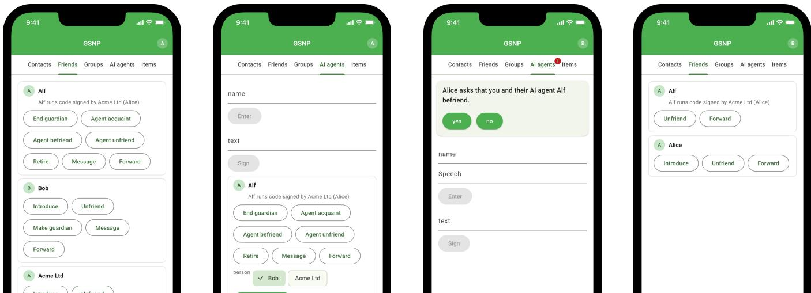

# Corralling AI Risks with Grassroots Contracts (Full Version)

Eh<sub>u</sub>d Sha<sub>p</sub>iro

L<sub>o</sub>nd<sub>o</sub>n S<sub>c</sub>h<sub>oo</sub>l <sub>o</sub>f E<sub>co</sub>n<sub>o</sub>mi<sub>cs a</sub>nd W<sub>e</sub>izm<sub>a</sub>nn In<sub>s</sub>tit<sub>u</sub>t<sub>e o</sub>f S<sub>c</sub>i<sub>e</sub>n<sub>ce</sub>

UK <sub>a</sub>nd I<sub>s</sub>r<sub>ae</sub>l

## Abstract

AI’s inflection <sub>p</sub>oint is a fountain ofalarmin<sub>g</sub> risks. Di<sub>g</sub>ital <sub>p</sub>latforms in particu<sup>l</sup>ar are vu<sup>l</sup>nera<sup>bl</sup>e to t<sup>h</sup>ree major AI ris<sup>k</sup>s, as t<sup>h</sup>ose in <sub>con</sub>t<sub>ro</sub>l <sub>o</sub>f <sub>g</sub>l<sub>o</sub>b<sub>a</sub>l <sub>p</sub>l<sub>a</sub>tf<sub>orms ce</sub>d<sub>e con</sub>t<sub>ro</sub>l t<sub>o</sub> AI<sub>, o</sub>f th<sub>e a</sub>l<sub>gor</sub>ith<sub>ms, o</sub>f <sub>mem</sub>b<sub>ers</sub>hi<sub>p an</sub>d <sub>o</sub>f <sub>con</sub>t<sub>en</sub>t<sub>:</sub>

(1) AI control of global platforms—socia<sup>l</sup> and economic—used <sup>b</sup>y t<sup>h</sup>e majority o<sup>f</sup> <sup>h</sup>umanity, resu<sup>l</sup>ting in t<sup>h</sup>e majority o<sup>f</sup> <sup>h</sup>um<sub>a</sub>nit<sub>y</sub> b<sub>eco</sub>min<sub>g</sub> <sub>vu</sub>ln<sub>e</sub>r<sub>a</sub>bl<sub>e</sub> t<sub>o</sub> AI <sub>co</sub>ntr<sub>o</sub>l<sub>.</sub>

(2) Unaccountable AI agents operating anonymous<sup>l</sup>y on socia<sup>l</sup> <sub>an</sub>d <sub>econom</sub>i<sub>c</sub> di<sub>g</sub>it<sub>a</sub>l <sub>p</sub>l<sub>a</sub>tf<sub>orms, s</sub>id<sub>e-</sub>b<sub>y-s</sub>id<sub>e w</sub>ith h<sub>umans, pos-</sub> sibl<sub>y</sub> mas<sub>q</sub>ueradin<sub>g</sub> as humans<sub>,</sub> servin<sub>g</sub> unknown masters with unknown <sub>g</sub>oals<sub>,</sub> o<sub>p</sub>eratin<sub>g</sub> under unknown restraints without accountabilit<sub>y</sub> or cul<sub>p</sub>abilit<sub>y</sub>.

(3) Unattributed deepfakes generated by anonymous AI, wit<sup>h</sup> <sub>peop</sub>l<sub>e</sub> <sub>una</sub>bl<sub>e</sub> t<sub>o</sub> di<sub>s</sub>ti<sub>ngu</sub>i<sub>s</sub>h th<sub>em</sub> f<sub>rom</sub> <sub>genu</sub>i<sub>ne</sub> <sub>con</sub>t<sub>en</sub>t <sub>an</sub>d with their <sub>p</sub>roducers evadin<sub>g</sub> accountabilit<sub>y</sub> and cul<sub>p</sub>abilit<sub>y</sub>.

Here<sub>,</sub> we <sub>p</sub>ro<sub>p</sub>ose to corral these AI risks with <sub>g</sub>rassroots contracts—a di<sub>g</sub>ital incarnation of a two-centuries old notion of Pierre-Jose<sub>p</sub>h Proudhon. Proudhon envisioned a social contract that <sub>can</sub> b<sub>e</sub> f<sub>ree</sub>l<sub>y-a</sub>d<sub>op</sub>t<sub>e</sub>d b<sub>y</sub> <sub>any</sub> <sub>group</sub> <sub>o</sub>f <sub>peop</sub>l<sub>e,</sub> <sub>w</sub>h<sub>ere</sub> <sub>groups</sub> b<sub>oun</sub>d b<sub>y</sub> th<sub>e</sub> <sub>same</sub> <sub>soc</sub>i<sub>a</sub>l <sub>con</sub>t<sub>rac</sub>t <sub>can</sub> <sub>un</sub>i<sub>on</sub> b<sub>y</sub> <sub>mu</sub>t<sub>ua</sub>l <sub>consen</sub>t<sub>,</sub> <sub>poss</sub>ibl<sub>y</sub> into a sin<sub>g</sub>le <sub>g</sub>lobal union. Grassroots contracts are realised b<sub>y</sub> <sub>g</sub>rassroots <sub>p</sub>latforms—smart<sub>p</sub>hone-based <sub>p</sub>erson-to-<sub>p</sub>erson di<sub>g</sub>ital <sub>p</sub>latforms owned<sub>,</sub> o<sub>p</sub>erated and <sub>g</sub>overned b<sub>y</sub> their <sub>p</sub>artici<sub>p</sub>ants. F<sub>un</sub>d<sub>amen</sub>t<sub>a</sub>l <sub>grassroo</sub>t<sub>s p</sub>l<sub>a</sub>tf<sub>orms</sub> i<sub>nc</sub>l<sub>u</sub>d<sub>e</sub> th<sub>e grassroo</sub>t<sub>s soc</sub>i<sub>a</sub>l <sub>grap</sub>h<sub>, grassroo</sub>t<sub>s soc</sub>i<sub>a</sub>l <sub>ne</sub>t<sub>wor</sub>k<sub>s, c</sub>hild<sub>-sa</sub>f<sub>e soc</sub>i<sub>a</sub>l <sub>ne</sub>t<sub>wor</sub>k<sub>s, an</sub>d <sub>g</sub>rassroots currencies<sub>,</sub> with hi<sub>g</sub>her-level <sub>p</sub>latforms <sub>p</sub>rovidin<sub>g</sub> for d<sub>emocra</sub>ti<sub>c</sub> di<sub>g</sub>it<sub>a</sub>l <sub>commun</sub>iti<sub>es an</sub>d “<sub>s</sub>h<sub>ar</sub>i<sub>ng-economy</sub>” <sub>coopera-</sub> tives. We develo<sub>p</sub>ed<sub>,</sub> with AI<sub>,</sub> a methodolo<sub>gy</sub> to com<sub>p</sub>ile <sub>g</sub>rassroots <sup>contracts to workin</sup>g <sup>smart</sup>p<sup>hone a</sup>pp<sup>s. We</sup> p<sup>resent</sup> g<sup>rassroots</sup> <sub>con</sub>t<sub>rac</sub>t<sub>s</sub> f<sub>or a soc</sub>i<sub>a</sub>l <sub>grap</sub>h <sub>w</sub>ith <sub>accoun</sub>t<sub>a</sub>bl<sub>e</sub> AI <sub>agen</sub>t<sub>s an</sub>d f<sub>or a</sub> social network with di<sub>g</sub>ital <sub>p</sub>rovenance<sub>,</sub> and workin<sub>g</sub> smart<sub>p</sub>hone apps t<sup>h</sup>at imp<sup>l</sup>ement t<sup>h</sup>e two an<sup>d</sup> s<sup>h</sup>ow <sup>h</sup>ow t<sup>h</sup>ey corra<sup>l</sup> t<sup>h</sup>ese major AI <sub>r</sub>i<sub>s</sub>k<sub>s:</sub>

(1) AI control of global platforms is mitigated by grassroots <sub>p</sub>l<sub>a</sub>tf<sub>orms</sub> b<sub>y</sub> d<sub>es</sub>i<sub>gn,</sub> <sub>as,</sub> <sub>un</sub>lik<sub>e</sub> <sub>g</sub>l<sub>o</sub>b<sub>a</sub>l <sub>p</sub>l<sub>a</sub>tf<sub>orms,</sub> th<sub>ey</sub> <sub>are</sub> <sub>no</sub>t <sub>con</sub>t<sub>ro</sub>ll<sub>e</sub>d b<sub>y</sub> <sub>a</sub> thi<sub>r</sub>d <sub>par</sub>t<sub>y</sub> <sub>w</sub>h<sub>o</sub> <sub>may</sub> th<sub>en</sub> <sub>ce</sub>d<sub>e</sub> <sub>con</sub>t<sub>ro</sub>l t<sub>o</sub> AI<sub>.</sub> (2) Unaccountable AI agents are exc<sup>l</sup>uded, as AI agents are int<sub>ro</sub>d<sub>uce</sub>d t<sub>o</sub> th<sub>e</sub> <sub>grassroo</sub>t<sub>s</sub> <sub>soc</sub>i<sub>a</sub>l <sub>grap</sub>h <sub>w</sub>ith <sub>accoun</sub>t<sub>a</sub>bilit<sub>y:</sub> <sub>s</sub>i<sub>m</sub>il<sub>ar</sub>l<sub>y</sub> t<sub>o cars,</sub> th<sub>e</sub>i<sub>r manu</sub>f<sub>ac</sub>t<sub>urers are</sub> k<sub>nown an</sub>d <sub>are ac-</sub> <sub>coun</sub>t<sub>a</sub>bl<sub>e</sub> f<sub>or</sub> <sub>manu</sub>f<sub>ac</sub>t<sub>ur</sub>i<sub>ng</sub> d<sub>e</sub>f<sub>ec</sub>t<sub>s,</sub> <sub>an</sub>d th<sub>e</sub>i<sub>r</sub> <sub>opera</sub>t<sub>ors</sub> <sub>are</sub> k<sub>nown</sub> <sub>an</sub>d <sub>are</sub> <sub>accoun</sub>t<sub>a</sub>bl<sub>e</sub> f<sub>or</sub> <sub>rec</sub>kl<sub>ess</sub> <sub>opera</sub>ti<sub>on.</sub>

(3) Unattributed deepfakes cannot circu<sup>l</sup>ate in grassroots socia<sup>l</sup> networks: ever<sub>y</sub> item carries the si<sub>g</sub>natures of its author and <sub>o</sub>f <sub>every</sub> <sub>agen</sub>t th<sub>a</sub>t f<sub>orwar</sub>d<sub>e</sub>d it<sub>,</sub> <sub>so</sub> <sub>crea</sub>t<sub>ors</sub> <sub>an</sub>d f<sub>orwar</sub>d<sub>ers</sub> <sub>o</sub>f h<sub>arm</sub>f<sub>u</sub>l <sub>con</sub>t<sub>en</sub>t <sub>are accoun</sub>t<sub>a</sub>bl<sub>e an</sub>d <sub>cu</sub>l<sub>pa</sub>bl<sub>e.</sub>

Grassroots <sub>p</sub>latforms are <sub>p</sub>resentl<sub>y</sub> a conce<sub>p</sub>t with mathematical and com<sub>p</sub>utational theor<sub>y,</sub> workin<sub>g</sub> <sub>p</sub>rotot<sub>yp</sub>es<sub>,</sub> and tools for their lar<sub>g</sub>e-scale simulation and testin<sub>g</sub>. Much work remains for <sub>g</sub>rassroots smart<sub>p</sub>hone a<sub>pp</sub>s to be com<sub>p</sub>etitive with incumbent <sub>g</sub>lobal <sub>p</sub>l<sub>a</sub>tf<sub>orms;</sub> b<sub>u</sub>t <sub>per</sub>h<sub>aps now</sub> thi<sub>s cou</sub>ld b<sub>e ac</sub>hi<sub>eve</sub>d <sub>w</sub>ith <sub>some</sub> AI<sub>-</sub> <sub>mon</sub>th<sub>s</sub> <sub>ra</sub>th<sub>er</sub> th<sub>an</sub> <sub>w</sub>ith i<sub>nca</sub>l<sub>cu</sub>l<sub>a</sub>bl<sub>y-many</sub> <sub>person-years.</sub>

## CCS Concepts

• Computing methodologies → Artificial intelligence; Multiagent systems; • Computer systems organization → Peer-topeer architectures; • Human-centered computing → Social networking sites; • Security and privacy → Digital signatures; • Applied computing → Law; • Social and professional topics → Computing / technology policy; • Theory of computation → Distributed com<sub>p</sub>utin<sub>g</sub> models.

## Keywords

Gr<sub>ass</sub>r<sub>oo</sub>t<sub>s</sub> Pl<sub>a</sub>tf<sub>o</sub>rm<sub>s,</sub> Gr<sub>ass</sub>r<sub>oo</sub>t<sub>s</sub> C<sub>o</sub>ntr<sub>ac</sub>t<sub>s,</sub> S<sub>oc</sub>i<sub>a</sub>l C<sub>o</sub>ntr<sub>ac</sub>t<sub>s,</sub> AI Ri<sub>s</sub>k<sub>s,</sub> AI S<sub>a</sub>f<sub>e</sub>t<sub>y,</sub> AI A<sub>ge</sub>nt<sub>s,</sub> A<sub>ccou</sub>nt<sub>a</sub>bl<sub>e</sub> AI<sub>,</sub> D<sub>eep</sub>f<sub>a</sub>k<sub>es,</sub> Di<sub>g</sub>it<sub>a</sub>l Pr<sub>ove</sub>n<sub>a</sub>n<sub>ce,</sub> Di<sub>g</sub>it<sub>a</sub>l S<sub>peec</sub>h A<sub>c</sub>t<sub>s,</sub> G<sub>e</sub>n<sub>u</sub>in<sub>e</sub> Di<sub>g</sub>it<sub>a</sub>l Id<sub>e</sub>ntit<sub>y,</sub> S<sub>oc</sub>i<sub>a</sub>l Networks<sub>,</sub> Smart<sub>p</sub>hone A<sub>pp</sub>s

## TL;DR

Th<sub>ose w</sub>h<sub>o own an</sub>d <sub>con</sub>t<sub>ro</sub>l th<sub>e</sub> W<sub>e</sub>b’<sub>s soc</sub>i<sub>a</sub>l <sub>an</sub>d <sub>econom</sub>i<sub>c</sub> <sub>p</sub>l<sub>a</sub>tf<sub>orms</sub> <sub>are</sub> <sub>now</sub> <sub>ce</sub>di<sub>ng</sub> th<sub>e</sub>i<sub>r</sub> <sub>con</sub>t<sub>ro</sub>l t<sub>o</sub> AI<sub>:</sub> <sub>o</sub>f th<sub>e</sub> <sub>a</sub>l<sub>gor</sub>ith<sub>ms,</sub> o<sup>f</sup> w<sup>h</sup>o may join, an<sup>d</sup> o<sup>f</sup> w<sup>h</sup>at circu<sup>l</sup>ates. Hence, t<sup>h</sup>e majority o<sup>f</sup> h<sub>uman</sub>it<sub>y</sub> <sub>now</sub> f<sub>aces</sub> AI <sub>con</sub>t<sub>ro</sub>l <sub>o</sub>f <sub>g</sub>l<sub>o</sub>b<sub>a</sub>l <sub>p</sub>l<sub>a</sub>tf<sub>orms,</sub> <sub>unaccoun</sub>t<sub>-</sub> <sub>a</sub>bl<sub>e</sub> AI <sub>age</sub>nt<sub>s pos</sub>in<sub>g as peop</sub>l<sub>e, a</sub>nd <sub>u</sub>n<sub>a</sub>ttrib<sub>u</sub>t<sub>e</sub>d d<sub>eep</sub>f<sub>a</sub>k<sub>es.</sub> We <sub>p</sub>ro<sub>p</sub>ose a Web owned<sub>,</sub> o<sub>p</sub>erated and <sub>g</sub>overned b<sub>y</sub> the <sub>p</sub>eo-<sub>p</sub>l<sub>e w</sub>h<sub>o use</sub> it<sub>, w</sub>ith <sub>no</sub> “<sub>o</sub>th<sub>ers</sub>” <sub>w</sub>h<sub>o con</sub>t<sub>ro</sub>l it <sub>an</sub>d <sub>cou</sub>ld <sub>ce</sub>d<sub>e</sub> t<sup>h</sup>eir contro<sup>l</sup> to AI; AI agents join on<sup>l</sup>y un<sup>d</sup>er operators ac-<sub>coun</sub>t<sub>a</sub>bl<sub>e</sub> f<sub>or</sub> th<sub>e</sub>i<sub>r opera</sub>ti<sub>on an</sub>d d<sub>eve</sub>l<sub>opers accoun</sub>t<sub>a</sub>bl<sub>e</sub> f<sub>or</sub> their defects<sub>;</sub> and ever<sub>y</sub> circulatin<sub>g</sub> item carries di<sub>g</sub>ital <sub>p</sub>rove-<sub>nance,</sub> id<sub>en</sub>tif<sub>y</sub>i<sub>ng</sub> it<sub>s au</sub>th<sub>or an</sub>d th<sub>ose w</sub>h<sub>o</sub> f<sub>orwar</sub>d<sub>e</sub>d it<sub>, so a</sub> dee<sub>p</sub>fake loses the <sub>p</sub>rotection ofanon<sub>y</sub>mit<sub>y</sub> b<sub>y</sub> havin<sub>g</sub> someone <sub>accoun</sub>t<sub>a</sub>bl<sub>e</sub> f<sub>or</sub> it<sub>.</sub>

## 1 Introduction

AI’s inflection <sub>p</sub>oint is a fountain of alarmin<sub>g</sub> risks [2, 3, 20, 52, 56]. Digita<sup>l</sup> p<sup>l</sup>at<sup>f</sup>orms in particu<sup>l</sup>ar are vu<sup>l</sup>nera<sup>bl</sup>e to t<sup>h</sup>ree major AI <sub>r</sub>i<sub>s</sub>k<sub>s.</sub> Th<sub>ose</sub> i<sub>n con</sub>t<sub>ro</sub>l <sub>o</sub>f <sub>g</sub>l<sub>o</sub>b<sub>a</sub>l <sub>p</sub>l<sub>a</sub>tf<sub>orms are ce</sub>di<sub>ng con</sub>t<sub>ro</sub>l t<sub>o</sub> AI t<sub>o max</sub>i<sub>m</sub>i<sub>se</sub> th<sub>e va</sub>l<sub>ue ex</sub>t<sub>rac</sub>t<sub>e</sub>d f<sub>rom</sub> th<sub>e</sub>i<sub>r users: o</sub>f th<sub>e a</sub>l<sub>gor</sub>ith<sub>ms,</sub> am<sub>p</sub>lif<sub>y</sub>in<sub>g</sub> commercial surveillance [59]; of membershi<sub>p</sub>, b<sub>y</sub> lettin<sub>g</sub> AI a<sub>g</sub>ents mas<sub>q</sub>uerade as <sub>p</sub>eo<sub>p</sub>le [15, 31]; and of content, b<sub>y</sub> lettin<sub>g</sub> AI <sub>g</sub>enerate dee<sub>p</sub>fakes with no one held accountable [28].

(1) AI control of global platforms—socia<sup>l</sup> and economic—used <sup>b</sup>y t<sup>h</sup>e majority o<sup>f h</sup>umanity, resu<sup>l</sup>ting in t<sup>h</sup>e majority o<sup>f h</sup>u-<sub>man</sub>it<sub>y</sub> b<sub>ecom</sub>i<sub>ng vu</sub>l<sub>nera</sub>bl<sub>e</sub> t<sub>o</sub> AI <sub>con</sub>t<sub>ro</sub>l<sub>.</sub> Pl<sub>a</sub>tf<sub>orm owners</sub> ma<sub>y</sub> dele<sub>g</sub>ate the o<sub>p</sub>eration of their <sub>p</sub>latforms to AI<sub>,</sub> <sub>g</sub>ivin<sub>g</sub> AI s<sub>y</sub>stems <sub>p</sub>ower over the social and economic lives of their <sub>p</sub>artici<sub>p</sub>ants and com<sub>p</sub>oundin<sub>g</sub> existin<sub>g</sub> concentrations of <sub>p</sub>ower<sub>,</sub> surveillance and mani<sub>p</sub>ulation [3, 10, 51, 58]; the <sub>p</sub>artici<sub>p</sub>ants are t<sup>h</sup>en su<sup>b</sup>ject to AI contro<sup>l</sup> even w<sup>h</sup>en t<sup>h</sup>e AI <sup>f</sup>ait<sup>hf</sup>u<sup>ll</sup>y pursues its owners<sup>’</sup> o<sup>b</sup>jectives, an<sup>d</sup> t<sup>h</sup>e owners may <sup>l</sup>ater <sup>b</sup>e una<sup>bl</sup>e to reclaim the control the<sub>y</sub> dele<sub>g</sub>ated [2]. Kulveit et al. [24] anal <sub>y</sub>se the broader <sub>p</sub>ossibilit<sub>y</sub> that successive decisions to ado<sub>p</sub>t AI <sub>gra</sub>d<sub>ua</sub>ll<sub>y</sub> <sub>ero</sub>d<sub>e</sub> h<sub>uman</sub> i<sub>n</sub>fl<sub>uence</sub> <sub>over</sub> <sub>soc</sub>i<sub>e</sub>t<sub>a</sub>l <sub>sys</sub>t<sub>ems.</sub>

(2) Unaccountable AI agents operating anonymous<sup>l</sup>y on socia<sup>l</sup> <sub>an</sub>d <sub>econom</sub>i<sub>c</sub> di<sub>g</sub>it<sub>a</sub>l <sub>p</sub>l<sub>a</sub>tf<sub>orms, s</sub>id<sub>e-</sub>b<sub>y-s</sub>id<sub>e w</sub>ith h<sub>umans, pos-</sub> sibl<sub>y</sub> mas<sub>q</sub>ueradin<sub>g</sub> as humans<sub>,</sub> servin<sub>g</sub> unknown masters with unknown <sub>g</sub>oals<sub>,</sub> o<sub>p</sub>eratin<sub>g</sub> under unknown restraints without accountabilit<sub>y</sub> or cul<sub>p</sub>abilit<sub>y</sub>. Social bots alread<sub>y</sub> take <sub>p</sub>art in social networks and im<sub>p</sub>ersonate <sub>p</sub>eo<sub>p</sub>le [15, 31]. Pro<sub>p</sub>osals to establish, <sub>p</sub>rivatel<sub>y</sub>, that a <sub>p</sub>artici<sub>p</sub>ant is a <sub>p</sub>erson [1] and to make an AI a<sub>g</sub>ent’s activit<sub>y</sub> attributable throu<sub>g</sub>h identifiers<sub>,</sub> monitorin<sub>g</sub> and lo<sub>g</sub>s [7, 51] address two diferent <sub>q</sub>uestions: whether a <sub>p</sub>erson is <sub>p</sub>artici<sub>p</sub>atin<sub>g,</sub> and who authorised an a<sub>g</sub>ent’s acts <sub>an</sub>d i<sub>s answera</sub>bl<sub>e</sub> f<sub>or</sub> th<sub>em.</sub> Att<sub>r</sub>ib<sub>u</sub>ti<sub>on mus</sub>t <sub>a</sub>l<sub>so</sub> b<sub>e re</sub>l<sub>a</sub>t<sub>e</sub>d t<sub>o</sub> actual authorit<sub>y</sub> and control [34]: an identifiable <sub>p</sub>erson ma<sub>y</sub> <sub>o</sub>th<sub>erw</sub>i<sub>se</sub> b<sub>e</sub> <sub>ma</sub>d<sub>e</sub> t<sub>o</sub> b<sub>ear</sub> <sub>respons</sub>ibilit<sub>y</sub> f<sub>or</sub> <sub>a</sub> <sub>sys</sub>t<sub>em</sub> <sub>over</sub> which the<sub>y</sub> had little control, Elish’s moral crum<sub>p</sub>le zone [13].

(3) Unattributed deepfakes generated by anonymous AI, wit<sup>h</sup> <sub>peop</sub>l<sub>e</sub> <sub>una</sub>bl<sub>e</sub> t<sub>o</sub> di<sub>s</sub>ti<sub>ngu</sub>i<sub>s</sub>h th<sub>em</sub> f<sub>rom</sub> <sub>genu</sub>i<sub>ne</sub> <sub>con</sub>t<sub>en</sub>t <sub>an</sub>d with their <sub>p</sub>roducers evadin<sub>g</sub> accountabilit<sub>y</sub> and cul<sub>p</sub>abilit<sub>y</sub>. U<sub>n</sub>t<sub>ra</sub>i<sub>ne</sub>d <sub>o</sub>b<sub>servers</sub> di<sub>s</sub>ti<sub>ngu</sub>i<sub>s</sub>h <sub>syn</sub>th<sub>e</sub>ti<sub>c</sub> f<sub>aces</sub> f<sub>rom rea</sub>l <sub>ones</sub> at about chance level [30], and a dece<sub>p</sub>tive <sub>p</sub>olitical dee<sub>p</sub>fake raises uncertaint<sub>y</sub> and lowers trust in news on social media [55]; Mirsk<sub>y</sub> and Lee surve<sub>y</sub> the creation and detection of dee<sub>p</sub> fakes [28], and Chesne<sub>y</sub> and Citron their conse<sub>q</sub>uences for <sub>p</sub>rivac<sub>y</sub>, democrac<sub>y</sub> and national securit<sub>y</sub> [9]. Detection esti-<sub>ma</sub>t<sub>es</sub> <sub>w</sub>h<sub>e</sub>th<sub>er</sub> <sub>con</sub>t<sub>en</sub>t i<sub>s</sub> <sub>syn</sub>th<sub>e</sub>ti<sub>c;</sub> <sub>provenance</sub> <sub>recor</sub>d<sub>s</sub> <sub>w</sub>h<sub>o</sub> <sub>p</sub>roduced, endorsed or forwarded it [8], and su<sub>pp</sub>orts accountabilit<sub>y</sub> without establishin<sub>g</sub> that the content is true [8, 18].

T<sub>wo</sub> f<sub>ur</sub>th<sub>er</sub> AI <sub>r</sub>i<sub>s</sub>k<sub>s are no</sub>t <sub>a</sub>dd<sub>resse</sub>d h<sub>ere:</sub> h<sub>arms</sub> t<sub>o peop</sub>l<sub>e us-</sub> in<sub>g</sub> AI<sub>,</sub> throu<sub>g</sub>h erroneous advice<sub>,</sub> mani<sub>p</sub>ulation<sub>,</sub> overreliance or emotional de<sub>p</sub>endence [2, 14, 16, 56], and harms <sub>p</sub>eo<sub>p</sub>le cause with <sub>a</sub>biliti<sub>es</sub> <sub>amp</sub>lifi<sub>e</sub>d b<sub>y</sub> AI<sub>,</sub> <sub>suc</sub>h <sub>as</sub> f<sub>rau</sub>d<sub>,</sub> h<sub>arassmen</sub>t <sub>an</sub>d <sub>cy</sub>b<sub>era</sub>t<sub>-</sub> tacks [2, 5, 27].

Here<sub>,</sub> we <sub>p</sub>ro<sub>p</sub>ose to corral these AI risks with <sub>g</sub>rassroots contracts [6, 17], a di<sub>g</sub>ital incarnation of a two-centuries old notion of Pierre-Jose<sub>p</sub>h Proudhon [33, Sixth Stud<sub>y</sub>]. Proudhon envisioned a <sub>soc</sub>i<sub>a</sub>l <sub>con</sub>t<sub>rac</sub>t th<sub>a</sub>t <sub>can</sub> b<sub>e</sub> f<sub>ree</sub>l<sub>y a</sub>d<sub>op</sub>t<sub>e</sub>d b<sub>y any group o</sub>f <sub>peop</sub>l<sub>e—</sub> <sub>one cou</sub>ld “<sub>ma</sub>k<sub>e a con</sub>t<sub>rac</sub>t <sub>w</sub>ith <sub>a</sub>ll<sub>, as . . . w</sub>ith <sub>some</sub>”<sub>—w</sub>h<sub>ere</sub> <sub>groups</sub> b<sub>oun</sub>d b<sub>y</sub> th<sub>e same soc</sub>i<sub>a</sub>l <sub>con</sub>t<sub>rac</sub>t <sub>can un</sub>i<sub>on</sub> b<sub>y mu</sub>t<sub>ua</sub>l <sub>consen</sub>t<sub>, poss</sub>ibl<sub>y</sub> i<sub>n</sub>t<sub>o a s</sub>i<sub>ng</sub>l<sub>e g</sub>l<sub>o</sub>b<sub>a</sub>l <sub>un</sub>i<sub>on—</sub>“<sub>eac</sub>h <sub>group o</sub>f <sub>c</sub>iti<sub>zens</sub> <sub>. . .</sub> f<sub>orme</sub>d b<sub>y a</sub> lik<sub>e con</sub>t<sub>rac</sub>t <sub>. . . cou</sub>ld th<sub>erea</sub>ft<sub>er, an</sub>d <sub>a</sub>l<sub>ways</sub> b<sub>y</sub> a similar contract<sub>,</sub> a<sub>g</sub>ree with ever<sub>y</sub> and all other <sub>g</sub>rou<sub>p</sub>s”. Grassroots contracts are realised b<sub>y g</sub>rassroots <sub>p</sub>latforms [26, 38, 40, 45]: <sub>smar</sub>t<sub>p</sub>h<sub>one-</sub>b<sub>ase</sub>d <sub>person-</sub>t<sub>o-person</sub> di<sub>g</sub>it<sub>a</sub>l <sub>p</sub>l<sub>a</sub>tf<sub>orms owne</sub>d<sub>, oper-</sub> ated and <sub>g</sub>overned b<sub>y</sub> their <sub>p</sub>artici<sub>p</sub>ants. A <sub>g</sub>rassroots <sub>p</sub>latform is constituted from its <sub>p</sub>artici<sub>p</sub>ants’ smart<sub>p</sub>hones and the <sub>g</sub>rassroots a<sub>pp</sub> each <sub>p</sub>artici<sub>p</sub>ant runs<sub>,</sub> and re<sub>q</sub>uires no <sub>g</sub>lobal resource but the <sub>ne</sub>t<sub>wor</sub>k<sub>: no</sub> h<sub>ar</sub>d<sub>w</sub>i<sub>re</sub>d <sub>servers, no g</sub>l<sub>o</sub>b<sub>a</sub>l <sub>au</sub>th<sub>or</sub>it<sub>y, an</sub>d <sub>no</sub>b<sub>o</sub>d<sub>y</sub>’<sub>s</sub> <sub>perm</sub>i<sub>ss</sub>i<sub>on</sub> t<sub>o s</sub>t<sub>ar</sub>t<sub>.</sub> Gl<sub>o</sub>b<sub>a</sub>l <sub>p</sub>l<sub>a</sub>tf<sub>orms, cen</sub>t<sub>ra</sub>li<sub>se</sub>d lik<sub>e</sub> F<sub>ace</sub>b<sub>oo</sub>k <sub>or</sub> decentralised like Bitcoin and Ethereum [29, 57], can have onl<sub>y</sub> <sub>a s</sub>i<sub>ng</sub>l<sub>e</sub> i<sub>ns</sub>t<sub>ance, as</sub> t<sub>wo</sub> i<sub>ns</sub>t<sub>ances wou</sub>ld <sub>c</sub>l<sub>as</sub>h <sub>over</sub> th<sub>e g</sub>l<sub>o</sub>b<sub>a</sub>l <sub>resources—</sub>d<sub>oma</sub>i<sub>n name, por</sub>t <sub>num</sub>b<sub>er, or</sub> b<sub>oo</sub>t <sub>no</sub>d<sub>es—</sub>h<sub>ar</sub>d<sub>w</sub>i<sub>re</sub>d i<sub>n</sub>t<sub>o</sub> th<sub>e</sub>i<sub>r</sub> <sub>co</sub>d<sub>e,</sub> <sub>an</sub>d f<sub>rom</sub> th<sub>e</sub> <sub>perspec</sub>ti<sub>ve</sub> <sub>o</sub>f <sub>or</sub>di<sub>nary</sub> <sub>peop</sub>l<sub>e</sub> <sub>a</sub>ll <sub>o</sub>f th<sub>em are mono</sub>lithi<sub>c en</sub>titi<sub>es owne</sub>d<sub>, opera</sub>t<sub>e</sub>d <sub>an</sub>d <sub>governe</sub>d b<sub>y o</sub>th ers [41]. Fundamental <sub>g</sub>rassroots <sub>p</sub>latforms include the <sub>g</sub>rassroots social <sub>g</sub>ra<sub>p</sub>h [12, 17, 39], <sub>g</sub>rassroots social networks [39], childsafe social networks [43], and <sub>g</sub>rassroots currencies [25, 37, 44, 48], <sub>w</sub>ith hi<sub>g</sub>h<sub>er-</sub>l<sub>eve</sub>l <sub>p</sub>l<sub>a</sub>tf<sub>orms prov</sub>idi<sub>ng</sub> f<sub>or</sub> d<sub>emocra</sub>ti<sub>c</sub> di<sub>g</sub>it<sub>a</sub>l <sub>com-</sub> munities [19, 21, 50, 53] and “sharin<sub>g</sub>-econom<sub>y</sub>” coo<sub>p</sub>eratives (in <sub>p</sub>re<sub>p</sub>aration).

We develo<sub>p</sub>ed<sub>,</sub> with AI<sub>,</sub> a methodolo<sub>gy</sub> to com<sub>p</sub>ile <sub>g</sub>rassroots contracts to workin<sub>g</sub> smart<sub>p</sub>hone a<sub>pp</sub>s: an abstraction cascade from the contract to the a<sub>pp</sub> (Section 2), its correctness <sub>p</sub>roved from the t<sub>ransac</sub>ti<sub>ons</sub> d<sub>own</sub> t<sub>o</sub> GLP <sub>an</sub>d th<sub>e</sub> <sub>app</sub> b<sub>u</sub>ilt <sub>an</sub>d t<sub>es</sub>t<sub>e</sub>d<sub>,</sub> <sub>eac</sub>h l<sub>ayer</sub> coded b<sub>y</sub> AI from the <sub>p</sub>a<sub>p</sub>er that describes it [11, 17, 22, 26, 42, 46, 49].

In this <sub>p</sub>a<sub>p</sub>er<sub>,</sub> we <sub>p</sub>resent <sub>g</sub>rassroots contracts for a social <sub>g</sub>ra<sub>p</sub>h with accountable AI a<sub>g</sub>ents (Section 3) and for a social network with di<sub>g</sub>ital <sub>p</sub>rovenance (Section 4), and workin<sub>g</sub> smart<sub>p</sub>hone a<sub>pp</sub>s that im<sub>p</sub>lement the two (Fi<sub>g</sub>ures 4 and 5), and show how the<sub>y</sub> corral t<sup>h</sup>ese major AI ris<sup>k</sup>s:

(1) AI control of global platforms is mitigated by grassroots <sub>p</sub>l<sub>a</sub>tf<sub>orms</sub> b<sub>y</sub> d<sub>es</sub>i<sub>gn,</sub> <sub>as,</sub> <sub>un</sub>lik<sub>e</sub> <sub>g</sub>l<sub>o</sub>b<sub>a</sub>l <sub>p</sub>l<sub>a</sub>tf<sub>orms,</sub> th<sub>ey</sub> <sub>are</sub> <sub>no</sub>t <sub>con</sub>t<sub>ro</sub>ll<sub>e</sub>d b<sub>y a</sub> thi<sub>r</sub>d <sub>par</sub>t<sub>y w</sub>h<sub>o may</sub> th<sub>en ce</sub>d<sub>e con</sub>t<sub>ro</sub>l t<sub>o</sub> AI<sub>.</sub> A <sub>grassroo</sub>t<sub>s</sub> <sub>p</sub>l<sub>a</sub>tf<sub>orm</sub> h<sub>as</sub> <sub>no</sub> <sub>servers,</sub> <sub>no</sub> <sub>opera</sub>t<sub>ors</sub> <sub>an</sub>d <sub>no</sub> <sub>g</sub>l<sub>o</sub>b<sub>a</sub>l <sub>resources, so</sub> th<sub>ere</sub> i<sub>s no par</sub>t <sub>o</sub>fit <sub>w</sub>h<sub>ose cap</sub>t<sub>ure</sub> i<sub>s con</sub>t<sub>ro</sub>l <sub>o</sub>fth<sub>e</sub> <sub>p</sub>l<sub>a</sub>tf<sub>orm, an</sub>d t<sub>o con</sub>t<sub>ro</sub>l it <sub>an</sub> AI <sub>mus</sub>t <sub>con</sub>t<sub>ro</sub>l th<sub>e smar</sub>t<sub>p</sub>h<sub>ones</sub> of its <sub>p</sub>artici<sub>p</sub>ants, one b<sub>y</sub> one [38, 40, 41].

(2) Unaccountable AI agents are exc<sup>l</sup>uded, as AI agents are int<sub>ro</sub>d<sub>uce</sub>d t<sub>o</sub> th<sub>e grassroo</sub>t<sub>s soc</sub>i<sub>a</sub>l <sub>grap</sub>h <sub>w</sub>ith <sub>accoun</sub>t<sub>a</sub>bilit<sub>y:</sub> <sub>s</sub>i<sub>m</sub>il<sub>ar</sub>l<sub>y</sub> t<sub>o</sub> <sub>cars,</sub> th<sub>e</sub>i<sub>r</sub> <sub>manu</sub>f<sub>ac</sub>t<sub>urers</sub> <sub>are</sub> k<sub>nown</sub> <sub>an</sub>d <sub>are</sub> <sub>ac-</sub> <sub>coun</sub>t<sub>a</sub>bl<sub>e</sub> f<sub>or manu</sub>f<sub>ac</sub>t<sub>ur</sub>i<sub>ng</sub> d<sub>e</sub>f<sub>ec</sub>t<sub>s, an</sub>d th<sub>e</sub>i<sub>r opera</sub>t<sub>ors are</sub> k<sub>nown an</sub>d <sub>are accoun</sub>t<sub>a</sub>bl<sub>e</sub> f<sub>or rec</sub>kl<sub>ess opera</sub>ti<sub>on.</sub> A <sub>person</sub> takes <sub>p</sub>art in a <sub>g</sub>rassroots <sub>p</sub>latform onl<sub>y</sub> with a<sub>g</sub>ents the<sub>y</sub> met or were introduced to b<sub>y</sub> an a<sub>g</sub>ent who knows them [17, 32, 35, 39], so an AI agent joins on<sup>l</sup>y un<sup>d</sup>er a person, its principa<sup>l</sup>, w<sup>h</sup>o attests that it runs code si<sub>g</sub>ned b<sub>y</sub> its develo<sub>p</sub>er<sub>;</sub> ever<sub>y</sub> <sub>g</sub>uardian <sub>o</sub>f th<sub>e</sub> AI <sub>agen</sub>t i<sub>s</sub> <sub>accoun</sub>t<sub>a</sub>bl<sub>e</sub> f<sub>or</sub> <sub>opera</sub>ti<sub>ng</sub> it <sub>rec</sub>kl<sub>ess</sub>l<sub>y,</sub> <sub>an</sub>d th<sub>e</sub> d<sub>eve</sub>l<sub>oper</sub> f<sub>or</sub> it<sub>s</sub> d<sub>e</sub>f<sub>ec</sub>t<sub>s;</sub> <sub>every</sub> <sub>ac</sub>t <sub>o</sub>f th<sub>e</sub> AI <sub>agen</sub>t <sub>names</sub> its <sub>p</sub>rinci<sub>p</sub>al and its develo<sub>p</sub>er<sub>,</sub> carries the attestation<sub>,</sub> and is si<sub>g</sub>ned and non-re<sub>p</sub>udiable [6, 12, 18]. The contract shares its core with the child-safe social network [43], whose wards are <sub>c</sub>hild<sub>ren</sub> <sub>an</sub>d <sub>w</sub>h<sub>ose</sub> <sub>guar</sub>di<sub>ans</sub> <sub>are</sub> th<sub>e</sub>i<sub>r</sub> <sub>paren</sub>t<sub>s.</sub>

(3) Unattributed deepfakes cannot circu<sup>l</sup>ate in grassroots socia<sup>l</sup> networks: ever<sub>y</sub> item is a di<sub>g</sub>ital s<sub>p</sub>eech act [18], si<sub>g</sub>ned b<sub>y</sub> its author and carried alon<sub>g</sub> the ed<sub>g</sub>es of the social <sub>g</sub>ra<sub>p</sub>h [17, 39], <sub>an</sub>d <sub>s</sub>i<sub>gne</sub>d <sub>over</sub> b<sub>y eac</sub>h <sub>agen</sub>t th<sub>a</sub>t f<sub>orwar</sub>d<sub>s</sub> it<sub>; so crea</sub>t<sub>ors an</sub>d f<sub>orwar</sub>d<sub>ers</sub> <sub>o</sub>f h<sub>arm</sub>f<sub>u</sub>l <sub>con</sub>t<sub>en</sub>t <sub>are</sub> <sub>accoun</sub>t<sub>a</sub>bl<sub>e</sub> <sub>an</sub>d <sub>cu</sub>l<sub>pa</sub>bl<sub>e,</sub> <sub>an</sub>d <sub>peop</sub>l<sub>e can</sub> t<sub>e</sub>ll <sub>con</sub>t<sub>en</sub>t <sub>w</sub>ith <sub>provenance</sub> f<sub>rom con</sub>t<sub>en</sub>t <sub>w</sub>ith<sub>-</sub> <sub>ou</sub>t it<sub>.</sub> S<sub>ome c</sub>l<sub>auses o</sub>f <sub>a grassroo</sub>t<sub>s con</sub>t<sub>rac</sub>t <sub>are en</sub>f<sub>orce</sub>d b<sub>y a</sub> <sub>correc</sub>t <sub>pro</sub>t<sub>oco</sub>l<sub>, an</sub>d <sub>o</sub>th<sub>ers</sub> l<sub>eave non-repu</sub>di<sub>a</sub>bl<sub>e ev</sub>id<sub>ence</sub> f<sub>or</sub> recourse when breached [17].

Grassroots <sub>p</sub>latforms are <sub>p</sub>resentl<sub>y</sub> a conce<sub>p</sub>t with mathematical and com<sub>p</sub>utational theor<sub>y</sub> [17, 26, 38, 41, 45], workin<sub>g p</sub>rotot<sub>yp</sub>es [11, 22, 46], and tools for their lar<sub>g</sub>e-scale simulation and testin<sub>g</sub> [47]. We have develo<sub>p</sub>ed <sub>g</sub>rassroots theor<sub>y</sub> for a decade b<sub>u</sub>t <sub>cou</sub>ld <sub>no</sub>t <sub>mus</sub>t<sub>er</sub> th<sub>e resources nee</sub>d<sub>e</sub>d t<sub>o</sub> t<sub>urn</sub> it i<sub>n</sub>t<sub>o com-</sub> <sub>p</sub>etitive software<sub>,</sub> <sub>g</sub>iven the not-for-<sub>p</sub>rofit<sub>,</sub> common-<sub>g</sub>ood nature o<sup>f</sup> our project. Now, AI is piercing t<sup>h</sup>roug<sup>h</sup> t<sup>h</sup>is conun<sup>d</sup>rum: our <sub>sc</sub>i<sub>en</sub>tifi<sub>c</sub> <sub>papers</sub> <sub>serve</sub> <sub>as</sub> th<sub>e</sub> <sub>evo</sub>l<sub>v</sub>i<sub>ng</sub> i<sub>n</sub>t<sub>er</sub>f<sub>ace</sub> b<sub>e</sub>t<sub>ween</sub> <sub>us</sub> h<sub>u-</sub> mans and AI, which codes from them [46, 49]. Much work remains for <sub>g</sub>rassroots smart<sub>p</sub>hone a<sub>pp</sub>s to be com<sub>p</sub>etitive with incumbent <sub>g</sub>l<sub>o</sub>b<sub>a</sub>l <sub>p</sub>l<sub>a</sub>tf<sub>orms;</sub> b<sub>u</sub>t <sub>per</sub>h<sub>aps now</sub> thi<sub>s cou</sub>ld b<sub>e ac</sub>hi<sub>eve</sub>d <sub>w</sub>ith <sub>some</sub> AI<sub>-mon</sub>th<sub>s</sub> <sub>ra</sub>th<sub>er</sub> th<sub>an</sub> <sub>w</sub>ith i<sub>nca</sub>l<sub>cu</sub>l<sub>a</sub>bl<sub>y-many</sub> <sub>person-years.</sub>

Section 2 ex<sub>p</sub>lains how a <sub>g</sub>rassroots contract becomes an a<sub>pp,</sub> <sub>an</sub>d <sub>presen</sub>t<sub>s</sub> th<sub>e grassroo</sub>t<sub>s soc</sub>i<sub>a</sub>l <sub>grap</sub>h <sub>an</sub>d th<sub>e grassroo</sub>t<sub>s so-</sub> cial network with their a<sub>pp</sub>s. Section 3 <sub>p</sub>resents the contract with accountable AI a<sub>g</sub>ents and Section 4 the contract with di<sub>g</sub>ital <sub>p</sub>rove-<sub>nance,</sub> <sub>eac</sub>h <sub>w</sub>ith <sub>w</sub>h<sub>a</sub>t it <sub>exc</sub>l<sub>u</sub>d<sub>es</sub> <sub>an</sub>d <sub>w</sub>h<sub>a</sub>t it <sub>ma</sub>k<sub>es</sub> <sub>answera</sub>bl<sub>e.</sub> S<sub>ec</sub>ti<sub>o</sub>n 5 r<sub>ev</sub>i<sub>ews</sub> r<sub>e</sub>l<sub>a</sub>t<sub>e</sub>d <sub>wo</sub>rk <sub>a</sub>nd S<sub>ec</sub>ti<sub>o</sub>n 6 <sub>co</sub>n<sub>c</sub>l<sub>u</sub>d<sub>es.</sub> A<sub>ppe</sub>ndi<sub>x</sub> A <sub>reca</sub>ll<sub>s</sub> th<sub>e</sub> f<sub>ramewor</sub>k<sub>,</sub> A<sub>ppen</sub>di<sub>x</sub> B li<sub>s</sub>t<sub>s</sub> th<sub>e</sub> t<sub>ransac</sub>ti<sub>ons,</sub> <sub>an</sub>d A<sub>ppen</sub>di<sub>x</sub> C d<sub>e</sub>fi<sub>nes</sub> <sub>con</sub>t<sub>rac</sub>t<sub>s</sub> <sub>w</sub>ith <sub>war</sub>d<sub>s,</sub> <sub>an</sub> <sub>ex</sub>t<sub>ens</sub>i<sub>on</sub> <sub>o</sub>f th<sub>e</sub> s<sub>p</sub>eech-act schema lan<sub>g</sub>ua<sub>g</sub>e of [17], and <sub>p</sub>roves that the <sub>p</sub>rotocol realisin<sub>g</sub> one is volitionall<sub>y</sub> <sub>g</sub>rassroots<sub>,</sub> this contract’s amon<sub>g</sub> them.

## 2 Grassroots Contracts

A <sub>g</sub>rassroots contract [6, 17] is a few clauses in <sub>p</sub>lain lan<sub>g</sub>ua<sub>g</sub>e, each d<sub>escr</sub>ibi<sub>ng an ac</sub>t<sub>—w</sub>h<sub>o</sub> t<sub>a</sub>k<sub>es</sub> it<sub>, w</sub>h<sub>o mus</sub>t <sub>agree</sub> t<sub>o</sub> it<sub>, an</sub>d <sub>w</sub>h<sub>a</sub>t it chan<sub>g</sub>es—or bindin<sub>g</sub> the a<sub>g</sub>ents without describin<sub>g</sub> one. Befriendin<sub>g</sub> i<sub>s an ac</sub>t <sub>o</sub>f t<sub>wo persons,</sub> b<sub>o</sub>th <sub>o</sub>f <sub>w</sub>h<sub>om mus</sub>t <sub>agree; en</sub>di<sub>ng a</sub> f<sub>r</sub>i<sub>en</sub>d <sub>s</sub>hi<sub>p</sub> i<sub>s an ac</sub>t <sub>o</sub>f <sub>one.</sub> Th<sub>e con</sub>t<sub>rac</sub>t i<sub>s</sub> th<sub>e w</sub>h<sub>o</sub>l<sub>e o</sub>f th<sub>e p</sub>l<sub>a</sub>tf<sub>orm</sub>’<sub>s</sub> d<sub>es</sub>i<sub>gn:</sub> th<sub>ere</sub> i<sub>s</sub> <sub>no</sub> <sub>server,</sub> <sub>no</sub> <sub>opera</sub>t<sub>or</sub> <sub>an</sub>d <sub>no</sub> <sub>accoun</sub>t<sub>,</sub> <sub>on</sub>l<sub>y</sub> th<sub>e</sub> <sub>p</sub>ersons who ado<sub>p</sub>ted the contract and their smart<sub>p</sub>hones [38, 40]. Each clause opens with its legal modality [17]: enforced: no act of agents can breach it; attested by the signatures of the actors: an agent may breach it, and the contract records the breach; undertaken by the actors: its performance lies outside the contract, which records only the undertaking. A contract ends with its pragmas, <sub>w</sub>hi<sub>c</sub>h th<sub>e</sub> <sub>app</sub> b<sub>u</sub>ilt f<sub>rom</sub> it f<sub>o</sub>ll<sub>ows:</sub> th<sub>e</sub> fi<sub>rs</sub>t li<sub>ne</sub> <sub>names</sub> <sub>a</sub> t<sub>a</sub>b <sub>o</sub>f th<sub>e</sub> a<sub>pp</sub> and what it lists<sub>,</sub> a row showin<sub>g</sub> the atoms of the state namin<sub>g</sub> it<sub>s</sub> it<sub>em,</sub> <sub>an</sub>d <sub>eac</sub>h <sub>o</sub>th<sub>er</sub> li<sub>ne</sub> <sub>names</sub> <sub>a</sub> <sub>c</sub>l<sub>ause</sub> b<sub>y</sub> it<sub>s</sub> titl<sub>e,</sub> th<sub>en</sub> th<sub>e</sub> a<sub>g</sub>ent <sub>p</sub>ro<sub>p</sub>osin<sub>g,</sub> a button for each act the<sub>y</sub> <sub>p</sub>ro<sub>p</sub>ose<sub>,</sub> bearin<sub>g</sub> its act’s <sub>name,</sub> <sub>an</sub>d <sub>any</sub> fi<sub>e</sub>ld th<sub>ey</sub> fill<sub>,</sub> <sub>an</sub>d <sub>a</sub> li<sub>ne</sub> f<sub>or</sub> <sub>eac</sub>h <sub>o</sub>th<sub>er</sub> <sub>agen</sub>t <sub>as</sub>k<sub>e</sub>d<sub>,</sub> their name and the <sub>q</sub>uestion <sub>p</sub>ut to them [17, 22]. We show the <sub>p</sub>ra<sub>g</sub>- mas of GAI (Section 3) and GSNP (Section 4); the <sub>p</sub>ra<sub>g</sub>mas of ever<sub>y</sub> contract are in the re<sub>p</sub>ositor<sub>y</sub> htt<sub>p</sub>s://<sub>g</sub>ithub.com/ESha<sub>p</sub>iro2/GLP<sub>,</sub> and GKK’s, GSG’s and GSN’s in [17].

From the contract to the app. T<sup>h</sup>e c<sup>l</sup>auses are written as speec<sup>h</sup>- act schemas [17], which name the roles of an act, which of them <sub>mus</sub>t <sub>w</sub>ill it<sub>,</sub> <sub>an</sub>d <sub>w</sub>h<sub>a</sub>t <sub>eac</sub>h <sub>ro</sub>l<sub>e</sub>’<sub>s</sub> <sub>s</sub>t<sub>a</sub>t<sub>e</sub> <sub>mus</sub>t h<sub>o</sub>ld b<sub>e</sub>f<sub>ore</sub> <sub>an</sub>d <sub>comes</sub> t<sub>o</sub> h<sub>o</sub>ld <sub>a</sub>ft<sub>er;</sub> th<sub>e sc</sub>h<sub>emas comp</sub>il<sub>e</sub> i<sub>n</sub>t<sub>o vo</sub>liti<sub>on-guar</sub>d<sub>e</sub>d <sub>mu</sub>lti<sub>a</sub> <sub>g</sub>ent atomic transactions [26], each a chan<sub>g</sub>e to the states of its <sub>p</sub>artici<sub>p</sub>ants that occurs onl<sub>y</sub> if the <sub>p</sub>ersons <sub>g</sub>uardin<sub>g</sub> it are willin<sub>g;</sub> the transactions are realised b<sub>y</sub> communicatin<sub>g</sub> volitional a<sub>g</sub>ents<sub>,</sub> <sub>w</sub>h<sub>ose</sub> <sub>on</sub>l<sub>y</sub> <sub>ac</sub>t<sub>s</sub> b<sub>e</sub>t<sub>ween</sub> t<sub>wo</sub> <sub>agen</sub>t<sub>s</sub> <sub>are</sub> di<sub>scovery</sub> <sub>an</sub>d <sub>message</sub> deliver<sub>y,</sub> and then b<sub>y</sub> a volition-<sub>g</sub>uarded Grassroots Lo<sub>g</sub>ic Pro<sub>g</sub>ram (vGLP) [22], which is transformed into the <sub>p</sub>latform’s user interface and com<sub>p</sub>iled to Grassroots Lo<sub>g</sub>ic Pro<sub>g</sub>rams (GLP) [42, 49], im<sub>p</sub>lemented in Dart and Flutter [46] and run as a mini-a<sub>pp</sub> of the Grassroots Su<sub>p</sub>er-A<sub>pp</sub> on a <sub>p</sub>erson’s smart<sub>p</sub>hone [11] (Fi<sub>g</sub>ure 1). Correctness is <sub>p</sub>roved from the transactions down to GLP [22, 26]; th<sub>e</sub> <sub>app</sub> i<sub>s</sub> b<sub>u</sub>ilt <sub>an</sub>d t<sub>es</sub>t<sub>e</sub>d<sub>.</sub> E<sub>ac</sub>h l<sub>ayer</sub> i<sub>s</sub> <sub>co</sub>d<sub>e</sub>d b<sub>y</sub> AI f<sub>rom</sub> th<sub>e</sub> <sub>paper</sub> that describes it<sub>;</sub> a <sub>g</sub>a<sub>p</sub> found in codin<sub>g</sub> is re<sub>p</sub>aired in the <sub>p</sub>a<sub>p</sub>er first<sub>,</sub> and the code follows [46].

What a person sees. Vo<sup>l</sup>ition e<sup>l</sup>icitation is t<sup>h</sup>e rationa<sup>l</sup>e <sup>f</sup>or t<sup>h</sup>e user interface desi<sub>g</sub>n [22]. An act a <sub>p</sub>erson must will a<sub>pp</sub>ears on their <sub>p</sub>hone as a <sub>q</sub>uestion, with the answers the contract allows [22, 26]: B<sub>o</sub>b i<sub>s as</sub>k<sub>e</sub>d <sub>w</sub>h<sub>e</sub>th<sub>er</sub> t<sub>o</sub> b<sub>e</sub> Ali<sub>ce</sub>’<sub>s</sub> f<sub>r</sub>i<sub>en</sub>d<sub>, an</sub>d <sub>answers</sub> A<sub>ccep</sub>t <sub>or</sub> D<sub>ec</sub>li<sub>ne.</sub> A <sub>person</sub>’<sub>s p</sub>h<sub>one</sub> h<sub>o</sub>ld<sub>s</sub> th<sub>e</sub>i<sub>r own s</sub>t<sub>a</sub>t<sub>e an</sub>d <sub>no</sub>thi<sub>ng</sub> else [38–40], their friends, their <sub>g</sub>rou<sub>p</sub>s, the messa<sub>g</sub>es the<sub>y</sub> sent <sub>an</sub>d <sub>rece</sub>i<sub>ve</sub>d<sub>, an</sub>d d<sub>raws w</sub>h<sub>a</sub>t it <sub>s</sub>h<sub>ows</sub> f<sub>rom</sub> th<sub>a</sub>t <sub>s</sub>t<sub>a</sub>t<sub>e,</sub> b<sub>y w</sub>id<sub>ge</sub>t<sub>s</sub> th<sub>e grassroo</sub>t<sub>s app</sub> d<sub>ec</sub>l<sub>ares</sub> f<sub>or</sub> th<sub>e p</sub>l<sub>a</sub>tf<sub>orm</sub>’<sub>s ques</sub>ti<sub>ons an</sub>d f<sub>or</sub> the <sub>p</sub>erson’s state [11, 22]. A <sub>p</sub>erson’s <sub>p</sub>hone talks to the <sub>p</sub>hones of the a<sub>g</sub>ents the<sub>y</sub> know or come to know, and to nobod<sub>y</sub> else [11, 12, 39]. The screens of Fi<sub>g</sub>ures 2 and 3 are screenshots of the GSG <sub>a</sub>nd GSN mini-<sub>apps,</sub> <sub>a</sub>nd th<sub>ose</sub> <sub>o</sub>f Fi<sub>gu</sub>r<sub>es</sub> 4 <sub>a</sub>nd 5 <sub>o</sub>f th<sub>e</sub> GSNP mini-a<sub>pp,</sub> each com<sub>p</sub>iled from its <sub>g</sub>rassroots contract down the abstraction cascade [17, 22, 26, 42, 46, 49]. One instance of the <sub>g</sub>rassroots a<sub>pp</sub> [11] on an iPhone simulator runs the mini-a<sub>pp</sub> of ever<sub>y</sub> a<sub>g</sub>ent [11, 46]; the a<sub>g</sub>ents communicate over channels within it [42], and a screenshot shows one <sub>p</sub>erson’s screen. All source <sub>co</sub>d<sub>e an</sub>d <sub>a</sub>ll <sub>ar</sub>t<sub>e</sub>f<sub>ac</sub>t<sub>s,</sub> i<sub>nc</sub>l<sub>u</sub>di<sub>ng</sub> th<sub>e grassroo</sub>t<sub>s con</sub>t<sub>rac</sub>t<sub>s an</sub>d th<sub>e</sub> <sub>ar</sub>t<sub>e</sub>f<sub>ac</sub>t<sub>s</sub> th<sub>e a</sub>b<sub>s</sub>t<sub>rac</sub>ti<sub>on casca</sub>d<sub>e pro</sub>d<sub>uces</sub> f<sub>rom</sub> th<sub>em, are</sub> i<sub>n</sub> th<sub>e</sub> <sub>p</sub>ublic re<sub>p</sub>ositor<sub>y</sub> htt<sub>p</sub>s://<sub>g</sub>ithub.com/ESha<sub>p</sub>iro2/GLP.

## 2.1 Grassroots contracts, platforms and apps

Almost two centuries a<sub>g</sub>o Pierre-Jose<sub>p</sub>h Proudhon envisioned a social contract [33, Fourth Stud<sub>y</sub>] that is (1) an a<sub>g</sub>reement of man with man; (2) reci<sub>p</sub>rocal; (3) im<sub>p</sub>osin<sub>g</sub> no obli<sub>g</sub>ation u<sub>p</sub>on the <sub>p</sub>arties exce<sub>p</sub>t that which results from their <sub>p</sub>ersonal <sub>p</sub>romise; (4) subject to no external authorit<sub>y</sub>; (5) freel<sub>y</sub> acce<sub>p</sub>ted and si<sub>g</sub>ned b<sub>y</sub> all the participants; and (6) of the nature of a contract of exchange. Grassroots contracts are social contracts meeting these six conditions and two more: (7) <sub>p</sub>eo<sub>p</sub>le are free to deal with each other; and (8) there is no external re<sub>g</sub>ister of <sub>p</sub>eo<sub>p</sub>le<sub>,</sub> so <sub>p</sub>eo<sub>p</sub>le can come to know each other either directl<sub>y</sub> or throu<sub>g</sub>h <sub>p</sub>eo<sub>p</sub>le the<sub>y</sub> alread<sub>y</sub> know [17].

A digital social contract is one realised by software the parties run [6]. We call the mathematical object a protocol and the software implementing it a platform. A protocol is grassroots when it<sub>s</sub> i<sub>ns</sub>t<sub>ances are</sub> i<sub>n</sub>d<sub>epen</sub>d<sub>en</sub>t <sub>o</sub>f <sub>one ano</sub>th<sub>er an</sub>d <sub>o</sub>f <sub>every g</sub>l<sub>o</sub>b<sub>a</sub>l <sub>resource</sub> b<sub>u</sub>t th<sub>e ne</sub>t<sub>, an</sub>d <sub>can a</sub>l<sub>ways coa</sub>l<sub>esce, poss</sub>ibl<sub>y</sub> i<sub>n</sub>t<sub>o a s</sub>i<sub>ng</sub>l<sub>e</sub> global instance [38, 40, 41], and a grassroots platform is the software im<sub>p</sub>lementin<sub>g</sub> a <sub>g</sub>rassroots <sub>p</sub>rotocol [17].

A <sub>g</sub>rassroots <sub>p</sub>latform is constituted from its <sub>p</sub>artici<sub>p</sub>ants’ smart-<sub>p</sub>hones and the <sub>g</sub>rassroots a<sub>pp</sub> each <sub>p</sub>artici<sub>p</sub>ant runs [38, 40]; a <sub>p</sub>erson runs one a<sub>pp</sub>, and each <sub>p</sub>latform is a mini-a<sub>pp</sub> of it [22]. Partici<sub>p</sub>atin<sub>g</sub> in a <sub>g</sub>rassroots <sub>p</sub>latform re<sub>q</sub>uires ado<sub>p</sub>tin<sub>g</sub> the <sub>g</sub>rassroots contract that defines it<sub>,</sub> as <sub>p</sub>artici<sub>p</sub>atin<sub>g</sub> in a <sub>g</sub>lobal <sub>p</sub>latform re<sub>q</sub>uires ado<sub>p</sub>tin<sub>g</sub> an End-User Licence A<sub>g</sub>reement (EULA). A <sub>g</sub>rassroots contract is m<sub>u</sub>t<sub>u</sub>al and s<sub>y</sub>mmetric amon<sub>g</sub> all <sub>p</sub>artici<sub>p</sub>ants<sub>;</sub> an EULA is <sup>b</sup>etween eac<sup>h</sup> person an<sup>d</sup> t<sup>h</sup>e p<sup>l</sup>at<sup>f</sup>orm operator. To join a grassroots <sub>p</sub>latform<sub>,</sub> a <sub>p</sub>erson si<sub>g</sub>ns a one-sided undertakin<sub>g</sub> to kee<sub>p</sub> its <sub>g</sub>rassroots contract towards all its other <sub>p</sub>artici<sub>p</sub>ants<sub>,</sub> and <sub>p</sub>resents it to ever<sub>y</sub> <sub>p</sub>artici<sub>p</sub>ant the<sub>y</sub> interact with<sub>,</sub> so ever<sub>y</sub> <sub>p</sub>artici<sub>p</sub>ant has si<sub>g</sub>ned it [17].

## 2.2 The grassroots social graph

A person is a legally culpable entity: a natural person of age, also referred to as an adult, or a legal person of good standing, such as a business. A person takes the pronoun ‘they’. An agent is a person, a child, a natural person not of age, or an AI agent, a program that h<sub>o</sub>ld<sub>s</sub> <sub>a</sub> k<sub>ey</sub> <sub>pa</sub>i<sub>r</sub> <sub>o</sub>f it<sub>s</sub> <sub>own</sub> <sub>an</sub>d t<sub>a</sub>k<sub>es</sub> <sub>ac</sub>t<sub>s</sub> <sub>o</sub>f th<sub>e</sub> <sub>con</sub>t<sub>rac</sub>t <sub>w</sub>ith it<sub>,</sub> <sub>an</sub>d t<sub>a</sub>k<sub>es</sub> th<sub>e</sub> <sub>pronoun</sub> ‘it’<sub>;</sub> thi<sub>s</sub> <sub>paper</sub> t<sub>rea</sub>t<sub>s</sub> AI <sub>agen</sub>t<sub>s,</sub> <sub>an</sub>d th<sub>e</sub> <sub>c</sub>hild<sub>-</sub> safe social network [43] children. Ever<sub>y</sub> contract extends GKK, the base contract: a <sub>p</sub>erson establishes their identit<sub>y</sub> b<sub>y</sub> choosin<sub>g</sub> a ke<sub>y</sub> pair, and knows another agent when they hold that agent’s public ke<sub>y</sub> [17].

<table><tr><td>(1) Social contract [6, 17]: Natural language clauses, each describing an act.</td><td>[17], informal</td></tr><tr><td>(2) Act schemas [17]: a formal language for those acts—roles, who must will it, precondition and effect.</td><td rowspan="9">[17] )[22]</td></tr><tr><td>(3) Volition-guarded multiagent atomic transactions [26]: the vehicle for the concise specification of grass- roots platforms.</td></tr><tr><td>(4) Communicating volitional agents [22]: an implementation-ready restriction; discovery and message deliv- ery are its only non-unary transactions.</td></tr><tr><td>(5) Volition-guarded GLP (vGLP) [22]: GLP (6) extended with volition guards, transformed to the platform&#x27;s user interface.</td></tr><tr><td>(6) Grassroots Logic Programs (GLP) [42, 49]: a multiagent, concurrent, polymorphically-typed logic program- ming language for platforms, coded by AI.</td></tr><tr><td>[46] (7) Dart and Flutter: a programming language and its user-interface framework, for iPhone and Android.</td></tr><tr><td>[11] (8) The Grassroots Super-App [11], running on a person&#x27;s smartphone.</td></tr></table>

Figure 1: The abstraction cascade, from a grassroots contract to a running app. Each arrow but the first, an informal translation, represents an implementation, with the reference defining it.

Ali<sub>ce,</sub> B<sub>o</sub>b <sub>a</sub>nd C<sub>a</sub>r<sub>o</sub>l <sub>a</sub>r<sub>e</sub> <sub>pe</sub>r<sub>so</sub>n<sub>s.</sub>

1. Identity. Alice may establish their identity once by choosin<sub>g</sub> a uni<sub>q</sub>ue ke<sub>y p</sub>air. The<sub>y</sub> make themselves known b<sub>y</sub> the <sub>p</sub>ublic ke<sub>y,</sub> si<sub>g</sub>n their acts with the <sub>p</sub>rivate ke<sub>y,</sub> and are <sub>accoun</sub>t<sub>a</sub>bl<sub>e</sub> f<sub>or every ac</sub>t <sub>s</sub>i<sub>gne</sub>d <sub>w</sub>ith it<sub>.</sub>

2. Acquaintance. Alice and Bob may come to know each <sub>o</sub>th<sub>er</sub> b<sub>y an ac</sub>t <sub>o</sub>f b<sub>o</sub>th<sub>.</sub>

3. Introduction. If Alice and Bob know each other and Alice k<sub>nows</sub> C<sub>aro</sub>l<sub>,</sub> th<sub>en</sub> Ali<sub>ce can ma</sub>k<sub>e</sub> C<sub>aro</sub>l k<sub>nown</sub> t<sub>o</sub> B<sub>o</sub>b<sub>, w</sub>ith B<sub>o</sub>b’<sub>s consen</sub>t<sub>.</sub>

A <sub>con</sub>t<sub>rac</sub>t th<sub>a</sub>t <sub>ex</sub>t<sub>en</sub>d<sub>s ano</sub>th<sub>er a</sub>dd<sub>s c</sub>l<sub>auses</sub> t<sub>o</sub> it <sub>an</sub>d <sub>c</sub>it<sub>es</sub> it<sub>s</sub> <sub>c</sub>l<sub>auses w</sub>h<sub>o</sub>l<sub>e;</sub> GSG <sub>e</sub>xt<sub>e</sub>nd<sub>s</sub> GKK<sub>.</sub>

## GSG: Grassroots Social Graph [17]

Ali<sub>ce</sub> <sub>a</sub>nd B<sub>o</sub>b <sub>a</sub>r<sub>e</sub> <sub>pe</sub>r<sub>so</sub>n<sub>s.</sub>

1. Friendship. Alice and Bob, who know each other persona<sup>ll</sup>y an<sup>d</sup> are not <sup>f</sup>rien<sup>d</sup>s, may joint<sup>l</sup>y <sup>d</sup>eci<sup>d</sup>e to <sup>b</sup>ecome f<sub>r</sub>i<sub>en</sub>d<sub>s.</sub>

2. Ending a friendship. Alice may end their friendship with B<sub>o</sub>b<sub>.</sub>

GSG is the <sub>g</sub>rassroots social <sub>g</sub>ra<sub>p</sub>h [17, 39]. The GSG a<sub>pp</sub> is a mini-a<sub>pp</sub> of the <sub>g</sub>rassroots a<sub>pp,</sub> com<sub>p</sub>iled down the cascade from GSG<sub>;</sub> Fi<sub>gu</sub>r<sub>e</sub> 2 <sub>s</sub>h<sub>ows</sub> it r<sub>ea</sub>li<sub>s</sub>in<sub>g</sub> GSG:1<sub>.</sub>

## 2.3 The grassroots social network

## GSN: Grassroots Social Network [17]

Ali<sub>ce</sub> <sub>a</sub>nd B<sub>o</sub>b <sub>a</sub>r<sub>e</sub> <sub>pe</sub>r<sub>so</sub>n<sub>s.</sub>

1. Messaging. Alice may send a message to their friend Bob.

2. Group. Alice may create a group, of which they are the l<sub>ea</sub>d<sub>er</sub> <sub>an</sub>d fi<sub>rs</sub>t <sub>mem</sub>b<sub>er;</sub> Ali<sub>ce</sub> <sub>may</sub> <sub>c</sub>l<sub>ose</sub> th<sub>e</sub> <sub>group</sub> b<sub>y</sub> l<sub>eav-</sub> in<sub>g</sub> it<sub>.</sub>

  
Figure 2: The GSG app: Alice asks to be Bob’s friend, and Bob answers Accept or Decline (GSG:1); Alice’s friends after Bob accepts.

3. Joining and Leaving. Alice, the leader of a group, may add th<sub>e</sub>i<sub>r</sub> f<sub>r</sub>i<sub>en</sub>d B<sub>o</sub>b t<sub>o</sub> it<sub>, w</sub>ith B<sub>o</sub>b’<sub>s consen</sub>t<sub>; e</sub>ith<sub>er</sub> Ali<sub>ce or</sub> B<sub>o</sub>b <sub>may</sub> th<sub>en en</sub>d B<sub>o</sub>b’<sub>s mem</sub>b<sub>ers</sub>hi<sub>p</sub> i<sub>n</sub> th<sub>e group, w</sub>hi<sub>c</sub>h <sub>a</sub>l<sub>so en</sub>d<sub>s w</sub>h<sub>en</sub> Ali<sub>ce an</sub>d B<sub>o</sub>b <sub>cease</sub> t<sub>o</sub> b<sub>e</sub> f<sub>r</sub>i<sub>en</sub>d<sub>s.</sub>

4. Group messaging. A member of a group may send a messa<sub>g</sub>e to the <sub>g</sub>rou<sub>p,</sub> and its leader delivers it to ever<sub>y</sub> current <sub>mem</sub>b<sub>er.</sub>

The GSN a<sub>pp</sub> is a mini-a<sub>pp</sub> of the <sub>g</sub>rassroots a<sub>pp,</sub> com<sub>p</sub>iled down th<sub>e casca</sub>d<sub>e</sub> fr<sub>o</sub>m GSN<sub>;</sub> Fi<sub>gu</sub>r<sub>e</sub> 3 <sub>s</sub>h<sub>ows</sub> it r<sub>ea</sub>li<sub>s</sub>in<sub>g</sub> GSN:2<sub>,</sub> GSN:3 <sub>a</sub>nd GSN:4<sub>.</sub>

## 3 A Social Graph with Accountable AI Agents

This section <sub>p</sub>resents a <sub>g</sub>rassroots contract [6, 17] for a social <sub>g</sub>ra<sub>p</sub>h in which AI a<sub>g</sub>ents take <sub>p</sub>art<sub>,</sub> each with a <sub>p</sub>rinci<sub>p</sub>al and a develo<sub>p</sub>er <sub>accoun</sub>t<sub>a</sub>bl<sub>e</sub> f<sub>or</sub> it<sub>, an</sub>d <sub>s</sub>h<sub>ows w</sub>hi<sub>c</sub>h <sub>par</sub>t<sub>s o</sub>f th<sub>e secon</sub>d <sub>r</sub>i<sub>s</sub>k <sub>o</sub>f S<sub>ec</sub>ti<sub>on</sub> 1 th<sub>e con</sub>t<sub>rac</sub>t <sub>exc</sub>l<sub>u</sub>d<sub>es an</sub>d <sub>w</sub>hi<sub>c</sub>h it <sub>ma</sub>k<sub>es answera</sub>bl<sub>e.</sub> The contract has three <sub>p</sub>arts: the <sub>g</sub>rassroots social <sub>g</sub>ra<sub>p</sub>h with GKK (Section 2.2) and GnW, <sub>g</sub>uardians and wards, both shared with the child-safe social network [43], whose third <sub>p</sub>art is for <sub>p</sub>arents and <sub>c</sub>hild<sub>ren;</sub> <sub>an</sub>d th<sub>e</sub> AI<sub>-agen</sub>t<sub>s</sub> <sub>ex</sub>t<sub>ens</sub>i<sub>on,</sub> th<sub>e</sub> thi<sub>r</sub>d <sub>par</sub>t h<sub>ere;</sub> S<sub>ec</sub>ti<sub>on</sub> 4 <sub>a</sub>dd<sub>s</sub> th<sub>e</sub> <sub>soc</sub>i<sub>a</sub>l <sub>ne</sub>t<sub>wor</sub>k <sub>o</sub>f S<sub>ec</sub>ti<sub>on</sub> 2<sub>.</sub>3 <sub>an</sub>d it<sub>s</sub> <sub>provenance.</sub>

  
Figure 3: The GSN app, on Bob’s phone: Alice asks Bob to join her group friends, and Bob answers Join or Decline (GSN:3); the group friends, led by Alice (GSN:2), with Bob’s message to the group as Alice delivered it to him (GSN:4).

Th<sub>e</sub> r<sub>u</sub>nnin<sub>g e</sub>x<sub>a</sub>m<sub>p</sub>l<sub>e</sub> i<sub>s</sub> Ali<sub>ce</sub>’<sub>s</sub> AI <sub>age</sub>nt Alf b<sub>e</sub>fri<sub>e</sub>ndin<sub>g</sub> B<sub>o</sub>b<sub>,</sub> A<sub>cme</sub> Ltd b<sub>e</sub>i<sub>ng</sub> Alf’<sub>s</sub> d<sub>eve</sub>l<sub>oper.</sub> It <sub>res</sub>t<sub>s</sub> <sub>on</sub> th<sub>ree</sub> <sub>c</sub>l<sub>auses:</sub> Alf <sub>an</sub>d B<sub>o</sub>b<sub>, w</sub>h<sub>o</sub> k<sub>now eac</sub>h <sub>o</sub>th<sub>er, may</sub> b<sub>ecome</sub> f<sub>r</sub>i<sub>en</sub>d<sub>s</sub> b<sub>y an ac</sub>t <sub>o</sub>f Alf, Alice and Bob, <sub>p</sub>rovided Alice and Bob are friends (GnW:3); <sub>every ac</sub>t <sub>o</sub>f Alf <sub>carr</sub>i<sub>es</sub> Ali<sub>ce</sub>’<sub>s a</sub>tt<sub>es</sub>t<sub>a</sub>ti<sub>on, s</sub>i<sub>gne</sub>d <sub>over</sub> Alf’<sub>s pu</sub>bli<sub>c</sub> ke<sub>y</sub>, that Alf runs code si<sub>g</sub>ned b<sub>y</sub> its develo<sub>p</sub>er, Acme Ltd (GAI:2); A<sub>cme</sub> Ltd i<sub>s</sub> <sub>accoun</sub>t<sub>a</sub>bl<sub>e</sub> f<sub>or</sub> Alf’<sub>s</sub> d<sub>e</sub>f<sub>ec</sub>t<sub>s,</sub> <sub>an</sub>d Ali<sub>ce</sub> f<sub>or</sub> <sub>opera</sub>ti<sub>ng</sub> Alf recklessl<sub>y</sub> (GAI:1).

## 3.1 A Social Contract for Guardians and Wards

G<sub>n</sub>W <sub>covers</sub> b<sub>o</sub>th ki<sub>n</sub>d<sub>s</sub> <sub>o</sub>f <sub>war</sub>d<sub>,</sub> AI <sub>agen</sub>t<sub>s</sub> <sub>an</sub>d <sub>c</sub>hild<sub>ren.</sub>

## GnW: Guardians 'n' Wards

Alice and Bob are persons, Carol and Dave wards. A relation is <sub>a</sub> f<sub>r</sub>i<sub>en</sub>d<sub>s</sub>hi<sub>p</sub> <sub>or</sub> th<sub>e</sub> <sub>mem</sub>b<sub>ers</sub>hi<sub>p</sub> <sub>o</sub>f <sub>a</sub> <sub>group.</sub>

1. Creation. Alice may create a ward, Carol, to be operated by <sub>a non-person agen</sub>t<sub>, an</sub>d <sub>es</sub>t<sub>a</sub>bli<sub>s</sub>h C<sub>aro</sub>l’<sub>s</sub> id<sub>en</sub>tit<sub>y</sub> b<sub>y c</sub>h<sub>oos-</sub> ing Carol’s key pair. Alice is then the creator, a guardian <sub>an</sub>d <sub>a</sub> f<sub>r</sub>i<sub>en</sub>d <sub>o</sub>f C<sub>aro</sub>l<sub>, a</sub> f<sub>r</sub>i<sub>en</sub>d<sub>s</sub>hi<sub>p</sub> C<sub>aro</sub>l <sub>may no</sub>t <sub>en</sub>d<sub>.</sub>

2. Joint guardianship. Alice, the creator of Carol, may make th<sub>e</sub>i<sub>r</sub> f<sub>r</sub>i<sub>en</sub>d B<sub>o</sub>b <sub>a guar</sub>di<sub>an an</sub>d <sub>a</sub> f<sub>r</sub>i<sub>en</sub>d <sub>o</sub>f C<sub>aro</sub>l b<sub>y an ac</sub>t <sub>o</sub>f Ali<sub>ce an</sub>d B<sub>o</sub>b<sub>;</sub> f<sub>o</sub>ll<sub>ow</sub>i<sub>ng w</sub>hi<sub>c</sub>h<sub>,</sub> Ali<sub>ce or</sub> B<sub>o</sub>b <sub>may en</sub>d B<sub>o</sub>b’<sub>s guar</sub>di<sub>ans</sub>hi<sub>p o</sub>f C<sub>aro</sub>l<sub>, w</sub>hi<sub>c</sub>h <sub>a</sub>l<sub>so en</sub>d<sub>s</sub> if B<sub>o</sub>b <sub>en</sub>d<sub>s</sub> th<sub>e</sub>i<sub>r</sub> f<sub>r</sub>i<sub>en</sub>d<sub>s</sub>hi<sub>p w</sub>ith C<sub>aro</sub>l<sub>.</sub> C<sub>aro</sub>l <sub>may no</sub>t <sub>en</sub>d <sub>a</sub> f<sub>r</sub>i<sub>en</sub>d<sub>s</sub>hi<sub>p</sub> with their <sub>g</sub>uardian.

3. Ward and person. Carol, a ward of Alice, comes to know B<sub>o</sub>b <sub>prov</sub>id<sub>e</sub>d Ali<sub>ce</sub> k<sub>nows</sub> B<sub>o</sub>b<sub>, an</sub>d <sub>en</sub>t<sub>ers a re</sub>l<sub>a</sub>ti<sub>on w</sub>ith B<sub>o</sub>b <sub>prov</sub>id<sub>e</sub>d th<sub>ey</sub> k<sub>now eac</sub>h <sub>o</sub>th<sub>er an</sub>d Ali<sub>ce an</sub>d B<sub>o</sub>b <sub>are</sub> f<sub>r</sub>i<sub>en</sub>d<sub>s;</sub> b<sub>o</sub>th b<sub>y an ac</sub>t <sub>o</sub>f C<sub>aro</sub>l<sub>,</sub> Ali<sub>ce an</sub>d B<sub>o</sub>b<sub>.</sub> C<sub>aro</sub>l<sub>, an</sub>d the a<sub>g</sub>ent in a relation with Carol<sub>,</sub> ma<sub>y</sub> end it<sub>,</sub> as ma<sub>y</sub> Alice.

4. Ward and ward. Carol, a ward of Alice, comes to know D<sub>ave, a war</sub>d <sub>o</sub>f B<sub>o</sub>b<sub>, prov</sub>id<sub>e</sub>d Ali<sub>ce</sub> k<sub>nows</sub> D<sub>ave an</sub>d B<sub>o</sub>b<sub>,</sub> <sub>an</sub>d <sub>en</sub>t<sub>ers a re</sub>l<sub>a</sub>ti<sub>on w</sub>ith D<sub>ave prov</sub>id<sub>e</sub>d C<sub>aro</sub>l <sub>an</sub>d D<sub>ave</sub> k<sub>now eac</sub>h <sub>o</sub>th<sub>er,</sub> Ali<sub>ce</sub> k<sub>nows</sub> D<sub>ave an</sub>d i<sub>s a</sub> f<sub>r</sub>i<sub>en</sub>d <sub>o</sub>f B<sub>o</sub>b<sub>;</sub> b<sub>o</sub>th b<sub>y an ac</sub>t <sub>o</sub>f C<sub>aro</sub>l<sub>,</sub> Ali<sub>ce,</sub> D<sub>ave an</sub>d B<sub>o</sub>b<sub>,</sub> Ali<sub>ce an</sub>d B<sub>o</sub>b <sub>p</sub>oss<sup>ibl</sup><sub>y</sub> one <sub>p</sub>erson.

5. Retiring. If Alice, the creator of Carol, ends their friendship <sub>w</sub>ith C<sub>aro</sub>l<sub>,</sub> th<sub>en</sub> <sub>every</sub> <sub>guar</sub>di<sub>ans</sub>hi<sub>p</sub> <sub>an</sub>d <sub>re</sub>l<sub>a</sub>ti<sub>on</sub> <sub>o</sub>f C<sub>aro</sub>l <sub>en</sub>d<sub>s an</sub>d C<sub>aro</sub>l t<sub>a</sub>k<sub>es no ac</sub>t<sub>.</sub>

An AI agent is made by a person, its developer, and is operated by its guardians, among them the person who created it, its principal. A<sub>ccou</sub>nt<sub>a</sub>bilit<sub>y</sub> f<sub>o</sub>r <sub>a</sub>n AI <sub>age</sub>nt i<sub>s</sub> di<sub>v</sub>id<sub>e</sub>d b<sub>e</sub>t<sub>wee</sub>n th<sub>e</sub> t<sub>wo as</sub> it i<sub>s</sub> f<sub>o</sub>r <sub>a car</sub> b<sub>e</sub>t<sub>ween</sub> it<sub>s manu</sub>f<sub>ac</sub>t<sub>urer an</sub>d it<sub>s</sub> d<sub>r</sub>i<sub>ver:</sub> th<sub>e manu</sub>f<sub>ac</sub>t<sub>urer</sub> i<sub>s</sub> <sub>accoun</sub>t<sub>a</sub>bl<sub>e</sub> f<sub>or manu</sub>f<sub>ac</sub>t<sub>ur</sub>i<sub>ng</sub> d<sub>e</sub>f<sub>ec</sub>t<sub>s, an</sub>d th<sub>e</sub> d<sub>r</sub>i<sub>ver</sub> f<sub>or rec</sub>kl<sub>ess</sub> drivin<sub>g</sub>. So the develo<sub>p</sub>er si<sub>g</sub>ns the code of the AI a<sub>g</sub>ent<sub>,</sub> and its <sub>p</sub>rinci<sub>p</sub>al attests<sub>,</sub> in a s<sub>p</sub>eech act si<sub>g</sub>ned over the AI a<sub>g</sub>ent’s <sub>p</sub>ublic k<sub>ey,</sub> th<sub>a</sub>t th<sub>e</sub> AI <sub>agen</sub>t <sub>runs</sub> th<sub>a</sub>t <sub>co</sub>d<sub>e, an</sub>d <sub>every ac</sub>t <sub>o</sub>f th<sub>e</sub> AI <sub>agen</sub>t <sub>ca</sub>rri<sub>es</sub> th<sub>e a</sub>tt<sub>es</sub>t<sub>a</sub>ti<sub>o</sub>n<sub>.</sub>

## GAI: Accountable AI Agents

Ali<sub>ce</sub> i<sub>s</sub> <sub>a</sub> <sub>person</sub> <sub>an</sub>d Alf <sub>an</sub> AI <sub>agen</sub>t<sub>.</sub>

1. AI developer and guardian accountability. The developer <sub>o</sub>f <sub>an</sub> AI <sub>agen</sub>t<sub>,</sub> Alf<sub>, s</sub>i<sub>gns</sub> Alf’<sub>s co</sub>d<sub>e, an</sub>d i<sub>s accoun</sub>t<sub>a</sub>bl<sub>e</sub> f<sub>or</sub> Alf’<sub>s</sub> d<sub>e</sub>f<sub>ec</sub>t<sub>s.</sub> E<sub>very guar</sub>di<sub>an o</sub>f Alf i<sub>s accoun</sub>t<sub>a</sub>bl<sub>e</sub> f<sub>or</sub> operating it recklessly. The creator of Alf is its principal.

2. AI acts. Every act of Alf names its developer and its princi-<sub>p</sub>al<sub>,</sub> and carries its <sub>p</sub>rinci<sub>p</sub>al’s attestation<sub>,</sub> si<sub>g</sub>ned over Alf’s <sub>pu</sub>bli<sub>c</sub> k<sub>ey,</sub> th<sub>a</sub>t Alf <sub>runs</sub> <sub>co</sub>d<sub>e</sub> <sub>s</sub>i<sub>gne</sub>d b<sub>y</sub> it<sub>s</sub> d<sub>eve</sub>l<sub>oper.</sub>

## Pragmas

AI agents: the AI agents Alice is a guardian of.

Creation: Alice [Enter] <name>

Carol: Alice asks to be your principal.

Joint guardianship: Alice [Make guardian] <person>

Bob: Alice asks you to be a guardian of their AI agent Carol.

Alice [End guardian] <person>

Bob [Resign] [Guardian unfriend]

Ward and person: Alice [Agent acquaint] <person>

Carol: Alice asks that you come to know Bob.

Bob: Alice asks that you come to know their AI agent Carol.

Alice [Agent befriend] <person>

Carol: Alice asks that you and Bob befriend.

Bob: Alice asks that you and their AI agent Carol befriend.

Alice [Agent unfriend] <person>

Ward and ward: Alice [Agents acquaint] <person> <person>

Carol: Alice asks that you come to know Dave.

Dave: Alice asks that you come to know Carol.

Bob: Alice asks that Carol and your AI agent Dave come to know each other.

Alice [Agents befriend] <person> <person>

Carol: Alice asks that you and Dave befriend.

Dave: Alice asks that you and Carol befriend.

Bob: Alice asks that Carol and your AI agent Dave befriend.

Retiring: Alice [Retire]

AI developer and guardian accountability: Alice [Sign] <text>

In GAI the wards are AI a<sub>g</sub>ents and their <sub>gu</sub>ardians the <sub>p</sub>ersons who o<sub>p</sub>erate them. The <sub>p</sub>rinci<sub>p</sub>al’s will is <sub>g</sub>iven once<sub>,</sub> when the<sub>y</sub> <sub>c</sub>r<sub>ea</sub>t<sub>e</sub> th<sub>e</sub> AI <sub>age</sub>nt<sub>;</sub> <sub>a</sub>ft<sub>e</sub>r th<sub>a</sub>t th<sub>e</sub> AI <sub>age</sub>nt <sub>ac</sub>t<sub>s</sub> <sub>o</sub>n it<sub>s</sub> <sub>ow</sub>n<sub>,</sub> <sub>a</sub>nd <sub>a</sub> <sub>g</sub>uardian takes <sub>p</sub>art in each ac<sub>q</sub>uaintance of the AI a<sub>g</sub>ent and in each friendshi<sub>p</sub> it enters (GnW:3 and GnW:4): an AI a<sub>g</sub>ent comes t<sub>o</sub> k<sub>now</sub> <sub>an</sub> <sub>agen</sub>t<sub>,</sub> <sub>an</sub>d b<sub>e</sub>f<sub>r</sub>i<sub>en</sub>d<sub>s</sub> <sub>one,</sub> <sub>on</sub>l<sub>y</sub> <sub>w</sub>ith <sub>a</sub> <sub>guar</sub>di<sub>an.</sub> Th<sub>e</sub> <sub>p</sub>rinci<sub>p</sub>al si<sub>g</sub>ns the attestation once too<sub>,</sub> when the<sub>y</sub> create the AI a<sub>g</sub>ent<sub>,</sub> and the AI a<sub>g</sub>ent <sub>p</sub>resents it to each a<sub>g</sub>ent it comes to know<sub>,</sub> who records it (GAI:2). A <sub>p</sub>rinci<sub>p</sub>al ma<sub>y</sub> be a le<sub>g</sub>al <sub>p</sub>erson, so a com<sub>p</sub>an<sub>y</sub>’s AI a<sub>g</sub>ents act <sub>u</sub>nder the com<sub>p</sub>an<sub>y,</sub> and ma<sub>y</sub> make other <sub>p</sub>ersons <sub>g</sub>uardians of an AI a<sub>g</sub>ent (GnW:2). A <sub>g</sub>uardian si<sub>g</sub>ns the undertakin<sub>g</sub> to kee<sub>p</sub> the contract for their ward [17].

Fi<sub>gu</sub>re 4 shows the contract on a <sub>p</sub>erson’s <sub>p</sub>hone<sub>,</sub> in the GSNP a<sub>pp</sub> of Section 4: a <sub>p</sub>erson creates an AI a<sub>g</sub>ent<sub>,</sub> attestin<sub>g</sub> that it runs code si<sub>g</sub>ned b<sub>y</sub> its develo<sub>p</sub>er<sub>,</sub> a<sub>pp</sub>roves each ac<sub>q</sub>uaintance and each friendshi<sub>p</sub> of the AI a<sub>g</sub>ent<sub>,</sub> and ma<sub>y</sub> retire it<sub>;</sub> ever<sub>y</sub> a<sub>g</sub>ent an AI a<sub>g</sub>ent knows sees its <sub>p</sub>rinci<sub>p</sub>al and its develo<sub>p</sub>er.

## 3.2 The transactions

The contract is realised b<sub>y</sub> volition-<sub>g</sub>uarded multia<sub>g</sub>ent atomic transactions [26]; the s<sub>p</sub>eech-act schemas of the contract (A<sub>pp</sub>endix B) determine them b<sub>y</sub> the com<sub>p</sub>ilation of [17]. We <sub>p</sub>resent the transactions for knowin<sub>g,</sub> friendshi<sub>p</sub> and <sub>g</sub>uardianshi<sub>p,</sub> of GKK GSG<sub>,</sub> GnW <sub>a</sub>nd GAI<sub>,</sub> <sub>w</sub>ith th<sub>e</sub> <sub>s</sub>i<sub>g</sub>nin<sub>g,</sub> m<sub>essag</sub>in<sub>g</sub> <sub>a</sub>nd f<sub>o</sub>r<sub>wa</sub>rdin<sub>g</sub> <sub>o</sub>f S<sub>ec</sub>ti<sub>on</sub> 4<sub>;</sub> <sub>a</sub> <sub>war</sub>d’<sub>s</sub> <sub>mem</sub>b<sub>ers</sub>hi<sub>p</sub> <sub>o</sub>f <sub>a</sub> <sub>group,</sub> th<sub>e</sub> <sub>o</sub>th<sub>er</sub> <sub>re</sub>l<sub>a</sub>ti<sub>on</sub> <sub>o</sub>f G<sub>n</sub>W<sub>:</sub>3<sub>,</sub> i<sub>s rea</sub>li<sub>se</sub>d <sub>as</sub> it<sub>s</sub> f<sub>r</sub>i<sub>en</sub>d<sub>s</sub>hi<sub>p</sub> i<sub>s,</sub> b<sub>y an ac</sub>t <sub>o</sub>f th<sub>e</sub> l<sub>ea</sub>d<sub>er,</sub> th<sub>e war</sub>d <sub>an</sub>d it<sub>s guar</sub>di<sub>an, an</sub>d it<sub>s</sub> t<sub>ransac</sub>ti<sub>ons are</sub> l<sub>e</sub>ft <sub>ou</sub>t<sub>.</sub> W<sub>e as-</sub> sume a potentially infinite set of agents Π, but consider only finite <sub>su</sub>b<sub>se</sub>t<sub>s</sub> <sub>o</sub>f it<sub>,</sub> <sub>so</sub> <sub>w</sub>h<sub>en</sub> <sub>re</sub>f<sub>err</sub>i<sub>ng</sub> t<sub>o</sub> <sub>a</sub> <sub>par</sub>ti<sub>cu</sub>l<sub>ar</sub> <sub>se</sub>t <sub>o</sub>f <sub>agen</sub>t<sub>s</sub> $P \subset \Pi$ we assume � to be nonem<sub>p</sub>t<sub>y</sub> and finite<sub>;</sub> here an a<sub>g</sub>ent is a <sub>p</sub>erson or an AI a<sub>g</sub>ent, with its machine. We use ⊂ for the strict subset relation and ⊆ when e<sub>q</sub>ualit<sub>y</sub> is also <sub>p</sub>ossible, $S ^ { P }$ f<sub>or</sub> th<sub>e se</sub>t <sub>o</sub>f <sub>a</sub>ll t<sub>o</sub>t<sub>a</sub>l f<sub>unc</sub>ti<sub>ons</sub> f<sub>rom</sub> � t<sub>o</sub> �<sub>, an</sub>d $c _ { p }$ f<sub>or</sub> th<sub>e va</sub>l<sub>ue o</sub>f <sub>�</sub> $: \in S ^ { P }$ at $\qquad p \in P .$

Definition 3.1 (Machine State, Configuration, Transaction, Volition– GuardedMultiagentAtomic Transaction [26]). Given an arbitrary set � of machine states, with a designated initial state �<sub>0</sub> ∈ �, and agents $Q \subset \Pi$ , a machine configuration over � is a member of $\cdot _ { S ^ { Q } }$ <sub>, an</sub>d <sub>a</sub> machine transaction over participants � is a pair $c  c ^ { \prime } \in ( S ^ { Q } ) ^ { 2 }$ <sub>suc</sub>h th<sub>a</sub>t $c \neq c ^ { \prime } ;$ it is unary ${ \mathrm { i f ~ } } | Q | = 1$ <sub>.</sub> Gi<sub>ve</sub>n <sub>suc</sub>h <sub>a</sub> m<sub>ac</sub>hin<sub>e</sub> transaction �, a volition-guarded multiagent atomic transaction over �—henceforth, volition-guarded transaction—is a pair $( t , Q ^ { \prime } )$ <sub>w</sub>h<sub>ere</sub> $Q ^ { \prime } \subseteq Q$ are its guards.

A volition-<sub>gu</sub>arded transaction can be carried o<sub>u</sub>t onl<sub>y</sub> if its <sub>g</sub>uards are willin<sub>g;</sub> its <sub>p</sub>artici<sub>p</sub>ants include those whose state <sub>c</sub>h<sub>anges</sub> <sub>an</sub>d th<sub>ose</sub> <sub>w</sub>h<sub>ose</sub> <sub>s</sub>t<sub>a</sub>t<sub>e</sub> i<sub>s</sub> <sub>a</sub> <sub>precon</sub>diti<sub>on</sub> <sub>an</sub>d d<sub>oes</sub> <sub>no</sub>t chan<sub>g</sub>e. The rest of the framework of [26]—a<sub>g</sub>ent states, runs, the <sub>pro</sub>t<sub>oco</sub>l <sub>over</sub> <sub>a</sub> <sub>se</sub>t <sub>o</sub>f t<sub>ransac</sub>ti<sub>ons,</sub> <sub>an</sub>d <sub>w</sub>h<sub>a</sub>t <sub>ma</sub>k<sub>es</sub> it <sub>o</sub>bli<sub>v</sub>i<sub>ous,</sub> interactive<sub>,</sub> <sub>g</sub>rassroots and volitionall<sub>y</sub> <sub>g</sub>rassroots—is recalled in A<sub>ppe</sub>ndix A<sub>.</sub>

The local state. T<sup>h</sup>e speec<sup>h</sup>-act sc<sup>h</sup>emas determine t<sup>h</sup>e <sup>l</sup>oca<sup>l</sup> state <sub>o</sub>f <sub>an agen</sub>t <sub>�, eac</sub>h <sub>componen</sub>t <sub>s</sub>t<sub>an</sub>di<sub>ng</sub> f<sub>or</sub> th<sub>e a</sub>t<sub>oms o</sub>f <sub>a pre</sub>di<sub>ca</sub>t<sub>e,</sub> all initially empty or zero (Table 1, Appendix B). An agent is a person <sub>w</sub>h<sub>en</sub> $a _ { p } = 0$ and an AI agent when $a _ { p } = 1$ ; the principal of an AI a<sub>g</sub>ent � is t<sup>h</sup>e <sub>�</sub> wit<sup>h</sup> $\rho _ { r } = \{ p \}$ , its guardians the $\boldsymbol { p }$ <sub>w</sub>ith $r \in \lambda _ { p } .$ and its attestation the � with $\gamma _ { r } = \{ y \}$ <sub>.</sub> E<sub>ve</sub>r<sub>y</sub> tr<sub>a</sub>n<sub>sac</sub>ti<sub>o</sub>n r<sub>equ</sub>ir<sub>es</sub> $\iota \ = \ 1$ at each of its <sub>p</sub>artici<sub>p</sub>ants<sub>,</sub> exce<sub>p</sub>t Establish<sub>,</sub> and Enter at the AI a<sub>g</sub>ent<sub>,</sub> which re<sub>q</sub>uire $\iota = 0$ th<sub>ere, an</sub>d $\theta = 0$ <sub>a</sub>t <sub>eac</sub>h <sub>o</sub>f it<sub>s</sub> <sub>guar</sub>d<sub>s;</sub> th<sub>e</sub> t<sub>ransac</sub>ti<sub>ons</sub> b<sub>e</sub>l<sub>ow</sub> l<sub>eave</sub> th<sub>ese requ</sub>i<sub>remen</sub>t<sub>s ou</sub>t<sub>, an</sub>d <sub>a</sub>ll <sub>componen</sub>t<sub>s</sub> <sub>no</sub>t <sub>exp</sub>li<sub>c</sub>itl<sub>y</sub> <sub>up</sub>d<sub>a</sub>t<sub>e</sub>d <sub>are</sub> <sub>preserve</sub>d<sub>.</sub>

Example 3.2 (An AI agent coming to know a person, and befriending them). The two transactions below realise GnW:3 for an AI agent �, a <sub>g</sub>uar<sup>d</sup>ian <sub>�</sub> o<sup>f</sup> � an<sup>d</sup> a <sub>p</sub>erson <sub>�</sub> w<sup>h</sup>om <sub>�</sub> <sup>k</sup>nows: � an<sup>d</sup> <sub>�</sub> come t<sub>o</sub> k<sub>now eac</sub>h <sub>o</sub>th<sub>er</sub> b<sub>y an ac</sub>t <sub>o</sub>f th<sub>e</sub> th<sub>ree, � recor</sub>di<sub>ng � w</sub>ith it<sub>s</sub> attestation <sub>�</sub> (GAI:2), and then, � and <sub>�</sub> bein<sub>g</sub> friends, ma<sub>y</sub> become f<sub>r</sub>i<sub>en</sub>d<sub>s</sub> b<sub>y</sub> <sub>an</sub> <sub>ac</sub>t <sub>o</sub>f th<sub>e</sub> th<sub>ree;</sub> <sub>�</sub> <sub>may</sub> <sub>en</sub>d th<sub>e</sub> f<sub>r</sub>i<sub>en</sub>d<sub>s</sub>hi<sub>p</sub> b<sub>y</sub> A<sub>gen</sub>t unfriend, and each of the two friends b<sub>y</sub> Unfriend (A<sub>pp</sub>endix B). The <sub>p</sub>artici<sub>p</sub>ants of each are <sub>�,</sub> <sub>�</sub> and ${ \boldsymbol { \mathit { p } } } ,$ <sub>an</sub>d <sub>eac</sub>h i<sub>s</sub> <sub>guar</sub>d<sub>e</sub>d b<sub>y</sub> <sub>a</sub>ll th<sub>ree.</sub>

```perl
(3) Volition-Guarded Multiagent Atomic Transactions
(1) Agent acquaint(�, �, �;�), w<sup>h</sup>ere $a _ { r } = 1 , y \in \gamma _ { r } , a _ { q } =$
$a _ { p } = 0 , r \in \lambda _ { p } , ( r , y ) \in \epsilon _ { p }$ <sub>an</sub>d $q \in \nu _ { p } { : }$
$\nu _ { r } ^ { \prime } : = \nu _ { r } \uplus \{ q \} , \nu _ { q } ^ { \prime } : = \nu _ { q } \uplus \{ r \}$ <sub>an</sub>d $\epsilon _ { q } ^ { \prime } : = \epsilon _ { q } \cup \{ ( r , y ) \}$ <sub>,</sub> <sub>guar</sub>d<sub>e</sub>d
<sup>b</sup><sub>y</sub> $\{ r , q , p \}$
(2) Agent befriend(�, �, �), w<sup>h</sup>ere $a _ { r } = 1 , q \in \nu _ { r } , q \notin c _ { r } ,$
$a _ { q } = a _ { p } = 0 , r \in \nu _ { q } , r \not \in c _ { q } , r \in \lambda _ { p }$ <sub>an</sub>d $q \in c _ { p } { : }$
$c _ { r } ^ { \prime } : = c _ { r } \cup \{ q \}$ <sub>an</sub>d $c _ { q } ^ { \prime } : = c _ { q } \cup \{ r \}$ <sub>,</sub> <sub>guar</sub>d<sub>e</sub>d b<sub>y</sub> $\{ r , q , p \} .$
```

F<sub>or examp</sub>l<sub>e,</sub> l<sub>e</sub>t Ali<sub>ce an</sub>d B<sub>o</sub>b<sub>,</sub> $a , b \in \Pi ,$ b<sub>e persons an</sub>d Alf<sub>,</sub> $r \in \Pi ,$ Ali<sub>ce</sub>’<sub>s</sub> AI <sub>agen</sub>t<sub>.</sub> Ali<sub>ce an</sub>d B<sub>o</sub>b <sub>es</sub>t<sub>a</sub>bli<sub>s</sub>h th<sub>e</sub>i<sub>r</sub> id<sub>en</sub>titi<sub>es,</sub> <sub>come</sub> t<sub>o</sub> k<sub>now eac</sub>h <sub>o</sub>th<sub>er an</sub>d b<sub>e</sub>f<sub>r</sub>i<sub>en</sub>d<sub>;</sub> Ali<sub>ce s</sub>i<sub>gns �,</sub> h<sub>er a</sub>tt<sub>es</sub>t<sub>a</sub>ti<sub>on</sub> th<sub>a</sub>t Alf<sub>,</sub> b<sub>y</sub> it<sub>s pu</sub>bli<sub>c</sub> k<sub>ey, runs</sub> th<sub>e co</sub>d<sub>e</sub> it<sub>s</sub> d<sub>eve</sub>l<sub>oper s</sub>i<sub>gne</sub>d<sub>, an</sub>d <sub>crea</sub>t<sub>es</sub> Alf <sub>w</sub>ith it<sub>;</sub> Alf <sub>comes</sub> t<sub>o</sub> k<sub>now</sub> B<sub>o</sub>b<sub>, w</sub>ith Ali<sub>ce w</sub>illi<sub>ng, an</sub>d B<sub>o</sub>b <sub>recor</sub>d<sub>s</sub> Alf <sub>w</sub>ith Ali<sub>ce</sub>’<sub>s a</sub>tt<sub>es</sub>t<sub>a</sub>ti<sub>on;</sub> Alf b<sub>e</sub>f<sub>r</sub>i<sub>en</sub>d<sub>s</sub> B<sub>o</sub>b<sub>, w</sub>ith Ali<sub>ce w</sub>illin<sub>g;</sub> Alf <sub>s</sub>i<sub>g</sub>n<sub>s a</sub>n it<sub>e</sub>m <sub>� a</sub>nd <sub>se</sub>nd<sub>s</sub> it t<sub>o</sub> B<sub>o</sub>b<sub>; a</sub>nd Ali<sub>ce</sub> <sub>re</sub>ti<sub>res</sub> Alf<sub>, w</sub>hi<sub>c</sub>h <sub>en</sub>d<sub>s</sub> Alf’<sub>s</sub> f<sub>r</sub>i<sub>en</sub>d<sub>s</sub>hi<sub>p w</sub>ith B<sub>o</sub>b<sub>.</sub> Th<sub>e componen</sub>t<sub>s</sub> that chan<sub>g</sub>e are in Table 2 (A<sub>pp</sub>endix B), Bob’s record and the item <sub>rema</sub>i<sub>n</sub>i<sub>ng w</sub>ith hi<sub>m a</sub>ft<sub>er</sub> th<sub>e</sub> f<sub>r</sub>i<sub>en</sub>d<sub>s</sub>hi<sub>p en</sub>d<sub>s.</sub>

## 3.3 Properties

Thi<sub>s sec</sub>ti<sub>o</sub>n <sub>s</sub>t<sub>a</sub>t<sub>es w</sub>h<sub>a</sub>t th<sub>e</sub> tr<sub>a</sub>n<sub>sac</sub>ti<sub>o</sub>n<sub>s e</sub>nf<sub>o</sub>r<sub>ce a</sub>b<sub>ou</sub>t <sub>a</sub>n AI <sub>age</sub>nt and its <sub>p</sub>rinci<sub>p</sub>al<sub>,</sub> with the ar<sub>g</sub>ument for it<sub>,</sub> and that the <sub>p</sub>rotocol is volitionall<sub>y</sub> <sub>g</sub>rassroots<sub>,</sub> <sub>p</sub>roved in A<sub>pp</sub>endix C.

The standing of a principal. Consider any con<sup>fi</sup>guration reac<sup>h</sup>ed b<sub>y</sub> a run of the <sub>p</sub>rotocol (A<sub>pp</sub>endix B) and an AI a<sub>g</sub>ent � in it, $a _ { r } = 1$ <sub>w</sub>ith $\rho _ { r } = \{ p \}$

(1) Guardianship. The identity of� was established by Enter $( p , r ; y )$ <sub>guar</sub>d<sub>e</sub>d b<sub>y</sub> $\scriptstyle { p , }$ <sub>,</sub> f<sub>or a speec</sub>h <sub>ac</sub>t <sub>�</sub> th<sub>a</sub>t <sub>� au</sub>th<sub>ore</sub>d<sub>, an</sub>d $\rho _ { r } = \{ p \}$ <sub>an</sub>d $\gamma _ { r } = \{ y \}$ in ever<sub>y</sub> confi<sub>g</sub>uration since<sub>;</sub> $r \in \lambda _ { \mathfrak { p } }$ <sub>an</sub>d $\pmb { \mathscr { P } } \in \pmb { C } _ { r }$ if <sub>an</sub>d <sub>on</sub>l<sub>y</sub> if $\theta _ { r } = 0 ;$ <sub>an</sub>d <sub>every guar</sub>di<sub>an o</sub>f <sub>�</sub> h<sub>o</sub>ld<sub>s</sub> $( r , y )$ in <sub>�.</sub>

(2) Whom � knows and befriends. Every $s \in \nu _ { r }$ <sub>o</sub>th<sub>er</sub> th<sub>an</sub> $\boldsymbol { p }$ came to know <sub>�</sub> b<sub>y</sub> an A<sub>g</sub>ent ac<sub>q</sub>uaint or an A<sub>g</sub>ents ac<sub>q</sub>uaint <sub>g</sub>uarded b<sub>y</sub> <sub>a</sub> <sub>guar</sub>di<sub>an</sub> <sub>o</sub>f $r ,$ <sub>an</sub>d $( r , y ) \in \epsilon _ { s } ;$ <sup>ever</sup>y $s \in c _ { r }$ is a <sub>g</sub>uardian of $r ,$ <sub>o</sub>r i<sub>s</sub> in $\nu _ { r }$ <sub>an</sub>d b<sub>ecame a</sub> f<sub>r</sub>i<sub>en</sub>d <sub>o</sub>f <sub>�</sub> b<sub>y an</sub> A<sub>gen</sub>t b<sub>e</sub>f<sub>r</sub>i<sub>en</sub>d <sub>or</sub> <sub>an</sub> A<sub>gen</sub>t<sub>s</sub> b<sub>e</sub>f<sub>r</sub>i<sub>en</sub>d <sub>guar</sub>d<sub>e</sub>d b<sub>y a guar</sub>di<sub>an o</sub>f <sub>�.</sub>

(3) The power to end each. For every guardian � of � and every $\textit { s } \in \textit { c } _ { r }$ th<sub>a</sub>t i<sub>s no</sub>t <sub>a guar</sub>di<sub>an o</sub>f $r ,$ A<sub>ge</sub>nt <sub>u</sub>nfri<sub>e</sub>nd $( r , s , g )$ i<sub>s</sub> <sub>mac</sub>hi<sub>ne-ena</sub>bl<sub>e</sub>d <sub>an</sub>d <sub>guar</sub>d<sub>e</sub>d b<sub>y</sub> <sub>�;</sub> <sub>w</sub>hil<sub>e</sub> $\theta _ { r } = 0 ,$ Retire(�, �), <sub>w</sub>hi<sub>c</sub>h <sub>en</sub>d<sub>s</sub> th<sub>e</sub> f<sub>r</sub>i<sub>en</sub>d<sub>s</sub>hi<sub>p o</sub>f <sub>� an</sub>d $\boldsymbol { p }$ <sub>an</sub>d <sub>every</sub> f<sub>r</sub>i<sub>en</sub>d<sub>s</sub>hi<sub>p an</sub>d <sub>g</sub>uardianshi<sub>p</sub> of $r ,$ i<sub>s</sub> <sub>mac</sub>hi<sub>ne-ena</sub>bl<sub>e</sub>d <sub>an</sub>d <sub>guar</sub>d<sub>e</sub>d b<sub>y</sub> $\mathcal { P } \cdot$

(4) Retirement. If $\lvert \theta _ { r } = 1$ th<sub>en �</sub> h<sub>as</sub> l<sub>e</sub>ft<sub>, an</sub>d $\rho _ { r } = \{ p \}$

Each holds b<sub>y</sub> ins<sub>p</sub>ection of the transactions. (1) Onl<sub>y</sub> Enter sets $a : = 1 , \rho$ <sub>an</sub>d<sub>�,</sub> <sub>an</sub>d <sub>no</sub> t<sub>ransac</sub>ti<sub>on</sub> <sub>c</sub>h<sub>anges</sub> th<sub>em,</sub> <sub>so</sub> $a _ { r } = 1 , \rho _ { r } = \{ p \}$ <sub>an</sub>d $\gamma _ { r } = \{ y \}$ were set b<sub>y</sub> one Enter $( p , r ; y )$ <sub>,</sub> which re<sub>q</sub>uires $y \in \alpha _ { p }$ <sub>an</sub>d $\iota _ { r } \ = \ 0$ <sub>an</sub>d i<sub>s guar</sub>d<sub>e</sub>d b<sub>y</sub> $\mathbf { \nabla } \phi ;$ b<sub>e</sub>f<sub>ore</sub> it <sub>�</sub> h<sub>a</sub>d th<sub>e</sub> i<sub>n</sub>iti<sub>a</sub>l <sub>s</sub>t<sub>a</sub>t<sub>e,</sub> as ever<sub>y</sub> other transaction re<sub>q</sub>uires $\iota = 1$ at its <sub>p</sub>artici<sub>p</sub>ants<sub>,</sub> and E<sub>n</sub>t<sub>er a</sub>dd<sub>s �</sub> t<sub>o</sub> $\lambda _ { p }$ <sub>an</sub>d $c _ { p } , p$ to $c _ { r } ,$ and (�, <sub>�</sub>) to $\epsilon _ { p }$ <sub>.</sub> Whil<sub>e</sub> $\theta _ { r } = 0 , p$ sta<sub>y</sub>s <sup>i</sup>n $c _ { r }$ <sub>an</sub>d <sub>�</sub> i<sub>n</sub> $\lambda _ { p } \colon$ U<sub>n</sub>f<sub>r</sub>i<sub>en</sub>d <sub>exc</sub>l<sub>u</sub>d<sub>es</sub> th<sub>e</sub> f<sub>r</sub>i<sub>en</sub>d<sub>s</sub>hi<sub>p</sub> <sub>o</sub>f <sub>an</sub> <sub>agen</sub>t <sub>w</sub>ith <sub>a guar</sub>di<sub>an o</sub>f th<sub>e</sub>i<sub>rs an</sub>d <sub>w</sub>ith <sub>a war</sub>d <sub>o</sub>f th<sub>e</sub>i<sub>rs,</sub> A<sub>gen</sub>t <sub>un</sub>f<sub>r</sub>i<sub>en</sub>d <sub>an</sub>d G<sub>uar</sub>di<sub>an un</sub>f<sub>r</sub>i<sub>en</sub>d <sub>exc</sub>l<sub>u</sub>d<sub>e</sub> th<sub>e pr</sub>i<sub>nc</sub>i<sub>pa</sub>l<sub>,</sub> E<sub>n</sub>d <sub>guar</sub>di<sub>an an</sub>d Resi<sub>g</sub>n remove from $\lambda _ { q }$ <sub>on</sub>l<sub>y</sub> f<sub>or</sub> $q \in \mu _ { r } ,$ <sub>, w</sub>hi<sub>c</sub>h <sub>exc</sub>l<sub>u</sub>d<sub>es �, an</sub>d Retire<sub>,</sub> the one other transaction removin<sub>g</sub> from $c _ { r } ,$ sets $\theta _ { r } : = 1 ;$ no transaction sets $\theta : = 0 .$ Th<sub>e guar</sub>di<sub>ans o</sub>f <sub>� are � an</sub>d th<sub>e agen</sub>t<sub>s</sub> Make <sub>g</sub>uardian adds, and each holds (�, <sub>�</sub>): Enter adds it at ${ \boldsymbol { p } } ,$ <sub>,</sub> M<sub>a</sub>k<sub>e</sub> <sub>gu</sub>ardian re<sub>qu</sub>ires it at $\boldsymbol { p }$ <sub>an</sub>d <sub>a</sub>dd<sub>s</sub> it <sub>a</sub>t th<sub>e new guar</sub>di<sub>an, an</sub>d <sub>no</sub> transaction removes a <sub>p</sub>air from �. (2) The transactions addin<sub>g</sub> to $\nu _ { r }$ are Ac<sub>q</sub>uaint and Introduce, which re<sub>q</sub>uire � = 0 at the a<sub>g</sub>ent <sub>com</sub>i<sub>ng</sub> t<sub>o</sub> k<sub>now;</sub> E<sub>n</sub>t<sub>er, w</sub>hi<sub>c</sub>h <sub>a</sub>dd<sub>s</sub> $\mathcal { P } ;$ and A<sub>g</sub>ent ac<sub>qu</sub>aint and A<sub>g</sub>ents ac<sub>q</sub>uaint<sub>,</sub> which re<sub>q</sub>uire $y \in \gamma _ { r } ,$ <sub>are guar</sub>d<sub>e</sub>d b<sub>y a guar</sub>di<sub>an</sub> <sub>o</sub>f<sub>�, an</sub>d <sub>a</sub>dd $( r , y )$ at the a<sub>g</sub>ent comin<sub>g</sub> to know <sub>�</sub>. The transactions <sub>a</sub>ddi<sub>ng</sub> t<sub>o</sub> $c _ { r }$ are Befriend<sub>,</sub> which re<sub>q</sub>uires $a _ { r } = 0 ;$ E<sub>n</sub>t<sub>er, w</sub>hi<sub>c</sub>h <sub>a</sub>dd<sub>s</sub> $\mathbf { \nabla } \phi ;$ M<sub>a</sub>k<sub>e guar</sub>di<sub>an, w</sub>hi<sub>c</sub>h <sub>a</sub>dd<sub>s a guar</sub>di<sub>an; an</sub>d A<sub>gen</sub>t b<sub>e</sub>f<sub>r</sub>i<sub>en</sub>d <sub>an</sub>d A<sub>gen</sub>t<sub>s</sub> b<sub>e</sub>f<sub>r</sub>i<sub>en</sub>d<sub>, w</sub>hi<sub>c</sub>h <sub>requ</sub>i<sub>re</sub> th<sub>e new</sub> f<sub>r</sub>i<sub>en</sub>d i<sub>n �� an</sub>d <sub>are guar</sub>d<sub>e</sub>d b<sub>y</sub> <sub>a</sub> <sub>guar</sub>di<sub>an</sub> <sub>o</sub>f $r . ( 3 )$ Th<sub>e</sub> r<sub>equ</sub>ir<sub>e</sub>m<sub>e</sub>nt<sub>s o</sub>f A<sub>ge</sub>nt <sub>u</sub>nfri<sub>e</sub>nd $( r , s , g )$ and of Retire(�, �) hold—� ∈ �<sub>�</sub> and $r \in \kappa _ { p }$ b<sub>y</sub> (1), and $\theta _ { g } \ : = \ : 0 ;$ <sub>s</sub>in<sub>ce</sub> R<sub>e</sub>tir<sub>e,</sub> th<sub>e</sub> <sub>o</sub>n<sub>e</sub> tr<sub>a</sub>n<sub>sac</sub>ti<sub>o</sub>n <sub>se</sub>ttin<sub>g</sub> $\theta : = 1$ , re<sub>q</sub>u<sup>i</sup>res $a = 1$ th<sub>ere</sub> <sub>an</sub>d $a _ { g } = 0 \mathrm { - a n d }$ each is <sub>g</sub>uarded b<sub>y</sub> <sub>�</sub> and � res<sub>p</sub>ectivel<sub>y</sub>. (4) Ever<sub>y</sub> transaction <sub>g</sub>uarded b<sub>y �</sub> re<sub>q</sub>uires $\theta _ { r } = 0$ <sub>, w</sub>hi<sub>c</sub>h <sub>no</sub> t<sub>ransac</sub>ti<sub>on</sub> unsets, so once $\theta _ { r } = 1$ <sub>no</sub> t<sub>ransac</sub>ti<sub>on � guar</sub>d<sub>s</sub> i<sub>s mac</sub>hi<sub>ne-ena</sub>bl<sub>e</sub>d<sub>:</sub> <sub>�</sub> h<sub>as</sub> l<sub>e</sub>ft<sub>, an</sub>d $\rho _ { r } = \{ p \}$ b<sub>y</sub> (1).

  
Figure 4: Accountable AI agents, in the GSNP app: Alice’s AI agent Alf, its code signed by Acme Ltd and attested by her, and its Retire button (GnW:1, GAI:2 and GnW:5); Alice proposes that Alf befriend Bob (GnW:3); Bob is asked to befriend Alf, an AI agent of Alice (GAI:2); Bob’s friends, Alf among them with its principal and its developer.

Part (1) is wh<sub>y</sub> what the contract sa<sub>y</sub>s of an AI a<sub>g</sub>ent is enforced <sub>ra</sub>th<sub>er</sub> th<sub>an a</sub>tt<sub>es</sub>t<sub>e</sub>d<sub>: an agen</sub>t th<sub>e con</sub>t<sub>rac</sub>t <sub>recor</sub>d<sub>s as an</sub> AI <sub>agen</sub>t <sub>o</sub>f <sub>�</sub> <sub>canno</sub>t <sub>cease</sub> t<sub>o</sub> b<sub>e</sub> <sub>one</sub> b<sub>y</sub> <sub>any</sub> <sub>ac</sub>t<sub>,</sub> it<sub>s</sub> <sub>own</sub> <sub>or</sub> <sub>ano</sub>th<sub>er</sub>’<sub>s,</sub> <sub>an</sub>d <sub>p</sub>art (4) is the one wa<sub>y</sub> it leaves. Retirement ends ever<sub>y</sub> <sub>g</sub>uardianshi<sub>p</sub> and friendshi<sub>p</sub> of the AI a<sub>g</sub>ent (GnW:5): the retired AI a<sub>g</sub>ent takes no act<sub>;</sub> the record of its <sub>p</sub>rinci<sub>p</sub>al sta<sub>y</sub>s<sub>,</sub> for its <sub>p</sub>ast acts.

Grassroots. T<sup>h</sup>e protoco<sup>l</sup> rea<sup>l</sup>ising t<sup>h</sup>e contract is vo<sup>l</sup>itiona<sup>ll</sup>y grassroots (Pro<sub>p</sub>osition C.22, A<sub>pp</sub>endix C, b<sub>y</sub> the theorem for contracts with wards <sub>p</sub>roved there): two <sub>p</sub>ersons can alwa<sub>y</sub>s befriend, an AI <sub>age</sub>nt th<sub>a</sub>t i<sub>s</sub> n<sub>o</sub>t r<sub>e</sub>tir<sub>e</sub>d <sub>ca</sub>n <sub>a</sub>l<sub>ways</sub> b<sub>e</sub>fri<sub>e</sub>nd <sub>a</sub> <sub>pe</sub>r<sub>so</sub>n <sub>o</sub>r <sub>a</sub>n<sub>o</sub>th<sub>e</sub>r AI a<sub>g</sub>ent with a <sub>g</sub>uardian willin<sub>g,</sub> and throu<sub>g</sub>h befriendin<sub>g</sub> an<sub>y</sub> a<sub>g</sub>ent <sub>can</sub> <sub>come</sub> t<sub>o</sub> i<sub>n</sub>t<sub>erac</sub>t <sub>w</sub>ith <sub>any</sub> <sub>o</sub>th<sub>er;</sub> t<sub>wo</sub> <sub>groups</sub> th<sub>a</sub>t h<sub>ave</sub> f<sub>orme</sub>d <sub>apar</sub>t<sub>,</sub> <sub>eac</sub>h <sub>w</sub>ith <sub>an</sub> <sub>agen</sub>t th<sub>a</sub>t h<sub>as</sub> <sub>no</sub>t l<sub>e</sub>ft<sub>,</sub> <sub>can</sub> <sub>a</sub>l<sub>ways</sub> <sub>coa</sub>l<sub>esce,</sub> <sub>an</sub>d <sub>on</sub>l<sub>y</sub> b<sub>y</sub> <sub>an</sub> <sub>ac</sub>t <sub>an</sub> <sub>agen</sub>t <sub>o</sub>f <sub>eac</sub>h <sub>w</sub>ill<sub>s.</sub> A <sub>re</sub>ti<sub>re</sub>d AI <sub>agen</sub>t h<sub>as</sub> l<sub>e</sub>ft<sub>.</sub>

## 3.4 What the contract excludes and what it makes answerable

A clause is enforced, attested or undertaken (Section 2) [17]: no act <sub>o</sub>f <sub>agen</sub>t<sub>s can</sub> b<sub>reac</sub>h <sub>an en</sub>f<sub>orce</sub>d <sub>c</sub>l<sub>ause; a</sub> b<sub>reac</sub>h <sub>o</sub>f <sub>an a</sub>tt<sub>es</sub>t<sub>e</sub>d <sub>c</sub>l<sub>ause</sub> l<sub>eaves</sub> <sub>non-repu</sub>di<sub>a</sub>bl<sub>e</sub> <sub>ev</sub>id<sub>ence</sub> <sub>aga</sub>i<sub>ns</sub>t th<sub>e</sub> <sub>agen</sub>t i<sub>n</sub> b<sub>reac</sub>h i<sub>n ano</sub>th<sub>er agen</sub>t’<sub>s</sub> h<sub>an</sub>d<sub>s; an</sub>d <sub>an un</sub>d<sub>er</sub>t<sub>a</sub>k<sub>en c</sub>l<sub>ause</sub> i<sub>s</sub> k<sub>ep</sub>t <sub>ou</sub>t<sub>s</sub>id<sub>e</sub> th<sub>e</sub> <sub>con</sub>t<sub>rac</sub>t<sub>,</sub> th<sub>e</sub> <sub>agen</sub>t’<sub>s</sub> <sub>s</sub>i<sub>gne</sub>d <sub>un</sub>d<sub>er</sub>t<sub>a</sub>ki<sub>ng</sub> t<sub>o</sub> k<sub>eep</sub> th<sub>e</sub> <sub>con</sub>t<sub>rac</sub>t<sub>,</sub> h<sub>e</sub>ld b<sub>y every agen</sub>t th<sub>ey</sub> i<sub>n</sub>t<sub>erac</sub>t <sub>w</sub>ith<sub>,</sub> b<sub>e</sub>i<sub>ng</sub> it<sub>s recor</sub>d<sub>, so a</sub> b<sub>reac</sub>h <sub>o</sub>f <sub>an a</sub>tt<sub>es</sub>t<sub>e</sub>d <sub>or an un</sub>d<sub>er</sub>t<sub>a</sub>k<sub>en c</sub>l<sub>ause can</sub> b<sub>e</sub> t<sub>a</sub>k<sub>en</sub> t<sub>o cour</sub>t<sub>.</sub> Th<sub>e</sub> <sub>secon</sub>d <sub>r</sub>i<sub>s</sub>k <sub>o</sub>f S<sub>ec</sub>ti<sub>on</sub> 1 h<sub>as</sub> fi<sub>ve par</sub>t<sub>s, an</sub>d <sub>we</sub> t<sub>a</sub>k<sub>e</sub> th<sub>em</sub> i<sub>n</sub> t<sub>urn.</sub>

Anonymity. A person signs t<sup>h</sup>eir acts wit<sup>h</sup> t<sup>h</sup>e private <sup>k</sup>ey o<sup>f</sup> t<sup>h</sup>eir <sub>g</sub>enuine di<sub>g</sub>ital identit<sub>y</sub> (GKK:1); an AI a<sub>g</sub>ent’s ke<sub>y p</sub>air is chosen b<sub>y</sub> its <sub>p</sub>rinci<sub>p</sub>al (GnW:1), and ever<sub>y</sub> act of an AI a<sub>g</sub>ent is si<sub>g</sub>ned with its <sub>p</sub>rivate ke<sub>y</sub> and names its <sub>p</sub>rinci<sub>p</sub>al (GAI:2). Both are enforced: <sub>an agen</sub>t <sub>w</sub>ith<sub>ou</sub>t <sub>an</sub> id<sub>en</sub>tit<sub>y</sub> h<sub>as no ac</sub>t <sub>o</sub>f th<sub>e con</sub>t<sub>rac</sub>t <sub>ava</sub>il<sub>a</sub>bl<sub>e</sub> t<sub>o</sub> it<sub>, an</sub>d <sub>an ac</sub>t <sub>o</sub>f th<sub>e con</sub>t<sub>rac</sub>t i<sub>s a</sub> di<sub>g</sub>it<sub>a</sub>l <sub>speec</sub>h <sub>ac</sub>t<sub>, an u</sub>tt<sub>erance</sub> si<sub>g</sub>ned with the ke<sub>y</sub> of the a<sub>g</sub>ent takin<sub>g</sub> it [17, 18].

Masquerading as a person. An AI agent is recorded as one on its creation (GnW:1 and GAI:2), is a ward from its first act and remains one (Section 3.3(1)), and ever<sub>y</sub> ac<sub>q</sub>uaintance and ever<sub>y</sub> friendshi<sub>p</sub> of it is an act of a <sub>g</sub>uardian of it (GnW:3 and GnW:4), so ever<sub>y</sub> a<sub>g</sub>ent an AI a<sub>g</sub>ent knows<sub>,</sub> and so ever<sub>y</sub> a<sub>g</sub>ent it interacts with<sub>,</sub> holds a record of it with its <sub>p</sub>rinci<sub>p</sub>al’s attestation<sub>,</sub> which names it as an AI a<sub>g</sub>ent and names its <sub>p</sub>rinci<sub>p</sub>al (Section 3.3(2)): enforced. What th<sub>e con</sub>t<sub>rac</sub>t <sub>canno</sub>t d<sub>e</sub>t<sub>erm</sub>i<sub>ne</sub> i<sub>s w</sub>h<sub>e</sub>th<sub>er an agen</sub>t th<sub>a</sub>t <sub>c</sub>h<sub>ose</sub> it<sub>s</sub> <sub>own</sub> k<sub>ey</sub> <sub>pa</sub>i<sub>r</sub> i<sub>s</sub> <sub>a</sub> <sub>person:</sub> <sub>no</sub> <sub>ac</sub>t <sub>o</sub>f th<sub>e</sub> <sub>con</sub>t<sub>rac</sub>t <sub>can</sub> t<sub>e</sub>ll <sub>a</sub> <sub>person</sub>’<sub>s</sub> <sub>ac</sub>t f<sub>rom</sub> <sub>a</sub> <sub>program</sub>’<sub>s</sub> t<sub>a</sub>k<sub>en</sub> <sub>un</sub>d<sub>er</sub> th<sub>a</sub>t <sub>person</sub>’<sub>s</sub> id<sub>en</sub>tit<sub>y.</sub> S<sub>uc</sub>h <sub>a</sub> <sub>p</sub>ro<sub>g</sub>ram is not an AI a<sub>g</sub>ent of the contract<sub>;</sub> its acts are si<sub>g</sub>ned with th<sub>e person</sub>’<sub>s pr</sub>i<sub>va</sub>t<sub>e</sub> k<sub>ey an</sub>d <sub>are</sub> th<sub>a</sub>t <sub>person</sub>’<sub>s ac</sub>t<sub>s,</sub> f<sub>or w</sub>hi<sub>c</sub>h th<sub>e</sub> <sub>p</sub>erson is accountable (GKK:1). A <sub>p</sub>erson’s accountabilit<sub>y</sub> for the acts si<sub>g</sub>ned with their <sub>p</sub>rivate ke<sub>y</sub> is undertaken: the <sub>p</sub>erson’s si<sub>g</sub>ned undertakin<sub>g,</sub> held b<sub>y</sub> ever<sub>y</sub> a<sub>g</sub>ent the<sub>y</sub> interact with<sub>,</sub> is its record.

Unknown masters. T<sup>h</sup>e principa<sup>l</sup> o<sup>f</sup> an AI agent is a person wit<sup>h</sup> a <sub>g</sub>enuine di<sub>g</sub>ital identit<sub>y,</sub> recorded in the AI a<sub>g</sub>ent and named in <sub>eac</sub>h <sub>o</sub>f it<sub>s ac</sub>t<sub>s, an</sub>d <sub>a guar</sub>di<sub>an o</sub>f it<sub>, a person,</sub> t<sub>a</sub>k<sub>es par</sub>t i<sub>n eac</sub>h of its ac<sub>q</sub>uaintances and friendshi<sub>p</sub>s (GnW:3, GnW:4 and GAI:2): <sub>en</sub>f<sub>orce</sub>d<sub>.</sub>

Unknown goals and restraints. T<sup>h</sup>e contract does not determine what an AI a<sub>g</sub>ent is for or what its <sub>p</sub>rinci<sub>p</sub>al lets it do. It determines <sub>w</sub>h<sub>o</sub> i<sub>s accoun</sub>t<sub>a</sub>bl<sub>e</sub> f<sub>or</sub> it<sub>:</sub> it<sub>s</sub> d<sub>eve</sub>l<sub>oper</sub> f<sub>or</sub> it<sub>s</sub> d<sub>e</sub>f<sub>ec</sub>t<sub>s, an</sub>d <sub>every</sub> <sub>g</sub>uardian of it for o<sub>p</sub>eratin<sub>g</sub> it recklessl<sub>y</sub> (GAI:1). The clause is <sub>un</sub>d<sub>er</sub>t<sub>a</sub>k<sub>en, eac</sub>h <sub>guar</sub>di<sub>an</sub>’<sub>s s</sub>i<sub>gne</sub>d <sub>un</sub>d<sub>er</sub>t<sub>a</sub>ki<sub>ng</sub> b<sub>e</sub>i<sub>ng</sub> h<sub>e</sub>ld b<sub>y</sub> ever<sub>y</sub> a<sub>g</sub>ent the<sub>y</sub> interact with. GAI:2 is enforced: the <sub>p</sub>rinci<sub>p</sub>al si<sub>g</sub>ns the attestation when the<sub>y</sub> create the AI a<sub>g</sub>ent<sub>,</sub> and ever<sub>y</sub> act of the AI a<sub>g</sub>ent carries it<sub>,</sub> ever<sub>y</sub> a<sub>g</sub>ent the AI a<sub>g</sub>ent knows holdin<sub>g</sub> it (Section 3.3(1) and (2)). The attestation does not establish what <sub>co</sub>d<sub>e</sub> th<sub>e</sub> AI <sub>age</sub>nt r<sub>u</sub>n<sub>s; a</sub>n <sub>a</sub>tt<sub>es</sub>t<sub>a</sub>ti<sub>o</sub>n <sub>o</sub>f <sub>co</sub>d<sub>e</sub> th<sub>e</sub> AI <sub>age</sub>nt d<sub>oes</sub> n<sub>o</sub>t run is evidence a<sub>g</sub>ainst the <sub>p</sub>rinci<sub>p</sub>al that the<sub>y</sub> cannot re<sub>p</sub>udiate.

Accountability and culpability. Every act o<sup>f</sup> an AI agent is signed with its ke<sub>y,</sub> names its <sub>p</sub>rinci<sub>p</sub>al and carries its <sub>p</sub>rinci<sub>p</sub>al’s attestation (GAI:2), and the a<sub>g</sub>ent it is addressed to holds it: non-re<sub>p</sub>udiable evidence attributin<sub>g</sub> the act to the AI a<sub>g</sub>ent and the AI a<sub>g</sub>ent to its <sub>p</sub>rinci<sub>p</sub>al [18]. Harm done b<sub>y</sub> an AI a<sub>g</sub>ent under this contract is h<sub>arm</sub> d<sub>one</sub> b<sub>y an</sub> id<sub>en</sub>tifi<sub>e</sub>d <sub>agen</sub>t<sub>, w</sub>h<sub>ose guar</sub>di<sub>ans are accoun</sub>t<sub>a</sub>bl<sub>e</sub> f<sub>or</sub> <sub>opera</sub>ti<sub>ng</sub> it <sub>rec</sub>kl<sub>ess</sub>l<sub>y</sub> <sub>an</sub>d <sub>w</sub>h<sub>ose</sub> d<sub>eve</sub>l<sub>oper</sub> i<sub>s</sub> <sub>accoun</sub>t<sub>a</sub>bl<sub>e</sub> f<sub>or</sub> its defects (GAI:1).

Hence on a <sub>p</sub>latform realisin<sub>g</sub> this contract there are no anon<sub>y</sub>- <sub>mous</sub> <sub>agen</sub>t<sub>s,</sub> <sub>na</sub>t<sub>ura</sub>l <sub>or</sub> <sub>compu</sub>t<sub>a</sub>ti<sub>ona</sub>l<sub>,</sub> <sub>an</sub>d <sub>so</sub> th<sub>ere</sub> <sub>are</sub> <sub>no</sub> <sub>anony-</sub> m<sub>ous</sub> AI <sub>age</sub>nt<sub>s</sub>: <sub>a</sub>n AI <sub>age</sub>nt <sub>ac</sub>t<sub>s u</sub>nd<sub>e</sub>r <sub>a</sub>n id<sub>e</sub>ntit<sub>y o</sub>f it<sub>s ow</sub>n<sub>,</sub> recorded as an AI a<sub>g</sub>ent and namin<sub>g</sub> its <sub>p</sub>rinci<sub>p</sub>al<sub>,</sub> or a <sub>p</sub>ro<sub>g</sub>ram acts <sub>un</sub>d<sub>er a person</sub>’<sub>s</sub> id<sub>en</sub>tit<sub>y an</sub>d th<sub>a</sub>t <sub>person</sub> i<sub>s accoun</sub>t<sub>a</sub>bl<sub>e</sub> f<sub>or</sub> it<sub>s ac</sub>t<sub>s.</sub>

## 4 A Social Network with Digital Provenance

Thi<sub>s sec</sub>ti<sub>o</sub>n <sub>e</sub>xt<sub>e</sub>nd<sub>s</sub> th<sub>e co</sub>ntr<sub>ac</sub>t <sub>o</sub>f S<sub>ec</sub>ti<sub>o</sub>n 3 b<sub>y</sub> GSNP<sub>,</sub> th<sub>e g</sub>r<sub>ass</sub>- roots social network with rovenance [39], which extends GSN (Section 2.3) b<sub>y</sub> one clause: an a<sub>g</sub>ent ma<sub>y</sub> send an item the<sub>y</sub> re <sub>ce</sub>i<sub>ve</sub>d f<sub>rom a</sub> f<sub>r</sub>i<sub>en</sub>d t<sub>o ano</sub>th<sub>er</sub> f<sub>r</sub>i<sub>en</sub>d<sub>, a</sub>ddi<sub>ng</sub> th<sub>e</sub>i<sub>r s</sub>i<sub>gna</sub>t<sub>ure</sub> t<sub>o</sub> th<sub>e</sub> <sub>s</sub>i<sub>gna</sub>t<sub>ures</sub> th<sub>e</sub> it<sub>em</sub> h<sub>as.</sub> It th<sub>en s</sub>h<sub>ows w</sub>hi<sub>c</sub>h <sub>par</sub>t<sub>s o</sub>f th<sub>e</sub> thi<sub>r</sub>d <sub>r</sub>i<sub>s</sub>k <sub>o</sub>f S<sub>ec</sub>ti<sub>on</sub> 1 th<sub>e con</sub>t<sub>rac</sub>t <sub>exc</sub>l<sub>u</sub>d<sub>es an</sub>d <sub>w</sub>hi<sub>c</sub>h it <sub>ma</sub>k<sub>es answera</sub>bl<sub>e.</sub> An item is a speech act: content signed by its author [18], and, when f<sub>orwar</sub>d<sub>e</sub>d<sub>, s</sub>i<sub>gne</sub>d <sub>over</sub> b<sub>y eac</sub>h <sub>agen</sub>t th<sub>a</sub>t f<sub>orwar</sub>d<sub>e</sub>d it<sub>,</sub> i<sub>n or</sub>d<sub>er.</sub> GSNP’s s<sub>p</sub>eech-act schemas are in the re<sub>p</sub>ositor<sub>y,</sub> and the <sub>p</sub>rotocol realisin<sub>g</sub> it is volitionall<sub>y g</sub>rassroots (Pro<sub>p</sub>osition C.21, A<sub>pp</sub>endix C).

## 4.1 Extending the contract with provenance

GSNP: Grassroots Social Network with Provenance

Ali<sub>ce</sub> <sub>a</sub>nd B<sub>o</sub>b <sub>a</sub>r<sub>e</sub> <sub>age</sub>nt<sub>s.</sub>

1. Provenance. Alice, who received an item from a friend, <sub>may</sub> <sub>sen</sub>d th<sub>e</sub> it<sub>em</sub> t<sub>o</sub> th<sub>e</sub>i<sub>r</sub> f<sub>r</sub>i<sub>en</sub>d B<sub>o</sub>b <sub>a</sub>ft<sub>er</sub> <sub>a</sub>ddi<sub>ng</sub> th<sub>e</sub>i<sub>r</sub> si<sub>g</sub>nature to the si<sub>g</sub>natures the item has<sub>;</sub> Bob can see the list of si<sub>g</sub>nat<sub>u</sub>res in the received item.

Pragmas

Items: the items Alice holds.

Messaging: Alice [Message] <item>   
Group messaging: Bob [Post] <item>   
Alice [Post own] <item>   
Provenance: Alice [Forward]   
Bob [Post forward]

GSNP <sub>a</sub>dd<sub>s p</sub>r<sub>ove</sub>n<sub>a</sub>n<sub>ce</sub> t<sub>o</sub> th<sub>e</sub> m<sub>essages o</sub>f GSN: <sub>a</sub> m<sub>essage</sub> t<sub>o</sub> a friend (GSN:1) or to a <sub>g</sub>rou<sub>p</sub> (GSN:4) carries an item. An a<sub>g</sub>ent si<sub>g</sub>ns the content the<sub>y</sub> create, as the<sub>y</sub> si<sub>g</sub>n ever<sub>y</sub> act (GKK:1): si<sub>g</sub>ni<sub>ng a</sub>dd<sub>s</sub> th<sub>e</sub> it<sub>em</sub> t<sub>o</sub> it<sub>s au</sub>th<sub>or</sub>’<sub>s</sub> h<sub>o</sub>ldi<sub>ngs; a message carr</sub>i<sub>es an</sub> it<sub>em</sub> it<sub>s sen</sub>d<sub>er au</sub>th<sub>ore</sub>d<sub>, as</sub> th<sub>ey s</sub>i<sub>gne</sub>d it<sub>;</sub> f<sub>orwar</sub>di<sub>ng a</sub>dd<sub>s</sub> t<sub>o</sub> th<sub>e</sub> f<sub>r</sub>i<sub>en</sub>d’<sub>s</sub> h<sub>o</sub>ldi<sub>ngs</sub> <sub>an</sub> it<sub>em</sub> th<sub>e</sub> f<sub>orwar</sub>d<sub>er</sub> <sub>rece</sub>i<sub>ve</sub>d<sub>,</sub> <sub>s</sub>i<sub>gne</sub>d <sub>over</sub> b<sub>y</sub> the forwarder (GSNP:1); and a leader delivers a member’s item to the <sub>g</sub>rou<sub>p</sub> b<sub>y</sub> forwardin<sub>g</sub> it<sub>,</sub> si<sub>g</sub>ned over b<sub>y</sub> the leader<sub>;</sub> so an item in an a<sub>g</sub>ent’s hands is si<sub>g</sub>ned b<sub>y</sub> its author and b<sub>y</sub> ever<sub>y</sub> a<sub>g</sub>ent that f<sub>o</sub>r<sub>wa</sub>rd<sub>e</sub>d it<sub>,</sub> in <sub>o</sub>rd<sub>e</sub>r<sub>, a</sub>nd <sub>ca</sub>rri<sub>es</sub> it<sub>s p</sub>r<sub>ove</sub>n<sub>a</sub>n<sub>ce</sub> in<sub>s</sub>id<sub>e</sub> it<sub>.</sub> Ali<sub>ce</sub> <sub>may remove</sub> th<sub>e s</sub>i<sub>gna</sub>t<sub>ures o</sub>f <sub>an</sub> it<sub>em w</sub>ith <sub>o</sub>th<sub>er so</sub>ft<sub>ware an</sub>d <sub>sen</sub>d th<sub>e</sub> <sub>resu</sub>lt <sub>as</sub> th<sub>e</sub>i<sub>r</sub> <sub>own;</sub> th<sub>e</sub> it<sub>em</sub> th<sub>en</sub> <sub>carr</sub>i<sub>es</sub> Ali<sub>ce</sub>’<sub>s</sub> <sub>s</sub>i<sub>gna</sub>t<sub>ure,</sub> <sub>w</sub>hi<sub>c</sub>h i<sub>s</sub> <sub>ev</sub>id<sub>ence</sub> <sub>o</sub>f th<sub>e</sub> b<sub>reac</sub>h<sub>.</sub> A<sub>n</sub> <sub>agen</sub>t h<sub>o</sub>ld<sub>s</sub> <sub>an</sub> it<sub>em</sub> b<sub>y</sub> <sub>s</sub>i<sub>gn</sub>i<sub>ng</sub> it or b<sub>y</sub> receivin<sub>g</sub> it from a friend<sub>,</sub> the leader of a <sub>g</sub>rou<sub>p</sub> bein<sub>g</sub> a friend of each of its members (GSN:3), and in no other wa<sub>y</sub>: cont<sub>en</sub>t th<sub>a</sub>t <sub>reac</sub>h<sub>es a person o</sub>th<sub>erw</sub>i<sub>se</sub> i<sub>s no</sub>t <sub>an</sub> it<sub>em o</sub>f th<sub>e p</sub>l<sub>a</sub>tf<sub>orm.</sub> A<sub>ccou</sub>nt<sub>a</sub>bilit<sub>y</sub> f<sub>o</sub>r th<sub>e</sub> it<sub>e</sub>m<sub>s o</sub>f <sub>a</sub>n AI <sub>age</sub>nt i<sub>s as</sub> in GAI:1<sub>.</sub>

Th<sub>e</sub> GSNP <sub>app</sub> i<sub>s</sub> th<sub>e</sub> GSN <sub>app</sub> <sub>w</sub>ith <sub>p</sub>r<sub>ove</sub>n<sub>a</sub>n<sub>ce</sub> <sub>a</sub>nd <sub>w</sub>ith th<sub>e</sub> AI a<sub>g</sub>ents of Section 3 (Fi<sub>g</sub>ure 5): ever<sub>y</sub> item shows its author and ever<sub>y</sub> a<sub>g</sub>ent that forwarded it (GSNP:1).

## 4.2 What the contract excludes and what it makes answerable

Th<sub>e</sub> thi<sub>r</sub>d <sub>r</sub>i<sub>s</sub>k <sub>o</sub>f S<sub>ec</sub>ti<sub>on</sub> 1 h<sub>as</sub> th<sub>ree par</sub>t<sub>s, an</sub>d <sub>we</sub> t<sub>a</sub>k<sub>e</sub> th<sub>em</sub> i<sub>n</sub> t<sub>urn,</sub> <sub>w</sub>ith th<sub>e</sub> th<sub>ree</sub> <sub>mo</sub>d<sub>a</sub>liti<sub>es</sub> <sub>o</sub>f S<sub>ec</sub>ti<sub>on</sub> 3<sub>.</sub>4<sub>.</sub>

Anonymous content. Every item is signed by its aut<sup>h</sup>or, an agent with a <sub>g</sub>enuine di<sub>g</sub>ital identit<sub>y</sub> who si<sub>g</sub>ns ever<sub>y</sub> act with their <sub>p</sub>rivate ke<sub>y</sub> (GKK:1), and an a<sub>g</sub>ent holds an item onl<sub>y</sub> b<sub>y</sub> si<sub>g</sub>nin<sub>g</sub> it or b<sub>y</sub> receivin<sub>g</sub> it from a friend, who authored it or si<sub>g</sub>ned it over (GSNP:1): enforced. Ever<sub>y</sub> item an a<sub>g</sub>ent holds carries the si<sub>g</sub>natures of its <sub>au</sub>th<sub>or</sub> <sub>an</sub>d <sub>o</sub>f <sub>eac</sub>h <sub>agen</sub>t it <sub>passe</sub>d th<sub>roug</sub>h<sub>,</sub> <sub>an</sub>d <sub>con</sub>t<sub>en</sub>t <sub>s</sub>i<sub>gne</sub>d b<sub>y</sub> <sub>no</sub>b<sub>o</sub>d<sub>y</sub> i<sub>s no</sub>t <sub>an</sub> it<sub>em o</sub>f th<sub>e p</sub>l<sub>a</sub>tf<sub>orm.</sub> Wh<sub>e</sub>th<sub>er</sub> th<sub>e con</sub>t<sub>en</sub>t <sub>was</sub> <sub>p</sub>roduced b<sub>y</sub> a <sub>p</sub>erson or b<sub>y</sub> an AI is not what the si<sub>g</sub>natures sa<sub>y;</sub> <sub>w</sub>h<sub>o</sub> i<sub>s accoun</sub>t<sub>a</sub>bl<sub>e</sub> f<sub>or</sub> it i<sub>s.</sub>

Content people cannot tell from genuine content. T<sup>h</sup>e p<sup>l</sup>atf<sub>orm</sub> d<sub>oes no</sub>t d<sub>ec</sub>id<sub>e w</sub>h<sub>e</sub>th<sub>er con</sub>t<sub>en</sub>t i<sub>s syn</sub>th<sub>e</sub>ti<sub>c;</sub> it d<sub>ec</sub>id<sub>es w</sub>h<sub>o</sub> si<sub>g</sub>ned it. An item authored b<sub>y</sub> an AI a<sub>g</sub>ent is si<sub>g</sub>ned b<sub>y</sub> the AI a<sub>g</sub>ent<sub>,</sub> <sub>w</sub>hi<sub>c</sub>h <sub>every agen</sub>t it k<sub>nows</sub> h<sub>o</sub>ld<sub>s recor</sub>d<sub>e</sub>d <sub>as an</sub> AI <sub>agen</sub>t <sub>o</sub>f it<sub>s</sub> <sub>p</sub>rinci<sub>p</sub>al (GnW:3 and GAI:2): a reader who knows the AI a<sub>g</sub>ent sees th<sub>a</sub>t th<sub>e</sub> it<sub>em</sub> i<sub>s an</sub> AI <sub>agen</sub>t’<sub>s an</sub>d <sub>w</sub>h<sub>ose; en</sub>f<sub>orce</sub>d<sub>.</sub> A <sub>rea</sub>d<sub>er w</sub>h<sub>o</sub> d<sub>oes no</sub>t k<sub>now</sub> th<sub>e</sub> AI <sub>agen</sub>t <sub>sees</sub> it<sub>s s</sub>i<sub>gna</sub>t<sub>ure an</sub>d th<sub>e</sub> f<sub>orwar</sub>d<sub>ers</sub>’<sub>,</sub> each of whom received it from a friend (GSNP:1). An item a <sub>p</sub>erson si<sub>g</sub>ns is that <sub>p</sub>erson’s<sub>,</sub> whatever <sub>p</sub>roduced it<sub>,</sub> and the <sub>p</sub>erson is accountable for it (GKK:1): a <sub>p</sub>erson who si<sub>g</sub>ns AI-<sub>g</sub>enerated content as their o<sub>w</sub>n is its a<sub>u</sub>thor. An item that <sub>pu</sub>r<sub>p</sub>orts to be a <sub>p</sub>erson’s and is not carries that <sub>p</sub>erson’s si<sub>g</sub>nature or it does not<sub>,</sub> and a si<sub>g</sub>nature cannot be for<sub>g</sub>ed [18]; an item that de<sub>p</sub>icts or <sub>q</sub>uotes a <sub>p</sub>erson is it<sub>s au</sub>th<sub>or</sub>’<sub>s s</sub>t<sub>a</sub>t<sub>emen</sub>t <sub>a</sub>b<sub>ou</sub>t th<sub>em, an</sub>d th<sub>e au</sub>th<sub>or</sub> i<sub>s accoun</sub>t<sub>a</sub>bl<sub>e</sub> f<sub>or</sub> it<sub>.</sub> S<sub>o</sub> <sub>a</sub> <sub>rea</sub>d<sub>er</sub> <sub>o</sub>f <sub>a</sub> <sub>grassroo</sub>t<sub>s</sub> <sub>soc</sub>i<sub>a</sub>l <sub>ne</sub>t<sub>wor</sub>k t<sub>e</sub>ll<sub>s</sub> <sub>con</sub>t<sub>en</sub>t <sub>w</sub>ith <sub>p</sub>rovenance from the rest b<sub>y</sub> its si<sub>g</sub>natures<sub>,</sub> which ever<sub>y</sub> item carries<sub>,</sub> <sub>an</sub>d <sub>no</sub>t b<sub>y</sub> it<sub>s</sub> l<sub>oo</sub>k<sub>.</sub>

  
Figure 5: The GSNP app: on Bob’s phone, an item with its author and the agents that forwarded it (GSNP:1); Bob forwarding it to Fay (GSNP:1); on Fay’s phone, the item with Bob among its forwarders; on Bob’s phone, an item authored by the AI agent Alf (GAI:2).

Producers evading accountability. T<sup>h</sup>e signature o<sup>f</sup> an item is <sub>non-repu</sub>di<sub>a</sub>bl<sub>e</sub> <sub>ev</sub>id<sub>ence</sub> th<sub>a</sub>t it<sub>s</sub> <sub>au</sub>th<sub>or</sub> <sub>pro</sub>d<sub>uce</sub>d it<sub>,</sub> h<sub>e</sub>ld b<sub>y</sub> <sub>every</sub> <sub>agen</sub>t th<sub>a</sub>t h<sub>o</sub>ld<sub>s</sub> th<sub>e</sub> it<sub>em, an</sub>d <sub>eac</sub>h f<sub>orwar</sub>d<sub>er</sub>’<sub>s s</sub>i<sub>gna</sub>t<sub>ure over</sub> it i<sub>s</sub> evidence that the<sub>y</sub> <sub>p</sub>assed it on: attested (GSNP:1). An a<sub>g</sub>ent who <sub>removes</sub> th<sub>e s</sub>i<sub>gna</sub>t<sub>ures o</sub>f<sub>an</sub> it<sub>em</sub> th<sub>ey rece</sub>i<sub>ve</sub>d <sub>an</sub>d <sub>sen</sub>d<sub>s</sub> th<sub>e resu</sub>lt as their own breaches GSNP:1<sub>,</sub> and the item the<sub>y</sub> sent<sub>,</sub> si<sub>g</sub>ned b<sub>y</sub> them, is the evidence [17]. The author of an item, a <sub>p</sub>erson or an AI a<sub>g</sub>ent with an accountable develo<sub>p</sub>er and <sub>p</sub>rinci<sub>p</sub>al (GAI:1), and <sub>eac</sub>h <sub>agen</sub>t th<sub>a</sub>t f<sub>orwar</sub>d<sub>e</sub>d it<sub>, are</sub> id<sub>en</sub>tifi<sub>e</sub>d <sub>agen</sub>t<sub>s, an</sub>d h<sub>arm</sub> d<sub>one</sub> b<sub>y</sub> an item can be taken to court a<sub>g</sub>ainst them [17, 18].

Hence on a <sub>p</sub>latform realisin<sub>g</sub> this contract there is no anon<sub>y</sub>- mous content: ever<sub>y</sub> item carries the si<sub>g</sub>natures of its author<sub>,</sub> a <sub>p</sub>erson acco<sub>u</sub>ntable for it or an AI a<sub>g</sub>ent whose <sub>p</sub>rinci<sub>p</sub>al and de <sub>ve</sub>l<sub>oper</sub> <sub>are</sub> <sub>accoun</sub>t<sub>a</sub>bl<sub>e</sub> f<sub>or</sub> it<sub>,</sub> <sub>an</sub>d <sub>o</sub>f <sub>every</sub> <sub>agen</sub>t th<sub>a</sub>t f<sub>orwar</sub>d<sub>e</sub>d it<sub>.</sub> D<sub>eep</sub>f<sub>a</sub>k<sub>e</sub> <sub>con</sub>t<sub>en</sub>t <sub>may</sub> b<sub>e</sub> <sub>pro</sub>d<sub>uce</sub>d <sub>ou</sub>t<sub>s</sub>id<sub>e</sub> th<sub>e</sub> <sub>p</sub>l<sub>a</sub>tf<sub>orm</sub> <sub>an</sub>d <sub>s</sub>i<sub>gne</sub>d i<sub>n</sub>t<sub>o</sub> it<sub>, an</sub>d it th<sub>en</sub> h<sub>as an au</sub>th<sub>or w</sub>h<sub>o</sub> i<sub>s accoun</sub>t<sub>a</sub>bl<sub>e</sub> f<sub>or</sub> it<sub>;</sub> <sub>w</sub>h<sub>a</sub>t th<sub>e p</sub>l<sub>a</sub>tf<sub>orm</sub> d<sub>oes no</sub>t <sub>carry</sub> i<sub>s con</sub>t<sub>en</sub>t <sub>w</sub>ith <sub>no one</sub> b<sub>e</sub>hi<sub>n</sub>d it<sub>.</sub>

## 5 Related Work

AI risks. Taxonomies and surveys o<sup>f</sup> AI ris<sup>k</sup>s inc<sup>l</sup>ude t<sup>h</sup>ose o<sup>f</sup> Weidin<sub>g</sub>er et al. [56], Bommasani et al. [3] and Hendr<sub>y</sub>cks et al. [20], the AI Risk Re<sub>p</sub>ositor<sub>y</sub> [52] and the International AI Safet<sub>y</sub> Re<sub>p</sub>ort [2]. Al<sub>g</sub>orithmic <sub>g</sub>overnance and re<sub>g</sub>ulation [10, 58] and <sub>g</sub>radual disem-<sub>p</sub>owerment [24] bear on the first risk; <sub>p</sub>ersonhood credentials [1], social bots [15], visibilit<sub>y</sub> into AI a<sub>g</sub>ents [7], the <sub>g</sub>overnance of a<sub>g</sub>entic s<sub>y</sub>stems [51], moral crum<sub>p</sub>le zones [13] and meanin<sub>g</sub>ful human control [34] on the second; dee<sub>p</sub>fakes [9, 28, 30, 55] and reducin<sub>g</sub> the risks of s<sub>y</sub>nthetic content [8] on the third; and AI assistants [16], chatbot use [14] and malicious use [5, 27] on the t<sub>wo r</sub>i<sub>s</sub>k<sub>s no</sub>t <sub>a</sub>dd<sub>resse</sub>d h<sub>ere.</sub> W<sub>e a</sub>dd<sub>ress</sub> th<sub>e</sub> th<sub>ree</sub> th<sub>roug</sub>h th<sub>e</sub> <sub>organ</sub>i<sub>sa</sub>ti<sub>on o</sub>f th<sub>e p</sub>l<sub>a</sub>tf<sub>orm.</sub>

Grassroots platforms. Grassroots p<sup>l</sup>at<sup>f</sup>orms [38, 40] are c<sup>h</sup>aract<sub>er</sub>i<sub>se</sub>d <sub>aga</sub>i<sub>ns</sub>t <sub>g</sub>l<sub>o</sub>b<sub>a</sub>l <sub>p</sub>l<sub>a</sub>tf<sub>orms, cen</sub>t<sub>ra</sub>li<sub>se</sub>d<sub>,</sub> d<sub>ecen</sub>t<sub>ra</sub>li<sub>se</sub>d <sub>an</sub>d f<sub>e</sub>d<sub>-</sub> erated [41], the decentralised ones exem<sub>p</sub>lified b<sub>y</sub> Bitcoin [29] and Ethereum [57]. The<sub>y</sub> are s<sub>p</sub>ecified b<sub>y</sub> atomic transactions [45] and volition-<sub>g</sub>uarded multia<sub>g</sub>ent atomic transactions [26], and defined b<sub>y g</sub>rassroots contracts [17], di<sub>g</sub>ital social contracts [6] meetin<sub>g</sub> Proudhon’s conditions [33]. Their instances include <sub>g</sub>rassroots social networks [39], currencies [37] and bonds [44], and a child-safe social network [43]. Their identities are <sub>g</sub>enuine <sub>p</sub>ersonal identifiers [35], their communities <sub>g</sub>row s<sub>y</sub>bil-resilientl<sub>y</sub> [32], their content is di<sub>g</sub>ital s<sub>p</sub>eech acts [18], and their <sub>p</sub>artici<sub>p</sub>ants recover from th<sub>e</sub> l<sub>oss</sub> <sub>or</sub> <sub>comprom</sub>i<sub>se</sub> <sub>o</sub>f <sub>a</sub> k<sub>ey</sub> <sub>or</sub> <sub>a</sub> d<sub>ev</sub>i<sub>ce</sub> <sub>w</sub>ith th<sub>e</sub> h<sub>e</sub>l<sub>p</sub> <sub>o</sub>f th<sub>e</sub>i<sub>r</sub> friends [12].

The cascade. A contract is compi<sup>l</sup>ed down to a p<sup>h</sup>one t<sup>h</sup>roug<sup>h</sup> volition elicitation and vGLP [22], Grassroots Lo<sub>g</sub>ic Pro<sub>g</sub>rams [42], their t<sub>yp</sub>es [49] and their im<sub>p</sub>lementation [46], and the Grassroots Su<sub>p</sub>er-A<sub>pp</sub> [11], in which each <sub>p</sub>latform is a mini-a<sub>pp</sub>.

Person-to-person systems. Two dep<sup>l</sup>oyed systems s<sup>h</sup>are t<sup>h</sup>e <sub>p</sub>erson-to-<sub>p</sub>erson architecture of <sub>g</sub>rassroots <sub>p</sub>latforms. In Secure Scuttlebutt [54] each <sub>p</sub>artici<sub>p</sub>ant <sub>p</sub>ublishes to a sin<sub>g</sub>le-writer, <sub>appen</sub>d<sub>-on</sub>l<sub>y</sub> l<sub>og an</sub>d <sub>rep</sub>li<sub>ca</sub>t<sub>es</sub> th<sub>e</sub> l<sub>ogs o</sub>f th<sub>e</sub> id<sub>en</sub>titi<sub>es</sub> th<sub>ey</sub> <sub>c</sub>h<sub>oose, so</sub> d<sub>a</sub>t<sub>a</sub> fl<sub>ows a</sub>l<sub>ong</sub> th<sub>e e</sub>d<sub>ges o</sub>f <sub>a soc</sub>i<sub>a</sub>l <sub>grap</sub>h<sub>, as</sub> i<sub>n</sub> <sub>g</sub>rassroots social networks [39]. Briar [4] s<sub>y</sub>nchronises messa<sub>g</sub>es di<sub>rec</sub>tl<sub>y</sub> b<sub>e</sub>t<sub>ween</sub> it<sub>s users</sub>’ d<sub>ev</sub>i<sub>ces, w</sub>ith <sub>no cen</sub>t<sub>ra</sub>l <sub>server, an</sub>d <sub>over</sub> Bl<sub>ue</sub>t<sub>oo</sub>th <sub>or</sub> Wi<sub>-</sub>Fi <sub>w</sub>h<sub>en</sub> th<sub>e</sub> I<sub>n</sub>t<sub>erne</sub>t i<sub>s</sub> d<sub>own.</sub> B<sub>o</sub>th <sub>are c</sub>l<sub>ass</sub>ifi<sub>e</sub>d as <sub>g</sub>rassroots b<sub>y</sub> their essential a<sub>g</sub>ents, informall<sub>y</sub> [41]. Local-first software [23] kee<sub>p</sub>s the <sub>p</sub>rimar<sub>y</sub> co<sub>py</sub> of a <sub>p</sub>erson’s data on their own devices<sub>,</sub> with servers holdin<sub>g</sub> secondar<sub>y</sub> co<sub>p</sub>ies<sub>,</sub> and mer<sub>g</sub>es <sub>concurren</sub>t <sub>c</sub>h<sub>anges</sub> b<sub>y con</sub>fli<sub>c</sub>t<sub>-</sub>f<sub>ree rep</sub>li<sub>ca</sub>t<sub>e</sub>d d<sub>a</sub>t<sub>a</sub> t<sub>ypes</sub> th<sub>a</sub>t s<sub>y</sub>nc over an<sub>y</sub> channel<sub>,</sub> a <sub>p</sub>eer-to-<sub>p</sub>eer connection included<sub>;</sub> in a <sub>grassroo</sub>t<sub>s</sub> <sub>p</sub>l<sub>a</sub>tf<sub>orm,</sub> th<sub>e</sub> <sub>cop</sub>i<sub>es</sub> <sub>o</sub>f <sub>a</sub> <sub>person</sub>’<sub>s</sub> <sub>s</sub>t<sub>a</sub>t<sub>e</sub> <sub>are</sub> h<sub>e</sub>ld b<sub>y</sub> th<sub>e</sub> state custodians the<sub>y</sub> desi<sub>g</sub>nate amon<sub>g</sub> their friends [12].

## 6 Conclusion

G<sub>rassroo</sub>t<sub>s p</sub>l<sub>a</sub>tf<sub>orms corra</sub>l th<sub>ree</sub> AI <sub>r</sub>i<sub>s</sub>k<sub>s o</sub>f di<sub>g</sub>it<sub>a</sub>l <sub>p</sub>l<sub>a</sub>tf<sub>orms.</sub> A <sub>grassroo</sub>t<sub>s</sub> <sub>p</sub>l<sub>a</sub>tf<sub>orm</sub> h<sub>as</sub> <sub>no</sub> <sub>par</sub>t <sub>w</sub>h<sub>ose</sub> <sub>cap</sub>t<sub>ure</sub> i<sub>s</sub> <sub>con</sub>t<sub>ro</sub>l <sub>o</sub>f it<sub>,</sub> <sub>so</sub> t<sub>o</sub> control it an AI must control the smart<sub>p</sub>hones of its <sub>p</sub>artici<sub>p</sub>ants<sub>,</sub> one b<sub>y</sub> one. Under the contract of Section 3<sub>,</sub> e<sub>v</sub>er<sub>y</sub> AI a<sub>g</sub>ent has a <sub>p</sub>rinci<sub>p</sub>al and a develo<sub>p</sub>er<sub>,</sub> ever<sub>y</sub> act of an AI a<sub>g</sub>ent names its <sub>p</sub>rinci<sub>p</sub>al and carries its <sub>p</sub>rinci<sub>p</sub>al’s attestation that it runs code si<sub>g</sub>ned b<sub>y</sub> its develo<sub>p</sub>er<sub>,</sub> and its <sub>g</sub>uardians and its develo<sub>p</sub>er are acco<sub>u</sub>ntable for it. Under the contract of Section 4<sub>,</sub> e<sub>v</sub>er<sub>y</sub> item carries th<sub>e</sub> <sub>s</sub>i<sub>gna</sub>t<sub>ures</sub> <sub>o</sub>f it<sub>s</sub> <sub>au</sub>th<sub>or</sub> <sub>an</sub>d <sub>o</sub>f <sub>every</sub> <sub>agen</sub>t th<sub>a</sub>t f<sub>orwar</sub>d<sub>e</sub>d it<sub>.</sub>

## References

[1] Steven Adler et al. 2024. Personhood credentials: Artificial intelli<sub>g</sub>ence and the value of <sub>p</sub>rivac<sub>y</sub>-<sub>p</sub>reservin<sub>g</sub> tools to distin<sub>g</sub>uish who is real online. htt<sub>p</sub>s: //doi.or<sub>g</sub>/10.48550/arXiv.2408.07892 arXiv:2408.07892

[2] Y. Bengio et al. 2026. International AI Safety Report 2026. DSIT 2026/001. Depart ment for Science<sub>,</sub> Innovation and Technolo<sub>gy</sub>. htt<sub>p</sub>s://internationalaisafet<sub>y</sub>re<sub>p</sub>ort. or<sub>g</sub>/<sub>p</sub>ublication/international-ai-safet<sub>y</sub>-re<sub>p</sub>ort-2026

[3] Rishi Bommasani et al. 2021. On the O<sub>pp</sub>ortunities and Risks of Foundation Models. arXiv:2108.07258. htt<sub>p</sub>s://doi.or<sub>g</sub>/10.48550/arXiv.2108.07258 arXiv:2108.07258

[4] Briar Project. 2018. Briar: Secure messaging, anywhere. https://briarproject.org.

[5] Miles Brunda<sub>g</sub>e et al. 2018. The Malicious Use of Artificial Intelli<sub>g</sub>ence: Forecastin<sub>g,</sub> Prevention<sub>,</sub> and Miti<sub>g</sub>ation. htt<sub>p</sub>s://doi.or<sub>g</sub>/10.48550/arXiv.1802.07228 arXiv:1802.07228

[6] Luca Cardelli et al. 2020. Di<sub>g</sub>ital social contracts: A foundation for an e<sub>g</sub>alitarian and just digital society. In CEUR Proceedings ofthe First International Forum on Digital and Democracy, Vol. 2781. CEUR-WS, 51–60. https://ceur-ws.org/Vol-2781/ <sub>a er</sub>5<sub>.</sub> df

[7] Alan Chan et al. 2024. Visibility into AI Agents. In The 2024 ACM Conference on Fairness, Accountability, and Transparency. Association for Computing Machinery, 958–973. htt<sub>p</sub>s://doi.or<sub>g</sub>/10.1145/3630106.3658948

[8] Bilva Chandra et al. 2024. Reducing Risks Posed by Synthetic Content: An Overview of Technical Approaches to Digital Content Transparency. NIST AI 100-4. National Institute of Standards and Technolo<sub>gy</sub>. htt<sub>p</sub>s://doi.or<sub>g</sub>/10.6028/NIST.AI.100-4

[9] Robert Chesne<sub>y</sub> and Danielle Keats Citron. 2019. Dee<sub>p</sub> fakes: a loomin<sub>g</sub> challen<sub>g</sub>e for privacy, democracy, and national security. California Law Review 107 (2019), 1753.

[10] John Danaher et al. 2017. Al<sub>g</sub>orithmic <sub>g</sub>overnance: Develo<sub>p</sub>in<sub>g</sub> a research a<sub>g</sub>enda through the power of collective intelligence. Big Data & Society 4, 2 (2017). htt<sub>p</sub>s://doi.or<sub>g</sub>/10.1177/2053951717726554

[11] Ohad Eitan, Idit Keidar, and Ehud Sha<sub>p</sub>iro. 2026. The Grassroots Su<sub>p</sub>er-A<sub>pp</sub>: A S<sub>ecu</sub>r<sub>e</sub> O<sub>pe</sub>r<sub>a</sub>tin<sub>g</sub> S<sub>ys</sub>t<sub>e</sub>m f<sub>o</sub>r Gr<sub>ass</sub>r<sub>oo</sub>t<sub>s</sub> Mini-A<sub>pps.</sub> <sub>a</sub>rXi<sub>v</sub>:XXX:XXXXX<sub>.</sub> arXiv:XXX:XXXXX [cs.DC]

[12] Ohad Eitan, Idit Keidar, and Ehud Sha<sub>p</sub>iro. 2026. Securin<sub>g</sub> Peo<sub>p</sub>le and their Machines Against Major Faults (Full Version). Proceedings ofThe 28th International Symposium on Stabilization, Safety, and Security of Distributed Systems (SSS 2026), to appear (2026). https://arxiv.org/abs/2607.02304 arXiv:2607.02304.

[13] Madeleine Clare Elish. 2019. Moral Crum<sub>p</sub>le Zones: Cautionar<sub>y</sub> Tales in Human-Robot Interaction. Engaging Science, Technology, and Society 5 (2019), 40–60. htt<sub>p</sub>s://doi.or<sub>g</sub>/10.17351/ests2019.260

[14] Cath<sub>y</sub> Men<sub>gy</sub>in<sub>g</sub> Fan<sub>g</sub> et al. 2025. How AI and Human Behaviors Sha<sub>p</sub>e Ps<sub>y</sub>choso <sub>c</sub>i<sub>a</sub>l Ef<sub>ec</sub>t<sub>s o</sub>f E<sub>x</sub>t<sub>en</sub>d<sub>e</sub>d Ch<sub>a</sub>tb<sub>o</sub>t U<sub>se:</sub> A L<sub>ong</sub>it<sub>u</sub>di<sub>na</sub>l R<sub>an</sub>d<sub>om</sub>i<sub>ze</sub>d C<sub>on</sub>t<sub>ro</sub>ll<sub>e</sub>d Stud<sub>y</sub>. htt<sub>p</sub>s://doi.or<sub>g</sub>/10.48550/arXiv.2503.17473 arXiv:2503.17473

[15] Emilio Ferrara et al. 2016. The Rise of Social Bots. Commun. ACM 59, 7 (2016), 96–104. htt<sub>p</sub>s://doi.or<sub>g</sub>/10.1145/2818717

[16] Iason Gabriel et al. 2024. The Ethics of Advanced AI Assistants. arXiv:2404.16244. htt s://doi.or /10.48550/arXiv.2404.16244 arXiv:2404.16244

[17] James Golike, And<sub>y</sub> Lewis-P<sub>y</sub>e, and Ehud Sha<sub>p</sub>iro. 2026. Grassroots Social Contracts: From Le al Text to an A (Full Version). arXiv:2609.06231 (2026).

[18] James Golike and Ehud Sha<sub>p</sub>iro. 2026. Di<sub>g</sub>ital S<sub>p</sub>eech Acts Retain Control of Copyright with People, Not Platforms. arXiv preprint arXiv:2606.19263 (2026). htt<sub>p</sub>s://arxiv.or<sub>g</sub>/abs/2606.19263

[19] Daniel Hal<sub>p</sub>ern, Ariel D Procaccia, Ehud Sha<sub>p</sub>iro, and Nimrod Talmon. 2024. Federated Assemblies. Proc AAAI 2025; arXiv preprint arXiv:2405.19129 (2024). htt<sub>p</sub>s://arxiv.or<sub>g</sub>/abs/2405.19129

[20] Dan Hendr<sub>y</sub>cks, Mantas Mazeika, and Thomas Woodside. 2023. An Overview of Catastro<sub>p</sub>hic AI Risks. arXiv:2306.12001. htt<sub>p</sub>s://doi.or<sub>g</sub>/10.48550/arXiv.2306. 12001 arXiv:2306.12001

[21] Idit Keidar, Andrew Lewis-P<sub>y</sub>e, and Ehud Sha<sub>p</sub>iro. 2025. Constitutional Consen sus. arXiv preprint arXiv:2505.19216 (2025). https://arxiv.org/abs/2505.19216

[22] Idit Keidar and Ehud Sha<sub>p</sub>iro. 2026. Volition Elicitation: O<sub>p</sub>erational Semantics for Peo<sub>p</sub>le and Their Machines. arXiv:2607.14138. arXiv:2607.14138 [cs.DC] htt<sub>p</sub>s://arxiv.or<sub>g</sub>/abs/2607.14138

[23] Martin Kle<sub>pp</sub>mann, Adam Wi<sub>gg</sub>ins, Peter van Hardenber<sub>g</sub>, and Mark Mc-Gr<sub>a</sub>n<sub>ag</sub>h<sub>a</sub>n<sub>.</sub> 2019<sub>.</sub> L<sub>oca</sub>l-Fir<sub>s</sub>t S<sub>o</sub>ft<sub>wa</sub>r<sub>e</sub>: Y<sub>ou</sub> O<sub>w</sub>n Y<sub>ou</sub>r D<sub>a</sub>t<sub>a,</sub> in <sub>sp</sub>it<sub>e</sub> <sub>o</sub>f th<sub>e</sub> Cloud. In Proceedings ofthe 2019 ACM SIGPLANInternational Symposium on New Ideas, New Paradigms, and Reflections on Programming and Software (Onward! ’19). 154–178. htt<sub>p</sub>s://doi.or<sub>g</sub>/10.1145/3359591.3359737

[24] Jan Kulveit et al. 2025. Gradual Disem<sub>p</sub>owerment: S<sub>y</sub>stemic Existential Risks from Incremental AI Develo<sub>p</sub>ment. arXiv:2501.16946. htt<sub>p</sub>s://doi.or<sub>g</sub>/10.48550/ arXiv.2501.16946 arXiv:2501.16946

[25] Andrew Lewis-P<sub>y</sub>e, Oded Naor, and Ehud Sha<sub>p</sub>iro. 2023. Grassroots Flash: A Payment System for Grassroots Cryptocurrencies. arXiv preprint arXiv:2309.13191 (2023). htt<sub>p</sub>s://arxiv.or<sub>g</sub>/abs/2309.13191

[26] And<sub>y</sub> Lewis-P<sub>y</sub>e and Ehud Sha<sub>p</sub>iro. 2026. Volition-Guarded Multia<sub>g</sub>ent Atomic Transactions: Describing People and their Machines. arXiv preprint arXiv:2604.25596 (2026). https://arxiv.org/abs/2604.25596

[27] Nahema Marchal et al. 2024. Generative AI Misuse: A Taxonom<sub>y</sub> of Tactics and Insi<sub>g</sub>hts from Real-World Data. arXiv:2406.13843. htt<sub>p</sub>s://doi.or<sub>g</sub>/10.48550/arXiv. 2406.13843 arXiv:2406.13843

[28] Yisroel Mirsk<sub>y</sub> and Wenke Lee. 2021. The Creation and Detection of Dee<sub>p</sub>fakes: A Survey. Comput. Surveys 54, 1 (2021), 1–41. https://doi.org/10.1145/3425780

[29] Satoshi Nakamoto. 2008. Bitcoin: A Peer-to-Peer Electronic Cash S<sub>y</sub>stem. htt<sub>p</sub>s: //bitcoin.or<sub>g</sub>/bitcoin.<sub>p</sub>df

[30] So<sub>p</sub>hie J. Ni<sub>g</sub>htin<sub>g</sub>ale and Han<sub>y</sub> Farid. 2022. AI-s<sub>y</sub>nthesized faces are indistinguishable from real faces and more trustworthy. Proceedings of the National Academy of Sciences 119, 8 (2022), e2120481119. https://doi.org/10.1073/pnas. 2120481119

[31] Joon Sun<sub>g</sub> Park et al. 2023. Generative A<sub>g</sub>ents: Interactive Simulacra of Human Behavior. In Proceedings ofthe 36th Annual ACM Symposium on User Interface Software and Technology (UIST 2023). 1–22. https://doi.org/10.1145/3586183. 3606763

[32] Ouri Pou<sub>p</sub>ko, Gal Shahaf, Ehud Sha<sub>p</sub>iro, and Nimrod Talmon. 2021. Buildin<sub>g</sub> a sybil-resilient digital community utilizing trust-graph connectivity. IEEE/ACM transactions on networking 29, 5 (2021), 2215–2227. https://doi.org/10.1109/tnet. 2021.3084303

[33] Pierre-Joseph Proudhon and John Beverley Robinson. 2004. General idea of the revolution in the nineteenth century. Courier Corporation. Original work <sub>pu</sub>bli<sub>s</sub>h<sub>e</sub>d 1851<sub>.</sub>

[34] Fili<sub>pp</sub>o Santoni de Sio and Jeroen van den Hoven. 2018. Meanin<sub>g</sub>ful Human Control over Autonomous S stems: A Philoso hical Account. Frontiers in Robotics and AI 5 (2018), 15. htt s://doi.or /10.3389/frobt.2018.00015

[35] Gal Shahaf, Ehud Sha<sub>p</sub>iro, and Nimrod Talmon. 2020. Genuine Personal Identifiers and Mutual Sureties for Sybil-Resilient Community Growth. In International Conference on Social Informatics. Springer, Springer, EU, 320–332. htt s://doi.or /10.1007/978-3-030-60975-7<sub>\_</sub>24

[36] Ehud Sha<sub>p</sub>iro. 2021. Multia<sub>g</sub>ent Transition S<sub>y</sub>stems for Com<sub>p</sub>osin<sub>g</sub> Fault-Resilient Protocol Stacks. arXiv preprint arXiv:2112.13650 (2021). https: //arxiv.or<sub>g</sub>/abs/2112.13650

[37] Ehud Sha<sub>p</sub>iro. 2022. Grassroots Currencies: Turnin<sub>g</sub> Mutual Trust into Li<sub>q</sub>uidit<sub>y</sub>. arXiv preprint arXiv:2202.05619 (2022). https://arxiv.org/abs/2202.05619

[38] Ehud Sha<sub>p</sub>iro. 2023. Grassroots Distributed S<sub>y</sub>stems: Conce<sub>p</sub>t, Exam<sub>p</sub>les, Im<sub>p</sub>lementation and Applications (Brief Announcement). In 37th International Symposium on Distributed Computing (DISC 2023). (Extended version: arXiv:2301.04391). LIPICS<sub>,</sub> Ital<sub>y,</sub> 47:1–47:7. htt<sub>p</sub>s://arxiv.or<sub>g</sub>/abs/2301.04391

[39] Ehud Sha<sub>p</sub>iro. 2023. Grassroots Social Networkin<sub>g</sub>: Serverless, Permissionless Protocols for Twitter/LinkedIn/WhatsApp. In OASIS ’23 (Rome, Italy). Association for Com<sub>p</sub>utin<sub>g</sub> Machiner<sub>y</sub>. htt<sub>p</sub>s://doi.or<sub>g</sub>/10.1145/3599696.3612898

[40] Ehud Sha<sub>p</sub>iro. 2024. A Grassroots Architecture to Su<sub>pp</sub>lant Global Di<sub>g</sub>ital Platforms by a Global Digital Democracy. arXiv:2404.13468, Proceedings of DAWO’24 (2024). htt<sub>p</sub>s://arxiv.or<sub>g</sub>/abs/2404.13468

[41] Ehud Sha<sub>p</sub>iro. 2025. Characterisin<sub>g</sub> Global Platforms: Centralised, Decentralised, Federated, and Grassroots. arXiv preprint arXiv:2511.03286 (2025). https://arxiv. or<sub>g</sub>/abs/2511.03286

[42] Ehud Sha<sub>p</sub>iro. 2025. GLP: A Grassroots, Multia<sub>g</sub>ent, Concurrent, Lo<sub>g</sub>ic Pro<sub>g</sub>ramming Language for AI (full version). arXiv preprint arXiv:2510.15747, Summary in Proc. of ICLP’26, EPTCS 450, pp. 119–133 (2025). https://arxiv.org/abs/2510.15747

[43] Ehud Sha<sub>p</sub>iro. 2026. Child-Safe Social Networkin<sub>g</sub>: From a Grassroots Social Contract to an App. In preparation (2026).

[44] Ehud Sha<sub>p</sub>iro. 2026. Grassroots Bonds: Financin<sub>g</sub> b<sub>y</sub> the Peo<sub>p</sub>le, for the Peo<sub>p</sub>le. arXiv:2603.13671. arXiv:2603.13671 htt<sub>p</sub>s://arxiv.or<sub>g</sub>/abs/2603.13671

[45] Ehud Sha<sub>p</sub>iro. 2026. Grassroots Platforms with Atomic Transactions: Social Graphs, Cryptocurrencies, and Democratic Federations. In Proceedings ofthe 27th International Conference on Distributed Computing and Networking. 71–81. htt<sub>p</sub>s://doi.or<sub>g</sub>/10.1145/3772290.3772309 arXiv <sub>p</sub>re<sub>p</sub>rint arXiv:2502.11299.

[46] Ehud Sha<sub>p</sub>iro. 2026. Im<sub>p</sub>lementin<sub>g</sub> Grassroots Lo<sub>g</sub>ic Pro<sub>g</sub>rams with Multia<sub>g</sub>ent Transition Systems and AI (Full Version). arXiv:2602.06934. Summary to appear in Proc. ofLOPSTR+PPDP’26 (2026). https://arxiv.org/abs/2602.06934

[47] Ehud Sha<sub>p</sub>iro. 2026. sGLP: Simulatin<sub>g</sub> Peo<sub>p</sub>le with Stochastic A<sub>g</sub>ents. arXiv:2610.14738. arXiv:2610.14738 [cs.MA]

[48] Ehud Sha<sub>p</sub>iro. 2026. Soverei<sub>g</sub>n Grassroots Currencies: A CBDC Architecture for Credit and Monetar<sub>y</sub> Polic<sub>y</sub>. arXi<sub>v</sub>:2609.27727. arXi<sub>v</sub>:2609.27727 htt<sub>p</sub>s: //arxiv.or<sub>g</sub>/abs/2609.27727

[49] Ehud Shapiro. 2026. Types for Grassroots Logic Programs (Full version). arXiv preprint arXiv:2601.17957 (2026). https://arxiv.org/abs/2601.17957

[50] Ehud Sha<sub>p</sub>iro and Nimrod Talmon. 2026. Constitutional Governance in Metric Spaces. Proceedings of the International Conference on Algorithmic Decision Theory (ADT 2026), to appear (2026). https://arxiv.org/abs/2605.13362 arXiv:2605.13362.

[51] Yonadav Shavit et al. 2023. Practices for Governing Agentic AI Systems. White <sub>p</sub>a<sub>p</sub>er. O<sub>p</sub>enAI. htt<sub>p</sub>s://cdn.o<sub>p</sub>enai.com/<sub>p</sub>a<sub>p</sub>ers/<sub>p</sub>ractices-for-<sub>g</sub>overnin<sub>g</sub>-a<sub>g</sub>enticai-s<sub>y</sub>stems.<sub>p</sub>df

[52] Peter Slatter<sub>y</sub> et al. 2026. The AI risk re<sub>p</sub>ositor<sub>y</sub>: A meta-review, database, and taxonomy of risks from artificial intelligence. Patterns (2026), 101517. https: //<sup>d</sup>oi.org/10.1016/j.patter.2026.101517 arXiv:2408.12622

[53] Nimrod Talmon and Ehud Sha<sub>p</sub>iro. 2025. Grassroots Federation: Fair Democratic Governance at Scale. arXiv preprint arXiv:2505.02208; also Proc. ofAAMAS’26 (2025). htt<sub>p</sub>s://arxiv.or<sub>g</sub>/abs/2505.02208

[54] Dominic Tarr, Erick Lavoie, Aljoscha Me<sub>y</sub>er, and Christian Tschudin. 2019. Secure scutt<sup>l</sup>e<sup>b</sup>utt: An i<sup>d</sup>entity-centric protoco<sup>l</sup> <sup>f</sup>or su<sup>b</sup>jective an<sup>d</sup> <sup>d</sup>ecentra<sup>l</sup>ize<sup>d</sup> applications. In Proceedings ofthe 6th ACM conference on information-centric networking. 1–11. https://doi.org/10.1145/3357150.3357396

[55] Cristian Vaccari and Andrew Chadwick. 2020. Dee<sub>p</sub>fakes and Disinformation: Ex<sub>p</sub>lorin<sub>g</sub> the Im<sub>p</sub>act of S<sub>y</sub>nthetic Political Video on Dece<sub>p</sub>tion<sub>,</sub> Uncertaint<sub>y,</sub> and Trust in News. Social Media + Society 6, 1 (2020). https://doi.org/10.1177/ 2056305120903408

[56] Laura Weidin<sub>g</sub>er et al. 2022. Taxonom<sub>y</sub> of Risks Posed b<sub>y</sub> Lan<sub>g</sub>ua<sub>g</sub>e Models. In Proceedings of the 2022 ACM Conference on Fairness, Accountability, and Transparency. Association for Computing Machinery, 214–229. https: //doi.or<sub>g</sub>/10.1145/3531146.3533088

[57] Gavin Wood et al. 2014. Ethereum: A secure decentralised <sub>g</sub>eneralised transaction ledger. Ethereum project yellow paper 151, 2014 (2014), 1–32. https://ethereum. <sub>g</sub>ithub.io/<sub>y</sub>ellow<sub>p</sub>a<sub>p</sub>er/<sub>p</sub>a<sub>p</sub>er.<sub>p</sub>df

[58] Karen Yeung. 2018. Algorithmic regulation: A critical interrogation. Regulation & Governance 12, 4 (2018), 505–523. https://doi.org/10.1111/rego.12158

[59] Shoshana Zubof. 2019. The age of surveillance capitalism: The fight for a human future at the new frontier of power. Public Afairs, US<sub>.</sub> htt<sub>ps:</sub>//<sub>www.</sub>h<sub>ac</sub>h<sub>e</sub>tt<sub>e</sub>b<sub>oo</sub>k<sub>group.com</sub>/titl<sub>es</sub>/<sub>s</sub>h<sub>os</sub>h<sub>ana-zu</sub>b<sub>o</sub>f/th<sub>e-age-o</sub>f<sub>-</sub> surveillance-ca italism/9781610395694/

## A The Framework, Recalled

This a<sub>pp</sub>endix recalls, in the words of [26], the mathematical foundati<sub>ons on w</sub>hi<sub>c</sub>h th<sub>e paper</sub> i<sub>s</sub> b<sub>ase</sub>d<sub>;</sub> th<sub>e proo</sub>f<sub>s o</sub>f th<sub>e resu</sub>lt<sub>s reca</sub>ll<sub>e</sub>d are <sup>i</sup>n t<sup>h</sup>at <sub>p</sub>a<sub>p</sub>er.

Each agent consists of a person and a machine (e.g., smartphone) operated by the person. A machine transaction specifies what machines do; a volition guard specifies which persons must be willing f<sub>or</sub> th<sub>e</sub> t<sub>ransac</sub>ti<sub>on</sub> t<sub>o occur.</sub>

We assume a potentially infinite set of agents $\Pi ,$ b<sub>u</sub>t <sub>cons</sub>id<sub>er</sub> <sub>on</sub>l<sub>y</sub> fi<sub>n</sub>it<sub>e su</sub>b<sub>se</sub>t<sub>s o</sub>f it<sub>, so we assume any par</sub>ti<sub>cu</sub>l<sub>ar se</sub>t <sub>o</sub>f <sub>agen</sub>t<sub>s</sub> $P \subset \Pi$ to be nonem<sub>p</sub>t<sub>y</sub> and finite. We use ⊂ to denote the strict subset relation and ⊆ when e<sub>q</sub>ualit<sub>y</sub> is also <sub>p</sub>ossible. As standard, we use $S ^ { P }$ t<sub>o</sub> d<sub>eno</sub>t<sub>e</sub> th<sub>e se</sub>t <sub>o</sub>f <sub>a</sub>ll t<sub>o</sub>t<sub>a</sub>l f<sub>unc</sub>ti<sub>ons</sub> f<sub>rom</sub> $P \tan S _ { : }$ <sub>, an</sub>d if $c \in S ^ { P }$ we use $c _ { p }$ t<sub>o</sub> d<sub>eno</sub>t<sub>e</sub> th<sub>e va</sub>l<sub>ue o</sub>f <sub>� a</sub>t $\qquad p \in P .$

Machine states<sub>,</sub> confi<sub>g</sub>urations<sub>,</sub> machine transactions<sub>,</sub> and volition-<sub>g</sub>uarded transactions are as in Definition 3.1 (Section 3.2), <sub>w</sub>hi<sub>c</sub>h <sub>a</sub>l<sub>so reca</sub>ll<sub>s</sub> th<sub>e rea</sub>di<sub>ng o</sub>f <sub>guar</sub>d<sub>s an</sub>d <sub>o</sub>f th<sub>e unguar</sub>d<sub>e</sub>d <sub>case.</sub>

Di<sub>s</sub>ti<sub>nc</sub>t <sub>mac</sub>hi<sub>ne</sub> t<sub>ransac</sub>ti<sub>ons</sub> <sub>can</sub> <sub>represen</sub>t “th<sub>e</sub> <sub>same</sub> <sub>ac</sub>ti<sub>on</sub>” in diferent confi<sub>g</sub>urations<sub>;</sub> this is ca<sub>p</sub>tured with an e<sub>q</sub>uivalence r<sub>e</sub>l<sub>a</sub>ti<sub>o</sub>n <sub>o</sub>n m<sub>ac</sub>hin<sub>e</sub> tr<sub>a</sub>n<sub>sac</sub>ti<sub>o</sub>n<sub>s.</sub>

Definition A.1 (Transaction Equivalence $[ 2 6 ] )$ . Given a set of ma-<sub>c</sub>hin<sub>e</sub> tr<sub>a</sub>n<sub>sac</sub>ti<sub>o</sub>n<sub>s</sub> $R ,$ a transaction equivalence is an equivalence relation ∼ on � such that $t \sim t ^ { \prime }$ i<sub>mp</sub>li<sub>es</sub> � <sub>an</sub>d �<sup>′</sup> h<sub>ave</sub> th<sub>e same</sub> <sub>p</sub>artici<sub>p</sub>ants<sub>,</sub> and $R / { \sim } \mathrm { i } s$ countable. We write [�] for the e<sub>q</sub>uivalence class of � under ∼.

For exam<sub>p</sub>le, all befriend(�, <sub>�</sub>) transactions—diferin<sub>g</sub> onl<sub>y</sub> in th<sub>e con</sub>fi<sub>gura</sub>ti<sub>ons</sub> i<sub>n w</sub>hi<sub>c</sub>h th<sub>ey occur—</sub>f<sub>orm an equ</sub>i<sub>va</sub>l<sub>ence c</sub>l<sub>ass.</sub> Next is the mathematical machiner<sub>y</sub> allowin<sub>g</sub> <sub>p</sub>eo<sub>p</sub>le to ex<sub>p</sub>ress their volitions re<sub>g</sub>ardin<sub>g</sub> the classes of machine transactions their machines ma<sub>y</sub> <sub>p</sub>artici<sub>p</sub>ate in.

Definition A.2 (Agent State and Configuration $[ 2 6 ] )$ . Given agents $P ,$ <sub>s</sub>t<sub>a</sub>t<sub>es</sub> � <sub>w</sub>ith initi<sub>a</sub>l <sub>s</sub>t<sub>a</sub>t<sub>e</sub> $s _ { 0 } ,$ <sub>a se</sub>t <sub>o</sub>f <sub>mac</sub>hi<sub>ne</sub> t<sub>ransac</sub>ti<sub>ons</sub> � <sub>eac</sub>h <sub>ove</sub>r it<sub>s</sub> <sub>ow</sub>n <sub>pa</sub>rti<sub>c</sub>i<sub>pa</sub>nt<sub>s</sub> $Q \subseteq P$ <sub>an</sub>d $S ,$ and e<sub>q</sub>uivalence ∼ on $T ,$ an agent state is a pair (�, �) $\in \mathcal { A } = ( 2 ^ { T / \sim } \times S )$ <sub>w</sub>h<sub>ere</sub> $V$ i<sub>s</sub> it<sub>s</sub> volitional state and � $\in S$ its machine state. The initial agent state i<sub>s</sub> $( \varnothing , s _ { 0 } )$ . An agent configuration � over $P , S , T ,$ , and ∼ is a member $c \in \mathcal { A } ^ { P }$ i<sub>n w</sub>hi<sub>c</sub>h $c _ { p } ^ { v } \subseteq ( T / \sim ) _ { p }$ <sup>f</sup>or ever<sub>y</sub> $p \in P ,$ <sub>,</sub> <sub>w</sub>h<sub>ere</sub> $( T / \sim ) _ { p }$ d<sub>eno</sub>t<sub>es</sub> th<sub>e c</sub>l<sub>asses</sub> i<sub>n</sub> $T / \sim$ <sup>i</sup>n w<sup>hi</sup>c<sup>h</sup> � <sup>i</sup>s a par<sup>ti</sup>c<sup>i</sup>pan<sup>t</sup>; we wr<sup>it</sup>e $c _ { p } ^ { v }$ f<sub>or</sub> th<sub>e vo</sub>liti<sub>ona</sub>l <sub>s</sub>t<sub>a</sub>t<sub>e an</sub>d $c _ { p } ^ { m }$ f<sub>or</sub> th<sub>e mac</sub>hi<sub>ne s</sub>t<sub>a</sub>t<sub>e o</sub>f <sub>agen</sub>t $\mathcal { P }$ in <sub>�.</sub>

Definition A.3 (Volitional Transaction $[ 2 6 ] )$ . Given agents $P ,$ states $S ,$ m<sub>ac</sub>hin<sub>e</sub> tr<sub>a</sub>n<sub>sac</sub>ti<sub>o</sub>n<sub>s</sub> � <sub>ove</sub>r � <sub>a</sub>nd $S ,$ and e<sub>q</sub>uivalence ∼ on $T { : }$

(1) A volition change of agent $p \in P$ i<sub>s a pa</sub>ir $c  c ^ { \prime }$ o<sup>f</sup> a<sub>g</sub>ent <sub>con</sub>fi<sub>gura</sub>ti<sub>ons</sub> <sub>over</sub> $\{ p \} , S , T _ { \colon }$ and ∼ such that $c _ { p } ^ { v } , c _ { \textit { p } } ^ { \prime v } \subseteq ( T / \sim ) _ { p }$ <sub>an</sub>d $c _ { p } ^ { v } \neq c _ { \ p } ^ { \prime v } .$ <sub>,</sub> <sub>an</sub>d $c _ { p } ^ { m } = { c ^ { \prime } } _ { p } ^ { m }$

(2) A volitional machine transaction induced by a volition-guarded transaction $( t , Q ^ { \prime } )$ <sub>,</sub> f<sub>or some</sub> $t = ( d  d ^ { \prime } ) \in T$ over $Q ^ { \prime } \subseteq Q \subseteq$ $P ,$ i<sub>s</sub> <sub>a</sub> <sub>pa</sub>ir $c \to c ^ { \prime }$ <sub>w</sub>h<sub>ere</sub> $c \neq c ^ { \prime }$ are a<sub>g</sub>ent confi<sub>g</sub>urations over $P , S , T ,$ and ∼ such that $[ t ] \in c _ { q } ^ { v }$ <sup>f</sup>or ever<sub>y</sub> $q \in Q ^ { \prime } ; c _ { p } ^ { m } = d _ { p }$ <sub>an</sub>d $c _ { \textit { n } } ^ { \prime m } = d _ { n } ^ { \prime }$ <sup>f</sup>or ever<sub>y</sub> $p \in \boldsymbol { Q } ; c _ { p } ^ { m } \overset { * } { = } c _ { \ p } ^ { \prime m }$ <sup>f</sup>or ever<sub>y</sub> $p \in { \dot { P } } \setminus Q ;$ <sub>an</sub>d $c _ { \ p } ^ { \prime \bar { \upsilon } } = c _ { p } ^ { \upsilon ^ { r } } \backslash \{ [ t ] \}$ <sup>f</sup>or ever<sub>y</sub> $\pmb { p } \in P$

(3) A volitional transaction is a volition change or a volitional ma-<sub>c</sub>hin<sub>e</sub> tr<sub>a</sub>n<sub>sac</sub>ti<sub>o</sub>n<sub>.</sub>

Wh<sub>en a vo</sub>liti<sub>ona</sub>l <sub>mac</sub>hi<sub>ne</sub> t<sub>ransac</sub>ti<sub>on</sub> i<sub>n</sub>d<sub>uce</sub>d b<sub>y</sub> $( t , Q ^ { \prime } )$ i<sub>s</sub> taken, the class [�] is removed from ever<sub>y</sub> a<sub>g</sub>ent’s volitional state: th<sub>e</sub> <sub>w</sub>ill i<sub>s</sub> f<sub>u</sub>lfill<sub>e</sub>d b<sub>y</sub> <sub>any</sub> <sub>equ</sub>i<sub>va</sub>l<sub>en</sub>t t<sub>ransac</sub>ti<sub>on.</sub> A <sub>person</sub> <sub>may</sub> inde<sub>p</sub>endentl<sub>y</sub> chan<sub>g</sub>e their volitional state via volition chan<sub>g</sub>es<sub>,</sub> <sub>w</sub>hi<sub>c</sub>h <sub>may</sub> <sub>a</sub>dd <sub>or</sub> <sub>remove</sub> <sub>c</sub>l<sub>asses;</sub> b<sub>eyon</sub>d th<sub>ese,</sub> th<sub>e</sub> f<sub>ramewor</sub>k <sub>removes</sub> <sub>a</sub> <sub>c</sub>l<sub>ass</sub> f<sub>rom</sub> $c _ { p } ^ { v }$ <sub>on</sub>l<sub>y</sub> <sub>upon</sub> f<sub>u</sub>lfil<sub>men</sub>t<sub>.</sub>

A <sub>p</sub>erson’s not willin<sub>g</sub> a transaction has<sub>,</sub> so far<sub>,</sub> no conse<sub>qu</sub>ence: <sub>no vo</sub>liti<sub>ona</sub>l t<sub>ransac</sub>ti<sub>on</sub> i<sub>s ena</sub>bl<sub>e</sub>d b<sub>y</sub> th<sub>e a</sub>b<sub>sence o</sub>f <sub>a w</sub>ill<sub>.</sub> A<sub>n</sub> im<sub>p</sub>lementation of volition-<sub>g</sub>uarded transactions b<sub>y</sub> communicatin<sub>g</sub> a<sub>g</sub>ents [22] needs one, so that a machine asked for its <sub>p</sub>erson’s will <sub>answers</sub> <sub>e</sub>ith<sub>er</sub> <sub>way;</sub> it i<sub>s</sub> th<sub>e</sub> f<sub>o</sub>ll<sub>ow</sub>i<sub>ng,</sub> b<sub>y</sub> <sub>w</sub>hi<sub>c</sub>h th<sub>e</sub> <sub>mac</sub>hi<sub>ne</sub> <sub>answers</sub> f<sub>or a person w</sub>h<sub>o</sub> d<sub>oes no</sub>t <sub>w</sub>ill <sub>an ac</sub>t<sub>:</sub> i<sub>n mac</sub>hi<sub>ne s</sub>t<sub>a</sub>t<sub>e �,</sub> if $\boldsymbol { p }$ <sub>w</sub>ill<sub>s</sub> it $s ^ { \prime }$ i<sub>s</sub> t<sub>a</sub>k<sub>en, e</sub>l<sub>se</sub> $s ^ { \prime \prime }$

Definition $A . 4$ (Volition-Guarded If-Then-Else Transaction, Then-Branch, Else-Branch $[ 2 6 ] )$ . Given machine states $S , \mathsf { a }$ volitionguarded if-then-else transaction over a single participant $p \in \Pi$ is a tri<sub>p</sub>le $s  s ^ { \prime } ; s ^ { \prime \prime }$ guarded by ${ \boldsymbol { \mathit { p } } } ,$ <sub>w</sub>ith $s , s ^ { \prime } , s ^ { \prime \prime } \in S , s \neq s ^ { \prime }$ <sub>an</sub>d $s \neq s ^ { \prime \prime } ;$ the unar<sub>y</sub> machine transaction $s  s ^ { \prime }$ is its then-branch <sub>an</sub>d $s  s ^ { \prime \prime }$ its else-branch.

Definition A.5 (Else Transaction [26]). Given agents $P ,$ states $S ,$ machine transactions� over � and �, and equivalence ∼ on�, an else transaction induced by a volition-guarded if-then-else transaction $s \to s ^ { \prime } ; s ^ { \prime \prime }$ <sub>guar</sub>d<sub>e</sub>d b<sub>y</sub> $\begin{array} { r } { p \in P , } \end{array}$ <sub>w</sub>ith $s  s ^ { \prime } \in T ,$ i<sub>s a pa</sub>ir $c \to c ^ { \prime }$ <sub>o</sub>f a<sub>g</sub>ent confi<sub>g</sub>urations over $P , S , T ,$ , and ∼ such that $[ s \to s ^ { \prime } ] \notin c _ { p } ^ { v } ;$ $c _ { p } ^ { m } = s$ <sub>an</sub>d $\bar { c } _ { \ p } ^ { \prime m } = s ^ { \prime \prime } ; c _ { q } ^ { m } = c _ { \ q } ^ { \prime m }$ <sup>f</sup>or ever<sub>y</sub> $q \in P \setminus \{ p \}$ <sub>; an</sub>d $c _ { ~ q } ^ { \prime v } = \overset { \cdot } { c } _ { q } ^ { v }$ <sup>f</sup>or ever<sub>y</sub> $q \in P .$

Th<sub>e</sub> th<sub>en-</sub>b<sub>ranc</sub>h<sub>,</sub> t<sub>a</sub>k<sub>en w</sub>h<sub>en</sub> $\boldsymbol { p }$ <sub>w</sub>ills it<sub>,</sub> is the <sub>u</sub>nar<sub>y v</sub>olition-<sub>guar</sub>d<sub>e</sub>d t<sub>ransac</sub>ti<sub>on</sub> $( s  s ^ { \prime } , \{ p \} )$ <sub>an</sub>d i<sub>n</sub>d<sub>uces vo</sub>liti<sub>ona</sub>l <sub>mac</sub>hi<sub>ne</sub> transactions <sub>p</sub>er Definition A.3<sub>;</sub> a unar<sub>y</sub> volition-<sub>g</sub>uarded transacti<sub>on</sub> i<sub>s</sub> th<sub>us</sub> th<sub>e spec</sub>i<sub>a</sub>l <sub>case w</sub>ith <sub>no e</sub>l<sub>se-</sub>b<sub>ranc</sub>h<sub>.</sub> Th<sub>e e</sub>l<sub>se</sub> t<sub>ransac</sub>ti<sub>on</sub> i<sub>s</sub> t<sub>a</sub>k<sub>en</sub> <sub>w</sub>h<sub>en</sub> $\mathcal { P }$ d<sub>oes</sub> <sub>no</sub>t <sub>w</sub>ill th<sub>e</sub> th<sub>en-</sub>b<sub>ranc</sub>h<sub>;</sub> it f<sub>u</sub>lfil<sub>s</sub> <sub>no</sub> <sub>w</sub>ill <sub>an</sub>d <sub>removes no c</sub>l<sub>ass.</sub> Th<sub>e</sub> t<sub>wo are p</sub>l<sub>ace</sub>d i<sub>n one c</sub>l<sub>ass</sub> b<sub>e</sub>l<sub>ow, so</sub> th<sub>a</sub>t liveness obli<sub>g</sub>es the machine to answer either wa<sub>y;</sub> the obli<sub>g</sub>ation is th<sub>e</sub> <sub>mac</sub>hi<sub>ne</sub>’<sub>s,</sub> <sub>an</sub>d it h<sub>as</sub> <sub>no</sub> ti<sub>me</sub> b<sub>oun</sub>d<sub>.</sub> O<sub>n</sub>l<sub>y</sub> <sub>a</sub> <sub>unary</sub> t<sub>ransac</sub>ti<sub>on</sub> h<sub>as an e</sub>l<sub>se-</sub>b<sub>ranc</sub>h<sub>: a</sub> bi<sub>nary one wou</sub>ld l<sub>e</sub>t <sub>an agen</sub>t th<sub>a</sub>t <sub>never w</sub>ill<sub>s</sub> it tri<sub>gge</sub>r it<sub>.</sub>

Induced transition systems. T<sup>h</sup>e <sup>f</sup>o<sup>ll</sup>owing is a simp<sup>l</sup>i<sup>fi</sup>ed vari-<sub>a</sub>ti<sub>on, su</sub>fi<sub>c</sub>i<sub>en</sub>t f<sub>or</sub> th<sub>e purpose o</sub>f thi<sub>s wor</sub>k<sub>, on</sub> th<sub>e</sub> f<sub>oun</sub>d<sub>a</sub>ti<sub>ons</sub> introduced in [36].

Definition A.6 (Transition System, Computation, $R u n , S a f e , L i \nu e ,$ Correct $[ 2 6 ] )$ . A transition system is a tuple $T S = ( S , s _ { 0 } , T , \sim )$ <sub>, w</sub>h<sub>ere:</sub> (1) � is an arbitrary non-empty set, referred to as the set of states.

(2) Some $s _ { 0 } \in S$ is the designated initial state.

(3) $T \subseteq S ^ { 2 }$ is a set ofcorrect transitions over $S ,$ <sub>w</sub>h<sub>ere eac</sub>h t<sub>rans</sub>iti<sub>on</sub> $t \in T$ i<sub>s</sub> <sub>a</sub> <sub>pa</sub>ir $( s , s ^ { \prime } )$ <sub>o</sub>f <sub>non-</sub>id<sub>en</sub>ti<sub>ca</sub>l <sub>s</sub>t<sub>a</sub>t<sub>es</sub> $s \neq s ^ { \prime } \in S ,$ <sub>a</sub>l<sub>so</sub> written as $t = s \to s ^ { \prime }$

(4) ∼ is a partial equivalence relation on $T { : }$ a s<sub>y</sub>mmetric and transiti<sub>ve</sub> r<sub>e</sub>l<sub>a</sub>ti<sub>o</sub>n <sub>o</sub>n $T ,$ not necessaril<sub>y</sub> reflexive. Its domain $\{ t \in T$ $t \sim t \}$ is partitioned into countably many liveness classes $T / \sim ;$ <sub>a</sub> t<sub>rans</sub>iti<sub>on</sub> <sub>ou</sub>t<sub>s</sub>id<sub>e</sub> th<sub>e</sub> d<sub>oma</sub>i<sub>n</sub> b<sub>e</sub>l<sub>ongs</sub> t<sub>o</sub> <sub>no</sub> <sub>c</sub>l<sub>ass.</sub>

A computation of �� is a (nonempty, potentially infinite) sequence <sub>o</sub>f <sub>s</sub>t<sub>a</sub>t<sub>es</sub> $r = s _ { 1 } , s _ { 2 } , \cdots ;$ it is a run of $T S { \mathrm { ~ i f ~ } } s _ { 1 } = s _ { 0 } . A $ prefix of a <sub>co</sub>m<sub>pu</sub>t<sub>a</sub>ti<sub>o</sub>n i<sub>s</sub> <sub>a</sub> finit<sub>e</sub> initi<sub>a</sub>l <sub>seg</sub>m<sub>e</sub>nt <sub>o</sub>f it<sub>.</sub> A <sub>co</sub>m<sub>pu</sub>t<sub>a</sub>ti<sub>o</sub>n $r =$ $s _ { 1 } , s _ { 2 } , \ldots$ . is safe, also written $r \subseteq T , \mathrm { i f } s _ { i } \to s _ { i + 1 } \in T$ <sup>f</sup>or ever<sub>y</sub> two <sub>consecu</sub>ti<sub>ve s</sub>t<sub>a</sub>t<sub>es; an</sub>d $s { \stackrel { * } { \to } } s ^ { \prime } \subseteq T$ d<sub>eno</sub>t<sub>es</sub> th<sub>e ex</sub>i<sub>s</sub>t<sub>ence o</sub>f <sub>a sa</sub>f<sub>e</sub> com<sub>p</sub>utation from <sub>�</sub> to $s ^ { \prime }$ (em<sub>p</sub>t<sub>y</sub> if $\mathit { \Pi } _ { \boldsymbol { s } } ^ { \prime } = \operatorname { \boldsymbol { s } } ^ { \prime } )$ <sub>.</sub> A <sub>c</sub>l<sub>ass</sub> $[ t ] \in T / \sim$ i<sub>s</sub> enabled in a state � $\mathrm { i f } s  s ^ { \prime } \in [ t ]$ f<sub>or some</sub> $s ^ { \prime } \in S . \operatorname { A }$ run � is live if no class [�] $\in T / \sim$ i<sub>s ena</sub>bl<sub>e</sub>d i<sub>n every s</sub>t<sub>a</sub>t<sub>e o</sub>f <sub>some su</sub>fi<sub>x o</sub>f <sub>�</sub> with no member of [�] occurring in the sufix. A run is correct if it i<sub>s sa</sub>f<sub>e an</sub>d li<sub>ve.</sub>

A <sub>par</sub>ti<sub>a</sub>l <sub>equ</sub>i<sub>va</sub>l<sub>ence, ra</sub>th<sub>er</sub> th<sub>an a</sub> t<sub>o</sub>t<sub>a</sub>l <sub>one,</sub> i<sub>s use</sub>d <sub>so</sub> th<sub>a</sub>t some transitions ma<sub>y</sub> carr<sub>y</sub> no liveness re<sub>q</sub>uirement at all: onl<sub>y</sub> transitions in the domain of ∼ form classes and thereb<sub>y</sub> incur a liveness obli<sub>g</sub>ation<sub>,</sub> while transitions outside the domain—belon<sub>g</sub>in<sub>g</sub> to no class—ma<sub>y</sub> occur in a correct run but are never re<sub>q</sub>uired to. A <sub>run</sub> <sub>w</sub>ith <sub>uncoun</sub>t<sub>a</sub>bl<sub>y</sub> <sub>many</sub> <sub>c</sub>l<sub>asses</sub> <sub>ena</sub>bl<sub>e</sub>d i<sub>n</sub> <sub>every</sub> <sub>s</sub>t<sub>a</sub>t<sub>e</sub> <sub>o</sub>f <sub>a</sub> <sub>su</sub>fi<sub>x</sub> i<sub>s no</sub>t li<sub>ve.</sub>

Lemma A.7 (Extension [26]). Every finite safe run of a transition system is a prefix of a correct run of it.

Definition A.8 (Multiagent Transition System [26]). Given agents $P \subset \Pi$ and an arbitrary set � of states with a designated initial state $s _ { 0 } \in S ,$ a multiagent transition system over $P$ <sub>a</sub>nd � i<sub>s a</sub> tr<sub>a</sub>n<sub>s</sub>iti<sub>o</sub>n <sup>s</sup>y<sup>stem</sup> $T S = ( C , c _ { 0 } , T , \sim )$ with configurations $C : = S ^ { P }$ , initial configuration $c _ { 0 } : = \{ s _ { 0 } \} ^ { P }$ , transitions $T \subseteq C ^ { 2 }$ <sub>a se</sub>t <sub>o</sub>f t<sub>ransac</sub>ti<sub>ons over</sub> $P$ <sub>an</sub>d $S ,$ <sub>an</sub>d $\sim \mathrm { a }$ <sub>p</sub>artial e<sub>q</sub>uivalence on $T .$

Rather than s<sub>p</sub>ecif<sub>y</sub>in<sub>g</sub> a multia<sub>g</sub>ent transition s<sub>y</sub>stem over a set of a<sub>g</sub>ents � directl<sub>y,</sub> it is s<sub>p</sub>ecified via machine transactions (Definition 3.1). A machine transaction over $Q \subseteq P$ d<sub>e</sub>fi<sub>nes a se</sub>t <sub>o</sub>f <sub>mu</sub>lti<sub>agen</sub>t t<sub>rans</sub>iti<sub>ons over</sub> � i<sub>n w</sub>hi<sub>c</sub>h <sub>a</sub>ll <sub>mem</sub>b<sub>ers o</sub>f $P \setminus Q$ are stat<sup>i</sup>onar<sub>y</sub>:

Definition A.9 (Transaction Closure $[ 2 6 ] )$ . Let $P \subset \Pi , S$ <sub>a se</sub>t <sub>o</sub>f <sub>mac</sub>hi<sub>ne s</sub>t<sub>a</sub>t<sub>es, an</sub>d $C : = S ^ { P }$ <sub>.</sub> F<sub>o</sub>r <sub>a</sub>n<sub>y</sub> tr<sub>a</sub>n<sub>s</sub>iti<sub>o</sub>n <sub>o</sub>r tr<sub>a</sub>n<sub>sac</sub>ti<sub>o</sub>n $t = c  c ^ { \prime } ,$ <sub>,</sub> we write $t _ { q } : = c _ { q }  c _ { q } ^ { \prime }$ and say � is stationary in � if $c _ { p } = c _ { p } ^ { \prime }$ <sub>.</sub> F<sub>o</sub>r <sub>a</sub> m<sub>ac</sub>hin<sub>e</sub> tr<sub>a</sub>n<sub>sac</sub>ti<sub>o</sub>n $t = ( c  c ^ { \prime } )$ over $S$ <sub>w</sub>ith <sub>p</sub>art<sup>i</sup>c<sup>i</sup><sub>p</sub>ants $Q ,$ the �-closure $o f t , t \uparrow P$ <sub>,</sub> i<sub>s</sub> th<sub>e se</sub>t <sub>o</sub>f tr<sub>a</sub>n<sub>s</sub>iti<sub>o</sub>n<sub>s ove</sub>r � <sub>an</sub>d � d<sub>e</sub>fi<sub>ne</sub>d b<sub>y:</sub>

$$
t \uparrow P : = \left\{ \begin{array} { l l } { \{ t ^ { \prime } \in C ^ { 2 } : \forall q \in Q . ( t _ { q } = t _ { q } ^ { \prime } ) \land } & { \mathrm { i f } Q \subseteq P } \\ { \quad \forall p \in P \setminus Q . ( p \mathrm { ~ i s ~ s t a t i o n a r y ~ i n ~ } t ^ { \prime } ) \} } \\ { \emptyset } & { \mathrm { o t h e r w i s e } } \end{array} \right.
$$

$$
R \uparrow P : = \bigcup _ { t \in R } t \uparrow P
$$

If � i<sub>s a se</sub>t <sub>o</sub>f m<sub>ac</sub>hin<sub>e</sub> tr<sub>a</sub>n<sub>sac</sub>ti<sub>o</sub>n<sub>s, eac</sub>h $t \in R$ over some $Q$ <sub>an</sub>d $S ,$ then the �-closure of $\mathrm {  ~ \cdot ~ } R , R \uparrow P ,$ i<sub>s</sub> th<sub>e se</sub>t <sub>o</sub>f tr<sub>a</sub>n<sub>s</sub>iti<sub>o</sub>n<sub>s ove</sub>r � <sub>a</sub>nd � d<sub>e</sub>fi<sub>ne</sub>d b<sub>y:</sub>

Given a relation ∼ on $R ,$ its $P - c l o s u r e \sim \uparrow P$ i<sub>s</sub> th<sub>e re</sub>l<sub>a</sub>ti<sub>on on</sub> $R \uparrow P$ <sub>w</sub>ith $\hat { t } ~ ( { \sim } \uparrow P )$ �<sup>ˆ′</sup> if $\hat { t } \in t { \uparrow } P$ <sub>an</sub>d $\hat { t } ^ { \prime } \in t ^ { \prime } \uparrow P$ f<sub>or some</sub> $t \sim t ^ { \prime }$ <sub>.</sub> A tr<sub>a</sub>n<sub>s</sub>iti<sub>o</sub>n over $P$ is unary if it lies in the �-closure of a unary transaction.

N<sub>ame</sub>l<sub>y,</sub> th<sub>e c</sub>l<sub>osure over</sub> $P \supseteq Q$ <sub>o</sub>f <sub>a mac</sub>hi<sub>ne</sub> t<sub>ransac</sub>ti<sub>on</sub> � <sub>over</sub> $Q$ i<sub>nc</sub>l<sub>u</sub>d<sub>es a</sub>ll t<sub>rans</sub>iti<sub>ons</sub> $t ^ { \prime }$ over $P$ i<sub>n w</sub>hi<sub>c</sub>h <sub>mem</sub>b<sub>ers o</sub>f $Q$ d<sub>o</sub> th<sub>e</sub> <sub>sa</sub>m<sub>e</sub> in � <sub>a</sub>nd in $t ^ { \prime } ,$ , and the rest remain in their current (arbitrar<sub>y</sub>) <sub>s</sub>t<sub>a</sub>t<sub>e.</sub> Th<sub>e c</sub>l<sub>osu</sub>r<sub>e</sub> lik<sub>ew</sub>i<sub>se ca</sub>rri<sub>es a</sub>n<sub>y</sub> r<sub>e</sub>l<sub>a</sub>ti<sub>o</sub>n <sub>o</sub>n tr<sub>a</sub>n<sub>sac</sub>ti<sub>o</sub>n<sub>s</sub> t<sub>o</sub> <sub>o</sub>n<sub>e o</sub>n th<sub>e</sub> ind<sub>uce</sub>d tr<sub>a</sub>n<sub>s</sub>iti<sub>o</sub>n<sub>s.</sub> If di<sub>s</sub>tin<sub>c</sub>t tr<sub>a</sub>n<sub>sac</sub>ti<sub>o</sub>n<sub>s</sub> in � h<sub>ave</sub> di<sub>s</sub>- joint �-c<sup>l</sup>osures—as w<sup>h</sup>en every participant o<sup>f</sup> every transaction in � chan<sub>g</sub>es state—then each transition in $R \uparrow P$ has a uni<sub>q</sub>ue inducin<sub>g</sub> transaction<sub>,</sub> ${ \sim } \uparrow P$ <sub>re</sub>l<sub>a</sub>t<sub>es</sub> t<sub>wo</sub> t<sub>rans</sub>iti<sub>ons exac</sub>tl<sub>y w</sub>h<sub>en</sub> th<sub>e</sub>i<sub>r</sub> i<sub>n</sub>d<sub>uc-</sub> in<sub>g</sub> transactions are ∼-related, and ${ \sim } \uparrow P$ is a <sub>p</sub>artial e<sub>q</sub>uivalence whenever ∼ is.

A set � of volition-<sub>g</sub>uarded transactions with an e<sub>q</sub>uivalence ∼ on their underl<sub>y</sub>in<sub>g</sub> machine transactions induces a volitional m<sub>u</sub>ltia<sub>g</sub>ent transition s<sub>y</sub>stem:

Definition A.10 (Volitional Multiagent Transition System $[ 2 6 ] ) .$ Gi<sub>v</sub>en a<sub>g</sub>ents $P \subset \Pi$ <sub>,</sub> m<sub>ac</sub>hin<sub>e s</sub>t<sub>a</sub>t<sub>es</sub> � <sub>w</sub>ith initi<sub>a</sub>l <sub>s</sub>t<sub>a</sub>t<sub>e</sub> $s _ { 0 } ,$ a set $R$ <sub>o</sub>f <sub>vo</sub>liti<sub>on-guar</sub>d<sub>e</sub>d t<sub>ransac</sub>ti<sub>ons an</sub>d <sub>vo</sub>liti<sub>on-guar</sub>d<sub>e</sub>d if<sub>-</sub>th<sub>en-</sub> <sub>e</sub>l<sub>se</sub> t<sub>ransac</sub>ti<sub>ons—a vo</sub>liti<sub>on-guar</sub>d<sub>e</sub>d if<sub>-</sub>th<sub>en-e</sub>l<sub>se</sub> t<sub>ransac</sub>ti<sub>on</sub> $s $ $s ^ { \prime } ; s ^ { \prime \prime }$ <sub>guar</sub>d<sub>e</sub>d b<sub>y � s</sub>t<sub>an</sub>di<sub>ng</sub> i<sub>n</sub> � f<sub>or</sub> it<sub>s</sub> th<sub>en-</sub>b<sub>ranc</sub>h $( s  s ^ { \prime } , \{ p \} )$ t<sub>oge</sub>th<sub>er w</sub>ith it<sub>s e</sub>l<sub>se-</sub>b<sub>ranc</sub>h<sub>—suc</sub>h th<sub>a</sub>t <sub>every</sub> $( t , Q ^ { \prime } ) \in R$ h<sub>as</sub> th<sub>e</sub> <sub>p</sub>artici<sub>p</sub>ants of� contained in $P ,$ <sup>ever</sup>y g<sup>uard</sup> $\boldsymbol { p }$ <sub>o</sub>f <sub>a vo</sub>liti<sub>on-guar</sub>d<sub>e</sub>d if-th<sub>e</sub>n-<sub>e</sub>l<sub>se</sub> tr<sub>a</sub>n<sub>sac</sub>ti<sub>o</sub>n i<sub>s</sub> in $P ,$ and distinct underl<sub>y</sub>in<sub>g</sub> machine transactions, e<sup>l</sup>se-<sup>b</sup>ranc<sup>h</sup>es inc<sup>l</sup>u<sup>d</sup>e<sup>d</sup>, <sup>h</sup>ave <sup>d</sup>isjoint �-c<sup>l</sup>osures, an<sup>d</sup> an e<sub>q</sub>uivalence $\sim \mathrm { o n }$ th<sub>e se</sub>t $T _ { R } : = \{ t : ( t , Q ^ { \prime } ) \in R$ f<sub>or some</sub> $Q ^ { \prime } \}$ of underl<sub>y</sub>in<sub>g</sub> machine transactions (a total e<sub>q</sub>uivalence, hence in <sub>p</sub>articular a <sub>p</sub>artial e<sub>q</sub>uivalence in the sense of Definition $_ { \mathrm { A } . 6 ) }$ <sub>suc</sub>h th<sub>a</sub>t <sub>no e</sub>l<sub>se-</sub>b<sub>ranc</sub>h i<sub>s</sub> i<sub>n</sub> $T _ { R }$ <sub>an</sub>d <sub>vo</sub>liti<sub>on-guar</sub>d<sub>e</sub>d if<sub>-</sub>th<sub>en-e</sub>l<sub>se</sub> transactions with the same else-branch have ∼-e<sub>q</sub>uivalent thenbranches, the volitional multiagent transition system induced $b y$ $( S , R , \sim )$ over � is the multiagent transition system $( \mathcal { A } ^ { P } , c _ { 0 } , T _ { V } , \sim _ { V } )$ <sub>w</sub>h<sub>ere:</sub>

(1) $\mathcal { A } : = 2 ^ { T _ { R } / \sim } \times S$ is the agent state space;

(2) $\boldsymbol { c } _ { 0 } \in \mathcal { A } ^ { P }$ is the initial agent configuration, with ${ c _ { 0 } } _ { p } ^ { v } \ : = \ : \emptyset$ <sub>an</sub>d ${ c _ { 0 } } _ { p } ^ { m } = s _ { 0 }$ <sup>f</sup>or ever<sub>y</sub> $p \in P ;$

(3) $T _ { V }$ <sub>cons</sub>i<sub>s</sub>t<sub>s o</sub>f <sub>a</sub>ll t<sub>rans</sub>iti<sub>ons</sub> $e  e ^ { \prime } \in ( \mathcal { A } ^ { P } ) ^ { 2 }$ <sub>o</sub>f <sub>one o</sub>f th<sub>ree</sub> forms: (i) a volition change of some $p \in P { - } e _ { p } ^ { v } , e _ { \ p } ^ { \prime v } \subseteq ( T _ { R } / { \sim } ) _ { p }$ <sub>an</sub>d $e _ { \boldsymbol { p } } ^ { \boldsymbol { v } } \neq e _ { \boldsymbol { p } } ^ { \prime \boldsymbol { v } } , e _ { \boldsymbol { p } } ^ { \boldsymbol { m } } = e _ { \boldsymbol { p } } ^ { \prime m }$ <sub>, an</sub>d $\boldsymbol { e } _ { r } = \boldsymbol { e } _ { r } ^ { \prime }$ <sup>f</sup>or ever<sub>y</sub> ${ \bar { r } } \in P \setminus \{ p \} ;$ (ii) a volitional machine transaction induced by some volition-<sub>guar</sub>d<sub>e</sub>d t<sub>ransac</sub>ti<sub>on</sub> $( t , Q ^ { \prime } ) \in R$ <sub>p</sub>er Definition $\mathrm { A } . 3 ( 2 ) ;$ or (iii) an else transaction induced by some volition-guarded if-then-else tr<sub>a</sub>n<sub>sac</sub>ti<sub>o</sub>n in � <sub>pe</sub>r D<sub>e</sub>finiti<sub>o</sub>n $\mathsf { A } . 5 ;$

(4) ∼<sub>�</sub> is the restriction of ${ \sim } \uparrow P$ (Definition $\mathsf { A } . 9 )$ t<sub>o</sub> th<sub>e vo</sub>liti<sub>ona</sub>l <sub>ma-</sub> <sub>c</sub>hi<sub>ne</sub> t<sub>ransac</sub>ti<sub>ons</sub> <sub>an</sub>d <sub>e</sub>l<sub>se</sub> t<sub>ransac</sub>ti<sub>ons,</sub> <sub>re</sub>l<sub>a</sub>ti<sub>ng</sub> t<sub>wo</sub> <sub>o</sub>f th<sub>em</sub> whenever their inducin<sub>g</sub> machine transactions are ∼-e<sub>q</sub>uivalent, <sub>w</sub>h<sub>ere</sub> th<sub>e</sub> i<sub>n</sub>d<sub>uc</sub>i<sub>ng mac</sub>hi<sub>ne</sub> t<sub>ransac</sub>ti<sub>on o</sub>f <sub>an e</sub>l<sub>se</sub> t<sub>ransac</sub>ti<sub>on</sub> i<sub>s</sub> th<sub>e</sub> th<sub>en-</sub>b<sub>ranc</sub>h $s \to s ^ { \prime }$ <sub>o</sub>f it<sub>s vo</sub>liti<sub>on-guar</sub>d<sub>e</sub>d if<sub>-</sub>th<sub>en-e</sub>l<sub>se</sub> transaction<sub>,</sub> and leaves ever<sub>y</sub> volition-chan<sub>g</sub>e transition outside it<sub>s</sub> d<sub>oma</sub>i<sub>n—so vo</sub>liti<sub>on c</sub>h<sub>anges</sub> b<sub>e</sub>l<sub>ong</sub> t<sub>o no c</sub>l<sub>ass an</sub>d <sub>carry</sub> no liveness obli<sub>g</sub>ation.

Th<sub>e con</sub>diti<sub>ons on e</sub>l<sub>se-</sub>b<sub>ranc</sub>h<sub>es ensure</sub> th<sub>a</sub>t th<sub>e mac</sub>hi<sub>ne</sub> t<sub>rans-</sub> <sub>ac</sub>ti<sub>o</sub>n<sub>s</sub> ind<sub>uc</sub>in<sub>g</sub> <sub>a</sub> tr<sub>a</sub>n<sub>s</sub>iti<sub>o</sub>n <sub>o</sub>f $T _ { V }$ are ∼-e<sub>q</sub>uivalent, so that ${ \sim } _ { V }$ i<sub>s</sub> a <sub>p</sub>artial e<sub>q</sub>uivalence. The set $R$ <sub>o</sub>f <sub>vo</sub>liti<sub>on-guar</sub>d<sub>e</sub>d t<sub>ransac</sub>ti<sub>ons</sub> th<sub>a</sub>t <sub>spec</sub>ifi<sub>es a p</sub>l<sub>a</sub>tf<sub>orm</sub> th<sub>us</sub> d<sub>e</sub>t<sub>erm</sub>i<sub>nes</sub> th<sub>e vo</sub>liti<sub>ona</sub>l <sub>mac</sub>hi<sub>ne</sub> transitions of the induced volitional multia<sub>g</sub>ent transition s<sub>y</sub>stem<sub>,</sub> while volition-chan<sub>g</sub>e transitions are freel<sub>y</sub> available to ever<sub>y</sub> a<sub>g</sub>ent i<sub>n</sub>d<sub>epen</sub>d<sub>en</sub>t <sub>o</sub>f �<sub>.</sub>

Definition A.11 (Enabled $[ 2 6 ] )$ . Given a set of volition-guarded t<sub>ransac</sub>ti<sub>ons, eac</sub>h $( t , Q ^ { \prime } )$ <sub>w</sub>ith $t = d \to d ^ { \prime }$ <sub>a</sub> m<sub>ac</sub>hin<sub>e</sub> tr<sub>a</sub>n<sub>sac</sub>ti<sub>o</sub>n over some $Q ^ { \prime } \subseteq Q \subseteq P$ and �, and an e<sub>q</sub>uivalence ∼ on machine transactions: the volition-<sub>g</sub>uarded transaction $( t , Q ^ { \prime } )$ is machineenabled in agent configuration � over � if $c _ { p } ^ { m } = d _ { p }$ <sup>f</sup>or ever<sub>y</sub> $p \in { \cal Q } _ { : }$ and enabled if in addition $[ t ] \in c _ { q } ^ { v }$ <sup>f</sup>or ever<sub>y</sub> $\bar { \boldsymbol { q } } \in Q ^ { \prime }$ <sub>.</sub> Th<sub>e e</sub>l<sub>se-</sub>b<sub>ranc</sub>h <sub>o</sub>f <sub>a vo</sub>liti<sub>on-guar</sub>d<sub>e</sub>d if<sub>-</sub>th<sub>en-e</sub>l<sub>se</sub> t<sub>ransac</sub>ti<sub>on</sub> $s \to s ^ { \prime } ; s ^ { \prime \prime }$ <sub>guar</sub>d<sub>e</sub>d by � is enabled in � if ${ \bf \dot { \epsilon } } _ { \dot { p } } ^ { m } = s \mathrm { a n d } [ s  s ^ { \prime } ] \not \in c _ { \dot { p } } ^ { v } .$ <sub>.</sub> An <sub>equ</sub>i<sub>va</sub>l<sub>e</sub>n<sub>ce</sub> <sub>c</sub>l<sub>ass</sub> [�] is enabled in � if some volition-guarded transaction $( t ^ { \prime } , Q ^ { \prime } )$ <sub>w</sub>ith $t ^ { \prime } \in [ t ]$ i<sub>s ena</sub>bl<sub>e</sub>d i<sub>n</sub> $c ,$ <sub>or</sub> th<sub>e e</sub>l<sub>se-</sub>b<sub>ranc</sub>h <sub>o</sub>f <sub>some vo</sub>liti<sub>on-guar</sub>d<sub>e</sub>d if<sub>-</sub>th<sub>en-e</sub>l<sub>se</sub> t<sub>ransac</sub>ti<sub>on w</sub>ith th<sub>en-</sub>b<sub>ranc</sub>h $t ^ { \prime } \in [ t ]$ i<sub>s ena</sub>bl<sub>e</sub>d i<sub>n �.</sub>

A volition-<sub>g</sub>uarded transaction with an em<sub>p</sub>t<sub>y g</sub>uard $( Q ^ { \prime } = \varnothing )$ re<sub>q</sub>uires no volitions and is enabled whenever its machine <sub>p</sub>reconditi<sub>on</sub> i<sub>s me</sub>t<sub>.</sub> Th<sub>e c</sub>l<sub>ass o</sub>f th<sub>e</sub> th<sub>en-</sub>b<sub>ranc</sub>h <sub>o</sub>f <sub>a vo</sub>liti<sub>on-guar</sub>d<sub>e</sub>d if<sub>-</sub>th<sub>en-e</sub>l<sub>se</sub> t<sub>ransac</sub>ti<sub>on guar</sub>d<sub>e</sub>d b<sub>y �</sub> i<sub>s</sub> th<sub>us ena</sub>bl<sub>e</sub>d <sub>w</sub>h<sub>enever</sub> $\boldsymbol { p ^ { \prime } s }$ <sub>mac</sub>hi<sub>ne</sub> i<sub>s</sub> i<sub>n</sub> it<sub>s</sub> <sub>source</sub> <sub>s</sub>t<sub>a</sub>t<sub>e,</sub> <sub>w</sub>h<sub>e</sub>th<sub>er</sub> <sub>or</sub> <sub>no</sub>t <sub>�</sub> <sub>w</sub>ill<sub>s</sub> it<sub>.</sub> F<sub>or</sub> th<sub>e vo</sub>liti<sub>ona</sub>l <sub>mu</sub>lti<sub>agen</sub>t t<sub>rans</sub>iti<sub>on sys</sub>t<sub>em a</sub>b<sub>ove, a c</sub>l<sub>ass o</sub>f <sub>vo</sub>li<sub>-</sub> ti<sub>ona</sub>l <sub>mac</sub>hi<sub>ne</sub> t<sub>ransac</sub>ti<sub>ons an</sub>d <sub>e</sub>l<sub>se</sub> t<sub>ransac</sub>ti<sub>ons</sub> i<sub>s ena</sub>bl<sub>e</sub>d <sub>a</sub>t <sub>a</sub> <sub>con</sub>fi<sub>gura</sub>ti<sub>on</sub> i<sub>n</sub> th<sub>e sense o</sub>f D<sub>e</sub>fi<sub>n</sub>iti<sub>on</sub> A<sub>.</sub>6 <sub>exac</sub>tl<sub>y w</sub>h<sub>en some</sub> <sub>vo</sub>liti<sub>on-guar</sub>d<sub>e</sub>d t<sub>ransac</sub>ti<sub>on or e</sub>l<sub>se-</sub>b<sub>ranc</sub>h i<sub>n</sub>d<sub>uc</sub>i<sub>ng</sub> it i<sub>s ena</sub>bl<sub>e</sub>d i<sub>n</sub> th<sub>e a</sub>b<sub>ove sense;</sub> thi<sub>s</sub> d<sub>e</sub>t<sub>erm</sub>i<sub>nes w</sub>hi<sub>c</sub>h <sub>runs are</sub> li<sub>ve an</sub>d <sub>correc</sub>t <sub>p</sub>er Definition A.6. Volition-chan<sub>g</sub>e transitions belon<sub>g</sub> to no class and so im<sub>p</sub>ose no liveness obli<sub>g</sub>ation<sub>; p</sub>ersonal choices remain free.

Protocols and grassroots protocols. A rotoco<sup>l</sup> is a <sup>f</sup>ami<sup>l</sup> o<sup>f</sup> multia<sub>g</sub>ent transition s<sub>y</sub>stems<sub>,</sub> one for each set of a<sub>g</sub>ents $P \subset \Pi$ which share an underl<sub>y</sub>in<sub>g</sub> set of local machine states S with a designated initial state �<sub>0</sub>. A local-states function maps every set of <sup>a</sup>g<sup>ents</sup> $P \subset \Pi$ t<sub>o an ar</sub>bit<sub>rary se</sub>t <sub>o</sub>f l<sub>oca</sub>l <sub>mac</sub>hi<sub>ne s</sub>t<sub>a</sub>t<sub>es</sub> $S ( P ) \subset S$ th<sub>a</sub>t i<sub>nc</sub>l<sub>u</sub>d<sub>es � an</sub>d <sub>sa</sub>ti<sub>s</sub>fi<sub>es</sub> $P \subset P ^ { \prime } \subset \Pi \implies S ( P ) \subset S ( P ^ { \prime } )$

Definition A.12 (Protocol [26]). A protocol F over a local-states function � is a famil<sub>y</sub> of multia<sub>g</sub>ent transition s<sub>y</sub>stems that has exactl<sub>y</sub> one transition s<sub>y</sub>stem ${ \mathcal F } ( P ) = ( C ( P ) , c _ { 0 } ( P ) , T ( P ) , \sim ( P ) )$ <sup>f</sup>or ever<sub>y</sub> $P \subset \Pi ,$ , with agent states ${ \mathcal { R } } ( P )$ <sub>,</sub> <sub>con</sub>fi<sub>gura</sub>ti<sub>ons</sub> $C ( P ) : =$ ${ \mathcal { A } } ( P ) ^ { P }$ <sub>,</sub> initial confi<sub>gu</sub>ration $c _ { 0 } ( P ) \in C ( P )$ <sub>,</sub> and <sub>p</sub>artial e<sub>q</sub>uivalence $\sim ( P )$ on $T ( P )$ d<sub>e</sub>t<sub>erm</sub>i<sub>ne</sub>d b<sub>y</sub> th<sub>e pro</sub>t<sub>oco</sub>l<sub>, suc</sub>h th<sub>a</sub>t $P \subseteq P ^ { \prime } \subset \Pi$ im<sub>p</sub>lies $\mathcal { A } ( P ) \subseteq \mathcal { A } ( P ^ { \prime } )$ <sub>an</sub>d $c _ { 0 } ( P ) _ { p } = c _ { 0 } ( P ^ { \prime } ) _ { f }$ <sup>f</sup>or ever<sub>y</sub> $\pmb { \mathscr { p } } \in P .$

Definition A.13 (Interleaving [26]). Let $P , P ^ { \prime } \subset \Pi$ <sup>b</sup>e <sup>d</sup>isjoint <sup>nonem</sup>p<sup>t</sup>y <sup>sets of a</sup>g<sup>ents</sup>, $r = c _ { 0 } , c _ { 1 } , . . .$ <sub>. a run o</sub>f $\mathcal { F } ( P )$ <sub>, an</sub>d $r ^ { \prime } =$ $d _ { 0 } , d _ { 1 } , \ldots$ <sub>a run o</sub>f ${ \mathcal { F } } ( P ^ { \prime } )$ . An interleaving of � and $r ^ { \prime }$ <sup>i</sup>s a se<sub>q</sub>uence $e _ { 0 } , e _ { 1 } , . . .$ <sub>. o</sub>f <sub>con</sub>fi<sub>gura</sub>ti<sub>ons</sub> i<sub>n</sub> $C ( P \cup P ^ { \prime } )$ f<sub>or w</sub>hi<sub>c</sub>h th<sub>ere ex</sub>i<sub>s</sub>t <sub>non-</sub> decreasin<sub>g</sub> se<sub>q</sub>uences ofindices $( i _ { k } ) _ { k \geq 0 }$ <sub>an</sub>d $( j _ { k } ) _ { k \geq 0 }$ <sub>w</sub>ith $i _ { 0 } = j _ { 0 } = 0$ <sub>suc</sub>h th<sub>a</sub>t f<sub>or every</sub> $k \geq 0 :$

(1) $( e _ { k } ) _ { p } = ( c _ { i _ { k } } ) _ { p }$ <sup>f</sup>or ever<sub>y</sub> $\boldsymbol { p } \in P ,$

(2) $( e _ { k } ) _ { q } = ( d _ { j _ { k } } ) _ { q }$ <sup>for</sup> <sup>ever</sup>y � $q \in P ^ { \prime }$

(3) i $\mathrm { f } \ e _ { k + 1 }$ <sub>ex</sub>i<sub>s</sub>t<sub>s,</sub> th<sub>en</sub> <sub>exac</sub>tl<sub>y</sub> <sub>one</sub> <sub>o</sub>f<sub>:</sub> $( i ) \ i _ { k + 1 } = i _ { k } + 1$ <sub>an</sub>d $j _ { k + 1 } = j _ { k }$

(a �-ste<sub>p</sub>), or $( i i ) i _ { k + 1 } = i _ { k }$ <sub>an</sub>d $j _ { k + 1 } = j _ { k } + 1 ( { \mathrm { a } } P ^ { \prime } { \mathrm { - } } { \mathrm { s t e p } } )$ M<sub>oreover,</sub> if <sub>�</sub> i<sub>s</sub> fi<sub>n</sub>it<sub>e o</sub>f l<sub>eng</sub>th <sub>�</sub> th<sub>en</sub> $i _ { k } = n$ f<sub>or some</sub> �<sub>, an</sub>d if <sub>�</sub> i<sub>s</sub> infinite then for ever<sub>y</sub> � ≥ 0 there is a � with $i _ { k } = m ;$ lik<sub>ew</sub>i<sub>se</sub> f<sub>or</sub> $r ^ { \prime }$ and (�<sub>�</sub>).

Definition A.14 (Interaction, Interactive Run, First Interaction $[ 2 6 ] ) .$ Let $Q \subset \Pi$ . For a confi<sub>g</sub>uration <sub>�</sub> over $Q$ <sub>an</sub>d $R \subseteq Q ,$ <sub>,</sub> write $c | _ { R }$ f<sub>o</sub>r th<sub>e</sub> r<sub>es</sub>tri<sub>c</sub>ti<sub>o</sub>n <sub>o</sub>f <sub>�</sub> t<sub>o</sub> �<sub>.</sub> A tr<sub>a</sub>n<sub>s</sub>iti<sub>o</sub>n $\boldsymbol { e }  \boldsymbol { e } ^ { \prime }$ <sub>o</sub>f $\mathcal { F } ( Q )$ i<sub>s a</sub>n interaction between $x \neq y \in Q { \mathrm { ~ i f ~ } } e | _ { \{ x \} } \neq e ^ { \prime } | _ { \{ x \} }$ <sub>an</sub>d $e | _ { \{ y \} } \neq e ^ { \prime } | _ { \{ y \} }$ <sub>an</sub>d $e | _ { \{ x \} } \to e ^ { \prime } | _ { \{ x \} }$ i<sub>s</sub> n<sub>o</sub>t <sub>a</sub> tr<sub>a</sub>n<sub>s</sub>iti<sub>o</sub>n <sub>o</sub>f $\mathcal { F } ( \{ x \} )$ or $e | _ { \{ y \} } \to e ^ { \prime } | _ { \{ y \} }$ i<sub>s</sub> n<sub>o</sub>t <sub>a</sub> tr<sub>a</sub>n<sub>s</sub>iti<sub>o</sub>n <sub>o</sub>f $\mathcal { F } ( \{ y \} )$ . It is an interaction between disjoint <sup>nonem</sup>p<sup>t</sup>y $P , P ^ { \prime } \subseteq Q$ if it i<sub>s a</sub>n int<sub>e</sub>r<sub>ac</sub>ti<sub>o</sub>n b<sub>e</sub>t<sub>wee</sub>n <sub>so</sub>m<sub>e</sub> $x \in P$ <sub>an</sub>d some $y \in P ^ { \prime }$ . A run �ˆ of F(�) is interactive between � and $\mid P ^ { \prime }$ if <sub>some</sub> transition of �ˆ is an interaction between them; the first interaction <sub>o</sub>f � <sub>an</sub>d $P ^ { \prime }$ i<sub>n �</sub>ˆ i<sub>s</sub> th<sub>e</sub> fi<sub>rs</sub>t <sub>suc</sub>h t<sub>rans</sub>iti<sub>on.</sub>

Definition A.15 (Oblivious, Interactive, Grassroots [26]). A proto-<sub>co</sub>l $\mathcal { F }$ i<sub>s</sub>:

(1) oblivious if for every disjoint nonempty $P , P ^ { \prime } \subset \Pi$ , ever<sub>y</sub> <sup>i</sup>nterl<sub>eav</sub>i<sub>ng</sub> <sub>o</sub>f <sub>a</sub> <sub>correc</sub>t <sub>run</sub> <sub>o</sub>f ${ \mathcal { F } } ( P )$ <sub>an</sub>d <sub>a</sub> <sub>correc</sub>t <sub>run</sub> <sub>o</sub>f $\mathcal { F } ( P ^ { \prime } )$ i<sub>s</sub> <sub>a correc</sub>t <sub>run o</sub>f ${ \mathcal { F } } ( P \cup P ^ { \prime } )$

(2) interactive if for every $Q \subset \Pi$ an<sup>d</sup> <sup>d</sup>isjoint nonempty $P , P ^ { \prime } \subseteq Q$ <sub>every pre</sub>fi<sub>x o</sub>f <sub>a correc</sub>t <sub>run o</sub>f $\mathcal { F } ( Q )$ <sub>co</sub>nt<sub>a</sub>inin<sub>g</sub> n<sub>o</sub> int<sub>e</sub>r<sub>ac</sub>ti<sub>o</sub>n b<sub>e</sub>t<sub>ween</sub> � <sub>an</sub>d $P ^ { \prime }$ i<sub>s a pre</sub>fi<sub>x o</sub>f <sub>a correc</sub>t <sub>run o</sub>f $\mathcal { F } ( Q )$ th<sub>a</sub>t contains one.

(3) grassroots if it is oblivious and interactive.

Being o<sup>bl</sup>ivious means two <sup>d</sup>isjoint groups coexist wit<sup>h</sup>out int<sub>er</sub>f<sub>erence: any</sub> i<sub>n</sub>t<sub>er</sub>l<sub>eav</sub>i<sub>ng o</sub>f <sub>a correc</sub>t <sub>run o</sub>f <sub>one w</sub>ith <sub>a correc</sub>t <sub>run o</sub>f th<sub>e o</sub>th<sub>er</sub> i<sub>s a correc</sub>t <sub>run o</sub>f th<sub>e com</sub>bi<sub>ne</sub>d <sub>sys</sub>t<sub>em.</sub> B<sub>e</sub>i<sub>ng</sub> interactive means two <sub>g</sub>rou<sub>p</sub>s that have not <sub>y</sub>et interacted can still d<sub>o so:</sub> th<sub>e com</sub>bi<sub>ne</sub>d <sub>sys</sub>t<sub>em</sub> h<sub>as a correc</sub>t <sub>con</sub>ti<sub>nua</sub>ti<sub>on</sub> i<sub>n w</sub>hi<sub>c</sub>h a sin<sub>g</sub>le transaction en<sub>g</sub>a<sub>g</sub>es a<sub>g</sub>ents of both <sub>g</sub>rou<sub>p</sub>s. A<sub>g</sub>ents that <sup>h</sup>ave ta<sup>k</sup>en part in a common interaction are joine<sup>d</sup>; an instance is a maxima<sup>l</sup> set o<sup>f</sup> agents joine<sup>d d</sup>irect<sup>l</sup>y or in<sup>d</sup>irect<sup>l</sup>y, an<sup>d</sup> two i<sub>ns</sub>t<sub>ances coa</sub>l<sub>esce w</sub>h<sub>en</sub> th<sub>ey come</sub> t<sub>o</sub> b<sub>e one.</sub>

Definition A.16 (Interaction Graph, Instance, Coalescence [26]). Let F be a <sub>p</sub>rotocol, $Q \subset \Pi ,$ <sub>, an</sub>d <sub>� a pre</sub>fi<sub>x o</sub>f <sub>a run o</sub>f ${ \mathcal { F } } ( Q )$ <sub>.</sub> Th<sub>e</sub> interaction graph of� has vertices $Q$ <sub>an</sub>d <sub>an</sub> <sub>e</sub>d<sub>ge</sub> b<sub>e</sub>t<sub>ween</sub> $a \neq b \in Q$ <sub>w</sub>h<sub>enever some</sub> t<sub>rans</sub>iti<sub>on o</sub>f <sub>�</sub> i<sub>s an</sub> i<sub>n</sub>t<sub>erac</sub>ti<sub>on</sub> b<sub>e</sub>t<sub>ween � an</sub>d �<sub>.</sub> A <sup>nonem</sup>p<sup>t</sup>y $P \subseteq Q$ is an instance in � if it is a connected component o<sup>f</sup> t<sup>h</sup>e interaction grap<sup>h</sup> o<sup>f</sup> �. Disjoint nonempty $P , P ^ { \prime } \subseteq Q$ coalesce in a run �ˆ of F(�) if the<sub>y</sub> are instances in some <sub>p</sub>refix of �ˆ and lie i<sub>n one componen</sub>t <sub>o</sub>f th<sub>e</sub> i<sub>n</sub>t<sub>erac</sub>ti<sub>on grap</sub>h <sub>o</sub>f <sub>a</sub> l<sub>onger pre</sub>fi<sub>x o</sub>f <sub>�</sub>ˆ<sub>.</sub>

Definition A.17 (Transactions Over a Local-State Function $[ 2 6 ] ) .$ Let � be a local-states function. A set of transactions � is over � if e<sub>v</sub>er<sub>y</sub> transaction $t \in R$ is a multiagent transition over � and $S ( P ^ { \prime } )$ f<sub>or some</sub> $Q \subseteq P ^ { \prime } \subset \Pi .$ Gi<sub>ve</sub>n <sub>suc</sub>h <sub>a se</sub>t � <sub>a</sub>nd $P \subset \Pi$ $R ( P ) : = \{ t \in R$ : � is over � and $S ( P ^ { \prime } ) , Q \subseteq P ^ { \prime } \subseteq P \}$

Definition A.18 (Volitional Transactions-Based Protocol $[ 2 6 ] ) .$ . Let � b<sub>e a</sub> l<sub>oca</sub>l<sub>-s</sub>t<sub>a</sub>t<sub>es</sub> f<sub>unc</sub>ti<sub>on an</sub>d � <sub>a se</sub>t <sub>o</sub>f <sub>vo</sub>liti<sub>on-guar</sub>d<sub>e</sub>d t<sub>ransac-</sub> tions over � with equivalence ∼. The protocol F over �, �, and ∼ assi<sub>g</sub>ns to each set of a<sub>g</sub>ents $P \subset { 1 }$ Π the volitional multia<sub>g</sub>ent transition <sup>s</sup>y<sup>stem</sup> ${ \mathcal { F } } ( P )$ i<sub>n</sub>d<sub>uce</sub>d b<sub>y</sub> $( S ( P ) , R ( P ) , \sim )$ over � (Definition A.10). In <sub>p</sub>artic<sub>u</sub>lar<sub>,</sub> $C ( P ) \ = \ \mathcal { A } ( P ) ^ { P }$ w<sup>i</sup>t<sup>h</sup> a<sub>g</sub>ent state s<sub>p</sub>ace $\mathcal { A } ( P ) \ : =$ $2 ^ { T _ { R ( P ) } / { \sim } } \times S ( P ) \ –$ m<sub>o</sub>n<sub>o</sub>t<sub>o</sub>n<sub>e</sub> in �<sub>,</sub> <sub>as</sub> D<sub>e</sub>finiti<sub>o</sub>n A<sub>.</sub>12 r<sub>equ</sub>ir<sub>es</sub>—<sub>a</sub>nd $c _ { 0 } ( P )$ <sup>h</sup>as �-componen<sup>t</sup> $( \varnothing , s _ { 0 } )$ <sup>f</sup>or ever<sub>y</sub> $\qquad p \in P .$

Th<sub>e</sub> <sub>o</sub>bli<sub>v</sub>i<sub>ousness</sub> <sub>resu</sub>lt<sub>s</sub> <sub>res</sub>t <sub>on</sub> th<sub>e</sub> f<sub>o</sub>ll<sub>ow</sub>i<sub>ng</sub> i<sub>nvar</sub>i<sub>an</sub>t<sub>:</sub> i<sub>n</sub> <sub>a</sub> <sub>g</sub>rou<sub>p</sub>’s own s<sub>y</sub>stem an a<sub>g</sub>ent wills onl<sub>y</sub> transactions internal to th<sub>e</sub> <sub>group,</sub> <sub>so</sub> th<sub>e</sub> <sub>guar</sub>d <sub>o</sub>f <sub>a</sub> t<sub>ransac</sub>ti<sub>on</sub> th<sub>a</sub>t <sub>reac</sub>h<sub>es</sub> <sub>ano</sub>th<sub>er</sub> <sub>group</sub> <sub>canno</sub>t <sub>w</sub>ill it <sub>w</sub>hil<sub>e</sub> th<sub>e</sub> <sub>group</sub> <sub>runs</sub> <sub>a</sub>l<sub>one,</sub> <sub>an</sub>d th<sub>e</sub> t<sub>ransac</sub>ti<sub>on</sub> i<sub>s</sub> <sub>never</sub> <sub>ena</sub>bl<sub>e</sub>d i<sub>n</sub> <sub>an</sub> i<sub>n</sub>t<sub>er</sub>l<sub>eav</sub>i<sub>ng.</sub>

Lemma A.19 (Volitional Containment [26]). Let F be a volitional transactions-based protocol over a set of volition-guarded transactions � with equivalence ∼. For every $P \subset \Pi .$ , every configuration $\boldsymbol { \mathscr { z o f F } } ( \boldsymbol { P } )$ , and every $p \in P { : } c _ { p } ^ { v } \subseteq T _ { R ( P ) } / { \sim }$ , where $T _ { R ( P ) } : = \{ t$ : $( t , Q ^ { \prime } ) \in R ( P ) f o r s o m e Q ^ { \prime } \}$

Lemma A.20 (Interleaving Safety [26]). Let $\mathcal { F }$ be a volitional transactions-based protocol and $P , P ^ { \prime } \subset \Pi$ disjoint and nonempty. Every finite prefix of an interleaving of a correct run $o f { \mathcal { F } } ( P )$ and a correct run ofF $\mathbf { \bar { \rho } } ( P ^ { \prime } )$ is a finite safe run ofF $\left( P \cup P ^ { \prime } \right)$ .

Proposition A.21 ([26]). A volitional transactions-based protocol is oblivious provided that for every disjoint nonempty $P , P ^ { \prime } \subset \Pi$ , no equivalence class whose transactions have participants spanning both $P$ and $P ^ { \prime }$ is ever enabled in any interleaving ofcorrect runs $o f { \mathcal { F } } ( P )$ and $\mathcal { F } ( P ^ { \prime } )$

Corollary A.22 (Guarded Obliviousness [26]). A volitional transactions-based protocol over a set of volition-guarded transactions � is oblivious ifevery volition-guarded transaction $\left( t , Q ^ { \prime } \right) \in R$ whose machine transaction � has two or more participants has a nonempty guard, $Q ^ { \prime } \neq \emptyset$

I<sub>n a run o</sub>f $\mathcal { F } ( P \cup P ^ { \prime } )$ a member ma<sub>y</sub> will a transaction reachin<sub>g</sub> th<sub>e</sub> <sub>o</sub>th<sub>er</sub> <sub>group,</sub> <sub>w</sub>hi<sub>c</sub>h <sub>a</sub> <sub>group</sub>’<sub>s</sub> <sub>own</sub> <sub>run</sub> f<sub>or</sub>bid<sub>s;</sub> th<sub>e</sub> <sub>vo</sub>liti<sub>ona</sub>l notion constrains the resultin<sub>g</sub> cou<sub>p</sub>lin<sub>g</sub>:

Definition A.23 $( L e f t \ L 2 6 ] ) .$ . Let $\mathcal { F }$ b<sub>e a vo</sub>liti<sub>ona</sub>l t<sub>ransac</sub>ti<sub>ons-</sub> b<sub>ase</sub>d <sub>pro</sub>t<sub>oco</sub>l <sub>over</sub> $R , Q \subset \Pi ,$ <sub>� a con</sub>fi<sub>gura</sub>ti<sub>on o</sub>f $\mathcal { F } ( Q )$ , and � ∈ �. Then � has left in � if no $( t , Q ^ { \prime } ) \in R ( Q )$ <sub>w</sub>ith $x \in Q ^ { \prime }$ i<sub>s</sub> m<sub>ac</sub>hin<sub>e</sub>- <sub>ena</sub>bl<sub>e</sub>d i<sub>n any con</sub>fi<sub>gura</sub>ti<sub>on</sub> $c ^ { \prime } \circ \mathbf { f } \mathcal { F } ( Q )$ <sub>w</sub>ith $c { \stackrel { * } { \to } } c ^ { \prime } \subseteq T ( Q )$

Definition A.24 (Interactive Among the Agents That Have Not Left [26]). A volitional transactions-based protocol F is interactive among the agents that have not $l e f t$ if f<sub>or</sub> <sub>every</sub> $Q \subset \Pi$ an<sup>d d</sup>isjoint <sup>nonem</sup>p<sup>t</sup>y $P , P ^ { \prime } \subseteq Q .$ , ever<sub>y p</sub>refix of a correct run of F(�) containin<sub>g</sub> n<sub>o</sub> int<sub>e</sub>r<sub>ac</sub>ti<sub>o</sub>n b<sub>e</sub>t<sub>wee</sub>n $P$ <sub>an</sub>d $P ^ { \prime } { _ { \pm } }$ <sub>,</sub> i<sub>n w</sub>h<sub>ose</sub> l<sub>as</sub>t <sub>con</sub>fi<sub>gura</sub>ti<sub>on</sub> <sub>some agen</sub>t <sub>o</sub>f � <sub>an</sub>d <sub>some agen</sub>t <sub>o</sub>f $P ^ { \prime }$ h<sub>ave no</sub>t l<sub>e</sub>ft<sub>,</sub> i<sub>s a pre</sub>fi<sub>x o</sub>f <sub>a</sub> <sub>correc</sub>t <sub>run o</sub>f $\mathcal { F } ( Q )$ th<sub>a</sub>t <sub>con</sub>t<sub>a</sub>i<sub>ns one.</sub>

An interactive <sub>p</sub>rotocol is interactive amon<sub>g</sub> the a<sub>g</sub>ents that h<sub>ave</sub> <sub>no</sub>t l<sub>e</sub>ft<sub>,</sub> th<sub>e</sub> l<sub>a</sub>tt<sub>er</sub> <sub>requ</sub>i<sub>r</sub>i<sub>ng</sub> <sub>a</sub> <sub>con</sub>ti<sub>nua</sub>ti<sub>on</sub> <sub>o</sub>f f<sub>ewer</sub> <sub>pre</sub>fi<sub>xes.</sub> A <sub>group</sub> <sub>a</sub>ll <sub>o</sub>f <sub>w</sub>h<sub>ose</sub> <sub>agen</sub>t<sub>s</sub> h<sub>ave</sub> l<sub>e</sub>ft <sub>can</sub> <sub>never</sub> b<sub>e</sub> <sub>connec</sub>t<sub>e</sub>d b<sub>y</sub> <sub>an ac</sub>t <sub>one o</sub>f th<sub>em w</sub>ill<sub>s, an</sub>d th<sub>e</sub> d<sub>e</sub>fi<sub>n</sub>iti<sub>on as</sub>k<sub>s no</sub>thi<sub>ng o</sub>f it<sub>.</sub>

Definition A.25 (Volitionally Grassroots [26]). A volitional t<sub>ransac</sub>ti<sub>ons-</sub>b<sub>ase</sub>d <sub>pro</sub>t<sub>oco</sub>l $\mathcal { F }$ is volitionally grassroots if it is <sub>o</sub>bli<sub>v</sub>i<sub>ous,</sub> i<sub>n</sub>t<sub>erac</sub>ti<sub>ve among</sub> th<sub>e agen</sub>t<sub>s</sub> th<sub>a</sub>t h<sub>ave no</sub>t l<sub>e</sub>ft<sub>, an</sub>d<sub>,</sub> f<sub>or</sub> every <sup>d</sup>isjoint nonempty $P , P ^ { \prime } \subset \Pi$ <sub>an</sub>d <sub>every sa</sub>f<sub>e run o</sub>f $\mathcal { F } ( P \cup P ^ { \prime } )$ int<sub>e</sub>r<sub>ac</sub>ti<sub>ve</sub> b<sub>e</sub>t<sub>wee</sub>n � <sub>a</sub>nd $P ^ { \prime } ,$ th<sub>e</sub> fi<sub>rs</sub>t i<sub>n</sub>t<sub>erac</sub>ti<sub>on o</sub>f � <sub>an</sub>d $P ^ { \prime }$ i<sub>s</sub> i<sub>n</sub>d<sub>uce</sub>d b<sub>y a vo</sub>liti<sub>on-guar</sub>d<sub>e</sub>d t<sub>ransac</sub>ti<sub>on</sub> $( t , Q ^ { \prime } )$ <sub>w</sub>ith $Q ^ { \prime } \cap P \neq \emptyset$ <sub>an</sub>d $Q ^ { \prime } \cap P ^ { \prime } \neq \emptyset$

T<sub>wo</sub> <sub>groups</sub> th<sub>us</sub> b<sub>ecome</sub> <sub>connec</sub>t<sub>e</sub>d <sub>on</sub>l<sub>y</sub> b<sub>y</sub> <sub>an</sub> <sub>ac</sub>t <sub>a</sub> <sub>person</sub> <sub>o</sub>f <sub>eac</sub>h <sub>w</sub>ill<sub>s, an</sub>d <sub>a grassroo</sub>t<sub>s pro</sub>t<sub>oco</sub>l <sub>mee</sub>ti<sub>ng</sub> th<sub>e con</sub>diti<sub>on on</sub> fi<sub>rs</sub>t interactions is volitionall<sub>y g</sub>rassroots. An else transaction (Defini tion $\mathsf { A } . 5 )$ i<sub>s ove</sub>r <sub>a s</sub>in<sub>g</sub>l<sub>e pa</sub>rti<sub>c</sub>i<sub>pa</sub>nt <sub>a</sub>nd <sub>so</sub> i<sub>s</sub> n<sub>eve</sub>r <sub>a</sub>n int<sub>e</sub>r<sub>ac</sub>ti<sub>o</sub>n<sub>;</sub> <sub>a</sub> bi<sub>nary</sub> t<sub>ransac</sub>ti<sub>on w</sub>ith <sub>an e</sub>l<sub>se-</sub>b<sub>ranc</sub>h <sub>wou</sub>ld l<sub>e</sub>t <sub>an agen</sub>t <sub>o</sub>f <sub>ano</sub>th<sub>er group, w</sub>h<sub>o never w</sub>ill<sub>s</sub> it<sub>,</sub> t<sub>r</sub>i<sub>gger</sub> it<sub>, an</sub>d <sub>cou</sub>ld b<sub>e a</sub> fi<sub>rs</sub>t int<sub>e</sub>r<sub>ac</sub>ti<sub>o</sub>n <sub>w</sub>ill<sub>e</sub>d b<sub>y</sub> n<sub>e</sub>ith<sub>e</sub>r<sub>, w</sub>hi<sub>c</sub>h i<sub>s w</sub>h<sub>y</sub> D<sub>e</sub>finiti<sub>o</sub>n A<sub>.</sub>4 <sub>a</sub>dmit<sub>s</sub> <sup>onl</sup>y <sup>unar</sup>y <sup>ones.</sup>

## B The Transactions of the Contract

Nineteen transactions<sub>,</sub> <sub>w</sub>ritten in the local-state com<sub>p</sub>onents of Section 3.2, one <sub>p</sub>er s<sub>p</sub>eech-act schema of the contract (programs/ gai/GAI.glp and programs/gai/GSNP.glp in the GLP re<sub>p</sub>ositor<sub>y</sub>, their records cascade/GAI and cascade/GSNP), each determined b<sub>y</sub> its schema at each bindin<sub>g</sub> b<sub>y</sub> the com<sub>p</sub>ilation of [17], and carr<sub>y</sub>in<sub>g</sub> the schema’s name. Ever<sub>y</sub> transaction re<sub>q</sub>uires $\iota = 1$ <sub>a</sub>t <sub>eac</sub>h of its <sub>p</sub>artici<sub>p</sub>ants<sub>,</sub> exce<sub>p</sub>t Establish<sub>,</sub> and Enter at the AI a<sub>g</sub>ent<sub>,</sub> and $\theta = 0$ <sub>a</sub>t <sub>eac</sub>h <sub>o</sub>f it<sub>s guar</sub>d<sub>s;</sub> th<sub>e requ</sub>i<sub>remen</sub>t<sub>s are</sub> l<sub>e</sub>ft <sub>ou</sub>t b<sub>e</sub>l<sub>ow, an</sub>d <sub>a</sub>ll <sub>componen</sub>t<sub>s</sub> <sub>no</sub>t <sub>exp</sub>li<sub>c</sub>itl<sub>y</sub> <sub>up</sub>d<sub>a</sub>t<sub>e</sub>d <sub>are</sub> <sub>preserve</sub>d<sub>.</sub>

<table><tr><td>(3) Volition-Guarded Multiagent Atomic Transactions (1) Establish(p), where , guarded by p.</td></tr><tr><td> $\iota _ { \mathscr P } = 0 \colon \iota _ { \mathscr P } ^ { \prime } : = 1$  (2)  $\mathbf { A c q u a i n t } ( p , q )$  , where  $p \neq q$  and  $a _ { p } = a _ { q } = 0 : \nu _ { p } ^ { \prime } : =$   $\nu _ { p } \not \in \{ q \}$  and  $\nu _ { q } ^ { \prime } : = \nu _ { q } \uplus \{ p \}$  , guarded by  $\{ p , q \}$  (3) Introduce  $( p , q ; c )$  , where  $a _ { p } = a _ { q } = 0 , q \in \nu _ { p } , c \in \nu _ { p }$   $p \in \nu _ { q } ,$  for an agent c:  $\nu _ { q } ^ { \prime } : = \nu _ { q }$  ⊕ {c}, guarded by (4) Befriend  $( p , q )$  , where  $\dot { p } \neq q , a _ { p } = a _ { q } = 0 , q \in \nu _ { \dot { p } } , \dot { p } \in \nu _ { q } ,$   $q \notin c _ { p }$  and  $p \notin c _ { q } \colon c _ { p } ^ { \prime } : = c _ { p } \cup \{ q \}$  and  $c _ { q } ^ { \prime } : = c _ { q } \cup \{ p \} ,$  guarded by  $\{ p , q \} .$ </td></tr><tr><td>(5) Unfriend  $( p , q )$  , where  $q \in c _ { p }$  and q  $\sharp \rho _ { p } \cup \mu _ { p } \cup \kappa _ { p } \cup \lambda _ { p } \colon$   $c _ { p } ^ { \prime } : = c _ { p } \setminus \{ q \}$  and  $c _ { q } ^ { \prime } : = c _ { q } \setminus \{ p \}$  , guarded by p. (6) Enter  $( p , r ; y )$  where  $a _ { p } = 0 , y \in \alpha _ { p }$  and  $\kappa _ { \hat { p } } \cup \{ r \} , \lambda _ { \hat { p } } ^ { \prime } : = \lambda _ { \hat { p } } \cup \{ r \} , c _ { \hat { p } } ^ { \prime } : = c _ { \hat { p } } \cup \{ r \} , \nu _ { \hat { p } } ^ { \prime } : = \nu _ { \hat { p } } \uplus \{ r \} ,$   $\epsilon _ { \mathfrak { p } } ^ { \prime } : = \epsilon _ { \mathfrak { p } } \cup \{ ( r , y ) \} , \iota _ { r } ^ { \prime } : = 1 , a _ { r } ^ { \prime } : = 1 , \rho _ { r } ^ { \prime } : = \{ \mathfrak { p } \} , c _ { r } ^ { \prime } : = \{ \mathfrak { p } \} \mathrm { , ~ }$   $\dot { \nu _ { r } ^ { \prime } } : = \{ p \}$  and  $\gamma _ { r } ^ { \prime } : = \{ y \}$  , guarded by  $\{ p , r \}$  (7) Make guardian  $\left( p , q , r ; y \right)$  , where  $r \in \kappa _ { p } , q \in c _ { p } , ( r , y ) \in$   $\epsilon _ { \it { p } } , a _ { q } = 0 , r \not \in \lambda _ { q } , a _ { r } = 1 , \theta _ { r } = 0 \mathrm { ~ a n d ~ } q \not \in c _ { r } : \lambda _ { q } ^ { \prime } : = \lambda _ { q } \cup \{ r \}$ </td></tr><tr><td> $c _ { q } ^ { \prime } : = c _ { q } \cup \{ r \} , \epsilon _ { q } ^ { \prime } : = \epsilon _ { q } \cup \{ ( r , y ) \} , \mu _ { r } ^ { \prime } : = \dot { \mu } _ { r } \cup \{ q \}$   $c _ { r } ^ { \prime } : = c _ { r } \cup \{ q \}$  , guarded by  $\{ p , q \}$  (8) End guardian  $( p , q , r )$  , where r  $\in \kappa _ { p } , r \in \lambda _ { q } , r \not \in \kappa _ { q }$   $q \in \mu _ { r } \colon \lambda _ { q } ^ { \prime } : = \lambda _ { q } \ \backslash$  {r} and  $\mu _ { r } ^ { \prime } : = \mu _ { r } ~ \backslash$  {q}, guarded by p. (9)  $\mathbf { R e s i g n } ( q , r )$  where  $r \in \lambda _ { q } , r \notin \kappa _ { q }$  and  $q \in \mu _ { r } \colon \lambda _ { q } ^ { \prime } ~ : =$   $\lambda _ { q } \setminus \{ r \}$  and  $\mu _ { r } ^ { \prime } : = \mu _ { r } \mid \{ q \}$  , guarded by q. (10) Guardian unfriend(q, r), where r  $\in c _ { q } \cap \lambda _ { q } , r \notin \kappa _ { q }$   $q \in c _ { r } \cap \mu _ { r } : c _ { q } ^ { \prime } : = c _ { q } \setminus \{ r \} , \lambda _ { q } ^ { \prime } : = \lambda _ { q } \setminus \{ r \} , \overline { { c } } _ { r } ^ { \prime } : = \overline { { c } } _ { r } \setminus \{ q \}$   $\mu _ { r } ^ { \prime } : = \mu _ { r } \setminus \{ q \}$  , guarded by q. (11) Agent acquaint(r, q, p; y), where  $a _ { p } = 0 , r \in \lambda _ { p } , ( r , y ) \in \epsilon _ { p }$  and  $q \in \nu _ { \hat { p } } \colon \nu _ { r } ^ { \prime } : = \nu _ { r } \not \in \{ q \} ,$  νq := νq ⊕ {r} and  $\epsilon _ { q } ^ { \prime } : = \epsilon _ { q } \cup \{ ( r , y ) \}$ </td></tr><tr><td> $a _ { r } = 1 , y \in \gamma _ { r } , a _ { q } =$  , guarded by  $\{ r , q , p \}$  (12) Agent befriend  $( r , q , p )$  , where  $a _ { r } = 1 , q \in \nu _ { r } , q \notin c _ { r } ,$   $a _ { q } = a _ { \rho } = 0 , r \in \nu _ { q } , r \notin c _ { q } , r \in \lambda _ { p }$  and q  ${ \prime } \in c _ { p } { \mathrm { : } } c _ { r } ^ { \prime } : = c _ { r } \cup \{ q \}$   $q \in c _ { r } , q \notin \rho _ { r } \cup \mu _ { r } , r \in c _ { q } ,$   $c _ { q } ^ { \prime } : = c _ { q } \backslash \{ r \}$  , guarded  $r \neq s , a _ { r } = a _ { s } = 1 _ { : }$   $y \in \gamma _ { r } , z \in \gamma _ { s } , a _ { p } = a _ { q } = 0 , r \in \lambda _ { p } , ( r , y ) \in \epsilon _ { p } , s \in \nu _ { p } , q \in$   $( s , z ) \in \epsilon _ { q } \colon \nu _ { r } ^ { \prime } : = \nu _ { r } \uplus \{ s \} , \epsilon _ { r } ^ { \prime } : = \epsilon _ { r } \cup \{ ( s , z ) \}$   $\{ r , s , p , q \}$ </td></tr><tr><td>and  $c _ { q } ^ { \prime } : = c _ { q } \cup \{ r \} .$  guarded by  $\{ r , q , p \}$  (13) Agent unfriend  $( r , q , p )$  , where</td></tr><tr><td> $a _ { p } = 0$  and r  $\equiv \lambda _ { p } \colon c _ { r } ^ { \prime } : = c _ { r } \setminus \{ q \}$  and by p. (14) Agents acquaint  $( r , s , p , q ; y , z )$  where  $\nu _ { p } , s \in \lambda _ { q }$  and  $\nu _ { s } ^ { \prime } : = \nu _ { s } \uplus \{ r \}$  and ∈′ := εs ∪ {(r, y)}, guarded by p and q possibly one agent. (15) Agents befriend  $( r , s , p , q )$  , where  $r \neq s , a _ { r } = a _ { s } = 1 ,$   $\begin{array} { r } { s \in \nu _ { r } , r \in \nu _ { s } , s \notin c _ { r } , r \notin c _ { s } , a _ { \mathcal { P } } = a _ { q } = 0 , r \in \lambda _ { \mathcal { P } } , s \in \nu _ { \mathcal { P } } , } \end{array}$   $q \in c _ { p }$  and s ∈  $\lambda _ { q } \colon c _ { r } ^ { \prime } : = c _ { r } \cup \{ s \}$  and  $c _ { s } ^ { \prime } : = c _ { s } \cup \{ r \}$  by  $\{ r , s , p , q \} , p$  and q possibly one agent. (16) Retire  $( p , r )$  , where r ∈  $\kappa _ { p } , r \in c _ { p } , a _ { r } = 1$  and  $\tau _ { \dot { p } } ^ { \prime } : = \tau _ { \dot { p } } \cup \{ r \} , c _ { r } ^ { \prime } : = \emptyset , \mu _ { r } ^ { \prime } : \dot { = } \emptyset$  and  $\bar { \theta } _ { r } ^ { \prime } : = 1 ,$  and for every  $s \in c _ { r } , p$  among them, and  $\lambda _ { s } ^ { \prime } : = \lambda _ { s } \setminus \{ r \}$   $s \in \mu _ { r }$  , guarded by  $\mathbf { \nabla } \mathcal { P } ;$  its participants are  ${ \boldsymbol { p } } ,$ </td></tr></table>

(17) $\mathbf { S i g n } ( p ; x )$ <sub>,</sub> where <sub>�</sub> is a s<sub>p</sub>eech act si<sub>g</sub>ned b<sub>y</sub> $p \colon h _ { p } ^ { \prime } : =$ $h _ { \mathcal { P } } \mathrel { \uplus } \left\{ x \right\}$ <sub>an</sub>d $\alpha _ { p } ^ { \prime } : = \alpha _ { p } \cup \{ x \}$ <sub>,</sub> <sub>guar</sub>d<sub>e</sub>d b<sub>y</sub> $\mathcal { P } \cdot$   
(18) Message(�, �; �), w<sup>h</sup>ere $x \in \alpha _ { p }$ <sub>an</sub>d $q \in c _ { p } \colon h _ { q } ^ { \prime } : = h _ { q } \uplus \{ x \}$ <sub>g</sub>uar<sup>d</sup>e<sup>d</sup> <sup>b</sup><sub>y</sub> <sub>�</sub>.

(19) Forward $( p , q ; x )$ <sub>,</sub> <sub>w</sub>h<sub>ere</sub> $x \in h _ { p } , x \notin \alpha _ { p }$ <sub>an</sub>d $q \in c _ { p } \colon h _ { q } ^ { \prime } : =$ $h _ { q } \uplus \{ s g n ( x , p ) \}$ <sub>,</sub> <sub>guar</sub>d<sub>e</sub>d b<sub>y</sub> ${ \boldsymbol { \mathit { p } } } ,$ where sgn(�, �) is � signed over <sup>b</sup>y �.

The schema unfriend is <sub>g</sub>uarded in its first role, the friend endin<sub>g</sub> the friendshi<sub>p</sub>, and is bound either wa<sub>y</sub>, so Unfriend(�, <sub>�</sub>) i<sub>s guar</sub>d<sub>e</sub>d b<sub>y</sub> $\boldsymbol { p }$ <sub>an</sub>d U<sub>n</sub>f<sub>r</sub>i<sub>en</sub>d $\left( q , p \right)$ b<sub>y �: e</sub>ith<sub>er</sub> f<sub>r</sub>i<sub>en</sub>d <sub>may en</sub>d th<sub>e</sub> f<sub>r</sub>i<sub>en</sub>d<sub>s</sub>hi<sub>p, un</sub>l<sub>ess one</sub> i<sub>s a guar</sub>di<sub>an o</sub>f th<sub>e o</sub>th<sub>er, a</sub> f<sub>r</sub>i<sub>en</sub>d<sub>s</sub>hi<sub>p</sub> that onl<sub>y</sub> Guardian unfriend and Retire end (GnW:1, GnW:2 and GnW:5). The re<sub>q</sub>uirement $q \not \in \rho _ { p } \cup \mu _ { p } \cup \kappa _ { p } \cup \lambda _ { p }$ <sub>o</sub>f U<sub>n</sub>f<sub>r</sub>i<sub>en</sub>d stands for the atoms principal(�), guarded $b y ( q )$ , principal\_ $. o f ( q )$ and guardian $\_ o f ( q )$ f<sub>or</sub>bidd<sub>en a</sub>t ${ \boldsymbol { \mathit { p } } } ,$ <sub>an</sub>d $q \notin \rho _ { r } \cup \mu _ { r }$ <sub>o</sub>f A<sub>ge</sub>nt unfriend for principal(�) and guarded\_ $. b y ( q )$ f<sub>or</sub>bidd<sub>en a</sub>t <sub>�.</sub> Th<sub>e</sub> re<sub>q</sub>u<sup>i</sup>rement $r ~ \in ~ \kappa _ { p }$ stands for principal\_ $. o f ( r )$ at $p , r \in \lambda _ { p }$ f<sub>or</sub> guardian\_of(�) at ${ \boldsymbol { p } } ,$ <sub>an</sub>d $\rho _ { r } = \{ p \}$ of Retire for principal(�) at �; Enter sets $\rho _ { r }$ <sub>an</sub>d $\kappa _ { p }$ t<sub>oge</sub>th<sub>er an</sub>d <sub>no</sub> t<sub>ransac</sub>ti<sub>on c</sub>h<sub>anges e</sub>ith<sub>er.</sub> Th<sub>e</sub> re<sub>q</sub>u<sup>i</sup>rement $y \in \alpha _ { p }$ of Enter stands for authored(�) at $\phi , y$ th<sub>e a</sub>t<sub>-</sub> testation $\mathcal { P }$ si<sub>g</sub>ned<sub>,</sub> its content namin<sub>g</sub> the AI a<sub>g</sub>ent’s <sub>p</sub>ublic ke<sub>y</sub> and the code its develo<sub>p</sub>er si<sub>g</sub>ned (GAI:2); <sub>�</sub> ∈ $\gamma _ { r }$ for atestation(�) at $r ;$ <sub>an</sub>d $( r , y ) \in \epsilon _ { p }$ for its record agent\_ $o f ( r , y )$ at ${ \boldsymbol { \mathit { p } } } ,$ <sub>w</sub>hi<sub>c</sub>h E<sub>n</sub>t<sub>er a</sub>dd<sub>s</sub> <sub>a</sub>t th<sub>e</sub> <sub>pr</sub>i<sub>nc</sub>i<sub>pa</sub>l <sub>an</sub>d M<sub>a</sub>k<sub>e</sub> <sub>guar</sub>di<sub>an</sub> <sub>a</sub>t <sub>ano</sub>th<sub>er</sub> <sub>guar</sub>di<sub>an,</sub> <sub>an</sub>d f<sub>rom</sub> <sub>w</sub>hi<sub>c</sub>h th<sub>e</sub> <sub>guar</sub>di<sub>an</sub>’<sub>s</sub> <sub>mac</sub>hi<sub>ne</sub> fill<sub>s</sub> th<sub>e</sub> <sub>reques</sub>t<sub>;</sub> $\boldsymbol { x } \in \alpha _ { p }$ of Messa<sub>g</sub>e stands for authored(�) at ${ \boldsymbol { p } } ,$ and � ∉ $\alpha _ { p }$ of Forward for authored(�) f<sub>or</sub>bidd<sub>en</sub> th<sub>ere.</sub> R<sub>e</sub>ti<sub>re</sub> t<sub>a</sub>k<sub>es every</sub> f<sub>r</sub>i<sub>en</sub>d <sub>an</sub>d <sub>every guar</sub>di<sub>an o</sub>f <sub>�</sub> b<sub>y</sub> th<sub>e</sub> li<sub>s</sub>t<sub>e</sub>d <sub>ro</sub>l<sub>es</sub> $r [ f r i e n d ( * ) ]$ and �[guarded\_ $\underline b y ( * ) ]$ ], based on its fi<sub>rs</sub>t <sub>ro</sub>l<sub>e,</sub> $r ,$ and clears friend and guarded\_by at � [17, 22]. The re-<sub>q</sub>u<sup>i</sup>rement $\theta = 0$ at each guard stands for retired forbidden at every <sub>g</sub>uardin<sub>g</sub> role. The com<sub>p</sub>onent $\nu _ { p }$ i<sub>s a</sub> m<sub>u</sub>lti<sub>se</sub>t: A<sub>cqua</sub>int<sub>,</sub> A<sub>ge</sub>nt <sub>ac</sub>- <sub>q</sub>uaint and A<sub>g</sub>ents ac<sub>q</sub>uaint neither re<sub>q</sub>uire nor forbid that the two k<sub>now eac</sub>h <sub>o</sub>th<sub>er, an</sub>d <sub>a</sub>dd <sub>a copy o</sub>f <sub>eac</sub>h <sub>a</sub>t th<sub>e o</sub>th<sub>er w</sub>h<sub>e</sub>th<sub>er</sub> th<sub>ey</sub> d<sub>o or no</sub>t<sub>, so</sub> th<sub>a</sub>t t<sub>wo agen</sub>t<sub>s w</sub>h<sub>o</sub> k<sub>now eac</sub>h <sub>o</sub>th<sub>er may</sub> t<sub>a</sub>k<sub>e</sub> th<sub>e</sub> act again. knows and friend are reflexive, so that in Agents acquaint <sub>an</sub>d A<sub>gen</sub>t<sub>s</sub> b<sub>e</sub>f<sub>r</sub>i<sub>en</sub>d <sub>one person may</sub> b<sub>e</sub> th<sub>e guar</sub>di<sub>an o</sub>f b<sub>o</sub>th AI <sup>a</sup>g<sup>ents.</sup>

Transaction equivalence. T<sup>h</sup>e equiva<sup>l</sup>ence ∼ is t<sup>h</sup>at o<sup>f</sup> [17]: one <sub>sc</sub>h<sub>ema a</sub>t <sub>one a</sub>d<sub>m</sub>i<sub>ss</sub>ibl<sub>e</sub> bi<sub>n</sub>di<sub>ng</sub> d<sub>e</sub>t<sub>erm</sub>i<sub>nes one c</sub>l<sub>ass, w</sub>h<sub>ose</sub> <sub>mem</sub>b<sub>ers</sub> dif<sub>er</sub> <sub>on</sub>l<sub>y</sub> i<sub>n</sub> th<sub>e</sub> <sub>con</sub>fi<sub>gura</sub>ti<sub>on</sub> i<sub>n</sub> <sub>w</sub>hi<sub>c</sub>h th<sub>ey</sub> <sub>occur.</sub> All Ac<sub>q</sub>uaint(�, <sub>�</sub>) transactions form one class, and so do all Introduce(�, <sub>�</sub>; �), all Befriend(�, <sub>�</sub>), all Unfriend(�, <sub>�</sub>), all End <sub>g</sub>uardian $( p , q , r )$ , all Resi<sub>g</sub>n(<sub>�</sub>, �), all Guardian unfriend(<sub>�</sub>, �), all A<sub>gen</sub>t b<sub>e</sub>f<sub>r</sub>i<sub>en</sub>d $( r , q , p )$ <sub>, a</sub>ll A<sub>gen</sub>t<sub>s</sub> b<sub>e</sub>f<sub>r</sub>i<sub>en</sub>d $( r , s , p , q )$ <sub>,</sub> <sub>a</sub>ll A<sub>gen</sub>t unfriend(�, <sub>�</sub>, �) and all Retire(�, �) with the same a<sub>g</sub>ents; all Enter $( p , r ; y )$ <sub>, a</sub>ll M<sub>a</sub>k<sub>e guar</sub>di<sub>an</sub> $( p , q , r ; y )$ , all A<sub>g</sub>ent ac<sub>q</sub>uaint(�, <sub>�</sub>, �; <sub>�</sub> and all A<sub>g</sub>ents ac<sub>q</sub>uaint(�, �, �, <sub>�</sub>;<sub>�</sub>, �) with the same a<sub>g</sub>ents and s<sub>p</sub>eech acts; each Establish(�); each Si<sub>g</sub>n(�; �) with the same item; and each Messa<sub>g</sub>e(�, <sub>�</sub>; �) and each Forward(�, <sub>�</sub>; �) with the same a<sub>g</sub>ents and item.

## C Contracts with Wards

Thi<sub>s appen</sub>di<sub>x</sub> d<sub>e</sub>fi<sub>nes con</sub>t<sub>rac</sub>t<sub>s w</sub>ith <sub>war</sub>d<sub>s, agen</sub>t<sub>s w</sub>h<sub>o ac</sub>t <sub>on</sub>l<sub>y</sub> <sub>w</sub>ith th<sub>e</sub> <sub>consen</sub>t <sub>o</sub>f <sub>a</sub> <sub>guar</sub>di<sub>an,</sub> <sub>as</sub> <sub>an</sub> <sub>ex</sub>t<sub>ens</sub>i<sub>on</sub> <sub>o</sub>f th<sub>e</sub> <sub>speec</sub>h<sub>-ac</sub>t schema lan<sub>g</sub>ua<sub>g</sub>e of [17]: a child with their <sub>p</sub>arents [43], an AI a<sub>g</sub>ent with its <sub>p</sub>rinci<sub>p</sub>al. The GnW contract (Section 3.1) marks a <sub>war</sub>d <sub>as one an</sub>d l<sub>e</sub>t<sub>s on</sub>l<sub>y</sub> th<sub>e unsuperv</sub>i<sub>se</sub>d <sub>come</sub> t<sub>o</sub> k<sub>now eac</sub>h other (GKK:2), so a contract extendin<sub>g</sub> it has no act that an<sub>y</sub> two a<sub>g</sub>ents can take and is not s<sub>y</sub>ntacticall<sub>y</sub> <sub>g</sub>rassroots in the sense of [17]; the <sub>p</sub>rotocol realisin<sub>g</sub> it is volitionall<sub>y g</sub>rassroots nonethel<sub>ess, s</sub>i<sub>nce a war</sub>d <sub>en</sub>t<sub>ers</sub> th<sub>e con</sub>t<sub>rac</sub>t <sub>w</sub>ith <sub>a guar</sub>di<sub>an recor</sub>d<sub>e</sub>d<sub>,</sub> <sub>w</sub>h<sub>o</sub> i<sub>s</sub> <sub>no</sub>t <sub>a</sub> <sub>war</sub>d<sub>,</sub> <sub>an</sub>d <sub>comes</sub> t<sub>o</sub> k<sub>now,</sub> th<sub>roug</sub>h th<sub>e</sub>i<sub>r</sub> <sub>guar</sub>di<sub>an,</sub> <sub>anyone</sub> th<sub>e</sub>i<sub>r</sub> <sub>guar</sub>di<sub>an</sub> <sub>can</sub> <sub>come</sub> t<sub>o</sub> k<sub>now,</sub> <sub>an</sub>d <sub>a</sub> <sub>re</sub>ti<sub>re</sub>d <sub>war</sub>d h<sub>as</sub> left. Section C.1 recalls the lan<sub>g</sub>ua<sub>g</sub>e and the results of [17] this <sub>appen</sub>di<sub>x</sub> <sub>uses,</sub> <sub>w</sub>ith th<sub>e</sub> t<sub>wo</sub> <sub>a</sub>dditi<sub>ons</sub> th<sub>e</sub> <sub>ex</sub>t<sub>ens</sub>i<sub>on</sub> <sub>ma</sub>k<sub>es</sub> t<sub>o</sub> th<sub>e</sub> lan<sub>g</sub>ua<sub>g</sub>e<sub>,</sub> reflexive <sub>p</sub>redicates and si<sub>g</sub>ned terms<sub>;</sub> Section C.2 states <sub>con</sub>diti<sub>ons</sub> <sub>on</sub> th<sub>e</sub> <sub>sc</sub>h<sub>emas</sub> <sub>un</sub>d<sub>er</sub> <sub>w</sub>hi<sub>c</sub>h <sub>a</sub> <sub>con</sub>t<sub>rac</sub>t <sub>w</sub>ith <sub>war</sub>d<sub>s</sub> i<sub>s</sub> certified, decidable as the conditions of [17] are, and <sub>p</sub>roves them suficient (Theorem C.20); Section C.3 certifies the social network with <sub>p</sub>rovenance of Section 4 (Pro<sub>p</sub>osition C.21) and the contract of this <sub>p</sub>a<sub>p</sub>er (Pro<sub>p</sub>osition C.22). The checker of [17], in the re<sub>p</sub>ositor<sub>y</sub> htt<sub>p</sub>s://<sub>g</sub>ithub.com/ESha<sub>p</sub>iro2/GLP<sub>,</sub> decides the conditions of this <sub>appen</sub>di<sub>x as we</sub>ll<sub>.</sub>

## C.1 The Language and the Results Recalled

Atoms and states. Π is a countable, potentially infinite set of agents and Δ a countable set of utterances disjoint from it. A speech act is an utterance or a speech act signed by an agent: � is the least <sub>se</sub>t <sub>w</sub>ith $\Delta \times \Pi \subseteq D$ <sub>an</sub>d $D \times \Pi \subseteq D$ , the signer of $( x , p ) \in D$ i<sub>s</sub> ${ \boldsymbol { \mathit { p } } } ,$ <sub>an</sub>d $D _ { P } : = \{ d \in D : \operatorname { s i g n e r } ( d ) \in P \}$ f<sub>or</sub> $P \subseteq \Pi [ 6 , 1 8 ] . \Sigma$ i<sub>s a se</sub>t <sub>o</sub>f predicates, each with an arity; an atom is a predicate applied to as many arguments as its arity, a syntactic o<sup>b</sup>ject wit<sup>h</sup> no trut<sup>h</sup> va<sup>l</sup>ue, and it names what is among its arguments or is the signer of one. A local state is a finite multiset of atoms over Π ∪ �, the initial state �<sub>0</sub> <sup>i</sup>s em<sub>p</sub>t<sub>y</sub>, an<sup>d</sup> $S _ { C } ( P )$ i<sub>s</sub> th<sub>e se</sub>t <sub>o</sub>f fi<sub>n</sub>it<sub>e mu</sub>lti<sub>se</sub>t<sub>s o</sub>f <sub>a</sub>t<sub>oms over</sub> � ∪ � [17]. Multiset sum, diference, intersection and inclusion are $\uplus , \harpoonright ,$ ∩ and ⊆, and the join $\textstyle \bigcup _ { j } s _ { j }$ takes the <sub>g</sub>reatest multi<sub>p</sub>licit<sub>y</sub>. A mark is a predicate of arity zero, and its atom is written as the mark. A schema is written over disjoint sets � of roles, � of agent variables and � of speech-act variables, disjoint from Π and �.

Definition C.1 (Speech-act schema [17]). A speech-act schema is written $\tau ( \pi _ { 1 } , \ldots , \pi _ { k } ; x _ { 1 } , \ldots , x _ { m } ) : E _ { 1 } \cdot \cdot \cdot E _ { k }$ <sub>,</sub> <sub>w</sub>ith <sub>�</sub> it<sub>s</sub> n<sub>a</sub>m<sub>e,</sub> $\pi _ { 1 } , \ldots , \pi _ { k } \in R$ distinct<sub>,</sub> each <sub>p</sub>ossibl<sub>y</sub> carr<sub>y</sub>in<sub>g</sub> the mark ? and those that do its guarding roles, $k \geq 1$ its arity, $x _ { 1 } , . . . , x _ { m } \in X \cup Y$ di<sub>s</sub>tin<sub>c</sub>t<sub>,</sub> its variables, $T _ { \tau }$ the set of its signed terms sgn(�, �) with � one of its <sub>var</sub>i<sub>a</sub>bl<sub>es</sub> i<sub>n</sub> � <sub>an</sub>d <sub>� one o</sub>f it<sub>s ro</sub>l<sub>es, an</sub>d <sub>eac</sub>h $E _ { i }$ <sub>a</sub> fi<sub>n</sub>it<sub>e mu</sub>lti<sub>se</sub>t <sub>o</sub>f atoms over $\{ \pi _ { 1 } , \ldots , \pi _ { k } , x _ { 1 } , \ldots , x _ { m } \} \cup T _ { \tau }$ , eac<sup>h</sup> carr<sub>y</sub><sup>i</sup>n<sub>g</sub> at most one <sub>o</sub>f th<sub>e mar</sub>k<sub>s</sub> $- , + , - .$ F<sub>or eac</sub>h <sub>ro</sub>l<sub>e</sub> $\pi _ { i }$ th<sub>e mar</sub>k<sub>s</sub> di<sub>v</sub>id<sub>e</sub> $E _ { i }$ into $+ ( i )$ $- ( i ) , \neg ( i )$ <sub>an</sub>d $\boldsymbol { \mathbf { \rho } } = ( i )$ <sub>,</sub> it<sub>s mem</sub>b<sub>ers mar</sub>k<sub>e</sub>d $+ , - , -$ <sub>an</sub>d <sub>unmar</sub>k<sub>e</sub>d<sub>;</sub> th<sub>e</sub> atoms �<sub>�</sub> requires are $\mathop { = } ( i ) \ \{ \psi - ( i )$ , and it forbids, adds and deletes those of ¬(�), +(�) and −(�). It is re<sub>q</sub>uired that $+ ( i ) \cap - ( i ) = \emptyset .$ th<sub>a</sub>t $+ ( i ) \ \uplus - ( i ) \neq 0$ <sub>a</sub>t <sub>every ro</sub>l<sub>e</sub> th<sub>a</sub>t i<sub>s no</sub>t <sub>a guar</sub>di<sub>ng ro</sub>l<sub>e an</sub>d at some role, that a si<sub>g</sub>ned term occurs onl<sub>y</sub> in an atom marked +, and that its s<sub>p</sub>eech-act variable occurs in an atom its role re<sub>q</sub>uires. A contract � is a finite set of speech-act schemas over Σ.

A <sub>sc</sub>h<sub>ema may a</sub>l<sub>so</sub> h<sub>ave,</sub> f<sub>or an agen</sub>t <sub>ro</sub>l<sub>e � o</sub>f it <sub>an</sub>d <sub>a pre</sub>d<sub>-</sub> icate $\rho ,$ the listed role $\pi [ \rho ( * , u _ { 2 } , \ldots , u _ { r } ) ]$ <sub>,</sub> whose <sub>p</sub>artici<sub>p</sub>ants at a bindin<sub>g</sub> are ever<sub>y</sub> a<sub>g</sub>ent <sub>�</sub> with $\rho ( q , \beta ( u _ { 2 } ) , \ldots , \beta ( u _ { r } ) )$ i<sub>n</sub> th<sub>e</sub> <sub>s</sub>t<sub>a</sub>t<sub>e</sub> <sub>o</sub>f $\beta ( \pi )$ , and an atom marked − at a role ma<sub>y</sub> carr<sub>y</sub> the wildcard ∗ among its arguments, a cleared atom, which deletes every atom of the state it matches and re<sub>q</sub>uires none [17]; Retire takes ever<sub>y</sub> f<sub>r</sub>i<sub>en</sub>d <sub>an</sub>d <sub>every</sub> <sub>guar</sub>di<sub>an</sub> <sub>o</sub>f th<sub>e</sub> AI <sub>agen</sub>t b<sub>y</sub> t<sub>wo</sub> li<sub>s</sub>t<sub>e</sub>d <sub>ro</sub>l<sub>es</sub> <sub>an</sub>d <sub>c</sub>l<sub>ears</sub> it<sub>s</sub> f<sub>r</sub>i<sub>en</sub>d<sub>s</sub>hi<sub>ps</sub> <sub>an</sub>d <sub>guar</sub>di<sub>ans</sub>hi<sub>ps,</sub> <sub>an</sub>d U<sub>n</sub>f<sub>r</sub>i<sub>en</sub>d <sub>c</sub>l<sub>ears</sub> <sub>every</sub> membershi<sub>p</sub> between the two (A<sub>pp</sub>endix B). The results recalled below hold with them [17], and the <sub>p</sub>roofs of this a<sub>pp</sub>endix use of th<sub>em on</sub>l<sub>y</sub> th<sub>a</sub>t th<sub>e ex</sub>t<sub>en</sub>t <sub>o</sub>f <sub>a</sub> li<sub>s</sub>t<sub>e</sub>d <sub>ro</sub>l<sub>e</sub> li<sub>es</sub> i<sub>n one</sub> i<sub>ns</sub>t<sub>ance w</sub>ith it<sub>s</sub> b<sub>ase</sub> <sub>an</sub>d th<sub>a</sub>t <sub>a</sub> <sub>c</sub>l<sub>eare</sub>d <sub>a</sub>t<sub>om</sub> <sub>requ</sub>i<sub>res</sub> <sub>no</sub>thi<sub>ng.</sub>

Table 1: The local state of an agent $\mathcal { P } \cdot$
<table><tr><td colspan="2">component</td><td>stands for</td></tr><tr><td>identity, friends</td><td>and  $\overline { { \iota _ { \mathcal { P } } \in \{ 0 , 1 \} , } }$  whether p has a genuine digital identity</td><td>identity</td></tr><tr><td></td><td> $a _ { p } \in \{ 0 , 1 \}$  whether p is an AI agent</td><td>agent</td></tr><tr><td></td><td> $\dot { \nu _ { p } } , :$  a multiset of agents, those p knows, each by their public key</td><td>knows</td></tr><tr><td></td><td> ${ \dot { c _ { p } } } \subseteq P ,$  the friends of p</td><td>friend</td></tr><tr><td>guardianship</td><td> ${ \dot { \rho _ { P } } } \subseteq P ,$  the principal of p, at most one, and  $\kappa _ { P } \subseteq P ,$  the AI agents p created</td><td>principal, principal_of</td></tr><tr><td></td><td> $\begin{array} { r } { \lambda _ { p } ^ { ' } \subseteq P , } \end{array}$  the AI agents p is a guardian of, and  ${ \dot { \iota } } _ { \mu _ { p } } \subseteq P ,$  the guardians of p other than its principal</td><td>guardian_of, guarded_by attestation</td></tr><tr><td></td><td> $\begin{array} { l } { { \gamma _ { p } , } } \\ { { \ l _ { c } } } \end{array}$  the attestation of  ${ \bar { p , } } :$  a set of at most one speech act  $\epsilon _ { p } ,$  pairs (r, y) of an AI agent r and its attestation y that p holds recorded</td><td>agent_of</td></tr><tr><td></td><td> $\dot { \theta _ { p } } \in \{ 0 , 1 \} .$  whether p is retired, and  $\tau _ { p } \subseteq P ,$  the AI agents p retired</td><td>retired, retired_of</td></tr><tr><td>items</td><td> $\bar { h _ { p } } ,$  a multiset of speech acts, the items p holds, each signed by its author and by every agent that</td><td>item</td></tr><tr><td></td><td>forwarded it, in order</td><td></td></tr><tr><td> $\begin{array} { r } { \underline { { \alpha _ { p } \subseteq h _ { p } } } , } \end{array}$ </td><td>the items p authored</td><td>authored</td></tr></table>

Table 2: The components that change in the example.   
Tr<sub>a</sub>n<sub>sac</sub>ti<sub>o</sub>n<sub>s</sub> Ali<sub>ce</sub> B<sub>o</sub>b Alf   
Establish(�), Establish(� ) $\overline { { \iota _ { a } = 1 } }$ �<sub>�</sub> = 1   
Ac<sub>q</sub>uaint(�, �) $\nu _ { a } = \{ b \}$ $\dot { \nu } _ { b } = \{ a \}$   
Befriend(�, �) $c _ { a } = \dot { \{ b \} }$ $c _ { b } = \{ a \}$   
Si<sub>g</sub>n(�; <sub>�</sub>) $h _ { a } = \dot { \alpha } _ { a } = \lbrace y \rbrace$   
Enter(�, �; <sub>�</sub>) $\kappa _ { a } = \lambda _ { a } = \{ \stackrel { \smile } { r } \} , \nu _ { a } = \{ b , r \} ,$ $\iota _ { r } = 1 , a _ { r } = 1 , \rho _ { r } = \{ a \} ,$   
$c _ { a } = \{ b , r \} , \epsilon _ { a } = \{ ( r , y ) \}$ �<sub>�</sub> = �<sub>�</sub> = {�}, <sub>��</sub> = {<sub>�</sub>}   
A<sub>g</sub>ent ac<sub>q</sub>uaint(�, �, �; <sub>�</sub>) $\nu _ { b } = \{ a , r \} , \epsilon _ { b } = \{ ( r , y ) \} \dot { \nu _ { r } } = \{ a , b \}$   
A<sub>g</sub>ent befriend(�, �, �) �<sub>�</sub> = {�, � } �<sub>�</sub> = {�, � }   
Si<sub>g</sub>n(�; � ), Messa<sub>g</sub>e(�, �; � ) ℎ<sub>�</sub> = {� } $h _ { r } = \alpha _ { r } = \{ x \}$   
Retire(�, �) �<sub>�</sub> = {� }, �<sub>�</sub> = {� } �<sub>�</sub> = {�} $\theta _ { r } = 1 , c _ { r } = 0$

Definition C.2 (Binding [17]). A binding � for a schema � maps its roles and a<sub>g</sub>ent variables to Π and � to �, with $\beta ( \operatorname { s g n } ( y , \pi ) ) : =$ $( \beta ( y ) , \beta ( \pi ) )$ <sub>,</sub> di<sub>s</sub>ti<sub>nc</sub>t <sub>ro</sub>l<sub>es</sub> t<sub>o</sub> di<sub>s</sub>ti<sub>nc</sub>t <sub>agen</sub>t<sub>s,</sub> b<sub>u</sub>t f<sub>or</sub> t<sub>wo</sub> th<sub>e sc</sub>h<sub>ema</sub> marks as <sub>p</sub>ossibl<sub>y</sub> one<sub>,</sub> which it ma<sub>y</sub> send to one a<sub>g</sub>ent if neither <sub>o</sub>f th<sub>em a</sub>dd<sub>s or</sub> d<sub>e</sub>l<sub>e</sub>t<sub>es an a</sub>t<sub>om nam</sub>i<sub>ng</sub> th<sub>e o</sub>th<sub>er, an</sub>d i<sub>s ex</sub>t<sub>en</sub>d<sub>e</sub>d to atoms and to multisets of them componentwise. It is admissible if <sub>every speec</sub>h<sub>-ac</sub>t <sub>var</sub>i<sub>a</sub>bl<sub>e o</sub>f <sub>�</sub> th<sub>a</sub>t <sub>occurs</sub> i<sub>n an a</sub>t<sub>om a</sub>dd<sub>e</sub>d <sub>a</sub>t <sub>a</sub> role and in no atom re<sub>q</sub>uired at a role is ma<sub>pp</sub>ed to a s<sub>p</sub>eech act si<sub>g</sub>ned b<sub>y</sub> the a<sub>g</sub>ent in a <sub>g</sub>uardin<sub>g</sub> role of <sub>�</sub>.

Reflexive predicates. Two ro<sup>l</sup>es sent to one agent are carried out b<sub>y</sub> th<sub>a</sub>t <sub>agen</sub>t t<sub>oge</sub>th<sub>er.</sub> A <sub>ro</sub>l<sub>e</sub> th<sub>a</sub>t <sub>a</sub>dd<sub>s or</sub> d<sub>e</sub>l<sub>e</sub>t<sub>es an a</sub>t<sub>om nam</sub>i<sub>ng</sub> <sub>ano</sub>th<sub>er canno</sub>t <sub>s</sub>h<sub>are</sub> it<sub>s agen</sub>t<sub>, so no re</sub>l<sub>a</sub>ti<sub>on a con</sub>t<sub>rac</sub>t <sub>recor</sub>d<sub>s</sub> i<sub>s</sub> <sub>re</sub>fl<sub>ex</sub>i<sub>ve.</sub> Th<sub>e</sub> <sub>ex</sub>t<sub>ens</sub>i<sub>on</sub> l<sub>e</sub>t<sub>s</sub> <sub>a</sub> <sub>con</sub>t<sub>rac</sub>t d<sub>ec</sub>l<sub>are</sub> <sub>a</sub> <sub>pre</sub>di<sub>ca</sub>t<sub>e</sub> <sub>o</sub>f <sub>ar</sub>it<sub>y</sub> one reflexive: every state is then taken to hold the atom of that <sub>pre</sub>di<sub>ca</sub>t<sub>e nam</sub>i<sub>ng</sub> it<sub>s</sub> h<sub>o</sub>ld<sub>er, an</sub>d <sub>no sc</sub>h<sub>ema a</sub>dd<sub>s or</sub> d<sub>e</sub>l<sub>e</sub>t<sub>es, a</sub>t <sub>a</sub> <sub>ro</sub>l<sub>e,</sub> th<sub>e a</sub>t<sub>om o</sub>f it <sub>nam</sub>i<sub>ng</sub> th<sub>a</sub>t <sub>ro</sub>l<sub>e.</sub> F<sub>or a con</sub>fi<sub>gura</sub>ti<sub>on</sub> � <sub>an</sub>d <sub>an</sub> <sup>a</sup>g<sup>ent</sup> $p , \hat { d } _ { p }$ i<sub>s</sub> $d _ { p }$ t<sub>oge</sub>th<sub>er</sub> <sub>w</sub>ith th<sub>e</sub> <sub>a</sub>t<sub>om</sub> <sub>nam</sub>i<sub>ng</sub> <sub>�</sub> <sub>o</sub>f <sub>every</sub> <sub>re</sub>fl<sub>ex</sub>i<sub>ve</sub> <sub>p</sub>redicate<sub>;</sub> in a contract declarin<sub>g</sub> none<sub>,</sub> $\hat { d } _ { p } = d _ { p } .$ <sub>.</sub> Th<sub>e c</sub>hild<sub>-sa</sub>f<sub>e</sub> social network [43] and the contract of this paper declare friend and knows reflexive, so that two wards with one guardian may come t<sub>o</sub> k<sub>now</sub> <sub>eac</sub>h <sub>o</sub>th<sub>er</sub> <sub>an</sub>d b<sub>e</sub>f<sub>r</sub>i<sub>en</sub>d b<sub>y</sub> <sub>an</sub> <sub>ac</sub>t i<sub>n</sub> <sub>w</sub>hi<sub>c</sub>h th<sub>a</sub>t <sub>guar</sub>di<sub>an</sub> takes both <sub>g</sub>uardian roles (GnW:4).

Signed terms. T<sup>h</sup>e extension <sup>l</sup>ets a sc<sup>h</sup>ema add at a ro<sup>l</sup>e an atom with a signed term sgn(�, �) among its arguments, the speech act <sub>�</sub> si<sub>g</sub>ned b<sub>y</sub> the a<sub>g</sub>ent in the role <sub>�</sub>: a si<sub>g</sub>ned term occurs onl<sub>y</sub> in an atom marked +, its s<sub>p</sub>eech-act variable occurs in an atom its role requires, a binding � sends it to $( \beta ( y ) , \beta ( \pi ) )$ <sub>,</sub> <sub>an</sub>d i<sub>n</sub> t<sub>racea</sub>bl<sub>e</sub> <sub>p</sub>rovenance it counts as the two ar<sub>g</sub>uments <sub>�</sub> and � (Definitions C.1, C.2 and C.6). Forward adds at the recipient item(sgn(�, Alice)), what Alice held, si<sub>g</sub>ned b<sub>y</sub> Alice (A<sub>pp</sub>endix B). In [17] a s<sub>p</sub>eech-act variable is bound to a s<sub>p</sub>eech act si<sub>g</sub>ned b<sub>y</sub> an a<sub>g</sub>ent in a <sub>g</sub>uardin<sub>g</sub> <sub>ro</sub>l<sub>e,</sub> <sub>an</sub>d <sub>no</sub> <sub>sc</sub>h<sub>ema</sub> <sub>s</sub>i<sub>gns</sub> <sub>over</sub> <sub>w</sub>h<sub>a</sub>t <sub>a</sub> <sub>ro</sub>l<sub>e</sub> h<sub>o</sub>ld<sub>s.</sub>

Definition C.3 (Compilation [17]). Let � be a schema with roles $\pi _ { 1 } , \ldots , \pi _ { k }$ <sub>an</sub>d $\beta :$ <sub>a</sub> bi<sub>n</sub>di<sub>ng</sub> f<sub>or</sub> it<sub>,</sub> <sub>an</sub>d f<sub>or</sub> <sub>an</sub> <sub>agen</sub>t <sub>�</sub> l<sub>e</sub>t $I _ { p } : = \{ i$ $\beta ( \pi _ { i } ) = p \} . \mathrm { A }$ m<sub>ac</sub>hin<sub>e</sub> tr<sub>a</sub>n<sub>sac</sub>ti<sub>o</sub>n $d \to d ^ { \prime }$ over $\{ \beta ( \pi _ { 1 } ) , \ldots , \bar { \beta } ( \pi _ { k } ) \}$ is determined by � at $\beta$ if f<sub>or</sub> <sub>every</sub> �<sub>,</sub> <sub>w</sub>ith $p : = \beta ( \pi _ { i } ) , \beta ( = ( i )$ ⊎ $- ( i ) ) \subseteq \hat { d } _ { p }$ <sub>an</sub>d $\beta ( \neg ( i ) ) \cap \hat { d } _ { p } = \emptyset$ , and for every agent � that � <sub>sen</sub>d<sub>s a ro</sub>l<sub>e</sub> t<sub>o,</sub> $\begin{array} { r } { \bigcup _ { i \in I _ { p } } \beta ( + ( i ) ) \cap \bigcup _ { i \in I _ { p } } \beta ( - ( i ) ) = 0 } \end{array}$ <sub>an</sub>d $d _ { p } ^ { \prime } = ( d _ { p } ) \ \backslash$ ${ \begin{array} { r } { \bigcup _ { i \in I _ { p } } \beta ( - ( i ) ) ) \ \not  { \big \bigcup _ { i \in I _ { p } } } \beta ( + ( i ) ) } \end{array} }$ <sub>;</sub> th<sub>e vo</sub>liti<sub>on-guar</sub>d<sub>e</sub>d t<sub>ransac</sub>ti<sub>on</sub> it d<sub>e</sub>t<sub>e</sub>rmin<sub>es</sub> i<sub>s</sub> th<sub>e pa</sub>ir <sub>o</sub>f it <sub>w</sub>ith $\{ \beta ( \pi ) : \pi$ a <sub>g</sub>uardin<sub>g</sub> role of � }.

The realisation �<sub>�</sub> of� is the set of volition-guarded transactions determined b<sub>y</sub> its schemas at all admissible bindin<sub>g</sub>s, ∼ the e<sub>q</sub>uivalence on their machine transactions <sub>g</sub>enerated b<sub>y</sub> relatin<sub>g</sub> two <sub>w</sub>h<sub>en one sc</sub>h<sub>ema a</sub>t <sub>one a</sub>d<sub>m</sub>i<sub>ss</sub>ibl<sub>e</sub> bi<sub>n</sub>di<sub>ng</sub> d<sub>e</sub>t<sub>erm</sub>i<sub>nes</sub> b<sub>o</sub>th<sub>, an</sub>d the protocol realising � the volitional transactions-based protocol over $R _ { C } , S _ { C } \mathrm { ~ a n d } \sim [ 1 7 , 2 6 ] ; R _ { C }$ with ∼ is well formed (Lemma The com<sub>p</sub>ilation is well defined of [17]), whose <sub>p</sub>roof, like the com<sub>p</sub>il<sub>a</sub>ti<sub>on, uses no</sub>thi<sub>ng o</sub>f th<sub>e</sub> i<sub>n</sub>t<sub>ro</sub>d<sub>uc</sub>t<sub>ory ac</sub>t<sub>, so</sub> b<sub>o</sub>th <sub>s</sub>t<sub>an</sub>d f<sub>or</sub> th<sub>e</sub> contracts of this a<sub>pp</sub>endix.

The protocol. From [26], reca<sup>ll</sup>ed in Appendix A: <sup>f</sup>or a set � o<sup>f</sup> volition-<sub>g</sub>uarded transactions over � and $P \subset \Pi , R ( P )$ h<sub>o</sub>ld<sub>s</sub> th<sub>ose</sub> <sub>o</sub>f th<sub>em over</sub> $S ( P ^ { \prime } )$ f<sub>or some</sub> $P ^ { \prime } \subseteq P _ { \mathrm { { \mathrm { ~ \tiny ~ 2 ~ } ~ } } }$ , and � is contained if every transaction of it with <sub>p</sub>artici<sub>p</sub>ants in � and source over �(�) is in �(�); the <sub>p</sub>rotocol $\mathcal { F }$ over �, � and ∼ has at each $Q \subset \Pi$ th<sub>e</sub> tr<sub>a</sub>n<sub>s</sub>iti<sub>o</sub>n <sub>sys</sub>t<sub>e</sub>m $\mathcal { F } ( Q )$ whose transitions are volition chan<sub>g</sub>es and the volitional machine transactions the members of �(�) induce, each machine-enabled in a configuration whose machine states restrict on its participants to its source, and enabled if every guard holds its class besides; a run is safe if its consecutive configurations form transitions, and correct if besides no class stays enabled forever <sub>w</sub>ith <sub>no mem</sub>b<sub>er</sub> t<sub>a</sub>k<sub>en.</sub> E<sub>very</sub> fi<sub>n</sub>it<sub>e sa</sub>f<sub>e run</sub> i<sub>s a pre</sub>fi<sub>x o</sub>f <sub>a correc</sub>t run (Lemma Extension of [26]).

Definition C.4 (Records; recording graphs [17]). A local state records an agent � if one of its atoms names �; a machine state � <sub>recor</sub>d<sub>s �</sub> if <sub>�</sub> $\not \in { \cal S } ( P )$ <sup>f</sup>or ever<sub>y</sub> $P \subset$ Π with $q \notin P ;$ <sub>on</sub> l<sub>oca</sub>l <sub>s</sub>t<sub>a</sub>t<sub>es</sub> the two agree (Lemma Records of [17]). The recording graph of a confi<sub>g</sub>uration � is the directed <sub>g</sub>ra<sub>p</sub>h on Π with an ed<sub>g</sub>e $p \to q$ <sub>w</sub>h<sub>enever</sub> $d _ { p }$ records �, and for a set � of predicates its �-recording graph is the subgraph whose edges $\phi \to q$ <sub>are</sub> th<sub>ose</sub> f<sub>or w</sub>hi<sub>c</sub>h $d _ { p }$ holds an atom with <sub>p</sub>redicate in � namin<sub>g</sub> $q ;$ th<sub>e recor</sub>di<sub>ng grap</sub>h <sub>o</sub>f <sub>a run</sub> i<sub>s</sub> th<sub>e un</sub>i<sub>on o</sub>f th<sub>ose o</sub>f it<sub>s con</sub>fi<sub>gura</sub>ti<sub>ons.</sub> A <sub>vo</sub>liti<sub>on-guar</sub>d<sub>e</sub>d transaction $( d  d ^ { \prime } , \{ p , q \} )$ over <sub>p</sub>art<sup>i</sup>c<sup>i</sup><sub>p</sub>ants $\{ p , q \}$ is a mutual recording of � and � if it changes the state of each and the recording <sub>g</sub>ra<sub>p</sub><sup>h</sup> o<sup>f</sup> $\mathit { \Pi } _ { d ^ { \prime } }$ h<sub>as</sub> th<sub>e</sub> <sub>e</sub>d<sub>ges</sub> $\phi \to q$ <sub>an</sub>d $q \longrightarrow p .$

Definition C.5 (Introductory act, unobstructed [17]). A schema � of � of arity two, guarded in both roles, is an introductory act if <sup>an</sup>y <sup>two</sup> <sup>a</sup>g<sup>ents</sup> $p \neq q$ have an introduction: an admissible binding $\beta$ <sub>o</sub>f<sub>�</sub> i<sub>n</sub>t<sub>o</sub> $\{ p , q \}$ th<sub>a</sub>t <sub>sen</sub>d<sub>s �1</sub> t<sub>o</sub> $\boldsymbol { p }$ <sub>an</sub>d $\pi _ { 2 }$ to $q ,$ <sub>un</sub>d<sub>er w</sub>hi<sub>c</sub>h <sub>some</sub> <sub>a</sub>t<sub>om a</sub>dd<sub>e</sub>d <sub>a</sub>t <sub>�1 names � an</sub>d <sub>some a</sub>t<sub>om a</sub>dd<sub>e</sub>d <sub>a</sub>t <sub>�2 names</sub> $\mathcal { P } \cdot$ It i<sub>s</sub> unobstructed if any two agents $p \neq q$ h<sub>ave an</sub> i<sub>n</sub>t<sub>ro</sub>d<sub>uc</sub>ti<sub>on</sub> $\bar { \beta }$ <sub>suc</sub>h th<sub>a</sub>t<sub>, a</sub>t <sub>eac</sub>h <sub>ro</sub>l<sub>e �� o</sub>f <sub>�:</sub>

(1) ever<sub>y</sub> atom � re<sub>q</sub>uires at $\pi _ { i } ,$ <sub>, o</sub>th<sub>er</sub> th<sub>an an a</sub>t<sub>om o</sub>f <sub>a re</sub>fl<sub>ex</sub>i<sub>ve</sub> <sub>p</sub>redicate namin<sub>g</sub> $\pi _ { i } ,$ i<sub>s, un</sub>d<sub>er</sub> $\beta ,$ <sub>a</sub>dd<sub>e</sub>d b<sub>y some sc</sub>h<sub>ema o</sub>f $C$ of arit<sub>y</sub> one that is <sub>g</sub>uarded in its role<sub>,</sub> re<sub>q</sub>uires nothin<sub>g,</sub> and f<sub>or</sub>bid<sub>s no</sub>thi<sub>ng or on</sub>l<sub>y</sub> th<sub>a</sub>t <sub>a</sub>t<sub>om, w</sub>hi<sub>c</sub>h <sub>�</sub> th<sub>en requ</sub>i<sub>res once</sub> at $\pi _ { i } ,$ <sub>, a</sub>t <sub>some a</sub>d<sub>m</sub>i<sub>ss</sub>ibl<sub>e</sub> bi<sub>n</sub>di<sub>ng</sub> th<sub>a</sub>t <sub>sen</sub>d<sub>s</sub> it<sub>s ro</sub>l<sub>e</sub> t<sub>o</sub> $\beta ( \pi _ { i } )$

(2) ever<sub>y</sub> schema of� that, at some bindin<sub>g</sub>, adds at $\beta ( \pi _ { i } )$ an atom <sub>�</sub> f<sub>or</sub>bid<sub>s a</sub>t <sub>��</sub> h<sub>as, a</sub>t th<sub>a</sub>t bi<sub>n</sub>di<sub>ng,</sub> th<sub>e o</sub>th<sub>er o</sub>f<sub>� an</sub>d <sub>�</sub> i<sub>n a ro</sub>l<sub>e</sub> <sub>an</sub>d <sub>a</sub>dd<sub>s a</sub>t $\beta ( \pi _ { i } )$ an atom namin<sub>g</sub> them<sub>;</sub>

(3) � forbids at $\pi _ { i }$ no atom of a reflexive <sub>p</sub>redicate namin<sub>g</sub> $\pi _ { i }$

Th<sub>e excep</sub>ti<sub>ons</sub> f<sub>or re</sub>fl<sub>ex</sub>i<sub>ve pre</sub>di<sub>ca</sub>t<sub>es</sub> i<sub>n c</sub>l<sub>auses</sub> 1 <sub>an</sub>d 3 <sub>are</sub> th<sub>e</sub> <sub>ex</sub>t<sub>ens</sub>i<sub>on</sub>’<sub>s;</sub> <sub>w</sub>ith<sub>ou</sub>t <sub>re</sub>fl<sub>ex</sub>i<sub>ve</sub> <sub>pre</sub>di<sub>ca</sub>t<sub>es</sub> th<sub>e</sub> d<sub>e</sub>fi<sub>n</sub>iti<sub>on</sub> i<sub>s</sub> th<sub>a</sub>t of [17].

Definition C.6 (Traceable provenance, volition [17]). Write $\Phi _ { E }$ f<sub>or</sub> th<sub>e a</sub>t<sub>oms over</sub> $R \cup X \cup$ � and si<sub>g</sub>ned terms whose <sub>p</sub>redicate is in $E ;$ a s<sup>i</sup><sub>g</sub>ne<sup>d</sup> term s<sub>g</sub>n $( y , \pi )$ amon<sub>g</sub> t<sup>h</sup>e ar<sub>g</sub>uments o<sup>f</sup> an atom counts as t<sup>h</sup>e two ar<sub>g</sub>uments <sub>�</sub> an<sup>d</sup> �. $\mathrm { A }$ set $E \subseteq \Sigma$ has traceable provenance i<sub>n</sub> � if f<sub>or every sc</sub>h<sub>ema � o</sub>f� <sub>w</sub>ith <sub>ro</sub>l<sub>es</sub> $\pi _ { 1 } , \ldots , \pi _ { k }$ , <sup>ever</sup>y <sup>�</sup>, <sup>ever</sup>y $\varphi \in + ( i ) \cap \Phi _ { E }$ an<sup>d</sup> ever<sub>y</sub> ar<sub>g</sub>ument � o<sup>f</sup> <sub>�</sub> <sup>i</sup>n $R \cup X$ <sub>w</sub>ith <sub>�</sub> $\neq \pi _ { i } ,$ , � i<sub>s a ro</sub>l<sub>e o</sub>f <sub>� or an argumen</sub>t <sub>o</sub>f <sub>some</sub> $\boldsymbol { \psi } \in ( = ( j ) \ \uplus - ( j ) ) \cap \Phi _ { E }$ <sub>,</sub> <sub>an</sub>d <sup>ever</sup>y <sup>ar</sup>g<sup>ument</sup> <sup>of</sup> � <sup>in</sup> $Y$ is an argument of such a � or occurs in no <sub>a</sub>t<sub>om</sub> <sub>requ</sub>i<sub>re</sub>d <sub>a</sub>t <sub>a</sub> <sub>ro</sub>l<sub>e</sub> <sub>o</sub>f $\tau ; \mathsf { a }$ <sub>pre</sub>di<sub>ca</sub>t<sub>e</sub> h<sub>as</sub> t<sub>racea</sub>bl<sub>e</sub> <sub>provenance</sub> if it b<sub>e</sub>l<sub>ongs</sub> t<sub>o suc</sub>h <sub>a se</sub>t<sub>, an</sub>d � h<sub>as</sub> it if th<sub>e se</sub>t <sub>o</sub>f it<sub>s pre</sub>di<sub>ca</sub>t<sub>es</sub> h<sub>as</sub> it<sub>.</sub> The role graph of a schema is the undirected graph on its roles with <sub>an e</sub>d<sub>ge</sub> b<sub>e</sub>t<sub>ween</sub> $\pi _ { i }$ <sub>an</sub>d $\pi _ { j }$ <sub>w</sub>h<sub>en one o</sub>f th<sub>e</sub> t<sub>wo requ</sub>i<sub>res an a</sub>t<sub>om</sub> <sub>o</sub>f t<sub>racea</sub>bl<sub>e</sub> <sub>provenance</sub> <sub>w</sub>ith th<sub>e</sub> <sub>o</sub>th<sub>er</sub> <sub>among</sub> it<sub>s</sub> <sub>argumen</sub>t<sub>s,</sub> <sub>an</sub>d � satisfies volition if every schema of it has a connected role graph or a <sub>g</sub>uardin<sub>g</sub> role in ever<sub>y</sub> connected com<sub>p</sub>onent of its role <sub>g</sub>ra<sub>p</sub>h. � is syntactically grassroots if it has an unobstructed introductory <sub>ac</sub>t<sub>,</sub> t<sub>racea</sub>bl<sub>e provenance an</sub>d <sub>vo</sub>liti<sub>on.</sub>

Definition C.7 (Open, closed, polite [17]). A set � of volitionguarded transactions is open if for any two agents $p \neq q$ <sup>i</sup>n an<sub>y</sub> $Q \subset \Pi$ <sub>, every</sub> fi<sub>n</sub>it<sub>e sa</sub>f<sub>e run o</sub>f ${ \mathcal { F } } ( Q )$ <sub>w</sub>ith n<sub>o</sub> int<sub>e</sub>r<sub>ac</sub>ti<sub>o</sub>n b<sub>e</sub>t<sub>wee</sub>n $\boldsymbol { p }$ <sub>an</sub>d $q$ h<sub>as a</sub> fi<sub>n</sub>it<sub>e sa</sub>f<sub>e ex</sub>t<sub>ens</sub>i<sub>on,</sub> b<sub>y vo</sub>liti<sub>on c</sub>h<sub>anges an</sub>d t<sub>rans</sub>i<sub>-</sub> ti<sub>o</sub>n<sub>s</sub> th<sub>a</sub>t <sub>a</sub>r<sub>e</sub> n<sub>o</sub>t int<sub>e</sub>r<sub>ac</sub>ti<sub>o</sub>n<sub>s</sub> b<sub>e</sub>t<sub>wee</sub>n $\mathcal { P }$ <sub>an</sub>d $q ,$ <sub>a</sub>t <sub>w</sub>h<sub>ose en</sub>d <sub>some</sub> t<sub>ransac</sub>ti<sub>on</sub> <sub>o</sub>f $R ( Q )$ <sub>w</sub>h<sub>ose</sub> ind<sub>uce</sub>d tr<sub>a</sub>n<sub>s</sub>iti<sub>o</sub>n<sub>s</sub> <sub>a</sub>r<sub>e</sub> int<sub>e</sub>r<sub>ac</sub>ti<sub>o</sub>n<sub>s</sub> b<sub>e</sub>- tween <sub>�</sub> an<sup>d</sup> $q$ is machine-enabled; closed if for every $Q \subset \Pi ,$ , <sup>ever</sup>y t<sub>ransac</sub>ti<sub>on o</sub>f � <sub>ena</sub>bl<sub>e</sub>d <sub>a</sub>t th<sub>e en</sub>d <sub>o</sub>f <sub>a</sub> fi<sub>n</sub>it<sub>e sa</sub>f<sub>e run o</sub>f $\mathcal { F } ( Q )$ h<sub>as</sub> all its <sub>p</sub>artici<sub>p</sub>ants in one instance in that run or a <sub>g</sub>uard in ever<sub>y</sub> instance in that run holding one of them; and polite if it is open and <sub>c</sub>l<sub>ose</sub>d<sub>.</sub>

The results of [17] used below, with � a contract of that <sub>p</sub>a<sub>p</sub>er’s <sup>lan</sup>g<sup>ua</sup>g<sup>e</sup>, $\mathcal { F }$ the <sub>p</sub>rotocol realisin<sub>g</sub> it<sub>,</sub> $Q \subset \Pi$ <sub>an</sub>d <sub>� a</sub> fi<sub>n</sub>it<sub>e sa</sub>f<sub>e run</sub> <sub>o</sub>f $\mathcal { F } ( Q )$

Lemma C.8 ([17]). (1) Every participant changes state. Every transition o $f { \mathcal { F } } ( Q )$ induced by a transaction of $\mathrm { \Delta } R _ { C }$ changes the state of every participant of it.

(2) A mutual recording is an interaction. Every transition $o f \mathcal { F } ( Q )$ induced by a mutual recording of � and � in $R ( Q )$ is an interaction between � and �.

(3) Containment. $I f C$ has traceable provenance, �<sub>�</sub> is contained.

(4) No edge crosses instances. If � has traceable provenance in $C ,$ every edge ofthe �-recording graph of� joins two agents that lie in one instance in �.

(5) Closure. $I f C$ has traceable provenance and volition, $R _ { C }$ is closed.

(6) Openness. $I f C$ has an unobstructed introductory act, �<sub>�</sub> is open.

(7) Containment and closure. The protocol over a contained, closed set $o f$ volition-guarded transactions is oblivious, and the first interaction of two disjoint sets of agents in a safe run of it is induced by a transaction guarded by a member ofeach.

(8) Polite. The protocol over a contained, polite set ofvolition-guarded transactions is volitionally grassroots.

Parts 1, 2 and 7 are <sub>p</sub>roved in [17] for ever<sub>y</sub> set of volition-<sub>guar</sub>d<sub>e</sub>d t<sub>ransac</sub>ti<sub>ons,</sub> <sub>par</sub>t 7 b<sub>e</sub>i<sub>ng</sub> th<sub>e</sub> <sub>par</sub>t<sub>s</sub> <sub>o</sub>f th<sub>e</sub> <sub>proo</sub>f <sub>o</sub>f it<sub>s</sub> Th<sub>eorem</sub> P<sub>o</sub>lit<sub>e</sub> h<sub>ea</sub>d<sub>e</sub>d Obli<sub>v</sub>i<sub>ous</sub> <sub>an</sub>d V<sub>o</sub>liti<sub>ona</sub>ll<sub>y</sub> <sub>grassroo</sub>t<sub>s,</sub> <sub>w</sub>hi<sub>c</sub>h <sub>use</sub> <sub>con</sub>t<sub>a</sub>i<sub>nmen</sub>t <sub>an</sub>d <sub>c</sub>l<sub>osure</sub> <sub>an</sub>d <sub>no</sub>t <sub>openness;</sub> <sub>par</sub>t<sub>s</sub> 3 t<sub>o</sub> 6 <sub>are</sub> <sub>prove</sub>d th<sub>ere</sub> f<sub>or a con</sub>t<sub>rac</sub>t <sub>w</sub>ith<sub>ou</sub>t <sub>re</sub>fl<sub>ex</sub>i<sub>ve pre</sub>di<sub>ca</sub>t<sub>es, an</sub>d th<sub>e</sub> <sub>nex</sub>t l<sub>emma</sub> <sub>ex</sub>t<sub>en</sub>d<sub>s</sub> th<sub>em.</sub>

Lemma C.9 (Reflexive predicates and signed terms). Parts 3 to 6 of Lemma C.8 hold for a contract declaring reflexive predicates and adding atoms with signed terms, with Definition C.5 in place of the definition of unobstructed of [17].

Proof. Each <sub>p</sub>roof of [17] <sub>g</sub>oes throu<sub>g</sub>h with one case added, <sub>w</sub>h<sub>ere an a</sub>t<sub>om a ro</sub>l<sub>e requ</sub>i<sub>res</sub> i<sub>s, un</sub>d<sub>er</sub> th<sub>e</sub> bi<sub>n</sub>di<sub>ng,</sub> th<sub>e a</sub>t<sub>om o</sub>f <sub>a</sub> <sub>re</sub>fl<sub>ex</sub>i<sub>ve</sub> <sub>pre</sub>di<sub>ca</sub>t<sub>e</sub> <sub>nam</sub>i<sub>ng</sub> th<sub>e</sub> <sub>agen</sub>t i<sub>n</sub> th<sub>a</sub>t <sub>ro</sub>l<sub>e,</sub> <sub>w</sub>hi<sub>c</sub>h <sup>ˆ</sup>� h<sub>o</sub>ld<sub>s</sub> at ever<sub>y</sub> a<sub>g</sub>ent. Containment: an ar<sub>g</sub>ument of an atom added<sub>,</sub> b<sub>y</sub> t<sub>racea</sub>bl<sub>e</sub> <sub>provenance</sub> <sub>an</sub> <sub>argumen</sub>t <sub>o</sub>f <sub>an</sub> <sub>a</sub>t<sub>om</sub> $\psi$ <sub>requ</sub>i<sub>re</sub>d <sub>a</sub>t <sub>a</sub> <sub>ro</sub>l<sub>e</sub> $\pi _ { j } , \mathrm { i s } \beta ( \pi _ { j } )$ it<sub>se</sub>lf <sub>w</sub>h<sub>en</sub> $\beta ( \psi )$ i<sub>s</sub> th<sub>a</sub>t <sub>a</sub>t<sub>om,</sub> <sub>an</sub> <sub>agen</sub>t <sub>o</sub>f $Q .$ No ed<sub>g</sub>e <sub>crosses</sub> i<sub>ns</sub>t<sub>ances:</sub> f<sub>or</sub> <sub>an</sub> <sub>argumen</sub>t <sub>�,</sub> <sub>or</sub> <sub>a</sub> <sub>speec</sub>h<sub>-ac</sub>t <sub>var</sub>i<sub>a</sub>bl<sub>e</sub> $y ,$ <sub>o</sub>f th<sub>e a</sub>dd<sub>e</sub>d <sub>a</sub>t<sub>om</sub> th<sub>a</sub>t i<sub>s an argumen</sub>t <sub>o</sub>f <sub>an a</sub>t<sub>om</sub> $\psi$ <sub>requ</sub>i<sub>re</sub>d <sub>a</sub>t <sub>a ro</sub>l<sub>e</sub> $j ,$ <sub>w</sub>ith $p ^ { \prime } : = \beta ( j ) , \beta ( \psi )$ is the atom of a reflexive <sub>p</sub>redicate namin<sub>g</sub> $p ^ { \prime }$ <sub>,</sub> <sub>an</sub>d th<sub>en</sub> $q = p ^ { \prime } ,$ <sub>, or an a</sub>t<sub>om o</sub>f th<sub>e s</sub>t<sub>a</sub>t<sub>e o</sub>f $p ^ { \prime }$ <sub>, as</sub> th<sub>ere.</sub> Cl<sub>osure:</sub> th<sub>e</sub> i<sub>mage</sub> <sub>o</sub>f th<sub>e</sub> <sub>a</sub>t<sub>om</sub> <sub>o</sub>f t<sub>racea</sub>bl<sub>e</sub> <sub>provenance</sub> th<sub>a</sub>t $\pi _ { i }$ re<sub>q</sub>u<sup>i</sup>res nam<sup>i</sup>n<sub>g</sub> $\pi _ { j }$ li<sub>es</sub> i<sub>n</sub> th<sub>e s</sub>t<sub>a</sub>t<sub>e o</sub>f $p : = \beta ( \pi _ { i } )$ <sub>or</sub> i<sub>s</sub> th<sub>e a</sub>t<sub>om o</sub>f <sub>a re</sub>fl<sub>ex</sub>i<sub>ve</sub> <sub>p</sub>redicate namin<sub>g</sub> ${ \boldsymbol { p } } ,$ <sub>an</sub>d th<sub>en</sub> $q = p$ <sub>an</sub>d th<sub>e</sub> t<sub>wo</sub> li<sub>e</sub> i<sub>n one</sub> i<sub>ns</sub>t<sub>ance.</sub> O<sub>penness:</sub> th<sub>e</sub> <sub>ex</sub>t<sub>ens</sub>i<sub>on</sub> <sub>o</sub>f th<sub>e</sub> <sub>run</sub> <sub>a</sub>dd<sub>s,</sub> <sub>a</sub>t <sub>eac</sub>h <sub>ro</sub>l<sub>e,</sub> <sub>every</sub> <sub>a</sub>t<sub>om</sub> <sub>requ</sub>i<sub>re</sub>d th<sub>ere o</sub>th<sub>er</sub> th<sub>an an a</sub>t<sub>om o</sub>f <sub>a re</sub>fl<sub>ex</sub>i<sub>ve pre</sub>di<sub>ca</sub>t<sub>e nam</sub>i<sub>ng</sub> it<sub>s</sub> h<sub>o</sub>ld<sub>er, w</sub>hi<sub>c</sub>h $\hat { d }$ h<sub>o</sub>ld<sub>s;</sub> b<sub>y c</sub>l<sub>ause</sub> 3 <sub>o</sub>f D<sub>e</sub>fi<sub>n</sub>iti<sub>on</sub> ${ \mathrm { C } } . 5$ <sub>no suc</sub>h <sub>a</sub>t<sub>om</sub> i<sub>s</sub> f<sub>or</sub>bidd<sub>en; an</sub>d <sub>no sc</sub>h<sub>ema a</sub>dd<sub>s or</sub> d<sub>e</sub>l<sub>e</sub>t<sub>es a</sub>t <sub>a ro</sub>l<sub>e</sub> th<sub>e a</sub>t<sub>om o</sub>f <sub>a</sub> <sub>re</sub>fl<sub>ex</sub>i<sub>ve</sub> <sub>pre</sub>di<sub>ca</sub>t<sub>e</sub> <sub>nam</sub>i<sub>ng</sub> it<sub>,</sub> <sub>so</sub> th<sub>e</sub> <sub>res</sub>t <sub>o</sub>f th<sub>e</sub> <sub>proo</sub>f i<sub>s</sub> <sub>unc</sub>h<sub>ange</sub>d<sub>.</sub> $\mathrm { A }$ <sub>s</sub>i<sub>gne</sub>d t<sub>erm</sub> <sub>occurs</sub> <sub>on</sub>l<sub>y</sub> i<sub>n</sub> <sub>an</sub> <sub>a</sub>dd<sub>e</sub>d <sub>a</sub>t<sub>om,</sub> <sub>so</sub> <sub>openness</sub> <sub>an</sub>d <sub>c</sub>l<sub>osure are un</sub>t<sub>ouc</sub>h<sub>e</sub>d b<sub>y</sub> it<sub>;</sub> C<sub>on</sub>t<sub>a</sub>i<sub>nmen</sub>t<sub>: an argumen</sub>t <sub>o</sub>f <sub>an a</sub>dd<sub>e</sub>d <sub>a</sub>t<sub>om</sub> th<sub>a</sub>t i<sub>s</sub> $( \beta ( y ) , \beta ( \pi ) )$ for a si<sub>g</sub>ned term is si<sub>g</sub>ned b<sub>y</sub> $\beta ( \pi )$ , an a<sub>g</sub>ent o<sup>f</sup> $Q ,$ so the state sta<sub>y</sub>s in $S _ { C } ( P )$ <sub>;</sub> No ed<sub>g</sub>e crosses instances: <sub>w</sub>h<sub>ere</sub> $q = \beta ( s )$ f<sub>or</sub> th<sub>e ro</sub>l<sub>e � o</sub>f <sub>a s</sub>i<sub>gne</sub>d t<sub>erm among</sub> th<sub>e a</sub>dd<sub>e</sub>d atom<sup>’</sup>s arguments, � is a participant, joine<sup>d</sup> to � <sup>b</sup>y an e<sup>d</sup>ge o<sup>f</sup> t<sup>h</sup>e interaction <sub>g</sub>ra<sub>p</sub>h. □

## C.2 Guardianship, Leaving and Relay

Throughout, � is a set of marks of�, and a schema deletes an atom at a role if the atom is marked − there or matches a cleared atom there [17].

Definition C.10 (Guardianship). A guardianship for � in $C$ i<sub>s</sub> $( m , \iota , g , w , v )$ <sub>,</sub> <sub>w</sub>ith <sub>�</sub> $\in { \cal M }$ <sub>an</sub>d <sub>�</sub> <sub>mar</sub>k<sub>s</sub> <sub>an</sub>d <sub>�,</sub> <sub>�</sub> <sub>an</sub>d <sub>�</sub> <sub>pre</sub>di<sub>ca</sub>t<sub>es</sub> <sub>o</sub>f arit<sub>y</sub> one<sub>,</sub> <sub>�</sub> <sub>p</sub>ossibl<sub>y</sub> <sub>�,</sub> such that:

(1) no schema of� deletes �; a schema that adds or deletes a mark i<sub>n</sub> � d<sub>oes so a</sub>t <sub>one ro</sub>l<sub>e, an</sub>d <sub>a</sub>dd<sub>s or</sub> d<sub>e</sub>l<sub>e</sub>t<sub>es one mar</sub>k th<sub>ere;</sub> <sub>an</sub>d <sub>no sc</sub>h<sub>ema c</sub>l<sub>ears an a</sub>t<sub>om o</sub>f <sub>�, o</sub>f <sub>� or o</sub>f <sub>�;</sub>

(2) a schema that adds � at a role adds � there and forbids � there; (3) a schema adds, and deletes, � at a role as man<sub>y</sub> times as it adds, <sub>an</sub>d d<sub>e</sub>l<sub>e</sub>t<sub>es, a</sub>t<sub>oms o</sub>f $\dot { \boldsymbol { g } }$ th<sub>ere;</sub>

(4) an atom $g ( u )$ <sub>a sc</sub>h<sub>ema a</sub>dd<sub>s a</sub>t <sub>a ro</sub>l<sub>e</sub> $\rho$ h<sub>as � a ro</sub>l<sub>e</sub> $\sigma \neq \rho$ <sub>o</sub>f th<sub>e sc</sub>h<sub>ema a</sub>t <sub>w</sub>hi<sub>c</sub>h th<sub>e sc</sub>h<sub>ema requ</sub>i<sub>res �,</sub> f<sub>or</sub>bid<sub>s every mar</sub>k i<sub>n</sub> � <sub>an</sub>d <sub>a</sub>dd<sub>s</sub> $w ( \rho ) ;$ ; and a schema deletes <sub>�</sub>(�) at $\rho$ if <sub>an</sub>d <sub>on</sub>l<sub>y</sub> if it d<sub>e</sub>l<sub>e</sub>t<sub>es</sub> $w ( \rho )$ <sub>a</sub>t th<sub>e ro</sub>l<sub>e �;</sub>

(5) a schema that adds $w ( \rho )$ <sub>a</sub>t <sub>a ro</sub>l<sub>e a</sub>dd<sub>s</sub> $v ( \rho )$ th<sub>ere; a sc</sub>h<sub>ema</sub> th<sub>a</sub>t <sub>a</sub>dd<sub>s</sub> $v ( \rho )$ <sub>a</sub>t <sub>a ro</sub>l<sub>e requ</sub>i<sub>res �</sub> th<sub>ere an</sub>d f<sub>or</sub>bid<sub>s every mar</sub>k i<sub>n</sub> � th<sub>ere; an</sub>d <sub>a sc</sub>h<sub>ema</sub> th<sub>a</sub>t d<sub>e</sub>l<sub>e</sub>t<sub>es, a</sub>t <sub>a ro</sub>l<sub>e,</sub> $\boldsymbol { v } ( \boldsymbol { u } )$ f<sub>or a ro</sub>l<sub>e</sub> or an a<sub>g</sub>ent variable � deletes or forbids �(�) there.

Th<sub>e war</sub>d <sub>�</sub> h<sub>o</sub>ld<sub>s</sub> $g ( a )$ <sub>o</sub>f it<sub>s crea</sub>t<sub>or</sub> $^ { a , }$ who holds �(�); ever<sub>y g</sub>uardian of $x ,$ the creator amon<sub>g</sub> them, holds �(�) (GnW:1 and GnW:2). For AI agents the marks are agent and identity, the predicates principal and principal $\_ f ,$ , and � is guardian $\_ o f \colon$ Enter adds agent, identity and principal(�) at the $\mathrm { A I }$ <sub>agen</sub>t<sub>,</sub> <sub>w</sub>h<sub>o</sub> h<sub>a</sub>d <sub>no</sub> identity, and principal\_of (�) and guardian $\underline { o f } ( r )$ at the <sub>p</sub>rinci<sub>p</sub>al <sub>�,</sub> <sub>w</sub>h<sub>o</sub> h<sub>as</sub> <sub>one</sub> <sub>an</sub>d i<sub>s</sub> <sub>no</sub>t <sub>an</sub> AI <sub>agen</sub>t<sub>,</sub> <sub>an</sub>d M<sub>a</sub>k<sub>e</sub> <sub>guar</sub>di<sub>an</sub> <sub>a</sub>dd<sub>s</sub> guardian\_of (�) at another guardian (Appendix B). For children they are child and identity, the predicates creator and created, and � is parenting, which every parent holds [43].

Lemma C.11 (Wards and guardians). Let � have a guardianship for every mark in � and (�, �, �, �, �) be one ofthem. In every configuration of a run of the protocol realising $C ,$ an agent holds � as many times as they hold atoms of�; an agent holding �(�) holds �, while � holds � ofthem and � and no mark in �; an agent holding �(�) holds �(�); and an agent holding �(�) holds � and no mark in �.

Proof<sub>.</sub> B<sub>y</sub> ind<sub>uc</sub>ti<sub>o</sub>n <sub>o</sub>n th<sub>e</sub> r<sub>u</sub>n<sub>.</sub> Th<sub>e</sub> initi<sub>a</sub>l <sub>s</sub>t<sub>a</sub>t<sub>e</sub> i<sub>s e</sub>m<sub>p</sub>t<sub>y.</sub> A t<sub>rans</sub>iti<sub>on</sub> i<sub>s</sub> i<sub>n</sub>d<sub>uce</sub>d b <sub>a</sub> t<sub>ransac</sub>ti<sub>on</sub> d<sub>e</sub>t<sub>erm</sub>i<sub>ne</sub>d b <sub>a sc</sub>h<sub>ema a</sub>t <sub>a</sub> bi<sub>n</sub>di<sub>ng, an</sub>d <sub>c</sub>h<sub>anges a s</sub>t<sub>a</sub>t<sub>e on</sub>l<sub>y</sub> b<sub>y</sub> th<sub>e a</sub>t<sub>oms</sub> th<sub>e sc</sub>h<sub>ema a</sub>dd<sub>s</sub> <sub>an</sub>d d<sub>e</sub>l<sub>e</sub>t<sub>es</sub> th<sub>ere.</sub> Cl<sub>ause</sub> 3 k<sub>eeps</sub> th<sub>e coun</sub>t<sub>s o</sub>f<sub>� an</sub>d <sub>o</sub>f <sub>�-a</sub>t<sub>oms</sub> <sub>equa</sub>l <sub>a</sub>t <sub>every</sub> <sub>ro</sub>l<sub>e,</sub> <sub>an</sub>d b<sub>y</sub> <sub>c</sub>l<sub>ause</sub> 1 <sub>a</sub>t <sub>every</sub> <sub>agen</sub>t<sub>,</sub> <sub>as</sub> <sub>a</sub> <sub>sc</sub>h<sub>ema</sub> <sub>a</sub>dd<sub>s</sub> <sub>or</sub> d<sub>e</sub>l<sub>e</sub>t<sub>es</sub> th<sub>em a</sub>t <sub>one ro</sub>l<sub>e.</sub> If th<sub>e</sub> t<sub>rans</sub>iti<sub>on a</sub>dd<sub>s</sub> $g ( a )$ at <sub>�</sub> t<sup>h</sup>en <sup>b</sup><sub>y</sub> <sub>c</sub>l<sub>ause</sub> 3 it <sub>a</sub>dd<sub>s � a</sub>t ${ \boldsymbol { p } } ,$ b<sub>y c</sub>l<sub>ause</sub> 2 it <sub>a</sub>dd<sub>s � a</sub>t ${ \boldsymbol { \mathit { p } } } ,$ <sub>an</sub>d b<sub>y c</sub>l<sub>ause</sub> 4 it<sub>s</sub> <sub>sc</sub>h<sub>ema</sub> h<sub>as</sub> <sub>�</sub> <sub>a</sub>t <sub>a</sub> <sub>ro</sub>l<sub>e</sub> <sub>requ</sub>i<sub>r</sub>i<sub>ng</sub> <sub>�</sub> <sub>an</sub>d f<sub>or</sub>biddi<sub>ng</sub> <sub>every</sub> <sub>mar</sub>k i<sub>n</sub> � <sub>an</sub>d <sub>a</sub>dd<sub>s</sub> $w ( p )$ <sub>a</sub>t <sub>�: so a</sub>ft<sub>er</sub> it $\boldsymbol { p }$ h<sub>o</sub>ld<sub>s</sub> $\iota ,$ <sub>an</sub>d <sub>�</sub> h<sub>o</sub>ld<sub>s</sub> $w ( p )$ � and no mark in �. These <sub>p</sub>ersist: � is never deleted (clause 1); a mark in � is added at a role onl<sub>y</sub> where � is forbidden (clause 2 of its <sub>g</sub>uardianshi<sub>p</sub>), so an a<sub>g</sub>ent holdin<sub>g</sub> � never <sub>g</sub>ains one; and $w ( p )$ i<sub>s</sub> d<sub>e</sub>l<sub>e</sub>t<sub>e</sub>d <sub>a</sub>t <sub>� on</sub>l<sub>y w</sub>h<sub>en</sub> $g ( a )$ i<sub>s</sub> d<sub>e</sub>l<sub>e</sub>t<sub>e</sub>d <sub>a</sub>t $\boldsymbol { p }$ (clause 4). B<sub>y</sub> <sub>c</sub>l<sub>ause</sub> $^ { 5 , }$ a transition addin<sub>g</sub> $w ( x )$ <sub>a</sub>t <sub>an agen</sub>t <sub>a</sub>dd<sub>s</sub> $v ( x )$ th<sub>ere, an</sub>d <sub>one</sub> d<sub>e</sub>l<sub>e</sub>ti<sub>ng</sub> $v ( x )$ th<sub>ere</sub> d<sub>e</sub>l<sub>e</sub>t<sub>es</sub> $w ( x )$ <sub>or</sub> fi<sub>n</sub>d<sub>s</sub> it <sub>a</sub>b<sub>sen</sub>t<sub>, so an agen</sub>t h<sub>o</sub>ldi<sub>ng</sub> $w ( x )$ h<sub>o</sub>ld<sub>s</sub> $v ( x ) ;$ <sub>;</sub> and a transition addin<sub>g</sub> $v ( x )$ <sup>at an a</sup>g<sup>ent</sup> fi<sub>n</sub>d<sub>s �</sub> th<sub>ere an</sub>d <sub>no mar</sub>k i<sub>n</sub> �<sub>, w</sub>hi<sub>c</sub>h <sub>pers</sub>i<sub>s</sub>t <sub>as a</sub>b<sub>ove.</sub> □

Definition C.12 (Leaving mark). Let � have a guardianship for ever<sub>y</sub> mark in $M , \boldsymbol { \mathrm A }$ <sub>mar</sub>k $\ell \notin M$ is a leaving mark of� if:

(1) ever<sub>y g</sub>uardin<sub>g</sub> role of ever<sub>y</sub> schema of � forbids $\ell ,$ <sub>an</sub>d <sub>no</sub> <sub>sc</sub>h<sub>ema o</sub>f� d<sub>e</sub>l<sub>e</sub>t<sub>es</sub> ℓ<sub>;</sub>

(2) a schema that adds ℓ at a role re<sub>q</sub>uires a mark in � there;

(3) a schema that adds, at a role, an atom $g ( \sigma )$ <sub>o</sub>f th<sub>e</sub> <sub>guar</sub>di<sub>ans</sub>hi<sub>p</sub> <sub>o</sub>f <sub>a mar</sub>k i<sub>n</sub> � f<sub>or</sub>bid<sub>s</sub> ℓ <sub>a</sub>t <sub>�.</sub>

R<sub>e</sub>tir<sub>e</sub>m<sub>e</sub>nt <sub>u</sub>nd<sub>e</sub>r GnW:5 i<sub>s w</sub>ritt<sub>e</sub>n <sub>w</sub>ith <sub>a</sub> l<sub>eav</sub>in<sub>g</sub> m<sub>a</sub>rk: th<sub>e ac</sub>t b<sub>y w</sub>hi<sub>c</sub>h th<sub>e crea</sub>t<sub>or re</sub>ti<sub>res a war</sub>d <sub>a</sub>dd<sub>s</sub> it <sub>a</sub>t th<sub>e war</sub>d<sub>;</sub> h<sub>ere</sub> it i<sub>s</sub> retired, added by Retire.

Lemma C.13 (Leaving). Let� have a guardianship for every mark in � and ℓ be a leaving mark of �. In every configuration of a run of the protocol realising �, an agent holding ℓ has left; and if an agent holds �(�) for the guardianship (�, �, �, �, �) ofa mark in $M ,$ then � does not hold ℓ.

Proof. No schema deletes ℓ (clause 1), so an a<sub>g</sub>ent holdin<sub>g</sub> ℓ h<sub>o</sub>ld<sub>s</sub> it in <sub>eve</sub>r<sub>y</sub> l<sub>a</sub>t<sub>e</sub>r <sub>co</sub>nfi<sub>gu</sub>r<sub>a</sub>ti<sub>o</sub>n<sub>.</sub> A tr<sub>a</sub>n<sub>sac</sub>ti<sub>o</sub>n $( t , Q ^ { \prime } )$ <sub>w</sub>ith th<sub>a</sub>t a<sub>g</sub>ent <sup>i</sup>n $Q ^ { \prime }$ sends them a <sub>g</sub>uardin<sub>g</sub> role, which forbids ℓ (clause 1), <sub>so no suc</sub>h t<sub>ransac</sub>ti<sub>on</sub> i<sub>s mac</sub>hi<sub>ne-ena</sub>bl<sub>e</sub>d i<sub>n a</sub> l<sub>a</sub>t<sub>er con</sub>fi<sub>gura</sub>ti<sub>on,</sub> <sub>an</sub>d th<sub>e</sub> <sub>agen</sub>t h<sub>as</sub> l<sub>e</sub>ft<sub>.</sub> Wh<sub>en</sub> <sub>an</sub> <sub>a</sub>t<sub>om</sub> $g ( a )$ i<sub>s a</sub>dd<sub>e</sub>d <sub>a</sub>t <sub>an agen</sub>t<sub>, �</sub> does not hold ℓ (clause 3), and the act adds none at �, whose role forbids ever<sub>y</sub> mark in � (Definition C.10, clause 4; clause 2); and <sub>w</sub>hil<sub>e</sub> <sub>an</sub> <sub>agen</sub>t h<sub>o</sub>ld<sub>s</sub> $g ( a )$ , � holds no mark in � (Lemma C.11), so no transition adds ℓ at � (clause 2). □

Definition C.14 (Unobstructed but for marks). An introductory <sub>ac</sub>t <sub>�</sub> <sub>o</sub>f � th<sub>a</sub>t <sub>a</sub>dd<sub>s</sub> <sub>one</sub> <sub>a</sub>t<sub>om</sub> <sub>a</sub>t <sub>eac</sub>h <sub>ro</sub>l<sub>e,</sub> <sub>o</sub>f <sub>a</sub> <sub>pre</sub>di<sub>ca</sub>t<sub>e</sub> <sub>�</sub> <sub>o</sub>f <sub>ar</sub>it<sub>y</sub> one, is unobstructed but for � if at each role �<sub>�</sub> of �:

(1) ever<sub>y</sub> atom � re<sub>q</sub>uires at $\pi _ { i } ,$ <sub>o</sub>th<sub>er</sub> th<sub>an</sub> <sub>an</sub> <sub>a</sub>t<sub>om</sub> <sub>o</sub>f <sub>a</sub> <sub>re</sub>fl<sub>ex</sub>i<sub>ve</sub> <sub>p</sub>redicate namin<sub>g</sub> $\pi _ { i } ,$ is<sub>,</sub> u<sub>p</sub> to renamin<sub>g</sub> the role<sub>,</sub> the one atom <sub>a</sub>dd<sub>e</sub>d b<sub>y some sc</sub>h<sub>ema o</sub>f� <sub>o</sub>f <sub>ar</sub>it<sub>y one</sub> th<sub>a</sub>t i<sub>s guar</sub>d<sub>e</sub>d i<sub>n</sub> it<sub>s</sub> <sub>ro</sub>l<sub>e,</sub> <sub>requ</sub>i<sub>res</sub> <sub>no</sub>thi<sub>ng</sub> <sub>an</sub>d f<sub>or</sub>bid<sub>s</sub> <sub>no</sub>thi<sub>ng</sub> b<sub>u</sub>t th<sub>a</sub>t <sub>a</sub>t<sub>om</sub> <sub>an</sub>d th<sub>e</sub> l<sub>eav</sub>i<sub>ng mar</sub>k<sub>s o</sub>f $C ;$

(2) ever<sub>y</sub> atom � forbids at $\pi _ { i }$ is a mark in � or a leavin<sub>g</sub> mark of �<sub>.</sub>

Th<sub>e ac</sub>t <sub>ne</sub>ith<sub>er requ</sub>i<sub>res nor</sub> f<sub>or</sub>bid<sub>s an a</sub>t<sub>om o</sub>f $e ,$ <sup>so two a</sup>g<sup>ents</sup> <sub>may</sub> t<sub>a</sub>k<sub>e</sub> it <sub>w</sub>h<sub>e</sub>th<sub>er</sub> <sub>or</sub> <sub>no</sub>t <sub>eac</sub>h h<sub>o</sub>ld<sub>s</sub> <sub>�</sub> <sub>o</sub>f th<sub>e</sub> <sub>o</sub>th<sub>er,</sub> <sub>an</sub>d <sub>a</sub> l<sub>oca</sub>l <sub>s</sub>t<sub>a</sub>t<sub>e, a mu</sub>lti<sub>se</sub>t<sub>, coun</sub>t<sub>s</sub> th<sub>e cop</sub>i<sub>es; an agen</sub>t <sub>may</sub> h<sub>o</sub>ld <sub>� o</sub>f <sub>an agen</sub>t the<sub>y</sub> never dealt with<sub>,</sub> as GKK:3 introduces one a<sub>g</sub>ent to another. Acquaint, which forbids agent at each role and adds knows of the other there, is unobstructed but for {agent}: it requires identity, which Establish adds (A<sub>pp</sub>endix B).

Definition C.15 (Relay act). Let � have a guardianship for every <sub>mar</sub>k i<sub>n</sub> � <sub>an</sub>d <sub>�</sub> b<sub>e an</sub> i<sub>n</sub>t<sub>ro</sub>d<sub>uc</sub>t<sub>ory ac</sub>t <sub>o</sub>f� <sub>uno</sub>b<sub>s</sub>t<sub>ruc</sub>t<sub>e</sub>d b<sub>u</sub>t f<sub>or</sub> $M ,$ <sub>a</sub>ddi<sub>ng</sub> <sub>a</sub>t<sub>oms</sub> <sub>o</sub>f <sub>�.</sub> A <sub>sc</sub>h<sub>ema</sub> $\chi$ of � is a relay act with related roles $\rho _ { 1 } \neq \rho _ { 2 }$ <sub>, ro</sub>l<sub>es o</sub>f it <sub>guar</sub>d<sub>e</sub>d i<sub>n</sub> $\chi$ <sub>a</sub>t <sub>eac</sub>h <sub>o</sub>f <sub>w</sub>hi<sub>c</sub>h <sub>� a</sub>dd<sub>s an</sub> <sub>a</sub>t<sub>om</sub> <sub>o</sub>f <sub>�</sub> <sub>nam</sub>i<sub>ng</sub> th<sub>e</sub> <sub>o</sub>th<sub>er,</sub> if<sub>:</sub>

(1) each related role $\rho$ is a ward role of some $m \in M ,$ re<sub>q</sub>u<sup>i</sup>r<sup>i</sup>n<sub>g</sub> �, <sub>w</sub>ith <sub>exac</sub>tl<sub>y</sub> <sub>one</sub> <sub>o</sub>th<sub>er</sub> <sub>ro</sub>l<sub>e</sub> <sub>�</sub> <sub>o</sub>f $\chi ,$ its guardian role, requiring $v ( \rho )$ <sub>,</sub> th<sub>e</sub> <sub>�</sub> <sub>o</sub>f th<sub>e</sub> <sub>guar</sub>di<sub>ans</sub>hi<sub>p</sub> <sub>o</sub>f <sub>�,</sub> <sub>a</sub> <sub>guar</sub>di<sub>an</sub> <sub>o</sub>f th<sub>e</sub> <sub>war</sub>d (GnW:3 and $\mathrm { G n W { : } 4 ) }$ , or a free role, forbidding every mark in �<sub>; every ro</sub>l<sub>e o</sub>f $\chi$ i<sub>s a re</sub>l<sub>a</sub>t<sub>e</sub>d <sub>ro</sub>l<sub>e or a guar</sub>di<sub>an ro</sub>l<sub>e; an</sub>d $\chi$ <sub>a</sub>dd<sub>s an</sub>d d<sub>e</sub>l<sub>e</sub>t<sub>es a</sub>t <sub>a guar</sub>di<sub>an ro</sub>l<sub>e no a</sub>t<sub>om nam</sub>i<sub>ng ano</sub>th<sub>er</sub> <sub>guar</sub>di<sub>an ro</sub>l<sub>e;</sub>

(2) ever<sub>y</sub> atom <sub>�</sub> re<sub>q</sub>uires at a role is an atom ofa reflexive <sub>p</sub>redicate <sub>nam</sub>i<sub>ng</sub> th<sub>e ro</sub>l<sub>e; or, up</sub> t<sub>o renam</sub>i<sub>ng</sub> th<sub>e ro</sub>l<sub>e,</sub> th<sub>e one a</sub>t<sub>om o</sub>f a schema of arit<sub>y</sub> one as in cla<sub>u</sub>se 1 of Definition C.14<sub>;</sub> or<sub>,</sub> at a <sub>war</sub>d <sub>ro</sub>l<sub>e,</sub> it<sub>s � or</sub> $g ( \sigma ) ;$ <sub>or, a</sub>t <sub>a war</sub>d <sub>ro</sub>l<sub>e o</sub>f <sub>�, an a</sub>t<sub>om o</sub>f <sub>a</sub> <sub>pre</sub>di<sub>ca</sub>t<sub>e</sub> ℎ <sub>w</sub>h<sub>ose</sub> <sub>argumen</sub>t<sub>s</sub> <sub>are</sub> di<sub>s</sub>ti<sub>nc</sub>t <sub>speec</sub>h<sub>-ac</sub>t <sub>var</sub>i<sub>a</sub>bl<sub>es</sub> <sub>o</sub>f $\chi$ occ<sub>u</sub>rrin<sub>g</sub> in no other atom $\chi$ <sub>requ</sub>i<sub>res</sub> b<sub>u</sub>t it<sub>s</sub> <sub>recor</sub>d b<sub>e</sub>l<sub>ow,</sub> <sub>w</sub>h<sub>ere</sub> <sub>every</sub> <sub>sc</sub>h<sub>ema</sub> <sub>o</sub>f � th<sub>a</sub>t <sub>a</sub>dd<sub>s</sub> <sub>�</sub> <sub>a</sub>t <sub>a</sub> <sub>ro</sub>l<sub>e</sub> $\rho$ <sub>a</sub>dd<sub>s</sub> th<sub>ere</sub> <sub>an</sub> <sub>a</sub>t<sub>om</sub> <sub>o</sub>f ℎ <sub>w</sub>h<sub>ose</sub> <sub>argumen</sub>t<sub>s</sub> <sub>are</sub> <sub>speec</sub>h<sub>-ac</sub>t <sub>var</sub>i<sub>a</sub>bl<sub>es</sub> <sub>or</sub> <sub>s</sub>i<sub>gne</sub>d terms, and adds its record, an atom of a predicate $h ^ { \prime }$ <sub>w</sub>h<sub>ose</sub> <sup>ar</sup>g<sup>uments are</sup> $\rho$ <sub>an</sub>d th<sub>e argumen</sub>t<sub>s o</sub>f th<sub>a</sub>t ℎ<sub>-a</sub>t<sub>om, a</sub>t th<sub>e ro</sub>l<sub>e</sub> <sub>a</sub>t <sub>w</sub>hi<sub>c</sub>h it <sub>a</sub>dd<sub>s</sub> $w ( \rho )$ <sub>; every o</sub>th<sub>er sc</sub>h<sub>ema o</sub>f� th<sub>a</sub>t <sub>a</sub>dd<sub>s</sub> $v ( \rho )$ <sub>a</sub>t <sub>a ro</sub>l<sub>e requ</sub>i<sub>res a recor</sub>d $h ^ { \prime } ( \rho , \ldots )$ at a role at which it re<sub>q</sub>uires $w ( \rho )$ <sub>, an</sub>d <sub>a</sub>dd<sub>s</sub> th<sub>a</sub>t <sub>recor</sub>d <sub>w</sub>h<sub>ere</sub> it <sub>a</sub>dd<sub>s</sub> $v ( \rho ) ;$ <sub>; an</sub>d <sub>no sc</sub>h<sub>ema</sub> <sub>o</sub>f $C$ d<sub>e</sub>l<sub>e</sub>t<sub>es an a</sub>t<sub>om o</sub>f ℎ <sub>or o</sub>f $h ^ { \prime } ;$ <sub>or, a</sub>t th<sub>e guar</sub>di<sub>an ro</sub>l<sub>e �</sub> <sub>o</sub>f <sub>a war</sub>d <sub>ro</sub>l<sub>e</sub> $\rho ,$ th<sub>e a</sub>t<sub>om</sub> $v ( \rho )$ or $w ( \rho )$ <sub>o</sub>f th<sub>a</sub>t <sub>guar</sub>di<sub>ans</sub>hi<sub>p,</sub> <sub>or</sub> th<sub>e recor</sub>d<sub>,</sub> th<sub>e a</sub>t<sub>om o</sub>f $h ^ { \prime }$ w<sup>h</sup>ose ar<sub>g</sub>uments are $\rho$ <sub>an</sub>d th<sub>e</sub> <sub>argumen</sub>t<sub>s</sub> <sub>o</sub>f th<sub>e</sub> ℎ<sub>-a</sub>t<sub>om</sub> $\rho$ re<sub>q</sub>uires<sub>;</sub> or<sub>,</sub> at a <sub>g</sub>uardian role or a f<sub>ree ro</sub>l<sub>e,</sub> $e ( \kappa )$ f<sub>or ano</sub>th<sub>er guar</sub>di<sub>an ro</sub>l<sub>e or</sub> f<sub>ree ro</sub>l<sub>e</sub> $\kappa ,$ <sub>w</sub>ith <sub>�</sub> <sub>re</sub>fl<sub>ex</sub>i<sub>ve w</sub>h<sub>ere</sub> b<sub>o</sub>th <sub>are guar</sub>di<sub>an ro</sub>l<sub>es;</sub> $_ { \mathrm { o r } } ,$ <sub>w</sub>h<sub>ere</sub> $\chi$ h<sub>as</sub> t<sub>wo</sub> <sub>war</sub>d <sub>ro</sub>l<sub>es, a</sub>t th<sub>e guar</sub>di<sub>an ro</sub>l<sub>e o</sub>f <sub>one, � o</sub>f th<sub>e o</sub>th<sub>er war</sub>d <sub>ro</sub>l<sub>e</sub> (GnW:4);

(3) ever<sub>y</sub> atom $\chi$ f<sub>or</sub>bid<sub>s a</sub>t <sub>a ro</sub>l<sub>e</sub> i<sub>s a mar</sub>k i<sub>n</sub> � <sub>or a</sub> l<sub>eav</sub>i<sub>ng mar</sub>k <sub>o</sub>f $C .$

A <sub>re</sub>l<sub>ay ac</sub>t i<sub>s an ac</sub>t b<sub>y w</sub>hi<sub>c</sub>h <sub>a war</sub>d <sub>an</sub>d <sub>ano</sub>th<sub>er agen</sub>t <sub>come</sub> t<sub>o</sub> k<sub>now eac</sub>h <sub>o</sub>th<sub>er, w</sub>ith th<sub>e guar</sub>di<sub>an o</sub>f <sub>eac</sub>h <sub>war</sub>d <sub>among</sub> th<sub>em.</sub> A<sub>g</sub>ent ac<sub>qu</sub>aint is a rela<sub>y</sub> act with a ward role<sub>,</sub> the AI a<sub>g</sub>ent<sub>,</sub> a free <sub>ro</sub>l<sub>e,</sub> th<sub>e</sub> <sub>person,</sub> <sub>an</sub>d <sub>a</sub> <sub>guar</sub>di<sub>an</sub> <sub>o</sub>f th<sub>e</sub> AI <sub>agen</sub>t <sub>as</sub> th<sub>e</sub> <sub>guar</sub>di<sub>an</sub> role<sub>,</sub> re<sub>q</sub>uirin<sub>g</sub> at the AI a<sub>g</sub>ent the attestation its <sub>p</sub>rinci<sub>p</sub>al <sub>g</sub>ave it on enterin<sub>g,</sub> an atom of ℎ in clause $^ { 2 , }$ <sub>an</sub>d <sub>a</sub>t th<sub>e</sub> <sub>guar</sub>di<sub>an</sub> it<sub>s</sub> <sub>recor</sub>d<sub>,</sub> f<sub>rom</sub> <sub>w</sub>hi<sub>c</sub>h th<sub>e</sub> <sub>guar</sub>di<sub>an</sub>’<sub>s</sub> <sub>mac</sub>hi<sub>ne</sub> fill<sub>s</sub> th<sub>e</sub> <sub>reques</sub>t<sub>;</sub> A<sub>gen</sub>t<sub>s</sub> <sub>acqua</sub>i<sub>n</sub>t i<sub>s</sub> <sub>one</sub> <sub>w</sub>ith t<sub>wo</sub> <sub>war</sub>d <sub>ro</sub>l<sub>es</sub> <sub>an</sub>d th<sub>e</sub>i<sub>r</sub> t<sub>wo</sub> <sub>guar</sub>di<sub>an</sub> <sub>ro</sub>l<sub>es,</sub> the guardian of the one requiring knows of the other AI agent. In th<sub>e</sub> <sub>c</sub>hild<sub>-sa</sub>f<sub>e</sub> <sub>soc</sub>i<sub>a</sub>l <sub>ne</sub>t<sub>wor</sub>k <sub>a</sub> <sub>c</sub>hild <sub>an</sub>d <sub>an</sub> <sub>a</sub>d<sub>u</sub>lt <sub>come</sub> t<sub>o</sub> k<sub>now</sub> <sub>eac</sub>h <sub>o</sub>th<sub>er</sub> b<sub>y a re</sub>l<sub>ay ac</sub>t <sub>w</sub>ith th<sub>e c</sub>hild’<sub>s paren</sub>t <sub>as</sub> th<sub>e guar</sub>di<sub>an ro</sub>l<sub>e,</sub> requiring of the parent knows of the adult, and two children by one with two ward roles and their two <sub>p</sub>arents<sub>,</sub> re<sub>q</sub>uirin<sub>g</sub> of each <sub>p</sub>arent knows of the other, which binds both parents to one person where the two children share one, knows being reflexive [43]. Befriending, which requires knows of the other at each role, is not a relay act in <sub>e</sub>ith<sub>er con</sub>t<sub>rac</sub>t<sub>.</sub>

Definition C.16 (Introduction with wards). � has an introduction with wards if it has a nonempty set � of marks, a guardianship for <sub>eac</sub>h <sub>mar</sub>k i<sub>n</sub> $M ,$ <sub>an</sub> i<sub>n</sub>t<sub>ro</sub>d<sub>uc</sub>t<sub>ory ac</sub>t <sub>uno</sub>b<sub>s</sub>t<sub>ruc</sub>t<sub>e</sub>d b<sub>u</sub>t f<sub>or</sub> �<sub>, an</sub>d<sub>,</sub> for ever<sub>y</sub> �, �<sup>′</sup> ∈ �, a rela<sub>y</sub> act with a ward role of � and a free <sub>ro</sub>l<sub>e an</sub>d <sub>a re</sub>l<sub>a ac</sub>t <sub>w</sub>ith <sub>a war</sub>d <sub>ro</sub>l<sub>e o</sub>f<sub>� an</sub>d <sub>a war</sub>d <sub>ro</sub>l<sub>e o</sub>f $m ^ { \prime }$

Th<sub>roug</sub>h<sub>ou</sub>t th<sub>e res</sub>t <sub>o</sub>f thi<sub>s appen</sub>di<sub>x</sub> $C$ i<sub>s a co</sub>ntr<sub>ac</sub>t <sub>w</sub>ith <sub>a</sub>n i<sub>n</sub>t<sub>ro</sub>d<sub>uc</sub>ti<sub>on w</sub>ith <sub>war</sub>d<sub>s,</sub> t<sub>racea</sub>bl<sub>e provenance an</sub>d <sub>vo</sub>liti<sub>on,</sub> $R _ { C }$ its <sub>rea</sub>li<sub>sa</sub>ti<sub>on an</sub>d $\mathcal { F }$ the <sub>p</sub>rotocol realisin<sub>g</sub> it.

Definition C.17 (Open among the agents that have not left). A set � of volition-guarded transactions is open among the agents that have not left if for any two agents $p \neq q$ <sup>i</sup>n an<sub>y</sub> $Q \subset \Pi$ <sub>,</sub> <sub>every</sub> fi<sub>n</sub>it<sub>e</sub> <sub>sa</sub>f<sub>e run o</sub>f ${ \mathcal { F } } ( Q )$ <sub>w</sub>ith n<sub>o</sub> int<sub>e</sub>r<sub>ac</sub>ti<sub>o</sub>n b<sub>e</sub>t<sub>wee</sub>n $\boldsymbol { p }$ <sub>an</sub>d $q ,$ i<sub>n w</sub>h<sub>ose</sub> l<sub>as</sub>t <sub>con</sub>fi<sub>gura</sub>ti<sub>on ne</sub>ith<sub>er</sub> $\boldsymbol { p }$ <sub>nor �</sub> h<sub>as</sub> l<sub>e</sub>ft<sub>,</sub> h<sub>as a</sub> fi<sub>n</sub>it<sub>e sa</sub>f<sub>e ex</sub>t<sub>ens</sub>i<sub>on,</sub> b<sub>y</sub> volition chan<sub>g</sub>es and transitions that are not interactions between $\boldsymbol { p }$ <sub>an</sub>d $q ,$ <sub>a</sub>t <sub>w</sub>h<sub>ose en</sub>d <sub>some</sub> t<sub>ransac</sub>ti<sub>on o</sub>f $R ( Q )$ <sub>w</sub>h<sub>ose</sub> i<sub>n</sub>d<sub>uce</sub>d tr<sub>a</sub>n<sub>s</sub>iti<sub>o</sub>n<sub>s a</sub>r<sub>e</sub> int<sub>e</sub>r<sub>ac</sub>ti<sub>o</sub>n<sub>s</sub> b<sub>e</sub>t<sub>wee</sub>n $\boldsymbol { p }$ <sub>an</sub>d $q$ i<sub>s mac</sub>hi<sub>ne-ena</sub>bl<sub>e</sub>d<sub>.</sub>

An <sub>ope</sub>n <sub>se</sub>t i<sub>s ope</sub>n <sub>a</sub>m<sub>o</sub>n<sub>g</sub> th<sub>e age</sub>nt<sub>s</sub> th<sub>a</sub>t h<sub>ave</sub> n<sub>o</sub>t l<sub>e</sub>ft<sub>.</sub>

Proposition C.18 (Openness with wards). $R _ { C }$ is open among the agents that have not $l e f t ,$ , and open $i f C$ has no leaving mark.

Proof<sub>.</sub> L<sub>e</sub>t $p \neq q$ in $Q ,$ l<sub>e</sub>t <sub>�</sub> b<sub>e a</sub> fi<sub>n</sub>it<sub>e sa</sub>f<sub>e run o</sub>f $\mathcal { F } ( Q )$ <sub>w</sub>ith n<sub>o</sub> int<sub>e</sub>r<sub>ac</sub>ti<sub>o</sub>n b<sub>e</sub>t<sub>wee</sub>n $\mathcal { P }$ <sub>an</sub>d $q ,$ <sub>an</sub>d l<sub>e</sub>t <sub>�</sub> b<sub>e</sub> it<sub>s</sub> l<sub>as</sub>t <sub>con</sub>fi<sub>gura</sub>ti<sub>on,</sub> <sub>a</sub>t <sub>w</sub>hi<sub>c</sub>h<sub>,</sub> if $C$ h<sub>as a</sub> l<sub>eav</sub>i<sub>ng mar</sub>k<sub>, ne</sub>ith<sub>er</sub> $\mathcal { P }$ nor $q$ h<sub>as</sub> l<sub>e</sub>ft<sub>;</sub> b<sub>y</sub> L<sub>e</sub>mm<sub>a</sub> $C . 1 3 ,$ <sub>, ne</sub>ith<sub>er</sub> h<sub>o</sub>ld<sub>s a</sub> l<sub>eav</sub>i<sub>ng mar</sub>k <sub>a</sub>t <sub>�.</sub> C<sub>a</sub>ll $x \in Q :$ a ward at <sub>�</sub> if it<sub>s s</sub>t<sub>a</sub>t<sub>e</sub> h<sub>o</sub>ld<sub>s a mar</sub>k i<sub>n</sub> $M ,$ <sub>w</sub>hich b<sub>y</sub> Lemma C.11 is one mark <sub>� an</sub>d <sub>comes w</sub>ith $g ( a )$ f<sub>or some �,</sub> it<sub>s crea</sub>t<sub>or, w</sub>h<sub>om we</sub> t<sub>a</sub>k<sub>e as</sub> it<sub>s</sub> guardian, who holds $w ( x )$ , �(�) and � and no mark; otherwise � is free. Two facts. First, the transition that added $g ( a )$ <sub>a</sub>t <sub>a war</sub>d <sub>� was</sub> d<sub>e</sub>t<sub>erm</sub>i<sub>ne</sub>d b<sub>y a sc</sub>h<sub>ema w</sub>ith <sub>�</sub> i<sub>n a ro</sub>l<sub>e a</sub>t <sub>w</sub>hi<sub>c</sub>h it <sub>a</sub>dd<sub>e</sub>d $w ( x )$ (Definition C.10, clause $4 ) _ { ; }$ , so it chan<sub>g</sub>ed both states (Lemma $C . 8 ( 1 ) )$ l<sub>e</sub>ft <sub>� recor</sub>di<sub>ng</sub> $^ { a , }$ <sub>an</sub>d <sub>was an</sub> i<sub>n</sub>t<sub>erac</sub>ti<sub>on</sub> b<sub>e</sub>t<sub>ween � an</sub>d <sub>�; so</sub> th<sub>e</sub> <sub>guar</sub>di<sub>an o</sub>f ${ \boldsymbol { p } } ,$ if $\overrightharpoon { p }$ i<sub>s a wa</sub>rd<sub>,</sub> i<sub>s</sub> n<sub>o</sub>t $q ,$ <sub>an</sub>d th<sub>a</sub>t <sub>o</sub>f <sub>�</sub> i<sub>s no</sub>t $\mathcal { P } \cdot$ S<sub>econ</sub>d<sub>,</sub> f<sub>or</sub> f<sub>ree</sub> $x \neq y$ in $Q$ h<sub>o</sub>ldi<sub>ng no</sub> l<sub>eav</sub>i<sub>ng mar</sub>k<sub>,</sub> th<sub>e</sub> i<sub>n</sub>t<sub>ro</sub>d<sub>uc</sub>t<sub>ory ac</sub>t <sub>� a</sub>t th<sub>e</sub> i<sub>n</sub>t<sub>ro</sub>d<sub>uc</sub>ti<sub>on o</sub>f<sub>� an</sub>d <sub>� can</sub> b<sub>e ma</sub>d<sub>e mac</sub>hi<sub>ne-ena</sub>bl<sub>e</sub>d b<sub>y unary</sub> transitions at <sub>�</sub> and at <sub>�</sub>: an atom <sub>�</sub> re<sub>qu</sub>ires that is absent is the one atom of a schema of arit<sub>y</sub> one re<sub>q</sub>uirin<sub>g</sub> nothin<sub>g</sub> and forbiddin<sub>g</sub> <sub>no</sub>thi<sub>ng</sub> b<sub>u</sub>t th<sub>a</sub>t <sub>a</sub>t<sub>om an</sub>d th<sub>e</sub> l<sub>eav</sub>i<sub>ng mar</sub>k<sub>s, w</sub>hi<sub>c</sub>h i<sub>s mac</sub>hi<sub>ne-</sub> <sub>ena</sub>bl<sub>e</sub>d<sub>, an</sub>d <sub>a</sub>ddi<sub>ng</sub> it <sub>a</sub>dd<sub>s no</sub>thi<sub>ng �</sub> f<sub>or</sub>bid<sub>s, as a sc</sub>h<sub>ema o</sub>f <sub>ar</sub>it<sub>y</sub> one re<sub>q</sub>uirin<sub>g</sub> nothin<sub>g</sub> adds no mark in $M ,$ <sub>suc</sub>h <sub>a</sub> <sub>mar</sub>k b<sub>e</sub>i<sub>ng</sub> <sub>a</sub>dd<sub>e</sub>d onl<sub>y</sub> to<sub>g</sub>ether with a <sub>�</sub>-atom namin<sub>g</sub> another role (Definition C.10, clauses 3 and 4), and no leavin<sub>g</sub> mark, which is added onl<sub>y</sub> where a mark in � is re<sub>q</sub>uired (Definition C.12, clause $2 ) ;$ <sub>an</sub>d <sub>w</sub>h<sub>a</sub>t <sub>�</sub> f<sub>or</sub>bid<sub>s</sub> i<sub>s a</sub> m<sub>a</sub>rk in $M _ { : }$ <sub>, a</sub>b<sub>sen</sub>t <sub>a</sub>t th<sub>e</sub> f<sub>ree � an</sub>d $y ,$ <sub>or a</sub> l<sub>eav</sub>i<sub>ng mar</sub>k<sub>, a</sub>b<sub>sen</sub>t <sub>a</sub>t <sub>�</sub> <sub>an</sub>d $y .$ T<sub>a</sub>ki<sub>ng</sub> <sub>�</sub> th<sub>ere,</sub> <sub>a</sub>ft<sub>er</sub> <sub>vo</sub>liti<sub>on</sub> <sub>c</sub>h<sub>anges</sub> <sub>o</sub>f <sub>�</sub> <sub>an</sub>d $y ,$ l<sub>eaves</sub> <sub>�</sub> h<sub>o</sub>ldi<sub>ng</sub> $e ( y )$ <sub>an</sub>d <sub>�</sub> h<sub>o</sub>ldi<sub>ng</sub> $e ( x )$ <sub>, a</sub>nd i<sub>s a</sub>n int<sub>e</sub>r<sub>ac</sub>ti<sub>o</sub>n b<sub>e</sub>t<sub>wee</sub>n <sub>�</sub> <sub>an</sub>d <sub>�</sub> <sub>an</sub>d <sub>no</sub> <sub>o</sub>th<sub>ers.</sub>

$\operatorname { I f } p$ <sub>an</sub>d <sub>�</sub> <sub>are</sub> f<sub>ree,</sub> th<sub>e</sub> <sub>secon</sub>d f<sub>ac</sub>t <sub>a</sub>t $x : = p$ <sub>an</sub>d $y : = q$ <sub>g</sub><sup>i</sup>ves an extension b<sub>y u</sub>nar<sub>y</sub> transitions after <sub>w</sub>hich <sub>�</sub> at their introd<sub>u</sub>ction is <sub>mac</sub>hi<sub>ne-ena</sub>bl<sub>e</sub>d<sub>, an</sub>d <sub>every</sub> t<sub>ransac</sub>ti<sub>on</sub> it d<sub>e</sub>t<sub>erm</sub>i<sub>nes</sub> i<sub>s a mu</sub>t<sub>ua</sub>l <sub>recor</sub>di<sub>ng o</sub>f<sub>� an</sub>d $q ,$ <sub>so</sub> it<sub>s</sub> tr<sub>a</sub>n<sub>s</sub>iti<sub>o</sub>n<sub>s a</sub>r<sub>e</sub> int<sub>e</sub>r<sub>ac</sub>ti<sub>o</sub>n<sub>s</sub> b<sub>e</sub>t<sub>wee</sub>n $\boldsymbol { p }$ and <sub>�</sub> b<sub>y</sub> Lemma $C . 8 ( 2 )$

Oth<sub>erw</sub>i<sub>se</sub> l<sub>e</sub>t $\chi$ b<sub>e</sub> th<sub>e re</sub>l<sub>ay ac</sub>t f<sub>or</sub> th<sub>e s</sub>t<sub>a</sub>t<sub>uses o</sub>f $\overrightharpoon { p }$ <sub>an</sub>d $q ,$ b<sub>oun</sub>d <sub>w</sub>ith it<sub>s war</sub>d <sub>ro</sub>l<sub>es</sub> t<sub>o</sub> th<sub>ose o</sub>f $\boldsymbol { p }$ <sub>an</sub>d $q$ th<sub>a</sub>t <sub>are war</sub>d<sub>s,</sub> it<sub>s</sub> f<sub>ree ro</sub>l<sub>e</sub> t<sub>o</sub> th<sub>e</sub> f<sub>ree one, an</sub>d th<sub>e guar</sub>di<sub>an ro</sub>l<sub>e o</sub>f <sub>eac</sub>h <sub>war</sub>d <sub>ro</sub>l<sub>e</sub> t<sub>o</sub> th<sub>a</sub>t <sub>war</sub>d’<sub>s</sub> <sub>guar</sub>di<sub>an, an</sub>d th<sub>e speec</sub>h<sub>-ac</sub>t <sub>var</sub>i<sub>a</sub>bl<sub>es o</sub>f <sub>eac</sub>h <sub>a</sub>t<sub>om o</sub>f <sub>a pre</sub>di<sub>ca</sub>t<sub>e</sub> ℎ th<sub>a</sub>t $\chi$ <sub>requ</sub>i<sub>res a</sub>t <sub>a war</sub>d <sub>ro</sub>l<sub>e, as c</sub>l<sub>ause</sub> 2 <sub>o</sub>f D<sub>e</sub>fi<sub>n</sub>iti<sub>on</sub> C<sub>.</sub>15 <sub>a</sub>d<sub>m</sub>it<sub>s,</sub> t<sub>o</sub> th<sub>e argumen</sub>t<sub>s o</sub>f <sub>an a</sub>t<sub>om o</sub>f ℎ h<sub>e</sub>ld b<sub>y</sub> th<sub>e war</sub>d b<sub>oun</sub>d th<sub>ere,</sub> <sub>w</sub>hi<sub>c</sub>h h<sub>o</sub>ld<sub>s one:</sub> th<sub>e</sub> t<sub>rans</sub>iti<sub>on</sub> th<sub>a</sub>t <sub>a</sub>dd<sub>e</sub>d it<sub>s mar</sub>k <sub>a</sub>dd<sub>e</sub>d <sub>one, an</sub>d <sub>no</sub> t<sub>rans</sub>iti<sub>on</sub> d<sub>e</sub>l<sub>e</sub>t<sub>es one; every</sub> t<sub>rans</sub>iti<sub>on</sub> th<sub>a</sub>t <sub>a</sub>dd<sub>e</sub>d <sub>� o</sub>f th<sub>e war</sub>d <sub>a</sub>t <sub>an agen</sub>t <sub>a</sub>dd<sub>e</sub>d it<sub>s recor</sub>d th<sub>ere, w</sub>ith th<sub>e argumen</sub>t<sub>s o</sub>f th<sub>e war</sub>d’<sub>s</sub> ℎ<sub>-a</sub>t<sub>om, an</sub>d <sub>no</sub> t<sub>rans</sub>iti<sub>on</sub> d<sub>e</sub>l<sub>e</sub>t<sub>es one, so</sub> th<sub>e guar</sub>di<sub>an</sub> h<sub>o</sub>ld<sub>s</sub> it <sub>un</sub>d<sub>er</sub> th<sub>e</sub> bi<sub>n</sub>di<sub>ng.</sub> Th<sub>e re</sub>l<sub>a</sub>t<sub>e</sub>d <sub>ro</sub>l<sub>es are</sub> b<sub>oun</sub>d t<sub>o</sub> di<sub>s</sub>ti<sub>nc</sub>t <sub>agen</sub>t<sub>s, an</sub>d t<sub>wo</sub> <sub>guar</sub>di<sub>an</sub> <sub>ro</sub>l<sub>es</sub> <sub>are</sub> b<sub>oun</sub>d t<sub>o</sub> <sub>one</sub> <sub>person</sub> <sub>on</sub>l<sub>y</sub> <sub>w</sub>h<sub>ere</sub> <sub>�</sub> <sub>an</sub>d <sub>�</sub> <sub>s</sub>h<sub>are</sub> <sub>a</sub> <sub>g</sub>uardian<sub>,</sub> which GnW:4 admits<sub>,</sub> Alice and Bob <sub>p</sub>ossibl<sub>y</sub> one <sub>p</sub>erson<sub>,</sub> <sub>an</sub>d D<sub>e</sub>fi<sub>n</sub>iti<sub>on</sub> C<sub>.</sub>2 <sub>perm</sub>it<sub>s as</sub> th<sub>e guar</sub>di<sub>an ro</sub>l<sub>es a</sub>dd <sub>an</sub>d d<sub>e</sub>l<sub>e</sub>t<sub>e</sub> <sub>no</sub>thi<sub>ng</sub> <sub>nam</sub>i<sub>ng</sub> <sub>eac</sub>h <sub>o</sub>th<sub>er.</sub> E<sub>x</sub>t<sub>en</sub>d <sub>�</sub> <sub>as</sub> f<sub>o</sub>ll<sub>ows,</sub> b<sub>y</sub> t<sub>rans</sub>iti<sub>ons</sub> <sub>none</sub> <sub>o</sub>f <sub>w</sub>hi<sub>c</sub>h i<sub>s</sub> <sub>an</sub> i<sub>n</sub>t<sub>erac</sub>ti<sub>on</sub> b<sub>e</sub>t<sub>ween</sub> $\mathcal { P }$ <sub>an</sub>d $q \colon$ <sup>f</sup>or ever<sub>y</sub> atom $\chi$ <sub>requ</sub>i<sub>res a</sub>t <sub>a ro</sub>l<sub>e</sub> th<sub>a</sub>t i<sub>s</sub> th<sub>e one a</sub>t<sub>om o</sub>f <sub>a sc</sub>h<sub>ema o</sub>f <sub>ar</sub>it<sub>y one an</sub>d i<sub>s</sub> <sub>a</sub>b<sub>sen</sub>t <sub>a</sub>t th<sub>e</sub> <sub>agen</sub>t b<sub>oun</sub>d th<sub>ere,</sub> th<sub>e</sub> <sub>unary</sub> t<sub>rans</sub>iti<sub>on</sub> <sub>a</sub>ddi<sub>ng</sub> it<sub>,</sub> machine-enabled as above; and for ever<sub>y</sub> �(�) re<sub>q</sub>uired at a <sub>g</sub>uardian <sub>ro</sub>l<sub>e or</sub> f<sub>ree ro</sub>l<sub>e</sub> b<sub>oun</sub>d t<sub>o</sub> $x ,$ <sub>w</sub>ith <sub>�</sub> b<sub>oun</sub>d t<sub>o</sub> $y \neq x ,$ <sub>w</sub>h<sub>ere �</sub> d<sub>oes</sub> <sub>no</sub>t h<sub>o</sub>ld $e ( y )$ <sub>,</sub> th<sub>e unary</sub> t<sub>rans</sub>iti<sub>ons an</sub>d th<sub>e</sub> t<sub>ransac</sub>ti<sub>on o</sub>f <sub>� a</sub>t th<sub>e</sub> i<sub>n</sub>t<sub>ro</sub>d<sub>uc</sub>ti<sub>on o</sub>f <sub>� an</sub>d <sub>�</sub> b<sub>y</sub> th<sub>e secon</sub>d f<sub>ac</sub>t<sub>, � an</sub>d <sub>�</sub> b<sub>e</sub>i<sub>ng</sub> f<sub>ree</sub> b<sub>y</sub> Lemma C.11<sub>,</sub> holdin<sub>g</sub> no leavin<sub>g</sub> mark<sub>,</sub> as $\boldsymbol { p }$ <sub>an</sub>d <sub>�</sub> h<sub>o</sub>ld <sub>none an</sub>d <sub>a</sub> <sub>guar</sub>di<sub>an</sub> h<sub>o</sub>ld<sub>s</sub> <sub>none</sub> b<sub>y</sub> L<sub>emma</sub> C<sub>.</sub>13<sub>,</sub> <sub>an</sub>d $\{ x , y \} \neq \{ p , q \}$ , since a <sub>guar</sub>di<sub>an</sub> i<sub>s</sub> b<sub>oun</sub>d <sub>on</sub>l<sub>y</sub> <sub>w</sub>h<sub>ere</sub> it<sub>s</sub> <sub>war</sub>d i<sub>s</sub> <sub>one</sub> <sub>o</sub>f <sub>�</sub> <sub>an</sub>d $q ,$ <sub>an</sub>d i<sub>s</sub> <sub>no</sub>t th<sub>e o</sub>th<sub>er</sub> b<sub>y</sub> th<sub>e</sub> fi<sub>rs</sub>t f<sub>ac</sub>t<sub>; an</sub>d<sub>, w</sub>h<sub>ere</sub> $\chi$ has two ward roles, for �(�) <sub>requ</sub>i<sub>re</sub>d <sub>a</sub>t th<sub>e guar</sub>di<sub>an ro</sub>l<sub>e</sub> b<sub>oun</sub>d t<sub>o</sub> $x ,$ <sub>w</sub>ith <sub>�</sub> th<sub>e o</sub>th<sub>er war</sub>d <sub>ro</sub>l<sub>e,</sub> b<sub>oun</sub>d t<sub>o</sub> th<sub>e war</sub>d $y ,$ whose <sub>g</sub>uardian is $b ,$ <sub>w</sub>h<sub>ere �</sub> d<sub>oes no</sub>t h<sub>o</sub>ld $e ( y ) { \mathrm { : } }$ <sub>:</sub> fi<sub>rs</sub>t $e ( b )$ at $x ,$ <sub>as a</sub>b<sub>ove, an</sub>d th<sub>en</sub> th<sub>e re</sub>l<sub>ay ac</sub>t <sub>w</sub>ith <sub>war</sub>d <sub>ro</sub>l<sub>e</sub> $y ,$ f<sub>ree ro</sub>l<sub>e � an</sub>d <sub>guar</sub>di<sub>an ro</sub>l<sub>e</sub> $^ { b , }$ <sub>ma</sub>d<sub>e mac</sub>hi<sub>ne-ena</sub>bl<sub>e</sub>d <sub>as</sub> i<sub>n</sub> thi<sub>s</sub> <sub>p</sub>ara<sub>g</sub>ra<sub>p</sub>h<sub>,</sub> its <sub>�</sub>-atoms bein<sub>g</sub> between free a<sub>g</sub>ents<sub>,</sub> which leaves <sub>�</sub> h<sub>o</sub>ldi<sub>ng</sub> $e ( y )$ <sub>an</sub>d i<sub>s no</sub> i<sub>n</sub>t<sub>erac</sub>ti<sub>on</sub> b<sub>e</sub>t<sub>ween � an</sub>d <sub>�, �</sub> b<sub>e</sub>i<sub>ng ne</sub>ith<sub>er.</sub> At th<sub>e en</sub>d $\chi$ i<sub>s mac</sub>hi<sub>ne-ena</sub>bl<sub>e</sub>d<sub>: a re</sub>fl<sub>ex</sub>i<sub>ve a</sub>t<sub>om nam</sub>i<sub>ng</sub> it<sub>s</sub> h<sub>o</sub>ld<sub>er</sub> i<sub>s</sub> in $\hat { d } ;$ th<sub>e unary a</sub>t<sub>oms are presen</sub>t<sub>; a war</sub>d <sub>ro</sub>l<sub>e</sub> b<sub>oun</sub>d t<sub>o</sub> $\boldsymbol { p }$ h<sub>as �,</sub> <sub>�</sub>(�) and the atom of ℎ its variables are bound to at $\mathbf { \nabla } \mathcal { P } ;$ a <sub>g</sub>uardian <sub>ro</sub>l<sub>e</sub> b<sub>oun</sub>d t<sub>o �</sub> h<sub>as � an</sub>d <sub>� o</sub>f it<sub>s war</sub>d<sub>,</sub> b<sub>y</sub> L<sub>emma</sub> C<sub>.</sub>11<sub>, an</sub>d th<sub>e</sub> <sub>recor</sub>d <sub>o</sub>f it<sub>s war</sub>d’<sub>s</sub> ℎ<sub>-a</sub>t<sub>om a</sub>t $\textstyle { a ; e ( \kappa ) }$ <sub>a</sub>t <sub>a ro</sub>l<sub>e</sub> b<sub>oun</sub>d t<sub>o � w</sub>ith <sub>�</sub> b<sub>oun</sub>d t<sub>o</sub> <sub>�</sub> h<sub>o</sub>ld<sub>s</sub> b<sub>y</sub> th<sub>e</sub> <sub>ex</sub>t<sub>ens</sub>i<sub>on</sub> <sub>w</sub>h<sub>ere</sub> $y \ne x$ <sub>an</sub>d b<sub>y</sub> <sub>re</sub>fl<sub>ex</sub>i<sub>v</sub>it<sub>y</sub> <sub>w</sub>h<sub>ere</sub> $y = x ;$ <sub>a mar</sub>k i<sub>n</sub> � th<sub>a</sub>t $\chi$ f<sub>or</sub>bid<sub>s</sub> i<sub>s a</sub>b<sub>sen</sub>t <sub>a</sub>t th<sub>e</sub> f<sub>ree agen</sub>t<sub>s</sub> <sub>an</sub>d <sub>a</sub>t th<sub>e guar</sub>di<sub>ans,</sub> b<sub>y</sub> L<sub>emma</sub> C<sub>.</sub>11<sub>, an</sub>d <sub>a</sub> l<sub>eav</sub>i<sub>ng mar</sub>k i<sub>s a</sub>b<sub>sen</sub>t at ${ \boldsymbol { p } } ,$ at <sub>�</sub> and at the <sub>g</sub>uardians<sub>,</sub> b<sub>y</sub> Lemma C.13. Ever<sub>y</sub> transaction $\chi$ d<sub>e</sub>t<sub>erm</sub>i<sub>nes</sub> th<sub>ere</sub> l<sub>eaves</sub> $\mathcal { P }$ holdin<sub>g</sub> an atom namin<sub>g</sub> <sub>�</sub> and <sub>�</sub> one nam<sup>i</sup>n<sub>g</sub> ${ \boldsymbol { \mathit { p } } } ,$ <sub>c</sub>h<sub>ang</sub>i<sub>ng</sub> b<sub>o</sub>th <sub>s</sub>t<sub>a</sub>t<sub>es, so eac</sub>h <sub>recor</sub>d<sub>s</sub> th<sub>e o</sub>th<sub>er a</sub>ft<sub>er</sub> it<sub>,</sub> th<sub>e</sub> tr<sub>a</sub>n<sub>s</sub>iti<sub>o</sub>n r<sub>es</sub>tri<sub>c</sub>t<sub>e</sub>d t<sub>o</sub> $\boldsymbol { p }$ i<sub>s</sub> n<sub>o</sub> tr<sub>a</sub>n<sub>s</sub>iti<sub>o</sub>n <sub>o</sub>f $\mathcal { F } ( \{ p \} )$ <sub>, a</sub>nd it i<sub>s a</sub>n int<sub>e</sub>r<sub>ac</sub>ti<sub>o</sub>n b<sub>e</sub>t<sub>wee</sub>n $\boldsymbol { p }$ an<sup>d</sup> <sub>�</sub>. □

Theorem C.19 (Polite among the agents that have not left). The protocol over a contained set ofvolition-guarded transactions that is closed and open among the agents that have not left is volitionally grassroots.

P<sub>roof.</sub> L<sub>e</sub>t � b<sub>e suc</sub>h <sub>a se</sub>t <sub>an</sub>d $\mathcal { F }$ the <sub>p</sub>rotocol over it. B<sub>y</sub> Lemma C.8(7) F is oblivious, and the first interaction oftwo disjoint <sub>se</sub>t<sub>s</sub> <sub>o</sub>f <sub>agen</sub>t<sub>s</sub> i<sub>n</sub> <sub>a</sub> <sub>sa</sub>f<sub>e</sub> <sub>run</sub> i<sub>s</sub> i<sub>n</sub>d<sub>uce</sub>d b<sub>y</sub> <sub>a</sub> t<sub>ransac</sub>ti<sub>on</sub> <sub>guar</sub>d<sub>e</sub>d b<sub>y</sub> <sub>a</sub> <sub>mem</sub>b<sub>er o</sub>f <sub>eac</sub>h<sub>.</sub> L<sub>e</sub>t $Q \subset \Pi ,$ l<sub>e</sub>t $P , P ^ { \prime } \subseteq Q$ <sup>b</sup>e <sup>d</sup>isjoint an<sup>d</sup> nonempty, <sub>an</sub>d l<sub>e</sub>t <sub>�</sub>ˆ b<sub>e a pre</sub>fi<sub>x o</sub>f <sub>a correc</sub>t <sub>run o</sub>f $\mathcal { F } ( Q )$ <sub>co</sub>nt<sub>a</sub>inin<sub>g</sub> n<sub>o</sub> int<sub>e</sub>r-<sub>ac</sub>ti<sub>on</sub> b<sub>e</sub>t<sub>ween</sub> $P$ <sub>an</sub>d $P ^ { \prime }$ <sub>,</sub> i<sub>n</sub> <sub>w</sub>h<sub>ose</sub> l<sub>as</sub>t <sub>con</sub>fi<sub>gura</sub>ti<sub>on</sub> $\boldsymbol { p } \in P$ <sub>an</sub>d $q \in P ^ { \prime }$ h<sub>ave no</sub>t l<sub>e</sub>ft<sub>.</sub> B<sub>y</sub> D<sub>e</sub>fi<sub>n</sub>iti<sub>on</sub> C<sub>.</sub>17 <sub>some</sub> fi<sub>n</sub>it<sub>e sa</sub>f<sub>e ex</sub>t<sub>ens</sub>i<sub>on</sub> of <sub>�</sub>ˆ<sub>,</sub> b<sub>y</sub> volition chan<sub>g</sub>es and transitions that are not interactions b<sub>e</sub>t<sub>ween</sub> $\boldsymbol { p }$ <sub>an</sub>d $q ,$ <sub>en</sub>d<sub>s</sub> <sub>w</sub>h<sub>ere</sub> <sub>some</sub> $( t , Q ^ { \prime } ) \in R ( Q )$ <sub>w</sub>h<sub>ose</sub> i<sub>n</sub>d<sub>uce</sub>d tr<sub>a</sub>n<sub>s</sub>iti<sub>o</sub>n<sub>s a</sub>r<sub>e</sub> int<sub>e</sub>r<sub>ac</sub>ti<sub>o</sub>n<sub>s</sub> b<sub>e</sub>t<sub>wee</sub>n $\boldsymbol { p }$ <sub>an</sub>d <sub>�</sub> i<sub>s mac</sub>hi<sub>ne-ena</sub>bl<sub>e</sub>d<sub>.</sub> If <sub>a</sub> tr<sub>a</sub>n<sub>s</sub>iti<sub>o</sub>n <sub>o</sub>f th<sub>e</sub> <sub>e</sub>xt<sub>e</sub>n<sub>s</sub>i<sub>o</sub>n i<sub>s</sub> <sub>a</sub>n int<sub>e</sub>r<sub>ac</sub>ti<sub>o</sub>n b<sub>e</sub>t<sub>wee</sub>n $P$ <sub>an</sub>d $P ^ { \prime }$ <sub>,</sub> the extension contains one. Other<sub>w</sub>ise extend it b<sub>y</sub> a <sub>v</sub>olition <sub>c</sub>h<sub>ange o</sub>f <sub>eac</sub>h <sub>agen</sub>t <sub>o</sub>f $Q ^ { \prime }$ , where needed, so that [�] lies in the <sub>vo</sub>liti<sub>ona</sub>l <sub>s</sub>t<sub>a</sub>t<sub>e o</sub>f <sub>eac</sub>h<sub>, an</sub>d b<sub>y</sub> th<sub>e vo</sub>liti<sub>ona</sub>l <sub>mac</sub>hi<sub>ne</sub> t<sub>ransac</sub>ti<sub>on</sub> th<sub>a</sub>t $( t , Q ^ { \prime } )$ th<sub>en</sub> i<sub>n</sub>d<sub>uces, an</sub> i<sub>n</sub>t<sub>erac</sub>ti<sub>on</sub> b<sub>e</sub>t<sub>ween</sub> $\mathcal { P }$ <sub>an</sub>d <sub>� an</sub>d h<sub>ence</sub> b<sub>e</sub>t<sub>ween</sub> � <sub>an</sub>d $P ^ { \prime }$ <sub>.</sub> Eith<sub>er way</sub> th<sub>e resu</sub>lt i<sub>s a</sub> fi<sub>n</sub>it<sub>e sa</sub>f<sub>e run o</sub>f ${ \mathcal { F } } ( Q )$ havin<sub>g �</sub>ˆ as a <sub>p</sub>refix and containin<sub>g</sub> an interaction between $P$ <sub>an</sub>d $P ^ { \prime } ,$ and b<sub>y</sub> Lemma Extension of $[ 2 6 ]$ it i<sub>s a pre</sub>fi<sub>x o</sub>f <sub>a correc</sub>t <sub>run o</sub>f $\mathcal { F } ( Q )$ <sub>.</sub> S<sub>o</sub> $\mathcal { F }$ i<sub>s</sub> i<sub>n</sub>t<sub>erac</sub>ti<sub>ve among</sub> th<sub>e agen</sub>t<sub>s</sub> th<sub>a</sub>t h<sub>ave no</sub>t l<sub>e</sub>ft<sub>, an</sub>d volitionall<sub>y g</sub>rassroots. □

Theorem C.20 (Grassroots realisation with wards). The protocol realising a contract with an introduction with wards, traceable provenance and volition is volitionally grassroots.

Proof<sub>.</sub> B<sub>y</sub> Pr<sub>opos</sub>iti<sub>o</sub>n C<sub>.</sub>18 $R _ { C }$ <sup>i</sup>s o<sub>p</sub>en amon<sub>g</sub> t<sup>h</sup>e a<sub>g</sub>ents t<sup>h</sup>at have not left. The <sub>p</sub>roof of closure (Lemma C.8(5)) uses traceable <sub>provenance</sub> <sub>an</sub>d <sub>vo</sub>liti<sub>on</sub> <sub>an</sub>d <sub>no</sub>thi<sub>ng</sub> <sub>o</sub>f th<sub>e</sub> i<sub>n</sub>t<sub>ro</sub>d<sub>uc</sub>t<sub>ory</sub> <sub>ac</sub>t<sub>,</sub> <sub>so</sub> $R _ { C }$ is closed, and b<sub>y</sub> Lemma C.8(3), whose <sub>p</sub>roof uses traceable <sub>provenance on</sub>l<sub>y,</sub> it i<sub>s con</sub>t<sub>a</sub>i<sub>ne</sub>d<sub>;</sub> b<sub>o</sub>th h<sub>o</sub>ld <sub>w</sub>ith <sub>re</sub>fl<sub>ex</sub>i<sub>ve pre</sub>di<sub>ca</sub>t<sub>es</sub> b<sub>y</sub> Lemma C.9. B<sub>y</sub> Theorem C.19 the <sub>p</sub>rotocol o<sub>v</sub>er $R _ { C }$ is volitionall<sub>y</sub> g<sup>rassroots.</sup> □

Wh<sub>ere</sub> � h<sub>as</sub> <sub>no</sub> l<sub>eav</sub>i<sub>ng</sub> <sub>mar</sub>k<sub>,</sub> $R _ { C }$ is o<sub>p</sub>en b<sub>y</sub> Pro<sub>p</sub>osition C.18<sub>,</sub> hence <sub>p</sub>olite, and b<sub>y</sub> Lemma C.8(8) the <sub>p</sub>rotocol realisin<sub>g</sub> � is <sub>g</sub>rass-<sub>roo</sub>t<sub>s</sub> <sub>as</sub> <sub>we</sub>ll<sub>.</sub> A <sub>con</sub>t<sub>rac</sub>t <sub>w</sub>ith <sub>war</sub>d<sub>s</sub> <sub>w</sub>h<sub>ose</sub> <sub>groups</sub> <sub>are</sub> <sub>c</sub>l<sub>ose</sub>d b<sub>y</sub> <sub>a</sub> li<sub>s</sub>t<sub>e</sub>d <sub>ro</sub>l<sub>e o</sub>f th<sub>e</sub>i<sub>r mem</sub>b<sub>ers, as</sub> th<sub>e c</sub>hild<sub>-sa</sub>f<sub>e soc</sub>i<sub>a</sub>l <sub>ne</sub>t<sub>wor</sub>k’<sub>s</sub> are<sub>,</sub> is certified b<sub>y</sub> com<sub>p</sub>osin<sub>g</sub> this a<sub>pp</sub>endix with the a<sub>g</sub>ent-named contracts of [17], in [43].

## C.3 The Contracts Certified

The social network with <sub>p</sub>rovenance (Section 4) is written as s<sub>p</sub>eech-act schemas in the re<sub>p</sub>ositor<sub>y</sub>, programs/gai/GSNP.glp: the schemas of the contract of Section 3 (A<sub>pp</sub>endix B), with messa<sub>g</sub>e <sub>an</sub>d f<sub>orwar</sub>d<sub>;</sub> <sub>an</sub>d th<sub>e</sub> <sub>sc</sub>h<sub>emas</sub> <sub>o</sub>f <sub>a</sub> <sub>group,</sub> <sub>w</sub>hi<sub>c</sub>h <sub>name</sub> <sub>a</sub> <sub>group</sub> b<sub>y</sub> it<sub>s</sub> l<sub>ea</sub>d<sub>er</sub> <sub>an</sub>d <sub>a</sub> <sub>num</sub>b<sub>er</sub> <sub>an</sub>d <sub>c</sub>l<sub>ose</sub> it b<sub>y</sub> <sub>a</sub> li<sub>s</sub>t<sub>e</sub>d <sub>ro</sub>l<sub>e,</sub> th<sub>e</sub> l<sub>ea</sub>d<sub>er</sub> <sub>w</sub>ith <sub>every</sub> <sub>mem</sub>b<sub>er</sub> th<sub>e</sub> l<sub>ea</sub>d<sub>er</sub> li<sub>s</sub>t<sub>s,</sub> <sub>as</sub> th<sub>e</sub> <sub>agen</sub>t<sub>-name</sub>d <sub>con</sub>t<sub>rac</sub>t<sub>s</sub> of [17]; create and join forbid the mark of an AI a<sub>g</sub>ent, so an AI a<sub>g</sub>ent takes no <sub>g</sub>rou<sub>p</sub> act<sub>,</sub> the ward’s membershi<sub>p</sub> of GnW:3 bein<sub>g</sub> left out (Section 3.2).

Proposition C.21 (The social network with provenance is grassroots). The protocol realising GSNP is volitionally grassroots.

P<sub>roof.</sub> Th<sub>e con</sub>t<sub>rac</sub>t h<sub>o</sub>ld<sub>s</sub> th<sub>e sc</sub>h<sub>emas o</sub>f th<sub>e con</sub>t<sub>rac</sub>t <sub>o</sub>f Section 3 with message, forward and the schemas of a <sub>g</sub>rou<sub>p</sub>. It h<sub>as</sub> <sub>an</sub> i<sub>n</sub>t<sub>ro</sub>d<sub>uc</sub>ti<sub>on</sub> <sub>w</sub>ith <sub>war</sub>d<sub>s</sub> <sub>exac</sub>tl<sub>y</sub> <sub>as</sub> i<sub>n</sub> th<sub>e</sub> <sub>proo</sub>f <sub>o</sub>f Pr<sub>opos</sub>iti<sub>o</sub>n C<sub>.</sub>22: th<sub>e</sub> m<sub>a</sub>rk<sub>s</sub> $\begin{array} { r c l } { { \cal M } } & { { = } } & { { \{ a g e n t \} } } \end{array}$ <sub>,</sub> the <sub>g</sub>uardianshi<sub>p</sub> (agent, identity, principal, principal\_of , guardian\_of ), the leaving mark retired, forbidden at every guarding role, the group schemas’ amon<sub>g</sub> them, acquaint the introductor<sub>y</sub> act unobstructed but f<sub>or</sub> $M ,$ and agent\_acquaint and agents\_acquaint the rela<sub>y</sub> <sub>ac</sub>t<sub>s.</sub> Th<sub>e se</sub>t <sub>o</sub>f <sub>a</sub>ll th<sub>e pre</sub>di<sub>ca</sub>t<sub>es</sub> h<sub>as</sub> t<sub>racea</sub>bl<sub>e provenance:</sub> th<sub>e</sub> schemas of Section 3’s contract as in the <sub>p</sub>roof of Pro<sub>p</sub>osition C.22<sub>;</sub> message adds item(�) at Bob, whose speech-act variable the required authored(�) carries; forward adds item(sgn(�, Alice)) at B<sub>o</sub>b<sub>, w</sub>h<sub>ose argumen</sub>t<sub>s are</sub> th<sub>e ro</sub>l<sub>e</sub> Ali<sub>ce o</sub>f th<sub>e s</sub>i<sub>gne</sub>d t<sub>erm an</sub>d th<sub>e speec</sub>h<sub>-ac</sub>t <sub>var</sub>i<sub>a</sub>bl<sub>e</sub> $x ,$ which the required item(�) carries; and <sub>o</sub>f th<sub>e sc</sub>h<sub>emas o</sub>f <sub>a group, crea</sub>t<sub>e a</sub>dd<sub>s a</sub>t<sub>oms w</sub>h<sub>ose argumen</sub>t<sub>s are</sub> it<sub>s</sub> <sub>ro</sub>l<sub>e,</sub> th<sub>e</sub> <sub>name</sub> b<sub>ase</sub>d <sub>on</sub> it <sub>an</sub>d <sub>a</sub> <sub>speec</sub>h<sub>-ac</sub>t <sub>var</sub>i<sub>a</sub>bl<sub>e</sub> it <sub>requ</sub>i<sub>res</sub> now<sup>h</sup>ere, join, c<sup>l</sup>ose, post, post\_own, post\_<sup>f</sup>orwar<sup>d</sup>, <sup>d</sup>e<sup>l</sup>iver an<sup>d</sup> d<sub>e</sub>li<sub>ver\_own a</sub>dd <sub>a</sub>t<sub>oms w</sub>h<sub>ose argumen</sub>t<sub>s are ro</sub>l<sub>es,</sub> th<sub>e ro</sub>l<sub>es o</sub>f <sub>s</sub>i<sub>gne</sub>d t<sub>erms,</sub> th<sub>a</sub>t <sub>name an</sub>d <sub>speec</sub>h<sub>-ac</sub>t <sub>var</sub>i<sub>a</sub>bl<sub>es an agen</sub>t <sub>ro</sub>l<sub>e</sub> <sub>o</sub>f th<sub>e sc</sub>h<sub>ema requ</sub>i<sub>res, an</sub>d l<sub>eave an</sub>d <sub>remove a</sub>dd <sub>no</sub>thi<sub>ng, an</sub>d <sub>un</sub>f<sub>r</sub>i<sub>en</sub>d <sub>a</sub>dd<sub>s no</sub>thi<sub>ng an</sub>d <sub>c</sub>l<sub>ears mem</sub>b<sub>ers</sub>hi<sub>ps.</sub> V<sub>o</sub>liti<sub>on</sub> h<sub>o</sub>ld<sub>s:</sub> th<sub>e</sub> schemas of Section 3’s contract as in the <sub>p</sub>roof of Pro<sub>p</sub>osition C.22<sub>;</sub> the role Alice of message and of forward requires friend(Bob), an atom o<sup>f</sup> tracea<sup>bl</sup>e provenance naming t<sup>h</sup>e ot<sup>h</sup>er ro<sup>l</sup>e; join is <sub>guar</sub>d<sub>e</sub>d i<sub>n</sub> b<sub>o</sub>th it<sub>s ro</sub>l<sub>es,</sub> th<sub>e</sub> t<sub>wo ro</sub>l<sub>es o</sub>f <sub>c</sub>l<sub>ose</sub> h<sub>ave</sub> th<sub>e</sub> b<sub>ase</sub> Ali<sub>ce,</sub> <sub>crea</sub>t<sub>e</sub> <sub>an</sub>d <sub>pos</sub>t<sub>\_own</sub> h<sub>ave</sub> <sub>ar</sub>it<sub>y</sub> <sub>one,</sub> <sub>an</sub>d th<sub>e</sub> <sub>ro</sub>l<sub>e</sub> Ali<sub>ce</sub> <sub>o</sub>f l<sub>eave,</sub> remove, deliver and deliver\_own requires listed(Bob, �) and the role Bob of post and post\_forward requires member(⟨Alice⟩ · �), <sub>eac</sub>h <sub>an</sub> <sub>a</sub>t<sub>om</sub> <sub>o</sub>f t<sub>racea</sub>bl<sub>e</sub> <sub>provenance</sub> <sub>an</sub> <sub>argumen</sub>t <sub>o</sub>f <sub>w</sub>hi<sub>c</sub>h h<sub>as</sub> th<sub>e</sub> b<sub>ase o</sub>f th<sub>e o</sub>th<sub>er ro</sub>l<sub>e.</sub> E<sub>very name</sub> t<sub>erm</sub> i<sub>s</sub> b<sub>ase</sub>d <sub>on</sub> th<sub>e ro</sub>l<sub>e</sub> Ali<sub>ce an</sub>d th<sub>e</sub> li<sub>s</sub>t<sub>e</sub>d <sub>ro</sub>l<sub>es o</sub>f <sub>c</sub>l<sub>ose an</sub>d <sub>re</sub>ti<sub>re a</sub>dd <sub>no a</sub>t<sub>om, so</sub> th<sub>e</sub> contract is a<sub>g</sub>ent-named in the sense of [17], with si<sub>g</sub>ned terms b<sub>y</sub> L<sub>emma</sub> C<sub>.</sub>9<sub>, an</sub>d it h<sub>as an</sub> i<sub>n</sub>t<sub>ro</sub>d<sub>uc</sub>ti<sub>on w</sub>ith <sub>war</sub>d<sub>s;</sub> th<sub>e pro</sub>t<sub>oco</sub>l realisin<sub>g</sub> it is volitionall<sub>y g</sub>rassroots b<sub>y</sub> com<sub>p</sub>osin<sub>g</sub> Theorem C.20 <sub>w</sub>ith th<sub>a</sub>t <sub>paper</sub>’<sub>s</sub> Th<sub>eorem</sub> G<sub>rassroo</sub>t<sub>s</sub> <sub>rea</sub>li<sub>sa</sub>ti<sub>on</sub> <sub>w</sub>ith li<sub>s</sub>t<sub>e</sub>d <sub>ro</sub>l<sub>es,</sub> the com<sub>p</sub>osition in [43]. □

Proposition C.22 (Grassroots). The protocol realising the contract (Appendix B) is volitionally grassroots.

The contract is not s<sub>y</sub>ntacticall<sub>y g</sub>rassroots: Ac<sub>qu</sub>aint forbids agent, which Enter adds at the AI agent by an act of the AI agent and its <sub>p</sub>rinci<sub>p</sub>al<sub>,</sub> so for an AI a<sub>g</sub>ent and an a<sub>g</sub>ent other than its <sub>p</sub>rinci<sub>p</sub>al clause 2 of Definition C.5 fails<sub>,</sub> and Befriend re<sub>q</sub>uires knows of the other, which no schema of arity one adds; the contract h<sub>as</sub> <sub>no</sub> <sub>uno</sub>b<sub>s</sub>t<sub>ruc</sub>t<sub>e</sub>d i<sub>n</sub>t<sub>ro</sub>d<sub>uc</sub>t<sub>ory</sub> <sub>ac</sub>t<sub>.</sub> It h<sub>as</sub> <sub>an</sub> i<sub>n</sub>t<sub>ro</sub>d<sub>uc</sub>ti<sub>on</sub> <sub>w</sub>ith wards, with the AI agents as its wards and retired as a leaving mark, f<sub>or</sub>bidd<sub>en a</sub>t <sub>every guar</sub>d<sub>, an</sub>d th<sub>e proo</sub>f i<sub>s</sub> b<sub>y</sub> Th<sub>eorem</sub> C<sub>.</sub>20<sub>.</sub>

Proof. The contract has an introduction with wards (Defi nition C.16), traceable rovenance and volition (Definition C.6), and the listed roles of retire, whose base is the AI a<sub>g</sub>ent, so the <sub>p</sub>rotocol realisin<sub>g</sub> it is volitionall<sub>y g</sub>rassroots b<sub>y</sub> Theo rem $C . 2 0$ <sub>co</sub>m <sub>ose</sub>d <sub>w</sub>ith Th<sub>eo</sub>r<sub>e</sub>m Gr<sub>ass</sub>r<sub>oo</sub>t<sub>s</sub> r<sub>ea</sub>li<sub>sa</sub>ti<sub>o</sub>n <sub>w</sub>ith listed roles of [17], as in [43]. The marks are $M = \{ a g e n t \}$ <sub>, an</sub>d (agent, identity, principal, principal\_of, guardian $_ - o f )$ is a <sub>gu</sub>ardianship for agent (Definition C.10): no schema deletes identity, agent, principal or principal\_ $. o f ;$ enter, the one schema adding agent, adds it with identity and principal(�) at the AI agent, where it forbids identity, and adds principal $\underline { o f } ( r )$ and guardian $. o f ( r )$ at ${ \boldsymbol { \mathit { p } } } ,$ where it requires identity and forbids agent; make\_guardian adds guardian $\underline { o f } ( r )$ at a role where it requires identity and forbids agent; and end\_guardian, resign, guardian\_unfriend <sub>an</sub>d th<sub>e</sub> li<sub>s</sub>t<sub>e</sub>d <sub>ro</sub>l<sub>e</sub> $r [ g u a r d e d \_ b y ( * ) ]$ of retire, which delete guardian $\underline { o f } ( r )$ , forbid principal\_ $. o f ( r )$ th<sub>ere, so c</sub>l<sub>ause</sub> 5 h<sub>o</sub>ld<sub>s.</sub> The mark retired is a leaving mark (Definition C.12): every guarding role forbids it, no schema deletes it, retire adds it at a role re<sub>q</sub>uir ing agent, and enter forbids it at $\mathcal { P } \cdot$ acquaint is an introductor<sub>y</sub> act unobstructed but for � (Definition C.14): it requires identity, the one atom of establish, which re<sub>q</sub>uires nothin<sub>g</sub> and forbids nothing but the identity it adds and retired; and it forbids agent and retired. agent\_acquaint is a rela act (Definition C.15) with th<sub>e</sub> AI <sub>agen</sub>t’<sub>s ro</sub>l<sub>e a war</sub>d <sub>ro</sub>l<sub>e,</sub> th<sub>e person</sub>’<sub>s ro</sub>l<sub>e a</sub> f<sub>ree ro</sub>l<sub>e an</sub>d a <sub>g</sub>uardian’s role its <sub>g</sub>uardian role, and agents\_acquaint one <sub>w</sub>ith t<sub>wo war</sub>d <sub>ro</sub>l<sub>es an</sub>d th<sub>e</sub>i<sub>r</sub> t<sub>wo guar</sub>di<sub>an ro</sub>l<sub>es; ne</sub>ith<sub>er a</sub>dd<sub>s</sub> <sub>or</sub> d<sub>e</sub>l<sub>e</sub>t<sub>es any</sub>thi<sub>ng a</sub>t <sub>a guar</sub>di<sub>an ro</sub>l<sub>e, an</sub>d <sub>eac</sub>h f<sub>or</sub>bid<sub>s on</sub>l<sub>y</sub> agent and retired. At a ward role each requires identity, agent and atestation(�), and at the guardian role guardian $_ { - } o f$ <sub>o</sub>f th<sub>e</sub> ward, the record agent $ { \boldsymbol { o f } } (  { \boldsymbol { r } } ,  { \boldsymbol { y } } )$ and knows of the free role, or, in agents\_acquaint, of the other <sub>g</sub>uardian role and of the other ward role, as clause 2 of Definition C.15 admits: enter, the one schema adding agent, adds the atom of atestation at the AI agent and its record at the <sub>p</sub>rinci<sub>p</sub>al, make\_guardian, the other schema addin<sub>g</sub> guardian $\_ o f ( r )$ <sub>,</sub> <sub>a</sub>dd<sub>s</sub> th<sub>e</sub> <sub>recor</sub>d <sub>a</sub>t th<sub>e</sub> <sub>new</sub> <sub>guar</sub>di<sub>an</sub> <sub>an</sub>d <sub>requ</sub>i<sub>res</sub> it at the <sub>p</sub>rinci<sub>p</sub>al<sub>,</sub> and no schema deletes either. Ever<sub>y</sub> atom a <sub>sc</sub>h<sub>ema a</sub>dd<sub>s names on</sub>l <sub>ro</sub>l<sub>es o</sub>f th<sub>a</sub>t <sub>sc</sub>h<sub>ema, s eec</sub>h <sub>ac</sub>t<sub>s a ro</sub>l<sub>e</sub> of it re<sub>q</sub>uires or no role of it re<sub>q</sub>uires, and, in introduce, an a<sub>g</sub>ent variable of an atom required at a role: enter adds atestation(�) and agent $ { \boldsymbol { o f } } (  { \boldsymbol { r } } ,  { \boldsymbol { y } } )$ with authored(�) required at $\mathbf { \nabla } \mathcal { P } ;$ make\_guardian, agent\_acquaint and agents\_acquaint add agent\_ $ { \boldsymbol { o f } } (  { \boldsymbol { r } } ,  { \boldsymbol { y } } )$ <sub>w</sub>ith agent $ { \boldsymbol { o f } } (  { \boldsymbol { r } } ,  { \boldsymbol { y } } )$ or atestation(�) required at a role; and sign adds item(�) and authored(�), � required at no role: the contract has tracea<sup>bl</sup>e provenance. In every sc<sup>h</sup>ema t<sup>h</sup>e ro<sup>l</sup>es are joine<sup>d</sup> <sup>b</sup>y re<sub>q</sub>uired atoms namin<sub>g</sub> one another<sub>,</sub> or a <sub>g</sub>uard stands in each <sub>p</sub>art, and the listed roles of retire have the base of its role $r { : }$ th<sub>e</sub> <sub>con</sub>t<sub>rac</sub>t <sub>sa</sub>ti<sub>s</sub>fi<sub>es vo</sub>liti<sub>on.</sub> □