# Editing Large Language Models with Geometry-Aware Regularization

Bingqing Liu1 Wei Liu1 Jun Wang2 Xiaobo Sun3,∗ Yuhua Li1,∗ Ruixuan Li1,∗

1School of Computer Science and Technology, Huazhong University of Science and Technology 2iWudao Tech 3Department of Human Genetics, School of Medicine, Emory University {liubingqing24, idc\_lw, idcliyuhua, rxli}@hust.edu.cn jwang@iwudao.tech,xiaobo.sun@emory.edu ∗Corresponding authors. § Code

## Abstract

Knowledge editing has become a key technique for updating knowledge in large language models. However, existing methods neglect the geometric structure of the knowledge representation space, leading to two key limitations: they cannot distinguish which pre-trained knowledge should be preferentially preserved (core vs. non-core) nor which new edits are inherently difficult (hard vs. easy). To address this, we propose GEDIT, a geometry-aware framework built on a Low-Rank Plus Diagonal (LR+D) factor model that captures the intrinsic low-rank structure of Transformer FFN hidden representations. GEDIT features two complementary mechanisms. First, the low-rank regularization applies targeted protection on a low-rank core knowledge subspace. Second, the adaptive regularization dynamically adjusts the regularization strength based on each edit request’s editability: relaxing constraints for hard edits to ensure success, and tightening them for easy edits to better preserve pretrained knowledge. Extensive experiments on GPT2-XL, GPT-J, and LLaMA-3-8B under large-scale editing scenarios—including both mini-batch and fully sequential editing settings with up to 10,000 continuous updates—show that GEDIT consistently and significantly outperforms state-ofthe-art baselines in both editing success and knowledge preservation.

## 1 Introduction

Large language models (LLMs) have become foundational repositories of world knowledge, encoding vast amounts of factual information within their parameters through extensive pretraining. However, this static knowledge base is inherently prone to obsolescence and inaccuracy: once training is complete, LLMs lack efficient mechanisms to incorporate new facts or rectify outdated information without prohibitively expensive full retraining. Knowledge editing has thus emerged as a critical research direction, aiming to enable precise, targeted modifications to a model’s internal knowledge while preserving its general capabilities and unrelated facts [Mitchell et al., 2022a, Yao et al., 2023, Wang et al., 2024b, Gu et al., 2024, Wang et al., 2025, Zhang et al., 2025b, Liu et al., 2025b].

The central challenge in knowledge editing lies in balancing editing efficacy (successfully inserting new knowledge) with knowledge preservation (retaining unrelated pretrained knowledge). Despite recent progress, existing methods suffer from two critical limitations, both rooted in neglecting the underlying geometric structure of the knowledge representation space. First, they neglect the geometry of pretrained knowledge, applying uniform regularization across the entire space and overlooking the core knowledge subspace that deserves targeted protection [Fang et al., 2025a]. Second, they neglect the geometry of editing knowledge, failing to sense whether an edit will be easy or hard and treating all edits with identical regularization strength [Xu et al., 2026]. Consequently, this one-size-fits-all regularization is too strong for hard edits and too weak for easy edits. Together, these limitations cause existing methods to struggle in balancing edit success and knowledge preservation, often leading to rapid model collapse after just a few hundred updates [Thede et al., 2025].

Motivated by these geometric shortcomings, we propose GEDIT, a geometry-aware editing framework built on a Low-Rank Plus Diagonal (LR+D) factor model that captures the intrinsic low-rank structure of Transformer FFN hidden representations [Yu and Wu, 2023, Chen et al., 2025]. GEDIT addresses both limitations within a unified framework through two complementary strategies. First, low-rank regularization identifies a core knowledge subspace and strictly preserves it throughout editing, confining updates to the non-core knowledge subspace to protect pre-trained knowledge while also reducing time and space complexity. Second, adaptive regularization dynamically adjusts the regularization strength based on each edit request’s editability: relaxing constraints for hard edits to ensure edit success, while tightening them for easy edits to enhance knowledge preservation.

We evaluate GEDIT on two standard editing benchmarks, COUNTERFACT and ZSRE, using three widely adopted LLMs of varying scales: GPT2-XL (1.5B), GPT-J (6B), and LLaMA3 (8B). We utilize the widely used sequential editing protocol [Fang et al., 2025a] to evaluate its capability in maintaining both edit efficacy and locality over long-term updates. We employ argmax-based metrics [Dai et al., 2026, Liu et al., 2026a] for strict evaluation and equip baselines with history-aware regularization [Fang et al., 2025a,b, Guo et al., 2025, Liu et al., 2026a] for fair comparison under sequential editing. Under extensive testing—10,000 sequential edits across batch sizes of 1, 20, and 200, as well as varying edit orders—existing geometry-agnostic methods either collapse or suffer severe degradation in at least one setting, whereas GEDIT consistently maintains high edit efficacy and locality across all configurations. Furthermore, our geometry-aware framework is highly generalizable: both low-rank and adaptive regularization can be readily integrated into existing geometry-agnostic methods (e.g., MEMIT [Meng et al., 2023] and AlphaEdit [Fang et al., 2025a]), which substantially boosts their editing performance during long-term sequential editing.

## 2 Related Work

Knowledge editing (KE) methods for large language models fall into two broad categories: parameter preserving and parameter-modifying.

Parameter-Preserving Approaches. These methods keep pretrained weights intact. Memory-based retrieval approaches [Dong et al., 2022, Zheng et al., 2023, Hartvigsen et al., 2023, Jiang et al., 2024, Bi et al., 2025, Fei et al., 2026] store edits in external memory and inject them during inference. Model augmentation methods [Mitchell et al., 2022b, Huang et al., 2023, Yu et al., 2024, Wang et al., 2024a] add trainable adapters into Transformer layers to encode new knowledge. Despite achieving high edit locality, these methods introduce additional inference cost and struggle to scale to large numbers of edits.

Parameter-Modifying Approaches. These methods directly update model weights for permanent knowledge integration. Meta-learning based editors, including MEND [Mitchell et al., 2022a], MALMEN [Tan et al., 2024], and RLEdit [Li et al., 2025b], train hypernetworks to predict localized weight updates. A dominant line of work follows the locate-then-edit paradigm. ROME [Meng et al., 2022] performs rank-one updates for single edits, whereas MEMIT [Meng et al., 2023], EMMET [Gupta et al., 2024b], and EAMET [Dai et al., 2026] extend this approach to support massive-scale batch editing. AlphaEdit [Fang et al., 2025a] enforces null-space constraints to safeguard pretrained knowledge. Extending this approach, BetaEdit [Liu et al., 2026a] mitigates knowledge leakage caused by pseudo-null spaces and employs a dynamically evolving null space to jointly preserve both pretrained and previously edited knowledge.

Despite their success in single or batch editing settings, sequential or lifelong editing introduces fundamental challenges: catastrophic forgetting of earlier edits and pretrained knowledge due to continuous parameter drift [Gupta et al., 2024a, Li and Chu, 2024, Li et al., 2024, Jiang et al., 2025, Hu et al., 2025, Zhang et al., 2025a, Li et al., 2025a]. To mitigate these issues, recent strategies fall into two categories. The first aims to reduce per-step weight perturbation, including sparsifying updates (RECT [Gu et al., 2024], NMKE [Liu et al., 2025a]), clipping dominant singular values (PRUNE [Ma et al., 2025]), and preserving dominant singular directions (AdaEdit [Li and Chu, 2025], SPHERE [Liu et al., 2026b]). The second focuses on preventing historical forgetting, typically by collecting covariance statistics of past edits [Guo et al., 2025, Fang et al., 2025b].

## 3 Preliminaries

Problem Formulation A single edit is defined as a quadruple $\mathcal { E } = ( s , r , o _ { \mathrm { o r i } } , o _ { \mathrm { t a r } } )$ , where s is the subject entity (e.g., United Kingdom), r the relation (e.g., The Prime Minister of), $O _ { \mathrm { o r i } }$ the original object (e.g., Boris Johnson), and $O _ { \mathrm { { t a r } } }$ the target object (e.g., Keir Starmer). Given a query prompt x constructed from s and r (e.g., “The Prime Minister of the United Kingdom $\mathrm { i } \mathrm { s } ^ { \prime \prime } )$ , the goal of knowledge editing is to update the LLM’s parameters so that it outputs $O _ { \mathrm { t a r } }$ instead of $O _ { \mathrm { { o r i } } }$

Locate-then-Edit Framework We adopt the locate-then-edit paradigm [Meng et al., 2022, 2023], which first identifies causal components for a fact and then applies a minimal parameter update.

Where is knowledge stored? Factual knowledge in LLMs is primarily encoded in feed-forward network (FFN) layers [Geva et al., 2021, Meng et al., 2022]. Each FFN layer acts as a key-value memory: the second linear layer W maps a key k to a value $\mathbf { v } = \mathbf { W } \mathbf { k }$ . Under the locate-then-edit (LTE) framework, a knowledge triple $( s , r , o )$ is stored as a key-value pair $( \mathbf { k } , \mathbf { v } )$ , where k is the hidden activation of subject $s ,$ and v encodes the attribute o under relation r.

How is knowledge updated? An edit $\mathcal { E } = ( s , r , o _ { \mathrm { o r i } } , o _ { \mathrm { t a r } } )$ involves two pairs: $\left( \mathbf { k } , \mathbf { v _ { \mathrm { o r i } } } \right)$ and $\left( \mathbf { k } , \mathbf { v } _ { \mathrm { t a r } } \right)$ Since $\mathbf { W } \mathbf { k } = \mathbf { v } _ { \mathrm { o r i } }$ , we seek a perturbation ∆ with $( \mathbf { W } + \Delta ) \mathbf { k } = \mathbf { v } _ { \mathrm { t a r } }$ while preserving unrelated knowledge. Formally, let ${ \bf K } _ { 1 } \in \mathbb { R } ^ { d \times n _ { e } } , { \bf V } _ { 1 } \in \mathbb { R } ^ { d _ { \mathrm { f f n } } \times n _ { e } }$ collect the keys and target values of $n _ { e }$ edits, and $\mathbf { K } _ { 0 } \in \mathbb { R } ^ { d \times n _ { p } } , \bar { \mathbf { V } _ { 0 } } \in \mathbb { R } ^ { \bar { d _ { \mathrm { f f } } } \times n _ { p } }$ those of $n _ { p }$ pretrained facts to preserve. The optimal weight update $\Delta \in \mathbb { R } ^ { d _ { \mathrm { f i n } } \times d }$ is then obtained by solving the following constrained least-squares problem [Meng et al., 2023] with $\beta > 0$ balancing edit success and knowledge preservation:

$$
\boldsymbol { \Delta } = \arg \operatorname* { m i n } _ { \tilde { \boldsymbol { \Delta } } } \| ( \mathbf { W } + \tilde { \boldsymbol { \Delta } } ) \mathbf { K } _ { 1 } - \mathbf { V } _ { 1 } \| _ { F } ^ { 2 } + \beta \| ( \mathbf { W } + \tilde { \boldsymbol { \Delta } } ) \mathbf { K } _ { 0 } - \mathbf { V } _ { 0 } \| _ { F } ^ { 2 } ,\tag{1}
$$

## 4 Method

We first analyze the low-rank structure of FFN hidden representations. Based on this analysis, we introduce a probabilistic model—the Low-Rank Plus Diagonal (LR+D) factor model—to capture this low-rank geometry and enable low-rank regularization. Then, for a given edit, we define its editability and propose an adaptive regularization strategy.

## 4.1 Low-Rank Structure of FFN Hidden Representations

Empirical studies have demonstrated that hidden representations within the FFN layers of Transformers tend to reside in low-dimensional subspaces [Aghajanyan et al., 2021, Yu and $\mathrm { { W u , } }$ , 2023, Chen et al., 2025]. To investigate this geometric property, we collect FFN hidden representations from a large-scale Wikipedia corpus, following the protocol of Meng et al. [2022]. Specifically, we sample 100,000 sentences and extract FFN hidden vectors from layer 8 of two LLMs: LLaMA3-8B $( d = 1 4 \small { , } 3 3 6 )$ and $\mathtt { G P T - J - 6 B } ( d = 1 6 , 3 8 4 ) .$ 1 For each LLM, we stack its FFN hidden representations column-wise to form a separate matrix $\mathbf { K } _ { 0 } \in \mathbb { R } ^ { d \times N }$ , where $N \approx 4 \times 1 0 ^ { 7 }$

We perform singular value decomposition (SVD) on each ${ \bf K } _ { 0 }$ and present the resulting singular value spectra in Figure 1. Both spectra exhibit a steep long-tailed decay: the average singular value approaches zero, and the top 1% of singular values account for over 23% of the total sum. This behavior reveals the latent low-rank structure of the FFN hidden representations.

To interpret this low-rank structure from a knowledge representation perspective, let $\mathbf { U } \in \mathbb { R } ^ { d \times r }$ be the top-r principal subspace that captures most factual knowledge, and $\mathbf { \bar { M } } = \mathbf { U } ^ { \perp }$ its orthogonal complement, which encodes limited factual information. Modifying U risks disrupting much pretrained knowledge, whereas updates confined to M minimize disruption. This insight motivates our low-rank regularization, which strictly protects the core knowledge subspace U.

## 4.2 Geometry-Aware Low-Rank Regularization

In the standard locate-then-edit framework (Eq. 1), the regularization term $\| ( \mathbf { W } + \Delta ) \mathbf { K } _ { 0 } - \mathbf { V } _ { 0 } \| _ { F } ^ { 2 }$ is geometry-agnostic for pretrained knowledge preservation. To address this issue, we introduce a U-subspace-aware regularizer derived from a probabilistic model of FFN hidden representations.

Low-Rank Plus Diagonal (LR+D) Factor Model Let k $\in \mathbb { R } ^ { d }$ be a hidden vector sampled from the model’s FFN hidden space. Under the Low-Rank Plus Diagonal (LR+D) factor model [Fan et al., 2011, Zhao et al., 2016, Liutkus and Yoshii, 2017], k is assumed to follow the generative process:

$$
\mathbf { k } = \mathbf { b } + \mathbf { U } \mathbf { z } + \boldsymbol \varepsilon ,\tag{2}
$$

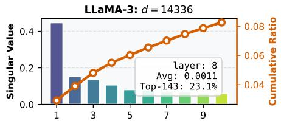

where $\mathbf { b } = \mathbb { E } [ \mathbf { k } ] \in \mathbb { R } ^ { d }$ is the mean vector, z ∼ $\mathcal { N } ( \mathbf { 0 } , \mathbf { I } )$ represents a latent semantic code, $\mathbf { U } \in \mathbb { R } ^ { d \times r }$ spans the dominant semantic subspace (with $r \ \leq$ $d ) , \varepsilon \sim \mathcal { N } ( \mathbf { 0 } , \mathbf { D } )$ captures dimension-wise residual variation, and z and ε are independent. Here $\mathbf { D } = \mathrm { d i a g } ( h _ { 1 } , \dots , h _ { d } )$ is a diagonal covariance matrix, where each $h _ { i } > 0$ denotes the residual variance along the i-th dimension. This model generalizes several important cases; for example, when $\mathbf { U } = \mathbf { 0 } .$ it reduces to an independent-component Gaussian assumption over the FFN hidden representations.

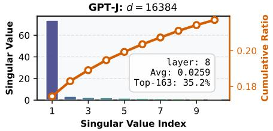  
Figure 1: Top-10 singular values (left axis) and their cumulative ratio of the total singular value sum (right axis).

Geometry-Aware Regularization Under the probabilistic model of the key vector k introduced above, we can quantify how a weight update $\Delta$ perturbs the corresponding value vector v. Recall that v is not an independent variable; it is determined by k and the weight matrix W via $\mathbf { v } = \mathbf { W } \mathbf { k } .$

Taking the expectation over the distribution of k, the expected output perturbation induced by $\Delta$ is:

$$
\begin{array} { r } { \mathbb { E } _ { \mathbf { k } } \left[ \| ( \mathbf { W } + \boldsymbol { \Delta } ) \mathbf { k } - \mathbf { v } \| _ { 2 } ^ { 2 } \right] = \operatorname { T r } \big ( \boldsymbol { \Delta } ^ { \top } \boldsymbol { \Delta } \mathbf { U } \mathbf { U } ^ { \top } \big ) + \operatorname { T r } \big ( \boldsymbol { \Delta } ^ { \top } \boldsymbol { \Delta } \bar { \mathbf { D } } \big ) , } \end{array}\tag{3}
$$

where $\bar { \mathbf { D } } = \mathbf { b } \mathbf { b } ^ { \top } + \mathbf { D }$ and Tr denotes the trace. (See Appendix A.1 for the derivation.)

To preserve pretrained knowledge, we minimize this expected output perturbation. Combining this regularization term with the edit efficacy objective yields our final knowledge editing loss:2

$$
\operatorname* { m i n } _ { \Delta } \ \| ( \mathbf { W } + \Delta ) \mathbf { K } _ { 1 } - \mathbf { V } _ { 1 } \| _ { F } ^ { 2 } + \beta \cdot \operatorname { T r } \big ( \Delta ^ { \top } \Delta \mathbf { U } \mathbf { U } ^ { \top } \big ) + \mu \cdot \operatorname { T r } \big ( \Delta ^ { \top } \Delta \bar { \mathbf { D } } \big ) ,\tag{4}
$$

where $\beta > 0$ and $\mu > 0$ balance edit efficacy against knowledge preservation. This U-subspaceaware regularizer penalizes weight updates that align with the core knowledge subspace U, thereby protecting critical knowledge from being overwritten.

Closed-Form Update Define the residual $\mathbf { R } _ { 1 } = \mathbf { V } _ { 1 } - \mathbf { W } \mathbf { K } _ { 1 }$ . The optimization problem in Eq. 4 admits the following closed-form solution (see Appendix A.2 for the derivation):

$$
\boldsymbol { \Delta } = \mathbf { R } _ { 1 } \mathbf { K } _ { 1 } ^ { \top } \big ( \mathbf { K } _ { 1 } \mathbf { K } _ { 1 } ^ { \top } + \beta \mathbf { U U } ^ { \top } + \mu \bar { \mathbf { D } } \big ) ^ { - 1 } .\tag{5}
$$

To protect the core knowledge subspace U, we consider the limit $\beta  \infty ,$ , which suppresses updates along directions spanned by U. The update then reduces to (see Appendix ${ \mathrm { A } } . 3$ for the derivation):

$$
\Delta _ { \mathbf { G } } = \operatorname* { l i m } _ { \beta  \infty } \Delta = \mathbf { R } _ { 1 } \mathbf { K } _ { 1 } ^ { \top } \mathbf { M } \big ( \mathbf { M } ^ { \top } ( \mathbf { K } _ { 1 } \mathbf { K } _ { 1 } ^ { \top } + \mu \bar { \mathbf { D } } ) \mathbf { M } \big ) ^ { - 1 } \mathbf { M } ^ { \top } \bigg \vert ,\tag{6}
$$

where $\mathbf { M } \in \mathbb { R } ^ { d \times ( d - r ) }$ is a matrix whose columns form a basis for the orthogonal complement of U $( \mathrm { i . e . , M ^ { \top } U = { \bf 0 } } )$ . This limiting update has two features. First, it only affects knowledge residing in the non-core subspace M. Second, its inversion has time complexity $O ( ( d - r ) ^ { 3 } )$ and space complexity $O ( ( d - r ) ^ { 2 } )$ , compared to $O ( d ^ { 3 } )$ and $O ( d ^ { 2 } )$ for standard LTE methods—an advantage that becomes significant when working with large d and editing multiple layers.

Estimation of U, D, and b Under the LR+D model, the covariance of k satisfies $\mathrm { C o v } ( \mathbf { k } ) =$ $\mathbf { U U } ^ { \top } + \mathbf { D }$ (see Appendix $\mathrm { A . 1 }$ for the derivation). This suggests that U and D can be estimated from the empirical covariance of FFN hidden representations, while b is estimated from the sample mean. To this end, we collect $N = 1 0 ^ { 7 }$ hidden vectors $\{ \mathbf { k } _ { i } \} _ { i = 1 } ^ { N }$ by passing Wikipedia text [Meng et al., 2023, 2022] through the model, and compute the sample mean $\begin{array} { r } { \bar { \mathbf { k } } = \frac { 1 } { N } \sum _ { i = 1 } ^ { N } } \end{array}$ ki and the empirical covariance matrix $\begin{array} { r } { \mathbf { S } _ { 0 } = \frac { 1 } { N } \sum _ { i = 1 } ^ { N } ( \mathbf { k } _ { i } - \bar { \mathbf { k } } ) ( \mathbf { k } _ { i } - \bar { \mathbf { k } } ) ^ { \top } } \end{array}$ . We then perform an eigendecomposition ${ \bf S } _ { 0 } = { \bf Q } { \bf \Lambda } { \bf A } { \bf Q } ^ { \top }$ , with eigenvalues $\lambda _ { 1 } \geq \lambda _ { 2 } \geq \cdot \cdot \cdot \geq \lambda _ { d } \geq 0$ arranged in descending order along the diagonal of Λ, and $\mathbf { Q } = [ \mathbf { q } _ { 1 } , \dots , \mathbf { q } _ { d } ]$ as the corresponding eigenvectors. We estimate U, D, and b as follows:

$$
\mathbf { U } = [ \mathbf { q } _ { 1 } , \cdots , \mathbf { q } _ { r } ] \mathbf { \Lambda } _ { 1 : r , 1 : r } ^ { 1 / 2 } , \qquad \mathbf { D } = \mathrm { d i a g } \bigl ( \mathbf { S } _ { 0 } - \mathbf { U U } ^ { \top } \bigr ) , \qquad \mathbf { b } = \bar { \mathbf { k } } .\tag{7}
$$

This construction is theoretically grounded in the Eckart–Young–Mirsky theorem [Golub and Van Loan, 2013]: under the rank-r constraint, U captures the most informative subspace of $\operatorname { C o v } ( \mathbf { k } )$ and D retains the remaining diagonal residual.

The next critical step is to select an appropriate rank $^ { r } \cdot$ Intuitively, models with a larger FFN hidden dimension d tend to require a larger r, whereas those exhibiting stronger low-rank structure admit a smaller r. To automatically capture these opposing trends, we adopt an energy-based criterion for adaptive rank selection:

$$
r = \operatorname* { m i n } \left\{ j : { \frac { \sum _ { i = 1 } ^ { j } \lambda _ { i } } { \sum _ { i = 1 } ^ { d } \lambda _ { i } } } \geq \gamma \right\} ,\tag{8}
$$

where $\gamma \in ( 0 , 1 ]$ is a prescribed energy retention threshold $( \mathbf { e . g . } , \gamma = 0 . 8 5 )$ . This rule selects the smallest number of principal components sufficient to capture at least a γ-fraction of the total spectral energy, thereby directly reflecting the empirical low-rank structure of the FFN representation space and adapting naturally to the FFN hidden dimension d.

## 4.3 Geometry-Aware Adaptive Regularization

Existing approaches neglect the geometric structure of edit requests and apply a uniform regularization strength to all of them. Ideally, a hard edit requires relaxed regularization (smaller $\mu )$ to ensure successful editing, whereas an easy edit benefits from stronger regularization (larger $\mu )$ to better preserve pretrained knowledge. We therefore propose an adaptive mechanism that selects $\mu$ on the fly based on the hardness of each edit.

To quantify edit hardness, we introduce the notion of editability. This notion is grounded in the following guiding principle, which links geometry to edit difficulty.

Edits aligned with knowledge-sparse subspaces are more “editable,” whereas those lying in knowledge-dense subspaces are less so since they likely conflict with more pretrained facts, inducing larger knowledge preservation loss $( E q . \ I )$

To formalize this principle, we have the following definition of editability.

Definition 1 (Editability) For an edit vector $\mathbf { k } _ { e } \in \mathbb { R } ^ { d } ;$ , we define its editability as

$$
\mathcal { E } ( \mathbf { k } _ { e } ) = \frac { 1 } { \mu } \sum _ { j = 1 } ^ { d } \sigma _ { j } ( \mathbf { k } _ { e } ^ { \top } \mathbf { q } _ { j } ) ^ { 2 } ,\tag{9}
$$

where $\{ \mathbf { q } _ { j } \} _ { j = 1 } ^ { d }$ are the eigenvectors ofthe second-moment matrix ${ \bf C } _ { 0 } = { \bf K } _ { 0 } { \bf K } _ { 0 } ^ { \top }$ , and $\{ \sigma _ { j } \} _ { j = 1 } ^ { d }$ are positive weights satisfying $0 < \sigma _ { 1 } \leq \sigma _ { 2 } \leq \cdot \cdot \cdot \leq \sigma _ { d } .$ . Larger weights are assigned to knowledgesparse directions and smaller weights to knowledge-dense directions. The regularization strength $\mu > 0$ inversely scales editability.

A higher $\mathcal { E } ( \mathbf { k } _ { e } )$ indicates that the edit aligns more strongly with knowledge-sparse directions and is subject to weaker regularization (smaller µ). In our implementation, we set $\sigma _ { j } = 1 / \lambda _ { j }$ , where $\lambda _ { j }$ is the eigenvalue of $\mathbf { C } _ { 0 }$ associated with ${ \bf q } _ { j }$ . In this case the editability takes the form of the squared Mahalanobis distance (see Appendix B.1 for details):

$$
\mathcal { E } ( \mathbf { k } _ { e } ) = \frac { 1 } { \mu } \mathbf { k } _ { e } ^ { \intercal } \mathbf { C } _ { 0 } ^ { - 1 } \mathbf { k } _ { e } .\tag{10}
$$

Table 1: Unification of output perturbation via editability.
<table><tr><td>Method</td><td>Weight Update  $\Delta$ </td><td>Editability  $\mathcal { E } ( { \bf k } _ { e } )$ </td><td>Output Perturbation</td></tr><tr><td>MEMIT</td><td> ${ \bf r } _ { e } { \bf k } _ { e } ^ { \top } \left( \mu { \bf C } _ { 0 } + { \bf k } _ { e } { \bf k } _ { e } ^ { \top } \right) ^ { - 1 }$ </td><td> $\mathbf { \Delta } _ { \mu } ^ { \perp } \mathbf { k } _ { e } ^ { \top } \mathbf { C } _ { 0 } ^ { - 1 } \mathbf { k } _ { e }$ </td><td rowspan="3"> $\Delta \mathbf { k } _ { e } = \frac { \mathcal { E } ( \mathbf { k } _ { e } ) } { 1 + \mathcal { E } ( \mathbf { k } _ { e } ) } \mathbf { r } _ { e }$ </td></tr><tr><td>ROME</td><td> $\mathbf { r } _ { e } \left( \mathbf { k } _ { e } ^ { \top } ( \mu \mathbf { C } _ { 0 } ) ^ { - 1 } \mathbf { k } _ { e } + a \mathbf { I } \right) ^ { - 1 } \mathbf { k } _ { e } ^ { \top } ( \mu \mathbf { C } _ { 0 } ) ^ { - 1 }$ </td><td> $\begin{array} { r } { \frac { 1 } { \mu a } \mathbf { k } _ { e } ^ { \top } \mathbf { C } _ { 0 } ^ { - 1 } \mathbf { k } _ { e } } \end{array}$ </td></tr><tr><td>AlphaEdit</td><td> $\mathbf { r } _ { e } \mathbf { k } _ { e } ^ { \top } \mathbf { P } \left( \mathbf { k } _ { e } \mathbf { k } _ { e } ^ { \top } \mathbf { P } + \mu \mathbf { I } \right) ^ { - 1 }$ </td><td> $\frac { 1 } { \mu } \mathbf { k } _ { e } ^ { \top } \mathbf { P } \mathbf { k } _ { e }$ </td></tr></table>

Under the LR+D model, when edits are constrained to the non-core knowledge subspace M, we correspondingly define the editability restricted to M as

$$
\pmb { \mathcal { E } } ( \mathbf { k } _ { e } ) = \frac { 1 } { \mu } \mathbf { k } _ { e } ^ { \top } \mathbf { M } ( \mathbf { M } ^ { \top } \bar { \mathbf { D } } \mathbf { M } ) ^ { - 1 } \mathbf { M } ^ { \top } \mathbf { k } _ { e } ,\tag{11}
$$

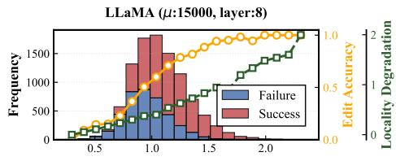

where the edit vector and the inverse are restricted to the non-core subspace (see Appendix B.2 for details).

We now formally establish the relationship between editability and edit success: higher editability leads to greater edit success, as stated in the theorem below.

Theorem 1 Let $\left( \mathbf { k } _ { e } , \mathbf { v } _ { e } \right)$ be a knowledge pair to be edited, and let ${ \bf r } _ { e } = { \bf v } _ { e } - { \bf W } { \bf k } _ { e }$ denote the corresponding target output residual. Let $\mathcal { E } ( { \bf k } _ { e } )$ be the editability. Then the output perturbation $\Delta _ { G } \mathbf { k } _ { e }$ induced by GEDIT satisfies

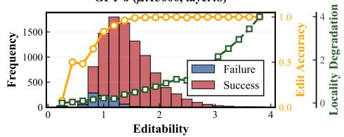  
Figure 2: Distribution of editability across 10,000 edits from the CounterFact dataset, along with the editing success rate and locality degradation within each editability bin.

$$
\Delta _ { G } \mathbf { k } _ { e } = \frac { \mathcal { E } ( \mathbf { k } _ { e } ) } { 1 + \mathcal { E } ( \mathbf { k } _ { e } ) } \mathbf { r } _ { e } .
$$

The proof is provided in Appendix B.3. As $\mathcal { E } ( \mathbf { k } _ { e } )$ increases, the scaling factor $\mathcal { E } ( { \bf k } _ { e } ) / ( 1 + \mathcal { E } ( { \bf k } _ { e } ) )$ monotonically approaches 1, implying that the output perturbation $\Delta _ { G } \mathbf { k } _ { \epsilon }$ e becomes increasingly aligned with the target residual $\mathbf { r } _ { e }$ , thereby improving editing accuracy. In the limit $\mathcal { E } ( { \bf k } _ { e } )  \infty$ , the perturbation exactly recovers $\mathbf { r } _ { e } .$ , guaranteeing perfect editing success.

Since different edits have varying degrees of editability, their editing accuracy and locality also differ accordingly. To illustrate this phenomenon, we conduct experiments on 10,000 edits from the CounterFact dataset using LLaMA and GPT-J, measuring their editability (Eq. 11 with $\mu = 1 5 0 0 0 )$ alongside editing success and locality degradation. An edit is considered successful if the model generates the edit output $O _ { \mathrm { { t a r } } } .$ . Locality degradation is quantified as the change in logits for the locality output $O _ { \mathrm { o r i } }$ before and after editing. As shown in Figure 2, two key observations emerge: First, edits with low editability tend to fail but cause minimal locality degradation, whereas highly editable edits are more likely to succeed yet induce significant locality degradation. Second, using fixed regularization is suboptimal: with $\mu$ fixed at 15,000, the value is too large for LLaMA—leading to excessive editing failures—and too small for GPT-J, resulting in severe locality degradation.

Both theoretical analysis and empirical results indicate that editing success and locality degradation can be effectively balanced by modulating editability—motivating the use of editabilitybased regularization. Specifically, by setting $\mathcal { E } ( { \bf k } _ { e } ) = c ,$ where $c > 0$ is a hyperparameter representing the desired editability $( \boldsymbol { \mathrm { e } } . \boldsymbol { \mathrm { g } } . , c = 2 )$ , we obtain an edit-adaptive regularization strength $\begin{array} { r } { \mu = \frac { 1 } { c } \mathbf { k } _ { e } ^ { \top } \mathbf { M } ( \mathbf { M } ^ { \top } \mathbf { D } \mathbf { M } ) ^ { - 1 } \mathbf { M } ^ { \top } \bar { \mathbf { k } } _ { e } } \end{array}$ . We note that Theorem 1 is agnostic to dataset, model architecture, and even editing method, thereby providing a unified framework for adapting regularization strength—specifically, by setting the editability to c. Table 1 summarizes the application of our framework to several popular editors; see Appendix C.5 for details. Interestingly, Table 1 shows that different methods have different definitions of editability, which fundamentally explains why they have different settings of the regularization strength. For example, $\mu$ is set to 10 in AlphaEdit’s paper [Fang et al., 2025a], while it is set to 15,000 for MEMIT [Meng et al., 2023]. Our adaptive regularization framework can also be extended to sequential editing by jointly preserving pretrained and previously edited knowledge [Fang et al., $2 0 2 5 \mathrm { a } , \mathrm { b }$ , Guo et al., 2025, Liu et al., 2026a] (see Appendix C.5 for details).

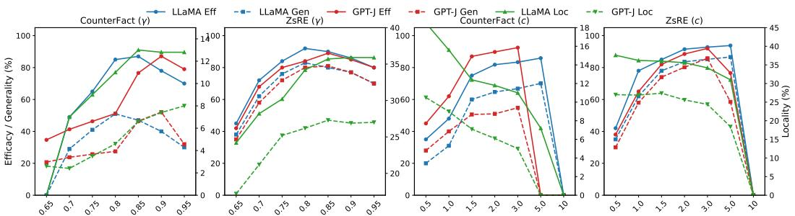  
Figure 3: Effect of hyperparameters γ (energy threshold) and c (desired editability) on editing performance. Metrics on the left axis: efficacy and generality; metric on the right axis: locality.

## 5 Experiments

## 5.1 Experimental Setup

LLMs, Datasets and Evaluation Protocol We edit three widely used LLMs—GPT2-XL, GPT-J, and LLaMA3-8B-Instruct—on two standard factual editing benchmarks: COUNTERFACT [Meng et al., 2022] and ZSRE [Levy et al., 2017]. Following standard practice [Fang et al., 2025a, Li et al., 2025a], we report three metrics: Efficacy (Eff.), Generality (Gen.), and Locality (Loc.). Specifically, Eff. and Gen. measure whether the model can correctly predict the target $o _ { t a r }$ given the original and paraphrased edit prompts, respectively, while Loc. evaluates the model’s prediction accuracy on irrelevant knowledge. A good editor should maintain close Loc. performance before and after editing. Prior work often overestimates editing performance by using probability-comparison-based calculations for these metrics [Gupta et al., 2024b, Fang et al., 2025a]. To address this, we adopt a strict argmax-based evaluation [Dai et al., 2026, Liu et al., 2026b]. Dataset examples and detailed metric calculations are provided in Appendix C.2. Another often-overlooked factor during evaluation is the batch size and edit order, which can substantially affect editing performance. Existing methods use inconsistent batch sizes (e.g., 1 [Guo et al., 2025], 20 [Li et al., 2025b], and beyond [Fang et al., 2025a, Liu et al., 2025a, 2026b, Park et al., 2026]) and rely on a single fixed edit order [Fang et al., 2025a, Liu et al., 2026a]. To ensure a more comprehensive evaluation, we perform 10,000 sequential edits under three batch sizes: 1, 20, and 200, and average the results over 3 different edit orders.

Compared Baselines We compare against a wide range of baselines: LoRA-based FT [Hu et al., 2022]; hypernetwork-based RLEdit [Li et al., 2025b]; locate-then-edit (LTE) methods (EMMET [Gupta et al., 2024b], ALPHAEDIT [Fang et al., 2025a], HSE [Fang et al., 2025b]); and regularized sequential editing methods (RECT [Gu et al., 2024], PRUNE [Ma et al., 2025], ADAEDIT [Li and Chu, 2025], SIMIE [Guo et al., 2025], SPHERE [Liu et al., 2026b]). Following Fang et al. [2025a], for all LTE methods, we edit layers {13,14,15,16,17} in GPT2-XL, layers {3,4,5,6,7,8} in GPT-J, and layers {4,5,6,7,8} in LLaMA3. All LTE methods can be readily combined with the edit protection mechanism from [Fang et al., 2025a], which significantly improves their sequential editing performance [Guo et al., 2025, Fang et al., 2025b, Liu et al., 2026a]. To ensure a fair comparison—often overlooked in prior work [Fang et al., 2025b, Liu et al., 2025a, 2026b]—we integrate this mechanism into all LTE methods (see Appendix C.3 for details). For the five regularized sequential editing methods, we adopt HSE as the base editor.

For GEDIT, we investigate two key hyperparameters. γ sets the energy retention ratio that identifies the core knowledge subspace, while c determines the desired editability and adaptively adjusts the regularization strength µ. A higher γ protects a larger core knowledge subspace (the mapping between γ and the resulting rank r is provided in Appendix C.4), whereas a lower c imposes stronger regularization. Their effects are illustrated in Figure 3. Performance is more sensitive to $\gamma ;$ for example, on GPT-J/CounterFact, $\gamma = 0 . 9$ outperforms γ = 0.85 and 0.95 by ≈10 points in $E f f .$

In our experiments, we aim to answer the following research questions:

• RQ1: What is the editing performance of GEDIT?

• RQ2: What is the impact of low-rank regularization?

• RQ3: What is the impact of adaptive regularization?

Table 2: Editing performance over 10,000 sequential edits under varying batch sizes (1, 20 and 200). Best and second-best results are bolded and underlined, respectively.
<table><tr><td rowspan=1 colspan=18>CounterFact                                      ZsREMethodbs = 1        bs = 20       bs = 200       bs = 1        bs = 20       bs = 200Eff.Gen.Loc.Eff.Gen.Loc.Eff.Gen.Loc.Eff.Gen.Loc.Eff.Gen.Loc.Eff.Gen.Loc.</td></tr><tr><td rowspan=1 colspan=18>Pre-edited  0.400.5010.60.400.5010.60.400.5010.60.000.0024.30.000.0024.30.000.0024.3</td></tr><tr><td rowspan=1 colspan=18>FT         0.000.000.000.000.000.007.102.500.100.000.000.000.000.000.0010.33.604.20</td></tr><tr><td rowspan=1 colspan=7>RLEdit     0.000.000.0033.521.82.20</td><td rowspan=1 colspan=3>45.325.52.80</td><td rowspan=1 colspan=8>0.000.000.0048.932.316.837.311.111.2</td></tr><tr><td rowspan=1 colspan=7>RECT      23.613.14.1054.533.66.40</td><td rowspan=1 colspan=3>69.537.96.90</td><td rowspan=1 colspan=8>64.050.824.167.956.224.166.653.524.5</td></tr><tr><td rowspan=1 colspan=7>PRUNE  5B20.210.34.0058.730.75.60</td><td rowspan=1 colspan=11>68.738.76.5063.051.824.366.552.424.265.053.224.2</td></tr><tr><td rowspan=1 colspan=7>AdaEdit    20.411.04.3053.830.56.80</td><td rowspan=1 colspan=11>63.837.86.9061.449.324.264.053.524.363.051.524.3</td></tr><tr><td rowspan=1 colspan=18>SPHERE   31.220.15.0050.427.97.1061.432.97.2057.046.724.660.250.425.061.449.224.7</td></tr><tr><td rowspan=1 colspan=3>SimIE      27.118.2</td><td rowspan=1 colspan=7>4.2047.924.47.9055.927.47.30</td><td rowspan=1 colspan=6>53.338.324.351.939.924.5</td><td rowspan=1 colspan=2>58.834.725.0</td></tr><tr><td rowspan=1 colspan=2>EMMET    23.7</td><td rowspan=1 colspan=1>11.2</td><td rowspan=1 colspan=4>3.4060.532.73.80</td><td rowspan=1 colspan=3>75.543.24.10</td><td rowspan=1 colspan=2>50.332.3</td><td rowspan=1 colspan=4>11.554.834.715.6</td><td rowspan=1 colspan=2>53.332.318.9</td></tr><tr><td rowspan=1 colspan=2>HSE        18.2</td><td rowspan=1 colspan=1>9.10</td><td rowspan=1 colspan=3>3.8059.328.6</td><td rowspan=1 colspan=1>5.10</td><td rowspan=1 colspan=3>70.539.76.40</td><td rowspan=1 colspan=2>67.352.3</td><td rowspan=1 colspan=4>24.066.253.724.2</td><td rowspan=1 colspan=1>68.0</td><td rowspan=1 colspan=1>54.924.7</td></tr><tr><td rowspan=1 colspan=3>AlphaEdit  67.932.3</td><td rowspan=1 colspan=3>2.8055.631.8</td><td rowspan=1 colspan=1>2.10</td><td rowspan=1 colspan=3>61.825.62.40</td><td rowspan=1 colspan=7>64.356.018.755.241.519.335.4</td><td rowspan=1 colspan=1>25.814.3</td></tr><tr><td rowspan=1 colspan=3>GÉDIT    76.440.1</td><td rowspan=1 colspan=3>5.2072.140.8</td><td rowspan=1 colspan=1>6.40</td><td rowspan=1 colspan=3>71.542.67.40</td><td rowspan=1 colspan=8>73.161.324.071.159.624.773.957.124.1</td></tr><tr><td rowspan=1 colspan=6>Pre-edited  0.400.5014.30.400.50</td><td rowspan=1 colspan=1>14.3</td><td rowspan=1 colspan=3>0.400.5014.3</td><td rowspan=1 colspan=2>0.000.00</td><td rowspan=1 colspan=6>27.00.000.0027.00.000.0027.0</td></tr><tr><td rowspan=1 colspan=2>FT         0.00</td><td rowspan=1 colspan=1>0.00</td><td rowspan=1 colspan=3>0.000.000.00</td><td rowspan=1 colspan=1>0.00</td><td rowspan=1 colspan=1>5.30</td><td rowspan=1 colspan=2>2.100.50</td><td rowspan=1 colspan=2>0.000.00</td><td rowspan=1 colspan=3>0.000.000.00</td><td rowspan=1 colspan=1>0.00</td><td rowspan=1 colspan=1>0.00</td><td rowspan=1 colspan=1>0.000.00</td></tr><tr><td rowspan=1 colspan=2>RLEdit     0.00</td><td rowspan=1 colspan=1>0.00</td><td rowspan=1 colspan=1>0.00</td><td rowspan=1 colspan=1>35.6</td><td rowspan=1 colspan=1>17.7</td><td rowspan=1 colspan=1>1.20</td><td rowspan=1 colspan=1>65.6</td><td rowspan=1 colspan=2>37.34.50</td><td rowspan=1 colspan=1>0.00</td><td rowspan=1 colspan=1>0.00</td><td rowspan=1 colspan=3>0.0070.553.7</td><td rowspan=1 colspan=1>10.2</td><td rowspan=1 colspan=1>75.6</td><td rowspan=1 colspan=1>61.4</td></tr><tr><td rowspan=1 colspan=2>RECT      30.2</td><td rowspan=1 colspan=1>17.5</td><td rowspan=1 colspan=1>2.60</td><td rowspan=1 colspan=1>80.2</td><td rowspan=1 colspan=1>68.1</td><td rowspan=1 colspan=1>6.90</td><td rowspan=1 colspan=1>91.2</td><td rowspan=1 colspan=2>60.59.80</td><td rowspan=1 colspan=1>42.9</td><td rowspan=1 colspan=1>38.7</td><td rowspan=1 colspan=3>8.9072.255.7</td><td rowspan=1 colspan=1>19.4</td><td rowspan=1 colspan=1>93.6</td><td rowspan=1 colspan=1>82.3</td></tr><tr><td rowspan=1 colspan=3>PRUNE     28.515.9</td><td rowspan=1 colspan=2>2.6081.5</td><td rowspan=1 colspan=1>66.7</td><td rowspan=1 colspan=1>7.10</td><td rowspan=1 colspan=1>92.4</td><td rowspan=1 colspan=2>62.59.20</td><td rowspan=1 colspan=1>43.8</td><td rowspan=1 colspan=1>37.5</td><td rowspan=1 colspan=2>10.270.4</td><td rowspan=1 colspan=1>55.7</td><td rowspan=1 colspan=1>18.8</td><td rowspan=1 colspan=1>94.6</td><td rowspan=1 colspan=1>83.326.8</td></tr><tr><td rowspan=1 colspan=3>AdaEdit    30.518.8</td><td rowspan=1 colspan=2>2.9079.7</td><td rowspan=1 colspan=1>65.7</td><td rowspan=1 colspan=1>7.10</td><td rowspan=1 colspan=1>89.4</td><td rowspan=1 colspan=2>58.99.70</td><td rowspan=1 colspan=1>47.9</td><td rowspan=1 colspan=1>42.6</td><td rowspan=1 colspan=2>11.468.2</td><td rowspan=1 colspan=1>56.8</td><td rowspan=1 colspan=1>19.6</td><td rowspan=1 colspan=1>90.8</td><td rowspan=1 colspan=1>81.926.7</td></tr><tr><td rowspan=1 colspan=2>SPHERE   37.6</td><td rowspan=1 colspan=1>25.5</td><td rowspan=1 colspan=1>3.30</td><td rowspan=1 colspan=1>78.4</td><td rowspan=1 colspan=1>65.8</td><td rowspan=1 colspan=1>7.60</td><td rowspan=1 colspan=1>82.4</td><td rowspan=1 colspan=2>54.310.2</td><td rowspan=1 colspan=1>49.6</td><td rowspan=1 colspan=1>42.6</td><td rowspan=1 colspan=2>16.257.7</td><td rowspan=1 colspan=1>46.7</td><td rowspan=1 colspan=1>19.6</td><td rowspan=1 colspan=1>81.7</td><td rowspan=1 colspan=1>66.726.7</td></tr><tr><td rowspan=1 colspan=2>SimIE      28.9</td><td rowspan=1 colspan=1>16.7</td><td rowspan=1 colspan=1>3.50</td><td rowspan=1 colspan=1>67.2</td><td rowspan=1 colspan=1>61.7</td><td rowspan=1 colspan=1>7.90</td><td rowspan=1 colspan=1>79.3</td><td rowspan=1 colspan=1>61.7</td><td rowspan=1 colspan=1>10.6</td><td rowspan=1 colspan=1>44.6</td><td rowspan=1 colspan=1>34.2</td><td rowspan=1 colspan=2>16.155.5</td><td rowspan=1 colspan=1>41.2</td><td rowspan=1 colspan=1>20.2</td><td rowspan=1 colspan=1>78.7</td><td rowspan=1 colspan=1>62.326.9</td></tr><tr><td rowspan=1 colspan=1>EMMET</td><td rowspan=1 colspan=1>54.6</td><td rowspan=1 colspan=1>30.5</td><td rowspan=1 colspan=1>3.10</td><td rowspan=1 colspan=1>86.5</td><td rowspan=1 colspan=1>72.2</td><td rowspan=1 colspan=1>5.60</td><td rowspan=1 colspan=1>96.5</td><td rowspan=1 colspan=1>67.3</td><td rowspan=1 colspan=1>7.20</td><td rowspan=1 colspan=1>64.3</td><td rowspan=1 colspan=1>58.8</td><td rowspan=1 colspan=1>16.5</td><td rowspan=1 colspan=1>79.2</td><td rowspan=1 colspan=1>61.6</td><td rowspan=1 colspan=1>20.4</td><td rowspan=1 colspan=1>85.1</td><td rowspan=1 colspan=1>71.022.4</td></tr><tr><td rowspan=1 colspan=1>HSE</td><td rowspan=1 colspan=1>26.7</td><td rowspan=1 colspan=1>16.0</td><td rowspan=1 colspan=1>2.40</td><td rowspan=1 colspan=1>82.4</td><td rowspan=1 colspan=1>69.7</td><td rowspan=1 colspan=1>6.60</td><td rowspan=1 colspan=1>96.4</td><td rowspan=1 colspan=1>67.9</td><td rowspan=1 colspan=1>8.60</td><td rowspan=1 colspan=1>38.9</td><td rowspan=1 colspan=1>35.1</td><td rowspan=1 colspan=1>6.20</td><td rowspan=1 colspan=1>75.2</td><td rowspan=1 colspan=1>56.7</td><td rowspan=1 colspan=1>16.6</td><td rowspan=1 colspan=1>95.6</td><td rowspan=1 colspan=1>86.026.4</td></tr><tr><td rowspan=1 colspan=2>AlphaEdit  83.7</td><td rowspan=1 colspan=1>41.1</td><td rowspan=1 colspan=1>3.60</td><td rowspan=1 colspan=1>83.5</td><td rowspan=1 colspan=1>43.5</td><td rowspan=1 colspan=1>3.80</td><td rowspan=1 colspan=1>82.1</td><td rowspan=1 colspan=1>44.9</td><td rowspan=1 colspan=1>3.80</td><td rowspan=1 colspan=1>83.5</td><td rowspan=1 colspan=1>75.6</td><td rowspan=1 colspan=1>24.5</td><td rowspan=1 colspan=2>82.969.8</td><td rowspan=1 colspan=1>23.5</td><td rowspan=1 colspan=1>79.2</td><td rowspan=1 colspan=1>66.222.6</td></tr><tr><td rowspan=1 colspan=2>GÉDIT     89.8</td><td rowspan=1 colspan=1>51.0</td><td rowspan=1 colspan=1>6.10</td><td rowspan=1 colspan=1>90.6</td><td rowspan=1 colspan=1>71.8</td><td rowspan=1 colspan=1>6.80</td><td rowspan=1 colspan=1>96.6</td><td rowspan=1 colspan=1>70.8</td><td rowspan=1 colspan=1>9.10</td><td rowspan=1 colspan=1>88.5</td><td rowspan=1 colspan=1>80.2</td><td rowspan=1 colspan=1>26.6</td><td rowspan=1 colspan=2>92.981.3</td><td rowspan=1 colspan=1>26.1</td><td rowspan=1 colspan=1>94.6</td><td rowspan=1 colspan=1>85.127.2</td></tr><tr><td rowspan=1 colspan=2>Pre-edited  0.30</td><td rowspan=1 colspan=1>0.40</td><td rowspan=1 colspan=3>21.60.300.40</td><td rowspan=1 colspan=1>21.6</td><td rowspan=1 colspan=1>0.30</td><td rowspan=1 colspan=2>0.4021.6</td><td rowspan=1 colspan=1>0.00</td><td rowspan=1 colspan=1>0.00</td><td rowspan=1 colspan=3>37.20.000.00</td><td rowspan=1 colspan=1>37.2</td><td rowspan=1 colspan=1>0.00</td><td rowspan=1 colspan=1>0.0037.2</td></tr><tr><td rowspan=1 colspan=1>FT</td><td rowspan=1 colspan=1>0.00</td><td rowspan=1 colspan=1>0.00</td><td rowspan=1 colspan=3>0.000.000.00</td><td rowspan=1 colspan=1>0.00</td><td rowspan=1 colspan=1>4.10</td><td rowspan=1 colspan=2>1.602.50</td><td rowspan=1 colspan=1>0.00</td><td rowspan=1 colspan=1>0.00</td><td rowspan=1 colspan=3>0.000.000.00</td><td rowspan=1 colspan=1>0.00</td><td rowspan=1 colspan=1>4.40</td><td rowspan=1 colspan=1>2.206.10</td></tr><tr><td rowspan=1 colspan=1>RLEdit</td><td rowspan=1 colspan=1>0.00</td><td rowspan=1 colspan=1>0.00</td><td rowspan=1 colspan=2>0.0064.2</td><td rowspan=1 colspan=1>48.8</td><td rowspan=1 colspan=1>4.90</td><td rowspan=1 colspan=1>60.7</td><td rowspan=1 colspan=2>42.76.50</td><td rowspan=1 colspan=1>0.00</td><td rowspan=1 colspan=1>0.00</td><td rowspan=1 colspan=1>0.00</td><td rowspan=1 colspan=2>67.452.2</td><td rowspan=1 colspan=1>22.3</td><td rowspan=1 colspan=1>52.8</td><td rowspan=1 colspan=1>38.828.5</td></tr><tr><td rowspan=1 colspan=2>RECT      0.00</td><td rowspan=1 colspan=1>0.00</td><td rowspan=1 colspan=2>0.0069.9</td><td rowspan=1 colspan=1>54.6</td><td rowspan=1 colspan=1>9.10</td><td rowspan=1 colspan=3>94.165.212.5</td><td rowspan=1 colspan=1>88.5</td><td rowspan=1 colspan=1>75.6</td><td rowspan=1 colspan=1>35.6</td><td rowspan=1 colspan=3>85.372.635.2</td><td rowspan=1 colspan=1>89.1</td><td rowspan=1 colspan=1>78.736.5</td></tr><tr><td rowspan=1 colspan=2>PRUNE    0.00</td><td rowspan=1 colspan=1>0.00</td><td rowspan=1 colspan=3>0.0072.655.6</td><td rowspan=1 colspan=1>8.80</td><td rowspan=1 colspan=3>92.364.312.4</td><td rowspan=1 colspan=1>88.8</td><td rowspan=1 colspan=1>73.3</td><td rowspan=1 colspan=4>34.786.174.634.2</td><td rowspan=1 colspan=1>92.1</td><td rowspan=1 colspan=1>83.335.9</td></tr><tr><td rowspan=1 colspan=2>AdaEdit    0.00</td><td rowspan=1 colspan=1>0.00</td><td rowspan=1 colspan=3>0.0070.856.9</td><td rowspan=1 colspan=1>9.00</td><td rowspan=1 colspan=4>90.562.713.383.7</td><td rowspan=1 colspan=1>70.3</td><td rowspan=1 colspan=4>34.881.070.135.2</td><td rowspan=1 colspan=1>87.5</td><td rowspan=1 colspan=1>74.136.1</td></tr><tr><td rowspan=1 colspan=1>SPHERE</td><td rowspan=1 colspan=1>41.3</td><td rowspan=1 colspan=1>25.7</td><td rowspan=1 colspan=3>5.3067.953.8</td><td rowspan=1 colspan=1>9.50</td><td rowspan=1 colspan=3>84.659.514.0</td><td rowspan=1 colspan=1>86.5</td><td rowspan=1 colspan=1>71.7</td><td rowspan=1 colspan=1>35.9</td><td rowspan=1 colspan=2>79.766.8</td><td rowspan=1 colspan=1>36.0</td><td rowspan=1 colspan=1>85.7</td><td rowspan=1 colspan=1>72.736.1</td></tr><tr><td rowspan=1 colspan=1>SimIE</td><td rowspan=1 colspan=1>24.6</td><td rowspan=1 colspan=1>15.5</td><td rowspan=1 colspan=3>3.7054.641.6</td><td rowspan=1 colspan=1>10.8</td><td rowspan=1 colspan=3>81.355.713.3</td><td rowspan=1 colspan=1>78.6</td><td rowspan=1 colspan=1>66.3</td><td rowspan=1 colspan=1>36.1</td><td rowspan=1 colspan=2>81.269.3</td><td rowspan=1 colspan=1>36.2</td><td rowspan=1 colspan=1>81.8</td><td rowspan=1 colspan=1>66.737.5</td></tr><tr><td rowspan=1 colspan=1>EMMET</td><td rowspan=1 colspan=1>0.00</td><td rowspan=1 colspan=1>0.00</td><td rowspan=1 colspan=3>0.000.000.00</td><td rowspan=1 colspan=1>0.00</td><td rowspan=1 colspan=3>90.162.89.50</td><td rowspan=1 colspan=1>0.00</td><td rowspan=1 colspan=1>0.00</td><td rowspan=1 colspan=1>0.00</td><td rowspan=1 colspan=2>83.771.5</td><td rowspan=1 colspan=1>28.2</td><td rowspan=1 colspan=1>94.6</td><td rowspan=1 colspan=1>84.531.5</td></tr><tr><td rowspan=1 colspan=1>HSE</td><td rowspan=1 colspan=1>0.00</td><td rowspan=1 colspan=1>0.00</td><td rowspan=1 colspan=4>0.0073.757.68.40</td><td rowspan=1 colspan=3>94.365.612.0</td><td rowspan=1 colspan=1>90.2</td><td rowspan=1 colspan=1>82.1</td><td rowspan=1 colspan=3>35.287.776.6</td><td rowspan=1 colspan=1>35.2</td><td rowspan=1 colspan=1>93.0</td><td rowspan=1 colspan=1>83.035.5</td></tr><tr><td rowspan=1 colspan=1>AlphaEdit</td><td rowspan=1 colspan=1>0.00</td><td rowspan=1 colspan=1>0.00</td><td rowspan=1 colspan=4>0.000.000.000.00</td><td rowspan=1 colspan=3>76.856.210.4</td><td rowspan=1 colspan=1>0.00</td><td rowspan=1 colspan=1>0.00</td><td rowspan=1 colspan=3>0.0081.468.5</td><td rowspan=1 colspan=1>30.2</td><td rowspan=1 colspan=1>88.4</td><td rowspan=1 colspan=1>78.134.2</td></tr><tr><td rowspan=1 colspan=11>GÉDIT     81.864.711.886.667.812.792.671.813.091.5</td><td rowspan=1 colspan=1>83.6</td><td rowspan=1 colspan=6>35.692.982.135.893.581.136.4</td></tr></table>

## 5.2 Editing Performance (RQ1)

Table 2 presents editing performance over 10,000 edits conducted with varying batch sizes. The results show that all baseline methods are highly sensitive to batch size. On the CounterFact dataset, when editing with a batch size of 1 — i.e., continuously updating the LLM 10,000 times, far exceeding the 1,000–5,000 updates typically performed in prior work [Guo et al., 2025, Fang et al., 2025b, Liu et al., 2025a] — baselines such as HSE and AlphaEdit fail entirely on the LLaMA model: efficacy, generality, and locality all collapse to zero. This phenomenon, known as model collapse [Gu et al., 2024, Gupta et al., 2024b, Fang et al., 2025a, Thede et al., 2025], is characterized by instability that causes pre-trained knowledge to be lost, past edits to be forgotten, and new edits to fail. However, as batch size increases, the performance of these methods improves rapidly.

To enhance editing stability, regularized sequential editors like RECT and SPHERE adopt a post-hoc regularization strategy that introduces a second stage to preserve locality. However, this twostage design often improves locality at the cost of editing efficacy and generality. In contrast, by performing regularization in situ, GEDIT jointly optimizes both efficacy and locality within a single stage, achieving superior overall performance across diverse settings. Additional experimental results—including evaluations under the single-fact editing setting [Meng et al., 2022, Gu et al., 2024], evaluation of the model’s general capability retention [Gu et al., 2024], and comparisons against an extended set of baselines [Yu et al., 2024]—are presented in Appendix C.6.

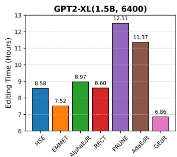

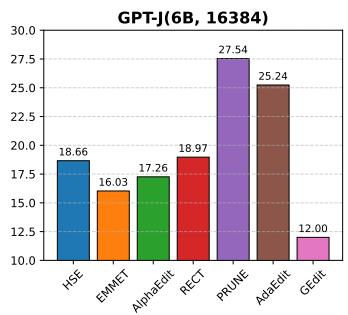

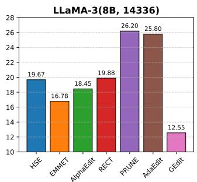  
Figure 4: Total editing time for 10,000 sequential edits (batch size = 1) on the COUNTERFACT dataset using three LLMs. From left to right: GPT2-XL, GPT-J-6B, and LLaMA3-8B, with the number of parameters and FFN hidden dimension shown in parentheses.

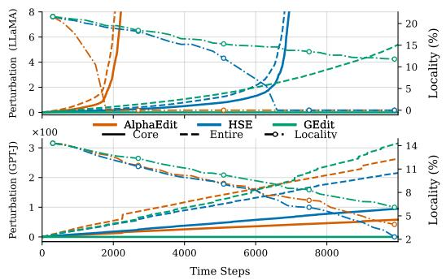  
Figure 5: Evolution of knowledge perturbation (entire space vs. core subspace) and edit locality during 10,000 sequential edits.

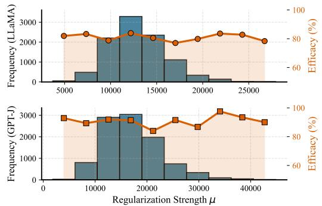  
Figure 6: Distribution of the adaptive regularization strength across 10,000 sequential edits, along with the corresponding edit efficacy per bin.

## 5.3 Impact of Low-Rank Regularization (RQ2)

Low-rank regularization aims to identify a core knowledge subspace U and apply targeted protection, thereby confining edits to the non-core knowledge subspace and preserving locality. To demonstrate this, we measure, at each editing step t, the perturbation within the entire knowledge space $\| \Delta _ { t } \mathbf { K } _ { 0 } \| _ { F } ^ { 2 }$ and within the core knowledge subspace $\| \Delta _ { t } \mathbf { U } \| _ { F } ^ { 2 }$ , where $\Delta _ { t } = \mathbf { W } _ { t } - \mathbf { W } _ { 0 } \left( \mathbf { W } _ { t } \right.$ and $\mathbf { W } _ { 0 }$ denote the weights after step t and before editing, respectively). Figure 5 compares the knowledge perturbation induced by HSE, AlphaEdit, and GEDIT when editing the CounterFact dataset; results on the ZsRE dataset are provided in Appendix C.4.

Our results reveal an interesting finding: a larger $\| \Delta _ { t } \mathbf { K } _ { 0 } \| _ { F } ^ { 2 }$ does not necessarily imply worse locality. Specifically, GEDIT exhibits a larger $\mathbf { \Delta } \mathbf { \bar { | } } \Delta _ { t } \mathbf { K } _ { 0 } \mathbf { \bar { | } } _ { F } ^ { 2 }$ than HSE in the early stages when editing LLaMA, and in the later stages when editing GPT-J. Nevertheless, GEDIT consistently achieves higher locality than HSE across these scenarios. We attribute this counterintuitive phenomenon to GEDIT’s strict protection of the core knowledge subspace, where $\| \Delta _ { t } \mathbf { U } \| _ { F } ^ { 2 } = 0$ . Because this subspace encapsulates a high density of factual knowledge, rigorously preserving it is particularly beneficial for maintaining edit locality and stability.

Beyond knowledge preservation, low-rank regularization also offers a significant computational advantage. Standard locate-then-edit (LTE) methods involve a matrix inversion with $\mathcal { O } ( d ^ { 3 } )$ cost, which is prohibitive for large d and especially pronounced during multi-layer and sequential editing. By acquiring a low-rank structure, our geometry-aware regularization effectively reduces this complexity to $\bar { \mathcal { O } } ( ( d - r ) ^ { 3 } )$ , enabling highly efficient computation. As shown in Figure 4, GEDIT significantly accelerates the 10,000 sequential edits on COUNTERFACT, completing the process for GPT-J and LLaMA in only 12 hours—substantially faster than baselines such as HSE and ALPHAEDIT.3

The low-rank regularization is general and can be applied to various editing methods by simply replacing the knowledge preservation term with the expected output perturbation term under the LR+D factor model. Table 3 demonstrates its effectiveness when integrated into EMMET, HSE, and AlphaEdit, with arrows indicating performance changes over 10,000 sequential edits on the Counterfact dataset. For GPT-J, all methods show improvements in both efficacy and locality.

Table 3: Effect of low-rank regularization on different editing methods.
<table><tr><td rowspan="2">Method</td><td colspan="2">GPT-J</td><td colspan="2">LLaMA</td></tr><tr><td>Eff.</td><td>Loc.</td><td>Eff.</td><td>Loc.</td></tr><tr><td>EMMET</td><td>54.6-&gt;76.4 3.1-&gt;4.3</td><td></td><td>(2k)-&gt;(4k)</td><td>(2k)-&gt;(4k)</td></tr><tr><td>HSE</td><td>26.7-&gt;71.7 2.4-&gt;4.7</td><td></td><td>(7k)-&gt;(10k)</td><td>(7k)-&gt;(10k)</td></tr><tr><td></td><td>AlphaEdit 83.7-&gt;85.4 3.6-&gt;4.2</td><td></td><td>0.0-&gt;77.8</td><td>0.0-&gt;10.1</td></tr></table>

For LLaMA, since EMMET and HSE achieve zero Eff. and Loc. regardless of whether low-rank regularization is applied, we report the collapse step at which performance first drops to 0 (evaluated every 1,000 steps). Details on adapting these methods to low-rank regularization and additional experimental results are provided in Appendix C.4.

## 5.4 Impact of Adaptive Regularization (RQ3)

Our adaptive regularization framework, grounded in Theorem 1, provides a unified way to adjust regularization strength across edits, models, datasets, and methods via editability, as it is agnostic to these factors. In contrast, as demonstrated in Appendix C.5, editing performance with fixed regularization is highly sensitive to such factors and—even when carefully tuned—consistently underperforms its adaptive counterpart in balancing edit efficacy and knowledge preservation.

To demonstrate the effectiveness of the adaptive regularization across edits, we record its regularization strength at each step during 10,000 sequential edits on the CounterFact dataset and plot its frequency distribution in Figure 6; results on the ZsRE dataset are provided in Appendix C.5. The results show that high editing efficacy can be maintained across a wide range of regularization strengths. To demonstrate the effectiveness of the adaptive regularization across methods, we apply it to EMMET, HSE, and AlphaEdit using a uniform desired editability c = 1.25, despite their default regularization strengths varying drastically (e.g., 10 for AlphaEdit vs. 15,000 for HSE). Table 4 reports the performance of EMMET, HSE, and AlphaEdit equipped with our adaptive regularization, evaluated over 10,000 sequential edits on the COUNTERFACT dataset. The results show that our approach consistently and substantially outperforms the fixed-regularization counterparts.

Table 4: Effect of adaptive regularization on different editing methods.
<table><tr><td rowspan="2">Method</td><td colspan="2">GPT-J</td><td colspan="2">LLaMA</td></tr><tr><td>Eff.</td><td>Loc.</td><td>Eff.</td><td>Loc.</td></tr><tr><td>EMMET</td><td>54.6-&gt;77.5</td><td>3.1-&gt;4.5</td><td>0.0-&gt;70.3</td><td>0.0-&gt;6.8</td></tr><tr><td>HSE</td><td>26.7-&gt;78.1 2.4-&gt;4.2</td><td></td><td>0.0-&gt;72.3</td><td>0.0-&gt;7.4</td></tr><tr><td></td><td>AlphaEdit 83.7-&gt;84.1 3.6-&gt;5.7</td><td></td><td>(2k)-&gt;(5k)</td><td>(2k)-&gt;(5k)</td></tr></table>

## 6 Conclusion

We presented GEDIT, a geometry-aware knowledge editing framework with two complementary components: low-rank regularization and adaptive regularization. The former identifies a lowrank core knowledge subspace for targeted protection, while the latter quantifies the editability of individual edit requests and adjusts regularization strength accordingly. Together, they achieve a better balance between editing efficacy and knowledge preservation. Extensive experiments demonstrate the effectiveness and robustness of GEDIT across diverse models, editing methods, datasets, and batch sizes, including large-scale sequential editing with up to 10,000 updates.

Our work also has limitations that warrant further investigation. First, our theoretical analysis characterizes the relationship between editability and editing success for a single edit, but does not directly extend to jointly optimizing multiple edits, where conflicts among edit requests may affect the realized output perturbations [Dai et al., 2026]. Although averaging individual editability scores may provide a summary of batch-level editability, it does not guarantee the same theoretical relationship for batch editing. Extending the analysis to characterize such conflicts and establish theoretical guarantees for batch editing is an important direction for future work. Second, our current framework uses a globally selected rank for the core knowledge subspace, which does not account for the geometric characteristics of individual edit requests. Developing an edit-adaptive rank selection mechanism may further improve the trade-off between editing efficacy and knowledge preservation.

## Acknowledgments

This work was supported by the National Key Research and Development Program of China under Grant 2024YFC3307900; the National Natural Science Foundation of China under Grants 62376103, 62302184, 62436003, 62472332, and 62672205; the Major Science and Technology Project of Hubei Province under Grants 2025BAB011, 2024BAA008, and 2024BAB039; the Hubei Science and Technology Talent Service Project under Grant 2024DJC078; the Science and Technology Innovation Talent Program under grant 2023CB005; and Wuhan Dameng Database Co., Ltd.

## References

Armen Aghajanyan, Sonal Gupta, and Luke Zettlemoyer. Intrinsic dimensionality explains the effectiveness of language model fine-tuning. In Proceedings ofthe 59th Annual Meeting ofthe Associationfor Computational Linguistics and the 11th International Joint Conference on Natural Language Processing (Volume 1: Long Papers), pages 7319–7328, 2021.

Baolong Bi, Shenghua Liu, Lingrui Mei, Yiwei Wang, Junfeng Fang, Pengliang Ji, and Xueqi Cheng. Decoding by contrasting knowledge: Enhancing large language model confidence on edited facts. In Proceedings of the 63rd Annual Meeting of the Association for Computational Linguistics (Volume 1: Long Papers), pages 17198–17208, 2025.

Yilong Chen, Junyuan Shang, Zhenyu Zhang, Jiawei Sheng, Tingwen Liu, Shuohuan Wang, Yu Sun, Hua Wu, and Haifeng Wang. Mixture of hidden-dimensions: Not all hidden-states’ dimensions are needed in transformer. In Forty-second International Conference on Machine Learning, 2025.

Yanbo Dai, Zhenlan Ji, Zongjie Li, and Shuai Wang. Eamet: Robust massive model editing via embedding alignment optimization. In The Fourteenth International Conference on Learning Representations, 2026.

Qingxiu Dong, Damai Dai, Yifan Song, Jingjing Xu, Zhifang Sui, and Lei Li. Calibrating factual knowledge in pretrained language models. In Findings of the Association for Computational Linguistics: EMNLP 2022, pages 5937–5947, 2022.

Jian-Qing Fan, Yuan Liao, and Martina Mincheva. High dimensional covariance matrix estimation in approximate factor models. Annals of statistics, 39:3320 – 3356, 2011. URL https://api. semanticscholar.org/CorpusID:9443860.

Junfeng Fang, Houcheng Jiang, Kun Wang, Yunshan Ma, Jie Shi, Xiang Wang, Xiangnan He, and Tat-Seng Chua. Alphaedit: Null-space constrained knowledge editing for language models. In The Thirteenth International Conference on Learning Representations, 2025a.

Quntian Fang, Zhen Huang, Zhiliang Tian, Minghao Hu, Dongsheng Li, Yiping Yao, Xinyue Fang, Menglong Lu, and Guotong Geng. Hippocampal-like sequential editing for continual knowledge updates in large language models. In The Thirty-ninth Annual Conference on Neural Information Processing Systems, 2025b.

Weizhi Fei, Hao Shi, Jing Xu, Jingchen Peng, Jiazheng Li, Jingzhao Zhang, Bo Bai, Wei Han, Zhenyuan Chen, and Xueyan Niu. Scaling knowledge editing in LLMs to 100,000 facts with neural KV database. In The Fourteenth International Conference on Learning Representations, 2026. URL https://openreview.net/forum?id=Z0CX62CSJQ.

Mor Geva, Roei Schuster, Jonathan Berant, and Omer Levy. Transformer feed-forward layers are key-value memories. In Proceedings ofthe 2021 Conference on Empirical Methods in Natural Language Processing. Association for Computational Linguistics, 2021.

Gene H Golub and Charles F Van Loan. Matrix computations. JHU press, 2013.

Jia-Chen Gu, Hao-Xiang Xu, Jun-Yu Ma, Pan Lu, Zhen-Hua Ling, Kai-Wei Chang, and Nanyun Peng. Model editing harms general abilities of large language models: Regularization to the rescue. In Proceedings of the 2024 Conference on Empirical Methods in Natural Language Processing, pages 16801–16819, 2024.

Yaming Guo, Siyang Guo, Hengshu Zhu, and Ying Sun. Towards lifelong model editing via simulating ideal editor. In Forty-second International Conference on Machine Learning, 2025.

Akshat Gupta, Anurag Rao, and Gopala Anumanchipalli. Model editing at scale leads to gradual and catastrophic forgetting. In Findings ofthe Associationfor Computational Linguistics ACL 2024, pages 15202–15232, 2024a.

Akshat Gupta, Dev Sajnani, and Gopala Anumanchipalli. A unified framework for model editing. In Findings of the Association for Computational Linguistics: EMNLP 2024, pages 15403–15418, 2024b.

Tom Hartvigsen, Swami Sankaranarayanan, Hamid Palangi, Yoon Kim, and Marzyeh Ghassemi. Aging with grace: Lifelong model editing with discrete key-value adaptors. Advances in Neural Information Processing Systems, 36:47934–47959, 2023.

Dan Hendrycks, Collin Burns, Steven Basart, Andy Zou, Mantas Mazeika, Dawn Song, and Jacob Steinhardt. Measuring massive multitask language understanding. In International Conference on Learning Representations, 2021.

Chenhui Hu, Pengfei Cao, Yubo Chen, Kang Liu, and Jun Zhao. Knowledge in superposition: Unveiling the failures of lifelong knowledge editing for large language models. In Proceedings of the AAAI Conference on Artificial Intelligence, volume 39, pages 24086–24094, 2025.

Edward J Hu, yelong shen, Phillip Wallis, Zeyuan Allen-Zhu, Yuanzhi Li, Shean Wang, Lu Wang, and Weizhu Chen. LoRA: Low-rank adaptation of large language models. In International Conference on Learning Representations, 2022. URL https://openreview.net/forum?id= nZeVKeeFYf9.

Zeyu Huang, Yikang Shen, Xiaofeng Zhang, Jie Zhou, Wenge Rong, and Zhang Xiong. Transformerpatcher: One mistake worth one neuron. In The Eleventh International Conference on Learning Representations, 2023.

Houcheng Jiang, Junfeng Fang, Tianyu Zhang, Baolong Bi, An Zhang, Ruipeng Wang, Tao Liang, and Xiang Wang. Neuron-level sequential editing for large language models. In Proceedings ofthe 63rd Annual Meeting of the Association for Computational Linguistics (Volume 1: Long Papers), pages 16678–16702, 2025.

Yuxin Jiang, Yufei Wang, Chuhan Wu, Wanjun Zhong, Xingshan Zeng, Jiahui Gao, Liangyou Li, Xin Jiang, Lifeng Shang, Ruiming Tang, et al. Learning to edit: Aligning llms with knowledge editing. In Proceedings of the 62nd Annual Meeting of the Association for Computational Linguistics (Volume 1: Long Papers), pages 4689–4705, 2024.

Omer Levy, Minjoon Seo, Eunsol Choi, and Luke Zettlemoyer. Zero-shot relation extraction via reading comprehension. In 21st Conference on Computational Natural Language Learning, CoNLL 2017, pages 333–342. Association for Computational Linguistics (ACL), 2017.

Qi Li and Xiaowen Chu. Can we continually edit language models? on the knowledge attenuation in sequential model editing. In Findings ofthe Associationfor Computational Linguistics: ACL 2024, pages 5438–5455, 2024.

Qi Li and Xiaowen Chu. Adaedit: Advancing continuous knowledge editing for large language models. In Proceedings of the 63rd Annual Meeting of the Association for Computational Linguistics (Volume 1: Long Papers), pages 4127–4149, 2025.

Xiaopeng Li, Shangwen Wang, Shasha Li, Shezheng Song, Bin Ji, Ma Jun, and Jie Yu. Rethinking residual distribution in locate-then-edit model editing. In The Thirty-ninth Annual Conference on Neural Information Processing Systems, 2025a.

Zherui Li, Houcheng Jiang, Hao Chen, Baolong Bi, Zhenhong Zhou, Fei Sun, Junfeng Fang, and Xiang Wang. Reinforced lifelong editing for language models. In Forty-second International Confer ence on Machine Learning, 2025b. URL https://openreview.net/forum?id=1jUXprrfcb.

Zhoubo Li, Ningyu Zhang, Yunzhi Yao, Mengru Wang, Xi Chen, and Huajun Chen. Unveiling the pitfalls of knowledge editing for large language models. In The Twelfth International Conference on Learning Representations, 2024.

Bingqing Liu, Wei Liu, and Yuhua Li. Betaedit: Null-space constrained sequential model editing. In Diego Calvanese, editor, Proceedings of the Thirty-Fifth International Joint Conference on Artificial Intelligence, IJCAI-26, pages 4563–4571. International Joint Conferences on Artificial Intelligence Organization, 8 2026a. doi: 10.24963/ijcai.2026/508. URL https://doi.org/10. 24963/ijcai.2026/508. Main Track.

Jinzhe Liu, Junshu Sun, Shufan Shen, Chenxue Yang, and Shuhui Wang. Edit less, achieve more: Dynamic sparse neuron masking for lifelong knowledge editing in LLMs. In The Thirty-ninth Annual Conference on Neural Information Processing Systems, 2025a. URL https://openreview.net/forum?id=feAzLLT9to.

Qingyuan Liu, Jia-Chen Gu, Yunzhi Yao, Hong Wang, and Nanyun Peng. Energy-regularized sequential model editing on hyperspheres. In The Fourteenth International Conference on Learning Representations, 2026b. URL https://openreview.net/forum?id=CHsdtzCip6.

Tianci Liu, Ruirui Li, Zihan Dong, Hui Liu, Xianfeng Tang, Qingyu Yin, Linjun Zhang, Haoyu Wang, and Jing Gao. Mitigating heterogeneous token overfitting in llm knowledge editing. In Forty-second International Conference on Machine Learning, 2025b.

Antoine Liutkus and Kazuyoshi Yoshii. A diagonal plus low-rank covariance model for computationally efficient source separation. In 2017 IEEE 27th International Workshop on Machine Learning for Signal Processing (MLSP), pages 1–6. IEEE, 2017.

Jun-Yu Ma, Hong Wang, Hao-Xiang Xu, Zhen-Hua Ling, and Jia-Chen Gu. Perturbation-restrained sequential model editing. In The Thirteenth International Conference on Learning Representations, 2025.

Kevin Meng, David Bau, Alex Andonian, and Yonatan Belinkov. Locating and editing factual associations in gpt. Advances in neural information processing systems, 35:17359–17372, 2022.

Kevin Meng, Arnab Sen Sharma, Alex J Andonian, Yonatan Belinkov, and David Bau. Mass-editing memory in a transformer. In The Eleventh International Conference on Learning Representations, 2023.

Eric Mitchell, Charles Lin, Antoine Bosselut, Chelsea Finn, and Christopher D Manning. Fast model editing at scale. In International Conference on Learning Representations, 2022a.

Eric Mitchell, Charles Lin, Antoine Bosselut, Christopher D Manning, and Chelsea Finn. Memorybased model editing at scale. In International Conference on Machine Learning, pages 15817– 15831. PMLR, 2022b.

Haewon Park, Sangwoo Kim, and Yohan Jo. Suit: Knowledge editing with subspace-aware key-value mappings. In The Fourteenth International Conference on Learning Representations, 2026.

Richard Socher, Alex Perelygin, Jean Wu, Jason Chuang, Christopher D Manning, Andrew Y Ng, and Christopher Potts. Recursive deep models for semantic compositionality over a sentiment treebank. In EMNLP, 2013.

Chenmien Tan, Ge Zhang, and Jie Fu. Massive editing for large language models via meta learning. In The Twelfth International Conference on Learning Representations, 2024. URL https:// openreview.net/forum?id=L6L1CJQ2PE.

Lukas Thede, Karsten Roth, Matthias Bethge, Zeynep Akata, and Thomas Hartvigsen. Wikibigedit: Understanding the limits of lifelong knowledge editing in llms. In Forty-second International Conference on Machine Learning, 2025.

Peng Wang, Zexi Li, Ningyu Zhang, Ziwen Xu, Yunzhi Yao, Yong Jiang, Pengjun Xie, Fei Huang, and Huajun Chen. Wise: Rethinking the knowledge memory for lifelong model editing of large language models. Advances in Neural Information Processing Systems, 37:53764–53797, 2024a.

Ruipeng Wang, Junfeng Fang, Jiaqi Li, Hao Chen, Jie Shi, Kun Wang, and Xiang Wang. Ace: Concept editing in diffusion models without performance degradation. In Proceedings ofthe 33rd ACM International Conference on Multimedia, pages 10525–10534, 2025.

Song Wang, Yaochen Zhu, Haochen Liu, Zaiyi Zheng, Chen Chen, and Jundong Li. Knowledge editing for large language models: A survey. ACM Computing Surveys, 57(3):1–37, 2024b.

Hao-Xiang Xu, Ziqi Peng, Jun-Yu Ma, Yuhao Sun, Zhen-Hua Ling, and Jia-Chen Gu. Tanglescore: Tangle-guided purge and imprint for unstructured knowledge editing. In The Fourteenth International Conference on Learning Representations, 2026.

Yunzhi Yao, Peng Wang, Bozhong Tian, Siyuan Cheng, Zhoubo Li, Shumin Deng, Huajun Chen, and Ningyu Zhang. Editing large language models: Problems, methods, and opportunities. In Proceedings of the 2023 Conference on Empirical Methods in Natural Language Processing, pages 10222–10240, 2023.

Hao Yu and Jianxin Wu. Compressing transformers: features are low-rank, but weights are not! In Proceedings ofthe AAAI Conference on Artificial Intelligence, volume 37, pages 11007–11015, 2023.

Lang Yu, Qin Chen, Jie Zhou, and Liang He. Melo: Enhancing model editing with neuron-indexed dynamic lora. In Proceedings of the AAAI Conference on Artificial Intelligence, volume 38, pages 19449–19457, 2024.

Mengqi Zhang, Xiaotian Ye, Qiang Liu, Shu Wu, Pengjie Ren, and Zhumin Chen. Uncovering overfitting in large language model editing. In The Thirteenth International Conference on Learning Representations, 2025a.

Tianyu Zhang, Junfeng Fang, Houcheng Jiang, Baolong Bi, Xiang Wang, and Xiangnan He. Explainable and efficient editing for large language models. In Proceedings of the ACM on Web Conference 2025, pages 1963–1976, 2025b.

Yong Zhao, Jinyu Li, and Yifan Gong. Low-rank plus diagonal adaptation for deep neural networks. In 2016 IEEE International Conference on Acoustics, Speech and Signal Processing (ICASSP), pages 5005–5009. IEEE, 2016.

Ce Zheng, Lei Li, Qingxiu Dong, Yuxuan Fan, Zhiyong Wu, Jingjing Xu, and Baobao Chang. Can we edit factual knowledge by in-context learning? In Proceedings of the 2023 Conference on Empirical Methods in Natural Language Processing, pages 4862–4876, 2023.

## A Modeling the FFN Hidden Representations via LR+D Factor Model

## A.1 Covariance Structure and the Expected Regularization Term

We derive the covariance structure of FFN hidden representations and the corresponding expected output perturbation under the Low-Rank Plus Diagonal (LR+D) factor model introduced in Section 4. Specifically, we assume that a hidden vector k $\in \mathbb { R } ^ { d }$ follows the generative model

$$
\mathbf { k } = \mathbf { b } + \mathbf { U } \mathbf { z } + \boldsymbol { \varepsilon } ,\tag{12}
$$

where $\mathbf { b } = \mathbb { E } [ \mathbf { k } ] \in \mathbb { R } ^ { d }$ is the mean vector, $\mathbf { z } \sim \mathcal { N } ( \mathbf { 0 } , \mathbf { I } _ { r } )$ is a latent semantic code, $\mathbf { U } \in \mathbb { R } ^ { d \times r }$ spans the dominant semantic subspace, and $\varepsilon \sim \mathcal { N } ( \mathbf { 0 } , \mathbf { D } )$ captures dimension-wise residual variation. Here, D is a diagonal matrix, and z and ε are independent.

Since both z and ε have zero means, we have

$$
\mathbb { E } [ \mathbf { k } ] = \mathbf { b } .\tag{13}
$$

The covariance matrix of k is therefore

$$
\begin{array} { r l } & { \mathrm { C o v } ( \mathbf { k } ) = \mathbb { E } \left[ ( \mathbf { k } - \mathbf { b } ) ( \mathbf { k } - \mathbf { b } ) ^ { \top } \right] } \\ & { \qquad = \mathbb { E } \left[ ( \mathbf { U } \mathbf { z } + \varepsilon ) ( \mathbf { U } \mathbf { z } + \varepsilon ) ^ { \top } \right] } \\ & { \qquad = \mathbf { U } \mathbb { E } [ \mathbf { z } \mathbf { z } ^ { \top } ] \mathbf { U } ^ { \top } + \mathbb { E } [ \varepsilon \varepsilon ^ { \top } ] } \\ & { \qquad + \mathbf { U } \mathbb { E } [ \mathbf { z } \varepsilon ^ { \top } ] + \mathbb { E } [ \varepsilon \mathbf { z } ^ { \top } ] \mathbf { U } ^ { \top } } \\ & { \qquad = \mathbf { U } \mathbf { U } ^ { \top } + \mathbf { D } . } \end{array}\tag{14}
$$

Unlike the covariance, the second moment of k also accounts for its nonzero mean. Specifically,

$$
\begin{array} { r } { \mathbb { E } [ \mathbf { k } \mathbf { k } ^ { \top } ] = \mathrm { C o v } ( \mathbf { k } ) + \mathbb { E } [ \mathbf { k } ] \mathbb { E } [ \mathbf { k } ] ^ { \top } } \\ { = \mathbf { U U } ^ { \top } + \mathbf { D } + \mathbf { b } \mathbf { b } ^ { \top } . } \end{array}\tag{15}
$$

For convenience, define

$$
\bar { \mathbf { D } } : = \mathbf { b } \mathbf { b } ^ { \top } + \mathbf { D } .\tag{16}
$$

Then

$$
\mathbb { E } [ \mathbf { k } \mathbf { k } ^ { \top } ] = \mathbf { U U } ^ { \top } + \bar { \mathbf { D } } .\tag{17}
$$

We next derive the expected output perturbation induced by an edit matrix $\Delta .$ . Since the original output is $\mathbf { v } = \mathbf { W } \mathbf { k } ,$ , the output perturbation is

$$
( \mathbf { W } + \Delta ) \mathbf { k } - \mathbf { v } = \Delta \mathbf { k } .\tag{18}
$$

Consequently,

$$
\begin{array} { r l } & { \mathbb { E } _ { \mathbf { k } } \left[ \| \Delta \mathbf { k } \| _ { 2 } ^ { 2 } \right] = \mathbb { E } _ { \mathbf { k } } \left[ \mathbf { k } ^ { \top } \Delta ^ { \top } \Delta \mathbf { k } \right] } \\ & { \qquad = \mathrm { T r } \left( \Delta ^ { \top } \Delta \mathbb { E } [ \mathbf { k } \mathbf { k } ^ { \top } ] \right) } \\ & { \qquad = \mathrm { T r } \left( \Delta ^ { \top } \Delta \mathbf { U } \mathbf { U } ^ { \top } \right) + \mathrm { T r } \left( \Delta ^ { \top } \Delta \bar { \mathbf { D } } \right) . } \end{array}\tag{19}
$$

The second equality follows from the identity $\mathbf { x } ^ { \top } \mathbf { A } \mathbf { x } = \mathrm { T r } ( \mathbf { A } \mathbf { x } \mathbf { x } ^ { \top } )$ and the linearity of expectation and trace.

Equation (19) provides the theoretical foundation for the geometry-aware regularization in Section 4. The first term penalizes changes induced by the dominant semantic subspace, whereas the second accounts for the remaining second-order contributions, including the residual variation and the nonzero mean of the hidden representations.

## A.2 Closed-Form Solution of the LR+D Regularized Editing Objective

We derive the closed-form solution to the optimization problem in Equation 4:

$$
\begin{array} { r l } { \underset { \Delta } { \operatorname* { m i n } } } & { { } \left\| ( \mathbf { W } + \Delta ) \mathbf { K } _ { 1 } - \mathbf { V } _ { 1 } \right\| _ { F } ^ { 2 } + \beta \operatorname { T r } \left( \Delta ^ { \top } \Delta \mathbf { U } \mathbf { U } ^ { \top } \right) + \mu \operatorname { T r } \left( \Delta ^ { \top } \Delta \bar { \mathbf { D } } \right) . } \end{array}\tag{20}
$$

Define the residual matrix

$$
\mathbf { R } _ { 1 } : = \mathbf { V } _ { 1 } - \mathbf { W } \mathbf { K } _ { 1 } .\tag{21}
$$

The objective can then be rewritten as

$$
\begin{array} { r } { \mathcal L ( \Delta ) = \| \Delta \mathbf { K } _ { 1 } - \mathbf { R } _ { 1 } \| _ { F } ^ { 2 } + \beta \operatorname { T r } \left( \Delta ^ { \top } \Delta \mathbf { U } \mathbf { U } ^ { \top } \right) + \mu \operatorname { T r } \left( \Delta ^ { \top } \Delta \bar { \mathbf { D } } \right) . } \end{array}\tag{22}
$$

Expanding the Frobenius norm yields

$$
\begin{array} { r } { \| \Delta \mathbf { K } _ { 1 } - \mathbf { R } _ { 1 } \| _ { F } ^ { 2 } = \operatorname { T r } \left( \Delta \mathbf { K } _ { 1 } \mathbf { K } _ { 1 } ^ { \top } \Delta ^ { \top } \right) - 2 \operatorname { T r } \left( \mathbf { R } _ { 1 } \mathbf { K } _ { 1 } ^ { \top } \Delta ^ { \top } \right) + \operatorname { T r } \left( \mathbf { R } _ { 1 } \mathbf { R } _ { 1 } ^ { \top } \right) . } \end{array}\tag{23}
$$

Using the cyclic property of the trace and omitting terms independent of $\Delta ,$ we obtain

$$
\begin{array} { r } { \mathcal { L } ( \Delta ) = \operatorname { T r } \left( \Delta ^ { \top } \Delta \mathbf { K } _ { 1 } \mathbf { K } _ { 1 } ^ { \top } \right) - 2 \operatorname { T r } \left( \Delta ^ { \top } \mathbf { R } _ { 1 } \mathbf { K } _ { 1 } ^ { \top } \right) + \beta \operatorname { T r } \left( \Delta ^ { \top } \Delta \mathbf { U } \mathbf { U } ^ { \top } \right) + \mu \operatorname { T r } \left( \Delta ^ { \top } \Delta \bar { \mathbf { D } } \right) + \operatorname { c o n s t . } } \end{array}\tag{24}
$$

Taking the derivative with respect to $\Delta$ and using the standard matrix calculus identities

$$
\nabla _ { \Delta } \operatorname { T r } ( \Delta ^ { \top } \Delta \mathbf { A } ) = 2 \Delta \mathbf { A } , \qquad \nabla _ { \Delta } \operatorname { T r } ( \Delta ^ { \top } \mathbf { B } ) = \mathbf { B } ,\tag{25}
$$

for symmetric A, we obtain

$$
\nabla _ { \Delta } \mathcal { L } = 2 \Delta \mathbf { K } _ { 1 } \mathbf { K } _ { 1 } ^ { \top } - 2 \mathbf { R } _ { 1 } \mathbf { K } _ { 1 } ^ { \top } + 2 \beta \Delta \mathbf { U } \mathbf { U } ^ { \top } + 2 \mu \Delta \bar { \mathbf { D } } .\tag{26}
$$

Setting the gradient to zero gives the first-order optimality condition

$$
\begin{array} { r } { \Delta \left( \mathbf { K } _ { 1 } \mathbf { K } _ { 1 } ^ { \top } + \beta \mathbf { U } \mathbf { U } ^ { \top } + \mu \bar { \mathbf { D } } \right) = \mathbf { R } _ { 1 } \mathbf { K } _ { 1 } ^ { \top } . } \end{array}\tag{27}
$$

Solving for $\Delta$ yields the closed-form solution in Equation 5:

$$
\boldsymbol { \Delta } = \mathbf { R } _ { 1 } \mathbf { K } _ { 1 } ^ { \top } \left( \mathbf { K } _ { 1 } \mathbf { K } _ { 1 } ^ { \top } + \beta \mathbf { U } \mathbf { U } ^ { \top } + \mu \bar { \mathbf { D } } \right) ^ { - 1 } .\tag{28}
$$

## A.3 Proof of the Null-Space Limit

We aim to prove that

$$
\operatorname* { l i m } _ { \beta \to \infty } \big ( \mathbf { K } _ { 1 } \mathbf { K } _ { 1 } ^ { \top } + \beta \mathbf { U } \mathbf { U } ^ { \top } + \mu \bar { \mathbf { D } } \big ) ^ { - 1 } = \mathbf { M } \big ( \mathbf { M } ^ { \top } ( \mathbf { K } _ { 1 } \mathbf { K } _ { 1 } ^ { \top } + \mu \bar { \mathbf { D } } ) \mathbf { M } \big ) ^ { - 1 } \mathbf { M } ^ { \top } ,
$$

where the columns of M form an orthonormal basis for the orthogonal complement of range(U). Let $\mathbf { P } _ { \parallel } = \mathbf { U } ( \mathbf { U } ^ { \top } \mathbf { U } ) ^ { - 1 } \mathbf { U } ^ { \top }$ be the orthogonal projector onto $S = { \mathrm { r a n g e } } ( \mathbf { U } )$ , and let $\mathbf { P _ { \perp } } = \mathbf { I } - \mathbf { P _ { \parallel } } =$ 11   
$\mathbf { M M } ^ { \top }$ be the projector onto $S ^ { \perp }$ . Since $\{ { \bf U } , { \bf M } \}$ forms a complete orthogonal basis for $\mathbb { R } ^ { d }$ , we can express any matrix in this basis. In particular, we can write the matrix $\mathbf { A } _ { \beta } : = \mathbf { K } _ { 1 } \mathbf { K } _ { 1 } ^ { \top } + \beta \mathbf { U } \mathbf { U } ^ { \top } + \mu \bar { \mathbf { D } }$ in block form with respect to the decomposition $\mathbb { R } ^ { d } = \pmb { S } \oplus \pmb { S } ^ { \perp }$

$$
\mathbf { A } _ { \beta } = \left[ \mathbf { P } _ { \parallel } \mathbf { A } _ { \beta } \mathbf { P } _ { \parallel } \quad \mathbf { P } _ { \parallel } \mathbf { A } _ { \beta } \mathbf { P } _ { \perp } \right] = \left[ { \beta } \mathbf { U } ^ { \top } \mathbf { U } + \mathbf { C } _ { 1 1 } \quad \mathbf { C } _ { 1 2 } \right] ,\tag{29}
$$

where the blocks $\mathbf { C } _ { i j }$ (which depend on ${ \bf K } _ { 1 } , \bar { \bf D } , \mu$ but not on β) are defined as:

$$
\begin{array} { r } { \mathbf { C } _ { 1 1 } = \mathbf { U } ^ { \top } ( \mathbf { K } _ { 1 } \mathbf { K } _ { 1 } ^ { \top } + \mu \bar { \mathbf { D } } ) \mathbf { U } , } \end{array}\tag{30}
$$

$$
\begin{array} { r } { \mathbf { C } _ { 1 2 } = \mathbf { U } ^ { \top } ( \mathbf { K } _ { 1 } \mathbf { K } _ { 1 } ^ { \top } + \mu \bar { \mathbf { D } } ) \mathbf { M } , } \end{array}\tag{31}
$$

$$
\begin{array} { r } { \mathbf { C } _ { 2 1 } = \mathbf { M } ^ { \top } ( \mathbf { K } _ { 1 } \mathbf { K } _ { 1 } ^ { \top } + \mu \bar { \mathbf { D } } ) \mathbf { U } , } \end{array}\tag{32}
$$

$$
\begin{array} { r } { \mathbf { C } _ { 2 2 } = \mathbf { M } ^ { \top } ( \mathbf { K } _ { 1 } \mathbf { K } _ { 1 } ^ { \top } + \mu \bar { \mathbf { D } } ) \mathbf { M } . } \end{array}\tag{33}
$$

Note that $\mathbf { C } _ { 2 2 }$ is symmetric positive definite because $\mathbf { K } _ { 1 } \mathbf { K } _ { 1 } ^ { \top } + \mu \bar { \mathbf { D } } \succ 0$

Now, consider the inverse $\mathbf { A } _ { \beta } ^ { - 1 }$ . Using the standard formula for the inverse of a $2 \times 2$ block matrix, its bottom-right block (which corresponds to the action of the inverse on $S ^ { \bot } )$ is given by the Schur complement:

$$
\begin{array} { r } { ( { \bf A } _ { \beta } ^ { - 1 } ) _ { 2 2 } = \left( { \bf C } _ { 2 2 } - { \bf C } _ { 2 1 } ( \beta { \bf U } ^ { \top } { \bf U } + { \bf C } _ { 1 1 } ) ^ { - 1 } { \bf C } _ { 1 2 } \right) ^ { - 1 } . } \end{array}\tag{34}
$$

As $\beta \to \infty$ , the term $( \beta \mathbf { U } ^ { \top } \mathbf { U } + \mathbf { C } _ { 1 1 } ) ^ { - 1 }  \mathbf { 0 }$ , because $\mathbf { U } ^ { \top } \mathbf { U }$ is positive definite. Therefore,

$$
\operatorname* { l i m } _ { \boldsymbol { \beta } \to \infty } ( \mathbf { A } _ { \boldsymbol { \beta } } ^ { - 1 } ) _ { 2 2 } = \mathbf { C } _ { 2 2 } ^ { - 1 } = \left( \mathbf { M } ^ { \top } ( \mathbf { K } _ { 1 } \mathbf { K } _ { 1 } ^ { \top } + \boldsymbol { \mu } \bar { \mathbf { D } } ) \mathbf { M } \right) ^ { - 1 } .\tag{35}
$$

Furthermore, all other blocks of $\mathbf { A } _ { \beta } ^ { - 1 } ( \mathrm { i . e . , } ( \mathbf { A } _ { \beta } ^ { - 1 } ) _ { 1 1 } , ( \mathbf { A } _ { \beta } ^ { - 1 } ) _ { 1 2 } , ( \mathbf { A } _ { \beta } ^ { - 1 } ) _ { 2 1 } )$ contain factors of $( \beta \mathbf { U } ^ { \top } \mathbf { U } +$ $\mathbf { C } _ { 1 1 } ) ^ { - 1 }$ and thus vanish in the limit $\beta \to \infty$

Consequently, the full limiting matrix is zero everywhere except on the $\mathcal { S } ^ { \perp }$ subspace, where it acts as $\mathbf { C } _ { 2 2 } ^ { - 1 }$ . This is precisely expressed in the original coordinate system as:

$$
\operatorname* { l i m } _ { \beta \to \infty } \mathbf { A } _ { \beta } ^ { - 1 } = \mathbf { M } \left( \mathbf { M } ^ { \top } ( \mathbf { K } _ { 1 } \mathbf { K } _ { 1 } ^ { \top } + \mu \bar { \mathbf { D } } ) \mathbf { M } \right) ^ { - 1 } \mathbf { M } ^ { \top } .\tag{36}
$$

Multiplying this limit from the left by the $\beta \mathrm { . }$ -independent term $\mathbf { R K } _ { 1 } ^ { \top }$ yields the desired result for $\Delta _ { \mathbf { G } }$

## B Geometry-Aware Adaptive Regularization via Editability

## B.1 Derivation of Editability as Mahalanobis Distance

We show that the editability in Equation (9) reduces to a squared Mahalanobis distance when each principal direction is weighted by the inverse of its eigenvalue, i.e., $\sigma _ { j } = 1 / \lambda _ { j }$ . Let $\mathbf { C } _ { 0 } = \mathbf { Q } \mathbf { \Lambda } \mathbf { { A } } \mathbf { Q } ^ { \top }$ be the eigendecomposition of the empirical second-moment matrix of the FFN hidden representations k, where $\mathbf { Q }$ is orthogonal, $\pmb { \Lambda } = \mathrm { d i a g } ( \lambda _ { 1 } , \dots , \lambda _ { d } )$ with $\lambda _ { j } > 0$ , and ${ \bf q } _ { j }$ denotes the j-th column of $\mathbf { Q }$ Substituting $\sigma _ { j } = 1 / \lambda _ { j }$ into Equation (9) yields

$$
\begin{array} { l } { { \displaystyle { \mathcal E } ( { \bf k } _ { e } ) = \frac { 1 } { \mu } \sum _ { j = 1 } ^ { d } \frac { 1 } { \lambda _ { j } } ( { \bf k } _ { e } ^ { \top } { \bf q } _ { j } ) ^ { 2 } } \ ~ } \\ { { \displaystyle ~ = \frac { 1 } { \mu } \sum _ { j = 1 } ^ { d } \frac { 1 } { \lambda _ { j } } ( { \bf q } _ { j } ^ { \top } { \bf k } _ { e } ) ( { \bf k } _ { e } ^ { \top } { \bf q } _ { j } ) } \ ~ } \\ { { \displaystyle ~ = \frac { 1 } { \mu } { \bf k } _ { e } ^ { \top } \left( \sum _ { j = 1 } ^ { d } \frac { 1 } { \lambda _ { j } } { \bf q } _ { j } { \bf q } _ { j } ^ { \top } \right) { \bf k } _ { e } } . } \end{array}\tag{37}
$$

The term in parentheses is precisely the eigendecomposition of the inverse second-moment matrix $\mathbf { C } _ { 0 } ^ { - 1 }$ , since

$$
\mathbf { C } _ { 0 } ^ { - 1 } = ( \mathbf { Q } \mathbf { A } \mathbf { Q } ^ { \top } ) ^ { - 1 } = \mathbf { Q } \mathbf { A } ^ { - 1 } \mathbf { Q } ^ { \top } = \sum _ { j = 1 } ^ { d } \frac { 1 } { \lambda _ { j } } \mathbf { q } _ { j } \mathbf { q } _ { j } ^ { \top } .\tag{38}
$$

Therefore, the editability simplifies to

$$
\mathcal E ( { \bf k } _ { e } ) = \frac { 1 } { \mu } { \bf k } _ { e } ^ { \top } { \bf C } _ { 0 } ^ { - 1 } { \bf k } _ { e } ,\tag{39}
$$

which is the desired result stated in Equation (10).

## B.2 Restriction of Editability to the Non-Core Subspace

We detail how the editability in Equation (10) is defined on the non-core knowledge subspace M under the LR+D model of Section 4. Recall that $\mathbf { M } \in \mathbb { R } ^ { d \times ( d - r ) }$ has orthonormal columns spanning the orthogonal complement of the core subspace U, i.e., $\mathbf { M } ^ { \top } \mathbf { U } = \mathbf { 0 }$ and $\mathbf { M } ^ { \top } \mathbf { M } = \mathbf { I } _ { d - }$ r.

Under the LR+D model, the second-moment matrix of k is

$$
\mathbf { C } _ { 0 } = \mathbb { E } [ \mathbf { k } \mathbf { k } ^ { \top } ] = \mathbf { U } \mathbf { U } ^ { \top } + \bar { \mathbf { D } } , \qquad \bar { \mathbf { D } } = \mathbf { b } \mathbf { b } ^ { \top } + \mathbf { D } ,\tag{40}
$$

Since $\mathbf { M } ^ { \top } \mathbf { U } = \mathbf { 0 }$ , multiplying by $\mathbf { M } ^ { \top }$ and M eliminates the low-rank component:

$$
\mathbf { M } ^ { \top } \mathbf { C } _ { 0 } \mathbf { M } = \mathbf { M } ^ { \top } \bar { \mathbf { D } } \mathbf { M } .\tag{41}
$$

For an edit vector confined to the non-core subspace, i.e., ${ \bf k } _ { e } = { \bf M } { \bf M } ^ { \top } { \bf k } _ { e } ,$ we define the restricted editability using the inverse of the projected second-moment matrix:

$$
\pmb { \mathcal { E } } ( \mathbf { k } _ { e } ) = \frac { 1 } { \mu } \mathbf { k } _ { e } ^ { \top } \mathbf { M } \big ( \mathbf { M } ^ { \top } \mathbf { C } _ { 0 } \mathbf { M } \big ) ^ { - 1 } \mathbf { M } ^ { \top } \mathbf { k } _ { e } ,\tag{42}
$$

where $\mathbf { M } ^ { \top } \mathbf { C } _ { 0 } \mathbf { M }$ is invertible. Substituting Equation (41) into Equation (42) yields

$$
\pmb { \mathcal { E } } ( \mathbf { k } _ { e } ) = \frac { 1 } { \mu } \mathbf { k } _ { e } ^ { \top } \mathbf { M } \big ( \mathbf { M } ^ { \top } \bar { \mathbf { D } } \mathbf { M } \big ) ^ { - 1 } \mathbf { M } ^ { \top } \mathbf { k } _ { e } ,\tag{43}
$$

which is the restricted editability used in Equation (11).

## B.3 Theoretical Relationship between Editability and Edit Success

We provide a formal derivation of Theorem 1. According to Equation (6), the output perturbation on the edit input $\mathbf { k } _ { e }$ is:

$$
\Delta _ { \mathbf { G } } \mathbf { k } _ { e } = \mathbf { r } _ { e } \underbrace { \mathbf { k } _ { e } ^ { \top } \mathbf { M } \big ( \mathbf { M } ^ { \top } ( \mathbf { k } _ { e } \mathbf { k } _ { e } ^ { \top } + \mu \bar { \mathbf { D } } ) \mathbf { M } \big ) ^ { - 1 } \mathbf { M } ^ { \top } \mathbf { k } _ { e } } _ { S } .\tag{44}
$$

Our task is to simplify the scalar S.

Since the edit is constrained to the editable subspace, $\mathbf { k } _ { e } \in \mathrm { s p a n } ( \mathbf { M } )$ , which implies ${ \bf k } _ { e } = { \bf M } { \bf M } ^ { \top } { \bf k } _ { e }$ Let us define $\tilde { \mathbf { k } } _ { e } = \mathbf { M } ^ { \top } \mathbf { k } _ { e }$ , which is the coordinate vector of $\mathbf { k } _ { e }$ in the basis M. Using this, the scalar S can be rewritten as:

$$
S = \tilde { \mathbf { k } } _ { e } ^ { \top } \left( \tilde { \mathbf { k } } _ { e } \tilde { \mathbf { k } } _ { e } ^ { \top } + \mu \mathbf { M } ^ { \top } \bar { \mathbf { D } } \mathbf { M } \right) ^ { - 1 } \tilde { \mathbf { k } } _ { e } .\tag{45}
$$

Now, we apply the Sherman-Morrison-Woodbury (SMW) formula to the inverse. For an invertible matrix A and vector u, the SMW identity for a rank-1 update states:

$$
( \mathbf { A } + \mathbf { u } \mathbf { u } ^ { \top } ) ^ { - 1 } = \mathbf { A } ^ { - 1 } - \frac { \mathbf { A } ^ { - 1 } \mathbf { u } \mathbf { u } ^ { \top } \mathbf { A } ^ { - 1 } } { 1 + \mathbf { u } ^ { \top } \mathbf { A } ^ { - 1 } \mathbf { u } } .
$$

Identifying $\mathbf { A } = \mu \mathbf { M } ^ { \top } \bar { \mathbf { D } } \mathbf { M }$ and $\mathbf { u } = \tilde { \mathbf { k } } _ { e }$ , we compute:

$$
\begin{array} { r l } & { S = \tilde { \mathbf { k } } _ { e } ^ { \top } \left[ ( \mu \mathbf { M } ^ { \top } \bar { \mathbf { D } } \mathbf { M } ) ^ { - 1 } - \frac { \left( \mu \mathbf { M } ^ { \top } \bar { \mathbf { D } } \mathbf { M } \right) ^ { - 1 } \tilde { \mathbf { k } } _ { e } \tilde { \mathbf { k } } _ { e } ^ { \top } ( \mu \mathbf { M } ^ { \top } \bar { \mathbf { D } } \mathbf { M } ) ^ { - 1 } } { 1 + \tilde { \mathbf { k } } _ { e } ^ { \top } ( \mu \mathbf { M } ^ { \top } \bar { \mathbf { D } } \mathbf { M } ) ^ { - 1 } \tilde { \mathbf { k } } _ { e } } \right] \tilde { \mathbf { k } } _ { e } } \\ & { ~ = \frac { 1 } { \mu } \tilde { \mathbf { k } } _ { e } ^ { \top } ( \mathbf { M } ^ { \top } \bar { \mathbf { D } } \mathbf { M } ) ^ { - 1 } \tilde { \mathbf { k } } _ { e } - \frac { 1 } { \mu ^ { 2 } } \frac { ( \tilde { \mathbf { k } } _ { e } ^ { \top } ( \mathbf { M } ^ { \top } \bar { \mathbf { D } } \mathbf { M } ) ^ { - 1 } \tilde { \mathbf { k } } _ { e } ) ^ { 2 } } { 1 + \frac { 1 } { \mu } \tilde { \mathbf { k } } _ { e } ^ { \top } ( \mathbf { M } ^ { \top } \bar { \mathbf { D } } \mathbf { M } ) ^ { - 1 } \tilde { \mathbf { k } } _ { e } } } \\ & { ~ = \frac { \frac { 1 } { \mu } \tilde { \mathbf { k } } _ { e } ^ { \top } ( \mathbf { M } ^ { \top } \bar { \mathbf { D } } \mathbf { M } ) ^ { - 1 } \tilde { \mathbf { k } } _ { e } } { 1 + \frac { 1 } { \mu } \tilde { \mathbf { k } } _ { e } ^ { \top } ( \mathbf { M } ^ { \top } \bar { \mathbf { D } } \mathbf { M } ) ^ { - 1 } \tilde { \mathbf { k } } _ { e } } } \\ &  ~ = \frac  \mathcal { E }  \end{array}\tag{46}
$$

Therefore, the output perturbation is:

$$
\Delta _ { \mathbf G } \mathbf k _ { e } = \frac { \mathcal E ( \mathbf k _ { e } ) } { 1 + \mathcal E ( \mathbf k _ { e } ) } \mathbf r _ { e } ,\tag{47}
$$

which completes the proof of the theorem.

## C Experimental Details

## C.1 Baseline Model Editing Methods

We summarize the core ideas of the baseline methods used in this work:

• Fine-tuning based methods: FT [Hu et al., 2022] applies LoRA to fine-tune the weights of the second FFN linear layer. The fine-tuned layer coincides with those modified by locate-then-edit methods.

• Hypernetwork based methods: These are meta-learning based editors. RLEdit [Li et al., 2025b] trains hypernetworks to predict localized weight updates, improving upon MEND [Mitchell et al., 2022a] and MALMEN [Tan et al., 2024] in sequential editing settings.

• Locate-then-edit methods: HSE [Meng et al., 2023] improves MEMIT [Meng et al., 2023] with history-aware residual computation and history-aware calculation of weight perturbations. EMMET [Gupta et al., 2024b] extends ROME [Meng et al., 2022] (which only supports single-fact editing) to multi-fact scenarios. AlphaEdit [Fang et al., 2025a] restricts weight updates to the null space of pretrained knowledge.

• Regularized sequential editors: For a given weight perturbation ∆: RECT [Gu et al., 2024] drops small-magnitude elements. PRUNE [Ma et al., 2025] constrains the maximum singular value and reconstructs the perturbation. AdaEdit [Li and Chu, 2025] drops small singular directions and reconstructs the perturbation. SIMIE [Guo et al., 2025] protects the weight perturbation using a projector that collects the covariance of historical edits. SPHERE [Liu et al., 2026b] protects the weight perturbation using a projector that collects the principal space of the initial pretrained weights.

## C.2 Dataset Examples and Evaluation Metrics

Dataset Examples In CounterFact [Mitchell et al., 2022b], each edit request is a quadruple $( s , r , o _ { \mathrm { o r i } } , o _ { \mathrm { t a r } } )$ representing a factual update. An example is shown below:

• Edit request: (Danielle Darrieux, mother tongue of, French, English)

• Edit prompt: “The mother tongue of Danielle Darrieux is”

• Paraphrase prompts:

– “Danielle Darrieux, a native”

– “Danielle Darrieux spoke the language”

• Neighborhood prompts (unrelated subjects, same relation and object):

– “The mother tongue of Léon Blum is”

– “The native language of Montesquieu is”

– “François Bayrou, a native”

– “The native language of Raymond Barre is”

– “Michel Rocard is a native speaker of”

– . . . (10 total)

The model should output “English” for the edit and paraphrase prompts after editing, while continuing to answer neighborhood prompts correctly (e.g., “French” for Léon Blum).

In ZsRE [Levy et al., 2017], edit requests are constructed from question–answer pairs. An example is shown below:

• Edit request: (Watts Humphrey, attend university, None, Illinois Institute of Technology)

• Edit prompt: “What university did Watts Humphrey attend?”

• Paraphrase prompts:

– “What university did Watts Humphrey take part in?”

• Neighborhood queries and ground-truth answers:

– Prompt: “nq question: who played desmond doss’s father in hacksaw ridge?” Answer: “Hugo Weaving”

After editing, the model should return “Illinois Institute of Technology” for both the edit prompt and its paraphrase, while preserving the correct answer to the neighborhood query.

Evaluation Metrics We adopt three argmax-based metrics to avoid the overestimation issue common in probability-comparison methods [Meng et al., 2022, 2023, Fang et al., 2025a].

Efficacy (Eff.) checks whether the edited model assigns the highest probability to the target output $O _ { \mathrm { t a r } }$ for the original query x:

$$
o _ { \mathrm { t a r } } = \arg \operatorname* { m a x } _ { o } P ( o \mid x )
$$

Generality (Gen.) evaluates whether the edit generalizes to paraphrased inputs $x _ { g } \mathrm { . }$

$$
o _ { \mathrm { t a r } } = \arg \operatorname* { m a x } _ { o } P ( o \mid x _ { g } )
$$

Locality (Loc.) quantifies whether the edited model preserves performance on unrelated facts. For an unrelated query $x _ { q }$ with ground-truth answer $\textstyle o _ { q } .$

$$
o _ { q } = \arg \operatorname* { m a x } _ { o } P ( o \mid x _ { q } )
$$

Table 5: Mapping from energy retention ratio to effective rank for each model. Although ranks vary slightly across editing layers, they remain consistent within a narrow range.
<table><tr><td rowspan="2"></td><td colspan="8">Energy Retention Ratio</td></tr><tr><td>0.1</td><td>0.3</td><td>0.5</td><td>0.7</td><td>0.8</td><td>0.9</td><td>0.95</td><td>1.0</td></tr><tr><td>LLaMA (d=14336)</td><td>21</td><td>375</td><td>1472</td><td>3875</td><td>5958</td><td>9104</td><td>11314</td><td>14336</td></tr><tr><td>GPT-J (d=16384)</td><td>1</td><td>9</td><td>639</td><td>3326</td><td>5911</td><td>9773</td><td>12453</td><td>16384</td></tr><tr><td>GPT2-XL (d=6400)</td><td>1</td><td>95</td><td>629</td><td>1852</td><td>2820</td><td>4154</td><td>5047</td><td>6400</td></tr></table>

Note on Locality for ZsRE Unlike cloze-style tasks such as CounterFact, ZsRE is a questionanswering dataset where models often fail to produce locality answers in the exact expected format, making strict token matching infeasible and locality estimates close to zero. To address this, we adopt the token-level autoregressive evaluation strategy from AlphaEdit, following the exact implementation in its codebase: https: $: / / \mathrm { g } \mathrm { i }$ thub.com/jianghoucheng/AlphaEdit. Specifically, for a groundtruth answer $o _ { q } = ( \bar { o } _ { q } ^ { 1 } , o _ { q } ^ { 2 } , \bar { . } . . , o _ { q } ^ { n } )$ , we sequentially feed the prefix $\big ( o _ { q } ^ { 1 } , \ldots , o _ { q } ^ { i } \big )$ into the model to predict the next token $o _ { q } ^ { i + 1 }$ and average the accuracy across all positions $i = 0 , \ldots , n - 1$

## C.3 Adaptation to Sequential Editing

To enable baseline LTE methods to scale to thousands of sequential edits, we incorporate the historyaware regularization strategy proposed by Fang et al. [2025a]. This adaptation explicitly considers previously edited knowledge during subsequent updates.4 We denote:

$\mathbf { K } _ { 0 } \colon$ key representations of a fixed set of knowledge-preserving $( \mathrm { i . e . }$ , non-edit) samples,

$\mathbf { K } _ { t } \colon$ keys corresponding to the current batch of edit targets at step t,

$\mathbf { K } _ { 1 : t - 1 } = [ \mathbf { K } _ { 1 } , \dots , \mathbf { K } _ { t - 1 } ] \colon$ concatenated keys from all previously edited batches.

Below, we describe the adapted update rules, omitting regularization hyperparameters for clarity.

MEMIT: The original MEMIT update is:

$$
\boldsymbol { \Delta } _ { \mathrm { M E M I T } } = \mathbf { R } _ { t } \mathbf { K } _ { t } ^ { T } \left( \mathbf { K } _ { 0 } \mathbf { K } _ { 0 } ^ { T } + \mathbf { K } _ { t } \mathbf { K } _ { t } ^ { T } \right) ^ { - 1 } .\tag{48}
$$

To protect previously edited knowledge, we extend the regularization term:

$$
\boldsymbol { \Delta } _ { \mathrm { M E M I T } } = \mathbf { R } _ { t } \mathbf { K } _ { t } ^ { T } \left( \mathbf { K } _ { 0 } \mathbf { K } _ { 0 } ^ { T } + \mathbf { K } _ { 1 : t - 1 } \mathbf { K } _ { 1 : t - 1 } ^ { T } + \mathbf { K } _ { t } \mathbf { K } _ { t } ^ { T } \right) ^ { - 1 } .\tag{49}
$$

This adaptation has been applied by HSE [Fang et al., 2025b]. So we use HSE as the baseline.

EMMET: The original update rule is:

$$
\boldsymbol { \Delta } _ { \mathrm { E M M E T } } = \mathbf { R } _ { t } \left( \mathbf { K } _ { t } ^ { T } ( \mathbf { K } _ { 0 } \mathbf { K } _ { 0 } ^ { T } ) ^ { - 1 } \mathbf { K } _ { t } \right) ^ { - 1 } \mathbf { K } _ { t } ^ { T } ( \mathbf { K } _ { 0 } \mathbf { K } _ { 0 } ^ { T } ) ^ { - 1 } .\tag{50}
$$

We adapt it by updating the inverse covariance estimate to include prior edits:

$$
\boldsymbol { \Delta } _ { \mathrm { E M M E T } } = \mathbf { R } _ { t } \Big ( \mathbf { K } _ { t } ^ { T } ( \mathbf { K } _ { 0 } \mathbf { K } _ { 0 } ^ { T } + \mathbf { K } _ { 1 : t - 1 } \mathbf { K } _ { 1 : t - 1 } ^ { T } ) ^ { - 1 } \mathbf { K } _ { t } \Big ) ^ { - 1 } \mathbf { K } _ { t } ^ { T } \big ( \mathbf { K } _ { 0 } \mathbf { K } _ { 0 } ^ { T } + \mathbf { K } _ { 1 : t - 1 } \mathbf { K } _ { 1 : t - 1 } ^ { T } \big ) ^ { - 1 } .\tag{51}
$$

Unlike the original EMMET, which applies no regularization coefficient to ${ \bf K } _ { 0 } { \bf K } _ { 0 } ^ { T }$ , we introduce a coefficient λ to prevent the historical terms $\mathbf { K } _ { 1 : t - 1 } \mathbf { K } _ { 1 : t - 1 } ^ { T }$ from quickly overwhelming ${ \bf K } _ { 0 } { \bf K } _ { 0 } ^ { T }$ and causing the model to collapse rapidly [Liu et al., 2026a]. In our experiments, we set $\lambda = 1 5 , 0 0 0$

AlphaEdit: AlphaEdit inherently supports sequential editing by design. Its update already includes protection for previously edited knowledge:

$$
\boldsymbol { \Delta } _ { \mathrm { A l p h a E d i t } } = \mathbf { R } \mathbf { K } _ { t } ^ { T } \mathbf { P } \left( \mathbf { I } + \mathbf { K } _ { 1 : t - 1 } \mathbf { K } _ { 1 : t - 1 } ^ { T } \mathbf { P } + \mathbf { K } _ { t } \mathbf { K } _ { t } ^ { T } \mathbf { P } \right) ^ { - 1 } ,\tag{52}
$$

where P is a projection matrix onto the null space of preserved knowledge. Hence, no further adaptation is required.

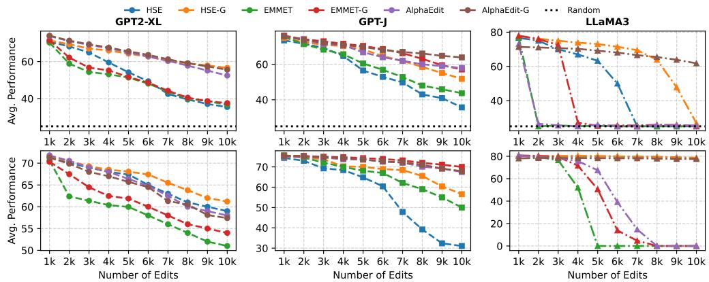  
Figure 7: Sequential editing performance on COUNTERFACT (top row) and ZSRE (bottom row) as the number of edits scales from 1k to 10k. GEDIT variants (denoted with the $\mathbf { \tilde { \Sigma } ^ { 6 6 } - G } ^ { 5 }$ suffix) consistently outperform their base editing methods.

## C.4 Adaptation to Low-Rank Regularization

Correspondence between rank r and energy retention ratio γ Table 5 summarizes the rank required to retain a given proportion of the total energy—defined via the singular value spectrum—for LLaMA3-8B, GPT-J-6B, and GPT2-XL. For each model, we compute the minimal rank such that the cumulative energy, i.e., the sum of squared singular values up to that rank divided by the total sum, reaches the specified retention ratio (e.g., 0.9 for 90%). The reported correspondence is based on the final editing layer. Although this rank–energy mapping varies slightly across layers, the variation is minor, reflecting consistent spectral decay behavior within each model.

Results of knowledge perturbation on the ZsRE dataset Figure 8 compares the knowledge perturbation induced by HSE, AlphaEdit, and GEdit when editing the ZsRE dataset. The results demonstrate that GEdit consistently achieves zero knowledge perturbation on the core knowledge subspace U, thereby enabling stable editing and preserving high edit locality.

Application to HSE, EMMET and AlphaEdit The low-rank regularization is built upon the LR+D factor model, which replaces the knowledge preservation term with the expected perturbation. Thus, for MEMIT (or HSE), we have its low-rank regularized version as follows,

$$
\begin{array} { r } { \boxed { \Delta _ { \mathrm { M E M I T } } ^ { \mathrm { G E d i t } } = \mathbf { R } _ { 1 } \mathbf { K } _ { 1 } ^ { \top } \left( \mathbf { K } _ { 1 } \mathbf { K } _ { 1 } ^ { \top } + \beta ( \mathbf { U U } ^ { \top } + \bar { \mathbf { D } } ) \right) ^ { - 1 } } , } \end{array}\tag{53}
$$

And for EMMET, we have its low-rank regularized version as follows,

$$
\boxed { \Delta _ { \mathrm { E M M E T } } ^ { \mathrm { G E d i t } } = \mathbf { R } _ { 1 } \left( \mathbf { K } _ { 1 } ^ { \top } ( \beta ( \mathbf { U U } ^ { \top } + \bar { \mathbf { D } } ) ) ^ { - 1 } \mathbf { K } _ { 1 } \right) ^ { - 1 } \mathbf { K } _ { 1 } ^ { \top } ( \beta ( \mathbf { U U } ^ { \top } + \bar { \mathbf { D } } ) ) ^ { - 1 } . }\tag{54}
$$

In AlphaEdit, the knowledge preservation term is canceled due to null space projection, so no additional adaptation is required except for the null space projector. The low-rank regularization is designed to protect the core knowledge subspace U. Therefore, we construct the projector P in AlphaEdit as $\dot { \mathbf P } = \mathbf M \mathbf M ^ { \top }$

With these adaptations, we compare the editing performance of low-rank regularization against full-rank regularization in Figure 7, where the low-rank version is denoted with the $" _ { - } \mathrm { G " }$ suffix. For a fair comparison, we do not tune the regularization strength separately. Specifically, β is uniformly set to 15000 for HSE, HSE-G, EMMET, and EMMET-G, while it is set to 10 for AlphaEdit and AlphaEdit-G, following the default setting in their paper. For COUNTERFACT, performance is averaged over Eff., Gen., Loc., Eff.\*, Gen.\* and Loc.\*, where the latter three are the widely adopted probability-comparison-based metrics [Fang et al., 2025a]; for ZSRE, it is averaged over Eff., Gen., and Loc.. As shown, the low-rank variants significantly outperforms their full-rank counterparts.

Table 6: Performance of GEDIT and HSE under fixed regularization, which requires per-method, per-dataset, and per-model tuning and is therefore suboptimal. CounterFact is abbreviated as CF.
<table><tr><td rowspan="3">Setting</td><td colspan="9">Regularization strength µ</td></tr><tr><td colspan="2">5000</td><td colspan="2">10000</td><td colspan="2">15000</td><td colspan="2">20000</td><td colspan="2">50000</td></tr><tr><td colspan="2">Eff. Gen. Loc. Eff. Gen. Loc. Eff. Gen. Loc. Eff. Gen. Loc. Eff. Gen. Loc.</td><td colspan="2"></td><td colspan="2"></td><td colspan="2"></td><td colspan="2"></td></tr><tr><td></td><td></td><td></td><td></td><td></td><td></td><td></td><td></td><td></td><td></td></tr><tr><td>GEdit / GPT-J / CF</td><td></td><td></td><td></td><td></td><td></td><td></td><td></td><td></td><td>76.2 37.3 3.80 80.1 41.8 4.30 85.8 45.4 5.00 87.4 48.1 5.50 42.3 28.98.90</td></tr><tr><td>GEdit / GPT-J / ZsRE</td><td></td><td></td><td></td><td></td><td>69.952.420.1 77.269.1 23.886.578.325.483.0 74.226.3 45.1 34.527.0</td><td></td><td></td><td></td><td></td></tr><tr><td>GEdit / LLaMA / CF</td><td></td><td></td><td></td><td></td><td></td><td></td><td></td><td>66.1 41.2 3.90 72.8 60.9 5.20 76.3 61.5 7.40 71.1 58.1 9.00 38.6 27.4 16.7</td><td></td></tr><tr><td>GEdit / LLaMA / ZsRE 80.4 69.1 32.8 89.781.5 34.5 85.2 74.4 34.9 81.1 70.9 35.0 39.5 26.2 37.0</td><td></td><td></td><td></td><td></td><td></td><td></td><td></td><td></td><td></td></tr><tr><td>HSE / GPT-J / CF</td><td></td><td></td><td></td><td>0.00 0.00 0.00 41.2 34.2 3.80 38.9 35.16.20 43.3 36.213.7 35.1 20.5 27.0</td><td></td><td></td><td></td><td></td><td>0.00 0.00 0.00 8.10 1.80 0.40 26.7 16.0 2.40 33.5 20.2 3.60 30.6 18.9 8.50</td></tr><tr><td>HSE / GPT-J / ZsRE</td><td></td><td></td><td></td><td>0.00 0.00 0.00 0.00 0.00 0.00 0.00 0.00 0.00 0.00 0.00 0.00 40.2 29.5 16.4</td><td></td><td></td><td></td><td></td><td></td></tr><tr><td>HSE / LLaMA / CF</td><td></td><td></td><td></td><td></td><td></td><td></td><td></td><td>0.00 0.000.00 81.770.533.5 90.2 82.135.2 85.375.635.8 37.2 29.2 36.9</td><td></td></tr><tr><td>HSE / LLaMA / ZsRE</td><td></td><td></td><td></td><td></td><td></td><td></td><td></td><td></td><td></td></tr></table>

## C.5 Adaptation to Adaptive Regularization

Comparison with fixed regularization We provide a detailed comparison between our adaptive regularization framework and fixed regularization approaches. Table 6 presents the editing performance of two editors (GEDIT and HSE) under fixed regularization across varying regularization strengths $\mu \in \{ 5 0 0 0$ , 10000, 15000, 20000, 50000}, evaluated on two models (GPT-J and LLaMA) and two datasets (CounterFact and ZsRE).

A key observation from Table 6 is that there is no single fixed regularization strength that works optimally across different combinations of methods, models, and datasets. For example, for GEDIT with GPT-J on CounterFact, the optimal $\mu$ is around 20000, achieving 87.4% efficacy, 48.1% generalization, and 5.50 locality. However, for GEDIT with LLaMA on ZsRE, the best efficacy (89.7%) occurs at $\mu = 1 0 0 0 0$ . For HSE with GPT-J on CounterFact, meaningful performance only emerges at $\mu \geq 1 0 0 0 0$ , with optimal trade-offs around $\mu = 2 0 0 0 0$ . More dramatically, HSE with LLaMA on CounterFact produces all-zero metrics (complete failure) for $\mu \leq 2 0 0 0 0$ , only achieving reasonable performance at $\mu = 5 0 0 0 0$

These results clearly demonstrate that the optimal fixed regularization strength is highly sensitive to the choice of editing method, base model, and evaluation dataset. A setting that performs well in one configuration may lead to suboptimal or even completely failed edits in another.

Comparing Table 6 with the main text’s Tables 2 and 4 reveals a consistent pattern: adaptive regularization substantially outperforms even the best-tuned fixed regularization across all configurations. More importantly, the adaptive approach achieves this without requiring per-method, per-dataset, per-model hyperparameter tuning. This is because the correspondence between editability and output perturbation (Theorem 1) is agnostic to these factors.

Results of adaptive regularization on ZsRE Figure 9 shows the frequency distribution of the adaptive regularization strength across 10,000 sequential editing steps (batch size = 1) on the ZSRE dataset. As illustrated, the adaptive regularization mechanism dynamically adjusts the regularization strength per edit: it relaxes constraints for difficult edits to improve success rates, while tightening them for easier edits to enhance locality. Together with the results on COUNTERFACT (Figure 6), where the distribution of regularization strengths also varies, these findings demonstrate the effectiveness of our adaptive regularization strategy—capable of adjusting not only across edits but also across datasets and models.

Application to MEMIT (HSE). For MEMIT, we define editability as (Eq. 10)

$$
\mathcal { E } _ { \mathrm { M E M I T } } ( \mathbf { k } _ { e } ) = \frac { 1 } { \mu } \mathbf { k } _ { e } ^ { \top } ( \mathbf { K } _ { 0 } \mathbf { K } _ { 0 } ^ { \top } ) ^ { - 1 } \mathbf { k } _ { e } .\tag{55}
$$

Intuitively, this definition reflects two factors. A larger regularization strength $\mu$ penalizes model changes more heavily, reducing editability — hence µ appears in the denominator. The quadratic form $\mathbf { \bar { k } } _ { e } ^ { \top } ( \mathbf { K } _ { 0 } \mathbf { K } _ { 0 } ^ { \top } ) ^ { - 1 } \bar { \mathbf { k } } _ { e }$ (the squared Mahalanobis distance (see Appendix B.1)) measures how far $\mathbf { k } _ { e }$ deviates from the pretrained knowledge distribution: if $\mathbf { k } _ { e }$ lies in a low-variance direction of ${ \bf K } _ { 0 } { \bf K } _ { 0 } ^ { \top }$ this term is large, indicating that the pre-trained model has weak knowledge there and should be more willing to adapt, thus increasing editability.

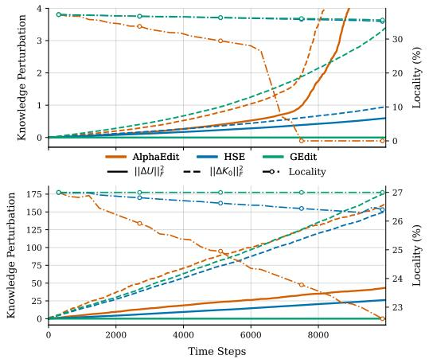

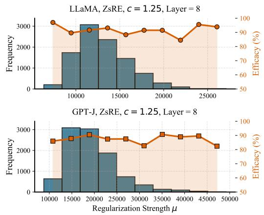  
Figure 8: Evolution of knowledge perturbation (left axis) and editing locality (right axis) during 10,000 sequential edits of LLaMA (top) and GPT J (bottom).  
Figure 9: Frequency distribution of the adaptive regularization strength across 10,000 sequential edits, along with the corresponding edit accuracy per strength bin.

The MEMIT update rule for an edit $\left( \mathbf { k } _ { e } , \mathbf { r } _ { e } \right)$ is given by

$$
{ \boldsymbol { \Delta } } _ { \mathrm { M E M I T } } = \mathbf { r } _ { e } \mathbf { k } _ { e } ^ { \top } \left( \mu \mathbf { K } _ { 0 } \mathbf { K } _ { 0 } ^ { \top } + \mathbf { K } _ { e } \mathbf { K } _ { e } ^ { \top } \right) ^ { - 1 } .\tag{56}
$$

We now formally establish the relationship between editability and editing success: higher editability leads to greater success, as stated in the following theorem.

Theorem 2 Let $\displaystyle ( \mathbf { k } _ { e } , \mathbf { v } _ { e } )$ be a knowledge pair to be edited, and let $\mathbf { r } _ { e } = \mathbf { v } _ { e } - \mathbf { W } \mathbf { k } _ { e }$ be the corresponding output residual. Denote by $\bar { \mathcal { E } _ { M E M I T } } ( \mathbf { k } _ { e } )$ the editability defined in Eq. (55). Then the output perturbation induced by the MEMIT update on $\mathbf { k } _ { e }$ satisfies

$$
\Delta _ { M E M I T } \mathbf { k } _ { e } = \frac { \mathcal { E } _ { M E M I T } ( \mathbf { k } _ { e } ) } { 1 + \mathcal { E } _ { M E M I T } ( \mathbf { k } _ { e } ) } \mathbf { r } _ { e } .
$$

Thus, a larger editability $\mathcal { E } _ { \mathrm { M E M I T } } ( { \bf k } _ { e } )$ makes the factor $\frac { \mathcal { E } } { 1 + \mathcal { E } }$ closer to 1, meaning the update nearly recovers the full residual $\mathbf { r } _ { e }$ and achieves near-perfect editing success.

By setting $\mathcal { E } _ { \mathrm { M E M I T } } ( { \bf k } _ { e } ) = c$ with a constant hyperparameter $c > 0$ , we obtain an edit-adaptive regularization strength

$$
\mu = \frac { 1 } { c } \mathbf { k } _ { e } ^ { \top } ( \mathbf { K } _ { 0 } \mathbf { K } _ { 0 } ^ { \top } ) ^ { - 1 } \mathbf { k } _ { e } .\tag{57}
$$

Application to EMMET (ROME). For EMMET, the update rule for an edit $\left( \mathbf { k } _ { e } , \mathbf { r } _ { e } \right)$ is given by

$$
\Delta _ { \mathrm { E M M E T } } = { \bf r } _ { e } \left( { \bf k } _ { e } ^ { \top } ( \mu { \bf K } _ { 0 } { \bf K } _ { 0 } ^ { \top } ) ^ { - 1 } { \bf k } _ { e } + a I \right) ^ { - 1 } { \bf k } _ { e } ^ { \top } ( \mu { \bf K } _ { 0 } { \bf K } _ { 0 } ^ { \top } ) ^ { - 1 } ,\tag{58}
$$

where $\mu > 0$ and $a > 0$ are regularization hyperparameters, with a not only protecting knowledge but also controlling editing stability [Meng et al., 2022, Gupta et al., 2024b].

We define editability for EMMET as

$$
\mathcal { E } _ { \mathrm { E M M E T } } ( { \bf k } _ { e } ) = \frac { 1 } { \mu a } { \bf k } _ { e } ^ { \top } ( { \bf K } _ { 0 } { \bf K } _ { 0 } ^ { \top } ) ^ { - 1 } { \bf k } _ { e } .\tag{59}
$$

Intuitively, A larger regularization strength µ or a penalizes model changes more heavily, reducing editability — hence the product $\mu a$ appears in the denominator.

We now formally establish the relationship between editability and editing success: higher editability leads to greater success, as stated in the following theorem.

Theorem 3 Let $\displaystyle ( \mathbf { k } _ { e } , \mathbf { v } _ { e } )$ be a knowledge pair to be edited, and let ${ \bf r } _ { e } = { \bf v } _ { e } - { \bf W } { \bf k } _ { e }$ be the corresponding output residual. Denote $b y \mathcal { E } _ { E M M E T } ( \mathbf { k } _ { e } )$ the editability defined in Eq. (59). Then the output perturbation induced by the EMMET update on $\mathbf { k } _ { e }$ satisfies

$$
\Delta _ { E M M E T } \mathbf { k } _ { e } = \frac { \mathcal { E } _ { E M M E T } ( \mathbf { k } _ { e } ) } { 1 + \mathcal { E } _ { E M M E T } ( \mathbf { k } _ { e } ) } \mathbf { r } _ { e } .
$$

Thus, a larger editability $\mathcal { E } _ { \mathrm { E M M E T } } ( { \bf k } _ { e } )$ makes the factor $\frac { \varepsilon } { 1 + \varepsilon }$ closer to 1, meaning the update nearly recovers the full residual $\mathbf { r } _ { e }$ and achieves near-perfect editing success.

By setting $\mathcal { E } _ { \mathrm { E M M E T } } ( { \bf k } _ { e } ) = c$ with a constant hyperparameter $c > 0$ , we obtain an edit-adaptive regularization condition

$$
\mu = \frac { 1 } { c a } \mathbf { k } _ { e } ^ { \top } ( \mathbf { K } _ { 0 } \mathbf { K } _ { 0 } ^ { \top } ) ^ { - 1 } \mathbf { k } _ { e } .\tag{60}
$$

$\mathrm { O r } ,$ we can fix $\mu$ and tune $a .$ This provides a flexible two-parameter adaptive regularization strategy.

Application to AlphaEdit. For AlphaEdit, we define editability analogously. Under the projectionbased update, editability is formulated as

$$
\mathcal { E } _ { \mathrm { A l p h a } } ( \mathbf { k } _ { e } ) = \frac { 1 } { \mu } \mathbf { k } _ { e } ^ { \top } \mathbf { P } \mathbf { k } _ { e } ,\tag{61}
$$

where P is a projection matrix satisfying $\mathbf { P } ^ { 2 } = \mathbf { P }$ and $\mathbf { P } ^ { \top } = \mathbf { P }$ . Intuitively, $\mathbf { k } _ { e } ^ { \top } \mathbf { P } \mathbf { k } _ { e } = \| \mathbf { P } \mathbf { k } _ { e } \| ^ { 2 }$ measures the component of ke that lies in the null space where editing is permitted. I $\mathbf { f } \ \lVert \mathbf { P } \mathbf { k } _ { e } \rVert$ is small, most of $\mathbf { k } _ { e }$ does not fall into the null space, meaning the edit direction is ignored by the projection and thus harder to effect — hence editability is low. Conversely, a large $\| \bar { \mathbf P } \mathbf k _ { e } \|$ indicates that ke is well-aligned with the null space, making the edit easier. The regularization strength $\mu$ again appears in the denominator, as stronger regularization reduces editability.

The AlphaEdit update rule for an edit $\left( \mathbf { k } _ { e } , \mathbf { r } _ { e } \right)$ is given by

$$
\boldsymbol { \Delta } _ { \mathrm { A l p h a E d i t } } = \mathbf { r } _ { e } \mathbf { k } _ { e } ^ { \top } \mathbf { P } \left( \mathbf { k } _ { e } \mathbf { k } _ { e } ^ { \top } \mathbf { P } + \mu I \right) ^ { - 1 } .\tag{62}
$$

We now establish the analogous relationship for AlphaEdit.

Theorem 4 Let $\displaystyle ( \mathbf { k } _ { e } , \mathbf { v } _ { e } )$ be a knowledge pair to be edited, and let ${ \bf r } _ { e } = { \bf v } _ { e } - { \bf W } { \bf k } _ { e }$ be the corresponding output residual. Let P be a projection matrix as defined above, and let $\mathcal { E } _ { A l p h a } ( { \bf k } _ { e } )$ be the editability defined in $E q .$ (61). Then the output perturbation induced by the AlphaEdit update on $\mathbf { k } _ { e }$ satisfies

$$
\Delta _ { A l p h a E d i t } \mathbf { k } _ { e } = \frac { \mathcal { E } _ { A l p h a } ( \mathbf { k } _ { e } ) } { 1 + \mathcal { E } _ { A l p h a } ( \mathbf { k } _ { e } ) } \mathbf { r } _ { e } .
$$

As before, a higher editability brings the factor $\frac { \mathcal { E } } { 1 + \mathcal { E } }$ closer to 1, enabling the update to nearly recover the desired residual $\mathbf { r } _ { e }$ and achieve successful editing.

By setting $\mathcal { E } _ { \mathrm { A l p h a } } ( { \bf k } _ { e } ) = c$ with the same hyperparameter $c > 0 ( { \mathrm { e . g . , } } c = 1 . 2 5 )$ , we obtain an edit-adaptive regularization strength for AlphaEdit:

$$
\mu = \frac { 1 } { c } \mathbf { k } _ { e } ^ { \top } \mathbf { P } \mathbf { k } _ { e } .\tag{63}
$$

In Figure 10, we demonstrate that although different methods employ varying regularization strengths, they can be uniformly modulated through the concept of editability. Specifically, we set the desired editability to 1.25 for EMMET, MEMIT, and AlphaEdit. Under this unified configuration, the regularization strength of each method is automatically tuned across edits, as shown in the figure. This explains why AlphaEdit originally sets its default regularization strength $\mu$ to 10—it corresponds approximately to the average value of our adaptive regularization strength. The same observation applies to EMMET and MEMIT.

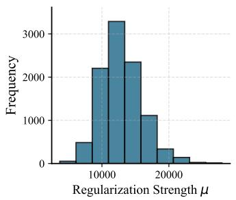

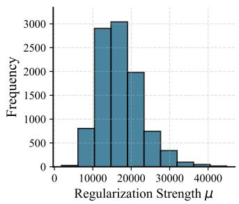

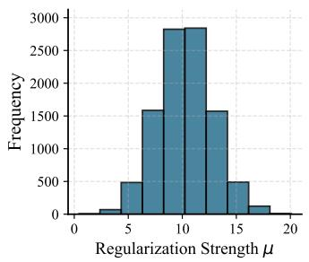  
Figure 10: Adaptive regularization strength across 10,000 edits on the CounterFact dataset, applied to the LLaMA model. The desired editability is set to 1.25. From left to right: EMMET, MEMIT, AlphaEdit.

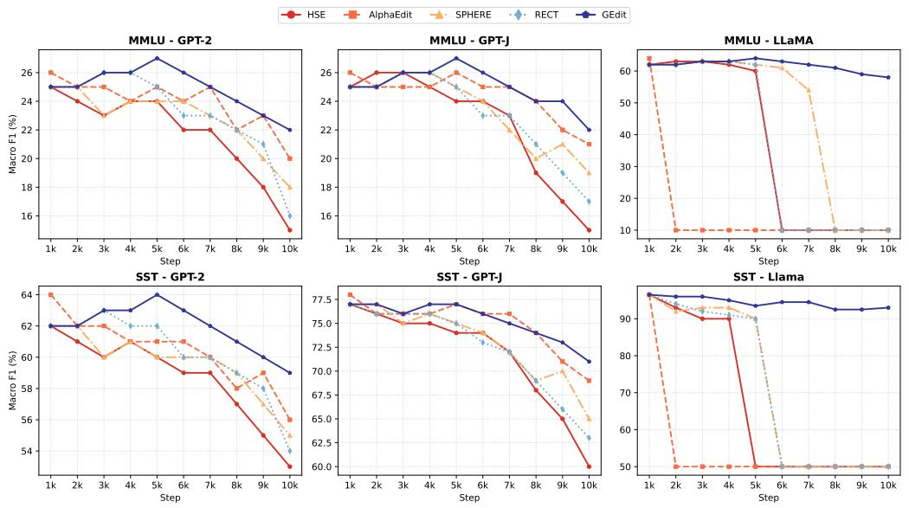  
Figure 11: SST and MMLU performance across 10,000 sequential edits on the CounterFact dataset, evaluated every 1,000 steps (10 evaluation points total). Results are shown for three base models (GPT-2, GPT-J, and LLaMA) across five editing methods: HSE, AlphaEdit, SPHERE, RECT, and GEdit.

Adaptation to Sequential Editing We extend the adaptive regularization mechanism of GEdit to sequential editing, where edits are applied over multiple steps while preserving both pretrained knowledge and previously edited knowledge. At step t, let $\mathbf { K } _ { t }$ and $\mathbf { V } _ { t }$ denote the keys and desired values of the current edit batch, respectively, and let $\mathbf { K } _ { 1 : t - 1 } = [ \mathbf { K } _ { 1 } , \ldots , \mathbf { K } _ { t - 1 } ]$ contain the keys of all previously edited batches. The current model weights are denoted by $\mathbf { W } _ { t - 1 }$ , and the target residual is $\mathbf R _ { t } \dot { = } \mathbf V _ { t } - \mathbf W _ { t - 1 } \mathbf K _ { t }$ . To preserve both pretrained and previously edited knowledge, we introduce the unified regularization matrix [Fang et al., 2025a,b, Guo et al., 2025, Liu et al., 2026a]

$$
\widetilde { \mathbf { D } } _ { t } = \mathbf { K } _ { 1 : t - 1 } \mathbf { K } _ { 1 : t - 1 } ^ { \top } + \mu \bar { \mathbf { D } } ,\tag{64}
$$

where $\mu > 0$ is a fixed hyperparameter controlling the relative contribution of pretrained knowledge preservation. Introducing an adaptive coefficient $\lambda _ { t } > 0$ , we obtain the following weight update for sequential editing:

$$
\boldsymbol { \Delta } _ { t } = \mathbf { R } _ { t } \mathbf { K } _ { t } ^ { \top } \mathbf { M } \left[ \mathbf { M } ^ { \top } \left( \mathbf { K } _ { t } \mathbf { K } _ { t } ^ { \top } + \lambda _ { t } \tilde { \mathbf { D } } _ { t } \right) \mathbf { M } \right] ^ { - 1 } \mathbf { M } ^ { \top } .\tag{65}
$$

We can correspondingly define the history-aware editability as

$$
\mathcal { E } _ { t } ( \mathbf { k } _ { t } ) = \frac { 1 } { \lambda _ { t } } \mathbf { k } _ { t } ^ { \top } \mathbf { M } \left( \mathbf { M } ^ { \top } \widetilde { \mathbf { D } } _ { t } \mathbf { M } \right) ^ { - 1 } \mathbf { M } ^ { \top } \mathbf { k } _ { t } .\tag{66}
$$

Table 7: Editing performance under 2,000 sequential edits (batch size=1).
<table><tr><td rowspan="2">Method</td><td colspan="7">CounterFact</td><td colspan="4">ZsRE</td></tr><tr><td>SST</td><td>Eff*.</td><td> $\mathrm { G e n ^ { * } } .$ </td><td> $\mathrm { L o c ^ { * } } .$ </td><td>Eff.</td><td>Gen.</td><td>Loc.</td><td>SST</td><td>Eff.</td><td>Gen.</td><td>Loc.</td></tr><tr><td>Pre-edited</td><td>62.5</td><td>22.1</td><td>24.4</td><td></td><td>78.0 0.10</td><td>0.40</td><td>10.6</td><td>62.5</td><td>0.00</td><td>0.00</td><td>25.0</td></tr><tr><td>HSE</td><td>62.0</td><td>98.0</td><td>88.6</td><td>65.7</td><td>91.4</td><td>58.4</td><td>10.6</td><td>60.0</td><td>94.7</td><td>88.4</td><td>26.9</td></tr><tr><td>EMMET</td><td>GTT-XL 62.0</td><td>92.4</td><td>85.6</td><td>57.1</td><td>71.1</td><td>49.9</td><td>5.50</td><td>62.0</td><td>85.0</td><td>77.8</td><td>24.3</td></tr><tr><td>AlphaEdit</td><td>62.5</td><td>99.6</td><td>94.0</td><td>65.7</td><td>97.3</td><td>65.3</td><td>6.40</td><td>62.5</td><td>96.0</td><td>88.8</td><td>26.8</td></tr><tr><td>GEdit</td><td>62.5</td><td>99.6</td><td>94.0</td><td>65.6</td><td>96.8</td><td>65.6</td><td>6.40</td><td>62.5</td><td>95.2</td><td>88.0</td><td>26.4</td></tr><tr><td>Pre-edited</td><td>77.0</td><td>15.4</td><td>18.0</td><td>83.3</td><td>0.40</td><td>0.60</td><td>13.7</td><td>77.0</td><td>0.00</td><td>0.00</td><td>27.4</td></tr><tr><td>MEMIT</td><td>77.5</td><td>99.2</td><td>89.9</td><td>77.5</td><td>96.4</td><td>51.3</td><td>9.90</td><td>72.0</td><td>98.8</td><td>93.3</td><td>27.5</td></tr><tr><td>EMMET</td><td>GP 77.0</td><td>99.6</td><td>94.4</td><td>75.3</td><td>98.1</td><td>60.6</td><td>10.4</td><td>75.0</td><td>99.8</td><td>97.2</td><td>28.6</td></tr><tr><td>AlphaEdit</td><td>78.0</td><td>99.8</td><td>93.8</td><td>76.6</td><td>99.0</td><td>61.2</td><td>9.90</td><td>72.5</td><td>99.8</td><td>97.8</td><td>28.7</td></tr><tr><td>GEdit</td><td>77.5</td><td>99.8</td><td>94.6</td><td>77.8</td><td>99.4</td><td>65.4</td><td>10.8</td><td>76.0</td><td>99.8</td><td>97.9</td><td>28.9</td></tr><tr><td>Pre-edited</td><td>96.5</td><td>7.80</td><td>10.4</td><td>89.3</td><td>0.30</td><td>0.50</td><td>21.3</td><td>96.5</td><td>0.00</td><td>0.00</td><td>38.6</td></tr><tr><td>HSE</td><td>94.5</td><td>99.0</td><td>92.9</td><td>71.5</td><td>97.0</td><td>71.3</td><td>18.4</td><td>97.0</td><td>99.2</td><td>95.4</td><td>38.9</td></tr><tr><td>EMMET</td><td>LMA3 50.0</td><td>50.1</td><td>50.0</td><td>50.0</td><td>0.00</td><td>0.00</td><td>0.00</td><td>93.0</td><td>97.3</td><td>93.9</td><td>38.0</td></tr><tr><td>AlphaEdit</td><td>50.5</td><td>50.1</td><td>50.0</td><td>50.5</td><td>0.00</td><td>0.00</td><td>0.60</td><td>95.5</td><td>98.0</td><td>94.2</td><td>38.4</td></tr><tr><td>GEdit</td><td>96.0</td><td>99.6</td><td>93.0</td><td>78.1</td><td>98.4</td><td>68.4</td><td>20.6</td><td>97.0</td><td>99.5</td><td>96.0</td><td>38.7</td></tr></table>

This definition generalizes the subspace-aware editability in Eq. (11) by incorporating the covariancelike structure of previously edited keys. In particular, the term $\mathbf { \bar { K } } _ { 1 : t - 1 } \mathbf { \bar { K } } _ { 1 : t - 1 } ^ { \top }$ penalizes updates along directions associated with historical edits, while $\mu \bar { \bf D }$ regularizes changes to pretrained knowledge.

Following the same argument as in Theorem 1, one can show that the relation between editability and output residual fitting still holds in the sequential setting, i.e.,

$$
\Delta _ { t } \mathbf { k } _ { t } = \frac { \mathcal { E } _ { t } ( \mathbf { k } _ { t } ) } { 1 + \mathcal { E } _ { t } ( \mathbf { k } _ { t } ) } \mathbf { r } _ { t } ,\tag{67}
$$

Consequently, the adaptive coefficient λt can be determined in the same manner, i.e., by setting the desired editability to c, so that $\mathcal { E } _ { t } ( { \bf k } _ { t } ) = c _ { \mathrm { : } }$ , and then solving for $\lambda _ { t } .$

At the first editing step, ${ \bf K } _ { 1 : 0 }$ is empty, and the unified matrix reduces to $\widetilde { \mathbf { D } } _ { 1 } = \mu \bar { \mathbf { D } }$ . Consequently, the formulation recovers the original subspace-aware regularization structure.

## C.6 Additional Experimental Results

Results on General-Capability Benchmarks Following prior work [Fang et al., 2025a], we evaluate the model’s general capabilities on two representative benchmarks, the Stanford Sentiment Treebank (SST) [Socher et al., 2013] and MMLU [Hendrycks et al., 2021], to assess whether its performance degrades after editing. This evaluation provides an additional measure of knowledge preservation. SST is a binary sentiment classification dataset comprising sentences from movie reviews, where each input is classified as either positive (label = 1) or negative (label = 0). For example, the sentence “What better message than ‘love thyself’ could young women of any size receive?” is annotated with label 1 (positive). Performance on this task is measured by accuracy, denoted by SST. We evaluate the model in a zero-shot prompting setting using the prompt template Review:{input}\nSentiment:, with predictions determined by comparing the probabilities of the tokens “positive” and “negative”. The evaluation is conducted on 200 SST samples.

MMLU comprises multiple-choice questions spanning 57 diverse subjects, including humanities, STEM, and social sciences. Each question has four answer choices, with exactly one correct answer. For example, a typical question from the abstract algebra category is: “Let G be a finite group with an even number of elements. Then which of the following must be true? (A) G has an element of order 2 (B) G has no element of order 2 (C) G is cyclic (D) G is abelian.” The correct answer is (A). We adopt a zero-shot prompting strategy, using the template Question:{input}\nOptions:{choices}\nAnswer:, and compare the model’s predicted token probabilities against the canonical answer letters (A/B/C/D). The evaluation is conducted on 200 MMLU samples.

Table 8: Editing performance under 5,000 sequential edits (batch size=1).
<table><tr><td rowspan="2">Method</td><td colspan="7">CounterFact</td><td colspan="4">ZsRE</td></tr><tr><td>SST</td><td>Eff*.</td><td> $\mathrm { G e n ^ { * } } .$ </td><td> $\mathrm { L o c ^ { * } } .$ </td><td>Eff.</td><td>Gen.</td><td>Loc. SST</td><td>Eff.</td><td></td><td>Gen.</td><td>Loc.</td></tr><tr><td>Pre-edited</td><td>62.5</td><td></td><td>21.4</td><td>23.8</td><td>78.2</td><td>0.20 0.40</td><td>10.6</td><td>62.5</td><td>0.00</td><td>0.00</td><td>24.3</td></tr><tr><td>HSE</td><td>60.0</td><td>89.6</td><td>76.2</td><td>58.0</td><td>60.9</td><td>34.1</td><td>6.30</td><td>61.0</td><td>92.3</td><td>84.6</td><td>25.3</td></tr><tr><td>EMMET</td><td>GTT-L 58.5</td><td>87.4</td><td>76.3</td><td>55.5</td><td>54.6</td><td>30.6</td><td>3.70</td><td>61.5</td><td>82.1</td><td>76.0</td><td>21.8</td></tr><tr><td>AlphaEdit</td><td>62.0</td><td>98.0</td><td>88.3</td><td>60.8</td><td>88.7</td><td>52.9</td><td>4.70</td><td>62.0</td><td>91.2</td><td>84.3</td><td>23.6</td></tr><tr><td>GEdit</td><td>62.0</td><td>97.8</td><td>87.7</td><td>61.0</td><td>85.4</td><td>50.1</td><td>4.90</td><td>62.0</td><td>90.6</td><td>83.3</td><td>23.2</td></tr><tr><td>Pre-edited</td><td>77.0</td><td>14.7</td><td>17.2</td><td>83.5</td><td>0.40</td><td>0.50</td><td>14.3</td><td>77.0</td><td>0.00</td><td>0.00</td><td>27.0</td></tr><tr><td>HSE</td><td>75.0</td><td>95.8</td><td>86.0</td><td>66.1</td><td>71.5</td><td>37.7</td><td>6.60</td><td>67.0</td><td>86.8</td><td>80.4</td><td>23.1</td></tr><tr><td>EMMET</td><td>GPTF 73.5</td><td>92.0</td><td>84.3</td><td>67.2</td><td>71.5</td><td>41.3</td><td>6.80</td><td>79.0</td><td>97.3</td><td>93.1</td><td>26.0</td></tr><tr><td>AlphaEdit</td><td>76.0</td><td>99.3</td><td>90.2</td><td>71.9</td><td>95.7</td><td>51.9</td><td>7.10</td><td>76.0</td><td>99.1</td><td>95.0</td><td>27.0</td></tr><tr><td>GEdit</td><td>77.0</td><td>99.6</td><td>91.8</td><td>72.4</td><td>98.1</td><td>57.9</td><td>8.20</td><td>79.0</td><td>99.6</td><td>96.6</td><td>27.3</td></tr><tr><td>Pre-edited</td><td>96.5</td><td>7.00</td><td>9.60</td><td>89.6</td><td>0.30</td><td>0.30</td><td>21.6</td><td>96.5</td><td>0.00</td><td>0.00</td><td>38.5</td></tr><tr><td>HSE</td><td>54.0</td><td>96.8</td><td>89.2</td><td>61.8</td><td>87.1</td><td></td><td></td><td></td><td></td><td></td><td></td></tr><tr><td>LA3 EMMET</td><td>50.0</td><td>51.1</td><td>50.7</td><td>50.0</td><td>0.00</td><td>65.4</td><td>14.4 0.00</td><td>95.5 50.5</td><td>99.0 1.10</td><td>95.1</td><td>39.5 0.80</td></tr><tr><td>AlphaEdit</td><td>50.5</td><td>50.0</td><td>50.0</td><td>50.0</td><td>0.00</td><td>0.00 0.00</td><td>0.00</td><td>90.5</td><td>84.2</td><td>1.10 79.0</td><td>39.3</td></tr><tr><td>GEdit</td><td>94.0</td><td>99.3</td><td>92.3</td><td>66.5</td><td>96.4</td><td>67.8</td><td>15.0</td><td>96.0</td><td>99.1</td><td>95.2</td><td>39.0</td></tr></table>

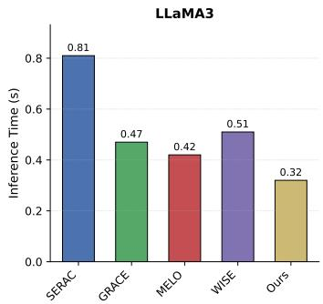

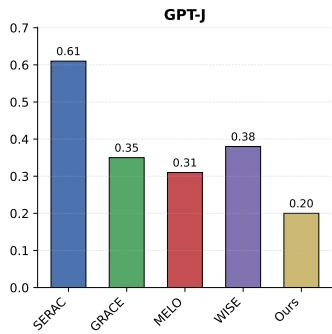

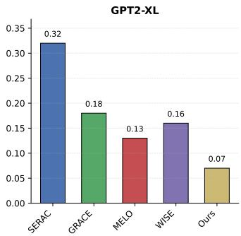  
Figure 12: Inference time (in seconds) per input prompt on LLaMA3, GPT-J, and GPT2-XL. Our method consistently achieves the lowest latency across all backbone models.

Figure 11 presents the SST (sentiment analysis) and MMLU (massive multitask language understanding) performance across 10,000 sequential edits on the CounterFact dataset, with evaluations conducted every 1,000 steps. Across all three base models—GPT-2, GPT-J, and LLaMA—we observe that most editing methods suffer from significant performance degradation as the number of sequential edits increases. Specifically, HSE, AlphaEdit, SPHERE, and RECT exhibit sharp drops in both SST and MMLU accuracy after a certain number of edits, often falling to near-random performance levels. In contrast, GEdit maintains remarkably stable performance throughout the entire editing sequence. For instance, on LLaMA, where the baseline MMLU Macro F1 score is 62%, GEdit achieves 64% at step 1,000 and only gradually declines to 58% by step 10,000, while other methods collapse to 10% within the first few thousand edits. Similarly, on SST with LLaMA (baseline 96.5%), GEdit sustains accuracy above 92% across all 10,000 edits, whereas competing methods drop to 50% and remain there. These results demonstrate that GEdit is uniquely capable of sequential model editing without catastrophic forgetting, preserving the model’s original language understanding capabilities even after extensive modifications.

Results on 2000 and 5000 sequential edits We additionally report the editing performance under 2000 and 5000 sequential edits (batch size=1). For CounterFact, since the original fact $O _ { \mathrm { o r i } }$ is provided, we additionally report probability-comparison-based metrics, where an edit is considered successful if $P ( o _ { \mathrm { t a r } } \mid x ) > \stackrel { \cdot } { P } ( o _ { \mathrm { o r i } } \mid x )$ , following prior work [Meng et al., 2023, Fang et al., 2025a]. The corresponding metrics are denoted as Eff\*., Gen\*., and Spe\*.. As shown in Table 7 and Table 8, our proposed GEdit consistently achieves the best overall editing performance across all three backbone models (GPT2-XL, GPT-J, and LLaMA3) and both datasets (CounterFact and ZsRE).

Table 9: Performance comparison (in percentage) across 10,000 independent edits.
<table><tr><td rowspan="2">Method</td><td colspan="2">GPT2-XL</td><td colspan="2">GPT-J</td><td colspan="2">LLaMA3-8B</td></tr><tr><td>Eff. Loc.</td><td>CP.</td><td>Eff. Loc.</td><td>CP.</td><td>Eff. Loc.</td><td>CP.</td></tr><tr><td>ROME</td><td>99.7 10.4</td><td>4.8</td><td>99.9 13.8</td><td>5.5</td><td>99.9</td><td>21.2 5.3</td></tr><tr><td rowspan="3">MEMIT AlphaEdit GEDIT</td><td>89.4 10.6</td><td>2.6</td><td>99.7 14.0</td><td>3.2</td><td>96.3</td><td>21.6 3.3</td></tr><tr><td>98.4 10.5</td><td>3.4</td><td>99.7 14.0</td><td>3.0</td><td>96.5</td><td>21.7 3.0</td></tr><tr><td>99.2 10.6</td><td>1.0</td><td>99.9 14.0</td><td>1.2</td><td>99.9 21.6</td><td>1.0</td></tr></table>

Table 10: Performance comparison with parameter-preserving editing methods across three base models (GPT2-XL, GPT-J, and LLaMA3) on the CounterFact and ZsRE datasets under 2,000 sequential edits (batch size=1).
<table><tr><td rowspan="2">Method</td><td colspan="6">CounterFact</td><td colspan="3">ZsRE</td></tr><tr><td>Eff*.</td><td>Gen*.</td><td>Loc*.</td><td>Eff.</td><td>Gen.</td><td>Loc.</td><td>Eff.</td><td>Gen.</td><td>Loc.</td></tr><tr><td>Pre-edited</td><td></td><td>22.1</td><td>24.4</td><td>78.0</td><td>0.10</td><td>0.40</td><td>10.6</td><td>0.0 0.0</td><td>25.0</td></tr><tr><td>SERAC</td><td>GPPT-L 65.2</td><td>48.8</td><td>66.4</td><td>61.8</td><td>19.1</td><td>10.1</td><td>72.7</td><td>38.2</td><td>26.7</td></tr><tr><td>GRACE</td><td>98.8</td><td>53.4</td><td>73.9</td><td>96.7</td><td>21.8</td><td>10.4</td><td>94.8</td><td>26.9</td><td>25.5</td></tr><tr><td>MELO</td><td>95.2</td><td>66.3</td><td>63.5</td><td>91.9</td><td>41.6</td><td>9.80</td><td>93.5</td><td>65.2</td><td>27.2</td></tr><tr><td>WISE</td><td>94.0</td><td>72.4</td><td>70.0</td><td>89.5</td><td>49.4</td><td>10.2</td><td>91.0</td><td>72.4</td><td>25.9</td></tr><tr><td>Pre-edited</td><td>15.4</td><td>18.0</td><td></td><td>83.3 0.40</td><td>0.60</td><td>13.7</td><td>0.0</td><td>0.0</td><td>27.4</td></tr><tr><td>SERAC</td><td>75.5</td><td>49.4</td><td>69.1</td><td>71.5</td><td>35.4</td><td>12.1</td><td>72.0</td><td>38.7</td><td>26.5</td></tr><tr><td>GRACE</td><td>GPTF 98.5</td><td>55.6</td><td>74.0</td><td>95.0</td><td>22.5</td><td>13.1</td><td>96.8</td><td>31.5</td><td>27.0</td></tr><tr><td>MELO</td><td>94.9</td><td>76.8</td><td>67.0</td><td>91.7</td><td>42.4</td><td>11.1</td><td>93.2</td><td>42.3</td><td>25.8</td></tr><tr><td>WISE</td><td>96.0</td><td>81.2</td><td>72.0</td><td>93.6</td><td>61.6</td><td>12.5</td><td>97.6</td><td>73.4</td><td>28.0</td></tr><tr><td>Pre-edited</td><td>7.80</td><td>10.4</td><td>89.3</td><td>0.30</td><td>0.50</td><td>21.3</td><td>0.0</td><td>0.0</td><td>38.6</td></tr><tr><td>SERAC</td><td>LMA3 63.4</td><td>53.5</td><td>69.0</td><td>60.2</td><td>18.4</td><td>19.1</td><td>60.5</td><td>37.8</td><td>36.7</td></tr><tr><td>GRACE</td><td>97.0</td><td>52.3</td><td>79.3</td><td>96.2</td><td>10.3</td><td>20.5</td><td>93.5</td><td>40.5</td><td>37.9</td></tr><tr><td>MELO</td><td>94.9</td><td>59.5</td><td>64.8</td><td>92.4</td><td>17.4</td><td>15.2</td><td>94.1</td><td>40.7</td><td>43.6</td></tr><tr><td>WISE</td><td>95.8</td><td>78.4</td><td>76.2</td><td>82.3</td><td>47.4</td><td>20.1</td><td>95.4</td><td>71.2</td><td>39.8</td></tr></table>

Under 2,000 sequential edits, GEdit attains the highest or near-highest scores in Efficacy (Eff.), Generalization (Gen.), and Locality (Loc.) in almost every setting. For example, on GPT2-XL / CounterFact, GEdit achieves an Eff. of 99.6 (tied with AlphaEdit) and a Gen. of 94.0 (also tied best), while maintaining a Loc. of 65.6. On LLaMA3, where baseline methods like EMMET and AlphaEdit suffer from catastrophic failure (Eff. and Gen. drop to 0 or 50%), GEdit remains robust with Eff. = 99.6, Gen. = 93.0, and Loc. = 78.1 on CounterFact.

The advantage of GEdit becomes even more pronounced under 5,000 sequential edits. While other methods degrade significantly — for instance, on LLaMA3 / CounterFact, HSE shows a clear trend of failure, with SST dropping to around 50%; on LLaMA3 / ZsRE, AlphaEdit also exhibits substantial degradation in performance — GEdit maintains strong and stable results: Eff. = 99.3, Gen. = 92.3, Spe. = 66.5 on CounterFact. Similarly, on GPT-J / ZsRE, GEdit achieves the highest scores among all methods across all three metrics (Eff. = 99.6, Gen. = 96.6, Spe. = 27.3).

Results under ROME’s evaluation setting Following ROME’s evaluation protocol, we perform 10,000 independent edits. For each edit, we apply the edit to a fresh copy of the model, evaluate immediately, and then restore the model to its initial state before proceeding to the next edit. Performance metrics are then averaged across all edits. This setup tests whether a method can perform precise edits—achieving high efficacy while maintaining high locality.

Under this setting, all methods typically achieve high locality (Loc.). Therefore, we adopt a more fine-grained metric, CP. (change in probability), defined as CP = p(o | original model) − p(o | edited model), where o is the ground-truth answer for the locality test. A smaller CP indicates better preservation of unrelated knowledge.

As shown in Table 9, while all methods report high Loc., their CP. scores differ significantly. Our method, GEDIT, achieves the smallest CP., indicating superior locality, while also attaining the highest efficacy (Eff.). This improvement stems from our adaptive regularization mechanism, which relaxes constraints on hard edits to ensure successful updates and tightens them on easy edits to better preserve pretrained knowledge.

Comparison with more baselines Beyond parameter-modifying methods, we further compare our approach against baselines from other paradigms, including memory-based and adapter-based editors. Specifically, we select SERAC [Mitchell et al., 2022b], GRACE [Hartvigsen et al., 2023], MELO [Yu et al., 2024], and WISE [Wang et al., 2024a] as representative baselines. These methods share a common design principle: they employ external memory modules to store (or learn) edited facts. During inference, they retrieve and apply a stored fact based on the similarity between the input query and memorized entries.

Table 10 summarizes the performance of these editing methods under 2,000 sequential edits on the CounterFact and ZsRE benchmarks. Among the baselines, GRACE achieves the strongest locality—i.e., it minimally affects model predictions on unrelated inputs—yet suffers from poor generalization to paraphrased queries. This limitation stems from its memory-based design: GRACE stores key-value (KV) pairs for edited facts and, during inference, retrieves and replaces the corresponding forward activations whenever a match is detected. Although it avoids computing an explicit weight update, the retrieval and dynamic hidden activations substitution process introduces non-negligible overhead at inference time. MELO, like GRACE, is based on query-key matching, but instead of storing raw activations, it dynamically selects a learned LoRA adapter at inference time to apply the edit. In contrast, SERAC suffers from catastrophic forgetting and is therefore unsuitable for sequential editing. Both SERAC and WISE rely on trainable external modules—such as adapters or memory networks—that require additional training data for optimization. This not only increases the editing cost but also introduces computational latency during inference due to the extra forward pass through the auxiliary module.

Figure 12 reports the average inference time (in seconds) per input prompt across different backbone models. Our method consistently achieves the lowest latency on all three architectures, being up to 2.5× faster than SERAC on LLaMA3 (0.32 s vs. 0.81 s) and 4.6× faster on GPT2-XL (0.07 s vs. 0.32 s). This efficiency advantage stems from the parameter-modifying nature of our methods.

## NeurIPS Paper Checklist

The checklist is designed to encourage best practices for responsible machine learning research, addressing issues of reproducibility, transparency, research ethics, and societal impact. Do not remove the checklist: The papers not including the checklist will be desk rejected. The checklist should follow the references and follow the (optional) supplemental material. The checklist does NOT count towards the page limit.

Please read the checklist guidelines carefully for information on how to answer these questions. For each question in the checklist:

• You should answer [Yes], [No], or [N/A].

• [N/A] means either that the question is Not Applicable for that particular paper or the relevant information is Not Available.

• Please provide a short (1–2 sentence) justification right after your answer (even for [N/A]).

The checklist answers are an integral part of your paper submission. They are visible to the reviewers, area chairs, senior area chairs, and ethics reviewers. You will also be asked to include it (after eventual revisions) with the final version of your paper, and its final version will be published with the paper.

The reviewers of your paper will be asked to use the checklist as one of the factors in their evaluation. While [Yes] is generally preferable to [No], it is perfectly acceptable to answer [No] provided a proper justification is given (e.g., error bars are not reported because it would be too computationally expensive” or “we were unable to find the license for the dataset we used”). In general, answering [No] or [N/A] is not grounds for rejection. While the questions are phrased in a binary way, we acknowledge that the true answer is often more nuanced, so please just use your best judgment and write a justification to elaborate. All supporting evidence can appear either in the main paper or the supplemental material, provided in appendix. If you answer [Yes] to a question, in the justification please point to the section(s) where related material for the question can be found.

IMPORTANT, please:

• Delete this instruction block, but keep the section heading “NeurIPS Paper Checklist",

• Keep the checklist subsection headings, questions/answers and guidelines below.

• Do not modify the questions and only use the provided macros for your answers.

## 1. Claims

Question: Do the main claims made in the abstract and introduction accurately reflect the paper’s contributions and scope?

Answer: [Yes]

Justification: The abstract and introduction clearly state the main claims of the paper.

Guidelines:

• The answer [N/A] means that the abstract and introduction do not include the claims made in the paper.

• The abstract and/or introduction should clearly state the claims made, including the contributions made in the paper and important assumptions and limitations. A [No] or [N/A] answer to this question will not be perceived well by the reviewers.

• The claims made should match theoretical and experimental results, and reflect how much the results can be expected to generalize to other settings.

• It is fine to include aspirational goals as motivation as long as it is clear that these goals are not attained by the paper.

## 2. Limitations

Question: Does the paper discuss the limitations of the work performed by the authors?

Answer: [Yes]

Justification: They have been discussed in Section 6.

## Guidelines:

• The answer [N/A] means that the paper has no limitation while the answer [No] means that the paper has limitations, but those are not discussed in the paper.

• The authors are encouraged to create a separate “Limitations” section in their paper.

• The paper should point out any strong assumptions and how robust the results are to violations of these assumptions (e.g., independence assumptions, noiseless settings, model well-specification, asymptotic approximations only holding locally). The authors should reflect on how these assumptions might be violated in practice and what the implications would be.

• The authors should reflect on the scope of the claims made, e.g., if the approach was only tested on a few datasets or with a few runs. In general, empirical results often depend on implicit assumptions, which should be articulated.

• The authors should reflect on the factors that influence the performance of the approach. For example, a facial recognition algorithm may perform poorly when image resolution is low or images are taken in low lighting. Or a speech-to-text system might not be used reliably to provide closed captions for online lectures because it fails to handle technical jargon.

• The authors should discuss the computational efficiency of the proposed algorithms and how they scale with dataset size.

• If applicable, the authors should discuss possible limitations of their approach to address problems of privacy and fairness.

• While the authors might fear that complete honesty about limitations might be used by reviewers as grounds for rejection, a worse outcome might be that reviewers discover limitations that aren’t acknowledged in the paper. The authors should use their best judgment and recognize that individual actions in favor of transparency play an important role in developing norms that preserve the integrity of the community. Reviewers will be specifically instructed to not penalize honesty concerning limitations.

## 3. Theory assumptions and proofs

Question: For each theoretical result, does the paper provide the full set of assumptions and a complete (and correct) proof?

Answer: [Yes]

Justification: They have been provided in the Appendix.

Guidelines:

• The answer [N/A] means that the paper does not include theoretical results.

• All the theorems, formulas, and proofs in the paper should be numbered and crossreferenced.

• All assumptions should be clearly stated or referenced in the statement of any theorems.

• The proofs can either appear in the main paper or the supplemental material, but if they appear in the supplemental material, the authors are encouraged to provide a short proof sketch to provide intuition.

• Inversely, any informal proof provided in the core of the paper should be complemented by formal proofs provided in appendix or supplemental material.

• Theorems and Lemmas that the proof relies upon should be properly referenced.

## 4. Experimental result reproducibility

Question: Does the paper fully disclose all the information needed to reproduce the main experimental results of the paper to the extent that it affects the main claims and/or conclusions of the paper (regardless of whether the code and data are provided or not)?

Answer: [Yes]

Justification: The hyperparameter setting is clearly stated in the Section 5.1.

Guidelines:

• The answer [N/A] means that the paper does not include experiments.

• If the paper includes experiments, a [No] answer to this question will not be perceived well by the reviewers: Making the paper reproducible is important, regardless of whether the code and data are provided or not.

• If the contribution is a dataset and/or model, the authors should describe the steps taken to make their results reproducible or verifiable.

• Depending on the contribution, reproducibility can be accomplished in various ways. For example, if the contribution is a novel architecture, describing the architecture fully might suffice, or if the contribution is a specific model and empirical evaluation, it may be necessary to either make it possible for others to replicate the model with the same dataset, or provide access to the model. In general. releasing code and data is often one good way to accomplish this, but reproducibility can also be provided via detailed instructions for how to replicate the results, access to a hosted model (e.g., in the case of a large language model), releasing of a model checkpoint, or other means that are appropriate to the research performed.

• While NeurIPS does not require releasing code, the conference does require all submissions to provide some reasonable avenue for reproducibility, which may depend on the nature of the contribution. For example

(a) If the contribution is primarily a new algorithm, the paper should make it clear how to reproduce that algorithm.

(b) If the contribution is primarily a new model architecture, the paper should describe the architecture clearly and fully.

(c) If the contribution is a new model (e.g., a large language model), then there should either be a way to access this model for reproducing the results or a way to reproduce the model (e.g., with an open-source dataset or instructions for how to construct the dataset).

(d) We recognize that reproducibility may be tricky in some cases, in which case authors are welcome to describe the particular way they provide for reproducibility. In the case of closed-source models, it may be that access to the model is limited in some way (e.g., to registered users), but it should be possible for other researchers to have some path to reproducing or verifying the results.

## 5. Open access to data and code

Question: Does the paper provide open access to the data and code, with sufficient instructions to faithfully reproduce the main experimental results, as described in supplemental material?

Answer: [Yes]

Justification: The data is publicly available and the anonymous link to the code is provided in the Appendix.

Guidelines:

• The answer [N/A] means that paper does not include experiments requiring code.

• Please see the NeurIPS code and data submission guidelines (https://neurips.cc/ public/guides/CodeSubmissionPolicy) for more details.

• While we encourage the release of code and data, we understand that this might not be possible, so [No] is an acceptable answer. Papers cannot be rejected simply for not including code, unless this is central to the contribution (e.g., for a new open-source benchmark).

• The instructions should contain the exact command and environment needed to run to reproduce the results. See the NeurIPS code and data submission guidelines (https: //neurips.cc/public/guides/CodeSubmissionPolicy) for more details.

• The authors should provide instructions on data access and preparation, including how to access the raw data, preprocessed data, intermediate data, and generated data, etc.

• The authors should provide scripts to reproduce all experimental results for the new proposed method and baselines. If only a subset of experiments are reproducible, they should state which ones are omitted from the script and why.

• At submission time, to preserve anonymity, the authors should release anonymized versions (if applicable).

• Providing as much information as possible in supplemental material (appended to the paper) is recommended, but including URLs to data and code is permitted.

## 6. Experimental setting/details

Question: Does the paper specify all the training and test details (e.g., data splits, hyperparameters, how they were chosen, type of optimizer) necessary to understand the results?

Answer: [Yes]

Justification: They are introduced in Section 5.1.

Guidelines:

• The answer [N/A] means that the paper does not include experiments.

• The experimental setting should be presented in the core of the paper to a level of detail that is necessary to appreciate the results and make sense of them.

• The full details can be provided either with the code, in appendix, or as supplemental material.

## 7. Experiment statistical significance

Question: Does the paper report error bars suitably and correctly defined or other appropriate information about the statistical significance of the experiments?

Answer: [No]

Justification: The error bar is not important in our research field as the randomness is not significant.

Guidelines:

• The answer [N/A] means that the paper does not include experiments.

• The authors should answer [Yes] if the results are accompanied by error bars, confidence intervals, or statistical significance tests, at least for the experiments that support the main claims of the paper.

• The factors of variability that the error bars are capturing should be clearly stated (for example, train/test split, initialization, random drawing of some parameter, or overall run with given experimental conditions).

• The method for calculating the error bars should be explained (closed form formula, call to a library function, bootstrap, etc.)

• The assumptions made should be given (e.g., Normally distributed errors).

• It should be clear whether the error bar is the standard deviation or the standard error of the mean.

• It is OK to report 1-sigma error bars, but one should state it. The authors should preferably report a 2-sigma error bar than state that they have a 96% CI, if the hypothesis of Normality of errors is not verified.

• For asymmetric distributions, the authors should be careful not to show in tables or figures symmetric error bars that would yield results that are out of range (e.g., negative error rates).

• If error bars are reported in tables or plots, the authors should explain in the text how they were calculated and reference the corresponding figures or tables in the text.

## 8. Experiments compute resources

Question: For each experiment, does the paper provide sufficient information on the computer resources (type of compute workers, memory, time of execution) needed to reproduce the experiments?

Answer: [Yes]

Justification: See Appendix.

Guidelines:

• The answer [N/A] means that the paper does not include experiments.

• The paper should indicate the type of compute workers CPU or GPU, internal cluster, or cloud provider, including relevant memory and storage.

• The paper should provide the amount of compute required for each of the individual experimental runs as well as estimate the total compute.

• The paper should disclose whether the full research project required more compute than the experiments reported in the paper (e.g., preliminary or failed experiments that didn’t make it into the paper).

## 9. Code of ethics

Question: Does the research conducted in the paper conform, in every respect, with the NeurIPS Code of Ethics https://neurips.cc/public/EthicsGuidelines?

Answer: [Yes]

Justification: The research conforms to the NeurIPS Code of Ethics.

Guidelines:

• The answer [N/A] means that the authors have not reviewed the NeurIPS Code of Ethics.

• If the authors answer [No], they should explain the special circumstances that require a deviation from the Code of Ethics.

• The authors should make sure to preserve anonymity (e.g., if there is a special consideration due to laws or regulations in their jurisdiction).

## 10. Broader impacts

Question: Does the paper discuss both potential positive societal impacts and negative societal impacts of the work performed?

Answer: [N/A]

Justification: This is foundational methodology research with no direct path to specific societal applications or harms.

Guidelines:

• The answer [N/A] means that there is no societal impact of the work performed.

• If the authors answer [N/A] or [No], they should explain why their work has no societal impact or why the paper does not address societal impact.

• Examples of negative societal impacts include potential malicious or unintended uses (e.g., disinformation, generating fake profiles, surveillance), fairness considerations (e.g., deployment of technologies that could make decisions that unfairly impact specific groups), privacy considerations, and security considerations.

• The conference expects that many papers will be foundational research and not tied to particular applications, let alone deployments. However, if there is a direct path to any negative applications, the authors should point it out. For example, it is legitimate to point out that an improvement in the quality of generative models could be used to generate Deepfakes for disinformation. On the other hand, it is not needed to point out that a generic algorithm for optimizing neural networks could enable people to train models that generate Deepfakes faster.

• The authors should consider possible harms that could arise when the technology is being used as intended and functioning correctly, harms that could arise when the technology is being used as intended but gives incorrect results, and harms following from (intentional or unintentional) misuse of the technology.

• If there are negative societal impacts, the authors could also discuss possible mitigation strategies (e.g., gated release of models, providing defenses in addition to attacks, mechanisms for monitoring misuse, mechanisms to monitor how a system learns from feedback over time, improving the efficiency and accessibility of ML).

## 11. Safeguards

Question: Does the paper describe safeguards that have been put in place for responsible release of data or models that have a high risk for misuse (e.g., pre-trained language models, image generators, or scraped datasets)?

Answer: [N/A]

Justification: The paper does not release high-risk models (e.g., pretrained language models, image generators) or scraped datasets, so no safeguards are required.

Guidelines:

• The answer [N/A] means that the paper poses no such risks.

• Released models that have a high risk for misuse or dual-use should be released with necessary safeguards to allow for controlled use of the model, for example by requiring that users adhere to usage guidelines or restrictions to access the model or implementing safety filters.

• Datasets that have been scraped from the Internet could pose safety risks. The authors should describe how they avoided releasing unsafe images.

• We recognize that providing effective safeguards is challenging, and many papers do not require this, but we encourage authors to take this into account and make a best faith effort.

## 12. Licenses for existing assets

Question: Are the creators or original owners of assets (e.g., code, data, models), used in the paper, properly credited and are the license and terms of use explicitly mentioned and properly respected?

Answer: [Yes]

Justification: All existing assets used (e.g., datasets, code libraries) are properly cited in Section 5.1 and Appendix.

Guidelines:

• The answer [N/A] means that the paper does not use existing assets.

• The authors should cite the original paper that produced the code package or dataset.

• The authors should state which version of the asset is used and, if possible, include a URL.

• The name of the license (e.g., CC-BY 4.0) should be included for each asset.

• For scraped data from a particular source (e.g., website), the copyright and terms of service of that source should be provided.

• If assets are released, the license, copyright information, and terms of use in the package should be provided. For popular datasets, paperswithcode.com/datasets has curated licenses for some datasets. Their licensing guide can help determine the license of a dataset.

• For existing datasets that are re-packaged, both the original license and the license of the derived asset (if it has changed) should be provided.

• If this information is not available online, the authors are encouraged to reach out to the asset’s creators.

## 13. New assets

Question: Are new assets introduced in the paper well documented and is the documentation provided alongside the assets?

Answer: [N/A]

Justification: This paper does not introduce new assets.

Guidelines:

• The answer [N/A] means that the paper does not release new assets.

• Researchers should communicate the details of the dataset/code/model as part of their submissions via structured templates. This includes details about training, license, limitations, etc.

• The paper should discuss whether and how consent was obtained from people whose asset is used.

• At submission time, remember to anonymize your assets (if applicable). You can either create an anonymized URL or include an anonymized zip file.

## 14. Crowdsourcing and research with human subjects

Question: For crowdsourcing experiments and research with human subjects, does the paper include the full text of instructions given to participants and screenshots, if applicable, as well as details about compensation (if any)?

## Answer: [N/A]

Justification: This paper does not involve crowdsourcing or research with human subjects. Guidelines:

• The answer [N/A] means that the paper does not involve crowdsourcing nor research with human subjects.

• Including this information in the supplemental material is fine, but if the main contribution of the paper involves human subjects, then as much detail as possible should be included in the main paper.

• According to the NeurIPS Code of Ethics, workers involved in data collection, curation, or other labor should be paid at least the minimum wage in the country of the data collector.

## 15. Institutional review board (IRB) approvals or equivalent for research with human subjects

Question: Does the paper describe potential risks incurred by study participants, whether such risks were disclosed to the subjects, and whether Institutional Review Board (IRB) approvals (or an equivalent approval/review based on the requirements of your country or institution) were obtained?

Answer: [N/A]

Justification: No human subjects research was conducted, so IRB approval is not applicable. Guidelines:

• The answer [N/A] means that the paper does not involve crowdsourcing nor research with human subjects.

• Depending on the country in which research is conducted, IRB approval (or equivalent) may be required for any human subjects research. If you obtained IRB approval, you should clearly state this in the paper.

• We recognize that the procedures for this may vary significantly between institutions and locations, and we expect authors to adhere to the NeurIPS Code of Ethics and the guidelines for their institution.

• For initial submissions, do not include any information that would break anonymity (if applicable), such as the institution conducting the review.

## 16. Declaration of LLM usage

Question: Does the paper describe the usage of LLMs if it is an important, original, or non-standard component of the core methods in this research? Note that if the LLM is used only for writing, editing, or formatting purposes and does not impact the core methodology, scientific rigor, or originality of the research, declaration is not required.

Answer: [N/A]

Justification: LLMs were not used as an important, original, or non-standard component of the core methodology. Any LLM usage was limited to writing/editing assistance and does not affect scientific rigor or originality.

## Guidelines:

• The answer [N/A] means that the core method development in this research does not involve LLMs as any important, original, or non-standard components.

• Please refer to our LLM policy in the NeurIPS handbook for what should or should not be described.