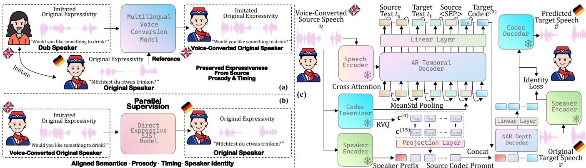

# HOLISTIC PARALLEL SUPERVISION FOR EXPRESSIVE SPEECH TO SPEECH TRANSLATION

Hao Zhang, Ismail Rasim Ulgen, Bismarck Bamfo Odoom, Rui Liu, Zihan Zhang, Berrak Sisman, Philipp Koehn

Center for Language and Speech Processing, Johns Hopkins University, MD, USA

## ABSTRACT

Expressiveness is central to speech-to-speech translation (S2ST), yet existing datasets rarely align source and target speech jointly in content, prosody, timing, and speaker identity. Consequently, current systems often rely on indirect conditioning or transfer mechanisms. To obtain this supervision, we introduce a training-data construction strategy that combines professional dubbing, which provides human-performed correspondence in content, prosody, and timing, with multilingual voice conversion to reduce speaker mismatch. We evaluate this supervision using existing expressive S2ST systems and DirectS2ST, an end-to-end method developed in this work that predicts the complete target-speech representation directly from source speech. Experiments on English–German and English–Spanish show that holistic parallel supervision improves expressive realization across all evaluated systems. DirectS2ST exhibits the largest gains in content, prosody, timing, speaker similarity, and human-rated expressiveness. To our knowledge, this work provides the first systematic investigation of holistic parallel supervision for expressive S2ST.

Index Terms— expressive speech-to-speech translation, holistic parallel supervision, dubbing data, voice conversion

## 1. INTRODUCTION

Speech-to-speech translation (S2ST) should preserve not only what is said but also how it is said [1]. Prosodic cues such as stress and intonation convey meaning and intent [2], while vocal style and speaker identity contribute to expressive communication [3]. However, existing methods and resources largely emphasize lexical accuracy, which alone cannot pre serve these properties. Learning expressive translation requires parallel speech pairs aligned in content, prosody, timing, and speaker identity; semantically correct but expressively mismatched targets do not demonstrate how the source expression should be realized in another language.

Such holistic parallel data are scarce because collecting cross-lingual recordings from the same speaker with corre sponding expressive delivery is costly. Existing resources therefore leave at least one dimension unmatched. Synthetic speech can reproduce source-speaker identity but may lack expressive delivery [4]; mined data provide semantic parallelism at scale but often have very limited speaker and expressive correspondence [5]; and professional dubbing provides strong semantic, prosodic, and temporal correspondence but uses different speakers [6]. Thus, existing S2ST systems rarely receive supervision aligned across all four dimensions. As a result, expressive S2ST methods often rely on indirect strategies, including replacing target-derived training conditions with source-derived conditions at inference or transferring speaker and prosodic information through separate mechanisms [7–10]. Although effective, these approaches do not learn content and expressive realization jointly through direct paired-speech supervision.

In this work, we investigate holistic parallel supervision for expressive S2ST. Because collecting such data from scratch is costly, we combine professional dubbing with multilingual voice conversion (VC). Dubbing provides human-performed correspondence in content, prosody, and timing, while VC reduces speaker mismatch. We evaluate this supervision using existing expressive S2ST methods and DirectS2ST, an end-toend model developed in this work that predicts the complete target-speech representation directly from source speech. DirectS2ST tests whether direct modeling can exploit holistic supervision more fully. Our contributions are: (i) the first proof-of-concept study, to our knowledge, of holistic parallel supervision for expressive S2ST; (ii) a training-data construction strategy combining professional dubbing and multilingual VC, evaluated using existing methods and DirectS2ST; and (iii) consistent improvements in expressive preservation on En–De and En–Es, supported by human evaluation.

## 2. HOLISTIC PARALLEL SUPERVISION FOR S2ST

We instantiate our holistic parallel supervision hypothesis with two components: (1) We construct holistic parallel crosslingual speech pairs matched in content, prosody, timing, and speaker identity for training. (2) We study holistic parallel supervision in two settings: existing expressive S2ST systems, and DirectS2ST, which examines whether holistic paired supervision can be exploited more directly through complete targetspeech prediction, rather than through target-derived training conditions or separate expressive-transfer mechanisms.

  
Fig. 1. Overview of the holistic parallel supervision: (a) VC-DUB Construction; (b) Parallel Supervision; (c) DirectS2ST.

## 2.1. Training Dataset Construction Method: VC-DUB

Human-performed expressive correspondence. Professional dubbing renders the original dialogue in another language while seeking to convey its expressive intent within the same audiovisual context. Beyond translated content, dubbed performances can reflect the original emphasis, intonation, and temporal organization [11]. We therefore use professional dubbing from entertainment television episodes spanning multiple genres (e.g., drama, comedy, action) as human-performed cross-lingual supervision rather than requiring identical pitch contours or frame-level timing. The remaining limitation is speaker mismatch, since the two performances are generally produced by different actors.

Pair preparation. We construct English-to-German and English-to-Spanish pairs from German or Spanish original tracks and their English dubs. We apply multiple preprocessing steps to make raw professional dubbing data suitable for speech translation training, in terms of semantic accuracy, speech quality and removal of background music/noise. We use Speech Vecalign [12] to semantically align speech segments between the corresponding original and dubbed audio tracks. Before VC, we process both sides with ClearerVoice-Studio for speech enhancement and Demucs for vocal separation to have single speaker utterances [13, 14]. We then check the expected languages using MMS-LID, reject multi-speaker segments using Sortformer [15], and filter low-quality pairs using the speech-quality predictor DNSMOSPro [16]. All scripts, thresholds, and implementation details are released. Speaker matching and target supervision. Let xa,o denote a cleaned original utterance in language a spoken by speaker o, and $y ^ { b , d }$ its cleaned dubbed counterpart in language b spoken by actor d. We apply multilingual zero-shot voice conversion, instantiated with Seed-VC [17], to the dubbed side:

$$
\tilde { y } ^ { b , o } = \mathcal { V } _ { \mathrm { m u l t i } } \left( y ^ { b , d } ; x ^ { a , o } \right) .\tag{1}
$$

Here, $y ^ { b , d }$ provides translated content and performed delivery, while $x ^ { a , o }$ provides the speaker reference. Thus, VC reduces the speaker mismatch. Since the VC method is designed to

preserve the source linguistic content and prosody [17], the semantic and expressive parallelism is largely preserved.

We form the S2ST training pair in the reverse direction of the original dubbing process:

$$
( u , v ) = ( \tilde { y } ^ { b , o } , x ^ { a , o } ) \in \mathcal { D } _ { \mathrm { V C \mathrm { - } D U B } } ^ { b  a } .\tag{2}
$$

The VC applied English dub becomes the source, while the original German or Spanish recording remains the target during supervision. Crucially, the target retains the human performance without TTS or VC resynthesis, so content, prosody, timing, and speaker identity are supervised jointly to predict real speech distribution as target. Applying VC only to the source avoids introducing VC-generated artifacts into target speech supervision. Pair-level analysis verifies the intended correspondence before we evaluate its effect on downstream S2ST (see Section 4).

## 2.2. DirectS2ST

DirectS2ST uses a Moshi-inspired temporal–depth architecture [18] to test whether holistic parallel supervision can be exploited more fully through direct source-to-target expressive learning. Given source speech u, it predicts all 16 Mimi codec streams of the paired human recording v. A frozen w2v-BERT 2.0 encoder [5] provides continuous source memory through cross-attention. The autoregressive (AR) temporal decoder generates source text, target text, and the first-level target codec stream c(0) with a shared output head. Inspired by TransVIP [7], the <SEP> embedding at the text-to-codec boundary is replaced with an acoustic prompt obtained by mean–standard-deviation pooling of continuous Mimi features. Unlike TransVIP’s target-derived training prompt, ours is extracted from the source speech.

The remaining streams are predicted by a shared nonautoregressive (NAR) depth Transformer. Each level conditions on lower target codebooks and a source codec prefix, with a projected embedding from a frozen CAMPPlus speaker encoder [19] prepended as the speaker-identity condition. We further apply a speaker-identity loss by projecting mean-pooled NAR hidden states to the CAMPPlus space and matching them by cosine loss to the paired target-speech embedding, reinforcing speaker learning in the depth decoder.

Let z denote the AR sequence containing source text $t _ { s } ,$ target text $t _ { t } ,$ , and $\mathbf { c } ^ { ( 0 ) }$ . Prediction is factorized as

$$
\begin{array} { r } { p _ { \mathrm { A R } } ( \mathbf { z } \mid u ) = \displaystyle \prod _ { i } p ( z _ { i } \mid \mathbf { z } _ { < i } , u ) , \qquad } \\ { p _ { \mathrm { N A R } } ( \mathbf { c } ^ { ( 1 : 1 5 ) } \mid u , \mathbf { c } ^ { ( 0 ) } ) = \displaystyle \prod _ { q = 1 } ^ { 1 5 } \prod _ { t = 1 } ^ { T } p ( c _ { t , q } \mid \mathbf { c } ^ { ( < q ) } , \mathbf { P } _ { u } ) , } \end{array}\tag{3}
$$

where u is source speech and $\mathbf { P } _ { u }$ denotes the source codec and speaker prefix. The NAR stage predicts target frames in parallel within each codebook while proceeding sequentially across codebook levels. The predicted source and target text, $t _ { s } , t _ { t }$ serve the purpose of helping semantic grounding and guidance for translation while source speech condition u guides all the aspects including semantic, speaker identity, and prosody. Using source speech as the only and direct condition while predicting all these aspects realizes end-to-end and holistic parallel supervision during training.

## 3. EXPERIMENTAL SETUP

Training Data. We compare VC-DUB with CVSS-T [4], a widely used S2ST corpus with synthetic voice-transferred targets, using approximately matched training-set sizes (Table 1). For Dub-S2ST, we also evaluate its proposed speed-adapted CVSS-T variant $( \mathrm { C V S S  – T ^ { S } } )$ [9], which improves source–target speaking-rate correspondence but not other expressive dimensions. To isolate the effect of speaker matching, we train DirectS2ST on the same dubbed pairs without VC (RAW-DUB). Source and target transcripts are generated using Whisperlarge-v3 [20] and used only as auxiliary training targets, not as inference-time inputs.

Evaluation Data. We evaluate on mExpresso [5, 21], an ex pressive multilingual dataset independent of our training corpus. Each of the En–De and En–Es evaluations contains 504 examples evenly distributed across seven expressive conditions. Dub-S2ST is evaluated only on En–Es because its mHuBERT unit representation does not support German.

Metrics. We evaluate content, prosody, timing, speaker identity, and naturalness. ASR-BLEU uses Whisper-large-v3 transcripts and SacreBLEU [20, 22], while BLASER2.0-QE measures source–output semantic consistency [23]. AutoPCP (A.PCP) measures utterance-level prosody similarity, and STOPES [5] measures speaking-rate correlation (Rate), pause similarity (Pause), and speaker similarity (Vsim) between source and translated speech. NISQA-TTS (NAT) estimates naturalness [24]. For VC diagnostics, WER and CER between transcripts before and after VC measure content preservation. Human evaluation. Nine listeners proficient in English and Spanish rate the expressiveness of outputs from six system configurations on a 5-point expressiveness MOS scale, considering emphasis, rhythm, timing, and intonation. The test uses 10 En–Es source utterances sampled across seven expressive conditions, with the source provided as reference.

Table 1. Statistics of the speech-to-speech training data. Average duration is reported as source | target.
<table><tr><td>Pair</td><td>Dataset</td><td>#Pairs</td><td>Src. Hrs</td><td>Tgt. Hrs</td><td>Total Hrs</td><td>Avg. Dur. (s)</td><td></td></tr><tr><td>En-De</td><td>CVSS-T</td><td>127,250</td><td>128.19</td><td>122.16</td><td>250.35</td><td>3.63</td><td>|3.46</td></tr><tr><td></td><td>VC-DUB</td><td>131,399</td><td>127.40</td><td>135.82</td><td>263.22</td><td>3.49</td><td>3.72</td></tr><tr><td>En-Es</td><td>CVSS-T</td><td>78,963</td><td>79.76</td><td>72.77</td><td>152.53</td><td>3.64</td><td>3.32</td></tr><tr><td></td><td>VC-DUB</td><td>79,200</td><td>84.61</td><td>86.52</td><td>171.13</td><td>3.85</td><td>3.93</td></tr></table>

S2ST Methods. In addition to DirectS2ST, we evaluate holistic parallel supervision with TransVIP [7] and Dub-S2ST [9]. We train the official TransVIP implementation on our data using its default settings. For Dub-S2ST, whose original speechto-unit module showed limited generalization in preliminary experiments, we replace that module with the S2U model of [25]. We train both the S2U and U2S components on our data, with the U2S module initialized from Dub-S2ST’s pretrained CosyVoice-based checkpoint rather than from scratch. Training & Architecture Details. The temporal and depth Transformers have 12 and 8 layers, respectively, with a shared configuration of 1024 hidden dimensions, 16 attention heads, 4096 feed-forward dimensions, and 0.1 dropout, yielding a 1.2B-parameter DirectS2ST model with randomly initialized decoders. We use a direction-specific 8k SentencePiece vocabulary [26], the first 16 codebooks of the frozen pretrained Mimi codec (2,048 entries each), and a frozen CAMPPlus speaker encoder [19]. Separate En–De and En–Es models are trained on one 141-GB NVIDIA H200 GPU with a batch size of 8 for approximately 2–3 days each. Source-text, target-text, $C _ { 0 }$ and depth losses are weighted 0.4, 0.6, 1.0, and $3 . 0 ;$ trainingonly text-to-text, $\mathrm { t e x t - t o - } C _ { 0 } .$ , and speaker-identity objectives are weighted 0.3, 0.5, and 0.1. We use a polynomially decayed learning rate initialized at $1 0 ^ { - 4 }$ . At inference, beam search with a beam size of 5 generates the unified text– ${ \bf - } C _ { 0 }$ sequence, after which the depth decoder greedily predicts $C _ { 1 } { - } C _ { 1 5 }$ in parallel over time and sequentially across codebooks.

## 4. RESULTS & DISCUSSION

Training dataset analysis. Table 1 summarizes the training data. Table 2 shows that RAW-DUB already provides stronger content, prosody, and timing correspondence than CVSS-T, while its main limitation is speaker mismatch. Applying VC substantially improves Vsim and further increases A.PCP, with smaller gains in Rate and Pause. Without manual transcripts, we compare pre- and post-VC ASR outputs, obtaining approximately 8.3% WER and 5.2% CER in both settings. The small changes in mean BLASER suggest largely preserved crosslingual semantic correspondence at the corpus level. As a negative control, randomly shuffling the source–target pairings in VC-DUB causes large drops in BLASER, A.PCP, Rate, and Pause, indicating that the observed correspondence is pairspecific rather than a corpus artifact. Together, professional dubbing and VC yield our holistic parallel supervision across content, prosody, timing, and speaker identity.

Effect of holistic parallel supervision on S2ST. As shown in

Table 2. Pair-level correspondence and speech-quality results for CVSS-T, RAW-DUB, and VC-DUB. Shuffled VC-DUB pairs provide a negative control. $\mathrm { D N S M O S } _ { \mathrm { P r o } }$ is reported as source (En) | target (De/Es).
<table><tr><td>Dir. Dataset</td><td></td><td>BLASER↑</td><td>A.PCP↑</td><td>Rate↑</td><td>Pause↑</td><td>Vsim↑</td><td> $\mathbf { D N S M O S } _ { \mathrm { P r o } } \uparrow$ </td><td></td></tr><tr><td>En</td><td>CVSS-T</td><td>3.405</td><td>2.505</td><td>0.365</td><td>0.524</td><td>0.208</td><td>3.160</td><td>|2.797</td></tr><tr><td rowspan="3">↓ De</td><td>RAW-DUB</td><td>3.634</td><td>2.759</td><td>0.416</td><td>0.682</td><td>0.060</td><td>3.900</td><td>3.684</td></tr><tr><td>VC-DUB</td><td>3.611</td><td>3.000</td><td>0.435</td><td>0.698</td><td>0.406</td><td>4.104</td><td>3.684</td></tr><tr><td>w/ Shuffled</td><td>2.285</td><td>2.218</td><td>-0.009</td><td>0.394</td><td>0.025</td><td>4.104 | 3.684</td><td></td></tr><tr><td>En</td><td>CVSS-T</td><td>3.400</td><td>2.537</td><td>0.372</td><td>0.550</td><td>0.194</td><td></td><td>3.173 | 2.780</td></tr><tr><td rowspan="3">↓ Es</td><td>RAW-DUB</td><td>3.632</td><td>2.920</td><td>0.417</td><td>0.676</td><td>0.046</td><td>3.913</td><td>3.714</td></tr><tr><td>VC-DUB</td><td>3.606</td><td>3.183</td><td>0.436</td><td>0.686</td><td>0.362</td><td>4.091</td><td>|3.714</td></tr><tr><td>w/ Shuffled</td><td>2.199</td><td>2.345</td><td>-0.003</td><td>0.361</td><td>0.027</td><td>4.091 | 3.714</td><td></td></tr></table>

Table 3, VC-DUB improves expressive preservation across all three model families. In particular, A.PCP and Vsim consistently improve for TransVIP, Dub-S2ST, and DirectS2ST, with additional gains in timing and naturalness depending on the architecture. Dub-S2ST’s speed adaptation mainly improves Rate, whereas VC-DUB provides broader gains, supporting the benefit of jointly matched supervision over matching a single temporal attribute.

Absolute scores also reflect differences in model pretraining. TransVIP retains stronger content performance, likely aided by its SeamlessM4T-initialized speech-to-text translation backbone [7], whereas DirectS2ST trains its translation and codec decoders from scratch to test whether paired speech alone can support direct expressive supervision. Despite this stricter setting, DirectS2ST+VC-DUB achieves the best A.PCP and Pause scores in both directions, with significant improvements over the strongest competing systems. Dub-S2ST obtains stronger absolute naturalness and speaker similarity, plausibly benefiting from its unit-to-speech synthesizer initialized from CosyVoice-300M [9], which was trained with large-scale data; nevertheless, replacing CVSS-T with VC-DUB still improves its A.PCP, Vsim, and translation performance. These results support the conclusion that holistic parallel supervision benefits different expressive S2ST formulations. The larger expressive gains observed for DirectS2ST are consistent with our direct-supervision hypothesis: because the model learns the complete target speech representation directly from paired speech, its expressive learning is especially responsive to the quality of holistic source–target supervision. Contribution of voice conversion. Table 4 compares DirectS2ST trained on the same aligned dubbing pairs with and without VC. RAW-DUB already provides effective expressive supervision but, as expected, does not preserve speaker identity. VC substantially improves speaker similarity and yields additional gains in A.PCP and Rate, while content, Pause, and naturalness remain comparable. These results indicate that VC primarily reduces speaker mismatch while preserving the other properties of the dubbed speech.

Human evaluation. Table 5 reports human ratings of perceived expressiveness. VC-DUB significantly improves MOS across all three model families with high inter-rater reliability, confirming that the benefits of holistic parallel supervision are

Table 3. Expressive S2ST results on mExpresso in both translation directions. † denotes significance between training sets within the same model, and ‡ against the strongest baseline in the same language direction. Significance is determined by two-sided paired randomization tests with 10,000 permutations and Holm–Bonferroni correction $( p _ { \mathrm { a d j } } < 0 . 0 5 )$
<table><tr><td>Dir. Model</td><td></td><td>Train</td><td>ASR-BLEU↑ BLASER↑ A.PCP↑ Rate↑ Pause↑</td><td></td><td></td><td></td><td></td><td>Vsim↑</td><td>NAT↑</td></tr><tr><td rowspan="5">En ↓</td><td>TransVIP</td><td>CVSS-T</td><td>12.25</td><td>3.397</td><td>2.609</td><td>0.470</td><td>0.489</td><td>0.126</td><td>3.257</td></tr><tr><td>TransVIP</td><td>VC-DUB</td><td>13.84</td><td>3.399</td><td>2.743†</td><td>0.600†</td><td>0.549†</td><td>0.169†</td><td>3.472†</td></tr><tr><td>De DirectS2ST CVSS-T</td><td></td><td>6.01</td><td>3.234</td><td>2.162</td><td>0.334</td><td>0.687</td><td>0.114</td><td>3.339</td></tr><tr><td></td><td>DirectS2ST VC-DUB</td><td>10.52†</td><td>3.373†</td><td>2.905†, </td><td> 0.589†</td><td>† 0.752†,</td><td>0.217†,</td><td>3.450†</td></tr><tr><td>TransVIP</td><td>CVSS-T</td><td>15.53</td><td>3.354</td><td>2.664</td><td>0.601</td><td></td><td></td><td></td></tr><tr><td rowspan="5">↓</td><td>TransVIP</td><td>VC-DUB</td><td>18.96†</td><td>3.433†</td><td>2.803†</td><td>0.671†</td><td>0.494 0.562†</td><td>0.138 0.158†</td><td>3.092 3.407†</td></tr><tr><td></td><td></td><td></td><td></td><td></td><td></td><td></td><td></td><td></td></tr><tr><td>En Dub-S2ST</td><td>CVSS-T</td><td>11.61 11.89</td><td>3.239</td><td>2.933</td><td>0.581</td><td>0.596</td><td>0.218</td><td>3.658</td></tr><tr><td>Dub-S2ST</td><td>CVSS-TS</td><td>15.21</td><td>3.226 3.321†</td><td>2.938 3.012†</td><td>0.608 0.595</td><td>0.572</td><td>0.214</td><td>3.631</td></tr><tr><td>Es Dub-S2ST VC-DUB</td><td></td><td></td><td></td><td></td><td></td><td>0.612</td><td>0.238†</td><td>3.759†</td></tr><tr><td></td><td>DirectS2ST CVSS-T</td><td></td><td>10.00</td><td>3.153</td><td>2.238</td><td>0.433</td><td>0.652</td><td>0.105</td><td>3.361</td></tr><tr><td></td><td>DirectS2ST VC-DUB</td><td></td><td>14.22†</td><td>3.259†</td><td></td><td></td><td>3.091†, 0.669† 0.733t, </td><td>0.205†</td><td>3.466†</td></tr></table>

Table 4. VC-DUB ablation of DirectS2ST on mExpresso.
<table><tr><td>Dir. Train</td><td>ASR-BLEU↑ BLASER↑ A.PCP↑ Rate↑ Pause↑ Vsim↑ NAT↑</td><td></td><td></td><td></td><td></td></tr><tr><td>En→De</td><td>VC-DUB</td><td>10.52</td><td>3.373</td><td>2.905† 0.589†</td><td>0.752 0.217† 3.450</td></tr><tr><td></td><td>RAW-DUB</td><td>9.37</td><td>3.339</td><td>2.712 0.455</td><td>0.741 0.065 3.430</td></tr><tr><td>En→Es</td><td>VC-DUB</td><td>14.22</td><td>3.259 3.091†</td><td>0.669†</td><td>0.733 0.205† 3.466</td></tr><tr><td></td><td>RAW-DUB 14.53</td><td>3.266</td><td>2.824</td><td>0.555</td><td>0.730 0.0583.470</td></tr></table>

Table 5. Expressiveness MOS with 95% confidence intervals and inter-rater reliability (ICC). Significance is assessed using crossed linear mixed-effects models with system configurations as a fixed effect and listener and utterance as random effects, followed by Holm–Bonferroni correction. ${ \^ \dagger p } _ { \mathrm { a d j } } < 0 . 0 5$
<table><tr><td>Model</td><td>Training Data</td><td>MOS ↑</td><td>95% CI</td><td>ICC(A,1)</td><td>ICC(A,9)</td></tr><tr><td>TransVIP</td><td>CVSS-T</td><td>1.82</td><td>[1.62, 2.01]</td><td rowspan="6">0.445</td><td rowspan="6">0.878</td></tr><tr><td>TransVIP</td><td>VC-DUB</td><td>2.24†</td><td>[2.03, 2.44]</td></tr><tr><td>Dub-S2ST</td><td>CVSS-T</td><td>2.88</td><td>[2.63, 3.12]</td></tr><tr><td>Dub-S2ST</td><td>VC-DUB</td><td>3.59†</td><td>[3.34, 3.84]</td></tr><tr><td>DirectS2ST</td><td>CVSS-T</td><td>2.13</td><td>[1.93, 2.33]</td></tr><tr><td>DirectS2ST</td><td>VC-DUB</td><td>3.42†</td><td>[3.20, 3.64]</td></tr></table>

also reflected in perceived expressiveness. Among the evaluated systems, DirectS2ST shows the largest MOS gain (+1.29), mirroring the automatic-metric results and further suggesting that direct source-to-target modeling can exploit holistic paired supervision particularly effectively.

## 5. CONCLUSION

We investigated holistic parallel supervision for expressive S2ST by combining professional dubbing, which provides human-performed correspondence in content, prosody, and timing, with multilingual voice conversion to reduce speaker mismatch while preserving natural target speech. Experiments on En–De and En–Es show improved expressive preservation across multiple S2ST systems, supported by human evaluation. The Raw-Dub ablation isolates the contribution of speaker matching, while DirectS2ST achieves the largest relative gains in content, prosody, timing, and perceived expressiveness, sug gesting that direct target-speech prediction particularly benefits from holistic parallel supervision.

## 6. REFERENCES

[1] Ioannis Tsiamas, Matthias Sperber, Andrew Finch, and Sarthak Garg, “Speech is more than words: Do speech-to-text translation systems leverage prosody?,” in Proceedings of the Ninth Conference on Machine Translation, 2024, pp. 1235–1257.

[2] Anne Cutler, Delphine Dahan, and Wilma Van Donselaar, “Prosody in the comprehension of spoken language: A literature review,” Language and speech, vol. 40, no. 2, pp. 141–201, 1997.

[3] Ye Jia, Michelle Tadmor Ramanovich, Tal Remez, and Roi Pomerantz, “Translatotron 2: High-quality direct speech-tospeech translation with voice preservation,” in Proceedings of the 39th International Conference on Machine Learning. 2022, vol. 162, pp. 10120–10134, PMLR.

[4] Ye Jia, Michelle Tadmor Ramanovich, Quan Wang, and Heiga Zen, “Cvss corpus and massively multilingual speech-to-speech translation,” in Proceedings of the thirteenth language resources and evaluation conference, 2022, pp. 6691–6703.

[5] Lo¨ıc Barrault, Yu-An Chung, Mariano Coria Meglioli, et al., “Seamless: Multilingual expressive and streaming speech translation,” arXiv preprint arXiv:2312.05187, 2023.

[6] Haopeng Xie, Ismail Rasim Ulgen, Sofia Son, Berrak isman, and Philipp Koehn, “Is prosody lost in translation? fine-grained cross-lingual prosody similarity across languages,” arXiv preprint arXiv:2608.27848, 2026.

[7] Chenyang Le, Yao Qian, Dongmei Wang, et al., “Transvip: Speech to speech translation system with voice and isochrony preservation,” in Advances in Neural Information Processing Systems, 2024, vol. 37, pp. 89682–89705.

[8] Ismail Rasim Ulgen, Nancy Liu, Najmeh Sadoughi, et al., “Direct transfer of prosody in speech-to-speech translation using disentangled speech tokens,” in ICASSP 2026-2026 IEEE International Conference on Acoustics, Speech and Signal Processing (ICASSP). IEEE, 2026, pp. 18372–18376.

[9] Jeongsoo Choi, Jaehun Kim, and Joon Son Chung, “Dub-s2st: Textless speech-to-speech translation for seamless dubbing,” in 2025 Findings of the Association for Computational Linguistics, EMNLP 2025. Association for Computational Linguistics (ACL), 2025, pp. 9871–9881.

[10] Sitong Cheng, Weizhen Bian, Xinsheng Wang, et al., “UniSS: Unified expressive speech-to-speech translation with your voice,” in Proceedings of the Fourteenth International Conference on Learning Representations, 2026.

[11] William Brannon, Yogesh Virkar, and Brian Thompson, “Dubbing in practice: A large scale study of human localization with insights for automatic dubbing,” Transactions of the Association for Computational Linguistics, vol. 11, pp. 419–435, 2023.

[12] Chutong Meng and Philipp Koehn, “Speech vecalign: an embedding-based method for aligning parallel speech documents,” in Proceedings of the 2025 Conference on Empirical Methods in Natural Language Processing. Nov. 2025, pp. 16478–16494, Association for Computational Linguistics.

[13] Shengkui Zhao, Zexu Pan, and Bin Ma, “Clearervoice-studio: Bridging advanced speech processing research and practical deployment,” in Proc. Interspeech 2025, 2025, pp. 2980–2984.

[14] Simon Rouard, Francisco Massa, and Alexandre Defossez, “Hy-´ brid transformers for music source separation,” in ICASSP 2023- 2023 IEEE International Conference on Acoustics, Speech and Signal Processing (ICASSP). IEEE, 2023, pp. 1–5.

[15] Taejin Park, Ivan Medennikov, Kunal Dhawan, Weiqing Wang, et al., “Sortformer: A novel approach for permutation-resolved speaker supervision in speech-to-text systems,” in Proceedings of the 42nd International Conference on Machine Learning. 2025, vol. 267, pp. 48153–48169, PMLR.

[16] Fredrik Cumlin, Xinyu Liang, Victor Ungureanu, Chandan K. A. Reddy, Christian Schuldt, and Saikat Chatterjee, “DNSMOS¨ Pro: A Reduced-Size DNN for Probabilistic MOS of Speech,” in Interspeech 2024, 2024, pp. 4818–4822.

[17] Songting Liu, “Zero-shot voice conversion with diffusion transformers,” arXiv preprint arXiv:2411.09943, 2024.

[18] Alexandre Defossez, Laurent Mazar´ e, Manu Orsini, Am´ elie´ Royer, Patrick Perez, Herv ´ e J ´ egou, Edouard Grave, and Neil ´ Zeghidour, “Moshi: a speech-text foundation model for realtime dialogue,” arXiv preprint arXiv:2410.00037, 2024.

[19] Hui Wang, Siqi Zheng, Yafeng Chen, Luyao Cheng, and Qian Chen, “CAM++: A Fast and Efficient Network for Speaker Verification Using Context-Aware Masking,” in Interspeech 2023, 2023, pp. 5301–5305.

[20] Alec Radford, Jong Wook Kim, Tao Xu, et al., “Robust speech recognition via large-scale weak supervision,” in Proceedings of the 40th International Conference on Machine Learning. 23–29 Jul 2023, vol. 202 of Proceedings ofMachine Learning Research, pp. 28492–28518, PMLR.

[21] Tu Anh Nguyen, Wei-Ning Hsu, Antony D’Avirro, et al., “Expresso: A benchmark and analysis of discrete expressive speech resynthesis,” in Proc. Interspeech 2023, 2023, pp. 4823–4827.

[22] Matt Post, “A call for clarity in reporting BLEU scores,” in Proceedings ofthe Third Conference on Machine Translation: Research Papers. Oct. 2018, pp. 186–191, Association for Computational Linguistics.

[23] David Dale and Marta R. Costa-jussa, “BLASER 2.0: a metric\` for evaluation and quality estimation of massively multilingual speech and text translation,” in Findings of the Association for Computational Linguistics: EMNLP 2024. Nov. 2024, pp. 16075–16085, Association for Computational Linguistics.

[24] Gabriel Mittag and Sebastian Moller, “Deep Learning Based ¨ Assessment of Synthetic Speech Naturalness,” in Interspeech 2020, 2020, pp. 1748–1752.

[25] Sravya Popuri, Peng-Jen Chen, Changhan Wang, Juan Pino, Yossi Adi, Jiatao Gu, Wei-Ning Hsu, and Ann Lee, “Enhanced Direct Speech-to-Speech Translation Using Self-supervised Pretraining and Data Augmentation,” in Interspeech 2022, 2022, pp. 5195–5199.

[26] Taku Kudo and John Richardson, “SentencePiece: A simple and language independent subword tokenizer and detokenizer for neural text processing,” in Proceedings of the 2018 Conference on Empirical Methods in Natural Language Processing: System Demonstrations. Nov. 2018, pp. 66–71, Association for Computational Linguistics.