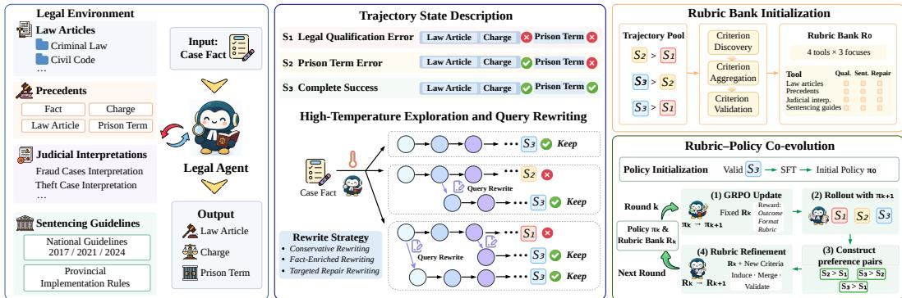
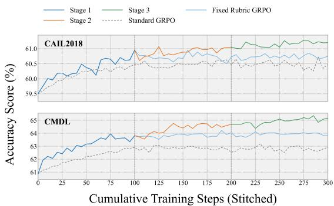
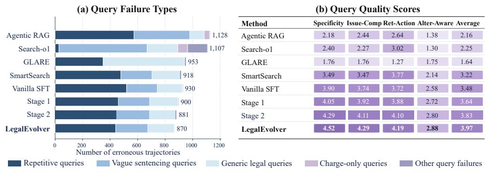
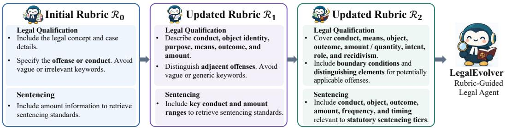
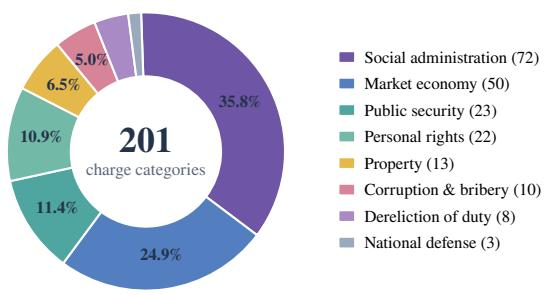

# LEGALEVOLVER: AGENTIC LEGAL JUDGMENT PRE-DICTION VIA RUBRIC-GUIDED SELF-EVOLUTION

Xinyu Yang1, Jiejun Tan1, Chenlong Deng1, Chenghao Zhang1, Tongyu Wen1, Zhicheng Dou1 1Renmin University of China

{yxygsai, dou}@ruc.edu.cn

https://github.com/yxy-919/LegalEvolver

## ABSTRACT

As LLM-based agents develop, they have been increasingly applied in the legal domain. Legal Judgment Prediction (LJP) requires models to conduct multi-step reasoning and external legal evidence retrieval. Existing legal search agents’ performance is often constrained by the quality of retrieval queries. They often formulate queries directly from the initial user request, overlooking latent legal issues and legally salient details. To address this issue, we propose LegalEvolver, a query optimization framework specifically designed to generate legally informative queries for LJP-oriented retrieval. Sampling high-quality optimized queries and their corresponding search trajectories is challenging, as relying solely on unguided high-temperature rollouts is both inefficient and constrained by the model’s initial capabilities. We therefore heuristically optimize queries as seeds, improving the efficiency of trajectory generation. Furthermore, we summarize rollout experience into rubrics and use them to guide multi-round iterative self-evolution. Iteratively performing rubric optimization and rubric-guided RL enables the model to surpass its initial performance ceiling. End-to-end performance on extensive benchmarks demonstrates the effectiveness of query optimization on LJP. Comparisons with direct SFT followed by RL demonstrate the effectiveness of rubric guidance. Evolving rubrics further outperform fixed rubrics, confirming the benefits of self-evolution.

## 1 INTRODUCTION

Legal judgment prediction (LJP) requires a model to determine the applicable law articles, charges, and prison term of a case from its fact description (Xu et al., 2020). Like a judge, the model must establish the charge before determining the sentence (Zhong et al., 2018). Decisions must be based on specific legal provisions, which come from statutes, judicial interpretations, and sentencing guidelines (Wu et al., 2023; Wang et al., 2024). Because these provisions are numerous and frequently revised, parametric knowledge alone cannot capture them reliably (Deng et al., 2024a; Yang et al., 2026). Therefore, recent work turns to legal search agents, which consult these sources along with precedents during reasoning and base their predictions on the retrieved evidence (Wu et al., 2023).

However, access to retrieval alone brings modest gains (Wang et al., 2024). Our analysis shows that queries themselves are often the problem of failure; this diagnosis is consistent with recent work on query optimization for search agents (Li et al., 2025b; Wen et al., 2026). Consider a defendant who borrows the victim’s phone and then runs off with it. The query “elements of the crime of fraud” fails because the key point is the victim’s intent in handing over the phone, which is exactly what separates fraud from theft. A better query is like “took a borrowed phone and fled, whether the victim disposed of property, theft versus fraud”. To understand what distinguishes effective queries more generally, we examine the reasoning and search trajectories of legal experts on judgment prediction. Experts rarely search for a charge or an article in isolation. Each query addresses a question still open at that point of their reasoning, and changes as the reasoning moved on. When deciding the charge, they search statutes and judicial interpretations; when deciding the sentence, they searched sentencing guidelines and precedents. In both stages, they wrote the decisive facts of the case into the query (Wen et al., 2026).

Search agents are commonly trained with SFT followed by RL with outcome rewards (Li et al., 2025a). This recipe struggles to inject the behaviour described above for the following reasons (Chu et al., 2025; Zheng et al., 2025): (1) Exploration stays anchored to the model’s initial hypothesis (Chu et al., 2025). Once the base model settles on a candidate charge, its queries keep revolving around it. Higher sampling temperature hardly varies charge under examination (Chen et al., 2025). (2) Outcome rewards cannot tell which search went wrong (Zheng et al., 2025). It fails to distinguish different search failure types (Li et al., 2025b). General query clarity and informativeness also miss these domain-specific legal requirements (Deng et al., 2024a; Liu et al., 2026). (3) What makes a query useful changes as the agent improves (Shao et al., 2025; Gunjal et al., 2025). Once the agent routinely includes key facts, its remaining errors can depend on subtler distinctions (Xu et al., 2020). Fixed criteria fail to separate good queries from bad ones (Shao et al., 2025).

The key missing ingredient is supervision for individual queries. Our core observation is that differences in judgment outcomes can provide it. When trajectories on the same case reach different judgments, the differences between their queries suggest which searches are more effective. The type of error further indicates which searches to examine. A wrong charge points to the searches for legal qualification, while a wrong sentence points to the sentencing searches. Building on this observation, we induce query criteria from within-case contrasts and assemble them into rubrics that reward each search. As the policy improves, we rebuild the rubrics from its new trajectories. The supervision thus evolves with the policy.

To address these challenges, we propose LegalEvolver, a framework for training legal search agents. It learns query rubrics from the agent’s own trajectories and keeps refreshing them as the agent improves. Training consists of three consecutive stages. (1) Diverse Trajectory Generation and Policy Initialization. We first sample diverse reasoning and retrieval trajectories at a high temperature, then apply expert-inspired heuristics to rewrite their retrieval queries, producing additional candidate trajectories. Rejection sampling selects successful trajectories for supervised fine-tuning, equipping the agent with effective initial reasoning and retrieval behaviors. (2) Initial Rubric Construction. To construct query-level supervision, we contrast successful trajectories with failed trajectories for the same problem, examining how differences in query construction contribute to their divergent outcomes. We distill these comparisons into an initial set of legal query rubrics that provide explicit criteria for evaluating intermediate queries. (3) Rubric–Policy Co-Evolution. Building on this initialization, we jointly improve the query rubrics and the agent policy through iterative selfevolution. We combine rubric-based rewards with outcome rewards for reinforcement learning, providing feedback on both intermediate query quality and final prediction correctness. As the updated policy generates new successful trajectories, we use them to re-induce the rubrics, incorporating retrieval strategies discovered during training. The revised rubrics then guide the next round of policy optimization. Alternating these steps lets supervision evolve with the agent’s capabilities, enabling improvement beyond the initial demonstrations and fixed rubric criteria.

Experiments on single- and multi-defendant legal judgment prediction show that LegalEvolver outperforms agentic retrieval-augmented baselines on most metrics, with further gains from reinforcement learning after supervised initialization.

To sum up, our contributions are threefold: (1) We identify query construction as a critical bottleneck for search agents in LJP. (2) We propose LegalEvolver, which derives legal query rubrics from contrasting successful and failed trajectories. (3) We develop a self-evolution training paradigm that jointly improves agent policies and query rubrics.

## 2 RELATED WORK

Legal Judgment Prediction Legal Judgment Prediction (LJP) has been studied using neural classification models (Zhong et al., 2018), LLM-based legal reasoning (Jiang & Yang, 2023), and agents that acquire external legal knowledge (Yang et al., 2026). Early work models dependencies among judgment subtasks with TopJudge (Zhong et al., 2018), distinguishes confusing law articles with LADAN (Xu et al., 2020), and incorporates case circumstances with NeurJudge (Yue et al., 2021). With the emergence of LLMs, legal syllogism prompting and syllogistic judgment analysis explicitly structure legal reasoning (Jiang & Yang, 2023; Deng et al., 2023). ADAPT further employs an Ask–Discriminate–Predict framework to distinguish confusing charges (Deng et al., 2024b). External knowledge also supports judgment prediction through precedent-enhanced LLM and domainmodel collaboration (Wu et al., 2023) and multi-stage knowledge integration (Wang et al., 2024). GLARE expands confusing charge candidates and retrieves reasoning paths from similar cases for comparative reasoning (Yang et al., 2026). Query formulation is itself relevant to legal retrieval: knowledge-guided case reformulation has been studied for interpretable case matching (Deng et al., 2024a). We focus on learning to formulate intermediate retrieval queries within an LJP agent, using case facts to seek the legal knowledge needed for judgment reasoning.

  
Figure 1: Task description and main pipeline of LegalEvolver.

Rubric-Based Supervision for LLMs Rubric-based supervision expresses response quality through explicit criteria, supporting both model evaluation (Liu et al., 2023) and policy optimization (Gunjal et al., 2025). G-Eval combines specified evaluation criteria with generated evaluation steps and structured scoring (Liu et al., 2023). AutoCalibrate induces scoring criteria from humanlabeled examples, then selects and refines them to improve agreement with human judgments (Liu et al., 2024). For contrastive construction, OpenRubrics derives explicit constraints and implicit quality principles by comparing preferred and rejected responses, producing criteria that distinguish their quality (Liu et al., 2026). Rubrics as Rewards aggregates instance-specific rubric feedback into rewards for on-policy RL beyond verifiable domains (Gunjal et al., 2025). DR Tulu further maintains evolving rubrics that adapt with the policy to provide discriminative feedback during deep-research training (Shao et al., 2025). These works motivate preference-based criterion induction (Liu et al., 2026) and adaptive rubric supervision (Shao et al., 2025). We extend these ideas to tool-specific legal queries: downstream judgment outcomes determine trajectory preferences, from which we discover and refine rubrics for supervising intermediate retrieval actions. An extended discussion of reinforcement learning for tool-using and search agents is provided in Appendix A.

## 3 METHODOLOGY

LEGALEVOLVER learns legal search behaviors from diverse trajectories and updates its query evaluation criteria as the policy improves. High-temperature sampling and heuristic rewriting provide the trajectories used for policy initialization (Section 3.2). Initial rubric construction turns comparisons of these trajectories into the initial rubric bank through pairwise criterion discovery, criteria aggregation, and held-out validation (Section 3.3). The bank then guides policy optimization. Rubric refinement uses trajectories from the updated policy to discover new criteria, aggregate them with existing criteria, and revalidate the bank for the next round (Section 3.3). Figure 1 illustrates the trajectory comparisons underlying rubric construction and query scoring.

## 3.1 TASK FORMULATION

We first formally define the task of legal judgment prediction. Given the fact description f of a case, the model is required to predict:

$$
y = ( l , c , t ) ,\tag{1}
$$

where l denotes the applicable law articles, c denotes the corresponding charges, and t denotes the term of imprisonment. For multi-defendant cases, the output is extended to defendant-level predictions: $\{ ( \bar { l _ { i } } , c _ { i } , t _ { i } ) \} _ { i = 1 } ^ { n }$ , where each prediction corresponds to an individual defendant.

We adopt the ReAct framework (Yao et al., 2023) as the backbone of our legal search agent. The legal agent performs multi-round interactions with external legal retrieval tools through a sequence of Reasoning–Action–Observation steps. We represent the reasoning process of the legal agent as a trajectory: $\tau = ( f , r _ { 1 } , a _ { 1 } , o _ { 1 } , \dotsc , r _ { m } , a _ { m } , o _ { m } , \hat { y } )$ , where $r _ { j }$ denotes the natural-language legal reasoning at step $j , a _ { j }$ represents the tool-use action taken by the agent, $o _ { j }$ denotes the corresponding retrieval observation returned by the tool, and $\hat { y }$ represents the final prediction generated by the agent. $\hat { y }$ consists of predicted law articles $\hat { l } ,$ predicted charges ${ \hat { c } } ,$ and the predicted term of imprisonment $\hat { t } .$ For a retrieval action, the agent can send a query to one of the four legal knowledge bases: law articles, precedents, judicial interpretations, and sentencing guidelines. Appendix C describes these knowledge sources and their retrieval interfaces.

To evaluate a trajectory, we compare its final prediction $\boldsymbol { \hat { y } } = ( \hat { l } , \boldsymbol { \hat { c } } , \boldsymbol { \hat { t } } )$ with the ground truth $y =$ $( l , c , t )$ and define three outcome states:

$$
\begin{array} { r } { S ( \tau ) = \left\{ \begin{array} { l l } { S _ { 3 } , } & { \hat { l } = l , \hat { c } = c , \hat { t } = t , } \\ { S _ { 2 } , } & { \hat { l } = l , \hat { c } = c , \hat { t } \neq t , } \\ { S _ { 1 } , } & { \mathrm { o t h e r w i s e } . } \end{array} \right. } \end{array}\tag{2}
$$

Here, $S _ { 3 }$ indicates complete success, $S _ { 2 }$ indicates correct legal qualification with incorrect sentencing, and $S _ { 1 }$ indicates a legal qualification failure.

## 3.2 DIVERSE TRAJECTORY GENERATION AND POLICY INITIALIZATION

We start from a base agentic model, denoted as the initial policy $\pi _ { \mathrm { b a s e } }$ . Since it may repeatedly follow the same reasoning path and issue similar queries for a case, alternative ways of finding relevant evidence are left unexplored. We therefore first seek diverse trajectories for each case, increasing the opportunity to discover more useful query formulations and retrieval strategies.

High-temperature exploration and query rewriting. For each training case, we sample multiple trajectories at an elevated temperature to explore different reasoning paths and queries. Our preliminary study identifies poorly constructed queries as the main failure source, as detailed in Section 4.3. We analyze the failed search trajectories and group their recurring query failures into three patterns: (1) Queries often consist only of a charge name, generic legal terms, or a specific article number, leaving the underlying legal question implicit; (2) Queries may omit facts needed to distinguish charges or determine a sentencing range, even when the general retrieval intent is clear; (3) Searches may remain anchored to an incorrect charge or article, conflate multiple charges, or repeat an early hypothesis without using retrieved evidence to seek new discriminating information.

Comparing these patterns with human experts’ LJP trajectories motivates three complementary rewriting strategies: (1) Conservative rewriting. Human experts formulate explicit questions around the legal uncertainty they need to resolve. We therefore clarify the intended legal issue and make the query more specific while preserving its original information need. (2) Fact-enriched rewriting. Human experts ground their searches in legally decisive case details. We therefore enrich queries with relevant facts from the case description, including conduct, consequences, and circumstances. (3) Targeted repair rewriting. Human experts adapt their searches to unresolved issues and prior findings. We therefore use the trajectory’s outcome state $( S _ { 1 } \mathrm { o r } S _ { 2 } )$ , the retrieval tool, and the search history to revise the search direction: legal qualification failures $( S _ { 1 } )$ motivate queries about statutory elements and distinctions between candidate charges, whereas sentencing failures $( S _ { 2 } )$ motivate queries about sentencing thresholds and adjustment factors. Prior queries and results guide which unresolved issue to investigate next.

At a selected retrieval step, we rewrite the query while preserving the preceding history and tool. We execute the new query and regenerate the continuation to construct an enhanced trajectory: $\tau ^ { \prime } = ( f , r _ { 1 } , a _ { 1 } , o _ { 1 } , \dotsc , r _ { n } , a _ { n } ^ { \prime } , o _ { n } ^ { \prime } , \dotsc , r _ { m } ^ { \prime } , a _ { m } ^ { \prime } , o _ { m } ^ { \prime } , \hat { y } ^ { \prime } )$ . All natural trajectories sampled with high temperature and trajectories enhanced with rewriting enter the initial trajectory pool $P _ { 0 }$

Rejection sampling and SFT. We select $S _ { 3 }$ trajectories from the trajectory pool $P _ { 0 }$ as the SFT training set. These trajectories yield correct final predictions, and their tool calls and outputs satisfy the required format. Then we fine-tune the initial policy $\pi _ { \mathrm { b a s e } }$ on the SFT training set, supervising reasoning, tool calls, and final predictions while treating retrieved observations as context. This produces the fine-tuned policy $\pi _ { 0 } .$ . Appendix E provides more details about the SFT process.

## 3.3 INITIAL RUBRIC CONSTRUCTION AND GUIDED POLICY OPTIMIZATION

The initial trajectory pool $P _ { 0 }$ contains both successful and failed attempts at the same cases. Although SFT learns from the successful trajectories, an outcome label alone provides little guidance on how an intermediate query could be improved. We therefore compare trajectories with different outcomes for the same case to identify query choices associated with better judgments. Such comparisons can yield a more comprehensive rubric to guide the legal search agent.

Initial rubric construction. Using the outcome states and preference ordering defined in Section 3.1, we construct three types of within-case preference pairs: $S _ { 3 }$ versus $S _ { 2 } , S _ { 2 }$ versus $S _ { 1 }$ , and $S _ { 3 }$ versus $S _ { 1 }$ , with the first trajectory preferred in each pair. These pairs provide the input to pairwise criterion discovery. These pairs are sampled from the initial trajectory pool $P _ { 0 }$ . Each pair of trajectories comes from the same case. Since we have four legal retrieval bases, the legal search agent has access to 4 retrieval tools. As for the outcome dimension, we define three reasoning focuses: Sentencing $( S _ { 3 }$ versus $S _ { 2 } )$ , Legal Qualification $( S _ { 2 }$ versus $S _ { 1 } )$ , and Full Repair $( S _ { 3 }$ versus $S _ { 1 } )$ . Thus, we organize criteria into $1 2 \left( 4 \times 3 \right)$ tool-focus groups, each forming a rubric with multiple criteria. Let U denote the set of four retrieval tools and $\mathcal { F }$ the set of three reasoning focuses. For a collection of within-case preference pairs $\mathcal { P }$ , let $\mathcal { P } _ { u , F }$ denote the pairs used to discover criteria for tool $u \in \mathcal { U }$ and focus $F \in { \mathcal { F } } .$ , with comparisons centered on queries issued to tool u.

We construct the initial rubric bank $\mathcal { R } _ { 0 }$ in three steps. (1) Pairwise Criterion Discovery. We use a strong LLM to compare the preferred and rejected trajectories in the context of the case and interac tion history. It identifies differences in query content and search focus, then proposes criteria for the corresponding tool-focus group. Each candidate includes a description, a four-level scoring guide, and a confidence score. (2) Criteria Aggregation. Within each group, we remove incomplete, ambiguous, and low-confidence candidates. Then we merge duplicates and cluster related criteria into reusable guidance. For example, observations from individual cases can yield similar criteria that require sentencing queries to include the charge, monetary amount, and mitigating circumstances. For each group, criteria aggregation combines evidence across pairs into a candidate rubric. (3) Criteria Validation. We sample held-out trajectory pairs $\nu$ from $P _ { 0 } .$ , with $\mathcal { V } _ { u , F }$ denoting the pairs used to validate criteria for tool u and focus $\bar { F _ { \cdot } }$ . We test the aggregated criteria on held-out trajectory pairs and retain those that consistently assign higher scores to preferred-side queries across sufficient examples. Finally, the retained criteria form $\mathcal { R } _ { 0 }$ . Appendix D gives the criterion representation and construction statistics.

Rubric-guided policy optimization. After constructing the initial rubric bank $\mathcal { R } _ { 0 }$ , we apply $\mathcal { R } _ { 0 }$ to guide the RL training of our legal agent. We specifically design a rubric reward to provide finegrained supervision for the agent. To calculate the rubric reward for a trajectory, we first identify all tool calls in the trajectory, and for each tool call, we select one of the 12 rubrics according to tool and focus. A strong LLM serves as a rubric evaluator that scores its criteria using the query, case, and interaction history. The typical reward for agent RL training consists of outcome reward $R _ { \mathrm { o u t c o m e } }$ and format reward $R _ { \mathrm { f o r m a t } }$ (Qian et al., 2025). We further add the rubric reward:

$$
R _ { \mathrm { r u b r i c } } ( \tau ) = \frac { 1 } { m } \sum _ { j = 1 } ^ { m } \left( \sum _ { c = 1 } ^ { C _ { j } } w _ { j c } s _ { j c } \right) .\tag{3}
$$

Here m is the number of retrieval tool calls in the trajectory, and $C _ { j }$ is the number of criteria in the single rubric selected for call $j .$ . The score $s _ { j c }$ for criterion c takes one of four values: $0 , 1 / 3 , 2 / 3 ,$ , or 1; $w _ { j c }$ is its non-negative weight, with weights summing to one within the selected rubric. The inner sum computes each call’s weighted rubric score; the outer average combines these scores across the trajectory. A trajectory without tool calls receives zero rubric reward.

We combine this process reward with outcome and format rewards:

$$
R _ { k } ( \tau ) = \lambda _ { o } R _ { \mathrm { o u t c o m e } } ( \tau ) + \lambda _ { f } R _ { \mathrm { f o r m a t } } ( \tau ) + \lambda _ { r } R _ { \mathrm { r u b r i c } } ( \tau ) .\tag{4}
$$

The rubric term is computed using the current rubric bank $\mathcal { R } ;$ the outcome term measures law article, charge, and prison-term prediction correctness; the format term checks valid tool calls and structured final outputs (Appendix E). We optimize the policy with GRPO (Shao et al., 2024) using rewards from Equation 4. Rubric supervision supplies feedback on intermediate query construction even when the final prediction is incorrect, while outcome supervision anchors optimization to judgment accuracy. The first round starts from the SFT policy $\pi _ { 0 }$ and the constructed bank $\mathcal { R } _ { 0 }$

## 3.4 RUBRIC-POLICY CO-EVOLUTION

Typical agent training involves SFT followed by RL (Cai et al., 2025; Zhou et al., 2026). To enable the agent to surpass the capability ceiling of this training paradigm, we propose a rubric-based coevolutionary self-improvement paradigm in which the policy and rubric bank improve through alternating updates. Starting from the SFT policy $\pi _ { 0 }$ and the initial rubric bank $\mathcal { R } _ { 0 }$ constructed from trajectory contrasts, each round takes $( \pi _ { k } , \mathcal { R } _ { k } )$ as input, first updates the policy under the fixed rubric bank, and then refines the rubrics using trajectories from the updated policy. Here k indexes coevolution rounds, and $\mathcal { R } _ { k } ( u , F )$ denotes the rubric associated with tool u and focus $F$ in the round-k

Algorithm 1 Rubric-Policy Co-Evolution   
Require: $\pi _ { 0 } , \mathcal { R } _ { 0 } , \mathcal { D } , \mathcal { D } _ { \mathrm { v a l } } , \mathcal { V } , \epsilon _ { \mathrm { s t o p } } > 0$   
1: $k  0 ; v _ { 0 }  J ( \pi _ { 0 } ; \mathcal { D } _ { \mathrm { v a l } } )$   
2: repeat   
3: $\pi _ { k + 1 } \gets \mathrm { G R P O } ( \pi _ { k } , R _ { k } )$   
4: $\mathcal { T }  \mathrm { R o L L O U T } ( \pi _ { k + 1 } , \mathcal { D } )$   
5: $\mathcal { P }  \mathrm { P A I R } ( \mathcal { T } )$   
6: for $( u , F ) \dot { \in } \dot { \mathcal { U } } \times \mathcal { F }$ do   
7: $\mathcal { C }  \operatorname { D I S C O V E R } ( \mathcal { P } _ { u , F } )$   
8: $\mathcal { C }  \mathrm { A G G R E G A T E } ( \hat { \mathcal { R } } _ { k } ( u , F ) , \mathcal { C } )$   
9: $\mathcal { R } _ { k + 1 } ( u , F ) \gets \mathrm { R E V A L I D A T E } ( \mathcal { C } , \mathcal { V } _ { u , F } )$   
10: end for   
11: $v _ { k + 1 }  J ( \pi _ { k + 1 } ; \mathcal { D } _ { \mathrm { v a l } } )$   
12: $\Delta  v _ { k + 1 } - v _ { k } ; k  k + 1$   
13: until $\Delta < \epsilon _ { \mathrm { s t o p } }$   
14: return $\pi _ { k } , \mathcal { R } _ { k }$  
bank. The round ends with $\left( \pi _ { k + 1 } , \mathcal { R } _ { k + 1 } \right)$ , which becomes the input to the next round.

Policy improvement with fixed rubrics. At the start of round $k ,$ we take $( \pi _ { k } , \mathcal { R } _ { k } )$ as input and hold the criteria and scoring weights in $\mathcal { R } _ { k }$ fixed. Each tool call is scored by its selected rubric, and the call scores are averaged as in Equation 3. We optimize $\pi _ { k }$ with the combined reward in Equation 4, obtaining $\pi _ { k + 1 }$ . Keeping the rubric bank fixed during policy optimization provides consistent query evaluation criteria during that policy update.

Rubric refinement. In the second stage of round k, we use the updated policy $\pi _ { k + 1 }$ to revise $\mathcal { R } _ { k }$ As the policy’s search behaviors change, the existing bank may miss newly effective strategies or emerging failure patterns. We refine the bank through three steps: (1) Updated-policy Trajectory Collection. We sample trajectories from $\pi _ { k + 1 }$ on training cases and classify their outcomes using Equation 2. We construct the same three within-case preference-pair types as in initial construction, capturing query differences under the updated policy. (2) Criterion Discovery and Aggregation. We apply pairwise criterion discovery to the new pairs. Within each tool-focus group, we combine the resulting candidates with the existing criteria in $\mathcal { R } _ { k } .$ , remove incomplete or low-confidence candidates, and merge and abstract overlapping criteria. Unlike initial construction, this step updates an existing rubric rather than building one from scratch. (3) Criterion Revalidation. We test the com bined old and new criteria using the same held-out validation procedure as in initial construction. Criteria must continue to distinguish preferred-side queries to be retained, so ineffective old criteria can be removed alongside ineffective new candidates. The retained criteria form $\mathcal { R } _ { k + 1 }$ , completing round k with $( \pi _ { k + 1 } , \bar { \mathcal { R } } _ { k + 1 } )$ as the input to the next round.

Coevolution Algorithm. Algorithm 1 summarizes the iteration. Here U and $\mathcal { F }$ denote the four tools and three focuses, D the training cases, and V the held-out trajectory contrasts. PAIR constructs outcome-based preference pairs, DISCOVER performs pairwise criterion discovery, AGGREGATE filters and aggregates old and new criteria, and REVALIDATE checks the combined criteria on V. High-temperature sampling, heuristic rewriting, and rejection sampling initialize the training pool; later rounds refine the rubrics using updated-policy trajectories. On validation cases $\mathcal { D } _ { \mathrm { v a l } }$ , we track a fixed judgment metric J (higher is better), stopping when its gain is below $\epsilon _ { \mathrm { s t o p } } > 0$

Table 1: Performance comparison on the CAIL2018 and CMDL datasets. The best results are indicated in bold, and the second-best results are underlined.
<table><tr><td rowspan="3">Methods</td><td colspan="6">CAIL2018</td><td colspan="6">CMDL</td><td rowspan="3">Overall</td></tr><tr><td colspan="2">Law Article</td><td colspan="2">Charge</td><td colspan="2">Prison Term</td><td colspan="2">Law Article</td><td colspan="2">Charge</td><td colspan="2">Prison Term</td></tr><tr><td colspan="2">Acc. Ma-F1</td><td colspan="2">Acc. Ma-F1</td><td colspan="2">Acc. Ma-F1</td><td colspan="2">Acc. Ma-F1</td><td colspan="2">Acc. Ma-F1</td><td colspan="2">Acc. Ma-F1</td></tr><tr><td></td><td></td><td></td><td></td><td></td><td></td><td></td><td></td><td></td><td></td><td></td><td></td><td></td><td></td></tr><tr><td>Classification Methods</td><td>75.7</td><td>64.6</td><td>71.8</td><td>63.6</td><td>20.1</td><td>11.6</td><td>80.4</td><td>82.6</td><td>79.5</td><td>80.2</td><td>20.2</td><td>11.8</td><td></td><td>55.2</td></tr><tr><td>TopJudge NeurJudge</td><td>74.8</td><td>62.0</td><td>71.2</td><td>63.0</td><td>18.9</td><td>10.6</td><td>77.1</td><td>79.0</td><td>74.0</td><td>74.7</td><td>20.3</td><td></td><td>12.1</td><td>53.1</td></tr><tr><td>BERT</td><td>80.6</td><td>68.3</td><td>76.4</td><td>68.7</td><td>19.2</td><td>9.8</td><td>81.6</td><td>83.3</td><td>79.3</td><td>80.1</td><td>20.8</td><td></td><td>13.1</td><td>56.8</td></tr><tr><td>LawFormer</td><td>78.7</td><td>65.9</td><td>73.3</td><td>64.3</td><td>20.5</td><td>12.5</td><td>79.9</td><td>81.8</td><td>75.9</td><td></td><td>76.6</td><td>23.4</td><td>18.2</td><td>55.9</td></tr><tr><td>Direct Reasoning</td><td></td><td></td><td></td><td></td><td></td><td></td><td></td><td></td><td></td><td></td><td></td><td></td><td></td><td></td></tr><tr><td>Qwen3-8B</td><td>60.9</td><td>42.8</td><td>56.9</td><td>34.6</td><td>8.7</td><td>6.9</td><td>67.5</td><td>77.1</td><td></td><td>73.6</td><td>78.3</td><td>9.0</td><td>8.2</td><td>43.7</td></tr><tr><td>GLM-4-9B</td><td>46.2</td><td>28.5</td><td>50.6</td><td>30.0</td><td>6.1</td><td>4.7</td><td>66.9</td><td>70.8</td><td>62.6</td><td></td><td>65.1</td><td>6.8</td><td>6.2</td><td>37.0</td></tr><tr><td>Hunyuan-A13B</td><td>71.8</td><td>52.4</td><td>67.1</td><td>42.9</td><td>10.3</td><td>8.4</td><td>81.1</td><td>84.7</td><td>72.5</td><td></td><td>73.5</td><td>9.9</td><td>8.1</td><td>48.6</td></tr><tr><td>Qwen3-14B</td><td>71.3</td><td>54.7</td><td>65.6</td><td>42.3</td><td>7.8</td><td>6.7</td><td>73.3</td><td>82.7</td><td>69.4</td><td></td><td>73.0</td><td>10.2</td><td>9.5</td><td>47.2</td></tr><tr><td>GLM-4-32B</td><td>57.5</td><td>40.5</td><td>60.1</td><td>40.1</td><td>3.6</td><td>2.9</td><td>71.5</td><td>78.9</td><td></td><td>68.3</td><td>72.1</td><td>5.3</td><td>4.8</td><td>42.1</td></tr><tr><td>Qwen-Max</td><td>78.8</td><td>64.5</td><td>76.4</td><td>67.9</td><td>10.5</td><td>10.7</td><td>82.0</td><td>86.9</td><td>83.3</td><td></td><td>85.0</td><td>10.5</td><td>11.2</td><td>55.6</td></tr><tr><td colspan="11">Agentic Retrieval-Augmented Reasoning (Qwen3-8B)</td><td></td><td></td><td></td></tr><tr><td>Agentic RAG</td><td>62.9</td><td>44.8</td><td>58.2</td><td>35.3</td><td>10.2</td><td>8.2</td><td></td><td>72.2</td><td>80.1</td><td>75.9</td><td>79.7</td><td>7.9</td><td>7.0</td><td>45.2</td></tr><tr><td>Search-o1</td><td>63.6</td><td>46.3</td><td>67.7</td><td>59.0</td><td>7.8</td><td>6.7</td><td>70.5</td><td>80.3</td><td></td><td>75.4</td><td>81.3</td><td>8.6</td><td>8.3</td><td>48.0</td></tr><tr><td>PLJP</td><td>67.1</td><td>57.9</td><td>69.0</td><td>59.9</td><td>20.1</td><td>13.2</td><td>62.0</td><td>64.5</td><td>70.9</td><td></td><td>71.5</td><td>16.4</td><td>8.9</td><td>48.5</td></tr><tr><td>GLARE</td><td>76.9</td><td>63.2</td><td>76.1</td><td>68.2</td><td>10.3</td><td>9.8</td><td>82.9</td><td>85.3</td><td>82.1</td><td></td><td>83.0</td><td>9.4</td><td>8.9</td><td>54.7</td></tr><tr><td colspan="10">Post-Training Methods (Qwen3-8B)</td><td></td><td></td><td></td><td></td><td></td></tr><tr><td>Vanilla SFT</td><td>79.9</td><td>70.0</td><td>76.6</td><td>68.5</td><td>20.0</td><td>20.5</td><td>80.6</td><td>82.7</td><td>79.6</td><td></td><td>80.2</td><td>23.6</td><td>19.7</td><td>58.5</td></tr><tr><td>Standard GRPO</td><td>80.7</td><td>68.9</td><td>78.2</td><td>69.4</td><td>21.2</td><td>20.8</td><td>84.2</td><td>85.2</td><td>82.1</td><td></td><td>83.8</td><td>24.0</td><td>20.7</td><td>59.9</td></tr><tr><td>SmartSearch</td><td>81.1</td><td>67.3</td><td>78.3</td><td>69.5</td><td>20.7</td><td>20.7</td><td>85.2</td><td>87.3</td><td>82.3</td><td></td><td>84.0</td><td>25.5</td><td>22.6</td><td>60.4</td></tr><tr><td>LegalEvolver (Ours)</td><td>82.1</td><td>70.7</td><td>79.4</td><td>71.9</td><td>22.1</td><td>21.0</td><td>85.7</td><td>87.6</td><td>84.4</td><td></td><td>85.1</td><td>25.6</td><td>22.8</td><td>61.5</td></tr></table>

## 4 EXPERIMENTS

## 4.1 EXPERIMENTAL SETUP

Datasets and Metrics. We evaluate LegalEvolver across two complementary legal scenarios. CAIL2018 (Xiao et al., 2018) covers single-defendant cases, whereas CMDL (Huang et al., 2024) contains multi-defendant cases and therefore tests whether the method transfers to more complex fact patterns. To reduce charge-frequency bias, we uniformly sample cases across charge labels to construct balanced test sets, including 1,000 CAIL2018 cases and 2,000 CMDL cases that collec tively cover 201 distinct charge categories. Detailed dataset statistics are provided in Appendix B. Following prior work, we evaluate each prediction task with Accuracy (Acc.) and Macro-F1 (Ma-F1). Full implementation and training details are provided in Appendix E.

Baselines. We compare our method against four categories of baseline approaches. (1) Classification Methods: We consider four supervised classification methods for LJP, including Top-Judge (Zhong et al., 2018), NeurJudge (Yue et al., 2021), BERT (Devlin et al., 2019), and Law-Former (Xiao et al., 2021). (2) Direct Reasoning: We use a range of models to predict judgments directly from case facts without external retrieval, including Qwen3-8B (Qwen Team, 2025), GLM-4-9B (Zeng et al., 2024), Hunyuan-A13B (Team et al., 2026), Qwen3-14B (Qwen Team, 2025), GLM-4-32B (Zeng et al., 2024), and Qwen-Max (Bai et al., 2023). (3) Agentic Retrieval-Augmented Reasoning: Agentic RAG combines multi-step reasoning with external legal evidence retrieval. Search-o1 interleaves reasoning and search to acquire supporting evidence (Li et al., 2025b). PLJP uses domain models to generate candidate labels and retrieve precedents for LLM prediction (Wu et al., 2023). GLARE distinguishes confusing charges using reasoning paths retrieved from similar cases (Yang et al., 2026). (4) Post-Training Methods: Vanilla SFT fine-tune the model on selected successful trajectories. Standard GRPO optimizes the policy using trajectorylevel outcome rewards. SmartSearch uses general principles to optimize search queries.

## 4.2 MAIN RESULTS

Table 1 presents the main experimental results. LegalEvolver achieves the best overall performance on both datasets and outperforms all baselines. We further make the following observations. (1) Agentic retrieval generally improves legal judgment prediction over direct reasoning. External retrieval provides fine-grained legal knowledge that may not be reliably available in the model’s parametric knowledge, thereby grounding legal qualification and sentencing decisions in relevant evidence. (2) LegalEvolver consistently outperforms existing search agents through rubric-guided policy optimization. Our rubrics guide the policy to formulate queries around unresolved legal uncertainties, enabling it to retrieve more useful evidence than retrieval access alone. In contrast, existing agents largely rely on general query optimization and often formulate overly coarse queries that omit latent legal issues and legally salient case details. (3) Rubric–policy co-evolution provides stronger alignment than one-stage posttraining. LegalEvolver combines outcome supervision with query-level feedback and refreshes the rubric bank using trajectories from the updated policy. The resulting improvements across all three prediction tasks indicate that iterative supervision remains aligned with the policy as its search behavior evolves. We provide controlled ablations of the key components in Appendix F.

## 4.3 QUANTITATIVE ANALYSIS

Training Dynamics and Self-Evolution. To assess the effectiveness of query-level supervision and iterative rubric refinement, Figure 2 compares LegalEvolver with Standard GRPO and Fixed Rubric GRPO on CAIL2018 and CMDL across three training rounds. All methods start from the same SFT checkpoint and use the same total number of optimization steps. Each checkpoint reports the mean accuracy over law article, charge, and prison-term prediction. Two observations validate our design. (1) Legal query supervision improves reward alignment. LegalEvolver converges faster and

  
Figure 2: Stage-wise RL training curves of LegalEvolver on CAIL2018 and CMDL.

consistently outperforms Standard GRPO, which relies only on trajectory-level outcome feedback. The steeper learning curves suggest that rewarding queries that translate case facts into targeted legal questions about specific legal uncertainties provides more effective supervision than outcome feedback alone. (2) Rubric–policy co-evolution sustains improvement across training rounds. Fixed Rubric GRPO uses the initial rubric bank throughout all three rounds and shows diminishing gains in later training, whereas LegalEvolver continues to improve by refining the rubric bank with trajectories generated by the updated policy. This controlled comparison rules out additional training steps as the source of improvement and shows that iterative rubric refinement keeps query supervision aligned with the policy’s evolving search behavior.

Query Quality Analysis. We analyze the erroneous trajectories produced by all methods and summarize their dominant query failure patterns in Figure 3(a). We define a trajectory as erroneous when either its charge or law article prediction is incorrect, and use GLM-5.2 (GLM-5-Team et al., 2026) to assign each erroneous trajectory to an error category. The dominant failure patterns can be grouped into three broad categories: repeated searches based on incorrect assumptions, omission of key case facts, and under-specified retrieval intent. LegalEvolver produces the fewest erroneous trajectories, with fewer repetitive and coarse-grained queries. This pattern is consistent with our training strategy, which encourages the policy to formulate queries that directly address specific legal uncertainties and retrieve the evidence needed to resolve them.

To assess whether LegalEvolver addresses these failures, we evaluate query quality along four dimensions: Legal Specificity, whether queries contain case-specific legal concepts and key facts; Legal-Issue Completeness, whether the query set covers the main legal issues required for a complete judgment; Retrieval Actionability, whether queries are clearly formulated and can directly guide the selected tool to retrieve useful evidence; and Alternative Awareness, whether queries consider plausible competing legal interpretations and seek the evidence needed to distinguish among them, rather than only supporting an initial hypothesis. We use three independent LLM judges to score anonymized query sets from all methods on 300 cases from each dataset. As shown in Figure 3(b), LegalEvolver ranks first on all four dimensions and achieves the highest overall score. Its advantages in Legal Specificity and Alternative Awareness show that the learned policy more ef fectively translates case facts into targeted legal questions and explores competing interpretations before reaching a judgment. In contrast, general-purpose query optimization does not fully address the task-specific information needs of legal judgment prediction.

Figure 3: Query failures and quality scores across methods: (a) distribution of five query failure types and (b) mean scores on four query-quality dimensions.  
  
Figure 4: Evolution of the statute\_search rubric from the initial policy through two optimization stages, shown for legal qualification and sentencing.

Rubric Evolution. Figure 4 takes the tool statute\_search as an example to illustrate how the rubric bank evolves across training stages. For legal qualification, the rubrics progress from isolated legal concepts and case details to reusable factual dimensions and explicit criteria for identifying offense boundaries and distinguishing potentially applicable charges. For sentencing, they evolve from simple amount-related cues to structured coverage of the conduct, object, outcome, amount, frequency, and timing that determine statutory sentencing tiers. These examples show how rubric–policy coevolution turns local retrieval heuristics revealed by updated trajectories into more comprehensive and reusable query supervision, enabling the policy to formulate searches that better address the legal uncertainty at each reasoning stage.

## 5 CONCLUSION

We presented LegalEvolver, a framework that improves legal judgment prediction by explicitly optimizing the retrieval queries generated during agent reasoning. LegalEvolver induces rubrics from within-case trajectory contrasts and uses them to supervise intermediate queries during policy optimization. It then refines the rubric bank using trajectories generated by the updated policy, enabling the policy and the rubrics to co-evolve through alternating updates. Experimental results show that LegalEvolver achieves the strongest overall performance and produces more legally specific and informative queries that better address unresolved legal uncertainties. Further analyses indicate that the evolving rubrics remain aligned with changes in the policy’s search behavior, enabling continued improvement beyond one-stage post-training. These findings demonstrate the value of rubric–policy co-evolution for evidence-grounded legal judgment prediction.

## AI USE STATEMENT

In this work, we used generative AI tools to generate synthetic research data. Specifically, LLMs were used to sample and rewrite agent trajectories, induce and aggregate query rubrics from trajectory contrasts, and score intermediate queries during training. We also used AI tools to support qualitative and thematic data analysis, specifically through automated error annotation and queryquality evaluation. We did not use generative AI tools to develop theoretical models or conceptual frameworks, formulate mathematical claims, provide critical ingredients for proving mathematical claims, assist in writing proofs, propose or refine hypotheses, design or provide feedback on the research methodology or experiments, implement methods, assist with translation, clean or reformat datasets, or interpret results. All AI-assisted data, rubrics, annotations, evaluations, and analyses included in this work were reviewed and verified by the authors. We take responsibility for the final content of this work, including any text, claims, or artifacts produced with the assistance of generative AI.

## ETHICS STATEMENT

This work studies legal judgment prediction using the publicly available CAIL2018 and CMDL research datasets together with public legal materials, including statutes, judicial interpretations, sentencing guidelines, and precedents. We do not collect new personal data or attempt to identify individuals, and we report results in aggregate without reproducing identifying case details. Nevertheless, criminal cases may contain sensitive facts, and automated legal predictions can inherit errors and social biases from the underlying data, retrieval corpora, and language models. The resulting system is intended solely for research and should not be used as legal advice or as a substitute for qualified legal professionals and judicial decision-makers. Any practical deployment would require jurisdiction-specific validation, appropriate privacy safeguards, careful bias assessment, and meaningful human oversight.

## REPRODUCIBILITY STATEMENT

We provide detailed descriptions of the method and experimental protocol to facilitate reproducibil ity. The main text specifies the task formulation, retrieval environment, rubric–policy co-evolution procedure, baselines, evaluation metrics, and inference budget. The appendix further documents dataset statistics, the four retrieval tools, training-data construction, rubric induction and validation, reward definitions, and the complete SFT and GRPO configurations. Agentic baselines use the same retrieval tools and maximum number of tool calls, and controlled GRPO variants use the same initialization, training data, and optimization budget.

## REFERENCES

Jinze Bai et al. Qwen technical report. CoRR, abs/2309.16609, 2023. doi: 10.48550/ARXIV.2309. 16609. URL https://doi.org/10.48550/arXiv.2309.16609.

Hua Cai, Shuang Zhao, Liang Zhang, Xuli Shen, Qing Xu, Weilin Shen, Zihao Wen, and Tianke Ban. Unilaw-r1: A large language model for legal reasoning with reinforcement learning and iterative inference. In Christos Christodoulopoulos, Tanmoy Chakraborty, Carolyn Rose, and Violet Peng (eds.), Proceedings of the 2025 Conference on Empirical Methods in Natural Language Processing, EMNLP 2025, Suzhou, China, November 4-9, 2025, pp. 18117–18131. Association for Computational Linguistics, 2025. doi: 10.18653/V1/2025.EMNLP-MAIN.915. URL https://doi.org/10.18653/v1/2025.emnlp-main.915.

Junjie Chen, Haitao Li, Qilei Zhang, Zhenghua Li, Ya Zhang, Quan Zhou, Cheng Luo, Yiqun Liu, Dongsheng Guo, and Qingyao Ai. Multi-source retrieval and reasoning for legal sentencing prediction. CoRR, abs/2602.04690, 2026. doi: 10.48550/ARXIV.2602.04690. URL https://doi.org/10.48550/arXiv.2602.04690.

Mingyang Chen, Linzhuang Sun, Tianpeng Li, Haoze Sun, Yijie Zhou, Chenzheng Zhu, Haofen Wang, Jeff Z. Pan, Wen Zhang, Huajun Chen, Fan Yang, Zenan Zhou, and Weipeng Chen. Research: Learning to reason with search for llms via reinforcement learning. In Danielle Belgrave, Cheng Zhang, Laura N. Montoya, Hsuan-Tien Lin, Razvan Pascanu, Piotr Koniusz, Marzyeh Ghassemi, Nancy Chen, Iván Vladimir Meza Ruíz, and Arturo Loaiza-Bonilla (eds.), Advances in Neural Information Processing Systems 38: Annual Conference on Neural Information Processing Systems 2025, NeurIPS 2025, San Diego, CA, USA, December 2-7, 2025 / Mexico City, Mexico, November 30 - December 5, 2025, 2025. URL http://papers.nips.cc/paper\_files/paper/2025/hash/ 7b3a0d3a0864b66f229c0a9c84f9e950-Abstract-Conference.html.

Tianzhe Chu, Yuexiang Zhai, Jihan Yang, Shengbang Tong, Saining Xie, Dale Schuurmans, Quoc V. Le, Sergey Levine, and Yi Ma. SFT memorizes, RL generalizes: A comparative study of foundation model post-training. In Aarti Singh, Maryam Fazel, Daniel Hsu, Simon Lacoste-Julien, Felix Berkenkamp, Tegan Maharaj, Kiri Wagstaff, and Jerry Zhu (eds.), Forty-second International Conference on Machine Learning, ICML 2025, Vancouver, BC, Canada, July 13-19, 2025, volume 267 of Proceedings ofMachine Learning Research. PMLR / OpenReview.net, 2025. URL https://proceedings.mlr.press/v267/chu25c.html.

DeepSeek-AI. DeepSeek-V4: towards highly efficient million-token context intelligence. CoRR, abs/2606.19348, 2026. doi: 10.48550/ARXIV.2606.19348. URL https://doi.org/10. 48550/arXiv.2606.19348.

Chenlong Deng, Kelong Mao, and Zhicheng Dou. Learning interpretable legal case retrieval via knowledge-guided case reformulation. In Yaser Al-Onaizan, Mohit Bansal, and Yun-Nung Chen (eds.), Proceedings of the 2024 Conference on Empirical Methods in Natural Language Processing, EMNLP 2024, Miami, FL, USA, November 12-16, 2024, pp. 1253–1265. Association for Computational Linguistics, 2024a. doi: 10.18653/V1/2024.EMNLP-MAIN.73. URL https://doi.org/10.18653/v1/2024.emnlp-main.73.

Chenlong Deng, Kelong Mao, Yuyao Zhang, and Zhicheng Dou. Enabling discriminative reasoning in llms for legal judgment prediction. In Yaser Al-Onaizan, Mohit Bansal, and Yun-Nung Chen (eds.), Findings ofthe Associationfor Computational Linguistics: EMNLP 2024, Miami, Florida, USA, November 12-16, 2024, volume EMNLP 2024 of Findings ofACL, pp. 784–796. Association for Computational Linguistics, 2024b. doi: 10.18653/V1/2024.FINDINGS-EMNLP.43. URL https://doi.org/10.18653/v1/2024.findings-emnlp.43.

Wentao Deng, Jiahuan Pei, Keyi Kong, Zhe Chen, Furu Wei, Yujun Li, Zhaochun Ren, Zhumin Chen, and Pengjie Ren. Syllogistic reasoning for legal judgment analysis. In Houda Bouamor, Juan Pino, and Kalika Bali (eds.), Proceedings of the 2023 Conference on Empirical Meth ods in Natural Language Processing, EMNLP 2023, Singapore, December 6-10, 2023, pp. 13997–14009. Association for Computational Linguistics, 2023. doi: 10.18653/V1/2023. EMNLP-MAIN.864. URL https://doi.org/10.18653/v1/2023.emnlp-main. 864.

Jacob Devlin, Ming-Wei Chang, Kenton Lee, and Kristina Toutanova. BERT: pre-training of deep bidirectional transformers for language understanding. In Jill Burstein, Christy Doran, and Thamar Solorio (eds.), Proceedings of the 2019 Conference of the North American Chapter of the Association for Computational Linguistics: Human Language Technologies, NAACL-HLT 2019, Minneapolis, MN, USA, June 2-7, 2019, Volume 1 (Long and Short Papers), pp. 4171– 4186. Association for Computational Linguistics, 2019. doi: 10.18653/V1/N19-1423. URL https://doi.org/10.18653/v1/n19-1423.

GLM-5-Team, :, Aohan Zeng, Xin Lv, Zhenyu Hou, Zhengxiao Du, Qinkai Zheng, Bin Chen, Da Yin, Chendi Ge, Chenghua Huang, Chengxing Xie, Chenzheng Zhu, Congfeng Yin, Cunxiang Wang, Gengzheng Pan, Hao Zeng, Haoke Zhang, Haoran Wang, Huilong Chen, Jiajie Zhang, Jian Jiao, Jiaqi Guo, Jingsen Wang, Jingzhao Du, Jinzhu Wu, Kedong Wang, Lei Li, Lin Fan, Lucen Zhong, Mingdao Liu, Mingming Zhao, Pengfan Du, Qian Dong, Rui Lu, Shuang-Li, Shulin Cao, Song Liu, Ting Jiang, Xiaodong Chen, Xiaohan Zhang, Xuancheng Huang, Xuezhen Dong, Yabo Xu, Yao Wei, Yifan An, Yilin Niu, Yitong Zhu, Yuanhao Wen, Yukuo Cen, Yushi Bai, Zhongpei Qiao, Zihan Wang, Zikang Wang, Zilin Zhu, Ziqiang Liu, Zixuan Li, Bojie Wang, Bosi Wen, Can Huang, Changpeng Cai, Chao Yu, Chen Li, Chengwei Hu, Chenhui Zhang, Dan Zhang, Daoyan Lin, Dayong Yang, Di Wang, Ding Ai, Erle Zhu, Fangzhou Yi, Feiyu Chen, Guohong Wen, Hailong Sun, Haisha Zhao, Haiyi Hu, Hanchen Zhang, Hanrui Liu, Hanyu Zhang, Hao Peng, Hao Tai, Haobo Zhang, He Liu, Hongwei Wang, Hongxi Yan, Hongyu Ge, Huan Liu, Huanpeng Chu, Jia’ni Zhao, Jiachen Wang, Jiajing Zhao, Jiamin Ren, Jiapeng Wang, Jiaxin Zhang, Jiayi Gui, Jiayue Zhao, Jijie Li, Jing An, Jing Li, Jingwei Yuan, Jinhua Du, Jinxin Liu, Junkai Zhi, Junwen Duan, Kaiyue Zhou, Kangjian Wei, Ke Wang, Keyun Luo, Laiqiang Zhang, Leigang Sha, Liang Xu, Lindong Wu, Lintao Ding, Lu Chen, Minghao Li, Nianyi Lin, Pan Ta, Qiang Zou, Rongjun Song, Ruiqi Yang, Shangqing Tu, Shangtong Yang, Shaoxiang Wu, Shengyan Zhang, Shijie Li, Shuang Li, Shuyi Fan, Wei Qin, Wei Tian, Weining Zhang, Wenbo Yu, Wenjie Liang, Xiang Kuang, Xiangmeng Cheng, Xiangyang Li, Xiaoquan Yan, Xiaowei Hu, Xiaoying Ling, Xing Fan, Xingye Xia, Xinyuan Zhang, Xinze Zhang, Xirui Pan, Xu Zou, Xunkai Zhang, Yadi Liu, Yandong Wu, Yanfu Li, Yidong Wang, Yifan Zhu, Yijun Tan, Yilin Zhou, Yiming Pan, Ying Zhang, Yinpei Su, Yipeng Geng, Yong Yan, Yonglin Tan, Yuean Bi, Yuhan Shen, Yuhao Yang, Yujiang Li, Yunan Liu, Yunqing Wang, Yuntao Li, Yurong Wu, Yutao Zhang, Yuxi Duan, Yuxuan Zhang, Zezhen Liu, Zhengtao Jiang, Zhenhe Yan, Zheyu Zhang, Zhixiang Wei, Zhuo Chen, Zhuoer Feng, Zijun Yao, Ziwei Chai, Ziyuan Wang, Zuzhou Zhang, Bin Xu, Minlie Huang, Hongning Wang, Juanzi Li, Yuxiao Dong, and Jie Tang. Glm-5: from vibe coding to agentic engineering, 2026. URL https://arxiv.org/abs/2602.15763.

Anisha Gunjal, Anthony Wang, Elaine Lau, Vaskar Nath, Bing Liu, and Sean Hendryx. Rubrics as rewards: Reinforcement learning beyond verifiable domains. CoRR, abs/2507.17746, 2025. doi: 10.48550/ARXIV.2507.17746. URL https://doi.org/10.48550/arXiv.2507. 17746.

Wanhong Huang, Yi Feng, Chuanyi Li, Honghan Wu, Jidong Ge, and Vincent Ng. CMDL: A large-scale chinese multi-defendant legal judgment prediction dataset. In Lun-Wei Ku, Andre Martins, and Vivek Srikumar (eds.), Findings of the Association for Computational Linguistics, ACL 2024, Bangkok, Thailand and virtual meeting, August 11-16, 2024, volume ACL 2024 of Findings of ACL, pp. 5895–5906. Association for Computational Linguistics, 2024. doi: 10.18653/V1/2024.FINDINGS-ACL.351. URL https://doi.org/10.18653/v1/ 2024.findings-acl.351.

Cong Jiang and Xiaolei Yang. Legal syllogism prompting: Teaching large language models for legal judgment prediction. In Matthias Grabmair, Francisco Andrade, and Paulo Novais (eds.), Proceedings ofthe Nineteenth International Conference on Artificial Intelligence and Law, ICAIL 2023, Braga, Portugal, June 19-23, 2023, pp. 417–421. ACM, 2023. doi: 10.1145/3594536. 3595170. URL https://doi.org/10.1145/3594536.3595170.

Chengpeng Li, Mingfeng Xue, Zhenru Zhang, Jiaxi Yang, Beichen Zhang, Bowen Yu, Binyuan Hui, Junyang Lin, Xiang Wang, and Dayiheng Liu. START: self-taught reasoner with tools. In Christos Christodoulopoulos, Tanmoy Chakraborty, Carolyn Rose, and Violet Peng (eds.), Proceedings of the 2025 Conference on Empirical Methods in Natural Language Processing,

EMNLP 2025, Suzhou, China, November 4-9, 2025, pp. 13512–13553. Association for Computational Linguistics, 2025a. doi: 10.18653/V1/2025.EMNLP-MAIN.683. URL https: //doi.org/10.18653/v1/2025.emnlp-main.683.

Haitao Li, Qingyao Ai, Jia Chen, Qian Dong, Yueyue Wu, Yiqun Liu, Chong Chen, and Qi Tian. SAILER: structure-aware pre-trained language model for legal case retrieval. In Hsin-Hsi Chen, Wei-Jou (Edward) Duh, Hen-Hsen Huang, Makoto P. Kato, Josiane Mothe, and Barbara Poblete (eds.), Proceedings of the 46th International ACM SIGIR Conference on Research and Development in Information Retrieval, SIGIR 2023, Taipei, Taiwan, July 23-27, 2023, pp. 1035– 1044. ACM, 2023. doi: 10.1145/3539618.3591761. URL https://doi.org/10.1145/ 3539618.3591761.

Xiaoxi Li, Guanting Dong, Jiajie Jin, Yuyao Zhang, Yujia Zhou, Yutao Zhu, Peitian Zhang, and Zhicheng Dou. Search-o1: Agentic search-enhanced large reasoning models. In Proceedings of the 2025 Conference on Empirical Methods in Natural Language Processing, pp. 5420–5438, 2025b.

Tianci Liu, Ran Xu, Tony Yu, Ilgee Hong, Carl Yang, Tuo Zhao, and Haoyu Wang. Openrubrics: Towards scalable synthetic rubric generation for reward modeling and LLM alignment. In Maria Liakata, Viviane P. Moreira, Jiajun Zhang, and David Jurgens (eds.), Proceedings of the 64th Annual Meeting of the Association for Computational Linguistics (Volume 1: Long Papers), ACL 2026, San Diego, California, United States, July 2-7, 2026, pp. 17417–17437. Association for Computational Linguistics, 2026. doi: 10.18653/V1/2026.ACL-LONG.791. URL https:// doi.org/10.18653/v1/2026.acl-long.791.

Yang Liu, Dan Iter, Yichong Xu, Shuohang Wang, Ruochen Xu, and Chenguang Zhu. G-eval: NLG evaluation using gpt-4 with better human alignment. In Houda Bouamor, Juan Pino, and Kalika Bali (eds.), Proceedings of the 2023 Conference on Empirical Methods in Natural Language Processing, EMNLP 2023, Singapore, December 6-10, 2023, pp. 2511–2522. Association for Computational Linguistics, 2023. doi: 10.18653/V1/2023.EMNLP-MAIN.153. URL https: //doi.org/10.18653/v1/2023.emnlp-main.153.

Yuxuan Liu, Tianchi Yang, Shaohan Huang, Zihan Zhang, Haizhen Huang, Furu Wei, Weiwei Deng, Feng Sun, and Qi Zhang. Calibrating llm-based evaluator. In Nicoletta Calzolari, Min-Yen Kan, Véronique Hoste, Alessandro Lenci, Sakriani Sakti, and Nianwen Xue (eds.), Proceedings of the 2024 Joint International Conference on Computational Linguistics, Language Resources and Evaluation, LREC/COLING 2024, 20-25 May, 2024, Torino, Italy, pp. 2638–2656. ELRA and ICCL, 2024. URL https://aclanthology.org/2024.lrec-main.237.

OpenAI. GPT-4o system card. CoRR, abs/2410.21276, 2024. doi: 10.48550/ARXIV.2410.21276. URL https://doi.org/10.48550/arXiv.2410.21276.

Cheng Qian, Emre Can Acikgoz, Qi He, Hongru Wang, Xiusi Chen, Dilek Hakkani-Tur, Gokhan Tur, and Heng Ji. Toolrl: Reward is all tool learning needs. In Danielle Belgrave, Cheng Zhang, Laura N. Montoya, Hsuan-Tien Lin, Razvan Pascanu, Piotr Koniusz, Marzyeh Ghassemi, Nancy Chen, Iván Vladimir Meza Ruíz, and Arturo Loaiza-Bonilla (eds.), Advances in Neural Information Processing Systems 38: Annual Conference on Neural Information Processing Systems 2025, NeurIPS 2025, San Diego, CA, USA, December 2-7, 2025 / Mexico City, Mexico, November 30 - December 5, 2025, 2025. URL http://papers.nips.cc/paper\_files/paper/2025/hash/ 97c5b2707228e7e3fb67e4ecc2e0e607-Abstract-Conference.html.

Qwen Team. Qwen3 technical report. CoRR, abs/2505.09388, 2025. doi: 10.48550/ARXIV.2505. 09388. URL https://doi.org/10.48550/arXiv.2505.09388.

Rulin Shao, Akari Asai, Shannon Zejiang Shen, Hamish Ivison, Varsha Kishore, Jingming Zhuo, Xinran Zhao, Molly Park, Samuel G. Finlayson, David A. Sontag, Tyler Murray, Sewon Min, Pradeep Dasigi, Luca Soldaini, Faeze Brahman, Wen-tau Yih, Tongshuang Wu, Luke Zettlemoyer, Yoon Kim, Hannaneh Hajishirzi, and Pang Wei Koh. DR tulu: Reinforcement learning with evolving rubrics for deep research. CoRR, abs/2511.19399, 2025. doi: 10.48550/ARXIV.2511. 19399. URL https://doi.org/10.48550/arXiv.2511.19399.

Zhihong Shao, Peiyi Wang, Qihao Zhu, Runxin Xu, Junxiao Song, Mingchuan Zhang, Y. K. Li, Y. Wu, and Daya Guo. Deepseekmath: Pushing the limits of mathematical reasoning in open language models. CoRR, abs/2402.03300, 2024. doi: 10.48550/ARXIV.2402.03300. URL https://doi.org/10.48550/arXiv.2402.03300.

Tencent Hunyuan Team, Ao Liu, Botong Zhou, Can Xu, Chayse Zhou, ChenChen Zhang, Chengcheng Xu, Chenhao Wang, Decheng Wu, Dengpeng Wu, Dian Jiao, Dong Du, Dong Wang, Feng Zhang, Fengzong Lian, Guanghui Xu, Guanwei Zhang, Hai Wang, Haipeng Luo, Han Hu, Huilin Xu, Jiajia Wu, Jianchen Zhu, Jianfeng Yan, Jiaqi Zhu, Jihong Zhang, Jinbao Xue, Jun Xia, Junqiang Zheng, Kai Liu, Kai Zhang, Kai Zheng, Kejiao Li, Keyao Wang, Lan Jiang, Lixin Liu, Lulu Wu, Mengyuan Huang, Peijie Yu, Peiqi Wang, Qian Wang, Qianbiao Xiang, Qibin Liu, Qingfeng Sun, Richard Guo, Ruobing Xie, Saiyong Yang, Shaohua Chen, Shihui Hu, Shuai Li, Shuaipeng Li, Shuang Chen, Suncong Zheng, Tao Yang, Tian Zhang, Tinghao Yu, Weidong Han, Weijie Liu, Weijin Zhou, Weikang Wang, Wesleye Chen, Xiao Feng, Xiaoqin Ren, Xingwu Sun, Xiong Kuang, Xuemeng Huang, Xun Cao, Yanfeng Chen, Yang Du, Zhen Yang, Yangyu Tao, Yaping Deng, Yi Shen, Yigeng Hong, and Yiqi Chen. Hunyuan-a13b technical report, 2026. URL https://arxiv.org/abs/2609.27284.

Xuran Wang, Xinguang Zhang, Vanessa Hoo, Zhouhang Shao, and Xuguang Zhang. Legalreasoner: A multi-stage framework for legal judgment prediction via large language models and knowledge integration. IEEE Access, 12:166843–166854, 2024. doi: 10.1109/ACCESS.2024.3496666. URL https://doi.org/10.1109/ACCESS.2024.3496666.

Tongyu Wen, Guanting Dong, and Zhicheng Dou. Smartsearch: Process reward-guided query refinement for search agents. In Alistair Moffat, Falk Scholer, Hannah Bast, Marc Najork, and Min Zhang (eds.), Proceedings of the 49th International ACM SIGIR Conference on Research and Development in Information Retrieval, SIGIR 2026, MelbourneVICAustralia, July 20-24, 2026, pp. 1971–1982. ACM, 2026. doi: 10.1145/3805712.3809700. URL https: //doi.org/10.1145/3805712.3809700.

Yiquan Wu, Siying Zhou, Yifei Liu, Weiming Lu, Xiaozhong Liu, Yating Zhang, Changlong Sun, Fei Wu, and Kun Kuang. Precedent-enhanced legal judgment prediction with LLM and domainmodel collaboration. In Houda Bouamor, Juan Pino, and Kalika Bali (eds.), Proceedings of the 2023 Conference on Empirical Methods in Natural Language Processing, EMNLP 2023, Singapore, December 6-10, 2023, pp. 12060–12075. Association for Computational Linguistics, 2023. doi: 10.18653/V1/2023.EMNLP-MAIN.740. URL https://doi.org/10.18653/ v1/2023.emnlp-main.740.

Chaojun Xiao, Haoxi Zhong, Zhipeng Guo, Cunchao Tu, Zhiyuan Liu, Maosong Sun, Yansong Feng, Xianpei Han, Zhen Hu, Heng Wang, and Jianfeng Xu. CAIL2018: A large-scale legal dataset for judgment prediction. CoRR, abs/1807.02478, 2018. URL http://arxiv.org/ abs/1807.02478.

Chaojun Xiao, Xueyu Hu, Zhiyuan Liu, Cunchao Tu, and Maosong Sun. Lawformer: A pre-trained language model for chinese legal long documents. AI Open, 2:79–84, 2021. doi: 10.1016/J. AIOPEN.2021.06.003. URL https://doi.org/10.1016/j.aiopen.2021.06.003.

Nuo Xu, Pinghui Wang, Long Chen, Li Pan, Xiaoyan Wang, and Junzhou Zhao. Distinguish confusing law articles for legal judgment prediction. In Dan Jurafsky, Joyce Chai, Natalie Schluter, and Joel R. Tetreault (eds.), Proceedings of the 58th Annual Meeting of the Association for Computational Linguistics, ACL 2020, Online, July 5-10, 2020, pp. 3086–3095. Association for Computational Linguistics, 2020. doi: 10.18653/V1/2020.ACL-MAIN.280. URL https://doi.org/10.18653/v1/2020.acl-main.280.

An Yang, Baosong Yang, Beichen Zhang, Binyuan Hui, Bo Zheng, Bowen Yu, Chengyuan Li, Dayiheng Liu, Fei Huang, Haoran Wei, Huan Lin, Jian Yang, Jianhong Tu, Jianwei Zhang, Jianxin Yang, Jiaxi Yang, Jingren Zhou, Junyang Lin, Kai Dang, Keming Lu, Keqin Bao, Kexin Yang, Le Yu, Mei Li, Mingfeng Xue, Pei Zhang, Qin Zhu, Rui Men, Runji Lin, Tianhao Li, Tingyu Xia, Xingzhang Ren, Xuancheng Ren, Yang Fan, Yang Su, Yichang Zhang, Yu Wan, Yuqiong Liu, Zeyu Cui, Zhenru Zhang, and Zihan Qiu. Qwen2.5 technical report. CoRR, abs/2412.15115, 2024. doi: 10.48550/ARXIV.2412.15115. URL https://doi.org/10.48550/arXiv. 2412.15115.

Xinyu Yang, Chenlong Deng, and Zhicheng Dou. GLARE: agentic reasoning for legal judgment prediction. In Maria Liakata, Viviane P. Moreira, Jiajun Zhang, and David Jurgens (eds.), Proceedings ofthe 64th Annual Meeting ofthe Associationfor Computational Linguistics (Volume 1: Long Papers), ACL 2026, San Diego, California, United States, July 2-7, 2026, pp. 13153–13170. Association for Computational Linguistics, 2026. doi: 10.18653/V1/2026.ACL-LONG.600. URL https://doi.org/10.18653/v1/2026.acl-long.600.

Shunyu Yao, Jeffrey Zhao, Dian Yu, Nan Du, Izhak Shafran, Karthik R. Narasimhan, and Yuan Cao. React: Synergizing reasoning and acting in language models. In The Eleventh International Conference on Learning Representations, ICLR 2023, Kigali, Rwanda, May 1-5, 2023. OpenReview.net, 2023. URL https://openreview.net/forum?id=WE\_vluYUL-X.

Linan Yue, Qi Liu, Binbin Jin, Han Wu, Kai Zhang, Yanqing An, Mingyue Cheng, Biao Yin, and Dayong Wu. Neurjudge: A circumstance-aware neural framework for legal judgment prediction. In Fernando Diaz, Chirag Shah, Torsten Suel, Pablo Castells, Rosie Jones, and Tetsuya Sakai (eds.), SIGIR ’21: The 44th International ACM SIGIR Conference on Research and Development in Information Retrieval, Virtual Event, Canada, July 11-15, 2021, pp. 973–982. ACM, 2021. doi: 10.1145/3404835.3462826. URL https://doi.org/10.1145/3404835.3462826.

Aohan Zeng et al. Chatglm: A family of large language models from glm-130b to glm-4 all tools. CoRR, abs/2406.12793, 2024. doi: 10.48550/ARXIV.2406.12793. URL https://doi.org/ 10.48550/arXiv.2406.12793.

Kepu Zhang, Weijie Yu, Zhongxiang Sun, and Jun Xu. Syler: A framework for explicit syllogistic legal reasoning in large language models. In Meeyoung Cha, Chanyoung Park, Noseong Park, Carl Yang, Senjuti Basu Roy, Jessie Li, Jaap Kamps, Kijung Shin, Bryan Hooi, and Lifang He (eds.), Proceedings of the 34th ACM International Conference on Information and Knowledge Management, CIKM 2025, Seoul, Republic of Korea, November 10-14, 2025, pp. 4117– 4127. ACM, 2025. doi: 10.1145/3746252.3761120. URL https://doi.org/10.1145/ 3746252.3761120.

Xuhui Zheng, Kang An, Ziliang Wang, Yuhang Wang, and Yichao Wu. Stepsearch: Igniting llms search ability via step-wise proximal policy optimization. In Christos Christodoulopoulos, Tanmoy Chakraborty, Carolyn Rose, and Violet Peng (eds.), Proceedings of the 2025 Conference on Empirical Methods in Natural Language Processing, EMNLP 2025, Suzhou, China, November 4-9, 2025, pp. 21805–21830. Association for Computational Linguistics, 2025. doi: 10.18653/V1/2025.EMNLP-MAIN.1106. URL https://doi.org/10.18653/v1/ 2025.emnlp-main.1106.

Haoxi Zhong, Zhipeng Guo, Cunchao Tu, Chaojun Xiao, Zhiyuan Liu, and Maosong Sun. Legal judgment prediction via topological learning. In Ellen Riloff, David Chiang, Julia Hockenmaier, and Jun’ichi Tsujii (eds.), Proceedings of the 2018 Conference on Empirical Methods in Natural Language Processing, Brussels, Belgium, October 31 - November 4, 2018, pp. 3540– 3549. Association for Computational Linguistics, 2018. doi: 10.18653/V1/D18-1390. URL https://doi.org/10.18653/v1/d18-1390.

Yujin Zhou, Chuxue Cao, Jinluan Yang, Lijun Wu, Conghui He, Sirui Han, and Yike Guo. LRAS: advanced legal reasoning with agentic search. CoRR, abs/2601.07296, 2026. doi: 10.48550/ ARXIV.2601.07296. URL https://doi.org/10.48550/arXiv.2601.07296.

(a) Test-set Statistics
<table><tr><td>Dataset</td><td>CAIL2018</td><td>CMDL</td></tr><tr><td># Test cases</td><td>1,000</td><td>2,000</td></tr><tr><td># Charges</td><td>189</td><td>117</td></tr><tr><td># Articles</td><td>140</td><td>106</td></tr><tr><td>Defendants per case</td><td>1</td><td>2-28</td></tr><tr><td>Avg. defendants per case</td><td>1</td><td>2.95</td></tr><tr><td>Avg. case length</td><td>438.3</td><td>1,226.13</td></tr></table>

(b) Charge Coverage by Category  
  
Figure 5: Test-set statistics and the distribution of the 201 normalized charge categories covered by the two datasets.

## A ADDITIONAL RELATED WORK

Reinforcement Learning for LLM Agents. Reinforcement learning has advanced toolaugmented reasoning through self-taught tool use in START (Li et al., 2025a) and reward-driven tool learning in ToolRL (Qian et al., 2025). ReSearch applies RL to interleaved reasoning and search (Chen et al., 2025). However, outcome-only rewards provide sparse feedback for intermediate search decisions, motivating step-wise supervision (Zheng et al., 2025). In the legal domain, MSR2 targets sentencing-factor identification (Chen et al., 2026), while SyLeR uses structure-aware rewards to encourage syllogistic reasoning (Zhang et al., 2025). In general-purpose search, Smart-Search evaluates query novelty, intent necessity, and retrieval relevance (Wen et al., 2026), while StepSearch uses information gain and redundancy penalties for step-wise RL (Zheng et al., 2025). These methods motivate our complementary focus on intermediate query construction and legally grounded search feedback.

Innovations beyond existing methods. Beyond its application to legal retrieval, LegalEvolver makes two methodological advances. (1) Compared with existing legal search agents, it converts within-case contrasts between successful and failed trajectories into explicit supervision for intermediate query construction. The resulting rubrics directly reward whether a query addresses the unresolved legal issue, rather than relying only on final judgment accuracy or general reasoning structure. (2) Compared with general-domain evolving-rubric methods such as DR Tulu (Shao et al., 2025), LegalEvolver conditions the rubric bank on both retrieval tool and reasoning focus, so different knowledge sources and reasoning stages receive distinct criteria. The bank is then updated from the improved policy’s trajectories and filtered through held-out revalidation, coupling rubric evolution to fine-grained retrieval decisions.

## B DATASET DETAILS

Figure 5 summarizes the two balanced test sets and their charge coverage. Together, the two test sets cover 201 distinct charges. We group these charges into eight categories according to the taxonomy of the Criminal Law of China. This broad coverage reflects the range of charge categories encountered in real-world legal cases.

## C MULTI-SOURCE LEGAL RETRIEVAL ENVIRONMENT

Legal judgment prediction requires dedicated reasoning over fine-grained legal knowledge, rather than relying solely on the knowledge stored in model parameters. To support agentic legal reasoning with reliable external evidence, we construct a multi-source legal knowledge environment consisting of law articles, precedents, judicial interpretations, and sentencing guidelines, together with their corresponding retrieval tools. These four knowledge sources provide complementary evidence from different perspectives, namely statutory constituent elements, judicial experience, rules for legal application, and sentencing standards, thereby supporting article prediction, charge prediction, and sentence prediction.

Law article retrieval. This tool retrieves relevant criminal law provisions from a database containing 491 articles. Each entry combines the article number with its statutory text as the dense-search representation. At retrieval time, semantic similarity is augmented with source-specific lexical signals for article numbers, charge names, and legally salient case terms before the final evidence is returned to the agent.

Precedent retrieval. This tool retrieves factually similar cases from China Judgments Online. The factual description is encoded for dense search, while the returned evidence preserves the cor responding law articles, charges, prison term, and available sentencing factors. Source-specific reranking further emphasizes overlap in charges, statutory references, amounts, and salient circumstances.

Judicial interpretation retrieval. This tool searches 7,214 clause-level judicial-interpretation entries. The dense representation concatenates the interpretation title, clause text, and related criminallaw articles. Reranking combines semantic similarity with matches on related articles, charges, monetary thresholds, temporal cues, and other legally salient terms.

Sentencing guideline retrieval. This tool retrieves 64 sections from the national sentencingguideline index used during training and evaluation. Each section is represented by its source title, heading, and guideline text. Reranking favors matches on charges, amounts, aggravating or mitigating circumstances, and temporal cues, and prioritizes the guideline scope appropriate to the CAIL2018 cases.

Across all four tools, we encode retrieval text with the 768-dimensional SAILER-zh encoder (Li et al., 2023), L2-normalize the embeddings, and use exact FAISS inner-product search. Queries are restricted to 4–160 characters and encoded with a maximum length of 256 tokens on CPU. Each call retrieves 24 dense candidates, applies source-specific legal reranking, and returns at most four evidence cards; returned snippets are truncated to 520 characters for statutes and 620 characters for the other sources.

## D RUBRIC CONSTRUCTION DETAILS

Initial contrast statistics. The initial pool yields 9,143 natural preference pairs: 1,394 legal qualification pairs, 5,285 sentencing pairs, and 2,464 full-repair pairs. Comparing original trajectories with improved rewritten continuations yields another 11,701 pairs, for 20,844 pairs in total. Natural pairs retain the complete trajectories on both sides; rewritten pairs additionally record the original and modified queries at the branching step.

Rubric representation and aggregation. Each candidate criterion is represented as $r =$ $( u , F , c , g , \gamma )$ , where u is the retrieval tool, F the reasoning focus, c the natural-language criterion, $_ \mathrm { ~ g ~ a ~ }$ scoring guide with scores in {0, 1, 2, 3}, and $\gamma \in [ 0 , 1 ]$ the induction confidence. The bank contains four tool groups, each divided into Sentencing $( S _ { 3 }$ versus $S _ { 2 } )$ , Legal Qualification $( S _ { 2 }$ versus $S _ { 1 } )$ , and Full Repair $( S _ { 3 }$ versus $S _ { 1 } )$ , giving 12 rubrics in total. Filtering, clustering, and abstraction produce 340 candidate criteria; the final bank retains criteria across 10 populated tool– focus groups in $\mathcal { R } _ { 0 } ,$ while two of the 12 possible combinations contain no retained criterion. These criterion counts describe initialization; subsequent rounds refine the contents of the rubrics while preserving the tool-focus hierarchy. We use Qwen2.5-72B-Instruct (Yang et al., 2024) as the rubric induction model to summarize the query differences between preferred and rejected trajectories into candidate criteria and aggregate related criteria within each tool-focus group.

Validation. Candidate criteria are evaluated on held-out preference pairs. Queries from natural trajectory pairs are compared only when they use the same retrieval tool; original–rewritten pairs supply a direct query correspondence at the branching step. A criterion is retained when preferredside queries consistently score higher across sufficient validation examples. This evaluates the criterion’s ability to distinguish observed search behaviors.

Table 2: Key hyperparameters in the SFT phase.
<table><tr><td>Hyperparameter</td><td>Value</td></tr><tr><td>LoRA rank / alpha / dropout</td><td>16 / 32 / 0.05</td></tr><tr><td>Maximum sequence length</td><td>12,288</td></tr><tr><td>Training epochs</td><td>2</td></tr><tr><td>Effective global batch size</td><td>32</td></tr><tr><td>Learning rate</td><td> $8 \times 1 0 ^ { - 5 }$ </td></tr><tr><td>Scheduler / warm-up ratio</td><td>Cosine / 0.03</td></tr><tr><td>Precision</td><td>bfloat16</td></tr><tr><td>Number of GPUs</td><td>8</td></tr></table>

Table 3: Key hyperparameters in the RL phase.
<table><tr><td>Hyperparameter</td><td>Value</td></tr><tr><td>Train prompt batch size</td><td>8</td></tr><tr><td>Rollouts per prompt</td><td>8</td></tr><tr><td>Learning rate</td><td> $1 \times 1 0 ^ { - 7 }$ </td></tr><tr><td>KL coefficient / type</td><td>0.02 / low-var</td></tr><tr><td>Sampling (T / top-p / top-k)</td><td>0.8 / 0.95 / 20</td></tr><tr><td>Maximum response length</td><td>8,192</td></tr><tr><td>Maximum model length</td><td>20,480</td></tr><tr><td>Maximum tool calls</td><td>10</td></tr></table>

## E EXPERIMENT SETTINGS AND REWARD DETAILS

Training data construction. We construct SFT and GRPO data from the training portions of CAIL2018 and CMDL. During SFT data construction, each complete agent trajectory is decomposed into step-level examples for first-step planning from the case facts, next-action prediction under tool observations, and final legal-judgment prediction. This procedure yields 19,111 steplevel SFT examples. The GRPO training set contains 1,448 cases drawn from the two datasets. For each GRPO round, we repeatedly sample with the model obtained from the preceding training round and retain cases that remain difficult across multiple attempts.

Training configuration. We fine-tune Qwen3-8B (Qwen Team, 2025) with LoRA using LLaMA-Factory, retaining retrieved observations in the input context while applying the loss only to the next assistant response. Reinforcement learning is initialized from the merged SFT checkpoint and optimized with GRPO in VERL, using SGLang for multi-turn rollouts and PyTorch SDPA for policy optimization. For policy optimization, we sample eight rollouts per prompt, with up to 8,192 generation tokens, a 20,480-token context, and at most 10 retrieval calls per rollout. Tables 2 and 3 summarize the corresponding settings. All GRPO rounds use the same configuration reported in Table 3. For a controlled comparison, all agentic baselines use the same four legal retrieval tools as LegalEvolver and are limited to at most 10 tool calls per case.

Supervised initialization. Retained trajectories are decomposed into next-step prediction examples $\mathcal { D } _ { \mathrm { s t e p } } = \{ ( f , h _ { j } , b _ { j } ) \}$ , where $b _ { j }$ denotes the next agent-generated response, including reasoning and a tool call or final prediction. Retrieved observations are included in $h _ { j }$ but are not supervised targets. The objective is

$$
\mathcal { L } _ { \mathrm { S F T } } = - \sum _ { ( f , h _ { j } , b _ { j } ) \in \mathcal { D } _ { \mathrm { s t e p } } } \log \pi _ { \theta } ( b _ { j } \mid f , h _ { j } ) .\tag{5}
$$

Reward details. The outcome reward combines correctness scores for applicable law articles, charges, and prison terms:

$$
R _ { \mathrm { o u t c o m e } } ( \tau ) = \alpha _ { l } S _ { l } + \alpha _ { c } S _ { c } + \alpha _ { t } S _ { t } ,\tag{6}
$$

where $S _ { l } , S _ { c } ,$ , and $S _ { t }$ denote the corresponding prediction scores and the α coefficients control their contributions. The format term checks tool-call schema validity and final-output validity:

$$
\begin{array} { r } { R _ { \mathrm { f o r m a t } } ( \tau ) = \frac { 1 } { 2 } \big ( I _ { \mathrm { t o o l } } ( \tau ) + I _ { \mathrm { o u t p u t } } ( \tau ) \big ) . } \end{array}\tag{7}
$$

The binary indicator $I _ { \mathrm { t o o l } }$ checks valid tool names and required parameters, and $I _ { \mathrm { o u t p u t } }$ checks the required structured answer format. For the rubric reward, Qwen2.5-72B-Instruct scores each query using the rubric bank associated with the invoked retrieval tool: given the tool-call context, the model first identifies the current reasoning focus, selects the corresponding rubric, and then assigns the query score.

Query quality evaluation. For the query quality analysis in Figure 3(b), we use three independent LLM judges: GLM-5.2, GPT-4o-mini (OpenAI, 2024), and DeepSeek-v4-Flash (DeepSeek-AI, 2026). Each judge anonymously evaluates the query sets along the four dimensions defined in the main text, and we average their scores to obtain the reported results.

Table 4: Ablation results on CAIL2018 and CMDL. Acc. and Ma-F1 are averaged over law-article, charge, and prison-term prediction within each dataset. Parentheses show percentage-point changes from LegalEvolver; higher is better for all metrics. The best results are shown in bold.
<table><tr><td rowspan="2">Method</td><td colspan="2">CAIL2018</td><td colspan="2">CMDL</td><td rowspan="2">Overall</td></tr><tr><td>Acc.</td><td>Ma-F1</td><td>Acc.</td><td>Ma-F1</td></tr><tr><td>LegalEvolver (Ours)</td><td>61.20</td><td>54.53</td><td>65.23</td><td>65.17</td><td>61.53</td></tr><tr><td>w/o Rubric Evolution</td><td>60.03 (-1.17)</td><td>52.50 (-2.03)</td><td>64.33 (-0.90)</td><td>64.63 (-0.54)</td><td>60.38 (-1.15)</td></tr><tr><td>w/o Rubric Rewards</td><td>60.03 (-1.17)</td><td>53.03 (-1.50)</td><td>63.43 (-1.80)</td><td>63.23 (-1.94)</td><td>59.93 (-1.60)</td></tr><tr><td>w/o Targeted Rubrics</td><td>60.01 (-1.19)</td><td>52.77 (-1.76)</td><td>63.88 (-1.35)</td><td>63.93 (-1.24)</td><td>60.15 (-1.38)</td></tr><tr><td>w/o GRPO</td><td>58.83 (-2.37)</td><td>53.00 (-1.53)</td><td>61.27 (-3.96)</td><td>60.87 (-4.30)</td><td>58.49 (-3.04)</td></tr><tr><td>w/o SFT</td><td>48.23 (-12.97)</td><td>34.57 (-19.96)</td><td>50.97 (-14.26)</td><td>55.07 (-10.10)</td><td>47.21 (-14.32)</td></tr></table>

## F ABLATION STUDY

Ablation settings. Table 4 isolates the contribution of each component. All GRPO-based variants use the same training data, optimization steps, and training configuration as LegalEvolver. w/o rubric evolution keeps the initial rubric bank fixed and does not update it using trajectories generated by the improved policy. w/o rubric rewards retains only the outcome and format rewards. w/o targeted rubrics replaces the rubric bank organized by retrieval tool and reasoning focus with a single shared rubric for all queries. w/o GRPO removes reinforcement learning, whereas w/o SFT uses the base model without subsequent post-training.

Ablation analysis. LegalEvolver achieves the best prediction performance across all metrics. We make three observations. (1) Continual rubric evolution improves the policy. Keeping the initial rubric bank fixed consistently reduces performance, showing that updating the rubrics with trajectories from the improved policy allows the supervision to adapt to changes in its search behavior and provide further gains. (2) Rubric rewards, rather than additional optimization steps, drive the improvement. Without rubric rewards, outcome-only GRPO is trained on the same data for the same total number of steps, yet it still falls clearly behind LegalEvolver. This controlled comparison rules out extra training steps as the source of the gain and demonstrates the value of direct querylevel supervision. (3) Rubric specialization is important. A single generic rubric provides limited improvement, whereas organizing the rubric bank by retrieval tool and reasoning focus yields consistently better performance. This result indicates that effective query criteria depend on both the knowledge source being searched and the legal issue being resolved.