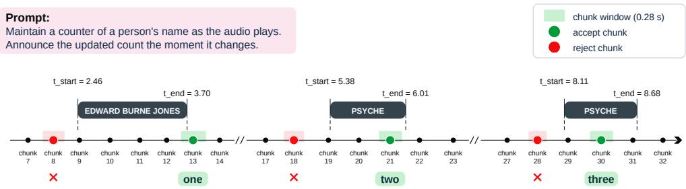

# LIBRISPEECH-REAL-QA: A BENCHMARK FOR STREAMING QUESTION ANSWERING

Zewen Zhan1∗, Hui Lu2∗, Xueyuan Chen2, Huimeng Wang2, Yikai Huang1 Xixin Wu2, Shiyin Kang3, Bin Xia3, Zhiyong Wu1

1Tsinghua University, China 2The Chinese University of Hong Kong, China 3SenseTime Research, China zhanzw25@mails.tsinghua.edu.cn, luhui@se.cuhk.edu.hk

## ABSTRACT

Most speech large language models (SLMs) still process speech in an offline manner — they only start responding after they receive the complete speech segment. However, many real-world applications require streaming speech interaction, for which the audio continuously flows in and the machine is required to answer questions based on the so far received audio chunks. For example, a user may ask the system to continuously count how many times a person’s name has been mentioned while they are speaking. We observe a lack of benchmarks and evaluation protocols for real-time speech interaction. Motivated by this, we propose LibriSpeech-Real-QA, a dataset and a benchmark for real-time speech interaction. We construct different types of real-time question-answer pairs from LibriSpeech to evaluate whether speech LLMs can identify target words in streaming audio. We evaluate several popular real-time commercial models and find that they still tend to respond only after the speech turn has finished. We demonstrate that we can enable a pretrained SLM to perform this task, where we explore several modeling designs and establish a solid baseline for future research.

Index Terms— streaming speech interaction, speech LLMs, benchmark

## 1. INTRODUCTION

In a human spoken conversation, interlocutors listen to and understand the speech from each other before it is finished. We argue that machines require the same streaming speech interaction capability to better interact with humans in speech. Speech large language models (SLMs) have demonstrated impressive capabilities in speech understanding, generation and spoken dialogue [1, 2, 3, 4, 5]. However, these models predominantly operate in a strictly turn-based setting, where the complete audio signal needs to be fully available before processing begins.

Full-duplex spoken interaction [6, 7, 8, 9, 10, 11] is promising to facilitate streaming speech interaction, as it requires models to automatically decide their dialogue state in real-time, i.e., to continue listening, continue speaking, convert from listen to speak or vice versa. However, the typical evaluation scenarios are turn-taking, user interruption and backchannels [12, 13], and there is a lack of explicit evaluation regarding fine-grained streaming speech interaction capabilities, such as quick assistant responses during streaming speech.

More recently, speech interactions have evolved beyond the fullduplex spoken dialogue towards more general real-time speech and audio interaction. Audio Interaction model [14] proposes Proactive-Sound-Bench to evaluate a series of audio-event-triggered proactive response tasks. Thinking Machines Lab reports an interesting internal evaluation task for their Interaction Models [15] to identify certain words in an audio stream in real-time. We believe that such curated streaming speech interaction tasks can serve as an important indicator for the SLM in terms of their streaming speech processing and real-time interaction capabilities, but we have not seen open benchmarks regarding these capabilities.

Traditional streaming speech processing tasks, such as streaming speech recognition [16] and translation [17], can also serve as proxy tasks for streaming speech interaction. However, they emphasize more on the passive processing of the speech signal, leaving proactive interaction capabilities of the SLMs untested.

To address these gaps, we introduce LibriSpeech-Real-QA, a benchmark for streaming speech interaction and question answering constructed from LibriSpeech [18] corpus. The benchmark covers four types of tasks that follow the same format: the model receives a speech stream together with a prompt that asks it to emit an answer when the queried event is heard. The types cross a lexical or semantic target with detection or counting (Section 2.1). They allow us to evaluate real-time speech understanding, instruction following, and proactive response generation. We propose a corresponding metric calculation protocol to evaluate streaming SLMs’ predictions with emission-level recall, precision, F1-score, and onset delay. Finally, we present a finetuning approach for adapting a pretrained SLM— Qwen2.5-Omni [19]—to our proposed streaming speech interaction tasks, establishing strong baselines for future research.

## 2. BENCHMARK DESIGN

## 2.1. Task Definitions

We define four streaming question answering tasks. In each task, a model receives an audio stream along with a natural language prompt and must output natural language tokens at appropriate times.

• Lexical Detection. Given a target word w, the model must output w immediately each time it hears w in the audio stream.

• Lexical Counting. Given a target word w, the model maintains a running count and outputs the updated count immedi-

ately after each occurrence of w.

• Semantic Detection. Given a semantic class $c \ ( \mathrm { e . g . , \ ^ { \mathrm { 4 . } } a n i - }$ mal,” “city”), the model must output each word as soon as it hears a word belonging to class c.

• Semantic Counting. Given a semantic class c, the model maintains a running count and outputs the updated count whenever a word belonging to c is heard.

## 2.2. Data Construction

We construct a dataset for the proposed tasks from the LibriSpeech corpus [18]. As shown in Table 1, it follows the LibriSpeech partition: a training set constructed from $\mathtt { t r a i n - c l e a n - 1 0 0 }$ train-clean-360, and train-other-500; a development set from dev-clean and dev-other; and a benchmark from test-clean and $\mathtt { t e s t - o t h e r }$ Each utterance is annotated with three domains: the system prompt, the list of target words, and their timestamps. The annotations are produced by a pipeline of four stages as described below.

Stage 1: Forced Alignment. We obtain word-level timestamps using a force-aligner such as Montreal Forced Aligner (MFA) alignments [20]. Each word is assigned a start time and end time.

Stage 2: Semantic Classification. We classify words into one of 20 semantic categories (including person name, animal, city, profession, organization, food, plant, color, body part, cardinal, ordinal, kinship, date, clock time, country, money, disease, weather, state or province and Null) using an LLM with a structured extraction prompt. Classified semantic labels are stored alongside timestamps in the metadata.

Stage 3: Sample Generation. For each utterance, we select target words and semantic classes that appear in the metadata, and we fill a prompt template with the chosen target. The prompt is the instruction for one of the four tasks in Section 2.1. A lexical-detection example is: “The moment you hear the word ‘warriors’ in the stream, say it out loud.” When a target occurs more than once, we keep the sample only if consecutive occurrences are separated by more than one second, leaving the downstream model ample time to emit an answer before the next event. Lexical and semantic counting samples are built only when the target occurs multiple times.

Stage 4: Negative Sample Generation. The samples from Stage 3 are positive: the utterance always contains the word or semantic class named in the prompt. We also build negative samples, in which that target is absent, so the correct behavior for the model is to remain silent. Without exposing to negative samples, a model can treat every utterance as one that requires an answer while including them in training reduces that bias.

Table 1. Number of samples by split and task. Lex. det.: lexical detection; Lex. cnt.: lexical counting; Sem. det.: semantic detection; Sem. cnt.: semantic counting.
<table><tr><td>Set</td><td>Split</td><td>Lex. det.</td><td>Lex. cnt.</td><td>Sem. det.</td><td>Sem. cnt.</td></tr><tr><td rowspan="3">Train</td><td>train-other-500</td><td>138,800</td><td>38,282</td><td>199,111</td><td>38,889</td></tr><tr><td>train-clean-360</td><td>92,593</td><td>28,804</td><td>137,485</td><td>27,584</td></tr><tr><td>train-clean-100</td><td>26,529</td><td>7,639</td><td>40,260</td><td>8,014</td></tr><tr><td rowspan="2">Dev</td><td>dev-clean</td><td>2,511</td><td>243</td><td>2,437</td><td>309</td></tr><tr><td>dev-other</td><td>2,623</td><td>239</td><td>2,300</td><td>260</td></tr><tr><td rowspan="2">Benchmark</td><td>test-clean</td><td>2,399</td><td>237</td><td>2,392</td><td>277</td></tr><tr><td>test-other</td><td>2,658</td><td>270</td><td>2,636</td><td>289</td></tr></table>

## 2.3. Evaluation Protocol

The benchmark evaluates models that take streaming speech input chunk by chunk, with chunk duration C, and emit a response as soon as the queried target is heard. Both the time and the content of the response are scored in the evaluation.

Each occurrence of the target word is a reference event. For detection the target content is the word text, and for counting it is the updated count at that word. The event occupies the aligned interval $[ t _ { \mathrm { s t a r t } } , t _ { \mathrm { e n d } } ]$ in the streaming speech. For each event, we define its acceptance window as $[ t _ { \mathrm { s t a r t } } , t _ { \mathrm { e n d } } + g ]$ . It opens when the word starts and remains open for a grace period g after the word ends in the stream speech. A model emission is considered as a hit only when its onset (tˆ) is within the acceptance window of the event and its content agrees with the event and the prompt.

We use $N _ { \mathrm { r e f } }$ to denote the number of reference events and TP for the number of hits. A miss is a reference event that receives no hit, so the number of misses is $N _ { \mathrm { r e f } } - \mathrm { T P } . \ \mathrm { A }$ false alarm (FA) is a model emission that matches no event.

Before matching, we lowercase text strings and remove nonalphanumeric characters, and we treat number words as equivalent to digits, so that two matches 2. We report fuzzy matching, under which the reference text only needs to occur inside the prediction. Exact matching requires the two normalized strings to be identical.

We calculate recall, precision, and F1 scores over all events in a split, with Recal $\mathrm { \Omega } = \mathrm { T P } / N _ { \mathrm { r e f } }$ and Precision $= \mathrm { T P } / ( \mathrm { T P } + \mathrm { F A } )$ We also calculate the mean onset delay d which averages $\hat { t } - t _ { \mathrm { s t a r t } }$ over hits. Counting uses the same matching rule, with each count update as its own event, so both the count and the onset must be correct.

## 3. STREAMING MODEL BASELINE

We adapt Qwen2.5-Omni-7B [19] to perform the proposed tasks by a sequence of causal decisions at chunk boundaries: after each fixedduration chunk the model either stays silent (by emitting a special silence token) or emits the target content once the queried event becomes observable.

## 3.1. Modeling Formulation

We divide an audio stream into K consecutive chunks $x _ { 1 } , \ldots , x _ { K }$ each lasting $C$ seconds, represented in the native multi-turn format of Qwen2.5-Omni as [system], $\{ [ \mathrm { u s e r } ( x _ { k } )$ , assistant $( y _ { k } ) ] \} _ { k = 1 } ^ { K }$ Each user turn contains only the newly arrived chunk, so predicting y accesses only the causal prefix $x _ { 1 } , \ldots , x _ { k }$

For lexical and semantic detection tasks, the model is expected to emit the target word when an event becomes observable; for counting tasks, it is expected to emit the updated cumulative count at each event $( { \bf e . g . \nabla ^ {  } } ^ {  } { \bf 1 ^ {  } } , { \bf \nabla ^ {  } } { 2 ^ {  } } , { \bf \nabla ^ {  } } { 3 ^ {  } } )$ , and outputs <keep silence> otherwise. At each chunk boundary, the model implicitly selects one of two actions: SPEAK or SILENCE. A SPEAK decision emits a meaningful content, followed by the endof-turn token <|im end|>, whereas a SILENCE decision emits the special token <keep silence> followed by <|im end|>. For an audio event whose end time is $e ,$ the chunk index is

$$
k ^ { * } ( e ) = \left\lceil \frac { e - { \epsilon } } { C } \right\rceil - 1 , \qquad 0 \le ( k ^ { * } + 1 ) C - e < C ,\tag{1}
$$

where $\epsilon \to 0 ^ { + }$ denotes an infinitesimal positive time offset used to resolve exact-boundary cases: if $e = m C .$ , the event is assigned to the chunk whose right boundary is mC, rather than to the following chunk. This ensures that the supervision is causal and introduces less than one chunk of delay. At inference each emission is assigned to the same boundary $( k ^ { * } + 1 ) C$ , making the recorded onset the causal decision time. Figure 1 illustrates the resulting single-axis chunk timeline for semantic counting of person names, where chunks overlapping the annotated name span are accepted and the rest rejected.

Loss is computed only over outputs corresponding to the streaming speech, with output positions corresponding to the system prompt masked. A positive sample contains one or more SPEAK decisions, while the remaining chunks correspond to SILENCE decisions, so directly averaging token-level cross-entropy strongly biases the model toward an always-silent solution. We therefore separate the loss into four groups—SPEAK content, SPEAK end token, SILENCE action, and SILENCE end token—and average the two components within each decision type, giving $\begin{array} { r } { \mathcal { L } _ { s } = \frac { 1 } { 2 } ( \bar { \ell } _ { \mathrm { s p k } } + \bar { \ell } _ { \mathrm { s p k , e n d } } ) } \end{array}$ and $\begin{array} { r } { \mathcal { L } _ { q } = \frac { 1 } { 2 } ( \bar { \ell } _ { \mathrm { s i l } } + \bar { \ell } _ { \mathrm { s i l , e n d } } ) } \end{array}$ , where ¯ℓ is the mean token cross-entropy over a bucket (spk/sil: <speak>/ <keep silence>, end: <|im end|>) and $w _ { s } , w _ { q }$ the balancing weights. We balance the two:

$$
\mathcal { L } = \frac { w _ { s } \mathcal { L } _ { s } + w _ { q } \mathcal { L } _ { q } } { w _ { s } + w _ { q } } , \qquad w _ { s } = w _ { q } = 0 . 5 ,\tag{2}
$$

so that SPEAK and SILENCE have equal aggregate importance regardless of frequency, while separating the <|im end|> loss keeps the sequence-ending signal from being diluted by content length.

We also utilize negative samples as described in Sec 2.2 during training. It teaches the model to remain silent when the audio stream does not contain the queried target. We freeze the audio encoder and disable the speech-generation talker branch. LoRA adapters [21] are applied to the thinker attention and FFN projections (rank r = 16, α = 32, dropout 0.05), while modules remain fully trainable so that special tokens such as <keep silence> can be learned. We train with AdamW [22] at $1 . 5 \times 1 0 ^ { - 4 }$ with linear decay, batch size 96, bf16 precision, and an 8192-token context window.

## 4. EXPERIMENTS

## 4.1. Setup

We evaluate three groups of models on LibriSpeech-Real-QA. The first comprises proprietary APIs for real-time speech interaction: Gemini Live 3.1 Flash [23], GPT-realtime-2.1-mini [24], qwen-audio-3.0-realtime-flash [25], and qwen-audio-3.0-realtimeplus [25]. The second comprises pretrained Qwen2.5-Omni-7B [19] and a version finetuned for offline inference, denoted OFFLINE. In the offline formulation, the model receives the full audio input and is instructed to produce a timestamped event list in JSON format. The third group, denoted STREAMING, adapts Qwen2.5-Omni-7B as described in Sec. 3.1. We evaluate streaming models with chunk durations of 400, 280, and 160 ms. We report results for the grace period g = +1c and $g = + 2 c$ indicating the extension of the acceptance window with an extra one chunk and two chunks, respectively.

For the finetuned models, fuzzy and exact matching give nearly identical results across the four tasks. The pretrained model shows a larger discrepancy, as its responses more often include additional contextual words. We therefore use fuzzy matching throughout for a consistent comparison across model groups.

## 4.2. Baseline Results

Tables 2–5 report results on the four tasks for the test-clean and test-other splits. Existing real-time speech APIs can identify some queried events, particularly in lexical detection, but do not exhibit the event-triggered response behavior required by our tasks. Their mean onset delays are several seconds, consistent with treating the input as a conversational turn and responding near the end of the utterance rather than when the queried event occurs. These delays are not a controlled latency comparison across providers, as they also reflect differences in response policies and service conditions. Instead, the results demonstrate the value of LibriSpeech-Real-QA: by evaluating both what a model emits and when it emits it, the benchmark reveals a gap in fine-grained streaming speech interaction that content-only or turn-level evaluation would miss.

The pretrained Qwen2.5-Omni-7B has the lowest F1 on every task and split, indicating that general speech capabilities alone do not suffice for these event-triggered tasks. Finetuning for offline inference substantially improves event matching: OFFLINE achieves F1 of 0.94/0.91 on lexical detection, 0.98/0.96 on lexical counting, 0.78/0.66 on semantic detection, and 0.91/0.89 on semantic counting (test-clean/test-other). However, we should note that the OFFLINE variant treats the real-time speech understanding task as a post-audio target identification and localization problem. It thus can only serve as an reference and should not be compared directly with those of STREAMING.

Table 2. Lexical detection on LibriSpeech-Real- $\mathbf { \nabla \cdot Q A } .$ . † indicates models that operate with the post-audio inference mode.
<table><tr><td>Model</td><td>Win.</td><td>F1</td><td>Recall</td><td>Precision</td><td>d</td></tr><tr><td>Gemini Live 3.1 Flash</td><td></td><td>0.83 / 0.87</td><td>0.98 / 0.96</td><td>0.72 / 0.79</td><td>5.00 / 4.35</td></tr><tr><td>GPT-realtime-2.1-mini</td><td></td><td>0.94 / 0.83</td><td>0.98 / 0.88</td><td>0.91 / 0.79</td><td>5.43 / 6.52</td></tr><tr><td>Qwen-Audio Flash</td><td></td><td>0.79 / 0.81</td><td>0.78 / 0.81</td><td>0.80 / 0.81</td><td>4.85 / 5.22</td></tr><tr><td>Qwen-Audio Plus</td><td></td><td>0.78 / 0.79</td><td>0.78 / 0.79</td><td>0.79 / 0.78</td><td>4.84 / 5.47</td></tr><tr><td>Qwen2.5-Omni-7B†</td><td></td><td>0.50 / 0.51</td><td>0.50 / 0.50</td><td>0.51 / 0.52</td><td>1.457 / 1.328</td></tr><tr><td>OFFLINE†</td><td></td><td>0.94 / 0.91</td><td>0.93 / 0.91</td><td>0.94 / 0.92</td><td>0.010 / 0.003</td></tr><tr><td rowspan="2">STREAMING (400 ms)</td><td>+1c</td><td>0.988 / 0.968</td><td>0.990 / 0.970</td><td>0.986 / 0.965</td><td>0.660 / 0.623</td></tr><tr><td>+2c</td><td>0.993 / 0.978</td><td>0.994 / 0.981</td><td>0.991 / 0.976</td><td>0.661 / 0.625</td></tr><tr><td rowspan="2">STREAMING (280 ms)</td><td>+1c</td><td>0.984 / 0.967</td><td>0.991 / 0.972</td><td>0.978 / 0.963</td><td>0.585 / 0.542</td></tr><tr><td>+2c</td><td>0.990 / 0.975</td><td>0.996 / 0.980</td><td>0.983 / 0.971 0.586 / 0.543</td><td></td></tr><tr><td rowspan="2">STREAMING (160 ms)</td><td>+1c</td><td>0.982 / 0.959</td><td></td><td>0.987 / 0.9620.976 / 0.9570.513 / 0.472</td><td></td></tr><tr><td>+2c</td><td></td><td>0.985 / 0.9660.991 / 0.9680.980 / 0.9630.513 / 0.473</td><td></td><td></td></tr></table>

Table 3. Lexical counting on LibriSpeech-Real-QA
<table><tr><td>Model</td><td>Win.</td><td>F1</td><td>Recall</td><td>Precision</td><td>d</td></tr><tr><td>Gemini Live 3.1 Flash</td><td></td><td>0.61 / 0.68</td><td>0.68 / 0.68</td><td>0.56 / 0.69</td><td>8.94 / 7.15</td></tr><tr><td>GPT-realtime-2.1-mini</td><td></td><td>0.58 / 0.46</td><td>0.45 / 0.36</td><td>0.85 / 0.61</td><td>10.07 / 10.03</td></tr><tr><td>Qwen-Audio Flash</td><td></td><td>0.44 / 0.42</td><td>0.32 / 0.34</td><td>0.67 / 0.54</td><td>4.03 / 6.52</td></tr><tr><td>Qwen-Audio Plus</td><td></td><td>0.44 / 0.45</td><td>0.32 / 0.35</td><td>0.68 / 0.64</td><td>4.07 / 7.03</td></tr><tr><td>Qwen2.5-Omni-7B†</td><td></td><td>0.07 / 0.08</td><td>0.10 / 0.13</td><td>0.05 / 0.06</td><td>2.419 / 2.990</td></tr><tr><td>OFFLINE†</td><td></td><td>0.98 / 0.96</td><td>0.97 / 0.97</td><td>0.99 / 0.96</td><td>0.062 / 0.023</td></tr><tr><td>STREAMING (400 ms)</td><td>+1c</td><td>0.952 / 0.923</td><td>0.960 / 0.935</td><td>0.944 / 0.912</td><td>0.585 / 0.531</td></tr><tr><td></td><td>+2c</td><td>0.954 / 0.932</td><td>0.962 / 0.944</td><td>0.946 / 0.920</td><td>0.586 / 0.533</td></tr><tr><td>STREAMING (280 ms)</td><td>+1c</td><td>0.962 / 0.944</td><td>0.970 / 0.955</td><td>0.954 / 0.933</td><td>0.514 / 0.465</td></tr><tr><td></td><td>+2c</td><td>0.964 / 0.945</td><td>0.972 / 0.957</td><td>0.956 / 0.935</td><td>0.515 / 0.465</td></tr><tr><td>STREAMING (160 ms)</td><td>+1c</td><td>0.926 / 0.882</td><td>0.940 / 0.900</td><td>0.914 / 0.864</td><td>0.458 / 0.400</td></tr><tr><td></td><td>+2c</td><td>0.928 / 0.884</td><td>0.942 / 0.902</td><td>0.916 / 0.866</td><td>0.458 / 0.400</td></tr></table>

## 4.3. Streaming Finetuning Results

Overall comparison. Streaming finetuning enables Qwen2.5- Omni-7B to respond during the speech stream and improves F1 over the pretrained model on every task and split. It also outperforms the evaluated real-time APIs in F1 across all four tasks. Under the +1c window, the 400 ms streaming model achieves 0.988/0.968 F1 on lexical detection and 0.824/0.694 on semantic detection, exceeding the corresponding OFFLINE results while making causal decisions. In contrast, OFFLINE remains stronger on both counting tasks. These results establish a strong causal baseline and show why the benchmark must evaluate response timing alongside answer content.

  
Fig. 1. Single-axis chunk timeline for person-name counting with a 0.28 s chunk window.

Table 4. Semantic detection on LibriSpeech-Real-QA
<table><tr><td>Model</td><td>Win.</td><td>F1</td><td>Recall</td><td>Precision</td><td>d</td></tr><tr><td>Gemini Live 3.1 Flash</td><td></td><td>0.65 / 0.61</td><td>0.70 / 0.65</td><td>0.61 / 0.57</td><td>5.89 / 5.09</td></tr><tr><td>GPT-realtime-2.1-mini</td><td></td><td>0.73 / 0.44</td><td>0.72 / 0.45</td><td>0.73 / 0.44</td><td>6.64 / 6.66</td></tr><tr><td>Qwen-Audio Flash</td><td></td><td>0.52 / 0.45</td><td>0.49 / 0.44</td><td>0.56 / 0.46</td><td>3.25 / 6.13</td></tr><tr><td>Qwen-Audio Plus</td><td></td><td>0.54 / 0.47</td><td>0.51 / 0.46</td><td>0.57 / 0.50</td><td>3.23 / 6.32</td></tr><tr><td>Qwen2.5-Omni-7B†</td><td>一</td><td>0.25 / 0.24</td><td>0.26 / 0.23</td><td>0.25 / 0.25</td><td>1.758 / 1.716</td></tr><tr><td>OFFLINE†</td><td>1</td><td>0.78 / 0.66</td><td>0.75 / 0.64</td><td>0.81 / 0.69</td><td>0.021 / 0.013</td></tr><tr><td>STREAMING (400 ms)</td><td>+1c</td><td>0.824 / 0.694</td><td>0.825 / 0.686</td><td>0.823 / 0.701</td><td>0.637 / 0.614</td></tr><tr><td></td><td>+2c</td><td>0.828 / 0.707</td><td>0.829 / 0.700</td><td>0.827 / 0.715</td><td>0.639 / 0.619</td></tr><tr><td>STREAMING (280 ms)</td><td>+1c</td><td>0.776 / 0.661</td><td>0.799 / 0.666</td><td>0.754 / 0.656</td><td>0.558 / 0.534</td></tr><tr><td></td><td>+2c</td><td>0.781 / 0.670</td><td>0.804 / 0.675</td><td>0.759 / 0.665</td><td>0.561 / 0.537</td></tr><tr><td>STREAMING (160 ms)</td><td>+1c</td><td>0.721 / 0.583</td><td>0.754 / 0.598</td><td>0.692 / 0.568</td><td>0.476 / 0.450</td></tr><tr><td></td><td>+2c</td><td>0.729 / 0.585</td><td>0.761 / 0.601</td><td>0.698 / 0.570</td><td>0.477 / 0.451</td></tr></table>

Table 5. Semantic counting on LibriSpeech-Real-QA
<table><tr><td>Model</td><td>Win.</td><td>F1</td><td>Recall</td><td>Precision</td><td>d</td></tr><tr><td>Gemini Live 3.1 Flash</td><td></td><td>0.49 / 0.54</td><td>0.59 / 0.54</td><td>0.42 / 0.54</td><td>8.86 / 8.04</td></tr><tr><td>GPT-realtime-2.1-mini</td><td></td><td>0.48 / 0.45</td><td>0.37 / 0.35</td><td>0.69 / 0.65</td><td>10.21 / 11.27</td></tr><tr><td>Qwen-Audio Flash</td><td></td><td>0.40 / 0.43</td><td>0.30 / 0.35</td><td>0.61 / 0.55</td><td>4.13 / 7.20</td></tr><tr><td>Qwen-Audio Plus</td><td></td><td>0.43 / 0.48</td><td>0.32 / 0.37</td><td>0.68 / 0.69</td><td>4.11 / 7.60</td></tr><tr><td>Qwen2.5-Omni-7B†</td><td></td><td>0.04 / 0.02</td><td>0.04 / 0.01</td><td>0.05 / 0.03</td><td>3.074 / 1.748</td></tr><tr><td>OFFLINE†</td><td></td><td>0.91 / 0.89</td><td>0.89 / 0.86</td><td>0.92 / 0.92</td><td>0.220 / 0.128</td></tr><tr><td>STREAMING (400 ms)</td><td>+1c</td><td>0.848 / 0.721</td><td>0.863 / 0.761</td><td>0.833 / 0.684</td><td>0.623 / 0.603</td></tr><tr><td></td><td>+2c</td><td>0.850 / 0.733</td><td>0.865 / 0.774</td><td>0.835 / 0.696</td><td>0.624 / 0.609</td></tr><tr><td>STREAMING (280 ms)</td><td>+1c</td><td>0.809 / 0.709</td><td>0.827 / 0.755</td><td>0.791 / 0.669</td><td>0.568 / 0.531</td></tr><tr><td></td><td>+2c</td><td>0.814 / 0.716</td><td>0.833 / 0.762</td><td>0.797 / 0.676</td><td>0.569 / 0.533</td></tr><tr><td>STREAMING (160 ms)</td><td>+1c</td><td>0.773 / 0.618</td><td>0.803 / 0.670</td><td>0.745 / 0.573</td><td>0.485 / 0.464</td></tr><tr><td></td><td>+2c</td><td>0.778 / 0.628</td><td>0.808 / 0.681</td><td>0.750 / 0.583</td><td>0.486 / 0.466</td></tr></table>

Table 6. Positive:negative sampling-ratio ablation of the 280 ms streaming model on the test-clean split of LibriSpeech-Real-QA (compute-matched, 1 epoch, +1c window).
<table><tr><td>pos:neg</td><td>Task</td><td>F1</td><td>Recall</td><td>Precision</td></tr><tr><td>1.0:0.0</td><td>Lexical det. Semantic det. Lexical cnt. Semantic cnt.</td><td>0.952 0.715 0.926 0.724</td><td>0.960 0.751 0.944 0.780</td><td>0.943 0.683 0.909 0.676</td></tr><tr><td>0.9:0.1</td><td>Lexical det. Semantic det. Lexical cnt. Semantic cnt.</td><td>0.972 0.750 0.928 0.793</td><td>0.979 0.776 0.946 0.833</td><td>0.966 0.727 0.911 0.757</td></tr><tr><td>0.8:0.2</td><td>Lexical det. Semantic det. Lexical cnt. Semantic cnt.</td><td>0.970 0.736 0.935 0.805</td><td>0.978 0.762 0.950 0.844</td><td>0.962 0.713 0.920 0.769</td></tr></table>

Task-wise comparison. For our finetuned STREAMING model, the semantic tasks generally yield lower F1 than the corresponding lexical tasks, indicating that they are more challenging in this setting. This is expected because semantic tasks require the model to relate the speech signal to the meaning of the queried class, whereas lexical tasks require it to recognize a specified word. Comparing detection and counting reveals different patterns across the two task families. For lexical tasks, counting is more challenging than detection; for the finetuned streaming models, semantic detection has lower F1 than semantic counting. For lexical tasks, detecting a repeated target word is sufficient for detection, but counting also requires the model to maintain and update a cumulative count after each occurrence. For semantic tasks, both tasks require recognizing class membership, but detection must additionally identify and output the particular word heard at each event; counting only needs to output the updated count. Effect of chunk size. Chunk duration exposes a task-dependent accuracy–delay trade-off. Under the +2c window, the 400 ms model achieves the highest streaming F1 on lexical detection (0.993/0.978), semantic detection (0.828/0.707), and semantic counting (0.850/0.733). The 280 ms model performs best on lexical counting (0.964/0.945), while the 160 ms model has the lowest mean onset delay on every task and split. For lexical detection under +1c, reducing chunk duration from 400 to 280 to 160 ms lowers mean onset delay on test-clean from 0.660 to 0.585 to 0.513 s, while F1 changes from 0.988 to 0.984 to 0.982. F1 falls more sharply with shorter chunks on the semantic tasks. Thus, the benchmark reveals not just whether a model can respond causally, but how promptly it can do so at a given level of task performance. Different evaluation window sizes. Extending the onset window from +1c to +2c increases streaming F1 by at most 0.013 across the reported tasks, chunk durations, and splits. The wider window credits some later emissions but does not substantially change the pattern of results.

## 4.4. Ablation Study on Negative Sampling

Table 6 examines the positive-to-negative sampling ratio for the streaming model. A 0.9:0.1 ratio yields the highest F1 on lexical and semantic detection (0.972 and 0.750), whereas 0.8:0.2 performs best on lexical and semantic counting (0.935 and 0.805). Removing negative samples produces the lowest F1 on all four tasks.

## 5. CONCLUSION

We introduced LibriSpeech-Real-QA, a benchmark for eventtriggered streaming speech interaction. Its temporal evaluation protocol assesses both the content and timing of model responses, revealing that existing real-time speech APIs often respond near the end of an utterance rather than when a queried event occurs. We also showed that streaming finetuning can adapt a pretrained SLM to make causal, event-level responses, establishing baselines across chunk durations and exposing task-dependent accuracy–delay tradeoffs. The benchmark provides a basis for developing speech models that answer while speech is still unfolding.

## 6. REFERENCES

[1] Yunfei Chu, Jin Xu, Qian Yang, et al., “Qwen2-audio technical report,” CoRR, vol. abs/2407.10759, 2024.

[2] Zhifeng Kong, Arushi Goel, Rohan Badlani, et al., “Audio flamingo: A novel audio language model with few-shot learning and dialogue abilities,” in Forty-first International Conference on Machine Learning, ICML 2024, Vienna, Austria, July 21-27, 2024, Ruslan Salakhutdinov, Zico Kolter, Katherine A. Heller, et al., Eds. 2024, Proceedings of Machine Learning Research, pp. 25125–25148, PMLR / OpenReview.net.

[3] KimiTeam, Ding Ding, Zeqian Ju, et al., “Kimi-audio technical report,” CoRR, vol. abs/2504.18425, 2025.

[4] Aohan Zeng, Zhengxiao Du, Mingdao Liu, et al., “Glm-4- voice: Towards intelligent and human-like end-to-end spoken chatbot,” CoRR, vol. abs/2412.02612, 2024.

[5] Qingkai Fang, Shoutao Guo, Yan Zhou, et al., “Llama-omni: Seamless speech interaction with large language models,” in The Thirteenth International Conference on Learning Representations, ICLR 2025, Singapore, April 24-28, 2025. 2025, OpenReview.net.

[6] Alexandre Defossez, Laurent Mazar´ e, Manu Orsini, et al.,´ “Moshi: a speech-text foundation model for real-time dialogue,” CoRR, vol. abs/2410.00037, 2024.

[7] Bandhav Veluri, Benjamin N Peloquin, Bokai Yu, et al., “Beyond turn-based interfaces: Synchronous LLMs as full-duplex dialogue agents,” in Proceedings of the 2024 Conference on Empirical Methods in Natural Language Processing, Yaser Al-Onaizan, Mohit Bansal, and Yun-Nung Chen, Eds., Miami, Florida, USA, Nov. 2024, pp. 21390–21402, Association for Computational Linguistics.

[8] Wenyi Yu, Siyin Wang, Xiaoyu Yang, et al., “Salmonn-omni: A standalone speech LLM without codec injection for fullduplex conversation,” CoRR, vol. abs/2505.17060, 2025.

[9] Ke Hu, Ehsan Hosseini-Asl, Chen Chen, et al., “Efficient and direct duplex modeling for speech-to-speech language model,” in 26th Annual Conference of the International Speech Communication Association, Interspeech 2025, Rotterdam, The Netherlands, 17-21 August 2025, Odette Scharenborg, Catharine Oertel, and Khiet Truong, Eds. 2025, ISCA.

[10] Qinglin Zhang, Luyao Cheng, Chong Deng, et al., “OmniFlatten: An end-to-end GPT model for seamless voice conversation,” in Proceedings ofthe 63rdAnnual Meeting ofthe Association for Computational Linguistics (Volume 1: Long Papers), Wanxiang Che, Joyce Nabende, Ekaterina Shutova, et al., Eds., Vienna, Austria, July 2025, pp. 14570–14580, Association for Computational Linguistics.

[11] Hui Lu, Xueyuan Chen, Huimeng Wang, et al., “How should llms listen while speaking? A study of user-stream routing in full-duplex spoken dialogue,” CoRR, vol. abs/2605.10199, 2026.

[12] Guan-Ting Lin, Jiachen Lian, Tingle Li, et al., “Full-duplexbench: A benchmark to evaluate full-duplex spoken dialogue models on turn-taking capabilities,” in IEEE Automatic Speech Recognition and Understanding Workshop, ASRU 2025, Honolulu, HI, USA, December 6-10, 2025. 2025, pp. 1–8, IEEE.

[13] Guan-Ting Lin, Shih-Yun Shan Kuan, Qirui Wang, et al., “Full-duplex-bench v1. 5: Evaluating overlap handling for fullduplex speech models,” arXiv preprint arXiv:2507.23159, 2025.

[14] Zhifei Xie, Zihang Liu, Ze An, et al., “Audio interaction model,” CoRR, vol. abs/2606.05121, 2026.

[15] Thinking Machines Lab, “Interaction models: A scalable approach to human-ai collaboration,” Thinking Machines Lab: Connectionism, May 2026, https://thinkingmachines.ai/blog/interaction-models/.

[16] Junteng Jia, Gil Keren, Wei Zhou, et al., “Efficient streaming LLM for speech recognition,” in 2025 IEEE International Conference on Acoustics, Speech and Signal Processing, ICASSP 2025, Hyderabad, India, April 6-11, 2025. 2025, pp. 1–5, IEEE.

[17] Chenyang Le, Bing Han, Jinshun Li, et al., “Simulmega: Moe routers are advanced policy makers for simultaneous speech translation,” in Advances in Neural Information Processing Systems 38: Annual Conference on Neural Information Processing Systems 2025, NeurIPS 2025, San Diego, CA, USA, December 2-7, 2025 / Mexico City, Mexico, November 30 - December 5, 2025, Danielle Belgrave, Cheng Zhang, Laura N. Montoya, et al., Eds., 2025.

[18] Vassil Panayotov, Guoguo Chen, Daniel Povey, et al., “Librispeech: An ASR corpus based on public domain audio books,” in 2015 IEEE International Conference on Acoustics, Speech and Signal Processing, ICASSP 2015, South Brisbane, Queensland, Australia, April 19-24, 2015. 2015, pp. 5206– 5210, IEEE.

[19] Jin Xu, Zhifang Guo, Jinzheng He, et al., “Qwen2.5-omni technical report,” CoRR, vol. abs/2503.20215, 2025.

[20] Michael McAuliffe, Michaela Socolof, Sarah Mihuc, et al., “Montreal forced aligner: Trainable text-speech alignment using kaldi,” in Proceedings ofInterspeech 2017, 2017, pp. 498– 502.

[21] Edward J. Hu, Yelong Shen, Phillip Wallis, et al., “Lora: Lowrank adaptation of large language models,” in The Tenth International Conference on Learning Representations, ICLR 2022, Virtual Event, April 25-29, 2022. 2022, OpenReview.net.

[22] Ilya Loshchilov and Frank Hutter, “Decoupled weight decay regularization,” in 7th International Conference on Learning Representations, ICLR 2019, New Orleans, LA, USA, May 6-9, 2019. 2019, OpenReview.net.

[23] Google, “Gemini api: Live api and model documentation,” https://ai.google.dev/gemini-api/ docs/models, 2026, Accessed: Sep. 24, 2026.

[24] OpenAI, “Openai api models: Gpt-realtime-2.1 mini,” https://platform.openai.com/docs/models, 2026, Accessed: Sep. 24, 2026.

[25] Qwen Team, “Qwen audio 3.0 realtime documentation,” https://qwenaudio.github. io/qwen-audio-agent/voice-frontends/ qwen-audio-realtime, 2026, Accessed: Sep. 24, 2026.