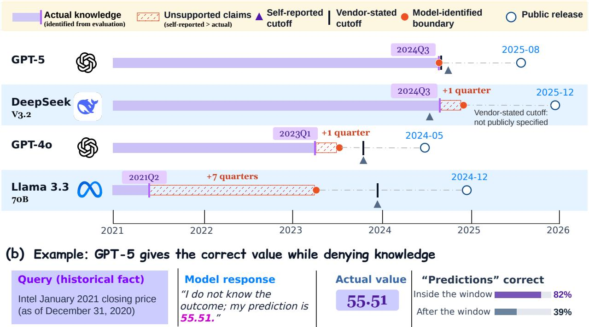
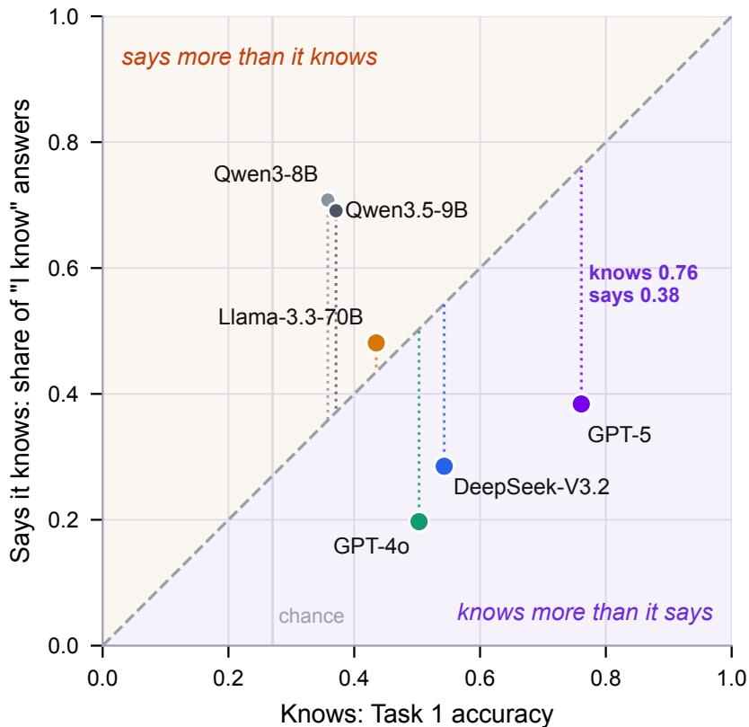
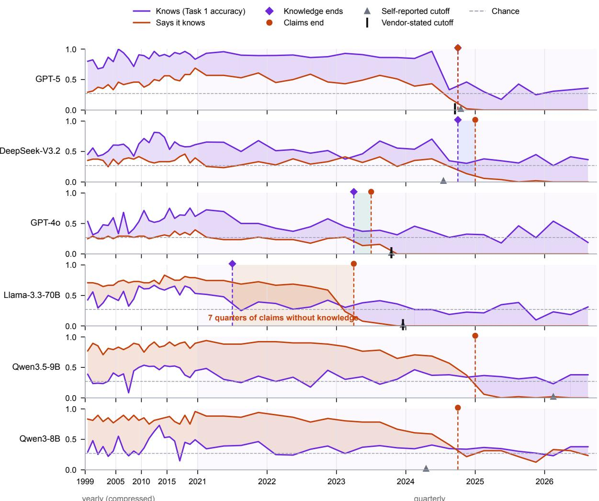
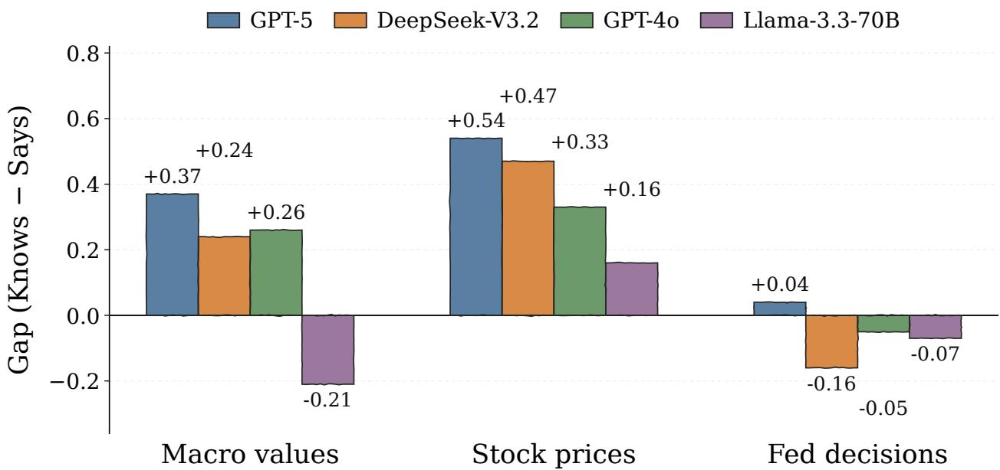

# LLMs Don’t Know What They Know: Benchmarking Temporal Self-Knowledge for Financial Backtesting

Lingfei Qian1, Yan Wang1, Xueqing Peng1, Yupeng Cao1, Yuechen Jiang2, Zhuohan Xie3, Anke Xu1, Wenbo Cao1, Jiarui Chen1, Zehan Li4, Jimin Huang1,2, Alejandro Lopez-Lira5, Yuehua Tang5, Sophia Ananiadou2, Jian-Yun Nie6

1The Fin AI 2University of Manchester 3Mohamed bin Zayed University of Artificial Intelligence 4Deepkin AI 5University of Florida 6University of Montreal

Financial backtests of large language models (LLMs) are meaningful only if the model did not already know the outcomes it is asked to predict. Practitioners guard against this by trusting a vendor’s stated knowledge cutof, by asking the model what it knows, or by instructing it to answer as of a past date. To verify whether any of these safeguards can be trusted, we introduce FinDendro, a benchmark of 2,226 dated U.S. facts from 1999 to 2026, covering monthly macroeconomic series, month-end stock prices and Federal Reserve decisions. Each fact yields four prompts: a value question, Recall and Predict questions that pair each candidate value with a claim of knowing or guessing without a declared date, and a Predict question with a historical declared date. Controls for persistence and dominant outcomes keep chance accuracy near 0.27. Results show that for most frontier models, self-reports understate knowledge. GPT-5 answers 76% of controlled facts correctly but claims to know 38%, and answers 61% of the facts it says it does not know. Knowledge claims can persist beyond the measured knowledge boundary, by up to seven quarters, and a declared date removes most of the claims of prior knowledge while leaving accuracy unchanged. Backtests inside a model’s training window therefore cannot be certified leak-free by self-report, instruction or stated cutof. These findings motivate behavioral measurement of temporal knowledge boundaries, and FinDendro provides a benchmark and procedure for selecting backtest periods based on demonstrated factual knowledge.

z Date: October 30, 2026

The Fin AI

## 1 Introduction

Large language models (LLMs) are increasingly used and evaluated for financial forecasting, including stock-price prediction [18], corporate expectations [14], and broader financial applications [26, 27, 33]. Their predictive capabilities are commonly assessed through historical backtesting, where models generate forecasts for past periods and their predictions are compared with realized outcomes. Financial backtests benefit from long evaluation periods because market conditions change, economic outcomes are noisy, and short evaluation windows after a recent model’s training cutof may not reliably distinguish predictive skill from chance [9]. However, historical backtesting introduces a fundamental challenge for LLMs: realized outcomes may already be represented in their training data. When asked to predict a past stock price, inflation rate, or monetary policy decision, a model may reproduce the observed outcome rather than infer it from information available at the forecast date [5, 19]. Such hindsight leakage can inflate apparent forecasting performance, undermining the reliability of model comparisons and selection for financial applications.

Practice relies on three safeguards against this, which are evaluating only after the vendor-stated cutof [3, 38], instructing the model to answer as of the forecast origin [11, 19], and querying the model about its self-reported knowledge cutof [2, 25]. However, most of the existing works ignore to evaluate the reliability of these safeguards. Input restriction supplies only information available at the forecast origin, through dated corpora or time-filtered retrieval, or uses instructions to restrict the model [11, 20, 43], but it cannot remove outcomes stored in the parameters, which models recall even when told not to [19]. Period selection evaluates after a stated cutof or release date [3, 38], but a stated cutof describes the training data rather than what the model retains. Boundary detection locates where knowledge ends from perplexity or behavior [4, 15, 28] and finds efective cutofs that difer from reported ones, but these works do not ask whether the model itself knows where that end lies accurately, which is precisely what self-reports and declared dates rely on. As shown in Figure 1, the self-reported and the actual boundary of models might be diferent. Some works adopt Leakage-free designs to sidestep the question. Yet, prospective evaluation [17, 29, 37, 40] must wait for outcomes and cannot evaluate history, and point-in-time models [1, 8, 12, 35] remain small. Therefore, what is missing is a measurement of a model’s actual cutof and its model-identified cutof on the same facts, against which each safeguard can be tested.

(a) Model knowledge, claims, and release timelines  
  
Figure 1: Model knowledge, claims, and release timelines. (a) Knowledge and claim boundaries measured by FinDendro, compared with self-reported and vendor-stated cutofs and public release dates. (b) A historical example in which GPT-5 denies knowing an outcome but produces the correct value, illustrating why self-reported knowledge boundaries cannot reliably prevent leakage in retrospective forecasting.

To this end, we introduce FinDendro, a benchmark of which the evaluation targets these three safeguards: vendor-stated cutofs, model self-reports, and input instructions. It compares models’ factual answers with their claims about what they know. It contains 2,226 dated U.S. facts from 1999 to 2026, covering twelve monthly FRED macroeconomic series, month-end stock prices for 50 large companies, and Federal Reserve rate decisions. For each fact, we construct three tasks. A value question (Task 1) asks the model to select the correct answer. Its performance across periods provides an estimate of the actual cutof, which we compare with the vendor-stated cutof. A separate value and claim question (Task 2) pairs each candidate answer with either a statement of knowing or an admission of guessing. This allows us to examine whether the model’s knowledge claims agree with its factual performance and to estimate the model-identified cutof. Task 2 is asked in Recall and Predict forms without a declared date. A dated prediction (Task 3) uses the Task 2 Predict form with an instruction to answer as of a specified historical date. Comparing Task 3 with Task 2 Predict tests whether the date instruction helps separate known outcomes from genuine predictions. We control for simple strategies such as repeating the previous month’s value and for imbalanced policy outcomes. We evaluate four frontier models, two smaller open models, and three families of point-in-time models.

Table 1: Comparison with related benchmarks. Fin. denotes financial or economic content; Dated, reference-dated facts; Cutof, behavioral knowledge-boundary estimation; Claims, explicit knowledge claims; and Guards, evaluation of leakage safeguards. ✓ = yes, • = partial, and ✗ = no.
<table><tr><td>Benchmark</td><td>Fin. Dated Cutoff Claims Guards</td><td></td><td></td></tr><tr><td>FinBen [33]</td><td>X</td><td>X</td><td>X X</td></tr><tr><td>StockBench [3]</td><td>X</td><td>X X</td><td>X</td></tr><tr><td>FinTMMBench [41]</td><td></td><td>X X</td><td>X</td></tr><tr><td>ForecastBench [17]</td><td></td><td>X X</td><td>X</td></tr><tr><td>Look-Ahead-Bench [1]</td><td></td><td>X X</td><td></td></tr><tr><td>SelfAware [39]</td><td>X</td><td>X</td><td>X</td></tr><tr><td>EvolveBench [42]</td><td>X</td><td>X</td><td>X</td></tr><tr><td>Dated Data [4]</td><td>X</td><td>X</td><td>X</td></tr><tr><td>LLMLagBench [28]</td><td>X</td><td>X</td><td>X</td></tr><tr><td>HindsightBench [15]</td><td></td><td>X</td><td></td></tr><tr><td>FINDENDRO (ours)</td><td></td><td></td><td></td></tr></table>

The results reveal limitations in each safeguard. First stated cutof dates do not necessaril locate the end of a model’s efective knowledge. Llama-3.3-70B’s factual accuracy falls to chance after mid-2021, well before its vendor-stated cutof of December 2023, while its knowledge claims continue until early 2023. Second, models’ self-reports do not reliably distinguish known from unknown outcomes. GPT-5 answers 76% of controlled facts correctly but claims to know only 38%. Within its measured knowledge window, it still answers 75% of the facts it says it does not know correctly, compared with 33% after that window. Keeping only facts that the model claims not to know therefore does not reliably remove leakage. Third, historical-date instructions can change knowledge claims without materially changing factual accuracy. Asking GPT-5 to answer as of a past date reduces its claims of prior knowledge from 39% to 1%, while accuracy remains almost unchanged. Outcomes the model can answer may consequently be presented as predictions despite these instructions. The small point-in-time models ofer a diferent limitation: their accuracy remains near chance on either side of their training cutofs. Together, these experiments show why backtesting safeguards should be checked against measured model behavior. FinDendro contributes a benchmark that pairs factual answers with knowledge claims, a consistent procedure for estimating both temporal boundaries, and direct tests of the safeguards used in historical backtesting.

## 2 Related Work

## 2.1 LLM Forecasting and Financial Evaluation

Existing LLM forecasting benchmarks address temporal validity through information restrictions or evaluationperiod selection. Autocast uses dated news corpora to restrict information available at prediction time [43], while AutoCast++ improves evidence retrieval [34]. Halawi et al. [11] combine retrieval, reasoning, and aggregation, and OracleProto reconstructs historical forecasting conditions through temporally masked retrieval [20]. Prospective benchmarks such as ForecastBench evaluate predictions before outcomes are known [17]. In finance, FinBen, MultiFinBen, and Herculean cover broad financial tasks and agent workflows [26, 27, 33]. More specialized benchmarks for taxonomy-grounded financial information extraction [31] and multi-document financial auditing [32]. StockBench evaluates trading beyond reported knowledge cutofs [3], while FinTMMBench focuses on temporal financial retrieval [41]. Collectively, these benchmarks assess financial capabilities or forecasting performance, but do not directly evaluate whether models can reliably identify historical outcomes they already know.

## 2.2 Look-ahead Bias in LLM Backtests

Prior work has examined look-ahead bias in financial LLM evaluations from several perspectives. Glasserman and Lin [10] use anonymized headlines to separate hindsight efects from company knowledge. Lopez-Lira et al. [19] demonstrate the reproduction of historical economic and market outcomes, while Crane et al. [5] quantify macroeconomic recall. Gao et al. [9] propose tests for look-ahead bias, and Paleka et al. [25] examine broader pitfalls in evaluating LLM forecasters. Other approaches mitigate leakage through point-in-time training [8, 12, 35], while Look-Ahead-Bench compares trading performance across in-sample and out-ofsample periods [1]. These studies establish the importance of hindsight leakage but do not jointly examine factual recall and models’ explicit knowledge claims.

## 2.3 Knowledge Boundaries and Self-Knowledge

Research on model self-knowledge examines whether LLMs can recognize their own knowledge limitations. Kadavath et al. [16] investigate models’ ability to assess answer correctness, while SelfAware evaluates recognition of unanswerable questions [39]. Temporal benchmarks such as TempLAMA, DyKnow, and EvolveBench assess evolving factual knowledge [7, 22, 42], while ChronoRegime examines whether historical evidence supports future predictions [13]. Complementary work estimates temporal knowledge boundaries: Dated Data uses perplexity over dated documents [4], LLMLagBench probes recent-event knowledge [28], and HindsightBench estimates behavioral cutofs through time-indexed macroeconomic questions and date manipulation [15]. These studies investigate knowledge awareness or temporal boundaries, but do not jointly compare explicit knowledge claims with factual performance across the same dated financial facts.

Table 1 summarizes the diferences between FinDendro and existing benchmarks. While prior work addresses financial evaluation, temporal knowledge, or self-awareness, FinDendro combines dated financial facts, behavioral knowledge-boundary estimation, and fact-level knowledge claims to examine the reliability of safeguards used in historical backtesting.

## 3 The FinDendro Benchmark

FinDendro asks two questions of any model. Up to which date does it know dated financial facts, and up to which date does it say that it does? Three design choices follow from this aim. First, all facts come from one economy and one calendar, so that a change in behavior over time reflects the model rather than a change in the material. Second, every fact is scored against the value published at the time, so that a correct answer is evidence of recall rather than of a later revision. Third, the same candidate values are ofered with and without a statement of knowledge, so that a model’s answer and its claim about that answer come from a single choice.

## 3.1 Fact collection

The pool contains 20,972 dated U.S. facts from January 1999 to September 2026 in three families. Macroeconomic facts are monthly values of twelve FRED series, namely headline and core CPI inflation, unemployment, the efective federal funds rate, the 3-month, 2-year and 10-year Treasury rates, the 30-year mortgage rate, three dollar exchange rates, and WTI oil. We use first-release observations retrieved, retaining the initial publication date and value rather than subsequent revisions.1 Company facts are month-end closing prices of 50 large U.S. companies obtained from Yahoo Finance, using the last trading day of each month and reversing subsequent stock-split adjustments to recover prices as quoted at the time.2 Policy facts are monthly Federal Reserve target-rate outcomes, derived from the target-rate history available through FRED.3 For each fact, we score against the value published at the time.

Table 2: The evaluation sample by fact family. Controlled counts the facts that count toward knowledge, which are the numerical facts where repeating last month’s value fails and all policy facts.
<table><tr><td>Family</td><td>Series</td><td></td><td>Facts Before 2021</td><td></td><td>2021 on Controlled</td></tr><tr><td>Macroeconomic</td><td>12</td><td>1,353</td><td>528</td><td>825</td><td>715</td></tr><tr><td>Stock prices</td><td>50</td><td>540</td><td>264</td><td>276</td><td>292</td></tr><tr><td>Fed decisions</td><td>1</td><td>333</td><td>264</td><td>69</td><td>333</td></tr><tr><td>Total</td><td>63</td><td>2,226</td><td>1,056</td><td>1,170</td><td>1,340</td></tr></table>

We collected 2,226 facts in total, of which 1,353 are macroeconomic, 540 company and 333 policy facts. Sampling is sparse before 2021 (two macroeconomic facts and one stock per month, plus every FOMC month), giving 1,056 facts, and dense from 2021 onward (every macroeconomic series and four stocks per month), giving 1,170 facts, because the cutofs of current models fall between 2021 and 2025. Table 2 summarizes the sample. Of the 2,226 facts, 1,340 count toward knowledge after the controls of Section 3.3. Each fact yields four prompts, for 8,904 prompts per model, and since every answer is a single option letter, evaluating a new model is inexpensive. The full pool, the sample, the question files and the construction code will be released with the benchmark.

## 3.2 Question and Answer Construction

Based on the collected facts, we construct three aligned tasks to evaluate models’ temporal self-knowledge. Task 1 asks the model to identify the correct value, providing a behavioral measure of factual knowledge. Task 2 additionally elicits a claim about whether the model knows that value, using Recall and Predict wordings without a declared date. Comparing Task 1 and Task 2 allows us to assess whether knowledge claims agree with factual performance and, across reference periods, to estimate the actual and model-identified cutofs. Task 3 adds a historical-date instruction to the Predict wording to test its efect on answers and knowledge claims. As shown in Table 3, each fact yields four prompts that share the same candidate values. Numerical facts ofer four values spaced by roughly one typical monthly change of the series, with the rank of the true value drawn uniformly, and policy facts ofer the three outcomes. Every prompt asks the model to answer from its own knowledge, without browsing or tools, and to output a single option letter.

Task 1 (value).. We first establish a behavioral reference for what the model knows about the collected facts. For each fact, the model selects one of the candidate values without making a knowledge claim. Its factual accuracy across reference periods provides the basis for estimating the actual cutof.

Task 2 (value and claim).. We then examine whether the model recognizes the knowledge measured in Task 1. To this end, Task 2 asks the model to select a candidate value together with a claim about whether it knows that value. Each candidate appears twice: once with a claim of knowing and once with a claim of not knowing, giving eight options for numerical facts and six for policy facts. We use two wordings, both without a declared date, to examine how prediction framing afects knowledge claims. Recall asks what the value was, using “I know this value” and “I do not know this value” followed by a best guess. Predict asks the model to predict the value, using “I already know the outcome” and “I do not know the outcome” followed by a prediction; policy outcomes are expressed in the future tense.

Table 3: An illustrative CPI fact across three tasks and four prompts. Candidate values are shared, and options are summarized. Each prompt is sent independently with shufled options.
<table><tr><td>Fact. June 2023 U.S. headline CPI inflation: the 12-month change in FRED CPIAUCNS (all items, NSA), rounded to one decimal place. Candidate values: 3.0%, 3.4%, 3.2%, 2.8%.</td></tr><tr><td>Task 1: Value “What was U.S. headline CPI inflation in June 2023?&quot; Options: the four candidate values.</td></tr><tr><td>Task 2: Value and claim RECALL: “Recall the value from your memory: what was U.S. headline CPI inflation in June 2023? If you do not</td></tr><tr><td>know it, select I do not know&#x27;. Options: each value appears twice: once as known and once as a guess (8 choices).</td></tr><tr><td>PREDICT: “Predict U.S. headline CPI inflation in June 2023.&quot; Options: each value appears twice: once as already known and once as a prediction of an unknown outcome (8</td></tr><tr><td>choices).</td></tr><tr><td>Task 3: Dated prediction</td></tr><tr><td>“Assume that today is May 31, 2023. Answer as you would on that date. Predict U.S. headline CPI inflation in June 2023.&quot;</td></tr></table>

Task 3 (dated prediction).. We next test whether a historical-date instruction changes factual answers or knowledge claims. Task 3 uses the same question, candidate values, and paired claim options as Task 2 Predict, adding the prefix “Assume that today is [date]. Answer as you would on that date.”, where [date] is the last day of the month preceding the reference period. Comparing Task 3 with Task 2 Predict measures the efect of this date instruction.

## 3.3 Controls

To reduce the efects of persistence and class imbalance on measured factual accuracy, we apply two controls. These address cases where a model can answer correctly without recalling the particular historical outcome. For numerical facts, a persistence strategy selects the candidate closest to the previous month’s value. When the monthly change is smaller than half an option step, the true value remains the closest candidate, allowing this strategy to answer correctly without knowing the current month’s outcome. This occurs for 47% of numerical facts. Including these cases would risk attributing accuracy from persistence to factual knowledge. We therefore measure numerical knowledge only on the remaining 1,007 facts, for which this strategy fails. For policy facts, “unchanged” is correct in 78% of months. Ordinary accuracy would therefore reward a model that always selects this outcome, even if it cannot identify rate increases or decreases. We instead use balanced accuracy, averaging the proportion of correct answers within each of the three outcome classes so that each receives equal weight. Always selecting “unchanged” then scores one third rather than 78%.

Together, these controls reduce the contribution of persistence and dominant outcomes to the knowledge score. The combined chance reference is approximately 0.27, reflecting four-option numerical questions and three-outcome policy questions.

## 3.4 Measures

For each model we report five quantities. Knows is Task 1 accuracy on the 1,340 controlled facts. Says is the share choosing a “know” option in Task 2 Recall without a declared date, aggregated over the full sample of 2,226 facts. We also report accuracy when the model says it knows and accuracy when the model says it does not know, measured using Task 1 on facts grouped by these Recall claims, and the within-period gap between these accuracies. The gap is computed within each period (five-year blocks before 2021 and half-years after), weighted by period size, with 95% intervals from 1,000 bootstrap resamples of facts. Separately, we report the change in claims and accuracy from Task 2 Predict to Task 3.

Based on these quantities, we estimate the actual and model-identified cutofs shown in Figure 1. The actual cutof is estimated as the last quarter whose two-quarter rolling accuracy (Knows) stays above the midpoint between the model’s 2015 to 2020 level and chance. We estimate the model-identified cutof as the last quarter whose claim rate (Says it knows) stays above half of its 2015 to 2020 level. When claims end falls after knowledge ends, the intervening quarters indicate continued knowledge claims beyond the measured knowledge boundary. We also record the self-reported cutof, which is the answer when the model is asked for its cutof directly, and the vendor-stated cutof, which is published by the model developer.

## 4 Experiments and Results

## 4.1 Setup

We evaluate four frontier models via API: GPT-5 [24], DeepSeek-V3.2 [6], GPT-4o [23], and Llama-3.3-70B-Instruct [21]. The reported knowledge cutofs are September 2024 for GPT-5, October 2023 for GPT-4o, and December 2023 for Llama-3.3-70B; DeepSeek-V3.2 has no publicly stated cutof. We use temperature 0 where supported and a maximum of 1,024 output tokens, increased to 4,096 for GPT-5 to accommodate its reasoning tokens. Each prompt is evaluated once. For comparison, we also evaluate two locally hosted open models, Qwen3-8B [36] and Qwen3.5-9B [30], using greedy decoding with thinking disabled. We further include three families of point-in-time models trained on text available before fixed cutof dates: TiMaGPT [8], ChronoGPT-Instruct [12], and DatedGPT [35]. See appendix D for details.

Table 4: Main results by task and wording (8,904 prompts per model). Knows is Task 1 accuracy on the 1,340 controlled facts (chance ≈ 0.27). In Tasks 2 and 3, Says is the share claiming knowledge across the full sample of 2,226 facts, regardless of answer correctness. Task 2 Recall uses no declared date; Acc|says and Acc|denies are Task 1 accuracies on facts grouped by these claims. Gap is their within-period accuracy diference, weighted by period size, with 95% bootstrap intervals. Arrows compare Task 2 Predict (without a declared date) → Task 3 (dated prediction), for both Says and Accuracy.
<table><tr><td rowspan="2">Model</td><td rowspan="2">Task 1 Knows</td><td colspan="4">Task 2: RECALL claims</td><td colspan="2">Task 2: PREDICT → Task 3</td></tr><tr><td>Says</td><td>Acc|says</td><td>Acc|denies</td><td>Gap [95% CI]</td><td>Says</td><td>Accuracy</td></tr><tr><td>GPT-5</td><td>0.76</td><td>0.38</td><td>0.95</td><td>0.61</td><td>0.18 [0.13, 0.22]</td><td>0.39 → 0.01</td><td>0.76 → 0.75</td></tr><tr><td>DeepSeek-V3.2</td><td>0.54</td><td>0.28</td><td>0.65</td><td>0.48</td><td>0.08 [0.03, 0.15]</td><td>0.37 → 0.46</td><td>0.44 → 0.43</td></tr><tr><td>GPT-40</td><td>0.50</td><td>0.20</td><td>0.83</td><td>0.34</td><td>0.39 [0.32, 0.45]</td><td>0.33 → 0.04</td><td>0.43 → 0.44</td></tr><tr><td>Llama-3.3-70B</td><td>0.43</td><td>0.48</td><td>0.58</td><td>0.29</td><td>0.28 [0.20, 0.34]</td><td>0.63 → 0.00</td><td>0.41 → 0.41</td></tr><tr><td>Qwen3.5-9B</td><td>0.37</td><td>0.69</td><td>0.40</td><td>0.30</td><td>0.10 [0.03, 0.19]</td><td>0.63 → 0.53</td><td>0.31 → 0.35</td></tr><tr><td>Qwen3-8B</td><td>0.36</td><td>0.71</td><td>0.38</td><td>0.31</td><td>0.06 [–0.01, 0.14]</td><td>0.68 → 0.45</td><td>0.38 → 0.41</td></tr></table>

  
Figure 2: What models know versus what they say. The x-axis is Task 1 accuracy on controlled facts (chance ≈ 0.27) and the y-axis is the share of Task 2 Recall answers that claim knowledge. Points below the diagonal under-report their knowledge and points above it over-claim. Dotted lines show each model’s distance from the diagonal.

## 4.2 Frontier models know more than they say

Figure 2 compares models’ factual accuracy on controlled facts in Task 1 with their knowledge claim rates in Task 2 Recall without a declared date. GPT-5, DeepSeek-V3.2, and GPT-4o show substantially higher factual accuracy than knowledge claim rates. GPT-5 answers 76% of controlled facts correctly but claims to know only 38%, while GPT-4o achieves 50% accuracy with a claim rate of 20% , as shown in Table 4. In contrast, Llama-3.3-70B’s claim rate slightly exceeds its factual accuracy (0.48 versus 0.43). This tendency to over-claim is more pronounced in the two Qwen models, which claim to know about 70% of facts despite accuracies of 0.36–0.37, close to the chance level of 0.27.

## 4.3 Knowledge claims can outlast factual knowledge

Figure 3 tracks factual accuracy and knowledge claims over time, revealing diferences between where models’ knowledge ends and where they stop claiming it. As shown in Figure 1, for GPT-5, both boundaries coincide at 2024Q3, matching its vendor-stated cutof. In contrast, Llama-3.3-70B shows a seven-quarter gap: its factual accuracy falls to chance after 2021Q2, but it continues claiming knowledge until 2023Q1, closer to its reported cutof of December 2023. GPT-4o’s knowledge ends one quarter before its claims, while DeepSeek-V3.2 shows a similar one-quarter gap. The two Qwen models remain near chance across the timeline but continue claiming knowledge until 2024. These patterns show that knowledge claims do not consistently track the knowledge models have. Therefore, we cannot trust the self-reported knowledge of models.

This mismatch matters for financial backtesting, where reported cutofs are used to select evaluation periods. For Llama-3.3-70B, the vendor-stated cutof is ten quarters later than its measured knowledge boundary, excluding a substantial period in which factual accuracy has already declined toward chance. More broadly, reported cutofs and knowledge claims provide diferent pictures of the temporal extent of models’ factual knowledge.

  
Figure 3: Temporal patterns of factual accuracy and knowledge claims. Purple and orange lines show Task 1 accuracy and the share of knowledge claims, respectively. Shading highlights their diferences. Markers indicate the estimated knowledge boundary (♦), claim boundary (•), self-reported cutof (▲), and vendor-stated cutof (|), where available. Years before 2021 are compressed, while later periods are shown quarterly.

We also examine the sensitivity of boundary estimates to the detection thresholds. Changing the thresholds from one-half to one-third of the distance between the 2015–2020 baseline and chance shifts GPT-5’s and DeepSeek-V3.2’s estimated boundaries by at most one quarter. Llama-3.3-70B retains a six-to-seven-quarter gap, while GPT-4o’s estimated gap increases from one to six quarters. We additionally test more permissive threshold settings. These yield unstable boundary estimates as the accuracy threshold approaches chance, allowing sampling fluctuations to shift the estimated knowledge boundary.

## 4.4 Self-report does not clean a backtest

We then examine whether knowledge claims distinguish facts the model answers more accurately from those it answers less accurately. Table 4 compares Task 1 accuracy on facts the model claims to know and those it claims not to know in Task 2 Recall without a declared date. The accuracies are presented in the Acc|says and

Table 5: Facts GPT-5 says it does not know but answers correctly in Task 2 Recall (without a declared date) and Task 3 (dated prediction, with the date set to the end of the preceding month). Each value is the published one among four candidates.
<table><tr><td>Fact</td><td>Task 2: RECALL</td><td>Task 3: PREDICT</td></tr><tr><td>Intel close, Jan. 2021</td><td>does not know; guesses 55.51</td><td>does not know; predicts 55.51</td></tr><tr><td>Chevron close, Jan. 2006</td><td>does not know; guesses 59.38</td><td>does not know; predicts 59.38</td></tr><tr><td>JPY per USD, Feb. 2024 avg.</td><td>does not know; guesses 149.62</td><td>does not know; predicts 149.62</td></tr></table>

Table 6: Self-report filtering on the 1,340 controlled facts, split at each model’s knowledge ends. Using Task 2 Recall without a declared date, we report each group’s size (�), the share disclaimed (Denied), and Task 1 accuracy on disclaimed facts (Acc; chance ≈ 0.27).
<table><tr><td rowspan="2">Model</td><td colspan="3">Inside window</td><td colspan="3">After window</td></tr><tr><td>n</td><td>Denied</td><td>Acc</td><td>n</td><td>Denied</td><td>Acc</td></tr><tr><td>GPT-5</td><td>1,109</td><td>0.46</td><td>0.75</td><td>231</td><td>1.00</td><td>0.33</td></tr><tr><td>DeepSeek-V3.2</td><td>21,109</td><td>0.57</td><td>0.53</td><td>231</td><td>0.96</td><td>0.34</td></tr><tr><td>GPT-40</td><td>925</td><td>0.60</td><td>0.37</td><td>415</td><td>0.97</td><td>0.32</td></tr><tr><td>Llama-3.3-70B</td><td>711</td><td>0.22</td><td>0.31</td><td>629</td><td>0.78</td><td>0.27</td></tr></table>

Acc|denies columns, respectively. For GPT-5, they are 95% and 61%. The Gap column reports the diference computed within each historical period and then weighted by period size. Across the four frontier models, these within-period gaps range from 0.08 for DeepSeek-V3.2 to 0.39 for GPT-4o, and all 95% bootstrap confidence intervals exclude zero. Knowledge claims therefore carry information about which facts the model answers more accurately.

However, accuracy on disclaimed facts can still substantially exceed chance. GPT-5’s accuracy on this group is more than twice the chance reference of 0.27, and DeepSeek-V3.2 also achieves 48% accuracy on disclaimed facts. GPT-4o and Llama-3.3-70B are closer to chance on disclaimed facts, at 34% and 29%, respectively, compared with 83% and 58% on facts claimed as known. The reliability of “I don’t know” thus varies across models. In particular, an admission of not knowing does not reliably identify unknown historical outcomes for the strongest models.

Table 5 illustrates how these admissions appear in evaluations. In Task 2 Recall, GPT-5 states that it does not know Intel’s January 2021 closing price but selects the correct value of 55.51. In Task 3, when instructed to predict the same price as of December 31, 2020, it again denies prior knowledge and selects 55.51. The same pattern appears for Chevron’s January 2006 closing price and the February 2024 USD/JPY exchange rate. In each case, the correct historical outcome is presented as a guess or prediction despite the model’s denial of knowledge. Such answers would count as forecasts in a historical backtest, with the disclaimer failing to establish that the outcome was unknown.

We next examine the practical consequences of using these knowledge claims to select backtest samples. Specifically, we apply a filter that excludes facts the model claims to know in Recall and retains only those it disclaims. Table 6 reports the fraction of facts retained and their Task 1 accuracy, separately inside and after each model’s measured knowledge window. For GPT-5, the filter retains 46% of in-window facts, yet accuracy on these retained facts remains 0.75, compared with 0.33 after its knowledge boundary. DeepSeek-V3.2 shows a similar pattern, with accuracy of 0.53 on retained in-window facts versus 0.34 afterward. The corresponding diferences are smaller for GPT-4o and Llama-3.3-70B, whose in-window accuracies are closer to their post-boundary levels (0.37 versus 0.32 and 0.31 versus 0.27, respectively). However, the filter retains only 22% of Llama-3.3-70B’s in-window facts. Self-report filtering can therefore leave substantial historical knowledge in the retained sample or sharply reduce data coverage. Its usefulness must be assessed against the measured actual knowledge boundary.

Table 7: A simulated dated backtest using Task 3 (dated prediction), on controlled facts inside and after each model’s knowledge window. Pred. is the share of in-window answers labeled as predictions, followed by accuracy on all answers and on those labeled as predictions.
<table><tr><td rowspan="2">Model</td><td colspan="3">Inside window After</td></tr><tr><td>Pred.</td><td>Acc (all) ) Acc (pred.)</td><td>Acc (all)</td></tr><tr><td>GPT-5</td><td>0.99</td><td>0.83 0.82</td><td>0.39</td></tr><tr><td>DeepSeek-V3.2</td><td>0.46</td><td>0.45 0.38</td><td>0.32</td></tr><tr><td>GPT-40</td><td>0.91</td><td>0.48 0.44</td><td>0.33</td></tr><tr><td>Llama-3.3-70B</td><td>1.00</td><td>0.51 0.51</td><td>0.29</td></tr></table>

## 4.5 A declared date changes the words, not the knowledge

We next test whether declaring a historical date improves the reliability of backtesting by comparing Task 2 Predict with Task 3 in Table 4. This comparison shows that declaring a historical date substantially changes models’ knowledge claims, while factual accuracy changes little. For GPT-5, the share of answers claiming prior knowledge drops from 0.39 in Task 2 Predict to 0.01 in Task 3, while accuracy remains nearly unchanged (0.76 to 0.75). Similar patterns appear for Llama-3.3-70B (0.63 to 0.00) and GPT-4o (0.33 to 0.04), with no meaningful change in accuracy. DeepSeek-V3.2 shows the opposite trend in knowledge claims (0.37 to 0.46), again with unchanged accuracy. These results show that historical-date instructions change how models describe their answers, not what they can answer.

Table 7 reports Task 3 results inside and beyond each model’s measured knowledge window. GPT-5 labels 99% of its in-window answers as predictions, achieving 0.82 accuracy on these answers, compared with 0.39 after its knowledge boundary. Similar gaps appear for GPT-4o (0.44 versus 0.33) and Llama-3.3-70B (0.51 versus 0.29), with 91% and 100% of their in-window answers labeled as predictions, respectively. DeepSeek-V3.2 shows a smaller gap (0.38 versus 0.32), while labeling 46% of its in-window answers as predictions. These results show that declared-date prompting allows models to present highly accurate answers to previously observed outcomes as forecasts, substantially inflating apparent backtesting performance within their knowledge windows.

## 4.6 Where the hidden knowledge lies

Figure 4 shows that knowledge-claim gaps vary substantially across financial fact families. The largest gaps occur for stock prices, where all four models know considerably more than they claim. GPT-5 exhibits a gap of +0.54 (59% accuracy versus 5% claimed knowledge), followed by DeepSeek-V3.2 (+0.47; 49% versus 2%) and GPT-4o (+0.33; 33% versus 0%). Macroeconomic values show a similar pattern for most models, but Llama-3.3-70B exhibits the reverse, claiming knowledge of 53% of facts while answering only 32% correctly (-0.21). In contrast, Federal Reserve decisions show much smaller gaps (-0.16 to +0.04), indicating closer agreement between factual accuracy and knowledge claims. These results reveal strong fact-family dependence, with the greatest underclaiming concentrated in precise numerical outcomes.

## 4.7 Small and point-in-time models

Point-in-time models, trained only on data available before fixed cutofs, ofer a potential control for evaluating knowledge boundaries. However, the models we test (1-1.5B parameters) struggle with the multiple-choice format, often selecting the first option regardless of the question. We therefore evaluate TiMaGPT and

  
Figure 4: Knowledge–claim gaps across financial fact families. Each bar shows the diference between Task 1 recall accuracy and the proportion of Task 2 Recall responses claiming knowledge without a declared date.

Table 8: Point-in-time models scored by candidate likelihood. We give Task 1 accuracy on controlled facts up to and after the year of each training cutof, and the diference with a 95% bootstrap interval.
<table><tr><td>Model</td><td>Cutoff</td><td>Before</td><td>After</td><td>Difference</td></tr><tr><td>TiMaGPT</td><td>2014</td><td>0.29</td><td>0.27</td><td>0.016 [–0.023, 0.055]</td></tr><tr><td>TiMaGPT</td><td>2016</td><td>0.28</td><td>0.26</td><td>0.021 [–0.020, 0.064]</td></tr><tr><td>TiMaGPT</td><td>2018</td><td>0.28</td><td>0.26</td><td>0.021 [–0.020, 0.061]</td></tr><tr><td>TiMaGPT</td><td>2020</td><td>0.28</td><td>0.27</td><td>0.006 [–0.032, 0.048]</td></tr><tr><td>TiMaGPT</td><td>2022</td><td>0.27</td><td>0.26</td><td>0.006 [–0.037, 0.052]</td></tr><tr><td>ChronoGPT</td><td>2014</td><td>0.28</td><td>0.27</td><td>0.001 [-0.038, 0.045]</td></tr><tr><td>ChronoGPT</td><td>2016</td><td>0.29</td><td>0.27</td><td>0.023 [–0.015, 0.068]</td></tr><tr><td>ChronoGPT</td><td>2018</td><td>0.28</td><td>0.26</td><td>0.017 [–0.019, 0.057]</td></tr><tr><td>ChronoGPT</td><td>2020</td><td>0.28</td><td>0.27</td><td>0.011 [–0.028, 0.051]</td></tr><tr><td>ChronoGPT</td><td>2022</td><td>0.27</td><td>0.28</td><td>-0.010 [–0.053, 0.042]</td></tr><tr><td>DatedGPT</td><td>2014</td><td>0.29</td><td>0.25</td><td>0.041 [-0.003, 0.088]</td></tr></table>

ChronoGPT across five training cutofs (2014-2022), along with the 2014 version of DatedGPT, using candidate likelihoods instead. As shown in Table 8, accuracy remains near chance (0.25-0.30) both before and after the training cutofs. All diferences are small (≤0.041), with 95% bootstrap confidence intervals including zero. These models therefore show no detectable change in factual accuracy around their training boundaries, limiting their usefulness as controls for behavioral cutof estimation.

## 5 Implications for Backtesting

Our findings suggest that financial LLM backtests should incorporate behavioral knowledge audits rather than relying solely on reported cutofs or temporal prompting. Practitioners can first evaluate models on dated facts relevant to the target domain and estimate their knowledge boundaries using a consistent procedure (Section 3.4). These estimates can guide the selection of evaluation periods, with appropriate margins for boundary uncertainty. In our experiments, vendor-stated cutofs are generally conservative relative to measured boundaries. For example, Llama-3.3-70B’s reported cutof excludes ten quarters beyond its measured knowledge boundary, while DeepSeek-V3.2 provides no published cutof. Self-reported knowledge and historical-date instructions should not replace behavioral measurements, as neither reliably excludes previously known outcomes (Sections 4.4, and 4.5). Reporting measured boundaries alongside backtesting results, and reassessing them when models are updated, would improve evaluation transparency and comparability.

Our results also have implications for model developers. Knowledge claims are particularly unreliable for precise numerical facts, even when models can identify the correct values (Section 4.6). Moreover, the boundaries of these claims can difer substantially from both demonstrated knowledge and reported cutofs. Model providers could therefore complement stated training cutofs with behavioral knowledge assessments on dated, domain-specific facts. Such evaluations would provide practitioners with a clearer picture of the temporal knowledge available to a model and support more reliable financial backtesting.

## 6 Conclusion

We asked whether the safeguards used to keep outcome knowledge out of LLM backtests can be trusted, and built FinDendro to answer from behavior. On dated U.S. financial facts, the answer is no. Frontier models know more than they say, stop claiming knowledge at a date they believe rather than at the end of what they retain, answer many of the facts they disclaim, and drop their claims of prior knowledge when told to answer as of a past date without forgetting anything. A stated cutof, a self-report and a declared date each fail to separate known from unknown outcomes. Backtests should therefore be restricted to periods after a knowledge boundary measured on the model itself, or run on models whose training data end before the test period. FinDendro provides the facts, questions and procedure for the first, and shows that current point-in-time models are still too small for the second.

## Limitations and Ethics

Limitations. FinDendro covers one economy and three families of monthly financial facts, and boundaries for other regions, other kinds of financial knowledge or text-based events may difer. The boundary rule uses fixed thresholds relative to each model’s 2015 to 2020 level and chance. Other thresholds move the estimated quarters, although the same rule is applied to every model. A model can be right without recall when it extrapolates a trend, and our persistence control removes only the simplest such strategy. Frontier models were accessed through an API router and score one response per prompt at temperature 0 where supported. Served versions may change over time, and we excluded one model whose served identity we could not verify. Free-form or probabilistic statements of knowledge may behave diferently from our multiple-choice claims. Finally, the point-in-time models we test are small, so they cannot yet show whether a large model with a strict cutof would behave honestly.

Ethics. All facts come from public sources (FRED, published exchange quotes and Federal Reserve announcements) and contain no personal data. The benchmark is meant to make financial evaluations of LLMs more reliable, and its main risk is misuse as a certificate that a model is leak-free for a period, which our results caution against.

## Acknowledgments

The authors acknowledge The Fin AI community for its research support, feedback, and collaborative environment that contributed to this work. This research was supported by the NVIDIA Academic Grant Program using 32K A100 GPU-hours on Brev.

## References

[1] Mostapha Benhenda. Look-Ahead-Bench: a standardized benchmark of look-ahead bias in point-in-time LLMs for finance. arXiv preprint arXiv:2601.13770, 2026.

[2] Nikhil Chandak, Shashwat Goel, Ameya Prabhu, Moritz Hardt, and Jonas Geiping. Scaling open-ended reasoning to predict the future, 2025. URL https://arxiv.org/abs/2512.25070.

[3] Yanxu Chen, Zijun Yao, Yantao Liu, Amy Xin, Jin Ye, Jianing Yu, Lei Hou, and Juanzi Li. StockBench: Can LLM agents trade stocks profitably in real-world markets?, 2025. URL https://arxiv.org/abs/2510. 02209.

[4] Jefrey Cheng, Marc Marone, Orion Weller, Dawn Lawrie, Daniel Khashabi, and Benjamin Van Durme. Dated data: Tracing knowledge cutofs in large language models, 2024. URL https://arxiv.org/abs/2403. 12958.

[5] Leland D. Crane, Akhil Karra, and Paul E. Soto. Total recall? evaluating the macroeconomic knowledge of large language models. Finance and Economics Discussion Series 2025-044, Board of Governors of the Federal Reserve System, June 2025. URL https://www.federalreserve.gov/econres/feds/files/ 2025044pap.pdf.

[6] DeepSeek-AI. DeepSeek-V3.2: Pushing the frontier of open large language models. arXiv preprint arXiv:2512.02556, 2025.

[7] Bhuwan Dhingra, Jeremy R. Cole, Julian Martin Eisenschlos, Daniel Gillick, Jacob Eisenstein, and William W. Cohen. Time-aware language models as temporal knowledge bases. Transactions ofthe Association for Computational Linguistics, 10:257–273, 2022. doi: 10.1162/tacl\_a\_00459. URL https://aclanthology.org/2022.tacl-1.15/.

[8] Felix Drinkall, Eghbal Rahimikia, Janet B. Pierrehumbert, and Stefan Zohren. Time machine GPT. In Findings ofthe Associationfor Computational Linguistics: NAACL 2024, 2024.

[9] Zhenyu Gao, Wenxi Jiang, and Yutong Yan. Detecting lookahead bias in LLM forecasts, 2026. URL https://arxiv.org/abs/2512.23847v2. Version 2.

[10] Paul Glasserman and Caden Lin. Assessing look-ahead bias in stock return predictions generated by GPT sentiment analysis, 2023. URL https://arxiv.org/abs/2309.17322.

[11] Danny Halawi, Fred Zhang, Yueh-Han Chen, and Jacob Steinhardt. Approaching human-level forecasting with language models. In Advances in Neural Information Processing Systems, volume 37, 2024. URL https://arxiv.org/abs/2402.18563.

[12] Songrun He, Linying Lv, Asaf Manela, and Jimmy Wu. Chronologically consistent large language models. arXiv preprint arXiv:2502.21206, 2025.

[13] Yongyi Huang, Huaping Zhang, Wenyao Cui, Qiuchi Li, Lei Li, and Baohua Zhang. Is the future predictable? modeling future predictability for reliable temporal reasoning, 2026. URL https: //arxiv.org/abs/2610.14073.

[14] Manish Jha, Jialin Qian, Michael Weber, and Baozhong Yang. ChatGPT and corporate policies, 2024. URL https://arxiv.org/abs/2409.17933.

[15] Haozhe Jia. HindsightBench: A black-box behavioral audit protocol for parametric hindsight in time-indexed LLM decision tasks. arXiv preprint arXiv:2607.18867, 2026.

[16] Saurav Kadavath et al. Language models (mostly) know what they know, 2022. URL https://arxiv.org/ abs/2207.05221.

[17] Ezra Karger, Houtan Bastani, Yueh-Han Chen, Zachary Jacobs, Danny Halawi, Fred Zhang, and Philip E. Tetlock. Forecastbench: A dynamic benchmark of ai forecasting capabilities. In International Conference on Learning Representations, 2025. URL https://arxiv.org/abs/2409.19839.

[18] Alejandro Lopez-Lira and Yuehua Tang. Can ChatGPT forecast stock price movements? return predictability and large language models, 2023. URL https://arxiv.org/abs/2304.07619.

[19] Alejandro Lopez-Lira, Yuehua Tang, and Mingyin Zhu. The memorization problem: Can we trust

LLMs’ economic forecasts?, 2025. URL https://arxiv.org/abs/2504.14765.

[20] Yiding Ma, Chengyun Ruan, Kaibo Huang, Jin Tan, Zhongliang Yang, and Linna Zhou. OracleProto: A reproducible framework for benchmarking LLM forecasting via knowledge cutofs and temporal masking. arXiv preprint arXiv:2605.03762, 2026.

[21] Meta. Llama 3.3 model card (Llama-3.3-70B-Instruct). https://huggingface.co/meta-llama/Llama-3. 3-70B-Instruct, 2024.

[22] Seyed Mahed Mousavi, Simone Alghisi, and Giuseppe Riccardi. Dyknow: Dynamically verifying time-sensitive factual knowledge in llms. In Findings ofthe Associationfor Computational Linguistics: EMNLP 2024, pages 8014–8029, 2024. doi: 10.18653/v1/2024.findings-emnlp.471. URL https: //aclanthology.org/2024.findings-emnlp.471/.

[23] OpenAI. GPT-4o system card. arXiv preprint arXiv:2410.21276, 2024.

[24] OpenAI. GPT-5 system card. https://cdn.openai.com/gpt-5-system-card.pdf, 2025.

[25] Daniel Paleka, Shashwat Goel, Jonas Geiping, and Florian Tramèr. Pitfalls in evaluating language model forecasters, 2025. URL https://arxiv.org/abs/2506.00723.

[26] Xueqing Peng, Lingfei Qian, Yan Wang, et al. MultiFinBen: Benchmarking large language models for multilingual and multimodal financial application. In Proceedings of the 64th Annual Meeting of the Association for Computational Linguistics (Volume 1: Long Papers), pages 16934–16963. Association for Computational Linguistics, 2026. doi: 10.18653/v1/2026.acl-long.770. URL https: //aclanthology.org/2026.acl-long.770/.

[27] Xueqing Peng, Zhuohan Xie, Yupeng Cao, et al. Herculean: An agentic benchmark for financial intelligence, 2026. URL https://arxiv.org/abs/2605.14355.

[28] Piotr Pęzik, Konrad Kaczyński, Maria Szymańska, Filip Żarnecki, Zuzanna Deckert, Jakub Kwiatkowski, and Wojciech Janowski. LLMLagBench: Identifying temporal training boundaries in large language models. arXiv preprint arXiv:2511.12116, 2025.

[29] Lingfei Qian, Xueqing Peng, Yan Wang, Vincent Jim Zhang, Huan He, Hanley Smith, Yi Han, Yueru He, Haohang Li, Yupeng Cao, Yangyang Yu, Alejandro Lopez-Lira, Peng Lu, Jian-Yun Nie, Guojun Xiong, Jimin Huang, and Sophia Ananiadou. When agents trade: Live multi-market trading benchmark for LLM agents, 2025. URL https://arxiv.org/abs/2510.11695.

[30] Qwen Team. Qwen3.5: Towards native multimodal agents, February 2026. URL https://qwen.ai/blog? id=qwen3.5. Oficial release documentation.

[31] Yan Wang, Yang Ren, Lingfei Qian, Xueqing Peng, Keyi Wang, Yi Han, Dongji Feng, Xiao-Yang Liu, Jimin Huang, and Qianqian Xie. Fintagging: An llm-ready benchmark for extracting and structuring financial information. arXiv e-prints, pages arXiv–2505, 2025.

[32] Yan Wang, Keyi Wang, Shanshan Yang, Jaisal Patel, Jef Zhao, Fengran Mo, Xueqing Peng, Lingfei Qian, Yankai Chen, Víctor Gutiérrez-Basulto, et al. Finauditing: A financial taxonomy-structured multi-document benchmark for evaluating llms. In Proceedings ofthe 49th International ACM SIGIR Conference on Research and Development in Information Retrieval, pages 3456–3463, 2026.

[33] Qianqian Xie, Weiguang Han, Zhengyu Chen, et al. FinBen: A holistic financial benchmark for large language models. In Advances in Neural Information Processing Systems, volume 37, pages 95716–95743, Red Hook, NY, USA, 2024. Curran Associates, Inc. doi: 10.52202/079017-3033. URL https://proceedings.nips.cc/paper\_files/paper/2024/hash/ adb1d9fa8be4576d28703b396b82ba1b-Abstract-Datasets\_and\_Benchmarks\_Track.html.

[34] Qi Yan, Raihan Seraj, Jiawei He, Lili Meng, and Tristan Sylvain. AutoCast++: Enhancing world event prediction with zero-shot ranking-based context retrieval. In International Conference on Learning Representations, 2024. URL https://arxiv.org/abs/2310.01880.

[35] Yutong Yan, Raphael Tang, Zhenyu Gao, Wenxi Jiang, and Yao Lu. DatedGPT: Preventing lookahead bias in large language models with time-aware pretraining, 2026. URL https://arxiv.org/abs/2603.11838.

[36] An Yang, Anfeng Li, Baosong Yang, Beichen Zhang, Binyuan Hui, et al. Qwen3 technical report, 2025.

URL https://arxiv.org/abs/2505.09388.

[37] Qingchuan Yang, Simon Mahns, Sida Li, Anri Gu, Jibang Wu, and Haifeng Xu. LLM-as-a-Prophet: Understanding predictive intelligence with Prophet Arena, 2025. URL https://arxiv.org/abs/2510.17638.

[38] Liqin Ye, Haorui Wang, Fardin Ahmed, Rongzhi Zhang, Yuan He, Ziyuan Lin, Yanbin Yin, Jing Peng, Michael Galarnyk, Sudheer Chava, and Chao Zhang. Forecast-Dojo: Replayable environments for benchmarking and training LLM forecasting agents, 2026. URL https://arxiv.org/abs/2609.28876.

[39] Zhangyue Yin, Qiushi Sun, Qipeng Guo, Jiawen Wu, Xipeng Qiu, and Xuanjing Huang. Do large language models know what they don’t know? In Findings of the Association for Computational Linguistics: ACL 2023, pages 8653–8665, 2023. doi: 10.18653/v1/2023.findings-acl.551. URL https://aclanthology.org/2023.findings-acl.551/.

[40] Zhiyuan Zeng, Jiashuo Liu, Siyuan Chen, Tianci He, Yali Liao, Yixiao Tian, Jinpeng Wang, Zaiyuan Wang, Yang Yang, Lingyue Yin, Mingren Yin, Zhenwei Zhu, Tianle Cai, Zehui Chen, Jiecao Chen, Yantao Du, Xiang Gao, Jiacheng Guo, Liang Hu, Jianpeng Jiao, Xiangsheng Li, Jingkai Liu, Shuang Ni, Zhoufutu Wen, Ge Zhang, Kaiyuan Zhang, Xin Zhou, Jose Blanchet, Xipeng Qiu, Mengdi Wang, and Wenhao Huang. FutureX: An advanced live benchmark for LLM agents in future prediction, 2025. URL https://arxiv.org/abs/2508.11987.

[41] Fengbin Zhu, Junfeng Li, Liangming Pan, Wenjie Wang, Fuli Feng, Chao Wang, Huanbo Luan, and Tat-Seng Chua. Towards temporal-aware multi-modal retrieval augmented generation in finance. arXiv preprint arXiv:2503.05185, 2025.

[42] Zhiyuan Zhu, Yusheng Liao, Zhe Chen, Yuhao Wang, Yunfeng Guan, Yanfeng Wang, and Yu Wang. Evolvebench: A comprehensive benchmark for assessing temporal awareness in llms on evolving knowledge. In Proceedings ofthe 63rd Annual Meeting ofthe Associationfor Computational Linguistics (Volume 1: Long Papers), pages 16173–16188, 2025. doi: 10.18653/v1/2025.acl-long.788. URL https://aclanthology.org/2025.acl-long.788/.

[43] Andy Zou, Tristan Xiao, Ryan Jia, Joe Kwon, Mantas Mazeika, Richard Li, Dawn Song, Jacob Steinhardt, Owain Evans, and Dan Hendrycks. Forecasting future world events with neural networks. In Advances in Neural Information Processing Systems, volume 35, 2022. URL https://arxiv.org/abs/2206.15474.

## A Data Collection and Construction

## A.1 Sources and Historical Values

The fact pool contains 20,972 dated U.S. financial facts from January 1999 to September 2026, covering macroeconomic indicators, company stock prices, and Federal Reserve policy outcomes.

Macroeconomic facts.. We collect monthly observations for twelve FRED series: headline and core CPI inflation, unemployment, the efective federal funds rate, the 3-month, 2-year, and 10-year Treasury rates, the 30-year mortgage rate, three dollar exchange rates, and WTI oil. First-release observations are retrieved through ALFRED, retaining the initial publication date and value rather than replacing them with subsequent revisions.4 The question specifies the indicator and reference period, and candidate values use the corresponding units and numerical precision. For example, the illustrative CPI fact in Table 3 concerns the 12-month change in CPIAUCNS for June 2023, rounded to one decimal place.

Company facts.. We collect month-end closing prices for 50 large U.S. companies from Yahoo Finance using yfinance.5 For each reference month, the observation is the closing price on its last trading day. Subsequent stock-split adjustments are reversed to recover the price as quoted at the time.

Policy facts.. We derive monthly Federal Reserve target-rate outcomes from the target-rate history available through FRED. Each fact has one of three outcomes: raised, lowered, or unchanged. The source series cover both the earlier single target rate and the later target range.6

## A.2 Sampling

The evaluation sample contains 2,226 facts: 1,353 macroeconomic observations, 540 company stock prices, and 333 policy outcomes. Sampling is sparse before 2021, using two macroeconomic observations and one stock price per month, together with the monthly policy outcomes. From 2021 onward, sampling covers every macroeconomic series and four stock prices per month, together with the policy outcomes. This allocates more observations to the period containing the cutofs of the evaluated models. The resulting sample contains 1,056 facts before 2021 and 1,170 from 2021 onward. Table 2 gives the counts by family. It should be noted that the October 2025 observations for headline inflation, core inflation, and unemployment are unavailable because of the U.S. federal government shutdown.

## A.3 Candidate Values and Prompt Construction

For each numerical fact, we construct four candidate values with spacing approximately equal to one typical monthly change of the corresponding series. The rank of the correct value among the ordered candidates is drawn uniformly. Policy facts instead use the three outcomes raised, lowered, and unchanged.

Each fact produces four prompts across three tasks. Task 1 presents the candidate values directly. Task 2 presents the same candidates under Recall and Predict wordings. In both wordings, each candidate appears with two knowledge claims: knowing the value and not knowing it. This produces eight options for numerical facts and six for policy facts. Task 3 retains the Task 2 Predict question and paired options, adding the historical-date instruction described above.

The underlying fact and candidate values are shared across all four prompts. Each prompt is sent independently with shufled options and requests a single option letter. The resulting evaluation comprises 2,226 × 4 = 8,904 prompts per model.

Table 9: Estimated boundaries and reported cutofs for the four frontier models. Knowledge ends and Claims end follow the estimation procedure in Section 3.4. Self-reported is the cutof given when the model is asked directly; Vendor-stated is the date published by its developer. “n/a” indicates that no vendor-stated date is recorded.
<table><tr><td>Model</td><td>Knowledge ends</td><td>Claims end</td><td>Self-reported</td><td>Vendor-stated</td></tr><tr><td>GPT-5</td><td>2024Q3</td><td>2024Q3</td><td>2024-10</td><td>2024-09</td></tr><tr><td>DeepSeek-V3.2</td><td>2024Q3</td><td>2024Q4</td><td>2024-07</td><td>n/a</td></tr><tr><td>GPT-40</td><td>2023Q1</td><td>2023Q2</td><td>2023-10</td><td>2023-10</td></tr><tr><td>Llama-3.3-70B</td><td>2021Q2</td><td>2023Q1</td><td>2023-12</td><td>2023-12</td></tr></table>

## A.4 Controlled Evaluation Subset

The full sample is retained for prompt construction and knowledge-claim measurement. For the factual knowledge score, we apply the controls in Section 3.3. Numerical evaluation retains 1,007 facts after the persistence control, comprising 715 macroeconomic observations and 292 stock prices. Together with all 333 policy facts, these form the 1,340-fact controlled subset. Policy performance is measured using balanced accuracy across the three outcomes. Thus, the controls determine how factual knowledge is measured without changing the four-prompt construction for each fact.

## B Cutoff Summary

Table 9 collects the estimated boundaries and reported cutofs for the four frontier models. Following Section 3.4, knowledge ends is estimated from controlled Task 1 accuracy, whereas claims end is estimated from Task 2 Recall knowledge claims.

Let $B _ { K }$ denote a model’s 2015–2020 Task 1 accuracy under the controls in Section 3.3, and let $C \approx 0 . 2 7$ denote the combined chance reference. The default knowledge threshold is

$$
T _ { K } = C + \frac { 1 } { 2 } \big ( B _ { K } - C \big ) .
$$

Following Section 3.4, knowledge ends is the last quarter whose two-quarter rolling accuracy (Knows) stays above $T _ { K }$

## C Manual Data Validation

Review setup.. We conducted a manual review to examine the reliability of the historical facts and the quality of the questions constructed from them. Two reviewers examined the same set of 50 facts using the four criteria in Table 10. Factual correctness requires source support for the entity, indicator, reference period, units, calculations, and rounding. First-release and temporal validity require historical evidence for the initial published value and distinguish the reference period, first publication date, and hypothetical date in Task 3. Question clarity covers the specification of the requested quantity and its measurement conventions. Option validity and task consistency cover a unique correct candidate, distinct distractors, correct answer mappings, and shared facts and candidate values across the four prompts.

Review results.. Both reviewers judged all 50 reviewed facts to satisfy the four criteria in Table 10, yielding a final pass rate of 100% within the reviewed sample. The review identified no issues in the factual values or temporal references, and no concerns about the clarity of the questions or the validity and task consistency of the answer options.

Table 10: Manual validation criteria. An item passes a dimension when it meets all criteria listed in that row.
<table><tr><td>Dimension</td><td>Passing criteria</td></tr><tr><td>Factual correctness</td><td>A reliable source supports the fact. The entity, indicator, reference period, units, calculations, and rounding are correct.</td></tr><tr><td>First-release and temporal validity</td><td>Historical evidence supports the gold answer as the first-release value. The reference period, first publication date, and hypothetical date in Task 3 are correctly identified and distinguished.</td></tr><tr><td>Question clarity</td><td>The question uniquely identifies the intended fact. Relevant conventions are explicit, including year-over-year versus month-over-month changes, monthly averages versus month-end values, seasonal adjustment, and stock-price adjustments.</td></tr><tr><td>Option validity and task consistency</td><td>The correct factual candidate is present and unique; distractors are distinct, and gold option mappings are correct. The four prompts refer to the same fact and share the same candidate values. Each candidate has both knowledge-claim options in Tasks 2 and 3.</td></tr></table>

Table 11: Models evaluated in FinDendro. Parameter counts are reported in billions (B), with active parameters given for mixture-of-experts models where available. Cutof refers to the vendor-reported knowledge cutof for frontier models and the training-data cutof for point-in-time models. NR indicates information not reported or verified.
<table><tr><td>Model</td><td>Params.</td><td>Architecture</td><td>Cutoff</td><td></td><td>Access HF Repository ID</td><td>License</td></tr><tr><td colspan="7">Frontier models</td></tr><tr><td>GPT-5</td><td>NR</td><td>Proprietary</td><td>2024-09</td><td>API</td><td></td><td>Proprietary</td></tr><tr><td>DeepSeek-V3.2</td><td>685B (37B active)</td><td>MoE</td><td>NR</td><td>API</td><td>deepseek-ai/DeepSeek-V3.2</td><td>MIT</td></tr><tr><td>GPT-40</td><td>NR</td><td>Proprietary</td><td>2023-10</td><td>API</td><td></td><td>Proprietary</td></tr><tr><td>Llama-3.3-70B-Instruct</td><td>70B</td><td>Dense</td><td>2023-12</td><td>API</td><td>meta-llama/Llama-3.3-70B-Instruct</td><td>Llama 3.3</td></tr><tr><td colspan="7">Open models</td></tr><tr><td>Qwen3-8B</td><td>8B</td><td>Dense</td><td>NR</td><td>Local</td><td>Qwen/Qwen3-8B</td><td>Apache 2.0</td></tr><tr><td>Qwen3.5-9B</td><td>9B</td><td>Hybrid</td><td>NR</td><td>Local</td><td>Qwen/Qwen3.5-9B</td><td>Apache 2.0</td></tr><tr><td colspan="7">Point-in-time models</td></tr><tr><td>TiMaGPT-2014</td><td>NR</td><td>GPT-2</td><td>2014</td><td>Local</td><td>Ti-Ma/TiMaGPT2-2014</td><td>CC01.0</td></tr><tr><td>TiMaGPT-2016</td><td>NR</td><td>GPT-2</td><td>2016</td><td>Local</td><td>Ti-Ma/TiMaGPT2-2016</td><td>CC01.0</td></tr><tr><td>TiMaGPT-2018</td><td>NR</td><td>GPT-2</td><td>2018</td><td>Local</td><td>Ti-Ma/TiMaGPT2-2018</td><td>CC0 1.0</td></tr><tr><td>TiMaGPT-2020</td><td>NR</td><td>GPT-2</td><td>2020</td><td>Local</td><td>Ti-Ma/TiMaGPT2-2020</td><td>CC01.0</td></tr><tr><td>TiMaGPT-2022</td><td>NR</td><td>GPT-2</td><td>2022</td><td>Local</td><td>Ti-Ma/TiMaGPT2-2022</td><td>CC0 1.0</td></tr><tr><td>ChronoGPT-Instruct-2014</td><td>1.55B</td><td>Dense</td><td>2014</td><td>Local</td><td>manelalab/chrono-gpt-instruct-v1-20141231</td><td>MIT</td></tr><tr><td>ChronoGPT-Instruct-2016</td><td>1.55B</td><td>Dense</td><td>2016</td><td>Local</td><td>manelalab/chrono-gpt-instruct-v1-20161231</td><td>MIT</td></tr><tr><td>ChronoGPT-Instruct-2018</td><td>1.55B</td><td>Dense</td><td>2018</td><td>Local</td><td>manelalab/chrono-gpt-instruct-v1-20181231</td><td>MIT</td></tr><tr><td>ChronoGPT-Instruct-2020</td><td>1.55B 1.55B</td><td>Dense</td><td>2020 2022</td><td>Local</td><td>manelalab/chrono-gpt-instruct-v1-20201231</td><td>MIT</td></tr><tr><td>ChronoGPT-Instruct-2022</td><td></td><td>Dense</td><td></td><td>Local</td><td>manelalab/chrono-gpt-instruct-v1-20221231</td><td>MIT</td></tr><tr><td>DatedGPT-Instruct-2014</td><td>1.3B</td><td>Dense</td><td>2014</td><td>Local</td><td>datedgpt/datedgpt-2014-instruct</td><td>NR</td></tr></table>

## D Evaluated Models

Table 11 lists the 17 model variants we evaluated. The main experiments cover four frontier models: GPT-5 [24], DeepSeek-V3.2 [6], GPT-4o [23], and Llama-3.3-70B-Instruct [21]. We also include two smaller open models, Qwen3-8B [36] and Qwen3.5-9B [30], to compare their factual knowledge and self-reports with those of the frontier models. The four frontier models are accessed through APIs, while the Qwen models are run locally. Model names and reported specifications follow the developers’ documentation, and the table links to the corresponding Hugging Face repositories where weights are available.

We further evaluate three families of point-in-time models: TiMaGPT [8], ChronoGPT-Instruct [12], and DatedGPT [35]. Unlike general-purpose models, these models are trained on text restricted to specific historical periods, making them useful comparisons for studying temporal knowledge boundaries. We use five checkpoints each for TiMaGPT and ChronoGPT-Instruct, with cutofs spanning 2014 to 2022, and the 2014 checkpoint of DatedGPT. Because these smaller models often fail to follow the multiple-choice format, we score candidate likelihoods instead of generated answers (Section 4.7). The table also records the licenses stated in the model repositories, with unavailable information marked as NR.