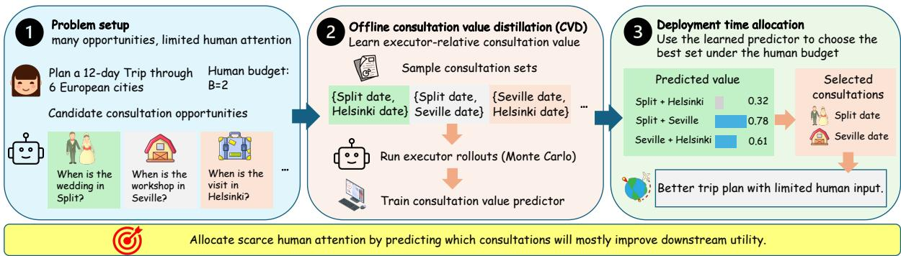
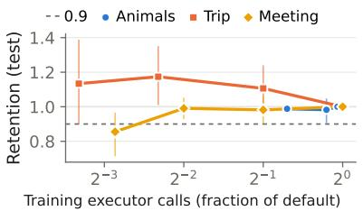
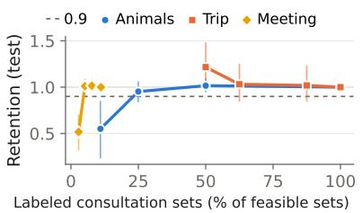
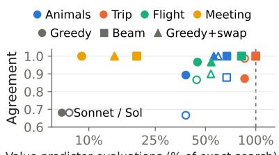

# Learning When Human Decisions Matter: Executor-Relative Consultation Value for LLM Agents

Shuli Jiang, Khushbu Pahwa, Yuting Zhang,

Yi Zhang, Wei Xia, Stefano Soatto

AWS Agentic AI

{shulij, pahwakhu, yutingzh, yizhngn, wxia, soattos}@amazon.com

## Abstract

Large language models increasingly automate complex tasks, but human decision capacity does not scale with their capabilities. In many applications, humans remain essential for providing private context, authority, or judgments unavailable to the agent. We formulate human decision capacity allocation: given multiple consultation opportunities and a limited budget, at which decisions should an LLM agent consult a human? The central challenge is estimating consultation value, which is executordependent because the same human input may benefit different downstream agents differently. We introduce Consultation Value Distillation (CVD), which estimates consultation values offline using Monte Carlo executor rollouts and distills these values into lightweight predictors for budgeted allocation, requiring no rolloutbased value estimation at deployment. Across five batch and three sequential settings with two frontier executors, CVD improves allocation through joint and continuation-aware value learning, while independent consultation values remain competitive in several settings. CVD also broadly outperforms direct prompting and Value of Information (Dong et al., 2026) where applicable, remains robust with substantially less rollout supervision, and enables nearly lossless approximate allocation at low search cost.

## 1 Introduction

Large language model (LLM) agents are increasingly capable of performing complex knowledgework tasks, including repository-level software engineering, natural-language planning, and collaborative document creation (Jimenez et al., 2024; Yang et al., 2024; Zheng et al., 2024; Wu et al., 2025). As the amount of work that agents can generate and execute grows, however, the human capacity available to supervise them does not scale accordingly. Humans remain essential in many real-world workflows because they possess information unavailable to the agent, exercise organizational authority, and provide judgments that cannot be inferred reliably from public context. A software engineer may know what a customer said minutes ago; a manager may know an unreleased roadmap decision; and among several technically valid code changes, only the responsible team may know which trade-off the organization prefers. Yet humans cannot be consulted at every decision point surfaced by increasingly productive agents.

Human decision capacity therefore becomes a scarce resource. Importantly, not every decision point deserves the same amount of human attention. Some can be handled reliably by the agent, while others have substantial downstream consequences if the agent acts without missing human information. Moreover, the apparent importance of a decision point is not the same as the value of consulting a human. A salient decision may require little human input when the executor already handles it correctly, whereas a routine decision may benefit greatly from a private fact the executor lacks. The allocation problem is therefore a decision made by the agent to decide where it should spend limited human capacity, given multiple consultation opportunities to ask for human input. The relevant question is not simply which decisions are important, but:

Given a limited human consultation budget, at which decision points should the agent consult a human?

We study this problem as human decisioncapacity allocation. We assume that candidate consultation points have already been identified and focus on allocating a limited human budget among them to obtain the corresponding information, judgment, or authority. The central challenge is estimating consultation value, the expected utility gain from resolving a decision or a set of decisions, before consulting. Once these values are known, budgeted allocation is comparatively direct. We observe that consultation value is executorrelative: it depends not only on the decision itself, but also on what the executor already knows and how effectively it can use the human input. We study both batch settings, where multiple consultations are chosen jointly and may be complementary or redundant, and sequential settings, where consultation opportunities arrive over time and using capacity now incurs an opportunity cost for future decisions.

  
Figure 1: Consultation Value Distillation (CVD) for human decision-capacity allocation. Given multiple consultation opportunities and a limited human budget, CVD learns from offline executor rollouts which human inputs most improve downstream utility, then uses the distilled value predictor to allocate consultation at deployment without rollout-based value estimation.

Prior work studies selective human intervention and clarification (Mozannar and Sontag, 2020; Hoque et al., 2022; Zhang et al., 2024). Most closely, (Dong et al., 2026) formulate multi-turn clarification as a clarify-or-commit process, selecting among candidate questions by their inferencetime Value of Information (VoI) relative to communication cost. We allocate a shared consultation budget across multiple decision opportunities, accounting for set-level interactions and sequential opportunity costs. More broadly, our formulation extends resource-aware agentic inference (Achille and Soatto, 2026) from allocating computation to allocating scarce human consultation by downstream value.

To estimate consultation value, we introduce Consultation Value Distillation (CVD), as illustrated in Figure 1. We sample consultation choices offline and use Monte Carlo executor rollouts to estimate downstream utility, then distill these outcomes into a lightweight predictor using information available at decision time. In batch settings, a permutation-invariant set-value model scores complete consultation sets, capturing complementarity and redundancy among human inputs. In sequential settings, a continuation-aware predictor accounts for both the current consultation and the remaining human budget. At deployment, the allocator uses these predicted values to select consultations under the available budget without rollout-based value estimation. We use a small ensemble of predictors for robustness.

We evaluate CVD across five batch and three sequential settings spanning six tasks, covering information acquisition, planning, scheduling, preference elicitation, and controlled decision interactions. Main results are replicated under Sonnet 5 and GPT-6.1 Sol, using executor outcomes independent of training supervision. CVD provides clear gains from joint batch and continuation-aware sequential allocation. At the largest evaluated budgets, it significantly outperforms the Local Value baseline, reaching normalized gain 0.58/0.40 vs. 0.25/0.09 on batch Animals and 0.91–0.96 vs. 0.80–0.87 on sequential ThinkingBox. Local Value remains competitive on several other tasks. At these budgets, our VoI baseline achieves at most 0.18 normalized gain, well below CVD on batch and sequential Animals. Ablations support direct total-value regression as a strong default, while the benefits of explicit decomposition and ranking objectives depend on the task and executor. Ensembling improves robustness.

Finally, we study CVD’s practicality and reuse under reduced supervision, approximate deployment-time search, and cross-executor transfer. Under Sonnet 5 at the largest budgets, CVD retains at least 90% of the default supervision gain using only 62%/10% of default training calls on Animals/Trip, and at least 93% using labels for just 5% of Meeting Planning’s feasible sets. A greedy allocator with single-swap local search recovers the exact allocation on 90–100% of test tasks. Crossexecutor transfer is effective when executors induce similar consultation-value structure, but executorspecific learning remains important when they use human information differently.

## Our contributions are:

1. Scarce human decision-capacity allocation. We formulate how an LLM agent should decide when to consult humans across multiple candidate decision points under a limited budget of human information, judgment, or authority.

2. Consultation Value Distillation (CVD). We investigate executor-relative consultation value from offline Monte Carlo executor rollouts and distill it into lightweight batch and sequential allocators that capture interactions among consultation opportunities without rollout-based value estimation at deployment.

3. A diverse evaluation suite. We evaluate CVD across five batch and three sequential settings spanning six tasks and two strong executors, Sonnet 5 and GPT-6.1 Sol.

4. A comprehensive characterization of learning, efficiency, and transfer. We study alternative approaches to learning consultation value and quantify how CVD scales with fewer executor rollouts, fewer labeled consultation sets, approximate subset search, and cross-executor transfer.

## 2 Problem Formulation

We study how an agent should allocate limited human decision capacity across multiple consultation opportunities. Let x denote the agent-visible task context, π a fixed downstream executor, and $U _ { \pi }$ its terminal task utility. Human consultations may reveal private information, judgment, or authority unavailable to the agent.

A task contains n candidate consultation opportunities and may unfold over $T$ decision stages. At stage t, the allocator observes the interaction history $h _ { t } .$ , available consultations $C _ { t }$ , and remaining budget $b _ { t }$ , and selects $S _ { t } \subseteq C _ { t }$ with $| S _ { t } | \le b _ { t }$ . The corresponding human responses for decisions in $S _ { t }$ are then revealed to the executor.

For a feasible $S _ { t }$ , let $Q _ { \pi , t } ^ { * } ( S _ { t } \mid h _ { t } , b _ { t } )$ denote the expected terminal utility from choosing $S _ { t }$ now and allocating the remaining budget optimally thereafter. The expectation marginalizes over human-private information and responses, executor stochasticity, and environment transitions. We define its consultation value relative to skipping the

current opportunity as

$$
\begin{array} { r l } & { F _ { \pi , t } ( S _ { t } \mid h _ { t } , b _ { t } ) } \\ & { = Q _ { \pi , t } ^ { * } ( S _ { t } \mid h _ { t } , b _ { t } ) - Q _ { \pi , t } ^ { * } ( \emptyset \mid h _ { t } , b _ { t } ) . } \end{array}\tag{1}
$$

We model consultation value as executor-relative because the downstream benefit of human input depends on the executor’s ability to use it. The same response can therefore have different value for different executors. See Appendix A for a formal recursive formulation.

We study two special cases. In the batch setting, all n consultation opportunities are available simultaneously, with budget B. Let $Q _ { \pi } ^ { \mathrm { b a t c h } } ( S \mid$ $x ) = \mathbb { E } [ U _ { \pi } \mid x , S ]$ denote the expected terminal utility after revealing the consultations in S. The consultation value and allocation problem are

$$
\begin{array} { r l } & { F _ { \pi } ^ { \mathrm { b a t c h } } ( S \mid x ) = Q _ { \pi } ^ { \mathrm { b a t c h } } ( S \mid x ) - Q _ { \pi } ^ { \mathrm { b a t c h } } ( \emptyset \mid x ) , } \\ & { S ^ { * } = \arg \underset { | S | \leq B } { \operatorname* { m a x } } F _ { \pi } ^ { \mathrm { b a t c h } } ( S \mid x ) . } \end{array}
$$

Because $F _ { \pi } ^ { \mathrm { b a t c h } }$ assigns value to the selected set as a whole, it can capture complementarity or redundancy among consultations.

In the sequential setting, the allocator selects at most one consultation from $C _ { t }$ per stage, and ∅ denotes no consultation at that stage. Let $Q _ { \pi , t } ^ { \mathrm { s e q } }$ denote the corresponding specialization of $Q _ { \pi , t } ^ { * } .$ For a candidate $q _ { t } \in C _ { t }$ , its continuation-aware consultation value is thus

$$
\begin{array} { r l } & { F _ { \pi , t } ^ { \mathrm { s e q } } ( \{ q _ { t } \} \mid h _ { t } , b _ { t } ) } \\ & { = Q _ { \pi , t } ^ { \mathrm { s e q } } ( \{ q _ { t } \} \mid h _ { t } , b _ { t } ) - Q _ { \pi , t } ^ { \mathrm { s e q } } ( \emptyset \mid h _ { t } , b _ { t } ) . } \end{array}
$$

Accounting for future budget use, this value captures the benefit of consulting now and the opportunity cost of human capacity that may be more useful later. When $b _ { t } > 0$ , the optimal allocator selects the candidate with the highest positive value, or the empty action if none is positive.

## 3 Consultation Value Distillation (CVD)

Consultation value is difficult to infer directly from task context alone: an LLM may recognize that information is missing without knowing whether obtaining it will actually improve its own downstream execution. We therefore learn consultation value from observed executor outcomes rather than relying only on direct prompting. Our approach uses $o f \mathrm { - }$ fline distillation: for a given executor and task, we collect Monte Carlo rollouts under alternative consultation choices, aggregate them into consultationvalue supervision, and distill this supervision into a lightweight predictor. This amortizes the cost of estimating downstream value across many future decisions and avoids repeatedly performing expensive rollout-based evaluation during allocation.

## 3.1 Offline Monte Carlo Supervision

In the batch setting, for each sampled consultation set $S _ { \ast }$ , we estimate expected utility using $R _ { \mathrm { t r a i n } }$ independent Monte Carlo samples:

$$
\begin{array} { r l } & { \widehat { Q } _ { \pi } ^ { \mathrm { b a t c h } } ( S \mid x ) = \displaystyle \frac { 1 } { R _ { \mathrm { t r a i n } } } \sum _ { r = 1 } ^ { R _ { \mathrm { t r a i n } } } U _ { \pi } ^ { ( r ) } ( x , S ) , } \\ & { \widehat { F } _ { \pi } ^ { \mathrm { b a t c h } } ( S \mid x ) = \widehat { Q } _ { \pi } ^ { \mathrm { b a t c h } } ( S \mid x ) - \widehat { Q } _ { \pi } ^ { \mathrm { b a t c h } } ( \emptyset \mid x ) . } \end{array}
$$

where $U _ { \pi } ^ { ( r ) } ( x , S )$ is the sample-level estimate of terminal utility. A Monte Carlo sample may aggregate multiple executor calls when marginalizing over discrete hidden-response configurations. We do not require labels for all possible subsets. For each training task, we may label only a sampled collection of consultation sets. See Section 7 for studies on how performance changes with fewer labeled sets and fewer MC samples per label.

In the sequential setting, for each sampled state with current consultation opportunity $q _ { t } .$ , we analogously estimate the continuation utility of consulting versus taking the empty action using $R _ { \mathrm { t r a i n } }$ executor rollouts. Their difference defines the continuation-aware value:

$$
\begin{array} { r l } & { \widehat { F } _ { \pi , t } ^ { \mathrm { s e q } } ( \{ q _ { t } \} \mid h _ { t } , b _ { t } ) } \\ & { = \widehat { Q } _ { \pi , t } ^ { \mathrm { s e q } } ( \{ q _ { t } \} \mid h _ { t } , b _ { t } ) - \widehat { Q } _ { \pi , t } ^ { \mathrm { s e q } } ( \emptyset \mid h _ { t } , b _ { t } ) . } \end{array}
$$

Unlike a myopic estimate of the immediate usefulness of the current response, the sequential target measures whether spending one unit of human capacity now improves final utility after accounting for future consultation opportunities.

## 3.2 Consultation Value Regression

The Monte Carlo estimates above are expensive to obtain but can be generated offline. CVD distills them into predictors that use only information available before human consultation.

For batch allocation, we train a permutationinvariant set-value model $D _ { \theta } ( x , S )$ based on DeepSets (Zaheer et al., 2017) to predict ${ \widehat { F } } _ { \pi } ^ { \mathrm { b a t c h } } ( S \mid x )$ , using squared error regression:

$$
\begin{array} { r } { \mathcal { L } ^ { \mathrm { b a t c h } } ( \theta ) = \mathbb { E } _ { \boldsymbol { x } , S } \bigl [ \bigl ( D _ { \theta } ( \boldsymbol { x } , S ) - \widehat { F } _ { \pi } ^ { \mathrm { b a t c h } } ( S \mid \boldsymbol { x } ) \bigr ) ^ { 2 } \bigr ] . } \end{array}
$$

Predicting the value of the complete set allows CVD to capture complementarity and redundancy among consultations without explicitly decomposing value into singleton and interaction terms.

<table><tr><td>Benchmark</td><td>Regime</td><td>Train Test</td><td></td></tr><tr><td>Animals</td><td>Batch, Seq.</td><td>245</td><td>75</td></tr><tr><td>NaturalPlan Trip Planning</td><td>Batch</td><td>521</td><td>79</td></tr><tr><td>NaturalPlan Meeting Planning</td><td>Batch</td><td>80</td><td>20</td></tr><tr><td>Flight Recommendation</td><td>Batch</td><td>113</td><td>30</td></tr><tr><td>ThinkingBox-D (TB-D)</td><td>Batch, Seq.</td><td>60</td><td>60</td></tr><tr><td>ThinkingBox-H (TB-H)</td><td>Seq.</td><td>114</td><td>30</td></tr></table>

Table 1: Benchmark suite. Train counts denote non-test tasks used for allocator development and final training. Test splits are evaluated after methods and hyperparameters are frozen. Animals and ThinkingBox-D share the same splits and executor rollouts across batch and sequential settings.

For sequential allocation, we analogously distill the continuation estimates into a lightweight continuation-aware consultation value $G _ { \phi } ( h _ { t } , q _ { t } , b _ { t } )$ . Depending on the benchmark, this score is learned directly or as the difference between separately supervised consult and skip heads (Appendix E.3). Because the supervision accounts for subsequent use of the remaining budget, $G _ { \phi }$ captures whether consulting now is more valuable than preserving capacity for later opportunities.

To reduce noise from stochastic executor rollouts, we average predictions from an ensemble of five independently initialized models. See Section 6 for comparison of this direct value-distillation objective with structured and uncertainty-aware alternative learning approaches.

## 3.3 Budgeted Allocation

At deployment, CVD replaces rollout-based value estimation with the distilled predictor. In batch tasks, it selects the feasible set with highest predicted value. We use exact enumeration in the main experiments and study approximate search in Section 7. In sequential tasks, it selects the consultation in $C _ { t }$ with the highest predicted continuationaware value if budget remains and this value is positive. Otherwise it takes the empty action.

## 4 Benchmarks and Evaluation

## 4.1 Benchmark Suite

We evaluate human decision-capacity allocation across four adapted tasks and two controlled environments as follows, spanning information acquisition, planning, preference elicitation, and scheduling. Table 1 presents a summary of the benchmarks. Detailed benchmark construction, candidate-generation procedures, utility definitions and features used by the predictor are provided in Appendix B. Prompt templates and executorprompt details are in Appendix C.

1. Animals. We adapt the Mixed 20Q Animals setting from (Dong et al., 2026), where the executor must identify a hidden animal from a pool of candidates and consultations reveal answers to candidate questions.

2. Trip Planning. We adapt NaturalPlan Trip Planning (Zheng et al., 2024), where consultations reveal private constraints needed to construct a valid itinerary.

3. Meeting Planning. We adapt NaturalPlan Meeting Planning (Zheng et al., 2024), where consultations reveal participant availability for scheduling meetings.

4. Flight Recommendation. We adapt the setting of (Dong et al., 2026), based on FLIGHT-PREF (Lin et al., 2022), where consultations reveal user preferences before the executor recommends a flight.

5. ThinkingBox. We build controlled allocation environments from ThinkingBox (Li et al., 2026), where consultations reveal task-relevant private user information needed by the executor to complete a stateful workflow. TB-D is evaluated in both batch and sequential regimes, while TB-H presents consultation opportunities sequentially, requiring the allocator to decide whether to use limited human capacity now or preserve it for later stages.

## 4.2 Baselines

We compare against three deployable baselines:

1. Prompt directly asks the LLM to rank or select consultations based on their expected usefulness.

2. Value of Information (VoI) (Dong et al., 2026), a model-based approach to explicitly reason over possible human responses and downstream utility. Its inference-time estimator requires a tractable response and task model, making it most directly applicable to benchmarks with structured human responses. We evaluate its released value estimator on Animals and Flight, adapting consultation selection to the shared candidate pool and budget (Appendix E.3).

3. Local Value tests whether independently learned consultation values suffice without modeling set-level or continuation-aware value. It uses the same offline MC distillation as CVD, but predicts executor-relative singleton values independently. Batch allocation selects the highest-valued candidates; sequential allocation uses myopic values with thresholds tuned on non-test tasks.

## 4.3 Metrics and Evaluation Setup

Training labels are estimated from $R _ { \mathrm { t r a i n } }$ executor rollouts, and evaluation uses independent executor outcomes. At deployment, the allocator requires no rollouts. Rollout counts and label reliability are reported in Appendix D.

Because benchmark utilities use different scales, we report Normalized Gain (NG),

$$
\mathrm { N G } = ( \bar { U } _ { \mathrm { m e t h o d } } - \bar { U } _ { \mathrm { r a n d o m } } ) / ( \bar { U } _ { \mathrm { o r a c l e } } - \bar { U } _ { \mathrm { r a n d o m } } ) ,
$$

where $\bar { U }$ is mean test utility. For batch benchmarks and sequential Animals, random denotes uniform size-B allocation, and oracle is selected on labelhalf outcomes and scored on independent outcomes. The sequential Animals oracle is adaptive. For sequential TB-D and TB-H, random denotes no consultation, and oracle is optimized over the evaluation completions, giving an empirical adaptive upper bound (Appendix E.1). For reported results, Prompt and VoI are averaged over three independent stochastic test runs, while Local Value and CVD are averaged over three independent training runs, each trained only on non-test data and evaluated once on the frozen test set. Thus, all learned allocators are evaluated on test outcomes independent of their training supervision. We clip NG to [0, 1] for presentation. Batch CVD allows $| S | \leq B .$ while Local Value, Prompt, and VoI use exactly B. This freedom is unused outside Flight and hurts CVD on Flight (Appendix E.4). Additional details on evaluation, model specifications, and training configurations are provided in Appendix E.

## 5 Main Results

We evaluate CVD under two executors: Sonnet 5 (Sonnet) and GPT-6.1 Sol (Sol), across five batch and three sequential settings. Table 2 reports NG on the held-out test set at each benchmark’s largest evaluated human decision budget B, along with the number of candidate decision points n. Results across all budgets, raw utilities and confidence intervals are provided in Appendix F.

<table><tr><td></td><td></td><td></td><td></td><td colspan="4">Sonnet 5</td><td colspan="4">GPT-6.1 Sol</td></tr><tr><td></td><td></td><td></td><td></td><td></td><td colspan="3"></td><td colspan="2"></td><td colspan="2">Ours</td></tr><tr><td>Setting</td><td>Benchmark</td><td>n</td><td>B</td><td>Prompt</td><td>VoI</td><td>Local Value</td><td>CVD</td><td>Prompt</td><td>VoI</td><td>Local Value</td><td>CVD</td></tr><tr><td rowspan="5">Batch</td><td>Animals</td><td>6</td><td>3</td><td>0.16</td><td>0.05</td><td>0.25</td><td>0.58*</td><td>0.19</td><td>0.17</td><td>0.09</td><td>0.40*</td></tr><tr><td>Trip Planning</td><td>3</td><td>2</td><td>0.09</td><td></td><td>0.79</td><td>0.83</td><td>0.31</td><td></td><td>0.75</td><td>0.80</td></tr><tr><td>Meeting Planning</td><td>10</td><td>4</td><td>0.00</td><td></td><td>0.91</td><td>1.00</td><td>0.22</td><td></td><td>0.88</td><td>0.82</td></tr><tr><td>Flight</td><td>5</td><td>3</td><td>0.24</td><td>0.18</td><td>0.00</td><td>0.33</td><td>0.29</td><td>0.14</td><td>0.09</td><td>0.00</td></tr><tr><td>TB-D</td><td>5</td><td>1</td><td>0.58</td><td></td><td>1.00</td><td>1.00</td><td>0.54</td><td></td><td>1.00</td><td>0.97</td></tr><tr><td rowspan="3">Sequential</td><td>Animals</td><td>6</td><td>3</td><td>0.33</td><td>0.09</td><td>0.42</td><td>0.40</td><td>0.19</td><td>0.13</td><td>0.42</td><td>0.36</td></tr><tr><td>TB-D</td><td>5</td><td>2</td><td>0.75</td><td></td><td>0.87</td><td>0.95*</td><td>0.77</td><td></td><td>0.87</td><td>0.96*</td></tr><tr><td>TB-H</td><td>9-10</td><td>2</td><td>0.51</td><td></td><td>0.80</td><td>0.91*</td><td>0.54</td><td></td><td>0.80</td><td>0.91*</td></tr></table>

Table 2: Test normalized gain (clipped to [0, 1]) at each benchmark’s largest evaluated budget B under n candidate consultation opportunities, averaged over 3 runs. Local Value is our singleton value control and CVD our proposed allocator. Bold denotes the best allocator per executor. — means VoI’s released implementation does not apply to the benchmark. ∗ denotes CVD significantly better than Local Value (paired 95% bootstrap). Full results are in Appendix F.

Simpler local values suffice when interactions are weak or exposed by feedback. When only one consultation is selected, as in batch TB-D, CVD and Local Value are essentially equivalent and recover nearly all available gain. On Trip and Meeting Planning, CVD remains competitive but its advantage is not statistically significant. Sequential Animals provides the complementary case: Local Value slightly outperforms CVD (0.42 versus 0.40/0.36, not significant), suggesting that conditioning each decision on previously observed answers already captures much of the interaction among questions.

Comparison with prompting and VoI. Direct prompting is substantially weaker than learned allocation on most benchmarks, suggesting that task knowledge alone does not identify the most useful consultations. On batch Animals, CVD substantially outperforms the VoI baseline under both executors (0.58 vs. 0.05 and 0.40 vs. 0.17), with a similar gap in the sequential setting. On Flight under Sonnet, CVD also performs best (0.33 vs. 0.24 Prompt and 0.18 VoI). Allowing VoI to generate follow-up questions beyond our predefined candidates improves its Sonnet 5 performance on sequential Animals (Appendix E.3).

The main exception. CVD fails on Flight Recommendation under Sol, obtaining clipped NG 0 versus 0.29 for prompting and 0.09 for Local Value, although neither difference is significant. Unlike on other batch benchmarks, CVD often stops before exhausting the budget; forcing exactly B consultations improves performance (Appendix E.4). Sol already performs strongly without consultation, leaving little headroom, and its remaining consultationvalue structure is difficult to learn from the small training set. Section 7.2 shows that the failure is specific to learning Sol’s value structure rather than to allocation for this executor.

Takeaway. CVD improves allocation by considering consultations jointly and accounting for valuable later opportunities, while Local Value remains competitive in several settings.

## 6 How Should Consultation Value Be Learned?

CVD directly regresses total executor-relative consultation value without imposing an explicit factorization. We additionally evaluated explicit localplus-interaction decompositions, variants that incorporate local-value estimates as auxiliary inputs or losses, relative and ranking-based objectives, and simpler predictors. Complete ablation results are presented in Appendix G.

Direct total-value regression is a strong default. A matched additive control under Sonnet 5 shows that, with set-level supervision and preprocessing fixed, removing the additive constraint significantly improves Animals at B = 3 (+0.25 NG) and Meeting Planning at B = 2 (+0.12 NG), with no significant differences elsewhere (Appendix G.1). Under the main training protocol, alternatives significantly outperform direct regression in 3 of 147 benchmark–budget comparisons and underperform it in 22 with Sonnet 5. And with GPT-6.1 Sol, the corresponding counts are 13 and 14. Four of the five explicit decompositions remain significantly worse on Meeting Planning at B = 4 under Sonnet

5. A possible source of difficulty is error propagation: errors in estimated singleton values can propagate to predictions for every set containing the corresponding consultation. Direct regression learns the value of the complete allocation without requiring separate singleton estimates.

Additional structure helps in specific settings, while ensembling in general improves robustness. The benefits of local-value auxiliaries and relative or ranking-based objectives depend on the task and executor. Under GPT-6.1 Sol, several alternatives outperform direct regression on Trip Planning at $B = 1$ , Flight Recommendation, and Meeting Planning. Ensembling improves robustness and significantly helps several sequential settings. We therefore use ensemble CVD as the default allocator throughout the main experiments.

## 7 How Practical and Reusable Is the Method?

In this section, we study the practical cost of CVD and whether a value predictor trained for one executor can be reused with another. We first vary the amount of offline supervision and deployment time consultation set search, then evaluate crossexecutor transfer.

## 7.1 Efficiency

For the supervision ablations, we report retention, the reduced supervision allocator’s gain (U¯ ) over random $( \bar { U } _ { \mathrm { r a n d o m } } )$ relative to that of the default supervision allocator $( \bar { U } _ { \mathrm { d e f a u l t } } )$

$$
\mathrm { R e t e n t i o n } = ( \bar { U } - \bar { U } _ { \mathrm { r a n d o m } } ) / ( \bar { U } _ { \mathrm { d e f a u l t } } - \bar { U } _ { \mathrm { r a n d o m } } ) .
$$

Since the default supervision predictor is itself learned rather than an upper bound, retention may exceed 1 when reduced supervision performs better on the test set. We report retention unclipped with paired 95% confidence intervals. Values near one indicate similar gains to default supervision.

MC supervision. As shown in Figure 2a, CVD remains effective with fewer training executor calls. At their largest budgets, Animals and Trip retain at least 90% of the default supervision gain using 62% and 10% of the default training calls, respectively. Meeting retains at least 93% across budgets using 25% of the default calls, with no significant loss.

Subset supervision. As shown in Figure 2b, CVD also does not require labels for all feasible consultation sets. Meeting Planning retains at least 93% of the default supervision gain using 20 labeled sets per task instead of 43 by default (5.2% versus 11.1% of the 386 feasible sets), while a quarter of the Animals sets retains at least 95%. Joint supervision nevertheless matters: singleton-only training reduces retention to 0.52 on Meeting at B = 4 and 0.55 on Animals at $B = 3$ , suggesting that broader set coverage is more useful than highly precise supervision over only a few sets.

Approximate subset search. As shown in Figure 2c, exact allocation grows combinatorially with the number of candidates, but approximate search is nearly lossless. Greedy selection followed by single-swap local search recovers the exactly enumerated allocation on 90–100% of test tasks, and beam search is similarly accurate. On Meeting Planning at $B = 4 ,$ greedy+swap matches exhaustive search under both executors using only 55 predictor evaluations instead of 386. Even when approximate search selects a different set, the resulting normalized-gain loss is at most 0.06 in our experiments.

## 7.2 Cross-Executor Transfer

As shown in Table 3, consultation value is executorrelative, but supervision can still transfer when executors induce similar allocation preferences. Transfer is essentially lossless on Trip Planning and TB-D, but fails sharply on Animals, where the executor-specific allocators choose different consultation sets on 93% of test episodes. Transfer can also be asymmetric. On Meeting Planning, Sonnet-trained CVD improves Sol from 0.82 to 0.91, whereas Sol-to-Sonnet transfer reduces gain from 1.00 to 0.89. Flight Recommendation provides an informative exception. Although Soltrained CVD fails on Flight Recommendation, the Sonnet-trained allocator reaches NG 0.25 when deployed with Sol, significantly above Sol’s own allocator and close to Sol prompting (0.29). Thus, cross-executor supervision can be useful when value structure transfers, but does not eliminate the need for executor-specific learning.

## 8 Related Work

Human–AI deferral and scarce oversight. Learning-to-defer and algorithmic-triage methods decide when tasks should be handled by AI or transferred to human experts, including settings with finite human workload or oversight budgets (Madras et al., 2018; Raghu et al., 2019; Mozannar and Sontag, 2020; Mozannar et al., 2023; Alves et al., 2024; Zavattari et al., 2026; Zhang et al., 2026). Related interactive imitation-learning and human-advice methods allocate limited human interventions during sequential execution (Hoque et al., 2022; Zhang and Bareinboim, 2022; Min et al., 2025). In our setting, the human does not replace the agent: a fixed LLM remains the executor, while scarce human capacity supplies information, judgment, or authority. We therefore optimize the downstream executor-relative value of consultation, including interactions among consultation opportunities.

  
(a) MC supervision

  
(b) Subset supervision

  
(c) Approximate search

Figure 2: Efficiency of CVD at each benchmark’s largest evaluated budget. (a) Retention relative to default supervision versus training executor calls, reported as a fraction of default. $R _ { \mathrm { t r a i n } }$ controls MC samples per label. When hidden responses are marginalized, one sample may require multiple calls. (b) Retention as labeled consultation sets decrease. Points average over three nested subset-sampling seeds. Error bars in (a)–(b) are paired 95% CIs, and for (b), they use per-task means across seeds. (c) Agreement with exact allocation versus value-predictor evaluations used by approximate search. Full results are in Appendix H.
<table><tr><td></td><td></td><td colspan="2">Target: Sol</td><td colspan="2">Target: Sonnet</td></tr><tr><td>Benchmark</td><td>P(diff)</td><td>Own</td><td>Sonnet→Sol</td><td>Own</td><td>Sol→Sonnet</td></tr><tr><td>Animals</td><td>0.93</td><td>0.40</td><td>0.15*</td><td>0.58</td><td>0.14*</td></tr><tr><td>Trip Planning</td><td>0.22</td><td>0.80</td><td>0.85</td><td>0.83</td><td>0.84</td></tr><tr><td>Meeting</td><td>0.50</td><td>0.82</td><td>0.91*</td><td>1.00</td><td>0.89*</td></tr><tr><td>Flight Rec.</td><td>0.87</td><td>0.00</td><td>0.25*</td><td>0.33</td><td>0.08</td></tr><tr><td>TB-D</td><td>0.13</td><td>0.97</td><td>0.99</td><td>1.00</td><td>1.00</td></tr></table>

Table 3: Cross-executor transfer at the main-result budgets. Own: CVD trained on the target executor; arrows denote transfer from the other executor. P(dif) is the fraction of test episodes where the two executor-specific allocators choose different sets. ∗: transferred versus own differs significantly (paired 95% bootstrap). Full transfer diagnostics are in Appendix I.

Clarification and Value of Information. Prior work studies when and what LLM agents should ask users to clarify ambiguous intent, preferences, or missing information (Andukuri et al., 2024; Zhang et al., 2024, 2025; Huang et al., 2025; Patel et al., 2025; Wu et al., 2025; Ross et al., 2025; Suri et al., 2026; Gulati et al., 2026). Most closely, (Dong et al., 2026) formulate human–agent communication through Value of Information (VoI), reasoning over latent state, possible responses, and downstream utility at inference time. Their released estimator uses one-step lookahead over a finite answer space. CVD instead learns executorrelative consultation value from offline executor outcomes and allocates a shared human budget across batch or sequential decisions without response enumeration during allocation. Related learned metareasoning allocates limited internal computation by expected value (Callaway et al., 2018). We instead allocate external human decision capacity.

Search and amortized computation. LLM agents increasingly use search and planning to improve reasoning and interaction (Hao et al., 2023; Zhou et al., 2024; Yu et al., 2025). ExACT uses Reflective-MCTS to generate stronger behavior and distills search experience into a cheaper learned policy (Yu et al., 2025). We similarly amortize expensive offline computation over human-consultation choices rather than environment actions: executor rollouts provide value supervision offline, while deployment requires no rollout-based value estimation and can use inexpensive approximate subset search.

## 9 Conclusion

We study how agentic systems should allocate scarce human information, judgment, or authority across competing decisions. We formulate this as executor-relative human decision capacity allocation and introduce consultation value distillation, which learns from offline executor rollouts but requires no Monte Carlo rollouts at deployment. Across diverse tasks and two strong LLM executors, direct value learning provides a robust allocation strategy, suggesting a practical way to focus limited human attention where it has the greatest downstream impact.

## Limitations

Our study relies on simulated or benchmarkdefined human responses rather than live human participants, and the evaluated consultation budgets are modest. Broader validation is needed to establish how well the approach transfers to human populations and real organizational settings. We also assume pre-specified consultation opportunities and use benchmark-specific pre-consultation features. Learning candidate consultations and transferable value predictors directly from raw task context remains open.

## Use of AI Assistants

Generative AI assistants, including ChatGPT and Claude Code, were used for manuscript editing, code development, and experimental execution. In particular, Claude Code implemented the experimental pipelines and executed the experiments under the authors’ supervision. The authors formulated the research questions and methodology, specified the experimental design, and reviewed and validated the results. All AI-assisted work was reviewed by the authors.

## References

Alessandro Achille and Stefano Soatto. 2026. Ai agents as universal task solvers. Entropy, 28(3).

Jean V. Alves, Diogo Leitão, Sérgio Jesus, Marco O. P. Sampaio, Javier Liébana, Pedro Saleiro, Mário A. T. Figueiredo, and Pedro Bizarro. 2024. Cost-sensitive learning to defer to multiple experts with workload constraints. Preprint, arXiv:2403.06906.

Chinmaya Andukuri, Jan-Philipp Fränken, Tobias Gerstenberg, and Noah Goodman. 2024. STar-GATE: Teaching language models to ask clarifying questions. In First Conference on Language Modeling.

Frederick Callaway, Sayan Gul, Paul M. Krueger, Thomas L. Griffiths, and Falk Lieder. 2018. Learning to select computations. Preprint, arXiv:1711.06892.

Yijiang River Dong, Tiancheng Hu, Zheng Hui, Caiqi Zhang, Ivan Vulic, Andreea Bobu, and Nigel Col-´ lier. 2026. Value of information: A framework for human–agent communication. In Proceedings ofthe 64th Annual Meeting of the Association for Computational Linguistics (Volume 1: Long Papers), pages 42879–42896, San Diego, California, United States. Association for Computational Linguistics.

Anmol Gulati, Hariom Gupta, Elias Lumer, Sahil Sen, and Vamse Kumar Subbiah. 2026. Ask early, ask late, ask right: When does clarification timing matter for long-horizon agents? Preprint, arXiv:2605.07937.

Shibo Hao, Yi Gu, Haodi Ma, Joshua Jiahua Hong, Zhen Wang, Daisy Zhe Wang, and Zhiting Hu. 2023. Reasoning with language model is planning with world model. Preprint, arXiv:2305.14992.

Ryan Hoque, Ashwin Balakrishna, Ellen Novoseller, Albert Wilcox, Daniel S. Brown, and Ken Goldberg. 2022. Thriftydagger: Budget-aware novelty and risk gating for interactive imitation learning. In Proceedings ofthe 5th Conference on Robot Learning, volume 164 of Proceedings of Machine Learning Research, pages 598–608. PMLR.

Tenghao Huang, Sihao Chen, Muhao Chen, Jonathan May, Longqi Yang, Mengting Wan, and Pei Zhou. 2025. Teaching language models to gather information proactively. Preprint, arXiv:2507.21389.

Carlos E. Jimenez, John Yang, Alexander Wettig, Shunyu Yao, Kexin Pei, Ofir Press, and Karthik Narasimhan. 2024. Swe-bench: Can language models resolve real-world github issues? Preprint, arXiv:2310.06770.

Zhuochun Li, Youngmin Ko, Ali Keramati, Tuhin Kundu, Liang-Chun Tsai, Nicola Ferri, Mirco Milletari, Jiaxiang Liu, Susana Palmaz Lopez Pelaez, Yuepeng Wang, Vadim Smolyakov, Xiang Jiang, Kjartan Olafsson, and Tommy Guy. 2026. One success isn’t reliability: Thinkingbox, a sandbox and benchmark for agents in stateful business workflows. Preprint, arXiv:2608.19741.

Jessy Lin, Daniel Fried, Dan Klein, and Anca Dragan. 2022. Inferring rewards from language in context. Preprint, arXiv:2204.02515.

David Madras, Toniann Pitassi, and Richard Zemel. 2018. Predict responsibly: improving fairness and accuracy by learning to defer. In Proceedings ofthe 32nd International Conference on Neural Information Processing Systems, NIPS’18, page 6150–6160, Red Hook, NY, USA. Curran Associates Inc.

So Yeon Min, Yue Wu, Jimin Sun, Max Kaufmann, Fahim Tajwar, Yonatan Bisk, and Ruslan Salakhutdinov. 2025. Self-regulation and requesting interventions. Preprint, arXiv:2502.04576.

Hussein Mozannar, Hunter Lang, Dennis Wei, Prasanna Sattigeri, Subhro Das, and David Sontag. 2023. Who should predict? exact algorithms for learning to defer to humans. Preprint, arXiv:2301.06197.

Hussein Mozannar and David Sontag. 2020. Consistent estimators for learning to defer to an expert. In Proceedings of the 37th International Conference on Machine Learning, ICML’20. JMLR.org.

Maithili Patel, Xavier Puig, Ruta Desai, Roozbeh Mottaghi, Sonia Chernova, Joanne Truong, and Akshara Rai. 2025. ADAPT: Actively discovering and adapting to preferences for any task. In Second Conference on Language Modeling.

Maithra Raghu, Katy Blumer, Greg Corrado, Jon Kleinberg, Ziad Obermeyer, and Sendhil Mullainathan. 2019. The algorithmic automation problem: Prediction, triage, and human effort. Preprint, arXiv:1903.12220.

Hayley Ross, Ameya Sunil Mahabaleshwarkar, and Yoshi Suhara. 2025. When2Call: When (not) to call tools. In Proceedings ofthe 2025 Conference ofthe Nations ofthe Americas Chapter ofthe Association for Computational Linguistics: Human Language Technologies (Volume 1: Long Papers), pages 3391– 3409, Albuquerque, New Mexico. Association for Computational Linguistics.

Manan Suri, Puneet Mathur, Nedim Lipka, Franck Dernoncourt, Ryan A. Rossi, and Dinesh Manocha. 2026. Structured uncertainty guided clarification for llm agents. Preprint, arXiv:2511.08798.

Shirley Wu, Michel Galley, Baolin Peng, Hao Cheng, Gavin Li, Yao Dou, Weixin Cai, James Zou, Jure Leskovec, and Jianfeng Gao. 2025. CollabLLM: From passive responders to active collaborators. In Proceedings of the 42nd International Conference on Machine Learning, volume 267 of Proceedings ofMachine Learning Research, pages 67260–67283. PMLR.

John Yang, Carlos E. Jimenez, Alexander Wettig, Kilian Lieret, Shunyu Yao, Karthik Narasimhan, and Ofir Press. 2024. Swe-agent: Agent-computer interfaces enable automated software engineering. Preprint, arXiv:2405.15793.

Xiao Yu, Baolin Peng, Vineeth Vajipey, Hao Cheng, Michel Galley, Jianfeng Gao, and Zhou Yu. 2025. Ex-ACT: Teaching AI agents to explore with reflective-MCTS and exploratory learning. In The Thirteenth International Conference on Learning Representations.

Manzil Zaheer, Satwik Kottur, Siamak Ravanbhakhsh, Barnabás Póczos, Ruslan Salakhutdinov, and Alexander J Smola. 2017. Deep sets. In Proceedings of the 31st International Conference on Neural Information Processing Systems, NIPS’17, page 3394–3404, Red Hook, NY, USA. Curran Associates Inc.

Cesare Zavattari, Alessandro Tommasi, and Giuseppe Prencipe. 2026. One human, n agents: Audit-budget allocation for llm agent fleets under miscalibrated, correlated confidence. Preprint, arXiv:2607.28317.

Chubin Zhang, Zhenglin Wan, Xingrui Yu, Jingxuan Wu, Qi Wen, Pengfei Zhou, Wangbo Zhao, and Ivor Tsang. 2026. Calibration is not control: Why llm-agent oversight needs intervention. Preprint, arXiv:2606.21399.

Junzhe Zhang and Elias Bareinboim. 2022. Can humans be out of the loop? In Proceedings ofthe First Conference on Causal Learning and Reasoning, volume 177 of Proceedings ofMachine Learning Research, pages 1010–1025. PMLR.

Michael J. Q. Zhang, W. Bradley Knox, and Eunsol Choi. 2025. Modeling future conversation turns to teach llms to ask clarifying questions. Preprint, arXiv:2410.13788.

Tong Zhang, Peixin Qin, Yang Deng, Chen Huang, Wenqiang Lei, Junhong Liu, Dingnan Jin, Hongru Liang, and Tat-Seng Chua. 2024. CLAMBER: A benchmark of identifying and clarifying ambiguous information needs in large language models. In Proceedings ofthe 62nd Annual Meeting ofthe Association for Computational Linguistics (Volume 1: Long Papers), pages 10746–10766, Bangkok, Thailand. Association for Computational Linguistics.

Huaixiu Steven Zheng, Swaroop Mishra, Hugh Zhang, Xinyun Chen, Minmin Chen, Azade Nova, Le Hou, Heng-Tze Cheng, Quoc V. Le, Ed H. Chi, and Denny Zhou. 2024. Natural plan: Benchmarking llms on natural language planning. Preprint, arXiv:2406.04520.

Andy Zhou, Kai Yan, Michal Shlapentokh-Rothman, Haohan Wang, and Yu-Xiong Wang. 2024. Language agent tree search unifies reasoning, acting, and planning in language models. In Proceedings of the 41st International Conference on Machine Learning, ICML’24. JMLR.org.

## A Formal Problem Definition

Let x denote the task context and π a fixed downstream executor. A task unfolds over stages $t =$ $1 , \ldots , T$ . At stage t, the allocator observes history $h _ { t }$ , a set of currently available consultation opportunities $C _ { t } ( h _ { t } )$ , and remaining human budget $b _ { t } .$ . It chooses $S _ { t }$ from the feasible action family $\boldsymbol { \mathcal { A } } _ { t } ( h _ { t } , \boldsymbol { b _ { t } } )$ , with

$$
S _ { t } \subseteq C _ { t } ( h _ { t } ) , \qquad | S _ { t } | \leq b _ { t } .
$$

The resulting human responses and environment evolution produce the next history $h _ { t + 1 }$ , with remaining budget $b _ { t + 1 } = b _ { t } - | S _ { t } | .$ . We assume unit consultation cost throughout this work.

Let $U _ { \pi }$ denote terminal task utility under executor π. Define

$$
V _ { \pi , T + 1 } ^ { * } ( h _ { T + 1 } , b _ { T + 1 } ) = \mathbb { E } [ U _ { \pi } \mid h _ { T + 1 } ] ,
$$

and, recursively, for $t = T , \dots , 1$

$$
Q _ { \pi , t } ^ { * } ( S \mid h _ { t } , b _ { t } ) = \mathbb { E } \left[ V _ { \pi , t + 1 } ^ { * } ( h _ { t + 1 } , b _ { t } - \vert S \vert ) \mid h _ { t } , S \right] ,
$$

$$
V _ { \pi , t } ^ { * } ( h _ { t } , b _ { t } ) = \operatorname* { m a x } _ { S \in { \cal A } _ { t } ( h _ { t } , b _ { t } ) } Q _ { \pi , t } ^ { * } ( S \mid h _ { t } , b _ { t } ) .
$$

The expectation integrates over human responses, latent task state, executor randomness, and environment transitions as applicable.

The continuation-aware value of consulting on $S$ relative to the empty action at stage t is

$$
F _ { \pi , t } ( S \mid h _ { t } , b _ { t } ) = Q _ { \pi , t } ^ { * } ( S \mid h _ { t } , b _ { t } ) - Q _ { \pi , t } ^ { * } ( \emptyset \mid h _ { t } , b _ { t } ) .
$$

Because $Q _ { \pi , t } ^ { * }$ includes optimal allocation of the remaining budget, $F _ { \pi , t }$ captures both the immediate benefit of human information and the opportunity cost of consuming human capacity now.

Batch setting. Batch allocation is the special case $T = 1 , h _ { 1 } = x , C _ { 1 } = [ n ]$ , and $b _ { 1 } ~ = ~ B$ . Let $Q _ { \pi } ^ { \mathrm { b a t c h } } ( S \mid x ) = \mathbb { E } [ U _ { \pi } \mid x , S ]$ denote the expected terminal utility after revealing the consultations in S. Since no future consultation decisions remain,

$$
F _ { \pi } ^ { \mathrm { b a t c h } } ( S \mid x ) = Q _ { \pi } ^ { \mathrm { b a t c h } } ( S \mid x ) - Q _ { \pi } ^ { \mathrm { b a t c h } } ( \emptyset \mid x ) ,
$$

and the optimal allocation is

$$
S ^ { * } = \arg \operatorname* { m a x } _ { | S | \leq B } F _ { \pi } ^ { \mathrm { b a t c h } } ( S \mid x ) .
$$

No additivity is assumed, so this formulation allows complementarity and redundancy among consultations.

Sequential setting. Feasible actions are singleton consultations (when $b _ { t } ~ > ~ 0 )$ and the empty action. In TB-D and TB-H, $C _ { t } ( h _ { t } ) = \{ q _ { t } \}$ : the empty action skips the current decision while execution continues. In Animals, $C _ { t } ( h _ { t } )$ contains the unasked questions; the empty action ends consultation, with value given by the executor’s expected utility from guessing immediately. For a candidate $q ,$ the continuation-aware value is

$$
\begin{array} { r l } & { F _ { \pi , t } ^ { \mathrm { s e q } } ( h _ { t } , q , b _ { t } ) } \\ & { = Q _ { \pi , t } ^ { * } ( \{ q \} \mid h _ { t } , b _ { t } ) - Q _ { \pi , t } ^ { * } ( \emptyset \mid h _ { t } , b _ { t } ) . } \end{array}
$$

With budget remaining, choose the candidate with maximal positive value, or take the empty action if none is positive. Appendix E.2 gives the benchmark-specific recursions.

## B Benchmark Adaptation and Construction

Common setup. Each task contains candidate consultations that reveal components of humanprivate information unavailable to the executor. Predictors use only information available before consultation and never observe hidden answers or outcomes used for supervision or evaluation. In this section, we describe benchmark-specific task construction here.

Mixed 20Q Animals. We adapt the Mixed 20Q animal game of (Dong et al., 2026). Each episode contains 100 candidate animals and a uniformly sampled hidden animal. Six Yes/No/Maybe questions are generated without access to the hidden animal, after removing degenerate and highly redundant questions. Consulting reveals the answer to one question, and the executor must identify the hidden animal from the candidate pool and revealed answers. Utility is 2 Pr(correct) − 1. Animals supports both batch allocation over question sets and sequential allocation in which later questions may depend on earlier answers.

NaturalPlan Trip Planning. We adapt Trip Planning tasks from NaturalPlan (Zheng et al., 2024) in which the executor must construct a multi-city itinerary satisfying stay durations, direct-flight constraints, and dated commitments. We hide the dates of three commitments while retaining the event and city in the public task; each consultation reveals one hidden date. We retain tasks for which the hidden commitments materially constrain the feasible itineraries. Utility is one iff the produced itinerary satisfies all public and hidden travel constraints. Trip Planning is evaluated in the batch setting.

NaturalPlan Meeting Planning. Each task asks the executor to schedule meetings with ten friends given travel times, availability windows, and minimum meeting durations. Every friend defines a candidate consultation. For eight friends, a private commitment shortens the publicly stated availability window while preserving individual feasibility. Consulting reveals the true window. Utility is the number of meetings successfully executed against the hidden true availabilities. Meeting Planning is evaluated in the batch setting.

Flight Recommendation. We adapt the flightrecommendation setting of (Dong et al., 2026), based on FLIGHTPREF (Lin et al., 2022). Five observed flight choices constrain a latent user preference, and the executor must recommend one of three query flights. The five released preference questions form the consultation candidates. Consulting reveals the user’s answer to the corresponding question. Utility is the released preference utility normalized between the expected worst and full-information choices. We evaluate Flight Recommendation in the batch setting.

ThinkingBox-D (TB-D). We construct an ITprocurement workflow from ThinkingBox (Li et al.,

<table><tr><td>Benchmark Predictor information</td><td></td></tr><tr><td>Animals</td><td>Question partition statistics and pairwise redun- dancy.</td></tr><tr><td>Trip</td><td>Stay/flight feasibility, hidden-date uncer- tainty, and features from a precomputed no-</td></tr><tr><td>Meeting</td><td>consultation draft. Availability-window and travel-feasibility statistics.</td></tr><tr><td>Flight</td><td>Query-flightvariation, support-choice cues, and features from a precomputed</td></tr><tr><td>TB-D</td><td>no-consultation recommendation. Decision type, weight, option count, workflow position, and public-note cues.</td></tr><tr><td>TB-H</td><td>Workflow state, decision metadata, consulta- tion history, and remaining budget.</td></tr></table>

Table 4: Benchmark-specific predictor inputs. All features are available before consultation, and any LLMderived features are precomputed offline. After predictor features are constructed, allocation requires no LLM or executor calls.

2026). The workflow contains decisions about supplier, billing, and delivery notification, with additional compliance decisions triggered when required by the supplier choice. Each decision has 3–6 listed options; the hidden correct option is sampled uniformly from the interior options, excluding the first and last, and the order is not shuffled. A colleague’s note appears with probability 0.5 and, when present, names the correct option with probability 0.6. An incorrect note names an option uniformly sampled from those other than the correct and first-listed options. A consultation reveals the correct option for an available decision. Utility aggregates correctness over the workflow, with higher-weight decisions requiring additional follow-up actions. TB-D supports both batch and sequential allocation.

ThinkingBox-H (TB-H). TB-H contains procurement, incident-response, and travel-booking workflows with nine or ten irreversible decisions. Earlier choices can create later obligations, enable options, make later answers inferable, or eliminate later decisions, creating continuation effects under a shared consultation budget. Each family has a coupled version in which these dependencies arise from earlier decisions and a matched control in which the same triggers depend on independent public randomness. One consultation opportunity is available per decision. TB-H is evaluated sequentially.

Predictor Features. We summarize features of each benchmark used by the consultation value

<table><tr><td>Task</td><td>Executor</td><td>B</td><td>Adaptive — fixed</td><td>Ratio</td></tr><tr><td>Animals</td><td>Sonnet</td><td>2</td><td>0.017 [0.015, 0.019]</td><td>0.59</td></tr><tr><td></td><td></td><td>3</td><td>0.057 [0.053, 0.061]</td><td>1.30</td></tr><tr><td></td><td>Sol</td><td>2</td><td>0.015 [0.013, 0.017]</td><td>0.33</td></tr><tr><td></td><td></td><td>3</td><td>0.071 [0.068, 0.075]</td><td>1.23</td></tr><tr><td>Flight</td><td>Sonnet</td><td>2</td><td>0.009 [-0.000, 0.018]</td><td>0.07</td></tr><tr><td></td><td></td><td>3</td><td>0.012 [0.002, 0.021]</td><td>0.13</td></tr><tr><td></td><td>Sol</td><td>2</td><td>0.010 [0.002, 0.018]</td><td>0.11</td></tr><tr><td></td><td></td><td>3</td><td>0.017 [0.011, 0.023]</td><td>0.24</td></tr></table>

Table 5: Adaptive advantage over the best fixed set of at most B consultations on non-test development tasks (Animals: 245; Flight: 113). Gaps are in native utility with 95% bootstrap intervals. Ratio divides the gap by the best fixed set’s gain over a random size-B set. Animals uses 2 Pr(correct) − 1; Flight uses normalized preference utility.

predictor in Table 4.

## B.1 Sequential Benchmark Coverage

Adaptive evaluation from stored rollouts requires outcomes for the consultation sets and response paths a policy can reach. Animals has this coverage over its discrete answers; ThinkingBox uses the empirical workflow replay described in Appendix E.2. Trip and Meeting Planning sample hidden dates or availability windows independently for each consultation set, leaving response paths without matching executor outcomes. Evaluating adaptive allocation on these tasks would therefore require additional rollouts.

Flight also supports adaptive evaluation, but development results showed limited additional value over a fixed set (Table 5). Both references were selected on the label half and scored on the independent evaluation half. The adaptive advantage is 0.009–0.017 in Flight’s native normalized preference utility, versus 0.015–0.071 in Animals’ native utility. Relative to the best fixed set’s gain over random, these gaps are 0.07–0.24 and 0.33–1.30, respectively. We therefore retain Flight as a batch benchmark.

## C Prompts

Our allocators. The value predictors and allocators use no prompts at deployment. They operate only on the precomputed features in Table 4 and make no LLM or executor calls during allocation. Offline LLM calls are used to generate executorrollout supervision and, where applicable, to precompute predictor features. For Animals, the released batch answer-simulation prompt is run with Sonnet 5 for both executor settings on every public question–candidate pair to estimate each question’s Yes/No/Maybe partition of the 100-animal candidate pool. These simulated partitions are used to construct the question-partition features and select the candidate questions. They are distinct from, and do not reveal, the hidden animal’s answers used during consultation.

Prompting baseline. We report the exact prompt templates below. Text in braces is instantiated for each task. The prompting baseline uses the same model as the downstream executor, with medium reasoning effort, and we parse the final ANSWER: line as its allocation decision. For sequential benchmarks, the prompting baseline is queried independently at each decision point. We draw three samples per decision point, and the otherwise identical prompts are distinguished by a trailing identifier, (sample 0), (sample 1), or (sample 2). The TB-H prompt exposes only information available to the agent and does not describe the benchmark’s hidden-information mechanism.

## Batch Animals

You are about to play a game of 20 Questions. A hidden animal has been chosen uniformly at random from this list of 100 candidate animals: {comma-separated candidate animals}

Before you must guess, you may ask exactly {B} of the following 6 questions. Each will be answered truthfully about the hidden animal with Yes, No, or Maybe. After seeing the answers you make ONE guess from the list above, and you score only if the guess is exactly right.

1. {question 1}

6. {question 6}

Which {B} question(s) should you ask to maximise your chance of guessing the animal correctly? Consider how well each question splits the candidates and how the questions combine.

Answer with exactly {B} question number(s) on the last line, formatted as: ANSWER: {1, ..., B}

## Trip Planning

{native task description with the three hidden commitments ' dates removed, the list of direct flights, and the native request "Find a trip plan of visiting the cities for {D} days by taking direct flights to commute between them."}

The traveller has fixed dates for the following events, but the dates are NOT stated above. The stay in each city must cover its event's days; any dates consistent with a feasible itinerary are possible, and your plan counts as valid only if it is consistent with all of the true dates:

\- {city 1}: {event 1}

\- {city 2}: {event 2}

\- {city 3}: {event 3}

You may ask the traveller for the exact dates of exactly { B} of these events before writing the plan; the other dates stay unknown. Which {B} event(s) should you ask about to maximise the chance that your plan is valid?

Answer with exactly {B} city name(s) on the last line, formatted as: ANSWER: {first B cities}

## Meeting Planning

You are visiting San Francisco for the day and want to meet as many friends as possible.

Travel distances (in minutes): {native travel-time table}

CONSTRAINTS: {native constraints: arrival location and time; each friend's location, stated window, and minimum meeting time}

Exactly 8 of these 10 people have a private commitment you cannot see; the other 2 have none. For each of the 8, the real availability window is narrower than shown: a uniformly random 50\%-100\% of their visible slack ( window length minus the required meeting time) is removed, from either the start (they cannot begin until later) or the end (they must leave earlier), each side equally likely. If your plan uses the shown window and the real one is narrower, that meeting fails when you arrive.

Before committing to a schedule you may consult exactly {B} of the 10 people; consulting a person reveals their TRUE availability window. Which {B} person/people should you consult to maximise the number of meetings you ll hi ? hi k b h h ' availability interacts with your route and with the other people.

Answer with exactly {B} name(s) on the last line, formatted as: ANSWER: {first B names}

## Flight Recommendation

{released executor prompt: instructions and output format, the five support rounds with the user's choices, and the options of the new round}

## --- BEFORE YOU RECOMMEND ---

You will have to choose the best option for the NEW round for this user. Your choice is scored by how well it matches the user's true preferences (which generated the support-history choices above). Before choosing, you may ask the user exactly {B} of the following clarifying questions and see the answers:

1. Q: Do you prefer a flight with a lower price or a higher price? (A) Lower price (B) Higher price (C) No preference

2. Q: Do you prefer a flight with stops or a direct flight? (A) Direct flight (B) Flight with stops (C) No preference

3. Q: Do you prefer a flight with a short layover or a long layover? (A) Short layover (B) Long layover (C) No preference

4. Q: Do you prefer to arrive a little before your meeting or a lot before your meeting? (A) A little before (B) A lot before (C) No preference

5. Q: Which airline do you prefer? (A) American, (B) Delta, (C) JetBlue, (D) Southwest (E) No preference

Which {B} question(s) should you ask to make the best recommendation?

Answer with exactly {B} question number(s) on the last line, formatted as: ANSWER: {1, ..., B}

TB-D: shared text. Both TB-D prompts describe each decision with the block the executor itself sees (example below), and both include the description of the generator, {MECHANISM}, shown after it.

## TB-D decision block (example)

## decision\_type: order\_vendor

ticket: TKT-01 -- Order the replacement docking stations   
detail: Place the order (one lot) with the supplier procurement has standardised on for this part. 3 suppliers can supply it (\`list\_vendors\`); the ticket does not record which one procurement uses. Supplier policy: an order placed with a supplier that is not yet onboarded automatically opens two compliance sub-tickets -- a security review and a contract signatory (TKT-02 and TKT-03) -- which must then be completed. A colleague added a note: "I think it was VEN-12 last time -- not certain."

visible cue points to: VEN-12

candidate options:

1. VEN-11 (name Supplier A, quote \$800)

2. VEN-12 (name Supplier B, quote \$800)

3. VEN-13 (name Supplier C, quote \$800)

[VISIBLE STATE]

decision weight: 1

position in workflow: 1

is a compliance obligation: False

## TB-D {MECHANISM}

How the hidden answers were generated: every decision has exactly one correct option. A colleague note ("visible cue") is present for about half of the decisions; when present it names the correct option with probability 0.6, and otherwise names a wrong option, chosen uniformly among the options other than the correct one and the first-listed one. Without a note, the correct option is equally likely to be any listed option except the firstlisted and the last-listed ones (the first- and lastlisted options are never correct). For the supplier order , the correct supplier is already onboarded with probability 0.8 and each other supplier with probability 0.5 (onboarding status is hidden here); ordering from a supplier that is not onboarded opens the two compliance sub-tickets (security review, contract signatory), which then also have to be completed and scored. A correct decision earns its weight in points; compliance obligations that are triggered and answered wrongly cost their weight.

## Batch TB-D (B = 1)

## [WORLD / TASK CONTEXT]

IT procurement: several sub-tickets, each under-specified. You will work through the five decisions below in order (d1 first).

=== DECISION d1 ===

{decision block d1}

=== DECISION d5 ===

{decision block d5}

--- BEFORE YOU START --- {MECHANISM}

You may consult a human about exactly 1 of these decisions before you start; the human tells you the correct option for it. Which decision should you consult on to maximise your total points?

Answer with exactly 1 decision id on the last line, formatted as: ANSWER: d1

## Sequential Animals (asked at every node with budget left)

You are playing a game of 20 Questions. A hidden animal has been chosen uniformly at random from this list of 100 candidate animals:

{comma-separated candidate animals}

You may ask up to {B} of the following 6 questions, ONE AT A TIME, and you see each answer (Yes, No, or Maybe, answered truthfully about the hidden animal) before choosing the next. After your questions you make ONE

guess from the list above, and you score only if the guess is exactly right.

## 1. {question 1}

6. {question 6}

Questions asked so far and their answers: - Q{i} "{question i}" -> {answer} (or: - none yet)

You have {b} question(s) left. Which question should you ask NEXT to maximise your chance of guessing the animal correctly, given the answers so far? You may also STOP and guess now.

Answer on the last line with exactly one of: ANSWER: {i} ( one per unasked question), ANSWER: STOP

## Sequential TB-D (asked at every arriving decision with budget left)

## [WORLD / TASK CONTEXT]

IT procurement: several sub-tickets, each under-specified. Decisions arrive one at a time in a fixed workflow order : d1 (supplier order), then d2 and d3 (compliance subtickets, which open only if the ordered supplier is not onboarded), then d4, then d5. You may consult a human at most {B} time(s) in this whole request; you have {b} consultation(s) left. When you consult, the human tells you the correct option for that decision.

## {MECHANISM}

Compliance status: {one of: "not yet known (it is determined when the supplier order is placed)" | "the order went to a supplier that was NOT onboarded, so the two compliance sub-tickets (d2, d3) are open" | "the order went to an onboarded supplier, so no compliance sub-tickets were opened"}.

Decisions handled so far:

=== {d} ({CONSULTED | decided yourself}) === {decision block} (one per handled decision, or: - none)

=== CURRENT DECISION {d} ===

{decision block}

=== UPCOMING DECISION {d} ===

{decision block} (one per visible upcoming decision, or: (none currently visible))

Should you consult the human on decision {d} NOW (using one of your remaining consultations), or decide it yourself and save the consultation for a later decision? Answer on the last line with exactly: ANSWER: CONSULT or ANSWER: SKIP

## TB-H (asked at every arriving ticket with budget left)

You are an AI agent completing a multi-ticket {family} request. Tickets arrive one at a time in a fixed workflow order (this is ticket {i} of at most {N}); some later tickets open only depending on earlier decisions. For each ticket you either decide yourself or consult the responsible human, who then tells you the correct option. You may consult at most {B} time(s) in this whole request; you have {b} consultation(s) left. A wrong decision loses that ticket's points and can open extra follow-up tickets.

Tickets handled so far:

\- {ticket id} {summary}: {CONSULTED | decided yourself} (or: - none)

Current visible state: {visible workflow state, as JSON}

CURRENT TICKET:

{ticket id} -- {summary}

{detail}

Options:

{option}: {label}

Possible consequences: {visible consequences of the options}

Question you could ask {responsible human}: {question}   
Should you consult the human on THIS ticket now (using one of your remaining consultations), or decide it yourself and save the consultation for a later ticket? Answer on the last line with exactly: ANSWER: CONSULT or ANSWER: SKIP

## D Benchmark Statistics

Table 6 summarizes the consultation-value supervision for each benchmark and set size, including the number of feasible and labeled sets per task, executor samples per label, and label reliability. Training and evaluation labels are estimated from independent executor samples, and hidden task state is marginalized exactly where possible. The deployed CVD predictor requires no executor rollouts.

Here, Reliability $\rho$ measures agreement between the two independent halves of the value supervision. For the batch setting benchmarks, it is the Pearson correlation between independent estimates of $F _ { \pi } ^ { \mathrm { b a t c h } } ( S \mid x )$ , pooled over task–set pairs $( x , S )$ with fixed |S|. For the sequential setting benchmarks, the table reports reliability of the underlying fixed-set value estimates from which the continuation-aware targets $F _ { \pi , t } ^ { \mathrm { s e q } } ( \{ q _ { t } \} \mid h _ { t } , b _ { t } )$ are constructed. The sequential targets themselves are computed independently from the two rollout halves. For $| S | = 0$ , we instead correlate the two estimates of $Q _ { \pi } ^ { \mathrm { b a t c h } } ( \varnothing \mid x )$ (or the corresponding no-consultation outcome estimate).

Monte Carlo samples and executor calls. $R _ { \mathrm { t r a i n } }$ counts independent Monte Carlo samples rather than raw executor calls. For Trip and Meeting, each sample requires one executor call. For Animals, one sample enumerates the answer patterns induced by the consultation set, requiring on average 1, 2.8, 7.0, and 14.1 calls for $| S | = 0 , 1 , 2 , 3$ respectively (and 23–42 for larger sets). For Flight, one sample evaluates each answer combination with probability at least $1 0 ^ { - 4 }$ , requiring on average 1, 3.3, 9.6, and 24.1 calls for $| S | = 0 , 1 , 2 , 3$ Thus $R _ { \mathrm { t r a i n } } = 1$ should not be interpreted as one executor call per label on these benchmarks.

Output scoring and failures. Executor outputs are never discarded because they are malformed or unsuccessful. They are scored by the benchmarkspecific evaluator. Parsing failures are negligible on most benchmarks. The main exception is Trip Planning, where unparseable or incomplete itineraries increase with the number of revealed commitments and reach 19.8% for Sonnet 5 and 25.9% for GPT-6.1 Sol at $| S | = 3$ . These outputs are scored as invalid itineraries. In TB-H, 1.4% of Sonnet 5 and 8.9% of GPT-6.1 Sol episodes end before completing the workflow and are scored using the outcomes actually achieved. Failures attributable solely to infrastructure rather than the executor are rerun.

## E Evaluation and Implementation Details

## E.1 Normalization References and Evaluation Setup

As mentioned in Section 4.3, we report normalized gain (NG) using references $\bar { U } _ { \mathrm { r a n d o m } }$ and $\bar { U } _ { \mathrm { o r a c l e } }$ We specify these references here. Unless noted otherwise, oracle selection and final scoring use the two independent label halves described in Appendix D.

Let ${ \widehat { U } } _ { \pi , L } ( S \mid x )$ and ${ \widehat { U } } _ { \pi , E } ( S \mid x )$ denote the two independent label-half and evaluation-half estimates of the expected terminal utility obtained when consultation set $S$ is provided to executor π.

Batch benchmarks. For Animals, Trip Planning, Meeting Planning, Flight Recommendation, and batch TB-D, $\bar { U } _ { \mathrm { r a n d o m } }$ is the exact expected utility of a uniformly random size-B consultation set, averaged over all feasible sets of that size. $\bar { U } _ { \mathrm { o r a c l e } }$ is an ex-ante executor-relative subset oracle: for each test task, it selects

$$
S ^ { \star } = \arg \operatorname* { m a x } _ { | S | \leq B } \widehat { U } _ { \pi , L } ( S \mid x )
$$

using the label half and is scored using the independent evaluation estimate $\widehat { U } _ { \pi , E } ( S ^ { \star } \ | \ x )$ . Ties in the label-half utility are averaged. Because the oracle is selected from noisy utility estimates, it is a normalization reference rather than a strict upper bound.

Sequential Animals. $\bar { U } _ { \mathrm { r a n d o m } }$ is the same uniformly random size-B question set used in the batch setting, committed to before any answers are observed. $\bar { U } _ { \mathrm { o r a c l e } }$ is the ex-ante optimal adaptive allocator: at each history, it selects the next consultation (or stops) according to the continuation values $Q _ { \pi , \imath } ^ { * }$ defined in Section 2. The allocator is constructed using the label half and scored on the independent evaluation half.

Sequential TB-D and TB-H. Because consultation opportunities depend on the evolving workflow, a uniformly random size-B set is not well defined. We therefore use no consultation as U¯random. $\bar { U } _ { \mathrm { o r a c l e } }$ is the optimal adaptive allocator computed by dynamic programming over the evaluation completions, using the same observable workflow state and budget as the learned allocator. This is an empirical reference for those evaluation completions; for TB-H it is defined within the approximate replay process described in Appendix E.2.

<table><tr><td></td><td></td><td colspan="2">Sets per task</td><td colspan="2">Samples per label</td><td colspan="2">ρtrain</td><td colspan="2">ρtest</td></tr><tr><td>Benchmark</td><td>|S|</td><td>Feasible</td><td>Labeled</td><td> $R _ { \mathrm { t r a i n } }$ </td><td> $R _ { \mathrm { t e s t } }$ </td><td>Sonnet 5</td><td>GPT-6.1 Sol</td><td>Sonnet 5</td><td>GPT-6.1 Sol</td></tr><tr><td>Animals</td><td>0</td><td>1</td><td>1</td><td>8</td><td>8</td><td>0.88</td><td>0.99</td><td>0.84</td><td>1.00</td></tr><tr><td></td><td>1</td><td>6</td><td>6</td><td>8</td><td>8</td><td>0.91</td><td>0.97</td><td>0.93</td><td>0.97</td></tr><tr><td></td><td>2</td><td>15</td><td>15</td><td>3</td><td>3</td><td>0.87</td><td>0.94</td><td>0.85</td><td>0.94</td></tr><tr><td></td><td>3</td><td>20</td><td>20</td><td>2</td><td>2</td><td>0.85</td><td>0.92</td><td>0.81</td><td>0.92</td></tr><tr><td></td><td>4</td><td>15</td><td>15</td><td>1</td><td>1</td><td>0.76</td><td>0.88</td><td>0.70</td><td>0.89</td></tr><tr><td></td><td>5</td><td>6</td><td>6</td><td>1</td><td>1</td><td>0.76</td><td>0.89</td><td>0.71</td><td>0.89</td></tr><tr><td></td><td>6</td><td>1</td><td>1</td><td>1</td><td>1</td><td>0.76</td><td>0.89</td><td>0.63</td><td>0.90</td></tr><tr><td>Trip</td><td>0</td><td>1</td><td>1</td><td>10</td><td>10</td><td>0.97</td><td>0.99</td><td>0.98</td><td>0.98</td></tr><tr><td></td><td>1</td><td>3</td><td>3</td><td>10</td><td>10</td><td>0.93</td><td>0.96</td><td>0.93</td><td>0.97</td></tr><tr><td></td><td>2</td><td>3</td><td>3</td><td>10</td><td>10</td><td>0.90</td><td>0.94</td><td>0.91</td><td>0.94</td></tr><tr><td></td><td>3</td><td>1</td><td>1</td><td>10</td><td>10</td><td>0.84</td><td>0.96</td><td>0.80</td><td>0.96</td></tr><tr><td>Meeting</td><td>0</td><td>1</td><td>1</td><td>32</td><td>50</td><td>0.98</td><td>1.00</td><td>0.99</td><td>0.99</td></tr><tr><td></td><td>1</td><td>10</td><td>10</td><td>12</td><td>12-50</td><td>0.65</td><td>0.89</td><td>0.71</td><td>0.90</td></tr><tr><td></td><td>2</td><td>45</td><td>9</td><td>8</td><td>12-50</td><td>0.72</td><td>0.90</td><td>0.81</td><td>0.92</td></tr><tr><td></td><td>3</td><td>120</td><td>9</td><td>8</td><td>12-50</td><td>0.77</td><td>0.91</td><td>0.82</td><td>0.92</td></tr><tr><td></td><td>4</td><td>210</td><td>14</td><td>8</td><td>12-50</td><td>0.76</td><td>0.91</td><td>0.84</td><td>0.93</td></tr><tr><td>Flight</td><td>0</td><td>1</td><td>1</td><td>4</td><td>4</td><td>0.98</td><td>0.96</td><td>0.92</td><td>0.90</td></tr><tr><td></td><td>1</td><td>5</td><td>5</td><td>4</td><td>4</td><td>0.91</td><td>0.86</td><td>0.84</td><td>0.69</td></tr><tr><td></td><td>2</td><td>10</td><td>10</td><td>2</td><td>2</td><td>0.92</td><td>0.89</td><td>0.85</td><td>0.78</td></tr><tr><td></td><td>3</td><td>10</td><td>10</td><td>2</td><td>2</td><td>0.94</td><td>0.91</td><td>0.87</td><td>0.81</td></tr><tr><td>TB-D</td><td>0</td><td>1</td><td>1</td><td>8</td><td>8</td><td>0.89</td><td>0.90</td><td>0.80</td><td>0.81</td></tr><tr><td></td><td>1</td><td>5</td><td>5</td><td>8</td><td>8</td><td>0.86</td><td>0.89</td><td>0.84</td><td>0.89</td></tr><tr><td></td><td>2</td><td>10</td><td>10</td><td>8</td><td>8</td><td>0.88</td><td>0.90</td><td>0.75</td><td>0.84</td></tr><tr><td>TB-H</td><td>0</td><td>1</td><td>1</td><td>4</td><td>4</td><td>0.89</td><td>0.89</td><td>0.88</td><td>0.84</td></tr><tr><td></td><td>1</td><td>9-10</td><td>9-10</td><td>4</td><td>4</td><td>0.84</td><td>0.90</td><td>0.80</td><td>0.85</td></tr><tr><td></td><td>2</td><td>36-45</td><td>36-45</td><td>4</td><td>4</td><td>0.89</td><td>0.91</td><td>0.87</td><td>0.88</td></tr></table>

Table 6: Consultation-value supervision and label reliability by benchmark and set size. Labeled is the number of sets labeled per training task; all feasible sets are labeled on test tasks. $R _ { \mathrm { t r a i n } }$ and $R _ { \mathrm { t e s t } }$ denote independent Monte Carlo samples used to estimate training and evaluation labels; a sample may require multiple executor calls when marginalizing over hidden responses. Animals enumerates all induced answer patterns; Flight enumerates answer combinations with probability at least $1 0 ^ { - 4 }$ ; Trip, Meeting, and ThinkingBox additionally average over sampled hidden states or completions. Sequential Animals reuses the batch labels with $| S | \le 3 ; \mathrm { T B - D } | S | = 2$ is used only in the sequential setting.

Evaluation independence. Learned predictors are trained only on non-test tasks and never use the evaluation-half outcomes. Batch methods are scored on the independent evaluation half. Sequential Animals uses the corresponding independent rollout half, while TB-D and TB-H are scored on held-out executor completions. Model choices and hyperparameters are frozen before final test evaluation.

## E.2 Sequential Target Construction

We compute sequential targets by dynamic programming over stored executor outcomes. Animals chooses any unasked question or stops; TB-D and TB-H consult or skip the current workflow decision. The recursions below specify these distinct action spaces and require no new executor calls.

Observable histories and outcome halves. A node contains the observable history h and remaining budget b. Its consistent set K(h) contains the hidden states compatible with the observations under the actions in h. States within a half have equal prior weight. Animals enumerates all 100 candidate animals and splits executor samples into independent halves. TB-D samples 16 hidden completions (correct options and supplier onboarding), with eight per half; TB-H samples eight completions, with four per half. A completion is hidden from the allocator. The stored terminal utility $u ( C , k )$ for reveal set C and completion k is posterior-averaged on TB-D and the observed checkpoint sum on TB-H. Label construction and evaluation use separate halves as specified in $\mathsf { A p - }$ pendix E.1.

The DP selects one action for each observable history, averaging over its consistent states before comparing actions. It never selects an action for an individually identified hidden state. In TB-D, the history records workflow position, past consult/skip choices, and the compliance trigger once observed. Answer contents and executor choices are not conditioning variables: correct options are independent across decisions, and the trigger captures the dependency used by this allocator. In TB-H, the history additionally includes consultation answers, submitted executor choices, and visible workflow state; an answer may indicate that none of the offered options is correct.

ThinkingBox recursion. Let i be the next workflow position, C the consulted set, and K the consistent completions. Before choosing an action, partition K into groups $K ^ { \prime }$ with the same observable arrival status (and, for TB-D, trigger status). With $b = B - | C |$

$$
V ( i , C , K ) = \sum _ { K ^ { \prime } } \frac { | K ^ { \prime } | } { | K | } W ( i , C , K ^ { \prime } ) .
$$

For an arriving decision, $W ( i , C , K ^ { \prime } )$ $\operatorname* { m a x } _ { a \in A ( b ) } Q ( i , C , K ^ { \prime } , a )$ ; otherwise $W ( i , { \bar { C } } , { \dot { K ^ { \prime } } } ) \quad = \quad V ( i { \bf \sigma } + { \bf \sigma } 1 , C , K ^ { \prime } )$ Here ${ \mathcal { A } } ( b ) = \{ { \mathrm { s k i p } } , { \mathrm { c o n s u l t } } \}$ for $b > 0$ and $\{ \mathrm { s k i p } \}$ otherwise. For action a, set $C _ { a } \ = \ C \cup \{ i \}$ if consulting and $C _ { a } \ = \ C$ if skipping. Partition the current consistent set by the post-action observation o:

$$
\begin{array} { c } { { \displaystyle Q ( i , C , K , a ) = \sum _ { o } \frac { | K _ { o } | } { | K | } V ( i + 1 , C _ { a } , K _ { o } ) , } } \\ { { \displaystyle V ( n + 1 , C , K ) = \frac { 1 } { | K | } \sum _ { k \in K } u ( C , k ) . } } \end{array}
$$

For TB-D the post-action observation is empty; the trigger is observed at the arrival step. At each arriving decision with budget remaining, let $\begin{array} { r } { U _ { 0 } = | K | ^ { - 1 } \sum _ { k \in K } u ( C , k ) } \end{array}$ be utility with no further consultations. The two supervised targets are

$$
\begin{array} { r l } & { y ^ { \mathrm { { c } } } = Q ( i , C , K , \mathrm { c o n s u l t } ) - U _ { 0 } , } \\ & { y ^ { \mathrm { { s } } } = Q ( i , C , K , \mathrm { s k i p } ) - U _ { 0 } . } \end{array}
$$

Their difference is the estimated continuationaware consultation value. The myopic target instead consults at i and uses no later consultations.

Reading stored workflows. Each episode $( k , C )$ runs the full workflow, revealing answers in C only when their decisions arrive. At position i, replay reads arrival from $( k , C )$ and the post-action observation from $( k , C _ { a } )$ ; subsequent replay uses $( k , C _ { a } )$ and terminal utility is $u ( C _ { \mathrm { f i n a l } } , k )$ For TB-D, the trigger is read from the no-consultation episode unless the supplier decision was consulted, in which case its consulted episode determines the trigger. Untriggered compliance decisions are removed from the reveal set when reading utility. Across episodes without supplier consultation, trigger rates agree exactly for Sol and have per-world standard deviation 0.003 for Sonnet (0.11 under binomial noise alone).

TB-H replay approximation. TB-H episodes for different reveal sets are independent executor runs that share the hidden completion but not the execution prefix. After switching episodes, earlier choices and visible workflow state can differ from those already observed, and terminal utility is the final episode’s full checkpoint sum. TB-H training targets, adaptive-policy results, and the adaptive normalization reference therefore use an approximate replay process; exact equivalence to chronological trajectories is not assumed. Prefix inconsistencies affect 45% of CVD’s Sonnet 5 test paths in the uncoupled variant (81/180 across three training runs). Restricting to paths without inconsistent switches for either CVD or Local Value yields a Sonnet 5 utility gap of +0.53 (95% CI [0.18, 0.91]), compared with +0.70 over all paths. This post-hoc restriction changes the evaluated subset and does not validate chronological execution. Missing arrivals occur in 337 of 472,875 Sonnet and 363 of 482,432 Sol DP lookups; these counts measure absent slots, not prefix consistency.

Chronological TB-H check. We directly assess the effect of replay using the frozen first training run of CVD and Local Value under both executors at $B = 2$ . Each of the original 30 test worlds is evaluated on four evaluation-half completions, with two fresh executor runs per policy and completion (480 episodes per executor). At each arriving decision, the policy receives the live workflow state and any requested answer is revealed on arrival. Executor settings and utility scoring match the stored workflows. All episodes pass checks of the observed states, consultation decisions, revealed answers, and budget against the executor’s trajectory.

With Sonnet 5, the chronological CVD– Local Value utility gap is +0.86 (95% CI [0.40, 1.37]), versus +0.78 ([0.34, 1.28]) under replay. With GPT-6.1 Sol, the gaps are +0.71 ([0.38, 1.02]) and +0.71 ([0.36, 1.04]), respectively. The chronological-minus-replay changes in these gaps are +0.09 ([−0.04, 0.23]) and +0.00 $( [ - 0 . 0 9 , 0 . 1 1 ] )$ . Intervals use 4,000 paired bootstrap resamples of test worlds after averaging over completions and executor runs; differences are computed before rounding. Sonnet 5 Local Value has lower chronological utility than under replay $( - 0 . 1 6 , [ - 0 . 2 7 , - 0 . 0 6 ] )$ , so the check does not establish equality of individual policy utilities. It supports the CVD–Local Value comparison for the tested policies. The check covers only the first training run and the original test worlds; Prompt and the adaptive normalization reference were not executed chronologically. Training targets and the normalization reference continue to use approximate replay.

Animals recursion and normalization. Let S be the questions already asked, a their observed answers, and $Z ( h )$ the animals consistent with those answers in the answer table. Then $P ( h ) =$ $| Z ( h ) | / N$ , where $N = 1 0 0$ . The cached batch cells give the probability-weighted stopping contribution

$$
c ( S , Z ) = \frac { 1 } { N } \sum _ { z \in Z } \left( 2 \widehat { \mathrm { P r } } [ g ( S , a _ { S } ) = z ] - 1 \right) ,
$$

where $g$ is the executor’s final guess and $\widehat { \mathrm { P r } }$ averages over the chosen rollout half. Contributions add across answer branches:

$$
\begin{array} { l } { \displaystyle \bar { Q } ( S , Z , q ) = \sum _ { a } \bar { V } ( S \cup \{ q \} , Z _ { q , a } ) , } \\ { \displaystyle \bar { V } ( S , Z ) = \operatorname* { m a x } \left\{ c ( S , Z ) , \displaystyle \operatorname* { m a x } _ { q \not \in S } \bar { Q } ( S , Z , q ) \right\} , } \end{array}
$$

where $Z _ { q , a } = \{ z \in Z : a _ { q } ( z ) = a \}$ and only nonempty branches are included. $\operatorname { A t } \left| S \right| = B$ ${ \bar { V } } = c .$ . The target for candidate $q$ is

$$
y ^ { \mathrm { A } } ( h , q ) = { \frac { { \bar { Q } } ( S , Z , q ) - c ( S , Z ) } { P ( h ) } } .
$$

The numerator is a probability-weighted contribution, so division by $P ( h )$ produces the conditional utility gain over stopping; the conditional $Q$ values defined in Section 2 require no further division. At deployment, the allocator selects the remaining question with the highest positive ensemble score, or stops if none is positive. The myopic target replaces V¯ by c in the branch sum. Reachable training examples have equal weight within the groups $b = 1$ and $b \geq 2 ,$ , and the groups receive equal total loss weight.

Label-generation procedure. For each training task and outcome half:

1. Start at the empty history, full budget, and all states in the half.

2. In ThinkingBox, partition by observable arrival/trigger status and update the history; advance past decisions that do not arrive.

3. At each reachable decision with budget left, compute the memoized continuation values above and emit the observable features with their consult/skip targets (ThinkingBox) or candidate-question targets (Animals).

4. Enumerate feasible actions, partition consistent states by each possible observation, update history and budget, and recurse. Terminal nodes use the stored utility; stopping in Animals uses its cached guess.

Predictor inputs depend only on public task information and the observable history. Stored outcomes and consistent hidden states are used to compute targets, not as predictor inputs.

Worked example. Consider four equally likely animals and two binary questions whose partitions cross, so both answers identify the animal. Suppose the executor guesses one consistent animal correctly with zero or one answer, and is always correct with both. Root stopping utility $\mathrm { i s - 0 . 5 . \ A f - }$ ter either answer to the first question, $P ( h ) = 1 / 2$ stopping contributes $c = 0 .$ , and asking the second contributes $\bar { Q } = 1 / 2$ . Thus its conditional target is $( 1 / 2 - 0 ) / ( 1 / 2 ) = 1$ , and the first question’s continuation-aware target is $1 - ( - 0 . 5 ) \ : = \ : 1 . 5 .$ Each decision conditions only on the observed answer, not the identity of the hidden animal.

## E.3 Model Specifications and Training Configurations

All learned consultation value predictors are lightweight MLP-based models trained from scratch. Architecture and training hyperparameters are fixed across executors, although supervision and reachable training states may differ. Training hyperparameters were selected using development data before test evaluation and are shared across benchmarks within each setting. Tables 7 and 8 summarize the training configurations, input dimensions, and parameter counts.

Batch models. The value predictor $D _ { \theta }$ uses a DeepSets architecture (Zaheer et al., 2017). Each consultation feature $z _ { i } \in \mathbb { R } ^ { d _ { z } }$ is encoded by a twolayer MLP $( d _ { z }  6 4  6 4 )$ with ReLU activations. Embeddings are summed over the selected set S and concatenated with task context $c _ { x } \in \mathbb { R } ^ { d _ { c } }$ and normalized set size |S|/n. A prediction head $( 6 4 + d _ { c } + 1  6 4  1 )$ estimates the set value. The local baseline independently scores each candidate using an MLP $( d _ { z } + d _ { c }  6 4  1 )$ with ReLU and dropout. Both models minimize squared error against the corresponding set or singleton consultation values, with targets scaled by their training standard deviation. CVD also includes the empty set (target zero) in training.

Sequential models. The continuation-aware predictor and the myopic Local Value baseline use two-hidden-layer MLPs (d→64→64) with ReLU activations and dropout. Targets are constructed as specified in Appendix E.2.

TB-D and TB-H. CVD uses a shared encoder with two output heads, $G _ { \phi } ^ { \mathrm { c } } ( h _ { t } , q _ { t } , b _ { t } )$ and $G _ { \phi } ^ { \mathrm { s } } ( h _ { t } , q _ { t } , b _ { t } )$ , supervised on $y ^ { \mathrm { c } }$ and $y ^ { \mathrm { s } }$

$$
\begin{array} { r } { \mathcal { L } ^ { \mathrm { s e q } } ( \phi ) = \mathbb { E } \left[ \left( G _ { \phi } ^ { \mathrm { c } } - y ^ { \mathrm { c } } \right) ^ { 2 } + \left( G _ { \phi } ^ { \mathrm { s } } - y ^ { \mathrm { s } } \right) ^ { 2 } \right] . } \end{array}
$$

Both targets are scaled by the training-set standard deviation of $y ^ { \mathrm { c } } .$ . The common stopping reference cancels in $G _ { \phi } = G _ { \phi } ^ { \mathrm { c } } - G _ { \phi } ^ { \mathrm { s } }$ . At deployment, we average this difference across the five-model ensemble and consult iff the score is positive and budget remains.

Sequential Animals. One output head predicts the conditional gain $y ^ { \mathrm { A } } ( h , q )$ from Appendix E.2, using squared error and target scaling by its training-set standard deviation. Ensemble scores rank the remaining questions against stopping.

Sequential training details. Inputs are standardized using training-set statistics. ThinkingBox budget levels receive equal total loss weight; Animals uses the two budget groups specified in $\mathsf { A p - }$ pendix E.2.

Local Value baseline. The sequential Local Value baseline predicts the gain from consulting now and then stopping consultation. Its fivemodel ensemble averages predictions in native utility units. With budget remaining, Animals asks the highest-scoring unasked question if its gain exceeds $\tau _ { B } .$ , otherwise stopping; TB-D/TB-H consult the arriving decision iff its gain exceeds $\tau _ { b } ,$ otherwise skipping. Thresholds are selected separately for each training run to maximize summed label-half policy utility on non-test tasks, including development tasks, then frozen for testing. Animals uses one threshold per initial budget B; ThinkingBox jointly selects thresholds for the remaining budgets b. The grids are $\{ - \infty , 0 , 0 . 0 0 5 , 0 . 0 1 , 0 . 0 2 , 0 . 0 4 , 0 . 0 8 , \infty \}$ for Animals and $\{ - \infty , 0 , 0 . 5 , 1 , 1 . 5 , 2 , 2 . 5 , 3 , 4 , \infty \}$ for ThinkingBox, with ties resolved in increasing order, lexicographically for threshold pairs.

Training and inference. All models are optimized with AdamW using the configurations in Table 7. Each allocator ensembles five independently initialized models by averaging their predictions. We repeat training three times with independent seeds and report the mean and standard deviation across runs.

Executors and baselines. On Animals, Trip, Meeting Planning, and Flight, executor rollouts use Sonnet 5 with extended thinking disabled and GPT-6.1 Sol at its minimum reasoning effort (low). On TB-D and TB-H, Sonnet 5 uses adaptive thinking at high effort, while GPT-6.1 Sol uses high effort for TB-D and medium effort for TB-H, with up to 32,000 output tokens. Label and evaluation halves of each benchmark use the same configuration. The prompting baseline uses the executor model with reasoning enabled (Sonnet 5: adaptive thinking at medium effort, up to 16,000 output tokens; GPT-6.1 Sol: medium reasoning effort, 8,000 visible output tokens) and three independent samples.

VoI adaptation. We use the released value estimator of (Dong et al., 2026) (commit 27466a7) with its one-step lookahead, changing only the LLM transport. Its belief model uses the executor model and settings for Animals and Flight. We adapt allocation to the benchmark’s fixed candidate pool and budget: batch Animals and Flight rank candidates once at the empty history and select the top B; sequential Animals recomputes VoI for every remaining question after each observed answer and asks the highest-scoring question. Both settings spend exactly $B$ consultations, with no stopping rule and zero communication cost. Exact ties are averaged, and results are means over three

independent runs.

Confidence intervals are 95% percentile bootstrap intervals over test episodes with 4,000 resamples, resampling the method and both references jointly.

VoI with generated questions. We additionally evaluate the released Animals policy that proposes up to three yes/no questions at each history and selects the one with highest one-step VoI. This extends beyond the six predefined questions available to the allocators in our main evaluation. We use the same 75 test episodes, executor settings, and three independent runs. The common LLM wrapper does not forward the released code’s temperature arguments. New questions are answered by the benchmark’s oracle using a three-sample majority, and outcomes requiring new executor calls are scored with fresh rollouts under the original evaluation protocol. Utility is averaged over all hidden animals and then over runs within each episode. We evaluate the first $B = 2 , 3$ questions and the root decision at $B = 1$ ; the released stopping rule with zero communication cost does not stop before these budgets.

The following results use unclipped NG and the original normalization references: batch references at $B = 1$ and sequential references at $B = 2 , 3 .$ These references use predefined questions, so they do not bound the performance of a policy that generates new questions. Brackets give 95% bootstrap confidence intervals for the question-generating policy.

<table><tr><td rowspan=1 colspan=1>Predefined       GeneratedBquestions       questions</td></tr><tr><td rowspan=1 colspan=1>Sonnet 51     -0.07 -0.26 [−0.31, −0.20]2       0.02      0.28 [0.23, 0.34]3       0.09      0.40 [0.35, 0.44]</td></tr><tr><td rowspan=1 colspan=1>GPT-6.1 Sol1       0.12-0.58[-0.68, -0.50]</td></tr><tr><td rowspan=1 colspan=1>2       0.08-0.33[−0.38, −0.28]</td></tr><tr><td rowspan=1 colspan=1>3       0.13−0.06 [−0.11, −0.02]</td></tr></table>

Question generation significantly improves Sonnet 5 at $B = 2 , 3$ : the paired NG gains over predefined questions are +0.27 (95% CI [0.17, 0.36]) and +0.31 ([0.25, 0.37]). It instead reduces GPT-6.1 Sol’s NG by 0.41 ([0.35, 0.48]) and 0.20 ([0.14, 0.25]), respectively. Differences are computed before rounding. For context, generatedquestion VoI under Sonnet 5 at $B \ = \ 3$ has no significant difference from CVD (VoI minus CVD: −0.01, 95% CI [−0.07, 0.05]). Because the available questions differ, this comparison does not isolate allocation quality under our fixed-candidate assumption.

<table><tr><td rowspan="2">Hyperparameter</td><td colspan="2">Batch</td><td rowspan="2">Sequential Both</td></tr><tr><td>CVD</td><td>Local Value</td></tr><tr><td>Hidden width</td><td>64</td><td>64</td><td>64</td></tr><tr><td>Optimizer</td><td> $\mathrm { A d a m W }$ </td><td>AdamW</td><td> $\mathrm { A d a m W }$ </td></tr><tr><td>Learning rate</td><td> $3 \times 1 0 ^ { - }$  -3</td><td> $3 \times 1 0 ^ { - 3 }$ </td><td> $3 \times 1 0 ^ { - 3 }$ </td></tr><tr><td>Weight decay</td><td> $1 0 ^ { - 2 }$ </td><td> $1 0 ^ { - 2 }$ </td><td> $1 0 ^ { - 2 }$ </td></tr><tr><td>Epochs</td><td>400</td><td>400</td><td>300</td></tr><tr><td>Batch size</td><td>Full batch</td><td>Full batch</td><td>1024</td></tr><tr><td>Dropout</td><td>0</td><td>0.2</td><td>0.1</td></tr><tr><td>Input standardization</td><td>No</td><td>Yes</td><td>Yes</td></tr><tr><td>Target scaling</td><td>÷ std.</td><td>÷ std.</td><td>÷ std.</td></tr><tr><td>Ensemble size</td><td>5</td><td>5</td><td>5</td></tr><tr><td>Training runs</td><td>3</td><td>3</td><td>3</td></tr><tr><td>Early stopping</td><td>No</td><td>No</td><td>No</td></tr></table>

Table 7: Training hyperparameters for CVD and the local value control baseline. Configurations are shared across benchmarks and executors within each setting. Each training run fits an ensemble of five independently initialized models, whose predictions are averaged. Results are aggregated over three independent training runs.

<table><tr><td></td><td></td><td></td><td>Benchmark Setting Input dim. Train. examples</td><td>CVD</td><td>Local Value</td></tr><tr><td>Animals</td><td>Batch</td><td> $1 0 + 2$ </td><td>15,680</td><td>9,281</td><td>897</td></tr><tr><td>Trip</td><td>Batch</td><td> $\hphantom { 0 } 8 + 2$ </td><td>4,168</td><td>9,153</td><td>769</td></tr><tr><td>Meeting</td><td>Batch</td><td> $1 0 + 6$ </td><td>3,440</td><td>9,537</td><td>1,153</td></tr><tr><td>Flight</td><td>Batch</td><td> $2 0 + 4$ </td><td>2,938</td><td>10,049</td><td>1,665</td></tr><tr><td>TB-D</td><td>Batch</td><td> $2 1 + 1$ </td><td>360</td><td>9,921</td><td>1,537</td></tr><tr><td>Animals</td><td>Seq.</td><td>28</td><td>251,034</td><td>6,081</td><td>6,081</td></tr><tr><td>TB-D</td><td>Seq.</td><td>146</td><td>412 / 1,140</td><td>13,698</td><td>13,633</td></tr><tr><td>TB-H</td><td>Seq.</td><td>129</td><td>8,904 / 8,234</td><td>12,610</td><td>12,545</td></tr></table>

Table 8: Input dimensions, training examples, and trainable parameters per model for CVD and the local value control baseline. Batch input dimensions are $d _ { z } + d _ { c } ,$ and training examples are labeled consultation sets, including the empty set. Sequential examples are decision nodes; paired counts correspond to budgets $B = 1 / 2$ (TB-D) or Sonnet 5/GPT-6.1 Sol executors (TB-H). Each allocator ensembles five models, so total parameter counts are five times those shown. The local value counts exclude unused auxiliary output heads.

A diagnostic that scores the same generated question trees with both executors shows that their normalized gains depend on the executor: Solgenerated trees reach NG 0.15/0.42 with Sonnet 5 at $B = 2 / 3$ , versus $- 0 . 3 3 / - 0 . 0 6$ with Sol. The normalization references are specific to each executor. Sol’s proposer also returns only one distinct candidate in 34% of turns, versus 9% for Sonnet 5. Thus, the benefit of question generation depends on both the questions proposed and the executor using their answers.

<table><tr><td>Executor</td><td>Pr(|S| &lt; B) CVD (|S| ≤ B) CVD (|S| = B)</td></tr><tr><td>Sonnet 5</td><td>72% 0.33 0.39</td></tr><tr><td>GPT-6.1 Sol 67%</td><td>-0.28 0.31</td></tr></table>

Table 9: Cardinality control on Flight Recommendation at B = 3. Entries are unclipped normalized gain. Constraining CVD to use the full budget improves performance. All other batch benchmarks already use exactly B on every test instance.

## E.4 Cardinality Control

Our batch formulation permits selecting fewer than the available B consultations, whereas Local Value, Prompt, and VoI select exactly B. This difference does not explain the gains of CVD. On Animals, Trip Planning, Meeting Planning, and TB-D, CVD selects exactly B consultations on every test instance under both executors and every evaluated budget, so constraining it to |S| = B leaves all results unchanged.

Flight Recommendation is the only exception. At B = 3, CVD selects fewer than three consultations on 72% of Sonnet 5 instances and 67% of GPT-6.1 Sol instances. This stopping freedom lowers performance: forcing exactly three consultations increases normalized gain from 0.33 to 0.39 for Sonnet 5 and from −0.28 to 0.31 for GPT-6.1 Sol. Thus, the reported $| S | \le B$ protocol is conservative on the only benchmark where cardinality freedom is exercised. See Table 9 for the comparison.

Allowing Local Value to select only positivevalued consultations changes results only on Flight and yields mixed effects, providing no systematic advantage from matching the stopping rule.

## F Full Main Results

Tables 10–13 report the complete frozen test results for all evaluated budgets. For both batch and sequential settings, we report raw downstream utility and unclipped normalized gain. The normalized gain tables additionally include 95% bootstrap intervals over test episodes. In these tables,

• None: no consultation.

• Random: random allocation under the available budget.

• Prompt: direct LLM allocation averaged over three samples.

• VoI: the released implementation of (Dong et al., 2026) where applicable.

• Local Value: our independent local-value control.

• CVD: the proposed total-value predictor.

• Oracle: the normalization reference defined in Appendix E.

In the sequential tables, Batch set applies the batch CVD selected set without adaptation (Animals), while Best fixed set is the privileged fixed set selected using label-half values. For sequential Animals, normalized gain uses Random as its zero reference. And for TB-D and TB-H, it uses no consultation.

Meeting Planning sensitivity. Meeting Planning contains only 20 test tasks, making its method comparisons the least precise in the suite. The CVD and Local Value comparison at B = 4 is also sensitive to whether the 20 development instances are included in final training. Using only the 60 training instances, CVD exceeds Local by +0.15 under Sonnet 5 and +0.02 under GPT-6.1 Sol. Under the final protocol, which trains on all 80 non-test instances, the differences become +0.09 and −0.06, respectively, and neither is significant. We therefore treat Meeting Planning as showing no reliable difference between CVD and Local Value.

## F.1 Extended TB-H Coupled/Control Evaluation

To examine whether state coupling increases the benefit of continuation-aware allocation, we add 36 matched coupled/control pairs from the original TB-H generator: 12 per workflow family, using seeds 30000–30011. Together with the original 15 pairs, this gives 51 pairs (102 worlds). Within a pair, task content is matched; the coupled variant’s later conditions depend on earlier decisions, whereas the control uses independent public randomness for the corresponding triggers. Both variants retain the shared consultation budget B = 2.

We use the original labeling and evaluation protocol, with eight hidden completions per world split into four label-half and four evaluation-half completions. Policies use the original training data and three training seeds, with no fitting on the new worlds. Evaluation uses the same approximate replay described in Appendix E.2. Construction checks confirm matched task content and the absence of state-mediated dependencies in the controls; frozen-policy checks reproduce the original test results.

The table reports CVD minus Local Value in raw utility units (points), averaged over the three training runs. The final column is the paired difference between these advantages: coupled minus control. Brackets give 95% bootstrap intervals, resampling matched pairs together. Differences are computed before rounding. Original, new, and pooled results are shown separately; the preceding main-result tables retain the original test set.

<table><tr><td>Benchmark B</td><td></td><td> $n _ { \mathrm { t e s t } }$ </td><td>None</td><td>Random</td><td>Prompt</td><td>VoI</td><td>Local Value (ours)</td><td>CVD (ours)</td><td>Oracle</td></tr><tr><td>Animals</td><td>1</td><td></td><td></td><td></td><td></td><td>75 -0.9800 -0.9556 −0.9537 ±0.0008 −0.9565 ±0.0002 -0.9459 ±0.0000 -0.9476 ±0.0001 -0.9414</td><td></td><td></td><td></td></tr><tr><td></td><td>2</td><td></td><td>-0.9800</td><td></td><td></td><td>-0.9198 −0.9217 ±0.0012 -0.9223 ±0.0004</td><td> $- 0 . 9 0 3 0 { \scriptstyle \pm 0 . 0 0 0 5 }$ </td><td>-0.9037 ±0.0006 -0.8921</td><td></td></tr><tr><td></td><td>3</td><td></td><td>-0.9800</td><td></td><td></td><td></td><td>−0.8716 −0.8655 ±0.0005 -0.8697 ±0.0013 −0.8622 ±0.0008 −0.8499 ±0.0006 -0.8343</td><td></td><td></td></tr><tr><td>Trip</td><td>1</td><td>79</td><td>0.027</td><td>0.135</td><td> $0 . 1 2 9 \pm 0 . 0 0 2$ </td><td></td><td> $0 . 1 7 4 \pm 0 . 0 0 1$ </td><td> $0 . 1 7 3 \pm 0 . 0 0 1$ </td><td>0.176</td></tr><tr><td>5</td><td>2</td><td></td><td>0.027</td><td>0.363</td><td> $0 . 3 7 0 \pm 0 . 0 0 4$ </td><td></td><td> $0 . 4 2 6 \pm 0 . 0 0 6$ </td><td> $0 . 4 2 9 \pm 0 . 0 0 1$ </td><td>0.443</td></tr><tr><td>Meeting</td><td>1</td><td>20</td><td>2.170</td><td>2.284</td><td> $2 . 3 6 1 \pm 0 . 0 2 6$ </td><td></td><td> $2 . 5 9 5 \pm 0 . 0 0 3$ </td><td> $2 . 6 1 9 \pm 0 . 0 1 2$ </td><td>2.634</td></tr><tr><td>Sonet</td><td>2</td><td></td><td>2.170</td><td>2.438</td><td> $2 . 4 1 8 \pm 0 . 0 5 0$ </td><td></td><td> $3 . 0 0 1 \pm 0 . 0 1 4$ </td><td> $3 . 0 0 3 \pm 0 . 0 1 2$ </td><td>3.108</td></tr><tr><td></td><td>4</td><td></td><td>2.170</td><td>2.804</td><td> $2 . 7 6 8 \pm 0 . 0 3 4$ </td><td></td><td> $3 . 8 7 8 \pm 0 . 0 2 4$ </td><td> $3 . 9 7 9 \pm 0 . 0 4 3$ </td><td>3.982</td></tr><tr><td>Flight</td><td>1</td><td>30</td><td>0.574</td><td>0.631</td><td> $0 . 6 1 9 \pm 0 . 0 0 4$ </td><td> $0 . 6 4 1 \pm 0 . 0 1 2$ </td><td> $0 . 6 9 8 \pm 0 . 0 2 3$ </td><td> $0 . 7 0 2 \pm 0 . 0 0 6$ </td><td>0.811</td></tr><tr><td></td><td>2</td><td></td><td>0.574</td><td>0.673</td><td> $0 . 7 0 1 \pm 0 . 0 1 0$ </td><td> $0 . 7 1 7 \pm 0 . 0 1 0$ </td><td> $0 . 7 2 9 \pm 0 . 0 0 6$ </td><td> $0 . 7 4 0 \pm 0 . 0 0 3$ </td><td>0.816</td></tr><tr><td></td><td>3</td><td></td><td>0.574</td><td>0.715</td><td> $0 . 7 4 8 \pm 0 . 0 0 6$ </td><td> $0 . 7 4 0 \pm 0 . 0 1 3$ </td><td> $0 . 7 1 1 \pm 0 . 0 0 4$ </td><td> $0 . 7 6 0 \pm 0 . 0 0 5$ </td><td>0.849</td></tr><tr><td>TB-D</td><td>1</td><td>60</td><td>0.716</td><td>1.783</td><td> $2 . 5 6 0 \pm 0 . 0 8 0$ </td><td></td><td> $3 . 1 6 5 \pm 0 . 0 0 3$ </td><td> $3 . 1 4 7 \pm 0 . 0 1 3$ </td><td>3.126</td></tr><tr><td>Animals</td><td>1</td><td></td><td>75-0.9790</td><td></td><td></td><td></td><td>-0.9490 -0.9461 ±0.0005 -0.9469 ±0.0001 -0.9395 ±0.0001 -0.9411 ±0.0001 -0.9313</td><td></td><td></td></tr><tr><td></td><td>2</td><td></td><td>-0.9790-0.8859</td><td></td><td></td><td>−0.8796 ±0.0004 −0.8838 ±0.0017</td><td> $- 0 . 8 6 8 9 \pm 0 . 0 0 0 0$ </td><td>-0.8736 ±0.0019 -0.8431</td><td></td></tr><tr><td></td><td>3</td><td></td><td></td><td></td><td></td><td>−0.9790 −0.7885 −0.7769 ±0.0020 −0.7782 ±0.0015-</td><td> $- 0 . 7 8 3 0 { \scriptstyle \pm 0 . 0 0 0 3 }$ </td><td>-0.7643 ±0.0014 −0.7281</td><td></td></tr><tr><td>Trip</td><td>1</td><td>79</td><td>0.035</td><td>0.156</td><td> $0 . 1 9 1 \pm 0 . 0 0 5$ </td><td></td><td> $0 . 2 1 3 \pm 0 . 0 0 0$ </td><td> $0 . 2 0 7 \pm 0 . 0 0 1$ </td><td>0.215</td></tr><tr><td></td><td>2</td><td></td><td>0.035</td><td>0.397</td><td> $0 . 4 2 2 \pm 0 . 0 1 0$ </td><td></td><td> $0 . 4 5 8 \pm 0 . 0 0 1$ </td><td> $0 . 4 6 2 \pm 0 . 0 0 4$ </td><td>0.478</td></tr><tr><td>Meeting</td><td>1</td><td>20</td><td>2.114</td><td>2.275</td><td> $2 . 2 2 4 \pm 0 . 0 0 5$ </td><td></td><td> $2 . 6 4 2 \pm 0 . 0 0 6$ </td><td> $2 . 6 1 0 \pm 0 . 0 0 4$ </td><td>2.735</td></tr><tr><td>GP-SI</td><td>2</td><td></td><td>2.114</td><td>2.456</td><td> $2 . 5 5 5 \pm 0 . 0 7 9$ </td><td></td><td> $3 . 2 0 8 \pm 0 . 0 1 0$ </td><td> $3 . 1 5 4 \pm 0 . 0 1 7$ </td><td>3.364</td></tr><tr><td></td><td>4</td><td></td><td>2.114</td><td>2.941</td><td> $3 . 3 4 2 \pm 0 . 0 5 1$ </td><td></td><td> $4 . 5 2 1 \pm 0 . 0 3 3$ </td><td> $4 . 4 1 9 \pm 0 . 0 2 8$ </td><td>4.735</td></tr><tr><td>Flight</td><td>1</td><td>30</td><td>0.728</td><td>0.738</td><td> $0 . 7 5 5 \pm 0 . 0 0 3$ </td><td> $0 . 7 5 8 \pm 0 . 0 0 4$ </td><td> $0 . 7 2 8 \pm 0 . 0 1 2$ </td><td> $0 . 7 2 8 \pm 0 . 0 0 1$ </td><td>0.823</td></tr><tr><td></td><td>2</td><td></td><td>0.728</td><td>0.756</td><td> $0 . 7 7 2 \pm 0 . 0 0 3$ </td><td> $0 . 7 7 1 \pm 0 . 0 0 7$ </td><td> $0 . 7 5 4 \pm 0 . 0 0 7$ </td><td> $0 . 7 4 6 \pm 0 . 0 2 0$ </td><td>0.850</td></tr><tr><td></td><td>3</td><td></td><td>0.728</td><td>0.782</td><td> $0 . 8 0 4 \pm 0 . 0 0 1$ </td><td> $0 . 7 9 3 \pm 0 . 0 0 6$ </td><td> $0 . 7 8 9 \pm 0 . 0 0 8$ </td><td> $0 . 7 6 1 \pm 0 . 0 1 8$ </td><td>0.858</td></tr><tr><td>TB-D</td><td>1</td><td>60</td><td>0.830</td><td>1.864</td><td> $2 . 6 0 8 \pm 0 . 0 3 0$ </td><td></td><td> $3 . 2 3 7 \pm 0 . 0 1 4$ </td><td> $3 . 2 0 2 \pm 0 . 0 0 1$ </td><td>3.238</td></tr></table>

Table 10: Batch setting: raw test utility for all benchmarks, budgets, and executors. Utilities are reported in native units: Animals, 2 Pr(correct) − 1; Trip Planning, fraction of valid itineraries; Meeting Planning, meetings achieved; Flight, per-task normalized preference utility; and TB-D, points. Local Value and CVD report mean ± SD across three independent training runs; Prompt and VoI report mean ± SD across three independent stochastic test runs. None, Random, and Oracle are fixed given the evaluation labels. These SDs reflect run-to-run variation. Uncertainty over test episodes is reported in the normalized-gain tables.

<table><tr><td>Pairs</td><td>Coupled</td><td>Control</td><td>Coupled minus control</td></tr><tr><td>Sonnet 5</td><td></td><td></td><td></td></tr><tr><td rowspan="2">Original 15</td><td>+0.28</td><td>+1.13</td><td>-0.85</td></tr><tr><td>[−0.13,0.78] [0.51,1.79]</td><td></td><td>[-1.67,0.00]</td></tr><tr><td rowspan="2">New 36</td><td>+0.50</td><td>+0.99</td><td>-0.49</td></tr><tr><td>[0.16,0.86]</td><td>[0.55, 1.44]</td><td>[-0.97,0.01]</td></tr><tr><td>Pooled 51</td><td>+0.43 [0.16, 0.73]</td><td>+1.03</td><td>-0.59 [0.67, 1.41] [−1.00, −0.19]</td></tr><tr><td>GPT-6.1 Sol</td><td></td><td></td><td></td></tr><tr><td>Original 15</td><td>+0.54</td><td>+0.83</td><td>-0.29</td></tr><tr><td></td><td> $[ - 0 . 2 0 , 1 . 2 1 ]$ </td><td>[0.54, 1.09]</td><td>[-0.87,0.29]</td></tr><tr><td rowspan="2">New 36</td><td>+0.71</td><td>+0.57</td><td>+0.14</td></tr><tr><td>[0.32, 1.08] +0.66</td><td>[0.28,0.84]</td><td>[-0.25,0.53] +0.01</td></tr></table>

On the new pairs alone and in the pooled evaluation, CVD significantly outperforms Local Value in both variants under both executors. In the pooled evaluation, its advantage is smaller under coupling with Sonnet 5 and does not differ significantly with GPT-6.1 Sol. These results show that the benefit of continuation-aware allocation is not confined to state-coupled workflows. Even in the control variant, consulting now consumes capacity that may be more valuable at a later decision. This finding does not imply that state coupling is irrelevant to allocation.

## G Method Ablation Details

Compared variants. We compare direct totalvalue regression with several natural alternatives.

1. Explicit decompositions represent set value using per-consultation values together with an interaction component: a residual over a frozen local-value predictor (R), a protected residual that preserves singleton predictions (PR), a pairwise residual (S2), and jointly trained additive or local+interaction models.

2. Local-value auxiliaries provide learned local values as predictor inputs (D+v), add an auxiliary local-value loss, or increase predictor width.

3. Relative supervision includes a within-episode local-value learner, Contrast-D with a pairwise ranking loss over consultation sets, and a hybrid absolute+relative objective.

4. Independent local-value selection and a single predictor without ensembling.

<table><tr><td colspan="2">Benchmark B ntest</td><td></td><td>None</td><td>Random</td><td>Prompt</td><td>VoI</td><td>Local Value (ours)</td><td>CVD (ours)</td><td>Oracle</td></tr><tr><td>Animals</td><td>1</td><td></td><td>75 -1.72[-2.13,−1.41]</td><td>0.00</td><td>0.13 [0.02,0.26]</td><td>-0.07[−0.17,0.06]</td><td>0.68 [0.51,0.82]</td><td>0.56 [0.39,0.75]</td><td>1.00</td></tr><tr><td rowspan="5">Trip 5</td><td>2</td><td></td><td>-2.17[-2.64,−1.82]</td><td>0.00</td><td>-0.07[-0.17,0.03]</td><td>-0.09[-0.18,0.01]</td><td>0.61 [0.44,0.76]</td><td>0.58 [0.42,0.72]</td><td>1.00</td></tr><tr><td>3</td><td></td><td>-2.90[-3.43,-2.53]</td><td>0.00</td><td>0.16 [0.01,0.32]</td><td>0.05 [−0.04,0.14]</td><td>0.25 [0.10,0.40]</td><td>0.58 [0.42,0.81]</td><td>1.00</td></tr><tr><td>1</td><td></td><td>79 -2.64[-4.48,−1.90]</td><td>0.00</td><td>-0.16[-0.56,0.27]</td><td></td><td>0.95 [0.73,1.17]</td><td>0.92 [0.69,1.15]</td><td>1.00</td></tr><tr><td>2</td><td></td><td>-4.18[-5.88,-3.21]</td><td>0.00</td><td>0.09[-0.24,0.41]</td><td></td><td>0.79 [0.54,1.06]</td><td>0.83 [0.59,1.08]</td><td>1.00</td></tr><tr><td>Meeting</td><td>1</td><td>20-0.33[-0.47,-0.24]</td><td>0.00</td><td>0.22[-0.09,0.54]</td><td></td><td>0.89 [0.67,1.08]</td><td>0.96 [0.73,1.18]</td><td>1.00</td></tr><tr><td>Sonnet</td><td>2</td><td></td><td>-0.40[-0.47,—0.34]</td><td>0.00</td><td>-0.03[-0.18,0.12]</td><td></td><td>0.84 [0.64,1.04]</td><td>0.84 [0.65,1.06]</td><td>1.00</td></tr><tr><td rowspan="4">Flight</td><td>4</td><td></td><td>-0.54[-0.61,-0.48]</td><td>0.00</td><td>-0.03[-0.18,0.12]</td><td></td><td>0.91 [0.83,1.01]</td><td>1.00 [0.90,1.12]</td><td>1.00</td></tr><tr><td>1</td><td></td><td>30 -0.31[-0.67,0.00]</td><td>0.00</td><td>-0.07[-0.31,0.17]</td><td>0.06[-0.17,0.30]</td><td>0.37 [0.04,0.67]</td><td>0.40[-0.01,0.70]</td><td>1.00</td></tr><tr><td>2</td><td></td><td>-0.69[-1.35,-0.21]</td><td>0.00</td><td>0.20[-0.05,0.47]</td><td>0.31 [−0.01,0.64]</td><td>0.39 [0.07,0.67]</td><td>0.47[-0.01,0.76]</td><td>1.00</td></tr><tr><td>3</td><td></td><td>-1.05[-1.70,—0.48]</td><td>0.00</td><td>0.24 [0.05,0.46]</td><td>0.18[−0.10,0.48]</td><td>-0.03[−0.33,0.26]</td><td>0.33[-0.07,0.64]</td><td>1.00</td></tr><tr><td>TB-D Animals</td><td>1</td><td></td><td>60-0.79[-0.92,-0.69]</td><td>0.00</td><td>0.58 [0.43,0.72]</td><td></td><td>1.03 [0.97,1.10]</td><td>1.02 [0.96,1.08]</td><td>1.00</td></tr><tr><td rowspan="6">Trip</td><td>1</td><td></td><td>75 -1.70[−2.06,−1.42]</td><td>0.00</td><td>0.16 [0.03,0.30]</td><td>0.12 [0.02,0.24]</td><td>0.54 [0.36,0.69]</td><td>0.45 [0.27,0.61]</td><td>1.00</td></tr><tr><td>2</td><td></td><td>-2.17[-2.47,−1.93]</td><td>0.00</td><td>0.15 [0.05,0.25]</td><td>0.05[−0.03,0.14]</td><td>0.40 [0.26,0.54]</td><td>0.29 [0.16,0.41]</td><td>1.00</td></tr><tr><td>3</td><td></td><td>-3.16[-3.49,-2.87]</td><td>0.00</td><td>0.19 [0.10,0.29]</td><td>0.17 [0.07,0.27]</td><td>0.09[-0.02,0.21]</td><td>0.40 [0.30,0.50]</td><td>1.00</td></tr><tr><td>1</td><td></td><td>79 -2.07[-2.84,-1.63]</td><td>0.00</td><td>0.60 [0.36,0.78]</td><td></td><td>0.97 [0.88,1.05]</td><td>0.86 [0.71,0.98]</td><td>1.00</td></tr><tr><td>2</td><td></td><td>-4.46[-5.92,-3.58]</td><td>0.00</td><td>0.31 [0.04,0.54]</td><td></td><td>0.75 [0.52,0.97]</td><td>0.80 [0.56,1.04]</td><td>1.00</td></tr><tr><td>Meeting</td><td>1</td><td>20-0.35[-0.46,—0.27]</td><td>0.00</td><td>-0.11[-0.23,0.06]</td><td></td><td>0.80 [0.55,1.00]</td><td>0.73 [0.46,0.96]</td><td>1.00</td></tr><tr><td>GP1-I</td><td>2</td><td></td><td>-0.38[-0.43,-0.33]</td><td>0.00</td><td>0.11[-0.06,0.28]</td><td></td><td>0.83 [0.71,0.94]</td><td>0.77 [0.64,0.89]</td><td>1.00</td></tr><tr><td rowspan="4">Flight</td><td>4</td><td></td><td>-0.46[-0.51,-0.41]</td><td>0.00</td><td>0.22 [0.10,0.36]</td><td></td><td>0.88 [0.75,0.99]</td><td>0.82 [0.73,0.92]</td><td>1.00</td></tr><tr><td>1</td><td></td><td>30 -0.11[-0.79,0.27]</td><td>0.00</td><td> $0 . 2 1 \left[ - 0 . 1 2 , 0 . 5 5 \right]$ </td><td>0.24[-0.12,0.71]</td><td>-0.11[-0.58,0.36]</td><td>-0.12[-0.64,0.29]</td><td>1.00</td></tr><tr><td>2</td><td></td><td>-0.29[-0.95,0.17]</td><td>0.00</td><td> $0 . 1 7 [ - 0 . 2 3 , 0 . 6 2 ]$ </td><td>0.16[−0.21,0.49]</td><td>-0.02[-0.47,0.47]</td><td>-0.11[-0.58,0.32]</td><td>1.00</td></tr><tr><td>3</td><td></td><td>-0.71[-1.97,-0.04]</td><td>0.00</td><td>0.29[-0.05,0.82]</td><td> $0 . 1 4 [ - 0 . 2 1 , 0 . 4 3 ]$ </td><td>0.09[-0.25,0.44]</td><td>-0.28[-0.98,0.22]</td><td>1.00</td></tr><tr><td>TB-D</td><td>1</td><td></td><td>60-0.75[-0.86,—0.67]</td><td>0.00</td><td>0.54 [0.35,0.70]</td><td></td><td>1.00 [0.95,1.05]</td><td>0.97 [0.91,1.04]</td><td>1.00</td></tr></table>

Table 11: Batch setting: unclipped normalized gain for all benchmarks, budgets, and executors, with 95% bootstrap intervals over test episodes. Random and Oracle equal 0 and 1, respectively, by normalization; values outside [0, 1] are retained.
<table><tr><td colspan="3">Benchmark B ntest</td><td>None</td><td>Random</td><td>Prompt</td><td>VoI</td><td>Local Value (ours)</td><td>CVD (ours)</td><td>Batch set</td><td>Best fixed set</td><td>Oracle</td></tr><tr><td>Animals</td><td>2</td><td></td><td>75 -0.9800</td><td>-0.9198</td><td></td><td></td><td>−0.9185 ±0.0003 -0.9191 ±0.0023 -0.8928 ±0.0001</td><td>-0.8958 ±0.0020</td><td>-0.9037</td><td>-0.8921</td><td>-0.8760</td></tr><tr><td>Sonnet 5</td><td>3</td><td></td><td></td><td></td><td></td><td></td><td>-0.9800-0.8716−0.8376 ±0.0014 −0.8626 ±0.0032 −0.8286 ±0.0005</td><td>−0.8307 ±0.0029</td><td>-0.8499</td><td>-0.8337</td><td>-0.7698</td></tr><tr><td>TB-D</td><td>1</td><td>60</td><td>0.716</td><td></td><td>2.571 ±0.049</td><td></td><td>2.923 ±0.026</td><td>3.101 ±0.004</td><td></td><td>3.150</td><td>3.250</td></tr><tr><td></td><td>2</td><td></td><td>0.716</td><td></td><td>3.643 ±0.014</td><td></td><td>4.099 ±0.029</td><td>4.412 ±0.010</td><td></td><td>4.370</td><td>4.607</td></tr><tr><td>TB-H</td><td>2</td><td>30</td><td>-1.483</td><td></td><td>1.681 ±0.075</td><td></td><td>3.467 ±0.041</td><td>4.169 ±0.020</td><td></td><td>4.075</td><td>4.742</td></tr><tr><td>Animals</td><td>2</td><td></td><td>75-0.9790</td><td>-0.8859</td><td></td><td></td><td>−0.8793 ±0.0040 −0.8808 ±0.0020 −0.8576 ±0.0007</td><td>-0.8600 ±0.0016</td><td>-0.8736</td><td>-0.8433</td><td>-0.8255</td></tr><tr><td></td><td>3</td><td></td><td>-0.9790</td><td>-0.7885</td><td></td><td></td><td>−0.7641 ±0.0026 −0.7709 ±0.0011 −0.7341 ±0.0011</td><td>−0.7409 ±0.0020</td><td>-0.7643</td><td>-0.7277</td><td>-0.6578</td></tr><tr><td>TB-D</td><td>1</td><td>60</td><td>0.830</td><td></td><td>2.812 ±0.024</td><td></td><td>2.982 ±0.009</td><td>3.149 ±0.017</td><td></td><td>3.267</td><td>3.326</td></tr><tr><td>GPT-0I[</td><td>2</td><td></td><td>0.830</td><td></td><td>3.788 ±0.027</td><td></td><td>4.159 ±0.000</td><td>4.509 ±0.013</td><td></td><td>4.453</td><td>4.661</td></tr><tr><td>TB-H</td><td>2</td><td>30</td><td>-1.717</td><td></td><td>1.583 ±0.000</td><td></td><td>3.156±0.167</td><td>3.842 ±0.035</td><td></td><td>3.867</td><td>4.383</td></tr></table>

Table 12: Sequential setting: raw test utility for all benchmarks, budgets, and executors. Utilities are reported in native units: Animals, 2 Pr(correct) − 1; TB-D and TB-H, points. Local Value and CVD report mean ± SD across three independent training runs; Prompt and VoI report mean ± SD across three independent stochastic test runs. None, Random, and other reference allocators are fixed given the evaluation labels. These SDs reflect run-to-run variation. Uncertainty over test episodes is reported in the normalized-gain tables.

All variants use the same data splits and base task features as CVD; some additionally use learned local-value estimates as specified above. Sequential variants are trained on the corresponding continuation-aware or myopic targets.

Within-episode local learner. This learner predicts relative consultation values within each task. It augments candidate features with learned localvalue estimates, then subtracts each task’s mean from these inputs and its singleton-value labels. A ridge regression model is trained on the centered quantities, with cross-fitted local estimates for training tasks. At deployment, it ranks consultations using centered inputs and selects the top B, without observing the task’s true consultation values or fitting a new model. This is the Within-ep. column in Table 15.

Selection and evaluation protocol. Alternative families were screened on development data, with configuration selection and hyperparameters fixed before evaluation on the frozen test sets. Tables 14– 15 report the selected configurations under both executors, using the main protocol: five-model ensembles for the alternative and its direct-regression reference, with per-episode utilities averaged over three training runs. Each ensemble selects an allocation from its mean predictions. The Single model ablation intentionally removes ensembling and averages the utilities of the 15 individual predictors against the three-run ensemble reference. Local Value retains the main-result protocol. Meeting uses the direct-regression reference from its matched ablation implementation; other references follow the corresponding learning pipeline. Paired 95% bootstrap intervals use 4,000 episode resamples, with normalization references resampled jointly. Significance is determined before rounding. The two tables contain 147 alternative– benchmark–budget comparisons per executor.

<table><tr><td rowspan="2">Benchmark B</td><td rowspan="2"></td><td rowspan="2"> $n _ { \mathrm { t e s t } }$ </td><td rowspan="2">None</td><td rowspan="2">Random</td><td rowspan="2">Prompt</td><td rowspan="2">VoI</td><td rowspan="2">Local Value (ours)</td><td rowspan="2">CVD (ours)</td><td rowspan="2">Batch set</td><td rowspan="2">Best fixed set</td><td rowspan="2">Oracle</td></tr><tr><td></td></tr><tr><td>Animals</td><td>2</td><td></td><td> $7 5 \ - 1 . 3 7 [ - 1 . 5 5 , - 1 . 2 2 ]$ </td><td>0.00</td><td></td><td></td><td>0.03[-0.01,0.07] 0.02[−0.05,0.08]0.62 [0.52,0.71] 0.55 [0.45,0.64]0.37 [0.25,0.47]0.63 [0.56,0.70]</td><td></td><td></td><td></td><td>1.00</td></tr><tr><td>Sonnnt</td><td>3</td><td></td><td> $- 1 . 0 6 [ - 1 . 1 4 , - 0 . 9 9 ]$ </td><td>0.00</td><td>0.33 [0.29,0.38]</td><td>0.09 [0.05,0.13]</td><td>0.42 [0.36,0.48] 0.40 [0.35,0.46] 0.21 [0.16,0.28] 0.37 [0.33,0.42]</td><td></td><td></td><td></td><td>1.00</td></tr><tr><td>TB-D</td><td>1</td><td>60</td><td>0.00</td><td></td><td>0.73 [0.66,0.80]</td><td></td><td>0.87 [0.81,0.92] 0.94 [0.90,0.97]</td><td></td><td></td><td>0.96 [0.93,0.99]</td><td>1.00</td></tr><tr><td>TB-H</td><td>2 2</td><td></td><td>0.00</td><td></td><td>0.75 [0.70,0.80]</td><td></td><td>0.87 [0.83,0.91] 0.95 [0.92,0.97]</td><td></td><td></td><td>0.94 [0.92,0.96]</td><td>1.00</td></tr><tr><td></td><td></td><td>30</td><td>0.00</td><td></td><td>0.51 [0.42,0.59]</td><td></td><td>0.80 [0.73,0.86] 0.91 [0.88,0.94]</td><td></td><td></td><td>0.89 [0.85,0.93]</td><td>1.00</td></tr><tr><td>GPT-0I[ Animals</td><td>2</td><td></td><td> $7 5 ~ - 1 . 5 4 [ - 1 . 7 0 , - 1 . 4 0 ]$ </td><td>0.00</td><td>0.11 [0.04,0.19]</td><td>0.08 [0.03,0.14]</td><td>0.47 [0.37,0.56] 0.43 [0.35,0.51] 0.20 [0.11,0.29] 0.71 [0.65,0.77]</td><td></td><td></td><td></td><td>1.00</td></tr><tr><td></td><td>3</td><td></td><td>-1.46[-1.55,-1.38]</td><td>0.00</td><td>0.19 [0.13,0.24]</td><td>0.13 [0.09,0.18]</td><td>0.42 [0.35,0.48] 0.36 [0.31,0.41] 0.19 [0.14,0.23] 0.46 [0.43,0.50]</td><td></td><td></td><td></td><td>1.00</td></tr><tr><td>TB-D</td><td>1</td><td>60</td><td>0.00</td><td></td><td>0.79 [0.73,0.86]</td><td></td><td>0.86 [0.79,0.92] 0.93 [0.89,0.97]</td><td></td><td></td><td>0.98 [0.95,0.99]</td><td>1.00</td></tr><tr><td></td><td>2</td><td></td><td>0.00</td><td></td><td>0.77 [0.72,0.83]</td><td></td><td>0.87 [0.82,0.91] 0.96 [0.93,0.98]</td><td></td><td></td><td>0.95 [0.92,0.97]</td><td>1.00</td></tr><tr><td>TB-H</td><td>2</td><td>30</td><td>0.00</td><td></td><td>0.54 [0.47,0.61]</td><td></td><td>0.80 [0.75,0.84] 0.91 [0.87,0.95]</td><td></td><td></td><td>0.92 [0.87,0.96]</td><td>1.00</td></tr></table>

Table 13: Sequential setting: unclipped normalized gain for all benchmarks, budgets, and executors, with 95% bootstrap intervals over test episodes. For Animals, Random defines 0; for TB-D and TB-H, None defines 0; Oracle defines 1 in all cases. Values outside [0, 1] are retained.

Results across executors. Alternatives significantly improve on direct regression in 3 comparisons and underperform it in 22 under Sonnet 5; the corresponding counts are 13 and 14 under GPT-6.1 Sol. Sol’s improvements comprise six alternatives on Trip at $B = 1$ , three comparisons on Flight, and four on Meeting. Residual decompositions R and PR still lose significantly on Meeting at B = 4 under both executors, and Local Value loses on batch Animals at B = 3 and sequential ThinkingBox. These patterns support direct regression as a strong default, with task- and executor-dependent benefits from additional structure.

Additional diagnostics. Relative supervision is sensitive to near-tied sets: the two independent label halves agree on only 82–86% of orderings among top-ranked subset pairs, and the large development gains of Contrast-D did not persist on the frozen test set. We additionally tested uncertaintyaware inputs, uncertainty-weighted local values, and per-task routing on the development split. None improved allocation beyond standard ensembling, and so they were not evaluated on the test set.

## G.1 Controls for direct value regression

Matched additive control. To separate the effect of set-level supervision from the ability to model

interactions, we construct a joint additive predictor using the direct value predictor’s candidate encoder followed by a local head:

$$
v _ { i } = g _ { v } ( \operatorname { E n c } ( z _ { i } ) , c _ { x } ) , \qquad F _ { \mathrm { a d d } } ( S ) = \sum _ { i \in S } v _ { i } .
$$

Thus $F _ { \mathrm { a d d } } ( \varnothing ) = 0$ and the model cannot represent complementarity or redundancy among consultations. It is trained on the same set-level targets $\widehat { U } _ { \pi , L } ( S ) - \widehat { U } _ { \pi , L } ( \emptyset )$ as the direct value predictor, for all labeled sets with $1 \leq | S | \leq B _ { \mathrm { t r a i n } }$ , where $B _ { \mathrm { t r a i n } } = 3 , 2 , 3 ,$ 4 for Animals, Trip, Flight, and Meeting, respectively. Each set size receives equal total weight, with singleton examples weighted twice; these choices were fixed on development data. Inputs are standardized, and the optimizer and training schedule match the direct predictor.

Table 16 decomposes the gap between a singleton-trained additive model and the default direct value predictor one factor at a time. Column (1) introduces set-level supervision while retaining additivity. Column (2) then removes the additive constraint while holding labels, weighting, and input scaling fixed. Column (3) switches from standardized to the raw inputs used by the default direct predictor, and column (4) restores the default use of all labeled sets with uniform weighting.

Matched control results. Under Sonnet 5, setlevel supervision alone significantly improves the additive model on Meeting at B = 1, 4 $\left( + 0 . 3 6 / + 0 . 3 0 ~ \mathrm { N G } \right)$ and Flight at $B = 3 ( + 0 . 1 9 )$ With supervision and preprocessing matched, relaxing the additive constraint provides additional significant gains on Animals at B = 3 (+0.25) and Meeting at $B = 2 \left( + 0 . 1 2 \right)$ , while differences are not significant elsewhere. Input scaling and the remaining default-training choices also affect some cells, underscoring the value of the matched comparison in column (2).

<table><tr><td></td><td colspan="7">Sonnet 5 Explicit decomposition</td></tr><tr><td>Bench.</td><td>B</td><td>R PR</td><td></td><td>S2</td><td>Joint add.</td><td>Joint v+M</td><td>D+v Aux. loss</td><td>Wider</td></tr><tr><td>Animals</td><td></td><td>+0.09 [−0.04,+0.27]</td><td>+0.12 [−0.00, +0.30]</td><td>+0.12 [-0.00, +0.30]</td><td>+0.05 [−0.03,+0.16]</td><td>+0.05 [−0.03,+0.16]</td><td>+0.00 [+0.00, +0.00]</td><td></td></tr><tr><td>Animals</td><td>2</td><td>+0.02 [−0.04, +0.09] [−0.09, −0.01] [−0.11, +0.16]</td><td>-0.05*</td><td>+0.03</td><td>+0.03 [-0.05, +0.13] [-0.21, +0.04]</td><td>-0.07* [−0.15,−0.01]</td><td></td><td></td></tr><tr><td>Animals</td><td>3</td><td>+0.08 [−0.03, +0.19] [−0.01, +0.17] [−0.09, +0.18]</td><td>+0.07</td><td>+0.04</td><td>-0.14* +0.05 [-0.26,-0.02] [-0.05, +0.16]</td><td>+0.04 [−0.02, +0.10]</td><td></td><td></td></tr><tr><td>Trip</td><td></td><td>+0.07 [−0.12, +0.30]</td><td>+0.02 [−0.20, +0.25] [−0.20, +0.25]</td><td>+0.02</td><td>+0.04 [-0.14, +0.25]</td><td>-0.04 +0.07* [−0.27, +0.20] [+0.00, +0.21]</td><td></td><td></td></tr><tr><td>Trip</td><td>2</td><td>-0.00 [-0.13, +0.13][-0.08, +0.24][-0.36, +0.08]</td><td>+0.06</td><td>-0.12</td><td>-0.10 [−0.32, +0.11]</td><td>-0.22 +0.02 [-0.50, +0.01] [-0.07, +0.12]</td><td></td><td></td></tr><tr><td>Flight</td><td></td><td>+0.06 [-0.16,+0.33]</td><td>+0.02 [−0.35, +0.45][−0.35, +0.45]</td><td>+0.02</td><td>-0.00 [−0.40, +0.46] [−0.31, +0.42]</td><td>+0.02 +0.08 [-0.16, +0.37]</td><td></td><td></td></tr><tr><td>Flight</td><td>2</td><td>-0.02 [-0.24,+0.27] [-0.23,+0.56][−0.33, +0.57]</td><td>+0.05</td><td>+0.01</td><td>-0.07 [−0.49, +0.50] [−0.50,+0.43] [−0.12, +0.25]</td><td>-0.12</td><td>+0.03</td><td></td></tr><tr><td>Flight</td><td>3</td><td>-0.18 [−0.39, +0.03] [−0.37, +0.21] [−0.32, +0.37] [−0.45, +0.23] [−0.46, +0.22]</td><td>-0.11</td><td>+0.00</td><td>-0.13</td><td>-0.13 [-0.19,+0.10]</td><td>-0.05</td><td></td></tr><tr><td>Meeting</td><td></td><td>-0.03</td><td>-0.05</td><td>-0.05</td><td>-0.07*</td><td>-0.05</td><td>+0.01</td><td>+0.02 [−0.16, +0.06] [−0.19, +0.07] [−0.19, +0.07] [−0.18,−0.01] [−0.17, +0.02] [−0.10, +0.09] [−0.05, +0.09] [−0.01, +0.08]</td></tr><tr><td>Meeting</td><td>2</td><td>-0.05</td><td>-0.05</td><td>-0.00</td><td>-0.10</td><td>-0.14*</td><td>+0.00</td><td>[−0.15,+0.04] [−0.13, +0.03] [−0.13, +0.13] [−0.23, +0.02] [−0.27, −-0.00] [−0.07,+0.01] [−0.04, +0.03] [−0.02, +0.05] +0.01</td></tr><tr><td>Meeting</td><td>4</td><td>-0.16* [−0.29, −0.05] [−0.30, −0.08] [−0.21, +0.03]</td><td>-0.17*</td><td>-0.08</td><td>-0.17*</td><td>-0.17*</td><td>-0.06 +0.00</td><td>-0.04 [−0.27, -0.07] [−0.28, −0.09][−0.17, +0.02][−0.03, +0.03] [−0.10, +0.01]</td></tr><tr><td>Animals (Seq.) 2</td><td></td><td>+0.05 [+0.00, +0.10]</td><td></td><td></td><td></td><td>+0.03</td><td></td><td></td></tr><tr><td>Animals (Seq.) 3</td><td></td><td>+0.02 [−0.01, +0.06]</td><td></td><td></td><td>[-0.01, +0.07] +0.01 [−0.02, +0.05]</td><td></td><td></td><td></td></tr><tr><td>TB-D (Seq.)</td><td></td><td>[−0.01, +0.01] +0.00</td><td></td><td></td><td>[−0.01, +0.01] -0.00</td><td></td><td></td><td></td></tr><tr><td>TB-D (Seq.)</td><td>2</td><td>+0.01</td><td></td><td></td><td>-0.00 [−0.01, +0.01]</td><td></td><td></td><td></td></tr><tr><td>TB-H</td><td>2</td><td>[−0.01, +0.02] -0.04* [−0.07, −0.01]</td><td></td><td></td><td>-0.02* [-0.04, -0.00]</td><td></td><td></td><td></td></tr><tr><td></td><td></td><td></td><td></td><td>GPT-6.1 Sol</td><td></td><td></td><td></td><td></td></tr><tr><td colspan="9">Explicit decomposition</td></tr><tr><td>Bench.</td><td>B</td><td>R</td><td>PR</td><td>S2</td><td>Joint add.</td><td>Joint v+M D+v</td><td>Local-value auxiliaries Aux. loss</td><td>Wider</td></tr><tr><td>Animals</td><td>1</td><td>+0.03 [−0.02, +0.09]</td><td>+0.09 [-0.04, +0.27]</td><td>+0.09 [-0.04, +0.27]</td><td>-0.07 [-0.23, +0.05]</td><td>+0.04 [−0.01, +0.11]</td><td>+0.01 [-0.00, +0.04]</td><td></td></tr><tr><td>Animals</td><td>2</td><td> $[ - 0 . 1 5 , + 0 . 1 6 ]$ </td><td>+0.05 [−0.07, +0.17][−0.14, +0.16]</td><td>+0.01</td><td>+0.03 [—0.13, +0.19]</td><td>+0.01 [-0.15, +0.17][-0.00, +0.18]</td><td>+0.08</td><td></td></tr><tr><td>Animals</td><td>3</td><td>0.06*  $[ - 0 . 1 3 , - 0 . 0 0 ]$ </td><td>-0.02</td><td>-0.13* [−0.08, +0.04][−0.23, −0.04] [−0.28, +0.02] [−0.23, +0.06] [−0.05, +0.02]</td><td>-0.12</td><td>-0.08</td><td>-0.01</td><td></td></tr><tr><td>Trip</td><td>1</td><td>+0.09* [+0.01, +0.21]</td><td>+0.10* [+0.01, +0.24]</td><td>+0.10* [+0.01, +0.24]</td><td>-0.03 [-0.15, +0.09]</td><td>-0.04 [−0.18, +0.07][−0.02, +0.11]</td><td>+0.04</td><td></td></tr><tr><td>Trip</td><td>2</td><td>-0.04</td><td>+0.06 [−0.15,+0.05] [−0.04, +0.17] [−0.18,+0.21]</td><td>-0.00</td><td>-0.14</td><td>-0.33* [−0.36, +0.04][−0.59, −0.11][-0.16, +0.05]</td><td>-0.04</td><td></td></tr><tr><td>Flight</td><td>1</td><td> $[ - 0 . 1 2 , + 0 . 4 3 ]$ </td><td>+0.07 [−0.42, +0.65]</td><td>+0.07  $\begin{array} { r } { [ - 0 . 4 2 , + 0 . 6 5 ] } \\ { + 0 . 3 6 } \end{array}$ </td><td>+0.00</td><td> $\begin{array} { c } { { \lbrack - 0 . 7 5 , + 0 . 0 8 \rbrack } } \\ { { - 0 . 0 9 } } \end{array}$ </td><td>-0.04 [-0.33, +0.35]</td><td></td></tr><tr><td>Flight</td><td>2</td><td>[−0.02, +0.52]</td><td>+0.11 [-0.29, +0.50]</td><td>[-0.27,+1.00]</td><td> $\begin{array} { c } { { [ - 0 . 4 5 , + 0 . 5 0 ] } } \\ { { + 0 . 4 6 ^ { * } } } \end{array}$  [+0.01, +1.04]</td><td>[-0.57, +0.41][-0.15, +0.42]</td><td>+0.13</td><td></td></tr><tr><td>Flight</td><td>3</td><td>+0.36 [-0.05, +0.85]</td><td>+0.12 [-0.35, +0.66]</td><td>+0.47 [-0.19, +1.32]</td><td>+0.37 [-0.14,+1.05]</td><td>+0.06 [-0.55, +0.72][-0.36, +0.55]</td><td>+0.10</td><td></td></tr><tr><td>Meeting</td><td>1</td><td>+0.03  $[ - 0 . \dot { 0 } 4 , + 0 . 1 3 ]$ </td><td>+0.06  $[ - 0 . 0 7 , + 0 . 2 3 ]$ </td><td>+0.06 [-0.07, +0.23]</td><td>+0.06 [-0.11,+0.25] [-0.15,+0.30]</td><td>+0.06 +0.09</td><td>+0.01 [−0.02, +0.25]</td><td>-0.03 [+0.00, +0.02] [−0.09, +0.01]</td></tr><tr><td>Meeting</td><td>2</td><td>-0.08*  $[ - 0 . 1 \breve { 4 } , - 0 . 0 1 ]$ </td><td>-0.08  $[ - 0 . 1 9 , + 0 . 0 2 ]$ </td><td>+0.05 [-0.02, +0.14]</td><td>+0.03 [−0.11,+0.17] [−0.09, +0.14]</td><td>+0.02</td><td>-0.05 -0.01</td><td>-0.02 [−0.14, +0.04] [−0.03, +0.00] [−0.06, +0.00]</td></tr><tr><td>Meeting</td><td>4</td><td>-0.17*  $[ - 0 . 2 6 , - 0 . 0 8 ]$ </td><td>0.16*  $[ - 0 . 2 5 , - 0 . 0 6 ]$  [-0.20, +0.01]</td><td>-0.09 [−0.10, +0.10]</td><td>-0.00 [-0.11, +0.10]</td><td>-0.03</td><td>+0.00</td><td>+0.02 [−0.09, +0.03] [−0.01, +0.01] [−0.04, +0.08]</td></tr><tr><td>Animals (Seq.) 2</td><td></td><td> $[ - 0 . 0 0 , + 0 . 1 0 ]$ </td><td></td><td></td><td></td><td>-0.00</td><td></td><td></td></tr><tr><td>Animals (Seq.) 3</td><td></td><td>+0.03  $[ - 0 . 0 1 , + 0 . 0 7 ]$ </td><td></td><td></td><td>[-0.06, +0.05] +0.02 [-0.02, +0.06]</td><td></td><td></td><td></td></tr><tr><td>TB-D (Seq.)</td><td>1</td><td>-0.00  $[ - 0 . 0 1 , + 0 . 0 1 ]$ </td><td></td><td></td><td>[−0.01, +0.01]</td><td>-0.00</td><td></td><td></td></tr><tr><td>TB-D (Seq.)</td><td>2</td><td>-0.00  $[ - 0 . 0 1 , + 0 . 0 1 ]$ </td><td></td><td></td><td></td><td>-0.00 [-0.02, +0.01]</td><td></td><td></td></tr><tr><td>TB-H</td><td>2</td><td>+0.01 [-0.01, +0.02]</td><td></td><td></td><td></td><td>+0.01 [-0.01, +0.02]</td><td></td><td></td></tr></table>

Table 14: Full method ablation, part I: explicit decompositions and local-value auxiliaries on the frozen test sets. Entries are alternative minus direct-regression normalized gain, with paired 95% bootstrap intervals. Both arms use five-model ensembles, averaged over three training runs. ∗ denotes an interval excluding zero before rounding; — denotes an unevaluated combination. Seq. denotes sequential allocation.

<table><tr><td></td><td></td><td colspan="3">Sonnet 5 Within-episode / relative supervision</td><td colspan="2">Simpler allocators</td></tr><tr><td>Bench.</td><td>B</td><td>Within-ep.</td><td>Contrast-D</td><td>Hybrid</td><td>Local Value</td><td>Single model</td></tr><tr><td>Animals</td><td>1</td><td>+0.10 [−0.02, +0.28]</td><td>+0.04  $[ - 0 . 0 4 , + 0 . 1 5 ]$ </td><td>+0.06 [−0.03, +0.18]</td><td>+0.12 [−0.00, +0.30]</td><td>+0.00 [−0.05, +0.06]</td></tr><tr><td>Animals</td><td>2</td><td>0.01  $[ - 0 . 1 2 , + 0 . 1 4 ]$ </td><td>+0.11* [+0.01, +0.23]</td><td>-0.04  $[ - 0 . 1 \dot { 2 } , + 0 . 0 4 ]$ </td><td>+0.03 [-0.13,+0.17]</td><td>-0.06* [−0.11,−0.01]</td></tr><tr><td>Animals</td><td>3</td><td>-0.37*  $[ - 0 . 6 1 , - 0 . 1 9 ]$ </td><td>+0.17 [−0.00, +0.33]</td><td>+0.06 [−0.07,+0.18]</td><td>-0.33* [-0.57, -0.15]</td><td>-0.03 [−0.08, +0.01]</td></tr><tr><td>Trip</td><td>1</td><td>+0.08</td><td>+0.06</td><td>0.05</td><td>+0.02 [−0.20, +0.25]</td><td>-0.11* [-0.19,−0.03]</td></tr><tr><td>Trip</td><td>2</td><td> $\begin{array} { c } { { [ - 0 . 1 2 , + 0 . 3 6 ] } } \\ { { - 0 . 0 5 } } \end{array}$   $[ - 0 . 3 3 , + 0 . 2 0 ]$ </td><td> $\begin{array} { r } { [ - 0 . 1 \breve { 5 } , + 0 . 3 4 ] } \\ { + 0 . 0 1 \qquad } \end{array}$  [−0.25, +0.27]</td><td> $\begin{array} { r } { [ - 0 . 2 2 , + 0 . 0 7 ] { } } \\ { + 0 . 0 1 \qquad } \end{array}$  [-0.05, +0.07]</td><td>-0.04 [−0.25, +0.17]</td><td>-0.00 [−0.07, +0.08]</td></tr><tr><td>Flight</td><td>1</td><td>+0.15 [-0.17,+0.53]</td><td>-0.14</td><td>+0.04 [-0.05, +0.16]</td><td>-0.02 [−0.40, +0.40]</td><td>+0.03 [-0.07, +0.20]</td></tr><tr><td>Flight</td><td>2</td><td>+0.08 [-0.31,+0.74]</td><td> $\begin{array} { c } { { [ - 0 . 4 \check { 9 } , + \dot { 0 } . 2 7 ] } } \\ { { - 0 . 2 5 } } \end{array}$ </td><td>+0.07 [−0.08, +0.27]</td><td>-0.08 [-0.47, +0.50]</td><td>-0.02 [−0.19, +0.25]</td></tr><tr><td>Flight</td><td>3</td><td>+0.02 [−0.42, +0.55]</td><td> $\begin{array} { c } { { [ - 0 . 6 \bar { 5 } , + 0 . 3 0 ] } } \\ { { - 0 . 2 5 } } \end{array}$ </td><td>-0.07 [-0.25, +0.10]</td><td>-0.37 [-0.74, +0.07]</td><td>-0.11 [-0.21, +0.01]</td></tr><tr><td>Meeting</td><td>1</td><td>-0.05 [-0.19, +0.06]</td><td> $\begin{array} { c } { { \left[ - 0 . 6 0 , + 0 . 1 6 \right] } } \\ { { - 0 . 0 1 } } \end{array}$  [−0.12, +0.09]</td><td>-0.00 [-0.06, +0.06]</td><td>-0.07 [−0.22, +0.04]</td><td>-0.05 [−0.14, +0.03]</td></tr><tr><td>Meeting</td><td>2</td><td>-0.04 [-0.19, +0.12]</td><td>+0.04 [−0.10, +0.20]</td><td>+0.03 [-0.03, +0.08]</td><td>-0.00 [−0.12, +0.13]</td><td>+0.00 [-0.03, +0.04]</td></tr><tr><td>Meeting</td><td>4</td><td>-0.08 [−0.17, +0.02]</td><td>-0.06 [−0.15, +0.01]</td><td>-0.00 [−0.05, +0.04]</td><td>-0.09 [−0.19, +0.00]</td><td>-0.05* [−0.10, −0.00]</td></tr><tr><td>Animals (Seq.)</td><td>2</td><td></td><td></td><td></td><td> $\stackrel { + 0 . 0 7 ^ { * } } { [ + 0 . 0 2 , + 0 . 1 2 ] }$ </td><td> $\begin{array} { c } { - 0 . 0 6 ^ { * } } \\ { { [ - 0 . 1 0 , - 0 . 0 2 ] } } \\ { { - 0 . 0 5 ^ { * } } } \end{array}$ </td></tr><tr><td>Animals (Seq.)</td><td>3</td><td></td><td></td><td></td><td>+0.02  $[ - 0 . 0 2 , + 0 . 0 6 ]$ </td><td>[-0.08, −0.01]</td></tr><tr><td>TB-D (Seq.)</td><td>1</td><td></td><td></td><td></td><td>-0.07*  $[ - 0 . 1 3 , - 0 . 0 1 ]$ </td><td>-0.00 [−0.02, +0.02]</td></tr><tr><td>TB-D (Seq.)</td><td>2</td><td></td><td></td><td></td><td>-0.08*  $[ - 0 . 1 2 , - 0 . 0 4 ]$ </td><td>-0.01 [−0.02, +0.01]</td></tr><tr><td>TB-H</td><td>2</td><td></td><td></td><td></td><td>-0.11*  $[ - 0 . 1 8 , - 0 . 0 5 ]$ </td><td>-0.03* [-0.06,-0.00]</td></tr><tr><td>Within-episode / relative supervision</td><td></td><td colspan="3">GPT-6.1 Sol</td><td colspan="2">Simpler allocators</td></tr><tr><td>Bench.</td><td>B</td><td>Within-ep.</td><td>Contrast-D</td><td>Hybrid</td><td>Local Value</td><td>Single model</td></tr><tr><td>Animals</td><td>1</td><td> $[ - 0 . 0 3 , + 0 . 2 8 ]$ </td><td>-0.06</td><td>-0.02 [−0.08, +0.02]</td><td>+0.09</td><td>-0.02 [−0.06, +0.03]</td></tr><tr><td>Animals</td><td>2</td><td>+0.11  $[ - 0 . 0 6 , + 0 . 2 7 ]$ </td><td>[−0.21, +0.03] +0.09</td><td>+0.04 [−0.06, +0.15]</td><td>[−0.04, +0.27] +0.11 [−0.06,+0.27]</td><td>+0.00 [-0.06, +0.07]</td></tr><tr><td>Animals</td><td>3</td><td>-0.28*  $[ - 0 . 4 5 , - 0 . 1 2 ]$ </td><td>[−0.05, +0.22] -0.08</td><td>-0.01</td><td>-0.31*</td><td>-0.01 [-0.04, +0.03]</td></tr><tr><td>Trip</td><td>1</td><td> $\yen 123,456$ </td><td> $[ - 0 . 2 3 , + 0 . 0 7 ]$  +0.00</td><td> $[ - 0 . 0 \dot { 5 } , + 0 . 0 2 ]$  +0.03*</td><td> $[ - 0 . 4 \dot { 6 } , - 0 . 1 6 ]$  +0.10*</td><td>-0.04* [−0.10,−0.00]</td></tr><tr><td>Trip</td><td>2</td><td> $[ + 0 . 0 4 , + 0 . 2 6 ]$  -0.18</td><td> $\begin{array} { c } { { [ - 0 . 1 \dot { 3 } , + 0 . 1 4 ] } } \\ { { - 0 . 0 1 } } \end{array}$ </td><td> $\begin{array} { c } { { [ + 0 . 0 1 , + 0 . 0 7 ] } } \\ { { - 0 . 0 1 } } \end{array}$ </td><td>[+0.01, +0.24] -0.05</td><td>-0.02</td></tr><tr><td>Flight</td><td>1</td><td> $[ - 0 . 4 4 , + 0 . 0 6 ]$  +0.55*</td><td>[-0.16, +0.15] -0.10</td><td>[-0.08, +0.07] -0.03</td><td>[−0.27, +0.19] +0.01</td><td>[-0.08, +0.04] -0.02 [−0.14,+0.12]</td></tr><tr><td>Flight</td><td>2</td><td> $[ + 0 . 1 9 , + 1 . 0 5 ]$  +0.12</td><td> $\begin{array} { c } { { [ - 0 . 6 3 , + 0 . 2 9 ] } } \\ { { - 0 . 1 5 } } \end{array}$ </td><td>[-0.24, +0.15] -0.08</td><td>[-0.48, +0.62] +0.09</td><td>+0.03 [-0.09, +0.17]</td></tr><tr><td>Flight</td><td>3</td><td> $[ - 0 . 3 5 , + 0 . 6 5 ]$   $\qquad + 0 . 6 9 ^ { * }$ </td><td> $[ - 0 . 4 3 , + 0 . 1 4 ]$  -0.18</td><td> $[ - 0 . 3 4 , + 0 . 1 2 ]$  -0.08</td><td>[-0.51, +0.80] +0.37</td><td>+0.01 [−0.16, +0.24]</td></tr><tr><td>Meeting</td><td>1</td><td> $[ + 0 . 0 4 , + 1 . 7 5 ]$  +0.06</td><td> $[ - 0 . 5 3 , + 0 . 1 9 ]$  +0.04</td><td> $[ - 0 . 4 0 , + 0 . 1 5 ]$  +0.02</td><td>[−0.19,+1.15] +0.07</td><td>-0.01 [-0.05, +0.03]</td></tr><tr><td>Meeting</td><td>2</td><td> $[ - 0 . 0 8 , + 0 . 2 2 ]$   $\begin{array} { r l } { { \bf { \bar { \mu } } } } & { { } + 0 . 1 0 ^ { * } } \end{array} \qquad $ </td><td> $[ - 0 . 0 8 , + 0 . 2 0 ]$  +0.04</td><td>[−0.06, +0.12] +0.03</td><td> $[ - 0 . 0 7 , + 0 . 2 4 ]$  +0.06</td><td>-0.01 [−0.04, +0.02]</td></tr><tr><td>Meeting</td><td>4</td><td> $[ + 0 . 0 2 , + 0 . 2 0 ]$  +0.11*</td><td> $[ - 0 . \dot { 0 } 3 , + 0 . 1 4 ]$  +0.10*</td><td> $[ - 0 . \dot { 0 } 3 , + 0 . 1 2 ]$  +0.06*</td><td> $[ - 0 . 0 3 , + 0 . 1 6 ]$  +0.06</td><td>-0.02 [−0.05, +0.02]</td></tr><tr><td>Animals (Seq.)</td><td></td><td> $[ + 0 . 0 3 , + 0 . 1 8 ]$ </td><td>[+0.02, +0.18]</td><td>[+0.01, +0.11]</td><td>[-0.05, +0.16]</td><td></td></tr><tr><td>Animals (Seq.)</td><td>2 3</td><td></td><td></td><td></td><td> $[ - 0 . 0 2 , + 0 . 0 9 ]$ </td><td> $\begin{array} { c } { { - 0 . 0 9 ^ { * } } } \\ { { \left[ - 0 . 1 4 , - 0 . 0 4 \right] } } \\ { { - 0 . 0 8 ^ { * } } } \end{array}$ </td></tr><tr><td>TB-D (Seq.)</td><td>1</td><td></td><td></td><td></td><td> $[ - 0 . 0 1 , + 0 . 1 2 ]$  -0.07*</td><td>[−0.12, −0.04] -0.00</td></tr><tr><td>TB-D (Seq.)</td><td>2</td><td></td><td></td><td></td><td> $[ - 0 . 1 3 , - 0 . 0 1 ]$  -0.09*</td><td>[−0.02, +0.01] -0.00</td></tr><tr><td></td><td></td><td></td><td></td><td></td><td> $[ - 0 . 1 4 , - 0 . 0 5 ]$  -0.11*</td><td>[-0.01, +0.01]</td></tr><tr><td>TB-H</td><td>2</td><td></td><td></td><td></td><td> $[ - 0 . 1 8 , - 0 . 0 5 ]$ </td><td>-0.01 [−0.03, +0.02]</td></tr></table>

Table 15: Full method ablation, part II: relative supervision and simpler allocators on the frozen test sets. Format follows Table 14. Within-ep. denotes the within-episode local learner; Contrast-D uses pairwise ranking loss; Hybrid combines absolute and relative loss. Local Value uses batch top-B or sequential myopic allocation. Single model averages individual-model utilities without ensembling; all other alternatives use five-model ensembles over three training runs.

<table><tr><td>Bench.</td><td>B</td><td>(1) Set vs. singleton labels</td><td>(2) Remove additivity</td><td>(3) Raw vs. standardized inputs</td><td>(4) All sets, uniform weights</td></tr><tr><td>Animals 1</td><td></td><td>+0.01 [-0.05, +0.07]</td><td>+0.01 [-0.05, +0.08]</td><td>-0.03 [-0.10, +0.04]</td><td>+0.04 [−0.16, +0.25]</td></tr><tr><td>Animals 2</td><td></td><td>+0.14 [-0.08, +0.35]</td><td>+0.06 [-0.02, +0.16]</td><td>-0.05 [-0.14, +0.04]</td><td>-0.06 [−0.15, +0.01]</td></tr><tr><td>Animals 3</td><td></td><td>+0.13 [−0.04, +0.34]</td><td>+0.25* [+0.06, +0.45]</td><td>-0.22* [-0.39, -0.05]</td><td>+0.10* [+0.02, +0.19]</td></tr><tr><td>Trip</td><td>1</td><td>+0.10 [−0.08, +0.36]</td><td>-0.08 [-0.34, +0.11]</td><td>+0.01 [−0.20, +0.25]</td><td>-0.03 [−0.30, +0.20]</td></tr><tr><td>Trip</td><td>2</td><td>-0.01 [-0.28, +0.20]</td><td>-0.15 [-0.38, +0.05]</td><td>+0.21 [-0.03, +0.48]</td><td>-0.04 [-0.23, +0.12]</td></tr><tr><td>Flight</td><td>1</td><td>+0.12 [−0.22, +0.45]</td><td>+0.02 [-0.32, +0.35]</td><td>+0.22 [-0.23, +0.66]</td><td>+0.04 [−0.13,+0.30]</td></tr><tr><td>Flight</td><td>2</td><td>-0.02 [−0.30, +0.26]</td><td>+0.06 [-0.34, +0.46]</td><td>+0.21 [-0.35, +0.62]</td><td>+0.08 [-0.31,+0.56]</td></tr><tr><td>Flight</td><td>3</td><td>+0.19* [+0.02, +0.42]</td><td>-0.17 [-0.48, +0.11]</td><td>+0.34 [-0.12, +0.76]</td><td>+0.15 [−0.13, +0.50]</td></tr><tr><td>Meeting</td><td>1</td><td>+0.36* [+0.09, +0.60]</td><td>-0.07 [−0.22, +0.09]</td><td>+0.13 [-0.02, +0.31]</td><td>+0.09* [+0.01, +0.20]</td></tr><tr><td>Meeting 2</td><td></td><td>+0.12 [-0.10, +0.31]</td><td>+0.12* [+0.01, +0.24]</td><td>+0.09 [-0.05, +0.24]</td><td>+0.01 [-0.04, +0.05]</td></tr><tr><td>Meeting</td><td>4</td><td>+0.30* [+0.15, +0.44]</td><td>+0.04 [−0.05, +0.14]</td><td>+0.14* [+0.04, +0.25]</td><td>+0.03 [−0.03, +0.11]</td></tr></table>

Table 16: Matched additive interaction control (Sonnet 5, frozen test). Entries are differences in normalized gain with paired 95% bootstrap intervals; ∗ indicates that the interval excludes zero. Each column changes one factor along the path from an additive model trained on singleton labels to the default direct value predictor, so the four columns sum to the total difference. (1) Add set-level supervision while retaining additivity. (2) Remove the additive constraint with labels, weighting, and standardized inputs matched. (3) Replace standardized with raw inputs. (4) Restore the default use of all labeled sets with uniform weighting. Batch rows use three-model ensembles; Meeting reports single models averaged over three seeds.

Matched control under GPT-6.1 Sol. Using the same control protocol, removing additivity yields positive Meeting effects at every budget (+0.07 to +0.15 NG), significant at B = 1; the Animals $B = 3$ effect does not replicate (−0.02, not significant). Set-level supervision improves the additive model at B = 4 on Meeting (+0.18) and at B = 3 on Animals (+0.14), both significantly. On Flight, removing additivity with standardized inputs reduces NG by 0.92 and 0.97 at B = 2, 3, respectively, while switching to raw inputs recovers 0.44 and 0.65 (all significant). Thus the effects of additivity and preprocessing depend on the executor. This matched control retains its separate three-seed protocol: three-model ensembles for Animals, Trip, and Flight, and single-model utilities averaged over three seeds for Meeting.

Singleton-value diagnostic. We test whether inaccurate singleton estimates impair set-value learning by replacing the learned local values in D+v, R, PR, and S2 with $\widehat { U } _ { \pi , L } ( \{ i \} ) - \widehat { U } _ { \pi , L } ( \emptyset )$ at both training and prediction time. We use Sonnet 5 development data for Animals, Trip Planning, and Flight Recommendation, with grouped five-fold out-offold evaluation and three-model ensembles. Seeds, folds, and hyperparameters are matched between conditions. Models train on the label half, while allocations are scored on the independent evaluation half. The substituted values are privileged estimates: they remove prediction error relative to the stored singleton labels, but retain Monte Carlo noise. Meeting Planning is excluded because its development data lack independent evaluation-half labels.

For $B \ \geq \ 2 .$ the substitution significantly improves all four variants on Flight by 0.51–0.84 NG. Changes are smaller and mixed on Trip at $B = 2$ (−0.03 to +0.13), while none is significant on Animals (−0.07 to +0.03). Significance is assessed using paired 95% bootstrap intervals over episodes (4,000 resamples). We emphasize $B \geq 2$ because the reference oracle at $B = 1$ already selects the best label-half singleton. These results support a setting-dependent role for singleton estimation error. This development diagnostic does not establish the cause of specific test-set losses.

## H Efficiency Ablation Details

Tables 17, 18 and 19 give the full results underlying Figure 2. The first two vary, respectively, the number of Monte Carlo rollouts per training label and the number of labeled consultation sets per task, reporting retention and differences from default, with paired 95% confidence intervals for the differences. The third evaluates approximate deployment-time search, reporting agreement with exact subset search, value-predictor evaluations, and normalized gain. Full results are shown for every evaluated benchmark and budget.

Protocol. The efficiency ablations use the first main training run’s five-model ensemble (initialization seeds 0–4) as the default reference, rather than the three-run mean reported in the main results. Each reduced supervision condition is retrained from scratch with the same training tasks, features, architecture, optimizer, training schedule, and initialization seeds, changing only the ablated supervision. Target normalization is recomputed from each condition’s training targets as in the default pipeline. Test tasks, evaluation labels, and random and oracle references are fixed across conditions. For Meeting Planning, the default condition labels 43 of the 386 feasible consultation sets per training task. Consequently, default reference values in this appendix may differ slightly from the three-run averages in the main tables.

Predictor reuse across budgets. In the batch setting, consultation value is independent of the deployment budget B, which only restricts the feasible consultation sets. Our DeepSets predictor is cardinality-agnostic and can therefore be reused when B changes. Prior work has demonstrated DeepSets models evaluated on substantially larger sets than those observed during training (Zaheer et al., 2017). Thus, increasing the budget does not require a new model or retraining from scratch. If the new budget introduces set sizes absent from training, however, their values are extrapolations, and additional larger-set supervision may be useful for fine-tuning. In the sequential setting, continuation value depends explicitly on the remaining budget $b _ { t } .$ , so the predictor is trained with $b _ { t }$ as an input and is most naturally reused within the budget range covered during training.

## I Executor Dependence and Reuse of Supervision Details

Table 20 provides the full diagnostics for the crossexecutor transfer experiment summarized in the main paper. In addition to transfer performance, we report the correlation between Sonnet 5 and GPT-6.1 Sol consultation values and how often their executor-specific predictors induce different allocations. Transfer is nearly lossless when the executors have similar consultation-value structure, as on Trip Planning and TB-D, but degrades when their values and resulting allocations differ substantially, as on Animals. Meeting Planning also shows that high value correlation does not guarantee symmetric transfer, while Flight Recommendation illustrates that supervision from another executor can sometimes outperform supervision from the target executor itself.

<table><tr><td>Bench.</td><td>B</td><td>Condition</td><td> $R _ { \mathrm { t r a i n } }$  by |S|</td><td>Ensemble result</td><td>∆ vs. default [95% CI]</td><td>Retention</td></tr><tr><td>Animals</td><td>1</td><td>R1</td><td> $( 1 , 1 , 1 , 1 )$ </td><td>0.549</td><td>-0.005 [-0.056,+0.042]</td><td>0.99</td></tr><tr><td>Animals</td><td>1</td><td>R2</td><td>(2, 2, 2, 1)</td><td>0.554</td><td>+0.000 [+0.000,+0.000]</td><td>1.00</td></tr><tr><td>Animals</td><td>1</td><td>R4</td><td>(4, 3, 2, 1)</td><td>0.650</td><td>+0.096[+0.000,+0.289]</td><td>1.17</td></tr><tr><td>Animals</td><td>1</td><td>default</td><td>(8, 3, 2, 1)</td><td>0.554</td><td>+0.000 [+0.000,+0.000]</td><td>1.00</td></tr><tr><td>Animals</td><td>2</td><td>R1</td><td>(1, 1, 1, 1)</td><td>0.606</td><td>+0.022[-0.026,+0.093]</td><td>1.04</td></tr><tr><td>Animals</td><td>2</td><td>R2</td><td>(2, 2, 2, 1)</td><td>0.558</td><td>-0.026[-0.064,+0.000]</td><td>0.96</td></tr><tr><td>Animals</td><td>2</td><td>R4</td><td>(4, 3, 2, 1)</td><td>0.584</td><td>-0.000 [-0.026,+0.022]</td><td>1.00</td></tr><tr><td>Animals</td><td>2</td><td>default</td><td>(8, 3, 2, 1)</td><td>0.584</td><td>+0.000 [+0.000,+0.000]</td><td>1.00</td></tr><tr><td>Animals</td><td>3</td><td>R1</td><td>(1, 1, 1, 1)</td><td>0.597</td><td>-0.007 [-0.018,+0.000]</td><td>0.99</td></tr><tr><td>Animals</td><td>3 R2</td><td></td><td>(2, 2, 2, 1)</td><td>0.593</td><td>-0.011 [-0.057,+0.029]</td><td>0.98</td></tr><tr><td>Animals</td><td>3</td><td>R4</td><td>(4, 3, 2, 1)</td><td>0.604</td><td>+0.000 [+0.000,+0.000]</td><td>1.00</td></tr><tr><td>Animals</td><td>3</td><td>default</td><td>(8, 3, 2, 1)</td><td>0.604</td><td>+0.000 [+0.000,+0.000]</td><td>1.00</td></tr><tr><td>Flight</td><td>1 R1</td><td></td><td>(1, 1)</td><td>0.485</td><td>+0.094[-0.065,+0.311]</td><td>1.24</td></tr><tr><td>Flight</td><td>1</td><td>R2</td><td>(2, 2)</td><td>0.447</td><td>+0.056[-0.062,+0.246]</td><td>1.14</td></tr><tr><td>Flight</td><td>1</td><td>default</td><td>(4,2)</td><td>0.391</td><td>+0.000 [+0.000,+0.000]</td><td>1.00</td></tr><tr><td>Flight</td><td>2</td><td>R1</td><td>(1, 1)</td><td>0.685</td><td>+0.187[-0.123,+0.541]</td><td>1.37</td></tr><tr><td>Flight</td><td>2</td><td>R2</td><td>(2,2)</td><td>0.399</td><td>-0.099 [-0.345,+0.199]</td><td>0.80</td></tr><tr><td>Flight</td><td>2</td><td>default</td><td>(4,2)</td><td>0.498</td><td>+0.000 [+0.000,+0.000]</td><td>1.00</td></tr><tr><td>Flight</td><td>3 R1</td><td></td><td>(1, 1)</td><td>0.335</td><td>+0.006[-0.270,+0.343]</td><td>1.02</td></tr><tr><td>Flight</td><td>3 R2</td><td></td><td>(2, 2)</td><td>0.281</td><td>-0.049 [-0.301,+0.252]</td><td>0.85</td></tr><tr><td>Flight</td><td>3</td><td>default</td><td>(4,2)</td><td>0.330</td><td>+0.000 [+0.000,+0.000]</td><td>1.00</td></tr><tr><td>Trip</td><td>1 R1</td><td></td><td>1</td><td>0.729</td><td>-0.157[-0.397,+0.036]</td><td>0.82</td></tr><tr><td>Trip</td><td>1 R2</td><td></td><td>2</td><td>0.658</td><td>-0.228 [-0.466,-0.024]*</td><td>0.74</td></tr><tr><td>Trip</td><td>1 R5</td><td></td><td>5</td><td>0.915</td><td>+0.029[-0.023,+0.103]</td><td>1.03</td></tr><tr><td>Trip</td><td>1</td><td>default</td><td>10</td><td>0.886</td><td>+0.000[+0.000,+0.000]</td><td>1.00</td></tr><tr><td>Trip</td><td>2 R1</td><td></td><td>1</td><td>0.916</td><td>+0.108[-0.080,+0.313]</td><td>1.13</td></tr><tr><td>Trip</td><td>2 R2</td><td></td><td>2</td><td>0.948</td><td>+0.140[+0.008,+0.284]*</td><td>1.17</td></tr><tr><td>Trip</td><td>2 R5</td><td></td><td>5</td><td>0.894</td><td>+0.086[-0.010,+0.194]</td><td>1.11</td></tr><tr><td>Trip</td><td>2</td><td>default</td><td>10</td><td>0.808</td><td>+0.000 [+0.000,+0.000]</td><td>1.00</td></tr><tr><td>Meeting</td><td>1</td><td>R1/8</td><td>(4, 2, 1, 1, 1)</td><td>2.558</td><td>-0.064[-0.117,-0.020]*</td><td>0.81</td></tr><tr><td>Meeting</td><td>1</td><td>R1/4</td><td>(8, 3, 2,2,2)</td><td>2.601</td><td>-0.022 [-0.074,+0.034]</td><td>0.93 0.91</td></tr><tr><td>Meeting</td><td>1</td><td>R1/2</td><td>(16, 6, 4, 4, 4)</td><td>2.594</td><td>-0.029 [-0.070,-0.003]*</td><td>1.00</td></tr><tr><td>Meeting Meeting</td><td>1</td><td>default</td><td>(32, 12, 8, 8, 8)</td><td>2.623 3.000</td><td>+0.000 [+0.000,+0.000]</td><td>1.02</td></tr><tr><td></td><td>2</td><td>R1/8</td><td>(4, 2, 1, 1, 1)</td><td></td><td>+0.011[-0.070,+0.093] +0.017[-0.055,+0.093]</td><td>1.03</td></tr><tr><td>Meeting</td><td>2</td><td>R1/4</td><td>(8, 3, 2,2,2)</td><td>3.006</td><td></td><td>1.03</td></tr><tr><td>Meeting</td><td>2</td><td>R1/2</td><td>(16, 6, 4, 4, 4)</td><td>3.006 2.989</td><td>+0.017[-0.050,+0.093] +0.000 [+0.000,+0.000]</td><td>1.00</td></tr><tr><td>Meeting</td><td>2</td><td>default</td><td>(32, 12, 8, 8, 8)</td><td></td><td></td><td></td></tr><tr><td>Meeting</td><td>4</td><td>R1/8</td><td>(4, 2, 1, 1, 1)</td><td>3.796</td><td>-0.168 [-0.333,-0.040]*</td><td>0.86</td></tr><tr><td>Meeting</td><td>4</td><td>R1/4</td><td>(8, 3, 2, 2,2)</td><td>3.953</td><td>-0.011 [-0.082,+0.061]</td><td>0.99</td></tr><tr><td>Meeting</td><td>4</td><td>R1/2</td><td>(16, 6, 4, 4, 4)</td><td>3.943</td><td>-0.021 [-0.114,+0.071]</td><td>0.98</td></tr><tr><td>Meeting</td><td>4</td><td>default</td><td>(32, 12, 8, 8, 8)</td><td>3.964</td><td>+0.000 [+0.000,+0.000]</td><td>1.00</td></tr></table>

Table 17: MC supervision efficiency on the frozen test set (Sonnet 5). We vary the number of MC samples used to estimate each training label. Because one sample can require multiple executor calls, Figure 2a reports actual training-call fractions rather than $R _ { \mathrm { t r a i n } }$ fractions. The R1 condition uses 62%, 48%, and 10% of default training calls on Animals, Flight, and Trip, respectively; Meeting conditions $R 1 / 8 , R 1 / 4 ,$ and $R 1 / 2$ use 12.5%, 25%, and 50%. The default condition is the first main training run’s five-model ensemble (seeds 0–4); reduced conditions are retrained with the same setup while changing only the available rollout supervision. Performance is normalized gain for Animals, Trip Planning, and Flight Recommendation, and native utility for Meeting Planning. ∆ is measured in the corresponding units. For Trip Planning, reduced conditions subsample the ten systematic hidden-date draws. For Meeting Planning, they subsample the training rollout streams in fixed order. Animals tuples index set-size groups {0, 1}, {2}, {3}, and {4, 5, 6}. Flight uses {0, 1} and $\{ 2 , 3 \}$ . Meeting lists sizes 0–4 individually. Trip uses a common count across set sizes.

<table><tr><td>Bench.</td><td>B</td><td>Condition</td><td>Labeled sets by |S|</td><td>% of sets</td><td>Ensemble result</td><td>SD (seeds)</td><td>∆ vs. default [95% CI]</td><td>Retention</td></tr><tr><td>Animals</td><td>1</td><td>M7</td><td>(1,6,0,0,0,0,0)</td><td>10.9%</td><td>0.709</td><td>0.000</td><td> $+ 0 . 1 5 5 \left[ - 0 . 0 1 9 , + 0 . 4 2 1 \right]$ </td><td>1.28</td></tr><tr><td>Animals</td><td>1</td><td>M16</td><td>(1,6,3,3,2,1,0)</td><td>25.0%</td><td>0.615</td><td>0.057</td><td>+0.061 [-0.025,+0.212]</td><td>1.11</td></tr><tr><td>Animals</td><td>1</td><td>M32</td><td>(1,6,6,9,6,3,1)</td><td>50.0%</td><td>0.628</td><td>0.043</td><td>+0.074[-0.006,+0.224]</td><td>1.13</td></tr><tr><td>Animals</td><td>1</td><td>D42</td><td>(1,6,15,20,0,0,0)</td><td>65.6%</td><td>0.549</td><td>0.000</td><td>-0.005 [-0.056,+0.042]</td><td>0.99</td></tr><tr><td>Animals</td><td>1</td><td>default</td><td>all</td><td>100.0%</td><td>0.554</td><td>0.000</td><td>+0.000 [+0.000,+0.000]</td><td>1.00</td></tr><tr><td>Animals</td><td>2</td><td>M7</td><td>(1,6,0,0,0,0,0)</td><td>10.9%</td><td>0.510</td><td>0.000</td><td>-0.074[-0.256,+0.099]</td><td>0.87</td></tr><tr><td>Animals</td><td>2</td><td>M16</td><td>(1,6,3,3,2,1,0)</td><td>25.0%</td><td>0.585</td><td>0.048</td><td>+0.001 [-0.057,+0.077]</td><td>1.00</td></tr><tr><td>Animals</td><td>2</td><td>M32</td><td>(1,6,6,9,6,3,1)</td><td>50.0%</td><td>0.563</td><td>0.029</td><td>-0.020[-0.079,+0.042]</td><td>0.97</td></tr><tr><td>Animals</td><td>2</td><td>D42</td><td>(1,6,15,20,0,0,0)</td><td>65.6%</td><td>0.613</td><td>0.000</td><td>+0.029[-0.029,+0.106]</td><td>1.05</td></tr><tr><td>Animals</td><td>2</td><td>default</td><td>all</td><td>100.0%</td><td>0.584</td><td>0.000</td><td>+0.000 [+0.000,+0.000]</td><td>1.00</td></tr><tr><td>Animals</td><td>3</td><td>M7</td><td>(1,6,0,0,0,0,0)</td><td>10.9%</td><td>0.332</td><td>0.000</td><td>-0.272[-0.465,-0.089]*</td><td>0.55</td></tr><tr><td>Animals</td><td>3</td><td>M16</td><td>(1,6,3,3,2,1,0)</td><td>25.0%</td><td>0.575</td><td>0.036</td><td>-0.029[-0.098,+0.038]</td><td>0.95</td></tr><tr><td>Animals</td><td>3</td><td>M32</td><td>(1,6,6,9,6,3,1)</td><td>50.0%</td><td>0.613</td><td>0.045</td><td>+0.010[-0.033,+0.060]</td><td>1.02</td></tr><tr><td>Animals</td><td>3</td><td>D42</td><td>(1,6,15,20,0,0,0)</td><td>65.6%</td><td>0.568</td><td>0.000</td><td> $- 0 . 0 3 6 \left[ - 0 . 1 4 7 , + 0 . 0 7 1 \right]$ </td><td>0.94</td></tr><tr><td>Animals</td><td>3</td><td>default</td><td>all</td><td>100.0%</td><td>0.604</td><td>0.000</td><td>+0.000[+0.000,+0.000]</td><td>1.00</td></tr><tr><td>Trip</td><td>1 M4</td><td></td><td>(1,3,0,0)</td><td>50.0%</td><td>0.969</td><td>0.000</td><td>+0.083 [-0.101,+0.252]</td><td>1.09</td></tr><tr><td>Trip</td><td>1 M5</td><td></td><td>(1,3,1,0)</td><td>62.5%</td><td>0.912</td><td>0.046</td><td> $+ 0 . 0 2 6 \left[ - 0 . 1 3 8 , + 0 . 1 9 1 \right]$ </td><td>1.03</td></tr><tr><td>Trip</td><td>1 M7</td><td></td><td>(1,3,3,0)</td><td>87.5%</td><td>1.037</td><td>0.000</td><td>+0.151 [+0.021,+0.303]*</td><td>1.17</td></tr><tr><td>Trip</td><td>1</td><td>default</td><td>all</td><td>100.0%</td><td>0.886</td><td>0.000</td><td>+0.000 [+0.000,+0.000]</td><td>1.00</td></tr><tr><td>Trip</td><td>2 M4</td><td></td><td>(1,3,0,0)</td><td>50.0%</td><td>0.983</td><td>0.000</td><td> $+ 0 . 1 7 5 [ + 0 . 0 0 3 , + 0 . 3 9 1 ] ^ { \ast }$ </td><td>1.22</td></tr><tr><td>Trip</td><td>2 M5</td><td></td><td>(1,3,1,0)</td><td>62.5%</td><td>0.833</td><td>0.069</td><td>+0.025[-0.128,+0.204]</td><td>1.03</td></tr><tr><td>Trip</td><td>2 M7</td><td></td><td>(1,3,3,0)</td><td>87.5%</td><td>0.823</td><td>0.000</td><td> $+ 0 . 0 1 5 \left[ - 0 . 1 2 6 , + 0 . 1 8 9 \right]$ </td><td>1.02</td></tr><tr><td>Trip</td><td>2</td><td>default</td><td>all</td><td>100.0%</td><td>0.808</td><td>0.000</td><td>+0.000 [+0.000,+0.000]</td><td>1.00</td></tr><tr><td>Meeting</td><td>1</td><td>M11</td><td>(1,10,0,0,0)</td><td>2.8%</td><td>2.613</td><td>0.000</td><td> $- 0 . 0 1 0 \left[ - 0 . 0 4 7 , + 0 . 0 2 3 \right]$ </td><td>0.97</td></tr><tr><td>Meeting Meeting</td><td>1 M20</td><td></td><td>(1,10,3,2,4)</td><td>5.2%</td><td>2.599</td><td>0.020</td><td> $- 0 . 0 2 3 \left[ - 0 . 0 4 1 , - 0 . 0 0 9 \right] ^ { \ast }$ </td><td>0.93</td></tr><tr><td></td><td>1</td><td>M30</td><td>(1,10,6,5,8)</td><td>7.8%</td><td>2.613</td><td>0.001</td><td> $- 0 . 0 1 0 \dot { [ - 0 . 0 2 1 , + 0 . 0 0 0 ] }$ </td><td>0.97</td></tr><tr><td>Meeting</td><td>1</td><td>default</td><td>(1,10,9,9,14)</td><td>11.1%</td><td>2.623</td><td>0.000</td><td> $+ 0 . 0 0 0 \left[ + 0 . 0 0 0 , + 0 . 0 0 0 \right]$ </td><td>1.00</td></tr><tr><td>Meeting Meeting</td><td>2</td><td>M11</td><td>(1,10,0,0,0)</td><td>2.8%</td><td>2.916</td><td>0.000</td><td> $- 0 . 0 7 3 \ [ - 0 . 1 8 2 , + 0 . 0 4 1 ]$ </td><td>0.87</td></tr><tr><td></td><td>2</td><td>M20</td><td>(1,10,3,2,4)</td><td>5.2% 7.8%</td><td>3.013</td><td>0.007</td><td> $+ 0 . 0 2 4 \left[ - 0 . 0 0 6 , + 0 . 0 6 3 \right]$   $+ 0 . 0 1 7 \dot { [ - 0 . 0 1 2 , + 0 . 0 5 3 ] }$ </td><td>1.04</td></tr><tr><td>Meeting Meeting</td><td>2</td><td>M30</td><td>(1,10,6,5,8) (1,10,9,9,14)</td><td>11.1%</td><td>3.006 2.989</td><td>0.014 0.000</td><td> $+ 0 . 0 0 0 \left[ + 0 . 0 0 0 , + 0 . 0 0 0 \right]$ </td><td>1.03</td></tr><tr><td>Meeting</td><td>2 4</td><td>default M11</td><td></td><td>2.8%</td><td>3.404</td><td>0.000</td><td> $- 0 . 5 6 0 [ - 0 . 7 9 0 , - 0 . 3 4 1 ] ^ { \ast }$ </td><td>1.00 0.52</td></tr><tr><td>Meeting</td><td>4</td><td>M20</td><td>(1,10,0,0,0) (1,10,3,2,4)</td><td>5.2%</td><td>3.977</td><td>0.033</td><td> $+ 0 . 0 1 2 \left[ - 0 . 0 7 6 , + 0 . 1 0 7 \right]$ </td><td>1.01</td></tr><tr><td>Meeting</td><td>4</td><td>M30</td><td>(1,10,6,5,8)</td><td>7.8%</td><td>3.983</td><td>0.061</td><td> $+ 0 . 0 1 8 \left[ - 0 . 0 4 8 , + 0 . 0 9 3 \right]$ </td><td>1.02</td></tr><tr><td>Meeting</td><td>4</td><td>default</td><td>(1,10,9,9,14)</td><td>11.1%</td><td>3.964</td><td>0.000</td><td> $+ 0 . 0 0 0 \left[ + 0 . 0 0 0 , + 0 . 0 0 0 \right]$ </td><td>1.00</td></tr><tr><td></td><td></td><td></td><td></td><td></td><td></td><td></td><td></td><td></td></tr></table>

Table 18: Subset supervision efficiency on the frozen test set (Sonnet 5). We vary the number of labeled consultation sets per training task while holding the rollout schedule fixed. Results are averaged over three nested subset-sampling seeds, with SD across seeds. ∆ and its 95% confidence interval are computed from the per-task mean across these seeds using a paired bootstrap against the default condition. For Animals, D42 labels exactly the 42 sets with $| S | \le 3$ and provides no supervision for larger sets.

<table><tr><td>Executor</td><td>Bench.</td><td>B</td><td>Exact</td><td>Greedy</td><td>Beam(3)</td><td>Greedy+swap</td></tr><tr><td>Sonnet 5</td><td>Animals</td><td>1</td><td>1.00 / 0.55 / 7</td><td>1.00 / 0.55 / 7</td><td>1.00 / 0.55 / 7</td><td>1.00 / 0.55 / 7</td></tr><tr><td>Sonnet 5</td><td>Animals</td><td>2</td><td>1.00 / 0.58 / 22</td><td>1.00 / 0.58 / 12</td><td>1.00 / 0.58 / 19</td><td>1.00 / 0.58 / 16</td></tr><tr><td>Sonnet 5</td><td>Animals</td><td>3</td><td>1.00 / 0.60 / 42</td><td>0.89 / 0.54 / 16</td><td>1.00 / 0.60 / 28</td><td>1.00 / 0.60 / 24</td></tr><tr><td>Sonnet 5</td><td>Trip</td><td>1</td><td>1.00 / 0.89 / 4</td><td>1.00 / 0.89 / 4</td><td>1.00 / 0.89 / 4</td><td>1.00 / 0.89 / 4</td></tr><tr><td>Sonnet 5</td><td>Trip</td><td>2</td><td>1.00 / 0.81 / 7</td><td>0.87 / 0.77 / 6</td><td>1.00 / 0.81 / 7</td><td>1.00 / 0.81 / 7</td></tr><tr><td>Sonnet 5</td><td>Flight</td><td>1</td><td>1.00 / 0.39 / 6</td><td>1.00 / 0.39 / 6</td><td>1.00 / 0.39 / 6</td><td>1.00 / 0.39 / 6</td></tr><tr><td>Sonnet 5</td><td>Flight</td><td>2</td><td>1.00 / 0.50 / 16</td><td>1.00 / 0.50 / 10</td><td>1.00 / 0.50 / 15</td><td>1.00 / 0.50 / 12</td></tr><tr><td>Sonnet 5</td><td>Flight</td><td>3</td><td>1.00 / 0.33 / 26</td><td>0.97 / 0.31 / 12</td><td>1.00 / 0.33 / 21</td><td>0.97 / 0.31 / 14</td></tr><tr><td>GPT-6.1 Sol</td><td>Animals</td><td>1</td><td>1.00 / 0.44 / 7</td><td>1.00 / 0.44 / 7</td><td>1.00 / 0.44 / 7</td><td>1.00 / 0.44 / 7</td></tr><tr><td>GPT-6.1 Sol</td><td>Animals</td><td>2</td><td>1.00 / 0.34 / 22</td><td>1.00 / 0.34 / 12</td><td>1.00 / 0.34 / 19</td><td>1.00 / 0.34 / 16</td></tr><tr><td>GPT-6.1 Sol</td><td>Animals</td><td>3</td><td>1.00 / 0.43 / 42</td><td>0.67 / 0.41 / 16</td><td>0.88 / 0.42 / 28</td><td>1.00 / 0.43 / 25</td></tr><tr><td>GPT-6.1 Sol</td><td>Trip</td><td>1</td><td>1.00 / 0.83 / 4</td><td>1.00 / 0.83 / 4</td><td>1.00 / 0.83 / 4</td><td>1.00 / 0.83 / 4</td></tr><tr><td>GPT-6.1 Sol</td><td>Trip</td><td>2</td><td>1.00 / 0.73 / 7</td><td>0.99 / 0.72 / 6</td><td>1.00 / 0.73 / 7</td><td>1.00 / 0.73 / 7</td></tr><tr><td>GPT-6.1 Sol</td><td>Flight</td><td>1</td><td>1.00 / -0.11 / 6</td><td>1.00 / -0.11 / 6</td><td>1.00 / -0.11 / 6</td><td>1.00 / -0.11 / 6</td></tr><tr><td>GPT-6.1 Sol</td><td>Flight</td><td>2</td><td>1.00 / -0.39 / 16</td><td>0.90 / -0.33 / 10</td><td>1.00 / -0.39 / 15</td><td>0.93 / -0.33 / 12</td></tr><tr><td>GPT-6.1 Sol</td><td>Flight</td><td>3</td><td>1.00 / -0.57 / 26</td><td>0.87 / -0.62 / 12</td><td>1.00 / -0.57 / 21</td><td>0.90 / -0.61 / 14</td></tr><tr><td>Sonnet 5</td><td>Meeting</td><td>1</td><td>1.00 / 0.97 / 11</td><td>1.00 / 0.97 / 11</td><td>1.00 / 0.97 / 11</td><td>1.00 / 0.97 / 11</td></tr><tr><td>Sonnet 5</td><td>Meeting</td><td>2</td><td>1.00 / 0.82 / 56</td><td>0.95 / 0.85 / 20</td><td>1.00 / 0.82 / 35</td><td>1.00 / 0.82 / 28</td></tr><tr><td>Sonnet 5</td><td>Meeting</td><td>4</td><td>1.00 / 0.98 / 386</td><td>1.00 / 0.98 / 35</td><td>1.00 / 0.98 / 75</td><td>1.00 / 0.98 / 55</td></tr><tr><td>GPT-6.1 Sol</td><td>Meeting</td><td>1</td><td>1.00 / 0.72 / 11</td><td>1.00 / 0.72 / 11</td><td>1.00 / 0.72 / 11</td><td>1.00 / 0.72 / 11</td></tr><tr><td>GPT-6.1 Sol</td><td>Meeting</td><td>2</td><td>1.00 / 0.78 / 56</td><td>1.00 / 0.78 / 20</td><td>1.00 / 0.78 / 35</td><td>1.00 / 0.78 / 28</td></tr><tr><td>GPT-6.1 Sol</td><td>Meeting</td><td>4</td><td>1.00 / 0.84 / 386</td><td>1.00 / 0.84 / 35</td><td>1.00 / 0.84 / 75</td><td>1.00 / 0.84 / 55</td></tr></table>

Table 19: Approximate subset search on four batch benchmarks under both executors. Each cell reports agreement with exact set selected by evaluating all budget-feasible subsets, normalized gain, and the number of value-predictor evaluations per task. Here, normalized gain is reported unclipped. It may exceed 1 because the ex-ante oracle is selected using the label half and evaluated on an independent outcome half, and values below 0 indicate performance worse than random allocation.

<table><tr><td></td><td></td><td colspan="2">Value correlation</td><td></td><td colspan="3">Target: GPT-6.1 Sol</td><td colspan="3">Target: Sonnet 5</td></tr><tr><td>Benchmark</td><td>B</td><td>raw</td><td>disatt.</td><td>P(diff)</td><td>Own</td><td>Sonnet→</td><td>Prompt</td><td>Own</td><td>Sol→</td><td>Prompt</td></tr><tr><td>Mixed 20Q-Animals</td><td>3</td><td>0.43</td><td>0.45</td><td>0.93</td><td>0.40</td><td>0.15*</td><td>0.19</td><td>0.58</td><td>0.14*</td><td>0.16</td></tr><tr><td>NaturalPlan Trip Planning</td><td>2</td><td>0.93</td><td>0.97</td><td>0.22</td><td>0.80</td><td>0.85</td><td>0.31</td><td>0.83</td><td>0.84</td><td>0.09</td></tr><tr><td>NaturalPlan Meeting Planning</td><td>4</td><td>0.77</td><td>0.95</td><td>0.50</td><td>0.82</td><td>0.91*</td><td>0.22</td><td>1.00</td><td>0.89*</td><td>0.00</td></tr><tr><td>Flight Recommendation</td><td>3</td><td>0.43</td><td>0.46</td><td>0.87</td><td>0.00</td><td>0.25*</td><td>0.29</td><td>0.33</td><td>0.08</td><td>0.24</td></tr><tr><td>ThinkingBox-D</td><td>1</td><td>0.97</td><td>1.00</td><td>0.13</td><td>0.97</td><td>0.99</td><td>0.54</td><td>1.00</td><td>1.00</td><td>0.58</td></tr></table>

Table 20: Full cross-executor transfer diagnostics on the frozen test set at the main result budgets. Value correlation is the correlation between Sonnet 5 and GPT-6.1 Sol consultation values within each subset size, averaged over $1 \leq | S | \leq B ;$ ; disatt. corrects the raw correlation for estimated label noise using the two executors label reliabilities. $P ( \mathrm { d i f f } )$ is the fraction of episodes for which the executor-specific predictors induce different selected sets. The remaining columns report clipped normalized gain on the target executor: Own uses a predictor trained on that executor’s labels, arrows denote transfer from the other executor, and Prompt is direct LLM allocation. ∗ indicates that transferred and own performance differ significantly under a paired 95% bootstrap.