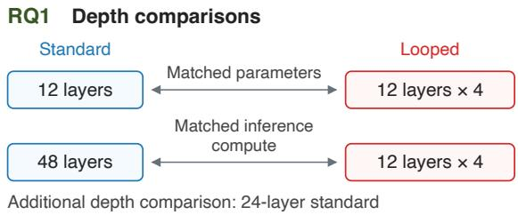
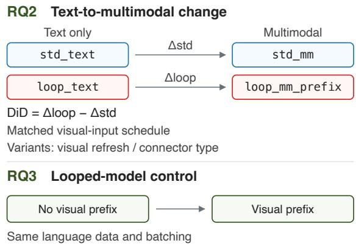
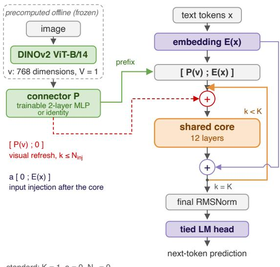
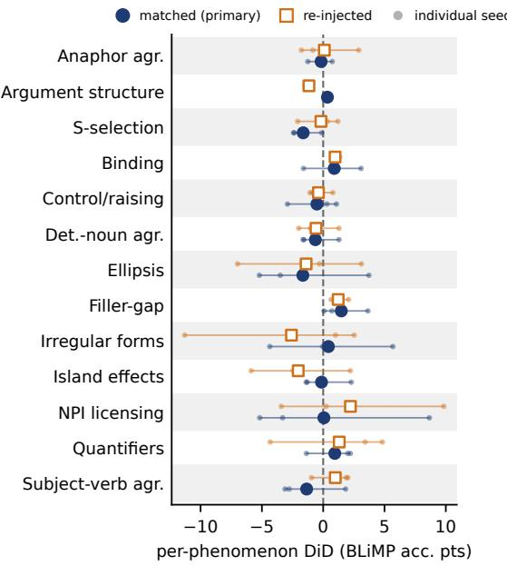
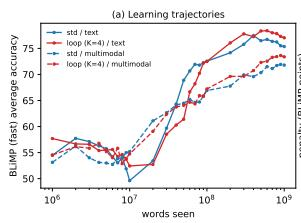
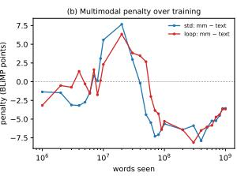
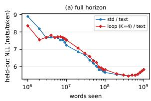
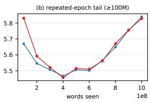

# Loop Before You Leap: What Recurrent Depth Can and Cannot Buy in Data-Limited Pretraining

Daichi Hotta1 Yohei Kobashi2 Takeshi Kojima2

Yusuke Iwasawa2 Yutaka Matsuo2

1Aoyama Gakuin University

2The University of Tokyo

daichi.d.hotta@gmail.com

## Abstract

Multimodal models have often scored below text-only baselines in the BabyLM Challenge (Klerings et al., 2024; Takmaz et al., 2025). We test whether additional recurrent computation helps close this gap. Recurrence increases computation by reusing layers without adding parameters or training data. Using a single im plementation, we compare standard and looped Transformers under a 100M-word budget, with three seeds per main condition. Each image is represented by one feature vector from a frozen DINOv2 encoder, used as a prefix token. Caption words count toward the budget, so multimodal training also changes the lan guage data. In a pre-registered text-only comparison, a 12-layer stack repeated four times exceeds a standard 48-layer Transformer by 5.4 BLiMP percentage points at matched inference compute. However, multimodal training lowers BLiMP accuracy by about 3.8 points in both architectures, with no clear mitigation from recurrence. An exploratory loop-side no-image control, trained with the multimodal language data and batching schedule, scores 5.7 points below the text-only baseline. Adding the visual prefix raises accuracy by 1.85 points on average, but this contrast is uncertain with three seeds. These results suggest that changes in language data and its presentation are a major source of the drop. Diagnostic tests show that the models use visual information; its contribution to grammatical generalization remains uncertain under this single-vector interface.

## 1 Introduction

Children acquire language from far less linguistic input than modern language models, and they do so while perceiving the world. Motivated by this contrast, the BabyLM Challenge limits the amount of training text and asks how data, learning objectives, and model architectures affect language learning under that constraint (Charpentier et al., 2025; Choshen et al., 2026).

The 2024 and 2025 BabyLM challenges included a multimodal track to explore whether visual input could support language learning under a 100M-word budget (Hu et al., 2024; Charpentier et al., 2025). Yet visual input has not reliably improved language performance, and multimodal training can reduce scores on grammatical benchmarks (Klerings et al., 2024; Takmaz et al., 2025). This raises the question of what prevents models from using visual information to improve language learning.

One possibility is that integrating visual and linguistic information requires additional sequential computation. A looped Transformer increases this computation by repeatedly applying the same layers, without adding parameters or training data (Dehghani et al., 2019; Geiping et al., 2025). We therefore test whether recurrence reduces the languageperformance gap between text-only and multimodal training.

To assess how recurrence uses computation, we compare looped Transformers with deeper standard models at matched inference compute. This comparison asks whether, under a fixed word budget, additional computation is better spent on layers with separate weights or on repeated use of the same layers.

In our multimodal setting, captions count toward the same word budget and replace part of the original text corpus. This changes the mix of language sources and genres, so the performance gap cannot be attributed to visual input alone. We therefore use no-image controls in both architectures to examine the contribution of the changed language data, and a batch-matched control to separate the visual-prefix contribution from the remaining data and batching changes in the looped model.

All conditions share a single implementation. The standard configuration applies the layers once, with text-input injection and visual refresh disabled. We compare both architectures with and without visual input, using the same visual input scheme for the main comparison between multimodal models. Figure 1 summarizes the three comparisons.

Each image is represented by a single feature vector from a frozen DINOv2 encoder pretrained on images alone (Oquab et al., 2024). The language model is trained from scratch on text and image captions, using the visual features to condition caption prediction.

RQ1. At matched inference compute, the looped model exceeds the 48-layer standard model by 5.4 BLiMP percentage points in text-only training and 3.7 points in multimodal training. Its gains over the parameter-matched 12-layer model are much smaller, at about one point, and remain uncertain with three seeds (Section 5.1).

RQ2. Recurrence does not reliably narrow the language-performance gap between text-only and multimodal training. The main comparison estimates a difference of −0.01 BLiMP points between the performance drops, with a 95% confidence interval of [−1.44, 1.41]. Tests with alternative connectors and visual injection schedules also provide no clear evidence of mitigation by recurrence (Section 5.2; uncertainty estimates in Limitations).

RQ3. Exploratory controls suggest that changes in language data and its presentation are a major source of the BLiMP drop. A batch-matched noimage control for the looped model scores 5.71 points below its original text-only baseline. The visual prefix recovers 1.85 points on average, with a 95% confidence interval of [−1.67, 5.37]. This exploratory decomposition combines language-data and batching changes in its nonvisual term. The matched decomposition is limited to the looped model, so we cannot compare these components between architectures (Section 5.3).

## 2 Related Work

Sample-efficient pretraining. High-performing BabyLM submissions have introduced changes to training data, learning objectives, and model architecture (Hu et al., 2024; Charpentier et al., 2025). The relationship between training compute and performance has been less consistent: it was strong in the 2024 analysis but varied across tracks in 2025. This motivates controlled comparisons of how computation is allocated under a fixed word budget.

Recurrent and weight-tied Transformers. Universal Transformers repeatedly apply a shared transformation across depth (Dehghani et al., 2019). Geiping et al. (2025) vary the number of repetitions of a shared block to increase computation at inference. Saunshi et al. (2025) find that looped language models can approach or exceed deeper non-looped models on reasoning tasks despite worse perplexity at matched compute. Schwethelm et al. (2026) find that replacing independent layers with shared recurrences increases validation loss at matched training compute.

  
Figure 1: RQ1 compares standard and looped models at matched parameter count or inference compute. RQ2 compares their changes in accuracy from text-only to multimodal training. RQ3 compares the looped multimodal model with a no-image control matched in language data and batching.

Recurrence meets multimodality. RecursiveVLM extends a pretrained multimodal model with recurrent processing (Xu et al., 2026). HIVE combines a pretrained recurrent language model with visual features drawn from multiple encoder layers and injected across iterations (Zhang et al., 2026). We study recurrent computation when the language model is trained from scratch under a 100M-word budget, focusing on grammatical generalization.

Grounding at developmental scale. Amariucai and Warstadt (2023) independently vary text and image quantities to investigate whether visual input can compensate for limited language data. Takmaz et al. (2025) partially restore language performance by merging multimodal models with textonly models. Ganescu et al. (2025) introduce tokenwise gating to control the contribution of visual features during language processing. Our study tests whether recurrent computation narrows the language-performance gap between text-only and multimodal training. Controls using identical language data then distinguish the effect of visual input from that of changing the text corpus.

## 3 Method

## 3.1 One implementation, six conditions

We use a single implementation of a decoder-only Transformer (Vaswani et al., 2017) for both standard and looped models. In the six main conditions, the backbone consists of 12 layers. The standard model applies this stack once, whereas the looped model applies it four times, sharing weights across iterations.

The backbone follows a LLaMA-style design (Touvron et al., 2023), with pre-norm RMSNorm, rotary position embeddings (Su et al., 2024), and SwiGLU feed-forward layers. We omit bias terms and share weights between the input embedding and output projection (Press and Wolf, 2017).

Let $E ( x )$ denote the token embeddings of text x, v the visual feature vector (multimodal cells only), and $P ( \cdot )$ the connector that maps v into model space. The forward computation applies the shared core stack K times:

$$
\begin{array} { r l } & { \boldsymbol { h } ^ { ( 0 ) } = [ P ( v ) ; E ( x ) ] , } \\ & { \boldsymbol { h } ^ { ( k ) } = \mathrm { C o r e } \Big ( \boldsymbol { h } ^ { ( k - 1 ) } } \\ & { ~ + { \mathbb { 1 } } [ k \le N _ { \mathrm { i n j } } ] [ P ( v ) ; \mathbf { 0 } ] \Big ) } \\ & { ~ + \boldsymbol { a } [ \mathbf { 0 } ; E ( x ) ] , } \end{array}\tag{1}
$$

for $k = 1 , \ldots , K$ . The looped models add the original text embeddings after every application of the shared core. We denote this input-injection setting by a, with $a = 1$ for looped models and $a = 0$ for standard models.

Text-only models omit the visual prefix and visual refresh term, so $h ^ { ( 0 ) } = E ( x )$ . With $K = 1$ $a = 0$ , and $N _ { \mathrm { i n j } } = 0$ , the computation reduces to a standard Transformer. The final state $h ^ { ( K ) }$ passes through RMSNorm and the output projection to predict the next token.

Parameter and compute accounting. Repeating the shared core increases computation without adding parameters (Table 4, Appendix A). At

$$
\mathsf { K } = 1 , \mathsf { a } = 0 , \mathsf { N } _ { \mathsf { i n j } } = 0
$$

looped: $\mathsf { K } = 4 , \mathsf { a } = 1 ; \mathsf { N } _ { \mathrm { i n j } } = 0$ (prefix once) or 2 (loop\_mm)

Figure 2: Model architecture with a single visual prefix token from frozen DINOv2 features. Looped models add text embeddings after every application of the shared core. The dashed path adds the visual vector before the first $N _ { \mathrm { i n j } }$ applications in loop\_mm.

$K = 4 ,$ , the 12-layer core performs 48 layer applications. We compare this model with a 12-layer standard Transformer at matched parameter count and a 48-layer standard Transformer at matched inference compute.

## 3.2 Visual grounding by offline, frozen features

Each image is represented by a single 768- dimensional feature vector from a frozen DINOv2 ViT-B/14 encoder (Oquab et al., 2024). We use the precomputed vectors supplied with the BabyLM multimodal data. The encoder was pretrained on images only; raw images are not processed during language-model training. Figure 2 shows the architecture.

A connector P maps the visual vector into the language model’s embedding space. For image– caption examples, we prepend the resulting vector to the caption embeddings as a single visual token. The model is trained to predict text and caption tokens; text-only examples have no visual prefix.

By default, $P$ is a two-layer MLP with a GELU activation between two 768×768 linear transformations (Liu et al., 2023, 2024). We also test an identity connector that passes the visual vector through unchanged, since its dimension already matches the language model’s embedding size.

With $N _ { \mathrm { i n j } } = 0$ , the visual vector is supplied only as the initial prefix. With $N _ { \mathrm { i n j } } > 0$ , the same projected vector is also added at the visual-prefix position before each of the first $N _ { \mathrm { i n j } }$ applications of the shared core (Eq. 1).

## 4 Experimental Setup

## 4.1 Conditions and seeds

The four core conditions combine standard or looped models with text-only or multimodal training (Figure 1). The looped models use $K = 4$ In multimodal training, std\_mm supplies the visual vector only as an initial prefix, whereas loop\_mm also adds it at the prefix position before the first two iterations. We fixed $N _ { \mathrm { i n j } } = 2$ a priori; it was not tuned.

Two additional conditions test the visual injection schedule and connector. In loop\_mm\_prefix, the visual vector is supplied only as an initial prefix, matching std\_mm. In std\_mm\_id,1 an identity connector replaces the MLP, passing the visual vector through unchanged. Each condition is one Hydra configuration, reproduced with a single argument.

We train each of these six conditions with three seeds (42, 43, and 44), stopping when cumulative exposure reaches 1B words. The peak learning rate is selected on std\_text and reused across these six conditions.

## 4.2 Data and word budget

The text-only conditions use 100M words from the BabyLM 2026 Strict corpus (Choshen et al., 2026). The multimodal conditions use 50M words from the same corpus and 50M caption words, keeping the total language budget at 100M words.2 Each model is trained until cumulative exposure reaches 1B words, counting repeated presentations of the training data. For multimodal models, this total includes words from both text and caption batches.

The captions and precomputed visual features come from the 2024 BabyLM multimodal release (OSF project ad7qg). Our caption set contains 3,037,190 examples from Localized Narratives (Pont-Tuset et al., 2020) and Conceptual Captions 3M (Sharma et al., 2018).

For the multimodal conditions, we take the first 50M words of the text corpus in its stored order. This changes the proportions of language sources in the retained text. Together with replacing the remaining text with captions, this produces what we call the composition shift.

CHILDES (MacWhinney, 2000) accounts for 56.8% of the retained text, compared with 28.4% of the full text corpus. The remaining words come from BNC spoken dialogue (15.2%) and Gutenberg (27.9%). OpenSubtitles, Simple Wikipedia, and Switchboard are absent from the retained text. These proportions are measured by word count against the official domain files (Choshen et al., 2026).

We train a byte-level BPE tokenizer (Sennrich et al., 2016; Radford et al., 2019) with a vocabulary of $1 6 { , } 0 0 0$ tokens on the text corpus. The same tokenizer is used across all conditions without further training. We release the assembled corpus as a Hugging Face dataset with a datasheet (Gebru et al., 2021) recording provenance, domain composition, and per-file manifests (Appendix A).

## 4.3 Optimization: a words-seen–driven schedule

We use AdamW (Loshchilov and Hutter, 2019) with $\beta _ { 1 } = 0 . 9 , \beta _ { 2 } = 0 . 9 5$ , and weight decay of 0.1. Training uses bfloat16 precision, and the gradient norm is clipped at 1.0. For the six main conditions, we use micro-batches of 64 sequences, with text sequences of up to 512 tokens. Gradients are accumulated over eight micro-batches before each optimizer update.

The peak learning rate is $1 . 5 \times 1 0 ^ { - 3 }$ , selected from five candidates evaluated in 100M-word training runs on std\_text.3 We schedule the learning rate by cumulative words seen. It increases linearly over the first 15M words, then follows a cosine decay (Loshchilov and Hutter, 2017) to 10% of its peak at 1B words. For the decay phase,

$$
\begin{array} { r } { \eta ( w ) = \eta _ { \mathrm { m a x } } \Big [ \rho + \frac { 1 - \rho } { 2 } \big ( 1 + \cos \pi p ( w ) \big ) \Big ] , } \end{array}\tag{2}
$$

where w is cumulative words seen, $p ( w ) \ =$ $\begin{array} { r } { \frac { w - w _ { \mathrm { w a r m } } } { w _ { \mathrm { m a x } } - w _ { \mathrm { w a r m } } } , ~ w _ { \mathrm { w a r m } } ~ = ~ 1 5 \mathbf { M } , ~ w _ { \mathrm { m a x } } ~ = ~ 1 \mathbf { B } } \end{array}$ , and $\rho = 0 . 1 $

Captions are kept as separate sequences, whereas text-only training packs text into fixed-length blocks. Multimodal training therefore requires more optimizer updates to reach the same word exposure.4 Scheduling by words seen aligns the learning rate across conditions at the same cumulative exposure.

## 4.4 Checkpoints and evaluation

We save checkpoints at 28 cumulative-word milestones between 1M and 1B words. Formats and loading details are in Appendix A. We evaluate the models using a fixed revision of the official BabyLM pipeline with causal language-model scoring.

We report BLiMP (Warstadt et al., 2020) accuracy on the full filtered evaluation set, with a breakdown by linguistic category (linguistics\_term). For the six main conditions, we report the mean and standard deviation across three seeds.5 Our aggregation reproduces the official average (75.23 for std\_text, seed 42) as a correctness check.

## 4.5 Analysis: the interaction as a difference-in-differences

For RQ2, we compare the change in BLiMP accuracy from text-only to multimodal training between standard and looped models. Our primary comparison uses loop\_mm\_prefix, so that both multimodal models receive visual input only as an initial prefix. We compute this contrast as a difference-indifferences, with condition names denoting BLiMP accuracy:

$$
\begin{array} { r l } & { \Delta _ { \mathrm { D i D } } = ( 1 0 0 { \mathsf { p } } _ { - } { \mathsf { m m } } _ { - } { \mathsf { p r e f i x } } - 1 0 0 { \mathsf { p } } _ { - } { \mathsf { t e x t } } ) } \\ & { \qquad - ( s \mathsf { t d } _ { - } { \mathsf { m m } } - s \mathsf { t d } _ { - } { \mathsf { t e x t } } ) . } \end{array}\tag{3}
$$

Positive values indicate a smaller text-tomultimodal drop for the looped model; negative values indicate a larger drop.

We also compute the contrast with loop\_mm in place of loop\_mm\_prefix to assess sensitivity to visual refresh. A second set of contrasts uses std\_mm\_id as the standard multimodal baseline.

Switching from text-only to multimodal training changes both the visual input and the language data. A corpus effect that is equal in both architectures cancels in the difference-in-differences. Differences in how the architectures respond to the changed corpus remain part of the contrast. The architectural contrast includes both recurrence and text-input injection, whose individual contributions are not separated in this design.

<table><tr><td></td><td>text</td><td>multimodal</td></tr><tr><td>standard (K=1)</td><td>75.21±0.68</td><td>71.37±0.29</td></tr><tr><td>looped (K=4, re-inj.)</td><td>76.16±0.45</td><td>72.38±0.83</td></tr><tr><td>looped, prefix-once identity connector (K=1)</td><td></td><td> $7 2 . 3 1 { \pm } 0 . 6 3$ </td></tr><tr><td>identity connector (K=4)</td><td></td><td> $7 2 . 4 8 { \pm } 0 . 6 9$ </td></tr><tr><td></td><td></td><td> $7 2 . 1 4 { \pm } 0 . 1 5$ </td></tr><tr><td>std2x (24 layers) std4x (48 layers)</td><td> $7 3 . 8 4 { \pm } 0 . 2 5 $   $7 0 . 8 0 { \pm } 0 . 6 0$ </td><td> $7 0 . 9 6 { \pm } 0 . 8 8$   $6 8 . 6 4 { \pm } 0 . 2 9 $ </td></tr></table>

Table 1: BLiMP accuracy (%) on the full evaluation set, reported as mean ± standard deviation across three seeds. All multimodal conditions use an initial visual prefix; “re-inj.” also adds the visual vector before the first two core applications.

<table><tr><td></td><td>vs. std_mm vs. std_mm_id</td><td></td></tr><tr><td>penalty (standard) penalty (looped, re-inj.)</td><td>-3.84 -3.79</td><td>-2.74 -3.79</td></tr><tr><td>penalty (looped, prefix-once)</td><td>-3.86</td><td>-3.86</td></tr><tr><td>∆DiD (re-injected)</td><td>+0.06</td><td>-1.05</td></tr><tr><td>∆DiD (matched)</td><td>-0.01</td><td>-1.12</td></tr></table>

Table 2: Changes in BLiMP accuracy from text-only to multimodal training and their interactions, in percentage points (three-seed means). Positive $\Delta _ { \mathrm { D i D } }$ indicates a smaller drop for the looped model. The primary contrast is the “matched” row under std\_mm, where both multimodal models use only an initial visual prefix (Eq. 3).

## 5 Results

## 5.1 RQ1: iteration beats added parameter depth

A parameter-matched, modality-independent depth gain. At matched parameter count, the looped text-only model scores 76.16 on BLiMP, compared with 75.21 for the 12-layer standard Transformer. The 0.95-point difference is not statistically significant with three seeds per condition (two-sided Welch’s test, $p \approx 0 . 1 2 ) . ^ { 6 }$ In multimodal training, loop\_mm\_prefix exceeds std\_mm by 0.94 BLiMP points on average, similar to the text-only difference. The difference is positive in all three seed pairings: 0.72, 0.61, and 1.48 points.

The visual-refresh variant, loop\_mm, exceeds std\_mm by 1.01 BLiMP points, although this comparison also changes the visual injection schedule. Against the standard model with an identity connector, std\_mm\_id, loop\_mm scores 0.10 points lower.

Iso-FLOPs baselines: looping beats added depth. We compare the looped model with standard Transformers containing 24 and 48 independent layers. The 48-layer model matches the looped model’s inference compute. We registered the comparison and its statistical decision rule on the Open Science Framework before observing the final results from these deeper standard models.7

The 24- and 48-layer models have approximately 180M and 350M parameters, respectively. We train each depth in both text-only and multimodal conditions with three seeds. A separate peak learning rate is selected for each depth through 100M-word training probes.8

At matched inference compute, the looped model outperforms the 48-layer standard model by 5.36 BLiMP points in text-only training and 3.67 points in multimodal training. Across the standard text-only models, BLiMP falls monotonically as depth is added (75.21 → 73.84 → 70.80; Table 1), while the looped model reaches 76.16 by iterating 97M parameters.

Deeper standard models have lower training loss but also lower BLiMP accuracy. For seed 42, average training loss is 1.88 with 12 layers, 1.63 with 24 layers, and 1.26 with 48 layers.9

Our preregistered test asks whether multimodal training increases the looped model’s advantage over the 48-layer standard model. We subtract the text-only advantage from the multimodal advantage:

$$
\begin{array} { l }  { \mathrm { D i D } _ { \mathrm { i s o } } = ( { \tt d o o p \mathrm { { \tt _ { - } m m \mathrm { _ { - } p r e f i x - { s t d } 4 x \mathrm { _ { - } m m } } } } } } \\ { { \mathrm { ~ } - ( { \tt d o o p \mathrm { _ { - } t e x t \mathrm { ~ - ~ } s t d } 4 x \mathrm { _ { - } t e x t } } ) . } } \end{array}
$$

We pair runs with the same seed. The mean contrast is −1.69 BLiMP points, with a 90% confidence interval of [−3.22, −0.16].10 This meets the preregistered Reversed criterion: the looped model’s advantage is smaller under multimodal training. The 95% confidence interval is [−3.95, 0.57] and includes zero.11

Deeper standard models have lower text-only BLiMP scores and smaller drops under multimodal training (Table 1). Their smaller drops may partly reflect their lower text-only performance. This is a post-hoc explanation that our design cannot distinguish from a cost specific to the looped architecture.

The corresponding contrast against the 24-layer standard model is −0.97 BLiMP points. Appendix J reports additional experiments varying K, with one seed each for the K = 2 and K = 8 runs.

## 5.2 RQ2: recurrence does not clearly reduce the multimodal drop

Similar drops across architectures. Compared with text-only training, BLiMP accuracy drops by 3.84 points for std\_mm and 3.86 points for loop\_mm\_prefix. The drop for loop\_mm, which refreshes the visual prefix, is 3.79 points (Tables 1 and 2).

The primary difference-in-differences estimate is −0.01 BLiMP points, with a 95% confidence interval of [−1.44, 1.41].12 We find no clear evidence that the looped model reduces the drop associated with multimodal training.

7Study-plan registration, accessible through the view-only link: https://osf.io/438b9/?view\_only= 44cd0d22cb19498a9282ed806de06c02.

Using loop\_mm instead of loop\_mm\_prefix gives a difference-in-differences estimate of +0.06 points. When std\_mm\_id is used as the standard multimodal baseline, the estimates are −1.05 points with loop\_mm and −1.12 points with loop\_mm\_prefix.

Across the 13 linguistic categories, the mean primary contrasts range from −1.66 to 1.48 BLiMP points. The sign changes across seeds in 10 of the 13 categories (Figure 3, Appendix D).

Connector comparison. In the standard model, the identity connector scores 72.48 on BLiMP, compared with 71.37 for the learned MLP. The 1.11- point difference is not statistically significant with three seeds per condition (two-sided Welch’s test, $p \approx 0 . 0 9 )$

We repeat this comparison in the looped model with three seeds, replacing only the MLP in loop\_mm\_prefix with an identity connector. This condition, loop\_mm\_naive, scores 72.14 on BLiMP, compared with 72.31 for loop\_mm\_prefix. These comparisons provide no clear evidence that the learned MLP improves BLiMP accuracy in either architecture.

Visual-refresh comparison. With K = 4 and the training data held fixed, visual refresh changes BLiMP accuracy by +0.07 points on average. The per-seed differences are −0.78, +1.55, and −0.56 points, providing no clear evidence of a benefit from visual refresh.

## 5.3 RQ3: what the penalty is made of

A matched control for the looped model. We train a no-image control for the looped model, keeping the language data, batches, word schedule, and initialization of loop\_mm\_prefix and omitting only the visual prefix. Its mean BLiMP accuracy is 70.46 across three seeds.13 Adding the visual prefix raises BLiMP by 1.85 points on average, with positive differences in all three seeds (2.23, 0.28, and 3.04) and a 95% confidence interval of [−1.67, 5.37].

The original looped text-only model scores 5.71 points above the no-image control, with a 95% confidence interval of [2.73, 8.68]. This difference includes changes in language data, batch construction, and the number of optimizer updates. The means suggest that the visual prefix partly offsets the cost of this changed training recipe in the looped model, but its contribution remains uncertain with three seeds. Removing the prefix also removes its sequence position, so the contrast does not isolate image content from prefix mechanics.

Other controls and their scope. We also train no-image controls on the multimodal conditions’ language data using the text-only procedure of packing tokens into fixed-length blocks. The standard model scores 70.56, compared with 75.21 on its original text corpus; the looped model scores 71.31, compared with 76.16 (Table 1; Appendix L). These results support a contribution from the changed language data even without visual input. Packing uses the same procedure, but the number of updates can change under the fixed word budget. Comparisons with multimodal training also change the batching procedure and therefore do not isolate visual input.

Together, the controls suggest that changes in language data and its presentation are a major source of the drop. The matched loop-side control provides the direct decomposition; the packed controls provide supporting evidence in both architectures.

The batch-matched no-image decomposition is limited to the looped model. We therefore cannot compare the visual-prefix and data-and-batching contributions between architectures.

The penalty emerges over training. The multimodal models briefly lead early in training, but the text-only models overtake them as training continues. These fast-eval curves cover 28 checkpoints and use one submitted seed per condition, so we treat them as descriptive (Appendix F).

The grounded models do use vision: a shuffledfeatures diagnostic. To test whether the trained models use visual information, we score the same 50,000 captions with correct, shuffled, and zeroed image features. This changes the visual input at evaluation time while keeping the model and captions fixed (Appendix G).

Shuffling the image features increases caption prediction loss (negative log-likelihood, NLL) by 1.45 nats per token for std\_mm. The increases are 1.52 for loop\_mm and 1.49 for loop\_mm\_prefix.14 For every evaluated model and seed, shuffling increases the loss for at least 98.6% of captions. This shows that the models use visual information when predicting captions.

We also evaluate visual question answering (VQA) with correct, shuffled, and zeroed image features. We follow the multimodal track’s evaluation protocol but extract the image features ourselves, so these results are diagnostic rather than leaderboard scores (Appendix H). All four multimodal conditions score above the 12.5% chance level. Correct image features yield higher accuracy than shuffled features in all twelve model–seed combinations, with gains of 2.4 to 5.6 points.15 No looped condition exceeds std\_mm’s mean VQA accuracy of 47.4%. With standard deviations across seeds reaching 4.8 points, these results provide no clear evidence of a VQA benefit from looping.

Beyond BLiMP: different effects across tasks. Multimodal training lowers accuracy on BLiMP Supplement (Warstadt et al., 2023) as it does on

<table><tr><td>Task</td><td>pen. (std) pen. (loop)</td><td></td><td>DiD</td><td>DiDm</td></tr><tr><td>BLiMP</td><td>-3.84</td><td>-3.79</td><td>+0.06</td><td>-0.01</td></tr><tr><td>BLiMP Suppl.</td><td>-3.66</td><td>-4.95</td><td>-1.29</td><td>-0.08</td></tr><tr><td>EWoK</td><td>+0.04</td><td>-0.93</td><td>-0.96</td><td>-0.64</td></tr><tr><td>COMPS</td><td>-0.62</td><td>-0.01</td><td>+0.61</td><td>-0.10</td></tr><tr><td>Entity tracking†</td><td>-0.42</td><td>+1.85</td><td>+2.28</td><td>+1.88</td></tr></table>

Table 3: Changes in zero-shot accuracy from text-only to multimodal training, in percentage points (three-seed means). The pen. (loop) and DiD columns use loop\_mm, whereas $\mathrm { D i D _ { m } }$ uses loop\_mm\_prefix with the same visual-input schedule as std\_mm. Both interactions use std\_mm as the multimodal standard baseline, and positive values indicate a more favorable change for the looped model. †All conditions score below the 20% chance level on Entity tracking.

BLiMP (Table 3). The changes are smaller on EWoK, which tests world knowledge (Ivanova et al., 2025), and COMPS, which tests conceptual knowledge (Misra et al., 2023). These small changes do not establish that these abilities are unaffected by multimodal training.

On BLiMP Supplement and EWoK, the mean interactions are negative with both matched visual input and visual refresh (Table 3). With visual refresh, the EWoK interaction is negative in all three seeds, whereas BLiMP Supplement shows greater variation across seeds.16

Entity tracking (Kim and Schuster, 2023) yields positive mean interactions, but all conditions score below the 20% chance level. We therefore do not interpret these interactions as evidence that looping mitigates the multimodal performance drop.

Reading, age of acquisition (AoA), and GLUE were evaluated only for the submitted checkpoints and are not analyzed here. Appendix B provides comparisons with the official leaderboard baselines for context.

## 6 Discussion

Recurrence and the multimodal gap. Compared with the 12-layer standard model, the looped model shows a similar BLiMP gain in text-only and multimodal training. It does not clearly narrow the gap between the two training conditions.

Multimodal training replaces half of the original text with captions, changes the source distribution of the retained text, and changes how batches are constructed (Section 4.2). These changes may reduce exposure to some of the linguistic patterns tested by BLiMP. The loop-side matched control quantifies their combined contribution: the noimage condition scores 5.71 points below the original text-only model, and the visual prefix recovers 1.85 points on average. The latter contrast remains uncertain. Together with the packed no-image controls, these results suggest that changes in language data and its presentation are a major source of the drop. The missing standard-side control prevents an attribution of the overall interaction to differences in these components (Section 5.3).

The models use visual information to predict captions and answer questions about images. This does not by itself establish an improvement in grammatical generalization. In the looped model, the improvement over its matched no-image control is positive in every seed but remains uncertain.

The scope of the depth gain. The gain over the 12-layer standard model is modest. In our main multimodal comparisons, loop\_mm scores 72.38 and remains below the identity-connector standard model, std\_mm\_id, at 72.48.

The comparison with the 48-layer standard model suggests that how computation is allocated matters under this data budget (Section 5.1). Weight sharing may help limit overfitting by allowing additional computation without adding parameters. On 20,000 held-out captions (Appendix F), the looped text-only model has an NLL of 5.83 nats per token. The 24- and 48-layer text-only standard models have NLLs of 6.35 and 7.24, respectively.

The connector. Removing the learned MLP does not restore text-only BLiMP performance in either architecture. This comparison changes the visual connector and does not isolate the contribution of visual input. The experiments with richer visual inputs in Appendix I show no clear BLiMP benefit. Each condition uses one seed, so these results are preliminary.

From compute to mechanism. Gradually shifting from caption-heavy to text-heavy training yields 72.70 on BLiMP, compared with 72.31 for a constant mixture. Reversing this schedule yields 66.62. Each direction is evaluated with three seeds (Appendix K). This asymmetry suggests that the language distribution encountered late in training matters. Ending with caption-heavy training lowers BLiMP accuracy, while ending with text-heavy training offers no clear improvement over a constant mixture.

Our visual input is a single global image vector paired with a caption. It does not explicitly represent how an utterance relates to objects and events over time. Pinker (1984) proposes that semantic cues can help learners identify grammatical categories. Gleitman (1990) argues that sentence structure can help learners infer verb meanings.

We hypothesize that grounding helps grammatical generalization only when the model can connect parts of an utterance to the objects and events they describe. Testing this hypothesis requires explicit mechanisms for learning these connections.

## 7 Conclusion

We studied recurrent Transformers under a 100Mword training-data budget. At matched inference compute, the looped model outperformed the 48- layer standard Transformer on BLiMP in both text-only and multimodal training. With a single global image vector as visual input, we found no clear evidence that looping reduces the text-tomultimodal BLiMP drop. The primary differencein-differences estimate was −0.01 points, with a 95% confidence interval of [−1.44, 1.41].

Exploratory controls suggest that changes in language data and its presentation are a major source of the BLiMP drop. For the looped model, a matched no-image control separates the change in language data and batching from the visual-prefix contribution. The no-image control scores 5.71 points below the original text-only baseline, while adding the visual prefix recovers 1.85 points on average, with substantial uncertainty across three seeds. A matched standard-model control is needed to compare these components between architectures. Future work should test whether explicitly linking linguistic structure to objects and events in visual input improves grammatical generalization.

## Limitations

Statistical power. Each main condition was trained with three random seeds. This limits our ability to detect small differences between architectures. In particular, a primary interaction estimate near zero does not establish that looping has no effect on the multimodal BLiMP drop. The pooled 95% confidence interval for the primary interaction is [−1.44, 1.41] BLiMP points.17 This interval allows both a reduction and an increase in the multimodal drop (Lakens, 2017). Its upper end corresponds to a reduction of about 37% in the 3.84-point drop observed in the standard model. We report several secondary comparisons without adjusting for multiple testing, including connector variants and breakdowns by linguistic phenomenon and task. These analyses are exploratory, and differences close to the significance threshold should not be treated as confirmed effects.

Language data and visual input. Multimodal training replaces half of the text-only corpus with captions and changes the source distribution of the retained text (Section 4.2). The resulting BLiMP drop therefore combines changes in language data with the addition of visual input. Our primary interaction measures how the two architectures respond differently to this combined change. The effect of the language-data change cancels in this contrast only if it changes BLiMP accuracy by the same amount in both architectures. The batchmatched no-image control for the looped model (Section 5.3) separates the visual prefix from the rest of the multimodal recipe within that model. The remaining term combines language-data and batching changes, because text-only training packs text into blocks and uses fewer optimizer updates. This matched comparison is limited to the looped model, so we cannot determine whether either component differs between architectures. Appendix L reports the loop-side per-seed values, together with packed controls that use a different batching procedure. The looped model also adds the original text embeddings after each application of the shared layers. Our comparison therefore does not separate the contribution of repeated layer applications from that of text-input injection.

Interpreting BLiMP scores. We assess grammatical generalization using BLiMP and its Supplement. Lower scores may reflect weaker grammatical generalization, a mismatch between the language encountered during training and the benchmark sentences, or both. Our experiments do not fully distinguish these explanations. Future evaluations should test grammatical contrasts in a wider range of language, including conversation and captions. This would help assess whether the observed drop extends beyond the kinds of sentences used in BLiMP.

Visual evaluation. Our visual question answering evaluation is diagnostic (Appendix H). It covers one task with three seeds per condition and substantial variation across seeds. We also use features extracted ourselves rather than the officially distributed features, so these scores are not directly comparable to leaderboard results.

Visual representation. Our main experiments represent each image with a single global feature vector. The results may differ with visual inputs that preserve more spatial detail, such as patchlevel features (Ganescu et al., 2025; Charpentier et al., 2025). Our exploratory experiments with richer visual inputs use only one seed per condition and do not resolve this question (Appendix I).

The identity connector requires matched widths. The identity connector is possible because the visual features and the language model’s hidden states both have 768 dimensions. When these dimensions differ, a mapping between them is required, so our findings do not imply that a learned projection can generally be omitted.

Model and training settings. We use a single decoder-only model family, tokenizer, and training objective. The main looped models use four iterations, and experiments with two or eight iterations use only one seed per condition (Appendix J). The findings may therefore change with other model designs, loop counts, or data budgets. The main looped models use the learning rate selected for the 12-layer standard model. We selected learning rates separately for the deeper standard models, but kept weight decay, dropout, and warmup fixed across depths. Further tuning for each architecture could change the comparison. Our learning-rate selection uses training loss from short probe runs. A setting that minimizes this loss need not give the best BLiMP accuracy at the end of training. At 100M words, both the 48-layer standard model and the looped model score higher on BLiMP at 10−3 than at their main-run learning rates.18 All models were trained without dropout. Stronger regularization might improve the deeper standard models, but we did not test this possibility.

Training-time feature controls. We attempted a training-time control with the visual features set to zero while retaining the prefix token. All three seeds produced NaN losses early in training, leaving no usable comparison. An earlier version of this paper also reported a control that shuffled visual features across captions. We no longer report it because we could not verify that the shuffle was applied during training.

Proxy multimodal data. We use text from the 2026 BabyLM Strict corpus, but image–caption data and visual features from the official 2024 multimodal release. A different caption corpus could change both the multimodal BLiMP drop and the interaction between architecture and training modality.

## Ethics Statement

We use the 2026 BabyLM Strict text corpus and the officially distributed image–caption data from the 2024 multimodal track. The captions originate from Conceptual Captions and Localized Narratives. The 2026 Strict text corpus was filtered to reduce toxic content (Choshen et al., 2026). Nevertheless, our training data may still contain harmful content or social biases, which the models may reproduce. Our models are intended for research on language learning from limited data. They are not intended for deployment in user-facing applications.

For the exploratory experiments, we retrieved images associated with the original caption datasets and extracted richer visual features (Appendix I). Some images were no longer available, so these experiments used a reduced subset. Our released training corpus contains text, captions, and provenance records, but no raw images. We direct users to the official BabyLM release for the precomputed visual features used in the main experiments.

This study uses existing datasets and does not involve experiments with human participants. Personal information may still be present in the source corpora.

## Acknowledgments

We thank the anonymous reviewers for their helpful comments.

## References

Theodor Amariucai and Alex Warstadt. 2023. Acquiring linguistic knowledge from multimodal input. In Proceedings of the BabyLM Challenge at the 27th Conference on Computational Natural Language Learning (CoNLL).

Lucas Georges Gabriel Charpentier, Leshem Choshen, Ryan Cotterell, Mustafa Omer Gul, Michael Y. Hu, Jing Liu, Jaap Jumelet, Tal Linzen, Aaron Mueller, Candace Ross, Raj Sanjay Shah, Alex Warstadt, Ethan Gotlieb Wilcox, and Adina Williams. 2025. Findings of the third BabyLM challenge: Accelerating language modeling research with cognitively plausible data. In Proceedings ofthe First BabyLM Workshop, pages 399–420. Association for Computational Linguistics.

Lucas Georges Gabriel Charpentier and David Samuel. 2024. GPT or BERT: why not both? In The 2nd BabyLM Challenge at the 28th Conference on Computational Natural Language Learning (CoNLL), pages 262–283, Miami, FL, USA. Association for Computational Linguistics.

Leshem Choshen, Ryan Cotterell, Mustafa Omer Gul, Jaap Jumelet, Tal Linzen, Aaron Mueller, Suchir Salhan, Raj Sanjay Shah, Alex Warstadt, and Ethan Gotlieb Wilcox. 2026. BabyLM turns 4 and goes multilingual: Call for papers for the 2026 BabyLM workshop. arXiv preprint arXiv:2602.20092.

Mostafa Dehghani, Stephan Gouws, Oriol Vinyals, Jakob Uszkoreit, and Łukasz Kaiser. 2019. Universal transformers. In International Conference on Learning Representations (ICLR).

Bianca-Mihaela Ganescu, Suchir Salhan, Andrew Caines, and Paula Buttery. 2025. Looking to learn: Token-wise dynamic gating for low-resource visionlanguage modelling. In Proceedings of the First BabyLM Workshop. Association for Computational Linguistics.

Timnit Gebru, Jamie Morgenstern, Briana Vecchione, Jennifer Wortman Vaughan, Hanna Wallach, Hal Daumé III, and Kate Crawford. 2021. Datasheets for datasets. Communications of the ACM, 64(12):86– 92.

Jonas Geiping, Sean McLeish, Neel Jain, John Kirchenbauer, Siddharth Singh, Brian R. Bartoldson, Bhavya Kailkhura, Abhinav Bhatele, and Tom Goldstein. 2025. Scaling up test-time compute with latent reasoning: A recurrent depth approach. In Advances in Neural Information Processing Systems (NeurIPS), volume 38, pages 41340–41391. Curran Associates, Inc.

Lila Gleitman. 1990. The structural sources of verb meanings. Language Acquisition, 1(1):3–55.

Yash Goyal, Tejas Khot, Douglas Summers-Stay, Dhruv Batra, and Devi Parikh. 2017. Making the V in VQA

matter: Elevating the role of image understanding in visual question answering. In IEEE Conference on Computer Vision and Pattern Recognition (CVPR), pages 6325–6334.

Michael Y. Hu, Aaron Mueller, Candace Ross, Adina Williams, Tal Linzen, Chengxu Zhuang, Ryan Cotterell, Leshem Choshen, Alex Warstadt, and Ethan Gotlieb Wilcox. 2024. Findings of the second BabyLM challenge: Sample-efficient pretraining on developmentally plausible corpora. In Proceedings of the BabyLM Challenge at the 28th Conference on Computational Natural Language Learning (CoNLL), pages 1–21. Association for Computational Linguistics.

Anna A. Ivanova, Aalok Sathe, Benjamin Lipkin, Unnathi U. Kumar, Setayesh Radkani, Thomas H. Clark, Carina Kauf, Jennifer Hu, R. T. Pramod, Gabriel Grand, Vivian C. Paulun, Maria Ryskina, Ekin Akyürek, Ethan G. Wilcox, Nafisa Rashid, Leshem Choshen, Roger Levy, Evelina Fedorenko, Joshua Tenenbaum, and Jacob Andreas. 2025. Elements of world knowledge (EWoK): A cognition-inspired framework for evaluating basic world knowledge in language models. Transactions ofthe Associationfor Computational Linguistics, 13:1245–1270.

Najoung Kim and Sebastian Schuster. 2023. Entity tracking in language models. In Proceedings ofthe 61st Annual Meeting of the Association for Computational Linguistics (Volume 1: Long Papers), pages 3835–3855, Toronto, Canada. Association for Computational Linguistics.

Alina Klerings, Christian Bartelt, and Aaron Mueller. 2024. Developmentally plausible multimodal language models are highly modular. In The 2nd BabyLM Challenge at the 28th Conference on Computational Natural Language Learning (CoNLL), pages 118–139, Miami, FL, USA. Association for Computational Linguistics.

Daniël Lakens. 2017. Equivalence tests: A practical primer for t tests, correlations, and metaanalyses. Social Psychological and Personality Science, 8(4):355–362.

Tsung-Yi Lin, Michael Maire, Serge Belongie, James Hays, Pietro Perona, Deva Ramanan, Piotr Dollár, and C. Lawrence Zitnick. 2014. Microsoft COCO: Common objects in context. In European Conference on Computer Vision (ECCV), pages 740–755. Springer.

Haotian Liu, Chunyuan Li, Yuheng Li, and Yong Jae Lee. 2024. Improved baselines with visual instruction tuning. In IEEE/CVF Conference on Computer Vision and Pattern Recognition (CVPR).

Haotian Liu, Chunyuan Li, Qingyang Wu, and Yong Jae Lee. 2023. Visual instruction tuning. In Advances in Neural Information Processing Systems (NeurIPS).

Ilya Loshchilov and Frank Hutter. 2017. SGDR: Stochastic gradient descent with warm restarts. In International Conference on Learning Representations (ICLR).

Ilya Loshchilov and Frank Hutter. 2019. Decoupled weight decay regularization. In International Confer ence on Learning Representations (ICLR).

Brian MacWhinney. 2000. The CHILDES Project: Toolsfor Analyzing Talk, 3rd edition. Lawrence Erlbaum Associates.

Kanishka Misra, Julia Rayz, and Allyson Ettinger. 2023. COMPS: Conceptual minimal pair sentences for testing robust property knowledge and its inheritance in pre-trained language models. In Proceedings ofthe 17th Conference ofthe European Chapter ofthe Associationfor Computational Linguistics. Association for Computational Linguistics.

Maxime Oquab, Timothée Darcet, Théo Moutakanni, Huy Vo, Marc Szafraniec, Vasil Khalidov, Pierre Fernandez, Daniel Haziza, Francisco Massa, Alaaeldin El-Nouby, Mahmoud Assran, Nicolas Ballas, Wojciech Galuba, Russell Howes, Po-Yao Huang, Shang-Wen Li, Ishan Misra, Michael Rabbat, Vasu Sharma, and 7 others. 2024. DINOv2: Learning robust visual features without supervision. Transactions on Machine Learning Research (TMLR).

Steven Pinker. 1984. Language Learnability and Language Development. Harvard University Press, Cambridge, MA.

Jordi Pont-Tuset, Jasper Uijlings, Soravit Changpinyo, Radu Soricut, and Vittorio Ferrari. 2020. Connecting vision and language with localized narratives. In European Conference on Computer Vision (ECCV), pages 647–664. Springer.

Ofir Press and Lior Wolf. 2017. Using the output embedding to improve language models. In Proceedings of the 15th Conference of the European Chapter of the Associationfor Computational Linguistics: Volume 2, Short Papers, pages 157–163, Valencia, Spain. Association for Computational Linguistics.

Alec Radford, Jeffrey Wu, Rewon Child, David Luan, Dario Amodei, and Ilya Sutskever. 2019. Language models are unsupervised multitask learners. OpenAI technical report.

Nikunj Saunshi, Nishanth Dikkala, Zhiyuan Li, Sanjiv Kumar, and Sashank J. Reddi. 2025. Reasoning with latent thoughts: On the power of looped transformers. In International Conference on Learning Representations (ICLR).

Kristian Schwethelm, Daniel Rueckert, and Georgios Kaissis. 2026. How much is one recurrence worth? iso-depth scaling laws for looped language models. arXiv preprint arXiv:2604.21106.

Rico Sennrich, Barry Haddow, and Alexandra Birch. 2016. Neural machine translation of rare words with subword units. In Proceedings of the 54th Annual Meeting of the Association for Computational Linguistics (Volume 1: Long Papers), pages 1715–1725, Berlin, Germany. Association for Computational Linguistics.

Piyush Sharma, Nan Ding, Sebastian Goodman, and Radu Soricut. 2018. Conceptual captions: A cleaned, hypernymed, image alt-text dataset for automatic image captioning. In Proceedings of the 56th Annual Meeting of the Association for Computational Linguistics (Volume 1: Long Papers), pages 2556–2565, Melbourne, Australia. Association for Computational Linguistics.

Jianlin Su, Yu Lu, Shengfeng Pan, Ahmed Murtadha, Bo Wen, and Yunfeng Liu. 2024. RoFormer: Enhanced transformer with rotary position embedding. Neurocomputing, 568.

Ece Takmaz, Lisa Bylinina, and Jakub Dotlacil. 2025.ˇ Model merging to maintain language-only performance in developmentally plausible multimodal models. In Proceedings ofthe First BabyLM Workshop. Association for Computational Linguistics.

Hugo Touvron, Thibaut Lavril, Gautier Izacard, Xavier Martinet, Marie-Anne Lachaux, Timothée Lacroix, Baptiste Rozière, Naman Goyal, Eric Hambro, Faisal Azhar, Aurelien Rodriguez, Armand Joulin, Edouard Grave, and Guillaume Lample. 2023. LLaMA: Open and efficient foundation language models. arXiv preprint arXiv:2302.13971.

Ashish Vaswani, Noam Shazeer, Niki Parmar, Jakob Uszkoreit, Llion Jones, Aidan N. Gomez, Łukasz Kaiser, and Illia Polosukhin. 2017. Attention is all you need. In Advances in Neural Information Processing Systems (NeurIPS), volume 30, pages 5998– 6008.

Alex Warstadt, Aaron Mueller, Leshem Choshen, Ethan Wilcox, Chengxu Zhuang, Juan Ciro, Rafael Mosquera, Bhargavi Paranjabe, Adina Williams, Tal Linzen, and Ryan Cotterell. 2023. Findings of the BabyLM challenge: Sample-efficient pretraining on developmentally plausible corpora. In Proceedings of the BabyLM Challenge at the 27th Conference on Computational Natural Language Learning (CoNLL), pages 1–34, Singapore. Association for Computational Linguistics.

Alex Warstadt, Alicia Parrish, Haokun Liu, Anhad Mohananey, Wei Peng, Sheng-Fu Wang, and Samuel R. Bowman. 2020. BLiMP: The benchmark of linguistic minimal pairs for English. Transactions of the Association for Computational Linguistics (TACL), 8:377–392.

Ruihan Xu, Yuting Gao, Lan Wang, Jianing Li, Weihao Chen, Qingpei Guo, Ming Yang, and Shiliang Zhang. 2026. Looping back to move forward: Recursive transformers for efficient and flexible large multimodal models. arXiv preprint arXiv:2602.09080.

Yiming Zhang, Qiangyu Yan, Borui Jiang, and Kai Han. 2026. Multimodal latent reasoning via hierarchical visual cues injection. arXiv preprint arXiv:2602.05359.

## A Reproducibility

<table><tr><td>Cell</td><td>K</td><td>Params</td><td>Core FLOPs</td></tr><tr><td>std_text</td><td>1</td><td>97,241,856</td><td>1×</td></tr><tr><td>std_mm</td><td>1</td><td>98,423,040</td><td>1×</td></tr><tr><td>loop_text</td><td>4</td><td>97,241,856</td><td>4×</td></tr><tr><td>loop_mm</td><td>4</td><td>98,423,040</td><td>4×</td></tr></table>

Table 4: Parameter counts and relative core-stack FLOPs per token $( d _ { \mathrm { m o d e l } } = 7 6 8 .$ , 12 layers, 12 heads, vocab 16,000). Multimodal cells differ from text cells only by the MLP connector (+1,181,184 parameters); std\_mm\_id removes it. The frozen vision encoder runs offline and is excluded.

We save checkpoints at 28 milestones defined by cumulative training words: every 1M words from 1M to 9M, every 10M words from 10M to 90M, and every 100M words from 100M to 1B. Each checkpoint uses a Hugging Face–compatible format and can be loaded with AutoModelForCausalLM using trust\_remote\_code=True. For each of the four submitted conditions, we publish the submitted seed’s final model and all 28 milestone checkpoints in a single Hugging Face repository. The two additional main conditions, std\_mm\_id and loop\_mm\_prefix, are evaluated from local checkpoints using the same pipeline (Section 4.4).

We use the official evaluation pipeline with the causal backend. The original BLiMP records of the six main conditions (Section 4.1) were produced earlier at revision 68cdd16; the deeper standard models were evaluated at 3d57ddc. For Appendix L, we use re-evaluated loop\_text and loop\_mm\_prefix scores at 3d57ddc, matching the revision used for the loop-side batch-matched noimage control. Tables 1 and 6 retain the original main-condition scores. For text-only inputs, unit tests check numerical agreement with a singlepass standard Transformer when K = 1 and textinput injection is disabled. They compare output scores and input-embedding gradients. Separate tests check the word-based learning-rate schedule in Eq. 2.

We train a byte-level BPE tokenizer with a vocabulary of 16,000 tokens on the 100M-word Strict text corpus. The tokenizer is then kept fixed across all conditions. Using the same tokenizer keeps the segmentation rules fixed across conditions. It does not guarantee that tokenization affects both architectures in the same way.

The assembled multimodal training corpus is available on Hugging Face, together with a datasheet (Gebru et al., 2021) and provenance records.19 The precomputed DINOv2 features used in the main experiments remain at the official BabyLM distribution site.20

## B Leaderboard context

Our submitted text-only looped model scores 76.62 on BLiMP under causal scoring on the public leaderboard. This exceeds the listed GPT-2 (Radford et al., 2019) Strict baseline (74.73) and Interaction baseline (72.89). The three official GPT-BERT baseline variants score between 74.56 and 79.29 under the same causal scoring method. Our submitted model falls within this range, below the strongest variant. GPT-BERT (Charpentier and Samuel, 2024) combines masked and causal language modeling during training. These comparisons use individual submitted checkpoints and do not control for differences in training setup. Our conclusions rely on the controlled comparisons within our own implementation.

## C Per-task results

Table 3 summarizes the changes in accuracy from text-only to multimodal training and the corresponding differences between architectures. Table 5 reports the accuracy of each condition as the mean and standard deviation across seeds 42, 43, and 44.

Entity tracking uses the updated official evaluation, which excludes items containing a “nothing” answer option.

## D Per-phenomenon decomposition

Figure 3 reports the difference-in-differences for each of the 13 linguistic categories in BLiMP. It shows both the primary comparison with matched visual input and the variant with visual refresh during looping.

The categories follow the standard BLiMP order. Mean primary interactions range from −1.66 to 1.48 BLiMP points, and their signs change across seeds in 10 of the 13 categories. This analysis is exploratory, and we do not adjust for multiple comparisons.

<table><tr><td>Condition</td><td>BLiMP</td><td>Suppl.</td><td>EWoK</td></tr><tr><td>std_text</td><td>75.21±0.68</td><td>63.37±0.45</td><td> $5 3 . 9 2 { \pm } 0 . 8 5 $ </td></tr><tr><td>loop_text</td><td>76.16±0.45</td><td> $6 3 . 5 6 { \pm } 0 . 6 8$ </td><td> $5 4 . 1 9 { \pm } 0 . 5 0 $ </td></tr><tr><td>std_mm</td><td>71.37±0.29</td><td> $5 9 . 7 1 { \scriptstyle \pm 0 . 2 9 }$ </td><td> $5 3 . 9 6 { \pm } 0 . 4 6$ </td></tr><tr><td>loop_mm</td><td>72.38±0.83</td><td> $5 8 . 6 1 { \pm } 1 . 5 3 $ </td><td> $5 3 . 2 6 { \pm } 0 . 3 0 $ </td></tr><tr><td>std_mm_id</td><td>72.48±0.69</td><td> $5 8 . 7 8 { \pm } 2 . 3 1 $ </td><td> $5 3 . 5 6 { \pm } 0 . 1 9$ </td></tr><tr><td>1oop_mm_prefix 72.31±0.63</td><td></td><td> $5 9 . 8 2 { \pm } 1 . 3 5 $ </td><td> $5 3 . 5 8 { \pm } 0 . 7 6 $ </td></tr></table>

<table><tr><td>Condition</td><td>COMPS</td><td>Entity</td></tr><tr><td>std_text</td><td>56.14±0.47</td><td> $1 8 . 4 9 { \pm } 0 . 8 8 $ </td></tr><tr><td>loop_text</td><td>55.87±0.17</td><td> $1 7 . 0 0 { \pm } 0 . 5 3 $ </td></tr><tr><td>std_mm</td><td>55.51±0.24</td><td> $1 8 . 0 7 { \scriptstyle \pm 0 . 7 5 }$ </td></tr><tr><td>loop_mm</td><td>55.86±0.44 18.85±0.57</td><td></td></tr><tr><td>std_mm_id</td><td> $5 5 . 5 1 { \pm } 0 . 2 7 $ </td><td> $1 8 . 4 7 { \pm } 0 . 3 6 $ </td></tr><tr><td>loop_mm_prefix</td><td> $5 5 . 1 4 { \pm } 0 . 2 4$ </td><td> $1 8 . 4 5 { \pm } 1 . 7 4 $ </td></tr></table>

Table 5: Zero-shot accuracy (%) on the final checkpoints, reported as the mean and standard deviation across three seeds. All scores use the official evaluation pipeline, and the BLiMP results match Table 1.

## E Per-seed results

Table 6 reports the BLiMP score for each seed in the six main conditions. These scores underlie the means and standard deviations reported in Table 1.

<table><tr><td>Condition</td><td>s42</td><td>s43</td><td>s44</td><td>mean±sd</td></tr><tr><td>std_text</td><td>75.23</td><td>75.88</td><td>74.53</td><td> $7 5 . 2 1 { \pm } 0 . 6 8 $ </td></tr><tr><td>loop_text</td><td>76.61</td><td>75.71</td><td>76.17</td><td> $7 6 . 1 6 { \pm } 0 . 4 5$ </td></tr><tr><td>std_mm</td><td>71.62</td><td>71.05</td><td>71.44</td><td> $7 1 . 3 7 { \pm } 0 . 2 9$ </td></tr><tr><td>std_mm_id</td><td>71.68</td><td>72.93</td><td>72.82</td><td> $7 2 . 4 8 { \pm } 0 . 6 9$ </td></tr><tr><td>loop_mm</td><td>71.56</td><td>73.21</td><td>72.36</td><td> $7 2 . 3 8 { \pm } 0 . 8 3$ </td></tr><tr><td>loop_mm_prefix</td><td>72.34</td><td>71.66</td><td>72.92</td><td> $7 2 . 3 1 { \pm } 0 . 6 3$ </td></tr></table>

Table 6: BLiMP accuracy (%) on the final checkpoints for seeds 42, 43, and 44. The looped model scores below the standard model for text-only seed 43 and for multimodal seed 42 with visual refresh. With matched visual input, the looped model scores higher for all three seeds.

## F Learning trajectories

Figure 4 tracks BLiMP accuracy across 28 checkpoints for the four submitted models. The curves use the fast-evaluation subset and one seed per condition, so they describe individual training runs. The horizontal axis shows cumulative training words. Both multimodal models briefly outperform their text-only counterparts early in training. The text-only models later overtake them, and the gap fluctuates rather than narrowing steadily. By the end of training, multimodal accuracy is about 3.6 BLiMP points lower in both architectures. The early advantage could reflect differences in the language data, the visual input, or both. The trajectories alone do not separate these contributions.

  
Figure 3: Interactions across the 13 BLiMP linguistic categories. Filled circles show three-seed means for the primary comparison with matched visual input, and open squares show means for the visual-refresh variant. Small dots show individual seed estimates; whiskers span their minimum and maximum values.

  
Figure 4: (a) BLiMP accuracy on the fast-evaluation subset at 28 checkpoints, using one submitted seed per condition. (b) Multimodal minus text-only accuracy within each architecture. Both panels plot cumulative training words on a logarithmic horizontal axis.

Figure 5 tracks held-out caption loss for the standard and looped text-only models, using seed 42. We evaluate all 28 checkpoints on the same 20,000 captions selected after the training-caption cutoff. Loss is measured as negative log-likelihood in nats per token. Both models reach their lowest held-out loss at 400M cumulative training words. By the end of training, loss has increased by about 0.37 nats per token in both models. This pattern is consistent with overfitting during later training. At the final checkpoint, held-out loss is 5.84 for the standard model and 5.83 for the looped model. Thus, the looped model’s higher BLiMP accuracy is accompanied by little difference in held-out caption loss.

  
Figure 5: Held-out caption loss (nats per token) for the standard and looped text-only models, using 20,000 captions and seed 42. Cumulative training words are plotted on a log scale for all 28 checkpoints in (a), and on a linear scale from 100M onward in (b).

## G Shuffled-features diagnostic

We evaluate the final checkpoints of the four main multimodal conditions, using three seeds per condition. All models are evaluated on the same fixed sample of 50,000 training captions. We change the visual features only at evaluation time, without retraining the models. Each caption is evaluated with its correct image features, features shuffled across the sampled captions, and features replaced by zeros. The shuffled result is averaged over three fixed permutations. Caption text, batching, and numerical precision are held constant across these conditions.

For each caption, we calculate the average tokenlevel negative log-likelihood using the correct preceding tokens. Visual prefix positions are excluded from the loss. The shuffled-minus-correct difference is calculated separately for each caption. Because the captions come from the training data, this diagnostic measures visual reliance on familiar examples. It does not establish generalization to unseen image–caption pairs.

<table><tr><td>Cell</td><td>correct</td><td>shuf.</td><td>zero</td><td> $\Delta _ { \mathrm { s h u f } }$ </td></tr><tr><td>std_mm</td><td>1.87</td><td>3.33</td><td>3.78</td><td>1.453±0.005</td></tr><tr><td>std_mm_id</td><td>1.87</td><td>3.32</td><td>3.31</td><td>1.451±0.006</td></tr><tr><td>loop_mm</td><td>1.84</td><td>3.35</td><td>3.74</td><td>1.516±0.002</td></tr><tr><td>loop_mm_prefix</td><td>1.85</td><td>3.34</td><td>3.78</td><td>1.485±0.009</td></tr></table>

Table 7: Caption negative log-likelihood (nats per token) under correct, shuffled, and zeroed image features, averaged equally across captions and then across three training seeds. $\Delta _ { \mathrm { s h u f } }$ reports the shuffled-minus-correct difference as the mean and standard deviation across training seeds.

For every model and seed, at least 98.6% of captions have higher loss with shuffled features, averaged over the three permutations. This shows that correct image–caption pairing helps prediction on these training examples. With MLP connectors, zeroed features produce higher loss than shuffled features. With the identity connector, the losses are similar. Zeroing replaces the usual range of image features with a constant input, so the loss change need not reflect only the removal of visual information.

## H Visual question answering

We use the 2024 BabyLM vqa\_filtered task, based on VQAv2 questions (Goyal et al., 2017) and MS-COCO images (Lin et al., 2014). Each of the 25,230 questions has eight candidate answers. Random choice therefore gives 12.5% accuracy. Given an image and a question, the model scores each candidate answer by summing its token logprobabilities. We select the candidate with the highest score, without length normalization.

For the main conditions, we extract one global feature vector per VQA image using frozen DI-NOv2 ViT-B/14. These features have the same input format as the training features, but are extracted by us rather than supplied by the organizers. We report the resulting scores as diagnostics, not official leaderboard results. Each model is evaluated with correct, shuffled, and zeroed image features. The shuffled condition uses one fixed permutation of the feature rows. Questions, candidate answers, and item order are kept fixed across conditions and models. We use an exact McNemar test to compare correct and shuffled features within each model and seed. The test uses questions answered correctly under one feature condition but incorrectly under the other.

<table><tr><td>Cell</td><td>correct</td><td>shuf.</td><td>zero</td><td> $\Delta _ { \mathrm { c o r - s h u f } }$ </td></tr><tr><td>std_mm</td><td>47.4±1.1</td><td>42.9±0.6</td><td>44.2±2.3</td><td>+4.6±1.0</td></tr><tr><td>std_mm_id</td><td>45.1±3.6</td><td>41.8±3.1</td><td>42.6±3.6</td><td>+3.3±1.2</td></tr><tr><td>loop_mm</td><td>45.1±4.8</td><td>41.0±5.3</td><td>35.1±14.1</td><td>+4.1±1.0</td></tr><tr><td>loop_mm_prefix</td><td>41.2±4.8</td><td>37.3±4.8</td><td>40.2±3.5</td><td>+3.8±0.6</td></tr><tr><td>std2x_mm</td><td>38.6±13.3</td><td>34.9±12.4</td><td>33.0±12.9</td><td>+3.7±1.0</td></tr><tr><td>std4x_mm</td><td>39.1±6.7</td><td>35.7±5.4</td><td>30.6±6.5</td><td>+3.4±1.4</td></tr><tr><td>subset</td><td>44.9</td><td>41.8</td><td>40.4</td><td>+3.1</td></tr><tr><td>rich‡</td><td>45.1</td><td>39.0</td><td>42.2</td><td>+6.1</td></tr><tr><td>hive</td><td>41.6</td><td>35.4</td><td>37.6</td><td>+6.2</td></tr><tr><td>hive_k8$</td><td>27.1</td><td>20.4</td><td>24.7</td><td>+6.7</td></tr></table>

Table 8: VQA accuracy (%) with correct, shuffled, and zeroed image features. $\Delta _ { \mathrm { c o r - s h u f } }$ is the correct-minusshuffled difference in percentage points. Values are mean ± standard deviation across three training seeds, except for the single-seed exploratory models (‡) trained on a reduced image subset.

Correct image features yield higher VQA accuracy than shuffled features in all twelve model–seed combinations. The gains range from 2.4 to 5.6 percentage points, with $p < 1 0 ^ { - 2 5 }$ in every McNemar test. With zeroed features, loop\_mm scores 18.9% for seed 43, compared with 42.7% and 43.8% for seeds 42 and 44. This large variation shows that responses to zeroed features can differ substantially across training seeds. We therefore interpret this condition cautiously when assessing visual reliance.

Deeper standard models. The deeper standard models are trained on the same official visual features and evaluated with the same VQA protocol as the main models. With correct image features, the 24-layer model scores 38.6% and the 48-layer model scores 39.1%. Both means are below the 12-layer standard model’s 47.4%. Variation across seeds is substantial, with standard deviations of 13.3 percentage points for the 24-layer model and 6.7 for the 48-layer model. These runs provide no clear evidence of a VQA benefit from increasing standard-model depth.

Exploratory visual inputs. In Table 8, the common loop\_mm\_ prefix is omitted from the names of the four exploratory models marked ‡. Each exploratory model is evaluated with the visual feature format used during its training: a single global vector, patch-level vectors, or vectors from multiple encoder layers. These models were trained on a reduced image subset using self-extracted features (Appendix I). Comparisons with the main models therefore combine changes in training data and visual representation. The single-vector reference model scores 44.9%, with a 3.1-point advantage for correct over shuffled features. The patch-feature model scores 45.1%, with a 6.1-point advantage. Thus, the larger effect of shuffling is accompanied by similar accuracy with correct images. Hierarchical injection yields 41.6% accuracy and a 6.2-point correct-minus-shuffled difference. The $K \ = \ 8$ training recipe yields 27.1% accuracy and a 6.7- point difference. Although the latter still benefits from correct image pairing, its overall VQA accuracy is substantially lower. These exploratory results use one training seed per condition. Additional runs are needed to determine whether the observed differences persist across seeds.

## I Exploratory: richer, staged visual signals

We explore whether richer visual features and staged visual input improve BLiMP performance in looped models. We compare four conditions, moving from a single global image vector to training setups inspired by HIVE (Zhang et al., 2026).

Retrieving images for richer features. We match the released captions to their entries in Localized Narratives and Conceptual Captions, then retrieve the corresponding images. We use the frozen DINOv2 ViT-B/14 encoder to extract visual features from these images. As a spot check, we compare self-extracted and official features for 30 retrieved Localized Narratives images. All 30 pairs have cosine similarity of at least 0.9995. The highest similarity to an unrelated official feature vector is 0.42.

Not all captions could be matched to retrievable images. The resulting subset contains 761,334 Localized Narratives pairs and 1,191,243 Conceptual Captions pairs. This gives 38.2M caption words, compared with 50M in the main experiments. Localized Narratives accounts for about 71% of the caption words in this subset, compared with about 55% in the main experiments. All four exploratory conditions use the same reduced subset, with identical caption-to-feature row mappings. We train each condition until cumulative exposure to text and caption words reaches 1B words. Text and caption batches are sampled with equal probability, which does not imply equal word exposure because caption batches contain fewer words. These experiments are analysis-only and were not submitted to the competition.

Experimental conditions. All four conditions use MLP connectors and a peak learning rate of $6 \times 1 0 ^ { - 4 }$ . They use the same word-based learningrate schedule and batch settings as the main experiments, with one training seed per condition. The peak learning rate differs from the $1 . 5 \times 1 0 ^ { - 3 }$ used for the main looped models.

• loop\_mm\_subset uses a single global feature vector from the final encoder layer, supplied once as a visual prefix, with four loop iterations. It provides a reference for the other exploratory conditions on the same reduced dataset.

• loop\_mm\_rich replaces the single global vector with 16 patch-level feature vectors from the final encoder layer. These are supplied once as visual prefix tokens, while the model still uses four loop iterations.

• loop\_mm\_hive uses 16 feature vectors from each of encoder blocks 3, 6, 9, and 12. Each block has its own MLP connector. Block-3 features form the initial visual prefix, while features from blocks 6, 9, and 12 are added before the second, third, and fourth loop iterations. The separate connectors add approximately 3.5M parameters relative to loop\_mm\_rich. This comparison therefore changes the source of visual features, their injection schedule, and the number of connector parameters together.

• loop\_mm\_hive\_k8 uses eight loop iterations and repeats the sequence of visual features from encoder blocks 3, 6, 9, and 12. Gradients are propagated only through the final four iterations (Zhang et al., 2026). This comparison combines changes in loop count, feature scheduling, and gradient propagation.

BLiMP results. The single-vector reference scores 70.60 on BLiMP. Replacing it with patchlevel features gives 70.47, while hierarchical injection gives 70.87. These single-seed results do not establish a benefit from richer or staged visual input. The K = 8 training recipe scores 55.36 on BLiMP, substantially below the other three conditions. Because this recipe changes loop count, feature cycling, and gradient propagation together, the decrease cannot be attributed to any one of these changes. The K = 8 condition also inherits the learning rate used for the K = 4 exploratory models. Further tuning would be needed to determine whether its low BLiMP score persists under other learning rates.

<table><tr><td>Cell</td><td>(adds)</td><td>BLiMP</td></tr><tr><td>loop_mm_subset</td><td>anchor</td><td>70.60</td></tr><tr><td>loop_mm_rich</td><td>+richness</td><td>70.47</td></tr><tr><td>loop_mm_hive</td><td>+staging</td><td>70.87</td></tr><tr><td> $\mathsf { l o o p \_ m m \_ h i v e \_ k 8 }$ </td><td>+recipe</td><td>55.36</td></tr></table>

Table 9: BLiMP accuracy (%) on the full evaluation set for the four exploratory conditions, each trained with seed 42. All conditions use the same reduced image subset and a peak learning rate of $6 \times 1 0 ^ { - 4 }$ . VQA results for these models are reported in Appendix H, Table 8.

Zeroing features from individual encoder blocks. To probe dependence on features from each encoder block, we zero one block’s features at evaluation time while leaving the others unchanged. We apply this diagnostic to loop\_mm\_hive and loop\_mm\_hive\_k8, both trained with seed 42. Each comparison uses the same fixed subset of 6,000 VQA questions.

For loop\_mm\_hive, zeroing block-12 features lowers accuracy from 40.6% to 35.5%. The correctminus-shuffled difference also falls from 6.2 to 1.5 points. Zeroing block 3 instead raises accuracy by 3.7 points, while zeroing blocks 6 or 9 changes it by about 0.1 point. For loop\_mm\_hive\_k8, zeroing block-12 features lowers accuracy from 27.1% to 26.1%. The correct-minus-shuffled difference falls from 6.9 to 0.6 points. Zeroing block 9 instead raises accuracy by 3.0 points.

In both models, zeroing block-12 features produces the largest reduction in the correct-minusshuffled difference. This suggests that these features play an important role in the observed benefit from correct image pairing. These single-seed, evaluation-time probes do not establish that lowerlayer features are unnecessary during training.

## J K sweep

We compare text-only models at K = 1, 2, 4, and 8. The K = 1 standard model and K = 4 looped model are the main experimental conditions, each trained with three seeds. The additional K = 2 and K = 8 conditions use one seed each. Text-input injection is enabled for $K = 2 , 4$ , and 8, and disabled for the K = 1 standard model. Comparisons with the standard model therefore change both the number of iterations and text-input injection.

At the shared peak learning rate of $1 . 5 \times 1 0 ^ { - 3 } .$ the K = 8 run uses micro-batches of 32 sequences and 16 gradient accumulation steps. This preserves the 512 sequences per optimizer update used by the other conditions, which use micro-batches of 64 and eight accumulation steps. All looped models in this text-only comparison propagate gradients through every iteration. They use no visual input or gradient truncation, unlike the K = 8 multimodal recipe in Appendix I.

Learning-rate probes for K = 8. Before starting the 1B-word runs at $K = 8$ , we compare four peak learning rates in probes trained for 100M cumulative words. The candidates are $3 \times 1 0 ^ { - 4 }$ $6 \times 1 0 ^ { - 4 } , 1 \times 1 0 ^ { - 3 }$ , and $1 . 5 \times 1 0 ^ { - 3 }$ . We select the rate with the lowest final training loss among numerically stable runs. Final training loss decreases from 3.03 to 2.86 as the learning rate increases across the tested range. The lowest loss is obtained at $1 . 5 \times 1 0 ^ { - 3 }$ , which is also the rate used for the main looped model. We train the 1B-word runs at both this rate and the next-best candidate, $1 \times 1 0 ^ { - 3 }$

<table><tr><td colspan="4">1B-word runs</td><td colspan="2">K=8 probes</td></tr><tr><td>K</td><td>peak LR</td><td>seeds</td><td>BLiMP</td><td>LR</td><td>loss</td></tr><tr><td>1</td><td> $1 . 5 \times 1 0 ^ { - 3 }$ </td><td>3</td><td> $7 5 . 2 1 { \pm } 0 . 6 8$ </td><td> $3 \times 1 0 ^ { - 4 }$ </td><td>3.03</td></tr><tr><td>2</td><td> $1 . 5 \times 1 0 ^ { - 3 }$ </td><td>1</td><td>75.28</td><td> $6 \times 1 0 ^ { - 4 }$ </td><td>2.96</td></tr><tr><td>4</td><td> $1 . 5 \times 1 0 ^ { - 3 }$ </td><td>3</td><td>76.16±0.45</td><td> $1 \times 1 0 ^ { - 3 }$ </td><td>2.93</td></tr><tr><td>8</td><td> $1 . 5 \times 1 0 ^ { - 3 }$ </td><td>1</td><td>76.35</td><td> $1 . 5 \times 1 0 ^ { - 3 }$ </td><td>2.86</td></tr><tr><td>8</td><td> $1 \times 1 0 ^ { - 3 }$ </td><td>1</td><td>75.42</td><td></td><td></td></tr></table>

Table 10: Left: BLiMP accuracy on the full evaluation set after 1B cumulative training words. The $K = 1$ and $K = 4$ rows report means and standard deviations across three seeds; the other rows report individual runs with seed 42. Right: final training loss from the four $K = 8$ learning-rate probes, each trained for 100M cumulative words.

Results and scope. At the shared learning rate, K = 2 scores 75.28 on BLiMP and K = 8 scores 76.35. The main K = 4 condition has a three-seed mean of 76.16 with a standard deviation of 0.45. At the alternative learning rate of $1 \times 1 0 ^ { - 3 } , K = 8$ scores 75.42. These results provide no clear evidence that eight iterations improve on four under the tested settings. However, with only one seed for each additional condition, they do not establish an optimal loop count. The lowest probe loss occurs at the highest learning rate tested. This does not establish that the optimal learning rate is independent of loop count.

## K Modality-order curriculum

We explore training schedules that gradually shift between image–caption batches and text-only batches. The probability of selecting a text-only batch, $p _ { \mathrm { t e x t } } ( w )$ , changes with cumulative training words w. In $\mathsf { v } 2 1 , p _ { \mathrm { t e x t } }$ increases linearly from 0 at the start of training to 1 at 1B cumulative words. In l2v, it decreases linearly from 1 to 0 over the same horizon. The flat control keeps $p _ { \mathrm { t e x t } } = 0 . 5$ throughout training.

Text-only and caption batches contain different numbers of words, so a symmetric schedule of batch-selection probabilities does not ensure equal word exposure to the two sources. These schedules should not be interpreted as holding cumulative word exposure to each source fixed. All curriculum conditions use the loop\_mm\_prefix architecture: four iterations, an MLP connector, and one visual prefix token supplied at the start. They use the same 50M-word text corpus, 50M-word caption corpus, and official visual features as the flat control. We train v2l and l2v with three seeds each, and v2l\_short with one seed.

<table><tr><td>Cell</td><td>Ptext</td><td>BLiMP</td><td>VQA</td><td> $\Delta _ { \mathrm { c o r - s h u f } }$ </td></tr><tr><td>flat</td><td>0.5</td><td>72.31±0.63</td><td></td><td> $4 1 . 0 { \pm } 4 . 9 \ \ + 3 . 7 { \pm } 0 . 6$ </td></tr><tr><td>v21</td><td> $0  1$ </td><td>72.70±0.47</td><td></td><td> $4 6 . 4 { \pm } 5 . 4 \ \ + 6 . 0 { \pm } 0 . 8$ </td></tr><tr><td>12v</td><td> $1  0$ </td><td>66.62±1.13</td><td></td><td> $3 5 . 5 \pm 5 . 6 \ \pm 2 . 8 \pm 1 . 9$ </td></tr><tr><td>v21_short</td><td> $0  1 , \mathrm { l e n } .$ </td><td>70.66</td><td>23.78</td><td> $+ 3 . 2 ^ { \ S }$ </td></tr></table>

Table 11: BLiMP accuracy on the full evaluation set and VQA accuracy with correct image features (%). Scores with ± are means and standard deviations across three seeds; scores without ± use seed 42. $p _ { \mathrm { t e x t } }$ is the probability of selecting a text-only batch, and “len.” denotes the caption-length schedule. The VQA columns for the three-seed conditions come from a re-evaluation of the final checkpoints in fp32; Table 8 reports the original bf16 evaluation of the flat model. §Single-seed value from the original bf16 evaluation. $\Delta _ { \mathrm { c o r - s h u f } }$ is the correct-minus-shuffled VQA difference in percentage points.

Reverse schedule. The reverse schedule lets us compare training that ends with text-only batches against training that ends with image–caption batches. This comparison alone does not separate effects of early training from effects of the data seen near the end.

Caption-length schedule. v2l\_short adds a caption-length schedule to v2l. Training begins with the shortest 10% of captions, ranked by word count. The available fraction increases linearly with cumulative training words, reaching the full caption set at 1B words. The schedule changes which captions are available, without shortening the captions themselves. Shorter captions are not necessarily syntactically simpler, so this is a lengthbased sampling scheme rather than a direct test of syntactic complexity.

Predictions. We expected v2l to improve BLiMP accuracy at the cost of lower VQA accuracy. We also expected prioritizing shorter captions in v2l\_short to yield an additional BLiMP gain.

Results and scope. The mean BLiMP score is 72.70 for v2l, compared with 72.31 for the flat control. The mean for l2v is 66.62, about 5.7 points below the flat control. The gap between the two curriculum directions is about 6.1 points. All three l2v runs score below the corresponding flat-control runs. The v2l difference from the flat control is positive for two seeds and negative for one, so its small positive mean should be interpreted cautiously. v2l\_short scores 70.66 on BLiMP, compared with 73.20 for v2l using the same seed, 42. This single-seed result does not support the predicted benefit of prioritizing shorter captions.

Across three seeds, VQA accuracy with correct image features is 46.4% for v2l, 41.0% for the flat control, and 35.5% for l2v. The v2l difference from the flat control is positive for two seeds and negative for one. Its mean paired difference is +5.4 percentage points, with a 95% confidence interval of [−19.4, 30.1]. The predicted drop in VQA accuracy under v2l is not observed in the three-seed mean, but the higher mean does not establish a reliable improvement across seeds. These scores come from a re-evaluation of the final checkpoints in fp32 with the same protocol for all nine models; the single-seed v2l\_short model scores 23.7% under the original evaluation. The results show an asymmetry between the two training schedules, but do not identify its cause. In particular, they do not rule out effects of recent training data or differences in cumulative exposure to each source.

## L No-image controls for the looped model

Batch-matched control. We train the looped model on the language data of loop\_mm\_prefix with the same batches, word schedule, and initialization, omitting only the visual prefix (loop\_mm\_no\_image\_matched; Section 5.3). Table 12 reports the per-seed BLiMP scores and the paired contrasts, with unadjusted 95% confidence intervals from a t distribution with df= 2. All three loop-side conditions used in these contrasts were evaluated at pipeline revision 3d57ddc. We reevaluate the text-only and multimodal references at that revision and use the existing matched-control records from the same revision (Appendix A).21

<table><tr><td>s42</td><td>s43</td><td>s44</td><td>mean±sd 95% CI</td></tr><tr><td>control (looped) 70.12</td><td>71.38</td><td>69.88</td><td>70.46±0.81</td></tr><tr><td>Visual-prefix effect (multimodal — matched control) looped</td><td></td><td></td><td>+2.23 +0.28 +3.04 +1.85±1.42 [−1.67, 5.37]</td></tr><tr><td>Language-data and batching change (text-only — matched control)</td><td></td><td></td><td></td></tr><tr><td>looped 6.50</td><td>4.33</td><td>6.29</td><td>5.71±1.20 [2.73, 8.68]</td></tr></table>

Table 12: Loop-side batch-matched no-image control, BLiMP accuracy (%) and paired contrasts in percentage points. The comparisons use loop\_mm\_prefix, loop\_mm\_no\_image\_matched, and loop\_text, with three seeds per condition.

Packed controls. We also train a looped textonly model on the multimodal conditions’ language data, packing text and captions into fixedlength blocks. This control, loop\_text\_mmdata, scores 71.31±0.20 on BLiMP across three seeds.22 The corresponding standard-model packed control scores 70.56 ± 0.19 (Section 5.3).23 Both controls score below their counterparts trained on the original text-only corpus (Table 1). These results are consistent with changes in language data contributing to the BLiMP drop in both architectures. Under the fixed word budget, the standard packed control uses 6,221 optimizer updates, compared with 6,827 for the original text-only model. Thus the data change is not isolated from its consequences for the number of updates.

The packed controls use a different batching procedure from multimodal training. Comparisons with the multimodal models therefore combine changes in batching and visual input, rather than isolating the effect of vision. The looped packed control does not replace the batch-matched control described in Limitations.