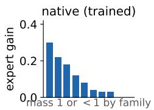
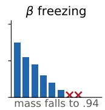
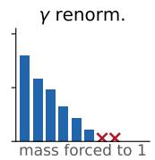
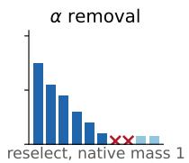
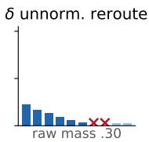
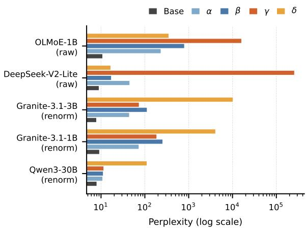
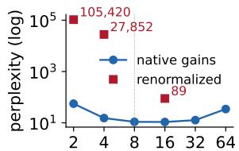
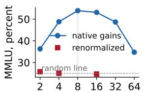
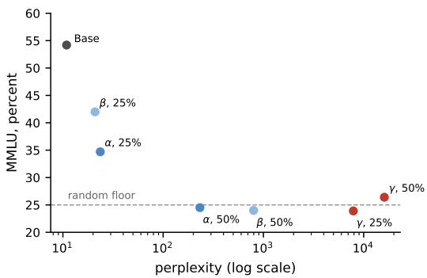

# Matching the Training-Time Weight Rule in Inference-Time Expert Deactivation

Hao Cheng1, Zhiyu Yang3, Bo Ma1,† and Hanzhang Jia2,†

1Zhejiang Gongshang University · 2University of Sussex · 3Chang’an University

†Corresponding authors: Hanzhang Jia (lead corresponding) and Bo Ma.

## Abstract

Expert deactivation at inference time changes both token routing and expert weights, and its effect on performance depends on how these changes are implemented. We compare removal, freezing, remaining-expert renormalization, and unnormalized re-routing on identical disabled sets across five instruction-tuned checkpoints from four model families, with a base OLMoE checkpoint as an additional comparison. We develop a weight-sum model that relates the loss of expert contributions and changes in branch scale to the weight rule used during training. With half of the experts deactivated according to activation-based rankings, remainingexpert renormalization yields the highest perplexity in models trained with raw router probabilities, whereas unnormalized re-routing yields the highest perplexity in models trained with normalized weights. Perplexity ranges from 1.4 to 73 times the intact baseline when the training rule is retained, and from 14 to 28,740 times the baseline under a rule mismatch. Task outcomes vary across evaluation types: on OLMoE, GSM8K strict-match accuracy falls to zero under all four implementations. Extending the model to changes in the number of active experts yields a further prediction, supported by the OLMoE experiments: the perplexity penalty from additional renormalization increases as fewer experts are activated.

## 1 Introduction

Open-weight mixture-of-experts (MoE) models distribute their parameters across expert layers while activating only a small subset of experts for each token. OLMoE, DeepSeek-V2, Granite, and Qwen3 follow this architecture (Muennighoff et al., 2025; DeepSeek-AI, 2024; IBM Granite

Team, 2024; Qwen Team, 2025). Sparse activation reduces computation per token, but the full expert bank still incurs storage, loading, and scheduling costs. Expert pruning, offloading, and dynamic routing address these deployment costs by changing which experts are available or selected (Lu et al., 2024; Lasby et al., 2025; Chen et al., 2026).

Deactivating experts requires explicit choices about the existing token assignments and their associated weights. Removal masks the disabled experts, re-routes their tokens, and recomputes weights using the model’s original rule; the resulting change therefore combines expert substitution with weight redistribution. Freezing preserves the original routing decisions and surviving weights, removing only the disabled experts’ weighted contributions. Affected tokens consequently retain fewer effective experts and a smaller total weight. Remaining-expert renormalization also leaves the vacated slots unfilled, but rescales the surviving weights to sum to one, combining contribution loss with additional scaling. Unnormalized rerouting fills the vacated slots and weights the replacement experts by their raw router probabilities. It preserves the number of active experts while reducing expert-branch gain in models trained with normalized weights. These differences in implementation affect how expert importance and pruning results are interpreted.

Existing studies primarily compare expertselection criteria within a fixed deactivation implementation (Lu et al., 2024; Lasby et al., 2025; Chen et al., 2026). Hu et al. (2025) compare removal and freezing without distinguishing models by their training-time weight rule. Chen and Yao (2026) examine the normalization reference when reducing the number of active experts, but do not compare all four implementations on an identical disabled set. The performance differences attributable to implementation, and the correspondence between the most damaging implementation and the training rule, therefore remain unresolved.

We develop a weight-sum model covering all four implementations, using the training-time computation as the reference for analyzing contribution loss and expert-branch scaling. Removal recomputes weights under the original rule, whereas freezing retains the surviving experts’ original weights. Remaining-expert renormalization and unnormalized re-routing instead prescribe normalized weights and raw probabilities, respectively, so their compatibility with training depends on the model. In OLMoE and DeepSeek-V2, the selected experts’ raw probabilities already sum to less than one during training. Renormalizing the survivors raises the retained sum to one and amplifies their contribution relative to the residual branch. In Granite and Qwen3, the selected weights sum to one during training; removing this normalization reduces the weight sum below one and uniformly attenuates the weighted output for a given selected set. The model thus predicts that, for a fixed model and disabled set, remainingexpert renormalization will produce the largest perplexity increase in raw-probability models, and unnormalized re-routing will produce the largest increase in normalized-weight models.

Our experiments cover five instruction-tuned checkpoints from four families, with a base OL-MoE checkpoint as an additional comparison. For each model and deactivation proportion, all four implementations use the same disabled set. We then vary the selection criterion to examine the effect of the set itself. Model parameters remain fixed throughout, and evaluation includes WikiText-2 perplexity, multiple-choice tasks, and free-form generation on GSM8K.

When half of the experts are deactivated using activation-based selection, the highest perplexity occurs under remaining-expert renormalization for OLMoE and DeepSeek-V2-Lite, and under unnormalized re-routing for both Granite checkpoints and Qwen3, as predicted. Implementations that retain the training rule yield perplexities between 1.4 and 73 times the intact baseline; mismatched implementations yield between 14 and 28,740 times the baseline. On the same DeepSeek-V2-Lite disabled set, freezing gives a perplexity of 17.21, compared with 258,621.64 under remaining-expert renormalization. Both retain the same experts without filling the vacated slots. Their difference of more than four orders of magnitude therefore isolates the substantial effect of weight handling.

On instruction-tuned OLMoE at 50% deactivation, implementations that retain the training rule remain above chance on some two-option tasks, while MMLU approaches chance and GSM8K strict-match accuracy is zero under all four implementations. The weight-sum model also extends to changes in inference-time width. For fixed router probabilities, selecting fewer experts lowers their total probability and increases the amplification introduced by renormalization. The model consequently predicts a larger penalty from a weight-rule mismatch at smaller widths. OL-MoE exhibits this trend: the perplexity penalty from renormalization grows as the number of active experts decreases.

Our contributions are threefold:

1. We establish the performance differences among four deactivation implementations on identical disabled sets and identify the highloss implementation associated with each training-time weight rule.

2. We develop a weight-sum model of all four implementations that explains the gain changes introduced by adding or removing normalization and predicts which implementation produces the most severe degradation in each model class.

3. We extend the model’s predictions to changes in the number of active experts and verify the predicted trend on OLMoE: additional renormalization causes increasingly severe perplexity degradation at smaller widths. This result extends the explanation based on weightrule mismatch from fixed expert deactivation to inference-time width adjustment.

## 2 Background and Deactivation Implementations

Given a token representation h, the router assigns a score $z _ { i }$ to each of N experts and applies a softmax over the full expert bank:

$$
p _ { i } = \frac { \exp ( z _ { i } ) } { \sum _ { j = 1 } ^ { N } \exp ( z _ { j } ) } .\tag{1}
$$

The k experts with the highest probabilities form the active set $T$ . Let $y _ { i }$ denote the output of expert i and $g _ { i }$ its weight. The layer output com-

<table><tr><td colspan="2">Implementation Weight rule</td><td>Weight sum</td></tr><tr><td>α removal</td><td>re-select, training rule</td><td> $\textstyle \sum _ { i \in T ^ { \prime } } q _ { i } .$  1</td></tr><tr><td> $\beta$  freezing</td><td>keep trained weights</td><td> $m _ { T } - m _ { D }$ </td></tr><tr><td>γ renorm.</td><td>rescale</td><td>1</td></tr><tr><td>δ unnorm.</td><td>re-select,  $p _ { i }$ </td><td> $s _ { T ^ { \prime } }$ </td></tr></table>

Table 1: Routing, weight computation, and weight sums for the four implementations. $D$ is the disabled set, $m _ { D }$ its originally active weight, and $T ^ { \prime }$ the reselected set. The probabilities $q _ { i }$ are recomputed over the remaining bank; $s _ { T ^ { \prime } }$ sums the original probabilities of the re-selected experts. The two sums for α correspond to raw-probability and normalized-weight models, respectively.

bines the residual with the weighted expert outputs:

$$
o = h + \sum _ { i \in T } g _ { i } y _ { i } .\tag{2}
$$

The training-time weight rule determines how $g _ { i }$ is computed. OLMoE and DeepSeek-V2 use the raw probabilities, so the selected experts’ weights sum to $m _ { T }$ , which is less than one (Muennighoff et al., 2025; DeepSeek-AI, 2024):

$$
g _ { i } = p _ { i } , \qquad m _ { T } = \sum _ { i \in T } p _ { i } < 1 .\tag{3}
$$

Granite and Qwen3 normalize the weights within the selected set (IBM Granite Team, 2024; Qwen Team, 2025). Writing $s T$ for the sum of that set’s raw probabilities gives:

$$
g _ { i } = \frac { p _ { i } } { s _ { T } } , \qquad s _ { T } = \sum _ { j \in T } p _ { j } , \qquad m _ { T } = 1 .\tag{4}
$$

Both rules retain the residual term $h ;$ mT describes the total weight on the expert branch. Let D be the disabled set. Assigning zero effective weight to unselected experts, $m _ { D }$ is the total weight of the originally active experts in D. Table 1 summarizes the four implementations, and Figure 1 illustrates their routing and weighting operations.

Removal with re-routing (α) masks disabled experts before the softmax and selects a new top-k set $T ^ { \prime }$ from the remaining bank. Rawprobability models use the recomputed probabilities $q _ { i }$ , whereas normalized-weight models continue to normalize within $T ^ { \prime }$ . Removal therefore follows the original weight-computation rule while changing both the selected experts and their weights. This is a common implementation in expert pruning (Lu et al., 2024; Lasby et al., 2025).

Zero-contribution freezing (β) preserves the original routing decisions and sets the disabled experts’ contributions to zero. Surviving experts retain their original weights. Remaining-expert renormalization $( \gamma )$ selects the same survivors, but scales their weights proportionally to sum to one. Neither implementation introduces replacement experts; their difference is whether the surviving contribution is rescaled.

Unnormalized re-routing (δ) excludes disabled experts at selection time, fills the active set with replacements, and weights the selected experts by their original softmax probabilities $p _ { i }$ . Disabled experts still contribute to the softmax denominator. This distinguishes δ from $\alpha .$ , which masks experts before the softmax is computed.

## 2.1 A Weight-Sum Model of Expert Deactivation

Taking the intact layer in Equation (2) as the reference, we analyze how deleting expert contributions and rescaling their weights affect the layer output. For removal, let $p _ { D }$ denote the disabled experts’ total probability over the full bank. Masking them gives:

$$
q _ { i } = \frac { p _ { i } } { 1 - p _ { D } } , \qquad i \notin D ,\tag{5}
$$

The router then selects $T ^ { \prime }$ using $q _ { i }$ . The resulting output depends on both the outputs of the newly selected experts and their weights. The weight sum describes the scale of this weighted combination, while substitution changes the expert outputs that enter it.

Freezing retains the originally selected survivors, giving the layer output:

$$
o _ { \beta } = h + \sum _ { i \in T \backslash D } g _ { i } y _ { i } .\tag{6}
$$

Its difference from the intact output is exactly the removed weighted contribution:

$$
\Delta _ { \beta } = o - o _ { \beta } = \sum _ { i \in D } g _ { i } y _ { i } .\tag{7}
$$

The surviving experts keep their original weights, so the expert-branch weight sum decreases to $m _ { T } - m _ { D }$ . The residual remains $h .$

Remaining-expert renormalization multiplies the surviving weighted contribution by $1 / ( m _ { T } -$ $m _ { D } )$ :

  
Figure 1: Four implementations in a ten-expert example. The original top-8 set occupies slots 0-7, with slots 6 and 7 deactivated (red crosses). Re-routing fills the vacated slots with replacement experts, freezing retains the surviving weights, and renormalization rescales them. Unnormalized re-routing uses the original router probabilities.

$$
o _ { \gamma } = h + { \frac { 1 } { m _ { T } - m _ { D } } } \sum _ { i \in T \backslash D } g _ { i } y _ { i } .\tag{8}
$$

The weight removed by freezing and the increase in total weight under renormalization are:

$$
\begin{array} { l } { { \Delta m _ { \beta } = m _ { D } , } } \\ { { { \Delta m _ { \gamma } = 1 - m _ { T } } ( \mathrm { r a w } ) , 0 ( \mathrm { r e n o r m } ) . } } \end{array}\tag{9}
$$

In a raw-probability model, γ increases the retained weight sum from $m _ { T } - m _ { D }$ to one. This introduces additional amplification alongside the loss of disabled contributions; relative to the intact layer, the weight sum increases by $1 - m _ { T }$ In a normalized-weight model, the sum is one before and after deactivation. The surviving weights nevertheless increase by a factor of $1 / ( 1 - m _ { D } )$ changing the individual contributions even though their total weight remains fixed.

Unnormalized re-routing weights the new set $T ^ { \prime }$ directly by its raw probabilities. For a surviving member of the original active set in a model trained with normalized weights, the ratio between its new and original weight is:

$$
\frac { g _ { i } ^ { ( \delta ) } } { g _ { i } ^ { ( \mathrm { t r a i n } ) } } = s _ { T } , \qquad i \in T \backslash D .\tag{10}
$$

Its weighted contribution is thus reduced to $s _ { T }$ times the trained value. Because T already contains the k highest-probability experts, the raw probability sum $s T ^ { \prime }$ of the replacement set cannot exceed $s _ { T }$ . In normalized-weight models, δ removes the gain adjustment used during training and reduces the expert-branch weight sum below one. Raw-probability models continue to use their original weighting rule.

Across the four implementations, α recomputes weights under the training rule and $\beta$ preserves the surviving weights. By contrast, γ introduces additional amplification in raw-probability models, and δ introduces attenuation in normalized-weight models. Both mismatches alter the scale of the expert branch relative to the residual. For a fixed model and disabled set, the resulting prediction is that the largest perplexity increase will occur under $\gamma$ in raw-probability models and under δ in normalized-weight models.

## 3 Methodology

## 3.1 Models

We evaluate five public instruction-tuned checkpoints from four model families. Table 2 lists their architectures and training-time weight rules. A base OLMoE checkpoint, with the same architecture and rule as its instruction-tuned counterpart, provides an additional comparison. Qwen3-30B-A3B is evaluated for perplexity at two deactivation proportions; the other five checkpoints undergo both perplexity and task evaluation.

## 3.2 Disabled Sets

The calibration corpus comprises the first 2,000 documents from the first C4 shard, packed into 128 sequences of 2,048 tokens (Raffel et al., 2020). We rank experts by activation and select the lowest-scoring experts separately at each layer. Two additional criteria provide alternative disabled sets: selection frequency, which ranks experts by how often they are chosen, and random sampling with seeds 42, 43, and 44. The deactivation proportions are 12.5%, 25%, 37.5%, and 50%; Appendix B lists the evaluated configurations. For a given model, proportion, and selection criterion, the disabled set is identical across all four implementations.

## 3.3 Implementation

All four operations are applied directly to the released checkpoints, with model parameters held fixed. Removal masks disabled experts before the softmax and recomputes the probabilities. Unnormalized re-routing excludes them only during selection, retaining the original softmax denominator. Freezing zeros their contributions after routing, whereas remaining-expert renormalization rescales the surviving weights. The two rerouting implementations fill the vacated slots with replacement experts; the other two retain only the original survivors.

<table><tr><td>Model</td><td>Experts</td><td>k</td><td>MoE layers</td><td>Training rule</td></tr><tr><td>OLMoE-1B-7B</td><td>64</td><td>8</td><td>16</td><td>original probabilities</td></tr><tr><td>DeepSeek-V2-Lite</td><td>64</td><td>6</td><td>26</td><td>original probabilities</td></tr><tr><td>Granite-3.1-3B</td><td>40</td><td>8</td><td>32</td><td>renormalized</td></tr><tr><td>Granite-3.1-1B</td><td>32</td><td>8</td><td>24</td><td>renormalized</td></tr><tr><td>Qwen3-30B</td><td>128</td><td>8</td><td>48</td><td>renormalized</td></tr></table>

Table 2: Architectures and training-time weight rules of the five instruction-tuned checkpoints. The additional base OLMoE checkpoint shares its architecture and rule with the instruction-tuned version.

We use Hugging Face Transformers for model loading and the EleutherAI Evaluation Harness for evaluation (Wolf et al., 2020; Gao et al., 2024). Implementation checks include reproducing the intact model with an empty disabled set and comparing the eager execution path with the fused kernel. Appendix A gives the implementation settings.

## 3.4 Evaluation

We compute WikiText-2 test perplexity using sliding windows of 1,024 tokens and a stride of 512, covering the full test text (Merity et al., 2017). Multiple-choice evaluation includes ARCeasy, ARC-challenge, OpenBookQA, HellaSwag, BoolQ, RTE, and WinoGrande (Clark et al., 2018; Mihaylov et al., 2018; Zellers et al., 2019; Clark et al., 2019; Wang et al., 2019; Sakaguchi et al., 2021), together with MMLU (Hendrycks et al., 2021). Uniform guessing provides reference accuracies of 25% for four-option tasks and 50% for two-option tasks.

Free-form generation is evaluated on GSM8K using strict and flexible matching of the final answer (Cobbe et al., 2021). We retain item-level likelihoods and generated outputs for paired comparisons and analysis of generation behavior.

## 3.5 Statistical Testing

We use the exact paired McNemar test to compare correctness on identical items, counting changes from correct to incorrect and vice versa between implementations (McNemar, 1947). We apply the Benjamini-Hochberg correction across 21 paired tests and report two-sided $q$ values (Benjamini and Hochberg, 1995).

  
Figure 2: Perplexity at 50% deactivation using activation-based selection, on a log scale. The largest increase occurs under renormalization in rawprobability models and unnormalized re-routing in normalized-weight models.

## 4 Results

## 4.1 Implementation and Perplexity

With half of the expert bank deactivated using activation-based selection, all five instructiontuned checkpoints attain their highest perplexity under the predicted rule mismatch (Table 3 and Figure 2). This is $\gamma$ for OLMoE and DeepSeek-V2-Lite, and $\delta$ for both Granite checkpoints and Qwen3. Perplexity is 1.4 to 73 times the intact baseline when the training rule is retained and 14 to 28,740 times the baseline under a mismatch.

On an identical disabled set, DeepSeek-V2-Lite has a perplexity of 17.21 under $\beta$ and 258,621.64 under γ. These implementations retain the same experts and differ in whether they renormalize the surviving weights, so this comparison isolates the effect of weight handling. On OLMoE, α and $\gamma$ yield perplexities of 232.77 and 16,072.70, respectively, again showing severe degradation when additional renormalization is applied to a rawprobability model.

At 25% deactivation with activation-based selection, perplexity under the training rule is approximately 8 to 24, whereas mismatched implementations already show substantial increases. Selection also matters within a given implementation. On OLMoE at this proportion, γ yields a perplexity of 7,890 with activation-based selection and 7,086 with frequency-based selection; random sets yield 10,203 to 12,873. Tables 6–8 in Appendix B give the full perplexity results for all six checkpoints.

<table><tr><td>Model</td><td>Base</td><td>α</td><td> $\beta$ </td><td>γ</td><td>δ</td></tr><tr><td>OLMoE-1B, raw</td><td>10.89</td><td>232.77</td><td>798.58</td><td>16,072.70</td><td>352.42</td></tr><tr><td>DeepSeek-V2-Lite, raw</td><td>9.00</td><td>45.20</td><td>17.21</td><td>258,621.64</td><td>16.64</td></tr><tr><td>Granite-3.1-3B, renorm</td><td>7.89</td><td>44.26</td><td>112.63</td><td>73.98</td><td>10,301.60</td></tr><tr><td>Granite-3.1-1B, renorm</td><td>9.22</td><td>73.28</td><td>256.08</td><td>186.57</td><td>4,095.87</td></tr><tr><td>Qwen3-30B, renorm</td><td>8.01</td><td>10.90</td><td>11.23</td><td>11.54</td><td>111.84</td></tr></table>

Table 3: Perplexity at 50% deactivation using activation-based selection. Weight-rule mismatch corresponds to γ in raw-probability models and δ in normalized-weight models. The intact model provides the baseline for each checkpoint.

## 4.2 Multiple-Choice Tasks and Free-Form Generation

Multiple-choice accuracy depends on the relative ranking of candidate answers, whereas perplexity measures sequence likelihood. These metrics capture different aspects of performance after deactivation. Table 4 reports OLMoE results at 50% deactivation, and Tables 9–12 in Appendix C give the complete task results.

Under freezing, OLMoE scores 24.0% on MMLU, 23.0% on ARC-challenge, and 19.0% on OpenBookQA, approaching or falling below the four-option chance level. Its two-option accuracies remain above chance: 58.2% on BoolQ, 59.6% on WinoGrande, and 55.2% on RTE. ARCeasy remains above 25% when the training rule is retained and reaches 27.7% under $\gamma$ . The same renormalization implementation reduces BoolQ and WinoGrande to 41.7% and 48.9%, respectively, while RTE remains at 53.1%. Its effect therefore varies across tasks.

The paired comparisons also reveal differences between implementations. At 25% deactivation on MMLU, $\beta$ answers 360 items correctly that α answers incorrectly; the reverse occurs on 215 items, giving an adjusted $q ~ = ~ 1 . 6 \times 1 0 ^ { - 9 }$ . At 50% deactivation, the relevant paired differences on BoolQ, ARC-easy, and WinoGrande remain significant, with $q < 1 0 ^ { - 6 }$ . On MMLU, the two discordant counts for $\gamma$ versus $\beta$ are 313 and 265, with $q = 0 . 0 6 7 \mathrm { ; }$ ; both accuracies are near chance.

<table><tr><td>Task Base</td><td>α</td><td> $\beta$ </td><td> $\gamma$ </td></tr><tr><td>Four-option, chance level near 25 ARC-easy 77.3 ARC-challenge 49.7 OpenBookQA 32.8 MMLU 54.2</td><td>43.3 26.0 21.2 24.5</td><td>35.8 23.0 19.0 24.0</td><td>27.7 21.7 15.2 26.4</td></tr><tr><td>Two-option, chance level near 50 BoolQ</td><td>80.6 56.4 67.1</td><td>58.2</td><td>41.7</td></tr><tr><td>RTE WinoGrande</td><td>53.1 56.7</td><td>55.2</td><td>53.1</td></tr><tr><td></td><td>69.0</td><td>59.6</td><td>48.9</td></tr><tr><td>Free-form, chance level near 0</td><td></td><td></td><td></td></tr><tr><td>GSM8K</td><td>36.2 0.0</td><td>0.0</td><td>0.0</td></tr></table>

Table 4: OLMoE task accuracy at 50% deactivation, grouped by task type. Four-option and two-option tasks have uniform-guessing references of 25% and 50%, respectively. GSM8K uses strict final-answer matching. HellaSwag results are reported in Appendix C for random configurations and Appendix E for width configurations.

OLMoE’s GSM8K strict-match baseline is 36.2%. With half of the experts deactivated, strictmatch accuracy falls to zero under all four implementations. Flexible matching gives 0.8% for α and $\gamma$ , while $\beta$ remains at zero. Generated outputs include prompt repetition, single-token loops, and early termination or empty answers, providing distinct behavioral outcomes despite the shared strictmatch score (Appendix D).

DeepSeek-V2-Lite shows a similar separation across evaluation types. Under implementations that retain its training rule, MMLU accuracy ranges from 23.5% to 25.5%. Removal gives 56.3% on BoolQ, 56.3% on RTE, and 63.2% on WinoGrande; $\gamma$ reduces BoolQ to 41.7%. The intact GSM8K strict-match accuracy is 66.2%, while the highest flexible-match accuracy after deactivation is 1.8%. Table 12 reports the two matching criteria separately.

<table><tr><td rowspan="2">k</td><td colspan="2">training rule</td><td colspan="2">renormalization rule</td></tr><tr><td>PPL</td><td>MMLU</td><td>PPL</td><td>MMLU</td></tr><tr><td>2</td><td>55.66</td><td>36.3</td><td>105,420</td><td>25.7</td></tr><tr><td>4</td><td>15.28</td><td>48.8</td><td>27,852</td><td>25.0</td></tr><tr><td>8</td><td>10.89</td><td>53.9</td><td></td><td></td></tr><tr><td>16</td><td>10.75</td><td>53.1</td><td>88.76</td><td>24.7</td></tr><tr><td>32</td><td>12.69</td><td>48.7</td><td>一</td><td>一</td></tr><tr><td>64</td><td>34.44</td><td>34.7</td><td>一</td><td>一</td></tr></table>

Table 5: OLMoE perplexity and MMLU at different active-expert counts. The training width is $k \ = \ 8 .$ Renormalization is evaluated at the non-training widths shown; its perplexity penalty increases as the activeexpert count decreases.

## 4.3 Effect of the Disabled Set

The disabled set can substantially change the outcome of a fixed implementation. On Granite-3B with half of the experts frozen, activation-based selection gives a perplexity of 112.6, whereas three random sets give 11,428 to 93,759, or 101 to 832 times that value. In the freezing expression, set selection affects the layer output through the weighted contribution that is removed. A set containing high-weight experts produces a larger reduction in the retained weight sum.

Differences between implementations also appear in the base OLMoE checkpoint. With 25% random deactivation, perplexity across the three seeds ranges from 13.85 to 14.56 for $\beta$ and from 14.43 to 14.99 for α (Table 6, Appendix B). These results establish that implementation differences also occur without instruction tuning. The corresponding task results are reported in Appendix C.

## 4.4 Testing the Prediction Across Active-Expert Counts

For fixed router probabilities, reducing the number of active experts k lowers the probability sum of the selected set and increases the scaling factor introduced by renormalization. The weightsum model therefore predicts that additional renormalization in a raw-probability model will become more damaging as k decreases. This extends the prediction from fixed expert deactivation to inference-time width adjustment.

We vary OLMoE’s active-expert count from 2 to 64 and compare raw-probability weighting with renormalization at the tested non-training widths (Table 5 and Figure 3). Appendix E gives the width configurations for both OLMoE checkpoints.

  
active experts k (trained k = 8)active experts k (trained k  
Figure 3: OLMoE across active-expert counts. The panels show perplexity on a log scale (left) and MMLU (right); the dotted line marks the training width. Additional renormalization causes greater perplexity degradation at smaller widths.

Under the training rule, $k = 8$ gives a perplexity of 10.89 and an MMLU accuracy of 53.9%, compared with 10.75 and 53.1% at $k \ = \ 1 6 .$ Performance is similar at these two widths. At k = 64, perplexity rises to 34.44 and MMLU falls to 34.7%. With additional renormalization, k = 2 gives a perplexity of 105,420 and MMLU of 25.7%; the corresponding values are 27,852 and 25.0% at $k \ = \ 4 .$ , and 88.76 and 24.7% at $k ~ = ~ 1 6$ The perplexity penalty increases as the active-expert count decreases, supporting the model’s prediction beyond fixed expert deactivation.

## 5 Analysis

## 5.1 Weight-Rule Mismatch and Contribution Loss

Freezing changes the layer output by deleting the disabled experts’ weighted contributions. A weight-rule mismatch additionally rescales the retained expert branch. In raw-probability models, γ increases the weight sum; in normalized-weight models, δ reduces it. These changes alter the scale of the expert branch relative to the residual and correspond to the high-loss implementations for the two model classes in Table 3.

On identical disabled sets, the OLMoE perplexities for $\gamma$ and α are approximately 16,072 and 233, a factor of 69 apart. For DeepSeek-V2-Lite, $\gamma$ and $\beta$ give approximately 258,622 and 17, a factor of 15,027 apart. Holding β fixed, different Granite-3B sets can also differ by a factor of 832. Implementation specifies how routing and weights are handled, while set selection specifies which expert contributions are removed. Both can substantially affect the magnitude of degradation.

Figure 4 places OLMoE perplexity and MMLU accuracy on the same plot. At 25% deactivation, configurations that retain the training rule have relatively low perplexity and high MMLU accuracy. At 50%, MMLU approaches chance while perplexity still varies considerably. Mismatched configurations occupy the high-perplexity region and also approach chance on MMLU. Configurations with similar answer accuracy can thus retain different sequence likelihoods, making perplexity useful for distinguishing their degree of degradation.

  
Figure 4: Perplexity and MMLU accuracy on OLMoE. Each point is one configuration, with perplexity on a logarithmic horizontal axis. Configurations with a weight-rule mismatch have high perplexity and MMLU accuracy near the chance level.

## 5.2 Mean Log-Perplexity Increase per Expert Layer

Let $L _ { \mathrm { M o E } }$ be the number of expert layers and π the perplexity ratio between a mismatched configuration and its reference. In the width experiments, the reference is the same checkpoint at the same $k$ under its original rule. For the summary at 50% deactivation, the reference is the intact baseline of the same checkpoint. We define the mean log increase per expert layer as:

$$
\rho = \ln \pi / L _ { \mathrm { M o E } } .\tag{11}
$$

The total log increase can correspondingly be written in terms of the number of expert layers and $\rho \colon$

$$
\log \pi \approx L _ { \mathrm { M o E } } \rho .\tag{12}
$$

Changing expert weights alters the relative contributions of the expert branch and the residual, and these changes can propagate through subsequent layers. The statistic $\rho$ distributes the final log-perplexity increase over the expert layers, providing a common measure of average degradation across configurations.

For the mismatched configurations at 50% deactivation, DeepSeek-V2-Lite has 26 expert layers and $\rho = 0 . 3 9 5$ , while OLMoE has 16 layers and $\rho = 0 . 4 5 6$ . Granite-3B, Granite-1B, and Qwen3 have 32, 24, and 48 expert layers, with $\rho = 0 . 2 2 4$ 0.254, and 0.055, respectively. Additional renormalization yields a comparatively large mean increase in both raw-probability models.

In the OLMoE width experiments, $\rho$ is 0.472 at $k = 2$ and 0.469 at $k = 4$ , within 0.016 of the value 0.456 for γ at 50% deactivation. At $k = 1 6 ,$ it decreases to 0.132. The two Granite checkpoints differ by less than 0.03. Narrow-width mismatches and expert deactivation therefore exhibit similar average degradation, whereas the increase is smaller after widening, consistent with the direction of the extrapolated prediction.

## 5.3 Generation Behavior Across Implementations

Even when strict-match accuracy is zero, generated outputs distinguish the failure patterns of different implementations (Appendix D). Outputs under α echo the question or prompt, those under $\beta$ repeat a single token, and those under $\gamma$ terminate early or produce short answers. Final-answer accuracy and the form of the generated text therefore provide complementary information about the effects of deactivation.

## 6 Related Work

Expert pruning typically uses importance estimates to select the retained subset and investigates performance recovery after compression. REAP scores experts by router-weighted activation, HOPE propagates dependencies through a sparse graph of expert groups, and Shapley-based pruning estimates each expert’s value contribution (Lasby et al., 2025; Tseng et al., 2026; Huang et al., 2025). MoNE replaces redundant experts with lighter alternatives, DERN recombines neurons from discarded experts, and EEPA selects subsets by reconstruction error relative to the intact layer output and recomputes weights using the original routing formula (Zhang et al., 2026; Zhou et al., 2025; Lu et al., 2024). Alongside subset selection and recovery, the implementation applied to a fixed disabled set directly affects performance.

Studies without recovery training examine fixed-proportion expert removal, subset selection from a few in-domain demonstrations, and dynamic retention of a fraction of the active experts (Neogi et al., 2025; Dong et al., 2025; Chen et al., 2026). Expert offloading and scheduling further address parameter availability and execution cost (Hwang et al., 2024; Kamahori et al., 2025). SEUF concentrates unlearning on experts that carry targeted knowledge and stabilizes their routing during training (Zhuang et al., 2025). These interventions affect expert availability, selection, or training; the weighting computation determines how the selected expert outputs combine in each layer.

Chen and Yao (2026) reduce the number of experts computed for each token while retaining a normalization reference based on the trainingtime active set. Their expert bank remains intact, and the router selects experts for each token. Our analysis starts from a fixed disabled set, compares four implementations under two trainingtime weight rules, and extends the resulting prediction to changes in the active-expert count.

Hu et al. (2025) measure specialization through an expert’s influence on downstream routing distributions, compare removal with freezing, and use this comparison to choose a pruning implementation. We incorporate the training-time weight rule into this comparison and cover all four implementations. Knowledge localization, multilingual routing, and post-training steering examine the knowledge carried by experts, languagedependent expert selection, and controlled activation, respectively (Bandarkar et al., 2026a,b; Fayyaz et al., 2026). Elastic MoE and Matryoshka models further investigate variable active-expert counts (Gu et al., 2025; Wang et al., 2026).

Sparse gating established the basic formulation of token-dependent expert selection and weighting (Shazeer et al., 2017; Fedus et al., 2022), and subsequent work has extended expert architectures and routing designs (Jiang et al., 2024; Dai et al., 2024). Honda et al. (2024) address shortcut shifts through expert aggregation and post-hoc control of routing. Using the training-time weighting computation as a reference, we explain performance differences among implementations on fixed disabled sets and test the resulting prediction under changes in inference-time width.

## 7 Conclusion

For a fixed model and disabled set, different choices about routing and expert weights can produce substantial performance differences. The weight-sum model connects the high-loss implementation to the training-time rule: remainingexpert renormalization amplifies the expert branch in raw-probability models, whereas unnormalized re-routing attenuates it in normalized-weight models. Experiments across model families support the predictions associated with these two mismatch directions.

The OLMoE width experiments validate a further prediction derived from fixed expert deactivation: additional renormalization causes more severe degradation when fewer experts are active. The mean log-perplexity increase per expert layer summarizes the magnitude of degradation, while multiple-choice and free-form evaluations reveal different task outcomes. Inferencetime changes to expert availability or activeexpert counts should therefore use the trainingtime weight rule as a reference, with the disabled set and target task informing the choice of implementation.

All model checkpoints, datasets, and evaluation frameworks used in this work are publicly available, so no separate code release is planned. Appendix A details the implementation settings.

## 8 Limitations

The experiments cover six checkpoints from four model families, spanning 1B to 30B parameters, and expert rankings are based on a fixed C4 calibration corpus. Extending model scale and calibration distributions would further test the predicted correspondence between the training-time rule and the high-loss implementation, and clarify how the magnitude of degradation varies with the model and data.

Free-form generation is evaluated on GSM8K. Other generation tasks would broaden the analysis of how weight-rule mismatch affects output behavior. A further question is whether recovery training can mitigate this degradation and how the performance differences among implementations evolve during such training.

## Author Contributions

Hao Cheng: Software, Investigation, Writing – original draft. Zhiyu Yang: Investigation, Validation. Bo Ma: Supervision, Writing – review and editing. Hanzhang Jia: Conceptualization, Methodology, Formal analysis, Software, Funding acquisition, Writing – review and editing, corresponding author.

## References

Lucas Bandarkar, Alan Ansell, and Trevor Cohn. 2026a. Knowledge localization in mixtureof-experts LLMs using cross-lingual inconsistency. arXiv preprint arXiv:2603.17102.

Lucas Bandarkar, Chenyuan Yang, Mohsen Fayyaz, Junlin Hu, and Nanyun Peng. 2026b. Multilingual routing in mixture-of-experts. In International Conference on Learning Representations.

Yoav Benjamini and Yosef Hochberg. 1995. Controlling the false discovery rate: A practical and powerful approach to multiple testing. Journal of the Royal Statistical Society: Series B, 57(1):289–300.

Xing Chen and Hengshuai Yao. 2026. Trainingfree halving of activated experts in fine-grained mixture-of-experts models. arXiv preprint arXiv:2609.04575.

Yuanteng Chen, Qiwei Lai, Tianqi Chen, Peisong Wang, Yuantian Shao, Nanxin Zeng, Zhilei Liu, Chuangyi Li, Jing Liu, and Jian Cheng. 2026. You only need 2/3 of the chosen experts: An empirical study of dynamic expert pruning in fine-grained MoE LLMs. arXiv preprint arXiv:2609.25809.

Christopher Clark, Kenton Lee, Ming-Wei Chang, Tom Kwiatkowski, Michael Collins, and Kristina Toutanova. 2019. BoolQ: Exploring the surprising difficulty of natural yes/no questions. In Proceedings of NAACL, pages 2924– 2936.

Peter Clark, Isaac Cowhey, Oren Etzioni, Tushar Khot, Ashish Sabharwal, Carissa Schoenick, and Oyvind Tafjord. 2018. Think you have solved question answering? try ARC, the AI2 reasoning challenge. arXiv preprint arXiv:1803.05457.

Karl Cobbe, Vineet Kosaraju, Mohammad Bavarian, Mark Chen, Heewoo Jun, Lukasz Kaiser, Matthias Plappert, Jerry Tworek, Jacob Hilton, Reiichiro Nakano, Christopher Hesse, and John Schulman. 2021. Training verifiers to solve math word problems. arXiv preprint arXiv:2110.14168.

Damai Dai, Chengqi Deng, Chenggang Zhao, Runxin Xu, Huazuo Gao, Deli Chen, Jiashi Li, Wangding Zeng, Xingkai Yu, Yu Wu, Zhenda Xie, Y. K. Li, Panpan Huang, Fuli Luo, Chong Ruan, Zhifang Sui, and Wenfeng Liang. 2024. DeepSeekMoE: Towards ultimate expert specialization in mixture-of-experts language models. In Proceedings ofthe 62nd Annual Meeting of the Association for Computational Linguistics, pages 1280–1297.

DeepSeek-AI. 2024. DeepSeek-V2: A strong, economical, and efficient mixtureof-experts language model. arXiv preprint arXiv:2405.04434.

Zican Dong, Han Peng, Peiyu Liu, Wayne Xin Zhao, Dong Wu, Feng Xiao, and Zhifeng Wang. 2025. Domain-specific pruning of large mixture-of-experts models with few-shot demonstrations. arXiv preprint arXiv:2504.06792.

Mohsen Fayyaz, Ali Modarressi, Hanieh Deilamsalehy, Franck Dernoncourt, Ryan Rossi, Trung Bui, Hinrich Schütze, and Nanyun Peng. 2026. Steering MoE LLMs via expert (de)activation. In International Conference on Learning Representations.

William Fedus, Barret Zoph, and Noam Shazeer. 2022. Switch transformers: Scaling to trillion parameter models with simple and efficient sparsity. Journal of Machine Learning Research, 23(120):1–39.

Leo Gao, Jonathan Tow, Baber Abbasi, Stella Biderman, Sid Black, Anthony DiPofi, Charles Foster, Laurence Golding, Jeffrey Hsu, Alain Le Noac’h, Haonan Li, Kyle McDonell, Niklas Muennighoff, Chris Ociepa, Jason Phang, Laria Reynolds, Hailey Schoelkopf, Aviya Skowron, Lintang Sutawika, Eric Tang, Anish Thite, Ben Wang, Kevin Wang, and Andy Zou. 2024. The language model evaluation harness.

Naibin Gu, Zhenyu Zhang, Yuchen Feng, Yilong Chen, Peng Fu, Zheng Lin, Shuohuan Wang, Yu Sun, Hua Wu, Weiping Wang, and Haifeng Wang. 2025. Elastic MoE: Unlocking the inference-time scalability of mixture-ofexperts. arXiv preprint arXiv:2509.21892.

Dan Hendrycks, Collin Burns, Steven Basart, Andy Zou, Mantas Mazeika, Dawn Song, and

Jacob Steinhardt. 2021. Measuring massive multitask language understanding. In International Conference on Learning Representations.

Ukyo Honda, Tatsushi Oka, Peinan Zhang, and Masato Mita. 2024. Not eliminate but aggregate: Post-hoc control over MoE to address shortcut shifts in NLU. Transactions of the Association for Computational Linguistics, 12:1268–1289.

Jie Hu, Jiahui Hou, and Xiangyang Li. 2025. Quantifying expert specialization for effective pruning in mixture-of-experts models. Open-Review 9lOqGhCjtL.

Weizhong Huang, Yuxin Zhang, Xiawu Zheng, Fei Chao, Rongrong Ji, and Liujuan Cao. 2025. Discovering important experts for mixture-ofexperts models pruning through a theoretical perspective. In Advances in Neural Information Processing Systems.

Ranggi Hwang, Jianyu Wei, Shijie Cao, Changho Hwang, Xiaohu Tang, Ting Cao, and Mao Yang. 2024. Pre-gated MoE: An algorithm-system codesign for fast and scalable mixture-of-expert inference. In Proceedings of the 51st Annual International Symposium on Computer Architecture (ISCA), pages 1018–1031.

IBM Granite Team. 2024. Granite-3.1- 3B-A800M-Instruct and Granite-3.1-1B-A400M-Instruct Mixture-of-Experts Language Models. Hugging Face model cards, https://huggingface. co/ibm-granite/granite-3. 1-3b-a800m-instruct and https: //huggingface.co/ibm-granite/ granite-3.1-1b-a400m-instruct.

Albert Q. Jiang, Alexandre Sablayrolles, Antoine Roux, Arthur Mensch, Blanche Savary, Chris Bamford, Devendra Singh Chaplot, Diego de las Casas, Emma Bou Hanna, Florian Bressand, Gianna Lengyel, Guillaume Bour, Guillaume Lample, Lélio Renard Lavaud, Lucile Saulnier, Marie-Anne Lachaux, Pierre Stock, Sandeep Subramanian, Sophia Yang, Szymon Antoniak, Teven Le Scao, Théophile Gervet, Thibaut Lavril, Thomas Wang, Timothée Lacroix, and William El Sayed. 2024. Mixtral of experts. arXiv preprint arXiv:2401.04088.

Keisuke Kamahori, Tian Tang, Yile Gu, Kan Zhu, and Baris Kasikci. 2025. Fiddler: CPU-GPU orchestration for fast inference of mixture-ofexperts models. In International Conference on Learning Representations.

Mike Lasby, Ivan Lazarevich, Nish Sinnadurai, Sean Lie, Yani Ioannou, and Vithursan Thangarasa. 2025. REAP the experts: Why pruning prevails for one-shot MoE compression. arXiv preprint arXiv:2510.13999.

Xudong Lu, Qi Liu, Yuhui Xu, Aojun Zhou, Siyuan Huang, Bo Zhang, Junchi Yan, and Hongsheng Li. 2024. Not all experts are equal: Efficient expert pruning and skipping for mixture-of-experts large language models. In Proceedings of the 62nd Annual Meeting of the Association for Computational Linguistics, pages 6159–6172.

Quinn McNemar. 1947. Note on the sampling error of the difference between correlated proportions or percentages. Psychometrika, 12(2):153–157.

Stephen Merity, Caiming Xiong, James Bradbury, and Richard Socher. 2017. Pointer sentinel mixture models. In International Conference on Learning Representations.

Todor Mihaylov, Peter Clark, Tushar Khot, and Ashish Sabharwal. 2018. Can a suit of armor conduct electricity? a new dataset for open book question answering. In Proceedings of EMNLP, pages 2381–2391.

Niklas Muennighoff, Luca Soldaini, Dirk Groeneveld, Kyle Lo, Jacob Morrison, Sewon Min, Weijia Shi, Pete Walsh, Oyvind Tafjord, Nathan Lambert, Yuling Gu, Shane Arora, Akshita Bhagia, Dustin Schwenk, David Wadden, Alexander Wettig, Binyuan Hui, Tim Dettmers, Douwe Kiela, Ali Farhadi, Noah A. Smith, Pang Wei Koh, Amanpreet Singh, and Hannaneh Hajishirzi. 2025. OLMoE: Open mixture-of-experts language models. In International Conference on Learning Representations.

Pinaki Prasad Guha Neogi, Ahmad Mohammadshirazi, Dheeraj Kulshrestha, and Rajiv Ramnath. 2025. Exploiting the experts: Unauthorized compression in MoE-LLMs. arXiv preprint arXiv:2511.19480.

Qwen Team. 2025. Qwen3 technical report. arXiv preprint arXiv:2505.09388.

Colin Raffel, Noam Shazeer, Adam Roberts, Katherine Lee, Sharan Narang, Michael Matena, Yanqi Zhou, Wei Li, and Peter J. Liu. 2020. Exploring the limits of transfer learning with a unified text-to-text transformer. Journal of Machine Learning Research, 21(140):1–67.

Keisuke Sakaguchi, Ronan Le Bras, Chandra Bhagavatula, and Yejin Choi. 2021. WinoGrande: An adversarial winograd schema challenge at scale. Communications of the ACM, 64(9):99– 106.

Noam Shazeer, Azalia Mirhoseini, Krzysztof Maziarz, Andy Davis, Quoc Le, Geoffrey Hinton, and Jeff Dean. 2017. Outrageously large neural networks: The sparsely-gated mixtureof-experts layer. In International Conference on Learning Representations.

Alex M. Tseng, Prannay Kaul, Luca Zancato, Wei Xia, and Stefano Soatto. 2026. Higher-order pruning of experts in mixtureof-experts language models. arXiv preprint arXiv:2609.18916.

Alex Wang, Amanpreet Singh, Julian Michael, Felix Hill, Omer Levy, and Samuel R. Bowman. 2019. GLUE: A multi-task benchmark and analysis platform for natural language understanding. In International Conference on Learning Representations.

Yaoxiang Wang, Qingguo Hu, Yucheng Ding, Ruizhe Wang, Yeyun Gong, Jian Jiao, Yelong Shen, Peng Cheng, and Jinsong Su. 2026. Training matryoshka mixture-of-experts for elastic inference-time expert utilization. In Proceedings of the 2026 Conference on Empirical Methods in Natural Language Processing.

Thomas Wolf, Lysandre Debut, Victor Sanh, Julien Chaumond, Clément Delangue, Anthony Moi, Pierric Cistac, Tim Rault, Rémi Louf, Morgan Funtowicz, Joe Davison, Sam Shleifer, Patrick von Platen, Clara Ma, Yacine Jernite, Julien Plu, Canwen Xu, Teven Le Scao, Sylvain Gugger, Mariama Drame, Quentin Lhoest, and Alexander M. Rush. 2020. Transformers: State-of-the-art natural language processing. In

Proceedings of the 2020 Conference on Empirical Methods in Natural Language Processing: System Demonstrations, pages 38–45.

Rowan Zellers, Ari Holtzman, Yonatan Bisk, Ali Farhadi, and Yejin Choi. 2019. HellaSwag: Can a machine really finish your sentence? In Proceedings of the 57th Annual Meeting of the Association for Computational Linguistics, pages 4791–4800.

Geng Zhang, Yuxuan Han, Yuxuan Lou, Yiqi Zhang, Wangbo Zhao, and Yang You. 2026. MoNE: Replacing redundant experts with lightweight novices for structured pruning of MoE. In International Conference on Learning Representations.

Yixiao Zhou, Ziyu Zhao, Dongzhou Cheng, Zhiliang Wu, Jie Gui, Yi Yang, Fei Wu, Yu Cheng, and Hehe Fan. 2025. Dropping experts, recombining neurons: Retraining-free pruning for sparse mixture-of-experts LLMs. In Findings of the Association for Computational Linguistics: EMNLP 2025, pages 15169–15186.

Haomin Zhuang, Yihua Zhang, Kehan Guo, Jinghan Jia, Gaowen Liu, Sijia Liu, and Xiangliang Zhang. 2025. SEUF: Is unlearning one expert enough for mixture-of-experts LLMs? In Proceedings of the 63rd Annual Meeting of the Association for Computational Linguistics, pages 8664–8678.

## A Implementation Details

We implement all four implementations as routing operations on the released checkpoints, and we check equivalence with the official forward pass on every measured path. We use HuggingFace Transformers (Wolf et al., 2020) to load models and datasets, and the EleutherAI Evaluation Harness (Gao et al., 2024) for benchmark evaluation. All experiments run on one local GPU and one A800 80 GB GPU.

## B Full Perplexity Grids

## C Full Task Grids

## D Qualitative Failure Examples

The half-bank writings on OLMoE collapse on GSM8K into the forms the main text names. We quote the start of each output on the first item of the GSM8K test set, which asks the following question.

Janet’s ducks lay 16 eggs per day. She eats three for breakfast every morning and bakes muffins for her friends every day with four. She sells the remainder at the farmers’ market daily for \$2 per fresh duck egg. How much in dollars does she make every day at the farmers’ market.

Removal. The output echoes the item and repeats the following.

The duck lays 16 eggs a week.   
The duck is a fresh egg.   
The duck is a fresh egg is   
a fresh egg is a fresh is a   
fresh is a fresh is a fresh   
is a fresh is a \$ of the   
fresh, and so on.   
He runs a week. He runs a   
week. He runs a week. He   
runs a week. He runs a week.   
He runs a week., and so on.

Freezing. The output loops on a single token.

that in- in- that, that,   
that, that, that, that, that„   
and so on.   
that will, in the question,   
that will, that that, that   
that, that that, that that,   
that that„ and so on.

## Renormalization. The output stops early.

Australia

## E Width Axis Detail

<table><tr><td colspan="3">OLMoE-1B-7B-0924-Instruct</td></tr><tr><td>Configuration</td><td>ppl</td><td>ratio</td></tr><tr><td>base</td><td>10.89</td><td>1.00</td></tr><tr><td>α-ean25</td><td>23.60</td><td>2.17</td></tr><tr><td>α-ean50</td><td>232.77</td><td>21.4</td></tr><tr><td>α-rand25-s42</td><td>18.56</td><td>1.70</td></tr><tr><td>α-rand25-s43</td><td>18.60</td><td>1.71</td></tr><tr><td>α-rand25-s44</td><td>18.28</td><td>1.68</td></tr><tr><td>α-rand50-s42</td><td>106.27</td><td>9.76</td></tr><tr><td>α-rand50-s43</td><td>85.59</td><td>7.86</td></tr><tr><td>α-rand50-s44</td><td>86.00</td><td>7.90</td></tr><tr><td>β-ean25</td><td>20.92</td><td>1.92</td></tr><tr><td>β-ean50</td><td>798.58</td><td>73.3</td></tr><tr><td>β-rand25-s42</td><td>18.06</td><td>1.66</td></tr><tr><td>β-rand25-s43</td><td>18.99</td><td>1.74</td></tr><tr><td>β-rand25-s44</td><td>18.03</td><td>1.66</td></tr><tr><td>β-rand50-s42</td><td>1,551.44</td><td>142</td></tr><tr><td>β-rand50-s43</td><td>102.50</td><td>9.41</td></tr><tr><td>β-rand50-s44</td><td>786.75</td><td>72.2</td></tr><tr><td>γ-ean25</td><td>7,889.82</td><td>725</td></tr><tr><td>γ-ean50</td><td>16,072.70</td><td>1,476</td></tr><tr><td>γ-ean12.5</td><td>3,708.37</td><td>341</td></tr><tr><td>γ-ean37.5</td><td>10,953.59</td><td>1,006</td></tr><tr><td>δ-ean25</td><td>19.61</td><td>1.80</td></tr><tr><td>δ-ean50</td><td>352.42</td><td>32.4</td></tr><tr><td>ke (dense)</td><td>34.44</td><td>3.16</td></tr><tr><td>α-ean50-ppl</td><td>232.99</td><td>21.4</td></tr><tr><td>β-ean50-ppl</td><td>797.92</td><td>73.3</td></tr><tr><td>base-ppl</td><td>10.89</td><td>1.00</td></tr><tr><td>γ-ean50-ppl</td><td>16,063.78</td><td>1,475</td></tr><tr><td>γ-freq25</td><td>7,085.67</td><td>651</td></tr><tr><td>γ-freq50</td><td>16,084.72</td><td>1,477</td></tr><tr><td>γ-rand25-s42</td><td>10,203.82</td><td>937</td></tr><tr><td>γ-rand25-s43</td><td>10,232.50</td><td>940</td></tr><tr><td>γ-rand25-s44</td><td>12,872.87</td><td>1,182</td></tr><tr><td>γ-rand50-s42</td><td>37,592.51</td><td>3,452</td></tr><tr><td>γ-rand50-s43</td><td>53,324.82</td><td>4,897</td></tr><tr><td>γ-rand50-s44</td><td>38,632.81</td><td>3,548</td></tr></table>

<table><tr><td colspan="3">OLMoE-1B-7B-0924-Base</td></tr><tr><td>Configuration</td><td>ppl</td><td>ratio</td></tr><tr><td>base</td><td>8.38</td><td>1.00</td></tr><tr><td>α-rand25-s42</td><td>14.99</td><td>1.79</td></tr><tr><td>α-rand25-s43</td><td>14.52</td><td>1.73</td></tr><tr><td>α-rand25-s44</td><td>14.43</td><td>1.72</td></tr><tr><td>α-random37.5-s42</td><td>26.25</td><td>3.13</td></tr><tr><td>β-rand25-s42</td><td>14.56</td><td>1.74</td></tr><tr><td>β-rand25-s43</td><td>14.21</td><td>1.70</td></tr><tr><td>β-rand25-s44</td><td>13.85</td><td>1.65</td></tr><tr><td>β-random37.5-s42</td><td>49.66</td><td>5.93</td></tr><tr><td>ke (dense)</td><td>46.14</td><td>5.51</td></tr></table>

Table 6: Full perplexity grids for the two OLMoE checkpoints. The Instruct grid lists both disabled shares, the three criteria with seeds, the two intermediate γ shares, the independent replicates, and the dense endpoint. The perplexity ratio is the value over the base row of the same table.
<table><tr><td colspan="3">Granite-3.1-3B-A800M</td></tr><tr><td>Configuration</td><td>ppl</td><td>ratio</td></tr><tr><td>base</td><td>7.89</td><td>1.00</td></tr><tr><td>ke (dense)</td><td>39.05</td><td>4.95</td></tr><tr><td>α-ean25</td><td>12.85</td><td>1.63</td></tr><tr><td>α-ean50</td><td>44.26</td><td>5.61</td></tr><tr><td>α-rand25-s42</td><td>745.75</td><td>94.5</td></tr><tr><td>α-rand25-s43</td><td>24.82</td><td>3.15</td></tr><tr><td>α-rand25-s44</td><td>20.76</td><td>2.63</td></tr><tr><td>α-rand50-s42</td><td>283.79</td><td>36.0</td></tr><tr><td>α-rand50-s43</td><td>285.94</td><td>36.2</td></tr><tr><td>α-rand50-s44</td><td>1,311.94</td><td>166</td></tr><tr><td>β-ean25</td><td>16.23</td><td>2.06</td></tr><tr><td>β-ean50</td><td>112.63</td><td>14.3</td></tr><tr><td>β-rand25-s42</td><td>783.60</td><td>99.3</td></tr><tr><td>β-rand25-s43</td><td>69.92</td><td>8.86</td></tr><tr><td>β-rand25-s44</td><td>85.91</td><td>10.9</td></tr><tr><td>β-rand50-s42</td><td>11,428.03</td><td>1,448</td></tr><tr><td>β-rand50-s43</td><td>11,592.18</td><td>1,469</td></tr><tr><td>β-rand50-s44</td><td>93,759.23</td><td>11,883</td></tr><tr><td>γ-ean25</td><td>13.37</td><td>1.69</td></tr><tr><td>γ-ean50</td><td>73.98</td><td>9.38</td></tr><tr><td>γ-rand50-s42</td><td>1,054.09</td><td>134</td></tr><tr><td>γ-rand50-s43</td><td>2,213.97</td><td>281</td></tr><tr><td>γ-rand50-s44</td><td>3,071.37</td><td>389</td></tr><tr><td>δ-ean25</td><td>1,050.56</td><td>133</td></tr><tr><td>δ-ean50</td><td>10,301.60</td><td>1,306</td></tr></table>

<table><tr><td colspan="3">Granite-3.1-1B-A400M</td></tr><tr><td>Configuration</td><td>ppl</td><td>ratio</td></tr><tr><td>base</td><td>9.22</td><td>1.00</td></tr><tr><td>ke (dense)</td><td>23.43</td><td>2.54</td></tr><tr><td>α-ean25</td><td>14.78</td><td>1.60</td></tr><tr><td>α-ean50</td><td>73.28</td><td>7.95</td></tr><tr><td>α-rand25-s42</td><td>27.21</td><td>2.95</td></tr><tr><td>α-rand25-s43</td><td>21.84</td><td>2.37</td></tr><tr><td>α-rand25-s44</td><td>29.31</td><td>3.18</td></tr><tr><td>α-rand50-s42</td><td>5,210.22</td><td>565</td></tr><tr><td>α-rand50-s43</td><td>320.15</td><td>34.7</td></tr><tr><td>α-rand50-s44</td><td>1,289.51</td><td>140</td></tr><tr><td>β-ean25</td><td>17.73</td><td>1.92</td></tr><tr><td>β-ean50</td><td>256.08</td><td>27.8</td></tr><tr><td> $\beta { \mathrm { - r a n d } } 2 5 { \mathrm { - s } } 4 2$ </td><td>54.45</td><td>5.91</td></tr><tr><td> $\beta { \mathrm { - r a n d } } 2 5 { \mathrm { - s } } 4 3 ^ { \dagger }$ </td><td>29.12†</td><td>3.16</td></tr><tr><td> $\beta { \mathrm { - r a n d } } 2 5 { \mathrm { - s } } 4 4$ </td><td>101.37</td><td>11.0</td></tr><tr><td> $\beta { \mathrm { - r a n d } } 5 0 { \mathrm { - s } } 4 2$ </td><td>10,548.31</td><td>1,144</td></tr><tr><td> $\beta { \mathrm { - r a n d } } 5 0 { \mathrm { - s } } 4 3 ^ { \dagger }$ </td><td>3,532.66†</td><td>383</td></tr><tr><td> $\beta { \mathrm { - r a n d } } 5 0 { \mathrm { - s } } 4 4$ </td><td>3,190.57</td><td>346</td></tr><tr><td>γ-ean25</td><td>15.96</td><td>1.73</td></tr><tr><td>γ-ean50</td><td>186.57</td><td>20.2</td></tr><tr><td> $\gamma { \mathrm { - r a n d } } 5 0 { \mathrm { - s } } 4 2$ </td><td>10,823.05</td><td>1,174</td></tr><tr><td> $\gamma { \mathrm { - r a n d } } 5 0 { \mathrm { - } } { \mathrm { s } } 4 3$ </td><td>1,919.55</td><td>208</td></tr><tr><td>γ-rand50-s44</td><td>3,104.71</td><td>337</td></tr><tr><td>δ-ean25</td><td>294.81</td><td>32.0</td></tr><tr><td>δ-ean50</td><td>4,095.87</td><td>444</td></tr><tr><td></td><td></td><td></td></tr></table>

Table 7: Full perplexity grids for the two Granite checkpoints. The perplexity ratio is the value over the base row of the same table. † marks the three configurations whose perplexity overflowed the fp16 range and was recomputed in fp32, with task accuracies of those runs in fp16 throughout.

<table><tr><td colspan="2">DeepSeek-V2-Lite (non-renormalizing)</td></tr><tr><td>Configuration</td><td>ppl ratio</td></tr><tr><td>base</td><td>9.00 1.00</td></tr><tr><td>α-ean25</td><td>11.57 1.29</td></tr><tr><td>α-ean50</td><td>45.20 5.02</td></tr><tr><td>β-ean25</td><td>10.45 1.16</td></tr><tr><td> $\beta \mathrm { - e a n } 5 0$ </td><td>17.21 1.91</td></tr><tr><td> $\gamma \mathrm { - e a n } 2 5$ </td><td>5,310.41 590</td></tr><tr><td> $\gamma \mathrm { - e a n 5 0 }$ </td><td>258,621.64 28,739</td></tr><tr><td> $\gamma \mathrm { - e a n l } 2 . 5$ </td><td>354.36 39</td></tr><tr><td> $\gamma \mathrm { - e a n } 3 7 . 5$ </td><td>53,154.73 5,907</td></tr><tr><td> $\delta \mathrm { - } \mathrm { e a n } 2 5$ </td><td>10.34 1.15</td></tr><tr><td>δ-ean50</td><td>16.64 1.85</td></tr></table>

<table><tr><td colspan="2">Qwen3-30B-A3B-2507 (renormalizing)</td></tr><tr><td>Configuration</td><td>ppl ratio</td></tr><tr><td>base</td><td>8.01 1.00</td></tr><tr><td> $\alpha { \mathrm { - e a n } } 2 5$ </td><td>8.26 1.03</td></tr><tr><td>α-ean50 10.90</td><td>1.36</td></tr><tr><td>β-ean25</td><td>8.24 1.03</td></tr><tr><td> $\beta \mathrm { - e a n } 5 0$ </td><td>11.23 1.40</td></tr><tr><td> $\scriptstyle \gamma - \mathrm { e a n } 2 5$ </td><td>8.31 1.04</td></tr><tr><td> $\dot { \gamma } \mathrm { - e a n } 5 0$ </td><td>11.54 1.44</td></tr><tr><td> $\dot { \delta } \mathrm { - } \mathrm { e a n } 2 5$ </td><td>28.38 3.54</td></tr><tr><td> $\delta \mathrm { - e a n } 5 0$ </td><td>111.84 13.96</td></tr></table>

Table 8: Full perplexity grids for the two cross-architecture replicates. The DeepSeek grid covers two disabled shares and the two intermediate γ shares, and the Qwen3 grid covers two disabled shares. The perplexity ratio is the value over the base row of the same table.

Table 9: Task accuracies for OLMoE-1B-7B-0924-Instruct on the calibrated, frequency, and random sets, the task side of the perplexity grid in Table 6. A blank marks a task not run for that configuration.
<table><tr><td>Configuration</td><td>ARC-e</td><td>ARC-c</td><td>BoolQ</td><td>OBQA</td><td>RTE</td><td>Wino</td><td>MMLU</td><td>HSwg</td></tr><tr><td>base</td><td>77.3</td><td>49.7</td><td>80.6</td><td>32.8</td><td>67.1</td><td>69.0</td><td>54.2</td><td></td></tr><tr><td>α-ean25</td><td>67.7</td><td>41.9</td><td>75.5</td><td>30.4</td><td>68.6</td><td>67.3</td><td>34.7</td><td></td></tr><tr><td>α-ean50</td><td>43.3</td><td>26.0</td><td>56.4</td><td>21.2</td><td>53.1</td><td>56.7</td><td>24.5</td><td></td></tr><tr><td>α-rand25-s42</td><td>68.4</td><td>41.8</td><td>73.8</td><td>28.4</td><td>68.6</td><td>61.6</td><td>39.9</td><td>50.5</td></tr><tr><td> $\alpha { \mathrm { - r a n d } } 2 5 { \mathrm { - s } } 4 3$ </td><td>71.5</td><td>40.6</td><td>70.2</td><td>29.8</td><td>58.5</td><td>63.1</td><td>43.6</td><td>50.9</td></tr><tr><td> $\alpha { \mathrm { - r a n d } } 2 5 { \mathrm { - s } } 4 4$ </td><td>70.3</td><td>40.9</td><td>72.9</td><td>31.6</td><td>69.7</td><td>63.2</td><td>40.9</td><td>51.1</td></tr><tr><td>α-rand50-s42</td><td>34.8</td><td>21.2</td><td>57.3</td><td>17.2</td><td>54.5</td><td>51.5</td><td>27.4</td><td></td></tr><tr><td> $\beta \mathrm { - e a n } 2 5$   $\dot { \beta } \mathrm { - } \mathtt { e a n } 5 0$ </td><td>68.5 35.8</td><td>42.9</td><td>78.2</td><td>31.0</td><td>72.2</td><td>68.2</td><td>42.0</td><td></td></tr><tr><td> $\beta { \mathrm { - r a n d } } 2 5 { \mathrm { - s } } 4 2$ </td><td>70.0</td><td>23.0 43.3</td><td>58.2 75.9</td><td>19.0 27.0</td><td>55.2 70.0</td><td>59.6 62.9</td><td>24.0 42.6</td><td>51.8</td></tr><tr><td> $\beta { \mathrm { - r a n d } } 2 5 { \mathrm { - s } } 4 3$ </td><td>73.3</td><td>43.0</td><td>72.0</td><td>31.2</td><td>59.6</td><td>62.7</td><td>40.9</td><td>51.9</td></tr><tr><td> $\beta { \mathrm { - r a n d } } 2 5 { \mathrm { - s } } 4 4$ </td><td>72.1</td><td>43.9</td><td>76.2</td><td>30.4</td><td>67.9</td><td>64.7</td><td>42.3</td><td>51.9</td></tr><tr><td> $\beta { \mathrm { - r a n d } } 5 0 { \mathrm { - s } } 4 2$  γ-ean25</td><td>30.9 27.1</td><td>21.1</td><td>63.3</td><td>12.8</td><td>51.6</td><td>52.1</td><td>28.4</td><td></td></tr><tr><td>γ-ean50</td><td>27.7</td><td>20.1 21.7</td><td>42.8 41.7</td><td>14.8 15.2</td><td>54.2 53.1</td><td>48.8 48.9</td><td>23.9 26.4</td><td></td></tr><tr><td>ke (dense)</td><td>70.4</td><td>38.7</td><td>69.3</td><td>29.0</td><td>53.1</td><td>61.5</td><td>34.9</td><td></td></tr><tr><td>γ-freq25</td><td>26.7</td><td>18.7</td><td>44.0</td><td>15.4</td><td>46.2</td><td>48.1</td><td>23.2</td><td>26.2</td></tr><tr><td>γ-freq50</td><td>26.0</td><td>20.0</td><td>40.3</td><td>14.0</td><td>53.8</td><td>48.8</td><td>25.1</td><td>25.7</td></tr><tr><td> $\gamma { \mathrm { - r a n d } } 2 5 { \mathrm { - s } } 4 2$ </td><td>28.0</td><td>21.4</td><td>46.8</td><td></td><td>48.7</td><td>49.0</td><td></td><td>26.1</td></tr><tr><td>γ-rand25-s43</td><td>28.3</td><td>20.6</td><td></td><td>15.2</td><td></td><td></td><td>24.9</td><td>25.7</td></tr><tr><td></td><td>27.4</td><td></td><td>43.7</td><td>14.6</td><td>45.5</td><td>50.8</td><td>25.0</td><td></td></tr><tr><td> $\gamma { \mathrm { - r a n d } } 2 5 { \mathrm { - s } } 4 4$ </td><td>25.1</td><td>21.8</td><td>46.5</td><td>12.6</td><td>54.2</td><td>49.4</td><td>24.6</td><td>25.8</td></tr><tr><td> $\dot { \gamma } { \mathrm { - r a n d } } 5 0 { \mathrm { - s } } 4 2$ </td><td></td><td>20.6</td><td>45.7</td><td>14.4</td><td>49.1</td><td>49.0</td><td>26.7</td><td>26.2</td></tr><tr><td> $\dot { \gamma } { \mathrm { - r a n d } } 5 0 { \mathrm { - } } { \mathrm { s } } 4 3$ </td><td>26.5 26.8</td><td>23.8</td><td>44.3</td><td>16.8 15.0</td><td>54.5 47.7</td><td>49.9 49.9</td><td>25.3 24.8</td><td>25.7 25.7</td></tr><tr><td> $\gamma { \mathrm { - r a n d } } 5 0 { \mathrm { - s } } 4 4$ </td><td></td><td>20.9</td><td>43.8</td><td></td><td></td><td></td><td></td><td></td></tr></table>

Table 10: Task accuracies for Granite-3.1-3B-A800M, the task side of the perplexity grid in Table 7. The GSM8K column is strict and flexible accuracy in percent on 1,000 problems.
<table><tr><td>Configuration</td><td>ARC-e</td><td>ARC-c</td><td>BoolQ</td><td>OBQA</td><td>RTE</td><td>Wino</td><td>MMLU HSwg</td><td>GSM8K</td></tr><tr><td>base</td><td>74.6</td><td>43.9</td><td>79.2</td><td>31.8</td><td>73.6</td><td>67.7</td><td>52.4</td><td>55.3,56.8</td></tr><tr><td>ke (dense)</td><td>50.0</td><td>25.0</td><td>65.9</td><td>15.6</td><td>61.0</td><td>53.0</td><td>29.9</td><td></td></tr><tr><td>α-ean25</td><td>63.6</td><td>36.3</td><td>77.3</td><td>24.0</td><td>70.0</td><td>63.5</td><td>42.2</td><td></td></tr><tr><td>α-ean50</td><td>44.5</td><td>25.3</td><td>67.7</td><td>19.0</td><td>63.9</td><td>57.6</td><td>30.4</td><td>0.0, 0.6</td></tr><tr><td>α-rand25-s42</td><td>26.3</td><td>21.1</td><td>60.8</td><td>13.0</td><td>52.0</td><td>49.2</td><td>26.9</td><td></td></tr><tr><td>α-rand25-s43</td><td>59.5</td><td>32.4</td><td>69.1</td><td>23.4</td><td>63.9</td><td>58.5</td><td>31.9</td><td></td></tr><tr><td>α-rand25-s44</td><td>54.3</td><td>28.6</td><td>66.5</td><td>17.8</td><td>50.2</td><td>56.7</td><td>30.2</td><td></td></tr><tr><td>α-rand50-s42</td><td>30.8</td><td>21.2</td><td>60.3</td><td>11.2</td><td>54.9</td><td>49.7</td><td>24.0</td><td></td></tr><tr><td>α-rand50-s43</td><td>30.8</td><td>20.7</td><td>48.9</td><td>14.0</td><td>50.5</td><td>50.8</td><td>24.4</td><td></td></tr><tr><td>α-rand50-s44</td><td>26.6</td><td>20.0</td><td>54.6</td><td>13.8</td><td>53.1</td><td>48.1</td><td>26.2</td><td></td></tr><tr><td>β-ean25</td><td>60.4</td><td>34.1</td><td>74.8</td><td>25.0</td><td>74.4</td><td>62.3</td><td>41.4</td><td></td></tr><tr><td>β-ean50</td><td>38.6</td><td>24.0</td><td>50.1</td><td>16.0</td><td>61.7</td><td>52.8</td><td>25.6</td><td>0.0,0.0</td></tr><tr><td> $\beta { \mathrm { - r a n d } } 2 5 { \mathrm { - s } } 4 2$ </td><td>25.9</td><td>21.4</td><td>61.4</td><td>16.0</td><td>53.4</td><td>47.6</td><td>23.5</td><td></td></tr><tr><td> $\beta { \mathrm { - r a n d } } 2 5 { \mathrm { - s } } 4 3$ </td><td>50.5</td><td>25.5</td><td>64.2</td><td>19.2</td><td>58.1</td><td>53.4</td><td>23.8</td><td></td></tr><tr><td> $\beta { \mathrm { - r a n d } } 2 5 { \mathrm { - s } } 4 4$ </td><td>39.9</td><td>24.3</td><td>50.9</td><td>16.0</td><td>48.4</td><td>53.2</td><td>24.8</td><td></td></tr><tr><td> $\beta { \mathrm { - r a n d } } 5 0 { \mathrm { - s } } 4 2$ </td><td>27.9</td><td>21.6</td><td>58.4</td><td>14.2</td><td>49.5</td><td>49.3</td><td>24.1</td><td></td></tr><tr><td> $\beta { \mathrm { - r a n d } } 5 0 { \mathrm { - s } } 4 3$ </td><td>27.3</td><td>21.3</td><td>53.9</td><td>15.6</td><td>53.8</td><td>49.2</td><td>24.3</td><td></td></tr><tr><td> $\beta { \mathrm { - r a n d } } 5 0 { \mathrm { - s } } 4 4$ </td><td>26.0</td><td>21.9</td><td>39.2</td><td>13.8</td><td>49.5</td><td>50.4</td><td>24.2</td><td></td></tr><tr><td> $\gamma \mathrm { - e a n } 2 5$ </td><td>61.3</td><td>35.1</td><td>75.0</td><td>24.8</td><td>67.1</td><td>62.8</td><td>38.4</td><td></td></tr><tr><td>γ-ean50</td><td>39.6</td><td>25.8</td><td>61.6</td><td>18.4</td><td>61.0</td><td>54.6</td><td>27.3</td><td>0.0,0.7</td></tr><tr><td>δ-ean50</td><td>24.7</td><td>22.3</td><td>54.7</td><td>14.4</td><td>53.1</td><td>48.9</td><td>23.8</td><td>0.0,0.0</td></tr></table>

Table 11: Task accuracies for Granite-3.1-1B-A400M, the task side of the perplexity grid in Table 7.
<table><tr><td>Configuration</td><td>ARC-e</td><td>ARC-c</td><td>BoolQ</td><td>OBQA</td><td>RTE</td><td>Wino</td><td>MMLU</td><td>HSwg</td></tr><tr><td>base</td><td>69.5</td><td>33.4</td><td>69.3</td><td>27.6</td><td>65.0</td><td>60.6</td><td>31.4</td><td></td></tr><tr><td>ke (dense)</td><td>55.2</td><td>24.3</td><td>64.2</td><td>16.0</td><td>52.7</td><td>56.7</td><td>28.1</td><td></td></tr><tr><td>α-ean25</td><td>57.2</td><td>28.9</td><td>61.0</td><td>22.4</td><td>59.2</td><td>60.9</td><td>27.4</td><td></td></tr><tr><td>α-ean50</td><td>36.2</td><td>22.7</td><td>56.2</td><td>17.2</td><td>53.1</td><td>53.3</td><td>24.1</td><td></td></tr><tr><td>α-rand25-s42</td><td>45.1</td><td>24.0</td><td>62.8</td><td>15.8</td><td>53.8</td><td>54.1</td><td>26.6</td><td></td></tr><tr><td>α-rand25-s43</td><td>55.0</td><td>25.9</td><td>57.8</td><td>19.0</td><td>54.2</td><td>54.3</td><td>25.5</td><td></td></tr><tr><td>α-rand25-s44</td><td>50.5</td><td>24.8</td><td>61.9</td><td>15.8</td><td>52.3</td><td>52.6</td><td>25.6</td><td></td></tr><tr><td>α-rand50-s42</td><td>26.1</td><td>20.7</td><td>41.6</td><td>13.8</td><td>45.8</td><td>50.4</td><td>23.9</td><td></td></tr><tr><td>α-rand50-s43</td><td>28.5</td><td>18.5</td><td>50.4</td><td>15.0</td><td>53.1</td><td>48.7</td><td>24.3</td><td></td></tr><tr><td>α-rand50-s44</td><td>26.6</td><td>20.6</td><td>41.3</td><td>12.8</td><td>49.8</td><td>49.2</td><td>24.0</td><td></td></tr><tr><td>β-ean25</td><td>56.1</td><td>27.8</td><td>61.3</td><td>20.2</td><td>57.8</td><td>59.8</td><td>25.2</td><td></td></tr><tr><td>β-ean50</td><td>35.1</td><td>21.2</td><td>49.7</td><td>15.8</td><td>52.0</td><td>51.8</td><td>23.4</td><td></td></tr><tr><td> $\beta { \mathrm { - r a n d } } 2 5 { \mathrm { - s } } 4 2$ </td><td>40.4</td><td>21.0</td><td>57.1</td><td>14.6</td><td>54.9</td><td>53.4</td><td>24.5</td><td></td></tr><tr><td> $\beta { \mathrm { - r a n d } } 2 5 { \mathrm { - s } } 4 3 ^ { \dagger }$ </td><td>53.6</td><td>25.2</td><td>54.1</td><td>17.8</td><td>47.3</td><td>53.4</td><td>25.3</td><td></td></tr><tr><td> $\beta { \mathrm { - r a n d } } 2 5 { \mathrm { - s } } 4 4$ </td><td>41.0</td><td>21.2</td><td>55.4</td><td>14.6</td><td>51.6</td><td>50.2</td><td>26.7</td><td></td></tr><tr><td> $\beta { \mathrm { - r a n d } } 5 0 { \mathrm { - s } } 4 2$ </td><td>26.2</td><td>21.4</td><td>38.1</td><td>13.8</td><td>45.8</td><td>50.4</td><td>24.4</td><td></td></tr><tr><td> $\beta { \mathrm { - r a n d } } 5 0 { \mathrm { - s } } 4 3 ^ { \dagger }$ </td><td>25.6</td><td>22.3</td><td>52.9</td><td>16.6</td><td>51.6</td><td>48.0</td><td>24.1</td><td></td></tr><tr><td> $\beta { \mathrm { - r a n d } } 5 0 { \mathrm { - s } } 4 4$ </td><td>27.3</td><td>21.1</td><td>38.5</td><td>13.2</td><td>48.0</td><td>49.7</td><td>24.7</td><td></td></tr><tr><td> $\gamma \mathrm { - e a n } 2 5$ </td><td>54.7</td><td>28.3</td><td>56.4</td><td>22.4</td><td>61.0</td><td>60.8</td><td>27.9</td><td></td></tr><tr><td> $\gamma { \mathrm { - e a n } } 5 0$ </td><td>32.7</td><td>23.2</td><td>49.1</td><td>17.0</td><td>55.6</td><td>50.2</td><td></td><td>24.1</td></tr><tr><td> $\dot { \delta } \mathrm { - } \mathrm { e a n } 5 0$ </td><td>27.4</td><td>21.8</td><td>41.3</td><td>12.8</td><td>52.7</td><td>51.5</td><td></td><td>23.3</td></tr></table>

<table><tr><td colspan="10">OLMoE-1B-7B-0924-Base</td></tr><tr><td>Configuration</td><td>ARC-e</td><td>ARC-c</td><td>BoolQ</td><td>OBQA</td><td>RTE</td><td>Wino</td><td>MMLU</td><td>HSwg</td><td>GSM8K</td></tr><tr><td>base</td><td>78.4</td><td>46.8</td><td>74.6</td><td>32.6</td><td>54.2</td><td>69.4</td><td>51.8</td><td>57.9</td><td></td></tr><tr><td>α-rand25-s42</td><td>67.8</td><td>36.7</td><td>67.7</td><td>27.4</td><td>49.1</td><td>64.4</td><td>34.2</td><td>48.2</td><td></td></tr><tr><td>α-rand25-s43</td><td>72.4</td><td>40.0</td><td>68.5</td><td>26.0</td><td>47.3</td><td>63.4</td><td>39.9</td><td>49.1</td><td></td></tr><tr><td>α-rand25-s44</td><td>71.6</td><td>39.1</td><td>69.3</td><td>29.0</td><td>50.5</td><td>62.7</td><td>37.5</td><td>48.8</td><td></td></tr><tr><td>α-random37.5-s42</td><td>49.7</td><td>24.2</td><td>57.1</td><td>20.2</td><td>50.2</td><td>57.9</td><td>24.6</td><td>40.2</td><td></td></tr><tr><td>β-rand25-s42</td><td>68.4</td><td>38.0</td><td>69.5</td><td>27.4</td><td>49.1</td><td>62.0</td><td>37.7</td><td>49.5</td><td></td></tr><tr><td>β-rand25-s43</td><td>73.6</td><td>40.7</td><td>69.0</td><td>25.6</td><td>44.8</td><td>64.2</td><td>37.9</td><td>49.8</td><td></td></tr><tr><td>β-rand25-s44</td><td>71.6</td><td>39.1</td><td>71.5</td><td>27.6</td><td>55.6</td><td>63.3</td><td>38.0</td><td>49.9</td><td></td></tr><tr><td>β-random37.5-s42</td><td>39.0</td><td>20.3</td><td>63.0</td><td>16.4</td><td>49.5</td><td>53.6</td><td>24.5</td><td>35.5</td><td></td></tr><tr><td>ke (dense)</td><td>66.1</td><td>29.6</td><td>68.0</td><td>25.4</td><td>53.1</td><td>61.3</td><td>27.1</td><td>35.8</td><td></td></tr><tr><td colspan="10">DeepSeek-V2-Lite (non-renormalizing)</td></tr><tr><td>base</td><td>80.3</td><td>52.6</td><td>83.1</td><td>35.2</td><td>72.9</td><td>71.7</td><td>58.5</td><td></td><td>66.2, 67.2</td></tr><tr><td>α-ean50</td><td>52.7</td><td>30.7</td><td>56.3</td><td>26.2</td><td>56.3</td><td>63.2</td><td>23.5</td><td></td><td>0.0, 1.4</td></tr><tr><td>β-ean50</td><td>64.4</td><td>35.3</td><td>78.7</td><td>26.4</td><td>63.9</td><td>69.1</td><td>25.0</td><td></td><td>0.4, 1.0</td></tr><tr><td>γ-ean50</td><td>26.3</td><td>20.6</td><td>41.7</td><td>17.0</td><td>49.1</td><td>51.4</td><td>25.2</td><td></td><td>0.0, 0.6</td></tr><tr><td>δ-ean50</td><td>67.1</td><td>38.0</td><td>79.1</td><td>26.8</td><td>67.9</td><td>72.2</td><td></td><td>25.5</td><td>0.8, 1.8</td></tr></table>

Table 12: Task accuracies for OLMoE-1B-7B-0924-Base, which completes the OLMoE family grid of Table 9, and for DeepSeek-V2-Lite (non-renormalizing), the task side of the cross-architecture pair in Table 8. The GSM8K column is strict and flexible accuracy in percent on 1,000 problems.

<table><tr><td colspan="10">OLMoE-1B-7B-0924-Instruct</td></tr><tr><td>Configuration</td><td>ppl</td><td>ARC-e</td><td>ARC-c</td><td>BoolQ</td><td>OBQA</td><td>RTE</td><td>Wino</td><td>MMLU</td><td>HSwg</td></tr><tr><td>base</td><td>10.89</td><td>77.4</td><td>49.2</td><td>80.6</td><td>33.0</td><td>67.5</td><td>68.7</td><td>53.9</td><td></td></tr><tr><td>wide-k2</td><td>55.66</td><td>60.6</td><td>31.7</td><td>65.6</td><td>19.4</td><td>53.4</td><td>57.5</td><td>36.3</td><td>42.2</td></tr><tr><td>wide-k2-rn</td><td>105,420</td><td>23.2</td><td>20.6</td><td>44.0</td><td>14.8</td><td>49.1</td><td>49.2</td><td>25.7</td><td>25.5</td></tr><tr><td>wide-k4</td><td>15.28</td><td>69.8</td><td>44.3</td><td>75.7</td><td>33.6</td><td>62.1</td><td>62.6</td><td>48.8</td><td>57.2</td></tr><tr><td>wide-k4-rn</td><td>27,852</td><td>24.5</td><td>20.3</td><td>44.6</td><td>14.8</td><td>53.1</td><td>52.6</td><td>25.0</td><td>25.6</td></tr><tr><td>wide-k16</td><td>10.75</td><td>78.1</td><td>49.2</td><td>78.1</td><td>33.6</td><td>67.9</td><td>69.8</td><td>53.1</td><td></td></tr><tr><td>wide-k16-rn</td><td>88.76</td><td>54.2</td><td>25.9</td><td>49.4</td><td>21.8</td><td>54.5</td><td>50.6</td><td>24.7</td><td></td></tr><tr><td>wide-k32</td><td>12.69</td><td>76.5</td><td>48.2</td><td>78.2</td><td>34.6</td><td>69.7</td><td>69.0</td><td>48.7</td><td></td></tr><tr><td>ke (dense)</td><td>34.44</td><td>70.4</td><td>38.7</td><td>69.2</td><td>29.0</td><td>53.1</td><td>61.3</td><td>34.7</td><td></td></tr><tr><td colspan="10">OLMoE-1B-7B-0924-Base</td></tr><tr><td>wide-k16</td><td>8.92</td><td>78.0</td><td>44.8</td><td>74.1</td><td>31.6</td><td>61.7</td><td>69.6</td><td>51.8</td><td>55.8</td></tr><tr><td>wide-k16-rn</td><td>70.81</td><td>58.2</td><td>27.2</td><td>50.2</td><td>21.4</td><td>49.1</td><td>53.4</td><td>26.0</td><td>32.9</td></tr><tr><td>wide-k32</td><td>11.91</td><td>76.0</td><td>41.6</td><td>73.3</td><td>31.0</td><td>61.7</td><td>68.2</td><td>47.8</td><td>50.3</td></tr></table>

Table 13: The width rows off the trained width of 8 on both OLMoE checkpoints. Renormalized grafts (k+rn) impose a mass of one on a non-renormalizing family. HSwg is measured on the $k \in \{ 2 , 4 \}$ rows only.