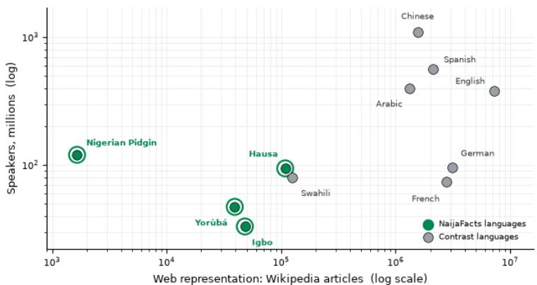
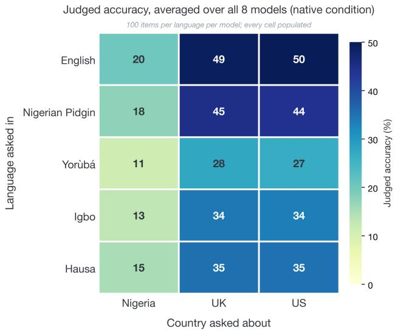
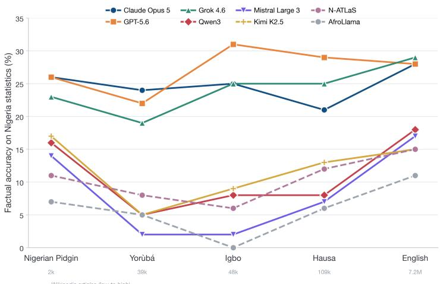
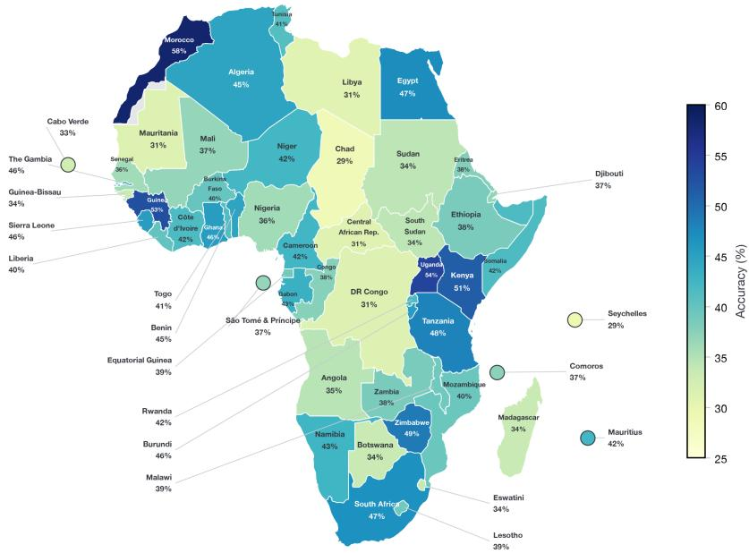
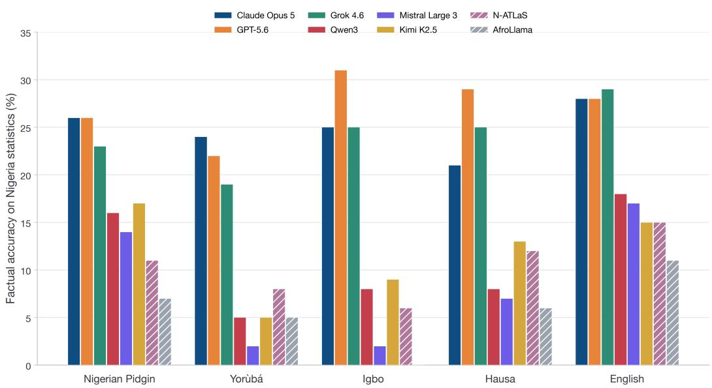
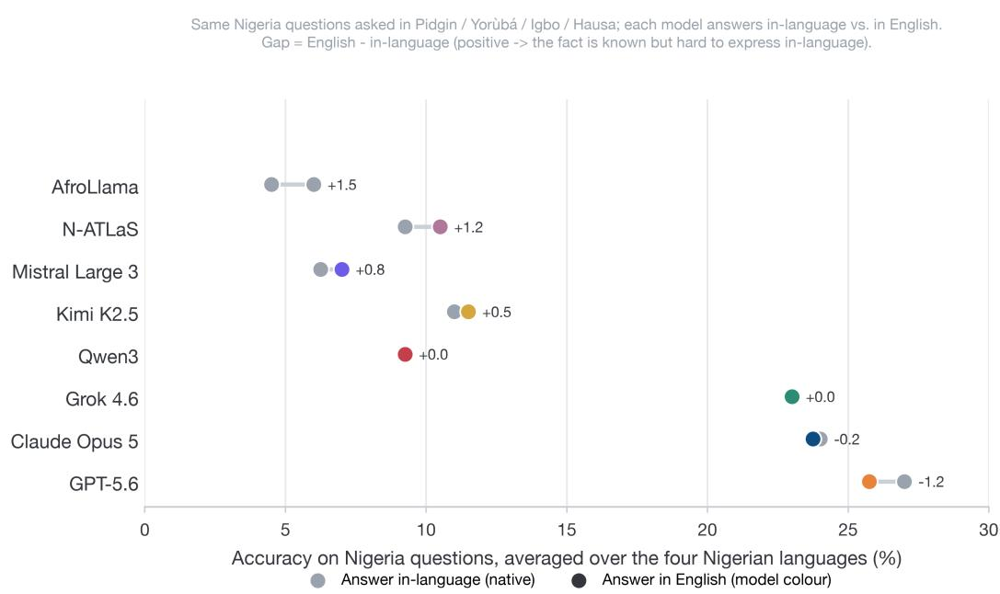
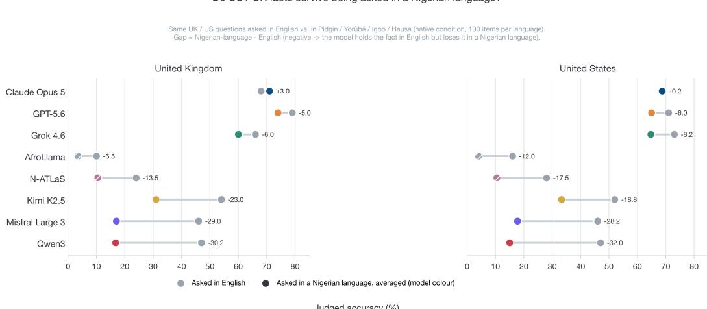

# NaijaFacts: A Framework for Disentangling Language from Knowledge in Facts about Nigeria

Zainab Afolabi AWS FDE zafolabi@amazon.com

Nikita Kozodoi AWS FDE kozodoi@amazon.com

Jack Butler AWS FDE jackbtlr@amazon.com

Babs Khalidson AWS FDE khalbabs@amazon.co.uk

## Abstract

Multilingual benchmarks for African languages mostly translate generic questions into local languages, measuring linguistic competence but not whether models know facts about Africa. We introduce NaijaFacts, a benchmark of factual and statistical questions about Nigeria, authored by native speakers and grounded in authoritative official statistics, with every question available in English, Nigerian Pidgin, Yorùbá, Igbo, and Hausa. Answering similar questions for the UK and US yields a country by language matrix that disentangles a language effect (the model knows the fact but degrades in a low-resource language) from a knowledge effect (the fact is absent in every language). Across eight frontier and Nigeria-adapted models, the knowledge effect dominates: English-query accuracy is 49–50% for the US/UK but 20% for Nigeria. The language effect is smaller and tracks web representation, degrading from English to Yorùbá (9 points on Nigeria, up to 24 on US/UK questions). We find scale does not help: the strongest models reach 66– 79% on the UK and the US but none exceed 31% on Nigerian statistics. Extending to all 54 African countries with our best performing frontier model shows the same profile continent-wide, 96% on culture and 98% on politics against 26% on statistics, so the gap is not specific to Nigeria.

## 1 Introduction

Large language models (LLMs) are increasingly used as sources of factual information, yet their factual reliability is uneven and hard to audit [24, 29]. The problem compounds for low-resource languages and for facts about under-represented regions. The languages spoken across Nigeria illustrate the gap. As Figure 1 shows, they are spoken by tens to hundreds of millions of people, yet occupy a small share of the digital text on which models are pretrained. A model can therefore fail on a Nigerian fact for two different reasons: because it cannot process the language, or because the fact was never well represented in its training data. Existing multilingual benchmarks for African languages, such as AfriQA [22], AfroBench [23], and IrokoBench/AfriMMLU [1], largely evaluate models by translating generic questions into African languages, which does not isolate whether a model holds grounded knowledge about Africa itself.

We argue these two failure modes should be measured separately. Consider the question, what was Nigeria’s total fertility rate in the 2023? A model can fail this in two different ways: it knows the value in English but produces a wrong answer when asked in Yorùbá (a language effect), or it never encoded the value and is wrong in every language (a knowledge effect).

  
Figure 1: The NaijaFacts languages are widely spoken yet barely present in web text. Each point is a language, placed by Wikipedia articles [30] and speakers [7], both on log scales. The green languages have 1–3 orders of magnitude fewer articles than high-resource ones with as many speakers.

We introduce NaijaFacts, a benchmark of 100 factual questions about national demographic and health statistics, authored by native speakers of the Nigerian languages and translated to English. Its ground truth is authoritative, quantitative official statistics, primarily demographic and health indicators from bodies such as the National Population Commission (NPC), the National Bureau of Statistics (NBS), and the Nigeria Demographic and Health Survey (NDHS). Each question is available in English, Nigerian Pidgin, Yorùbá, Igbo, and Hausa, and is asked about three countries, giving 1,500 graded items per model. By holding the fact fixed and varying only the language of the query, NaijaFacts separates the language and knowledge effects.

A confound remains: a Nigeria-versus-English gap could reflect the resource level of the query language instead of the model’s knowledge of the country. We therefore also vary the country a question is asked about, answering the same questions for the United Kingdom and the United States against each country’s own official statistics. Crossing the five query languages with the three countries gives a country × language matrix in which the language effect is read down a column and country familiarity across a row.

The same construction extends beyond Nigeria. Reusing the pipeline, we build verified English question sets of comparable size for each of the 54 African countries, drawing every answer from that country’s own official statistics, so that we can test whether the findings hold continent-wide.

We make three contributions. First, we build a benchmark that pairs official-statistic ground truth with five-language coverage and a country × language design, which separates the language and knowledge failure modes. Second, we show that the knowledge effect dominates: eight models, spanning three geopolitical origins and including two Nigeria-adapted 8B open-weight models, hold UK and US statistics far better than Nigerian ones, and answering in English recovers almost nothing. Third, we extend the construction to all 54 African countries, which shows where the deficit generalises and which facts escape it.

## 2 Related Work

Work outside the Africa-focused research has varied the query language and the subject, but separately. Varying the query language, X-FACTR [11] and mLAMA [13] probe entity-level facts with cloze prompts, Qi et al. [25] show that scale improves per-language accuracy but not crosslanguage consistency, and Aggarwal et al. [2] find on 10,000 country-related facts in 13 languages that a model can recall a fact in one language and fail on it in another. Varying the subject instead, WorldBench [16] asks the same World Bank indicator questions about different countries and finds sizeable geographic disparities, while PopQA [15] and Head-to-Tail [26] show recall drops sharply for entities that are less popular online.

Closest to our domain split, LocalBench [9] reports 56.8% on narrative questions about US counties against under 15.5% on numerical ones, the same asymmetry we measure across Africa (Section 6.3). None of these crosses country with language, and most use knowledge-base triples or indicator databases as ground truth. Two further distinctions we borrow: Calderon et al. [6] separate unencoded facts from encoded but unretrieved ones, which our answer-in-English ablation tests (Section 6.1), and SimpleQA [29] measures atomic-fact correctness.

Benchmarks for African languages cover our languages but mostly not our kind of fact. AfriQA [22], Belebele [4], IrokoBench/AfriMMLU [1], and AfroBench [23] evaluate at increasing scale on translated or generic content, testing whether a model can operate in a language and not whether it knows facts about the region where the language is spoken. Uhura [5] moves toward knowledge with human-translated science and truthfulness questions in six African languages, though its content is still translated from English. Two probes are regionally grounded: GeoMLAMA [32] reports that a country’s native language is not always the best probe of knowledge about it, and BLEnD [17] covers everyday cultural knowledge in 13 languages including Hausa.

Afri-MCQA [27], which is similar to our aim collects 7.5k culturally grounded question-answer pairs written by native speakers across 15 African languages and, like us, sets out to separate linguistic competence from knowledge, using external control tasks (AfriXNLI, AfriMMLU) as the language baseline. It concludes that language understanding is the dominant limitation, whereas we find the knowledge gap dominates. The difference is instructive: their ground truth is everyday culture, which models largely know, whereas ours is the quantitative official record, which they largely do not. NaijaFacts therefore shares its goal and WorldBench’s country axis, and adds two things neither provides. Its ground truth is the quantitative record of a country’s own statistical office, and it varies the country asked about while holding the question and its five language renderings fixed, with a second foreign control that measures raw online prominence on its own. The resource skew behind the whole gap [12, 14] is what Figure 1 depicts and NaijaFacts measures. The nearest neighbours each supply some of these properties but not the combination (Table 7, Appendix F).

## 3 The NaijaFacts Benchmark

NaijaFacts puts 1,500 graded items to every model: 100 factual questions about national demographic and health statistics, each posed in five languages and asked about three countries, Nigeria, the United Kingdom and the United States. The questions are authored in the Nigerian languages, not translated into them, and every answer comes from authoritative official statistics. Because each country is asked the same question, a difference between countries reflects the answer, not question difficulty or phrasing. That is what separates a language effect from a knowledge effect.

## 3.1 Questions

The benchmark begins from 100 questions written by native speakers and statistics experts of Yorùbá, Igbo, Hausa, and Nigerian Pidgin from Obafemi Awolowo University. Authoring natively in each language keeps the questions fluent and culturally natural, and avoids translationese in the low-resource languages. They target demographic and health indicators such as population counts, fertility rates, census methodology, and survey findings. The same team then translates each question into English, and we review it, giving five renderings per question. We lightly edit questions so each is self-contained and answerable for a given country.

## 3.2 Ground truth

For every question we collect a gold answer for each of the three countries. For Nigeria, the native speakers who authored the questions also provide the answers in the Nigerian languages, grounded in the official national statistics of the National Population Commission (NPC), National Bureau of Statistics (NBS), and Nigeria Demographic and Health Survey (NDHS). For the United Kingdom and the United States, where these speakers are not the domain authority, we obtain answers differently. A deep-research assistant retrieves the relevant figure from official statistics, the Office for National Statistics for the UK and the U.S. Census Bureau for the US. The four native speakers who authored the questions then verify and correct each one. Grounding answers in official statistics gives unambiguous, citable ground truth, and for the UK/US answers retrieving the figure before writing it minimises fabrication. Every item records the body, release and reference year behind its answer, and those years span 2006 to 2025. Table 8 breaks the items down by source.

## 3.3 Coverage and item contents

Each question is instantiated for all three countries by substituting the country it refers to, using a country-specific analog where a direct substitution would be unnatural, and this is done in every language. The five language renderings therefore exist for Nigeria, the UK and the US alike, so all fifteen country by language cells hold real items rather than gaps. Each question is stored with its text in each language, the gold answer for each country, the kind of answer it expects (a number, a named entity, a date, or other), and the provenance of each answer. Table 4 summarises the dataset (Appendix D) and Appendix C gives an example item in all five languages.

Two properties qualify what the set measures. First, the statistics cluster by release. A model that has memorised one table can therefore answer many items at once: 81 Nigerian items come from one survey report, and 26 US items from one NCHS report. There are fewer independent facts here than there are items. Second, three items ask for explanations rather than values, such as why a post-enumeration survey follows a census. We keep them so that every item is scored in all five languages and three countries, and we grade them more leniently.

## 3.4 Extension to 54 countries

To test whether the Nigeria results are idiosyncratic, we reuse the same recipe to build an Englishonly set for every African country. Each country gets 118–125 verified items built to a fixed blueprint, which holds the domain mix and answer-type distribution constant so that countries stay comparable. Every answer comes from that country’s own record. Statistical values are fetched programmatically from the World Bank World Development Indicators and the DHS Program APIs, never transcribed by a model, so a numeric gold answer cannot be hallucinated and verifying one is simply a re-fetch. Items whose value is missing or ambiguous at fetch time are dropped, which is why the per-country count varies. Because instruments genuinely disagree, each indicator is pinned to a single instrument across all countries. This yields 6,689 items spanning statistics alongside smaller culture and politics subsets, which lets us ask not just whether the deficit generalises but which kinds of fact it spares (Section 6.3); full provenance is in Appendix G.

## 4 Experimental Setup

We evaluate eight models (Table 5, Appendix E): six frontier models spanning three geopolitical origins (US, EU, CN), and two Nigeria-adapted open-weight models, N-ATLaS and AfroLlama-V1, both 8B Llama-3 fine-tunes that test whether targeted language adaptation helps. Frontier models are accessed through AWS Bedrock; the 8B models run locally on a single 24 GB GPU. All models share one harness and identical prompts, with a 4,096-token answer budget. Sampling is left at each provider’s default for the hosted models, because Claude Opus 5 rejects an explicit temperature or top-p; the two local open-weight models are sampled at temperature 0.1.

The mainline condition is native: each question is asked in the target language and answered in that language, as a speaker would actually use the model; the system prompt requests only the answer, with no explanation (exact prompts in Appendix A). An answer-in-English analysis condition (Section 6.1) keeps the question in the target language but requests the answer in English, testing whether failures are expression failures. For the country analysis, each question explicitly names the country it concerns (with a country-specific analog where a direct swap would be unnatural) and is scored against that country’s gold answer, yielding the country × language matrix of Section 5.

Answers are free text, so we score with light normalisation and then an LLM-as-judge (Claude Opus 5) that returns a binary verdict. It accepts formatting, punctuation and rounding variants of the correct value, and marks materially different figures, wrong entities, refusals and empty responses incorrect. On the cross-country sets the judge additionally receives per-item grading notes listing accepted variants. The full judge prompt is in Appendix B; unresolved verdicts are marked unclear and excluded (9 of 16,000 judgments, under 0.1%). Judged accuracy, broken down by language and country, is the primary metric. We leave human annotators and a second judge to future work.

<table><tr><td rowspan="2">Model</td><td colspan="7">Judged accuracy (%) on NaijaFacts Nigeria-stats</td></tr><tr><td>Size</td><td>English</td><td>Pidgin</td><td>Hausa</td><td>Igbo</td><td>Yorùbá</td><td>Avg. (NG lang)</td></tr><tr><td>GPT-5.6</td><td>一</td><td>28</td><td>26</td><td>29</td><td>31</td><td>22</td><td>27.0</td></tr><tr><td>Claude Opus 5</td><td></td><td>28</td><td>26</td><td>21</td><td>25</td><td>24</td><td>24.0</td></tr><tr><td>Grok 4.6</td><td></td><td>29</td><td>23</td><td>25</td><td>25</td><td>19</td><td>23.0</td></tr><tr><td>Kimi K2.5</td><td></td><td>15</td><td>17</td><td>13</td><td>9</td><td>5</td><td>11.0</td></tr><tr><td>Qwen3</td><td>235B</td><td>18</td><td>16</td><td>8</td><td>8</td><td>5</td><td>9.2</td></tr><tr><td>Mistral Large 3</td><td>675B</td><td>17</td><td>14</td><td>7</td><td>2</td><td>2</td><td>6.2</td></tr><tr><td>N-ATLaS</td><td>8B</td><td>15</td><td>11</td><td>12</td><td>6</td><td>8</td><td>9.2</td></tr><tr><td>AfroLlama-V1</td><td>8B</td><td>11</td><td>7</td><td>6</td><td>0</td><td>5</td><td>4.5</td></tr></table>

Table 1: Main result, the language effect. Judged accuracy on the Nigeria statistics set, 100 items per language, native condition. Frontier models degrade from English in the order Pidgin > Hausa ≈ Igbo > Yorùbá, tracking web representation. The adapted 8B models (bottom block) are far weaker and degrade in the same direction, so language adaptation does not by itself supply Nigerian facts.

## 5 Results

## 5.1 Language effect vs. knowledge effect

Table 1 reports judged accuracy on the Nigeria statistics set by query language in the native condition, with a per-model bar chart in Figure 5 (Appendix H). The language effect is real and tracks resource level. Averaged over the eight models, accuracy falls monotonically from English to Yorùbá in the order given by web representation (Figure 1): Pidgin, an English-derived creole, costs under 3 points, while Yorùbá, the least web-represented of the four, costs 9. The effect is far larger for some models: Claude Opus 5, GPT-5.6, and Grok 4.6 lose 14–35% of their English accuracy in Yorùbá, whereas Qwen3, Kimi K2.5, and Mistral Large 3 lose 67–88%, collapsing to 2–5% absolute.

The knowledge effect dominates the language effect. Even in English, the best model reaches only 29% on Nigerian statistics, while the same three strongest models score 66–79% on the matched US and UK sets. Averaged over models, the English-language gap between the US/UK and Nigeria is 30 points (Table 6), more than three times the largest language effect on the Nigeria set. Most failures on Nigerian facts are therefore not translation failures: the fact is absent in every language. This inverts the ordering Tonja et al. [27] report for African cultural knowledge, where the language effect is the larger of the two, and the domain is what differs. Everyday culture is well represented in web text, so what remains to be lost there is expression, while the statistical record is largely absent, so language has little left to subtract.

Adaptation to Nigerian languages does not supply Nigerian knowledge. The Nigeria-adapted 8B models score 6–15% (N-ATLaS) and 0–11% (AfroLlama-V1), which is unsurprising at 30 to 100 times fewer parameters. They also degrade across languages in the same direction and by much the same proportion: the mean relative drop from English to Yorùbá is 51% for them against 50% for the frontier models. N-ATLaS is the more stable of the two: its coefficient of variation across the five languages is 34% against AfroLlama-V1’s 68%. The most stable models overall are the strongest frontier ones (Claude Opus 5 10%, GPT-5.6 13%, Grok 4.6 15%). Both adapted models are weakest in Igbo, but only one of them lacks Igbo adaptation. AfroLlama-V1 was never trained for it, its card listing Swahili, Xhosa, Zulu, Yorùbá, Hausa and English [10], so its 0% there is unsurprising. N-ATLaS was: its card reports roughly 200,000 Igbo instruction samples, the same budget as Hausa and Yorùbá, and its developers’ own human evaluation rates its Igbo output above its Yorùbá [3]. Yet its factual accuracy is lowest in Igbo at 6% and twice that in Hausa at 12%, so equal adaptation data and better-rated fluency did not translate into better factual recall. Fine-tuning an 8B model on Nigerian languages therefore leaves both gaps open at this scale: it neither supplies the factual record nor buys robustness to the query language. Closing the factual gap appears to need frontier scale or explicit injection of African knowledge during training.

The deficit does not depend on where a model was built. Origin does separate the models on Nigerian statistics: asked in English, the US-built systems average 28.3% against 17.0% for the European and 16.5% for the Chinese ones. But that ordering is the same on the UK and US sets, so it tracks capability rather than whose facts a model holds. The test that would show provenance is a homecountry advantage, and there is none: the three US-built models score +1, −8 and +7 points on the US set relative to the UK set. No model of any origin exceeds 31% on Nigerian statistics. The converse test is unavailable, since the benchmark has no French or Chinese question set.

  
Figure 2: Country × language judged accuracy, averaged over all eight models (native condition). Columns (country asked about) separate far more than rows (language asked in): the knowledge effect dominates. The worst cell is Yorùbá ×Nigeria, where both effects compound.

## 5.2 Country × language

Figure 2 shows accuracy as a function of the country asked about and the language asked in, with the underlying numbers in Table 6 (Appendix H).

The expected ordering of the four conditions holds, model-averaged: A(en, US/UK) ≥ A(NG lang, US/UK) ≥ A(en, Nigeria) ≥ A(NG lang, Nigeria). Since Yorùbá and Nigeria cooccur throughout the training text, asking about Nigeria in Yorùbá might have been the pairing models handle best. It is their weakest instead, at 11.2%.

Read across rows, at fixed language, the Nigeria deficit is present in all five languages but its size varies with the language: 30 points in English and 27 in Pidgin, narrowing to 20–21 in Hausa and Igbo and 16 in Yorùbá. Read down columns, at fixed country, the English-to-Yorùbá drop is 9 points on Nigeria but 22–24 on the UK/US. Both directions point the same way. Language costs most where the model has knowledge to lose, and the country deficit shrinks in the languages where models are already wrong in English.

Pure country prominence, by contrast, is near zero. The US-versus-UK gap at fixed language, our control for raw online prominence, is at most 1 point in any language (50.2 vs 49.2 in English, 26.6 vs 27.5 in Yorùbá). The US is far more present online than the UK, yet the models score them the same, so online prominence cannot be what produces the 30-point Nigeria deficit. What separates Nigeria from these two is how well the models know the country.

## 6 Analysis and Ablations

## 6.1 Answering in English does not recover accuracy

If a model knows a fact but cannot express it in Yorùbá, letting it answer in English should recover the accuracy. We re-ran the full Nigeria set with questions still asked in each Nigerian language but answers requested in English. The effect is negligible: averaged over the eight models, the change from the native condition is +0.5 points for Pidgin, −0.9 for Hausa, −0.2 for Igbo, and +1.9 for Yorùbá. Expression is not the bottleneck. A model that fails on a Nigerian fact asked in Yorùbá does not know the fact, and is not merely unable to say it in Yorùbá. If translation were the problem, removing it would have recovered the accuracy. Figure 6 compares the two conditions per model.

  
Figure 3: Model-averaged judged accuracy per query language against the language’s web representation (Wikipedia articles, log scale), for each country set. Accuracy rises with representation; Pidgin sits far above the trend for its article count, consistent with its legibility through English.

## 6.2 The language effect tracks web representation

Figure 3 plots per-language accuracy against each language’s Wikipedia article count (a proxy for web text availability; Figure 1). Averaged over models, the ordering English > Pidgin > Hausa > Igbo > Yorùbá is monotone on all three country sets. Two details sharpen the picture. First, Pidgin behaves unlike the other three. It has the fewest Wikipedia articles, about 1.6k, yet costs the least, because an English-derived creole is largely legible through English itself. Article counts understate its effective representation. Second, the slope depends on how much knowledge there is to lose: the English-to-Yorùbá drop is 22–24 points on the UK/US sets but only 9 points on Nigeria, where English accuracy is already low. Language degrades the retrieval of knowledge the model has; it cannot subtract knowledge the model lacks. Figure 7 in Appendix H breaks this down per model. Every model holds substantial UK/US knowledge in English, but how much survives a Nigerian query language varies sharply with capability: Claude Opus 5 and GPT-5.6 keep nearly all of it, Qwen3 and Mistral Large 3 keep about a third.

## 6.3 The deficit extends across the continent

We evaluated Claude Opus 5 on the 54 per-country sets of Section 3.4. Figure 4 maps the result, and Table 9 in Appendix H lists every per-country accuracy.

The domain split is large. The model scores 95.8% on culture (689 items) and 97.7% on politics (642), but 26.0% on statistics (5,358). Frontier models hold the salient, narrative facts about African countries, meaning capitals, leaders, and landmarks, while the quantitative record of fertility, mortality, and economic indicators from national statistical offices and DHS surveys is almost entirely absent. A benchmark built from salient facts would conclude that models know Africa well, and grounded statistics show they do not.

Aggregate accuracy is 40.1% (2,681/6,689), but statistics is the bulk of the set, so that number is close to the statistics figure pulled up by two small, easy domains. Per country it ranges from 28.8% (Chad) to 58.4% (Morocco), and Nigeria, Africa’s most populous country, sits below the middle at 36.0%. Nigeria scores higher here than the 28% of Section 5 only because this set mixes in the two easy domains. The deficit is therefore continental and not Nigerian.

The same split appears inside the Nigeria set. Eleven items ask about the statistical system rather than a statistic, such as what TFR abbreviates, and they score 59.8% against 8.6% on the items drawn from the 2024 NDHS. Those eleven are also the only Nigerian items with non-numeric answers, so salience and answer type cannot be separated here.

  
Figure 4: Judged accuracy of Claude Opus 5 on country-grounded English questions across all 54 African countries (118–125 items each), spanning 28.8% (Chad) to 58.4% (Morocco), mean 40.1%.

A stale training cut-off does not explain the deficit. Items about the 2006 census score 9.2%, no better than the 2024 items, so eighteen-year-old Nigerian statistics are absorbed no better than last year’s. Age is not what makes these facts hard.

A similar asymmetry has been measured outside Africa. LocalBench [9] reports 56.8% on narrative questions about US counties against under 15.5% on numerical ones, so part of what we see is a general difficulty with quantitative facts and not specific to Africa. It cannot be the whole story, though, because the UK and US sets beat every African country on comparable facts. Both effects are present, and the geographic one survives after the numeric one is accounted for.

We think the explanation is the form in which these statistics exist, not whether they exist at all. Every figure we grade is public, but it lives inside a PDF report table, and pretraining corpora are dominated by running prose, so a number can be openly available and still barely present in what a model absorbs. That would explain why contamination looks unlikely even though every source is open, and it predicts which fix works: retrieval over authoritative tables rather than more pretraining.

## 7 Conclusion

NaijaFacts is a multilingual benchmark that grounds factual questions about Nigeria in authoritative official statistics and separates two failure modes that translation-based benchmarks conflate: degradation in a low-resource language, and absence of the underlying fact. Asking the same questions about the UK and the US separates country familiarity from language resource level.

The knowledge effect dominates. Asked in English, models average 49–50% on US and UK official statistics but only 20% on the matched Nigerian statistics, and answering in English recovers essentially nothing, so most failures on Nigerian facts reflect missing knowledge and not translation. Scale does not rescue it either: the strongest models reach 66–79% on the UK and US sets while no model exceeds 31% on Nigerian statistics. The language effect is real but smaller and tracks web representation, falling from English through Pidgin, Hausa, and Igbo to Yorùbá, and it costs most where models have knowledge to lose. Across all 54 African countries the profile is the same, with 96% accuracy on culture and 98% on politics against 26% on official statistics.

Serving African users therefore needs authoritative African data, the statistical record in particular, curated into training corpora, not only models adapted to African languages. We release the data, harness, and per-item outputs so the benchmark can be reproduced and extended to further countries.

Our study has a few limitations that future work should address. The Nigeria subset is 100 items per language drawn largely from a few source tables, so it probes grounded statistical knowledge and not broad knowledge, and the 54-country extension is English-only on a single model. Official statistics are also public, so contamination cannot be excluded, though the low accuracy on statistics suggests these tables are poorly absorbed in practice. The next steps follow: extending the multilingual design beyond Nigeria, and testing whether injecting statistical tables during training moves the number that language adaptation leaves fixed.

## References

[1] David Ifeoluwa Adelani, Jessica Ojo, Israel Abebe Azime, et al. IrokoBench: A new benchmark for African languages in the age of large language models. In Proceedings of the 2025 Conference of the Nations of the Americas Chapter of the Association for Computational Linguistics: Human Language Technologies (Volume 1: Long Papers), pages 2732–2757, Albuquerque, New Mexico, April 2025. Association for Computational Linguistics.

[2] Tushar Aggarwal, Kumar Tanmay, Ayush Agrawal, Kumar Ayush, Hamid Palangi, and Paul Pu Liang. Language models’ factuality depends on the language of inquiry. arXiv preprint arXiv:2502.17955, 2025.

[3] Awarri Technologies, Federal Ministry of Communications, Innovation and Digital Economy, and National Centre for Artificial Intelligence and Robotics. N-ATLaS-LLM: A multilingual African language model. https://huggingface.co/NCAIR1/N-ATLaS, 2025. Model card. Llama-3 8B fine-tune with native support for English, Hausa, Igbo and Yoruba; the card reports roughly 200,000 instruction samples for each of the three Nigerian languages. Accessed: 10 September 2026.

[4] Lucas Bandarkar, Davis Liang, Benjamin Muller, et al. The Belebele benchmark: a parallel reading comprehension dataset in 122 language variants. In Proceedings of the 62nd Annual Meeting of the Association for Computational Linguistics (Volume 1: Long Papers), pages 749–775, Bangkok, Thailand, August 2024. Association for Computational Linguistics.

[5] Edward Bayes, Israel Abebe Azime, Jesujoba O. Alabi, et al. Uhura: A benchmark for evaluating scientific question answering and truthfulness in low-resource African languages. In Proceedings of the Fifteenth Language Resources and Evaluation Conference, pages 1485– 1504, 2026.

[6] Nitay Calderon, Eyal Ben-David, Zorik Gekhman, Eran Ofek, and Gal Yona. Empty shelves or lost keys? recall is the bottleneck for parametric factuality. arXiv preprint arXiv:2602.14080, 2026.

[7] David M. Eberhard, Gary F. Simons, and Charles D. Fennig, editors. Ethnologue: Languages of the World. SIL International, Dallas, Texas, 27 edition, 2024. First-language and secondlanguage speaker estimates for Hausa, Yoruba, Igbo and Nigerian Pidgin. Online version: https://www.ethnologue.com. Accessed: 10 September 2026.

[8] Federal Ministry of Health and Social Welfare of Nigeria (FMoHSW), National Population Commission (NPC) [Nigeria], and ICF. Nigeria Demographic and Health Survey 2024. https://dhsprogram.com/publications/ publication-FR395-DHS-Final-Reports.cfm, 2025. Final report FR395. Source for 81 of the 100 Nigerian items.

[9] Zihan Gao, Yifei Xu, and Jacob Thebault-Spieker. LocalBench: Benchmarking LLMs on county-level local knowledge and reasoning. arXiv preprint arXiv:2511.10459, 2025.

[10] Jacaranda Health. AfroLlama3. https://huggingface.co/Jacaranda/AfroLlama\_V1, 2024. Model card. Llama-3 8B fine-tune covering Swahili, Xhosa, Zulu, Yoruba, Hausa and English, with no Igbo adaptation. Accessed: 10 September 2026.

[11] Zhengbao Jiang, Antonios Anastasopoulos, Jun Araki, Haibo Ding, and Graham Neubig. X-FACTR: Multilingual factual knowledge retrieval from pretrained language models. In Proceedings of the 2020 Conference on Empirical Methods in Natural Language Processing

(EMNLP), pages 5943–5959, Online, November 2020. Association for Computational Linguistics.

[12] Pratik Joshi, Sebastin Santy, Amar Budhiraja, Kalika Bali, and Monojit Choudhury. The state and fate of linguistic diversity and inclusion in the NLP world. In Proceedings of the 58th Annual Meeting of the Association for Computational Linguistics, pages 6282–6293, Online, July 2020. Association for Computational Linguistics.

[13] Nora Kassner, Philipp Dufter, and Hinrich Schütze. Multilingual LAMA: Investigating knowledge in multilingual pretrained language models. In Proceedings of the 16th Conference of the European Chapter of the Association for Computational Linguistics: Main Volume, pages 3250–3258, Online, April 2021. Association for Computational Linguistics.

[14] Sneha Kudugunta, Isaac Rayburn Caswell, Biao Zhang, et al. MADLAD-400: A multilingual and document-level large audited dataset. In Thirty-seventh Conference on Neural Information Processing Systems Datasets and Benchmarks Track, 2023.

[15] Alex Mallen, Akari Asai, Victor Zhong, Rajarshi Das, Daniel Khashabi, and Hannaneh Hajishirzi. When not to trust language models: Investigating effectiveness of parametric and non-parametric memories. In Proceedings of the 61st Annual Meeting of the Association for Computational Linguistics (Volume 1: Long Papers), pages 9802–9822, Toronto, Canada, July 2023. Association for Computational Linguistics.

[16] Mazda Moayeri, Elham Tabassi, and Soheil Feizi. WorldBench: Quantifying geographic disparities in LLM factual recall. In Proceedings of the ACM Conference on Fairness, Accountability, and Transparency (FAccT), 2024.

[17] Junho Myung, Nayeon Lee, Yi Zhou, et al. BLEnD: A benchmark for llms on everyday knowledge in diverse cultures and languages. In Advances in Neural Information Processing Systems 37: Datasets and Benchmarks Track, 2024.

[18] National Bureau of Statistics (Nigeria). Official statistical releases. https://www. nigerianstat.gov.ng, 2026. Source for the eleven Nigerian items that name no census or survey edition. Accessed: 10 September 2026.

[19] National Center for Health Statistics (US). National center for health statistics data releases, reference years 2022–2024. https://www.cdc.gov/nchs, 2026. Source for the US vitalstatistics and health items. Accessed: 10 September 2026.

[20] National Population Commission (Nigeria). Population and housing census documentation, 2006 and 2023 editions. https://nationalpopulation.gov.ng, 2026. Three Nigerian items draw on the 2006 Population and Housing Census; five draw on the documented design of the 2023 census exercise, its enumeration-area procedure and questionnaire sections rather than any enumeration outcome. Accessed: 10 September 2026.

[21] Office for National Statistics (UK) and National Records of Scotland. Official statistical releases, reference years 2021–2025. https://www.ons.gov.uk, 2026. UK gold answers. Census 2021 for England and Wales and Scotland’s Census 2022 supply the census items; the remainder are ONS mid-year estimates and topic releases with reference years 2021 to 2025. The release URL for each item ships with the benchmark. Accessed: 10 September 2026.

[22] Odunayo Ogundepo, Tajuddeen R. Gwadabe, Clara E. Rivera, et al. AfriQA: Cross-lingual open-retrieval question answering for African languages. In Findings of the Association for Computational Linguistics: EMNLP 2023, pages 14957–14972, Singapore, December 2023. Association for Computational Linguistics.

[23] Jessica Ojo, Odunayo Ogundepo, Akintunde Oladipo, et al. AfroBench: How good are large language models on African languages? In Findings of the Association for Computational Linguistics: ACL 2025, 2025.

[24] OpenAI. Gpt-4 technical report. ArXiv, abs/2303.08774, 2023.

[25] Jirui Qi, Raquel Fernández, and Arianna Bisazza. Cross-lingual consistency of factual knowledge in multilingual language models. In Proceedings of the 2023 Conference on Empirical Methods in Natural Language Processing, pages 10650–10666, Singapore, December 2023. Association for Computational Linguistics.

[26] Kai Sun, Yifan Xu, Hanwen Zha, Yue Liu, and Xin Luna Dong. Head-to-tail: How knowledgeable are large language models (LLMs)? A.K.A. will LLMs replace knowledge graphs? In Proceedings of the 2024 Conference of the North American Chapter of the Association for Computational Linguistics: Human Language Technologies (Volume 1: Long Papers), pages 311–325, Mexico City, Mexico, June 2024. Association for Computational Linguistics.

[27] Atnafu Lambebo Tonja, Srija Anand, Emilio Villa-Cueva, et al. Afri-MCQA: Multimodal cultural question answering for African languages. In Proceedings ofthe 64th Annual Meeting of the Association for Computational Linguistics (Volume 1: Long Papers), pages 40249– 40282, 2026.

[28] U.S. Census Bureau. Decennial census and american community survey releases, reference years 2020–2025. https://www.census.gov, 2026. US gold answers. The 2020 Decennial Census supplies the census items; the remainder are American Community Survey and population-estimate releases. The release URL for each item ships with the benchmark. Accessed: 10 September 2026.

[29] Jason Wei, Karina Nguyen, Hyung Won Chung, et al. Measuring short-form factuality in large language models (SimpleQA), 2024.

[30] Wikimedia Foundation. List of wikipedias. https://meta.wikimedia.org/wiki/List\_ of\_Wikipedias, 2026. Article counts as of the snapshot accessed 24 August 2026.

[31] World Health Organization and UNICEF. Who/unicef joint monitoring programme for water supply, sanitation and hygiene. https://washdata.org, 2025. Source for the UK and US water and sanitation items. Accessed: 10 September 2026.

[32] Da Yin, Hritik Bansal, Masoud Monajatipoor, Liunian Harold Li, and Kai-Wei Chang. GeoMLAMA: Geo-diverse commonsense probing on multilingual pre-trained language models. In Proceedings of the 2022 Conference on Empirical Methods in Natural Language Processing, pages 2039–2055, Abu Dhabi, United Arab Emirates, December 2022. Association for Computational Linguistics.

## A Prompt templates

Every model sees the same two prompts in every condition. Placeholders in braces are substituted per item: {language} names the question’s language (English, Hausa, Yoruba, Igbo, or Nigerian Pidgin) and {question} carries the question text in that language.

## System prompt (all conditions)

You are a factual question-answering assistant. IMPORTANT: Reply with ONLY the answer itself, no explanations, no preamble, no ‘The answer is...’, no additional context.   
For numbers: give just the number (e.g., ‘200 million’ or ‘45.2%’).   
For names/entities: give just the name (e.g., ‘Abuja’ or ‘National Population Commission’).

## User prompt (native condition)

Answer this question in {language}: {question} Output format: Give only the answer, nothing else.

The answer-in-English condition (Section 6.1) changes one word of the user prompt, so that the first line reads “Answer this question in English:” while the question itself stays in the target language. Everything else, including the system prompt, is unchanged.

## B LLM-as-judge prompt

The judge (Claude Opus 5) receives the system prompt below and returns a single-token verdict.   
The user turn supplies the question, the gold answer, and the model’s answer.

Judge system prompt   
You are an evaluator assessing whether a model’s answer is factually correct compared to the ground truth.   
Your task: Determine if the model’s answer contains the same core factual information as the expected   
answer.   
IMPORTANT – Mark as CORRECT if:   
The core fact matches, even with different wording   
– Numbers are the same or very close (89% = 88.9%, 59597542 = 59,597,300)   
– Minor additions/omissions of words like “The”, “a”, “an”, articles   
The meaning is the same even if the actual words are different   
– Missing or extra punctuation (periods, commas)   
– Missing units when the number is correct (“1.41” = “1.41 children per woman”)   
– Abbreviations match full names (“ONS” = “Office for National Statistics”)   
– Extra context is provided but core answer is correct   
Mark as INCORRECT ONLY if:   
– The factual content is genuinely wrong   
– The answer is empty or refuses to answer   
– A completely different fact is stated   
Examples of CORRECT matches:   
“Office for National Statistics” vs “The Office for National Statistics.”   
“Every 10 years” vs “Every 10 years.”   
“89%” vs “88.9%”   
“56,489,800” vs “56,489,800 people.”   
“Census Act 1920” vs “The Census Act 1920.”   
“London” vs “London.”   
Respond with ONLY: CORRECT or INCORRECT

For the native condition the judge compares in the answer’s language, and for the answer-in-English condition it compares in English. On the 54-country sets the user turn carries one extra block, the item’s grading notes, which name the answer variants to accept and the plausible-sounding answers the sources positively contradict. Those notes override the defaults above, so an answer the notes rule out is marked incorrect even when it looks reasonable (Section 4).

## C Example items

Table 2 shows one NaijaFacts item in all five languages. Every item carries the same gold answer across languages, so any accuracy difference between languages on the same item is attributable to the query language alone. Diacritics are reproduced from the source data. Table 3 shows a numeric item in the same format, together with its gold answer in each language and how many model answered it correctly, which reproduces the paper’s main language ordering within a single item.

<table><tr><td>Language</td><td>Question (gold answer: National Population Commission)</td></tr><tr><td>English</td><td>What does NPC stand for in Nigeria&#x27;s population statistics system?</td></tr><tr><td>Pidgin</td><td>Wetin be di NPC stand for for Naija population statistics?</td></tr><tr><td>Yorùbá</td><td>Kini NPC duro fun ninu eto isiro awon eniyan Naijiria?</td></tr><tr><td>Igbo</td><td>Gn ka NPC ptara n&#x27;usoro on gg nd mmad nke Naijira?</td></tr><tr><td>Hausa</td><td>Menene ma&#x27;anar NPC a tsarin kididdigar yawan jama&#x27;a na Najeriya?</td></tr><tr><td colspan="2">Table 2: An example NaijaFacts item across the five languages. Most items have numeric gold answers drawn from official statistics (e.g. “How many population classifications were used in the 2006 Nigeria census?&quot; with gold answer “Eight&quot;); entity items such as this one are included for</td></tr></table>

<table><tr><td>Language</td><td>Question</td><td>Gold answer</td><td>Models correct</td></tr><tr><td>English</td><td>What age range was used for all Nigerian women interviewed in the 2024 NDHS?</td><td>15 to 49 years.</td><td>8/8</td></tr><tr><td>Pidgin</td><td>Wetin be di age range wey dem use for all Naija wumen wey dem inter- view for 2024 NDHS?</td><td>15 to 49 years.</td><td>7/8</td></tr><tr><td>Hausa</td><td>Wane adadin shekarun matan Nageriya aka yi wa tambayoyi a NDHS 2024?</td><td>Shekaru 15 zuwa 49.</td><td>6/8</td></tr><tr><td>Igbo</td><td>Kedu oke afo e jiri maka m nwanyi Naijira niile ndi a gbara ajj n na NDHS 2024?</td><td>Afę 15 ruo 49.</td><td>5/8</td></tr><tr><td>Yorùbá</td><td>Kini iwon ojo-ori awon obinrin ni Naijiria ti won ba sorę ninu NDHS 2024?</td><td>Qdun 15 si 49.</td><td>4/8</td></tr></table>

Table 3: A numeric item in all five languages, with the gold answer as it appears in each language and the number of the eight evaluated models judged correct on it. The fact is identical in every row, and the answer is a short figure that leaves little room for expression difficulty, yet the count falls monotonically in exactly the order reported in Section 5.1: English, Pidgin, Hausa, Igbo, Yorùbá. Note that the gold answer is itself translated, so numerals stay Arabic while the surrounding word change (O. dun, Afo. , Shekaru); the judge accepts any of these forms.

<table><tr><td>Component</td><td>Value</td></tr><tr><td>Questions</td><td>100, authored by native speakers</td></tr><tr><td>Question languages</td><td>Yorùbá, Igbo, Hausa, Nigerian Pidgin (native); English (translated)</td></tr><tr><td>Answer countries</td><td>Nigeria (NPC/NBS/NDHS), UK (ONS), US (Census Bureau/NCHS)</td></tr><tr><td>Answer collection</td><td>Nigeria: native speakers, in-language; UK/US: deep-research, verified</td></tr><tr><td>Evaluation cells</td><td>100 × 5 languages × 3 countries = 1,500 per model</td></tr><tr><td>Cross-country extension</td><td>54 African countries, 118–125 English items each (6,689 total)</td></tr></table>

Table 4: NaijaFacts at a glance. The same questions are answered for three countries, so the country comparison is matched by construction; the 54-country extension instead matches a fixed blueprint (domain mix, answer-type distribution) with each country’s facts drawn from its own official sources.

## D Dataset summary

Table 4 summarises NaijaFacts and its cross-country extension. The two halves are matched in different ways, which is worth keeping in mind when reading any comparison between them. The Nigeria, UK and US sets ask the same 100 questions of all three countries, so a difference between countries is attributable to the answer alone. The 54-country extension cannot work that way, because a question about a national census has no counterpart in a country that has never run one, so it instead holds the domain mix and answer-type distribution constant and draws each country’s answers from its own sources.

## E Models evaluated

Table 5 lists the eight models, their origins and their identifiers. The frontier set spans three geopolitical origins so that we can ask whether a model’s origin affects whose facts it holds (Section 5.1), and the two Nigeria-adapted models are both Llama-3-8B fine-tunes, which lets us separate the effect of language adaptation from the effect of scale. Parameter counts for the proprietary models are undisclosed. Table 6 then gives the model-averaged country by language matrix discussed in Section 5.2.

<table><tr><td>Model</td><td>Origin</td><td>Identifier</td><td>Size</td></tr><tr><td colspan="4">Frontier (proprietary, via AWS Bedrock)</td></tr><tr><td>Claude Opus 5</td><td>US</td><td>anthropic.claude-opus-5</td><td></td></tr><tr><td>GPT-5.6</td><td>US</td><td>openai.gpt-5.6-sol</td><td></td></tr><tr><td>Grok 4.6</td><td>US</td><td>xai.grok-4.6</td><td></td></tr><tr><td>Mistral Large 3</td><td>EU</td><td>mistral.mistral-large-3-675b-instruct</td><td>675B</td></tr><tr><td>Qwen3</td><td>CN</td><td>qwen.qwen3-235b-a22b-2507</td><td>235B</td></tr><tr><td>Kimi K2.5</td><td>CN</td><td>moonshotai.kimi-k2.5</td><td></td></tr><tr><td colspan="4">Nigeria-adapted (open weight, Llama-3-8B fine-tunes, local)</td></tr><tr><td>N-ATLaS</td><td>NG</td><td>NCAIR1/N-ATLaS</td><td>8B</td></tr><tr><td>AfroLlama-V1</td><td>NG</td><td>Jacaranda/AfroLlama_V1</td><td>8B</td></tr></table>

Table 5: Models evaluated. The frontier set spans three geopolitical origins (US, EU, CN), enabling the question of whether a model’s origin affects whose facts it encodes; the Nigeria-adapted models are 8B Llama-3 fine-tunes targeting Nigerian languages. Proprietary parameter counts are undisclosed. Cross-region inference-profile prefixes are omitted from the identifiers.

<table><tr><td></td><td colspan="2">Country asked about</td></tr><tr><td>Language asked in</td><td>Nigeria</td><td>UK</td></tr><tr><td>English</td><td>20.1</td><td>49.2 35.5</td></tr><tr><td>Nigerian lang. (avg)</td><td>14.3</td><td></td></tr><tr><td>Pidgin</td><td>17.5</td><td>34.9 44.2</td></tr><tr><td>Hausa</td><td>15.1</td><td>35.1</td></tr><tr><td>Igbo</td><td>13.2</td><td>33.5 26.6</td></tr><tr><td>Yorùbá</td><td>11.2</td><td></td></tr></table>

Table 6: Country by language matrix, judged accuracy (%) averaged over all eight models (native condition; 100 items per language per country per model). Reading across a row isolates country familiarity at fixed language: the Nigeria deficit is ∼30 points in English and persists in every language. Reading down a column isolates the language effect at fixed country: the drop from English to Yorùbá is 9 points on Nigeria but 22–24 points on the UK/US, where models actually hold the knowledge. The near-identical UK and US columns bound the pure prominence effect at ≲1 point.

## F Benchmark comparison

Table 7 compares NaijaFacts against the nearest related benchmarks along the three properties discussed in Section 2: grounded statistical answers, Nigerian-language coverage, and a matched coun try × language design. No prior benchmark combines all three, which is the gap NaijaFacts fills. The nearest neighbours each supply one or two: WorldBench varies the country but uses indicator databases and English only, Afri-MCQA authors natively in African languages but grounds its answers in everyday culture, and LocalBench grounds answers in official statistics but for US counties in English.

## G Sources and provenance

Table 8 gives the per-country breakdown. All sources are public official statistics. The 54-country extension instead draws on the World Bank World Development Indicators and the DHS Program APIs (Section 3.4); one example of the instrument disagreement that forces each indicator to a single source is that WDI and national DHS reports differ on total fertility rates.

## H Per-language and per-model results

Three tables carry the full numbers behind Sections 5 and 6: Table 1 the per-model by per-language breakdown on the Nigeria set, Table 6 the model-averaged country by language matrix, and Table 9 the per-country accuracies for all 54 African countries.

<table><tr><td>Benchmark</td><td># Afr. lang.</td><td>Facts about Africa?</td><td>Ground-truth source</td><td>Country × lang.?</td><td>Dominant task(s)</td></tr><tr><td>AfriQA [22]</td><td>10</td><td>partial</td><td>Wikipedia / web</td><td>x</td><td>Cross-lingual QA</td></tr><tr><td>Belebele [4]</td><td>29</td><td>x</td><td>translated passages</td><td>x</td><td>Reading comprehension</td></tr><tr><td>IrokoBench [1]</td><td>17</td><td>x</td><td>translated (MMLU/MGSM/</td><td>x</td><td>MMLU, Math, NLI</td></tr><tr><td>AfroBench [23]</td><td>64</td><td>x</td><td>NLI) aggregated / translated</td><td>x</td><td>15NLP tasks</td></tr><tr><td>Uhura [5]</td><td>6</td><td>x</td><td>translated ARC / TruthfulQA</td><td>x</td><td>Science QA, truthfulness</td></tr><tr><td>Afri-MCQA [27]</td><td>15</td><td>✓ (culture)</td><td>native-authored culture QA</td><td>x</td><td>Multimodal cultural QA</td></tr><tr><td>GeoMLAMA [32]</td><td>1 (Swahili)</td><td>partial</td><td>templated commonsense</td><td>partial</td><td>Commonsense probing</td></tr><tr><td>BLEnD [17]</td><td>1 (Hausa)</td><td>partial</td><td>hand-crafted culture QA</td><td>x</td><td>Everyday knowledge</td></tr><tr><td>WorldBench [16]</td><td>x</td><td>partial</td><td>World Bank indicators</td><td>X (country only)</td><td>Country factual recall</td></tr><tr><td>LocalBench [9]</td><td>x</td><td>x</td><td>US Census, news, Reddit</td><td>X (county only)</td><td>Local knowledge, reasoning</td></tr><tr><td>NaijaFacts (Ours)</td><td>5</td><td>√(Nigeria)</td><td>official statistics (NPC, NBS, NDHS)</td><td>√ (NG/UK/US)</td><td>Grounded factual / stats QA</td></tr></table>

Table 7: NaijaFacts in context. Unlike prior work, NaijaFacts grounds every item in authoritative national statistics about Nigeria and crosses the country asked about with the language asked in. GeoMLAMA and BLEnD are the closest geo/cultural probes but use commonsense or everyday-culture ground truth and do not provide a matched country by language control. Afri-MCQA shares our aim of separating language from knowledge but grounds answers in culture; LocalBench grounds answers in official statistics but for US counties in English only. Belebele reports 122 language variants in total but no African subtotal; the 29 given here is our own count of its variants indigenous to or principally spoken in Africa, which includes Afrikaans and the Moroccan and Egyptian Arabic variants.

The figures below add the per-model detail the body figures average away. Figure 5 gives the language effect model by model, Figure 6 the answer-in-English comparison of Section 6.1, and Figure 7 the same language effect measured on the UK and US sets, where the models demonstrably hold the knowledge. Per-item model outputs and judge verdicts for every run are released with the code and data.

  
Figure 5: Judged accuracy on the Nigeria statistics set by query language (native condition), one bar per model within each language cluster; languages ordered by web representation and Nigeriaadapted models hatched. Frontier models degrade as representation falls, while the adapted 8B models stay flat across languages at a lower level.

<table><tr><td>Country</td><td>Source body</td><td>Items</td></tr><tr><td rowspan="4">Nigeria</td><td>Nigeria Demographic and Health Survey 2024 [8]</td><td>81</td></tr><tr><td>NPC census documentation, 2006 and 2023 [20]</td><td>8</td></tr><tr><td>NBS releases carrying no edition year [18]</td><td>11</td></tr><tr><td>Office for National Statistics [21]</td><td>56</td></tr><tr><td rowspan="6">UK</td><td>UK government departments</td><td>11</td></tr><tr><td>National Records of Scotland and Scotland&#x27;s Census [21]</td><td>9</td></tr><tr><td>WHO/UNICEF Joint Monitoring Programme [31]</td><td>8</td></tr><tr><td>UK legislation</td><td>5</td></tr><tr><td>other official sources</td><td>11</td></tr><tr><td></td><td></td></tr><tr><td rowspan="5">US</td><td>National Center for Health Statistics [19]</td><td>42 38</td></tr><tr><td>U.S. Census Bureau [28] WHO/UNICEF Joint Monitoring Programme [31]</td><td>9</td></tr><tr><td>U.S. Environmental Protection Agency</td><td>4</td></tr><tr><td></td><td></td></tr><tr><td>other official sources</td><td>7</td></tr></table>

Table 8: Where the gold answers come from, by country. Reference years span 2006 to 2025 and are recorded in the bibliography entry for each body. Every UK and US item additionally stores the URL of the specific release it was taken from, and those URLs are distributed with the benchmark; the Nigerian items name their census or survey edition in the question text.

Do US / UK facts survive being asked in a Nigerian language?  
Does answering in English recover Nigerian facts?  
  
Figure 6: Answering in English does not recover Nigerian facts. For each model, accuracy on Nigeria questions averaged over the four Nigerian languages when answering in-language (grey) versus in English (colour). The gaps are within ±2 points for every model: failures reflect missing knowledge, not an inability to express the answer in-language.

  
Figure 7: What a Nigerian query language costs on facts the models demonstrably hold. For each model, accuracy on the UK (left) and US (right) sets when the question is asked in English (grey) versus averaged over the four Nigerian languages (colour). Unlike Figure 6, where the gaps vanish because the knowledge is missing in the first place, here the gaps are large and negative for the weaker models, and they widen as overall capability falls: Claude Opus 5 and GPT-5.6 carry foreign facts across languages nearly intact (−6 to +3 points), whereas Qwen3 and Mistral Large 3 lose roughly two thirds of theirs (−28 to −32). This is the language effect measured where there is knowledge to lose.

<table><tr><td>Country</td><td>n</td><td>Acc.</td><td>Country</td><td>n</td><td>Acc.</td><td>Country</td><td>n</td><td>Acc.</td></tr><tr><td>Algeria</td><td>125</td><td>44.8</td><td>Eswatini</td><td>124</td><td>33.9</td><td>Niger</td><td>123</td><td>42.3</td></tr><tr><td>Angola</td><td>124</td><td>34.7</td><td>Ethiopia</td><td>125</td><td>38.4</td><td>Nigeria</td><td>125</td><td>36.0</td></tr><tr><td>Benin</td><td>125</td><td>44.8</td><td>Gabon</td><td>125</td><td>43.2</td><td>Rwanda</td><td>125</td><td>41.6</td></tr><tr><td>Botswana</td><td>125</td><td>33.6</td><td>Ghana</td><td>125</td><td>45.6</td><td>Senegal</td><td>125</td><td>36.0</td></tr><tr><td>Burkina Faso</td><td>123</td><td>39.8</td><td>Guinea</td><td>125</td><td>52.8</td><td>Seychelles</td><td>119</td><td>29.4</td></tr><tr><td>Burundi</td><td>125</td><td>45.6</td><td>Guinea-Bissau</td><td>122</td><td>33.6</td><td>Sierra Leone</td><td>125</td><td>45.6</td></tr><tr><td>Cabo Verde</td><td>123</td><td>32.5</td><td>Kenya</td><td>125</td><td>51.2</td><td>Somalia</td><td>125</td><td>41.6</td></tr><tr><td>Cameroon</td><td>125</td><td>42.4</td><td>Lesotho</td><td>125</td><td>39.2</td><td>South Africa</td><td>124</td><td>46.8</td></tr><tr><td>Central African Rep.</td><td>119</td><td>31.1</td><td>Liberia</td><td>125</td><td>40.0</td><td>South Sudan</td><td>125</td><td>34.4</td></tr><tr><td>Chad</td><td>118</td><td>28.8</td><td>Libya</td><td>120</td><td>30.8</td><td>Sudan</td><td>122</td><td>34.4</td></tr><tr><td>Comoros</td><td>123</td><td>37.4</td><td>Madagascar</td><td>125</td><td>33.6</td><td>São Tomé &amp; Príncipe</td><td>125</td><td>36.8</td></tr><tr><td>Congo (Rep.)</td><td>125</td><td>37.6</td><td>Malawi</td><td>125</td><td>39.2</td><td>Tanzania</td><td>125</td><td>48.0</td></tr><tr><td>Côte d’Ivoire</td><td>125</td><td>41.6</td><td>Mali</td><td>125</td><td>36.8</td><td>The Gambia</td><td>122</td><td>45.9</td></tr><tr><td>Djibouti</td><td>124</td><td>37.1</td><td>Mauritania</td><td>125</td><td>31.2</td><td>Togo</td><td>121</td><td>41.3</td></tr><tr><td>DR Congo</td><td>125</td><td>31.2</td><td>Mauritius</td><td>125</td><td>42.4</td><td>Tunisia</td><td>124</td><td>41.1</td></tr><tr><td>Egypt</td><td>125</td><td>47.2</td><td>Morocco</td><td>125</td><td>58.4</td><td>Uganda</td><td>124</td><td>54.0</td></tr><tr><td>Equatorial Guinea</td><td>125</td><td>39.2</td><td>Mozambique</td><td>124</td><td>39.5</td><td>Zambia</td><td>125</td><td>38.4</td></tr><tr><td>Eritrea</td><td>119</td><td>37.8</td><td>Namibia</td><td>122</td><td>42.6</td><td>Zimbabwe</td><td>125</td><td>48.8</td></tr></table>

Table 9: Per-country factual accuracy of Claude Opus 5 on the NaijaFacts cross-country set, judged by an LLM grader and listed alphabetically. n is the number of verified items for that country, which ranges from 118 to 125 because ambiguous items were dropped during verification, so accuracy is reported as a proportion. Overall: 2681/6689 = 40.1%.