# On the Design of Hyper-Connections: Simplification, Stability, and Scalability

Xiangdong Zhang1,2, Xiaohan Qin1,2, Sunan Zou2,3, Tuo Dai2, Bizhao Shi2, Zhuo Xia1,2, Yebin Yang1,2, Yizhou Chen2, Yuliang Liu4, Yu Cheng5, Junchi Yan1,†

1School of AI, Shanghai Jiao Tong University 2Dots Studio, Xiaohongshu Inc.

3School of CS, Peking University 4Independent Researcher

5Nanyang Technological University

†Corresponding author: yanjunchi@sjtu.edu.cn.

Hyper-Connections (HC) architectures are increasingly adopted in frontier language models, yet their components remain insuficiently understood and introduce non-negligible training overhead. In this work, we systematically study the HC architecture to understand its components and identify simpler, more eficient designs. We find that learned read/write gating without mixing and unconstrained mixing with fixed gates form two efective interaction groups: either alone achieves performance comparable to mHC. We also identify repeated access to the expanded residual state as a major source of training overhead, even without mixing. These findings lead to SimpleHC, which simplifies the architecture by removing residual mixing and simplifies execution through shared memory access, using the resulting additive structure and shared gate inputs. Layer-specific gates share a group-entry state, enabling batched reads and deferred writes; scalar corrections exactly preserve preceding sublayer output contributions. Our analyses support both the retained residual structure and the design of shared memory access. SimpleHC incurs only 2.4% extra end-to-end training time over a vanilla residual baseline at the largest tested scale. It maintains performance comparable to mHC when scaling from 15B to 30B MoE models, exhibits smoother gradient dynamics during standard training, and remains stable under stress. We hope SimpleHC will encourage a broader pursuit of simplicity in foundation model design, making performance gains more accessible and practical at scale.

§ Code https://github.com/aHapBean/SimpleHC # Email zhangxiangdong@sjtu.edu.cn

4 dots studio

## 1 Introduction

Residual connections support optimization and information propagation in modern language models (He et al., 2016a,b; Vaswani et al., 2017; Grattafiori et al., 2024; Yang et al., 2025; Liu et al., 2024b), and recent work improves language modeling and depth utilization by enriching this pathway (Pagliardini et al., 2024; Xiao et al., 2025; Team et al., 2026; Qin et al., 2026). Hyper-Connections (HC) (Zhu et al., 2025) introduce multiple residual streams with learned read, write, and mixing operations for flexible information routing. The manifold-constrained variant, mHC (Xie et al., 2025), constrains residual mixing to improve training stability at scale. HC-based architectures, particularly mHC, have been adopted in frontier language models (Xu et al., 2026; Zeng et al., 2026). Despite the growing adoption, these architectures remain insuficiently understood and costly to train: their gating and mixing operations introduce architectural complexity and non-negligible execution overhead, even under eficient implementations (Xie et al., 2025).

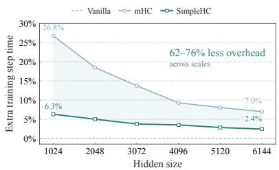  
(a) Training overhead

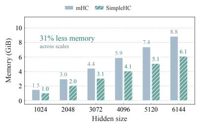  
(b) Saved activation storage

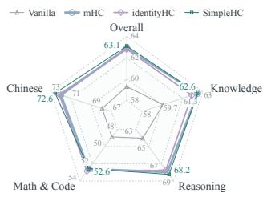  
(c) Downstream performance  
Figure 1 SimpleHC reduces training overhead while retaining competitive performance. (a) Additional training overhead relative to baseline with eficient implementations. (b) Storage retained for backward at sublayer boundaries (Section 5.5). (c) Average scores on 30B MoE models (Table 4).

A key source of this overhead is repeated access to the expanded residual state: at every sublayer, HC-style mappings read and write n streams of width C to generate gates, aggregate inputs, and propagate updates. This memory trafic incurs costs not captured by FLOPs alone. In our end-to-end experiments with an eficient implementation, mHC adds 7% − 27% training time over a vanilla baseline (Figure 3(a)), despite adding less than 1% FLOPs. This motivates reconsidering the underlying read, write, and mixing interactions. We ask: Can a simpler Hyper-Connections design reduce execution cost while preserving model quality and training stability at scale?

In this work, we systematically study the Hyper-Connections architecture through three components: read gates, write gates, and residual mixing. We find that unconstrained mixing improves quality, but Sinkhorn constraints substantially reduce its benefit. Learned read/write gating without mixing and unconstrained mixing with fixed gates each achieve quality comparable to mHC, with further gains from combining them. Our analysis also highlights the propagation risks of unconstrained mixing, leading us to select learned read/write gating with identity transitions as a minimal efective structure that retains competitive quality while avoiding these risks.

Without residual mixing, the additive structure lets scalar corrections exactly recover preceding output contributions for given gates, without materializing intermediate nC-dimensional states. Gate generation, however, still accesses the updated state at every sublayer. We reduce these accesses by computing layerspecific gates from a common group-entry state, consolidating reads and deferring writes across sublayers. We call this execution scheme shared memory access.

Together, these findings lead to SimpleHC, which simplifies the architecture through learned read/write gates without mixing and simplifies execution through shared memory access. We also develop specialized kernels to translate this simplicity into training eficiency. As shown in Figure 1(a), SimpleHC incurs only 2.4% additional training cost at the largest tested scale and halves memory trafic from 18C to 9C per sublayer relative to fused mHC. It achieves downstream performance comparable to mHC and identityHC on 15B and 30B MoE models (Figure 1(c)). Analyses in Section 6 further support the design of SimpleHC. It also exhibits smoother gradient dynamics during training and remains stable under stress-test settings.

## 2 Preliminaries

Hyper-Connections (HC, dynamic variant) (Zhu et al., 2025) and Manifold-Constrained HC (mHC) (Xie et al., 2025) share a multi-stream residual structure. The two methods difer in how their coeficients are conditioned and parameterized, and whether residual mixing is constrained.

Each Transformer block contains two sublayers: attention and FFN/MoE. Let $\boldsymbol { X } _ { l } \in \mathbb { R } ^ { n \times C }$ contain n width-C residual streams entering sublayer l. All vectors are column vectors; vec $( X _ { l } ) \in \mathbb { R } ^ { n C \times 1 }$ concatenates streams in row order. We omit token and batch indices unless stated; I denotes the $n \times n$ identity matrix. Both methods compute $u _ { l } = X _ { l } ^ { \top } h _ { l } ^ { \mathrm { p r e } } , o _ { l } = F _ { l } ( u _ { l } )$ , and $X _ { l + 1 } = H _ { l } ^ { \mathrm { r e s } } X _ { l } + h _ { l } ^ { \mathrm { p o s t } } o _ { l } ^ { \top }$ . The read and write gates $h _ { l } ^ { \mathrm { p r e } } , h _ { l } ^ { \mathrm { p o s t } } \in \mathbb { R } ^ { n \times 1 }$ aggregate stream states and distribute sublayer outputs; $H _ { l } ^ { \mathrm { r e s } } \in \mathbb { R } ^ { n \times n }$ mixes streams. Here, $u _ { l } , o _ { l } \in \mathbb { R } ^ { C \times 1 }$ and $F _ { l }$ denotes the sublayer module.

HC projects each normalized C-dimensional stream using $W _ { l } ^ { \mathrm { p r e } } , W _ { l } ^ { \mathrm { p o s t } } \in \mathbb { R } ^ { C \times 1 }$ and $W _ { l } ^ { \mathrm { r e s } } \in \mathbb { R } ^ { C \times n }$ , shared across streams within each sublayer. Scaled tanh projections are added to learned static coeficients, yielding read/write gates and unconstrained residual mixing.

In contrast, mHC uses the normalized full state $z _ { l } = \mathrm { R M S N o r m } ( \mathrm { v e c } ( X _ { l } ) ) \ \in \ \mathbb { R } ^ { n C \times 1 }$ to compute $\ell _ { l } ^ { s } \ =$ $\alpha _ { l } ^ { s } ( W _ { l } ^ { s } ) ^ { \top } z _ { l } + b _ { l } ^ { s }$ for $s \in \{ \mathrm { p r e } , \mathrm { p o s t } , \mathrm { r e s } \}$ . Here, $W _ { l } ^ { \mathrm { p r e } } , W _ { l } ^ { \mathrm { p o s t } } \in \mathbb { R } ^ { n C \times n }$ and $W _ { l } ^ { \mathrm { r e s } } \in \mathbb { R } ^ { n C \times n ^ { 2 } }$ . Each $\alpha _ { l } ^ { s }$ is a learned scalar; logits and learned biases have n entries for read/write gates and $n ^ { 2 }$ for mixing. Parameters

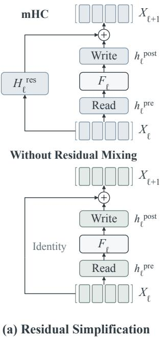

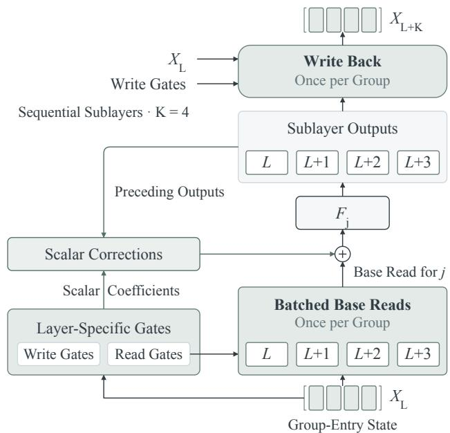  
(b) SimpleHC: Grouped Execution with Shared Memory Access

Figure 2 Overview of SimpleHC. (a) Identity transitions replace residual mixing, retaining learned read/write gates. (b) Layer-specific gates share a group-entry state across K = 4 sublayers, enabling batched reads and one groupboundary write-back. Scalar corrections preserve sequential output contributions without materializing intermediate expanded states.

are independent across operations and sublayers. mHC applies sigmoid to read logits, twice sigmoid to write logits, and Sinkhorn normalization to mixing logits reshaped into an $n \times n$ matrix. Sinkhorn approximately enforces a doubly stochastic $H _ { l } ^ { \mathrm { r e s } }$ to stabilize propagation across depth. Unless otherwise stated, we use the full-state gate parameterization of mHC.

## 3 SimpleHC

We propose SimpleHC, a Hyper-Connections architecture with a simplified residual structure and execution scheme (Figure 2). It retains multiple residual streams and learned read/write gates while removing residual mixing. Shared memory access reduces repeated state access by generating layer-specific gates from group-entry states, batching reads, and deferring writes.

## 3.1 Simplifying the Residual Structure

Prior work observed that removing residual mixing from mHC by setting $H _ { l } ^ { \mathrm { r e s } } = I$ (identityHC) largely preserves model quality (Guo et al., 2026). identityHC has also been adopted in Hy4 preview (Tencent Hy Team, 2026). Building on these insights, our systematic study reveals an important distinction: unconstrained residual mixing improves model quality, whereas Sinkhorn-constrained mixing ofers little benefit over identity transitions (Table 2). The gains from unconstrained mixing, however, come with the risk of cumulative signal amplification or attenuation across depth (Section 6.1).

We therefore retain learned read/write gates with identity transitions as a minimal efective structure, preserving competitive quality while avoiding residual matrix products, with $X _ { l + 1 } = X _ { l } + h _ { l } ^ { \mathrm { p o s t } } o _ { l } ^ { \top }$ . With $z _ { l } = \mathrm { R M S N o r m } ( \operatorname { v e c } ( X _ { l } ) )$ and $\ell _ { l } ^ { s } = \alpha _ { l } ^ { s } ( W _ { l } ^ { s } ) ^ { \top } z _ { l } + b _ { l } ^ { s }$ for $s \in \{ \mathrm { p r e } , \mathrm { p o s t } \}$ , SimpleHC uses $h _ { l } ^ { \mathrm { p r e } } = \sigma ( \dot { \ell } _ { l } ^ { \mathrm { p r e } } )$ and $h _ { l } ^ { \mathrm { p o s t } } = 2 \sigma ( \ell _ { l } ^ { \mathrm { p o s t } } )$ . Without residual mixing, updates accumulate additively. Given the state $X _ { L }$ at sublayer $L ,$ the residual state at any later sublayer $j$ is

$$
X _ { j } = X _ { L } + \sum _ { k = L } ^ { j - 1 } h _ { k } ^ { \mathrm { p o s t } } o _ { k } ^ { \intercal } .\tag{1}
$$

Algorithm 1 SimpleHC forward pass for one group   
Require: Entry state $X _ { L } \in \mathbb { R } ^ { n \times C } ;$ group size K; gate functions ${ g } _ { j } ^ { \mathrm { p r e } } , { g } _ { j } ^ { \mathrm { p o s t } }$ and sublayers $F _ { j }$ for $L \leq j < L + K$   
Ensure: Group-boundary state $X _ { L + K }$   
1: $\bar { H } ^ { \mathrm { p r e } } \gets [ g _ { L } ^ { \mathrm { p r e } } ( X _ { L } ) , \dots , g _ { L + K - 1 } ^ { \mathrm { p r e } } ( \dot { X } _ { L } ) ]$   
2: $\bar { H } ^ { \mathrm { p o s t } }  [ g _ { L } ^ { \mathrm { p o s t } } ( X _ { L } ) , \dotsc , g _ { L + K - 1 } ^ { \mathrm { p o s t } } ( X _ { L } ) ]$ ▷ Independent gate columns, shared input   
3: $V  X _ { L } ^ { \top } \bar { H } ^ { \mathrm { p r e } }$ ▷ Batched base reads; $V \in \mathbb { R } ^ { C \times K }$   
4: $D \gets \mathrm { t r } \tilde { \mathrm { i l } } ( ( \bar { H } ^ { \mathrm { p r e } } ) ^ { \top } \bar { H } ^ { \mathrm { p o s t } } , - 1 )$ ▷ Strictly lower-triangular read/write coeficients   
5: for $a = 0 , \dots , K - 1$ do   
6: $u _ { L + a }  V _ { : , a } + \textstyle \sum _ { b = 0 } ^ { a - 1 } D _ { a , b } o _ { L + b }$ ▷ Empty sum is zero   
7: $o _ { L + a }  F _ { L + a } ( u _ { L + a } )$   
8: end for   
9: $O \gets [ o _ { L } , . . . , o _ { L + K - 1 } ]$   
10: $X _ { L + K }  X _ { L } + \bar { H } ^ { \mathrm { p o s t } } O ^ { \top }$ ▷ Materialize the group-boundary state   
11: return $X _ { L + K }$

Each term adds a preceding sublayer’s output to the streams according to its write gate, and subsequent residual transitions leave this allocation unchanged.

## 3.2 Shared Memory Access

Even without residual mixing, conventional execution accesses the nC-dimensional state at every sublayer to generate gates, form inputs, and write updates. We introduce shared memory access across sublayers to reduce this trafic. With additive updates, each preceding output contributes to a later input through the inner product of its write gate and the later read gate. Substituting Equation 1 into the read operation gives:

$$
u _ { j } = X _ { j } ^ { \top } h _ { j } ^ { \mathrm { p r e } } = X _ { L } ^ { \top } h _ { j } ^ { \mathrm { p r e } } + \sum _ { k = L } ^ { j - 1 } \underbrace { \big ( ( h _ { j } ^ { \mathrm { p r e } } ) ^ { \top } h _ { k } ^ { \mathrm { p o s t } } \big ) } _ { \mathrm { s c a l a r ~ c o e f f i c i e n t } } o _ { k } .\tag{2}
$$

We call $X _ { L } ^ { \top } h _ { j } ^ { \mathrm { p r e } }$ the base read and the remaining terms scalar corrections, each weighting a preceding Cdimensional output by a scalar coeficient. For given gates, this reconstructs the input without writing intermediate updates into the nC-dimensional residual state.

This reconstruction assumes that the gates are already available. However, computing $h _ { j } ^ { s } = g _ { j } ^ { s } ( X _ { j } )$ requires materializing and accessing the updated state at every sublayer, where $g _ { j } ^ { s }$ is the gate mapping defined above for $s \in \{ \mathrm { p r e } , \mathrm { p o s t } \}$ . SimpleHC relaxes this dependency by generating gates for K consecutive sublayers from a common group-entry state $X _ { L } \colon$

$$
\begin{array} { r } { \bar { h } _ { j } ^ { \mathrm { p r e } } = g _ { j } ^ { \mathrm { p r e } } ( X _ { L } ) , \qquad \bar { h } _ { j } ^ { \mathrm { p o s t } } = g _ { j } ^ { \mathrm { p o s t } } ( X _ { L } ) , \qquad L \leq j < L + K . } \end{array}\tag{3}
$$

Within groups, sublayers retain independent gate parameters but share the conditioning state $X _ { L }$ . Relative to per-sublayer conditioning, the only approximation is generating gates from $X _ { L }$ rather than $X _ { j }$ . Grouped gate generation computes layer-specific gates jointly from $X _ { L }$ , reducing state reads from K to 1 and making group gates available upfront. With these gates, Equation 2 becomes

$$
u _ { j } = X _ { L } ^ { \top } \bar { h } _ { j } ^ { \mathrm { p r e } } + \sum _ { k = L } ^ { j - 1 } d _ { j , k } o _ { k } , \qquad d _ { j , k } = ( \bar { h } _ { j } ^ { \mathrm { p r e } } ) ^ { \top } \bar { h } _ { k } ^ { \mathrm { p o s t } } .\tag{4}
$$

All K base reads are batched into one scan of $X _ { L }$ , with $d _ { j , k }$ precomputed at group entry. Corrections incorporate preceding C-dimensional outputs without intermediate nC-dimensional state writes

Within each group, sublayers execute sequentially, passing each $o _ { j } = F _ { j } ( u _ { j } )$ to later inputs through scalar corrections. A single fused kernel writes back all updates at the group boundary:

$$
X _ { L + K } = X _ { L } + \sum _ { k = L } ^ { L + K - 1 } \bar { h } _ { k } ^ { \mathrm { p o s t } } o _ { k } ^ { \top } .\tag{5}
$$

Table 1 Memory access of residual-stream operations (reads and writes), per token per sublayer.
<table><tr><td>Operation</td><td></td><td></td><td>mHC (naive) mHC (fused) identityHC (fused)</td><td>SimpleHC (fused)</td></tr><tr><td>Projection and RMS statistics</td><td> $n C$ </td><td> $n C$ </td><td> $n C$ </td><td> $n C / K$ </td></tr><tr><td>Base reads</td><td> $n C + C$ </td><td> $n C + C$ </td><td> $n C + C$ </td><td> $n C / K + C$ </td></tr><tr><td>Residual write-back</td><td> $6 n C + C$ </td><td> $2 n C + C$ </td><td> $2 n C + C$ </td><td> $2 n C / K + C$ </td></tr><tr><td>Total</td><td> $8 n C + 2 C$ </td><td> $4 n C + 2 C$ </td><td> $4 n C + 2 C$ </td><td> $4 n C / K + 2 C + Q _ { \mathrm { c o r r } } ( K )$ </td></tr><tr><td> $n = K = 4$ </td><td>34C</td><td>18C</td><td>18C</td><td>9C</td></tr></table>

This execution is algebraically equivalent to sequential execution with the same group-entry gates (Appendix B). SimpleHC uses $K = 4 ,$ where shared memory access reduces full-state reads for gate generation and input aggregation from 8 to 2 and writes from 4 to 1 relative to original execution. Each full-state read/write accesses nC elements per token. Algorithm 1 summarizes the forward execution of one group. Matrix columns use zero-based ofsets within the group.

## 4 Infrastructure Design

To realize the eficiency benefits of the simplified design, we optimize the forward and backward execution of SimpleHC with specialized kernels. At the largest tested width $( C = 6 1 4 4 )$ , these kernels reduce the additional end-to-end training time over the vanilla residual baseline from 22.5% with PyTorch to 2.4% (Figure 3). These kernels are implemented using DeepGEMM (Zhao et al., 2025) and Triton (Tillet et al., 2019).

## 4.1 Forward Fusion with Shared State Access

Grouped reads. Grouped gate generation and batched base reads implement the read side of shared memory access. For $x = \mathrm { v e c } ( X _ { L } ) \in \mathbb { R } ^ { n C \times 1 }$ and independent gate projections concatenated into $W \in \mathbb { R } ^ { n C \times 2 K n }$ , we compute

$$
p = W ^ { \top } x , \qquad s = x ^ { \top } x , \qquad V = X _ { L } ^ { \top } { \bar { H } } ^ { \mathrm { p r e } } .\tag{6}
$$

Here $p \in \mathbb { R } ^ { 2 K n \times 1 }$ , s is scalar, and $V \in \mathbb { R } ^ { C \times K }$ . One kernel computes $p , s$ from the same loaded state. Gate normalization uses afine-free RMSNorm, with $r = ( s / ( n C ) + \epsilon ) ^ { \bar { - } 1 / 2 }$ computed from the input state. For each sublayer j and gate type $t \in \{ \mathrm { p r e } , \mathrm { p o s t } \}$ , the corresponding projection block $p _ { j } ^ { t }$ gives logits $\overset { \cdot } { \ell _ { j } ^ { t } } = \alpha _ { j } ^ { t } r p _ { j } ^ { t } + b _ { j } ^ { t }$ . A second kernel fuses this scaling and bias addition with gate activations, avoiding a normalized-state bufer. At $n = K = 4$ , one $4 C \times 3 2$ projection supplies four read gates and four write gates. A separate batched-read kernel reuses each loaded state tile for all K distinct bases, storing them contiguously per sublayer. Gate generation and base aggregation each reduce full-state reads from $K n C$ to nC elements per token per group.

Fused corrections and deferred write-back. We implement Equations 4 and 5 without stacked output copies or expanded update bufers. Using precomputed coeficients D, each correction kernel loads preceding C-dimensional outputs through separate pointers and fuses weighting, summation, and base addition. At $K = 4$ , three correction kernels supply the sequential sublayer inputs; one group-exit kernel then fuses all four output allocations with residual addition. Wide-state update trafic falls from $2 K n C$ to $2 n C$ elements per token per group.

## 4.2 Backward Reuse and Efficient Reductions

We tailor backward kernels to two distinct workloads: wide activation gradients benefit from cross-sublayer reuse, whereas small gate gradients require eficient channel reductions.

For loss ${ \mathcal { L } } ,$ let $G = \nabla _ { V } \mathcal { L } \in \mathbb { R } ^ { C \times K } , O = \left[ o _ { L } , \dots , o _ { L + K - 1 } \right] \in \mathbb { R } ^ { C \times K }$ , and $E = \nabla _ { X _ { L + K } } { \mathcal { L } } \in \mathbb { R } ^ { n \times C }$ . These equations give gradient contributions from the base reads and final write-back, with += denoting accumulation.

Shared activation-gradient access. We compute activation-gradient contributions jointly across the group:

$$
\nabla _ { X _ { L } } { \mathcal { L } } + = E + { \bar { H } } ^ { \mathrm { p r e } } G ^ { \top } , \qquad \nabla _ { O } { \mathcal { L } } + = E ^ { \top } { \bar { H } } ^ { \mathrm { p o s t } } .\tag{7}
$$

The read backward fuses all K contributions with the identity gradient E, avoiding K expanded gradients and merging. Reusing one scan of E for all K output gradients reduces its logical reads from $K n C$ to nC elements per token per group (4× at $K = 4 )$ . We fuse projection input gradients with RMS diferentiation, avoiding a wide intermediate and a separate normalization-backward pass; weight gradients use a separate GEMM.

Token-packed gate gradients. Gate gradients instead require reductions over the channel dimension:

$$
\nabla _ { \bar { H } ^ { \mathrm { p r e } } } \mathcal { L } \ { + } { = } X _ { L } G , \qquad \nabla _ { \bar { H } ^ { \mathrm { p o s t } } } \mathcal { L } \ { + } { = } E O .\tag{8}
$$

At $n = K = 4$ , each product reduces C channels to just 16 coeficients per token. We pack four tokens into a 16 × 16 Tensor Core product, accumulate over channels on-chip, and store only the four same-token $4 \times 4$ blocks, eliminating the partial-gradient scratch bufer and extra reduction launch of the channel-tiled fallback for each product.

## 4.3 Memory-Access and Storage Accounting

The accounting in Table 1 covers logical forward activation reads and writes per token per sublayer, excluding parameters, small coeficient bufers, and attention/FFN internals. Naive mHC materializes mixed states and expanded updates separately; fused mHC combines residual mixing, output allocation, and residual addition.

At group ofset $a > 0$ , each correction reads one base and a preceding outputs, then writes one input, costing $( a + 2 ) C$ elements. Ofset $a = 0$ uses its base directly. Averaging over K sublayers gives

$$
Q _ { \mathrm { c o r r } } ( K ) = \frac { C } { K } \sum _ { a = 1 } ^ { K - 1 } ( a + 2 ) = \frac { C ( K - 1 ) ( K + 4 ) } { 2 K } , \qquad Q _ { \mathrm { c o r r } } ( 4 ) = 3 C .\tag{9}
$$

Grouped gate generation and base reads each access nC elements per group; final write-back reads and writes the wide state once, adding $2 n C .$ . Together these contribute 4nC/K per sublayer. Base writes and output reads for final write-back add 2C, yielding

$$
Q _ { \mathrm { S i m p l e H C } } ( K ) = { \frac { 4 n C } { K } } + 2 C + Q _ { \mathrm { c o r r } } ( K ) .\tag{10}
$$

At $n = 4$ , this gives 11.5C, 9C, 9.25C, and 12.375C for $K = 2 , 4 , 8 , 1 6$ , respectively. Thus, $K = 4$ has the lowest logical trafic among these group sizes, rather than over all positive integers. Correction costs grow with K, ofsetting the reduced wide-state trafic at larger group sizes. Our choice of $K = 4$ halves the 18C trafic of fused mHC and identityHC. Removing mixing alone does not reduce these accesses: fused mHC already combines mixing and output allocation in one write-back. The reduction comes from sharing state access across sublayers. Without recomputation, saving one group-entry residual state instead of K sublayer-entry states reduces the storage of these residual states by $1 - 1 / K$ (75% at $K = 4 )$

## 5 Experiments

## 5.1 Setup

Training setup. We conduct experiments on a MoE model with 15B total and 1B activated parameters (15B-A1B), and evaluate scalability on a 30B-A2B model. Following dots3-note Preview (Dots Studio, 2026), we use MoE backbones (Dai et al., 2024) with MLA (Liu et al., 2024a), alternating one full-attention layer with three sliding-window layers. We train with a sequence length of 8192 using Muon (Liu et al., 2025) on a high-quality mixture of English and Chinese text, code, and mathematics. Unless specified, we use $n = 4$ streams and groups of $K = 4$ sublayers. Appendix A.1 details configurations.

Evaluation. We evaluate knowledge, reasoning, math, code, and Chinese on MMLU (Hendrycks et al., 2020), HellaSwag (Zellers et al., 2019), MATH (Hendrycks et al., 2021), MBPP (Austin et al., 2021), and C3 (Sun et al., 2020) for the 15B-A1B studies (Tables 2 and 3). For 30B-A2B (Table 4), we add MMLU-Pro (Wang et al., 2024), MMLU-Redux (Gema et al., 2025), TriviaQA (Joshi et al., 2017), DROP (Dua et al., 2019), BBH (Suzgun et al., 2023), GSM8K (Cobbe et al., 2021), HumanEval (Chen et al., 2021), CMMLU (Li et al., 2024), and CEval (Huang et al., 2023), yielding fourteen benchmarks. Appendix A.3 details few-shot settings and loss reporting for both the 15B-A1B and 30B-A2B models.

Table 2 Architectural design choices in Hyper-Connections. Using 15B-A1B MoE models. $C / n C$ denote stream-local/joint-state gate inputs; Fixed uses uniform weights of $1 / n = 1 / 4$ for read gates and 1 for write gates.
<table><tr><td>Method</td><td></td><td>Read Write</td><td>Mixing</td><td>|Loss ↓ MMLU HellaSwag MATH MBPP</td><td></td><td></td><td></td><td></td><td>C3</td><td>Avg.</td></tr><tr><td>(1) Vanilla Residual</td><td></td><td></td><td></td><td>1.678</td><td>56.1</td><td>65.8</td><td>26.2</td><td>37.8</td><td>75.9</td><td>52.4</td></tr><tr><td colspan="9">Gate inputs and residual mixing</td><td></td><td></td></tr><tr><td>(2) HC</td><td>C</td><td>C</td><td>Unconstrained</td><td>1.660</td><td>60.9</td><td>66.4</td><td>30.4</td><td>39.8</td><td>81.6</td><td>55.8</td></tr><tr><td>(3) HC w/o mixing</td><td>C</td><td>C</td><td>Identity</td><td>1.664</td><td>59.6</td><td>65.5</td><td>30.1</td><td>37.6</td><td>82.9</td><td>55.1</td></tr><tr><td>(4) mHC  $\mathbf { w } / \mathbf { o }$  Sinkhorn</td><td> $n C$ </td><td>nC</td><td>Unconstrained</td><td>1.657</td><td>60.0</td><td>66.4</td><td>27.9</td><td>42.6</td><td></td><td>84.2 56.2</td></tr><tr><td>(5) mHC</td><td>nC</td><td>nC</td><td>Sinkhorn</td><td>1.659</td><td>58.8</td><td>67.3</td><td>26.9</td><td>39.8</td><td>82.2</td><td>55.0</td></tr><tr><td>(6) identityHC</td><td> $n C$ </td><td> $_ { n C }$ </td><td>Identity</td><td>1.660</td><td>59.6</td><td>66.4</td><td>29.6</td><td>39.6</td><td>81.9</td><td>55.4</td></tr><tr><td colspan="9">Read- and write-input restrictions</td><td></td><td></td></tr><tr><td>(7) Restricted read</td><td>C</td><td> $_ { n C }$ </td><td>Identity</td><td>1.661</td><td>59.9</td><td>66.9</td><td>28.5</td><td>39.0</td><td></td><td>80.1 54.9</td></tr><tr><td>(8) Restricted write</td><td> $n C$ </td><td>C</td><td>Identity</td><td>1.663</td><td>59.1</td><td>66.4</td><td>29.0</td><td>39.2</td><td>79.9</td><td>54.7</td></tr><tr><td colspan="10">Fixed-gate controls</td></tr><tr><td>(9) Fixed read</td><td>Fixed</td><td>nC</td><td>Identity</td><td>1.676</td><td>57.5</td><td>65.5</td><td>27.9</td><td>38.4</td><td>78.5</td><td>53.6</td></tr><tr><td>(10) Fixed write</td><td> $n C$ </td><td>Fixed</td><td>Identity</td><td>1.678</td><td>56.2</td><td>64.3</td><td>27.5</td><td>38.0</td><td>78.1</td><td>52.8</td></tr><tr><td>(11) Fixed read and write Fixed Fixed</td><td></td><td></td><td>Sinkhorn</td><td>1.678</td><td>56.5</td><td>64.7</td><td>26.7</td><td>37.4</td><td>77.0</td><td>52.5</td></tr><tr><td>(12) Fixed read and write Fixed Fixed Unconstrained</td><td></td><td></td><td></td><td>1.660</td><td>61.9</td><td>67.1</td><td>29.1</td><td>40.2</td><td>81.8</td><td>56.0</td></tr></table>

## 5.2 Understanding the Hyper-Connections Architecture

We examine the roles and interactions of read/write gates and residual mixing in the HC architecture (Table 2).   
HC and mHC share these components but difer in gate conditioning, parameterization, and mixing constraints.   
Except for HC variants, gates follow the parameterization in Section 3.1.

Configurations. HC $\mathrm { w / o }$ mixing retains the HC parameterization but sets $H ^ { \mathrm { r e s } } = I ;$ identityHC makes the same replacement in mHC. mHC $\mathrm { w / o }$ Sinkhorn and the unconstrained fixed-gate control use $H ^ { \mathrm { r e s } } =$ $I + \mathrm { r e s h a p e } ( \ell ^ { \mathrm { r e s } } )$ , without exponentiation or Sinkhorn normalization. Restricted read/write replaces only the indicated gate’s input with the corresponding stream, using per-stream RMS normalization and a $C \times 1$ projection shared across streams; the other gate retains joint-state conditioning. Fixed read/write sets the indicated gate to ${ \bf 1 } / n$ or 1, respectively, while retaining the other components specified in the table.

We observe: (i) Unconstrained mixing is efective, but Sinkhorn diminishes its gains. Retaining unconstrained mixing improves the average score in HC (rows 3 vs. 2). Under the mHC parameterization, unconstrained mixing achieves 56.2, versus 55.0 with Sinkhorn constraints and 55.4 with identity transitions (rows 4–6). Sinkhorn limits the benefit of mixing, leaving performance close to identityHC. (ii) Three components form two efective groups: read/write gating and unconstrained mixing. Without mixing, jointly learned read/write gates achieve an average score of 55.4; fixing either gate lowers it significantly, supporting their treatment as one group. Unconstrained mixing forms the other: with both gates fixed, it achieves 56.0 (row 12). Either group alone is comparable to mHC; combining them improves the score (row 4). (iii) Full-state conditioning improves model quality. With full-state inputs, loss is 1.660. Restricting read/write gates to stream-local inputs raises loss by 0.001/0.003 (rows 6–8), suggesting slightly greater sensitivity in write gates. Section 6.1 analyzes these findings and their implications for SimpleHC.

## 5.3 Shared Memory Access with Layer-Specific Gating

Table 3 ablates group size, gate reuse, and scalar corrections, with identityHC and mHC as references.

Configurations. Share K generates gates for K consecutive sublayers from one group-entry state; $K = 4$ spans two Transformer blocks. Independent gates retain separate parameters for each sublayer, whereas reused gates share one read/write pair across the group. The $\mathrm { w / o }$ corrections variant uses only base reads for sublayer inputs without accounting for preceding sublayer output contributions, but retains all sublayer outputs in the group-boundary write-back. All sharing variants use identity residual transitions.

Table 3 Design of shared memory access. K: sublayers per group. Independent/Reused: layer-specific/shared read/write gates. Row 8 omits corrections but retains group-boundary write-back.
<table><tr><td>Method</td><td>Memory access Group size K Mixing</td><td></td><td></td><td>Gates</td><td></td><td>|Loss ↓ MMLU HellaSwag MATH</td><td></td><td></td><td>MBPP</td><td>C3</td><td>Avg.</td></tr><tr><td>(1) Vanilla Residual</td><td></td><td></td><td></td><td></td><td>1.678</td><td>56.1</td><td>65.8</td><td>26.2</td><td>37.8</td><td>75.9</td><td>52.4</td></tr><tr><td colspan="10">Reference configurations</td><td></td><td></td><td></td></tr><tr><td>(2) mHC (3) identityHC</td><td>Per sublayer</td><td>1</td><td>Sinkhorn Independent</td><td></td><td>1.659</td><td>58.8</td><td>67.3</td><td>26.9</td><td>39.8</td><td>82.2 55.0</td><td></td></tr><tr><td></td><td>Per sublayer</td><td>1</td><td></td><td>Identity Independent</td><td>1.660</td><td>59.6</td><td>66.4</td><td>29.6</td><td>39.6</td><td>81.9</td><td>55.4</td></tr><tr><td colspan="10">Sharing granularity</td><td></td><td></td><td></td></tr><tr><td>(4) Share 2</td><td>Shared</td><td>2</td><td></td><td>Identity Independent</td><td>1.660</td><td>59.9</td><td>67.0</td><td>28.1</td><td>39.0</td><td>80.1</td><td>54.8</td></tr><tr><td>(5) SimpleHC (Share 4)</td><td>Shared</td><td>4</td><td>Identity Independent</td><td></td><td>1.660</td><td>58.5</td><td>67.0</td><td>28.7</td><td>40.8</td><td>80.2 55.0</td><td></td></tr><tr><td>(6) Share 8</td><td>Shared</td><td>8</td><td></td><td>Identity Independent</td><td>1.662</td><td>59.1</td><td>66.2</td><td>27.9</td><td>39.4</td><td>79.1 54.3</td><td></td></tr><tr><td colspan="10">Layer-specific gating</td><td></td></tr><tr><td>(7) Share 4, reused gates</td><td>Shared</td><td>4</td><td>Identity</td><td>Reused</td><td>1.667</td><td>58.1</td><td>67.1</td><td>28.4</td><td>35.4</td><td>78.4 53.5</td><td></td></tr><tr><td colspan="10">Within-group update corrections</td><td></td><td></td></tr><tr><td>(8) Share 4 w/o corrections</td><td>Shared</td><td>4</td><td></td><td>Identity Independent | 1.705</td><td></td><td>52.8</td><td>64.4</td><td>21.7</td><td>32.0</td><td>68.8 47.9</td><td></td></tr></table>

The results highlight three findings: (i) Moderate state sharing preserves model quality. $K = 2 , 4$ match the loss of identityHC, while K = 8 slightly increases it (rows 3–6). At K = 4, the average score of 55.0 is comparable to mHC and identityHC. We choose K = 4 for its competitive quality and lowest memory trafic (Section 4.3). (ii) Layer-specific gates improve quality under shared inputs. At K = 4, reusing one read/write gate pair lowers the average score from 55.0 to 53.5 (rows 5 vs. 7). This supports retaining layer-specific gate parameters. (iii) Scalar corrections are important for model performance. Removing corrections raises loss from 1.660 to 1.705 despite retaining all outputs in the final write-back (rows 5 vs. 8). Thus, later sublayers must incorporate preceding outputs even when gate inputs are shared. Section 6.2 analyzes these findings.

## 5.4 Evaluating SimpleHC at Larger Scale

On the larger 30B-A2B model, SimpleHC matches mHC performance while simplifying both the residual structure and execution. As shown in Table 4, it achieves the same loss of 1.561 as mHC and identityHC and an average benchmark score of 63.1 versus 62.9 for mHC and 62.8 for identityHC. It achieves higher scores on MMLU, MATH, and C3, although it trails mHC on GSM8K and both methods on HumanEval. These results support the scalability of SimpleHC.

## 5.5 Translating Simplicity into Training Efficiency

We compare end-to-end training overhead against the baseline across scales from C = 1024 to C = 6144 (matching frontier models (Xu et al., 2026; Tencent Hy Team, 2026)). Details are provided in Appendix A.2.

With the eficient implementations, SimpleHC achieves the lowest overhead across all tested scales (Figure 3(a)). At the smallest scale, overhead is 6.3%, versus 26.8% for mHC and 10.1% for identityHC. Despite matching forward activation trafic, mHC incurs additional mixing and Sinkhorn costs, explaining its larger gap from identityHC at smaller scales. Relative overhead generally decreases with width: HC operations scale linearly at fixed n, whereas expert projections scale quadratically when expert width grows proportionally. At the largest tested scale, SimpleHC cuts overhead from approximately 7.0% for both baselines to 2.4%, eliminating about two-thirds.

We additionally compare against xHC, a promising approach to scaling residual-stream capacity (Zhang et al., 2026). At $C = 6 1 4 4$ , its training overhead is 27.7%, compared with approximately 7.0% for mHC and 2.4% for SimpleHC (Figure 4). These results position SimpleHC as one of the most eficient HC variants evaluated for scaling foundation models.

Specialized kernels require substantial engineering efort, limiting wider adoption. Thus we also evaluate PyTorch versions (Figure 3(b)), where SimpleHC has the lowest overhead across all tested scales.

Table 4 Downstream evaluation on 30B MoE models. We compare Vanilla, mHC, identityHC, and SimpleHC across benchmarks covering Knowledge, Reasoning, Math & Code, and Chinese.
<table><tr><td></td><td>Benchmark</td><td>Vanilla</td><td>mHC</td><td>identityHC</td><td>SimpleHC</td></tr><tr><td></td><td>Loss↓</td><td>1.579</td><td>1.561</td><td>1.561</td><td>1.561</td></tr><tr><td rowspan="4">Knowledge</td><td>MMLU</td><td>65.8</td><td>67.7</td><td>67.9</td><td>68.6</td></tr><tr><td>MMLU-Pro</td><td>45.6</td><td>48.6</td><td>48.0</td><td>48.9</td></tr><tr><td>MMLU-Redux</td><td>62.4</td><td>64.3</td><td>64.1</td><td>64.7</td></tr><tr><td>TriviaQA</td><td>65.1</td><td>69.7</td><td>68.4</td><td>68.1</td></tr><tr><td rowspan="3">Reasoning</td><td>HellaSwag</td><td>71.3</td><td>72.4</td><td>72.8</td><td>73.0</td></tr><tr><td>DROP</td><td>61.4</td><td>67.2</td><td>67.7</td><td>68.1</td></tr><tr><td>BBH</td><td>59.4</td><td>64.3</td><td>62.7</td><td>63.6</td></tr><tr><td rowspan="4">Math &amp; Code</td><td>GSM8K</td><td>71.3</td><td>75.0</td><td>74.5</td><td>74.5</td></tr><tr><td>MATH</td><td>38.4</td><td>38.4</td><td>38.9</td><td>41.5</td></tr><tr><td>HumanEval</td><td>39.6</td><td>47.6</td><td>48.2</td><td>45.1</td></tr><tr><td>MBPP</td><td>46.2</td><td>49.4</td><td>49.8</td><td>49.2</td></tr><tr><td rowspan="3">Chinese</td><td>CMMLU</td><td>55.1</td><td>60.7</td><td>58.7</td><td>59.0</td></tr><tr><td>CEval</td><td>60.6</td><td>65.7</td><td>68.2</td><td>67.3</td></tr><tr><td>C3</td><td>88.1</td><td>89.6</td><td>89.6</td><td>91.4</td></tr><tr><td></td><td>Average</td><td>59.3</td><td>62.9</td><td>62.8</td><td>63.1</td></tr></table>

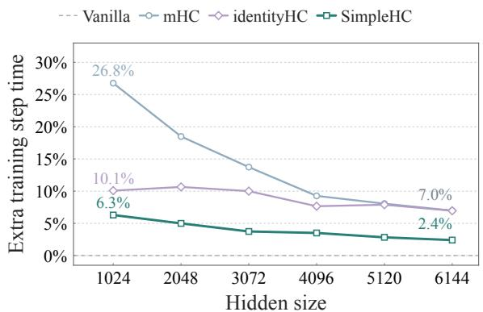  
(a) Eficient implementations

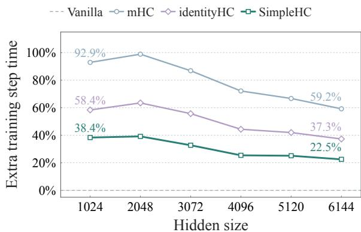  
(b) PyTorch implementations  
Figure 3 End-to-end training overhead relative to Vanilla Residual. SimpleHC achieves the lowest overhead across tested model widths with both (a) eficient and (b) PyTorch implementations.

Saved activation memory. By reusing group-entry states, SimpleHC reduces estimated storage retained for backward at sublayer boundaries and within HC connections by approximately 31% relative to mHC (Figure 1(b)). Appendix A.2 details the accounting.

## 6 Analysis

We analyze the design and training stability of SimpleHC. Three conclusions emerge: (i) learned read/write gating provides a minimal efective residual structure; (ii) gating decisions vary across sublayers yet remain predictable from a shared group-entry state; (iii) SimpleHC remains stable under stress and exhibits smoother gradient dynamics during standard training.

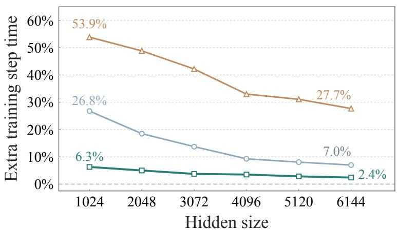  
Figure 4 Training overhead compared with mHC and xHC. All methods use eficient implementations, with overhead measured relative to the vanilla residual baseline. xHC uses 16 residual streams with 4 active streams; mHC and SimpleHC use 4 residual streams.

## 6.1 A Minimal Structure for Hyper-Connections

To combine architectural simplicity, competitive performance, and robust scaling, we select learned read/write gating without mixing as a minimal efective residual structure for Hyper-Connections. This avoids the propagation risks of cumulative residual mixing, as analyzed below.

Learned read/write gating and unconstrained mixing form two efective groups: each achieves performance comparable to mHC, with further gains when combined (Table 2). Appendix C compares their weighting mechanisms. However, unconstrained mixing repeatedly transforms earlier contributions through residua matrix products, risking cumulative amplification and training instability (Xie et al., 2025). We observe unconstrained mixing with fixed gates produces larger peak residual-path coeficients than identityHC, consistent with these amplification risks (Figure 7, Appendix D.1).

Sinkhorn constraints mitigate these risks (Xie et al., 2025), but constrained mixing adds little benefit over learned read/write gating alone. We therefore retain learned gates without mixing and use full-state inputs for better loss and benchmark scores (Table 2). Full-state and stream-local conditioning incur the same residual-state input trafic, as both read all streams.

## 6.2 Why Shared Memory Access Is Effective

We examine why shared memory access benefits from layer-specific gates and remains efective with shared inputs through gate variation and predictability analyses.

Gate variation across sublayers. Read and write gates exhibit distinct allocation patterns across sublayers of the 15B identityHC model (Figures 8(a) and 5(a)). These diferences motivate retaining layer-specific gates under shared inputs, consistent with their advantage over gate reuse (Table 3).

Predictability from the group-entry state. We examine whether subsequent gates are predictable from the group-entry state to assess the feasibility of sharing gate inputs. We train layer-specific predictors to recover subsequent read/write gates of a frozen 15B identityHC model from the group-entry state. The predictors use the SimpleHC parameterization and are initialized from the corresponding teacher gate parameters. Only predictors are trained. The “Frozen teacher gates” baseline uses these mappings without training. In Figure 5(b), it predicts write gates more accurately than uniform random gates (MAE 0.0504 vs. 0.4086), indicating predictive ability from earlier inputs even without adaptation. Training further reduces MAE to 0.0103, suggesting that layer-specific mappings closely approximate subsequent gates from shared inputs and supporting the shared memory access design. Read gates show the same trend (Figure 8(b)). Appendix D.3 details the protocol.

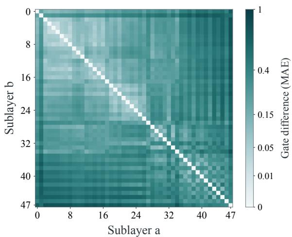  
(a) Write-gate variation across sublayers

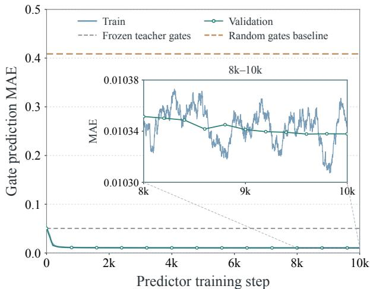  
(b) Prediction from the group-entry state

Figure 5 Gates vary across sublayers yet are predictable from shared inputs. (a) Pairwise gate MAE across identityHC sublayers, averaged over streams and tokens. (b) Train and val. MAE for write-gate prediction at ofsets 1–3 from the group-entry state. See Appendix D.3 for details.  
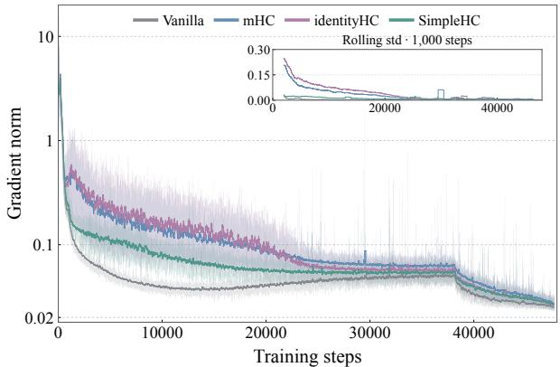  
(a) Standard 15B training

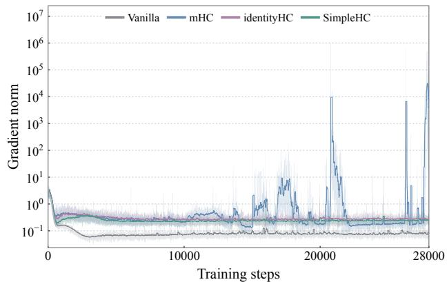  
(b) Stress test  
Figure 6 Training stability of SimpleHC. (a) Inset: 1,000-step rolling gradient-norm std. (b) Under stress, mHC exhibits severe gradient spikes, while SimpleHC and identityHC remain stable.

Sharing gate inputs does not remove the need for sequential output contributions: removing scalar corrections raises loss from 1.660 to 1.705 despite retaining the final write-back.

## 6.3 Does Simplification Compromise Training Stability?

Training stability is essential for reliable scaling, as instabilities absent in smaller models can emerge at larger scales (Wortsman et al., 2024). We examine whether the simplifications in SimpleHC compromise training stability. During 15B training, SimpleHC shows smaller gradient-norm fluctuations and lower rolling standard deviation than mHC and identityHC early after warmup (Figure 6(a)); all three reach comparable ranges later. Shared-input gating may reduce sensitivity to within-group state fluctuations by conditioning decisions on an earlier state, loosely analogous to stabilization through historical averaging. This could contribute to smoother training of SimpleHC.

To emulate large-scale training stability challenges, we stress-test 230B-A6B MoE models at 10× the reference learning rate. In Figure 6(b), mHC exhibits gradient spikes reaching approximately $1 . 9 \times 1 0 ^ { 6 }$ , while SimpleHC and identityHC maintain bounded gradient norms. Appendix E details the settings and analyzes potential causes of mHC instability.

## 7 Related Work

Hyper-Connections and Variants. Hyper-Connections expand the residual pathway into multiple streams with learned read, write, and mixing operations (Zhu et al., 2025). Subsequent work constrains mixing to doubly stochastic matrices (Xie et al., 2025), reduces constraint-enforcement costs (Yang and Gao, 2026; Zhou et al., 2026; Dandachi and Diggs-Galligan, 2026), or explores other constraints for stable propagation and stream diversity (Liu et al., 2026; Guo et al., 2026). Other designs modify read/write structures (Qiu et al., 2026a; Zheng et al., 2026) or use sparse updates to support more streams (Zhang et al., 2026).

Understanding and Simplifying Hyper-Connections. Recent analyses reveal uneven stream utilization, redundancy, and concentrated read/write routing in HC models (Peng et al., 2026; Alimaskina et al., 2026). Prior work also reports that removing residual mixing can largely preserve model quality (Guo et al., 2026), with related evidence from finetuning (Oldenburg et al., 2026). These observations motivate examining which interactions account for the benefits. Our study identifies learned read/write gating and unconstrained mixing as two independently efective groups, while showing that Sinkhorn constraints diminish the gains from mixing. These findings explain why learned gating alone remains competitive with mHC (Xie et al., 2025) and motivate an additive structure whose execution we further simplify through shared memory access.

Eficient Execution of Residual Aggregation. Richer residual pathways introduce storage and datamovement costs beyond their arithmetic overhead. Prior work reduces these costs through block-wise aggregation and staged computation (Team et al., 2026), kernel fusion and recomputation (Xie et al., 2025; Zheng et al., 2026), and optimized multi-stream execution (Zhang et al., 2026). SimpleHC further reduces repeated residual-state access across sublayers by sharing gate inputs while retaining layer-specific parameters. Together with the additive residual structure, this permits consolidated reads and deferred writes, with scalar corrections preserving sequential output contributions for the chosen gates.

## 8 Conclusion

In this work, we study how the components of the Hyper-Connections architecture contribute to model performance and training cost. Our study identifies learned read/write gating as a minimal efective structure, while unconstrained mixing ofers gains with propagation risks. Beyond removing mixing, we introduce shared memory access to reduce repeated residual-state accesses, with gate analyses supporting layer-specific mappings conditioned on shared inputs. Together, they form SimpleHC, simplifying residual structure and execution. SimpleHC matches mHC performance on 15B and 30B MoE models, reduces additional training overhead from 7.0% to 2.4% at the largest tested scale, and exhibits smoother gradient dynamics while remaining stable under stress. SimpleHC thus combines architectural simplicity, execution eficiency, training stability, and scalability.

## References

Ekaterina Alimaskina, Gleb Molodtsov, and Aleksandr Beznosikov. Analyzing stream collapse in hyper-connections: From diagnosis to mitigation. arXiv preprint arXiv:2606.03483, 2026.

Jacob Austin, Augustus Odena, Maxwell Nye, Maarten Bosma, Henryk Michalewski, David Dohan, Ellen Jiang, Carrie Cai, Michael Terry, Quoc Le, et al. Program synthesis with large language models. arXiv preprint arXiv:2108.07732, 2021.

Mark Chen, Jerry Tworek, Heewoo Jun, Qiming Yuan, Henrique Ponde De Oliveira Pinto, Jared Kaplan, Harri Edwards, Yuri Burda, Nicholas Joseph, Greg Brockman, et al. Evaluating large language models trained on code. arXiv preprint arXiv:2107.03374, 2021.

Karl Cobbe, Vineet Kosaraju, Mohammad Bavarian, Mark Chen, Heewoo Jun, Lukasz Kaiser, Matthias Plappert, Jerry Tworek, Jacob Hilton, Reiichiro Nakano, et al. Training verifiers to solve math word problems. arXiv preprint arXiv:2110.14168, 2021.

Damai Dai, Chengqi Deng, Chenggang Zhao, RX Xu, Huazuo Gao, Deli Chen, Jiashi Li, Wangding Zeng, Xingkai Yu, Yu Wu, et al. Deepseekmoe: Towards ultimate expert specialization in mixture-of-experts language models. In Proceedings of the 62nd annual meeting of the association for computational linguistics (volume 1: Long papers), pages 1280–1297, 2024.

Torque Dandachi and Sophia Diggs-Galligan. go-m hc: Direct parameterization of manifold-constrained hyperconnections via generalized orthostochastic matrices. arXiv preprint arXiv:2604.02309, 2026.

Dots Studio. dots3-note Preview, 2026. https://huggingface.co/dots-studio/dots3-note-prev. Model card.

Dheeru Dua, Yizhong Wang, Pradeep Dasigi, Gabriel Stanovsky, Sameer Singh, and Matt Gardner. Drop: A reading comprehension benchmark requiring discrete reasoning over paragraphs. In Proceedings of the 2019 Conference of the North American Chapter of the Association for Computational Linguistics: Human Language Technologies, Volume 1 (Long and Short Papers), pages 2368–2378, 2019.

Leo Gao, Stella Biderman, Sid Black, Laurence Golding, Travis Hoppe, Charles Foster, Jason Phang, Horace He, Anish Thite, Noa Nabeshima, et al. The pile: An 800gb dataset of diverse text for language modeling. arXiv preprint arXiv:2101.00027, 2020.

Aryo Pradipta Gema, Joshua Ong Jun Leang, Giwon Hong, Alessio Devoto, Alberto Carlo Maria Mancino, Rohit Saxena, Xuanli He, Yu Zhao, Xiaotang Du, Mohammad Reza Ghasemi Madani, et al. Are we done with mmlu? In Proceedings of the 2025 Conference of the Nations of the Americas Chapter of the Association for Computational Linguistics: Human Language Technologies (Volume 1: Long Papers), pages 5069–5096, 2025.

Aaron Grattafiori, Abhimanyu Dubey, Abhinav Jauhri, Abhinav Pandey, Abhishek Kadian, Ahmad Al-Dahle, Aiesha Letman, Akhil Mathur, Alan Schelten, Alex Vaughan, et al. The llama 3 herd of models. arXiv preprint arXiv:2407.21783, 2024.

Haoqiang Guo, Xuyi Chen, Bo Ke, Yishu Lei, Ziyang Xu, Shikun Feng, Wenhan Luo, et al. ohc: Orthogonal hyper-connections on so (4) via quaternions. arXiv preprint arXiv:2609.02672, 2026.

Kaiming He, Xiangyu Zhang, Shaoqing Ren, and Jian Sun. Deep residual learning for image recognition. In Proceedings of the IEEE conference on computer vision and pattern recognition, pages 770–778, 2016a.

Kaiming He, Xiangyu Zhang, Shaoqing Ren, and Jian Sun. Identity mappings in deep residual networks. In European conference on computer vision, pages 630–645. Springer, 2016b.

Dan Hendrycks, Collin Burns, Steven Basart, Andy Zou, Mantas Mazeika, Dawn Song, and Jacob Steinhardt. Measuring massive multitask language understanding. arXiv preprint arXiv:2009.03300, 2020.

Dan Hendrycks, Collin Burns, Saurav Kadavath, Akul Arora, Steven Basart, Eric Tang, Dawn Song, and Jacob Steinhardt. Measuring mathematical problem solving with the math dataset. arXiv preprint arXiv:2103.03874, 2021.

Shengding Hu, Yuge Tu, Xu Han, Chaoqun He, Ganqu Cui, Xiang Long, Zhi Zheng, Yewei Fang, Yuxiang Huang, Weilin Zhao, et al. Minicpm: Unveiling the potential of small language models with scalable training strategies. arXiv preprint arXiv:2404.06395, 2024.

Yuzhen Huang, Yuzhuo Bai, Zhihao Zhu, Junlei Zhang, Jinghan Zhang, Tangjun Su, Junteng Liu, Chuancheng Lv, Yikai Zhang, Yao Fu, et al. C-eval: A multi-level multi-discipline chinese evaluation suite for foundation models. Advances in neural information processing systems, 36:62991–63010, 2023.

Mandar Joshi, Eunsol Choi, Daniel S Weld, and Luke Zettlemoyer. Triviaqa: A large scale distantly supervised challenge dataset for reading comprehension. In Proceedings of the 55th Annual Meeting of the Association for Computational Linguistics (Volume 1: Long Papers), pages 1601–1611, 2017.

Haonan Li, Yixuan Zhang, Fajri Koto, Yifei Yang, Hai Zhao, Yeyun Gong, Nan Duan, and Timothy Baldwin. Cmmlu: Measuring massive multitask language understanding in chinese. In Findings of the Association for Computational Linguistics: ACL 2024, pages 11260–11285, 2024.

Aixin Liu, Bei Feng, Bin Wang, Bingxuan Wang, Bo Liu, Chenggang Zhao, Chengqi Dengr, Chong Ruan, Damai Dai, Daya Guo, et al. Deepseek-v2: A strong, economical, and eficient mixture-of-experts language model. arXiv preprint arXiv:2405.04434, 2024a.

Aixin Liu, Bei Feng, Bing Xue, Bingxuan Wang, Bochao Wu, Chengda Lu, Chenggang Zhao, Chengqi Deng, Chenyu Zhang, Chong Ruan, et al. Deepseek-v3 technical report. arXiv preprint arXiv:2412.19437, 2024b.

Jingyuan Liu, Jianlin Su, Xingcheng Yao, Zhejun Jiang, Guokun Lai, Yulun Du, Yidao Qin, Weixin Xu, Enzhe Lu, Junjie Yan, et al. Muon is scalable for llm training. arXiv preprint arXiv:2502.16982, 2025.

Zhaoyi Liu, Haichuan Zhang, and Ang Li. Beyond the birkhof polytope: Spectral-sphere-constrained hyper-connections. arXiv preprint arXiv:2603.20896, 2026.

Ilya Loshchilov and Frank Hutter. Decoupled weight decay regularization. arXiv preprint arXiv:1711.05101, 2017.

Valentijn Oldenburg, Floris de Kam, Bente Zuijdam, Lieve Eberson, Nicky van Zutphen, Stef de Wildt, and Ivo Verhoeven. Manifold-constrained hyper-connections for parameter-eficient finetuning. arXiv preprint arXiv:2607.18130, 2026.

Matteo Pagliardini, Amirkeivan Mohtashami, Francois Fleuret, and Martin Jaggi. Denseformer: Enhancing information flow in transformers via depth weighted averaging. Advances in neural information processing systems, 37:136479– 136508, 2024.

William Peng, Josheev Rai, Kevin Tseng, Siwei Wang, and Sean Wu. Ablate and rescue: A causal analysis of residual stream hyper-connections. arXiv preprint arXiv:2603.14833, 2026.

Xiaohan Qin, Xiangdong Zhang, Tuo Dai, Sunan Zou, Huaijin Wu, Yebin Yang, Zhuo Xia, Lin Yao, Yuliang Liu, and Junchi Yan. Multi-stream attention residuals. arXiv preprint arXiv:2610.13630, 2026.

Zihan Qiu, Zekun Wang, Xiao Li, Yanpeng Li, Yang Xu, Yixuan Wang, Huaqing Zhang, Rui Men, Bochao Mao, Chengruidong Zhang, et al. On the design of qwen3. 8-next architecture: Evaluation, eficiency, and training stability. arXiv preprint arXiv:2608.30320, 2026a.

Zihan Qiu, Zekun Wang, Bo Zheng, Zeyu Huang, Kaiyue Wen, Songlin Yang, Rui Men, Le Yu, Fei Huang, Suozhi Huang, et al. Gated attention for large language models: Non-linearity, sparsity, and attention-sink-free. Advances in Neural Information Processing Systems, 38:100092–100118, 2026b.

Kai Sun, Dian Yu, Dong Yu, and Claire Cardie. Investigating prior knowledge for challenging chinese machine reading comprehension. Transactions of the Association for Computational Linguistics, 8:141–155, 2020.

Mirac Suzgun, Nathan Scales, Nathanael Schärli, Sebastian Gehrmann, Yi Tay, Hyung Won Chung, Aakanksha Chowdhery, Quoc Le, Ed H Chi, Denny Zhou, et al. Challenging big-bench tasks and whether chain-of-thought can solve them. In Findings of the Association for Computational Linguistics: ACL 2023, pages 13003–13051, 2023.

Kimi Team, Guangyu Chen, Yu Zhang, Jianlin Su, Weixin Xu, Siyuan Pan, Yaoyu Wang, Yucheng Wang, Guanduo Chen, Bohong Yin, et al. Attention residuals. arXiv preprint arXiv:2603.15031, 2026.

Tencent Hy Team. Hy4 preview, 2026. https://huggingface.co/tencent/Hy4-preview. Model card.

Philippe Tillet, H. T. Kung, and David Cox. Triton: An intermediate language and compiler for tiled neural network computations. In Proceedings of the 3rd ACM SIGPLAN International Workshop on Machine Learning and Programming Languages. Association for Computing Machinery, 2019. doi: 10.1145/3315508.3329973. https: //doi.org/10.1145/3315508.3329973.

Ashish Vaswani, Noam Shazeer, Niki Parmar, Jakob Uszkoreit, Llion Jones, Aidan N Gomez, Łukasz Kaiser, and Illia Polosukhin. Attention is all you need. Advances in neural information processing systems, 30, 2017.

Yubo Wang, Xueguang Ma, Ge Zhang, Yuansheng Ni, Abhranil Chandra, Shiguang Guo, Weiming Ren, Aaran Arulraj, Xuan He, Ziyan Jiang, et al. Mmlu-pro: A more robust and challenging multi-task language understanding benchmark. Advances in Neural Information Processing Systems, 37:95266–95290, 2024.

Mitchell Wortsman, Peter Liu, Lechao Xiao, Katie Everett, Alexander Alemi, Ben Adlam, John D Co-Reyes, Izzeddin Gur, Abhishek Kumar, Roman Novak, et al. Small-scale proxies for large-scale transformer training instabilities. In International Conference on Learning Representations, volume 2024, pages 49844–49869, 2024.

Da Xiao, Qingye Meng, Shengping Li, and Xingyuan Yuan. Muddformer: Breaking residual bottlenecks in transformers via multiway dynamic dense connections. arXiv preprint arXiv:2502.12170, 2025.

Zhenda Xie, Yixuan Wei, Huanqi Cao, Chenggang Zhao, Chengqi Deng, Jiashi Li, Damai Dai, Huazuo Gao, Jiang Chang, Kuai Yu, et al. mhc: Manifold-constrained hyper-connections. arXiv preprint arXiv:2512.24880, 2025.

Anyi Xu, Bangcai Lin, Bing Xue, Bingxuan Wang, Bingzheng Xu, Bochao Wu, Bowei Zhang, Chaofan Lin, Chen Dong, Chenchen Ling, et al. Deepseek-v4: Towards highly eficient million-token context intelligence. arXiv preprint arXiv:2606.19348, 2026.

An Yang, Anfeng Li, Baosong Yang, Beichen Zhang, Binyuan Hui, Bo Zheng, Bowen Yu, Chang Gao, Chengen Huang, Chenxu Lv, et al. Qwen3 technical report. arXiv preprint arXiv:2505.09388, 2025.

Yongyi Yang and Jianyang Gao. mhc-lite: You don’t need 20 sinkhorn-knopp iterations. arXiv preprint arXiv:2601.05732, 2026.

Rowan Zellers, Ari Holtzman, Yonatan Bisk, Ali Farhadi, and Yejin Choi. Hellaswag: Can a machine really finish your sentence? In Proceedings of the 57th annual meeting of the association for computational linguistics, pages 4791–4800, 2019.

Aohan Zeng, Xin Lv, Zhenyu Hou, Zhengxiao Du, Qinkai Zheng, Bin Chen, Da Yin, Chendi Ge, Chenghua Huang, Chengxing Xie, et al. Glm-5: from vibe coding to agentic engineering. arXiv preprint arXiv:2602.15763, 2026.

Xiangdong Zhang, Xiaohan Qin, Sunan Zou, Tuo Dai, Xiaoming Shi, Huaijin Wu, Yebin Yang, Zhuo Xia, Shaofeng Zhang, Lin Yao, et al. xhc: Expanded hyper-connections. arXiv preprint arXiv:2607.14530, 2026.

Chenggang Zhao, Zhean Xu, Liang Zhao, Jiashi Li, Chenhao Xu, Anyi Xu, Shengyu Liu, Kexing Zhou, and Kuai Yu. DeepGEMM: clean and eficient BLAS kernel library on GPU. https://github.com/deepseek-ai/DeepGEMM, 2025.

Zhizhan Zheng, Feiyun Zhang, Shuchun Liu, Tian Xia, Xi Liu, Dasheng Hu, and Hongquan Zhou. Multi-gate residuals. arXiv preprint arXiv:2605.23259, 2026.

Wuyang Zhou, Yuxuan Gu, Giorgos Iacovides, and Danilo Mandic. Kromhc: Manifold-constrained hyper-connections with kronecker-product residual matrices. arXiv preprint arXiv:2601.21579, 2026.

Defa Zhu, Hongzhi Huang, Zihao Huang, Yutao Zeng, Yunyao Mao, Banggu Wu, Qiyang Min, and Xun Zhou. Hyper-connections. In International Conference on Learning Representations, volume 2025, pages 97183–97219, 2025.

Table 5 Model configurations and training hyperparameters. Residual streams apply to HC variants, and group size applies to SimpleHC, unless varied in the corresponding experiments.
<table><tr><td colspan="2">Attribute 15B-A1B</td><td>30B-A2B</td></tr><tr><td>Total parameters</td><td>15B</td><td>30B</td></tr><tr><td>Activated parameters</td><td>1B</td><td>2B</td></tr><tr><td>Transformer layers</td><td>24</td><td>32</td></tr><tr><td>Hidden dimension</td><td>1792</td><td>2048</td></tr><tr><td>Vocabulary size</td><td>152,064</td><td>152,064</td></tr><tr><td>Attention</td><td>MLA</td><td>MLA</td></tr><tr><td>Full / sliding-window ratio</td><td>1:3</td><td>1:3</td></tr><tr><td>Sliding-window size</td><td>512</td><td>512</td></tr><tr><td>Attention heads</td><td>40</td><td>56</td></tr><tr><td>Experts (routed / active / shared) Expert intermediate dimension</td><td>256 / 8 /  1</td><td>256 / 8 /  1</td></tr><tr><td></td><td>448</td><td>576</td></tr><tr><td>Residual streams n Group size K (SimpleHC)</td><td>4</td><td>4</td></tr><tr><td></td><td>4</td><td>4</td></tr><tr><td>Sequence length</td><td>8192</td><td>8192</td></tr><tr><td>Global batch size</td><td></td><td>768</td></tr><tr><td>Training tokens</td><td></td><td></td></tr><tr><td>Optimizer</td><td>Muon / AdamW</td><td>Muon / AdamW</td></tr><tr><td>Peak learning rate</td><td> $9 \times 1 0 ^ { - 4 }$ </td><td> $7 . 4 \times 1 0 ^ { - 4 }$ </td></tr><tr><td>Learning-rate schedule</td><td>WSD, arccos decay</td><td>WSD, arccos decay</td></tr><tr><td>Warmup steps</td><td>1,000</td><td>1,000</td></tr><tr><td>Decay fraction</td><td>20%</td><td>20%</td></tr><tr><td>Weight decay</td><td>0.1</td><td>0.1</td></tr><tr><td>Gradient clipping</td><td>1.0</td><td>1.0</td></tr><tr><td>Training precision</td><td>BF16</td><td>BF16</td></tr></table>

## Appendix

## A Experimental Settings

This section provides additional details on the experimental settings. Tables 2 and 3 use the 15B-A1B setup, and Table 4 uses the 30B-A2B setup. Eficiency measurements use the separate configurations in Appendix A.2. Gate-analysis and stability figures are documented in Appendices D and E, respectively.

## A.1 Model and Training Configurations

Table 5 reports the backbone architectures and training recipes for the 15B-A1B design-space studies and the 30B-A2B scaling experiments. Parameter counts are rounded; activated counts exclude embedding and output layers. Both backbones apply headwise sigmoid gating to attention outputs before the output projection (Qiu et al., 2026b).

Training hyperparameters. Table 5 summarizes the model configurations and training hyperparameters. Muon updates backbone matrix weights in attention and MLP/MoE modules; AdamW updates embeddings, output weights, normalization parameters, and HC gate parameters. We use a warmup–stable–decay (WSD) (Hu et al., 2024) learning-rate schedule with 1,000 warmup steps, followed by a constant learning rate and arccos decay over the final 20% of training.

For the gate-reuse variant in Table 3, each group uses one learned read/write gate pair instead of four layer-specific pairs. The gates are computed from the group-entry state and reused across all sublayers.

Table 6 Model configurations for eficiency measurements. Each row defines an eight-layer model. FFN widths denote intermediate dimensions; the shared expert uses the same width as each routed expert. Microbatch sizes count sequences and are shared across methods at each width.
<table><tr><td>Width</td><td>Heads</td><td>Query rank</td><td>Dense FFN</td><td>Expert FFN</td><td>Microbatch</td></tr><tr><td>1024</td><td>24</td><td>256</td><td>2880</td><td>320</td><td>8</td></tr><tr><td>2048</td><td>48</td><td>384</td><td>5728</td><td>608</td><td>4</td></tr><tr><td>3072</td><td>80</td><td>640</td><td>8608</td><td>928</td><td>2</td></tr><tr><td>4096</td><td>96</td><td>768</td><td>11456</td><td>1216</td><td>1</td></tr><tr><td>5120</td><td>128</td><td>1024</td><td>14336</td><td>1536</td><td>1</td></tr><tr><td>6144</td><td>160</td><td>1280</td><td>17216</td><td>1856</td><td>1</td></tr></table>

Initialization. We follow the initialization scheme of the mHC implementation in the xHC repository.1 For identityHC and SimpleHC, we use an analogous initialization scheme for the read/write gate parameters, with residual transitions fixed to the identity.

## A.2 Efficiency Benchmark Settings

We evaluate training eficiency across model scales by varying hidden width from 1024 to 6144, as summarized in Table 6. To limit memory requirements and avoid introducing parallelism changes, all benchmark models use eight Transformer layers. This allows comparisons across widths without the resource demands of full-depth models. At each width, residual variants share the backbone, batch sizes, and parallel configuration. Since both residual operations and backbone computation repeat across layers, these measurements provide a representative estimate of relative training overhead in deeper models with the same parallel configuration.

All models use MLA with one full-attention layer followed by three sliding-window layers of window size 512. The first layer has a dense FFN; the remaining seven use 256 routed experts with top-8 routing and one shared expert. We use BF16, a sequence length of 8192, and a global batch size of 256. CUDA Graph is enabled for all methods, with activation recomputation disabled. mHC, identityHC, and SimpleHC use four residual streams, and SimpleHC groups four sublayers.

xHC comparisons. We benchmark xHC under the same timing protocol described above (Figure 4). Our eficient xHC implementation is numerically validated against the oficial implementation.1 xHC uses $N = 1 6$ residual streams with k = 4 active streams.

Saved activation storage accounting. We estimate storage retained for backward after one microbatch forward pass, covering sublayer inputs and outputs, residual states and copies, base reads, HC auxiliary tensors, and the decoder output before final normalization (Table 7). Shared storage is counted once, while distinct copies are counted separately. The accounting excludes attention/FFN internals, LM-head/loss bufers, model and optimizer states, temporary workspaces, and allocator/CUDA Graph reservations. These source-level estimates are not total activation or peak device memory. Figure 1(b) uses microbatch size one; both estimates scale linearly with microbatch size, leaving the relative reduction unchanged.

The models use eight layers (16 sublayers), n = 4, and no recomputation; SimpleHC uses four groups with K = 4. For T local microbatch tokens, let U = 2TC bytes denote one BF16 narrow activation. The mHC residual inputs occupy $U + 1 5 \times 4 U = 6 1 U !$ : the first uses a broadcast view of the dense input, followed by 15 wide inputs. SimpleHC retains two wide copies for gate projection and base reads in the first group, and one per later group, totaling $8 U + 3 \times 4 U = 2 0 U$ . Each group jointly allocates four base reads; the first sublayer input keeps the entire allocation live through a view. Beyond that input, already counted in the input row, the remaining slices contribute 3U per group, or 12U overall. identityHC has a similar saved-storage footprint to mHC, as both retain wide residual states at each sublayer.

HC auxiliary tensors are FP32 and include projections, gates, inverse-RMS statistics, and mixing or correction intermediates. The mHC path retains 73 elements per token per sublayer (4672T bytes overall); SimpleHC retains 103 per token per group (1648T bytes), including contiguous gate copies and correction coeficients.

Table 7 Estimated activation storage retained for backward at sublayer boundaries and within HC connections. The example uses eight Transformer layers, $C = 2 0 4 8 .$ , and one 8192-token sequence; $\mathrm { { \Omega } ^ { 1 } M i B = { 2 } ^ { 2 0 } }$ bytes. Shared storage is counted once, including allocations retained by views.
<table><tr><td rowspan="2">Component</td><td colspan="2">Storage (bytes)</td><td colspan="2">Example (MiB)</td></tr><tr><td>mHC</td><td>SimpleHC</td><td>mHC</td><td>SimpleHC</td></tr><tr><td>Pre-normalization sublayer inputs</td><td>16U</td><td>16U</td><td>512</td><td>512</td></tr><tr><td>Residual states and input copies</td><td>61U</td><td>20U</td><td>1952</td><td>640</td></tr><tr><td>Sublayer branch outputs</td><td>16U</td><td>16U</td><td>512</td><td>512</td></tr><tr><td>Additional base-read storage</td><td>0</td><td>12U</td><td>0</td><td>384</td></tr><tr><td>Collapsed decoder output</td><td>U</td><td>U</td><td>32</td><td>32</td></tr><tr><td>HC auxiliary tensors</td><td>4672T</td><td>1648T</td><td>36.5</td><td>12.875</td></tr><tr><td>Total</td><td>94U + 4672T</td><td>65U + 1648T</td><td>3044.5</td><td>2092.875</td></tr></table>

At C = 2048 and $T = 8 1 9 2 .$ total storage falls from 3044.5 to 2092.875 MiB, a 31.26% reduction. Across the six evaluated widths, reductions range from 31.0% to 31.7%, supporting the rounded 31% summary.

## A.3 Evaluation Protocols

We report validation loss on the Pile test split (Gao et al., 2020) in Tables 2, 3, and 4.

For the 15B-A1B component studies, we evaluate MMLU (Hendrycks et al., 2020) in a 5-shot setting, HellaSwag (Zellers et al., 2019) in a 10-shot setting, MATH (Hendrycks et al., 2021) in a 4-shot setting, and MBPP (Austin et al., 2021) and C3 (Sun et al., 2020), both in a 3-shot setting. For the 30B-A2B evaluation, we retain these settings and add MMLU-Pro (Wang et al., 2024), MMLU-Redux (Gema et al., 2025), TriviaQA (Joshi et al., 2017), CMMLU (Li et al., 2024), and CEval (Huang et al., 2023) with 5-shot evaluation; BBH (Suzgun et al., 2023) and DROP (Dua et al., 2019) with 3-shot evaluation; GSM8K (Cobbe et al., 2021) with 4-shot evaluation; and HumanEval (Chen et al., 2021) with zero-shot evaluation.

## B Exact Reconstruction with Scalar Corrections

## We analyze the forward execution in Algorithm 1.

We prove that scalar reconstruction and deferred write-back are equivalent to sequential execution with the same shared-input gates. Both executions use Equation 3, identical parameters, and identical random choices for any stochastic operations. Define the sequential reference by $ { \widetilde { X } } _ { L } =  { X _ { L } }$ and

$$
\widetilde { u } _ { j } = \widetilde { X } _ { j } ^ { \top } \bar { h } _ { j } ^ { \mathrm { p r e } } , \qquad \widetilde { o } _ { j } = F _ { j } ( \widetilde { u } _ { j } ) , \qquad \widetilde { X } _ { j + 1 } = \widetilde { X } _ { j } + \bar { h } _ { j } ^ { \mathrm { p o s t } } \widetilde { o } _ { j } ^ { \top } .\tag{11}
$$

Forward equivalence. At $j = L$ , Equation 4 has no correction terms, so $u _ { L } = \widetilde { u } _ { L }$ and $o _ { L } = \widetilde { o } _ { L }$ . Assume $o _ { k } = \widetilde { o } _ { k }$ for $L \leq k < j$ . Expanding the reference updates and applying the read decomposition in Equation 2 gives

$$
\widetilde { u } _ { j } = X _ { L } ^ { \top } \bar { h } _ { j } ^ { \mathrm { p r e } } + \sum _ { k = L } ^ { j - 1 } \bigl ( ( \bar { h } _ { j } ^ { \mathrm { p r e } } ) ^ { \top } \bar { h } _ { k } ^ { \mathrm { p o s t } } \bigr ) \widetilde { o } _ { k } = u _ { j } .\tag{12}
$$

Thus $\widetilde { o } _ { j } = o _ { j }$ , completing the induction. Summing the reference updates also yields exactly the group-boundary state in Equation 5.

Gradient equivalence. The two executions define the same function of $X _ { L }$ and the parameters, so their derivatives agree wherever this function is diferentiable. Gradients must include the dependence of every gate on $X _ { L } ;$ detaching gates would invalidate this equivalence. Nondiferentiable operations require consistent derivative conventions. The equivalence holds in exact arithmetic; floating-point results may difer with reduction order and precision. It does not assert equivalence to gates conditioned on each updated sublayer state.

## C Read/Write Gating and Unconstrained Mixing

We examine the weighting mechanisms of the two interaction groups in Table 2 to interpret their comparable empirical performance. Both control how earlier outputs contribute to later inputs, but place learnable flexibility at diferent points along the residual path. For a fixed token, the residual-path coeficient carrying output $o _ { k }$ into a later input $u _ { j }$ is

$$
c _ { j , k } = ( h _ { j } ^ { \mathrm { p r e } } ) ^ { \top } \Phi _ { k + 1  j } h _ { k } ^ { \mathrm { p o s t } } , \qquad \Phi _ { k + 1  j } = H _ { j - 1 } ^ { \mathrm { r e s } } \cdot \cdot \cdot H _ { k + 1 } ^ { \mathrm { r e s } } ,\tag{13}
$$

where an empty product is I. With learned read/write gates and identity transitions, this reduces to

$$
\begin{array} { r } { c _ { j , k } = ( h _ { j } ^ { \mathrm { p r e } } ) ^ { \top } h _ { k } ^ { \mathrm { p o s t } } . } \end{array}\tag{14}
$$

For unconstrained mixing with the fixed gates used in our comparisons, $h _ { j } ^ { \mathrm { p r e } } = \mathbf { 1 } / n$ and $h _ { k } ^ { \mathrm { p o s t } } = \mathbf { 1 }$ , the same coeficient becomes

$$
c _ { j , k } = \frac { 1 } { n } \mathbf { 1 } ^ { \top } \Phi _ { k + 1  j } \mathbf { 1 } .\tag{15}
$$

Learned read/write gates jointly determine historical-output weights: the write gate controls how an output is allocated across streams, while a later read gate determines how that allocation contributes to its input. Unconstrained mixing instead modifies the allocation through intervening residual transitions, even with fixed read/write gates.

Under the mHC gate parameterization, read and write gates lie in (0, 1) and (0, 2), respectively, bounding their inner-product coeficients between 0 and $2 n .$ . Unconstrained mixing permits signed coeficients without a comparable parameter-independent bound. It therefore ofers additional weighting freedom, but also introduces the propagation risks discussed in the main text.

These mechanisms provide alternative ways to learn efective historical-output weights, ofering a structural explanation for why either group can achieve competitive performance. Learning both groups combines these controls, consistent with the further gains in Table 2. Their comparable scores remain an empirical finding rather than a consequence of equivalent expressivity.

## D Gate Analysis Details

This section details the measurements and experimental protocols for the analyses in Sections 6.1 and 6.2.

## D.1 Residual-Path Contribution Coefficients

Figure 7 compares the final checkpoints of two 15B-A1B models: unconstrained mixing with fixed read/write gates and learned read/write gates with identity transitions. Both have 24 Transformer blocks, 48 sublayers, and four residual streams (Table 2, rows 12 and 6). We use 1,024 analysis sequences and sample 256 nonspecial-token positions per sequence with a fixed seed. Both models use the same 262,144 token occurrences. Sublayer indices alternate attention and FFN, from 0 to 47.

For each source a and later target b, we evaluate the coeficient $\mathit { c } _ { b , a }$ in Equation 13 and plot ${ M } _ { b , a } \ =$ $\operatorname* { m a x } _ { t \in \mathcal { T } } | c _ { b , a } ( t ) |$ . The mixing configuration fixes $h ^ { \mathrm { p r e } } = \mathbf { 1 } / 4$ and $h ^ { \mathrm { p o s t } } = \mathbf { 1 }$ ; the identity configuration uses learned gates. These coeficients use raw write gates, without division by two. Each cell may attain its maximum at a diferent token. These sampled residual-path coeficients are neither matrix norms nor full network Jacobians and do not alone establish training instability or increasing amplification with propagation distance.

## D.2 Gate Variation Across Sublayers

We use the same identityHC checkpoint and sampled token occurrences. For sublayers $a , b ,$ the plotted diference is

$$
D ^ { s } ( a , b ) = \frac { 1 } { 4 | \mathcal { T } | } \sum _ { t \in \mathcal { T } } \sum _ { i = 1 } ^ { 4 } \left| q _ { a , i } ^ { s } ( t ) - q _ { b , i } ^ { s } ( t ) \right| , \qquad q ^ { \mathrm { p r e } } = h ^ { \mathrm { p r e } } , \quad q ^ { \mathrm { p o s t } } = h ^ { \mathrm { p o s t } } / 2 .\tag{16}
$$

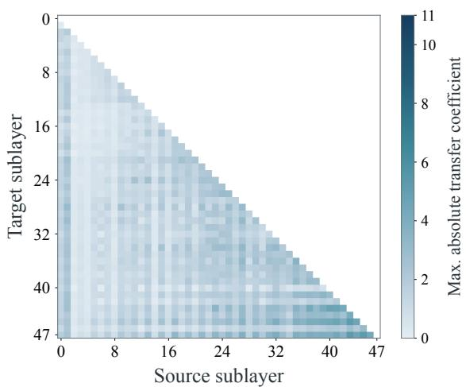  
(a) Learned gates with identity transitions

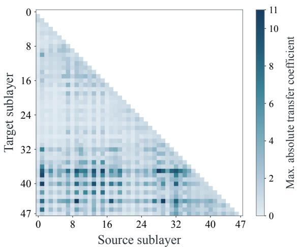  
(b) Unconstrained mixing with fixed gates

Figure 7 Learned read/write gating avoids the larger coeficient peaks observed with unconstrained mixing. Blank cells indicate undefined source–target pairs.  
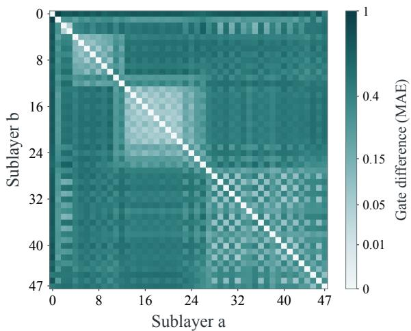  
(a) Read-gate variation across sublayers

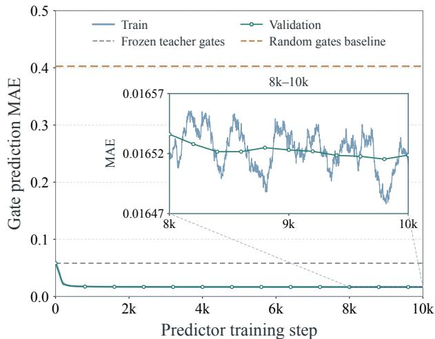  
(b) Prediction from the group-entry state  
Figure 8 Read gates vary across sublayers yet are predictable from shared inputs. (a) Pairwise read-gate MAE across identityHC sublayers, averaged over streams and matched tokens. (b) Training and validation MAE for predicting read gates of the next three sublayers from the group-entry state, using the same experiment as Figure 5(b). Read gates are evaluated on their original [0, 1] scale; the inset enlarges steps 8k–10k.

Absolute diferences are computed for matched token positions and stream indices before averaging. Figure 5(a) shows write gates; Figure $\mathrm { 8 ( a ) }$ shows read gates. Both use a power-normalized color scale with $\gamma = 0 . 4$ over [0, 1]; colorbar labels give actual MAE. The matrices are symmetric with zero diagonals and measure gate variation rather than causal propagation.

## D.3 Prediction from the Group-Entry State

The prediction experiment freezes the final identityHC checkpoint and groups its 48 sublayers into 12 groups of $K = 4 .$ . The teacher always executes with its own gates. Predictors receive only the same-token group-entry state $X _ { L } ;$ their outputs never alter the teacher trajectory.

Table 8 Model and training configuration for the stress test.
<table><tr><td>Configuration</td><td>Value</td></tr><tr><td>Transformer layers</td><td>64</td></tr><tr><td>Hidden width</td><td>2816</td></tr><tr><td>Routed experts</td><td>512</td></tr><tr><td>Experts activated per token</td><td>8</td></tr><tr><td>Activated parameters</td><td>6B</td></tr><tr><td>Total parameters</td><td>230B</td></tr><tr><td>Peak learning rate</td><td> $6 . 2 \times 1 0 ^ { - 3 }$ </td></tr><tr><td>Global batch size</td><td></td></tr><tr><td>Sequence length</td><td>8192</td></tr><tr><td>Warmup steps</td><td>4000</td></tr></table>

Predictors and targets. For $L \leq j < L + K$ and $s \in \{ \mathrm { p r e } , \mathrm { p o s t } \}$ , the target is $h _ { j } ^ { s } = g _ { j } ^ { s } ( X _ { j } )$ from the frozen teacher. Each predictor uses the SimpleHC gate parameterization with independent parameters for every sublayer and gate type:

$$
\begin{array} { r l } & { z _ { L } = \mathrm { R M S N o r m } ( \mathrm { v e c } ( X _ { L } ) ) , } \\ & { \qquad \widehat { \ell } _ { j } ^ { s } = \widehat { \alpha } _ { j } ^ { s } ( \widehat { W } _ { j } ^ { s } ) ^ { \top } z _ { L } + \widehat { b } _ { j } ^ { s } , } \\ & { \widehat { h } _ { j } ^ { \mathrm { p r e } } = \sigma ( \widehat { \ell } _ { j } ^ { \mathrm { p r e } } ) , \qquad \widehat { h } _ { j } ^ { \mathrm { p o s t } } = 2 \sigma ( \widehat { \ell } _ { j } ^ { \mathrm { p o s t } } ) . } \end{array}\tag{17}
$$

The input dimension is $4 \times 1 7 9 2 = 7 1 6 8$ , with 32 gate values per group and approximately 2.75M trainable parameters in total. Projections, scales, and biases are initialized from the corresponding teacher parameters. Read and write gates are trained jointly; teacher states and targets are detached.

Training and evaluation. We train the predictor for 10,000 steps with MSE loss, a global batch size of 64, and a sequence length of 8,192. We use AdamW (Loshchilov and Hutter, 2017) with $\beta = ( 0 . 9 , 0 . 9 9 9 )$ $\epsilon = 1 0 ^ { - 8 }$ , zero weight decay, and gradient clipping at 1.0. The learning rate increases linearly from zero to $1 0 ^ { - 3 }$ over 500 warmup steps, then follows cosine decay to $1 0 ^ { - 5 }$ . Validation uses a fixed set of 2,048 sequences, excluding special tokens. We evaluate every 200 steps and use the final step-10,000 checkpoint for testing, without dev-based checkpoint selection.

Baselines and metrics. The frozen reference applies each sublayer mapping copied from the teacher to the shared entry state without adaptation. It remains input-dependent and does not reuse one gate pair across sublayers. In the plots, this reference is labeled “Frozen teacher gates.” The random baseline samples independent $h ^ { \mathrm { p r e } } \sim \mathcal { U } ( 0 , 1 )$ and $h ^ { \mathrm { p o s t } } \sim \mathcal { U } ( 0 , 2 )$ for each token, sublayer, and stream. The constant baseline uses mean gates fitted on training data. MAE is computed by averaging absolute errors over valid tokens, groups, future ofsets 1–3, and streams; write gates are divided by two. Ofset 0 is excluded.

Experimental results. On 102,400 test sequences, the final predictor achieves read/write MAE of 0.01653/0.01034, compared with 0.05817/0.05044 for frozen mappings and 0.07345/0.06893 for constant mean gates. Together with the improvements over uniform random gates on the dev set, these results support closely approximating subsequent gates from shared entry states using layer-specific mappings.

## E Training Stability Details

This section details the stress-test design, training dynamics, and instability diagnostics supporting Section 6.3.

## E.1 Stress-Test Design and Settings

To emulate stability challenges in large-scale training, we combine 64 layers, 512 routed experts with top-8 routing, and a learning rate 10× the reference value. This stresses optimization through a longer propagation path, higher sparsity, and larger updates. A hidden width of 2816 keeps activated parameters near 6B, yielding a 230B-A6B model. The experiment tests robustness under these combined pressures rather than isolating individual factors.

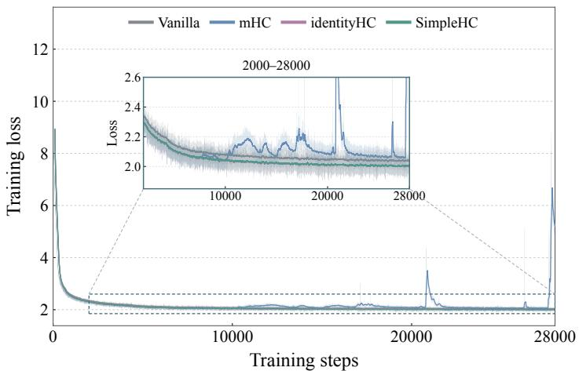

Figure 9 Training loss under stress. All runs cover the same 28,000 steps. We show per-step losses and thei 100-step moving averages. The inset enlarges the low-loss region over steps 2,000–28,000.  
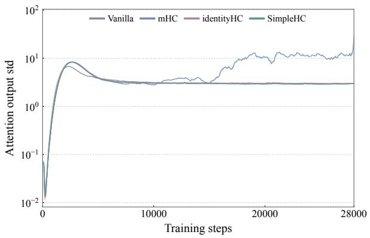  
(a) Attention output

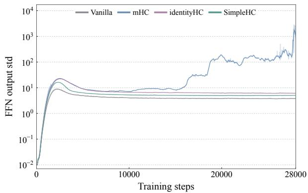  
(b) FFN output  
Figure 10 Attention and FFN output standard deviations under stress. Lines show 100-step moving averages; shaded bands show the minimum and maximum within each window. Both panels use logarithmic vertical axes and cover the same 28,000 steps.

All variants use the backbone in Table 8. MLA alternates full and sliding-window attention in a 1:3 pattern, with 72 heads and window size 512. The first FFN is dense with width 7936; the remaining 63 use experts of width 832 and one shared expert. Training uses BF16, microbatch size 1, and Muon with momentum 0.95, weight decay 0.1, and gradient clipping at 1.0. The WSD schedule uses 4,000 linear warmup steps, followed by the peak learning rate throughout the comparison window. HC variants use $n = 4 ;$ mHC uses 20 Sinkhorn iterations, and SimpleHC uses $K = 4$

## E.2 Training Dynamics

Standard training. During 15B training, SimpleHC shows smaller gradient-norm fluctuations early after warmup than mHC and identityHC, with comparable ranges later (Figure 6(a)). The maximum 1,000-step rolling standard deviation after warmup is 0.032 for SimpleHC, versus 0.206 for mHC and 0.248 for identityHC, indicating smoother standard training.

Stress testing. Under stress, mHC exhibits gradient spikes reaching approximately $1 . 9 \times 1 0 ^ { 6 }$ , whereas SimpleHC and identityHC remain bounded (Figure 6(b)). These spikes in mHC are accompanied by loss spikes (Figure 9) and growing branch-output scales, especially in the FFN. SimpleHC and identityHC show no comparable sustained growth (Figure 10), supporting stable training despite the structural and execution simplifications.

## E.3 Analysis of Stress-Test Results

SimpleHC and identityHC maintain stable optimization under the combined stress setting, indicating that removing residual mixing, with or without shared gate inputs, can preserve training stability. SimpleHC remains comparable to identityHC despite sharing gate inputs across sublayers. In contrast, mHC exhibits instability in both forward activations and backward gradients. To investigate this behavior, we inspect its branch outputs, residual mixing matrices, and gradient paths.

In a captured early-layer MoE event, an input RMS of 0.294 produced a branch-output RMS of $2 . 3 1 \times 1 0 ^ { 4 }$ before write gating, locating the initial large values in the FFN rather than residual mixing at this sublayer. In the observed stress setting, 20 Sinkhorn iterations did not always sufice to produce a doubly stochastic matrix. In one captured case, row sums remained (2, 1, 0.5, 0.5), increasing same-token RMS from $5 . 4 2 \times 1 0 ^ { 4 }$ to $7 . 5 0 \times 1 0 ^ { 4 }$ . Mixing could therefore further amplify existing FFN outliers. These observations also suggest a possible rationale for the SwiGLU clamping used in DeepSeek-V4 (Xu et al., 2026): limiting FFN outliers before they enter the residual pathway. Residual mixing also introduces an additional gradient path because $H ^ { \mathrm { r e s } }$ depends on the input. For $Y = H ^ { \mathrm { r e s } } ( X ) X$ , the diferential is $\mathrm { d } Y = H ^ { \mathrm { r e s } } \mathrm { d } X + ( \mathrm { d } H ^ { \mathrm { r e s } } ) X$ : the first term propagates through the fixed matrix, while the second captures changes in the mixing matrix itself. In one captured backward spike, the gate-input gradient norm was approximately 9.4× that of the fixed-matrix path in the same call. Bounds computed from the recorded read/write gates and upstream gradients made their contributions negligible, implicating the dynamic mixing path. Whether this anomaly reflects mathematical sensitivity or numerical efects in backward remains unresolved. Identity transitions set $\begin{array} { r } { { 1 } H ^ { \mathrm { r e s } } = 0 . } \end{array}$ , eliminating this additional path, consistent with the stable training observed in identityHC and SimpleHC.