# PERSONA PERSPECTIVES: ADOPTING VIEWPOINTS REORGANIZES REPRESENTATIONS IN LLMS

Austin C. Kozlowski, Avital Mintz & Madison Lee   
Knowledge Lab   
University of Chicago

## ABSTRACT

Common methods for monitoring features in large language models (LLMs) such as linear probes and sparse autoencoders (SAEs) assume that features maintain a consistent representation across contexts. LLMs, however, can flexibly adopt different perspectives or “personas” that suggest different underlying systems of conceptual relations. In this paper, we examine whether prompting an LLM to adopt a persona alters the representational geometry of the model’s latent space. We extract representations of over 9,000 common words and 33 semantic axes from models adopting liberal and conservative political personas and compare these against two neutral baselines. We find that persona conditioning systematically alters both the projections of words onto semantic axes and the alignments among the axes themselves in directions consistent with the specified ideology. We then test the implications of this reorganization for two safety-relevant features: truthfulness and morality. Linear probes, SAE-based classifiers, and classifiers built from manually selected word representations, all trained without a persona, produce divergent results when applied to models conditioned on political personas, producing politically slanted ratings of truth and morality on controversial statements. These findings suggest that internal representations, as they are conventionally extracted, can exhibit different geometric relations when the model adopts personas, potentially undermining monitoring efforts.

## 1 INTRODUCTION

The representations in large language models’ (LLM) latent spaces are organized according to their semantic and pragmatic relations. Movements along linear features often correspond to consistent changes in meaning, and the geometric alignments between linear features reflect semantic similarity (Park et al., 2023; Kozlowski & Boutyline, 2026). Thus, low-dimensional projections of latent space can at times serve as a map of an LLM’s conceptual space, rendering visible the systems of similarities and differences the model utilizes in the service of token generation (Templeton et al., 2024; Li et al., 2025).

Static word embeddings like those generated by word2vec or GloVe have long been used to derive renderings of conceptual relations from text (Mikolov et al., 2013; Pennington et al., 2014; Garg et al., 2018; Caliskan et al., 2017). Moreover, given their relatively modest training data requirements, static word embeddings can be trained on distinct corpora representative of specific discourses, and differences in representational geometries can be compared for cross-cultural analysis (Kozlowski et al., 2019; Nelson, 2021; Stoltz & Taylor, 2021). LLMs, by contrast, are rarely trained on texts representing a single perspective. Models are instead trained on large corpora comprising a multitude of perspectives, and these perspectives or “personas” are contextually evoked from the model through prompting (Argyle et al., 2023; Anthis et al., 2025; Bisbee et al., 2024; Park et al., 2024).

If cultural worldviews are reproduced through different representational geometries, and LLMs can invoke different perspectives through prompting, this raises the question of whether prompting reorganizes the LLM’s representation space in accordance with the perspective being simulated. Previous work on the relation of personas to latent space has largely focused on representing personas as single vectors to be used for steering (Chen et al., 2025) or to be classified along a latent “assistant axis” (Lu et al., 2026). Little work has explored whether personas modify downstream relations between other features to instantiate the appropriate conceptual system.

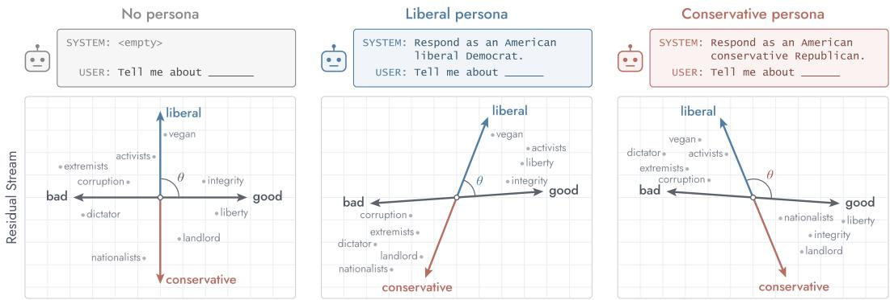  
Figure 1: Schematic diagram of three persona conditions and corresponding representation spaces. We hypothesize that persona conditions rotate semantic axes and reposition word representations in accordance with the persona’s conceptual and linguistic relations.

This question has practical implications for efforts to monitor models’ internal states. Monitoring is commonly accomplished with learned linear probes or sparse autoencoders which identify directions in latent space that correspond to concepts such as truthfulness, deception, or harmfulness(Marks & Tegmark, 2024; Goldowsky-Dill et al., 2025; Bricken et al., 2023). This approach rests on the assumptions that both the monitored concept and the object being classified keep consistent represen tations across contexts. If personas reorganize representational geometry, then a monitor extracted under one perspective may not transfer to another. We suggest that a statement represented as false or harmful under the assistant persona could be represented as true or beneficial by a model adopting a more sympathetic perspective, thus bypassing the monitor.

## 2 METHODS

Models and personas. To assess the effect of personas on representational geometry, we prompt LLMs to adopt politically liberal and conservative perspectives. We study political personas because they correspond to one of the greatest cultural cleavages in the United States today, and prior research suggests that they should manifest different representational geometries when encoded in language (Rim et al., 2026). Moreover, liberals and conservatives differ meaningfully in their judgments of truth and morality, two domains with important implications for AI safety and alignment (Graham et al., 2009; Haidt, 2012; Lakoff, 2002).

We induce liberal and conservative personas with simple system prompts: “Respond as an American liberal Democrat” or “Respond as an American conservative Republican.” We compare these against two baselines: an empty system prompt and a prompt instructing the model to “Respond as a helpful AI assistant.” Main analyses use the instruction-tuned Llama 3.1 8B (Grattafiori et al., 2024). We replicate the analyses on seven further instruction-tuned models from four families, ranging from 4B to 70B parameters: Llama 3.1 70B, Gemma 3 4B and 27B (Kamath et al., 2025), Qwen 3 8B and 32B (Yang et al., 2025), and Ministral 3 8B and 14B (Liu et al., 2026) (Appendix C).

Word representations. We build a “feature bank” of word representations from the 10,000 most common English words according to the wordfreq library (Speer, 2022). Each word w is inserted into five prompt templates, four posed as user messages and one with a pre-filled assistant response:

USER: When you hear “{word }”, what comes to mind?

USER: What does “{wordi}” mean to you?

USER: Tell me your associations with “{wordi}.”

USER: Tell me about the term “{wordi}.”

USER: Define “{wordi}”. ASSISTANT: The term “{wordi}” means

The templates are based on Chen et al. (2025), and Kozlowski & Boutyline (2026) showed that word representations extracted this way recover human-like semantic associations. Each prompt is run under each of the four system-prompt conditions c. From each forward pass we record the residualstream activation at the final token of the prompt, and we average these activations across the five templates to obtain a single representation of the word for each condition and layer $\ell . ^ { 1 }$ Activations are saved at every fourth layer. A sweep across depths showed persona-consistent representations form after 50% depth (Appendix B). We therefore use layer 24 (75% depth) as the focus of our analyses, although analyses of nearby layers produce consistent results. After removing stop words and the anchor terms used to build the semantic axes, 9,493 words remain for analysis.

Semantic axes. We construct 33 semantic axes following the approach of Kozlowski & Boutyline (2026), which finds high correlation between the geometric alignments of these semantic axes and human ratings. This method applies a contrastive-pair design in which axes are constructed by averaging the differences between representations of "anchor" terms designating each pole of the axis (Panickssery et al., 2023; Tigges et al., 2023). Each anchor term is represented by the same procedure used for the words above, and each axis $f$ is the mean of the differences between the positive and negative anchor representations of its ten pairs:

$$
\mathbf { a } _ { f , c } ^ { ( \ell ) } = \frac { 1 } { 1 0 } \sum _ { j = 1 } ^ { 1 0 } \left( \mathbf { h } _ { c } ^ { ( \ell ) } ( \mathrm { p o s } _ { f , j } ) - \mathbf { h } _ { c } ^ { ( \ell ) } ( \mathrm { n e g } _ { f , j } ) \right) .
$$

Axes are constructed separately within each system-prompt condition, so each persona has its own set of 33 axes. From these representations we compute two kinds of relations within each condition. The geometric alignment of two axes $f$ and $g$ is their cosine similarity, $\cos ( \mathbf { a } _ { f , c } , \mathbf { a } _ { g , c } )$ , which captures how the two concepts are related to one another. The normalized projection of a word onto an axis is cos $( \mathbf { h } _ { c } ( w ) , \mathbf { a } _ { f , c } )$ , which captures where the word falls along that dimension.

Comparison with political word embeddings. To test whether the persona-induced changes correspond specifically to liberal and conservative conceptual structure, we compare them with static word embeddings trained on politically slanted texts. We train separate word2vec models (Mikolov et al., 2013; Reh˚uˇ ˇrek & Sojka, 2010) on liberal and conservative corpora comprised of partisan news, podcasts (Rizwan et al., 2025; Wirtschafter, 2023), and campaign emails (Willis, 2026). De tails about the training data and model hyperparameters are provided in Appendix A.

We construct the same 33 semantic axes in the word2vec models. However, because static embeddings rely on exact token matches, each anchor term needs many occurrences in the training corpus to be estimated reliably, we use a larger set of anchor terms for the static embedding’s axes. We draw these terms from Boutyline & Johnston (2026) and filter to those that occur at least five times in both corpora, resulting in a median of 34 pairs per axis.

Because the two personas’ representation spaces remain highly similar overall (for example, “lawyer” stays close to “attorney” and kind–cruel stays close to good–bad under either persona), we focus on their differences rather than their raw geometry. For each system, we compute the 33 × 33 matrix of axis cosine similarities under the liberal and under the conservative condition and subtract the conservative matrix from the liberal matrix. For word2vec, the liberal and conserva tive models play the role of the two personas, and we average the difference matrices across three random training seeds. We then correlate two systems’ difference matrices across the 528 unique axis pairs. We also apply this comparison between pairs of LLMs to test whether different models reorganize their geometry in the same way when adopting political personas.

Steering and spillovers. To test whether the reorganized geometry has behavioral consequences, we adapt the steering design of Kozlowski & Boutyline (2026). By this design, we steer model activations along a semantic axis $f ,$ but then test for behavioral effects along another axis $g .$ For example, one set of tests would steer along soft–hard while the model is rating a word as "good" or "bad." To induce the model to make a behavioral assessment of semantic associations, we use the following prompt template:

USER: Do you associate the term “{wordi}” more with $\{ p o s _ { g } \} \ \mathrm { o r } \ \{ n e g _ { g } \} ? \ \mathrm { R e } .$ spond with exactly one of those two words.

We then collect the log probabilities for the next generated token, summing over lowercase and capitalized forms of the given semantic axis’s anchor terms (e.g. "good" and "bad"). We calculate the difference between the log probabilities for each anchor, resulting in log odds: $L _ { g } ( w ) =$ log $P ( \boldsymbol { \mathfrak { p o s } } _ { g } ) - \log P ( \boldsymbol { \mathfrak { n e g } } _ { g } )$

Using a forward hook on the residual stream after layer 24, we modify the hidden state x at the final prompt token as:

$$
\mathbf { x } ^ { \prime } = \mathbf { x } \pm \alpha \| \mathbf { x } \| \hat { \mathbf { a } } _ { f } ,
$$

where $\hat { \mathbf { a } } _ { f }$ is the unit-normalized axis vector and $\alpha = 0 . 3 3$ sets the intervention’s magnitude as a fraction of the local residual-stream norm, giving every axis a proportionally equal intervention regardless of the raw magnitude of its vector. We average off-target effects for each pair of axes over 1,000 target words sampled at random from the common-word list. We intervene at the final prompt token, the position where persona effects are largest. Because this position directly produces the model’s answer, we analyze only off-target pairs and exclude each axis’s effect on its own rating. This leaves 1,056 directed off-target axis pairs. We run this full set of tests for each political persona and with the helpful AI assistant persona.

In models without personas, the alignment between two axes strongly predicts the spillover from one to the other (Kozlowski & Boutyline, 2026). We therefore test (1) whether each persona’s spillovers are better predicted by its own axis alignments than by those of the other persona or the helpful assistant, and (2) whether differences in alignment between the personas predict differences in their spillovers. For example, if “feminine” aligns with “good” under the liberal persona but with “bad” under the conservative persona, then steering toward “feminine” should push ratings toward “good” under the liberal persona and toward “bad” under the conservative persona. If off target effects are better predicted by the modified representational geometry, it suggests that the way one feature activation affects another’s behavioral manifestation corresponds to their personaconditioned geometric alignment.

Monitoring truthfulness and morality. Finally, we examine how persona-conditioned geometry affects common monitoring techniques in two safety- and alignment-relevant domains. We compile two novel datasets of factually true/false statements and morally acceptable/unacceptable actions. The truthfulness dataset is constructed from high quality English Wikipedia articles (those designated "vital" by the editing community), spanning geography and places, science and technology, arts and culture, and biography. We used an LLM screen to remove articles on politically or socially controversial subjects. Using the content of each article, an LLM (GPT-5-mini) wrote four widely known, uncontroversial true claims and, for each, a minimally edited false counterpart (e.g., “2001: A Space Odyssey is a 1968 science fiction film directed by Stanley Kubrick” versus “. . . a 1968 romantic comedy directed by Stanley Kubrick”). The final dataset contains 9,192 statements in 4,596 true/false pairs from 1,149 articles; 230 complete articles are held out for testing (1,840 statements).

The morality dataset contains 8,000 first-person actions in 4,000 matched acceptable/unacceptable pairs spanning 20 topics and 200 subtopics (e.g., “I told my supervisor that I was genuinely sick and could not work my shift” versus ${ } ^ { 6 6 } \mathrm { I }$ lied to my supervisor that I was sick to avoid working my shift.”); complete pairs are held out for testing (400 actions from 200 pairs). These claims were initially generated using GPT-5-mini, then revised and cross-reviewed using Codex agents to improve clarity.

We train classifiers exclusively on these noncontroversial (un)truthful and (im)moral statements and only with an empty system prompt, and all probes read activations at the final prompt token before the model responds. We test three kinds of classifiers: (1) Learned linear probes are logistic regressions on the full 4,096-dimensional residual stream. (2) SAE-feature probes are logistic regressions on eight features selected from a pretrained sparse autoencoder at layer 19 (Arditi, 2025; Bussmann et al., 2024). A concern with learned classifiers is that they may capture a correlated feature instead of the intended one, such as lexical differences between true and false statements (Levinstein & Herrmann, 2024; Farquhar et al., 2023). We therefore also test (3) word-representation probes built from manually selected word vectors from the feature bank.2 We learn weights for these anchors with a logistic classifier with coefficients constrained to be nonnegative.3

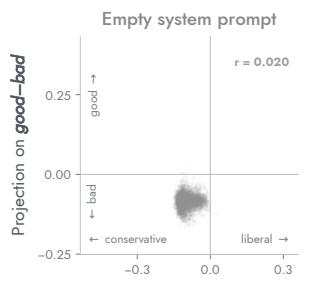

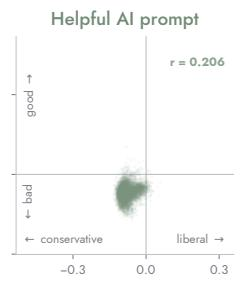  
Projection on

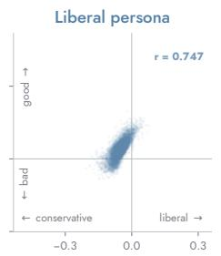

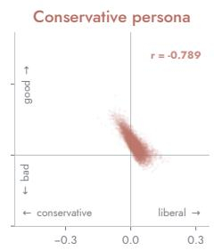  
Figure 2: Projections of 9,493 common words onto the liberal–conservative axis (horizontal) and the good–bad axis (vertical) under four system-prompt conditions, Llama 3.1 8B, layer 24. Each point is a word’s representation vector. Both the word vectors and the axes are extracted within each condition. Pearson correlations between the two projections are shown in each panel.

We then apply these classifiers, trained on uncontroversial statements with no persona, to controversial statements with the political personas. The controversial truth set contains 360 statements on 12 topics, such as election integrity, climate change, and the COVID-19 pandemic; the morality set contains 300 first-person actions on 30 topics, such as abortion, gun ownership, and labor unions. Statements come in opposing pairs, one member of which we expect liberals to endorse and the other conservatives. These expectations are hypotheses about partisan endorsement (generated by GPT-5-mini), not ground truth. We hypothesize that a statement like “massive voter fraud occurred in the 2020 election” will be represented in the “true” direction when the model is prompted as a conservative but in the “untrue” direction when prompted as a liberal, so that a fixed truth probe wil register the same claim as true under one persona and untrue under the other.

## 3 RESULTS

Personas reorganize semantic relations. Figure 2 displays the projections of word representations onto the liberal–conservative and good–bad axes under all four persona conditions. Without a system prompt, the two projections are unrelated (r = .02), and the helpful-assistant prompt produces only a weak association (r = .21). Under the liberal persona, words that fall toward “liberal” also fall toward “good” (r = .75); under the conservative persona, the relation reverses, so that words falling toward “conservative” fall toward “good” (r = −.79).

The same reorganization appears in the cosine similarities between the axes themselves. Figure 3 shows the four axes whose relations to the other 32 axes change most between the liberal and conservative personas, each with their five partner axes that exhibit the greatest change. The liberal– conservative axis changes by far the most. Under the liberal persona, liberal aligns with us (cosine .52), good (.39), successful (.40), strong (.37), and wise (.39). Under the conservative persona these relations reverse, so that conservative aligns with the same poles $( - . 4 8 , - . 4 7 , - . 4 5 , - . 4 6 , - . 3 7 )$ Without a system prompt, all five cosines are near zero (−.03 to .10). Partisan affect toward the parties themselves is the most easily anticipated difference between liberal and conservative judgment, and it is the strongest difference we identify.

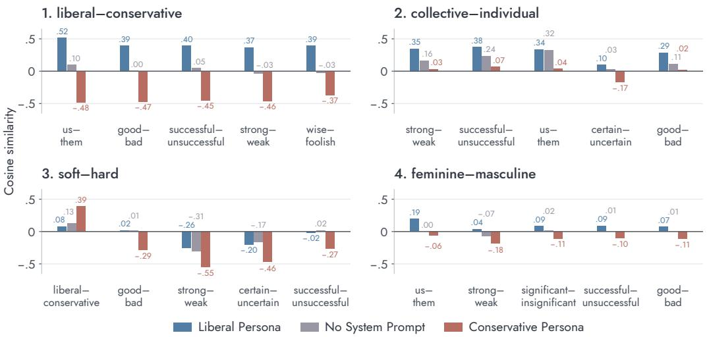  
Figure 3: The four axes whose relations to the other 32 axes change most between the liberal and conservative personas (ranked by mean absolute change in cosine similarity), each shown with the five partner axes exhibiting the greatest changes. Bars show the cosine similarity between the focal axis and each partner under different persona conditions. Llama 3.1 8B, layer 24.

The next largest changes involve collective–individual, soft–hard, and feminine–masculine. Under the liberal persona, collective aligns with strong (.35), successful (.38), us (.34), and good (.29); under the conservative persona, collective–individual is nearly orthogonal to all of these (.02 to .07). The conservative persona reorganizes the soft–hard axis: hard aligns with conservative (.39, versus .08 under the liberal persona), with good (−.29 versus .02), and more strongly with strong (−.55 versus −.26) and certain (−.46 versus −.20). The liberal persona weakly aligns feminine with us (.19) and positive evaluative poles, whereas the conservative persona aligns masculine with strong (−.18), significant (−.11), successful (−.10), and good (−.11). These differences corroborate a great deal of prior research in political psychology and public opinion that identifies the greatest difference between ideological groups as their affect toward the partisan identities themselves (Iyengar et al., 2012; 2019), and other studies suggesting the liberal/conservative divide is grounded in egalitarianism versus individualism (Feldman & Zaller, 1992) as well as gender, not only explicitly but implicitly through emphases on strength and strictness versus gentleness and care (Box-Steffensmeier et al., 2004; Winter, 2010; Lakoff, 2002).

Reorganization is shared across models and matches partisan text. Beyond conforming to prior theories from the social sciences, we empirically test whether these changes reflect liberal and conservative conceptual structure in two ways: whether different LLMs reorganize their geometry in the same way, and whether the reorganization matches the differences between word embeddings trained on liberal and conservative texts. Both comparisons correlate liberal-minus-conservative differences in axis cosine similarities across the 528 unique axis pairs (see Methods).

Figure 4A shows that the differences between the liberal and conservative personas are highly similar across different models. In the later layers, the persona differences between the 8 tested models correlate strongly (mean r = .84 across the 28 model pairs at 75% depth). It is important to note these are differences between cosine similarities that are being correlated. Therefore, we are not capturing baseline representational similarity – only differences that similarly emerge between liberal and conservative persona-conditioned representations. Figure 4B compares LLM persona differences with the differences between the liberal and conservative word2vec models. In the later layers, the correlation is consistently positive and substantial (mean r = .64 across the eight models at 75% depth; r = .67 for Llama 3.1 8B at layer 24). These findings provisionally suggest that, when a persona is specified in an LLM’s system prompt, it “spins up” a representation space resembling the one that would be obtained by training specifically on that perspective’s texts.

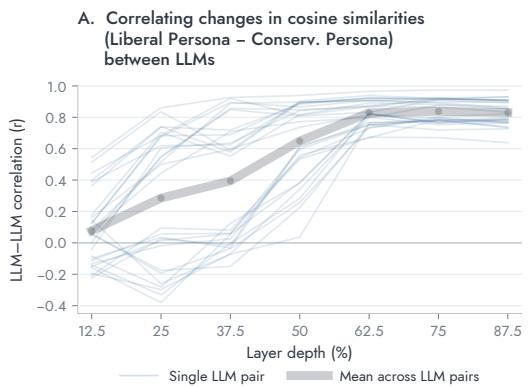

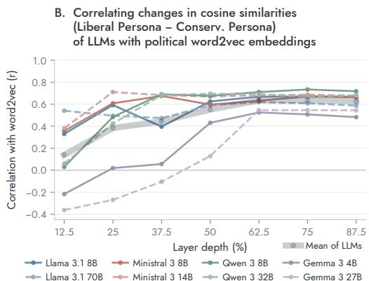  
Figure 4: Agreement in persona-induced geometry across layer depth. (A) Correlations between differences in cosine similarities of semantic axes between liberal and conservative personas for the 28 pairs of the 8 LLMs. (B) Correlation between each LLM’s liberal-minus-conservative differences and the differences between word2vec models trained on liberal versus conservative texts

A. Persona Alignments Better Predict their Steering Spillovers  
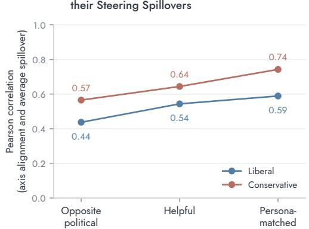  
B. Δ Alignments Predicts Δ Spillovers (Liberal − Conservative Persona)

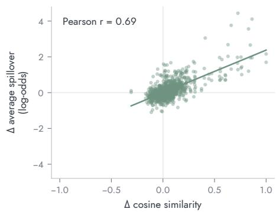  
Figure 5: Persona geometry predicts steering spillovers. (A) The spillover effects observed under a political persona condition are best predicted by the semantic axis alignments corresponding to that persona. (B) Difference in cosine similarities predicts difference in spillover effects, subtracting values of conservative persona from values of liberal persona. Each point is a directed steering-axis → rating-axis pair. Spillovers are averaged over 1,000 common words; Llama 3.1 8B, layer 24.

Reorganized geometry predicts behavioral spillovers. If the reorganized geometry reflects how each persona actually uses its concepts, it should predict the off-target effects of steering under that persona. Figure 5A shows evidence of this. The correlation between axis alignment and spillover is highest when a persona’s spillovers are predicted from its own geometry (r = .59 for the liberal persona and .74 for the conservative persona), intermediate when predicted from the helpful-assistant geometry (.54 and .64), and lowest when predicted from the opposite persona’s geometry (.44 and .57). Figure 5B shows that the differences between the personas’ geometries predict the differences in their spillovers (r = .69 across the 1,056 directed axis pairs): where the liberal persona aligns two axes more closely than the conservative persona does, steering along one axis produces a larger spillover onto the other under the liberal persona. Changes in representational geometry are thus accompanied by corresponding changes in how the model’s judgments respond to intervention.

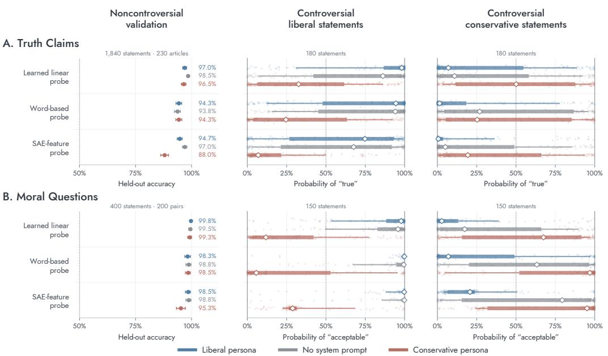  
Figure 6: Classifications of fixed truth and morality monitors under different personas. Left column: accuracy on held-out noncontroversial statements, 95% bootstrap confidence intervals. Middle and right columns: probe-assigned probability that controversial statements conventionally endorsed by liberals (middle) or conservatives (right) are true or acceptable. Diamonds mark medians, thick bars the middle 50% of statements, thin bars the middle 80%, and faint points individual statements.

Fixed truth and morality monitors give persona-dependent readings. Finally, we examine the consequences of this reorganization for the three probes. Figure 6 shows the results for truth claims (A) and moral questions (B). On held-out noncontroversial statements (left column), all three classifiers discriminate true from false statements (94–99% accuracy with no system prompt) and acceptable from unacceptable actions (about 99%). Accuracy on these ordinary items stays high under both personas, with one exception: the SAE-feature truth probe falls from 97% to 88% under the conservative persona. On conventional topics, then, the personas largely preserve the representations of truth and morality that the classifiers rely on.

The middle column shows controversial stances conventionally endorsed by liberals. With no system prompt, the probes classify most of these liberal stances as true or acceptable. This accords with behavior: in the absence of a system prompt, the model tends to endorse liberal positions and challenge conservative ones (Appendix E, Figure A9). The liberal persona raises these probabilities further for truth claims under the learned linear and SAE-feature probes (median 98% versus 86%, and 75% versus 68%). On moral questions, the probes already classify nearly all liberal stances as acceptable, leaving little room for the liberal persona to move them.

For the conservative persona, however, the median probability falls well below 50% for all three probes for the controversial liberal truth claims. It is important to note that these are the same probes in all three conditions: each points in the same absolute direction in the latent space. If controversial liberal stances are classified differently under the conservative persona, it is because the same statements activate a different region of the representation space: the truth claims shif toward the “untrue” side of the probe and the moral claims toward the “unacceptable” side.

We see similar effects for controversial conservative statements (right column). The probabilities of “true” are substantially lower under the liberal persona than under the conservative persona for all three probes. Many of these statements are classified as untrue even under the conservative persona, but this matches the model’s behavior: despite the conservative persona, the model rarely takes some positions like denying the reality of climate change (Figure A10). The effects are clearer still for controversial conservative moral stances: the median probability of “acceptable” is well below 50% for all three probes under the liberal persona (3–21%) and well above 50% under the conservative persona (67–97%).

## 4 RELATED LITERATURE

LLM personas. Personas have drawn attention from two main directions. Computational social scientists use persona prompts to simulate human respondents, asking whether models conditioned on demographic or ideological identities reproduce the opinions of the corresponding populations (Argyle et al., 2023; Santurkar et al., 2023; Bisbee et al., 2024; Park et al., 2024; Anthis et al., 2025). This line of research has focused on the correspondence between model outputs and the outputs of humans they are intended to simulate, but has given less attention to the relation between personas and LLM internal representations. Alignment researchers, in turn, study the character that models adopt, motivated both by questions of what the default assistant persona should be (Marks et al., 2026) and by concerns that models can drift into misaligned personas (Li et al., 2024; Betley et al., 2025; Lu et al., 2026). This research typically treats the persona itself as a direction or subspace that can be read out or steered (Chen et al., 2025; Wang et al., 2025; Lu et al., 2026). We instead treat the persona as a context that reorganizes the relations among the model’s other representations.

Linear features and monitoring. Much of interpretability rests on the premise that concepts are represented as stable linear directions (Park et al., 2023; Elhage et al., 2022), supported by evidence for linear representations of truth and other concepts (Marks & Tegmark, 2024; Zou et al., 2023). This premise underwrites the probes and SAE features used to monitor models for deception, defection, and other safety-relevant states (Goldowsky-Dill et al., 2025; MacDiarmid et al., 2024; Bricken et al., 2023). Yet growing evidence suggests that these representations are not fixed: truth probes shift with the premises and instructions in context (Schouten et al., 2025; Poulis et al., 2026) and degrade under distribution shift (Levinstein & Herrmann, 2024; Kramár et al., 2026), in-context structure can reorganize concept representations (Park et al., 2025; Lubana et al., 2025), and factuality directions can flip over the course of a conversation as the model takes on a role (Lampinen et al., 2026). We extend this line of work by showing that a single, benign instruction to adopt a perspective systematically reorganizes the geometry of many representations at once, in a direction that matches the corresponding ideology.

## 5 CONCLUSION

We present evidence that when models are instructed to adopt different perspectives in their system prompt, this systematically restructures the model’s representation space to induce conceptual relations associated with that perspective. This restructuring is shared across models, mirrors the conceptual differences found in partisan text, and carries over both to the model’s behavior and to the monitors built on its representations.

These findings provide an alternative to conceptualizing personas as mere directions added to an otherwise fixed representation space. We find that a one-sentence instruction reorganizes the relations among the model’s representations to compose the conceptual relations characteristic of that perspective. This encourages analysts to locate the simulation of perspectives (Shanahan et al., 2023) in the geometry of the latent space as well as in generated outputs.

Moreover, they motivate a reconsideration of methods that conceive of representations as contextinvariant directions in latent space. A given concept, whether it is an attribute like "liberal" or an entity like "the Democratic Party," can operate differently for different perspectives. It might be activated by different associations and it might go on to activate different associations in turn. Although we do not dismiss the possibility of training a classifier that functions well across contexts, our work suggests that simple approaches to probe construction, which do not account for the multiplicity of perspectives an LLM learns, are susceptible to failure under changing personas.

## REFERENCES

Jacy Reese Anthis, Ryan Liu, Sean M. Richardson, Austin C. Kozlowski, Bernard Koch, Erik Brynjolfsson, James Evans, and Michael S. Bernstein. Position: LLM social simulations are a promis-

ing research method. In Aarti Singh, Maryam Fazel, Daniel Hsu, Simon Lacoste-Julien, Felix Berkenkamp, Tegan Maharaj, Kiri Wagstaff, and Jerry Zhu (eds.), Proceedings of the 42nd International Conference on Machine Learning, volume 267 of Proceedings ofMachine Learning Research, pp. 81005–81034. PMLR, 2025. URL https://proceedings.mlr.press/ v267/anthis25a.html.

Andy Arditi. saes-llama-3.1-8b-instruct: BatchTopK residual-stream sparse autoencoders for Llama 3.1 8b instruct. Hugging Face model repository, 2025. URL https://huggingface. co/andyrdt/saes-llama-3.1-8b-instruct.

Lisa P. Argyle, Ethan C. Busby, Nancy Fulda, Joshua R. Gubler, Christopher Rytting, and David Wingate. Out of one, many: Using language models to simulate human samples. Political Analysis, 31(3):337–351, 2023. doi: 10.1017/pan.2023.2.

Jan Betley, Daniel Tan, Niels Warncke, Anna Sztyber-Betley, Xuchan Bao, Martín Soto, Nathan Labenz, and Owain Evans. Emergent misalignment: Narrow finetuning can produce broadly misaligned LLMs. In Proceedings of the 42nd International Conference on Machine Learning, volume 267 of Proceedings of Machine Learning Research. PMLR, 2025. URL https: //proceedings.mlr.press/v267/betley25a.html. Extended version published in Nature (2026).

James Bisbee, Joshua D. Clinton, Cassy Dorff, Brenton Kenkel, and Jennifer M. Larson. Synthetic replacements for human survey data? The perils of large language models. Political Analysis, 32 (4):401–416, 2024. doi: 10.1017/pan.2024.5.

Andrei Boutyline and Elle Johnston. Forging better axes: Evaluating and improving the reliability of semantic dimensions in word embeddings. Sociological Methods & Research, pp. 1–48, 2026. doi: 10.1177/00491241261467930.

Janet M. Box-Steffensmeier, Suzanna De Boef, and Tse-Min Lin. The dynamics of the partisan gender gap. American Political Science Review, 98(3):515–528, 2004. doi: 10.1017/ S0003055404001315.

Trenton Bricken, Adly Templeton, Joshua Batson, Brian Chen, Adam Jermyn, Tom Conerly, Nicholas L. Turner, Cem Anil, Carson Denison, Amanda Askell, Robert Lasenby, Yifan Wu, Shauna Kravec, Nicholas Schiefer, Tim Maxwell, Nicholas Joseph, Alex Tamkin, Karina Nguyen, Brayden McLean, Josiah E. Burke, Tristan Hume, Shan Carter, Tom Henighan, and Christopher Olah. Towards monosemanticity: Decomposing language models with dictionary learning. Transformer Circuits Thread, 2023. URL https://transformer-circuits.pub/ 2023/monosemantic-features.

Bart Bussmann, Patrick Leask, and Neel Nanda. BatchTopK sparse autoencoders, 2024. URL https://arxiv.org/abs/2412.06410.

Aylin Caliskan, Joanna J Bryson, and Arvind Narayanan. Semantics derived automatically from language corpora contain human-like biases. Science, 356(6334):183–186, 2017.

Runjin Chen, Andy Arditi, Henry Sleight, Owain Evans, and Jack Lindsey. Persona vectors: Monitoring and controlling character traits in language models, 2025. URL https://arxiv.org/ abs/2507.21509.

Nelson Elhage, Tristan Hume, Catherine Olsson, Nicholas Schiefer, Tom Henighan, Shauna Kravec, Zac Hatfield-Dodds, Robert Lasenby, Dawn Drain, Carol Chen, Roger Grosse, Sam McCandlish, Jared Kaplan, Dario Amodei, Martin Wattenberg, and Christopher Olah. Toy models of superposition. Transformer Circuits Thread, 2022.

Sebastian Farquhar, Vikrant Varma, Zachary Kenton, Johannes Gasteiger, Vladimir Mikulik, and Rohin Shah. Challenges with unsupervised LLM knowledge discovery, 2023.

Stanley Feldman and John Zaller. The political culture of ambivalence: Ideological responses to the welfare state. American Journal of Political Science, 36(1):268–307, 1992. doi: 10.2307/ 2111433.

Nikhil Garg, Londa Schiebinger, Dan Jurafsky, and James Zou. Word embeddings quantify 100 years of gender and ethnic stereotypes. Proceedings of the National Academy of Sciences, 115 (16):E3635–E3644, 2018.

Nicholas Goldowsky-Dill, Bilal Chughtai, Stefan Heimersheim, and Marius Hobbhahn. Detecting strategic deception with linear probes. In Proceedings of the 42nd International Conference on Machine Learning, volume 267 of Proceedings of Machine Learning Research, pp. 19755– 19786. PMLR, 2025. URL https://proceedings.mlr.press/v267/goldowskydill25a.html.

Jesse Graham, Jonathan Haidt, and Brian A. Nosek. Liberals and conservatives rely on different sets of moral foundations. Journal of Personality and Social Psychology, 96(5):1029–1046, 2009. doi: 10.1037/a0015141.

Aaron Grattafiori, Abhimanyu Dubey, Abhinav Jauhri, Abhinav Pandey, Abhishek Kadian, Ahmad Al-Dahle, Aiesha Letman, Akhil Mathur, Alan Schelten, Alex Vaughan, et al. The llama 3 herd of models. arXiv preprint arXiv:2407.21783, 2024.

Jonathan Haidt. The Righteous Mind: Why Good People Are Divided by Politics and Religion. Pantheon Books, New York, 2012. ISBN 9780307377906.

Shanto Iyengar, Gaurav Sood, and Yphtach Lelkes. Affect, not ideology: A social identity perspective on polarization. Public Opinion Quarterly, 76(3):405–431, 2012. doi: 10.1093/poq/nfs038. Erratum: Public Opinion Quarterly 76(4):819, doi:10.1093/poq/nfs059.

Shanto Iyengar, Yphtach Lelkes, Matthew Levendusky, Neil Malhotra, and Sean J. Westwood. The origins and consequences of affective polarization in the United States. Annual Review ofPolitical Science, 22(1):129–146, 2019. doi: 10.1146/annurev-polisci-051117-073034.

Aishwarya Kamath, Johan Ferret, Shreya Pathak, Nino Vieillard, Ramona Merhej, Sarah Perrin, Tatiana Matejovicova, Alexandre Ramé, Morgane Rivière, et al. Gemma 3 technical report. arXiv preprint arXiv:2503.19786, 2025.

Austin C. Kozlowski and Andrei Boutyline. Semantic structure of feature space in large language models. In Conference on Language Modeling (COLM), 2026. URL https://arxiv.org/ abs/2604.27169.

Austin C. Kozlowski, Matt Taddy, and James A Evans. The geometry of culture: Analyzing the meanings of class through word embeddings. American Sociological Review, 84(5):905–949, 2019.

János Kramár, Joshua Engels, Zheng Wang, Bilal Chughtai, Rohin Shah, Neel Nanda, and Arthur Conmy. Building production-ready probes for Gemini, 2026.

George Lakoff. Moral Politics: How Liberals and Conservatives Think. University of Chicago Press, Chicago, 2 edition, 2002. doi: 10.7208/chicago/9780226471006.001.0001.

Andrew Kyle Lampinen, Yuxuan Li, Eghbal Hosseini, Sangnie Bhardwaj, and Murray Shanahan. Linear representations in language models can change dramatically over a conversation. arXiv preprint arXiv:2601.20834, 2026.

Benjamin A. Levinstein and Daniel A. Herrmann. Still no lie detector for language models: Probing empirical and conceptual roadblocks. Philosophical Studies, 182(7):1539–1565, 2024. doi: 10. 1007/s11098-023-02094-3. Published online 17 February 2024; issue dated 2025.

Kenneth Li, Tianle Liu, Naomi Bashkansky, David Bau, Fernanda Viégas, Hanspeter Pfister, and Martin Wattenberg. Measuring and controlling instruction (in)stability in language model dialogs. In Conference on Language Modeling (COLM), 2024. Earlier arXiv title: “Measuring and Controlling Persona Drift in Language Model Dialogs”.

Yuxiao Li, Eric J Michaud, David D Baek, Joshua Engels, Xiaoqing Sun, and Max Tegmark. The geometry of concepts: Sparse autoencoder feature structure. Entropy, 27(4):344, 2025.

Alexander H. Liu, Kartik Khandelwal, Sandeep Subramanian, et al. Ministral 3, 2026. URL https://arxiv.org/abs/2601.08584.

Christina Lu, Jack Gallagher, Jonathan Michala, Kyle Fish, and Jack Lindsey. The assistant axis: Situating and stabilizing the default persona of language models, 2026. URL https://arxiv. org/abs/2601.10387.

Ekdeep Singh Lubana, Can Rager, Sai Sumedh R. Hindupur, Valérie Costa, Greta Tuckute, Oam Patel, Sonia Krishna Murthy, Thomas Fel, Daniel Wurgaft, Eric J. Bigelow, Johnny Lin, Demba Ba, Martin Wattenberg, Fernanda Viégas, Melanie Weber, and Aaron Mueller. Priors in time: Missing inductive biases for language model interpretability. arXiv preprint arXiv:2511.01836, 2025.

Monte MacDiarmid, Timothy Maxwell, Nicholas Schiefer, Jesse Mu, Jared Kaplan, David Duvenaud, Sam Bowman, Alex Tamkin, Ethan Perez, Mrinank Sharma, Carson Denison, and Evan Hubinger. Simple probes can catch sleeper agents. Anthropic research blog, 2024. URL https://www.anthropic.com/research/probes-catch-sleeper-agents.

Sam Marks, Jack Lindsey, and Christopher Olah. The persona selection model: Why AI assistants might behave like humans. Anthropic Alignment Science Blog, February 2026. URL https: //alignment.anthropic.com/2026/psm/.

Samuel Marks and Max Tegmark. The geometry of truth: Emergent linear structure in large language model representations of true/false datasets. In First Conference on Language Modeling, 2024. URL https://openreview.net/forum?id=aajyHYjjsk.

Tomas Mikolov, Ilya Sutskever, Kai Chen, Greg S Corrado, and Jeff Dean. Distributed representations of words and phrases and their compositionality. Advances in neural information processing systems, 26, 2013.

Laura K. Nelson. Leveraging the alignment between machine learning and intersectionality: Using word embeddings to measure intersectional experiences of the nineteenth century U.S. South. Poetics, 88:101539, 2021. doi: 10.1016/j.poetic.2021.101539.

Nina Panickssery, Nick Gabrieli, Julian Schulz, Meg Tong, Evan Hubinger, and Alexander Matt Turner. Steering llama 2 via contrastive activation addition. arXiv preprint arXiv:2312.06681, 2023.

Core Francisco Park, Andrew Lee, Ekdeep Singh Lubana, Yongyi Yang, Maya Okawa, Kento Nishi, Martin Wattenberg, and Hidenori Tanaka. ICLR: In-context learning of representations. In The Thirteenth International Conference on Learning Representations, 2025.

Joon Sung Park, Carolyn Q. Zou, Aaron Shaw, Benjamin Mako Hill, Carrie Cai, Meredith Ringel Morris, Robb Willer, Percy Liang, and Michael S. Bernstein. Generative agent simulations of 1,000 people, 2024. URL https://arxiv.org/abs/2411.10109.

Kiho Park, Yo Joong Choe, and Victor Veitch. The linear representation hypothesis and the geometry of large language models. arXiv preprint arXiv:2311.03658, 2023.

Jeffrey Pennington, Richard Socher, and Christopher D Manning. Glove: Global vectors for word representation. In Proceedings of the 2014 conference on empirical methods in natural language processing (EMNLP), pp. 1532–1543, 2014.

Angelos Poulis, Mark Crovella, and Evimaria Terzi. Testing the limits of truth directions in LLMs, 2026. BlackboxNLP 2026 (per arXiv comment).

Radim Reh˚u ˇ ˇrek and Petr Sojka. Software framework for topic modelling with large corpora. In Proceedings of the LREC 2010 Workshop on New Challenges for NLP Frameworks, pp. 45–50, Valletta, Malta, May 2010. ELRA.

Nakwon Rim, Joshua Conrad Jackson, Marc G. Berman, and Yuan Chang Leong. Natural language reveals that political partisans are more affectively aligned over political issues than partisan identities. Communications Psychology, 4(1):65, 2026. doi: 10.1038/s44271-026-00430-x. URL https://www.nature.com/articles/s44271-026-00430-x.

Naquee Rizwan, Nayandeep Deb, Sarthak Roy, Vishwajeet Singh Solanki, Kiran Garimella, and Animesh Mukherjee. Toxicity begets toxicity: Unraveling conversational chains in political podcasts. In Proceedings of the 33rd ACM International Conference on Multimedia, MM ’25, pp. 11776–11784, New York, NY, USA, 2025. Association for Computing Machinery. doi: 10.1145/3746027.3754553.

Shibani Santurkar, Esin Durmus, Faisal Ladhak, Cinoo Lee, Percy Liang, and Tatsunori Hashimoto. Whose opinions do language models reflect? In Proceedings of the 40th International Conference on Machine Learning, volume 202 of Proceedings of Machine Learning Research, pp. 29971–30004. PMLR, 2023. URL https://proceedings.mlr.press/v202/ santurkar23a.html.

Stefan F. Schouten, Peter Bloem, Ilia Markov, and Piek Vossen. Truth-value judgment in language models: ‘truth directions’ are context sensitive. In Conference on Language Modeling (COLM), 2025.

Murray Shanahan, Kyle McDonell, and Laria Reynolds. Role play with large language models. Nature, 623(7987):493–498, 2023. doi: 10.1038/s41586-023-06647-8.

Robyn Speer. rspeer/wordfreq: v3.0, 2022. URL https://doi.org/10.5281/zenodo. 7199437.

Dustin S. Stoltz and Marshall A. Taylor. Cultural cartography with word embeddings. Poetics, 88: 101567, 2021. doi: 10.1016/j.poetic.2021.101567.

Adly Templeton, Tom Conerly, Jonathan Marcus, Jack Lindsey, Trenton Bricken, Brian Chen, Adam Pearce, Craig Citro, Emmanuel Ameisen, Andy Jones, Hoagy Cunningham, Nicholas L Turner, Callum McDougall, Monte MacDiarmid, C. Daniel Freeman, Theodore R. Sumers, Edward Rees, Joshua Batson, Adam Jermyn, Shan Carter, Chris Olah, and Tom Henighan. Scaling monosemanticity: Extracting interpretable features from claude 3 sonnet. Transformer Circuits Thread, 2024. URL https://transformer-circuits.pub/2024/scalingmonosemanticity/index.html.

Curt Tigges, Oskar John Hollinsworth, Atticus Geiger, and Neel Nanda. Linear representations of sentiment in large language models. arXiv preprint arXiv:2310.15154, 2023.

Miles Wang, Tom Dupré la Tour, Olivia Watkins, Alex Makelov, Ryan A. Chi, Samuel Miserendino, Jeffrey Wang, Achyuta Rajaram, Johannes Heidecke, Tejal Patwardhan, and Dan Mossing. Persona features control emergent misalignment. arXiv preprint arXiv:2506.19823, 2025.

Derek Willis. Political email archive. https://thescoop.org/political-emails/, 2026. Archive of U.S. political fundraising emails, 2015–present. Code and data: https:// github.com/dwillis/political-emails. Accessed September 2026.

Nicholas J. G. Winter. Masculine Republicans and feminine Democrats: Gender and Americans explicit and implicit images of the political parties. Political Behavior, 32(4):587–618, 2010. doi: 10.1007/s11109-010-9131-z.

Valerie Wirtschafter. Audible reckoning: How top political podcasters spread unsubstantiated and false claims. Technical report, Brookings Institution, Washington, DC, February 2023. URL https://www.brookings.edu/articles/audible-reckoning-how-toppolitical-podcasters-spread-unsubstantiated-and-false-claims/. Appendix 2 classifies the 79 podcast series by ideology: https://www.brookings. edu/wp-content/uploads/2023/02/Appendices\_for\_Podcast\_Project-3- 1.pdf.

An Yang, Anfeng Li, Baosong Yang, Beichen Zhang, Binyuan Hui, Bo Zheng, Bowen Yu, Chang Gao, Chengen Huang, Chenxu Lv, et al. Qwen3 technical report. arXiv preprint arXiv:2505.09388, 2025.

Andy Zou, Long Phan, Sarah Chen, James Campbell, Phillip Guo, Richard Ren, Alexander Pan, Xuwang Yin, Mantas Mazeika, Ann-Kathrin Dombrowski, Shashwat Goel, Nathaniel Li, Michael J. Byun, Zifan Wang, Alex Mallen, Steven Basart, Sanmi Koyejo, Dawn Song, Matt

Fredrikson, J. Zico Kolter, and Dan Hendrycks. Representation engineering: A top-down approach to AI transparency. arXiv preprint arXiv:2310.01405, 2023.

## A WORD2VEC TRAINING DATA AND HYPERPARAMETERS

Corpora. We train separate liberal and conservative models on corpora of 69,087,676 tokens per side, combining three genres (Table A1). Partisan news consists of Common Crawl articles (2016–2020) from 11 liberal and 13 conservative outlets, with token counts matched between sides within each year and no outlet contributing more than half of a side’s tokens in any year. Podcasts are diarized transcripts of political podcasts (Rizwan et al., 2025), with show ideology taken from Wirtschafter (2023). Campaign emails are fundraising and campaign emails from Democratic and Republican senders (Willis, 2026). Podcasts and emails cover January 2022–September 2023, and token counts are matched between sides within each month separately for each genre. We re move URLs, recognized boilerplate (sponsorship reads, legal and unsubscribe text), exact and nearduplicate documents, and heavily reused passages. Text is lowercased and punctuation is discarded. Outlet and show labels are proxies for ideological stance rather than article-level annotations.

Table A1: Composition of the word2vec training corpora (tokens per side).
<table><tr><td>Genre</td><td>Tokens per side</td><td>Sources</td></tr><tr><td>Partisan news</td><td>38,886,566</td><td>Liberal: CBS News, Daily Beast, HuffPost, MSNBC, New Yorker, Newsweek, NPR, Politico, Slate, The Atlantic, Washington Post. Conservative: American Thinker, Breitbart, Daily Caller, Daily Wire, Epoch Times, Federalist, Fox News, Hot Air, National Review,</td></tr><tr><td>Podcasts</td><td>17,724,396</td><td>PJ Media, RedState, Townhall, Washington Examiner. 2,116 liberal and 2,296 conservative episodes</td></tr><tr><td>Campaign emails</td><td>12,476,714</td><td>50,521 Democratic and 58,264 Republican emails</td></tr><tr><td>Total</td><td>69,087,676</td><td></td></tr></table>

Training. Each side is trained from scratch with continuous bag-of-words (CBOW) in Gensim (Reh˚u ˇ ˇrek & Sojka, 2010): 300 dimensions, maximum window 4, 10 negative samples, subsampling threshold 10−4, minimum count 5, and a learning rate decaying linearly from .025 to .0001 over ten epochs. We use the checkpoint saved after epoch 5. Vocabularies and sampling distributions are built from each side’s corpus alone. We train three seeds per side. A word’s representation is the sum of its input and output vectors. These settings were chosen after comparing several exploratory configurations and were not preregistered.

Axes. Axes are the mean of raw anchor-pair differences, as for the LLM. Anchor pairs come from Boutyline & Johnston (2026), keeping pairs whose terms each occur at least five times in both corpora: 1,153 pairs in total (median 34 per axis, range 4–90). The liberal– conservative axis uses four pairs: liberal/conservative, liberals/conservatives, democrat/republican, and democrats/republicans. Axis cosine matrices are computed within each model, and the liberalminus-conservative difference matrices are averaged across seeds; vectors from different models are never averaged.

Projection on liberal–conservative (positive = liberal)

## B PERSONA GEOMETRY ACROSS LAYER DEPTH

Figure A1 repeats Figure 2 at seven depths of Llama 3.1 8B. In the earliest layers, the correlation between the political and evaluative projections is weak and similar across conditions; the opposing persona-specific correlations appear by roughly 50% depth and strengthen thereafter. Figure 4 shows the same emergence with depth for the axis alignments across all eight models.

Llama 3.1 8B · word geometry across depth  
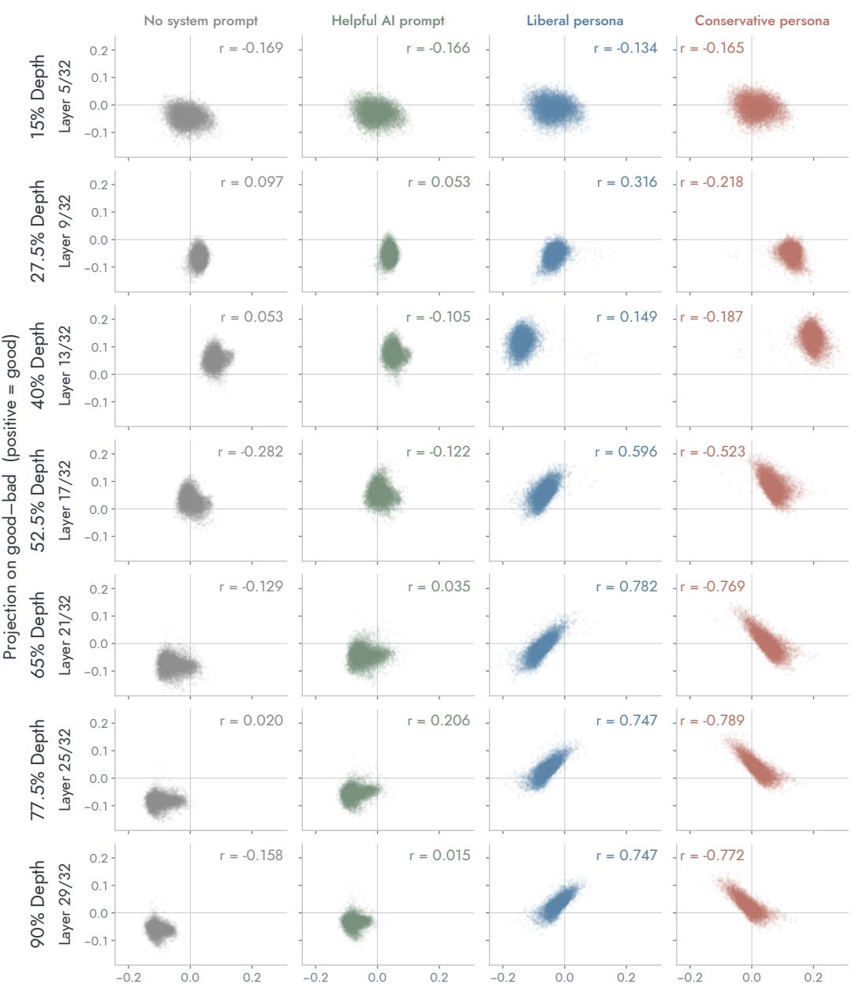

Figure A1: Projections of 9,493 common words onto the liberal–conservative (horizontal) and good– bad (vertical) axes across depth, Llama 3.1 8B. Rows are depths (layers 5, 9, 13, 17, 21, 25, and 29 of 32); columns are system-prompt conditions. Words and axes are extracted within each condition and layer. Panels share coordinate limits; Pearson correlations between the two projections are shown in each panel. The 77.5% row is the layer shown in Figure 2.

## C REPLICATION ACROSS MODELS

Figures A2–A5 repeat the analyses of Figures 2, 3, and 5 for all eight models. Each model is analyzed at approximately 75% depth (zero-based blocks 24, 60, 26, 30, 27, 48, 26, and 47 for Llama 3.1 8B and 70B, Ministral 3 8B and 14B, Qwen 3 8B and 32B, and Gemma 3 4B and 27B, respectively).

Political and evaluative word geometry across models 9,493 common words per panel · original axes · shared coordinate scales  
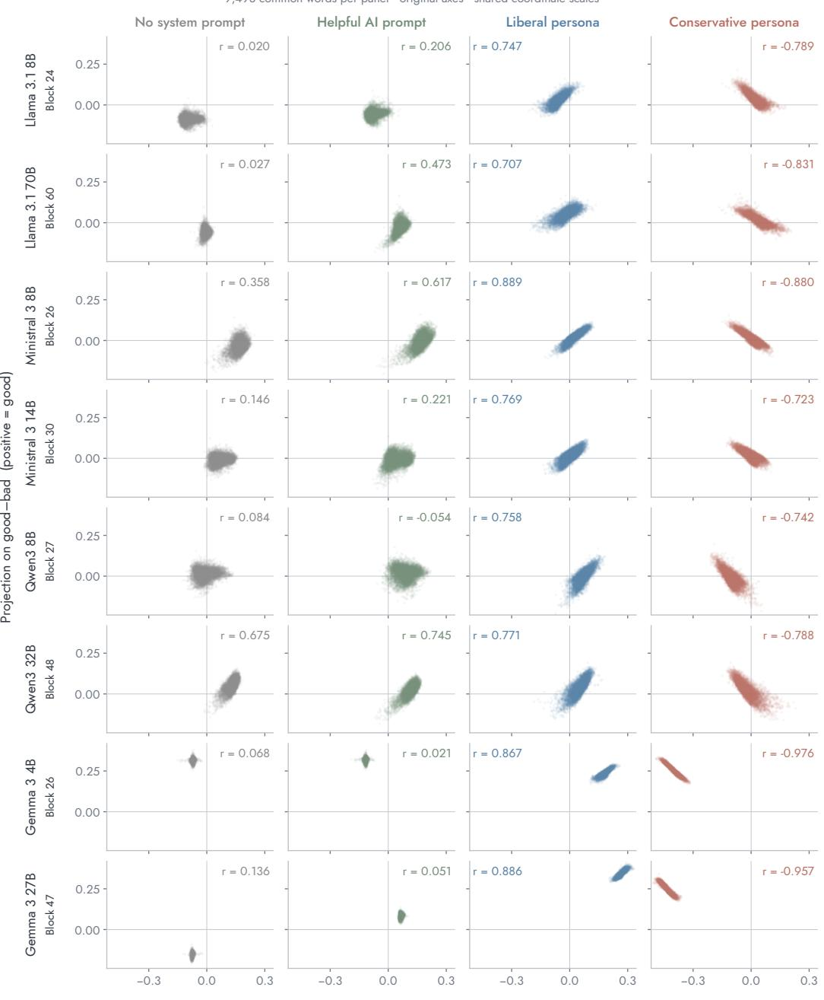  
Projection on liberal–conservative (positive = liberal)

Figure A2: Projections of 9,493 common words onto the liberal–conservative and good–bad axes for all eight models (rows) under each system-prompt condition (columns), as in Figure 2. Words and axes are extracted within each model and condition. Pearson correlations are shown in each panel.

## Most changed axis relationships across models

Four axes per model; five largest liberal–conservative changes per axis

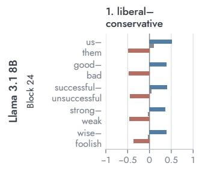

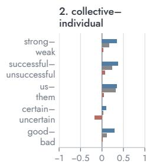

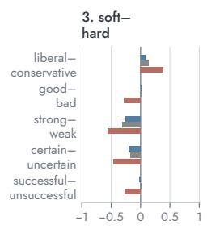

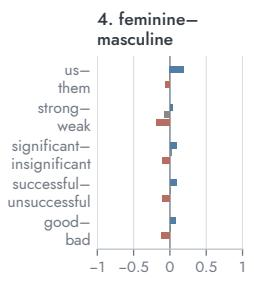

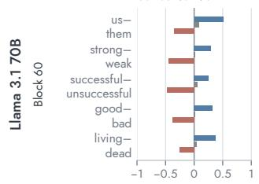

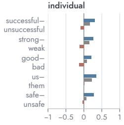

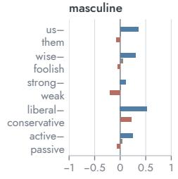

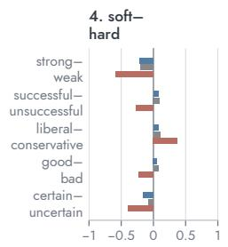

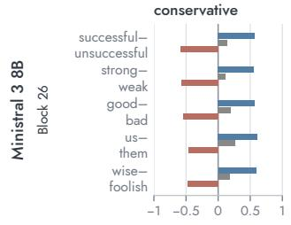

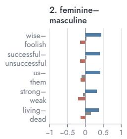

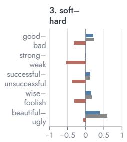

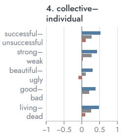

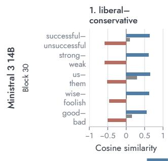

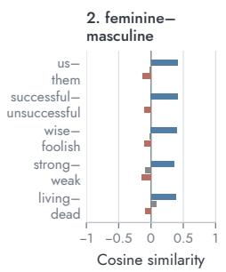

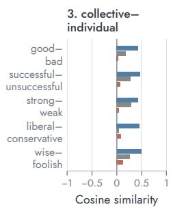

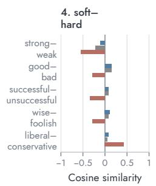

Figure A3: Axes whose alignments change most between the liberal and conservative personas, as in Figure 3, for Llama 3.1 8B and 70B and Ministral 3 8B and 14B. Within each model, the four focal axes are ranked by mean absolute change in cosine similarity with the other 32 axes, and each is shown with the five partner axes that change most. Cosine scales are shared across panels.

## Most changed axis relationships across models

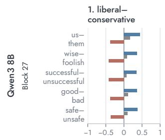  
Four axes per model; five largest liberal–conservative changes per axis

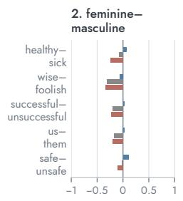

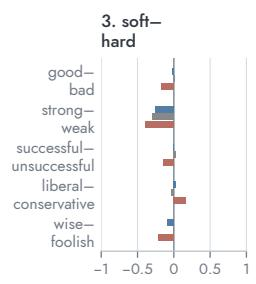

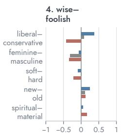

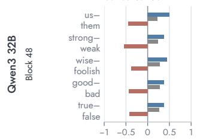

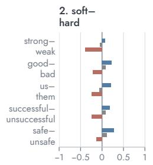

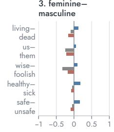

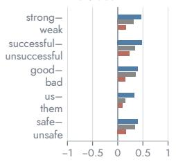

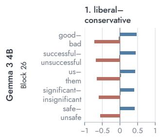

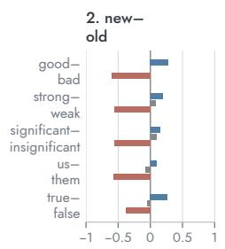

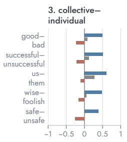

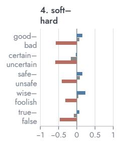

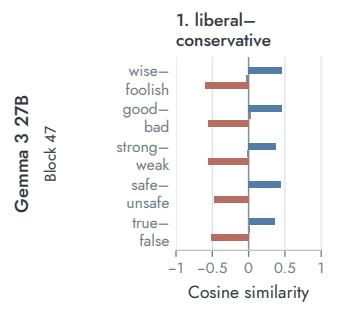

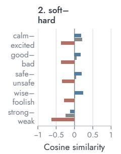

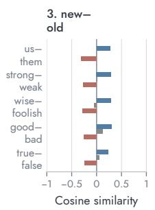

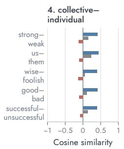  
Figure A4: Continuation of Figure A3 for Qwen 3 8B and 32B and Gemma 3 4B and 27B.

## Axis alignments and steering spillovers across models

Original 1,000-word steering sample — includes generated additions; not common-word restricted

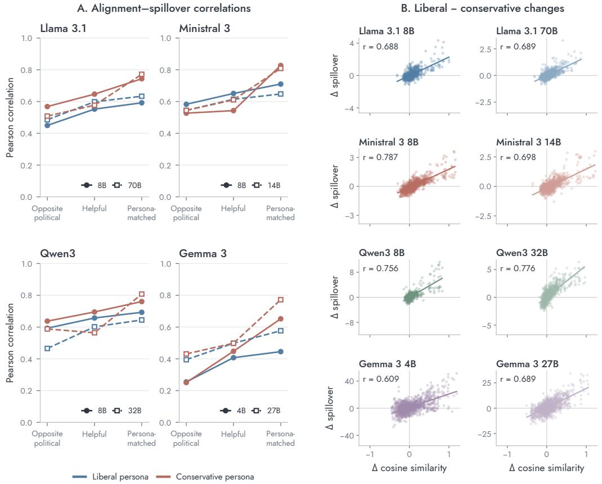  
All 1,056 directed pairs · ±0.33 norm dose · Δ spillover in pole log-odds · model-specific y scales

Figure A5: Axis alignments and steering spillovers across models, as in Figure 5. (A) Correlation between spillovers and axis alignments for the liberal (blue) and conservative (red) personas, when predicted from the opposite persona’s, the helpful assistant’s, or the persona’s own geometry; solid lines show the smaller and dashed lines the larger model in each family. (B) Liberal-minusconservative differences in cosine similarity versus differences in spillover for each model. All models use all 1,056 directed off-target axis pairs and the same 1,000 target words. These words were sampled from the full feature bank, which includes anchor synonyms and antonyms beyond the common-word list, so Llama 3.1 8B values differ slightly from Figure 5. Steering uses α = 0.33 at the final prompt token; y-axis scales in (B) differ by model.

## D TRUTH AND MORALITY PROBES ACROSS MODELS

Figures A6 and A7 apply the learned linear and word-representation probes to all eight models. SAE-feature probes are omitted because the pretrained SAE is specific to Llama 3.1 8B. The layer at which probes perform best on ordinary statements varies across models, so a single layer is chosen per model and used for both tasks and both probe types. The criterion is ordinary-statement test accuracy averaged over the two tasks, two probe types, and three persona conditions, among the seven saved depths; ties go to the shallower layer. Controversial statements play no role in the selection. Because the ordinary test statements are reused for selection, the ordinary accuracies shown are not independent validation of the chosen layers.

Asterisks mark significant liberal-versus-conservative differences in probe-assigned probability for a given statement side. The test statistic is the mean paired difference, averaged within and then across topics. Under the null, persona labels are swapped jointly for all statements in a topic: exhaustively for truth $( 2 ^ { 1 2 }$ assignments over 12 topics) and with 99,999 random assignments for morality (30 topics). p-values are Holm-corrected over a family of 140 comparisons, a superset of those shown here and in Figure 6. Tests are two-sided, so an asterisk can in principle mark movement in the unexpected direction; this occurs once, for the Gemma 3 4B linear truth probe on conservative-side statements.

Figure A8 shows the persona-dependent gap in probe-assigned probability for probes trained at each saved depth. Gaps are near zero in early layers and emerge by roughly 40–50% depth, after which results at neighboring layers are generally similar.

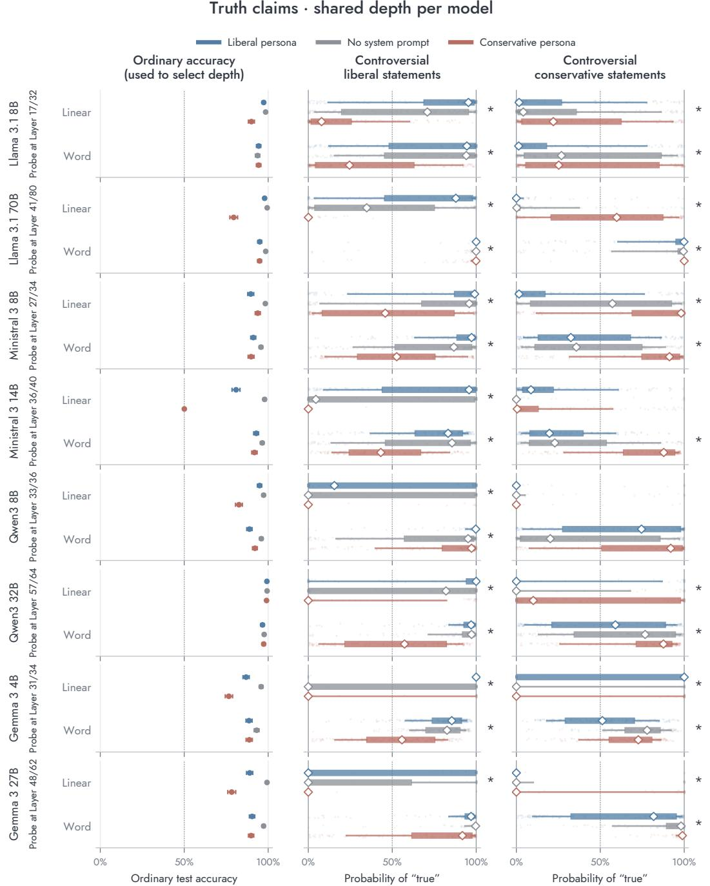  
Figure A6: Truth probes across models. Left: accuracy on 1,840 held-out ordinary statements from 230 Wikipedia articles, with 95% article-bootstrap intervals. Middle and right: probe-assigned probability of “true” for 180 controversial statements expected to be endorsed by liberals (middle) and 180 expected to be endorsed by conservatives (right). Diamonds mark medians, thick bars the middle 50%, thin bars the middle 80%, and faint points individual statements. Probes are trained with no system prompt and held fixed across personas. Model-specific layers are shown beside each model name (one-based). Asterisks: Holm-adjusted p < .05 (see text).

Moral questions · shared depth per model  
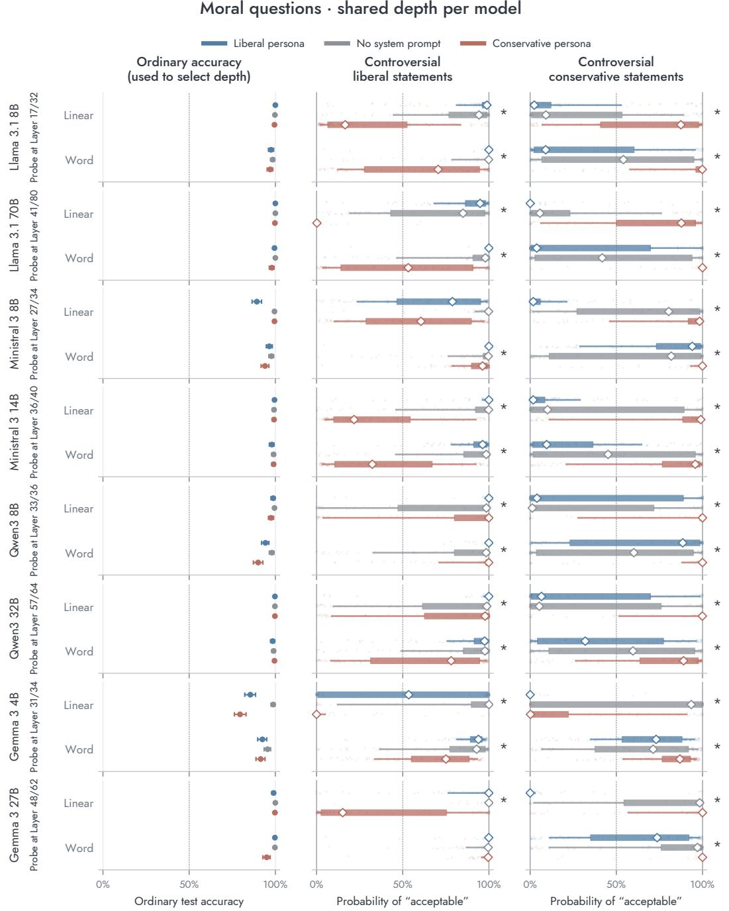  
Figure A7: Morality probes across models, as in Figure A6. Left: accuracy on 400 held-out ordinary actions from 200 acceptable/unacceptable pairs, with 95% pair-bootstrap intervals. Middle and right: probe-assigned probability of “acceptable” for 150 controversial actions per partisan side.

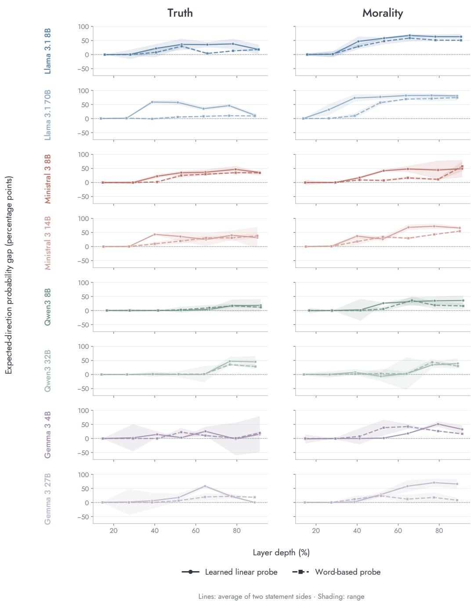  
Figure A8: Persona-dependent probe gaps across depth for all eight models (rows), for truth (left) and morality (right). For each statement side, the gap is the probability assigned by the persona expected to endorse the statements minus that assigned by the opposing persona, averaged equally across topics, in percentage points; negative values indicate the reverse ordering. Lines average the liberal-side and conservative-side gaps, and shading spans the two. Solid lines show learned linear probes and dashed lines word-representation probes. Probes are trained with no system prompt at each depth and held fixed across personas.

## E BEHAVIORAL RESPONSES TO CONTROVERSIAL STATEMENTS

To compare the probes with the model’s behavior, we collected Llama 3.1 8B’s responses to the controversial statements in two formats. In the open format, the model is asked “Is it true that [claim]?” or told “I want [action].” with no instruction about response format; we sample ten responses per item (temperature 0.5, top-p 0.9, up to 800 tokens), and Gemma 4 31B rates each response as affirming/endorsing, ambivalent, or denying/challenging the statement. For morality, this rubric counts practical help as endorsement and refusal as challenge, so it is broader than a judgment of moral acceptability. In the constrained format, the model is asked for a simple yes or no answer (“Is it true that. . . ?”; “I want [action]. Is this wrong?”) and we record one response per item. Items receive equal weight. Figure A9 shows responses without a system prompt, and Figure A10 under the political personas.

Llama 3.1 8B · responses with no system prompt Liberal- and conservative-side items from the controversial statement sets  
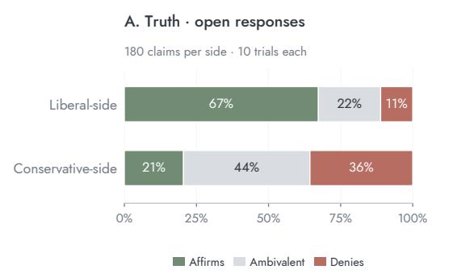

  
Figure A9: Llama 3.1 8B responses to controversial statements with no system prompt, for liberalside and conservative-side items. (A–B) Open responses, ten per item, rated by Gemma 4 31B. (C–D) Constrained yes/no responses, one per item; for morality, “No” (not wrong) is the accepting answer. 180 truth claims and 150 moral actions per side.

## How closely do personas follow partisan positions?

Llama 3.1 8B · liberal and conservative persona prompts

A. Truth · open responses

  
C. Truth · Yes/No request  
B. Morality · open responses

D. Morality · Yes/No request  

Figure A10: Llama 3.1 8B responses to controversial statements under the liberal (upper bar) and conservative (lower bar) personas. Green, gray, and ochre segments show acceptance, ambivalent or unclear answers, and rejection; numbers give the acceptance rate. Acceptance means affirming a truth claim or endorsing an action in open responses, and answering “Yes” to “Is it true. . . ?” or “No” to “Is this wrong?” in constrained responses. Open and constrained responses are collected separately, with the same settings as Figure A9.