# Phonological Knowledge of Chinese Characters in Language Models

Xiaozhe Ji1 Renfen Hu2 Hai Hu3∗

1School of Foreign Languages and Literature, Beijing Normal University

2School of International Chinese Language Education, Beijing Normal University

3Department of Language Science and Technology, Division of Artificial Intelligence and the Humanities,

The Hong Kong Polytechnic University

{202521100023, irishu}@mail.bnu.edu.cn hai.hu@polyu.edu.hk

## Abstract

How much phonological knowledge do language models (LMs) possess about Chinese characters, and how is this knowledge represented and used? We introduce PinyinBench, a controlled benchmark covering homophones, phonological features (initials, finals, and tones), and polyphonic characters. We investigate 17 text-only and multimodal LMs through three complementary approaches: behavioral evaluation, layer-wise probing, and activation steering. Behaviorally, models demonstrate substantial knowledge of initials and finals, with a frontier model (DS-v4-flash) scoring 90%+ in homophonejudgment, when two characters share no phonological features. However, its accuracy drops sharply to 72% when two characters difer only in lexical tone. Prob ing reveals that tone is highly decodable from embeddings and improves modestly across layers, whereas segmental information starts less decodable and improves substantially with depth. Activation steering shows that segmental representations can systematically influence generation, while tone exhibits much weaker efects. Furthermore, audio-bearing training improves phonological decodability, including tone, without corresponding improvements in steering efectiveness. Together, these findings reveal distinct representational and functional profiles for segmental and tonal information, with tonal information much harder to access and manipulate, demonstrating the necessity for combined evaluation, probing, and causal intervention for understanding linguistic knowledge in LMs.

## 1 Introduction

Recent advances in language modeling have led to impressive performance in mathematical problem solving, reasoning, and code generation (Wang et al., 2024; Muennighof et al., 2025; Lei et al., 2025). However, the phonological knowledge of language models (LMs) remains relatively understudied. While recent work has evaluated phonological abilities (Suvarna et al., 2024; Yue et al., 2026) and probed internal phonological representations (Liao and Shi, 2026), it remains unclear how phonological knowledge is internally represented and whether these representations are functionally accessible. It is also unknown how phonological knowledge difers between text-only LMs and models that have additionally been trained on audio.

<table><tr><td rowspan="2"></td><td rowspan="2">Full syllable</td><td colspan="2">Segmental</td><td rowspan="2">Suprasegmental Tone</td></tr><tr><td>Initial</td><td>Final</td></tr><tr><td>Pinyin</td><td>bai3 / bǎi</td><td>b</td><td>ai</td><td>3/</td></tr><tr><td>IPA</td><td>[a]</td><td>[p]</td><td>[a1]</td><td>[1]</td></tr><tr><td>Character</td><td>摆</td><td>一</td><td></td><td></td></tr><tr><td>Mandarin inventory</td><td>一</td><td>21</td><td>39</td><td>4</td></tr><tr><td>Same initial and final, different tones and meanings</td><td></td><td></td><td></td><td></td></tr><tr><td>bāi</td><td>bái</td><td></td><td>bǎi</td><td>bài</td></tr><tr><td>掰</td><td>白</td><td></td><td>摆</td><td>拜</td></tr><tr><td>(break apart)</td><td>(white)</td><td></td><td>(put)</td><td>(bow)</td></tr><tr><td></td><td></td><td></td><td></td><td></td></tr><tr><td></td><td></td><td></td><td></td><td></td></tr><tr><td>1: High-level</td><td>2: Rising</td><td>3: Falling-rising</td><td></td><td>4: Falling</td></tr></table>

Table 1: Mandarin syllable structure. Curves show schematic pitch contours in isolation; neutral tone is not illustrated.

Chinese ofers an interesting test case because its logographic writing system in general lacks systematic grapheme-to-phoneme correspondences, which are prevalent in alphabetic languages such as English or German.1 As illustrated in Table 1, a Mandarin syllable consists of an optional initial, a final, and a tone. Initials and finals describe its segmental structure, whereas tone is a suprasegmental feature specifying the pitch over the syllable. Changing the tone can distinguish words with the same initial and final.

In this paper, we introduce PinyinBench, a controlled benchmark comprising 38,183 minimal pairs for evaluating LMs’ phonological knowledge of Chinese characters through three tasks: homophone judgment, feature judgment, and polyphone disambiguation. Beyond behavioral evaluation with PinyinBench, we investigate the internal representation and functional accessibility of phonological knowledge. Specifically, we ask the following questions for Chinese: (RQ1) To what extent do text-only and multimodal LMs possess phonological knowledge? (RQ2) Where are diferent phonological dimensions linearly decodable? (RQ3) Can these representations be manipulated to influence model outputs?

We conduct three linked experiments: (i) Behavioral evaluation using controlled phonological judgments from PinyinBench; (ii) Layer-wise probing of initials, finals, and tones; and (iii) Activation steering to test whether phonological features can be manipulated to influence generation.

Across three experiments, we find that LMs possess substantial phonological knowledge of Chinese characters, but this knowledge is uneven. Behaviorally, models reliably distinguish initials and finals but struggle with tones; text-only base models perform near chance (51–57%) on tone-only contrasts. Probing shows that tone is highly decodable from character embeddings, whereas segmental information becomes increasingly decodable in deeper layers. Steering reveals that segmental representations can systematically influence generation, while tone is much less responsive. Audio-bearing training improves decodability but not steering efectiveness.

These findings reveal a fundamental dissociation between phonological knowledge being encoded and being functionally accessible. They also suggest distinct representational and functional profiles for segmental and tonal information, demonstrating why behavioral evaluation, probing, and causal intervention are all necessary for understanding linguistic knowledge in LMs.

## 2 Related Work

Phonological evaluation of language models. A number of benchmarks have been constructed recently to evaluate knowledge in phonology in English and Chinese. PhonologyBench established phonological competence as a benchmarkworthy capability, showing that English LLMs handle grapheme-to-phoneme conversion, syllable counting, and rhyme generation well above chance but 17–45% below humans (Suvarna et al., 2024); P-CoT later showed much of this latent ability can be elicited with structured prompting (Jang et al., 2025). The closest prior eforts in Chinese probe homophones, and they find that models lean on memorized internet substitution patterns rather than productive phonological reasoning, collapsing on controlled or low-frequency items (Ma et al., 2025a,b). Yue et al. (2026) introduce Phun-Bench, a Chinese benchmark spanning homophony, rhyme, and phonetic similarity, and reach a closely related behavioral conclusion— models recall correct pronunciations but fail to wield phonological knowledge as flexibly as human speakers—which they connect to a hypothesized perception mechanism. Our proposed PinyinBench is the first one that isolates initials, finals, and tones as independent variables under fixed templates and calibrated frequency. We target phonological knowledge of commonly used Chinese characters rather than internet homophone memes.

Probing and representational geometry. Probing examines what linguistic information can be recovered from a model’s internal representations by training a classifier to predict linguistic labels from those representations. Probe accuracy, however, can reflect both information in the representations and the probe’s capacity to learn the task. To distinguish these contributions, Hewitt and Liang (2019) introduce control tasks and selectivity, comparing performance on linguistic labels with performance on randomized labels. A complementary approach examines representational diferences elicited by linguistic minimal pairs. Zhou et al. (2025) use these activation diferences to characterize linguistic similarity across language models. We adopt linear probing with control tasks to examine how initial, final, and tone information is represented across model layers and prompt conditions.

Activation steering and causal intervention. Activation steering modifies a model’s internal activations during inference to influence its outputs without updating its parameters. Such interventions allow researchers to examine how changes in internal representations afect model behavior. Rimsky et al. (2024) derive steering directions from contrasting examples of behavior and show that adding these directions to model activations can guide the responses of Llama 2. In the phonological domain, McLaughlin et al. (2025) identify phoneme-related directions using linear probes and intervene on token embeddings to influence English rhyming behavior in Llama-3.2-1B-Instruct. We adopt activation steering to examine how interventions on representations of Mandarin initials, finals, and tones afect model output probabilities.

<table><tr><td>Task &amp; Prompt</td><td>Target</td><td>Positive</td><td>Distractor</td><td>Condition</td></tr><tr><td>Task 1: Homophone Judgment “A”和“B”的声母、韵母和声调完全相同</td><td>摆(bǎi)</td><td>百(bǎi)</td><td>歹(dǎi) 比 (bǐ)</td><td>Initial-mismatch Final-mismatch</td></tr><tr><td>(A and B have identical initial, final &amp; tone)</td><td></td><td></td><td>白(bái-tone2)</td><td>Tone-mismatch</td></tr><tr><td>Task 2: Feature Judgment</td><td>摆(bǎi) 百(bǎi)</td><td></td><td>歹(dǎi)</td><td>initial</td></tr><tr><td>“A”和“B”声母/韵母/声调相同</td><td></td><td></td><td>比 (bǐ)</td><td>final</td></tr><tr><td></td><td></td><td></td><td></td><td></td></tr><tr><td>(A and B share the same initial / final / tone)</td><td></td><td></td><td>白(bái-tone2)</td><td>tone</td></tr></table>

Table 2: Example sentence templates for homophone judgment and feature judgment tasks in PinyinBench. Since PinyinBench is a minimal pair benchmark, we have Target and Positive characters in the good sentence, and Target and Distractor in the bad sentence. The target is 摆 (bǎi); the positive candidate is 百 (bǎi). Each illustrated distractor difers from the target in one dimension, highlighted in blue (initial), yellow (final), or red (tone). Homophone judgment requires a match on all three dimensions; feature judgment specifies one dimension in the prompt. The remaining homophone judgment conditions are defined in §3.1. Task 3 is represented in Table 5 in Appendix C.

## 3 The PinyinBench and General Experimental Setup

PinyinBench is a minimal-pair benchmark that evaluates knowledge of Chinese character pronunciation through three tasks: homophone judgment, feature judgment, and polyphone disambiguation. Tables 2 and 5 illustrate the prompts and example items. Experimental items are constructed from Chinese character lists and their Pinyin pronunciations. Using the 3,500 most common characters, we construct an evaluation set comprising 12,600 minimal pairs for homophone judgment, 5,400 for feature judgment, and 5,000 for polyphone disambiguation. To examine performance on less frequent characters, we add 11,142 homophone judgment pairs and 4,041 feature judgment pairs drawn from the 3,500–7,000 character band. The resulting evaluation set contains 38,183 minimal pairs.

Experiment 1 evaluates performance on these tasks; Experiments 2 and 3 draw on the benchmark’s character resources and phonological labels for probing and steering.

Character pronunciations are obtained using pypinyin and converted to IPA using Dragonmapper. We characterize each pronunciation by its initial, final, and lexical tone (tones 1–4), deriving initial and final labels from the IPA transcription (Appendix A). Homophone judgment and feature judgment use only monophonic characters to avoid pronunciation ambiguity, whereas polyphone disambiguation uses characters with multiple context-dependent readings.

## 3.1 Task Construction

As shown in Tables 2 and 5, each item contains a correct and an incorrect sentence about a target character. The correct sentence pairs the target with a positive candidate that satisfies the stated phonological relation. The incorrect sentence uses a distractor that violates that relation. The three tasks difer in the relation being judged and in how the distractor is constructed. The first two tasks use monophonic characters, while the last uses polyphonic characters.

Task 1: Homophone judgment. The sentence asserts that the target and candidate have identical initials, finals, and tones. The positive candidate is a true homophone of the target. Seven conditions specify the distractor’s phonological overlap with the target. In the three mismatch conditions, initial-mismatch, final-mismatch, and tone-mismatch, the named dimension difers while the other two match. In the three match conditions, initial-match, final-match, and tone-match, the named dimension matches while the other two difer. In the disjoint condition, all three dimensions difer. Table 2 illustrates the three mismatch conditions.

Task 2: Feature judgment. The sentence explicitly asks whether the target and candidate share one specified dimension: initial, final, or tone (see Table 2). The positive candidate shares the named dimension, while the distractor difers on it. This task tests the same dimensions as homophone judgment but names the dimension to be judged in the prompt.

Task 3: Polyphone disambiguation. This task tests whether models can identify the correct pronunciation of a polyphonic character in a given word. The model judges whether the target, as pronounced in that word, has the same pronunciation as a candidate character (see Table 5 in Appendix C). For example, 长 in 生长 (Eng: grow) is pronounced zhǎng, so the positive candidate 涨 (zhǎng) matches this reading; however the same character 长 is read cháng in 长江 (Eng: Yangtze river). We thus construct minimal pair items to examine whether the model can select the correct reading based on the context. For space reasons, we present details of this task and its results in Appendix C.

## 3.2 Models

The behavioral study spans fifteen Qwen base checkpoints across three generations (Qwen2.5 (Qwen Team, 2024), Qwen3 (Qwen Team, 2025), Qwen3.52), from 0.5B to 32B, plus Qwen2.5-Omni-7B (Xu et al., 2025) and DeepSeek-V4-Flash (DeepSeek-AI, 2026) (the deepseek-chat endpoint, non-thinking mode) as a frontier reference model accessed via its API. The representational analyses center on the Qwen2.5 base family (0.5/1.5/3/7B) for a clean scaling axis and add Qwen2.5-Omni-7B (Xu et al., 2025) (multimodal) for the modality comparison. For activation steering, we use Qwen2.5-7B-base and Qwen2.5-Omni-7B. For each model, we construct steering directions from its own hidden states and apply them to that same model, allowing us to compare how the two models respond to phonological interventions.

Scoring. All models are evaluated zero-shot. For Qwen base models, an item is correct if the correct sentence receives a higher total log-probability than the incorrect sentence. For Qwen2.5-Omni-7B and DeepSeek-V4-Flash, we use binary-choice prompts and score the returned option letter against the correct answer. Chance accuracy is 50% in both formats.

## 4 Experiment 1: Behavioral Discrimination

This experiment addresses the paper’s first research question: do text-based and multimodal language models have phonological knowledge of Chinese characters? We examine two subquestions. For monophonic characters, RQ1.1: Do models discriminate initials, finals, and tones, and how well on each dimension? RQ1.2: How does their performance vary with phonological distance and lexical frequency? We first evaluate models on controlled homophone minimal pairs (§4.1), then examine each of these factors. We also evaluate polyphone disambiguation (Appendix C).

## 4.1 Behavioral Results (RQ1.1)

Table 3 shows the performance of Qwen2.5 series and DeepSeek-V4 on our homophone minimal pair benchmark in diferent conditions. Model performance generally improves as more phonological dimensions (initial, final, and tone) difer between the target and distractor. When the target and distractor difer in all three dimensions (condition: disjoint), Qwen2.5 base models achieve accuracies of 56.3%–78.7%. Most models achieve their highest accuracy in this condition. When the target and distractor difer only in tone (condition: tone-mismatch), accuracy drops to 51.1%–55.7% across Qwen2.5 base models, remaining close to the 50% chance level even at 32B. DeepSeek-V4 achieves over 90% accuracy in every condition except tone-mismatch, where it scores 72.7%, indicating that tonal contrasts remain challenging even for this stronger model. Qwen2.5-Omni-7B outperforms Qwen2.5-7B-base across all conditions but remains below DeepSeek-V4. A similar pattern is observed in feature judgment (Appendix B).

Notably, the best performing LM only scores 72.7% in the tone-mismatch condition (DS-V4- flash). As distinguishing two characters with different tones is extremely easy for humans, it is surprising to see LMs with ∼300B parameters (DS-V4-flash) struggle on this task.

## 4.2 Efect of Phonological Distance and Lexical Frequency (RQ1.2)

To address RQ1.2, we examine how phonological distance and lexical frequency afect performance on the homophone minimal pairs. Each item is associated with a phonological distance between the target and distractor, measured using the toneaware DIMSIM metric (Li et al., 2018), and a frequency gap ΔZipf, defined as the Zipf frequency of the concatenated target–distractor string minus that of the target–positive string, both estimated with the Chinese word lists in wordfreq (Speer,

Target character: 包 (bao1) True homophone: 胞 (bao1) Each row replaces 胞 with a distractor. ✓ = match; × = mismatch (relative to 包).
<table><tr><td rowspan="2">Condition</td><td colspan="3">Dimensions</td><td>Example</td><td colspan="6">Qwen2.5</td><td rowspan="2">DeepSeek</td></tr><tr><td>Initial</td><td>Final</td><td>Tone</td><td>Distractor</td><td>0.5B</td><td>1.5B</td><td>3B 7B</td><td>Omni-7B</td><td>14B</td><td>32B</td></tr><tr><td>Disjoint</td><td>X</td><td>X</td><td>X</td><td>地(di4)</td><td>56.3</td><td>66.5</td><td>73.6 76.8</td><td></td><td>88.2 73.2</td><td>78.7</td><td>98.4</td></tr><tr><td>Initial-match</td><td>√</td><td>X</td><td>X</td><td>必(bi4)</td><td>53.9</td><td>58.7</td><td>63.8 67.0</td><td></td><td>81.8 65.1</td><td>70.6</td><td>95.1</td></tr><tr><td>Final-match</td><td>X</td><td>√</td><td>X</td><td>道(dao4)</td><td>53.9</td><td>58.4</td><td>63.7</td><td>68.6</td><td>81.3</td><td>64.5 69.8</td><td>95.4</td></tr><tr><td>Tone-match</td><td>×</td><td>X</td><td>√</td><td>低(di1)</td><td>56.9</td><td>64.9</td><td>72.2 75.9</td><td></td><td>88.3 71.3</td><td>78.0</td><td>97.5</td></tr><tr><td>Initial-mismatch</td><td>X</td><td>V</td><td>√</td><td>刀(dao1)</td><td>53.6</td><td>58.1</td><td>64.0 67.7</td><td></td><td>81.7 63.1</td><td>67.1</td><td>92.3</td></tr><tr><td>Final-mismatch</td><td>√</td><td>X</td><td>√</td><td>悲(beil)</td><td>53.9</td><td>59.4</td><td>62.9 66.7</td><td></td><td>80.0 63.8</td><td>69.1</td><td>90.7</td></tr><tr><td>Tone-mismatch</td><td>√</td><td>√</td><td>X</td><td>抱(bao4)</td><td>51.6</td><td>53.8</td><td>51.1 54.7</td><td></td><td>59.0 53.3</td><td>55.7</td><td>72.7</td></tr></table>

Table 3: Homophone judgment accuracy (%) by distractor condition. Qwen2.5 base models use sentence logprobability comparison; Omni-7B and DeepSeek-V4 use two-option multiple-choice questions with one correct option and one distractor. Chance is 50% for both protocols. Characters are illustrative examples. Pinyin uses numeric tone labels and the initial/final/tone colors of Table 1. Condition names identify the unique matching/mismatching dimension.

2022). We additionally use the segment-only Pan-Phon metric (Mortensen et al., 2016) as a crosscheck (see Appendix E for definitions).

Phonological distance. To examine the relationship between phonological distance and model performance, we focus on items with a frequency gap close to zero (ΔZipf ≈ 0). As shown in Figure 1(b), accuracy increases with the DIMSIM distance between the target and distractor across all Qwen2.5 base models. Models find it easier to reject distractors whose pronunciations are more distinct from the target, even when the target–distractor and target–positive strings have similar frequencies. This confirms our previous observation that phonological distance independently afects model performance. The same trend holds with the segment-only PanPhon metric (Appendix F).

Lexical frequency. Figure 1(a) shows that accuracy decreases as ΔZipf increases: models find it harder to identify the correct phonological relation when the distractor is more frequent than the positive candidate. However, when the frequency gap is close to zero, all Qwen2.5 base models perform above the 50% chance level, with accuracy ranging from 57.5% for the 0.5B model to 77.5% for the 32B model. The results suggest that lexical frequency influences model judgments but does not fully explain their performance on the monophonic characters. The same frequency trend is observed in Qwen3 and Qwen3.5 (Appendix D).

Together, these results show that models are sensitive to phonological diferences between characters, while their judgments are also influenced by lexical frequency. We next examine how this phonological knowledge is represented within the models.

## 5 Experiment 2: Linear Probing — Where Phonology Is Decodable

## 5.1 Setup

We use linear probing to examine where information about initials, finals, and tones can be recovered from model representations, and how this varies with prompt context.

We use 2,300 monophonic characters drawn from the 3,500-character pool introduced in Section 3. For each character, we extract its representation at the input embedding layer and after each transformer layer, and train separate linear classifiers to predict its initial, final, and tone.

To examine the role of context, we present each character under four prompt conditions: bare (the character alone), phonetic (这个字的读音：; “the pronunciation of this character”), neutral (这个字 是：; “this character is”), and semantic (这个字 的意思：; “the meaning of this character”). In each condition, the character appears at the end of the input, and we extract its representation at that position. We train and evaluate probes separately for each layer and prompt condition.

We evaluate prediction performance on held-out characters using five-fold cross-validation and report macro-�1, which gives equal weight to each phonological class. We also compare performance against probes trained on shufled labels, reporting the diference as selectivity (Hewitt and Liang, 2019). Character filtering, representation extraction, and probe training details are provided in Appendix P.

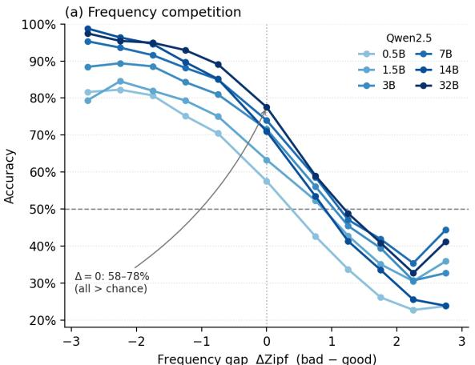

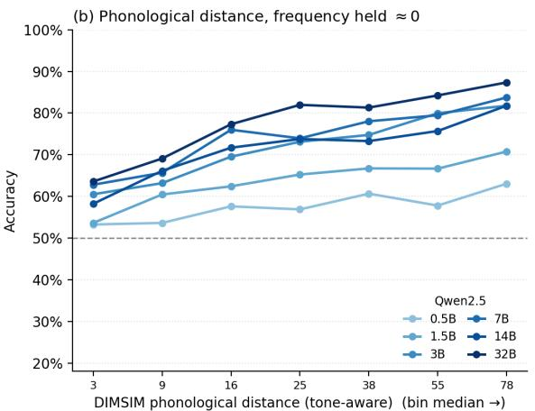  
Figure 1: Homophone judgment accuracy vs. (a) frequency gap ΔZipf and (b) DIMSIM distance (ΔZipf≈0). Accuracy generally decreases as the frequency gap grows yet stays above chance at parity; it generally increases with phonological distance. Qwen2.5 base, darker = larger.

## 5.2 Results

The overall results are presented in Figure 2. We make the following observations.

All three phonological dimensions are linearly decodable from the model’s hidden states under the phonetic prompt. Tone shows the smallest margin over its shufled-label control, partly because chance is higher with only four classes: its selectivity is 0.482, compared with 0.708 for initials and 0.708 for finals, despite their much larger label inventories. Our results further show that tone difers from segmental features.

Phonetic prompts improve segmental decodability more. In Qwen2.5-7B-base, phonetic prompts yield higher decodability than semantic prompts or bare characters, with larger gains for initials and finals than for tone (Figure 2). Tone remains comparatively decodable even without surrounding context.

Initial and final decodability improves more with depth than tone decodability. Tone is already strongly decodable from the character embedding and improves only modestly in subsequent layers (Figure 2). Initial and final decodability starts substantially lower but rises sharply across layers, peaking deeper in the model. Despite its strong decodability at the embedding layer, tone remains the weakest dimension in the behavioral benchmark (Experiment 1). This contrast suggests that models encode tone information but struggle to use it efectively when making explicit phonological judgments. One possibility is that recognizing an individual character’s tone is easier than comparing tones across characters.

The multimodal model improves decodability but retains a weakness in tone judgments. Using the same probing pipeline, we compare Qwen2.5-Omni-7B with Qwen2.5-7B-base to examine phonological representations in multimodal and text-only models. Omni achieves higher macro- $\cdot F _ { 1 }$ at both L0 and the peak layer for all three dimensions, with the largest improvement for final and the smallest for initial (Figure 2). The overall layerwise pattern remains similar: tone is already strongly decodable at the embedding layer, whereas initial and final decodability improves more with depth. However, tone remains Omni’s weakest dimension in the behavioral benchmark (Experiment 1; Table 3). Together, these findings suggest that richer phonological representations in a multimodal model do not necessarily translate into reliable tone judgments.

## 6 Experiment 3: Activation Steering — Steering Phonological Outputs

Experiment 2 shows that phonological information is decodable from model representations. We next test whether interventions on these representations can shift outputs toward a target phonological class.

## 6.1 Setup

In mechanistic interpretability, activation steering modifies a model’s internal representations during inference to influence its output (Rimsky et al., 2024). We test whether steering can shift output probabilities from characters in one phonological class to those in another. For example, given a prompt asking for a character with the same initial as 吉 (ji2), we aim to increase the probability of characters with initial l. We apply the same approach to contrasts in initial, final, and tone.

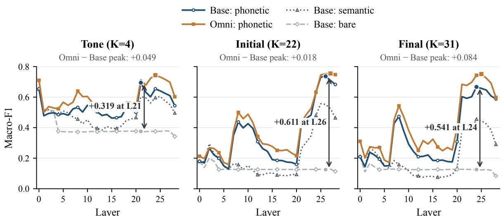  
Figure 2: Phonological decodability across layers. Macro-� of linear probes for Qwen2.5-7B-base and Qwen2.5- Omni-7B condition. � denotes the number of classes. Arrows show the phonetic–bare diference for Base at its phonetic-prompt peak layer. Values below panel titles show the diference between Omni and Base at their respective peaks. Tone shows the smallest phonetic–bare gain. The full four-prompt comparison, including the neutral condition, appears in Appendix H.

For each contrast, we construct a steering vector by averaging representation diferences between character pairs that match on the other two phonological dimensions. We add this vector to the source character’s representation during the forward pass, keeping the prompt unchanged. By varying the intervention strength and comparing the next-token probabilities of the source and target classes, we measure how strongly the output responds to each phonological contrast. For technical details of the experiment, see Appendix L.

## 6.2 Results

Tone Shows the Smallest Steering Efect. Tone yields the smallest steering efect, with a mean peak target–source advantage of 0.16, compared with 0.52 for initials and 0.40 for finals (Figure 3). This ordering holds at all sites (Table 4). This weaker steering response also agrees with its poorer behavioral performance (§4.1), despite being highly decodable from the character embedding (§5).

Omni’s higher probing scores do not make it any easier to steer (Figure 3). It follows a similar pattern to the base model, where tone is the least steerable dimension. Initials and finals are even harder to steer for the omni model.

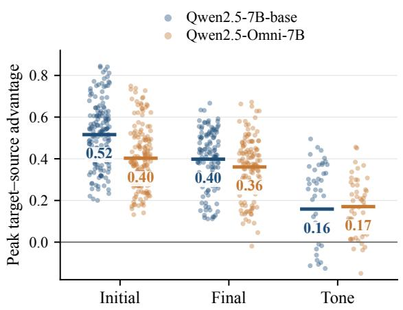  
Figure 3: Peak target–source advantage by dimension. Each point shows $R _ { \mathrm { p e a k } }$ for one transition at one intervention site (Emb/L8/L13/L20); bars indicate means. Zero denotes equal target and source probabilities.

Steering Shifts Character Probabilities. Figure 4 illustrates steering from j to l at L8 in Qwen2.5-7B-base. The prompt asks for a character with the same initial as 吉 (ji2). After intervention, the probabilities of the plotted source-initial characters decrease, while those of multiple targetinitial characters increase. Additional initial and final examples are reported in Appendix O.

<table><tr><td>Site</td><td>Initial</td><td>Final</td><td>Tone</td><td>Switch (init.)</td><td>(init.)</td><td>Flip cost Collapse</td></tr><tr><td>Emb</td><td>0.575</td><td>0.452</td><td>0.164</td><td>1.00</td><td>0.64</td><td>0.03</td></tr><tr><td>L8</td><td>0.535</td><td>0.405</td><td>0.136</td><td>1.00</td><td>0.40</td><td>0.15</td></tr><tr><td>L13</td><td>0.514</td><td>0.398</td><td>0.171</td><td>1.00</td><td>0.36</td><td>0.20</td></tr><tr><td>L20</td><td>0.461</td><td>0.377</td><td>0.153</td><td>1.00</td><td>0.31</td><td>0.30</td></tr></table>

Table 4: Steering Qwen2.5-7B-base at the four intervention sites summarized in the main text. Initial, Final, and Tone report mean peak steering advantage $( R _ { \mathrm { p e a k } } )$ across transitions in each dimension. Switch: fraction of initial transitions that flip. Flip cost: relative perturbation $\| \alpha v _ { \mathrm { d i r } } \| / \| h \|$ at the flip point. Collapse: rate of response decline after the peak (Appendix N).

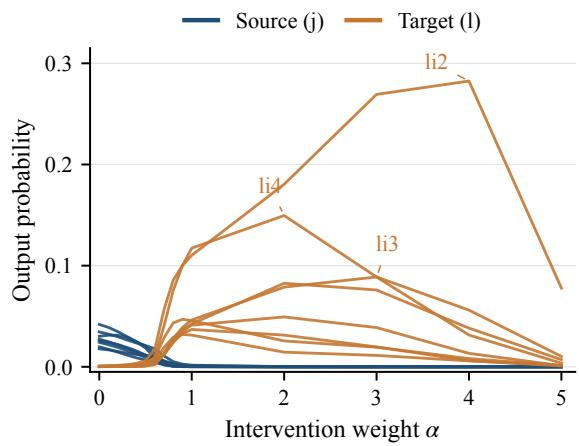  
Figure 4: Character output probabilities under initial steering from j to l at L8 in Qwen2.5-7B-base. Each curve represents one character: eight source characters (blue) and eight target characters (orange). Selected target curves are labeled with Pinyin.

Steering Extends to Held-Out Characters. We next examine target-class characters that were not used to construct the steering direction. For six selected initial transitions at L8, 76–85% of these characters increase in output probability after intervention (Appendix J). The efects therefore extend beyond the characters used to construct each direction.

## 7 Discussion and Conclusion

Our findings reveal a systematic dissociation between segmental and tonal knowledge in Chinese LMs, and, more broadly, between the encoding and functional accessibility of phonological information. Across models, initials and finals are more reliably discriminated than lexical tones. Although character frequency influences performance, phonological distance also predicts accuracy, indicating that models possess phonological knowledge beyond character familiarity.

Crucially, the three experiments reveal diferent aspects of this knowledge. Probing shows that tone is highly decodable even from character embeddings, despite near-chance performance on tone-only contrasts. In contrast, segmental information becomes increasingly decodable in deeper layers and is more responsive to activation steering. This asymmetry is compatible with the distinction between tonal and segmental structure in autosegmental phonology (Goldsmith, 1976), although our results do not establish that LMs encode such representations. Notably, manipulating character embeddings alone can systematically shift output probabilities toward target initial and final classes, extending previous findings on phonological steering in alphabetic languages (McLaughlin et al., 2025). These results demonstrate that linear decodability does not guarantee efective use in linguistic judgments or generation.

The comparison between text-only and audio-trained models reinforces this distinction. Qwen2.5-Omni exhibits stronger phonological decodability than Qwen2.5-7B-base, including for tone, without a corresponding advantage in steering. Thus, multimodal training is associated with richer decodable phonological information, but not necessarily greater controllability under the tested protocol.

Overall, our study demonstrates that phonological knowledge in Chinese LMs is multidimensional: what models encode, what they can judge, and what can be manipulated are not equivalent. Our findings motivate studying how encoded phonological information supports pronunciation judgments and context-dependent reading selection.

## Limitations

The behavioral hierarchy is measured across seventeen models, but the representational and intervention analyses center on the Qwen2.5 base family, with steering tested at five representative depths of Qwen2.5-7B-base and Qwen2.5-Omni-7B. Steering is read through class probability mass under elicitation prompts, not free generation, and the held-out analysis shows class-level spread rather than explaining why individual characters rise. The tone results concern isolated-character lexical tones—not neutral tone, tone sandhi, or the contextual reading selection that Task 3 shows is a distinct challenge. The Omni comparison probes the text backbone only, so it attributes changes to multimodal training as a whole rather than to speech input specifically; and because the models’ training data is unknown, we characterize representation and use rather than origin.

## Ethics Statement

This work evaluates publicly available language models on isolated Chinese characters and their pronunciations, using standard public character and frequency resources; it involves no human subjects and no personal or sensitive data, and steering modifies activations only transiently at inference time without altering model weights. We see no foreseeable harm.

## Reproducibility and Data Availability

All experiments draw on one character pool (the 3,500 most common characters plus the 3,500– 7,000 frequency band) and one IPA-based phonological labeling (pypinyin for pinyin, Dragonmapper for IPA); the probe and steering configurations are fully specified in §5.1 and §6.1, with random seeds fixed (42) throughout. The benchmark items, IPA phonological labels, the 82 steering transitions, probing and steering code, and per-layer result tables will be released in a public repository upon publication.

## Use of AI Assistance

An AI assistant helped draft and organize the manuscript prose from the authors’ experimental records and outline; all design, data, analysis, numerical results, and citations are the authors’ own and were verified by them.

## References

DeepSeek-AI. 2026. DeepSeek-V4: Towards highly efficient million-token context intelligence. Preprint, arXiv:2606.19348. arXiv:2606.19348v1.

John A. Goldsmith. 1976. Autosegmental Phonology. Ph.D. thesis, Massachusetts Institute of Technology.

John Hewitt and Percy Liang. 2019. Designing and interpreting probes with control tasks. In Proceedings of the 2019 Conference on Empirical Methods in Natural Language Processing and the 9th International Joint Conference on Natural Language Processing (EMNLP-IJCNLP), pages 2733–2743. Association for Computational Linguistics.

Dongjun Jang, Youngchae Ahn, and Hyopil Shin. 2025. P-CoT: A pedagogically-motivated participatory chain-of-thought prompting for phonological reasoning in LLMs. In Findings of the Association for Computational Linguistics: ACL 2025, pages 21958–21979. Association for Computational Linguistics.

Chao Lei, Yanchuan Chang, Nir Lipovetzky, and Krista A. Ehinger. 2025. Planning-driven programming: A large language model programming workflow. In Proceedings ofthe 63rd Annual Meeting of the Association for Computational Linguistics (Volume 1: Long Papers), pages 12647–12684. Association for Computational Linguistics.

Min Li, Marina Danilevsky, Sara Noeman, and Yunyao Li. 2018. DIMSIM: An accurate chinese phonetic similarity algorithm based on learned high dimensional encoding. In Proceedings of the 22nd Conference on Computational Natural Language Learning (CoNLL). Association for Computational Linguistics.

Disen Liao and Freda Shi. 2026. How tokenization limits phonological knowledge representation in language models and how to improve them. In Proceedings of the 64th Annual Meeting of the Association for Computational Linguistics (Volume 1: Long Papers), pages 13921–13938, San Diego, California, United States. Association for Computational Linguistics.

Jianfei Ma, Zhaoxin Feng, Emmanuele Chersoni, Huacheng Song, and Ziqi Zhang. 2025a. Phono-Think: Improving large language models’ reasoning on chinese phonological ambiguities. In Proceedings ofthe 2025 Conference on Empirical Methods in Natural Language Processing, pages 19007–19022, Suzhou, China. Association for Computational Linguistics.

Jianfei Ma, Zhaoxin Feng, Huacheng Song, Emmanuele Chersoni, and Zheng Chen. 2025b. Reasoning or memorization? investigating LLMs’ capability in restoring chinese internet homophones. In Proceedings ofthe 3rd Workshop on Towards Knowledgeable Foundation Models (KnowFM), pages 120– 139, Vienna, Austria. Association for Computational Linguistics.

Oliver McLaughlin, Arjun Khurana, and Jack Merullo. 2025. I Have No Mouth, and I Must Rhyme: Uncovering internal phonetic representations in LLaMA 3.2. Preprint, arXiv:2508.02527. arXiv:2508.02527v2.

David R. Mortensen, Patrick Littell, Akash Bharadwaj, Kartik Goyal, Chris Dyer, and Lori Levin. 2016. Pan-Phon: A resource for mapping IPA segments to articulatory feature vectors. In Proceedings of COLING 2016, the 26th International Conference on Computational Linguistics: Technical Papers, pages 3475– 3484. The COLING 2016 Organizing Committee.

Niklas Muennighof, Zitong Yang, Weijia Shi, Xiang Lisa Li, Li Fei-Fei, Hannaneh Hajishirzi, Luke Zettlemoyer, Percy Liang, Emmanuel Candès, and Tatsunori Hashimoto. 2025. s1: Simple test-time scaling. In Proceedings of the 2025 Conference on Empirical Methods in Natural Language Processing, pages 20275–20321. Association for Computational Linguistics.

Qwen Team. 2024. Qwen2.5 technical report. Preprint, arXiv:2412.15115. arXiv:2412.15115v2.

Qwen Team. 2025. Qwen3 technical report. Preprint, arXiv:2505.09388. arXiv:2505.09388v1.

Nina Rimsky, Nick Gabrieli, Julian Schulz, Meg Tong, Evan Hubinger, and Alexander Matt Turner. 2024. Steering llama 2 via contrastive activation addition. In Proceedings of the 62nd Annual Meeting of the Association for Computational Linguistics (Volume 1: Long Papers), pages 15504–15522. Association for Computational Linguistics.

Hua Shu, Xi Chen, Richard C. Anderson, Ningning Wu, and Yue Xuan. 2003. Properties of school chinese: Implications for learning to read. Child Development, 74(1):27–47.

Robyn Speer. 2022. rspeer/wordfreq: v3.0. Version 3.0.2.

Ashima Suvarna, Harshita Khandelwal, and Nanyun Peng. 2024. PhonologyBench: Evaluating phonological skills of large language models. In Proceedings of the 1st Workshop on Towards Knowledgeable Language Models (KnowLLM), pages 1–14. Association for Computational Linguistics.

Peiyi Wang, Lei Li, Zhihong Shao, Runxin Xu, Damai Dai, Yifei Li, Deli Chen, Yu Wu, and Zhifang Sui. 2024. Math-shepherd: Verify and reinforce LLMs step-by-step without human annotations. In Proceedings of the 62nd Annual Meeting of the Association for Computational Linguistics (Volume 1: Long Papers), pages 9426–9439. Association for Computational Linguistics.

Jin Xu, Zhifang Guo, Jinzheng He, Hangrui Hu, Ting He, Shuai Bai, Keqin Chen, Jialin Wang, Yang Fan, Kai Dang, Bin Zhang, Xiong Wang, Yunfei Chu, and Junyang Lin. 2025. Qwen2.5-Omni technical report. Preprint, arXiv:2503.20215. arXiv:2503.20215v1.

Xing Yue, Yongliang Shen, and Weiming Lu. 2026. Phun-Bench: Evaluating LLMs on phonological understanding in Chinese. In Proceedings of the 64th Annual Meeting of the Association for Computational Linguistics (Volume 1: Long Papers), pages 22723–22768. Association for Computational Linguistics.

Xinyu Zhou, Delong Chen, Samuel Cahyawijaya, Xufeng Duan, and Zhenguang G. Cai. 2025. Linguistic minimal pairs elicit linguistic similarity in large language models. In Proceedings of the 31st International Conference on Computational Linguistics. Association for Computational Linguistics.

## A IPA-Based Initial/Final Split

Pinyin is obtained with pypinyin (a handful of characters it mislabeled were corrected by hand) and mapped to IPA with the Dragonmapper library, whose syllable inventory supplies each syllable’s IPA. We split a syllable into an initial and a final by reverse-deriving every initial’s IPA prefix from that inventory—the longest common IPA prefix shared by all syllables with the same pinyin initial—and taking the final as the remainder (with tone-value diacritics stripped); tone is kept as an integer 1–4.

## B Explicit Phonological Feature Judgments

Figure 5 reports feature judgment results for the same Qwen2.5 base checkpoints and multiplechoice reference models as Table 3, split by character-frequency band. It supports the converging behavioral result summarized in §4.1: a second elicitation yields the same ordering, with segmental judgments generally stronger than tone judgments, while the rarer-character subset is generally harder.

## C Polyphone Disambiguation

Model performance on polyphonic characters. Apart from monophonic characters, we also examine polyphonic characters to see if models can correctly identify their context-appropriate pronunciations. Models improve with scale at rejecting invalid readings, but remain near chance when the distractor corresponds to another valid reading of the same character, including for DeepSeek-V4 (Figure 6). These results suggest that selecting a pronunciation in context remains dificult even when models can distinguish phonological contrasts in monophonic characters. The three polyphone subtypes split sharply (Figure 6): rejecting an invalid reading is learnable and improves with scale (∼95% for the largest models), but choosing the correct reading over a homophone of the character’s other valid reading—or its contextual variant—stays near chance for every model, including DeepSeek-V4. The bottleneck is thus contextconditioned selection among readings, not knowing which readings a character has—a disambiguation problem distinct from the segmental/tonal representation question we study here. We therefore restrict the representational analyses (§5–§6) to monophonic characters and leave contextual reading selection to future work.

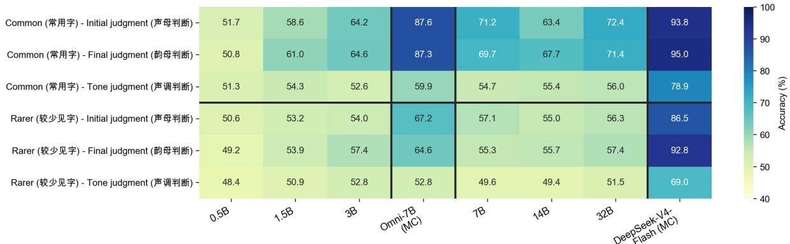  
Figure 5: Feature judgment accuracy by model and character-frequency band. Unboxed: Qwen2.5 base (0.5B–32B, zero-shot log-probability); boxed: Omni-7B and DeepSeek-V4-Flash (multiple-choice). Initial and final judgments are generally stronger than tone judgments, and the rarer-character subset is harder. Models as in Table $_ { 3 ; }$ chance = 50%.

Figure 6 breaks polyphone disambiguation accuracy down by subtype and model, quantifying the context-conditioned selection bottleneck described above.

## D Frequency Curves for Qwen3 and Qwen3.5

Figure 7 replicates the frequency analysis of §4.2 on the two later model generations.

## E Phonological Distance Metrics: Formal Definitions

Both metrics measure the distance between the pronunciation of the target character � and that of the distractor character �; a larger distance means a more obviously diferent distractor character. (In the released data these are the fields good1\_pinyin and bad2\_pinyin.)

DIMSIM (tone-aware). DIMSIM (Li et al., 2018) models a pinyin syllable as three independent components—initial $p ^ { I }$ , final $p ^ { F }$ , tone $p ^ { \bar { T } } -$ and defines the distance between two characters as the Manhattan sum of three component distances,

$$
\begin{array} { r } { d _ { \mathrm { D I M S I M } } ( B , N ) = S _ { p } \big ( p _ { B } ^ { I } , p _ { N } ^ { I } \big ) + S _ { p } \big ( p _ { B } ^ { F } , p _ { N } ^ { F } \big ) + S _ { T } \big ( p _ { B } ^ { T } , p _ { N } ^ { T } \big ) , } \\ { ( 1 ) } \end{array}\tag{}
$$

where $S _ { p }$ is the Euclidean distance between learned low-dimensional encodings of initials (or finals) and $S _ { T }$ is a function of the tone numbers. The released implementation realizes $S _ { p }$ with a fixed two-dimensional coordinate table and computes a per-syllable score min $\begin{array} { r } { \mathrm { ~ } ( d _ { I } + d _ { F } , d _ { \mathrm { h c } } ) + \frac { 1 } { 1 0 } \bar { \left| \Delta \mathrm { t o n e } \right| } } \end{array}$ (with $d _ { \mathrm { h c } }$ a hard-coded near-homophone shortcut), which it then multiplies by a ratio that drives the tone contribution to ∼0. We make three corrections so tone is not washed out: (i) drop the suppressing ratio; (ii) split the zero-onset class into a true zero-onset (bare-vowel) coordinate and separate glide-onset coordinates for the y-, w-, and yu-initial syllables, removing a coordinate-blowup that sent some distances to ${ \sim } 1 0 ^ { 5 } ;$ ; and (iii) scale tone by 3 so it is commensurate with the segmental coordinate distances. The per-character distance we use is therefore

$$
d _ { \mathrm { D I M S I M } } ( B , N ) = \operatorname * { m i n } ( d _ { I } + d _ { F } , d _ { \mathrm { h c } } ) + 3 | \Delta \mathrm { t o n e } | .\tag{2}
$$

For example $d _ { \mathrm { D I M S I M } } ( \mathrm { a n } 4 , \mathrm { a n } 2 ) = 0 + 0 + 3 { \cdot } 2 = 6$ (tone only), while $d _ { \mathrm { D I M S I M } } ( \mathrm { a n } 4 , \mathrm { d a o } 3 ) = 3 3 . 1 + 4 . 1 +$ 3.0 = 40.2 (all three components difer).

PanPhon (segmental). PanPhon (Mortensen et al., 2016) maps each IPA segment to a numeric articulatory feature vector $\begin{array} { r } { \bar { v } \in \ \{ - 1 , 0 , + 1 \} ^ { F } } \end{array}$ (�≈24 features). The cost of substituting segment � for � is the weighted $L _ { 1 }$ diference of their feature vectors, $\begin{array} { r } { \sum _ { f } w _ { f } | v _ { f } ^ { a } - v _ { f } ^ { b } | } \end{array}$ , and an insertion or deletion costs $\textstyle \sum _ { f } w _ { f } ;$ the distance between two syllables is the minimum-cost feature edit (Wagner–Fischer) alignment of their IPA segment sequences. Because the pinyin-to-IPA step strips tone diacritics, $d _ { \mathrm { P a N P H O N } }$ is purely segmental and tone-blind—hence its role as a cross-check rather than a primary metric.

<table><tr><td>Task &amp; Prompt</td><td>Positive</td><td>Distractor</td><td>Condition</td></tr><tr><td>Polyphone Disambiguation</td><td>涨(zhǎng)</td><td>弃(qì)</td><td>invalid-reading</td></tr><tr><td>“C”的  $^ { 6 6 }$  和  $^ { 6 6 } _ { \mathbf { B } } \mathfrak { v }$  读音相同</td><td>涨(zhǎng)</td><td>常(cháng)</td><td>valid-reading</td></tr><tr><td>(“A&quot; read in the word C sounds the same as B)</td><td>涨(zhǎng)</td><td>经常的常(cháng)</td><td>contextual valid-reading</td></tr></table>

Table 5: PinyinBench Polyphone Disambiguation, built from the target character $\operatorname { \ddag }$ (zhǎng) read in the word 生长. It is presented separately because it probes context-conditioned reading selection rather than a single initial/final/tone contrast, and is therefore analyzed apart from the representational experiments.

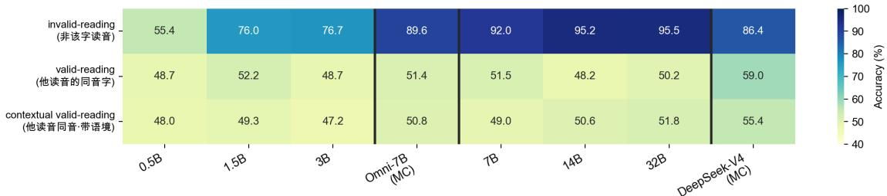

$$
_ { 3 ; }
$$

## F Phonological Distance under the Segmental PanPhon Metric

Figure 8 repeats the distance analysis of §4.2 under the segment-only PanPhon metric (defined in Appendix E).

## G Joint Logistic Regression: Coeficients and Efect Sizes

This appendix backs the separability claim of $\ S 4 . 2$ For each model we fit

$$
\begin{array} { r } { \mathrm { l o g i t P r } ( \mathrm { c o r r e c t } ) = \beta _ { 0 } + \beta _ { 1 } \tilde { z } ( \Delta Z \mathrm { i p f } ) + \beta _ { 2 } \tilde { z } ( d _ { \mathrm { D I M S I M } } ) } \\ { ( 3 ) } \end{array}
$$

on all 23,742 homophone judgment items, with both predictors standardized (so $\beta$ is an effect per standard deviation) and standard errors clustered on the target pronunciation (the field good1\_pinyin; the 2,690 distinct target characters collapse to only ∼709 pinyin pronunciations, each reused ∼33 times, so ordinary SEs are anticonservative; clustering at this coarser pronunciation level—more conservative than clustering on the character—inflates them ∼1.7–3.1×). The two predictors are essentially orthogonal (Pearson � = $- 0 . 0 1 5 , \mathrm { V I F } \approx 1 )$ , so neither is a proxy for the other. Table 6 reports, per predictor, the standardized coeficient and the average marginal efect on accuracy (percentage points per SD); the last column is the distance coeficient after adding condition (task) fixed efects—a stricter, within-condition test. Every frequency coeficient is significant at $p \ < \ 1 0 ^ { - 3 }$ ; every distance coeficient is positive and significant, with Qwen3.5-0.8B at $p = 0 . 0 1 5$ and the rest at $p < 1 0 ^ { - 3 }$

## H Controlled-Position Probing across Four Templates

Figure 9 compares tone macro- $\cdot F _ { 1 }$ at L0 and peak segmental macro- ${ \bf - } F _ { 1 }$ across the four templates, complementing the framing analysis of §5.2.

## I Controlled-Position Probing for the Smaller Qwen2.5 Models

Figure 10 repeats the controlled-position probing for the smaller Qwen2.5 base models.

## J Held-Out Test: Steering a Class, Not Memorized Characters

Each of the six initial steering vectors in Table 7 is constructed from only 16–29 characters, while the target phonological class contains 397–1,020 single-token characters; Table 7 reports how many of the un-constructed same-class characters rise after steering at L8.

## K Prompt-Cue Control

Each elicitation prompt names the source character (e.g. “ ” 吉” 的同声母字 ”), so the steering direction is injected at the source-character position.

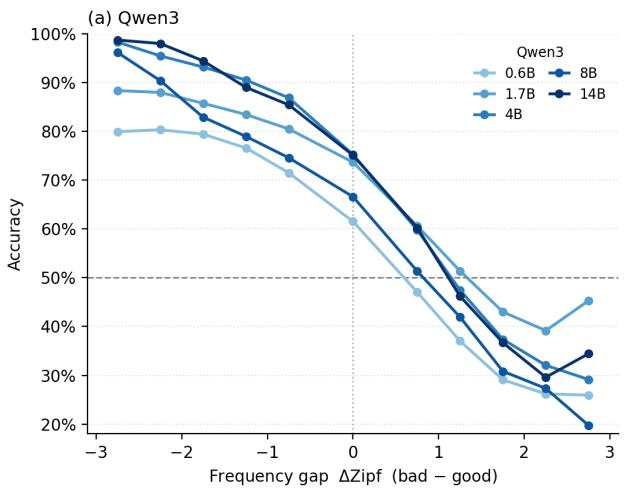

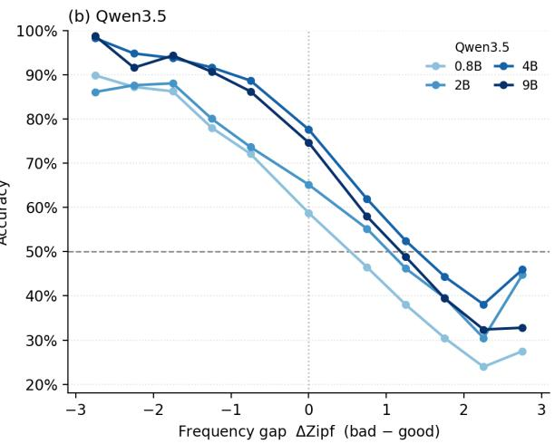

Figure 7: Accuracy vs. frequency gap for (a) Qwen3 and (b) Qwen3.5 base models, replicating Figure 1a: accuracy declines 10–14 pp per unit ΔZipf $( R ^ { 2 } > 0 . 9 2 )$ for every model, and every model stays above chance in the near-zero bin (59–78%).  
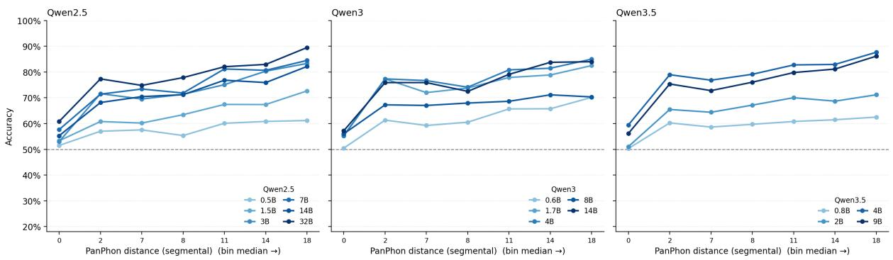  
Figure 8: Accuracy vs. PanPhon distance (ΔZipf≈0) for Qwen2.5, Qwen3, and Qwen3.5 base models. The monotonic rise mirrors DIMSIM (Figure 1b) across all generations; because PanPhon is tone-blind, the efect’s survival shows the distance–dificulty relationship is carried largely by segmental structure.

To confirm that the efect depends on this sourcecharacter cue rather than on the surface wording of the prompt, we compare prompts that carry the cue—including a more explicit tone variant $( ^ { 6 6 } \mathrm { ^ { 3 9 } X ^ { \prime } }$ 是第 � 声，和它同声调的字 ”)—against an otherwise-matched prompt that omits the source character (so the direction is injected at the final position), holding transitions, sites, and the � grid fixed (Table 8).

## L Setup of Exp 3: Steering

Building the steering direction. We place each character � at the end of the phonetic, semantic, and neutral probe prompts and extract its hidden state in each prompt (Eq. 6). We then average these three hidden states:

$$
\bar { \mathbf { h } } _ { c } ^ { ( l ) } = \frac { 1 } { 3 } \sum _ { f \in \{ \mathrm { p h o n } , \mathrm { s e m } , \mathrm { n e u t } \} } \mathbf { h } _ { c , f } ^ { ( l ) } .
$$

For a transition � → � (e.g. initial j→l) the unsupervised steering direction is the mean diference over minimal pairs that difer only in the target dimension:

$$
v _ { \mathrm { d i r } } ~ = ~ \frac { 1 } { | \mathcal { P } | } \sum _ { ( a , b ) \in \mathcal { P } } \bigl ( \bar { \mathbf { h } } _ { b } ^ { ( l ) } - \bar { \mathbf { h } } _ { a } ^ { ( l ) } \bigr ) ,\tag{4}
$$

where $\mathcal { P }$ contains character pairs with source label � and target label �, matched on the other two phonological dimensions. For example, for j→l, the pair 吉 (ji2) and 梨 (li2) shares the same final and tone but difers in initial. The $v _ { \mathrm { d i r } }$ is usually referred to as the steering vector.

We use an average of 13.7, 9.8, and 144.4 character-pair records per transition to construct initial, final, and tone steering vectors, respectively. By assessing target-class characters not used to construct the vectors (Appendix J), we examine the generalization ability of our method.

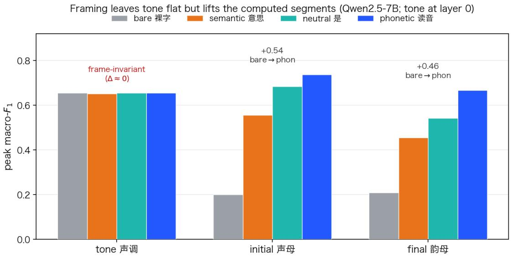  
Figure 9: Template comparison for Qwen2.5-7B (controlled position): tone macro- $\cdot F _ { 1 }$ at L0 and peak macro- ${ \bf \nabla } \cdot { \cal F } _ { 1 }$ over layers for initials and finals. Tone scores coincide at L0, where the character embedding is shared across prompts; contextual prompts improve segmental decodability.

Injection. We add the direction to the residual stream at the source character’s position, h ← $\mathbf { h } + \alpha v _ { \mathrm { d i r } } ,$ , and sweep � upward from 0 to 10. We intervene at five sites (the embedding and layers 8/13/20/24) over 82 transitions (40 initial, 30 final, 12 tone). The following paragraphs discuss the embedding and layers 8/13/20; complete results for all five sites are provided in Appendix N.

Measuring the efect. For initial, final, and tone transitions, we use parallel prompts: $" \langle c \rangle ^ { , }$ 的同 $( \frac { 1 } { r ^ { \alpha } } + \frac { 1 } { r } / \frac { 3 } { \theta } ) + \frac { 1 } { r } / \frac { 1 } { r ^ { \alpha } } + i \frac { 1 } { r } ] = \frac { 1 } { r } , \pm ( \frac { 3 } { r } - \frac { 3 } { r } ) =$ (“a character with the same initial/final/tone as $\langle c \rangle$ , for example”). We sum the next-token probabilities of single-token hanzi in the target and source classes to obtain $P _ { \alpha } ( B )$ and $P _ { \alpha } ( A )$ . Their diference, $a ( \alpha ) = P _ { \alpha } ( B ) -$ $P _ { \alpha } ( A )$ , gives the target–source advantage. We report:

$$
R _ { \mathrm { p e a k } } = \operatorname* { m a x } _ { \alpha } a ( \alpha ) , \qquad \Delta _ { \mathrm { p e a k } } = \operatorname* { m a x } _ { \alpha } [ a ( \alpha ) - a ( 0 ) ] .\tag{5}
$$

$R _ { \mathrm { p e a k } }$ is the largest target–source advantage over the sweep, whereas $\Delta _ { \mathrm { p e a k } }$ measures its largest increase from � = 0. Thus, a larger target-source advantage means the feature is easier to steer and vice versa. We report peaks because responses can decline at large � (Appendix N).

## M Steering Is Invariant to the Choice of Template

Because the steering direction is a diference of bucket-matched minimal pairs (Eq. 4), the shared extraction template cancels. Table 9 verifies this: rebuilding each direction from the single sentencefinal phonetic prompt (“ 这个字的读音： $\langle c \rangle ^ { \ast } )$ instead of the three-template average of §6.1 changes the per-site peak target−source advantage by at most 0.02, for both models and all three dimensions.

## N Steering Dynamics under Increasing Injection Strength

Figure 11 shows the per-site response to increasing injection strength �—the basis for the peak-oversweep scoring of §6.2; the Collapse column of Table 4 reports the rate of response decline after the peak.

## O Strongest Single Transitions

Table 10 lists the strongest single segmental transitions at L8, the exemplar site of §6.2: both initials and finals produce large, early flips, while tone transitions are weaker (their ordering is in §6.2).

## P Linear Probing Setup

Character selection. Starting from 2,357 monophonic characters in the 3,500-character pool, we retain phonological classes with at least 20 examples for stable cross-validation. This removes five rare finals and 57 characters, leaving 2,300 characters with 22 initial classes, 31 final classes, and four tone classes.

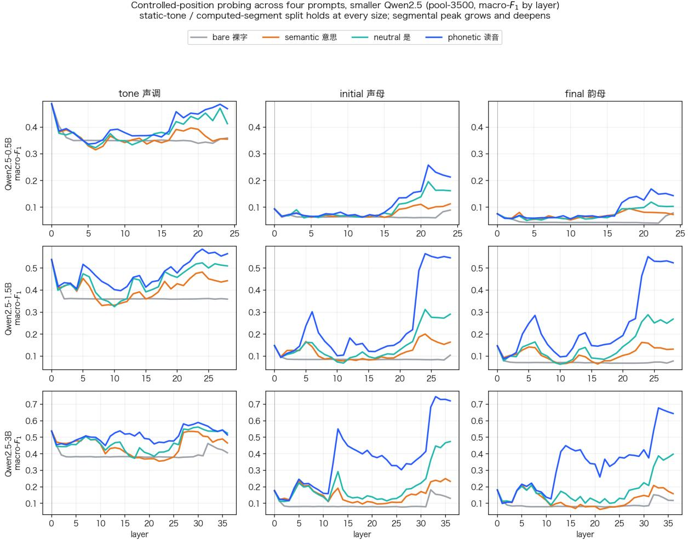  
Figure 10: Controlled-position probing for Qwen2.5-0.5B, 1.5B, and 3B. Tone is already decodable at L0 and changes comparatively modestly with depth, whereas segmental decodability rises substantially in deeper layers. Across 0.5B–7B, peak macro- $F _ { 1 }$ increases from 0.258 to 0.736 for initials, from 0.169 to 0.667 for finals, and from 0.487 to 0.695 for tone. The initial peak moves from L21 at 0.5B to L33 at 3B. Selectivity rises in step with macro-$F _ { 1 }$ , so the segmental gains are not explained by the probe fitting arbitrary labels.

Representation extraction. For a character � presented in prompt $s _ { c } .$ , we extract its hidden state at layer �:

$$
\begin{array} { r } { \mathbf { h } _ { c } ^ { ( l ) } = \mathbf { L M } _ { \leq l } ( s _ { c } ) \big [ \mathrm { p o s } ( c ) \big ] \in \mathbb { R } ^ { d } , } \end{array}\tag{6}
$$

where pos(�) denotes the character’s token position and � = 0 denotes the input embedding. At layer $0 ,$ the representation is the character embedding itself, so the four prompt conditions coincide.

Probe training and evaluation. For each layer, prompt condition, and phonological dimension, we standardize the representations and reduce them to 32 dimensions using PCA. Both standardization and PCA are fitted only on the training split of each fold. We then train an $\ell _ { 2 }$ -regularized multinomial logistic-regression classifier and evaluate it using five-fold stratified cross-validation.

We report macro- ${ - } F _ { 1 }$ and selectivity. For the latter, we repeat probing with a fixed permutation of the phonological labels and compute

$$
\mathrm { S e l e c t i v i t y } = F _ { 1 } ^ { \mathrm { t r u e } } - F _ { 1 } ^ { \mathrm { s h u f f l e d } } .\tag{7}
$$

Internal sites have a humped α-response that collapses under over-injection (deeper = earlier, steeper collapse) the embedding merely saturates and L24 inverts — so the peak over the sweep, not a fixed large α, is the fair readout

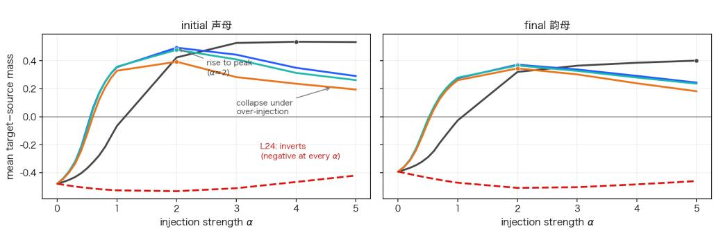  
Figure 11: Steering �-response, Qwen2.5-7B-base (initial and final transitions pooled). Mean target−source class mass as a function of the injection strength �, one curve per site. The embedding saturates; the internal sites peak near �≈2 (dots) and then collapse under over-injection; L24 inverts. The main text reports the peak of each curve, not its end-point.

Table 6: Joint logistic regression of homophone judgment correctness on standardized frequency gap and DimSim distance (cluster-robust on the target pronunciation). AME is the average marginal efect on accuracy in percentage points per SD; the odds ratio per +1 SD is $e ^ { \beta } .$ . All $\beta _ { \mathrm { f r e q } }$ terms are significant at $p < 1 0 ^ { - 3 } ;$ ; all $\beta _ { \mathrm { d i s t } }$ terms are positive and significant, with Qwen3.5-0.8B at $p < 0 . 0 5$ and the rest at $p < 1 0 ^ { - 3 }$ . The final column, $\beta _ { \mathrm { d i s t } } ^ { \mathrm { c o n d } }$ , is the distance coeficient with task fixed efects added (within-condition test); $^ { * * * } p \ < \ 1 0 ^ { - 3 }$ ${ } ^ { * * } p < 1 0 ^ { - 2 } , { } ^ { * } p < 0 . 0 5 , { } ^ { \dag } p < 0 . 1$ , ns otherwise.
<table><tr><td colspan="4">Freq. gap ∆Zipf Dist. (DimSim)</td><td colspan="2"></td></tr><tr><td>Model</td><td>β/SD</td><td>AME</td><td>β/SD</td><td>AME</td><td> $\beta _ { \mathrm { d i s t } } ^ { \mathrm { c o n d } }$ </td></tr><tr><td colspan="6">Qwen2.5</td></tr><tr><td>0.5B</td><td>-1.04</td><td>-20.5</td><td>0.08</td><td>+1.6</td><td>0.05*</td></tr><tr><td>1.5B</td><td>-0.89</td><td>-18.0</td><td>0.16</td><td>+3.2</td><td> $0 . 0 5 ^ { \dagger }$ </td></tr><tr><td>3B</td><td>-1.11</td><td>-19.9</td><td>0.28</td><td>+5.1</td><td>0.08**</td></tr><tr><td>7B</td><td>-1.20</td><td>-19.9</td><td>0.31</td><td>+5.2</td><td>0.11***</td></tr><tr><td>14B</td><td>-1.58</td><td>-23.9</td><td>0.31</td><td>+4.7</td><td>0.09**</td></tr><tr><td>32B</td><td>-1.44</td><td>-21.6</td><td>0.37</td><td>+5.5</td><td>0.09*</td></tr><tr><td colspan="6">Qwen3</td></tr><tr><td>0.6B</td><td>-0.94</td><td>-19.1</td><td>0.13</td><td>+2.7</td><td>0.08**</td></tr><tr><td>1.7B</td><td>-0.90</td><td>-16.8</td><td>0.25</td><td>+4.6</td><td>0.10***</td></tr><tr><td>4B</td><td>-1.45</td><td>-22.3</td><td>0.33</td><td>+5.1</td><td>0.12***</td></tr><tr><td>8B</td><td>-1.18</td><td>-21.4</td><td>0.20</td><td>+3.7</td><td>0.13***</td></tr><tr><td>14B</td><td>-1.48</td><td>-22.5</td><td>0.31</td><td>+4.7</td><td>0.11**</td></tr><tr><td colspan="6">Qwen3.5</td></tr><tr><td>0.8B</td><td>-1.11</td><td>-21.1</td><td>0.10</td><td>+2.0</td><td>0.04 ns</td></tr><tr><td>2B</td><td>-0.93</td><td>-18.1</td><td>0.14</td><td>+2.8</td><td>0.01 ns</td></tr><tr><td>4B</td><td>-1.30</td><td>-20.0</td><td>0.35</td><td>+5.4</td><td>0.05 ns</td></tr><tr><td>9B</td><td>-1.37</td><td>-21.6</td><td>0.35</td><td>+5.5</td><td>0.08**</td></tr></table>

Table 7: Held-out class test at L8: share of same-class characters not used to build the steering vector whose probability rises under steering. Over 96% of all rising characters were never in the construction set, so steering moves the whole phonological class rather than a memorized character list.
<table><tr><td>Transition</td><td>Held-out risers</td></tr><tr><td>tc→1</td><td>85%</td></tr><tr><td>1→p</td><td>84%</td></tr><tr><td> $\mathtt { p } \to \emptyset$ </td><td>82%</td></tr><tr><td> $\mathsf { p } ^ { \mathrm { h } } {  } \mathsf { l }$ </td><td>81%</td></tr><tr><td> $\varphi \to \emptyset$ </td><td>80%</td></tr><tr><td>m→∅</td><td>76%</td></tr></table>

Table 8: Prompt-cue control on Qwen2.5-7Bbase: peak target−source advantage, mean over Emb/L8/L13/L20, and the resulting tone class-mass (four-class baseline 0.25). The cue is necessary for all three dimensions; given the cue, tone crosses the baseline but remains the smallest efect.
<table><tr><td>Prompt</td><td>INITIAL</td><td>FINAL</td><td>TONE</td><td>ToNE mass</td></tr><tr><td>cued (parallel)</td><td>+0.52</td><td>+0.41</td><td>+0.16</td><td>0.35</td></tr><tr><td>cued (explicit tone)</td><td>+0.52</td><td>+0.41</td><td>+0.25</td><td>0.41</td></tr><tr><td>no cue</td><td>-0.13</td><td>-0.07</td><td>-0.03</td><td>0.17</td></tr></table>

Table 9: Per-site peak target–source advantage under the three-template averaged extraction, with the single phonetic-template extraction in parentheses. Both columns come from a separate re-extraction run, so values can difer slightly from Table 4. The two extractions agree to $\leq 0 . 0 2$ at every site; the last column is the maximum absolute diference across the five sites. All three dimensions reverse at L24.
<table><tr><td>Model</td><td>Dim</td><td>Emb</td><td>L8</td><td>L13</td><td>L20</td><td>L24</td><td>max |∆|</td></tr><tr><td>7B-base</td><td>INITIAL</td><td>0.57(0.58)</td><td>0.53(0.53)</td><td>0.51 (0.51)</td><td>0.46(0.46)</td><td>-0.40(-0.39)</td><td>0.02</td></tr><tr><td></td><td>FINAL</td><td>0.46 (0.46)</td><td>0.40 (0.39)</td><td>0.39 (0.38)</td><td>0.37(0.36)</td><td>-0.38(-0.38)</td><td>0.01</td></tr><tr><td></td><td>TONE</td><td>0.16(0.16)</td><td>0.12(0.12)</td><td>0.18 (0.19)</td><td>0.16(0.17)</td><td>−0.27(-0.27)</td><td>0.01</td></tr><tr><td>Omni-7B</td><td>INITIAL</td><td>0.53 (0.53)</td><td>0.41 (0.41)</td><td>0.37(0.37)</td><td>0.31 (0.31)</td><td>-0.36(-0.36)</td><td>0.01</td></tr><tr><td></td><td>FINAL</td><td>0.46(0.46)</td><td>0.36 (0.34)</td><td>0.34(0.33)</td><td>0.32(0.31)</td><td>-0.38(-0.38)</td><td>0.02</td></tr><tr><td></td><td>TONE</td><td>0.19 (0.19)</td><td>0.14(0.14)</td><td>0.18 (0.18)</td><td>0.16(0.17)</td><td>-0.19(-0.19)</td><td>0.00</td></tr></table>

Table 10: Strongest single segmental transitions at L8 (peak target−source advantage).
<table><tr><td>Dim.</td><td>Transition</td><td>Probe</td><td>Peak adv.</td></tr><tr><td>INITIAL</td><td>tç→1</td><td>吉</td><td>0.82</td></tr><tr><td>INITIAL</td><td> $\mathtt { p } \to \emptyset$ </td><td>遍</td><td>0.77</td></tr><tr><td>INITIAL</td><td> $\mathbf { m } {  } \emptyset$ </td><td>觅</td><td>0.77</td></tr><tr><td>INITIAL</td><td> $\mathsf { p } ^ { \mathrm { h } } {  } \mathsf { l }$ </td><td>皮</td><td>0.77</td></tr><tr><td>FINAL</td><td> ${ \bf u } \to { \bf q } { \bf u }$ </td><td>簿</td><td>0.63</td></tr><tr><td>FINAL</td><td>jen→jou</td><td>莲</td><td>0.57</td></tr></table>