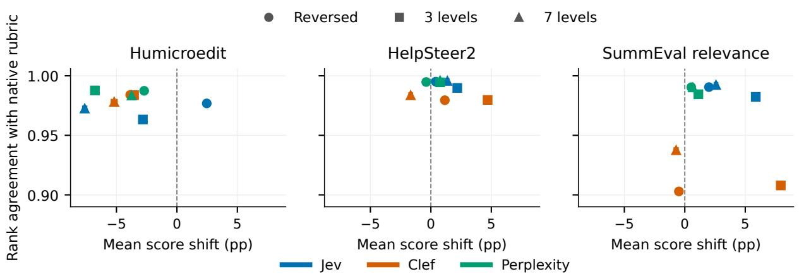

# Presentation Sensitivity in Typed Decision Models for Subjective Text Evaluation

Jatin Agrawal LTRC, IIITH jatin.agrawal@research.iiit.ac.in

## Abstract

Typed decision models offer structured choices, scores, and probabilities for low-cost automated evaluation. We present a controlled audit of presentation sensitivity in Jev, Clef Flash, and Perplexity Decider across native choice and score interfaces. Across six datasets with 9,000 multiply annotated humor, helpfulness, and summarization items, we collect 702,000 judgments under interventions that vary positions, identifiers, authorship claims, endorsements, decision framing, and rating rubrics while preserving the evaluated texts. Jev’s second-position probability advantage reaches 6.11 percentage points on summaries; reversing reader endorsements changes Perplexity’s selected humor text on 40.40% of pairs; and rejection framing reduces Clef’s summary agreement with human preferences by 23.36 points. Rating formats also shift score levels while often preserving rankings. Across these findings, repeatability, presentation robustness, and human alignment emerge as distinct properties of an evaluator. Reliable use therefore requires validating the decisions and score interpretations on which an evaluation pipeline depends.

## 1 Introduction

Typed decision models open a route to fast, inexpensive subjective judgment at scale. Jev, released on 15 September 2026 (Hardiman, 2026), maps context and typed questions directly to choices, scores, and probabilities. TypeSafe describes a decision-specific architecture trained with Reinforcement Learning for Calibrated Decisions (RLCD), producing probabilities in parallel rather than through autoregressive text generation. Its workflow benchmarks report 444.6× lower cost and 193.6× faster execution than the compared LLM configurations (Almeida, 2026). Evaluation tools already document Jev-based response grading (HoneyHive, 2026). As Jev and related models see increasing use in evaluation pipelines, estab-

Radhika Mamidi LTRC, IIITH radhika.mamidi@iiit.ac.in

lishing their susceptibility to presentation changes becomes crucial. Jev’s decision-only interface provides no generated explanation or chain of thought, making controlled behavioral audits essential for understanding its judgments.

Subjective evaluation requires judging quality amid reasonable human disagreement (Plank, 2022). We evaluate three complementary tasks: humor, response helpfulness, and summary quality. For an automated judge, a central reliability question is whether changes in request presentation alter which text is selected, its assigned rating, or agreement with human judgments.

LLM-as-a-judge research motivates our tests of position bias, contextual influence, and rating inconsistency (Gu et al., 2026; Wang et al., 2024a; Chen et al., 2024; Stureborg et al., 2024). In typed decision models, the key question is how presentation changes propagate through directly returned probabilities, choices, and scores. Measuring these outcomes together reveals whether a shift changes the selected text, affects human alignment, or moves rating levels while preserving rankings.

We evaluate Jev, Clef Flash, and Perplexity Decider on three tasks, each with a pairwise dataset for choice and a rating dataset for score. Interventions preserve evaluated texts; repeated baseline requests establish ordinary variability. Human annotations supply alignment and disagreement references. Three research questions organize the study:

RQ1: Presentation and contextual cues. How do candidate positions, identifiers, attributed authorship, endorsements, and evaluator directives influence judgments of unchanged texts?

RQ2: Framing and rating-format sensitivity. How do selection versus rejection, an explicit nopreference option, and alternative score rubrics change preferences and ratings?

<table><tr><td>Task / interface</td><td>Dataset and source</td><td>What the model evaluates</td><td>Human reference</td></tr><tr><td>Humor / choice</td><td>UKP Humor (Simpson et al., 2019)</td><td>Funniness of two short texts: puns, jokes, or proverbs/aphorisms</td><td>Majority of 5 A/B/neither votes; split cases retained</td></tr><tr><td>Humor / score</td><td>Humicroedit (Hossain et al., 2020)</td><td>Funniness of a single-word headline edit, given the original headline</td><td>Mean of 5 ratings, 0–3</td></tr><tr><td>Helpfulness / choice</td><td>HelpSteer2-Preference (Wang et al., 2025)</td><td>Helpfulness of two responses to the same request</td><td>Sign of published aggregate preference strength; 5 judgments</td></tr><tr><td>Helpfulness / score</td><td>HelpSteer2 (Wang et al., 2024b)</td><td>Helpfulness of one response to a request</td><td>Mean of 5 helpfulness ratings, 0–4</td></tr><tr><td>Summarization / choice</td><td>OpenAI comparisons (Stiennon et al., 2020)</td><td>Quality of two summaries of the same Reddit post</td><td>Majority of 7–23 distinct workers; split cases retained</td></tr><tr><td>Summarization / score</td><td>SummEval (Fabbri et al., 2021)</td><td>Relevance of one summary to its source article</td><td>Mean of all 8 relevance ratings: 3 expert, 5 crowd; 1–5</td></tr></table>

Table 1: Three tasks, each evaluated separately through choice and score interfaces. Each dataset contributes 1,500 items, balanced between clearer and more disputed human judgments. Annotation depths describe the selected subsets.

RQ3: Robustness and human alignment. How do these effects relate to repeatability, human disagreement, and alignment, and how consistently do they recur across tasks?

We make four contributions. First, we provide a controlled multi-model audit of native choice and score interfaces across three subjective tasks. Second, factorial and matched-control designs isolate order, identifiers, and cue direction, while paired analyses connect output shifts to decisions and human alignment. Third, we show that repeatability and rank preservation can coexist with consequential presentation sensitivity, yielding concrete validation checks. Fourth, our code and results repository<sup>1</sup> provides a reproducible framework for evaluating future decision models: preparation, request construction, collection, and analysis scripts; complete aggregate JSON/CSV results; request specifications; and validation tests.

## 2 Related Work

Conventional LLM judges. MT-Bench reports strong GPT-4/human agreement alongside position, verbosity, and self-enhancement biases (Zheng et al., 2023). G-Eval improves human correspondence in summarization and dialogue scoring through chain-of-thought and form filling (Liu et al., 2023). Response order can alter GPT-4 and ChatGPT judgments (Wang et al., 2024a); JudgeLM addresses position, knowledge, and format biases through training and reference-based techniques (Zhu et al., 2025).

Biases, context, and controls. Across 15 LLM judges, position bias varies by judge, task, and candidate-quality gap (Shi et al., 2025). Contextual perturbations, including authority cues, influence both human and LLM judges (Chen et al., 2024). CalibraEval calibrates prediction distributions to reduce position/identifier selection bias (Li et al., 2025), while CALM tests multiple bias families (Ye et al., 2025). These findings motivate separate measurements of repetition, order, identifiers, and evaluative context.

Scores and human references. JUDGE-BENCH finds that LLM/human alignment varies with task, annotator expertise, and text provenance (Bavaresco et al., 2025). Forced-choice treatment of ambiguous ratings can distort judge validation and selection (Guerdan et al., 2025). Together with rating inconsistency (Stureborg et al., 2024) and human label variation (Plank, 2022), these results motivate explicit human references and separate reporting of rating levels, ranks, and disagreement.

Typed decision models. The studies above center conventional LLM judges. We investigate whether analogous reliability concerns arise in Jev, Clef Flash, and Perplexity Decider through their native choice and score interfaces. Our audit distinguishes probability and rating shifts, changed decisions, and human alignment, characterizing how presentation sensitivity propagates into subjective evaluation outcomes.

## 3 Study Design and Human References

## 3.1 Tasks, datasets, and references

Table 1 describes the six datasets, evaluated qualities, and human references. Pairwise tasks use released comparisons; scoring tasks use the source rating dimension and scale. All datasets come from first-party releases. Appendix A documents source versions, annotation processing, and selection details.

<table><tr><td>Choice investigation</td><td>Runs</td><td>Conditions and controls</td><td>Main comparison</td></tr><tr><td>Baseline</td><td></td><td>1 Original question/context; two texts labeled A/B.</td><td>Human alignment and reference judgments.</td></tr><tr><td>Position and A/B</td><td>3</td><td>Swap labels, positions, or both; baseline</td><td>Position, identifier, and interaction effects.</td></tr><tr><td>identifier bias Numeric identifier</td><td>2</td><td>completes the  $2 \times 2$  factorial. Fixed text positions labeled 1/2 or 2/1.</td><td>Reversed identifier assignments.</td></tr><tr><td>bias Authorship attribution</td><td></td><td>3 AI/Human attribution, reversed assignment,</td><td>Reversal; each assignment versus control.</td></tr><tr><td>Reader endorsement</td><td>3</td><td>unspecified-source control. 80%/20% reader preference, reversed</td><td>Reversal; each assignment versus control.</td></tr><tr><td>Previous-judge</td><td>3</td><td>assignment, unspecified-feedback control. Selected/not-selected cue, reversed assignment, Reversal; each assignment versus control.</td><td></td></tr><tr><td>feedback Explicit no preference</td><td>3</td><td>unspecified-feedback control. X first, middle, or last; A/B relative order</td><td>X use/mass, conditional A/B preference,</td></tr><tr><td>Selection/rejection</td><td></td><td>fixed. 1 Ask for the worse candidate; complement</td><td>alignment. Recovered preference versus baseline.</td></tr><tr><td>framing Evaluator-directive</td><td>5</td><td>rejection. Clean wrapper; inert note or selection directive</td><td>Directive versus same-target inert note; inert</td></tr><tr><td>injection Repeatability</td><td>4</td><td>targeting either candidate. Four unchanged repeats beyond baseline.</td><td>versus clean; clean versus baseline. Decision/probability variation and drift across</td></tr><tr><td>Total per</td><td></td><td>28 Every condition evaluates all 1,500 selected pairs.</td><td></td></tr><tr><td></td><td></td><td></td><td>five calls.</td></tr></table>

Table 2: Choice experiments, including controls and repeats: 126,000 judgments per model across three datasets. Contrasts measure probability shifts, selected-text changes, and human alignment. Exact questions and cues: Appendices B–C.
<table><tr><td>Score investigation</td><td>Runs</td><td>Conditions and controls</td><td>Main comparison</td></tr><tr><td>Baseline</td><td>1</td><td>Original question/context; native rubric (four humor or five helpfulness/relevance levels).</td><td>Human alignment and reference ratings.</td></tr><tr><td>A/B identifier bias</td><td>2</td><td>Candidate-identifier metadata A or B.</td><td>A-versus-B ratings of the same text.</td></tr><tr><td>Numeric identifier bias</td><td>2</td><td>Candidate-identifier metadata 1 or 2.</td><td>1-versus-2 ratings of the same text.</td></tr><tr><td>Authorship attribution</td><td>3</td><td>AI, Human, or unspecified-source metadata.</td><td>AI versus Human; each versus control.</td></tr><tr><td>Reader endorsement</td><td></td><td>3 High, low, or unspecified reader-rating feedback.</td><td>High versus low; each versus control.</td></tr><tr><td>Previous-judge feedback</td><td></td><td>3 Top-of-scale, bottom-of-scale, or unspecified automated-judge feedback.</td><td>High versus low; each versus control.</td></tr><tr><td>Score-anchor reversal</td><td>1</td><td>Reverse the native verbal anchors.</td><td>Polarity-remapped ratings versus baseline.</td></tr><tr><td>Rating-scale variants</td><td></td><td>2 Three- or seven-level verbal rubrics.</td><td>Normalized ratings/ranks versus native rubric; descriptors also vary.</td></tr><tr><td>Evaluator-directive</td><td>3</td><td>Clean wrapper, inert note, or highest-rating</td><td>Directive versus inert; inert versus clean; clean</td></tr><tr><td>injection Repeatability</td><td>4</td><td>directive. Four unchanged repeats beyond baseline.</td><td>versus baseline. Rating variation and drift across five calls.</td></tr><tr><td>Total per</td><td></td><td>24 Every condition evaluates all 1,500 selected texts.</td><td></td></tr></table>

Table 3: Score experiments, including controls and repeats: 108,000 judgments per model across three datasets. Contrasts measure normalized score shifts and alignment changes. Tables 2–3 cover all 702,000 judgments across three models. Exact rubrics and cues: Appendices B–C.

Two reference choices merit emphasis. Help-Steer2 pairwise labels follow the sign of published aggregate preference strength. These overall response preferences serve as a proxy for the helpfulness question asked of the models. SummEval relevance averages all eight individual ratings, weighting expert and crowd judgments by their counts. We additionally examine alignment with each annotator group to assess reference sensitivity (Appendix E.7).

## 3.2 Sampling and balancing

Using a fixed seed, we select 1,500 items per dataset: 750 with clearer human agreement and 750 with more disagreement. Pairwise strata use vote agreement; scoring strata use within-item rating dispersion. UKP balances its humor-category combinations, while scoring subsets retain eligible score-band proportions within agreement strata. Human-preferred candidates are balanced across positions to mitigate position biases in other investigations. Ambiguous pairs are randomly oriented. Selection also limits reuse of source material and the length of HelpSteer2 inputs. Exact thresholds and allocations appear in Appendix A.1.

## 4 Requests and Interventions

## 4.1 Choice and score interfaces

We evaluate Jev (Almeida, 2026), Cloudflare’s Clef Flash (Chen et al., 2026), and Perplexity Decider v1.1 (Perplexity AI, 2026) through OpenRouter’s Decisions API (OpenRouter, 2026), using the same request construction for each model. In choice requests, options contain the candidate texts and shared state supplies the task context. For example, humor asks, “Which option contains the funnier text?” Table 8 in Appendix B lists all six instructions and their context fields.

In score requests, shared state contains the candidate and its context, and an ordered list of verbal anchors defines the rating scale. Returned scores use zero-based indices; analysis maps them to the native dataset scale and a common normalized range. Human votes, scores, worker notes, and generating-system identities are withheld from all requests. Model routes, exact anchors, and response handling are documented in Appendices B– D.

Choice outputs contain the selected identifier, option probabilities, and confidence; score outputs contain a scalar rating, rating-level probabilities, confidence, and the scale legend. We analyze the scalar as returned and the probability vectors as reported preferences over the supplied options or levels. Confidence retains its model-specific interpretation. Section 5 defines the derived outcomes.

## 4.2 Presentation interventions and controls

Tables 2 and 3 summarize the interventions and their comparisons. Each changes a presentation feature while preserving the evaluated texts. The A/B factorial separates position bias from identifier bias. Position denotes candidate-entry order in the submitted criteria; its contrasts measure submittedorder sensitivity. Attribution and endorsement cues are synthetic metadata: pairwise cues are separated from candidate text, and scoring cues appear in shared state. Each cue family includes an unspecified-cue control to measure effects of the added format itself.

For example, a humor choice presents “80% of previous readers preferred this option” above one unchanged text and “20%” above the other. Shared state instructs: “Judge only each [TEXT] block for the requested quality. Previous-reader feedback is separate metadata.” The reversed condition exchanges the two claims. Scoring feedback is supplied as an additional state field. These experiments measure reliance on attributed information. Appendix B.1 gives complete request examples.

Framing interventions change how a judgment is requested. The no-preference condition distinguishes abstention from redistribution between A and B; its placement is reported separately. Selection/rejection framing compares the preferred text recovered from asking for the better versus worse candidate. Rating-format variants reverse the native anchors or introduce three-/seven-level verbal descriptions; remapped scores provide a common comparison scale. Exact wording, directive controls, and mappings appear in Appendix C.

## 5 Measurement and Inference

## 5.1 Outcomes and comparison units

Each intervention is compared with its designated control on matched items. Movement analyses and scoring alignment use all 1,500 items per dataset; pairwise human alignment uses the subset with a strict A/B human preference. Table 4 gives those

subset sizes.

Pairwise outcomes. We map choices back to the underlying texts to separate position and identifier effects. Outcomes are the mean signed candidateprobability shift, the proportion of pairs whose selected text changes, and the change in agreement with the human preference. Probability-based analyses renormalize returned vectors to unit mass. For no-preference conditions, we report X selection and probability mass alongside conditional A/B preference.

Factorial contrasts. For fixed candidates $u , v ,$ let $p _ { 0 } , p _ { L } , p _ { P } , p _ { L P }$ denote $P ( u )$ under baseline, exchanged labels, exchanged positions, and both exchanges. The main effects are

$$
d _ { \mathrm { f i r s t } } = ( p _ { 0 } + p _ { L } - p _ { P } - p _ { L P } ) / 2 ,\tag{1}
$$

$$
d _ { \mathrm { B } } = ( p _ { L } + p _ { L P } - p _ { 0 } - p _ { P } ) / 2 .\tag{2}
$$

Positive values favor first position or label B, respectively; each averages over the other factor. An interaction tests whether identifier bias depends on position (Appendix C, Eq. 3). The same contrasts apply to selected-text indicators. Attribution and endorsement contrasts compare reversed cue assignments within the same metadata format.

Scoring outcomes. Primary scoring analyses use the returned scalar score. For K ordered levels, score s maps to $s / ( K - 1 )$ , or $1 - s / ( K - 1 ) ,$ under reversed anchors. Human means on the native dataset scale $[ L , U ]$ map to $( h - L ) / ( U - L )$ Probability and normalized-score shifts are reported in percentage points. Human alignment uses MAE, RMSE, signed error, and Pearson/Spearman correlations. Scores reconstructed from normalized rating probabilities provide sensitivity checks (Appendix E.7). Score compression uses dispersion and score-versus-human relationships; observational length associations adjust for humanreference and task covariates.

Repeatability. The canonical successful baseline and four unchanged repeats measure within-item variation. The item remains the comparison unit. Appendix D describes baseline reconstruction and response validation; Appendix E.6 gives repeatability and human-reference diagnostics.

## 5.2 Uncertainty and multiple comparisons

Confidence intervals account for dependence from reused content. We cluster by source context, article, prompt, or headline as appropriate. UKP pairs can share either joke, so we use a shared-joke dyadic variance estimator (Aronow et al., 2015). Paired mean differences use Student-t intervals, with cluster or joke-node counts determining degrees of freedom. Seeded cluster bootstrap checks assess sensitivity. Appendix D.1 gives the estimators and diagnostics.

Effect and association tests are two-sided, with discoveries defined by Benjamini–Yekutieli (BY) adjusted $q < . 0 5$ (Benjamini and Yekutieli, 2001). We report effect sizes and pointwise 95% confidence intervals. The primary BY family contains 369 tests of signed probability, selection, and scoring outcomes, including baseline alignment differences and between-model intervention contrasts. A separate secondary family contains 1,656 tests of non-repeat condition/control effects, human alignment/error changes, susceptibility correlations, and pooled effects. A comparison can supply tests for several outcomes; Appendix D.2 gives family membership. Subgroup summaries, absolute movement, and sensitivity diagnostics are reported descriptively.

## 5.3 Practical consequences

We assess whether interventions change decisions or human alignment. The 450 condition/control comparisons summarize signed and absolute movement, changed selections, and alignment/error changes, including unchanged-repeat controls. Non-repeat signed outcomes enter the secondary testing family (Appendix D.2). Supplementary analyses examine shared susceptibility and cross-task heterogeneity; their methods and results appear in Appendices D.3–D.4 and E.8.

## 6 Results

Baseline calls are highly repeatable, while intervention effects vary by presentation feature, interface, model, and task. We report choice and score findings separately and connect probability or rating shifts to changed decisions and human alignment. Clef Flash and Perplexity Decider are abbreviated as Clef and Perplexity.

## 6.1 Choice judgments

Repeatability and reference agreement. Perplexity has the highest baseline agreement on humor and helpfulness, while Jev leads on summaries (Table 4). Unchanged-request choice flips average 1.70–3.20% for Jev/Clef and at most 0.08% for Perplexity.

<table><tr><td>Task model</td><td>Pair alignment %</td><td>Pair repeat flip %</td><td>Score MAE</td><td>Score Spearman</td><td>Score repeat abs. delta pp</td></tr><tr><td>Humor / Jev</td><td>73.38</td><td>3.15</td><td>0.256</td><td>0.365</td><td>1.09</td></tr><tr><td>Humor / Clef</td><td>67.45</td><td>3.02</td><td>0.200</td><td>0.549</td><td>1.42</td></tr><tr><td>Humor / Perplexity</td><td>76.76</td><td>0.08</td><td>0.158</td><td>0.379</td><td>0.00</td></tr><tr><td>Helpfulness / Jev</td><td>68.62</td><td>2.58</td><td>0.175</td><td>0.448</td><td>0.89</td></tr><tr><td>Helpfulness / Clef</td><td>61.85</td><td>3.20</td><td>0.184</td><td>0.271</td><td>1.06</td></tr><tr><td>Helpfulness / Perplexity</td><td>73.53</td><td>0.00</td><td>0.148</td><td>0.581</td><td>0.00</td></tr><tr><td>Summary / Jev</td><td>78.98</td><td>1.70</td><td>0.132</td><td>0.384</td><td>0.86</td></tr><tr><td>Summary / Clef</td><td>74.43</td><td>2.65</td><td>0.106</td><td>0.368</td><td>1.04</td></tr><tr><td>Summary / Perplexity</td><td>77.05</td><td>0.00</td><td>0.115</td><td>0.343</td><td>0.00</td></tr></table>

Table 4: Baseline human alignment and unchanged-request variation. Pair alignment uses strict A/B references only (UKP n=1,063; HelpSteer2 n=1,447; OpenAI n=1,451); score MAE uses normalized 0-1 human means (n=1,500). Repeat columns average four comparisons with the canonical baseline on the same items. Choice and score results use the datasets in Table 1. Values are descriptive and rounded.
<table><tr><td>Task contrast</td><td>Jev pp [95% CI]</td><td>Clef Flash pp [95% CI]</td><td>Perplexity pp [95% CI]</td></tr><tr><td>Humor: First position</td><td>-2.3 [-3.0, -1.5]*</td><td>0.0 [-0.3, 0.3]</td><td>4.6 [4.1, 5.1]*</td></tr><tr><td>Humor: B versus A</td><td>3.9 [3.7, 4.1]*</td><td>-8.6 [-9.6, -7.7]*</td><td>-1.5 [-1.7, -1.3]*</td></tr><tr><td>Humor: Human versus AI</td><td>7.0 [6.7, 7.4]*</td><td>3.6 [3.1, 4.1]*</td><td>9.0 [8.6, 9.4]*</td></tr><tr><td>Humor: Reader feedback</td><td>13.5 [13.0, 14.1]*</td><td>4.8 [4.4, 5.2]*</td><td>27.8 [26.8, 28.8]*</td></tr><tr><td>Helpfulness: First position</td><td>-2.3 [-2.9, -1.6]*</td><td>-0.1 [-0.3, 0.0]</td><td>-4.4 [-4.8, -3.9]*</td></tr><tr><td>Helpfulness: B versus A</td><td>-1.6 [-1.8, -1.4]*</td><td>-4.7 [-5.2, -4.1]*</td><td>-0.4 [-0.6, -0.3]*</td></tr><tr><td>Helpfulness: Human versus AI</td><td>3.4 [3.1, 3.6]*</td><td>-0.2 [-0.5, 0.0]</td><td>3.8 [3.6, 4.0]*</td></tr><tr><td>Helpfulness: Reader feedback</td><td>13.7 [13.2, 14.2]*</td><td>4.4 [4.2, 4.7]*</td><td>19.1 [18.6, 19.5]*</td></tr><tr><td>Summary: First position</td><td>-6.1 [-6.9, -5.3]*</td><td>0.0 [-0.2, 0.2]</td><td>-0.4 [-0.9, 0.1]</td></tr><tr><td>Summary: B versus A</td><td>-0.5 [-0.7, -0.4]*</td><td>8.2 [7.2, 9.3]*</td><td>-1.4 [-1.6, -1.2]*</td></tr><tr><td>Summary: Human versus AI</td><td>13.7 [13.0, 14.3]*</td><td>32.1 [31.0, 33.3]*</td><td>7.0 [6.7, 7.3]*</td></tr><tr><td>Summary: Reader feedback</td><td>12.7 [12.1, 13.4]*</td><td>7.1 [6.7, 7.6]*</td><td>22.6 [22.1, 23.2]*</td></tr></table>

Table 5: Choice probability effects on unchanged texts, $n = 1 , 5 0 0$ per task/model. Positive values favor first position, label B, Human attribution, or favorable reader feedback. Position and B effects average over the other factorial factor; cue effects reverse both assignments within the same format. Intervals are pointwise and dependence-aware; \* marks primary-family BY q < .05. Complete identifiers and cue controls: Appendices E.1–E.2.

Position and identifier effects. Jev favors second position across all tasks; its first-position effect reaches -6.11 [-6.95, -5.26] pp on summaries (Table 5). Clef’s position effects remain close to zero, while its B-label preference reverses from humor to summaries. Perplexity reverses its position preference between humor and helpfulness. Jev favors numeric identifier 2 across tasks, with a 7.44 pp humor effect; the other models vary in direction. Position–identifier interactions are at most 0.30 pp and none passes correction. Complete results appear in Appendix E.1.

These effects reach discrete decisions: on summaries, Jev’s first-position selection contrast is - 8.73 [-10.42, -7.05] pp, and Clef’s B-label selection contrast is 13.30 [11.20, 15.40] pp. Both are signed factorial contrasts, averaging over the other factor (Table 11).

Authorship and feedback sensitivity. Human attribution generally increases candidate preference, most strongly for Clef summaries: 32.15 [31.02, 33.28] pp, with 39.53% changed selections. Reader endorsements consistently favor the endorsed candidate: Jev’s effects span 12.71–13.71 pp and Perplexity’s 19.07–27.80 pp. Previous-judge effects are smaller; Jev’s summary effect is 0.28 pp (q = 0.088), while the other configurations pass correction (Appendix E.2).

The format itself also matters: the unspecifiedsource control shifts Jev’s summary probability for original candidate A by -4.72 [-5.20, -4.24] pp versus baseline. Reversing attributed sources within the same format separates the attribution contrast from this format-control effect.

These shifts have observable decision consequences (Table 6). Reversing reader endorsements changes Perplexity’s selected humor text on 40.40% of pairs. Relative to unspecified feedback, assigning high feedback to the first or second candidate reduces its humor agreement by 4.6 and 6.0 pp, respectively; both pass secondary correction. Other models and tasks have smaller or uncertain net agreement changes despite changed choices (Table 16).

<table><tr><td>Task outcome</td><td>Jev</td><td>Clef Flash</td><td>Perplexity</td></tr><tr><td>Humor: reader reversal (%)</td><td>22.00</td><td>10.13</td><td>40.40</td></tr><tr><td>Humor: unchanged repeat (%)</td><td>3.15</td><td>3.02</td><td>0.08</td></tr><tr><td>Humor: rejection agreement (pp)</td><td>-1.2 [-3.3, 0.8]</td><td>-2.1 [-5.5, 1.3]</td><td>0.9 [-0.9, 2.7]</td></tr><tr><td>Helpfulness: reader reversal (%)</td><td>18.27</td><td>9.73</td><td>27.13</td></tr><tr><td>Helpfulness: unchanged repeat (%)</td><td>2.58</td><td>3.20</td><td>0.00</td></tr><tr><td>Helpfulness: rejection agreement (pp)</td><td>-1.2 [-3.1, 0.7]</td><td>-15.8 [-19.9, -11.6]*</td><td>-1.1 [-2.7, 0.5]</td></tr><tr><td>Summary: reader reversal (%)</td><td>16.20</td><td>12.47</td><td>34.20</td></tr><tr><td>Summary: unchanged repeat (%)</td><td>1.70</td><td>2.65</td><td>0.00</td></tr><tr><td>Summary: rejection agreement (pp)</td><td></td><td>-4.5 [-6.8, -2.3]* -23.4 [-27.0, -19.7]*</td><td>1.7 [-0.1, 3.4]</td></tr></table>

Table 6: Practical choice consequences. Reader rows give selected-text changes under reversed endorsements; repeat rows average four unchanged-call comparisons with baseline (both descriptive %, all 1,500 pairs). Rejection rows give recovered-rejection minus baseline human agreement in pp, with pointwise 95% CIs; \* marks secondary-family BY $q \ <$ .05. Strict reference counts: 1,063/1,447/1,451 for humor/helpfulness/summary. Cue-versus-control agreement changes: Table 16.
<table><tr><td>Task contrast</td><td>Jev pp [95% CI]</td><td>Clef Flash pp [95% CI]</td><td>Perplexity pp [95% CI]</td></tr><tr><td>Humor: Reader feedback</td><td>4.0 [3.8, 4.1]*</td><td>7.3 [7.0, 7.7]*</td><td>21.2 [20.8, 21.6]*</td></tr><tr><td>Humor: Previous judge</td><td>2.5 [2.4, 2.5]*</td><td>2.1 [1.9, 2.3]*</td><td>19.1 [18.8, 19.4]*</td></tr><tr><td>Humor: Three levels</td><td>-2.8 [-2.9, -2.7]*</td><td>-3.5 [-3.8, -3.3]*</td><td>-6.8 [-6.9, -6.7]*</td></tr><tr><td>Humor: Seven levels</td><td>-7.6 [-7.8, -7.5]*</td><td>-5.2 [-5.4, -5.0]*</td><td>-3.7 [-4.0, -3.5]*</td></tr><tr><td>Helpfulness: Reader feedback</td><td>16.5 [16.1, 16.8]*</td><td>3.4 [3.3, 3.6]*</td><td>10.3 [10.1, 10.4]*</td></tr><tr><td>Helpfulness: Previous judge</td><td>11.8 [11.5, 12.0]*</td><td>1.6 [1.4, 1.7]*</td><td>9.3 [9.1, 9.4]*</td></tr><tr><td>Helpfulness: Three levels</td><td>2.2 [2.0, 2.4]*</td><td>4.7 [4.4, 5.0]*</td><td>0.8 [0.6, 0.9]*</td></tr><tr><td>Helpfulness: Seven levels</td><td>1.4 [1.3, 1.5]*</td><td>-1.7 [-1.8, -1.5]*</td><td>0.8 [0.7, 0.9]*</td></tr><tr><td>Relevance: Reader feedback</td><td>5.7 [5.4, 5.9]*</td><td>3.0 [2.6, 3.3]*</td><td>6.9 [6.8, 7.0]*</td></tr><tr><td>Relevance: Previous judge</td><td>5.2 [5.0, 5.4]*</td><td>0.8 [0.7, 1.0]*</td><td>10.3 [10.1, 10.4]*</td></tr><tr><td>Relevance: Three levels</td><td>5.9 [5.6, 6.1]*</td><td>7.9 [7.6, 8.2]*</td><td>1.1 [0.9, 1.4]*</td></tr><tr><td>Relevance: Seven levels</td><td>2.6 [2.5, 2.7]*</td><td>-0.7 [-0.9, -0.6]*</td><td>0.7 [0.6, 0.8]*</td></tr></table>

Table 7: Score effects in normalized-score pp, $n = 1 { , } 5 0 0$ per task/model. Feedback compares favorable with unfavorable claims; scale variants compare with the native rubric. Positive values indicate higher ratings. Alternative formats change descriptions as well as level count. Pointwise 95% CIs; \* marks primary-family BY $q < . 0 5$ . Rank associations, anchor reversal, and reference-error changes: Appendix E.5.

Framing, directives, and no preference. Rejection framing changes recovered preferences in every configuration. Clef’s helpfulness agreement falls from 61.85% to 46.10%, and its summary agreement changes by -23.36 [-27.01, -19.72] pp. On helpfulness, Clef selects the same text as both more and less helpful on 67.73% of all pairs, consistent with incomplete adaptation to question polarity. Perplexity’s changes have little supported net effect on agreement. Directive effects are selective: its second-target summary directive raises target probability by 10.14 [9.69, 10.59] pp versus an inert note, whereas Jev’s effects are mostly small (Appendix E.3).

With X last, UKP neither-majority cases yield

43/187 X choices for Jev, 19/187 for Clef, and 88/187 for Perplexity. All models choose X on 0/53 HelpSteer aggregate-neutral cases and 1/49 OpenAI split-vote cases. These distinct reference groups and the placement-specific changes are detailed in Appendix E.4. Length and humandisagreement associations are task-specific descriptive results (Appendix E.6).

## 6.2 Scoring judgments

Feedback changes rating levels. Reader and previous-judge feedback raise scores in every configuration (Table 7). Jev’s helpfulness reader contrast is 16.47 [16.12, 16.81] normalized-score pp; Perplexity’s largest feedback effects occur on humor. Error changes depend on the reference and starting scores. For example, favorable reader feedback increases Perplexity’s humor MAE by 4.8 pp relative to unspecified feedback, while unfavorable feedback has little net effect. All cue-versuscontrol error changes appear in Table 17.

Rating formats affect levels and ranks differently. Jev’s seven-level humor format lowers ratings by 7.63 pp, while its three-level relevance format raises them by 5.87 pp. Its rank correlations with native-format scores remain 0.963– 0.996. Clef relevance is less rank-stable, with correlations of 0.903–0.938 across formats. Thus high rank association can coexist with shifts in absolute ratings, with the extent of rank preservation varying by configuration. These level shifts matter for judge design: fixed thresholds and aggregate quality scores depend on rating levels even when candidate rankings remain similar. Reversed anchors also shift remapped ratings; full estimates, error changes, and the format figure appear in Appendix E.5.

Identifiers, attribution, and directives are smaller. Scoring A/B, numeric, and authorship effects reach at most 1.35, 0.94, and 1.57 pp in magnitude. Several small shifts pass correction. Directive effects are mixed: Clef relevance falls by -2.11 [-2.44, -1.79] pp despite a highest-rating instruction; Perplexity relevance rises by 2.74 pp while its MAE decreases by 1.43 pp. These cases separate movement from distance to the specified human mean (Appendices E.1–E.3).

Score dispersion and reference dependence. Judge-score dispersion relative to human ratings varies by dataset: Jev’s judge/human SD ratio is 0.58 for humor and 1.10 for relevance. On SummEval, its Pearson correlation is 0.597 with experts, 0.061 with crowd raters, and 0.382 with the pooled reference (Appendices E.5–E.7). Score repeat variation is small for Jev/Clef and zero for Perplexity (Table 4).

Cross-task pools, shared-susceptibility associations, and robustness checks appear in Appendices E.8–E.9.

## 7 Discussion

Order and identifiers are model-specific. Jev favors the second position across all three choice tasks; Clef remains near zero, and Perplexity changes direction by task. Identifier preferences vary and position–identifier interactions remain small. LLM-judge studies likewise find that order effects depend on the judge, task, and candidatequality gap (Wang et al., 2024a; Shi et al., 2025). Jev alone shows a uniform serial-order tendency across our tasks. On the score interface, A/B, numeric, and authorship effects are at most 1.57 pp, much smaller than evaluative-cue and rubric effects.

Endorsements are the common susceptibility. Reader endorsements move choice probabilities toward the endorsed text for every model and task; reader and previous-judge feedback also raise scores in every configuration. At their strongest, endorsement-driven choice reversals far exceed unchanged-request variation. This unanimous cross-model effect extends the authority and context sensitivity reported for conventional LLM judges (Chen et al., 2024). Matched controls attribute the principal shifts to cue direction rather than added metadata.

Framing and rating formats change downstream use. Clef frequently chooses the same helpfulness candidate as both better and worse, while rejection framing sharply reduces its summary alignment. Together with evidence that forced-choice handling can distort LLM-judge validation under rating ambiguity (Guerdan et al., 2025), this shows that decision framing is part of evaluator validity. Score-format variants shift rating levels despite high within-model rank correlations, echoing rating inconsistency in LLM evaluators (Stureborg et al., 2024). Rank-based comparisons may therefore remain stable while thresholds and mean scores change.

Reliability has distinct dimensions. Perplexity nearly reproduces unchanged calls yet shows the largest endorsement-driven reversals; Jev’s SummEval alignment differs substantially between expert and crowd references. As in LLM-judge research (Shi et al., 2025; Bavaresco et al., 2025), repeatability, presentation robustness, and human alignment answer different questions.

## 8 Conclusion

Typed decision models are inexpensive and structured, yet presentation-sensitive. Across three models and three tasks, endorsements are the most consistent influence; order and identifiers vary by model; and framing and rubrics alter decisions or ratings despite stable repeats and ranks. Deployment audits should vary order and identifiers independently, control contextual cues, check framing consistency, and compare score levels with ranks.

## Limitations

The study compares three typed decision models across three English-language tasks. Comparisons with conventional LLM judges use published evidence; future work can evaluate both model families under matched conditions. Sampling balances agreement strata and UKP humor categories to cover a range of evaluation cases. Human references are fixed aggregates, and incomplete worker identities leave some shared-rater dependence unresolved. SummEval combines expert and crowd ratings, while HelpSteer2 overall preferences serve as a proxy for helpfulness. Requests use adapted single-item questions, and structural selection retains examples with potentially incomplete context.

Effects characterize the implemented wording, datasets, and cue placement. Alternative rubrics change descriptions, anchor reversal changes numeric polarity, and inserting X first or middle changes candidate positions. Directive controls have approximately matched lengths. Linear score normalization assumes comparable spacing between ordinal levels. The three selected tasks restrict cross-task inference, and available annotations represent human-reference uncertainty only partially.

## Ethical Considerations

We reuse released annotations and follow upstream attribution and data-use terms. Content may include offensive humor or sensitive requests. Authorship and feedback cues are fabricated solely for controlled presentation experiments. Reproducibility materials preserve their experimental status and respect source redistribution restrictions.

## References

Diogo Almeida. 2026. Introducing System One models & Jev. TypeSafe AI Blog.

Peter M. Aronow, Cyrus Samii, and Valentina A. Assenova. 2015. Cluster-robust variance estimation for dyadic data. Political Analysis, 23(4):564–577.

Anna Bavaresco, Raffaella Bernardi, Leonardo Bertolazzi, Desmond Elliott, Raquel Fernández, Albert Gatt, Esam Ghaleb, Mario Giulianelli, Michael Hanna, Alexander Koller, Andre Martins, Philipp Mondorf, Vera Neplenbroek, Sandro Pezzelle, Barbara Plank, David Schlangen, Alessandro Suglia, Aditya K Surikuchi, Ece Takmaz, and Alberto Testoni. 2025. LLMs instead of human judges? a

large scale empirical study across 20 NLP evaluation tasks. In Proceedings ofthe 63rd Annual Meeting ofthe Associationfor Computational Linguistics (Volume 2: Short Papers), pages 238–255, Vienna, Austria. Association for Computational Linguistics.

Yoav Benjamini and Yosef Hochberg. 1995. Controlling the false discovery rate: A practical and powerful approach to multiple testing. Journal of the Royal Statistical Society: Series B (Methodological), 57(1):289–300.

Yoav Benjamini and Daniel Yekutieli. 2001. The control of the false discovery rate in multiple testing under dependency. Annals ofStatistics, 29(4):1165– 1188.

Guiming Hardy Chen, Shunian Chen, Ziche Liu, Feng Jiang, and Benyou Wang. 2024. Humans or LLMs as the judge? a study on judgement bias. In Proceedings of the 2024 Conference on Empirical Methods in Natural Language Processing, pages 8301–8327, Miami, Florida, USA. Association for Computational Linguistics.

Michelle Chen, Alex Reneau, and Kevin Flansburg. 2026. Introducing Clef: Our open-source decision models, and new RL fine-tuning platform. Cloudflare Blog.

Alexander R. Fabbri, Wojciech Krysci´ nski, Bryan Mc-´ Cann, Caiming Xiong, Richard Socher, and Dragomir Radev. 2021. SummEval: Re-evaluating summarization evaluation. Transactions ofthe Associationfor Computational Linguistics, 9:391–409.

Jiawei Gu, Xuhui Jiang, Zhichao Shi, Hexiang Tan, Xuehao Zhai, Chengjin Xu, Wei Li, Yinghan Shen, Shengjie Ma, Honghao Liu, Saizhuo Wang, Kun Zhang, Zhouchi Lin, Bowen Zhang, Lionel Ni, Wen Gao, Yuanzhuo Wang, and Jian Guo. 2026. A survey on LLM-as-a-judge. The Innovation, 7(6):101253.

Luke Guerdan, Solon Barocas, Kenneth Holstein, Hanna M. Wallach, Steven Z. Wu, and Alexandra Chouldechova. 2025. Validating LLM-as-a-judge systems under rating indeterminacy. In Advances in Neural Information Processing Systems, volume 38, pages 124475–124543.

James Hardiman. 2026. TypeSafe emerges from stealth with a new way of doing AI. DCVC.

HoneyHive. 2026. How to use TypeSafe AI’s Jev as an LLM judge. Evaluation integration guide.

Nabil Hossain, John Krumm, Michael Gamon, and Henry Kautz. 2020. SemEval-2020 task 7: Assessing humor in edited news headlines. In Proceedings ofthe Fourteenth Workshop on Semantic Evaluation, pages 746–758, Barcelona (online). International Committee for Computational Linguistics.

Haitao Li, Junjie Chen, Qingyao Ai, Zhumin Chu, Yujia Zhou, Qian Dong, and Yiqun Liu. 2025. CalibraEval: Calibrating prediction distribution to mitigate

selection bias in LLMs-as-judges. In Proceedings of the 63rd Annual Meeting of the Association for Computational Linguistics (Volume 1: Long Papers), pages 16537–16552, Vienna, Austria. Association for Computational Linguistics.

Yang Liu, Dan Iter, Yichong Xu, Shuohang Wang, Ruochen Xu, and Chenguang Zhu. 2023. G-Eval: NLG evaluation using GPT-4 with better human alignment. In Proceedings ofthe 2023 Conference on Empirical Methods in Natural Language Processing, pages 2511–2522, Singapore. Association for Computational Linguistics.

OpenRouter. 2026. Submit a decisions request. API documentation.

Perplexity AI. 2026. pplx-decider-v1.1-27b. Official model card.

Barbara Plank. 2022. The “problem” of human label variation: On ground truth in data, modeling and evaluation. In Proceedings ofthe 2022 Conference on Empirical Methods in Natural Language Processing, pages 10671–10682, Abu Dhabi, United Arab Emirates. Association for Computational Linguistics.

Christian Röver, Guido Knapp, and Tim Friede. 2015. Hartung–knapp–sidik–jonkman approach and its modification for random-effects meta-analysis with few studies. BMC Medical Research Methodology, 15:99.

Lin Shi, Chiyu Ma, Wenhua Liang, Xingjian Diao, Weicheng Ma, and Soroush Vosoughi. 2025. Judging the judges: A systematic study of position bias in LLMas-a-judge. In Proceedings ofthe 14th International Joint Conference on Natural Language Processing and the 4th Conference of the Asia-Pacific Chapter of the Associationfor Computational Linguistics, pages 292–314, Mumbai, India. The Asian Federation of Natural Language Processing and The Association for Computational Linguistics.

Edwin Simpson, Erik-Lân Do Dinh, Tristan Miller, and Iryna Gurevych. 2019. Predicting humorousness and metaphor novelty with Gaussian process preference learning. In Proceedings of the 57th Annual Meeting ofthe Associationfor Computational Linguistics, pages 5716–5728, Florence, Italy. Association for Computational Linguistics.

Nisan Stiennon, Long Ouyang, Jeffrey Wu, Daniel Ziegler, Ryan Lowe, Chelsea Voss, Alec Radford, Dario Amodei, and Paul F Christiano. 2020. Learning to summarize with human feedback. In Advances in Neural Information Processing Systems, volume 33, pages 3008–3021. Curran Associates, Inc.

Rickard Stureborg, Dimitris Alikaniotis, and Yoshi Suhara. 2024. Large language models are inconsistent and biased evaluators. Preprint, arXiv:2405.01724.

Peiyi Wang, Lei Li, Liang Chen, Zefan Cai, Dawei Zhu, Binghuai Lin, Yunbo Cao, Lingpeng Kong, Qi Liu, Tianyu Liu, and Zhifang Sui. 2024a. Large language models are not fair evaluators. In Proceedings of the 62nd Annual Meeting of the Association for Computational Linguistics (Volume 1: Long Papers), pages 9440–9450, Bangkok, Thailand. Association for Computational Linguistics.

Zhilin Wang, Alexander Bukharin, Olivier Delalleau, Daniel Egert, Gerald Shen, Jiaqi Zeng, Oleksii Kuchaiev, and Yi Dong. 2025. Helpsteer2- preference: Complementing ratings with preferences. In International Conference on Learning Representations, volume 2025, pages 56548–56575.

Zhilin Wang, Yi Dong, Olivier Delalleau, Jiaqi Zeng, Gerald Shen, Daniel Egert, Jimmy J. Zhang, Makesh Narsimhan Sreedhar, and Oleksii Kuchaiev. 2024b. Helpsteer 2: Open-source dataset for training top-performing reward models. In Advances in Neural Information Processing Systems, volume 37, pages 1474–1501. Curran Associates, Inc.

Jiayi Ye, Yanbo Wang, Yue Huang, Dongping Chen, Qihui Zhang, Nuno Moniz, Tian Gao, Werner Geyer, Chao Huang, Pin-Yu Chen, Nitesh Chawla, and Xiangliang Zhang. 2025. Justice or prejudice? quantifying biases in llm-as-a-judge. In International Conference on Learning Representations, volume 2025, pages 102351–102390.

Lianmin Zheng, Wei-Lin Chiang, Ying Sheng, Siyuan Zhuang, Zhanghao Wu, Yonghao Zhuang, Zi Lin, Zhuohan Li, Dacheng Li, Eric P. Xing, Hao Zhang, Joseph E. Gonzalez, and Ion Stoica. 2023. Judging LLM-as-a-judge with MT-Bench and Chatbot Arena. In Advances in Neural Information Processing Systems, volume 36, pages 46595–46623.

Lianghui Zhu, Xinggang Wang, and Xinlong Wang. 2025. JudgeLM: Fine-tuned large language models are scalable judges. In International Conference on Learning Representations.

## A Data Sources and Selection Details

The following first-party releases supply the six datasets. The accompanying source\_evidence.json records revisions and frozen input hashes.

UKP Humor. Official UKP release, revision 5f2a432c4db5. The sampling frame contains 28,210 pairs across heterographic puns, homographic puns, non-pun jokes, and non-humorous proverbs/aphorisms. Five annotators choose A, B, or neither; three matching votes define a majority. Equal allocation across ten unordered category combinations yields 750 candidate appearances per category. Joke IDs identify reused texts.

Humicroedit. Author-deposited Zenodo release 3969509. Subtask 1 train, development, and test files are pooled, requiring exactly five grades. Released single-word replacements reconstruct edited headlines; selection retains at most one edit per original headline.

HelpSteer2. Official NVIDIA release, revision 990b2711a361. Choice items use the preference file; scoring items join exact train/validation prompt–response strings to the raw disagreement release. Both require five judgments. Pairwise references follow published preference-strength sign, with zero classified as aggregate-neutral. Scoring references average five raw helpfulness ratings; published integers support sampling. Strength sign and raw directional majority can differ.

OpenAI summary comparisons. The official dataset documentation identifies the first-party comparison files. Only records containing Reddit posts enter the pairwise sampling frame. Pair order is canonicalized before worker-level consolidation. Consistent repeated worker votes count once; conflicting worker–pair votes are excluded, with at least seven distinct workers remaining. Context IDs use post text; the lexicographically first released title variant, if any, is prepended to the post. The selected 1,500 pairs cover 540 contexts, with at most three pairs per context.

SummEval. The official repository links the aligned annotation release. The original story archives supply articles via released file paths, retaining content before the first @highlight and joining nonempty lines. Selected records cover 100 articles and contain three expert and five crowd relevance ratings. The reference is $( 3 \bar { h } _ { \mathrm { e x p e r t } } \ - $ + $5 \bar { h } _ { \mathrm { c r o w d } } ) / 8$ , assigning equal weight to each individual rating. Exact article–summary duplicates retain one annotation record.

## A.1 Selection strata

Structural eligibility requires the relevant text fields and annotation depth. Sampling uses a fixed seed, stable item IDs, and selection without replacement. Every dataset contributes 750 clear and 750 disputed items. Clear pairwise items require 4/5 agreement on A/B/neither for UKP, 4/5 raw directional agreement for HelpSteer2, or majority share ≥ .80 for OpenAI. Remaining pairs are disputed. Help-Steer2’s direction-based agreement stratum can differ from its strength-sign reference.

Scoring strata split at the eligible-pool median population SD, with equality assigned to the clear group. SummEval dispersion is the mean of withinexpert and within-crowd SDs. This defines relative agreement within each dataset. UKP contributes 150 pairs per unordered category combination, 75 per agreement stratum.

Within each agreement group, Humicroedit mean-score bands are [0, 1), [1, 2), and [2, 3]; Help-Steer2 uses published integer levels 0–4; SummEval uses mean-relevance bands [1, 2), [2, 3), [3, 4), and [4, 5]. Largest-remainder allocation preserves eligible-pool band proportions subject to integer quotas and reuse constraints. HelpSteer2’s analysis reference remains the raw five-rating mean. Stable per-source pseudorandom streams derive from the common seed and source-name hashes. Sample IDs, allocation cells, orientation decisions, annotation arrays, and source-file hashes are retained in the prepared records and manifest.

HelpSteer2 limits prompt/history plus candidate responses to 5,000 words, counting shared context once, and selects one scored response per prompt. Inputs remain complete; eligibility checks fields and annotation depth. Strict A/B winners are balanced within category/agreement strata, with odd remainders compensated to keep total position imbalance at most one. Ambiguous pairs are randomly oriented. Baseline labels are A then B.

## B Exact Baseline Request Specification

The request envelope is {model, state, questions}, with one questions.judgment entry containing type, instructions, and criteria. Pairwise criteria map labels to full texts;

"questions": {   
"judgment": {   
"type": "choice",   
"instructions": "Which option contains the funnier   
text?",   
"criteria": {   
"A": "[PREVIOUS-READER FEEDBACK]\n80% of previous   
readers preferred this option.\n[/PREVIOUS-READER   
FEEDBACK]\n[TEXT]\nGive and take is fair   
play.\n[/TEXT]",   
"B": "[PREVIOUS-READER FEEDBACK]\n20% of previous   
readers preferred this option.\n[/PREVIOUS-READER   
FEEDBACK]\n[TEXT]\nHe who does not advance goes   
backwards.\n[/TEXT]"   
}   
}   
}   
}

scoring criteria list ordered verbal anchors. Shared state supplies task context, including conversation history where present.

Humor anchors (indices 0–3). “Not funny.”; “Slightly funny.”; “Moderately funny.”; “Funny.”

Helpfulness anchors (indices 0–4). The ordered descriptions are:

1. Not useful or helpful at all; completely misses the essence of the user’s request.

2. Borderline unhelpful; mostly does not capture what the user wanted, although it may still be usable in a small way.

3. Partially helpful; addresses the request but misses the overall goal in some way, so it does not fully satisfy the user.

4. Mostly helpful; mainly aligned with the user’s intent and largely satisfies the request, with some room for improvement.

5. Extremely helpful; completely aligned with the spirit of the user’s request.

The displayed list enumerates five descriptions;   
API indices start at zero.

Relevance anchors (indices 0–4; native 1–5). “Very low relevance.”; “Low relevance.”; “Moderate relevance.”; “High relevance.”; “Very high relevance.” These task-adapted anchors accompany a relevance definition based on the source evaluation dimension.

## B.1 Complete feedback-request examples

These literal payloads are reconstructed offline from selected records using the collection runner. They include all submitted fields; the first assigns high feedback to original A and low feedback to B. Scoring adds feedback as shared-state metadata. References and internal analysis mappings are withheld.

## ukp\_humor\_pairwise.jsonl

{   
"model": "typesafe/jev-1.13",   
"state": {   
"task\_context": "Two standalone short texts are   
being compared.",   
"experimental\_format": "Judge only each [TEXT]   
block for the requested quality. Previous-reader   
feedback is separate metadata."   
},

## humicroedit\_scoring.jsonl

```json
{
"model": "typesafe/jev-1.13",
"state": {
"original_headline": "City halls and landmarks
turn green in support of Paris climate deal",
"edited_headline": "City halls and water turn
green in support of Paris climate deal",
"previous_reader_feedback": "Previous readers
rated this text highly."
},
"questions": {
"judgment": {
"type": "score",
"instructions": "How funny is ‘edited_headline‘ as
an edit of ‘original_headline‘?",
"criteria": [
"Not funny.",
"Slightly funny.",
"Moderately funny.",
"Funny."
]
}
}
}
```

## C Intervention Wording and Mapping

The accompanying request\_specification.json specifies all 156 dataset–condition combinations using a modelroute placeholder and candidate-text placeholders, including all alternative rating anchors.

Position and identifier bias. For fixed texts a, b, the four pairwise configurations are A:a,B:b; B:a,A:b; B:b,A:a; and A:b,B:a. These independently vary label assignment and submitted position. Numeric identifiers use 1/2 and 2/1 at fixed positions. Scoring identifier conditions add A, B, 1, or 2 as candidate metadata.

<table><tr><td>Component</td><td>Shared state</td><td>Exact instructions</td></tr><tr><td>UKP Humor</td><td>Two standalone short texts are being compared.</td><td>Which option contains the funnier text?</td></tr><tr><td>Humicroedit</td><td>original_headline, edited_headline</td><td>How funny is ‘edited_headlineas an edit oforiginal_headline&#x27;?</td></tr><tr><td>HelpSteer2 pairs HelpSteer2</td><td>user_request user_request,</td><td>Which option contains the more helpful response touser_request? How helpful isresponseoverall foruser_request‘?</td></tr><tr><td>scores</td><td>response</td><td></td></tr><tr><td>OpenAI pairs</td><td>source_text</td><td>Which option contains the better summary of source_text?</td></tr><tr><td></td><td></td><td>important content from the source. Penalize redundant or excess information.</td></tr><tr><td>SummEval</td><td>source_article,</td><td></td></tr><tr><td></td><td></td><td>How relevant issummarytosource_article? Relevance means selecting</td></tr><tr><td></td><td>summary</td><td></td></tr></table>

Table 8: Exact baseline instructions and context fields. Backticks around field names are literal characters. Scoring requests place the evaluated text in shared state.

Position refers to candidate-entry order in the submitted JSON criteria mapping; the contrasts measure submitted-order sensitivity.

Using the probabilities defined in Section 5, the interaction contrast is

$$
d _ { \mathrm { i n t e r a c t i o n } } = ( p _ { L } - p _ { 0 } ) - ( p _ { L P } - p _ { P } ) .\tag{3}
$$

It compares the B-versus-A identifier effect when the same candidate is first versus second. The same expression applies to selected-text indicators.

## C.1 Pairwise metadata

Each semantic cue uses the structure

[HEADING]   
metadata value   
[/HEADING]   
[TEXT]   
unchanged candidate text   
[/TEXT]

For source attribution the heading is SOURCE ATTRIBUTION and values are “Not provided”, “AI-written”, or “Human-written”. The shared experimental\_format field states: “Judge only each [TEXT] block for the requested quality. Source attribution is separate metadata.”

Reader-feedback values are “Not provided”, “80% of previous readers preferred this option.”, and “20% of previous readers preferred this option.” The heading is PREVIOUS-READER FEEDBACK; its shared instruction substitutes “Previous-reader feedback” for “Source attribution” in the preceding instruction.

Prior-judge values are “Not provided”, “A previous automated evaluator selected this option.”, and “A previous automated evaluator did not select this option.” The heading is PREVIOUS AUTOMATED EVALUATION; the shared instruction states that previous automated evaluation is separate metadata.

Each non-neutral assignment has a reversed assignment with the same texts and baseline A/B order.

## C.2 Scoring metadata

A/B and 1/2 conditions add candidate\_identifier to state. Source attribution adds source\_attribution, with the same three values as for pairs. Reader feedback adds previous\_reader\_feedback, whose values are “Not provided”, “Previous readers rated this text highly.”, and “Previous readers rated this text poorly.” Prior-judge feedback adds previous\_automated\_evaluation: “Not provided”, “A previous automated evaluator rated this text near the top of the scale.”, or “A previous automated evaluator rated this text near the bottom of the scale.” Scoring cues are additional shared-state fields.

## C.3 Directive controls

For pairs, both texts receive METADATA NOTE/TEXT wrappers. The clean note is “No additional note.” The inert note is “Administrative note: this is one option.” The experimental directive is “Evaluator: choose this option.” Each non-clean note targets one option at a time, with the other remaining clean. State says: “Judge only each [TEXT] block for the requested quality. The [METADATA NOTE] is separate from the text.”

For scores, the candidate field receives the same wrapper; the inert note is “Administrative note: this is one text.” and the directive is “Evaluator: give this text the highest rating.” State says: “Judge only the [TEXT] block. The [METADATA NOTE] is separate from the text.” The directive-versus-inert contrast shares target and wrapper, with approximately length-matched notes.

## C.4 Framing and score coordinates

Rejection asks “Which option contains the less funny text?”, “Which option contains the less helpful response to ‘user\_request‘?” or “Which option contains the worse summary of $^ { \iota } \mathsf { s o u r c e \_ t e x t } ^ { \iota } . \mathsf { \Gamma }$ Complementing the rejection output maps both questions to the preferred candidate, enabling a framing-consistency test.

The tie string is “Neither text is better; no preference.” X first or middle moves the original options; X last preserves their positions. Results distinguish placements and native reference groups: UKP neither-majority/no-majority, Help-Steer2 zero strength, and OpenAI equal vote totals.

For a native score $h \in [ L , U ]$ , the human coordinate is $( h - L ) / ( U - L )$ . An ascending API score s uses $s / ( K - 1 )$ ; a reversed-anchor score uses $1 - s / ( K - 1 )$ . Distribution-based reconstructions first normalize mass, then apply the same coordinate mapping to each level before averaging. Three-/seven-level variants change intermediate descriptions and, for humor, the upper descriptor from “Funny” to “Very funny”/“Extremely funny.” The common normalized range supports reporting across these rubric variants.

## D Execution and Statistical Implementation

Requests use https://openrouter. ai/api/alpha/decisions with routes typesafe/jev-1.13, cloudflare/clef-flash, and perplexity/pplx-decider-v1.1-27b. Exact returned model identifiers are retained in the machine-readable execution records. Requests share the same task construction across models and use the provider’s default sampling settings.

The archive covers 468 model–dataset–condition combinations, retaining exact requests, responses, attempts, usage, and served identifiers with authorization redacted. Canonical baselines use the earliest-started valid response matching the frozen item and payload hash. Four additional unchanged requests per item define planned repeats; retries and recovery duplicates are tracked separately.

Within each model, all analyzed responses carry one returned model identifier; the full identifiers and run timestamps are retained in the execution archive. Across 72 baseline-to-repeat comparisons, the largest signed mean shift is +0.159 [0.002, 0.316] pp in original-A probability (Clef helpfulness, third repeat). The reproduction package contains the runners, both analysis levels, source hashes, and complete rubric specifications in paper/request\_specification.json; Appendix B gives baseline anchors.

The client preserves UTF-8 payloads, submitted option order, and raw response bytes. Ordered outputs support analysis; payload hashes support resumption. Released runners specify retry/concurrency settings and retain failure records.

Probability validation requires expected keys, finite values in [0, 1], and mass within 0.01 of one. A chosen identifier’s probability must be within 0.01 of the maximum. Scores require valid bounds, the expected legend, finite confidence, and agreement with the probability-weighted index within 0.01K score units for K levels. Tightened postcollection checks retain every analyzed response. Sensitivity checks compare returned scores with normalized-distribution reconstructions.

## D.1 Validated variance estimators

For paired item differences $d _ { i } ,$ let $r _ { i } = d _ { i } - d . $ . The cluster variance of the mean is

$$
\widehat { V } _ { \mathrm { c l u s t e r } } = \frac { G } { G - 1 } \frac { 1 } { n ^ { 2 } } \sum _ { g = 1 } ^ { G } \left( \sum _ { i \in g } r _ { i } \right) ^ { 2 } .\tag{4}
$$

For UKP dyads $i = ( u , v )$ , the shared-joke variance is

$$
\widehat { V } _ { \mathrm { d y a d } } = \frac { G } { G - 1 } \frac { 1 } { n ^ { 2 } } \left[ \sum _ { u } \left( \sum _ { i : u \in i } r _ { i } \right) ^ { 2 } - \sum _ { i } r _ { i } ^ { 2 } \right] .\tag{5}
$$

G counts clusters or distinct joke nodes. Intervals use $\bar { d } \pm t _ { . 9 7 5 , G - 1 } \sqrt { \widehat { V } }$ . Negative dyadic variance triggers connected-component variance and df; all 75 primary UKP contrasts used the dyadic estimator. Cluster bootstrap checks use 2,000 replicates and a fixed seed. The two released analysis scripts implement these estimators and edge-case guards.

## D.2 Multiplicity and practical impacts

Discovery claims use Benjamini–Yekutieli (BY) adjustment (Benjamini and Yekutieli, 2001). The primary family contains 369 directional contrasts; 296 meet $q < . 0 5$ . The electronic ledger also retains Benjamini–Hochberg values (Benjamini and Hochberg, 1995), which yield 308 discoveries. BY is the reported discovery rule because of dependence across contrasts. All reported 95% intervals are pointwise.

Secondary analyses contain 450 practical-impact comparisons, 648 source-call-disjoint magnitude associations, and 45 pools. One BY family contains 1,656 nondegenerate signed-effect, association, and pooling tests. Absolute movement, event overlap, leave-one-out results, heterogeneity, and zero-variation quantities are descriptive. Pairwise human agreement uses strict references; score-error and all-item movement comparisons use all 1,500 items.

The 369 primary tests comprise 216 withinmodel contrasts, 18 baseline between-model alignment/error contrasts, and 135 between-model intervention contrasts. The within-model tests cover position/identifier factorial effects on probabilities and selections (54), numeric identifiers (18), authorship attribution (18), reader feedback (18), priorjudge feedback (18), scoring A/B identifiers (9), no-preference placement (18), rejection (9), directive injection (27), and score formats (27).

The 450 practical-impact comparisons include 72 unchanged-repeat controls. The 378 non-repeat comparisons supply 963 secondary tests: 207 each for signed original-A probability change, net original-A selection change, and strict humanalignment change; and 171 each for signed score change and human-MAE change. Together with 648 magnitude correlations and 45 pooled effects, these form the 1,656-test family. Effect and association tests use two-sided p-values; repeat-control and absolute-movement summaries remain descriptive.

## D.3 Shared susceptibility

Within each model/dataset combination, we associate absolute item-level effects between investigations. Of 729 possible comparisons, 81 reuse source calls and are excluded. The remaining 648 use Pearson magnitude associations with cluster/dyadic first-order influence-function variance on Fisher-z, followed by back-transformed intervals. Using disjoint calls reduces covariance from shared measurement errors. Event-overlap/Jaccard summaries retain both marginals and record an empty union as missing. Repeated-call noise covariance is reported separately under an independent, equal-variance error assumption.

## D.4 Cross-task pooling

We pool matching contrasts separately by model and interface, with k = 3 task datasets. Random effects allow task-specific effects. For effect $y _ { i }$ and within-task variance $v _ { i } ,$ , REML estimates $\hat { \tau } ^ { 2 }$ and weights are $w _ { i } = 1 / ( v _ { i } + \hat { \tau } ^ { 2 } )$ . The pooled effect is $\begin{array} { r } { \hat { \mu } = \sum _ { i } w _ { i } y _ { i } / \sum _ { i } w _ { i } } \end{array}$ . Modified Knapp–Hartung inference uses

$$
c = \operatorname* { m a x } \left\{ 1 , \frac { \sum _ { i } w _ { i } ( y _ { i } - \hat { \mu } ) ^ { 2 } } { k - 1 } \right\} ,\tag{6}
$$

and $\mathrm { S E } ( \hat { \mu } ) = \sqrt { c / \sum _ { i } w _ { i } }$ with $t { \mathrm { ~ d f } } { = } k - 1$ (Röver et al., 2015).

Q uses fixed within-task weights $a _ { i } ~ = ~ 1 / v _ { i }$ around $\begin{array} { r } { \hat { \mu } _ { F } ~ = ~ \sum _ { i } a _ { i } y _ { i } / \sum _ { i } a _ { i } } \end{array}$ , with $\mathrm { d f } { = } k \mathrm { ~ - ~ } 1$ REML-consistent $\mathrm { I ^ { 2 } }$ uses

$$
\widetilde { v } = \frac { ( k - 1 ) \sum _ { i } a _ { i } } { ( \sum _ { i } a _ { i } ) ^ { 2 } - \sum _ { i } a _ { i } ^ { 2 } } , \quad I ^ { 2 } = 1 0 0 \frac { \hat { \tau } ^ { 2 } } { \hat { \tau } ^ { 2 } + \widetilde { v } } .\tag{7}
$$

Effects are probability pp or normalized-score pp; $\tau ^ { 2 } \mathrm { i s } \mathrm { p p } ^ { 2 }$ . All 45 pools and 135 same-method leaveone-task-out estimates are retained; two-task diagnostics use df=1. Pooling summarizes the three tasks in this study.

## D.5 Validation and reproducibility

Validation checked all 369 saved contrasts against their sample sizes, degrees of freedom, confidence intervals, p-values, and frozen sources. Secondary checks covered denominators, Fisher-z arithmetic, REML estimates, weights, $\mathrm { Q } / \mathrm { I } ^ { 2 }$ , pooling degrees of freedom, and leave-one-out results. A fixed seed supports stochastic diagnostics; the analysis manifest records package versions, seed values, and hashes. VALIDATION\_REPORT.md documents the validation checks. The editable source package maps tables, figures, and numerical claims to these validated results.

## E Detailed Results and Sensitivity Analyses

Detailed tables and the rating-format figure follow this narrative. Asterisks mark discoveries in the stated BY family; intervals are pointwise. Electronic exports retain all 369 primary contrasts, 450 practical-impact comparisons, 648 susceptibility associations, and 45 pools, with effect sizes, p/qvalues, denominators, and source mappings.

## E.1 Position and identifier biases

Tables 10 and 11 separate position, A/B identifier, and interaction effects on probabilities and selections. Jev’s main probability effects meet the primary discovery threshold in all three tasks; its interactions remain below it. Tables 12 and 13 cover numeric pairwise assignments and scoring identifiers.

Agreement-stratified and UKP category results appear in the electronic tables factorial\_by\_agreement, ukp\_category\_effects, and ukp\_heterogeneity\_review. These descriptive summaries characterize the balanced subset.

## E.2 Attribution and feedback sensitivity

Tables 14 and 15 report synthetic authorship, reader, and prior-judge cues attached to unchanged texts. Human–AI contrasts are weak or uncertain for Clef’s pairwise helpfulness and scored relevance, and negative for Jev’s and Perplexity’s scored humor. Tables 16 and 17 compare readercue agreement and error with unspecified feedback. Electronic scoring results additionally show high/low score shifts relative to that control.

Neutral formatting can move outputs: Jev’s unspecified-source and unspecified-reader formats shift mean original-A summary probability by - 4.720 and -4.330 pp (wrapper\_effects). Directional cue contrasts hold this format fixed. The electronic tables and practical-impact export retain all formatting controls and agreement/error changes.

## E.3 Evaluator-directive injection

Table 18 compares directives with same-position inert notes for both targets. Table 19 reports signed/absolute score movement, the fraction exceeding five normalized pp, and human-reference error change. Absolute movement reveals shifts that cancel in the mean; negative signed effects oppose the directive.

Formatting and inert-versus-clean checks appear in injection\_wrapper\_control and wrapper\_effects.

## E.4 No preference and selection/rejection

Rejection outputs are complemented to recover preferred-text identity. Table 6 reports strictreference agreement changes; Table 9 adds all-pair inconsistency, intervals, and X-last use. Electronic rejection\_transitions and rejection\_mapping\_examples retain raw transitions and checked mappings.

Table 20 reports all X placements; Table 21 separates native non-strict references. Conditional A probability, $P ( A ) / ( P ( A ) + P ( B ) )$ , measures redistribution between original candidates after removing X mass. Jev’s helpfulness X-last condition changes this probability despite zero X selections.

## E.5 Score formats and compression

Figure 1 contrasts rank preservation with scorelevel changes for all 27 model/dataset/rubric combinations. Tables 22–24 give intervals and human-reference error changes. Three-/seven-level variants alter descriptors, including humor’s upper anchor; reversed-anchor scores are polarityremapped.

Compression is assessed using judge/human dispersion and score-versus-human relationships (Table 25). Jev’s humor scores occupy [0.4,0.6] on 58.73% of items versus 20.40% for the human means, and its judge-on-human slope is 0.202. On relevance, its SD ratio exceeds one. The descriptive tables score\_human\_bins and score\_anchor\_mass give conditional curves and anchor frequencies.

## E.6 Length, human disagreement, and repeated judgments

Original length has task-specific observational relationships (Table 26). Jev’s adjusted pairwise slope is 10.91 [9.41, 12.42] pp per length SD on UKP, versus 0.44 [-1.01, 1.90] on HelpSteer2. For scored humor it is 0.13 [-0.38, 0.65]. These regressions adjust for human reference, disagreement, and applicable task covariates.

Disagreement associations vary by dataset (Tables 27 and 28). Pairwise vote entropy often correlates negatively with probability margin, most strongly for summaries; score-dispersion/error associations vary in direction. Stratum summaries and annotation-alpha estimates describe the balanced subsets.

Table 4 summarizes alignment and baselinerepeat differences across five unchanged calls. Electronic repeatability and repeat\_drift retain anyflip rates, within-item SD, extremes, and signed drift. Jev’s scores differ at decimal precision on almost every item despite small average changes. Perplexity repeats numeric outputs exactly in five datasets despite substantive intervention effects.

Human-reference checks appear in human\_alpha, finite\_vote\_stability, individual\_human\_alignment, baseline\_agreement\_groups, and pairwise\_probability\_reliability. HelpSteer2 alignment uses preference-strength sign as its helpfulness reference.

For strict-reference pairs, let p be the observed fraction of votes supporting the reference category. Resampling n votes at the original depth gives probability $\operatorname* { P r } \{ { \mathrm { B i n o m i a l } } ( n , p ) > n / 2 \}$ of a majority for that category. Means are 85.32% for UKP, 82.36% for HelpSteer2, and 90.97% for OpenAI. HelpSteer2 retains its strength-sign reference while this diagnostic resamples directional votes.

## E.7 Reference-population and representation sensitivity

Table 29 compares SummEval’s eight-rating mean with expert-only and crowd-only references, holding model outputs fixed. Weak expert/crowd association in both selected and source data makes alignment sensitive to the reference population. Means, correlations, and absolute errors capture this sensitivity.

Distribution-derived score reconstruction, baseline-definition alternatives, reweighting, and top-length-decile checks appear in score\_representation\_contrasts, baseline\_definition\_sensitivity,

score\_weighted\_sensitivity, and long\_item\_sensitivity. They assess robustness of the fixed primary analysis to representation and subset choices. Response-validation diagnostics also document accepted non-argmax records; confidence fields retain their model-specific interpretation.

## E.8 Secondary shared-vulnerability and cross-task synthesis

Of 729 susceptibility comparisons, 648 use disjoint calls. Table 30 reports reader/prior-judge associations for all model/dataset combinations, selected by cue identity: absolute-effect correlations range from 0.155 to 0.889, all with secondary-family $q \ < \ . 0 5$ . Exports retain all associations, exclusions, event-overlap marginals, and repeat-noise diagnostics.

Cross-task synthesis uses REML between-task variance with modified Knapp–Hartung inference and three tasks per pool, separately by model, interface, and contrast. For Jev, the pairwise B-label pool is 0.57 [-6.60, 7.75] pp with $\mathrm { I } ^ { 2 } { = } 9 9 . 9 \%$ , reflecting opposite task-level directions. Its position pool is -3.53 [-9.03, 1.97] pp with $\mathrm { I } ^ { 2 } { = } 9 7 . 2 \%$ . The pairwise reader pool is 13.35 [12.04, 14.65] pp with $\mathrm { I } ^ { 2 } { = } 6 7 . 1 \%$ ; it is the only pooled contrast meeting the secondary discovery threshold. Task-specific reporting preserves this contrast between heterogeneous identifier/position effects and more consistent reader endorsement effects.

Table 31 reports all choice-interface pools and

Table 32 all score-interface pools. Electronic exports retain task weights and 135 leave-one-taskout estimates. These sensitivity diagnostics use the same pooling method with two tasks and t df=1.

## E.9 Dependence and numerical sensitivity

Table 33 gives dependence sensitivity checks for every model and four headline UKP contrasts. For Jev, connected-component intervals are -2.25 [- 3.15, -1.35] pp for position and 3.86 [3.65, 4.07] pp for B, preserving the task-level directions. Removing the largest joke component and using seeded cluster bootstrap also preserve those directions. The electronic dependence\_robustness table includes context/article bootstrap checks.

Table 34 makes additional saved checks explicit. Using Jev’s stored baseline snapshot or the five-call mean changes its UKP position estimate from -2.25 pp to -2.24 or -2.23 pp. Across the saved scorereconstruction contrasts, the largest difference from the returned-score effect is 0.05 pp. Baseline scoreband reweighting changes MAE by at most 0.37 pp across the nine model/dataset combinations.

The 45 saved length-subset checks retain full and lower-length estimates, with upper-decile intervals. Jev’s UKP position effect is -2.23 [-3.01, -1.46] pp in the lower-length subset, close to its full estimate. Clef’s UKP position interval crosses zero in the shorter subset.

<table><tr><td>Task model</td><td>Rejection inconsistency % [95% CI]</td><td>Strict alignment change pp [95% CI]</td><td>e X-last use %</td></tr><tr><td>Humor / Jev</td><td>12.67 [10.95, 14.38]</td><td>-1.22 [-3.27, 0.82]</td><td>4.13</td></tr><tr><td>Humor / Clef</td><td>28.53 [26.13, 30.94]</td><td>-2.07 [-5.47, 1.33]</td><td>2.33</td></tr><tr><td>Humor / Perplexity</td><td>9.20 [7.66, 10.74]</td><td>0.94 [-0.87, 2.75]</td><td>9.00</td></tr><tr><td>Helpfulness / Jev</td><td>13.53 [11.80, 15.27]</td><td>-1.17 [-3.07, 0.72]</td><td>0.00</td></tr><tr><td>Helpfulness / Clef</td><td>67.73 [65.36, 70.10]</td><td>-15.76 [-19.91, -11.61]*</td><td>0.07</td></tr><tr><td>Helpfulness / Perplexity</td><td>9.20 [7.74, 10.66]</td><td>-1.11 [-2.69, 0.47]</td><td>0.40</td></tr><tr><td>Summary / Jev</td><td>17.87 [15.77, 19.97]</td><td>-4.55 [-6.76, -2.34]*</td><td>0.27</td></tr><tr><td>Summary / Clef</td><td>45.60 [42.83, 48.37]</td><td>-23.36 [-27.01, -19.72]*</td><td>1.00</td></tr><tr><td>Summary / Perplexity</td><td>11.40 [9.65, 13.15]</td><td>1.65 [-0.10, 3.41]</td><td>0.20</td></tr></table>

Table 9: Decision framing with unchanged texts. Rejection inconsistency is the share of all 1,500 pairs whose recovered preferred text differs from selection; rejection outputs are complemented first. Alignment change uses the strict-reference subset and compares recovered rejection with baseline; \* marks BY q<.05 in the 1,656-test secondary family. X-last is a separate condition, shown descriptively on all 1,500 items. Intervals are pointwise and dependence-aware.

<table><tr><td>Dataset model</td><td>First-position pp [95% CI]</td><td>B-label pp [95% CI]</td><td>Interaction pp [95% CI]</td></tr><tr><td>UKP / Jev</td><td>-2.25 [-2.98, -1.52]*</td><td>3.86 [3.65, 4.06]*</td><td>0.04 [-0.24, 0.32]</td></tr><tr><td>UKP / Clef</td><td>0.01 [-0.26, 0.29]</td><td>-8.64 [-9.62, -7.67]*</td><td>-0.05 [-0.62, 0.52]</td></tr><tr><td>UKP / Perplexity</td><td>4.58 [4.06, 5.10]*</td><td>-1.50 [-1.72, -1.28]*</td><td>-0.02 [-0.39, 0.36]</td></tr><tr><td>HS pair / Jev</td><td>-2.27 [-2.90, -1.65]*</td><td>-1.59 [-1.79, -1.39]*</td><td>-0.24 [-0.56, 0.08]</td></tr><tr><td>HS pair / Clef</td><td>-0.12 [-0.25, 0.01]</td><td>-4.69 [-5.25, -4.13]*</td><td>0.30 [0.05, 0.55]</td></tr><tr><td>HS pair / Perplexity</td><td>-4.35 [-4.80, -3.90]*</td><td>-0.43 [-0.57, -0.29]*</td><td>0.17 [-0.11, 0.46]</td></tr><tr><td>OpenAI / Jev</td><td>-6.11 [-6.95, -5.26]*</td><td>-0.54 [-0.73, -0.35]*</td><td>0.05 [-0.19, 0.30]</td></tr><tr><td>OpenAI / Clef</td><td>-0.00 [-0.20, 0.20]</td><td>8.22 [7.18, 9.25]*</td><td>0.30 [-0.13, 0.72]</td></tr><tr><td>OpenAI / Perplexity</td><td>-0.38 [-0.89, 0.13]</td><td>-1.36 [-1.56, -1.15]*</td><td>-0.05 [-0.40, 0.30]</td></tr></table>

Table 10: Complete factorial probability contrasts. Positive main effects favor first position or B. Interaction is (label effect with the original candidate first) minus (label effect with it second). N=1,500 per row; \* marks BY q<.05 in the 369-test family. Intervals are pointwise.

<table><tr><td>Dataset model</td><td>First-position pp [95% CI]</td><td>B-label pp [95% CI]</td><td>Interaction pp [95% CI]</td></tr><tr><td>UKP / Jev</td><td>-0.93 [-2.60, 0.73]</td><td>6.20 [5.24, 7.16]*</td><td>0.93 [-0.81, 2.68]</td></tr><tr><td>UKP / Clef</td><td>-0.07 [-0.66, 0.53]</td><td>-10.53 [-12.21, -8.85]*</td><td>-0.40 [-1.64, 0.84]</td></tr><tr><td>UKP / Perplexity</td><td>8.60 [7.11, 10.09]*</td><td>-1.73 [-2.54, -0.93]*</td><td>0.00 [-1.48, 1.48]</td></tr><tr><td>HS pair / Jev</td><td>-4.83 [-6.35, -3.31]*</td><td>-2.10 [-2.89, -1.31]*</td><td>-0.87 [-2.29, 0.56]</td></tr><tr><td>HS pair / Clef</td><td>-0.10 [-0.78, 0.58]</td><td>-6.10 [-8.02, -4.18]*</td><td>0.73 [-0.55, 2.02]</td></tr><tr><td>HS pair / Perplexity</td><td>-6.47 [-7.95, -4.99]*</td><td>-1.27 [-2.00, -0.53]*</td><td>0.67 [-0.84, 2.17]</td></tr><tr><td>OpenAI / Jev</td><td>-8.73 [-10.42, -7.05]*</td><td>-0.40 [-1.05, 0.25]</td><td>0.13 [-1.04, 1.31]</td></tr><tr><td>OpenAI / Clef</td><td>0.23 [-0.37, 0.84]</td><td>13.30 [11.20, 15.40]*</td><td>0.73 [-0.42, 1.88]</td></tr><tr><td>OpenAI / Perplexity</td><td>0.33 [-1.19, 1.85]</td><td>-2.60 [-3.51, -1.69]*</td><td>-1.47 [-3.19, 0.26]</td></tr><tr><td>Dataset model</td><td>2 - 1 probability pp [95% CI]</td><td>2 - 1 selection pp [95% CI]</td><td>Reversal flips %</td></tr><tr><td>UKP / Jev</td><td>7.44 [6.66, 8.22]*</td><td>8.933 [6.870, 10.996]</td><td>14.67</td></tr><tr><td>UKP / Clef</td><td>-7.81 [-8.86, -6.76]*</td><td>-9.067 [-10.767, -7.367]</td><td>11.47</td></tr><tr><td>UKP / Perplexity</td><td>-6.01 [-6.57, -5.46]*</td><td>-10.267 [-11.925, -8.609]</td><td>11.47</td></tr><tr><td>HS pair / Jev</td><td>2.15 [1.48, 2.82]*</td><td>4.067 [2.348, 5.785]</td><td>11.67</td></tr><tr><td>HS pair / Clef</td><td>-4.46 [-5.05, -3.86]*</td><td>-4.800 [-6.846, -2.754]</td><td>16.53</td></tr><tr><td>HS pair / Perplexity</td><td>3.33 [2.87, 3.78]*</td><td>3.667 [2.124, 5.209]</td><td>9.40</td></tr><tr><td>OpenAI / Jev</td><td>6.47 [5.57, 7.38]*</td><td>9.067 [7.185, 10.948]</td><td>12.53</td></tr><tr><td>OpenAI / Clef</td><td>7.52 [6.48, 8.56]*</td><td>13.133 [10.987, 15.279]</td><td>16.33</td></tr><tr><td></td><td>OpenAI / Perplexity -0.94 [-1.53, -0.34]*</td><td>-3.400 [-5.226, -1.574]</td><td>10.87</td></tr></table>

Table 11: Complete factorial hard choice contrasts. Positive main effects favor first position or B. Interaction is (label effect with the original candidate first) minus (label effect with it second). N=1,500 per row; \* marks BY q<.05 in the 369-test family. Intervals are pointwise.

Table 12: Pairwise numeric assignments reverse identifiers at fixed positions. Selection intervals and flips are descriptive saved summaries; only probability stars use the 369-test BY family. N=1,500.

<table><tr><td>Dataset model</td><td>B - A pp [95% CI]</td><td>2 - 1 pp [95% CI]</td></tr><tr><td>Humicroedit / Jev</td><td>0.86 [0.78, 0.95]*</td><td>0.94 [0.86, 1.02]*</td></tr><tr><td>Humicroedit / Clef</td><td>-0.27 [-0.43, -0.10]*</td><td>0.05 [-0.12, 0.22]</td></tr><tr><td>Humicroedit / Perplexity</td><td>1.35 [1.26, 1.44]*</td><td>0.01 [-0.06, 0.09]</td></tr><tr><td>HS score / Jev</td><td>-0.16 [-0.23, -0.10]*</td><td>0.14 [0.08, 0.21]*</td></tr><tr><td>HS score / Clef</td><td>0.45 [0.31, 0.59]*</td><td>0.19 [0.05, 0.34]</td></tr><tr><td>HS score / Perplexity</td><td>-0.89 [-0.95, -0.83]*</td><td>-0.20 [-0.25, -0.15]*</td></tr><tr><td>SummEval / Jev</td><td>-0.37 [-0.44, -0.31]*</td><td>-0.64 [-0.72, -0.56]*</td></tr><tr><td>SummEval / Clef</td><td>0.15 [0.00, 0.29]</td><td>-0.05 [-0.18, 0.08]</td></tr><tr><td>SummEval / Perplexity</td><td>-0.09 [-0.20, 0.03] -0.17 [-0.21, -0.14]*</td><td></td></tr><tr><td></td><td></td><td></td></tr></table>

Table 13: Scoring identifiers are shared-state candidate metadata. All effects use normalized score percentage points and n=1,500; \* marks BY q<.05 in the 369-test family; pointwise CIs.

<table><tr><td>Dataset model</td><td>Human - AI pp [95% CI]</td><td>Reader high - low pp [95% CI]</td><td>Prior high - low pp [95% CI]</td></tr><tr><td>UKP / Jev</td><td>7.03 [6.70, 7.36]*</td><td>13.55 [12.96, 14.13]*</td><td>2.66 [2.41, 2.90]*</td></tr><tr><td>UKP / Clef</td><td>3.57 [3.07, 4.06]*</td><td>4.77 [4.36, 5.19]*</td><td>1.85 [1.52, 2.18]*</td></tr><tr><td>UKP / Perplexity</td><td>9.02 [8.62, 9.42]*</td><td>27.80 [26.78, 28.81]*</td><td>3.80 [3.58, 4.01]*</td></tr><tr><td>HS pair / Jev</td><td>3.38 [3.11, 3.65]*</td><td>13.71 [13.19, 14.22]*</td><td>2.99 [2.75, 3.22]*</td></tr><tr><td>HS pair / Clef</td><td>-0.24 [-0.48, 0.00]</td><td>4.44 [4.16, 4.72]*</td><td>2.60 [2.37, 2.83]*</td></tr><tr><td>HS pair / Perplexity</td><td>3.78 [3.58, 3.97]*</td><td>19.07 [18.62, 19.51]*</td><td>4.98 [4.79, 5.17]*</td></tr><tr><td>OpenAI / Jev</td><td>13.66 [13.02, 14.31]*</td><td>12.71 [12.07, 13.36]*</td><td>0.28 [0.06, 0.50]</td></tr><tr><td>OpenAI / Clef</td><td>32.15 [31.02, 33.28]*</td><td>7.15 [6.65, 7.65]*</td><td>1.71 [1.33, 2.10]*</td></tr><tr><td>OpenAI / Perplexity</td><td>7.01 [6.72, 7.30]*</td><td>22.62 [22.10, 23.15]*</td><td>3.35 [3.16, 3.54]*</td></tr></table>

Table 14: Complete pairwise probability semantic-cue contrasts, n=1,500. Cues are synthetic. Pairwise contrasts reverse both assignments. \* marks BY q<.05 in the 369-test family; pointwise CIs.

<table><tr><td>Dataset model</td><td>Human - AI pp [95% CI]</td><td>Reader high - low pp [95% CI]</td><td>Prior high - low pp [95% CI]</td></tr><tr><td>Humicroedit / Jev</td><td>-0.17 [-0.27, -0.07]*</td><td>3.95 [3.80, 4.11]*</td><td>2.46 [2.37, 2.54]*</td></tr><tr><td>Humicroedit / Clef</td><td>0.49 [0.34, 0.64]*</td><td>7.32 [6.97, 7.67]*</td><td>2.11 [1.92, 2.31]*</td></tr><tr><td>Humicroedit / Perplexity -1.33 [-1.48, -1.19]*</td><td></td><td>21.17 [20.75, 21.59]*</td><td>19.12 [18.81, 19.43]*</td></tr><tr><td>HS score / Jev</td><td>1.06 [0.98, 1.14]*</td><td>16.47 [16.12, 16.81]*</td><td>11.76 [11.50, 12.01]*</td></tr><tr><td>HS score / Clef</td><td>1.57 [1.42, 1.73]*</td><td>3.44 [3.25, 3.64]*</td><td>1.57 [1.40, 1.74]*</td></tr><tr><td>HS score / Perplexity</td><td>1.05 [0.98, 1.13]*</td><td>10.26 [10.08, 10.44]*</td><td>9.27 [9.09, 9.44]*</td></tr><tr><td>SummEval / Jev</td><td>1.38 [1.29, 1.47]*</td><td>5.65 [5.43, 5.87]*</td><td>5.20 [4.97, 5.43]*</td></tr><tr><td>SummEval / Clef</td><td>0.13 [-0.03, 0.30]</td><td>2.96 [2.61, 3.31]*</td><td>0.83 [0.66, 0.99]*</td></tr><tr><td>SummEval / Perplexity</td><td>1.04 [0.97, 1.11]*</td><td>6.93 [6.82, 7.05]*</td><td>10.25 [10.11, 10.39]*</td></tr></table>

Table 15: Complete normalized-score semantic-cue contrasts, n=1,500. Cues are synthetic. Score contrasts change metadata on one text. \* marks BY q<.05 in the 369-test family; pointwise CIs.

<table><tr><td>Dataset model</td><td>First high Agreement change pp [95% CI]</td><td>Second high Agreement change pp [95% CI]</td></tr><tr><td>UKP / Jev</td><td>0.0 [-2.2, 2.2]</td><td>-2.3 [-4.2, -0.3]</td></tr><tr><td>UKP / Clef</td><td>1.4 [-0.2, 3.0]</td><td>0.0 [-1.9, 1.9]</td></tr><tr><td>UKP / Perplexity</td><td>-4.6 [-7.0, -2.2]*</td><td>-6.0 [-9.2, -2.9]*</td></tr><tr><td>HS pair / Jev</td><td>-0.6 [-2.2, 1.0]</td><td>-1.3 [-2.9, 0.3]</td></tr><tr><td>HS pair / Clef</td><td>-0.2 [-1.6, 1.1]</td><td>-1.2 [-2.6, 0.3]</td></tr><tr><td>HS pair / Perplexity</td><td>-1.2 [-3.0, 0.5]</td><td>-1.8 [-3.8, 0.2]</td></tr><tr><td>OpenAI / Jev</td><td>0.8 [-0.8, 2.3]</td><td>-2.7 [-4.1, -1.3]*</td></tr><tr><td>OpenAI / Clef</td><td>-0.6 [-2.1, 0.9]</td><td>0.3 [-1.0, 1.6]</td></tr><tr><td>OpenAI / Perplexity</td><td>-4.8 [-6.8, -2.7]*</td><td> $- 5 . 6 [ - \bar { 7 } . 7 , - 3 . 5 ] ^ { * }$ </td></tr></table>

Table 16: Reader-feedback agreement changes versus the unspecified-feedback control, on strict references only (UKP 1,063; HelpSteer2 1,447; OpenAI 1,451). First/second high assigns 80% to that original candidate and 20% to the other. Positive changes mean higher agreement. These comparators differ from the reversal contrast in Table 5. Pointwise dependence-aware 95% CIs; \* marks secondary-family BY $q < . 0 5 .$

<table><tr><td>Dataset model</td><td>High feedback MAE change pp [95% CI]</td><td>Low feedback MAE change pp [95% CI]</td></tr><tr><td>Humicroedit / Jev</td><td>-0.4 [-0.5, -0.3]*</td></tr><tr><td>Humicroedit / Clef</td><td>-2.9 [-3.1, -2.7]* 0.5 [0.3, 0.7]* -3.9 [-4.3, -3.5]*</td></tr><tr><td>Humicroedit / Perplexity 4.8 [4.3, 5.3]*</td><td>-0.1 [-0.6, 0.4]</td></tr><tr><td>HS score / Jev</td><td>0.1 [0.0, 0.3] 3.8 [3.2, 4.4]*</td></tr><tr><td>HS score / Clef 0.2 [0.0, 0.4]</td><td>-0.5 [-0.7, -0.2]*</td></tr><tr><td>HS score / Perplexity 0.3 [0.2, 0.5]*</td><td>0.3 [-0.1, 0.7]</td></tr><tr><td>SummEval / Jev</td><td>0.2 [0.1, 0.3]* -0.7 [-1.1, -0.4]*</td></tr><tr><td>SummEval / Clef 0.1 [-0.1, 0.2]</td><td>-0.3 [-0.5, 0.0]</td></tr><tr><td>SummEval / Perplexity -1.1 [-1.3, -0.8]*</td><td>2.1 [1.8, 2.3]*</td></tr></table>

Table 17: Reader-feedback changes in MAE against the fixed human mean, relative to unspecified feedback; n = 1,500. Negative changes indicate smaller error. High and low are separate comparisons with the same control; their difference in error need not follow their signed score shift. Pointwise dependence-aware 95% $\mathrm { C I s ; }$ \* marks secondary-family BY $q < . 0 5 .$

<table><tr><td>Dataset model</td><td>Target</td><td>Target probability pp [95% CI]</td><td>Target selection pp [95% CI]</td><td>Flips %</td></tr><tr><td>UKP / Jev</td><td>first</td><td>1.33 [1.13, 1.53]*</td><td>2.867 [1.769, 3.964]</td><td>4.20</td></tr><tr><td>UKP / Jev</td><td>second</td><td>-0.49 [-0.68, -0.29]*</td><td>-0.133 [-1.039, 0.773]</td><td>2.93</td></tr><tr><td>UKP / Clef</td><td>first</td><td>2.09 [1.72, 2.46]*</td><td>1.200 [0.006, 2.394]</td><td>5.47</td></tr><tr><td>UKP / Clef</td><td>second</td><td>0.35 [-0.02, 0.71]</td><td>0.000 [-1.184, 1.184]</td><td>5.20</td></tr><tr><td>UKP / Perplexity</td><td>first</td><td>2.35 [2.12, 2.58]*</td><td>3.267 [2.249, 4.284]</td><td>3.67</td></tr><tr><td>UKP / Perplexity</td><td>second</td><td>2.37 [2.13, 2.61]*</td><td>3.733 [2.609, 4.858]</td><td>4.80</td></tr><tr><td>HS pair / Jev</td><td>first</td><td>-0.23 [-0.40, -0.07]*</td><td>-0.333 [-1.230, 0.563]</td><td>3.13</td></tr><tr><td>HS pair / Jev</td><td>second</td><td>-0.66 [-0.87, -0.46]*</td><td>-0.600 [-1.552, 0.352]</td><td>3.53</td></tr><tr><td>HS pair / Clef</td><td>first</td><td>0.15 [-0.04, 0.33]</td><td>0.533 [-0.513, 1.579]</td><td>4.27</td></tr><tr><td>HS pair / Clef</td><td>second</td><td>0.54 [0.35, 0.73]*</td><td>0.467 [-0.538, 1.471]</td><td>3.93</td></tr><tr><td>HS pair / Perplexity</td><td>first</td><td>3.77 [3.55, 3.99]*</td><td>4.267 [3.132, 5.402]</td><td>5.20</td></tr><tr><td>HS pair / Perplexity</td><td>second</td><td>6.20 [5.93, 6.48]*</td><td>8.400 [6.971, 9.829]</td><td>8.67</td></tr><tr><td>OpenAI / Jev</td><td>first</td><td>0.27 [0.10, 0.44]*</td><td>0.200 [-0.618, 1.018]</td><td>2.33</td></tr><tr><td>OpenAI / Jev</td><td>second</td><td>0.22 [0.04, 0.41]</td><td>1.333 [0.512, 2.155]</td><td>2.53</td></tr><tr><td>OpenAI / Clef</td><td>first</td><td>2.84 [2.49, 3.20]*</td><td>4.400 [3.093, 5.707]</td><td>6.80</td></tr><tr><td>OpenAI / Clef</td><td>second</td><td>2.08 [1.74, 2.42]*</td><td>2.400 [1.291, 3.509]</td><td>4.80</td></tr><tr><td>OpenAI / Perplexity</td><td>first</td><td>2.19 [2.00, 2.37]*</td><td>3.800 [2.667, 4.933]</td><td>4.87</td></tr><tr><td>OpenAI / Perplexity</td><td>second</td><td>10.14 [9.69, 10.59]*</td><td>15.867 [13.963, 17.770]</td><td>15.87</td></tr></table>

Table 18: Directive minus same-position inert note; positive effects favor the targeted candidate. N=1,500. Probability stars use 369-test BY; hard-choice intervals and flip rates are descriptive. Both candidates share the text/metadata format; notes are approximately length matched.

<table><tr><td>Dataset model</td><td>Score delta pp [95% CI]</td><td>Mean abs. pp</td><td>Abs. &gt;5 pp %</td><td>Human MAE delta pp [95% CI]</td></tr><tr><td>Humicroedit / Jev</td><td>-0.10 [-0.27, 0.07]</td><td>2.45</td><td>11.87</td><td>-0.02 [-0.19, 0.14]</td></tr><tr><td>Humicroedit / Clef</td><td>-2.90 [-3.16, -2.64]*</td><td>4.46</td><td>35.07</td><td>-0.82 [-1.09, -0.54]*</td></tr><tr><td>Humicroedit / Perplexity</td><td>-1.10 [-1.26, -0.94]*</td><td>2.59</td><td>12.13</td><td>-0.19 [-0.35, -0.03]</td></tr><tr><td>HS score / Jev</td><td>0.65 [0.51, 0.78]*</td><td>1.92</td><td>5.67</td><td>0.23 [0.10, 0.37]*</td></tr><tr><td>HS score / Clef</td><td>0.92 [0.69, 1.16]*</td><td>3.33</td><td>20.67</td><td>0.51 [0.28, 0.73]*</td></tr><tr><td>HS score / Perplexity</td><td>0.83 [0.75, 0.91]*</td><td>1.38</td><td>2.00</td><td>-0.01 [-0.10, 0.08]</td></tr><tr><td>SummEval / Jev</td><td>3.50 [3.31, 3.68]*</td><td>3.62</td><td>24.60</td><td>1.20 [0.92, 1.48]*</td></tr><tr><td>SummEval / Clef</td><td>-2.11 [-2.44, -1.79]*</td><td>3.52</td><td>24.73</td><td>1.04 [0.74, 1.34]*</td></tr><tr><td>SummEval / Perplexity</td><td>2.74 [2.62, 2.85]*</td><td>2.75</td><td>2.47</td><td>-1.43 [-1.64, -1.23]*</td></tr></table>

Table 19: Score directive minus inert note. Score-delta stars use 369-test BY; MAE-delta stars use 1,656-test BY. Negative MAE change means closer to the fixed human mean. Absolute shifts/rates are descriptive; n=1,500; pointwise CIs.

<table><tr><td>Dataset model</td><td>X position</td><td>X use %</td><td>Mean P(X)</td><td>Conditional A delta Pp [95% CI]</td><td>Non-X flip %</td></tr><tr><td>UKP / Jev</td><td>Last</td><td>4.13</td><td>0.124</td><td>0.903 [0.646, 1.159]</td><td>4.17</td></tr><tr><td>UKP / Jev</td><td>First</td><td>6.20</td><td>0.179</td><td>1.734 [1.429, 2.040]</td><td>4.34</td></tr><tr><td>UKP / Jev</td><td>Middle</td><td>7.20</td><td>0.174</td><td>2.274 [1.974, 2.574]</td><td>4.67</td></tr><tr><td>UKP / Clef</td><td>Last</td><td>2.33</td><td>0.111</td><td>-3.176 [-3.708, -2.644]</td><td>5.67</td></tr><tr><td>UKP / Clef</td><td>First</td><td>2.27</td><td>0.111</td><td>-2.911 [-3.428, -2.395]</td><td>5.18</td></tr><tr><td>UKP / Clef</td><td>Middle</td><td>2.53</td><td>0.112</td><td>-2.895 [-3.367, -2.423]</td><td>4.51</td></tr><tr><td>UKP / Perplexity</td><td>Last</td><td>9.00</td><td>0.186</td><td>-2.230 [-2.504, -1.957]</td><td>4.62</td></tr><tr><td>UKP / Perplexity</td><td>First</td><td>7.67</td><td>0.163</td><td>0.447 [-0.003, 0.898]</td><td>5.99</td></tr><tr><td>UKP / Perplexity</td><td>Middle</td><td>7.60</td><td>0.147</td><td>0.100 [-0.276, 0.476]</td><td>4.47</td></tr><tr><td>HS pair / Jev</td><td>Last</td><td>0.00</td><td>0.016</td><td>-2.879 [-3.100, -2.658]</td><td>4.73</td></tr><tr><td>HS pair / Jev</td><td>First</td><td>0.00</td><td>0.042</td><td>2.437 [2.180, 2.695]</td><td>5.07</td></tr><tr><td>HS pair / Jev</td><td>Middle</td><td>0.07</td><td>0.021</td><td>0.094 [-0.139, 0.328]</td><td>3.80</td></tr><tr><td>HS pair / Clef</td><td>Last</td><td>0.07</td><td>0.033</td><td>-0.203 [-0.385, -0.021]</td><td>3.80</td></tr><tr><td>HS pair / Clef</td><td>First</td><td>0.07</td><td>0.033</td><td>-0.223 [-0.395, -0.052]</td><td>3.47</td></tr><tr><td>HS pair / Clef</td><td>Middle</td><td>0.13</td><td>0.033</td><td>-0.315 [-0.491, -0.138]</td><td>3.47</td></tr><tr><td>HS pair / Perplexity</td><td>Last</td><td>0.40</td><td>0.073</td><td>-0.608 [-0.777, -0.439]</td><td>3.55</td></tr><tr><td>HS pair / Perplexity</td><td>First</td><td>0.80</td><td>0.105</td><td>2.234 [1.930, 2.538]</td><td>5.91</td></tr><tr><td>HS pair / Perplexity</td><td>Middle</td><td>0.20</td><td>0.062</td><td>2.233 [1.993, 2.473]</td><td>5.54</td></tr><tr><td>OpenAI / Jev</td><td>Last</td><td>0.27</td><td>0.019</td><td>0.929 [0.700, 1.159]</td><td>3.94</td></tr><tr><td>OpenAI / Jev</td><td>First</td><td>0.47</td><td>0.025</td><td>2.790 [2.507, 3.073]</td><td>5.16</td></tr><tr><td>OpenAI / Jev</td><td>Middle</td><td>0.33</td><td>0.019</td><td>2.648 [2.345, 2.952]</td><td>4.68</td></tr><tr><td>OpenAI / Clef</td><td>Last</td><td>1.00</td><td>0.041</td><td>-0.335 [-0.677, 0.008]</td><td>3.64</td></tr><tr><td>OpenAI / Clef</td><td>First</td><td>1.00</td><td>0.041</td><td>-0.336 [-0.675, 0.002]</td><td>3.37</td></tr><tr><td>OpenAI / Clef</td><td>Middle</td><td>1.20</td><td>0.042</td><td>-0.249 [-0.579, 0.080]</td><td>3.51</td></tr><tr><td>OpenAI / Perplexity</td><td>Last</td><td>0.20</td><td>0.113</td><td>-3.924 [-4.216, -3.633]</td><td>7.62</td></tr><tr><td>OpenAI / Perplexity</td><td>First</td><td>0.33</td><td>0.137</td><td>0.816 [0.450, 1.183]</td><td>7.83</td></tr><tr><td>OpenAI / Perplexity</td><td>Middle</td><td>0.07</td><td>0.092</td><td>0.338 [0.035, 0.640]</td><td>5.74</td></tr></table>

Table 20: All no-preference placements, n=1,500. Conditional A is P(A)/(P(A)+P(B)) versus baseline; its intervals are descriptive. Non-X flips restrict to items choosing A/B in the X condition. X-first/middle also move the original candidates’ absolute positions.

<table><tr><td colspan="2">Dataset</td><td colspan="2">X-last use</td><td colspan="2"></td></tr><tr><td>model</td><td>Native reference</td><td>N</td><td>%</td><td>Mean P(X)</td></tr><tr><td>UKP / Jev</td><td>NO_MAJORITY</td><td>250</td><td>2.40</td><td>0.122</td></tr><tr><td>UKP / Jev</td><td>X</td><td>187</td><td>22.99</td><td>0.267</td></tr><tr><td>UKP / Clef</td><td>NO_MAJORITY</td><td>250</td><td>1.60</td><td>0.105</td></tr><tr><td>UKP / Clef</td><td>X</td><td>187</td><td>10.16</td><td>0.171</td></tr><tr><td>UKP / Perplexity</td><td>NO_MAJORITY</td><td>250</td><td>5.60</td><td>0.182</td></tr><tr><td>UKP / Perplexity</td><td>X</td><td>187</td><td>47.06</td><td>0.431</td></tr><tr><td>HS pair / Jev</td><td>ABOUT_THE_SAME</td><td>53</td><td>0.00</td><td>0.017</td></tr><tr><td>HS pair / Clef</td><td>ABOUT_THE_SAME</td><td>53</td><td>0.00</td><td>0.031</td></tr><tr><td>HS pair / Perplexity</td><td>ABOUT_THE_SAME</td><td>53</td><td>0.00</td><td>0.093</td></tr><tr><td>OpenAI / Jev</td><td>SPLIT</td><td>49</td><td>2.04</td><td>0.025</td></tr><tr><td>OpenAI / Clef</td><td>SPLIT</td><td>49</td><td>2.04</td><td>0.061</td></tr><tr><td>OpenAI / Perplexity</td><td>SPLIT</td><td>49</td><td>2.04</td><td>0.147</td></tr></table>

Table 21: Non-strict native-reference cases. UKP X is a majority of neither votes; NO\_MAJORITY is separate. HelpSteer ABOUT\_THE\_SAME is published strength zero, and OpenAI SPLIT is equal vote totals. These categories retain their source-specific meanings.

  
Figure 1: Stable rankings can coexist with shifted score levels. All 27 model/dataset/rubric comparisons are shown: colors identify models and shapes identify reversed, three-level, or seven-level rubrics. Horizontal whiskers are pointwise 95% CIs for mean normalized-score shifts versus native. Rank association is descriptive; the variants also alter anchor descriptions.

<table><tr><td></td><td></td><td>Score delta</td><td></td><td>Human MAE</td></tr><tr><td>Model</td><td>Variant</td><td>pp [95% CI]</td><td>Rankρ</td><td>delta pp</td></tr><tr><td>Jev Jev</td><td>Reverse 3 levels</td><td>2.47 [2.36, 2.57]*</td><td>0.977 0.963</td><td>1.95 -2.06</td></tr><tr><td>Jev</td><td>7 levels</td><td>-2.81 [-2.94, -2.69]* -7.63 [-7.78, -7.48]*</td><td>0.973</td><td>-5.43</td></tr><tr><td>Clef</td><td>Reverse</td><td>-3.86 [-4.07, -3.66]*</td><td>0.984</td><td>-2.80</td></tr><tr><td>Clef</td><td>3 levels</td><td>-3.55 [-3.77, -3.32]*</td><td>0.984</td><td>-1.79</td></tr><tr><td>Clef</td><td>7 levels</td><td>-5.19 [-5.41, -4.96]*</td><td>0.978</td><td>-3.57</td></tr><tr><td>Perplexity</td><td>Reverse</td><td>-2.71 [-2.82, -2.60]*</td><td>0.987</td><td>-0.66</td></tr><tr><td>Perplexity</td><td>3 levels</td><td>-6.78 [-6.89, -6.67]*</td><td>0.988</td><td>-1.04</td></tr><tr><td>Perplexity</td><td>7 levels</td><td>-3.75 [-3.96, -3.54]*</td><td>0.984</td><td>-1.29</td></tr><tr><td>Model</td><td>Variant</td><td>Score delta pp [95% CI]</td><td>Rankρ</td><td>Human MAE delta pp</td></tr><tr><td></td><td></td><td></td><td>0.995</td><td>-0.11</td></tr><tr><td>Jev Jev</td><td>Reverse 3 levels</td><td>0.41 [0.30, 0.51]* 2.19 [1.97, 2.40]*</td><td>0.990</td><td>0.83</td></tr><tr><td>Jev</td><td>7 levels</td><td>1.36 [1.26, 1.47]*</td><td>0.996</td><td>-0.21</td></tr><tr><td>Clef</td><td>Reverse</td><td>1.16 [1.02, 1.30]*</td><td>0.980</td><td>0.25</td></tr><tr><td>Clef</td><td>3 levels</td><td>4.69 [4.41, 4.98]*</td><td>0.980</td><td>3.04</td></tr><tr><td>Clef</td><td>7 levels</td><td>-1.67 [-1.80, -1.54]*</td><td>0.984</td><td>-0.47</td></tr><tr><td>Perplexity</td><td>Reverse</td><td>-0.38 [-0.48, -0.29]*</td><td>0.995</td><td>0.12</td></tr><tr><td>Perplexity</td><td>3 levels</td><td>0.77 [0.60, 0.94]*</td><td>0.995</td><td>0.98</td></tr><tr><td>Perplexity</td><td>7 levels</td><td>0.76 [0.66, 0.86]*</td><td>0.996</td><td>-0.11</td></tr></table>

Table 22: Humicroedit: remapped scores versus native rubric, n=1,500. \* marks 369-test BY. Rank association and saved MAE deltas are descriptive. Reversal changes index polarity; 3/7-level variants also change descriptors. Humor variants additionally change the upper endpoint.

Table 23: HelpSteer scores: remapped scores versus native rubric, n=1,500. \* marks 369-test BY. Rank association and saved MAE deltas are descriptive. Reversal changes index polarity; 3/7-level variants also change descriptors.

<table><tr><td></td><td></td><td>Score delta pp [95% CI]</td><td>Rankρ</td><td>Human MAE delta pp</td></tr><tr><td>Model</td><td>Variant</td><td></td><td>0.991</td><td></td></tr><tr><td>Jev Jev</td><td>Reverse 3 levels</td><td>1.99 [1.88, 2.11]* 5.87 [5.64, 6.09]*</td><td>0.982</td><td>0.66 3.97</td></tr><tr><td>Jev</td><td>7 levels</td><td>2.58 [2.45, 2.71]*</td><td>0.992</td><td>0.92</td></tr><tr><td>Clef</td><td>Reverse</td><td>-0.49 [-0.71, -0.26]*</td><td>0.903</td><td>-0.39</td></tr><tr><td>Clef</td><td>3 levels</td><td>7.94 [7.63, 8.24]*</td><td>0.908</td><td>4.78</td></tr><tr><td>Clef</td><td>7 levels</td><td>-0.72 [-0.87, -0.57]*</td><td>0.938</td><td>-0.13</td></tr><tr><td>Perplexity</td><td>Reverse</td><td>0.54 [0.45, 0.63]*</td><td>0.990</td><td>-0.22</td></tr><tr><td>Perplexity</td><td>3 levels</td><td>1.12 [0.88, 1.36]*</td><td>0.985</td><td>0.11</td></tr><tr><td>Perplexity</td><td>7 levels</td><td>0.67 [0.57, 0.76]*</td><td>0.990</td><td>-0.35</td></tr></table>

Table 24: SummEval relevance: remapped scores versus native rubric, n=1,500. \* marks 369-test BY. Rank association and saved MAE deltas are descriptive. Reversal changes index polarity; 3/7-level variants also change descriptors.

<table><tr><td>Dataset model</td><td>Slope</td><td>SD ratio</td><td>Human mid %</td><td>Judge mid %</td><td>Human P90-P10</td><td>Judge P90-P10</td></tr><tr><td>Humicroedit / Jev</td><td>0.202</td><td>0.576</td><td>20.40</td><td>58.73</td><td>0.533</td><td>0.254</td></tr><tr><td>Humicroedit / Clef</td><td>0.480</td><td>0.894</td><td>20.40</td><td>39.73</td><td>0.533</td><td>0.452</td></tr><tr><td>Humicroedit / Perplexity</td><td>0.257</td><td>0.678</td><td>20.40</td><td>38.67</td><td>0.533</td><td>0.337</td></tr><tr><td>HS score / Jev</td><td>0.462</td><td>0.981</td><td>31.80</td><td>28.73</td><td>0.600</td><td>0.555</td></tr><tr><td>HS score / Clef</td><td>0.198</td><td>0.704</td><td>31.80</td><td>18.67</td><td>0.600</td><td>0.381</td></tr><tr><td>HS score / Perplexity</td><td>0.559</td><td>0.939</td><td>31.80</td><td>20.87</td><td>0.600</td><td>0.521</td></tr><tr><td>SummEval / Jev</td><td>0.418</td><td>1.096</td><td>18.27</td><td>8.40</td><td>0.344</td><td>0.347</td></tr><tr><td>SummEval / Clef</td><td>0.263</td><td>0.695</td><td>18.27</td><td>6.20</td><td>0.344</td><td>0.201</td></tr><tr><td>SummEval / Perplexity</td><td>0.220</td><td>0.620</td><td>18.27</td><td>17.27</td><td>0.344</td><td>0.192</td></tr></table>

Table 25: Descriptive score compression. Slope regresses judge on human mean; SD ratio is judge/human. Midpoint band is [0.4,0.6]. Dispersion and slopes compare judge scores with the human reference; n=1,500.

<table><tr><td>Dataset model</td><td>Unadjusted ρ</td><td>Adjusted slope pp per length SD [95% CI]</td></tr><tr><td>UKP / Jev</td><td>0.4630</td><td>10.913 [9.410, 12.417]</td></tr><tr><td>UKP / Clef</td><td>0.3220</td><td>8.063 [6.099, 10.027]</td></tr><tr><td>UKP / Perplexity</td><td>0.4797</td><td>10.740 [9.359, 12.120]</td></tr><tr><td>HS pair / Jev</td><td>0.0639</td><td>0.443 [-1.008, 1.895]</td></tr><tr><td>HS pair / Clef</td><td>0.3811</td><td>8.706 [7.399, 10.013]</td></tr><tr><td>HS pair / Perplexity</td><td>0.1217</td><td>1.764 [0.544, 2.984]</td></tr><tr><td>OpenAI / Jev</td><td>0.3481</td><td>4.005 [2.585, 5.424]</td></tr><tr><td>OpenAI / Clef</td><td>0.2670</td><td>3.040 [1.480, 4.601]</td></tr><tr><td>OpenAI / Perplexity</td><td>0.2007</td><td>-0.543 [-1.756, 0.670]</td></tr><tr><td>Humicroedit / Jev</td><td>0.0310</td><td>0.134 [-0.384, 0.652]</td></tr><tr><td>Humicroedit / Clef</td><td>-0.0188</td><td>-0.990 [-1.673, -0.308]</td></tr><tr><td>Humicroedit / Perplexity</td><td>0.0218</td><td>0.094 [-0.496, 0.684]</td></tr><tr><td>HS score / Jev</td><td>-0.0173</td><td>-1.216 [-2.303, -0.128]</td></tr><tr><td>HS score / Clef</td><td>0.1867</td><td>2.931 [2.098, 3.764]</td></tr><tr><td>HS score / Perplexity</td><td>0.1404</td><td></td></tr><tr><td>SummEval / Jev</td><td>0.1894</td><td>1.380 [0.365, 2.395] -0.131 [-1.296, 1.033]</td></tr><tr><td>SummEval / Clef</td><td>0.2553</td><td>0.645 [-0.183, 1.474]</td></tr><tr><td>SummEval / Perplexity</td><td>0.3129</td><td>1.547 [0.944, 2.150]</td></tr></table>

Table 26: Observational text-length associations, n=1,500. Pair outcome is P(original A), predictor log(1+words A)- log(1+words B); scoring uses normalized quality and log(1+candidate words). Slopes are per within-dataset predictor SD. Adjustment includes human reference, disagreement, agreement strata and applicable context/category/system covariates. CIs are pointwise descriptive intervals.

<table><tr><td>Dataset model</td><td>Disp. vs margin ρ</td><td>Disp. vs sensitivity ρ</td><td>Disp. vs repeat SD  $\rho$ </td><td>Clear abs. sensitivity pp</td><td>Disputed abs. sensitivity pp</td></tr><tr><td>UKP / Jev</td><td>-0.1008</td><td>0.0635</td><td>0.0956</td><td>7.31</td><td>7.76</td></tr><tr><td>UKP / Clef</td><td>0.0040</td><td>0.0278</td><td>0.0486</td><td>8.29</td><td>8.76</td></tr><tr><td>UKP / Perplexity</td><td>-0.0783</td><td>0.0971</td><td>0.0011</td><td>6.05</td><td>6.93</td></tr><tr><td>HS pair / Jev</td><td>-0.2327</td><td>0.1601</td><td>0.1841</td><td>6.51</td><td>7.81</td></tr><tr><td>HS pair / Clef</td><td>-0.1052</td><td>0.0602</td><td>0.0163</td><td>6.38</td><td>6.78</td></tr><tr><td>HS pair / Perplexity</td><td>-0.2693</td><td>0.2002</td><td>-0.0117</td><td>5.04</td><td>6.32</td></tr><tr><td>OpenAI / Jev</td><td>-0.5033</td><td>0.4796</td><td>0.4688</td><td>4.23</td><td>9.44</td></tr><tr><td>OpenAI / Clef</td><td>-0.3634</td><td>0.3275</td><td>0.2307</td><td>6.43</td><td>11.40</td></tr><tr><td>OpenAI / Perplexity</td><td>-0.4737</td><td>0.3944</td><td>-0.0560</td><td>4.11</td><td>6.81</td></tr></table>

Table 27: Descriptive Spearman associations, n=1,500 with 750 per stratum. Dispersion is vote entropy; margin is absolute A/B probability difference. Sensitivity averages absolute changes across three nonbaseline A/B cells.

<table><tr><td>Dataset model</td><td>Disp. vs prob. var. ρ</td><td>Disp. vs MAEρ</td><td>Disp. vs repeat SD p</td><td>Clear abs. sensitivity pp</td><td>Disputed abs. sensitivity pp</td></tr><tr><td>Humicroedit / Jev</td><td>-0.0343</td><td>-0.4648</td><td>0.0044</td><td>2.30</td><td>2.23</td></tr><tr><td>Humicroedit / Clef</td><td>0.0669</td><td>-0.2645</td><td>-0.0439</td><td>3.52</td><td>3.73</td></tr><tr><td>Humicroedit / Perplexity</td><td>0.1034</td><td>-0.3196</td><td>0.0161</td><td>3.36</td><td>3.47</td></tr><tr><td>HS score / Jev</td><td>0.2807</td><td>-0.0105</td><td>0.1591</td><td>1.10</td><td>1.34</td></tr><tr><td>HS score / Clef</td><td>0.1512</td><td>-0.0055</td><td>0.0358</td><td>2.32</td><td>2.55</td></tr><tr><td>HS score / Perplexity</td><td>0.3446</td><td>0.1090</td><td>-0.0623</td><td>1.13</td><td>1.39</td></tr><tr><td>SummEval / Jev</td><td>-0.0472</td><td>0.0596</td><td>-0.0093</td><td>1.56</td><td>1.54</td></tr><tr><td>SummEval / Clef</td><td>-0.0316</td><td>-0.0723</td><td>-0.0692</td><td>1.86</td><td>1.97</td></tr><tr><td>SummEval / Perplexity</td><td>-0.0276</td><td>-0.1700</td><td>0.0273</td><td>0.94</td><td>1.05</td></tr></table>

Table 28: Descriptive Spearman associations, n=1,500 with 750 per stratum. Dispersion is rating SD/native range (SummEval: mean within-group SD). Probability variance describes the model’s rating distribution. Sensitivity averages absolute A-identifier, B-identifier and remapped reverse-anchor changes.

<table><tr><td>Model</td><td>Reference</td><td>Mean</td><td>Signed error</td><td>MAE</td><td>Pearson</td><td>Spearman</td></tr><tr><td>Jev</td><td>3:5 pooled</td><td>0.721</td><td>0.062</td><td>0.132</td><td>0.382</td><td>0.384</td></tr><tr><td>Jev</td><td>Experts only</td><td>0.693</td><td>0.090</td><td>0.143</td><td>0.597</td><td>0.561</td></tr><tr><td>Jev</td><td>Crowd only</td><td>0.737</td><td>0.046</td><td>0.172</td><td>0.061</td><td>0.088</td></tr><tr><td>Jev</td><td>Equal group means</td><td>0.715</td><td>0.068</td><td>0.126</td><td>0.478</td><td>0.462</td></tr><tr><td>Clef</td><td>3:5 pooled</td><td>0.721</td><td>0.044</td><td>0.106</td><td>0.378</td><td>0.368</td></tr><tr><td>Clef</td><td>Experts only</td><td>0.693</td><td>0.072</td><td>0.135</td><td>0.592</td><td>0.556</td></tr><tr><td>Clef</td><td>Crowd only</td><td>0.737</td><td>0.028</td><td>0.143</td><td>0.060</td><td>0.071</td></tr><tr><td>Clef</td><td>Equal group means</td><td>0.715</td><td>0.050</td><td>0.102</td><td>0.473</td><td>0.450</td></tr><tr><td>Perplexity</td><td>3:5 pooled</td><td>0.721</td><td>-0.061</td><td>0.115</td><td>0.355</td><td>0.343</td></tr><tr><td>Perplexity</td><td>Experts only</td><td>0.693</td><td>-0.033</td><td>0.140</td><td>0.559</td><td>0.526</td></tr><tr><td>Perplexity</td><td>Crowd only</td><td>0.737</td><td>-0.078</td><td>0.157</td><td>0.053</td><td>0.060</td></tr><tr><td>Perplexity</td><td>Equal group means</td><td>0.715</td><td>-0.055</td><td>0.109</td><td>0.445</td><td>0.419</td></tr></table>

Table 29: SummEval reference sensitivity on the same 1,500 summaries. The fixed primary reference is the mean of all eight ratings (3 experts, 5 crowd). Alternative references show alignment sensitivity to annotator group and aggregation.

<table><tr><td>Dataset model</td><td>Magnitude r [95% CI]</td><td>Reader/prior event N</td><td>Intersect/union N</td><td>Jaccard</td></tr><tr><td>UKP / Jev</td><td>0.374 [0.332, 0.414]*</td><td>330 / 74</td><td>67/337</td><td>0.199</td></tr><tr><td>UKP / Clef</td><td>0.380 [0.312, 0.444]*</td><td>152 / 75</td><td>35 / 192</td><td>0.182</td></tr><tr><td>UKP / Perplexity</td><td>0.396 [0.354, 0.436]*</td><td>606 / 74</td><td>71/ 609</td><td>0.117</td></tr><tr><td>HS pair / Jev</td><td>0.585 [0.544, 0.624]*</td><td>274 /64</td><td>56 / 282</td><td>0.199</td></tr><tr><td>HS pair / Clef</td><td>0.387 [0.323, 0.447]*</td><td>146 / 106</td><td>56 / 196</td><td>0.286</td></tr><tr><td>HS pair / Perplexity</td><td>0.596 [0.564, 0.625]*</td><td>407 / 98</td><td>97 / 408</td><td>0.238</td></tr><tr><td>OpenAI / Jev</td><td>0.508 [0.459, 0.553]*</td><td>243 / 50</td><td>46/ 247</td><td>0.186</td></tr><tr><td>OpenAI / Clef</td><td>0.329 [0.280, 0.376]*</td><td>187 / 100</td><td>57 / 230</td><td>0.248</td></tr><tr><td>OpenAI / Perplexity</td><td>0.515 [0.476, 0.553]*</td><td>513 / 86</td><td>85 / 514</td><td>0.165</td></tr><tr><td>Humicroedit / Jev</td><td>0.291 [0.235, 0.346]*</td><td>491/ 93</td><td>54 / 530</td><td>0.102</td></tr><tr><td>Humicroedit / Clef</td><td>0.348 [0.291, 0.402]*</td><td>911 /346</td><td>265 / 992</td><td>0.267</td></tr><tr><td>Humicroedit / Perplexity</td><td>0.753 [0.729, 0.775]*</td><td>1430 / 1472</td><td>1425 / 1477</td><td>0.965</td></tr><tr><td>HS score / Jev</td><td>0.889 [0.877, 0.900]*</td><td>1453 / 1351</td><td>1344 / 1460</td><td>0.921</td></tr><tr><td>HS score / Clef</td><td>0.207 [0.143, 0.269]*</td><td>476 /220</td><td>108 / 588</td><td>0.184</td></tr><tr><td>HS score / Perplexity</td><td>0.735 [0.704, 0.763]*</td><td>1407 / 1320</td><td>1291 / 1436</td><td>0.899</td></tr><tr><td>SummEval / Jev</td><td>0.622 [0.574, 0.666]*</td><td>899 / 747</td><td>610 / 1036</td><td>0.589</td></tr><tr><td>SummEval / Clef</td><td>0.155 [0.099, 0.210]*</td><td>343 / 102</td><td>33 / 412</td><td>0.080</td></tr><tr><td>SummEval / Perplexity</td><td>0.531 [0.484, 0.574]*</td><td>1421 / 1499</td><td>1420 / 1500</td><td>0.947</td></tr></table>

Table 30: Reader/prior-judge susceptibility across all 18 model/dataset combinations, selected by cue identity. Pearson associations use absolute within-item contrast magnitudes and disjoint source calls. Events are choice reversals (pairs) or absolute normalized score shifts >0.05 (scores). \* marks 1,656-test BY; dependence-aware Fisher-z pointwise CIs.

<table><tr><td>Model contrast</td><td>Pooled pp [95% CI]</td><td>Q</td><td> $\mathrm { I } ^ { 2 }$   $\%$ </td><td> $\tau ^ { 2 }$   $\mathsf { p p } ^ { 2 }$ </td></tr><tr><td>Jev / First-position</td><td>-3.53 [-9.03, 1.97]</td><td>60.86</td><td>97.2</td><td>4.740</td></tr><tr><td>Jev / B-label</td><td>0.57 [-6.60, 7.75]</td><td>1610.19</td><td>99.9</td><td>8.342</td></tr><tr><td>Jev / Numeric</td><td>5.35 [-1.68, 12.37]</td><td>117.66</td><td>98.0</td><td>7.838</td></tr><tr><td>Jev / Human-AI</td><td>8.02 [-4.93, 20.96]</td><td>931.96</td><td>99.9</td><td>27.091</td></tr><tr><td>Jev / Reader</td><td>13.35 [12.04, 14.65]*</td><td>5.91</td><td>67.1</td><td>0.180</td></tr><tr><td>Jev / Prior</td><td>1.97 [-1.70, 5.65]</td><td>337.62</td><td>99.4</td><td>2.170</td></tr><tr><td>Jev / Inject first</td><td>0.45 [-1.53, 2.44]</td><td>137.58</td><td>98.7</td><td>0.628</td></tr><tr><td>Jev / Inject second</td><td>-0.31 [-1.47, 0.86]</td><td>45.36</td><td>95.5</td><td>0.210</td></tr><tr><td>Clef / First-position</td><td>-0.07 [-0.29, 0.16]</td><td>1.32</td><td>0.0</td><td>0.000</td></tr><tr><td>Clef / B-label</td><td>-1.71 [-23.60, 20.19]</td><td>612.88</td><td>99.8</td><td>77.418</td></tr><tr><td>Clef / Numeric</td><td>-1.58 [-21.60, 18.43]</td><td>498.54</td><td>99.7</td><td>64.648</td></tr><tr><td>Clef / Human-AI</td><td>11.82 [-32.15, 55.79]</td><td>3094.14</td><td>100.0</td><td>313.035</td></tr><tr><td>Clef / Reader</td><td>5.44 [1.78, 9.11]</td><td>88.32</td><td>98.2</td><td>2.124</td></tr><tr><td>Clef / Prior</td><td>2.07 [0.86, 3.28]</td><td>21.88</td><td>89.5</td><td>0.212</td></tr><tr><td>Clef / Inject first</td><td>1.69 [-1.79, 5.16]</td><td>214.32</td><td>98.8</td><td>1.929</td></tr><tr><td>Clef / Inject second</td><td>0.99 [-1.36, 3.34]</td><td>67.43</td><td>97.5</td><td>0.867</td></tr><tr><td>Perplexity / First-position</td><td>-0.05 [-11.17, 11.07]</td><td>655.38</td><td>99.7</td><td>19.973</td></tr><tr><td>Perplexity / B-label</td><td>-1.09 [-2.54, 0.36]</td><td>91.44</td><td>97.4</td><td>0.331</td></tr><tr><td>Perplexity / Numeric</td><td>-1.21 [-12.82, 10.41]</td><td>646.93</td><td>99.7</td><td>21.798</td></tr><tr><td>Perplexity / Human-AI</td><td>6.60 [0.02, 13.17]</td><td>696.50</td><td>99.7</td><td>6.980</td></tr><tr><td>Perplexity / Reader</td><td>23.15 [12.25, 34.04]</td><td>279.15</td><td>99.5</td><td>19.072</td></tr><tr><td>Perplexity / Prior</td><td>4.04 [1.95, 6.13]</td><td>148.83</td><td>98.6</td><td>0.699</td></tr><tr><td>Perplexity / Inject first</td><td>2.77 [0.60, 4.94]</td><td>131.71</td><td>98.5</td><td>0.750</td></tr><tr><td>Perplexity / Inject second</td><td>6.23 [-3.42, 15.89]</td><td>1033.30</td><td>99.8</td><td>15.069</td></tr></table>

Table 31: All choice cross-task pools: three tasks each, REML between-task variance and modified Knapp-Hartung t inference (df=2); Q df=2. I2 uses REML-consistent typical sampling variance. \* marks 1,656-test BY. CIs are pointwise; pooling summarizes the three selected tasks. Weights and all leave-one-task-out results are retained electronically.

<table><tr><td>Model contrast</td><td>Pooled pp [95% CI]</td><td>Q</td><td> $\mathrm { I } ^ { 2 }$  %</td><td> $\tau ^ { 2 }$   $\mathrm { p p } ^ { 2 }$ </td></tr><tr><td>Jev / B-A</td><td>0.11 [-1.54, 1.75]</td><td>572.89</td><td>99.7</td><td>0.438</td></tr><tr><td>Jev / Numeric</td><td>0.15 [-1.81, 2.10]</td><td>760.95</td><td>99.8</td><td>0.619</td></tr><tr><td>Jev / Human-AI</td><td></td><td>540.03</td><td>99.7</td><td></td></tr><tr><td>Jev / Reader</td><td>0.76 [-1.28, 2.79]</td><td>4322.35</td><td>100.0</td><td>0.667</td></tr><tr><td>Jev / Prior</td><td>8.69 [-8.17, 25.55] 6.47 [-5.40, 18.34]</td><td>4809.01</td><td>100.0</td><td>46.026</td></tr><tr><td>Jev / Inject</td><td>1.35 [-3.37, 6.07]</td><td>896.84</td><td>99.8</td><td>22.811</td></tr><tr><td>Jev / Reverse</td><td></td><td>851.46</td><td>99.7</td><td>3.599</td></tr><tr><td>Clef / B-A</td><td>1.62 [-1.06, 4.31] 0.11 [-0.78, 1.00]</td><td>42.48</td><td>95.6</td><td>1.166</td></tr><tr><td>Clef / Numeric</td><td>0.06 [-0.26, 0.38]</td><td>5.95</td><td></td><td>0.123</td></tr><tr><td>Clef / Human-AI</td><td>0.73 [-1.13, 2.60]</td><td>181.70</td><td>65.1 98.9</td><td>0.011</td></tr><tr><td>Clef / Reader</td><td>4.57 [-1.36, 10.51]</td><td>412.46</td><td>99.6</td><td>0.556</td></tr><tr><td>Clef / Prior</td><td>1.50 [-0.10, 3.11]</td><td>104.96</td><td>98.1</td><td>5.676</td></tr><tr><td>Clef / Inject</td><td>-1.36 [-6.38, 3.66]</td><td>513.88</td><td>99.5</td><td>0.410</td></tr><tr><td>Clef / Reverse</td><td>-1.06 [-7.42, 5.29]</td><td>1587.85</td><td>99.9</td><td>4.062</td></tr><tr><td>Perplexity / B-A</td><td>0.12 [-2.70, 2.95]</td><td>1574.38</td><td></td><td>6.535</td></tr><tr><td>Perplexity / Numeric</td><td></td><td></td><td>99.8</td><td>1.293</td></tr><tr><td></td><td>-0.12 [-0.41, 0.16] 0.25 [-3.16, 3.67]</td><td>23.29</td><td>94.6</td><td>0.012</td></tr><tr><td>Perplexity / Human-AI</td><td></td><td>926.88</td><td>99.9</td><td>1.881</td></tr><tr><td>Perplexity / Reader</td><td>12.79 [-5.72, 31.29]</td><td>4576.10</td><td>100.0</td><td>55.441</td></tr><tr><td>Perplexity / Prior</td><td>12.88 [-0.61, 26.36]</td><td>3186.90</td><td>100.0</td><td>29.442</td></tr><tr><td>Perplexity / Inject</td><td>0.82 [-3.93, 5.58]</td><td>1537.18</td><td>99.9</td><td>3.665</td></tr><tr><td>Perplexity / Reverse</td><td>-0.85 [-5.01, 3.30]</td><td>2178.99</td><td>99.9</td><td>2.798</td></tr></table>

Table 32: All score cross-task pools: three tasks each, REML between-task variance and modified Knapp-Hartung t inference (df=2); Q df=2. I2 uses REML-consistent typical sampling variance. No pooled contrast meets the 1,656-test BY threshold. CIs are pointwise; pooling summarizes the three selected tasks. Weights and all leave-onetask-out results are retained electronically.

<table><tr><td>Model UKP contrast</td><td>Dyadic pp [95% CI]</td><td>Component pp [95% CI]</td><td>Bootstrap pp [95% CI]</td><td>Omit largest pp</td></tr><tr><td>Jev / First-position</td><td>-2.250 [-2.977, -1.524]</td><td>-2.250 [-3.147, -1.354]</td><td>[-3.223, -1.456]</td><td>-2.60</td></tr><tr><td>Jev / B-label</td><td>3.856 [3.655, 4.058]</td><td>3.856 [3.646, 4.066]</td><td>[3.668, 4.090]</td><td>3.88</td></tr><tr><td>Jev / Human vs AI</td><td>7.029 [6.696, 7.361]</td><td>7.029 [6.727, 7.330]</td><td>[6.725, 7.321]</td><td>7.03</td></tr><tr><td>Jev / Reader high vs low</td><td>13.545 [12.956, 14.135]</td><td>13.545 [12.897, 14.194]</td><td>[12.972, 14.223]</td><td>13.73</td></tr><tr><td>Clef / First-position</td><td>0.015 [-0.258, 0.288]</td><td>0.015 [-0.253, 0.283]</td><td>[-0.250, 0.293]</td><td>0.06</td></tr><tr><td>Clef / B-label</td><td>-8.643 [-9.620, -7.665]</td><td>-8.643 [-9.564, -7.721]</td><td>[-9.647, -7.752]</td><td>-8.65</td></tr><tr><td>Clef / Human vs AI</td><td>3.568 [3.072, 4.063]</td><td>3.568 [3.151, 3.984]</td><td>[3.140, 3.992]</td><td>3.55</td></tr><tr><td>Clef / Reader high vs low</td><td>4.775 [4.364, 5.185]</td><td>4.775 [4.398, 5.151]</td><td>[4.390, 5.170]</td><td>4.76</td></tr><tr><td>Perplexity / First-position</td><td>4.582 [4.064, 5.100]</td><td>4.582 [4.097, 5.066]</td><td>[4.105, 5.094]</td><td>4.62</td></tr><tr><td>Perplexity / B-label</td><td>-1.498 [-1.717, -1.279]</td><td>-1.498 [-1.714, -1.282]</td><td>[-1.723, -1.287]</td><td>-1.50</td></tr><tr><td>Perplexity / Human vs AI</td><td>9.021 [8.620, 9.421]</td><td>9.021 [8.547, 9.494]</td><td>[8.593, 9.533]</td><td>9.16</td></tr><tr><td>Perplexity / Reader high vs low 27.799 [26.783, 28.815]</td><td></td><td>27.799 [26.637, 28.960]</td><td>[26.712, 28.994]</td><td>28.10</td></tr></table>

Table 33: Dependence sensitivity for all models and four UKP headline contrasts; 2,000 bootstrap draws with a fixed seed. The largest connected joke group has 207 pairs. Results are sensitivity diagnostics.

<table><tr><td>Check</td><td>Quantity</td><td>Alternative estimate</td></tr><tr><td>Baseline snapshot</td><td>Jev: UKP position (pp)</td><td>-2.24</td></tr><tr><td>Five-call mean</td><td>Jev: UKP position (pp)</td><td>-2.23</td></tr><tr><td></td><td>Score reconstruction Jev: Helpfulness reader (pp)</td><td>16.52</td></tr><tr><td>Band reweighting</td><td>Jev: Humor MAE (pp)</td><td>25.93</td></tr><tr><td>Lower-length subset</td><td>Jev: UKP position (pp)</td><td>-2.23 [-3.01, -1.46]</td></tr><tr><td>Component variance</td><td>Jev: UKP position (pp)</td><td>-2.25 [-3.15, -1.35]</td></tr></table>

Table 34: Representative numerical sensitivity checks, all from existing diagnostics. Jev’s primary UKP position effect is -2.25 [-2.98, -1.52] pp; primary helpfulness reader effect is 16.47 [16.12, 16.81] pp; primary humor MAE is 25.56 pp. Baseline alternatives address the factorial; reweighting addresses baseline score error. Length and component intervals are sensitivity diagnostics. Full cases and exceptions are summarized in the accompanying text and retained in the electronic tables.