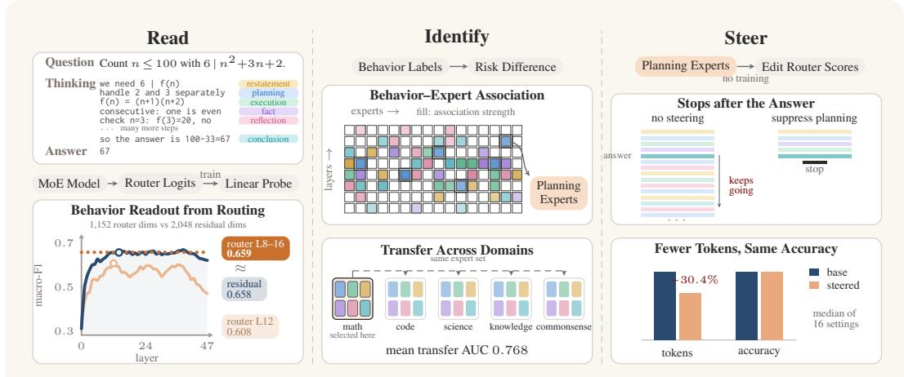
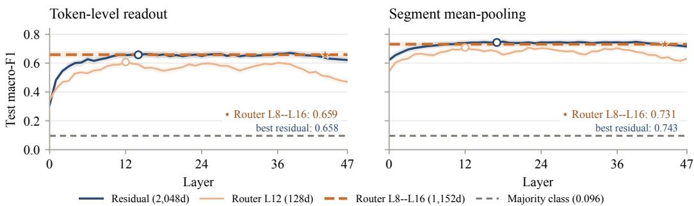
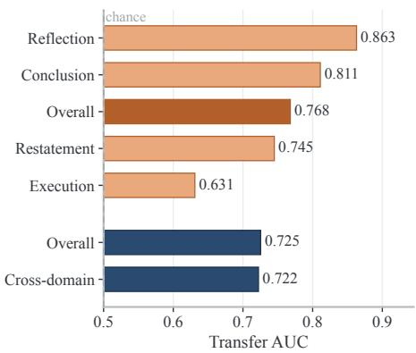
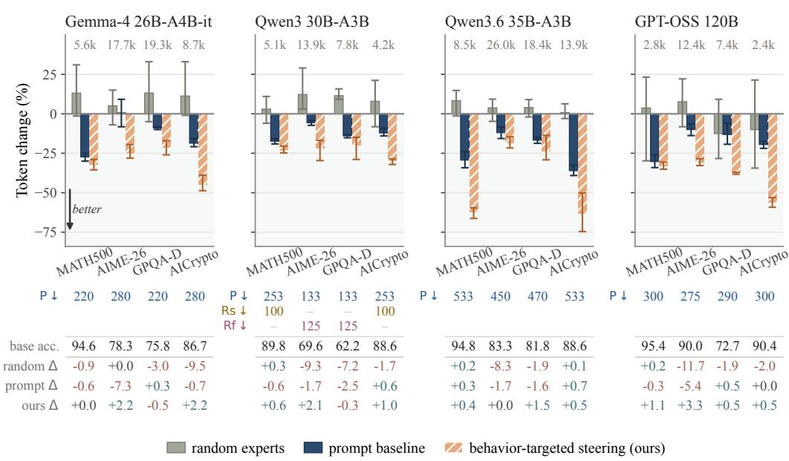
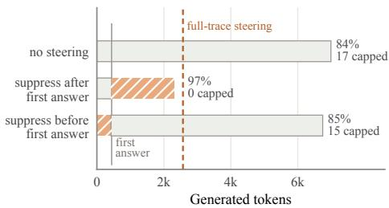
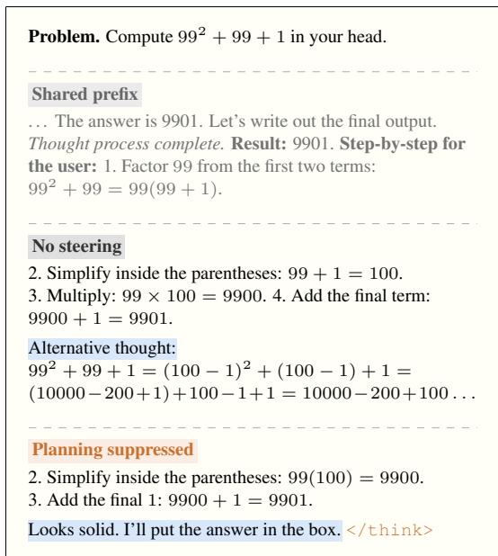
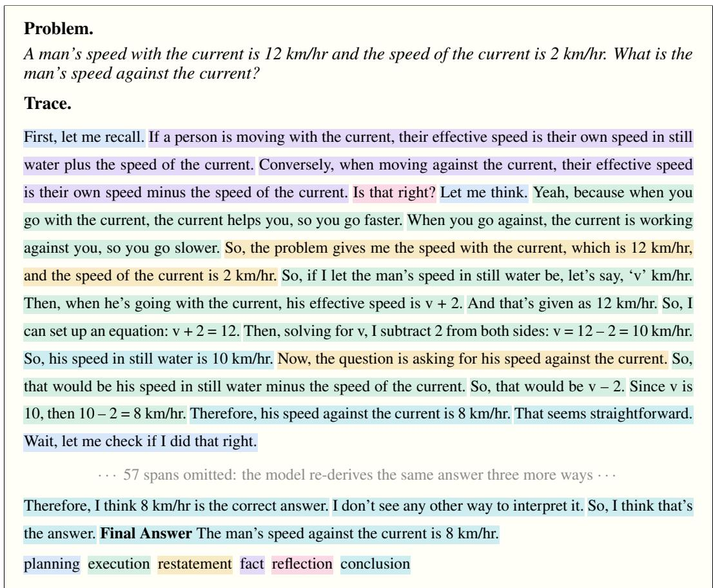

# ROUTES OF REASONING: READING AND RESHAPINGTEST-TIME COMPUTE IN MOE MODELS

Shengjie Wang, Mohsen Fayyaz, Nanyun Peng University of California, Los Angeles

## ABSTRACT

Reasoning models allocate test-time compute across distinct behaviors such as planning, deriving, and verifying. However, models frequently “overthink,” continuing to verify and re-derive long after finding a correct answer. This wastes expensive compute and can even degrade performance. Existing interventions, such as token budgets or steering, primarily regulate reasoning duration rather than targeting specific behaviors. In this work, we demonstrate that Mixture-of-Experts (MoE) routers provide a natural, training-free interface for behavioral control. We first split reasoning traces into sentence-level segments and label each with one of six reasoning behaviors (planning, execution, restatement, fact, reflection, and conclusion), so that every token carries the behavior of its segment. Linear probes on router logits predict this label nearly as well as probes on the residual stream, the model’s full hidden state and the standard target for probing, while using about half as many features. These signals generalize: experts associated with a reasoning behavior on one dataset predict the same behavior on the others, across six datasets spanning five domains (math, code, science, knowledge, and commonsense). Building on this, we selectively edit expert router scores during inference to curb overthinking. Across four models and four benchmarks, this intervention reduces the number of generated tokens by a median of 30.4% (and up to 63.3%). Crucially, it encourages the model to stop once the problem is solved, rather than skipping essential reasoning steps. Accuracy never drops by more than 0.5 percentage points, and frequently improves. Ultimately, MoE routing offers both an interpretable lens into reasoning states and a lightweight mechanism for optimizing test-time compute.

## 1 INTRODUCTION

Reasoning models use additional computation at test time to solve difficult problems (DeepSeek-AI et al., 2025; Qwen Team, 2025; OpenAI, 2025). Within a single response, that computation can serve different purposes: planning an approach, carrying out a derivation, recalling a fact, or checking an earlier result. How computation is allocated therefore matters as much as how much is spent. Models can also overthink: after reaching a correct answer, they continue to verify and re-derive it, spending tokens without advancing the solution (Chen et al., 2025b; Sui et al., 2025). Addressing this waste requires more than measuring trace length. We need to relate what the model is doing to the computational components it uses.

In this work, we demonstrate that sparse Mixture-of-Experts (MoE) models offer a natural internal view of this allocation. At each layer, a router selects a small subset of experts for every token. Prior work has found strong token dependence in routing (Xue et al., 2024), semantic structure in router decisions (Olson et al., 2025), and expert-mediated behavior control (Dahlke et al., 2025). We ask a finer-grained question: does routing distinguish the functional role of a reasoning span, such as planning or reflection, as that role changes within a problem?

A positive answer alone would not establish a useful control interface. Router states might reflect lexical cues or dataset identity rather than reasoning behavior; similarly, an expert set associated with a behavior might not remain associated outside the data on which it was observed. We therefore study a sequence of increasingly demanding questions: can routing read out reasoning behavior, do behavior–expert associations persist across domains, and can they guide useful test-time interventions?

  
Figure 1: Overview. Read: router logits reveal the behavior of each reasoning step (Section 4). Identify: behavior-associated experts recur across domains (Section 5). Steer: editing behaviorassociated experts reduces generated tokens while largely preserving accuracy (Section 6).

First, we annotate reasoning traces with six behaviors and test whether router states expose the behavior of the current reasoning step. In Qwen3-30B-A3B, a compact linear router readout approaches a probe on the substantially wider residual stream. This establishes routing as a practical observation point for reasoning behavior (Section 4).

Next, we ask whether these associations are tied to one dataset or reflect a more stable organization of the model. Behavior-associated expert profiles recur across six datasets spanning mathematics, code, science, knowledge, and commonsense; expert sets selected on one source also predict behavior on held-out domains (Section 5).

Finally, we use development-selected behavior-associated expert sets to steer routing at inference time. Across four MoE models and four benchmarks, the selected interventions curb overthinking, reducing generated tokens by a median of 30.4% (up to 63.3%) while accuracy drops by at most 0.5 points, and outperform equally sized random edits and a brevity prompt (Section 6). We further analyze why suppressing planning-associated experts is effective and where in a trace the saving comes from (Section 6.4).

## 2 RELATED WORK

Test-time reasoning and efficiency. Reasoning models use extended generations to support multistep problem solving (DeepSeek-AI et al., 2025; Qwen Team, 2025), but trace length alone does not determine reasoning quality: both redundant computation and premature switching between solution paths can hurt efficiency (Chen et al., 2025b; Wang et al., 2025c; Sui et al., 2025). Existing approaches control token budgets through prompting and decoding (Han et al., 2025; Muennighoff et al., 2025), learn length-constrained policies (Aggarwal & Welleck, 2025), or edit weights to mitigate overly short reasoning (Sun et al., 2025). Closely related, SEAL distinguishes execution, reflection, and transition thoughts and calibrates reasoning through activation steering (Chen et al., 2025a). Our work shares this interest in the composition of reasoning, but studies MoE routing as the interface for reading behavior and selecting intervention targets.

Interpreting expert specialization. Analyses of open MoE models document token-dependent routing and expert specialization (Xue et al., 2024; Muennighoff et al., 2024). Other studies examine sensitivity to input semantics and collaboration among experts (Olson et al., 2025; Tang et al., 2025), or show that routing is language-specific in early and late layers but aligned across languages in the middle layers (Bandarkar et al., 2026). Complementary work uses sparse autoencoders to study features within reasoning-model activations (Hazra et al., 2025). These perspectives motivate distinguishing a span’s functional role from its vocabulary or topic. We align six reasoning-behavior labels with routing states and compare router-logit probes with residual-stream probes, then use behavior associations to identify candidate layer–expert pairs for intervention.

Inference-time expert steering. Expert selection and weighting are established targets for inference-time control (Dahlke et al., 2025; Li et al., 2025; Wang et al., 2025a; Fayyaz et al., 2026). C3PO optimizes expert mixing using reference examples, while RICE reinforces cognitive experts associated with thinking markers through normalized pointwise mutual information (Li et al., 2025; Wang et al., 2025a). SteerMoE selects experts from activation-frequency differences between contrasting inputs and activates or deactivates them to control behaviors including safety and faithfulness (Fayyaz et al., 2026), and promoting middle-layer experts that are frequently used in English improves multilingual performance (Bandarkar et al., 2026). Our intervention follows this expert (de)activation interface. What differs is how the experts are chosen, by their association with reasoning behaviors annotated in the model’s own traces, and what we measure: the effect on reasoning length and accuracy, and on where in a trace the saving arises.

## 3 BACKGROUND AND PROBLEM SETUP

We define reasoning behaviors and their alignment with sparse expert routing, providing the shared representations used for behavior readout and expert identification.

## 3.1 SPARSE MIXTURE-OF-EXPERTS ROUTING

An MoE layer replaces the dense feed-forward sublayer with $n _ { r }$ routed experts and, in some models, $n _ { s }$ always-active shared experts (Shazeer et al., 2017; Dai et al., 2024). For token representation $h _ { t } ^ { ( \ell ) }$ the router produces logits $\hat { z } _ { t } ^ { ( \ell ) } = W _ { r } ^ { ( \ell ) } h _ { t } ^ { ( \ell ) }$ and selects the k highest-probability routed experts,

$$
p _ { t } ^ { ( \ell ) } = \mathrm { s o f t m a x } \big ( z _ { t } ^ { ( \ell ) } \big ) , \qquad S _ { t } ^ { ( \ell ) } = \mathrm { T o p } - K \big ( p _ { t } ^ { ( \ell ) } , k \big ) , \qquad \big | S _ { t } ^ { ( \ell ) } \big | = k \ll n _ { r } ,\tag{1}
$$

The retained probabilities are renormalized into gate weights $\begin{array} { r } { g _ { t , e } ^ { ( \ell ) } = p _ { t , e } ^ { ( \ell ) } / \sum _ { j \in S _ { t } ^ { ( \ell ) } } p _ { t , j } ^ { ( \ell ) } } \end{array}$ , and the layer output is

$$
\mathrm { M o E } ^ { ( \ell ) } \bigl ( h _ { t } ^ { ( \ell ) } \bigr ) = \sum _ { e \in S _ { t } ^ { ( \ell ) } } g _ { t , e } ^ { ( \ell ) } E _ { e } ^ { ( \ell ) } \bigl ( h _ { t } ^ { ( \ell ) } \bigr ) + \sum _ { j = 1 } ^ { n _ { s } } E _ { j } ^ { ( s , \ell ) } \bigl ( h _ { t } ^ { ( \ell ) } \bigr ) .\tag{2}
$$

We call the token–layer sequence of $( z _ { t } ^ { ( \ell ) } , S _ { t } ^ { ( \ell ) } , g _ { t } ^ { ( \ell ) } )$ the routing trace. Expert identities are layerand model-specific. The second term of Eq. (2) holds the always-active shared experts, which the sparse router does not select, so we exclude them from routing analysis.

## 3.2 REASONING BEHAVIORS AND ANNOTATION

We characterize a reasoning span by its functional role in solving the problem. The six behaviors in Table 1 distinguish proposing an approach, carrying out an inference, and evaluating previous work, alongside restatement, fact recall, and conclusion.

These labels describe local functions, not positions in a fixed sequence. Planning can resume after an unsuccessful derivation, and reflection can occur before an intermediate conclusion. The distinction is contextual: the same equation may introduce a new deduction, recall a known fact, or repeat an earlier result.

For a response $x _ { 1 : T } .$ , segmentation yields contiguous spans $s _ { m } = x _ { a _ { m } : b _ { m } }$ . An LLM

Table 1: Six reasoning behaviors.
<table><tr><td>Behavior</td><td>What the segment does</td></tr><tr><td>planning</td><td>proposes how to proceed</td></tr><tr><td>execution</td><td>derives a new result</td></tr><tr><td>restatement fact</td><td>repeats without new inference invokes established knowledge</td></tr><tr><td>reflection</td><td></td></tr><tr><td></td><td>checks or revises earlier work</td></tr><tr><td>conclusion</td><td>states a result or closes a subgoal</td></tr></table>

judge (GPT-5.5) assigns each span a label $y _ { m } \in \mathcal { D }$ using the full trace as context. Labels describe the role of the written reasoning, rather than whether its claims are correct. We align span boundaries with the model’s tokenizer and assign $y _ { t } = y _ { m }$ for $a _ { m } \leq t \leq b _ { m }$ , pairing text-derived labels with the corresponding routing states. Segmentation settings are specified with each experiment; the annotation protocol and codebook appear in Appendix B.1. This separates the annotation unit from the temporal window used to aggregate features for probing.

## 3.3 ROUTING REPRESENTATIONS

We use two complementary views of routing. For behavior readout (Section 4), continuous pretop-k logits $z _ { t } ^ { ( \ell ) }$ retain scores for every routed expert, including those not selected. For expert identification (Section 5), we use post-top-k selection indicators to measure participation in the executed computation:

$$
r _ { t , e } ^ { ( \ell ) } = \left\{ { 1 , \mathrm { ~ } e \in S _ { t } ^ { ( \ell ) } , } \right.\tag{3}
$$

We average these features within each annotated segment, retaining layer identity. Readout comparisons select one layer on development data; expert profiles are analyzed separately at each layer.

## 4 READING REASONING THROUGH THE ROUTER

Can the router reveal the kind of reasoning a model is performing? The answer decides whether the rest of this paper is possible: if routing carries the current behavior, then the experts it selects are candidate handles on that behavior. We study the question in Qwen3-30B-A3B and establish three things. Behavior is readable from routing at individual tokens; a few router layers carry as much of it as the residual stream; and what the probe reads is not a shortcut through surface wording.

## 4.1 PROBE SETUP

We generate 330 traces on a mixture of GSM8K (Cobbe et al., 2021), NuminaMath (Li et al., 2024), and AIME 2023 (Art of Problem Solving, n.d.) problems, yielding 78,955 labeled sentence- or clause-level segments. Problems are split into train, dev, and test sets (Table 2; Appendix B.1). Each token inherits its segment’s behavior label. We extract its 128 pre-top-k router logits at each of the 48 layers, subtract their within-token mean, and fit an L2-regularized multinomial logistic probe. Regularization and layer are selected on dev; we report held-out macro-F1 with problem-bootstrap 95% confidence intervals (Appendix C.1).

## 4.2 REASONING BEHAVIOR IS DECODABLE FROM ROUTING

Readable at a single token. We first predict a token’s behavior from its own router state at one layer, with no pooling and no neighboring context. The dev-selected layer, L12 (layer indices are zero-based), reaches 0.608 macro-F1 on held-out tokens (95% CI [0.584, 0.630]), far above the 0.096 obtained by always predicting the most frequent behavior. The 128 scores a router assigns to its experts already indicate what the model is doing.

A few router layers match the residual stream. How much does this compact state leave out? We repeat the scan on 2,048-dimensional residual states at the same token positions, with the same split, preprocessing, and tuning budget. The best residual layer, L14, reaches 0.658, five points above one router layer (Figure 2a). Concatenating the router logits of a prespecified nine-layer window around L12 (L8–L16) closes the gap: the 1,152-dimensional readout reaches 0.659, a paired gain of 5.1 points over one router layer (95% CI [4.1, 6.1]) and within 0.1 points of the residual stream ([−0.8, 1.0]) at 56% of its width. Parity therefore requires combining layers; a single router layer carries most, but not all, of the signal. The match is not an artifact of drawing on more layers: residual states from the same nine layers, compressed to the same 1,152 dimensions, reach 0.657, and the result is insensitive to the window width (Appendix C.2).

  
Figure 2: Linear behavior readout. Curves use one layer; circles mark dev-selected layers. The dashed line concatenates router L8–L16. Bands: 95% problem-bootstrap CIs.

## 4.3 NOT A SHORTCUT THROUGH SURFACE WORDING

A probe could score well by keying on phrases that announce a behavior, such as “Wait” or “Let $m e ^ { \prime \prime }$ . Two checks argue against this. First, routing beats readouts built from the text itself: in a segment-level comparison with the same neighboring context, router features reach 0.709, above input embeddings (0.624), lexical TF-IDF (0.566), and trace position (0.124). Second, the signal does not live in a segment’s opening words. On segments with at least six tokens, pooling the router states after dropping the first five tokens still gives 0.677, above the 0.626 obtained from those five tokens alone and close to the 0.693 of the full segment.

Reading a whole segment. Pooling router states within a segment turns the token readout into a segment readout. Mean pooling at L12 reaches 0.708, and pooling the nine-layer window reaches 0.731, close to the 0.743 of the best residual layer (Figure 2b). Other pooling and voting schemes are compared in Appendix C.2.

Takeaway. Which experts the router selects reveals which behavior the model is engaged in, compactly and beyond surface wording. Section 5 asks which experts carry this signal.

## 5 IDENTIFYING REASONING EXPERTS

Can behavior-associated experts be identified beyond the dataset on which they were observed? We analyze 1,980 Qwen3-30B-A3B traces: 330 each from the mathematical mixture above, MATH500 (Hendrycks et al., 2021), LiveCodeBench (Jain et al., 2024), GPQA (non-Diamond) (Rein et al., 2024), MMLU-Pro (Wang et al., 2024), and CommonsenseQA (Talmor et al., 2019). Together these cover mathematics, code, science, knowledge, and commonsense.

## 5.1 BEHAVIOR–EXPERT ASSOCIATION

At each layer, we rank experts by the absolute increase in selection probability for behavior b relative to dataset d overall. This risk difference measures behavior-specific recruitment:

$$
a _ { b , d , e } ^ { ( \ell ) } = p ( e \mathrm { s e l e c t e d } \mid b , d , \ell ) - p ( e \mathrm { s e l e c t e d } \mid d , \ell ) .\tag{4}
$$

This controls for differences in baseline expert usage across datasets. We compare the resulting 128-expert profiles for the same versus different behaviors, and use within-trace label permutations as a null. Layer 12, selected by the largest same-minus-different behavior correlation gap, has same-behavior correlation 0.729, while different-behavior correlation is −0.107, indicating more consistent profiles within than across behaviors. Top-10 sets have mean cross-dataset Jaccard 0.511, compared with a permuted-label null of 0.202. For each of planning, reflection, and conclusion, six of the top ten experts are shared by all six datasets. These sets carry 15%–23% of routing mass, connecting behavioral association to substantial participation in the routed computation.

## 5.2 BEHAVIOR-ASSOCIATED EXPERTS TRANSFER ACROSS DOMAINS

We select a behavior’s top-10 experts on a source dataset and use their selection frequency to rank segments on a different dataset, without using target labels to select the set. At layer 36, mean source-to-target AUC is 0.768. Reflection and conclusion transfer particularly well (0.863 and 0.811), followed by restatement (0.745); execution is weaker at 0.631 (Figure 3).

After removing the first five tokens of each eligible segment, overall AUC remains 0.7254, with crossdomain AUC 0.7223. This suggests that opening markers alone do not explain transfer, although lexical cues elsewhere and changes in the eligible segment population remain possible. Separately, a linear probe using only expert-selection fractions from four layers transfers across domains at 0.561 macro-F1, compared with 0.701 on held-out traces within a dataset and 0.096 for a majority-class baseline. The routing signature therefore supports both expert-set ranking and supervised behavior classification beyond the source domain.

## 6 STEERING EXPERIMENTS

## 6.1 THE STEERING

## OPERATOR: ACTIVATION AND DEACTIVATION

Figure 3: Expert-set transfer at layer 36. Rose: overall AUC and four reported behaviors on full segments. Blue-gray: the same ranking after dropping the first five tokens of each segment. Dashed line: chance.

We steer a chosen expert set by modifying router scores at inference time, without updating model parameters. Following Fayyaz et al. (2026), we first map raw logits to log-probabilities,

$$
s _ { t } ^ { ( \ell ) } = \log \mathrm { s o f t m a x } \Big ( z _ { t } ^ { ( \ell ) } \Big ) ,\tag{5}
$$

Let $A _ { + } ^ { ( m , \ell ) }$ and $A _ { - } ^ { ( m , \ell ) }$ denote disjoint expert sets to activate and deactivate in layer ℓ during segment m. With $\begin{array} { r } { s _ { t , \mathrm { m a x } } ^ { ( \ell ) } = \operatorname* { m a x } _ { j } s _ { t , j } ^ { ( \ell ) } , s _ { t , \mathrm { m i n } } ^ { ( \ell ) } = \operatorname* { m i n } _ { j } s _ { t , j } ^ { ( \ell ) } } \end{array}$ , and margin $\epsilon > 0$ , we set

$$
\begin{array} { r } { \widetilde { s } _ { t , e } ^ { ( \ell ) } = \left\{ \begin{array} { l l } { s _ { t , \mathrm { m a x } } ^ { ( \ell ) } + \epsilon , } & { e \in A _ { + } ^ { ( m , \ell ) } , } \\ { s _ { t , \mathrm { m i n } } ^ { ( \ell ) } - \epsilon , } & { e \in A _ { - } ^ { ( m , \ell ) } , } \\ { s _ { t , e } ^ { ( \ell ) } , } & { \mathrm { o t h e r w i s e } . } \end{array} \right. } \end{array}\tag{6}
$$

The model then recomputes its standard softmax, top-k set, and gate normalization. Provided at most k experts are activated and at least k remain eligible, the activated experts enter and the deactivated experts leave the routed computation. Shared experts remain unchanged. Appendix E.1 gives the complete computation; expert sets and intervention schedules are specified in Section 6.2.

## 6.2 STEERING SETUP

Benchmark selection. Our benchmarks test whether behavior-targeted steering generalizes across problem difficulty and beyond pure mathematics. The mathematics benchmarks form a difficulty progression: MATH500 (Hendrycks et al., 2021) is competition-level, while AIME 2026 (Art of Problem Solving, n.d.) provides a more challenging competition setting. GPQA-Diamond (Rein et al., 2024) and AICrypto (Wang et al., 2025b) then extend the evaluation to scientific and cryptographic reasoning, respectively. For each benchmark, we choose which experts to steer, and how many, on a development split disjoint from the test set, comparing individual experts and multiexpert combinations. Appendix E.1.2 lists each development set, seed count, and token budget.

Model selection. We evaluate four open-weight MoE reasoning models: Gemma-4 (Gemma Team, 2026), two generations of Qwen3 (Qwen Team, 2025; 2026), and GPT-OSS (OpenAI, 2025).

  
Figure 4: Efficiency. Token change relative to the unmodified model; the table reports baseline accuracy and accuracy changes, with baseline tokens in gray. Rows above give each edit: behavior (P planning, Rf reflection, and Rs restatement), direction, and number of layer–expert pairs.

As summarized in Table 6 (Appendix E.1.1), they differ in routed-expert pool size, routing sparsity, and the use of shared experts. This architectural diversity tests whether behavior-targeted steering generalizes beyond a single MoE design.

Evaluation setup. MATH500 and AIME answers are graded by DeepSeek-V4 Flash as a judge; the multiple-choice answers of GPQA-Diamond and AICrypto are matched against the reference by rule (Appendix E.1.2). Efficiency is measured by the number of reasoning and total generated tokens under each model’s native tokenizer.

Baselines. We compare behavior-targeted steering against three baselines:

• Unmodified model: the same model with standard routing and decoding.

• Random experts: for each development-selected configuration, an equally sized random expert set receives the same intervention direction. For example, suppressing 200 planning-associated experts is compared with suppressing 200 randomly selected experts.

• Prompt baseline: routing is unchanged, and a system instruction asks the model to keep its reasoning concise and skip unnecessary re-checks (Appendix E.1.3).

## 6.3 REDUCING TOKEN USE WHILE PRESERVING ACCURACY

Selected expert sets shorten reasoning. We select each configuration on the development split and fix it for test evaluation. Steering reduces generated tokens in all sixteen model–benchmark settings by a median of 30.4% and by up to 63.3% (Qwen3.6 on AICrypto; Figure 4). Accuracy is unchanged or higher in fourteen settings and decreases by at most 0.5 percentage points in the other two. Behavior associations thus guide useful interventions, although they do not by themselves establish what an expert causally controls.

Savings are largest where overthinking is. Models waste the most compute when they reach a solution quickly and spend thousands of tokens looking for confirmation. Steering cuts nearly twice as deep on the less demanding MATH500 and AICrypto benchmarks as it does on AIME and

GPQA-Diamond (43.2% vs. 24.9% on average). On AIME, shutting down these circular re-checks even raises accuracy by 2.1 to 3.3 points in three of the four models.

Which experts are edited matters. We apply the same intervention to equally sized random expert sets. Random interventions increase token generation in 14 of 16 settings while often degrading accuracy, so the savings come from the selected experts rather than from perturbing the router in general.

Steering beats a brevity prompt. A natural alternative to internal interventions is simply asking the model, through a system instruction, to keep its reasoning concise and skip unnecessary rechecks. Yet routing interventions save more tokens than this prompt in all 16 settings and match or exceed its accuracy in 14 (Appendix E.2.1). Consistent with prior findings that reasoning models routinely ignore prompt-level length and behavioral constraints (Fu et al., 2026; Kwon et al., 2025), natural-language instructions struggle to override the extended verification habits ingrained during post-training (Yueh-Han et al., 2026; DeepSeek-AI et al., 2025; Gandhi et al., 2025). Breaking those habits requires intervening directly on the router, yet Figure 4 reveals a surprising pattern: every selected expert set suppresses planning. We examine why next.

## 6.4 WHY DOES SUPPRESSING PLANNING WORK?

At first glance, overthinking seems to be an excess of verification, so the natural target is reflection: the “Wait, let me double-check” sentences that fill a long trace, and the behavior prior work steers away from (Chen et al., 2025a). Also, restatement looks like pure repetition, and trimming execution should shorten the derivation itself. Planning, by contrast, looks like the one behavior a model cannot do without. The data say otherwise. On 100 MATH500 problems with Qwen3-30B-A3B, suppressing 200 planning experts cuts generated tokens by 22%, whereas suppressing reflection or restatement experts lengthens traces (by 5% and 1%;

  
unmodified routing planning experts suppressed  
Figure 5: Cut at the first answer.

the latter more than doubles the rounds of checking after the answer), and suppressing execution experts lengthens them by 52% or, applied more strongly, drops accuracy to 40% (Appendix E.2.2).

Only planning shortens the trace. A long trace typically reaches its answer early and then checks it again and again (Figure 7), each round announced by a fresh plan: “Let me check again.” “Alternatively, let me compute it directly.” “Another check:” Suppressing each behavior acts on these rounds of checking differently:

<table><tr><td></td><td>Suppress</td><td>Re-checks</td><td>Why</td></tr><tr><td></td><td>planning</td><td>fewer</td><td>The next plan wraps up instead of opening a new round. Doubts no longer turn into recomputation, and the model stops after its answer.</td></tr><tr><td></td><td>X reflection</td><td>same</td><td>The model voices fewer doubts, but planning is intact. Since planning launches each round, the rounds still run and the model keeps verifying.</td></tr><tr><td></td><td>× restatement</td><td>more</td><td>The model can no longer reuse results from earlier steps. It re-derives them instead, and each re-derivation invites another check.</td></tr><tr><td>×</td><td>execution</td><td>same</td><td>The model loses fluency in simple arithmetic. The rounds remain but each step slows, and heavy suppression can prevent an answer.</td></tr></table>

Core intuition. Every round of checking starts with a plan. Suppressing planning does not stop the model from planning; it turns the next plan from opening another round into wrapping up, so whole rounds disappear together with the behaviors inside them.

The change happens after the first answer. If planning mainly starts re-checks of an answer the model already has, suppressing it should leave the reasoning before that answer intact and act only after it. The unmodified models reach a first answer early, at a median of 8% of the trace on Qwen3.6, 11% on Qwen3, and 21% on Gemma-4, and 82–88% of their planning sentences come after it. To separate the two parts of a trace, we cut each Qwen3.6 trace on the first 100 MATH500 problems right after its first answer and steer only one side of the cut (Figure 5; Appendix E.2.5). Before the cut, suppression leaves the reasoning almost untouched: the steered model reaches its first answer after 422 tokens instead of 441, and what follows is as long as without steering. After the cut, suppression alone reproduces the effect of steering the whole trace and raises accuracy from 84% to 97%. This shows that planning suppression primarily acts on post-answer computation rather than the reasoning that produces the first answer.

  
Figure 6: Same prefix and seed, different next plan. More in Appendix E.2.3.

Suppression redirects the next plan. The cut shows where steering acts, but not what the model does instead. In the same unmodified Qwen3.6 traces we find 314 points after the first answer where a new stage is about to begin, rewind by one stage (about 16 tokens), and regenerate the next ∼170 tokens twice with the same seed, once with unmodified routing and once with the planning experts suppressed. Suppression does not silence planning; what changes is what the model plans (Figure 6). With unmodified routing, the first plan is as likely to open a new angle (“Alternative thought:”) as to wrap up (23 against 23; Table 9); with the planning experts suppressed, wrap-ups outnumber new angles 68 to 11, and the model ends its thinking (</think>) within these ∼170 tokens 17% of the time instead of 5%. Suppressing only the stage before it still tilts the first plan toward wrapping up (43 against 21) but barely changes how often thinking ends (6% against 5%): once suppression lifts, the postponed check comes back (Appendix E.2.4). Therefore, steering

shortens reasoning by keeping the model’s next plan pointed at finishing, which is why it has to stay on after the answer.

## 7 DISCUSSION AND CONCLUSIONS

This paper asks three questions: whether the router of a Mixture-of-Experts model reveals what a reasoning model is doing, whether that signal generalizes across domains, and whether it can be used to control the model’s reasoning. Linear probes on router logits recover six reasoning behaviors about as accurately as probes on the residual stream (macro-F1 0.659 vs. 0.658) while using about half as many features, and the experts associated with each behavior transfer across five domains (mean AUC 0.768). Steering these experts at inference time, without training, reduces generated tokens by a median of 30.4% across four models and four benchmarks, with accuracy dropping by at most 0.5 points.

The savings do not come from removing a single type of reasoning. Among the behaviors we target, only suppressing planning-associated experts consistently shortens traces, and it does so not by preventing the model from planning but by redirecting its next plan from opening another round of checking toward wrapping up. MoE routing thus provides both an interpretable signal of a model’s reasoning and a training-free mechanism for steering how much computation it spends. Limitations are discussed in Appendix A. Future work can test whether the same experts govern reasoning in longer-horizon and agentic tasks.

## REFERENCES

Pranjal Aggarwal and Sean Welleck. L1: Controlling how long a reasoning model thinks with reinforcement learning. In Conference on Language Modeling, 2025. URL https: //openreview.net/forum?id=4jdIxXBNve.

Art of Problem Solving. AIME Problems and Solutions. AoPS Wiki, n.d. URL https://artofproblemsolving.com/wiki/index.php/AIME\_Problems\_ and\_Solutions. Accessed: 2026-05-14.

Lucas Bandarkar, Chenyuan Yang, Mohsen Fayyaz, Junlin Hu, and Nanyun Peng. Multilingual routing in mixture-of-experts. In The Fourteenth International Conference on Learning Representations (ICLR), 2026. URL https://mlanthology.org/iclr/2026/ bandarkar2026iclr-multilingual/.

Runjin Chen, Zhenyu Zhang, Junyuan Hong, Souvik Kundu, and Zhangyang Wang. SEAL: Steerable reasoning calibration of large language models for free. arXiv preprint arXiv:2504.07986, 2025a. URL https://arxiv.org/abs/2504.07986.

Xingyu Chen, Jiahao Xu, Tian Liang, Zhiwei He, Jianhui Pang, Dian Yu, Linfeng Song, Qiuzhi Liu, Mengfei Zhou, Zhuosheng Zhang, Rui Wang, Zhaopeng Tu, Haitao Mi, and Dong Yu. Do NOT Think That Much for 2+3=? On the Overthinking of Long Reasoning Models. In Proceedings of the 42nd International Conference on Machine Learning, pp. 9487–9499, 2025b. URL https: //proceedings.mlr.press/v267/chen25bx.html.

Karl Cobbe, Vineet Kosaraju, Mohammad Bavarian, Mark Chen, Heewoo Jun, Lukasz Kaiser, Matthias Plappert, Jerry Tworek, Jacob Hilton, Reiichiro Nakano, Christopher Hesse, and John Schulman. Training verifiers to solve math word problems. arXiv preprint arXiv:2110.14168, 2021. URL https://arxiv.org/abs/2110.14168.

Robert Dahlke, Henrik Klagges, Dan Zecha, Benjamin Merkel, Sven Rohr, and Fabian Klemm. Mixture of tunable experts–behavior modification of DeepSeek-R1 at inference time. arXiv preprint arXiv:2502.11096, 2025. URL https://arxiv.org/abs/2502.11096.

Damai Dai, Chengqi Deng, Chenggang Zhao, R.X. Xu, Huazuo Gao, Deli Chen, Jiashi Li, Wangding Zeng, Xingkai Yu, Y. Wu, Zhenda Xie, Y.K. Li, Panpan Huang, Fuli Luo, Chong Ruan, Zhifang Sui, and Wenfeng Liang. DeepSeekMoE: Towards ultimate expert specialization in mixture-ofexperts language models. In Proceedings of the 62nd Annual Meeting of the Association for Computational Linguistics (Volume 1: Long Papers), pp. 1280–1297, 2024. doi: 10.18653/v1/ 2024.acl-long.70. URL https://aclanthology.org/2024.acl-long.70/.

DeepSeek-AI, Daya Guo, Dejian Yang, Haowei Zhang, Junxiao Song, Ruoyu Zhang, Runxin Xu, Qihao Zhu, Shirong Ma, Peiyi Wang, Xiao Bi, et al. DeepSeek-R1: Incentivizing reasoning capability in LLMs via reinforcement learning. arXiv preprint arXiv:2501.12948, 2025. URL https://arxiv.org/abs/2501.12948v1.

Mohsen Fayyaz, Ali Modarressi, Hanieh Deilamsalehy, Franck Dernoncourt, Ryan Rossi, Trung Bui, Hinrich Schütze, and Nanyun Peng. Steering MoE LLMs via Expert (De)Activation. In International Conference on Learning Representations, 2026. URL https://openreview. net/forum?id=v5Yl9V8rJs.

Tingchen Fu, Yafu Li, Jiawei Gu, Xiaoye Qu, and Yu Cheng. Scaling Reasoning, Losing Control: Evaluating Instruction Following in Large Reasoning Models. In Proceedings ofthe 64th Annual Meeting of the Association for Computational Linguistics (Volume 1: Long Papers), pp. 40445– 40463, 2026. URL https://aclanthology.org/2026.acl-long.1878/.

Kanishk Gandhi, Ayush Chakravarthy, Anikait Singh, Nathan Lile, and Noah D. Goodman. Cognitive Behaviors that Enable Self-Improving Reasoners, or, Four Habits of Highly Effective STaRs. In Conference on Language Modeling, 2025. URL https://openreview.net/forum? id=QGJ9ttXLTy.

Gemma Team. Gemma 4 Technical Report. arXiv preprint arXiv:2607.02770, 2026. URL https: //arxiv.org/abs/2607.02770.

Tingxu Han, Zhenting Wang, Chunrong Fang, Shiyu Zhao, Shiqing Ma, and Zhenyu Chen. Tokenbudget-aware LLM reasoning. In Findings of the Association for Computational Linguistics: ACL 2025, pp. 24842–24855, 2025. URL https://aclanthology.org/2025. findings-acl.1274/.

Dron Hazra, Max Loeffler, Murat Cubuktepe, Levon Avagyan, Liv Gorton, Mark Bissell, Owen Lewis, Thomas McGrath, and Daniel Balsam. Under the hood of a reasoning model. Goodfire research blog, https://www.goodfire.com/research under-the-hood-of-a-reasoning-model, 2025.

Dan Hendrycks, Collin Burns, Saurav Kadavath, Akul Arora, Steven Basart, Eric Tang, Dawn Song, and Jacob Steinhardt. Measuring mathematical problem solving with the MATH dataset. In Proceedings of the Neural Information Processing Systems Track on Datasets and Benchmarks, volume 1, 2021. URL https: //datasets-benchmarks-proceedings.neurips.cc/paper\_files/paper/ 2021/hash/be83ab3ecd0db773eb2dc1b0a17836a1-Abstract-round2.html.

Naman Jain, King Han, Alex Gu, Wen-Ding Li, Fanjia Yan, Tianjun Zhang, Sida Wang, Armando Solar-Lezama, Koushik Sen, and Ion Stoica. LiveCodeBench: Holistic and Contamination Free Evaluation of Large Language Models for Code. arXiv preprint arXiv:2403.07974, 2024. URL https://arxiv.org/abs/2403.07974.

Yongchan Kwon, Shang Zhu, Federico Bianchi, Kaitlyn Zhou, and James Zou. ReasonIF: Large Reasoning Models Fail to Follow Instructions During Reasoning. arXiv preprint arXiv:2510.15211, 2025. URL https://arxiv.org/abs/2510.15211.

Jia Li, Edward Beeching, Lewis Tunstall, Ben Lipkin, Roman Soletskyi, Shengyi Costa Huang, Kashif Rasul, Longhui Yu, Albert Jiang, Ziju Shen, Zihan Qin, Bin Dong, Li Zhou, Yann Fleureau, Guillaume Lample, and Stanislas Polu. NuminaMath. Numina, Hugging Face dataset, 2024. URL https://huggingface.co/datasets/AI-MO/NuminaMath-CoT.

Zhongyang Li, Ziyue Li, and Tianyi Zhou. C3PO: Critical-layer, core-expert, collaborative pathway optimization for test-time expert re-mixing. In Conference on Language Modeling, 2025. URL https://arxiv.org/abs/2504.07964.

Niklas Muennighoff, Luca Soldaini, Dirk Groeneveld, Kyle Lo, Jacob Morrison, Sewon Min, Weijia Shi, Pete Walsh, Oyvind Tafjord, Nathan Lambert, et al. OLMoE: Open mixture-of-experts language models. arXiv preprint arXiv:2409.02060, 2024. URL https://arxiv.org/abs/ 2409.02060.

Niklas Muennighoff, Zitong Yang, Weijia Shi, Xiang Lisa Li, Fei-Fei Li, Hannaneh Hajishirzi, Luke Zettlemoyer, Percy Liang, Emmanuel Candès, and Tatsunori Hashimoto. s1: Simple testtime scaling. In Proceedings of the 2025 Conference on Empirical Methods in Natural Lan guage Processing, pp. 20275–20321, 2025. URL https://aclanthology.org/2025. emnlp-main.1025/.

Matthew Lyle Olson, Neale Ratzlaff, Musashi Hinck, Man Luo, Sungduk Yu, Chendi Xue, and Vasudev Lal. Probing Semantic Routing in Large Mixture-of-Expert Models. arXiv preprint arXiv:2502.10928, 2025. URL https://arxiv.org/abs/2502.10928.

OpenAI. Introducing gpt-oss. https://openai.com/index/introducing-gpt-oss/, 2025.

Qwen Team. Qwen3: Think deeper, act faster. https://qwenlm.github.io/blog/ qwen3/, 2025.

Qwen Team. Qwen3.6-35B-A3B: Agentic Coding Power, Now Open to All, April 2026. URL https://www.alibabacloud.com/help/en/model-studio/ qwen3-6-35b-a3b.

David Rein, Betty Li Hou, Asa Cooper Stickland, Jackson Petty, Richard Yuanzhe Pang, Julien Dirani, Julian Michael, and Samuel R. Bowman. GPQA: A graduate-level google-proof Q&A benchmark. In First Conference on Language Modeling (COLM), 2024. URL https: //openreview.net/forum?id=Ti67584b98.

Noam Shazeer, Azalia Mirhoseini, Krzysztof Maziarz, Andy Davis, Quoc Le, Geoffrey Hinton, and Jeff Dean. Outrageously large neural networks: The sparsely-gated mixture-of-experts layer. In International Conference on Learning Representations (ICLR), 2017. URL https://arxiv. org/abs/1701.06538.

Yang Sui, Yu-Neng Chuang, Guanchu Wang, Jiamu Zhang, Tianyi Zhang, Jiayi Yuan, Hongyi Liu, Andrew Wen, Shaochen Zhong, Na Zou, Hanjie Chen, and Xia Hu. Stop overthinking: A survey on efficient reasoning for large language models. arXiv preprint arXiv:2503.16419, 2025. URL https://arxiv.org/abs/2503.16419.

Chung-En Sun, Ge Yan, and Tsui-Wei Weng. ThinkEdit: Interpretable weight editing to mitigate overly short thinking in reasoning models. In Proceedings of the 2025 Conference on Empirical Methods in Natural Language Processing, 2025. URL https://aclanthology.org/ 2025.emnlp-main.861/.

Alon Talmor, Jonathan Herzig, Nicholas Lourie, and Jonathan Berant. CommonsenseQA: A Question Answering Challenge Targeting Commonsense Knowledge. In Proceedings of the 2019 Conference of the North American Chapter of the Association for Computational Linguistics: Human Language Technologies, Volume 1 (Long and Short Papers), pp. 4149–4158, 2019. URL https://aclanthology.org/N19-1421/.

Yuanbo Tang, Yan Tang, Naifan Zhang, Meixuan Chen, and Yang Li. Unveiling hidden collaboration within mixture-of-experts in large language models. arXiv preprint arXiv:2504.12359, 2025. URL https://arxiv.org/abs/2504.12359.

Mengru Wang, Xingyu Chen, Yue Wang, Zhiwei He, Jiahao Xu, Tian Liang, Qiuzhi Liu, Yunzhi Yao, Wenxuan Wang, Ruotian Ma, Haitao Mi, Ningyu Zhang, Zhaopeng Tu, Xiaolong Li, and Dong Yu. Two experts are all you need for steering thinking: Reinforcing cognitive effort in MoE reasoning models without additional training. In Advances in Neural Information Processing Systems, 2025a. URL https://proceedings.neurips.cc/paper\_files/paper/2025/hash/ cdcfd67988fea858bb22317497105053-Abstract-Conference.html.

Yu Wang, Yijian Liu, Liheng Ji, Han Luo, Wenjie Li, Xiaofei Zhou, Chiyun Feng, Puji Wang, Yuhan Cao, Geyuan Zhang, Xiaojian Li, Rongwu Xu, Yilei Chen, and Tianxing He. AICrypto: Evaluating Cryptography Capabilities of Large Language Models. arXiv preprint arXiv:2507.09580, 2025b. URL https://arxiv.org/abs/2507.09580.

Yubo Wang, Xueguang Ma, Ge Zhang, Yuansheng Ni, Abhranil Chandra, Shiguang Guo, Weiming Ren, Aaran Arulraj, Xuan He, Ziyan Jiang, Tianle Li, Max Ku, Kai Wang, Alex Zhuang, Rongqi Fan, Xiang Yue, and Wenhu Chen. MMLU-Pro: A More Robust and Challenging Multi-Task Language Understanding Benchmark. arXiv preprint arXiv:2406.01574, 2024. URL https: //arxiv.org/abs/2406.01574.

Yue Wang, Qiuzhi Liu, Jiahao Xu, Tian Liang, Xingyu Chen, Zhiwei He, Linfeng Song, Dian Yu, Juntao Li, Zhuosheng Zhang, Rui Wang, Zhaopeng Tu, Haitao Mi, and Dong Yu. Thoughts are all over the place: On the underthinking of o1-like LLMs. arXiv preprint arXiv:2501.18585, 2025c. URL https://arxiv.org/abs/2501.18585.

Fuzhao Xue, Zian Zheng, Yao Fu, Jinjie Ni, Zangwei Zheng, Wangchunshu Zhou, and Yang You. OpenMoE: An early effort on open mixture-of-experts language models. In Fortyfirst International Conference on Machine Learning (ICML), pp. 55625–55655, 2024. URL https://proceedings.mlr.press/v235/xue24c.html.

Chen Yueh-Han, Robert McCarthy, Bruce W. Lee, He He, Micah Carroll, and Tomek Korbak. Reasoning models struggle to control their chains of thought. In Forty-third International Conference on Machine Learning, 2026. URL https://openreview.net/forum?id= 3el4fMYQU6.

## A LIMITATIONS

Reliance on an LLM annotator. Every behavior label comes from a single LLM judge (GPT-5.5) applied with a fixed codebook, and we report no human agreement. Some boundaries are inherently ambiguous, most often between planning and reflection when a sentence both voices a doubt and proposes to check; a different annotator or codebook could shift these labels and the associations built on them.

Efficiency, not capability. Steering makes reasoning cheaper, but it does not make the model reason better. Boosting the experts associated with a behavior did not reliably improve accuracy, so the router serves here as a lever on how much a model computes rather than on whether it reaches the right answer.

Model scale. The largest model we study is GPT-OSS with 120B parameters, while open-weight MoE models now reach several hundred billion to over a trillion parameters, with more experts per layer. Our compute budget did not allow us to test them, so it remains uncertain whether our method is equally effective on larger models.

## B ADDITIONAL BACKGROUND

Supporting material for Section 3.

## B.1 REASONING-BEHAVIOR TAXONOMY AND ANNOTATION

## B.1.1 OPERATIONAL BEHAVIOR DEFINITIONS

The codebook below gives the operational boundary between each behavior and its nearest neighbors. Labels describe the functional role of a segment, not its topic or a required position in the trace.

<table><tr><td colspan="2">Codebook.</td></tr><tr><td>planning</td><td>Proposes how to proceed; carrying out the proposed step is execution</td></tr><tr><td>execution</td><td>Produces a new calculation, deduction, or construction; evaluating an existing step is reflection, while importing established knowledge is fact.</td></tr><tr><td>restatement</td><td>Repeats or reformulates the problem or an established result without adding an inference; external knowledge is fact.</td></tr><tr><td>fact</td><td>Invokes a theorem, definition, formula, or established fact; deriving a new result from it is execution.</td></tr><tr><td>reflection</td><td>Checks, questions, corrects, or revises existing reasoning; ordinary forward progress is execution.</td></tr><tr><td>conclusion</td><td>States the final answer or an intermediate result, or signals that the model is satisfied and done with a subgoal or the problem.</td></tr></table>

## B.1.2 SEGMENTATION AND MIXED-SEGMENT POLICY

We segment traces into sentences or clauses and assign one of the six behaviors to each span. There is no maximum-token cap: the median length is 16 tokens, with 5th/95th percentiles of 3/47 and a maximum of 125. Character-to-token alignment drops no segments. The codebook was frozen on a 20-trace pilot before probe training; all pilot problems are restricted to the training split.

## B.1.3 ANNOTATION PIPELINE AND PROMPT

Annotation pipeline. The pipeline has four stages: (1) sample problems and generate reasoning traces; (2) divide each trace into sentence/clause segments; (3) ask an LLM judge (GPT-5.5, medium reasoning effort) to label each segment with one behavior, given the segment and the full trace; and (4) project each label onto its tokens, $y _ { t } = y _ { m }$ for $a _ { m } \leq t \leq b _ { m }$ . The full trace is needed because the same surface form can serve different functions: an equation may be newly derived, recalled as a fact, or restated from an earlier step. Appendix B.2 shows an annotated trace. During the pilot, the codebook was revised to avoid assigning reflection from opening markers alone. Under the frozen codebook, 29% of reflection segments lack a doubt marker, while 13% of execution segments contain one. Labels are not revised in response to probe predictions.

Annotation prompt. The judge receives the codebook below.

<table><tr><td colspan="2">Prompt.</td></tr><tr><td>planning</td><td>Meta-statements about what to do next. Signals like “Let&#x27;s. ..&quot;, “First, we need to. ..&quot;, &quot;Now let&#x27;s try.. .&quot;, “So the plan is...&quot;. Content is about the approach, not the math itself.</td></tr><tr><td>execution</td><td>Actual derivation steps—applying a rule, doing algebra, computing a value, drawing a logical inference. Includes LTFX equations that are part of the derivation chain. NOT an opinion about a step (that is reflection).</td></tr><tr><td></td><td>rest at ement Repeating or paraphrasing the problem statement or a previously established fact from earlier in the trace.</td></tr><tr><td>fact</td><td>Invoking external knowledge not given in the problem—a named theorem, a general formula, a definition.</td></tr><tr><td>reflection</td><td>Checks, questions, corrects, or revises existing reasoning—doubt, uncertainty, or a suspicion that something is wrong that triggers reconsideration, e.g. “But I&#x27;m not sure about this.&quot;, “Hmm, wait.&quot;, “This seems off.&quot; If it states what to do next (“Let&#x27;s try X&quot;) → planning; if it computes/derives → execution; if it expresses SATISFACTION or signals wrapping up → conclusion.</td></tr><tr><td>conclusion</td><td>The final answer, an intermediate result, OR a closure/commitment signal that the model is satisfied and DONE reasoning—the positive “off-ramp&quot;, e.g. “Stop. Enough.&quot;, “This confirms the earlier result.&quot;, “That&#x27;s correct.&quot;, &quot;So the answer is...&quot;, &quot;Done.&quot;</td></tr></table>

## B.2 AN ANNOTATED TRACE

Figure 7 shows part of one annotated trace, with each segment highlighted in the color of its behavior.

## C READ: READING REASONING THROUGH THE ROUTER

Supporting material for Section 4.

## C.1 SETUP

Qwen3-30B-A3B has 48 MoE layers, 128 routed experts per layer, top-8 routing, and hidden width 2048. Problems are sampled without replacement and split by problem, stratified by source (Table 2).

Table 2: Problem-grouped corpus splits, stratified by source.
<table><tr><td>Source</td><td>Train</td><td>Dev</td><td>Test</td></tr><tr><td>GSM8K training split</td><td>100</td><td>22</td><td>28</td></tr><tr><td>NuminaMath training split</td><td>98</td><td>23</td><td>29</td></tr><tr><td>AIME 2023</td><td>21</td><td>4</td><td>5</td></tr><tr><td>Problems</td><td>219</td><td>49</td><td>62</td></tr><tr><td>Segments</td><td>52,008</td><td>10,315</td><td>16,632</td></tr></table>

Probes. Router logits are the continuous pre-top-k scores, centered within each token; residual features are the block-input hidden states at the same positions. Every probe is an L2-regularized multinomial logistic regression with training-fit standardization. The regularization strength $C \in$ {0.0003, . . . , 30} and the layer are selected on dev macro-F1 for the corresponding evaluation unit, and the test split is used only to report frozen configurations. Token probes use up to 200 labeled tokens per trace (43,800 / 9,800 / 12,400 train / dev / test tokens); segment probes mean-pool each representation within segment boundaries and use all segments. Confidence intervals come from 2,000 problem-bootstrap resamples.

  
Figure 7: One annotated trace (Qwen3-30B-A3B, NuminaMath problem 00245; spans 7–27 and 85–88 of 108).

## C.2 ADDITIONAL RESULTS

Layer window and width-matched control. The router window concatenates centered logits from each layer as a separate 128-dimensional block. Its center, L12, is selected on dev and its radius of four layers is fixed in advance. Widening the window changes little (Table 3). To check that parity is not due to drawing on nine layers, we also concatenate residual states from the same L8–L16, each projected to 128 dimensions with a train-fit PCA. At equal width and equal layer coverage, router and residual token F1 are 0.659 and 0.657 (paired difference 0.2 points, 95% CI [−0.6, 1.0]); at the segment level they are 0.731 and 0.736 (−0.5 points, [−1.4, 0.2]).

Pooling within a segment. Table 4 compares ways of turning router states into a segment prediction at L12, without neighboring segments. Pooling features before classification outperforms aggregating token-level predictions. Mean+max pooling adds 0.9 F1 points over mean pooling (paired 95% CI [0.4, 1.4]) at twice the feature width, so the main text uses the compact mean-pooled readout.

Table 3: Router layer windows centered on L12 (macro-F1).
<table><tr><td>Layers</td><td>Width</td><td>Token test</td><td>Segment test</td></tr><tr><td>L12 only</td><td>128</td><td>0.608</td><td>0.708</td></tr><tr><td>L8-L16 (±4)</td><td>1,152</td><td>0.659</td><td>0.731</td></tr><tr><td>L7–L17 (±5)</td><td>1,408</td><td>0.656</td><td>0.731</td></tr><tr><td>L6–L18 (±6)</td><td>1,664</td><td>0.655</td><td>0.733</td></tr><tr><td>L5-L19 (±7)</td><td>1,920</td><td>0.653</td><td>0.732</td></tr></table>

Table 4: Segment readout from router L12.
<table><tr><td>Readout</td><td>Width</td><td>Macro-F1</td></tr><tr><td>Token majority vote</td><td>128</td><td>0.608</td></tr><tr><td>Token probability average</td><td>128</td><td>0.613</td></tr><tr><td>Final token</td><td>128</td><td>0.702</td></tr><tr><td>Max pooling</td><td>128</td><td>0.682</td></tr><tr><td>Mean pooling</td><td>128</td><td>0.708</td></tr><tr><td>Mean + max pooling</td><td>256</td><td>0.716</td></tr></table>

## D IDENTIFY: IDENTIFYING REASONING EXPERTS

Supporting material for Section 5.

## D.1 ASSOCIATION SCORES AND TRANSFER PROTOCOL

Corpus. The association analysis uses 330 Qwen3-30B-A3B traces from each of six sources (Table 5). Expert selections are recorded during generation.

Table 5: Cross-dataset association corpus, with 330 problems per source.
<table><tr><td>Source</td><td>Domain</td><td>Segments</td></tr><tr><td>Mathematical mixture</td><td>Mathematics</td><td>78,955</td></tr><tr><td>MATH500 (Hendrycks et al., 2021)</td><td>Mathematics</td><td>79,816</td></tr><tr><td>LiveCodeBench (Jain et al., 2024)</td><td>Code</td><td>187,068</td></tr><tr><td>GPQA (non-Diamond) (Rein et al., 2024)</td><td>Science</td><td>112,825</td></tr><tr><td>MMLU-Pro (Wang et al., 2024)</td><td>Knowledge</td><td>53,770</td></tr><tr><td>CommonsenseQA (Talmor et al., 2019)</td><td>Commonsense</td><td>17,123</td></tr></table>

Association. Expert profiles use the dataset-relative risk differences of Equation 4; top-10 selec tion and profile comparisons are made within each layer. The permutation null shuffles labels within traces, preserving trace membership and label counts. The descriptive layer, L12, maximizes the same- minus different-behavior correlation gap; L24 and L36 are nearly tied, so L12 is a bestobserved summary rather than a validated choice.

Transfer. For each source–target pair and behavior, the source-selected top-10 set scores target segments by its selection frequency, giving 180 directed comparisons per layer (six sources, five targets, six behaviors). The supervised transfer probe concatenates segment-mean selection fractions from layers 3, 11, 23, and 36 (512 dimensions); its cross-domain macro-F1 of 0.561 compares with 0.701 within a dataset and 0.096 for always predicting the most frequent behavior.

## E STEER: STEERING EXPERIMENTS

Supporting material for Section 6.

## E.1 STEERING PROTOCOL AND REPRODUCIBILITY

## E.1.1 ACTIVATION AND DEACTIVATION IMPLEMENTATION

Table 6 lists the routing configuration of each model; the top-k value and the presence of shared experts determine how many experts an intervention can activate.

Table 6: MoE models and routing configurations used for steering.
<table><tr><td>Model</td><td>Layers</td><td>Total</td><td></td><td></td><td>Active Routed Top-k &amp; shared</td></tr><tr><td>Gemma-4-26B-A4B-it</td><td>30</td><td>26B</td><td>4B</td><td>128</td><td>8</td></tr><tr><td>Qwen3-30B-A3B</td><td>48</td><td>30B</td><td>3B</td><td>128</td><td>8</td></tr><tr><td>Qwen3.6-35B-A3B</td><td>40</td><td>35B</td><td>3B</td><td>256</td><td> $8 + 1$  shared</td></tr><tr><td>GPT-OSS-120B</td><td>36</td><td>120B</td><td>~5.1B</td><td>128</td><td>4</td></tr></table>

After applying Equation $^ { 6 , }$ we recompute the routing distribution and selected set,

$$
\widetilde { p } _ { t } ^ { ( \ell ) } = \mathrm { s o f t m a x } \left( \widetilde { s } _ { t } ^ { ( \ell ) } \right) , \qquad \widetilde { S } _ { t } ^ { ( \ell ) } = \mathrm { T o p K } \left( \widetilde { p } _ { t } ^ { ( \ell ) } , k \right) .\tag{7}
$$

The selected probabilities are then renormalized and passed through the standard routed experts:

$$
\overline { { g } } _ { t , e } ^ { ( \ell ) } = \frac { \widetilde { p } _ { t , e } ^ { ( \ell ) } } { \sum _ { j \in \widetilde { S } _ { t } ^ { ( \ell ) } } \widetilde { p } _ { t , j } ^ { ( \ell ) } } , \qquad \widetilde { \mathrm { M o E } } ^ { ( \ell ) } ( h _ { t } ^ { ( \ell ) } ) = \sum _ { e \in \widetilde { S } _ { t } ^ { ( \ell ) } } \overline { { g } } _ { t , e } ^ { ( \ell ) } E _ { e } ^ { ( \ell ) } ( h _ { t } ^ { ( \ell ) } ) .\tag{8}
$$

At most k experts are activated in any layer. If a behavior yields more candidates, we retain those with the highest association scores. Deactivation removes experts from the routed path; shared experts remain unchanged.

## E.1.2 BENCHMARKS, PROMPTS, AND SCORING

All models and conditions share the same decoding settings. For each benchmark, the list below gives the development set on which the intervention is selected (disjoint from the test benchmark), the number of seeds, and the maximum new tokens for thinking and for the answer.

• MATH500: development set from the MATH training split; 3 seeds; 16,384 / 4,096 tokens.

• AIME 2026: development set of 5 AIME 2025 and 10 HMMT 2026 problems; 8 seeds; 28,672 / 4,096 tokens.

• GPQA-Diamond: development set from MMLU-Pro (Wang et al., 2024); 3 seeds; 24,576 / 4,096 tokens.

• AICrypto: the MATH500 development set; 3 seeds; 16,384 / 4,096 tokens.

Answer grading. For MATH500 and AIME 2026, the judge compares the extracted final answer with the reference using the prompt below.

## Prompt.

You are an expert grader for competition mathematics. Your task is to decide whether a candidate final answer is mathematically equivalent to the reference answer.

Reference answer: {gold}

Candidate answer: {ans}

Grading criteria:

1. Judge mathematical equivalence, not surface form: two answers are equivalent if and only if they denote the same value or mathematical object. Accept any correct notation, including equivalent fractions, radicals, decimals that are exactly equal in value, factored or expanded expressions, and differences in LATEX formatting, spacing, or simplification.

2. Do NOT accept numerical approximations of an exact reference answer (e.g., 0.707 for sqrt(2)/2), unless the reference answer is itself given as that approximation.

3. For answers consisting of multiple components (sets, tuples, lists), all components must   
match; ignore ordering only where the mathematical object is unordered.   
4. If the candidate answer is ambiguous, incomplete, or contains multiple conflicting final   
answers, grade it as not equivalent.   
Respond with exactly one word: YES or NO.

GPQA-Diamond and AICrypto are multiple choice and need no judge: the options follow the question, and a regular expression extracts the choice the model puts in \boxed{} and compares it with the reference. GPQA-Diamond has one correct letter among four; AICrypto options are 0-indexed, include “None of the above”, and may have several correct answers, all of which must be selected. The appended instructions are:

GPQA-Diamond.   
Put your final answer as the option letter (A, B, C, or D) in \boxed{}.   
AICrypto.   
Some questions may have multiple correct answers; select all that apply. Provide the 0-indexed   
integer(s) of the correct option(s), comma-separated. Put your final answer in \boxed{} (e.g.   
\boxed{0} or \boxed{0,2,3}).

## E.1.3 BASELINES, CONTROLS, AND EFFICIENCY MEASUREMENT

Prompt baseline. The prompt baseline asks in natural language for concise reasoning: move on once a step is established, avoid unnecessary re-checks, and commit once confident. Decoding settings are unchanged; only the system prompt below is added.

## Prompt.

Solve the problem step by step, but keep the reasoning concise and efficient. Once a step is well established, move on rather than performing unnecessary repeated checks or re-verifying points that are already sufficiently supported. Once you are confident the answer is correct, commit to it.

Accuracy comes first: concision should never come at the expense of completeness.

## E.2 ADDITIONAL STEERING RESULTS

## E.2.1 FULL ACCURACY–EFFICIENCY RESULTS

Table 7 lists the token and accuracy changes of the prompt baseline and of behavior-targeted steering for every model and benchmark, the values plotted in Figure 4.

## E.2.2 ONE PROBLEM UNDER EACH SUPPRESSION

We follow MATH500 problem 29 on Qwen3-30B-A3B, suppressing one behavior’s experts at a time (Table 8). The problem asks how many battalions of 4 upper-class and 8 lower-class soldiers can be drawn from 5 and 10; the answer is ${ \binom { 5 } { 4 } } { \binom { 1 0 } { 8 } } = 5 \cdot 4 5 = { \overset { . } { 2 } } 2 5$ . The excerpts below start at each trace’s answer. Bracketed numbers index sentences and [ . . . ] marks omitted text; planning sentences start a round of checking and reflection sentences voice a doubt. Each row is a single sample, but its direction matches the 100-problem means in Section 6.4.

Table 7: Prompt baseline versus behavior-targeted steering for all models. Changes are relative to the unmodified model; token changes average the evaluated seeds, as in Figure 4.
<table><tr><td colspan="2"></td><td colspan="2">∆ tokens (%)</td><td colspan="2">∆ accuracy (pp)</td></tr><tr><td>Model</td><td>Benchmark</td><td>Prompt</td><td>Ours</td><td>Prompt</td><td>Ours</td></tr><tr><td rowspan="4">Gemma-4</td><td>MATH500</td><td>-27.3</td><td>-32.2</td><td>-0.6</td><td>+0.0</td></tr><tr><td>AIME</td><td>+0.6</td><td>-24.9</td><td>-7.3</td><td>+2.2</td></tr><tr><td>GPQA-D</td><td>-9.1</td><td>-21.2</td><td>+0.3</td><td>-0.5</td></tr><tr><td>AICrypto</td><td>-18.6</td><td>-44.9</td><td>-0.7</td><td>+2.2</td></tr><tr><td rowspan="4">Qwen3</td><td>MATH500</td><td>-17.4</td><td>-23.1</td><td>-0.6</td><td>+0.6</td></tr><tr><td>AIME</td><td>-5.7</td><td>-22.0</td><td>-1.7</td><td>+2.1</td></tr><tr><td>GPQA-D</td><td>-14.0</td><td>-19.8</td><td>-2.5</td><td>-0.3</td></tr><tr><td>AICrypto</td><td>-12.1</td><td>-30.0</td><td>+0.6</td><td>+1.0</td></tr><tr><td rowspan="4">Qwen3.6</td><td>MATH500</td><td>-29.3</td><td>-62.4</td><td>+0.3</td><td>+0.4</td></tr><tr><td>AIME</td><td>-12.0</td><td>-18.6</td><td>-1.7</td><td>+0.0</td></tr><tr><td>GPQA-D</td><td>-16.7</td><td>-23.9</td><td>-1.6</td><td>+1.5</td></tr><tr><td>AICrypto</td><td>-36.0</td><td>-63.3</td><td>+0.7</td><td>+0.5</td></tr><tr><td rowspan="4">GPT-OSS</td><td>MATH500</td><td>-30.3</td><td>-33.3</td><td>-0.3</td><td>+1.1</td></tr><tr><td>AIME</td><td>-10.0</td><td>-30.9</td><td>-5.4</td><td>+3.3</td></tr><tr><td>GPQA-D</td><td>-13.2</td><td>-37.6</td><td>+0.5</td><td>+0.5</td></tr><tr><td>AICrypto</td><td>-19.5</td><td>-56.0</td><td>+0.0</td><td>+0.5</td></tr></table>

Table 8: One problem under each suppression. Parentheses give the number of suppressed layer– expert pairs. Re-checks: rounds of checking after the answer; Doubts and Openers: reflection and planning sentences in the trace.
<table><tr><td>Suppress</td><td>Tokens</td><td>Answer at</td><td>Re-checks</td><td>Doubts</td><td>Openers</td><td>Correct</td></tr><tr><td>none</td><td>1,494</td><td>[31]</td><td>4</td><td>7</td><td>10</td><td>yes</td></tr><tr><td>planning (↓200)</td><td>1,076</td><td>[30]</td><td>2</td><td>3</td><td>7</td><td>yes</td></tr><tr><td>reflection (↓100)</td><td>1,579</td><td>[38]</td><td>4</td><td>3</td><td>15</td><td>yes</td></tr><tr><td>restatement (↓100)</td><td>1,866</td><td>[43]</td><td>5</td><td>7</td><td>15</td><td>yes</td></tr><tr><td>execution (↓30)</td><td>1,758</td><td>[64]</td><td>4</td><td>5</td><td>14</td><td>yes</td></tr><tr><td>execution (↓100)</td><td>16,384</td><td>一</td><td>一</td><td>19</td><td>40</td><td>no</td></tr></table>

No suppression. Every doubt launches a recomputation.

[31] Therefore, the total number of different battalions is 5 \* 45 = 225. [32] Wait, is that all? [33] Let me check again. [34] So upper class: 5 choose 4 is 5. [35] Lower class: 10 choose 8 is 45. [ . . . ] [38] But let me verify the combination calculations once more to be sure. [ . . . ] [44] Alternatively, as I did before, 10 choose 2. [45] Which is 45. [46] Alternatively, if I compute C(10, 8) directly: [47–50] C(10, 8) = 10! / (8! \* 2!) = 90 / 2 = 45. [ . . . ] [59] Another check: total number of ways to choose 4 upper and 8 lower. [ . . . ] [67] Therefore, I think the answer is 225.

Planning suppressed (↓200): fewer re-checks. Doubts are still voiced, but each is settled in a sentence, and earlier results are quoted rather than re-derived.

[30] So the answer should be 225 different battalions. [31] Wait, let me check if there’s any mistake here. [32] For example, is there any restriction on the soldiers? [33] The problem says it’s just about selecting 4 upper from 5 and 8 lower from 10. [ . . . ] [36] Another thought: sometimes problems might have hidden constraints, [ . . . ] [37] So, 5 choose 4 is 5, 10 choose 8 is 45, 5\*45=225. [38] Yeah, that seems right. [ . . . ] [43] Therefore, I think 225 is the correct answer.

Reflection suppressed (↓100): same re-checks. Doubts fall from 7 to 3, but planning sentences rise from 10 to 15 and launch the same rounds; 45 is derived twice more.

[38] So, 5 × 45 = 225. [39] Wait, is that all? [40] Let me check if there’s any other factor I need to consider. [ . . . ] [45] Another thought: sometimes, people make mistakes with combinations. [ . . . ] [49–51] C(10, 2) = 10! / (2! \* 8!) = (10 × 9)/2 = 45. [ . . . ] [59] But let me check again. [ . . . ] [67] So, the

number of ways is C(10, 2) = 45. [71] But wait, maybe I need to verify once again. [ . . . ] [76] Therefore,   
I think the answer is 225.   
Restatement suppressed (↓100): more re-checks. The model cannot close a check by quoting an earlier   
result, so it re-derives it, and each re-derivation invites another doubt.   
[43] Therefore, the number of different battalions is 225. [44] Wait, but let me make sure I didn’t make   
any miscalculations. [45] Let me verify the combination numbers again. [ . . . ] [52] So, 10\*9/2 = 45. [55]   
Is there another way to think about this? [ . . . ] [61] Another check: suppose there were 5 upper and 10   
lower. [62] If we needed to choose 4 upper and 8 lower. [63] So for upper, 5C4 is 5, and for lower, 10C8   
is 45. [64] So total is 5\*45=225. [65] Alternatively, if I think about the lower class soldiers: 10 soldiers,   
choosing 8. [ . . . ] [68] So 10C2 is 45. [ . . . ] [79] Wait, another thought: are there any restrictions on the   
number of soldiers? [ . . . ] [85] So, I think the answer is 225.   
Execution suppressed (↓30): same re-checks, slower steps. The plan is unchanged but arithmetic   
slows, and the answer arrives at [64] instead of [31]:   
[37] 10! [38] is 3,628,800. [39] 8! [40] is 40320, and 2! [41] is 2. [42] So 3,628,800 divided by (40320   
\* 2) = 3,628,800 / 80,640. [ . . . ] [47] 80,640 \* 40 is 3,225,600. [48] 80,640 \* 5 is 403,200. [49] So total   
is 3,225,600 + 403,200 = 3,628,800. [50] Yes!   
Suppressing 100 execution pairs instead, the model never gets past and ends at the token limit repeat-  
$\mathrm { i n \hat { g } ^ { \hat { \ } } 9 6 , 4 8 \bar { 0 } ^ { * } \ 3 6 = 3 , 9 6 , 4 8 \bar { 0 } ^ { * } \ 3 6 = 3 , \ldots ^ { , } }$ without an answer.

## E.2.3 THE NEXT PLAN: COUNTS AND EXAMPLES

Table 9 summarizes the experiment of Figure 6 over all 314 cut points. The first planning sentence of each continuation is classified by keyword as a wrap-up (box, final, format, . . . ) or a new angle (alternative, another way, interpretation, . . . ); cut points whose first plan is neither are not counted. The window condition suppresses planning only for the preceding stage or 100 tokens and then releases it.

Table 9: First plan after the cut (Qwen3.6, MATH500, 314 cut points). The last column is the share of continuations that end thinking within ∼170 tokens.
<table><tr><td>Planning experts</td><td>Wrap-up</td><td>New angle</td><td>Thinking ends</td></tr><tr><td>unmodified</td><td>23</td><td>23</td><td>5%</td></tr><tr><td>suppressed throughout</td><td>68</td><td>11</td><td>17%</td></tr><tr><td>suppressed for one window</td><td>43</td><td>21</td><td>6%</td></tr></table>

Two more cut points, with the same prefix and seed in both conditions; highlighted is the first planning sentence.

Find (a, b) with Find the roots of   
$f ( x ) { \stackrel { \cdot } { - } } f ( a ) = ( x - a ) ^ { 2 } ( x - b ) .$ $( x - 3 ) ^ { 3 } + ( x - 7 ) ^ { 3 } = ( 2 x - 1 0 ) ^ { 3 } .$   
. . . So a = −2 and b = 1 are correct. Let’s   
double check the question for any other $( x - 3 ) ( x - 5 ) ( x - 7 ) = x ^ { 3 } - 1 5 x ^ { 2 } + 7 1 x - 1 0 5 .$   
constraints. No steering   
No steering Yes, it matches perfectly. Refining the   
Alternative approach: x = a is a root of substitution explanation: Let u = x − 3 and   
multiplicity at least 2, so the derivative must also v = x − 7 . . .   
vanish at x = a . . .   
Planning suppressed   
Planning suppressed Matches perfectly! Conclusion: the roots are   
Everything is consistent. Final Answer: $x = 3 , 5 , 7 . \left[ 3 , 5 , 7 \right] < / \mathrm { t h i n k } >$   
(−2, 1) </think>

## E.2.4 SUPPRESSING ONLY A WINDOW

Suppressing planning for a short window (the preceding stage, or 100 tokens) tilts the next plan toward wrapping up, but the postponed check returns once suppression lifts (Section 6.4). Qwen3.6

on MATH500 problem 78, same prefix and seed, with the planning experts suppressed for 100 tokens after the verified answer (a, b) = (−2, 1) and then released:

Shared prefix: . . . So the values a = −2 and b = 1 are correct. The ordered pair is (a, b) = (−2, 1).   
Let’s   
No steering. double check if there could be other interpretations. This implies that x = a is a root of   
multiplicity at least 2 for f(x) − f(a). [ . . . ] For x = a to be a root of multiplicity 2, the derivative   
f′(x) must also be zero at x = a. [ . . . ] 3a(a + 2) = 0. So a = 0 or a = −2.   
Planning suppressed, first 100 tokens. check the question: “Enter the ordered pair (a, b).” The answer   
should be (−2, 1). Is there any other constraint? [ . . . ] So the answer is indeed (−2, 1). Done. I will put   
\boxed{(-2, 1)} in the final answer.   
After release. Double checking the steps just to be absolutely sure. [ . . . ] Note that f(x) − f(a) has a   
root at x = a. Let’s check the multiplicity of the root x = a in f(x) − f(a). [ . . . ]

While suppressed, the model checks the constraints and commits to the answer; as soon as suppression lifts, it opens the same double-root check the unmodified run started 100 tokens earlier.

## E.2.5 SECTION 6.4 DETAILS

Setup. Each model answers the first 100 MATH500 problems once, with the sampling settings of Appendix E.1.2 and a 16,384-token limit. The steered condition applies the MATH500 expert set of Figure 4 at every generated token. Sentences are labeled with the annotator and codebook of Section 3, and answers are graded as in Appendix E.1.2.

Cut at the first answer. For Qwen3.6, each unmodified trace is cut right after its first answer (median position 8% of the trace) and continued either without steering or with the planning experts suppressed. A third arm starts from the trace generated under suppression up to its first answer and continues without steering; two traces without a conclusion sentence are skipped there.