# Reconciling Privacy with Provenance for Language Model Watermarks

Elise L. Han and Tatsunori Hashimoto Department of Computer Science Stanford University

## Abstract

Watermarking has great potential for regulating the use of language models (LMs), but its deployment has been marred by controversy, as many users argue that fine-grained tracking of LM usage violates their privacy. This tension reduces the efectiveness of watermarks, as users engage in evasion strategies such as paraphrasing that can remove much of the watermark signal. We show that provenance and privacy can be reconciled if we shift the goal of watermark design from tracking individuals to estimating aggregate usage. We develop locally diferentially private watermarks which provably limit the evidence that any individual text can contribute to detection, while still enabling accurate estimation of population frequencies. We introduce the Red-Green Sequence (RGS) watermark, a private and computationally eficient watermark that achieves accurate frequency estimation at high privacy levels across various models, sample sizes and generation entropies in settings that reflect realistic deployment scenarios. On C4 language modeling tasks, we attain 0.0019 MSE with 0.0038 mean absolute bias at a low ε of 1, while in more challenging settings such as an essay writing task with only 100 text samples, we still find errors on the order of 0.0113 MSE with 0.004 mean absolute bias at ε = 2.

## 1 Introduction

Watermarking has emerged as a promising approach to enable content provenance through injecting recoverable signals into each piece of model generated text (Kirchenbauer et al., 2023; Kuditipudi et al., 2024). Among provenance techniques, watermarking is unique in providing a false positive guarantee. If the detection key is kept secret, the false positive rate of identifying a piece of text as being LM generated can be precisely controlled via the generation mechanism (Zhao et al., 2023).

While provable guarantees for tracking individual texts are powerful for the targeted monitoring and regulation of AI-generated content, they have also faced significant pushback from users in recent times (Spirlet, 2026; Haynes, 2026). A major deployment by Anthropic (Anthropic, 2026) has led to accusations of surveillance and concentration of power (Brickner-Wood, 2026; Brown, 2026), amidst increasing concerns that steganographic techniques may be used to spy upon users (SitePoint, 2026; Brand, 2026).

The tension between the desire for accurate tracking by regulators and users’ desire for privacy has also led to adversarial dynamics (Liu et al., 2026), where users actively modify their text to evade watermark detection. Even simple strategies, like paraphrasing by another language model, can erase most of the signal from the watermarks (Krishna et al., 2023; Zhang et al., 2025). This leads to a paradoxical situation where the precision and accuracy of a watermark lead to user behavior that sabotages watermark eficacy.

Therefore, we ask if we can achieve many of the provenance goals of watermarking without violating individual privacy. We answer the question in the afirmative: we observe that many of the regulatory and monitoring goals of watermarking only require population level tracking (Liang et al., 2026; Kobak et al., 2025; Shumailov et al., 2024). In these cases, it is possible to design privacy-preserving watermarks that enable accurate estimation of the prevalence while protecting individuals.

We develop the Red-Green Sequence (RGS) watermark, which is a locally diferentially private watermark that provably limits the evidence that any individual text can contribute to detection (Dwork et al., 2006; Dwork and Roth, 2014), while enabling eficient estimation of the prevalence of watermarked texts in a population of texts.

Our watermark builds upon standard red-green style language model watermarks (Kirchenbauer et al., 2023), but carefully modifies them to be efective in the local diferential privacy setting. We find that sequence-level watermarks, which are unappealing in the nonprivate setting, are highly eficient in injecting watermarks in private, low-ε settings.

To obtain good estimates of aggregate watermark frequencies from these watermarks, we identify several interesting statistical problems in the bias-variance trade-ofs of moment estimators for privacy-preserving watermarking, where the natural variability of watermark entropy across texts leads to diferent sampling and estimation choices compared to standard, randomized-response style estimators.

We implement this watermark on a range of scenarios, finding our frequency estimates to be highly accurate across a range of settings. In a standard C4 language modeling task, we can attain a low MSE of 0.0019 with 0.0038 mean absolute bias at a low ε of 1, while in more challenging settings like an essay writing task with very few text samples, we still find errors on the order of 0.0113 MSE with 0.004 mean absolute bias at ε = 2. These results suggest that privacy-preserving watermarking is possible and efective.

## 2 Related Work

Language model watermarks inject recoverable statistical signal into the generated text to enable detection of the presence of the watermark from the text. Prominent token-level watermarks work by reweighting token-level probabilities with a secret key (Kirchenbauer et al., 2023; Lee et al., 2024; Liu and Bu, 2024) or coupling sampling with key randomness (Aaronson, 2022; Kuditipudi et al., 2024; Li et al., 2026a; Dathathri et al., 2024). Among these, the closest to our work is Kirchenbauer et al. (2023), who use the idea of slightly upweighting pseudorandomly chosen “green” tokens that can later be detected. Our approach similarly uses a colored biasing scheme, but our goals and techniques difer significantly from theirs in that we aim to precisely control the signal rather than maximize it.

Our watermark preserves privacy by making the key-conditional watermarked text distribution close to the one without the watermark. While distortion-free watermarks (Kuditipudi et al., 2024; Hu et al., 2024; Wu et al., 2024) achieve a similar goal, their watermarks only preserve the base model distribution in expectation over the sampling randomness in the secret key. Such equality in marginal distributions does not imply that watermarked and unwatermarked text distributions remain close conditional on a fixed key. In fact, the separation in conditional distributions is what enables high-power detection, which is at odds with privacy. Another related objective is cryptographic undetectability (Christ et al., 2024; Christ and Gunn, 2024), which ensures the marginal distributions of watermarked and unwatermarked texts are computationally indistinguishable to anyone without the secret key, but not conditional on the key. While Kim et al. (2026) constructs watermarks under key-conditional f-divergence bounds, which can cover diferential privacy constraints, their goal is to recover multi-bit messages from individual texts rather than estimate population watermark prevalence. On the other hand, Li et al. (2026b) estimates the proportion of watermarked content within individual texts rather than across a population of texts, and does not provide privacy guarantees.

Our watermark guarantees privacy formally through local diferential privacy (DP) (Dwork et al., 2006; Dwork and Roth, 2014), and the watermark method is inspired by randomized response (Warner, 1965), which enables eficient estimation of the prevalence of sensitive attributes while protecting individual respondents, achieving local DP guarantees. The privacy–utility tradeof under local DP has been studied by Duchi et al. (2013a,b); Kairouz et al. (2015), who establish information-theoretic optimality of randomized response in several settings. Related variants of randomized response have also been used for frequency estimation in a fixed population under local DP (Bassily and Smith, 2015; Wang et al., 2017). Our setting departs from randomized response and generic local DP estimation by incorporating two important constraints. First, our private mechanism must enable signal to be recoverable from the output text alone, without requiring a separate report from each individual. Second, while randomized response allows for modification of distributions for groups with and without the sensitive attribute, our watermark must modify only the text distributions of the watermarked group, as the unwatermarked group’s generation process is beyond watermark control.

## 3 Problem Setup

## 3.1 Watermarks for language models

The process of watermarking involves modifying the standard language model decoding process using a secret key k, so that correlations between the choice of the key and text output can be used to detect whether a piece of text was generated by an LM decoder that uses k.

More formally, let x be a prompt, and $p _ { x }$ be the base model’s distribution over sequences given x. We sometimes suppress the dependence on x. A watermark consists of a decoder Γ, which is an algorithm that maps a secret key $k \in \mathcal { K }$ and distribution $p _ { x }$ to a sequence $y \in \mathcal { V }$ stochastically, i.e. it specifies a new distribution over completions, usually diferent from the base model distribution $p _ { x } .$ , and samples a sequence y from the new distribution. The decoder is designed to allow detectors to detect the presence of the watermark in a text sequence y given the secret key k.

For example, suppose Y consists of only single-token sequences. Then, the Soft Red List watermark of Kirchenbauer et al. (2023) has the following decoder:

$$
\operatorname* { P r } [ \Gamma ( k ; p _ { x } ) = y \mid k ] = { \frac { p _ { x } ( y ) \exp ( \delta \mathbf { 1 } \{ y \in { \mathcal { G } } \} ) } { \sum _ { y ^ { \prime } \in { \mathcal { V } } } p _ { x } ( y ^ { \prime } ) \exp ( \delta \mathbf { 1 } \{ y ^ { \prime } \in { \mathcal { G } } \} ) } } ,\tag{1}
$$

where $\mathcal { G }$ is the set of green tokens obtained by partitioning the token space into green and red tokens via a hash function with key k, and δ is a parameter that controls the strength of the watermark. The decoder biases the watermark towards outputting more green sequences than usual. Generalizing to longer sequences, the watermark applies the same bias towards green tokens at each token position, so a text with many green tokens is strong evidence for the watermark. Consequently, an LM user who is unwilling to disclose their LM usage might paraphrase the watermarked text before publishing, in the hope of reducing the number of green tokens and evading detection.

Importantly, watermarks are often designed to allow for high-powered detection from a single piece of text. In the case of a red-green list watermark, any moderately long piece of text will carry an exponentially increasing watermark signal, and many watermarking papers show extremely low p-values for high-entropy sequences (Kirchenbauer et al., 2023; Kuditipudi et al., 2024).

The core claim of our work is that we can instead consider watermarks that more precisely control the watermarking signal, where individual texts still contribute enough signal to accurately estimate the aggregate prevalence of watermarked texts in a population, but are too weak to reliably identify any individual. To illustrate how we construct this estimator, we first illustrate a similar tension in survey design and how it can be addressed.

## 3.2 From individual detection to aggregate estimation: randomized response

Consider the scenario of reporting a sensitive attribute in response to a survey question, such as “have you ever used illegal drugs?” It has long been known that survey respondents can often alter their answers to avoid the possibility that their true, sensitive status may later be revealed (Tourangeau and Yan, 2007). To address this, survey designers have developed techniques that incentivize respondents to answer truthfully while maintaining the integrity of the survey (Lensvelt-Mulders et al., 2005). One such technique is randomized response (RR) (Warner, 1965), which allows respondents to reveal sensitive information to interviewers with plausible deniability.

Consider a fixed pool of n respondents whose sensitive attributes are $W _ { 1 } , \ldots , W _ { n } \in \{ 0 , 1 \}$ , with $W _ { i } = 1$ indicating that respondent i has the sensitive attribute. Suppose that the true prevalence of the sensitive attribute in the pool is $\textstyle \lambda = { \frac { 1 } { n } } \sum _ { i = 1 } ^ { n } W _ { i }$

In a generalized randomized response (RR) mechanism, each respondent engages independently with a randomization device with $0 < \pi _ { 0 } < \pi _ { 1 } < 1$ , and outputs a noisy answer $H _ { i } \in \{ 0 , 1 \}$ with these probabilities:

$$
\begin{array} { r l r l } & { \operatorname* { P r } [ H _ { i } = 1 \mid W _ { i } = 1 ] = \pi _ { 1 } , } & & { \operatorname* { P r } [ H _ { i } = 1 \mid W _ { i } = 0 ] = \pi _ { 0 } , } \\ & { \operatorname* { P r } [ H _ { i } = 0 \mid W _ { i } = 1 ] = 1 - \pi _ { 1 } , } & & { \operatorname* { P r } [ H _ { i } = 0 \mid W _ { i } = 0 ] = 1 - \pi _ { 0 } . } \end{array}\tag{2}
$$

Standard symmetric RR sets $\pi _ { 1 } = 1 - \pi _ { 0 }$ . RR provides plausible deniability to the respondents: if they had reported a sensitive answer $H = 1$ , they can still claim that it was due to randomization since there is $\pi _ { 0 } > 0$ probability that they are forced to report $H = 1$ even if their true status is $W = 0$

Such plausible deniability can be formalized by the notion of local diferential privacy (DP) (Dwork et al., 2006; Dwork and Roth, 2014). Consider a randomized mechanism which maps a private bit W to a discrete output $Y \in \mathcal { V }$ . The mechanism is ε-locally diferentially private (Dwork and Roth, 2014) if

$$
\operatorname* { P r } [ Y = y \mid W = w ] \leq e ^ { \varepsilon } \operatorname* { P r } [ Y = y \mid W = w ^ { \prime } ] \quad { \mathrm { f o r ~ a l l ~ } } y \in \mathcal { Y } { \mathrm { ~ a n d ~ } } w , w ^ { \prime } \in \{ 0 , 1 \} .\tag{3}
$$

This condition bounds the likelihood ratio of observing any output under the two possible values of the sensitive bit, thus limiting the evidence that the output can reveal about the sensitive bit. The reporting mechanism in equation 2 satisfies local $\varepsilon _ { \mathrm { R R } ^ { - } } \mathrm { D P }$ , where the privacy parameter

$$
\varepsilon _ { \mathrm { R R } } = \operatorname* { m a x } \left\{ \ln \frac { \pi _ { 1 } } { \pi _ { 0 } } , \ln \frac { 1 - \pi _ { 0 } } { 1 - \pi _ { 1 } } \right\} .
$$

While privacy is preserved by adding noise to each person’s true bit, aggregating the noisy bits still allows us to recover information about the mean of the true bits in the pool of n respondents, $\textstyle \lambda = { \frac { 1 } { n } } \sum _ { i = 1 } ^ { n } W _ { i }$ . This is because randomization is precisely controlled by the probabilities $\pi _ { 0 } , \pi _ { 1 }$ Writing $\begin{array} { r } { \dot { H } = \frac { 1 } { n } \sum _ { i = 1 } ^ { n } H _ { i } } \end{array}$ , we observe that $\mathbb { E } [ \bar { H } \mid W ] = \lambda \pi _ { 1 } + ( 1 - \lambda ) \pi _ { 0 }$ . Correspondingly, the moment estimator

$$
\hat { \lambda } _ { \mathrm { R R } } = \frac { \bar { H } - \pi _ { 0 } } { \pi _ { 1 } - \pi _ { 0 } }\tag{4}
$$

is unbiased and consistent for λ (Warner, 1965).

Increasing $\pi _ { 1 } - \pi _ { 0 }$ widens the separation between the reporting probabilities with private bits $W = 0$ and $W = 1$ , which makes each noisy output more informative about the private bit, which increases estimation accuracy but reduces privacy. For binary attributes, it has been shown that the randomized response mechanism with the following reporting probabilities attains optimal information utility under ε-local DP (Kairouz et al., 2014):

$$
\pi _ { 0 } ^ { * } = \sigma ( - \varepsilon ) = \frac { 1 } { 1 + e ^ { \varepsilon } } , \qquad \pi _ { 1 } ^ { * } = \sigma ( \varepsilon ) = \frac { e ^ { \varepsilon } } { 1 + e ^ { \varepsilon } } .
$$

This choice maximizes the separation $\pi _ { 1 } - \pi _ { 0 }$ and minimizes the variance of the moment estimator in equation 4 among all binary ε-local DP mechanisms, which also minimizes the MSE since there is no bias.

## 3.3 Locally Diferentially Private Watermarks

We have illustrated how randomized response can preserve individual privacy and produce eficient estimation of aggregate prevalence in the survey setting. Inspired by this, we design a watermark that is locally diferentially private, and an eficient estimator for the prevalence of watermarked texts in a mixture of texts. First, we formalize the notion of local diferential privacy for watermarks by directly adapting equation 3:

Definition 1. For some $\varepsilon > 0$ , a watermark decoder Γ is ε-locally diferentially private with respect to the base model distribution p, if for any key k and any $y \in \mathcal { V }$

$$
e ^ { - \varepsilon } p ( y ) \leq \operatorname* { P r } [ \Gamma ( k ; p ) = y \mid k ] \leq e ^ { \varepsilon } p ( y )\tag{5}
$$

Denote $p ( \cdot )$ as the prior distribution of keys, and $p ( \cdot | y )$ the posterior distribution of keys given observed text y. Let $q ( y \mid k )$ be the shorthand for $\operatorname* { P r } [ \Gamma ( k ; p ) = y \mid k ]$ . Definition 1 then implies:

$$
p ( k \mid y ) = { \frac { q ( y \mid k ) p ( k ) } { \sum _ { k ^ { \prime } } q ( y \mid k ^ { \prime } ) p ( k ^ { \prime } ) } } \leq { \frac { e ^ { \varepsilon } p ( y ) p ( k ) } { \sum _ { k ^ { \prime } } e ^ { - \varepsilon } p ( y ) p ( k ^ { \prime } ) } } = e ^ { 2 \varepsilon } p ( k ) .
$$

Applying the same argument in the other direction gives $p ( k \mid y ) \ge e ^ { - 2 \varepsilon } p ( k )$ . Viewing the watermark as introducing an association of the text with the secret key (Li et al., 2025), this condition limits the strength of such association that can be inferred by an observer with the key, and thus provides a natural notion of privacy for arbitrary distributions of non-watermarked text.

## 4 The Red-Green-Sequence (RGS) Watermark

We now present a simple construction for a watermark that satisfies ε-local DP, which we call the Red-Green-Sequence (RGS). RGS closely follows the classic token-level red-green list construction of Kirchenbauer et al. (2023), but involves a few subtle changes that arise from our desire to fulfil local diferential privacy.

## 4.1 Algorithm

The biggest diference between RGS and Kirchenbauer et al. (2023) is that RGS operates at the sequence level, i.e. RGS only applies watermark bias to complete sequences, rather than at every token. For Kirchenbauer et al. (2023), who operate without privacy constraints, watermarking at the sequence level is computationally expensive and unnatural. Identifying the set of potential green and red sequences requires a large Monte Carlo sample and provides little benefit, as injecting small distortions at each token generation step already provides exponentially strong detection signal.

In contrast, for diferentially private watermarking, we have the opposite problem. Token-level watermarks lead to hard-to-control privacy leakage, as the information that we leak is a sequence of red-green labels whose length equals the length of the sequence, which is a high-dimensional bit string that is dificult to keep private. This challenge is analogous to the observation in locally diferentially private frequency estimation that the optimal estimator is equivalent to a one-bit randomized response-style estimator, as that is the minimal information that needs to be leaked to enable frequency estimation (Duchi et al., 2013b; Kairouz et al., 2014). Because of this, sequence-level watermarking is far more natural in our setting, and we encode exactly one red-green bit for each sequence.

We begin with a naive implementation of this sequence-level approach: given a prompt, we first draw M candidate completions in parallel from the underlying base model, partition them into green and red bins with a keyed hash function, and reweight them appropriately to select the final response. The full pseudocode is presented in Algorithm 1.

Algorithm 1 RGS generation   
Require: Prompt $x ,$ candidate budget M, privacy budget ε, keyed hash $h _ { k }$ with parameter π0   
1: Draw $\tilde { Y } _ { 1 , \dots , \tilde { Y } _ { M } } \overset { \mathrm { i i d } } { \sim } \mathrm { L M } ( \cdot | \mathbf { \Omega } x )$   
2: Deduplicate to $\{ ( Y _ { j } , c _ { j } ) \} _ { j = 1 } ^ { m } ;$ set $p _ { j }  c _ { j } / M .$   
3: $\begin{array} { r } { \mathcal { G }  \{ j : h _ { k } ( Y _ { j } ) = G \} ; \bar { P _ { G } }  \sum _ { j \in \mathcal { G } } p _ { j } . } \end{array}$   
4: QG ← min $\{ e ^ { \varepsilon } P _ { G } , 1 - e ^ { - \varepsilon } ( 1 - \stackrel { . } { P _ { G } } ) \}$   
5: if $P _ { G } \in \{ 0 , 1 \}$ then   
6: Set $q _ { j }  p _ { j }$ for all $j \in [ m ]$   
7: else   
8: For each $j \in [ m ]$ , set   
$q _ { j }  \{ { p _ { j } Q _ { G } } / { P _ { G } } , \quad \quad \quad j \in \mathcal { G } , $   
9: end if   
10: Draw $j ^ { * } \sim \mathrm { C a t e g o r i c a l } ( q _ { 1 } , \dots , q _ { m } )$   
11: return $Y _ { j ^ { * } }$

Comparing Algorithm 1 to the earlier token-level red-green watermark in equation 1, we see that one major diference is in the definition of the reweighting term $Q _ { G } / P _ { G }$ , which is not a fixed ofset determined by δ, but a term that is set to precisely attain our target privacy budget on either the green or red list probability ratio. With this choice of reweighting, we attain our local DP guarantee.

Proposition 1 (RGS privacy). RGS is locally ${ \varepsilon } { - } D P$ with respect to the base model.

The proof follows directly from our choice of reweighting coeficients. We defer the proof to

## Appendix B.1.2.

One major drawback of sequence-level watermarks is that the requirement of drawing M parallel samples for one completion is highly wasteful (compared to token-level ones, which are essentially free). However, another diference between standard watermarking and our setting is that the watermarking strength per sequence is very low, and thus the diference in distribution before and after watermarking is very small. This enables highly eficient rejection sampling algorithms for our setting, which downweight all red completions by a multiplicative factor of $e ^ { - \varepsilon } . { \mathrm { ~ A t ~ } } \varepsilon = 1$ , the empirical mean number of samples needed by the rejection sampler per watermarked response is around 1.5 on real data, see Section 6.4.

Algorithm 2 RGS via rejection sampling (RGS-reject)   
Require: Prompt x, candidate budget M, privacy budget ε, keyed hash $h _ { k }$ with parameter π0   
1: Initialize counter $C = 0$   
2: while $C < M$ do   
3: Sample a sequence completion $Y \sim \operatorname { L M } ( \cdot \mid x )$ independently   
4: Increment the counter $C \gets C + 1$   
5: if $h _ { k } ( Y ) = G$ then   
6: return Y.   
7: else   
8: With probability $e ^ { - \varepsilon }$ , return Y   
9: end if   
10: end while   
11: return Y.

We show formally that our nominal privacy level ε and the expected number of samples needed by the rejection sampler are directly linked. The proof is given in Appendix B.1.3. The stronger the privacy, the fewer samples needed.

Fact 1 (RGS-reject expected sample count). The expected number of samples needed for the rejection sampler in Algorithm 2 is at most $1 / ( \operatorname* { P r } [ h _ { k } ( Y ) = G \mid k ] + e ^ { - \varepsilon } \operatorname* { P r } [ h _ { k } ( Y ) = R \mid k ] )$

As this is a rejection sampler, there is a natural bound on the probability ratio between the original distribution and our sampler, giving a local DP guarantee. The proof of the following privacy guarantee is given in Appendix B.1.4.

## Proposition 2 (RGS-reject privacy). The rejection sampler in Algorithm 2 is ε-DP.

We remark that the two samplers use diferent reweighting rules. The rejection sampler upweights the probability of green candidates relative to red ones by a fixed multiplicative factor of $e ^ { \varepsilon }$ . The parallel sampler instead uses the empirical green fraction $P _ { G }$ from the M parallel samples to calculate the largest reweighted green probability allowed by the privacy constraints. To see the diference between the weighting rules and to remove the finite budget efect for later analyses, we first state convergence properties of the samplers.

Fact 2 (Finite-sample convergence). For any key k, denote $g = \operatorname* { P r } [ h _ { k } ( Y ) = G \mid k ]$ as the probability of sampling a green sequence from the underlying base model distribution. Let $q _ { \mathrm { p a r } } ^ { M }$ and $q _ { \mathrm { r e j } } ^ { M }$ denote the probabilities that the parallel and rejection samplers return a green sequence with candidate budget M. Then, with $M  \infty .$

$$
q _ { \mathrm { p a r } } ^ { M } \to \mathrm { m i n } \{ e ^ { \varepsilon } g , 1 - e ^ { - \varepsilon } ( 1 - g ) \} , \qquad q _ { \mathrm { r e j } } ^ { M } \to \frac { e ^ { \varepsilon } g } { e ^ { \varepsilon } g + 1 - g } .
$$

The proof is deferred to Appendix B.1.5. In the infinite budget limit, because $\frac { e ^ { \varepsilon } g } { e ^ { \varepsilon } g + 1 - g } \leq \operatorname* { m i n } \{ e ^ { \varepsilon } g , 1 -$ $e ^ { - \varepsilon } ( 1 - g ) \}$ , the parallel sampler can achieve a larger green probability, while the rejection sampler achieves much better computational eficiency by stopping early.

## 4.2 Connection to Randomized Response

We might view RGS as a type of randomized response (RR) for watermarking, since both methods privatize the true attribute via a randomized one-bit report. While broadly this is correct, there are two major conceptual diferences between RR and our watermarking setting that lead to complexities. First, while RR can randomize for both the group with the sensitive attribute and the group without, RGS can only randomize for the watermarked group, since the unwatermarked group is not generated by the watermark decoder.

Additionally, RGS uses a keyed hash function where a fixed key always assigns the same color to the same sequence, so an analyst can recover the report from the observed text. The construction of the keyed hash function and associated assumptions are discussed in the next section and Appendix A. With the key fixed, the noise in the report now comes from the randomness in sampling the underlying LM. This comes with an important consequence: the extent to which the randomization can be controlled depends on the inherent properties of the underlying base model distribution. The higher the entropy, the better control we have over the randomization, and the more accurate the prevalence estimate can be. We discuss the implications on estimation and design choices in detail in the next section.

## 5 Estimation

Having established privacy, we turn to the statistical objective of estimating watermark prevalence. Let $Y _ { 1 } , \dots , Y _ { n }$ be a mixture of watermarked and unwatermarked texts, with $W _ { i } \in \{ 0 , 1 \}$ indicating whether $Y _ { i }$ is watermarked. We define $\textstyle \lambda = { \frac { 1 } { n } } \sum _ { i = 1 } ^ { n } W _ { i }$ as the true prevalence of watermarked texts in the mixture. Finally, writing $W = ( W _ { 1 } , \ldots , W _ { n } )$ , we assume that $Y _ { 1 } , \dots , Y _ { n }$ are mutually independent conditional on W and the shared key k.

Denote the index sets of watermarked and unwatermarked texts as ${ { I _ { 1 } } } \ = \ \{ i \ : \ W _ { i } \ = \ 1 \}$ and $I _ { 0 } = \{ i : W _ { i } = 0 \}$ . For each $i \in [ n ]$ , define $p _ { i }$ as the reference distribution for the text. For $i \in I _ { 0 }$ $p _ { i }$ may be any distribution over text sequences and need not come from a language model. For $i \in I _ { 1 } , p _ { i }$ is the underlying base model distribution without the watermark decoder Γ. For example, if the text is generated by prompting the watermarked LM with a prompt $x ,$ then $p _ { i }$ is the model distribution $p ( \cdot | x )$ . Throughout, W and the distributions $\{ p _ { i } \} _ { i = 1 } ^ { n }$ are fixed, and we suppress the conditioning on these quantities.

## 5.1 Moment Estimator

The similarity of RGS to randomized response naturally motivates the use of a moment estimator for prevalence estimation. To construct this estimator, we first derive the expected fraction of green texts with and without the watermark.

For each $i \in [ n ]$ and any fixed key k, denote the probability of sampling a green sequence under the unwatermarked distribution $p _ { i }$ as

$$
g _ { i } ( k ) = \sum _ { y \in \mathcal { V } } p _ { i } ( y ) \mathbf { 1 } \{ h _ { k } ( y ) = G \} .\tag{6}
$$

For watermarked texts $i \in I _ { 1 }$ , the probability of sampling a green sequence is upweighted, which we define as

$$
q _ { i } ( k ) = \operatorname* { P r } [ h _ { k } ( \Gamma ( k ; p _ { i } ) ) = G \mid k ] .\tag{7}
$$

Let $H _ { i } = \mathbf { 1 } \{ h _ { k } ( Y _ { i } ) = G \}$ and $\begin{array} { r } { \bar { H } = \frac { 1 } { n } \sum _ { i = 1 } ^ { n } H _ { i } } \end{array}$ . Under the conditional independence assumption, the indicators $H _ { i }$ conditional on W and k are independent Bernoulli random variables with success probabilities $g _ { i } ( k )$ for $i \in I _ { 0 }$ and $q _ { i } ( k )$ for $i \in I _ { 1 }$ respectively. Therefore,

$$
\mathbb { E } [ \bar { H } \mid k ] = \frac { 1 } { n } \left( \sum _ { i \in I _ { 1 } } q _ { i } ( k ) + \sum _ { i \in I _ { 0 } } g _ { i } ( k ) \right) .
$$

Note that for a fixed $k ,$ the probabilities $g _ { i } ( k )$ and $q _ { i } ( k )$ are generally not knowable without assumptions about the underlying distributions $p _ { i }$ . To enable estimation, RGS uses a coloring scheme such that each $g _ { i } ( k )$ has a known expectation over random keys and then uses $\mathbb { E } _ { k } [ g _ { i } ( k ) ]$ as a plug-in for the unknown $g _ { i } ( k ) \mathrm { \bar { s } }$

Ideally, we would pick k uniformly at random, and any sequence would be equally likely to be green or red. However, to enable later detection, we must fix k and have a deterministic coloring as a function of this key. To balance these two competing goals, we implement coloring by thresholding the output of a keyed hash, modeled as a pseudorandom function (PRF) (Goldreich et al., 1986). We can then sample the key k once uniformly at random, and reuse it across all texts. The details of the construction can be found in Appendix A. As a consequence of this construction, we adopt the following assumption for our statistical analysis:

Assumption 1 (Ideal coloring). For every finite collection of distinct sequences $y _ { 1 } , \ldots , y _ { m }$ fixed independently of the random key k, the indicators

$$
{ \bf 1 } \{ h _ { k } ( y _ { 1 } ) = G \} , \ldots , { \bf 1 } \{ h _ { k } ( y _ { m } ) = G \}
$$

are independent Bernoull $. ( \pi _ { 0 } )$ random variables.

In the formal PRF definition, these are only computationally indistinguishable (Goldreich et al., 1986), but we omit the negligible distinguishing advantage from our notation.

Under this idealization, we can characterize both the key-averaged green probability and its variation across keys. The following lemma also accounts for dependence between $g _ { i } ( k )$ and $g _ { j } ( k )$ arising from the use of the same key. Its proof is given in Appendix B.2.1.

Lemma 1. Let $p _ { i }$ and $p _ { j }$ be fixed distributions over Y independent of the key $k ,$ and write

$$
\| p _ { i } \| _ { 2 } ^ { 2 } = \sum _ { y \in \mathcal { V } } p _ { i } ( y ) ^ { 2 } , \qquad \langle p _ { i } , p _ { j } \rangle = \sum _ { y \in \mathcal { V } } p _ { i } ( y ) p _ { j } ( y ) .
$$

Under Assumption $^ { 1 , }$

$$
\begin{array} { r } { \mathbb { E } _ { k } [ g _ { i } ( k ) ] = \pi _ { 0 } , ~ } \\ { \mathrm { V a r } _ { k } [ g _ { i } ( k ) ] = \pi _ { 0 } ( 1 - \pi _ { 0 } ) \| p _ { i } \| _ { 2 } ^ { 2 } , } \\ { \mathrm { C o v } _ { k } [ g _ { i } ( k ) , g _ { j } ( k ) ] = \pi _ { 0 } ( 1 - \pi _ { 0 } ) \langle p _ { i } , p _ { j } \rangle . } \end{array}
$$

Lemma 1 links the second moments of $g _ { i }$ with the diversity of the distributions $p _ { i }$ . We can see that $\| p _ { i } \| _ { 2 } ^ { 2 }$ is the probability that two independent draws from $p _ { i }$ yield the same sequence, which is a measure of (the lack of) entropy of $p _ { i }$ , while $\langle p _ { i } , p _ { j } \rangle$ is the probability that independent draws from $p _ { i }$ and $p _ { j }$ produce the same sequence, which measures the (lack of) “diversity” of the underlying distributions across individuals.

The variance identity in the lemma suggests that if the underlying distributions $p _ { i }$ have high entropy, and thus low $\| p _ { i } \| _ { 2 }$ , then the green probability $g _ { i }$ would be closer to $\pi _ { 0 }$ on average. In a non-atomic idealization with $\| p _ { i } \| _ { 2 } ^ { 2 } \to 0$ , the green probability $g _ { i }$ converges in probability to the null frequency $\pi _ { 0 }$ . Therefore, with $M \to \infty$ in both the parallel and the rejection samplers, the corresponding watermarked green probability is

$$
\pi _ { 1 } = { \left\{ \begin{array} { l l } { \operatorname* { m i n } \{ e ^ { \varepsilon } \pi _ { 0 } , 1 - e ^ { - \varepsilon } ( 1 - \pi _ { 0 } ) \} , } & { { \mathrm { f o r ~ t h e ~ p a r a l l e l ~ s a m p l e r } } , } \\ { { \frac { e ^ { \varepsilon } \pi _ { 0 } } { e ^ { \varepsilon } \pi _ { 0 } + 1 - \pi _ { 0 } } } , } & { { \mathrm { f o r ~ t h e ~ r e j e c t i o n ~ s a m p l e r } } . } \end{array} \right. }\tag{8}
$$

In the ideal case where $g _ { i } = \pi _ { 0 }$ for every $i ,$ we have that $\tilde { \lambda } = \frac { H - \pi _ { 0 } } { \pi _ { 1 } - \pi _ { 0 } }$ is an unbiased estimator of λ conditional on k and $W$ , exactly mirroring the moment estimator for randomized response. We use the clipped version of this estimator:

$$
\hat { \lambda } = \mathrm { p r o j } _ { [ 0 , 1 ] } \left( \frac { \bar { H } - \pi _ { 0 } } { \pi _ { 1 } - \pi _ { 0 } } \right) .\tag{9}
$$

On the other hand, when the underlying distributions do not have perfect entropy, our $g _ { i } ( k )$ have nonzero variance over the choice of $k ,$ and there is no guarantee that the average unwatermarked green frequency will converge to $\pi _ { 0 }$ , resulting in a biased estimator. We now characterize this estimator error that arises from finite watermark entropy and decompose it into bias and variance terms.

Proposition 3 (Key-conditional MSE). Fix any key k. Fix $W = ( W _ { 1 } , \ldots , W _ { n } )$ , and suppose that $Y _ { i } \mid W _ { i }$ are conditionally independent. Let $I _ { 1 } = \{ i : W _ { i } = 1 \} , I _ { 0 } = \{ i : W _ { i } = 0 \}$ . Assume $0 < \lambda < 1$ so that both $I _ { 0 }$ and $I _ { 1 }$ are nonempty. Define

$$
V ( k ) : = \frac { 1 } { n } \sum _ { i = 1 } ^ { n } \bigl ( H _ { i } - \mathbb { E } [ H _ { i } \mid k ] \bigr ) ,
$$

$$
B ( k ) : = \frac { 1 } { | I _ { 1 } | } \sum _ { i \in I _ { 1 } } \bigl ( q _ { i } ( k ) - \pi _ { 1 } \bigr ) ,
$$

$$
U ( k ) : = \frac { 1 } { | I _ { 0 } | } \sum _ { i \in I _ { 0 } } \bigl ( g _ { i } ( k ) - \pi _ { 0 } \bigr ) .
$$

Then,

$$
\begin{array} { r l } & { \mathbb { E } [ ( \hat { \lambda } - \lambda ) ^ { 2 } \mid k ] \le \frac { 1 } { ( \pi _ { 1 } - \pi _ { 0 } ) ^ { 2 } } \left[ \mathbb { E } [ V ( k ) ^ { 2 } \mid k ] + \left( \lambda B ( k ) + ( 1 - \lambda ) U ( k ) \right) ^ { 2 } \right] } \\ & { \qquad \le \frac { 1 } { ( \pi _ { 1 } - \pi _ { 0 } ) ^ { 2 } } \left[ \frac { 1 } { 4 n } + \left( \lambda B ( k ) + ( 1 - \lambda ) U ( k ) \right) ^ { 2 } \right] . } \end{array}\tag{10}
$$

While the variance term $\mathbb { E } [ V ( k ) ^ { 2 } \mid k ]$ vanishes as $O ( 1 / n )$ , the bias terms $B ( k )$ and $U ( k )$ are not guaranteed to vanish, since they depend on the fixed key k and the underlying distributions of the watermarked and unwatermarked texts. We defer the proof to Appendix B.2.2.

## 5.2 Null bias and distributional diversity

The term $U ( k )$ measures the bias in the green sequence fraction marginalized across all the unwatermarked examples. This bias can be small even when every individual text distribution $p _ { i }$ has low entropy, provided the distributions are suficiently diverse across examples.

To see this, observe that Lemma 1 implies

$$
\begin{array} { l } { \displaystyle \mathbb { E } _ { k } [ U ( k ) ] = \frac { 1 } { | I _ { 0 } | } \sum _ { i \in I _ { 0 } } ( \mathbb { E } _ { k } [ g _ { i } ( k ) ] - \pi _ { 0 } ) = 0 , } \\ { \displaystyle \operatorname { V a r } _ { k } [ U ( k ) ] = \frac { \pi _ { 0 } ( 1 - \pi _ { 0 } ) } { | I _ { 0 } | ^ { 2 } } \left( \sum _ { i \in I _ { 0 } } \| p _ { i } \| _ { 2 } ^ { 2 } + \sum _ { i , j \in I _ { 0 } , i \neq j } \langle p _ { i } , p _ { j } \rangle \right) . } \end{array}\tag{11}
$$

In this case, we can see that the per-prompt entropies can be low (and thus $\| p _ { i } \| _ { 2 } ^ { 2 }$ can be high), but the variance is dominated by the cross terms $\langle p _ { i } , p _ { j } \rangle$ for $i \neq j ,$ , which can be small as long as each low-entropy distribution $p _ { i }$ is mutually distinct from another. To illustrate this, consider an example where the distributions $p _ { i }$ all put their mass on a single sequence, but they are all diferent across $i \in I _ { 0 }$ . Then even with a fixed $k ,$ because the sequences are all diferent, the colors would average out. Indeed, in this example $\| p _ { i } \| _ { 2 } ^ { 2 } = 1$ for all i, but $\langle p _ { i } , p _ { j } \rangle = 0$ for all $i \neq j$

Note that the variance term can also be written as $\mathrm { V a r } _ { k } [ U ( k ) ] = \pi _ { 0 } ( 1 - \pi _ { 0 } ) \| \bar { p } _ { 0 } \| _ { 2 } ^ { 2 }$ , where $\bar { p } _ { 0 } ( y ) : =$ $\begin{array} { r } { \frac { 1 } { | I _ { 0 } | } \sum _ { i \in I _ { 0 } } p _ { i } ( y ) , \ \forall y \in \mathcal { V } } \end{array}$ is the average text distribution across all unwatermarked texts. When the pool contains many diverse text distributions that spread the mass of $\bar { p } _ { 0 }$ over many distinct sequences, the unwatermarked bias term $U ( k )$ would concentrate around 0 more tightly.

## 5.3 Bias terms for watermarked texts

Unlike $U ( k )$ which can go away under a set of $p _ { i } \mathrm { ^ { * } s }$ that are each low-entropy but collectively diverse, the bias term for the watermarked texts $B ( k )$ could be persistent even with diverse distributions across prompts. Consider the previous example where the $p _ { i } \mathrm { ^ { * } s }$ are all concentrated on a single sequence that difers across $i \mathrm { \ ' } _ { \mathrm { s } . }$ . For a fixed key, for each i we have $g _ { i } ( k ) = 1 \mathrm { o r } g _ { i } ( k ) = 0$ under both samplers, and the corresponding $q _ { i } ( k )$ is either 1 or 0, whose average need not equal $\pi _ { 1 }$

More generally, both samplers bias the model towards producing green sequences by taking the original base model green probability $g _ { i } ( k )$ and upweighting it via a concave function. Jensen’s inequality then implies a non-positive bias in expectation over k.

Fact 3 (Key-averaged bias). Under Assumption 1, both samplers have $\mathbb { E } _ { k } [ B ( k ) ] \le 0$

Proof. Let f denote the mapping from base green probability to output green probability in the limit $M \to \infty ;$

$$
f ( x ) = \left\{ \begin{array} { l l } { \displaystyle { \frac { e ^ { \varepsilon } x } { e ^ { \varepsilon } x + 1 - x } } , } & { \mathrm { f o r ~ t h e ~ r e j e c t i o n ~ s a m p l e r , } } \\ { \operatorname* { m i n } \{ e ^ { \varepsilon } x , 1 - e ^ { - \varepsilon } ( 1 - x ) \} } & { \mathrm { f o r ~ t h e ~ p a r a l l e l ~ s a m p l e r . } } \end{array} \right.
$$

Therefore, $\pi _ { 1 } = f ( \pi _ { 0 } )$ . For either sampler, a finite candidate budget M satisfies $q _ { i } ( k ) \leq f ( g _ { i } ( k ) )$ Since $f$ is concave and $\mathbb { E } _ { k } [ g _ { i } ( k ) ] = \pi _ { 0 }$ , Jensen’s inequality gives

$$
\begin{array} { r } { \mathbb { E } _ { k } [ q _ { i } ( k ) ] \le \mathbb { E } _ { k } [ f ( g _ { i } ( k ) ) ] \le f \big ( \mathbb { E } _ { k } [ g _ { i } ( k ) ] \big ) = f ( \pi _ { 0 } ) = \pi _ { 1 } . } \end{array}
$$

Averaging over $i \in I _ { 1 }$ yields $\mathbb { E } _ { k } [ B ( k ) ] \le 0$ . For a fixed key, however, the average base green probability may difer from $\pi _ { 0 }$ , and $B ( k )$ can have either sign. □

## 5.4 Bias control

Despite persistent bias, there exist design choices that can help us mitigate this bias through a bias-variance tradeof. We show that adjusting the hash function $h _ { k }$ to have a larger null green fraction $\pi _ { 0 }$ can reduce the bias at the expense of variance, improving total estimation error.

Consider the quantity $d = \pi _ { 1 } - \pi _ { 0 }$ , which is the nominal separation in green probability between the watermarked and unwatermarked text, under the assumption that $g _ { i } = \pi _ { 0 }$ for every single prompt distribution $p _ { i }$ . As previously mentioned, this coincides with the randomized response regime, where d is chosen to be the largest value that respects local ε-DP, which minimizes the variance of the estimator in the absence of bias. In contrast, in our watermark setting, a larger nominal separation d might lead to a larger bias that could ofset the benefits from decreasing variance. The following proposition illustrates such a bias-variance tradeof, in the case with suficiently many pieces of text (i.e. $| I _ { 0 } |  \infty$ and $| I _ { 1 } |  \infty )$ with suficient diversity across individuals i.

We remark that in the following theoretical analyses, we study the infinite sample budget limit $M \to \infty$ to isolate the efect of the underlying text distributions on estimation error. For both samplers, by Fact 2 the finite-M green probability $q _ { i } ( k )$ converges to $f ( g _ { i } ( k ) )$ ). Empirically, the efect of $M$ plateaus very quickly, see Figure 9 and Figure 10 in the Appendix.

Proposition 4 (Key-averaged MSE). Assume $M \to \infty$ for both samplers, and

$$
\| \bar { p } _ { 0 } \| _ { 2 } ^ { 2 } : = \frac { 1 } { | I _ { 0 } | ^ { 2 } } \sum _ { i , j \in I _ { 0 } } \langle p _ { i } , p _ { j } \rangle \to 0 , \qquad \| \bar { p } _ { 1 } \| _ { 2 } ^ { 2 } : = \frac { 1 } { | I _ { 1 } | ^ { 2 } } \sum _ { i , j \in I _ { 1 } } \langle p _ { i } , p _ { j } \rangle \to 0 .
$$

Then

$$
\mathbb { E } [ ( \tilde { \lambda } - \lambda ) ^ { 2 } ] \le \frac { 1 } { d ^ { 2 } } \mathbb { E } [ V ( k ) ^ { 2 } ] + \frac { \lambda ^ { 2 } } { d ^ { 2 } } ( \mathbb { E } _ { k } [ B ( k ) ] ) ^ { 2 } + R ,
$$

where the remainder $R \to 0$ as $\| \bar { p } _ { 0 } \| _ { 2 } ^ { 2 }$ and $\| \bar { p } _ { 1 } \| _ { 2 } ^ { 2 }  0$

The proof is deferred to Appendix B.2.4. On a high level, this says that when there is enough diversity across diferent text distributions, only the sampling noise and the squared watermarked bias contribute to the error.

As illustrated in Fact 3, the nominal separation cannot be realized fully when the prompt distributions do not have perfect entropy, inducing a downward bias that need not vanish with sample size. This motivates us to mitigate this bias by reducing the nominal separation, which can be done by increasing $\pi _ { 0 }$ . The following proposition formalizes this monotonicity over sampler-specific ranges.

Proposition 5 (Bias mitigation by tuning $\pi _ { 0 } )$ . Consider either sampler in the limit $M \to \infty$ . For each $\pi _ { 0 } \in ( 0 , 1 )$ , let $\pi _ { 1 }$ be the nominal watermarked green probability as in equation $\delta ,$ and write $d = \pi _ { 1 } - \pi _ { 0 }$ . Consider the normalized key-averaged bias

$$
d ^ { - 1 } \left| \mathbb { E } _ { k } [ B ( k ) ] \right| ,
$$

where the key expectation is taken under ideal coloring with green probability $\pi _ { 0 }$ . Then:

1. For the rejection sampler, $d ^ { - 1 } \left| \mathbb { E } _ { k } [ B ( k ) ] \right|$ is non-increasing on $( 0 , 1 )$

2. For the parallel sampler, $d ^ { - 1 } \left| \mathbb { E } _ { k } [ B ( k ) ] \right|$ is non-increasing on $[ \sigma ( - \varepsilon ) , 1 )$ , where $\sigma ( - \varepsilon ) : = ( 1 + e ^ { \varepsilon } ) ^ { - 1 }$

The proof is deferred to Appendix B.2.5. For the parallel sampler, the nominal separation d is maximized at $\pi _ { 0 } = \sigma ( - \varepsilon )$ , while for the rejection sampler it is maximized at $\pi _ { 0 } = \sigma ( - \varepsilon / 2 )$ . This result suggests that increasing π beyond the RR-optimal values could improve bias at some cost of variance. This tradeof is particularly relevant at large sample sizes, where sampling noise diminishes but systematic bias can persist. Consistent with this observation, we find empirically that the π that works best at larger sample sizes is often substantially higher than the value that maximizes separation, see Section 6.3.

## 6 Experiments

We now evaluate the empirical efectiveness of the RGS watermark at estimating the prevalence of watermarked texts in a mixture of watermarked and unwatermarked texts. To assess our estimator in both high-entropy and low-entropy settings, we consider a general language modeling task as well as a much harder coding and essay writing task inspired by real-world instruction-following tasks.

Models Throughout the experiment, we consider modern models and instruction-tuned models, consisting of Qwen3-1.7B, Qwen3-4B, Qwen3-8B, and Llama-3.1-8B-Instruct.

Shared watermark parameters and setup For computational reasons, we use the RGS rejection sampler in Algorithm 2 to generate watermarked completions, with a maximum of M = 20 candidates, and the keyed hash is implemented as a 128-bit BLAKE2b hash (Saarinen and Aumasson, 2015) of the generated token sequence. Unless explicitly varied, we use $\pi _ { 0 } = 0 . 5$ throughout this section. Across RGS estimation experiments, including the ablations (see Appendix C), we average over 20 randomly sampled keys from the space of 128-bit keys, and 50 Monte Carlo mixture repetitions per key.

## 6.1 Internet text (C4)

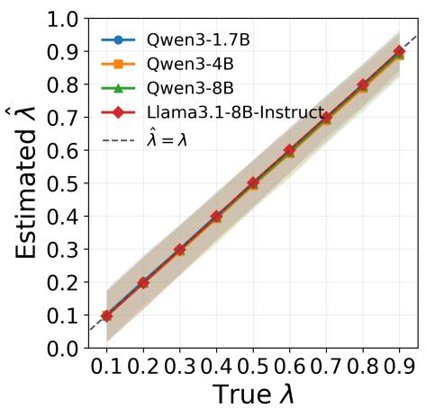

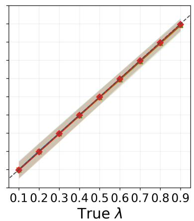

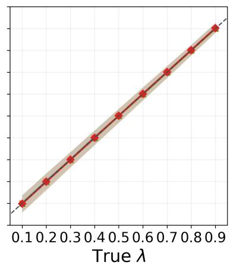  
Figure 1: RGS prevalence estimates on C4. Left to right: $\varepsilon = 1 , 2 , 3$ . Markers show means and shading shows 5th–95th percentiles over keys and repetitions.

We use prompts derived from the Colossal Clean Crawled Corpus (C4), a collection of cleaned web text (Rafel et al., 2019). We use the first 500 prompts from the processed C4 dataset in Pan et al. (2024) as our prompt set. For each prompt, we independently sample 144 base model completions using vLLM with temperature=1 and top-p=1. For each prompt, 64 completions enter the unwatermarked source pool, while the remaining 80 are divided into 4 disjoint blocks of M = 20 candidates for the rejection sampler. We truncate each candidate to its first $T = 5 0$ generated tokens before hashing and RGS selection, and use the same prefix for detection.

For each $\lambda \in \{ 0 . 1 , 0 . 2 , \ldots , 0 . 9 \}$ , we construct 50 Monte Carlo mixtures of total size $n = 2 0 0 0$ with $n \lambda$ watermarked and $n ( 1 - \lambda )$ unwatermarked texts sampled uniformly without replacement from the watermarked and unwatermarked source pools. For each mixture, we test RGS generation and estimation with 3 diferent privacy budgets $\varepsilon \in \{ 1 , 2 , 3 \}$ , and repeat the same test using a set of 20 randomly sampled keys.

Accurate frequency estimates with private watermarks We find that diferentially private watermarks provide highly accurate estimates of frequency across a range of $\lambda , \varepsilon ,$ and n values. Figure 1 shows our estimates of the frequency λ as we vary the true frequency λ across a wide range. Our estimates show low bias across the entire range, with average absolute biases of 0.0038, 0.0037, and 0.001 for $\varepsilon = 1 , 2 , 3$ respectively. The 5-95% percentile bands are generally tight, with average half-widths of 0.072, 0.040, and 0.031 for $\varepsilon = 1 , 2 , 3$

These findings hold across a range of ε values, and our estimator remains accurate even at a fairly stringent $\varepsilon = 1$ value. The main challenge of the estimator is maintaining low relative error at small true $\lambda ,$ but such an estimator may be inherently dificult to construct given the sampling noise inherent to randomized response style frequency estimates.

Sensitivity to watermark and experiment parameters To assess how the choices of parameters afect estimator performance, we conduct ablation studies on this C4 experiment. We vary the mixture sample size n, privacy budget ε, temperature and generation length, sampler type, candidate budget M, and number of distinct prompts in the mixture. The results are presented in Appendix C.

## 6.2 Instruction following

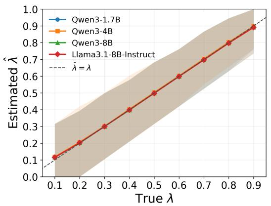

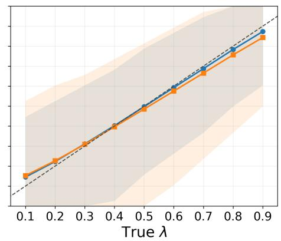  
Figure 2: RGS prevalence estimates on OUTFOX (left) and LiveCodeBench (right), with $\varepsilon = 2$ Markers show means and shading shows 5th–95th percentiles over keys and repetitions.

We then test RGS on a much more challenging setting, such as a small number of students sharing the same homework prompt, where the underlying distributions $p _ { i }$ are low-entropy, and the prompts are highly homogeneous. Throughout this section, we use $\varepsilon = 2$ . Our setting consists of two datasets: essay writing and coding.

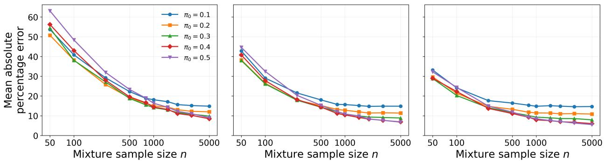  
Figure 3: MAPE versus mixture size n for diferent $\pi _ { 0 }$ . Left to right: $\lambda = 0 . 2 , 0 . 3 , 0 . 4$

Essay writing We randomly select 20 prompts from the OUTFOX dataset consisting of argumentative essay prompts (Koike et al., 2024). Each mixture we test consists of 100λ texts sampled from the RGS decoder, and $1 0 0 ( 1 - \lambda )$ from the same base model, all independently sampled under the same prompt.

Coding We randomly select 20 problems from the LiveCodeBench dataset (Jain et al., 2024) and construct the same one-prompt mixture as the essay setting. We enable the thinking mode for Qwen3-1.7B and Qwen3-4B and allow them to emit at most 256 thinking tokens before the final answer, which reduces entropy and more accurately reflects realistic LLM use. For watermark generation and detection, we use the first $T = 1 0 0$ generated tokens, excluding thinking tokens.

Accurate frequency estimates for instruction following settings We find that even in this extreme stress test where there is only a single prompt, and only 100 total samples, we are able to obtain accurate frequency estimates at $\varepsilon = 2$ (Figure 2). The essay setting shows low bias and low overall error across the range of λ, likely due to the higher per-prompt entropy. In contrast, the coding setting shows higher bias and variance, with visually distinguishable deviation from the unbiased $x = y$ line at low λ values. Despite this, the estimates have relatively low bias, and it is promising that even in extreme cases with very low diversity and entropy, we are able to obtain such estimates.

## 6.3 Bias control

We empirically test the efectiveness of the bias-mitigation strategy by tuning π0 proposed in Section 5.4. We follow the same C4 mixture construction procedure described above, using an expanded set of 1,000 prompts. We sample from Llama-3.1-8B-Instruct with temperature=0.2, and truncate each completion to $T = 2 0$ tokens, reflecting low per-prompt entropy but high prompt diversity. We find that adjusting $\pi _ { 0 }$ can significantly improve estimation error at large n via the bias variance tradeof. Figure 3 shows the mean absolute percentage error $( 1 0 0 \% \frac { \lvert \hat { \lambda } - \lambda \rvert } { \lambda } )$ averaged over all mixtures and keys, for $\pi _ { 0 } \in \{ 0 . 1 , 0 . 2 , 0 . 3 , 0 . 4 , 0 . 5 \}$ and $\lambda \in \{ 0 . 2 , 0 . 3 , 0 . 4 \}$ , at $\varepsilon = 2$ . In this setting, the value of $\pi _ { 0 }$ that optimizes the separation is $\sigma ( - \varepsilon / 2 ) = 0 . 2 7$ . We observe that at small sample sizes, smaller π0 generally achieves lower error, but gradually gets taken over by bigger values of $\pi _ { 0 }$ . In particular, for $\pi _ { 0 } = 0 . 1$ 1 and 0.2, the errors plateau quickly across $\lambda \mathrm { { s } }$ . This corroborates our theory that bias persists, and at large sample sizes where bias dominates the total error, a larger $\pi _ { 0 }$ value achieves a better tradeof.

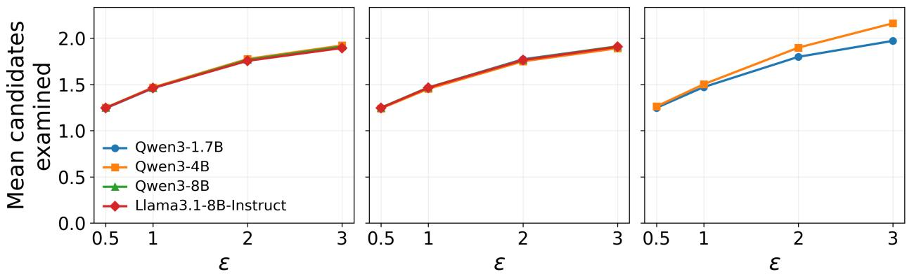  
Figure 4: Mean candidates examined by the rejection sampler versus ε. Left to right: C4, OUTFOX, LiveCodeBench.

## 6.4 Computational eficiency

We show empirically that our rejection sampler is very computationally eficient, especially in small ε regimes, which is consistent with Fact 1. In Figure 4, we plot the mean number of candidates examined until a response is accepted for the rejection sampler, for $\varepsilon \in \{ 0 . 5 , 1 , 2 , 3 \}$ on C4, OUTFOX, and LiveCodeBench. We use a rejection sampling cap of $M = 2 0$ and $\pi _ { 0 } = 0 . 5$ . Each point averages the cost equally over 20 randomly sampled keys. Across models, we see that only an average of fewer than 1.5 samples are needed from the underlying base model at small ε of 0.5 and 1, while larger values ε = 2, 3 require only around 2 samples.

## 7 Discussion

In this work, we focused on the core challenges behind locally diferentially private watermarking, and showed that careful construction of a sequence level, randomized-response style watermark can balance privacy and eficacy. However, there remains important future work in this direction, such as imbuing mild levels of robustness, since currently the sequence-level hashing used by RGS is sensitive to minor edits. Possible mitigations include using locality sensitive hashing (Hou et al., 2024) or incorporating error correcting codes (Christ and Gunn, 2024). While a token-level watermark like that of Kirchenbauer et al. (2023) is more edit-robust and computationally eficient, it remains an important problem to control the total privacy leakage of such token-level watermarks, especially over long, autoregressive sequences. Preliminary investigation by the authors using the optimal DP composition theorem (Kairouz et al., 2015) over the text sequence shows some promise for frequency estimation, but the accuracy under a fixed sequence-level privacy budget requires further improvement.

Another direction for future work is mitigating privacy leakage across time from repeated inference, as currently our watermark does not guarantee privacy over unlimited queries by a single user. Although memoized randomized response can protect a sensitive attribute across repeated queries by reusing a previously randomized report (Erlingsson et al., 2014), they apply randomization to both groups with and without the sensitive attribute. In the watermark setting, since the generation process of the unwatermarked group is outside our control, reusing the same noisy report could introduce a persistent shift in detection signal away from the unwatermarked baseline, revealing the watermark status over time.

## Acknowledgements

We thank members of the Hashimoto group for useful discussions. ELH was supported by a Stanford Graduate Fellowship. TH was supported by a grant by HAI, gifts from Open Philanthropy, Amazon, Schmidt Sciences, Hudson River Trading, the Tianqiao and Chrissy Chen Foundation and a grant under the NSF CAREER IIS-2338866, ONR N00014-24-1-2609, and DARPA Cooperative Agreement HR00112520013. This work does not necessarily reflect the position or policy of the government and no oficial endorsement should be inferred.

## References

Aaronson, S. (2022). My ai safety lecture for ut efective altruism. URL https://scottaaronson.blog/?p=6823

Anthropic (2026). How claude’s text watermark works. https://www.anthropic.com/news/cla ude-text-watermark. Accessed: 2026-09-26.

Bassily, R. and Smith, A. (2015). Local, private, eficient protocols for succinct histograms. In Proceedings of the Forty-Seventh Annual ACM Symposium on Theory of Computing. STOC ’15, Association for Computing Machinery, New York, NY, USA. URL https://doi.org/10.1145/2746539.2746632

Boucheron, S., Lugosi, G. and Bousquet, O. (2004). Concentration inequalities. In Advanced Lectures on Machine Learning: ML Summer Schools 2003, Canberra, Australia, February 2 - 14, 2003, Tübingen, Germany, August 4 - 16, 2003, Revised Lectures (O. Bousquet, U. von Luxburg and G. Rätsch, eds.). Springer Berlin Heidelberg, Berlin, Heidelberg, 208–240. URL https://doi.org/10.1007/978-3-540-28650-9\_9

Brand (2026). Spymarks, not watermarks. https://brand.io/article/spymarks/. Accessed: 2026-09-26.

Brickner-Wood, B. (2026). The mark of the machine. URL https://www.newyorker.com/culture/infinite-scroll/the-mark-of-the-machine

Brown, A. (2026). Does claude’s watermark solve the ai transparency problem? URL https://www.techtarget.com/news/Does-Claudes-watermark-solve-the-AI-transpar ency-problem/856999/

Christ, M. and Gunn, S. (2024). Pseudorandom Error-Correcting Codes. ArXiv:2402.09370 [cs.CR]. URL http://arxiv.org/abs/2402.09370

Christ, M., Gunn, S. and Zamir, O. (2024). Undetectable watermarks for language models. In Proceedings of Thirty Seventh Conference on Learning Theory (S. Agrawal and A. Roth, eds.), vol. 247 of Proceedings of Machine Learning Research. PMLR. URL https://proceedings.mlr.press/v247/christ24a.html

Dathathri, S., See, A., Ghaisas, S., Huang, P.-S., McAdam, R. E., Welbl, J., Bachani, V., Kaskasoli, A., Stanforth, R., Matejovicova, T., Hayes, J., Vyas, N., Merey, M. A., Brown-Cohen, J., Bunel, R., Balle, B., taylan. cemgil, Ahmed, Z., Stacpoole, K., Shumailov, I., Baetu, C., Gowal, S., Hassabis, D. and Kohli, P. (2024). Scalable watermarking for identifying large language model outputs. Nature 634 818 – 823.

URL https://api.semanticscholar.org/CorpusID:273547059

Duchi, J., Wainwright, M. J. and Jordan, M. (2013a). Local privacy and minimax bounds: Sharp rates for probability estimation. In Advances in Neural Information Processing Systems (C. Burges, L. Bottou, M. Welling, Z. Ghahramani and K. Weinberger, eds.), vol. 26. Curran Associates, Inc. URL https://proceedings.neurips.cc/paper\_files/paper/2013/file/5807a685d1a9ab3b5 99035bc566ce2b9-Paper.pdf

Duchi, J. C., Jordan, M. I. and Wainwright, M. J. (2013b). Local privacy and statistical minimax rates. In 2013 IEEE 54th Annual Symposium on Foundations of Computer Science.

Dwork, C., McSherry, F., Nissim, K. and Smith, A. D. (2006). Calibrating noise to sensitivity in private data analysis. In Theory of Cryptography, Third Theory of Cryptography Conference, TCC 2006, New York, NY, USA, March 4-7, 2006, Proceedings (S. Halevi and T. Rabin, eds.), vol. 3876 of Lecture Notes in Computer Science. Springer. URL https://doi.org/10.1007/11681878\_14

Dwork, C. and Roth, A. (2014). The algorithmic foundations of diferential privacy. Found. Trends Theor. Comput. Sci. 9 211–407. URL https://doi.org/10.1561/0400000042

Erlingsson, Ú., Pihur, V. and Korolova, A. (2014). Rappor: Randomized aggregatable privacy-preserving ordinal response. In Proceedings of the 2014 ACM SIGSAC Conference on Computer and Communications Security. CCS ’14, Association for Computing Machinery, New York, NY, USA. URL https://doi.org/10.1145/2660267.2660348

Goldreich, O., Goldwasser, S. and Micali, S. (1986). How to construct random functions. J. ACM 33 792–807. URL https://doi.org/10.1145/6490.6503

Haynes, K. (2026). URL https://www.inc.com/kevin-haynes/anthropics-new-ai-watermark-sparks-backla sh-from-claude-subscribers/91391704

Hou, A., Zhang, J., He, T., Wang, Y., Chuang, Y.-S., Wang, H., Shen, L., Van Durme, B., Khashabi, D. and Tsvetkov, Y. (2024). SemStamp: A semantic watermark with paraphrastic robustness for text generation. In Proceedings of the 2024 Conference of the North American Chapter of the Association for Computational Linguistics: Human Language Technologies (Volume 1: Long Papers) (K. Duh, H. Gomez and S. Bethard, eds.). Association for Computational Linguistics, Mexico City, Mexico. URL https://aclanthology.org/2024.naacl-long.226/

Hu, Z., Chen, L., Wu, X., Wu, Y., Zhang, H. and Huang, H. (2024). Unbiased watermark for large language models. In The Twelfth International Conference on Learning Representations. URL https://openreview.net/forum?id=uWVC5FVidc

Jain, N., Han, K., Gu, A., Li, W.-D., Yan, F., Zhang, T., Wang, S., Solar-Lezama, A., Sen, K. and Stoica, I. (2024). Livecodebench: Holistic and contamination free evaluation of large language models for code. URL https://arxiv.org/abs/2403.07974

Kairouz, P., Oh, S. and Viswanath, P. (2014). Extremal mechanisms for local diferential privacy. CoRR abs/1407.1338. URL http://arxiv.org/abs/1407.1338

Kairouz, P., Oh, S. and Viswanath, P. (2015). The composition theorem for diferential privacy. In Proceedings of the 32nd International Conference on Machine Learning (F. Bach and D. Blei, eds.), vol. 37 of Proceedings of Machine Learning Research. PMLR, Lille, France. URL https://proceedings.mlr.press/v37/kairouz15.html

Kim, B. D., Zhang, W., Ruan, W., Varshney, L. R. and Alabi, D. (2026). Simplemark: Fast multi-bit text watermarking under f -divergence constraints. URL https://arxiv.org/abs/2610.05712

Kirchenbauer, J., Geiping, J., Wen, Y., Katz, J., Miers, I. and Goldstein, T. (2023). A watermark for large language models. In Proceedings of the 40th International Conference on Machine Learning (A. Krause, E. Brunskill, K. Cho, B. Engelhardt, S. Sabato and J. Scarlett, eds.), vol. 202 of Proceedings of Machine Learning Research. PMLR. URL https://proceedings.mlr.press/v202/kirchenbauer23a.html

Kobak, D., González-Márquez, R., Ágnes Horvát, E. and Lause, J. (2025). Delving into llm-assisted writing in biomedical publications through excess vocabulary. Science Advances 11 eadt3813. URL https://www.science.org/doi/abs/10.1126/sciadv.adt3813

Koike, R., Kaneko, M. and Okazaki, N. (2024). Outfox: Llm-generated essay detection through in-context learning with adversarially generated examples. URL https://arxiv.org/abs/2307.11729

Krishna, K., Song, Y., Karpinska, M., Wieting, J. and Iyyer, M. (2023). Paraphrasing evades detectors of ai-generated text, but retrieval is an efective defense. In Advances in Neural Information Processing Systems (A. Oh, T. Naumann, A. Globerson, K. Saenko, M. Hardt and S. Levine, eds.), vol. 36. Curran Associates, Inc. URL https://proceedings.neurips.cc/paper\_files/paper/2023/file/575c450013d0e99e4 b0ecf82bd1afaa4-Paper-Conference.pdf

Kuditipudi, R., Thickstun, J., Hashimoto, T. and Liang, P. (2024). Robust distortion-free watermarks for language models. URL https://arxiv.org/abs/2307.15593

Lee, T., Hong, S., Ahn, J., Hong, I., Lee, H., Yun, S., Shin, J. and Kim, G. (2024). Who wrote this code? watermarking for code generation. In Proceedings of the 62nd Annual Meeting of the Association for Computational Linguistics (Volume 1: Long Papers) (L.-W. Ku, A. Martins and V. Srikumar, eds.). Association for Computational Linguistics, Bangkok, Thailand. URL https://aclanthology.org/2024.acl-long.268/

Lensvelt-Mulders, G., Hox, J., Heijden, P. G. and Maas, C. (2005). Meta-analysis of randomized response research: Thirty-five years of validation. Sociological Methods & Research 33 319–348.

Li, X., Ruan, F., Wang, H., Long, Q. and Su, W. (2025). A statistical framework of watermarks for large language models: Pivot, detection eficiency and optimal rules. The Annals of Statistics 53 322–351.

Li, X., Wen, G., Chen, X., Long, Q., Jain, A., Joly, F., Lam, M., Song, Q. and Su, W. (2026a). textgrain: Entropy-calibrated watermarking for language model text. URL https://www.alphaxiv.org/abs/2610.textgrain-entropy-calibrated-watermarking

Li, X., Wen, G., He, W., Wu, J., Long, Q. and Su, W. J. (2026b). Optimal estimation of watermark proportions in hybrid ai-human texts. URL https://arxiv.org/abs/2506.22343

Liang, W., Izzo, Z., Zhang, Y., Lepp, H., Cao, H., Zhao, X., Chen, L., Ye, H., Liu, S., Huang, Z., McFarland, D. A. and Zou, J. Y. (2026). Monitoring ai-modified content at scale: A case study on the impact of chatgpt on ai conference peer reviews. URL https://arxiv.org/abs/2403.07183

Liu, Y. and Bu, Y. (2024). Adaptive text watermark for large language models. URL https://arxiv.org/abs/2401.13927

Liu, Y., Zhao, X., Song, D., Wornell, G. W. and Bu, Y. (2026). Position: LLM watermarking should align stakeholders’ incentives for practical adoption. In Findings of the Association for Computational Linguistics: ACL 2026 (M. Liakata, V. P. Moreira, J. Zhang and D. Jurgens, eds.). Association for Computational Linguistics, San Diego, California, United States. URL https://aclanthology.org/2026.findings-acl.1290/

Pan, L., Liu, A., He, Z., Gao, Z., Zhao, X., Lu, Y., Zhou, B., Liu, S., Hu, X., Wen, L., King, I. and Yu, P. S. (2024). MarkLLM: An open-source toolkit for LLM watermarking. In Proceedings of the 2024 Conference on Empirical Methods in Natural Language Processing: System Demonstrations (D. I. Hernandez Farias, T. Hope and M. Li, eds.). Association for Computational Linguistics, Miami, Florida, USA. URL https://aclanthology.org/2024.emnlp-demo.7/

Raffel, C., Shazeer, N., Roberts, A., Lee, K., Narang, S., Matena, M., Zhou, Y., Li, W. and Liu, P. J. (2019). Exploring the limits of transfer learning with a unified text-to-text transformer. CoRR abs/1910.10683. URL http://arxiv.org/abs/1910.10683

Roch, S. (2024). Modern Discrete Probability: An Essential Toolkit. Cambridge Series in Statistical and Probabilistic Mathematics, Cambridge University Press.

Saarinen, M.-J. and Aumasson, J.-P. (2015). The blake2 cryptographic hash and message authentication code (mac). RFC 7693, RFC Editor, USA.

Shumailov, I., Shumaylov, Z., Zhao, Y., Papernot, N., Anderson, R. and Gal, Y. (2024). Ai models collapse when trained on recursively generated data. Nature 631 755–759.

SitePoint (2026). URL https://www.sitepoint.com/claude-steganographic-request-marking/

Spirlet, T. (2026). Claude users are canceling their subscriptions, citing anthropic’s new ai watermark. URL https://www.businessinsider.com/claude-users-cancel-subscriptions-citinganthropic-new-ai-watermark-2026-8

Tourangeau, R. and Yan, T. (2007). Sensitive questions in surveys. Psychological Bulletin 133 859–883.

Wang, T., Blocki, J., Li, N. and Jha, S. (2017). Locally diferentially private protocols for frequency estimation. In 26th USENIX Security Symposium (USENIX Security 17). USENIX Association, Vancouver, BC. URL https://www.usenix.org/conference/usenixsecurity17/technical-sessions/prese ntation/wang-tianhao

Warner, S. L. (1965). Randomized response: a survey technique for eliminating evasive answer bias. Journal of the American Statistical Association 60 309 63–6. URL https://api.semanticscholar.org/CorpusID:35435339

Wu, Y., Hu, Z., Guo, J., Zhang, H. and Huang, H. (2024). A resilient and accessible distributionpreserving watermark for large language models. URL https://arxiv.org/abs/2310.07710

Zhang, H., Edelman, B. L., Francati, D., Venturi, D., Ateniese, G. and Barak, B. (2025). Watermarks in the sand: Impossibility of strong watermarking for generative models. URL https://arxiv.org/abs/2311.04378

Zhao, X., Ananth, P., Li, L. and Wang, Y.-X. (2023). Provable robust watermarking for ai-generated text. URL https://arxiv.org/abs/2306.17439

A Keyed hash construction 23   
B Proofs 23   
B.1 Sampler proofs 23   
B.1.1 Feasible reweighting under privacy 23   
B.1.2 Proof of Proposition 1 23   
B.1.3 Proof of Fact 1 24   
B.1.4 Proof of Proposition 2 24   
B.1.5 Proof of Fact 2 25   
B.2 Estimation proofs . 25   
B.2.1 Proof of Lemma 1 25   
B.2.2 Proof of Proposition 3 25   
B.2.3 Lemma: Variance of B(k) 26   
B.2.4 Proof of Proposition 4 27   
B.2.5 Proof of Proposition 5 27   
C Ablations 30   
C.1 Efect of ε and n 30   
C.2 Efect of temperature and generation length 30   
C.3 Parallel versus rejection sampling 32   
C.4 Efect of candidate budget 32   
C.5 Efect of prompt diversity 32   
D Examples of RGS-watermarked text 34

## A Keyed hash construction

We construct the coloring scheme described in Section 5 as follows: first, we use a keyed hash to generate a pseudorandom value for each sequence, then use a deterministic threshold to map that value to a green or red color. Specifically, we use keyed BLAKE2b (Saarinen and Aumasson, 2015) with a 128-bit digest. Let $b _ { k } ( y ) \in \{ 0 , \ldots , 2 ^ { 1 2 8 } - 1 \}$ denote the integer representation of the digest of an injectively encoded token sequence y. Here, $b _ { k }$ is the keyed function modeled as a PRF. The coloring function $h _ { k }$ is its thresholded output, with the threshold chosen to obtain the nominal green probability π0:

$$
h _ { k } ( y ) = G \quad \Longleftrightarrow \quad b _ { k } ( y ) < T , \qquad T = \lfloor \pi _ { 0 } 2 ^ { 1 2 8 } \rfloor .
$$

If $b _ { k }$ is modeled as a uniformly random function, distinct sequences receive independent colors, each with green probability

$$
\widetilde { \pi } _ { 0 } = \frac { T } { 2 ^ { 1 2 8 } } , \qquad 0 \le \pi _ { 0 } - \widetilde { \pi } _ { 0 } < 2 ^ { - 1 2 8 } .
$$

We suppress this small rounding error in the analysis and use $\pi _ { 0 }$ as the ideal green probability.

## B Proofs

## B.1 Sampler proofs

## B.1.1 Feasible reweighting under privacy

Lemma 2 (Feasible reweighting under privacy). Under Algorithm $^ { 1 , }$ with $P _ { G } \in ( 0 , 1 )$ , a choice of $Q _ { G }$ satisfies

$$
e ^ { - \varepsilon } p _ { j } \leq q _ { j } \leq e ^ { \varepsilon } p _ { j } \qquad f o r \ a l l \ j \in [ m ]
$$

if and only if

$$
L _ { \varepsilon } ( P _ { G } ) \leq Q _ { G } \leq U _ { \varepsilon } ( P _ { G } ) ,
$$

where

$$
\begin{array} { r l } & { L _ { \varepsilon } ( P _ { G } ) : = \operatorname* { m a x } \{ e ^ { - \varepsilon } P _ { G } , 1 - e ^ { \varepsilon } ( 1 - P _ { G } ) \} , } \\ & { U _ { \varepsilon } ( P _ { G } ) : = \operatorname* { m i n } \{ e ^ { \varepsilon } P _ { G } , 1 - e ^ { - \varepsilon } ( 1 - P _ { G } ) \} . } \end{array}
$$

Proof. For $P _ { G } \in ( 0 , 1 )$ , we have that $q _ { j } / p _ { j } = Q _ { G } / P _ { G } { \mathrm { ~ i f ~ } } h _ { k } ( y _ { j } ) = G _ { \mathrm { ~  ~ } }$ , and $q _ { j } / p _ { j } = ( 1 - Q _ { G } ) / ( 1 - P _ { G } )$ if $h _ { k } ( y _ { j } ) = R$ . Therefore, $e ^ { - \varepsilon } p _ { j } \leq q _ { j } \leq e ^ { \varepsilon } p _ { j }$ is equivalent to satisfying both of these inequalities:

$$
\begin{array} { c } { { e ^ { - \varepsilon } P _ { G } \leq Q _ { G } \leq e ^ { \varepsilon } P _ { G } , } } \\ { { 1 - e ^ { \varepsilon } ( 1 - P _ { G } ) \leq Q _ { G } \leq 1 - e ^ { - \varepsilon } ( 1 - P _ { G } ) . } } \end{array}
$$

Their intersection is the stated interval $[ L _ { \varepsilon } ( P _ { G } ) , U _ { \varepsilon } ( P _ { G } ) ]$

## B.1.2 Proof of Proposition 1

Proof. Fix any key k, and let $p ( \cdot )$ be the base model distribution given the prompt. The RGS decoder chooses $Q _ { G } = U _ { \varepsilon } ( P _ { G } )$ , which lies in the feasible interval in Lemma 2. Therefore, we have

$$
e ^ { - \varepsilon } p _ { j } \leq q _ { j } \leq e ^ { \varepsilon } p _ { j } \qquad { \mathrm { f o r ~ a l l ~ } } j \in [ m ] .
$$

Conditional on the candidate set $Y ^ { M }$ , for any $y \in \mathcal { V }$ that appears in the pool, let $c _ { y }$ be the number of appearances of y in $Y ^ { M }$ . For sequences not in the set, $c _ { y } = 0$ . Then, we have

$$
e ^ { - \varepsilon } \frac { c _ { y } } { M } \leq \operatorname* { P r } [ \Gamma ( k ; p ) = y \mid k , Y ^ { M } ] \leq e ^ { \varepsilon } \frac { c _ { y } } { M } , \qquad \forall y \in \mathcal { V } .
$$

Taking expectations over $Y ^ { M }$ and using $\mathbb { E } _ { Y ^ { M } } [ c _ { y } / M ] = p ( y )$ gives the ε-local DP guarantee:

$$
e ^ { - \varepsilon } p ( y ) \leq \operatorname* { P r } [ \Gamma ( k ; p ) = y \mid k ] \leq e ^ { \varepsilon } p ( y ) .
$$

## B.1.3 Proof of Fact 1

Proof. Fix any key k. In each round of the rejection sampling procedure, the probability of accepting a completion Y is

$$
a : = 1 \cdot \operatorname* { P r } [ h _ { k } ( Y ) = G ] + e ^ { - \varepsilon } \operatorname* { P r } [ h _ { k } ( Y ) = R ] .
$$

Since the $Y \mathrm { \bar { s } }$ are sampled independently from the base model across all M rounds, the acceptance indicators are independent Ber(a) random variables. Let X be the number of rounds until acceptance, so $X \sim \mathrm { G e o m e t r i c } ( a )$ The sample count needed by the rejection sampler is thus $T = \operatorname* { m i n } ( M , X )$ with $\begin{array} { r } { \mathbb { E } [ T ] \leq \mathbb { E } [ X ] = \frac { 1 } { a } } \end{array}$ □

## B.1.4 Proof of Proposition 2

Proof. Fix any prompt and key, and suppress their dependence in the notation. Let p denote the base model distribution given the prompt. For a candidate $Y \sim p$ , let acc be the event that it gets accepted by the rejection sampler. Since $\operatorname* { P r } [ { \mathsf { a c c } } \mid Y = y ] \in \{ e ^ { - \varepsilon } , 1 \}$ , we also have $\operatorname* { P r } [ \mathsf { a c c } ] \in [ e ^ { - \varepsilon } , 1 ]$ Thus, by Bayes’ rule, the distribution of the accepted candidate satisfies, for $p ( y ) > 0$

$$
\begin{array} { r l } & { q ( y ) : = \operatorname* { P r } [ Y = y \mid \mathsf { a c c } ] } \\ & { \quad \quad = p ( y ) \frac { \operatorname* { P r } [ \mathsf { a c c } \mid Y = y ] } { \operatorname* { P r } [ \mathsf { a c c } ] } } \\ & { \quad \quad \in [ e ^ { - \varepsilon } p ( y ) , e ^ { \varepsilon } p ( y ) ] . } \end{array}
$$

The same bounds hold when $p ( y ) = 0$ , since $q ( y ) = 0$ in that case.

The finite candidate budget M only moves the watermarked output distribution toward the base $p .$ If round M is reached, its fresh candidate has distribution identical to the base $p$ and is returned by the rejection sampler regardless of color. Writing r as the probability of reaching the final round, the watermarked distribution is therefore

$$
q _ { M } ( y ) = ( 1 - r ) q ( y ) + r p ( y ) , \qquad r \in [ 0 , 1 ] .
$$

This mixture only moves each likelihood ratio toward 1, so

$$
e ^ { - \varepsilon } p ( y ) \leq q _ { M } ( y ) \leq e ^ { \varepsilon } p ( y ) \qquad \forall y \in \mathcal { V } .
$$

## B.1.5 Proof of Fact 2

Proof. For the parallel sampler, the empirical green fraction $P _ { G }$ in Algorithm 1 converges almost surely to $g$ by the strong law of large numbers. Conditional on the candidates and $P _ { G } .$ , the output is green with probability $f ( P _ { G } ) = \operatorname* { m i n } \{ e ^ { \varepsilon } P _ { G } , 1 - e ^ { - \varepsilon } ( 1 - P _ { G } ) \}$ . Since $f$ is continuous and bounded, $q _ { \mathrm { p a r } } ^ { M } = \mathbb { E } [ f ( P _ { G } ) ] \to f ( g )$ by the bounded convergence theorem.

For the rejection sampler, the probability of accepting a completion on each attempt before the final one is $a = g + e ^ { - \varepsilon } ( 1 - g )$ . Since each attempt is independent, the cumulative green probability is

$$
q _ { \mathrm { r e j } } ^ { M } = \sum _ { t = 1 } ^ { M } ( 1 - a ) ^ { t - 1 } g \to { \frac { g } { a } } = { \frac { e ^ { \varepsilon } g } { e ^ { \varepsilon } g + 1 - g } } .
$$

## B.2 Estimation proofs

## B.2.1 Proof of Lemma 1

Proof. Use the shorthand $Z _ { y } = \mathbf { 1 } \{ h _ { k } ( y ) = G \}$ . Under Assumption 1, the $Z _ { y }$ ’s are independent $\mathrm { B e r } ( \pi _ { 0 } )$ random variables. Since $\begin{array} { r } { g _ { i } ( k ) = \sum _ { y \in y } p _ { i } ( y ) Z _ { y } } \end{array}$ , we have

$$
\mathbb { E } _ { k } [ g _ { i } ( k ) ] = \sum _ { y \in \mathcal { V } } p _ { i } ( y ) \mathbb { E } _ { k } [ Z _ { y } ] = \pi _ { 0 } .
$$

Furthermore, independence gives

$$
\begin{array} { l } { \displaystyle \mathrm { C o v } _ { k } [ g _ { i } ( k ) , g _ { j } ( k ) ] = \sum _ { y , y ^ { \prime } \in \mathcal { V } } p _ { i } ( y ) p _ { j } ( y ^ { \prime } ) \mathrm { C o v } _ { k } [ Z _ { y } , Z _ { y ^ { \prime } } ] } \\ { = \pi _ { 0 } ( 1 - \pi _ { 0 } ) \displaystyle \sum _ { y \in \mathcal { V } } p _ { i } ( y ) p _ { j } ( y ) } \\ { = \pi _ { 0 } ( 1 - \pi _ { 0 } ) \langle p _ { i } , p _ { j } \rangle . } \end{array}
$$

## B.2.2 Proof of Proposition 3

Proof. With the unclipped moment estimator $\begin{array} { r } { \tilde { \lambda } = \frac { \bar { H } - \pi _ { 0 } } { \pi _ { 1 } - \pi _ { 0 } } } \end{array}$ , we have the decomposition

$$
\tilde { \lambda } - \lambda = \frac { 1 } { \pi _ { 1 } - \pi _ { 0 } } \left[ \frac { 1 } { n } \sum _ { i = 1 } ^ { n } ( H _ { i } - \mathbb { E } [ H _ { i } \mid k ] ) + \frac { 1 } { n } \sum _ { i \in I _ { 1 } } ( q _ { i } - \pi _ { 1 } ) + \frac { 1 } { n } \sum _ { i \in I _ { 0 } } ( g _ { i } - \pi _ { 0 } ) \right] .
$$

Denote $\begin{array} { r } { V ( k ) : = \frac { 1 } { n } \sum _ { i = 1 } ^ { n } ( H _ { i } - { \mathbb E } [ H _ { i } \mid k ] ) } \end{array}$ . Then

$$
\tilde { \lambda } - \lambda = \frac { 1 } { \pi _ { 1 } - \pi _ { 0 } } \biggl [ V ( k ) + \lambda B ( k ) + ( 1 - \lambda ) U ( k ) \biggr ]
$$

Note that $B ( k )$ and $U ( k )$ are fixed given $k .$ The only random quantity is $V ( k )$ , the sampling noise, with

$$
\mathbb { E } [ V ( k ) \mid k ] = 0 .
$$

Then, the conditional MSE is

$$
\mathbb { E } [ ( \widetilde { \lambda } - \lambda ) ^ { 2 } \mid k ] = \frac { 1 } { ( \pi _ { 1 } - \pi _ { 0 } ) ^ { 2 } } \left[ \mathbb { E } [ V ( k ) ^ { 2 } \mid k ] + ( \lambda B ( k ) + ( 1 - \lambda ) U ( k ) ) ^ { 2 } \right] .
$$

By conditional independence, we have

$$
\begin{array} { l } { \mathbb { E } [ V ( k ) ^ { 2 } \mid k ] = \operatorname { V a r } [ V ( k ) \mid k ] } \\ { = \operatorname { V a r } \left[ \displaystyle \frac { 1 } { n } \sum _ { i = 1 } ^ { n } H _ { i } \mid k \right] } \\ { = \displaystyle \frac { 1 } { n ^ { 2 } } \sum _ { i = 1 } ^ { n } \operatorname { V a r } [ H _ { i } \mid k ] } \\ { = \displaystyle \frac { 1 } { n ^ { 2 } } \left( \sum _ { i \in I _ { 1 } } q _ { i } ( 1 - q _ { i } ) + \sum _ { i \in I _ { 0 } } g _ { i } ( 1 - g _ { i } ) \right) } \\ { \leq \displaystyle \frac { 1 } { 4 n } . } \end{array}
$$

Since projection onto $[ 0 , 1 ]$ can only decrease the MSE, combining the above we have

$$
\mathbb { E } [ ( \hat { \lambda } - \lambda ) ^ { 2 } \mid k ] \le \frac { 1 } { ( \pi _ { 1 } - \pi _ { 0 } ) ^ { 2 } } \left[ \frac { 1 } { 4 n } + ( \lambda B ( k ) + ( 1 - \lambda ) U ( k ) ) ^ { 2 } \right] .
$$

## B.2.3 Lemma: Variance of $B ( k )$

Lemma 3 (Variance of $B ( k ) )$ . Consider both samplers in the limit $M \to \infty$ . Let $m = | I _ { 1 } | > 0$ Under Assumption $^ { 1 , }$ we have

$$
\mathrm { V a r } _ { k } [ B ( k ) ] \leq \frac { e ^ { 2 \varepsilon } \pi _ { 0 } ( 1 - \pi _ { 0 } ) } { m ^ { 2 } } \left( \sum _ { i \in I _ { 1 } } \| p _ { i } \| _ { 2 } ^ { 2 } + \sum _ { \stackrel { i , j \in I _ { 1 } } { i \neq j } } \langle p _ { i } , p _ { j } \rangle \right) .
$$

Proof. For either sampler, write $q _ { i } ( k ) = f ( g _ { i } ( k ) )$ , where

$$
f ( x ) = \left\{ \begin{array} { l l } { \displaystyle { e ^ { \varepsilon } x } } & { \mathrm { f o r ~ t h e ~ r e j e c t i o n ~ s a m p l e r , } } \\ { \displaystyle { \operatorname* { m i n } \{ e ^ { \varepsilon } x , 1 - e ^ { - \varepsilon } ( 1 - x ) \} } , } & { \mathrm { f o r ~ t h e ~ p a r a l l e l ~ s a m p l e r . } } \end{array} \right.
$$

Both maps are $e ^ { \varepsilon _ { - } } \mathrm { I }$ ipschitz on [0, 1]. For the rejection sampler, this follows from

$$
0 \leq f ^ { \prime } ( x ) = { \frac { e ^ { \varepsilon } } { ( 1 + ( e ^ { \varepsilon } - 1 ) x ) ^ { 2 } } } \leq e ^ { \varepsilon } .
$$

For the parallel sampler, $f$ is continuous and piecewise linear with slopes $e ^ { \varepsilon }$ and $e ^ { - \varepsilon }$ Write $Z _ { y } = \mathbf { 1 } \{ h _ { k } ( y ) = G \}$ , so that $\begin{array} { r } { g _ { i } ( k ) = \sum _ { y } p _ { i } ( y ) Z _ { y } } \end{array}$ , and $B ( k )$ is a function of $Z _ { y } .$

$$
B ( k ) = \frac { 1 } { m } \sum _ { i \in I _ { 1 } } f \left( \sum _ { y \in \mathcal { V } } p _ { i } ( y ) Z _ { y } \right) - f ( \pi _ { 0 } ) .
$$

Under Assumption 1, the $Z _ { y }$ are independent $\mathrm { B e r } ( \pi _ { 0 } )$ variables. Suppose $B ( \boldsymbol { k } ) ^ { \prime }$ is the variable obtained by replacing $Z _ { y }$ by an i.i.d. copy $Z _ { y } ^ { \prime }$ . By the Lipschitz bounds, this changes $B ( k )$ by at most $\begin{array} { r } { c _ { y } : = \frac { e ^ { \varepsilon } } { m } \sum _ { i \in I _ { 1 } } p _ { i } ( y ) , \mathrm { i . e . } ~ | B ( k ) - B ( k ) ^ { \prime } | \le c _ { y } . } \end{array}$

Note that this change is only nonzero if $Z _ { y } \ne Z _ { y } ^ { \prime }$ , and since they are independent $\mathrm { B e r } ( \pi _ { 0 } )$ variables, this event has probability $2 \pi _ { 0 } ( 1 - \pi _ { 0 } )$ . Therefore, by the Efron-Stein inequality (Boucheron et al., 2004), we have

$$
\begin{array} { r l } & { \mathrm { V a r } _ { k } [ B ( k ) ] \le \displaystyle \frac { 1 } { 2 } \sum _ { y \in \mathcal { Y } } \mathbb { E } _ { k } [ | B ( k ) - B ( k ) ^ { \prime } | ^ { 2 } ] } \\ & { \qquad \le \displaystyle \frac { 1 } { 2 } \sum _ { y } 2 \pi _ { 0 } ( 1 - \pi _ { 0 } ) c _ { y } ^ { 2 } } \\ & { \qquad = \displaystyle \frac { e ^ { 2 \varepsilon } \pi _ { 0 } ( 1 - \pi _ { 0 } ) } { m ^ { 2 } } \sum _ { i , j \in I _ { 1 } } \langle p _ { i } , p _ { j } \rangle . } \end{array}
$$

## B.2.4 Proof of Proposition 4

Proof. Taking expectation over the key k in equation 10, we can decompose the error to

$$
\begin{array} { l } { { \displaystyle { \mathbb { E } } [ ( \tilde { \lambda } - \lambda ) ^ { 2 } ] } } \\ { { \displaystyle = \frac { 1 } { d ^ { 2 } } { \mathbb { E } } [ V ( k ) ^ { 2 } ] + \frac { \lambda ^ { 2 } } { d ^ { 2 } } { \mathbb { E } } _ { k } [ B ( k ) ^ { 2 } ] + \frac { ( 1 - \lambda ) ^ { 2 } } { d ^ { 2 } } { \mathbb { E } } _ { k } [ U ( k ) ^ { 2 } ] + \frac { 2 \lambda ( 1 - \lambda ) } { d ^ { 2 } } { \mathbb { E } } _ { k } [ B ( k ) U ( k ) ] . } } \end{array}\tag{12}
$$

We bound the last three terms of the equation above. Since $\mathbb { E } _ { k } [ U ( k ) ] = 0$ , we have

$$
\begin{array} { r } { \mathbb { E } _ { k } [ U ( k ) ^ { 2 } ] = \mathrm { V a r } _ { k } [ U ( k ) ] = \pi _ { 0 } ( 1 - \pi _ { 0 } ) \| \bar { p } _ { 0 } \| _ { 2 } ^ { 2 } . } \end{array}
$$

Then, we bound the cross term using Cauchy-Schwarz:

$$
\begin{array} { r l } & { \mathbb { E } _ { k } [ B ( k ) U ( k ) ] \leq | \mathbb { E } _ { k } [ B ( k ) U ( k ) ] | } \\ & { \qquad \leq \sqrt { \mathbb { E } _ { k } [ B ( k ) ^ { 2 } ] } \sqrt { \mathbb { E } _ { k } [ U ( k ) ^ { 2 } ] } } \\ & { \qquad = \sqrt { \mathbb { E } _ { k } [ B ( k ) ^ { 2 } ] } \sqrt { \pi _ { 0 } ( 1 - \pi _ { 0 } ) \| \bar { p } _ { 0 } \| _ { 2 } ^ { 2 } } } \\ & { \qquad \leq \sqrt { \pi _ { 0 } ( 1 - \pi _ { 0 } ) } \| \bar { p } _ { 0 } \| _ { 2 } , } \end{array}
$$

Finally, we bound $\mathrm { V a r } _ { k } [ B ( k ) ]$ using Lemma 3:

$$
\begin{array} { r l } & { \mathbb { E } _ { k } [ B ( k ) ^ { 2 } ] = { \mathrm { V a r } } _ { k } [ B ( k ) ] + ( \mathbb { E } _ { k } [ B ( k ) ] ) ^ { 2 } } \\ & { \qquad \leq e ^ { 2 \varepsilon } \pi _ { 0 } ( 1 - \pi _ { 0 } ) \| \bar { p } _ { 1 } \| _ { 2 } ^ { 2 } + ( \mathbb { E } _ { k } [ B ( k ) ] ) ^ { 2 } . } \end{array}
$$

Substituting the above into equation 12 gives the desired inequality with remainder R. Every term of R is proportional to $\| \bar { p } _ { 0 } \| _ { 2 } , \| \bar { p } _ { 0 } \| _ { 2 } ^ { 2 }$ or $\| \bar { p } _ { 1 } \| _ { 2 } ^ { 2 }$ , so $R \to 0$ under the assumption. □

## B.2.5 Proof of Proposition 5

Proof. Write $m = | I _ { 1 } |$ and without loss of generality, suppose $m > 0$ . We consider both samplers. Rejection Sampler. Consider the rejection sampler in the limit $M  \infty .$ , so that $q _ { i } ( k ) = f ( g _ { i } ( k ) )$ , where

$$
f ( x ) = { \frac { e ^ { \varepsilon } x } { e ^ { \varepsilon } x + 1 - x } } .
$$

Then, for any $x , y \in [ 0 , 1 ]$ , we have

$$
f ( x ) - f ( y ) = { \frac { e ^ { \varepsilon } ( x - y ) } { ( 1 + ( e ^ { \varepsilon } - 1 ) x ) ( 1 + ( e ^ { \varepsilon } - 1 ) y ) } } .
$$

We use the shorthand $Z _ { y } = \mathbf { 1 } \{ h _ { k } ( y ) = G \}$ , which implies $\begin{array} { r } { g _ { i } = \sum _ { y \in \mathcal { y } } p _ { i } ( y ) Z _ { y } } \end{array}$ . Then, the unnormalized bias is

$$
\begin{array} { l } { \displaystyle \mathbb { E } _ { k } \left[ f ( g _ { i } ) - f ( \pi _ { 0 } ) \right] = \mathbb { E } _ { k } \left[ \frac { e ^ { \varepsilon } ( g _ { i } - \pi _ { 0 } ) } { ( 1 + ( e ^ { \varepsilon } - 1 ) g _ { i } ) ( 1 + ( e ^ { \varepsilon } - 1 ) \pi _ { 0 } ) } \right] } \\ { \displaystyle = \frac { e ^ { \varepsilon } } { 1 + ( e ^ { \varepsilon } - 1 ) \pi _ { 0 } } \sum _ { y \in \mathcal { Y } } p _ { i } ( y ) \mathbb { E } \left[ \frac { Z _ { y } - \pi _ { 0 } } { 1 + ( e ^ { \varepsilon } - 1 ) g _ { i } } \right] . } \end{array}
$$

Since both the numerator and the denominator in the integrand depend on $Z _ { y } ,$ which is a Bernoulli random variable with mean $\pi _ { 0 }$ , we use the leave-one-out trick to tease out the dependence of the whole expectation on $\pi _ { 0 }$

Denote $\begin{array} { r } { g _ { i } ^ { - y } = \sum _ { y ^ { \prime } \neq y } p _ { i } ( y ^ { \prime } ) Z _ { y ^ { \prime } } } \end{array}$ . Then, $g _ { i } = g _ { i } ^ { - y } + p _ { i } ( y ) Z _ { y }$ . Note that conditional on $g _ { i } ^ { - y } , Z _ { y } \sim$ Ber $\left( \pi _ { 0 } \right)$ . Then,

$$
\begin{array} { r l } & { \mathbb { E } _ { k } \left[ \displaystyle \frac { Z _ { y } - \pi _ { 0 } } { 1 + ( e ^ { \varepsilon } - 1 ) g _ { i } } \right] = \mathbb { E } \left[ \mathbb { E } \left[ \displaystyle \frac { Z _ { y } - \pi _ { 0 } } { 1 + ( e ^ { \varepsilon } - 1 ) ( g _ { i } ^ { - y } + p _ { i } ( y ) Z _ { y } ) } \mid g _ { i } ^ { - y } \right] \right] } \\ & { \quad \quad \quad = \mathbb { E } \left[ \pi _ { 0 } \displaystyle \frac { 1 - \pi _ { 0 } } { 1 + ( e ^ { \varepsilon } - 1 ) ( g _ { i } ^ { - y } + p _ { i } ( y ) ) } + ( 1 - \pi _ { 0 } ) \displaystyle \frac { - \pi _ { 0 } } { 1 + ( e ^ { \varepsilon } - 1 ) g _ { i } ^ { - y } } \right] } \\ & { \quad \quad \quad = - \pi _ { 0 } ( 1 - \pi _ { 0 } ) ( e ^ { \varepsilon } - 1 ) p _ { i } ( y ) \mathbb { E } _ { k } \left[ \phi ( g _ { i } ^ { - y } ) \right] , } \end{array}
$$

where

$$
\phi ( g _ { i } ^ { - y } ) = \frac { 1 } { ( 1 + ( e ^ { \varepsilon } - 1 ) ( g _ { i } ^ { - y } + p _ { i } ( y ) ) ) ( 1 + ( e ^ { \varepsilon } - 1 ) g _ { i } ^ { - y } ) } .
$$

Consolidating, the magnitude of the normalized bias is

$$
\begin{array} { l } { \displaystyle \frac { \mathbb { E } _ { k } \left[ - B ( k ) \right] } { f ( \pi _ { 0 } ) - \pi _ { 0 } } = - \frac { 1 } { f ( \pi _ { 0 } ) - \pi _ { 0 } } \frac { 1 } { m } \sum _ { i \in I _ { 1 } } \mathbb { E } _ { k } [ f ( g _ { i } ) - f ( \pi _ { 0 } ) ] } \\ { \displaystyle \qquad = \frac { \pi _ { 0 } ( 1 - \pi _ { 0 } ) e ^ { \varepsilon } ( e ^ { \varepsilon } - 1 ) } { m ( f ( \pi _ { 0 } ) - \pi _ { 0 } ) ( 1 + ( e ^ { \varepsilon } - 1 ) \pi _ { 0 } ) } \sum _ { i \in I _ { 1 } } \sum _ { y \in \mathcal { V } } p _ { i } ( y ) ^ { 2 } \mathbb { E } _ { k } \left[ \phi ( g _ { i } ^ { - y } ) \right] } \\ { \displaystyle \qquad = \frac { e ^ { \varepsilon } } { m } \sum _ { i \in I _ { 1 } } \sum _ { y \in \mathcal { V } } p _ { i } ( y ) ^ { 2 } \mathbb { E } _ { k } \left[ \phi ( g _ { i } ^ { - y } ) \right] . } \end{array}
$$

Note that $\phi$ is nonincreasing. Also $\begin{array} { r } { g _ { i } ^ { - y } = \sum _ { y ^ { \prime } \neq y } p _ { i } ( y ^ { \prime } ) Z _ { y ^ { \prime } } } \end{array}$ , where each $Z _ { y ^ { \prime } } \stackrel { i . i . d . } { \sim } \mathrm { B e r } ( \pi _ { 0 } )$ . Since a Ber $( \pi _ { 0 } ^ { \prime } )$ variable stochastically dominates a $\operatorname { B e r } ( \pi _ { 0 } )$ variable for $\pi _ { 0 } ^ { \prime } \geq \pi _ { 0 }$ , by Corollaries 4.2.7 and $4 . 2 . 6$ of Roch (2024) we have that $\mathbb { E } _ { k } [ \phi ( g _ { i } ^ { - y } ) ]$ is nonincreasing in $\pi _ { 0 }$ . Overall, since the multipliers $e ^ { \varepsilon } / m$ and $p _ { i } ( y ) ^ { 2 }$ are nonnegative, the magnitude of the normalized bias $\frac { \mathbb { E } _ { k } [ - B ( k ) ] } { f ( \pi _ { 0 } ) - \pi _ { 0 } }$ is nonincreasing in π0.

Parallel Sampler. Consider the parallel sampler in the limit $M \to \infty$ , so that $q _ { i } ( k ) = f ( g _ { i } ( k ) )$ , where

$$
f ( x ) = \operatorname* { m i n } \{ e ^ { \varepsilon } x , 1 - e ^ { - \varepsilon } ( 1 - x ) \} .
$$

Similar to the rejection sampler proof, we use the shorthand $Z _ { y } = \mathbf { 1 } \{ h _ { k } ( y ) = G \}$ , which implies $\begin{array} { r } { g _ { i } = \sum _ { y \in y } p _ { i } ( y ) Z _ { y } } \end{array}$ . Under the ideal coloring assumption, the $Z _ { y }$ are independent $\operatorname { B e r } ( \pi _ { 0 } )$ variables, with $\mathbb { E } _ { k } [ g _ { i } ] = \pi _ { 0 }$

Let $\tau = ( 1 + e ^ { \varepsilon } ) ^ { - 1 }$ . Note that f is a piecewise linear function, which can be rewritten as

$$
f ( x ) = 1 - e ^ { - \varepsilon } ( 1 - x ) - ( e ^ { \varepsilon } - e ^ { - \varepsilon } ) ( \tau - x ) _ { + }\tag{13}
$$

We consider $\pi _ { 0 } \in [ \tau , 1 )$ . Using the identity in equation 13, we can write the unnormalized bias as

$$
\begin{array} { r l } & { \mathbb { E } _ { k } [ f ( g _ { i } ) - f ( \pi _ { 0 } ) ] = \mathbb { E } _ { k } \left[ e ^ { - \varepsilon } ( g _ { i } - \pi _ { 0 } ) - ( e ^ { \varepsilon } - e ^ { - \varepsilon } ) ( \tau - g _ { i } ) _ { + } \right] } \\ & { \qquad = - ( e ^ { \varepsilon } - e ^ { - \varepsilon } ) \mathbb { E } _ { k } [ ( \tau - g _ { i } ) _ { + } ] . } \end{array}
$$

To isolate the dependence on $\pi _ { 0 }$ , define the nonincreasing function

$$
\psi ( x ) = { \left\{ \begin{array} { l l } { { \displaystyle { \frac { \tau - x } { 1 - x } } , } } & { 0 \leq x < \tau , } \\ { 0 , } & { \tau \leq x \leq 1 . } \end{array} \right. }
$$

Then $( \tau - g _ { i } ) _ { + } = ( 1 - g _ { i } ) \psi ( g _ { i } )$ , so

$$
\begin{array} { r l } { \mathbb { E } _ { k } [ ( \tau - g _ { i } ) _ { + } ] = \mathbb { E } _ { k } [ ( 1 - g _ { i } ) \psi ( g _ { i } ) ] } & { } \\ { \quad } & { = \displaystyle \sum _ { y \in \mathcal { V } } p _ { i } ( y ) \mathbb { E } _ { k } [ ( 1 - Z _ { y } ) \psi ( g _ { i } ) ] . } \end{array}
$$

The interchange of expectation and summation is valid because all summands are nonnegative.

Since both factors in the integrand depend on $Z _ { y } ,$ , we use the leave-one-out trick to isolate this dependence. Denote $\begin{array} { r } { g _ { i } ^ { - y } = \sum _ { y ^ { \prime } \neq y } p _ { i } ( y ^ { \prime } ) Z _ { y ^ { \prime } } } \end{array}$ . Then $g _ { i } = g _ { i } ^ { - y } + p _ { i } ( y ) Z _ { y }$ , and conditional on $g _ { i } ^ { - y }$ $Z _ { y } \sim \mathrm { B e r } ( \pi _ { 0 } )$ . Therefore,

$$
\begin{array} { r l } & { \mathbb { E } _ { k } [ ( 1 - Z _ { y } ) \psi ( g _ { i } ) ] = \mathbb { E } _ { k } \left[ \mathbb { E } _ { k } \left[ ( 1 - Z _ { y } ) \psi ( g _ { i } ^ { - y } + p _ { i } ( y ) Z _ { y } ) \mid g _ { i } ^ { - y } \right] \right] } \\ & { \quad \quad \quad = ( 1 - \pi _ { 0 } ) \mathbb { E } _ { k } [ \psi ( g _ { i } ^ { - y } ) ] . } \end{array}
$$

Consolidating, the magnitude of the normalized bias is

$$
\begin{array} { l } { \displaystyle \frac { \mathbb { E } _ { k } \left[ - B ( k ) \right] } { f ( \pi _ { 0 } ) - \pi _ { 0 } } = - \frac { 1 } { m ( f ( \pi _ { 0 } ) - \pi _ { 0 } ) } \sum _ { i \in I _ { 1 } } \mathbb { E } _ { k } [ f ( g _ { i } ) - f ( \pi _ { 0 } ) ] } \\ { = \displaystyle \frac { ( e ^ { \varepsilon } - e ^ { - \varepsilon } ) ( 1 - \pi _ { 0 } ) } { m ( f ( \pi _ { 0 } ) - \pi _ { 0 } ) } \sum _ { i \in I _ { 1 } } \sum _ { y \in \mathcal { V } } p _ { i } ( y ) \mathbb { E } _ { k } [ \psi ( g _ { i } ^ { - y } ) ] } \\ { = \displaystyle \frac { 1 + e ^ { \varepsilon } } { m } \sum _ { i \in I _ { 1 } } \sum _ { y \in \mathcal { V } } p _ { i } ( y ) \mathbb { E } _ { k } [ \psi ( g _ { i } ^ { - y } ) ] , } \end{array}
$$

where the last equality comes from the fact that $f ( \pi _ { 0 } ) - \pi _ { 0 } = ( 1 - e ^ { - \varepsilon } ) ( 1 - \pi _ { 0 } )$

Note that ψ is nonincreasing. By the same argument as the rejection sampler case, we have that $\mathbb { E } _ { k } [ \psi ( g _ { i } ^ { - y } ) ]$ is nonincreasing in $\pi _ { 0 }$ and thus $\frac { \mathbb { E } _ { k } [ - B ( k ) ] } { f ( \pi _ { 0 } ) - \pi _ { 0 } }$ is nonincreasing in $\pi _ { 0 }$

## C Ablations

We conduct ablations on the C4 task described in Section 6.1. Unless varied, we use rejection sampling with $\varepsilon = 2 , n = 2 0 0 0 , \pi _ { 0 } = 0 . 5 ,$ , a candidate cap of $M = 2 0$ , and temperature 1. Error plots report mean absolute percentage error (MAPE), obtained by averaging $1 0 0 | \hat { \lambda } - \lambda | / \lambda$ over repeated estimates with 20 randomly sampled keys, where λˆ is the clipped estimator in equation 9.

## C.1 Efect of $\varepsilon$ and n

We compare the performance of our watermark estimator on C4 data with the clipped RR moment estimator (equation 4 with clipping onto [0, 1]) under an ideal randomized response experiment described as follows. For each mixture sample size n and prevalence λ, we fix $m = n \lambda$ watermarked examples and draw independent noisy reports $R _ { 1 } \sim \mathrm { B i n o m i a l } ( m , \sigma ( \varepsilon ) )$ and $R _ { 0 } \sim$ Binomial(n − $m , 0 . 5 )$ . We compute $R = R _ { 1 } + R _ { 0 }$ , estimate prevalence using $\hat { \lambda } _ { \mathrm { R R } } = \operatorname { p r o j } _ { [ 0 , 1 ] } \big ( ( R / n - 0 . 5 ) / ( \sigma ( \varepsilon ) -$ 0.5), and compute MAPE over 1,000 simulations per condition. This RR benchmark matches the nominal green probabilities of RGS rejection sampling at $\pi _ { 0 } = 0 . 5$ in the limit of high entropy and infinite candidate budget.

Figure 5 plots MAPE as a function of ε at a fixed $n = 2 0 0 0$ . We observe that the errors decrease with increasing ε, consistent with the looser privacy requirements. Figure 6 plots MAPE as a function of sample size n at a fixed $\varepsilon = 2$ , which shows strong scaling. Across both figures we see that in this high-entropy C4 task, the RGS watermark behaves very similarly to the moment estimator in an ideal randomized response mechanism.

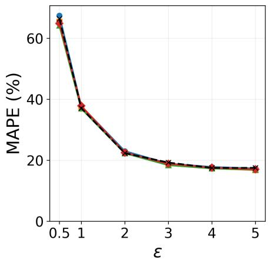

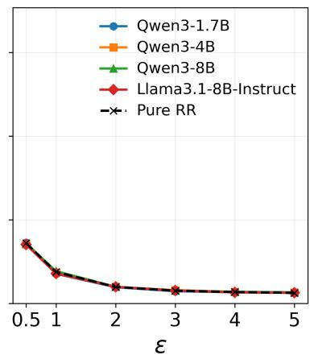

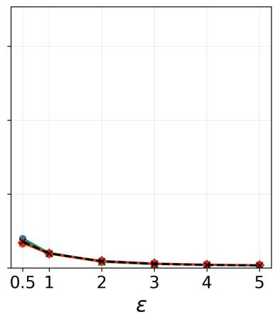  
Figure 5: MAPE versus privacy budget ε, with the ideal RR benchmark dashed. Left to right: $\lambda = 0 . 1 , 0 . 5 , 0 . 9$

## C.2 Efect of temperature and generation length

Higher temperature and longer generation lengths both increase the entropy of the text distribution. Figure 7 varies both temperature and the number of generated prefix tokens $T$ used for hashing and selection for Llama-3.1-8B-Instruct. Increasing temperature substantially reduces error for short prefixes, while longer prefixes attain lower error even at low temperatures. These trends agree with the theoretical intuition that higher entropy leads to lower error.

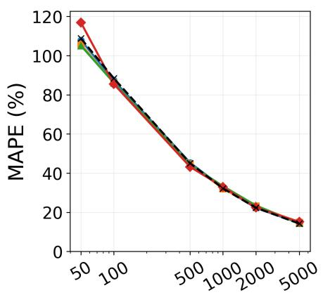  
n

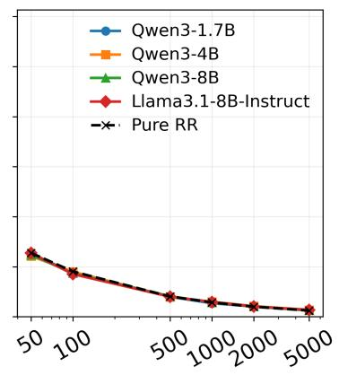  
n

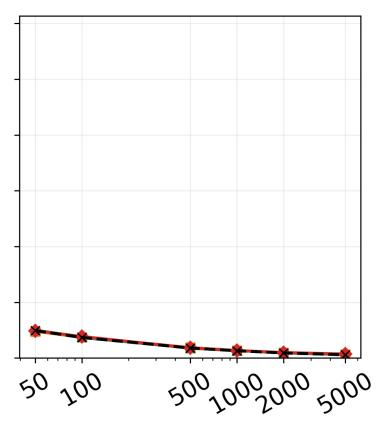  
n  
Figure 6: MAPE versus mixture size $n ,$ with the ideal RR benchmark dashed. Left to right: $\lambda = 0 . 1 , 0 . 5 , 0 . 9$

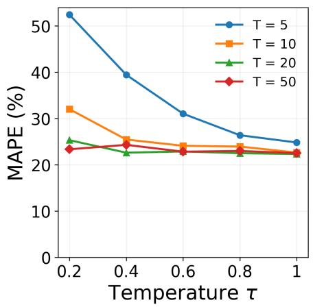

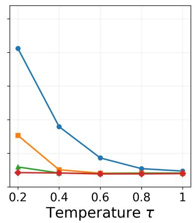

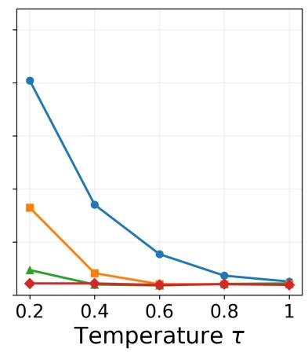  
Figure 7: MAPE versus temperature for Llama-3.1-8B-Instruct with prefix lengths $T \in \{ 5 , 1 0 , 2 0 , 5 0 \}$ Left to right: $\lambda = 0 . 1 , 0 . 5 , 0 . 9$

## C.3 Parallel versus rejection sampling

Figure 8 evaluates the parallel sampler in Algorithm 1 using the same C4 setup as Figure 1. Mean estimates remain close to the true prevalence across all four models, and the percentile bands narrow as ε increases. Compared with the rejection sampler, the parallel sampler has narrower bands, most visible at $\varepsilon = 1$ . This is consistent with its larger nominal green probability as described in Section 4.1.

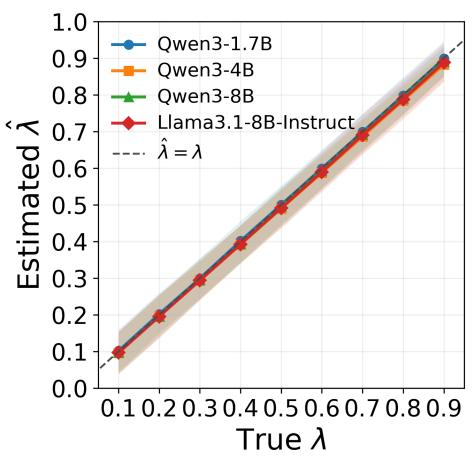

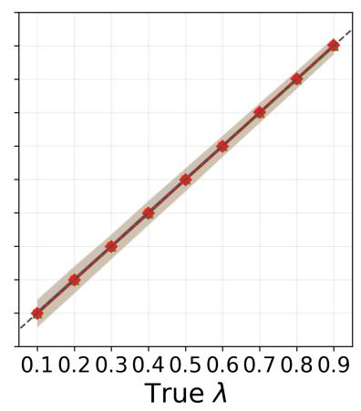

  
Figure 8: RGS parallel-sampling prevalence estimates on C4. Left to right: $\varepsilon = 1 , 2 , 3$ . Markers show means and shading shows 5th–95th percentiles over keys and repetitions.

## C.4 Efect of candidate budget

Figures 9 and 10 show that both samplers benefit substantially from increasing the candidate budget from $M = 2$ to $M = 8 .$ , with little further improvement at M = 20 or 32. A small budget limits the desired probability of returning a green sequence, as the rejection sampler may reach the cap before encountering a green sequence, and the parallel sampler may have too few green candidates to realize the nominal separation. As a result, a very small M will introduce downward bias.

## C.5 Efect of prompt diversity

We fix the mixture sample size at n = 500 and vary the number of distinct C4 prompts in the mixture over {1, 5, 10, 20, 50, 100}, allocating an equal number of responses to each prompt. We use Qwen3-4B at temperature 1 with $T = 2 0$ , rejection RGS with $\varepsilon = 2 , \pi _ { 0 } = 0 . 5$ , and $M = 2 0$ Figure 11 shows that increasing prompt diversity consistently reduces estimation error when the total sample size is fixed, consistent with theoretical findings in Section 5.

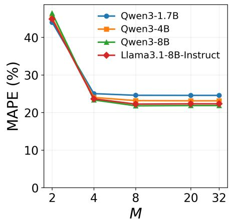

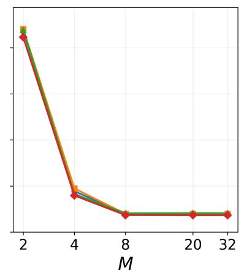

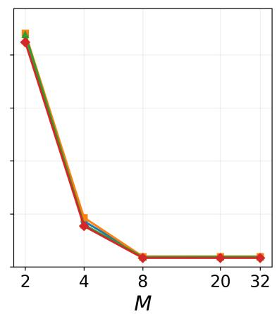  
Figure 9: MAPE versus candidate budget M for rejection sampling. Left to right: $\lambda = 0 . 1 , 0 . 5 , 0 . 9 .$

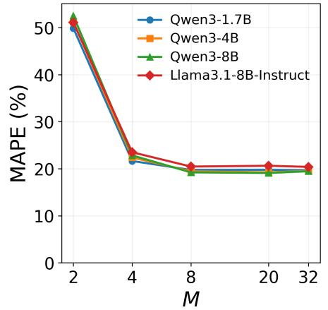

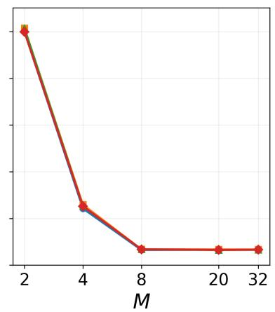

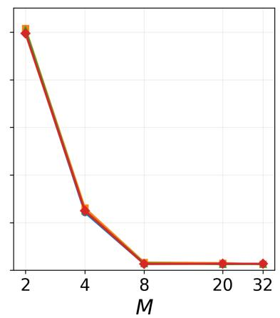  
Figure 10: MAPE versus candidate budget M for parallel sampling. Left to right: $\lambda = 0 . 1 , 0 . 5 , 0 . 9 .$

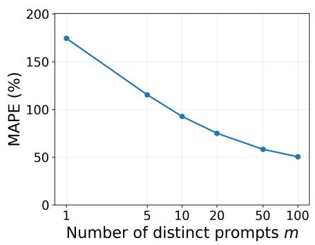

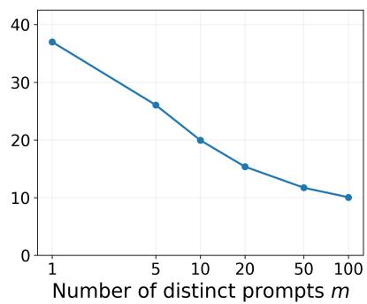

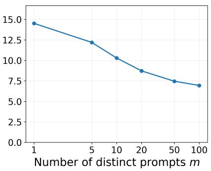  
Figure 11: MAPE versus prompt count for Qwen3-4B, with $n = 5 0 0$ and $T = 2 0$ . Left to right: $\lambda = 0 . 1 , 0 . 5 , 0 . 9$

## D Examples of RGS-watermarked text

Setting. We present example responses generated by the RGS watermark for five C4 prompts with Llama-3.1-8B-Instruct. We use the rejection sampler with ε = 2, π0 = 0.5, M = 20 and temperature 1. Each prompt is supplied as raw text without a chat template. The four completions presented for each prompt share the same key, with a diferent key used for each prompt. We display only the first 50 tokens of the completions.

## C4 prompts with four RGS-selected completions each

Prompt 0. Cluster comprises IBM’s Opteron-based eServer 325 server and systems management software and storage devices that can run Linux and Windows operating systems

1. . IBM has introduced a high-performance computing cluster, called eServer Cluster 1600, which includes the Linux operating system and the Viuke dual-core processor, a x86 chip from Sun Microsystems technology provider: Advanced Micro Devices (AMD). In this

2. . IBM’s "open" cluster, which comprises the eServer 325 (beta), IBM Systems Director software, and several storage subsystems, is generating interest among customers wanting a high-performance computing setup that accommodates a mix of operating systems, including

3. . Oracle has announced Oracle9i Release 2 Standard Edition, which includes a standard edition of Oracle9i Database Server, Oracle9i Application Server, Oracle Portal and Applications. Release 2 adds improved high availability, the ability to integrate business processes

4. . IBM is pushing the M@L cluster high-end servers into swift and fast implementation paths, highlighting Linux and Windows combinations. The recommendation is for IBM eServer cluster to ease and accelerate Highly-Scalable and optimized cluster solutions for employment by businesses

Prompt 1. Belying expectations, Prasar Bharti has earned only Rs 58.19 crore (Rs 581.9 million) as revenue during the

1. 2006-07 financial year. The figure is significantly lower than the Rs 750 crore (Rs 7.5 billion) expected by the organisation as an immediate step towards achieving its annual targets. The shortfall as estimated appears to be mainly due

2. first quarter of FY2023-24, till September 30th, which is just 38% of the total collection of Rs147.120 crore (Rs 1.4712 billion), projected for the entire year. The numbers were shared

3. current fiscal as against the budgeted estimate of Rs 1,061 crore (Rs 10.61 billion). According to the Prasar Bharti’s Annual Report 2010-11, the public sector undertaking (PSU) has failed to

4. April-June quarter, less than Rs 172 crore (Rs 1.72 billion) in the same period during the previous year. According to the revenue figures released by the ministry of information and broadcasting, the significant drop in revenue is partly due

Prompt 2. Marketers are employed in the public sector as well as the private sector. Most people think of marketing as a strictly private sector activity, but

1. in reality, many public sector jobs also involve marketing. Marketing is the functional process for which teams are tasked with the planning, creation, and distribution of ideas, goods, services, and values to develop cohort, create Brand awareness, and to achieve [

2. public sector employees also market products and services. Additionally, many marketers work in non-profit organizations and professional associations. After obtaining employment, they may assume roles which help to bring their product or services to their customers, then, develop and execute marketing strategies aimed

3. many government services and public institutions employ marketing professionals to convey information to the public. Overall, there are a wide range of careers to be found in both public and private sectors. The common term "marketer" generally refers to any marketing professional. Other

4. it is also a vital part in the public sector. While government and non-profit organisations may not have sales objectives in the same way as private companies, the need for customer awareness and a positive image translates to a need for efective marketing. In the public

Prompt 3. MIDDLETOWN, NJ - The Middletown Township Public Library and the Township of Middletown are pleased to announce the

1. launch of "Park ...Then", an innovative new program that combines public fitness classes, environmental education, and relaxed social gatherings at several of the Township’s parks. The program patterned after the successful "Park Fit" program, will feature a series of

2. launch of a "Fugitive" online public record search tool for the township. The new tool, which is available on the Township of Middletown Municipal Government website, allows users to search for fugitives based on name, race, sex

3. celebration of their second year of progress in making Middletown a more inclusive and welcoming community. Over the past year, the Township has made a concerted efort to engage in planning and community outreach to identify goals and objectives for inclusion and diversity, with

4. Middletown-Sayreville-Holmdel-Matawan community wide resource fair, taking place on September   
21, from 10:00 a.m. to 2:00 p.m. at the Middletown Township

Prompt 4. An eagerly awaited report from the World Health Organization (WHO) states that processed meats such as bacon and sausages cause cancer, and red meat

1. , such as beef, may be carcinogenic to humans. The report, from the WHO’s International Agency for Research on Cancer (IARC), recognizes that a clear link between processed meat consumption and cancer has been demonstrated as a causal link. A class

2. increases cancer risk. Photo:Getty Australia’s biggest meal kit delivery service, Marley Spoon, says it is taking the World Health Organization’s recent cancer warnings on processed and red meat seriously. The WHO says that eating processed meat, such as bacon

3. may also carry a cancer risk. A team of 22 experts from 10 countries conducted a review of more than 800 scientific studies on the relationship between diet and cancer. The report’s findings are as follows: –Consuming 50 grams of

4. consumption is also linked to an increased risk of cancer. The WHO’s International Agency for Research on Cancer (IARC) classified processed meat as "carcinogenic to humans", group 1. This is the highest level of classification, assigned to substances