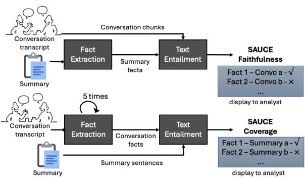
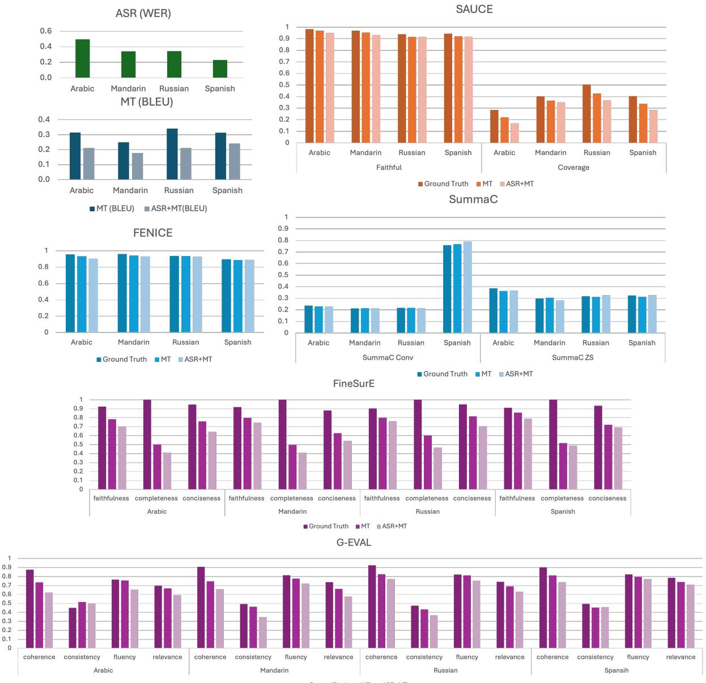
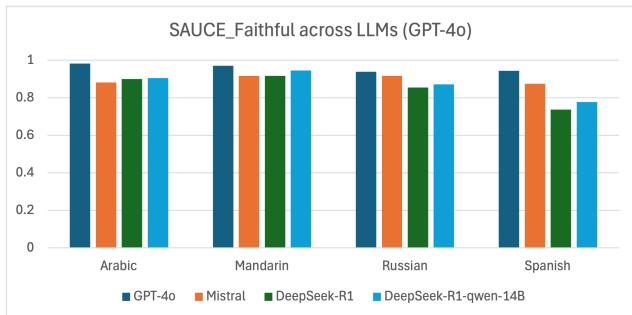
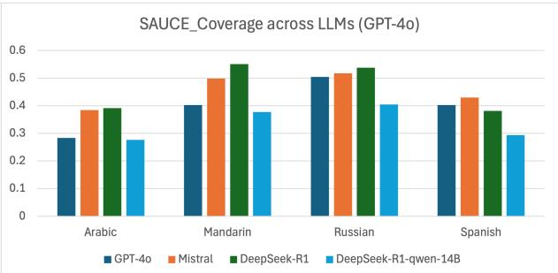

# SAUCE: Summary Analysis Using Conversation Entailment

Man-Ling Sung, Hemanth Kandula, Jeff Ma, William Hartmann, Matthew Snover RTX BBN Technologies Cambridge MA, USA

## Abstract

With the growing need for evaluating Large Language Models (LLMs) and their applications to speech, challenges persist in summarizing and evaluating conversations that lack a clear end goal. We introduce SAUCE – a reference-free, fact-based evaluation pipeline for cross-lingual conversational speech summarization. It measures the accuracy and the fact coverage of a summary through the entailment between conversation and text. We compare SAUCE against several popular summarization metrics and demonstrate the effectiveness of capturing information loss due to transcription and translation error and identifying broken summaries. Crucially, unlike black-box LLM evaluators or dense embedding metrics, SAUCE is inherently explainable: it maps summary scores to discrete, verifiable facts, allowing users to pinpoint exact hallucinations or omissions. We illustrate how this interpretability helps developers systematically profile LLM behaviors and gives end-users an actionable tool to verify summary accuracy in noisy, real-world conditions. Preliminary investigations show SAUCE strongly align with human judgment.

## 1 Introduction

Machine-generated summarization quality has rapidly improved with the advent of large language models (LLMs) and is commonly used by users for tasks like understanding research papers and generating meeting notes. In some cases, LLMbased summaries have been found to be more accurate than reference summaries in existing academic datasets (Zhang et al., 2024). Evaluation of summary quality remains a critical challenge, as there is no single true summary for a given document; instead, a distribution of possible summaries can be considered correct (Jung et al., 2024). Users also have their own preferences in terms of both style and content. Any variation in user preference would change the corresponding reference summary, making it impossible to generate sufficient reference summaries to encapsulate these variations. Most existing metrics and measurement pipelines lack the ability to provide quantitative analysis, making it difficult for end users to perform a systematic analysis of summary quality. In the scenario of daily conversation—where the end goal and information-flow structure are often unclear— it becomes even harder to evaluate summary quality. A quantitative measurement pipeline for such data will assist end users to efficiently evaluate summaries and provide developers with constructive direction for model selection and improvement.

We believe that it is necessary to create quantitative reference-free evaluation metrics in order to accommodate the flexibility of the task. As with prior work, we agree that a single metric cannot capture all of the necessary dimensions (Gehrmann et al., 2023). When the scope and end goal are not clearly defined, we believe it is important for the summary to include as much key information as possible and be factually accurate, given the word limit. Therefore, we propose an evaluation pipeline—Summary Analysis Using Conversation Entailment (SAUCE), that captures two specific aspects of the summary: Faithfulness and Coverage, where faithfulness captures whether the information in the summary is supported by the text (factual accuracy) and coverage captures whether the important information in the text is captured by the summary (coverage of key information).

We consider the specific use case of evaluating cross-lingual conversational speech summarization. This is a challenging task where human-generated reference summaries do not exist. It’s also underresearched compared to traditional text problems. The content is less structured and goal-oriented, unlike meeting recordings or voice messages. Furthermore, conversational speech presents unique challenges beyond simply lacking a clear end goal. Spontaneous dialogues are riddled with disfluencies, speaker overlaps, and topic shifts. When these complexities are compounded by cascading errors from Automatic Speech Recognition (ASR) and Machine Translation (MT), the semantic surface of the text is fundamentally altered. In these noisy conditions, a critical limitation of both traditional n-gram metrics and modern LLM-as-a-judge frameworks is their lack of explainability. When a summary receives a low score, end-users are left guessing whether the penalty stems from a hallucinated entity, a missed core topic, or a stylistic bias. A quantitative measurement pipeline must not only score a summary but also provide a transparent audit trail of why the summary succeeded or failed. SAUCE addresses this by providing a transparent, fact-by-fact ledger. Every score is entirely traceable to atomic facts, making the evaluation both interpretable and actionable.

Our contributions are to provide a summarization evaluation pipeline that can: 1) effectively evaluate cross-lingual conversations in the presence of ASR and MT errors, 2) score factually without human annotation and 3) provide interpretability and quality measurement when the end goal of the text is not clearly defined.

## 2 Related work

The two major directions for summarization evaluation are reference-based and reference-free. Reference-based metrics are the more traditional approach and require one or more reference summaries—typically generated by humans—for comparison. ROUGE (Lin, 2004) and BERTScore (Zhang et al., 2019) are popular examples. They compute a similarity score for matching word units or tokens, sentence by sentence between the candidate summary and reference summary. While widely used in the community, research shows they only measure topic presence rather than factual accuracy in the summary (Deutsch and Roth, 2021). ROUGE is also not sensitive enough to the impact of major errors in the input, like those from ASR or MT errors (Nelson et al., 2024).

Due to both the limitations and the difficulties of reference-based approaches, a number of referencefree metrics have been proposed as well. One general line of work is on measuring factual consistency through text entailment. Text entailment, as known as Natural Language Inference (NLI), measures how the hypothesis and generated text align or contradict each other. SummaC (Laban et al., 2022), a popular example, measures the coherence between the document and summary by segmenting the document into sentence units and scoring document and summary sentence pairs with text entailment models. Its better performing variant $\mathbf { S u m m a C _ { C o n v } }$ is heavily trained on a specific text domain, which may not generalize to our crosslingual conversation setting. FENICE extends the evaluation capability to long-form text summarization with claim extraction and entailment, follow by coreference resolution (Scirè et al., 2024).

Another approach to reference-free evaluation is to directly use LLMs for scoring (Akkasi et al., 2023), such as GPTScore (Fu et al., 2024). This $\mathrm { " L L M - a s - a - j u d g e " }$ paradigm typically involves prompting high-capacity models like GPT-4 to evaluate summaries across various dimensions of interest. G-Eval (Liu et al., 2023) pioneered this by using chain-of-thought (CoT) prompting to align model scores with human judgment, while Prometheus (Kim et al., 2023) and JudgeLM (Zhu et al., 2023) introduced fine-tuned, open-source alternatives designed for reproducibility. FineSurE (Song et al., 2024) extends the work to include LLM to extract key facts for LLM scoring. While these frameworks can provide qualitative explanations, they are difficult to interpret quantitatively and become computationally infeasible when scaling to the massive/gigantic datasets typical of realworld applications. Furthermore, these evaluators are susceptible to significant systematic biases, selfpreference bias (Panickssery et al., 2024), verbosity bias, where longer summaries are unfairly favored (Hu et al., 2024), and a recently identified overlap bias where LLMs increasingly favor AI-generated summaries over human-written ones (Fang et al., 2026). Most critically, LLM judges often overlook granular factual contradictions in favor of surfacelevel fluency (Chen et al., 2024; Fu et al., 2024), which further motivates our need for the explicit, fact-extraction and entailment pipeline proposed in this work. Fact checking of the extracted facts against an external knowledge database is not in the scope of this work.

## 3 Proposed approach

SAUCE evaluates faithfulness and coverage of the summary with 2 metrics: $\mathrm { S A U C E } _ { \mathrm { F a i t h f u l } }$ and $\mathrm { S A U C E _ { C o v e r a g e } }$ . SAUCEFaithful measures the percentage of summary facts entailed by the conversation and $\mathbf { S A U C E _ { C o v e r a g e } }$ measures the percentage of conversation facts covered in the summary. It can be seen as an agentic workflow that uses an

LLM to extract key information from the text.

## 3.1 Pipeline Design

  
Figure 1: Workflow of the SAUCE. The user can access the fact-text pairs to understand the missing or wrong information in the summary with corresponding faithfulness and coverage scores.

SAUCE consists of fact extraction followed by text entailment. Illustrated in Figure 1, we first extract atomic facts from the conversation/summary with GPT-4o (gpt-4o-2024-08-06), then determine if the facts are entailed by the summary/conversation using DeBERTa-v3 (deberta-v3- large-mnli). While LLMs are prone to hallucination, they have been shown to outperform other models with about 90% accuracy in the task of fact extraction (Polak and Morgan, 2024; Dagdelen et al., 2024). Our internal evaluation found the extracted facts to be over 98% accurate. We use DeBERTa-v3 as the text entailment model because of its state-of-the-art performance in this task (He et al., 2021) and its limited computational requirements.

To calculate SAUCEFaithful, after extracting all the facts in the summary, the facts are scored against chunks of the conversation, with 5 lines of conversation per chunk. If a fact-to-chunk pair scores higher than a threshold, then the fact is considered to be entailed by the conversation. The score is calculated as the proportion of matched facts. We also experimented with entailing summary facts against facts extracted from the conversation, but found that the proposed fact-to-chunk approach yields significantly better performance.

For SAUCECoverage, we ask the LLM to only extract the N most important facts from the conversation, where N is defined by the length and desired content compression rate of the task. We do not ask for all the facts in the conversations because the LLM will frequently generate over 100 facts from a 10-minute recording, defeating the purpose of summarizing the conversation. Importance is subjective, but in the case of a topic-defined conversation, the LLM can be guided towards preferring certain topics and information through prompting. To overcome the nondeterministic output from the LLM, we extract the N most important facts 5 separate times and concatenate the list for scoring. We also assume that facts that are selected multiple times are more likely to be important. For text entailment, each fact is scored against each line of the summary. This score is calculated as the proportion of matched facts.

A key advantage of SAUCE is its transparent by-product: the fact ledger. Rather than outputting a single opaque float value, the system surfaces the exact list of atomic facts that were successfully entailed and those that were contradicted or unsupported. For end-users, this ledger acts as a rapid verification tool to check a summary against the source without re-reading the entire transcript. For developers, it isolates errors of hallucinations, captured by unentailed summary facts, from errors of omission (missing key topics, captured by unentailed conversation facts).

## 3.2 Performance on Conversation Entailment

Fact-to-fact (sentence-to-sentence) entailment has been widely studied in the text community. However, much of the work has focused on written text as opposed to conversational speech. In order to verify whether DeBERTa-v3 is suitable for fact-to-conversation entailment, we evaluate the setup on a publicly available conversation entailment dataset from MSU (Zhang and Chai, 2009). It consists of hypothesis statements and supporting conversation chunks from Switchboard1 extracted by human annotators. Conversation entailment is a challenging problem; only half of all the statements MSU collected are agreed upon by all annotators. Based on our internal analysis, we found many instances where the entailment was questionable, or the statements were only entailed when considering the conversation as a whole.

We set up two experiments to evaluate our conversation entailment setup. First, we directly entail the conversation chunks and statements in the dataset with DeBERTa-v3. Second, we take the whole conversation that each chunk belongs to and run our SAUCEFaithful scoring on it; the most entailed conversation chunks are scored. We experimented with a threshold of 0.9, 0.95 and 0.98.

<table><tr><td>Selected chunk</td><td>Full conversation</td></tr><tr><td>Thres 0.9 0.95 0.98</td><td>0.9 0.95 0.98</td></tr><tr><td>All 77.0 79.2 77.0</td><td>68.1 71.4 74.2</td></tr><tr><td>NoEnt. 63.6 71.6 77.1</td><td>39.7 49.9 61.4</td></tr><tr><td>Ent. 88.4 85.7 80.0</td><td>92.2 89.7 85.0</td></tr></table>

Table 1: Accuracy rate (%) on conversation entailment. Ent. - entailed pairs, NoEnt. - non-entailed pairs.

Results are shown in Table 1.

Non-entailed pairs have worse performance than entailed pairs. Most of the mis-entailed statements are those where the tenses or identities of speakers are swapped (see Table 2). This reflects that even with acceptable performance, text entailment models are not tailored made for conversations entailment. We also noticed the dataset has annotation issues; some of the selected conversation chunks from the entailed pairs do not support the statement in the data, but other parts of the conversation do support the statement. For the remainder of our study, we select a threshold of 0.9 as we believe it is more critical to correctly detect entailed pair when it is present.

## 4 Evaluation of metrics on summarized ASR+MT conversations

To evaluate our proposed metrics, we analyze performance on a number of scenarios. The first evaluation is to compare the performance on the conversational speech summarization task with transcription and translation errors.

## 4.1 Datasets

We experiment on conversational telephone speech (CTS) across 4 languages, Arabic, Spanish, Mandarin and Russian. Audio and transcripts are available through the LDC (Linguistic Data Consortium) for all languages. CallHome2 is used for Arabic, CallHome3 and Fisher4 for Spanish, HUB55 for Mandarin and Mixer 3 Speech6 for Russian. Crowd-sourced English translations are publicly available for Arabic (Kumar et al., 2014) and Spanish (Post et al., 2013). Mandarin (Wotherspoon et al., 2024) and Russian are our in-house translations. Each conversation is 10 minutes long in average. The selection of CTS data fits the domain of loosely defined and structured conversation, which SAUCE is designed to handle. CallHome and Call-Friend corpora contain conversations with family and friends. There are no clearly defined goals and speakers can discuss anything. The Fisher corpus defines topics to discuss, but there is no requirement for the speakers to come to any conclusion.

## 4.2 Experiment setup

Summary: We prompt GPT-4o to generate a 200-word summary for each conversation. We specifically prompt the model to generate concise and comprehensive summaries with clarity, based only on the provided conversation and to include the main ideas and essential information. We experimented with a range of prompts, but they have a limited impact on the overall quality of the summaries when there is no topic specified. We tested various word limits ranging from 50, 100, 200 and 500 words, and found 200 words to be a good balance considering the length of the conversation and readability to a human user. The LLM is forced to downselect information included in the summary.

ASR+MT pipeline: We use a cascaded ASR+MT pipeline to obtain the English conversations for summarization containing ASR+MT errors. We use Whisper-large-v3 (Radford et al., 2023) for ASR and NLLB-200-distilled-1.3B (Costa-jussà et al., 2022) for MT. Both models are fine-tuned with the training set of each specific language. While we use a cascaded approach for the purpose of measuring the impact of ASR and MT errors, our metrics would be equally applicable to direct speech summarization approaches (Shang et al., 2024).

Evaluation: All the dev and test sets of each language are used for evaluation. We set N=20 for conversation fact extraction for evaluating 200 words summary. We compared our metrics along with SummaC and FENICE, NLI-based metrics that is similar with SAUCE, as well as LLM-asjudge metrics: G-EVAL and FineSurE.

For our metrics, each summary is scored against their ground truth conversation chunks for $\mathrm { S A U C E } _ { \mathrm { F a i t h f u l } }$ and facts extracted from the ground truth conversation for $\mathrm { S A U C E _ { C o v e r a g e } . }$ All the other metrics score the summary according to how their pipelines are setup, either against the ground truth conversation (SummaC, G-EVAL) or its extracted facts (FENICE, FineSurE). For SummaC, we used the recommended $\mathrm { S u m m a C _ { C o n v } }$ (Convolution of the NLI sentence pair matrix) and the traditional Summa $\mathrm { C } _ { \mathrm { Z S } }$ (Zero-Short model). To ensure a fair evaluation on conversation entailment, we expanded the granularity to 5 sentences to match our $\mathrm { S A U C E } _ { \mathrm { F a i t h f u l } }$ scoring setup.

<table><tr><td>Extracted Fact</td><td>Chunked conversation</td></tr><tr><td>getting sick</td><td>B&#x27;s mother got in trouble for B: Oh no, I can remember my mother getting in trouble if, you know, one of was sick, and I know she probably didn&#x27;t make hardly</td></tr><tr><td></td><td>anything, you know, compared to the work that she did.</td></tr><tr><td></td><td>A plays on MURPHY BROWN A: He, he plays [laughter] on MURPHY BROWN.</td></tr></table>

Table 2: Examples of non-entailed pairs that are mis-classified as entailed. The first row confuses factual and hypothetical scenarios, which is also confusing to humans. Second row confuses the subject, the speaker vs. the person indicated by ‘he’.

## 4.3 Results on summary evaluation

We present the average of the ASR and MT scores in WER (Word Error Rate, the lower the better) and BLEU along with the summary scores on the ground truth, MT and ASR+MT translations in Figure 2. Breakdown of the scores are in Appendix B.1.

## 4.3.1 Comparison with NLI-based metrics

Among the NLI-based metrics, SAUCE is the only metric that have a consistent drop when MT and ASR+MT errors are introduced, while the SummaC metrics do not have a consistent pattern on different languages, and FENICE has very limited degradation especially on Spanish.

Given the high WER and its contribution to a large drop in BLEU (8-12% absolute), we expect a large impact on summarization quality. $\mathbf { S A U C E _ { C o v e r a g e } }$ is nearly cut in half when both ASR and MT errors are introduced—reflecting the fact that GPT-4o has difficulty extracting information with the degradation in transcription accuracy and translation quality—while there is no significant impact on $\mathrm { S u m m a C _ { C o n v , Z S } }$ and FENICE. $\mathrm { S A U C E } _ { \mathrm { F a i t h f u l } }$ and FENICE are more consistent and maintain a score of 90+%, regardless of the quality of the input. Based on our investigation, we find that GPT-4o generates more generic summaries in the presence of these errors. The lost of information is captured by $\mathbf { S A U C E _ { C o v e r a g e } }$ . However, FENICE lacks a "Coverage" metric, making it blind to omitted information, only very limited degradation is observed with the errors introduced.

$\mathbf { S u m m a C _ { C o n v } }$ sees a 40-60% absolute difference between Spanish and the other three languages. We suspect the large shift is due to differences in linguistic structure and word usage compare. SummaC is primary designed for written text and might not perform well on conversational style data, especially in languages that differ significantly from the training data.

Both SummaC and FENICE adopt a stricter NLIbased pipeline to avoid LLM errors, but their traditional NLP models and mechanisms, which were built on structured text, completely break down when confronted with the disfluencies, speaker overlaps, and ASR/MT errors typical of natural speech.

## 4.3.2 Comparison with LLM-as-judge metrics

Compared with G-EVAL and FineSurE, consistent degradation is observed in all metrics under MT and ASR errors, except for G-EVAL’s consistency in Arabic and Spanish. LLM-as-ajudge frameworks like G-EVAL and FineSurE act as computationally expensive "black boxes" that are highly susceptible to biases and tend to favor surface-level fluency over strict factual accuracy, making it difficult to trace exactly why a score was given. Even though FineSurE attempts to ground its evaluation by extracting key facts, it still ultimately depends on the LLM’s inherent reasoning to output a score. Additionally, FineSurE specifically suffers from an empirical flaw in its alignment logic (As shown in figure 2): when evaluating a Ground Truth (GT) summary against key facts extracted from that exact same GT summary, the LLM fails to score a perfect 100% in faithfulness, proving that using an LLM to judge semantic alignment is inherently unreliable. The 100% completeness across all languages, which implies that all key information is included in the GT summaries, seems unrealistic. This is because information is inevitably omitted during summarization, especially in long conversations (e.g., those lasting 30 minutes in the Mandarin dataset). SAUCE resolves these issues by using LLMs only for robust fact extraction and a dedicated NLI model for strict entailment, yielding a transparent, fact-by-fact ledger that reliably measures both faithfulness and coverage despite heavy noise. For the complete dataset and granular sub-metric scoring, see Table 7 in the Appendix.

  
Figure 2: Mean WER and BLEU scores of each language, and their summary scores on ground truth, MT and ASR+MT English transcriptions. We present the plots in orange for SAUCE, blue for NLI-based metrics, purple for LLM-as-judge metrics.

## 4.4 Analysis on summaries

We selected conversation sp\_1578 from Spanish CallHome and listed the summaries and SAUCE and SummaC scores in Table 3. There is a constant drop in $\mathbf { S A U C E _ { C o v e r a g e } }$ and some degradation in $\mathrm { S A U C E } _ { \mathrm { F a i t h f u l } }$ when errors are introduced. The $\mathrm { S u m m a C } _ { \mathrm { C o n v , Z S } }$ metrics do not show the degradation consistently. We highlight a few sentences, denoted with letters for comparison. The quality of the summary degrades across versions; the overall description of topics in (a) becomes more generic, which is still accurate (match on $\mathrm { S A U C E } _ { \mathrm { F a i t h f u l } } )$ but loses some information (drop in $\mathrm { S A U C E } _ { \mathrm { C o v e r a g e } } )$ . Facts are also distorted due to transcription and translation errors, causing drop in both $\mathrm { S A U C E } _ { \mathrm { F a i t h f u l } }$ and $\mathrm { S A U C E _ { C o v e r a g e } }$ . For example, (b) Carlos did not receive assistance is distorted to not receiving attention in the MT version to himself showing a lack of interest in ASR+MT. (c) Ernesto, from “buying a car and learning to drive" to “planning to purchase $\mathbf { a } \thinspace \mathbf { c a r " }$ with ASR+MT errors. The connection between facts also disappears due to $\mathbf { A S R + M T }$ errors, as in (d), which does not hurt $\mathrm { S A U C E } _ { \mathrm { F a i t h f u l } }$ but hurts $\mathbf { S A U C E _ { C o v e r a g e } }$ when the facts that look for correlations between incidents are missing. For example of conversation facts used for scoring, see Appendix B.2. The metrics make the impact of these cascading errors highly interpretable. When faced with ASR+MT degradation, we observe that the LLM often adopts a conservative generation strategy. It retreats to producing generic, high-level statements that remain factually accurate (maintaining high faithfulness) but strips away the granular, nuanced details of the conversation (causing a sharp drop in coverage). Traditional metrics like SummaC obfuscate this behavioral shift, whereas our fact-level mapping explicitly diagnoses it.

## 4.5 Experiment on metrics correlation

We also evaluate the correlation of the conversation quality and metrics at the document level. We believe that with ASR and MT errors introduced, the quality of the transcription should degrade so as the summary quality. Therefore, we measured the Kendall pair-wise rank correlation coefficient (Abdi, 2007) of ground truth and ASR+MT summary pairs against the metrics, assuming more error corresponds to worse summary quality, thus lower scores. In Table 4, $\mathrm { S A U C E } _ { \mathrm { F a i t h f u l } }$ and $\mathbf { S A U C E _ { C o v e r a g e } }$ are highly correlated with conversation quality, with $\mathrm { S A U C E _ { C o v e r a g e } }$ being more correlated than $\mathrm { S A U C E } _ { \mathrm { F a i t h f u l } }$ . While $\mathrm { S u m m a C _ { C o n v , Z S } }$ shows little to no correlation.

## 5 Broken summary evaluation

A robust system should be able to detect improperly formatted or unreadable (garbage) summaries. We experimentally test whether evaluations metrics can identify them.

## 5.1 Experiment setup

CallHome Spanish and Arabic Eval sets are used for this experiment. Normal 200-word summaries are generated by off-the-self Mistral7B-instructv0.3 (Jiang et al., 2023) on the ground truth conversations. Broken summaries (example in Figure 3) are generated by fitting the same conversations and prompt to an over-compressed Mistral7B model with td2 quantization. The summaries are scored against the ground truth conversation with $\mathrm { S u m m a C _ { C o n v , Z S } }$ , and SAUCEFaithful, Coverage.

manualugnochiougnoaudepu reality manusatteratemommpu familjen manusoisaude manusoisois>?iman manual meal manusoisficariosfica:<rovimanamilymemoisahan::< manualahanoisoso曲 alommem>?dv SPI familjenmemoisoisattan>?ois>?osopuéugnoois manusommalomatem realityustachioatem manusste fis >?

Figure 3: Example of broken summary.

## 5.2 Results

In Table 5, when applying different scoring metrics on the broken Spanish summaries, the scores in $\mathbf { S u m m a C _ { C o n v } }$ are still higher than normal Arabic summaries. In our setup, it would be possible to identify such model dysfunction with the exceptionally low $\mathrm { S A U C E } _ { \mathrm { F a i t h f u l } }$ and SAUCECoverage.

## 6 Evaluation of off-the-shelf LLMs

Lastly, we would like to know, given a set of models to choose from, how SAUCE can help end users to understand the models’ behaviors and identify a suitable model for their tasks.

## 6.1 Experiment Setup

We compare various existing LLMs using our proposed metrics, namely GPT-4o, Mistral7Binstruct-v0.3, DeepSeek-R1 (Guo et al., 2025) and its distilled version using the Qwen2.5 model (Hui et al., 2024) (DeepSeek-R1-Distill-Qwen-14B). We experimented with various prompts on different models, but maintained the same prompt in Section 4 to generate 200-word summaries from ground truth conversations because the difference in summary style across prompts is not significant.

## 6.2 Results and Analysis

Figure 4 shows the average $\mathrm { S A U C E } _ { \mathrm { F a i t h f u l } }$ and $\mathbf { S A U C E _ { C o v e r a g e } }$ of four off-the-shelf LLMs across English translated from four languages. GPT-4o achieves the highest $\mathrm { S A U C E } _ { \mathrm { F a i t h f u l } }$ , while DeepSeek attains the highest $\mathrm { S A U C E } _ { \mathrm { C o v e r a g e } }$ . Coverage degrades after distilling DeepSeek-R1 to a smaller 14B model. Surprisingly, DeepSeek-R1’s $\mathrm { S A U C E } _ { \mathrm { F a i t h f u l } }$ is the lowest, even lower than its distilled variant. $\mathbf { S A U C E _ { C o v e r a g e } }$ of GPT-4o is less than that of a much smaller Mistral-7B and is sometimes only comparable to DeepSeek-14B in Arabic and Mandarin. These results suggest that DeepSeek-R1 is less accurate than its distilled version, and although GPT-4o produces the most accurate summaries, they cover less detail than those of other models.

We analyzed the summaries and identified several model behaviors that explain the observed scores (detailed examples and analysis are in Appendix Section C). Misspellings and incorrect information lower faithfulness, while omitting subject details reduces coverage. We observed that GPT-4o summarizes the information both globally and locally; specific statements are compressed into more generic wording. This aligns with its high $\mathrm { S A U C E } _ { \mathrm { F a i t h f u l } }$ but lower $\mathbf { S A U C E _ { C o v e r a g e } }$ . In contrast, Mistral7B and DeepSeek-R1 tend to preserve specific wording, producing extractive-like summaries. However, hallucination occurs more often, introducing misinterpreted details or information that never appeared in the conversation. This reflects the higher $\mathbf { S A U C E _ { C o v e r a g e } }$ but lower $\mathrm { S A U C E } _ { \mathrm { F a i t h f u l } }$ scores. Distilled DeepSeek contains less out-of-scope details its full model, also reflected in its higher $\mathrm { S A U C E } _ { \mathrm { F a i t h f u l } }$ . Smaller model may lack the capacity for interpretation, making it more likely to quote directly from the source text.

<table><tr><td rowspan=1 colspan=1>Summary from human translation $\mathrm { ( S A U C E _ { F a i t h f u l } ; }$ 0.94, $\mathrm { S A U C E _ { C o v e r a g e } } ;$ 0.6, SummaCConv: 0.6, SummaCzs: 0.47)</td></tr><tr><td rowspan=1 colspan=1>In the conversation, two individuals discuss various (a) personal matters involving health, family, and home renovations.One of them recently visited Joana to deliver some clothes, and discovered that Isa was sick with a cold. (b) Carlos, whodrove the speaker, received no assistance during the visit. The conversation reveals that there isn&#x27;t much improvement inIsa&#x27;s condition, but there is a hope for becoming more independent. (c) Ernesto, a family member, has bought a car and islearning to drive, bringing some cheerful news. The family is also involved in home improvements, including adding astore and planting grass, enhancing their surroundings. However, the speakers acknowledge some ongoing challenges,emphasizing the importance of gratitude and support, especially for Carlos, who is not in a good place mentally. (d)Carlos’ surgery was postponed due to his cold and allergies, reminiscent of one speaker&#x27;s past experience with an adversereaction to antibiotics, leading to a discussion about the risks of self-medication....</td></tr><tr><td rowspan=1 colspan=1>Summary from MT $( \mathrm { S A U C E } _ { \mathrm { F a i t h f u l } } ;$ 0.82, SAUCECoverage: 0.44, $\operatorname { S u m m a C } _ { \operatorname { C o n v } } \colon$ 0.74, SummaCzs: 0.43)</td></tr><tr><td rowspan=1 colspan=1>In a conversation between two individuals, they discuss various topics, including (a) personal encounters, family news,and health concerns. One participant mentions visiting Joana to drop off clothes and finding Isa unwell due to a cold.(b) There&#x27;s a discussion about Carlos, who seems to be undergoing challenges but not receiving much attention. Theconversation shifts to family updates, (c) mentioning Ernesto&#x27;s new car purchase and driving lessons, as well as homerenovations being done by several friends and family members like Cristi and Gaby. The tone reflects a mixture of envyand gratitude, emphasizing the importance of being thankful despite current hardships. They highlight the significance offamily unity, particularly regarding Carlos&#x27;s need for support amidst his health issues. (d) Carlos is recovering but has hadan operation postponed to November due to sinusitis-like symptoms. ...</td></tr><tr><td rowspan=1 colspan=1>Summary from $\mathbf { A S R } + \mathbf { M T } \left( \mathbf { S A U C E } _ { \mathrm { F a i t h f u l } } ; \right.$  $0 . 8 4 , \mathrm { S A U C E _ { C o v e r a g e } } ;$ 0.2, $\operatorname { S u m m a C } _ { \operatorname { C o n v } } \colon$ 0.54, SummaCzs: 0.42)</td></tr><tr><td rowspan=1 colspan=1>In the conversation, the speakers discuss (a) various personal and familial updates. Speaker A mentions visiting Joanato drop off clothes and encountering Isa, who is sick with a cold. Isa&#x27;s condition and the (b) lack of interest shown byCarlos, who accompanied A, are highlighted. The speakers discuss the need for A to reconsider certain decisions, butA resolutely rejects this notion, emphasizing independence and familial unity as priorities. The conversation shifts tonews about (c) Ernesto planning to purchase a car, while renovations are underway on friends&#x27; and family&#x27;s houses. Bpraises these efforts but expresses frustration with perceived stagnation in their situation. The speakers highlight gratitudetowards God for their inner wellbeing and unity, despite external challenges. A underscores the importance of supporting(d) Carlos, particularly due to his health issues, which include a postponed surgery due to allergies. ...</td></tr></table>

Table 3: Summaries and scores on Spanish conversation (sp\_1578) on ground truth, and with MT, ASR+MT error. Sentences related to the same set of facts are colored and labeled with corresponding alphabets.

<table><tr><td>Metric</td><td> $\mathrm { S A U C E } _ { \mathrm { F a i t h f u l } }$ </td><td> $\mathbf { S A U C E _ { C o v e r a g e } }$ </td><td> $\mathrm { S u m m a C _ { c o n v } }$ </td><td> $\mathrm { S u m m a C _ { Z S } }$ </td></tr><tr><td>Kendall rank coef.</td><td>0.153</td><td>0.677</td><td>-0.266</td><td>0.008</td></tr></table>

Table 4: Tau coefficient of metrics on ground truth and ASR+MT conversations. Assumes summaries generated from ground truth are better than summaries generated from ASR+MT output.

Ultimately, the explainability of SAUCE transforms model evaluation from a ranking exercise into a diagnostic one. Because every score is tied to discrete facts, we know exactly why DeepSeek’s $\mathrm { S A U C E } _ { \mathrm { F a i t h f u l } }$ is lower (it hallucinates non-existent conversational filler) and why GPT-$4 0 ^ { \circ } \mathrm { s \ S A U C E _ { C o v e r a g e } }$ is lower (it over-compresses specific events into abstract concepts). This factbased traceability allows developers to make highly informed trade-offs based on their specific application needs, such as choosing Mistral-7B for highcoverage extractive tasks or GPT-4o for SAUCE, high-faithfulness abstractive overviews.

## 6.3 Human evaluation on summaries quality

We also performed an internal evaluation on the metrics against human intuition. We asked 12 participants to rank a small set of summaries generated by the 4 LLMs, based on accuracy and informativeness, resulting in 132 rank pairs. We calculate the Kendall’s rank coefficient on the human ranked pairs and metrics ranked pairs in Table 6. Pairs with less than a 0.05 score difference are treated as a tie. This is a difficult task and inter-conversation ranking pair agreement is only 60% between participants. In Table 6, $\mathrm { S A U C E _ { C o v e r a g e } }$ is highly correlated with informativeness and $\mathrm { S A U C E } _ { \mathrm { F a i t h f u l } }$ is most correlated to accuracy, indicating our metrics align with human judgment.

<table><tr><td>Metrics</td><td> $\mathbf { S u m m a C _ { C o n v } }$ </td><td> $\mathrm { S u m m a C _ { Z S } }$ </td><td> $\mathrm { S A U C E } _ { \mathrm { F a i t h f u l } }$ </td><td> $\mathbf { S A U C E _ { C o v e r a g e } }$ </td></tr><tr><td> $\mathrm { S p a n i s h } _ { \mathrm { n o r m } }$ </td><td>0.641</td><td>0.307</td><td>0.941</td><td>0.358</td></tr><tr><td> $\mathrm { S p a n i s h } _ { \mathrm { b r o k e } }$ </td><td>0.598</td><td>0.104</td><td>0.356</td><td>0.000</td></tr><tr><td> $\mathbf { A r a b i c _ { n o r m } }$ </td><td>0.221</td><td>0.395</td><td>0.980</td><td>0.363</td></tr></table>

Table 5: Metrics on Eval sets. $\mathrm { S p a n i s h } _ { \mathrm { n o r m } }$ and $\mathbf { A r a b i c _ { n o r m } }$ are normal summaries, $\mathrm { S p a n i s h } _ { \mathrm { b r o k e } }$ is broken summaries.

Figure 4: $\mathrm { S A U C E } _ { \mathrm { F a i t h f u l } }$ and $\mathrm { S A U C E _ { C o v e r a g e } }$ on 4 LLMs across 4 languages translated into English.
<table><tr><td>Coef.|</td><td> $\mathrm { \bf S A U C E _ { F } }$ </td><td> $\mathrm { \ S A U C E { _ C } }$ </td><td> $\operatorname { S C } _ { \operatorname { C o n v } }$ </td><td> $\mathrm { { S C } _ { \mathrm { { Z S } } } }$ </td></tr><tr><td>Acc.</td><td>0.259</td><td>0.203</td><td>0.228</td><td>0.139</td></tr><tr><td>Inf.</td><td>0.185</td><td>0.475</td><td>0.088</td><td>0.028</td></tr></table>

Table 6: Tau coefficient on human ranking of summaries compared with metrics. Notations as follow: Coef.- Kendall rank coefficient, SAUCEF- SAUCEFaithful, $S A U C E _ { C ^ { - } } \mathrm { S A U C E } _ { \mathrm { C o v e r a g e } } ,$ SC- SummaC, Acc- Accuracy, Inf.- Informative.

## 7 Conclusion and Future Work

We propose a set of fact-based metrics for crosslingual conversational speech summarization. We define $\mathrm { S A U C E } _ { \mathrm { F a i t h f u l } }$ and $\mathrm { S A U C E _ { C o v e r a g e } }$ metrics to measure the accuracy and coverage of summaries by extracting facts and evaluating their entailment. Experiments demonstrate that our metrics outperform existing metrics in conversation summarization with the ability to trace back how the score are given, particularly in the presence of ASR and MT errors. We also evaluate multiple LLMs, showing that our metrics provide analytical insights into LLM performance. Future work includes improving the consistency of the fact extractor to mitigate potential fluctuation and bias, and developing more robust entailment models for conversational text.

## 8 Limitations

The entailment model used in this study (DeBERTa-v3) was pre-trained on general text data and is not specifically tailored for conversational data, for which no dedicated entailment model currently exists. Future work involves fine-tuning DeBERTa-v3 for conversational entailment. However, this requires substantial amounts of annotated data that are presently unavailable.

Regarding fact extraction, our experiments relied solely on GPT-4o, which may be excessive for this task and carries the disadvantage of requiring API access, preventing offline deployment. Given that different LLMs exhibit distinct behaviors, future studies should evaluate various fact extractors and their potential biases. Our next step is to identify smaller LLMs for the pipeline and distill them using outputs from high-performing teacher models.

For our human evaluation of summary quality, the sample size was limited by resource constraints. Feedback from annotators indicated that reviewing long, transcribed conversations against summaries is exceptionally demanding. The inherent difficulty of systemic human cross-validation for such automatic pipelines poses challenges in precisely validating the overall performance.

## 9 Ethics statement

Due to the use of LLMs, ASR and MT, our metric can be subject to the bias of those models. SAUCE provides a chain of artifacts so that a user can potentially discover any underlying bias in the final scores. All audio recordings used in this study have been previously published. Informed consent was obtained from all participants included in the study.

## References

Hervé Abdi. 2007. The kendall rank correlation coefficient. Encyclopedia ofmeasurement and statistics, 2:508–510.

Abbas Akkasi, Kathleen C Fraser, and Majid Komeili. 2023. Reference-free summarization evaluation with large language models. In Proceedings of the 4th Workshop on Evaluation and Comparison of NLP Systems, pages 193–201.

Guiming Hardy Chen, Shunian Chen, Ziche Liu, Feng Jiang, and Benyou Wang. 2024. Humans or llms as the judge? a study on judgement bias. In Proceedings of the 2024 Conference on Empirical Methods in Natural Language Processing, pages 8301–8327.

Marta R Costa-jussà, James Cross, Onur Çelebi, Maha Elbayad, Kenneth Heafield, Kevin Heffernan, Elahe Kalbassi, Janice Lam, Daniel Licht, Jean Maillard, and 1 others. 2022. No language left behind: Scaling human-centered machine translation. arXiv preprint arXiv:2207.04672.

John Dagdelen, Alexander Dunn, Sanghoon Lee, Nicholas Walker, Andrew S Rosen, Gerbrand Ceder, Kristin A Persson, and Anubhav Jain. 2024. Structured information extraction from scientific text with large language models. Nature Communications, 15(1):1418.

Daniel Deutsch and Dan Roth. 2021. Understanding the extent to which content quality metrics measure the information quality of summaries. In Proceedings of the 25th Conference on Computational Natural Language Learning, pages 300–309.

Jiangnan Fang, Cheng-Tse Liu, Hanieh Deilamsalehy, Nesreen K Ahmed, Puneet Mathur, Nedim Lipka, Franck Dernoncourt, and Ryan A Rossi. 2026. Blind to the human touch: Overlap bias in llm-based summary evaluation. arXiv preprint arXiv:2602.07673.

Jinlan Fu, See Kiong Ng, Zhengbao Jiang, and Pengfei Liu. 2024. Gptscore: Evaluate as you desire. In Proceedings of the 2024 Conference of the North American Chapter of the Association for Computational Linguistics: Human Language Technologies (Volume 1: Long Papers), pages 6556–6576.

Sebastian Gehrmann, Elizabeth Clark, and Thibault Sellam. 2023. Repairing the cracked foundation: A survey of obstacles in evaluation practices for generated text. Journal of Artificial Intelligence Research, 77:103–166.

Daya Guo, Dejian Yang, Haowei Zhang, Junxiao Song, Ruoyu Zhang, Runxin Xu, Qihao Zhu, Shirong Ma, Peiyi Wang, Xiao Bi, and 1 others. 2025. Deepseek-r1: Incentivizing reasoning capability in llms via reinforcement learning. arXiv preprint arXiv:2501.12948.

Pengcheng He, Jianfeng Gao, and Weizhu Chen. 2021. Debertav3: Improving deberta using electra-style pretraining with gradient-disentangled embedding sharing. arXiv preprint arXiv:2111.09543.

Xinyu Hu, Mingqi Gao, Sen Hu, Yang Zhang, Yicheng Chen, Teng Xu, and Xiaojun Wan. 2024. Are llmbased evaluators confusing nlg quality criteria? In

Proceedings ofthe 62nd Annual Meeting ofthe Associationfor Computational Linguistics (Volume 1: Long Papers), pages 9530–9570.

Binyuan Hui, Jian Yang, Zeyu Cui, Jiaxi Yang, Dayiheng Liu, Lei Zhang, Tianyu Liu, Jiajun Zhang, Bowen Yu, Keming Lu, and 1 others. 2024. Qwen2. 5-coder technical report. arXiv preprint arXiv:2409.12186.

Albert Q Jiang, Alexandre Sablayrolles, Arthur Mensch, Chris Bamford, Devendra Singh Chaplot, Diego de las Casas, Florian Bressand, Gianna Lengyel, Guillaume Lample, Lucile Saulnier, and 1 others. 2023. Mistral 7b. arXiv preprint arXiv:2310.06825.

Jee-weon Jung, Roshan Sharma, William Chen, Bhiksha Raj, and Shinji Watanabe. 2024. Augsumm: Towards generalizable speech summarization using synthetic labels from large language models. In IEEE International Conference on Acoustics, Speech and Signal Processing (ICASSP), pages 12071–12075. IEEE.

Seungone Kim, Jamin Shin, Yejin Cho, Joel Jang, Shayne Longpre, Hwaran Lee, Sangdoo Yun, Seongjin Shin, Sungdong Kim, James Thorne, and 1 others. 2023. Prometheus: Inducing fine-grained evaluation capability in language models. In The Twelfth International Conference on Learning Representations.

Gaurav Kumar, Yuan Cao, Ryan Cotterell, Chris Callison-Burch, Daniel Povey, and Sanjeev Khudanpur. 2014. Translations of the callhome egyptian arabic corpus for conversational speech translation. In Proceedings ofthe 11th International Workshop on Spoken Language Translation: Papers, pages 244– 248.

Philippe Laban, Tobias Schnabel, Paul N Bennett, and Marti A Hearst. 2022. Summac: Re-visiting nlibased models for inconsistency detection in summarization. Transactions of the Association for Computational Linguistics, 10:163–177.

Chin-Yew Lin. 2004. Rouge: A package for automatic evaluation of summaries. In Text summarization branches out, pages 74–81.

Yang Liu, Dan Iter, Yichong Xu, Shuohang Wang, Ruochen Xu, and Chenguang Zhu. 2023. G-eval: Nlg evaluation using gpt-4 with better human alignment. In Proceedings of the 2023 conference on empirical methods in natural language processing, pages 2511–2522.

Max Nelson, Shannon Wotherspoon, Francis Keith, William Hartmann, and Matthew Snover. 2024. Cross-lingual conversational speech summarization with large language models. arXiv preprint arXiv:2408.06484.

Arjun Panickssery, Samuel Bowman, and Shi Feng. 2024. Llm evaluators recognize and favor their own generations. Advances in Neural Information Processing Systems, 37:68772–68802.

Maciej P Polak and Dane Morgan. 2024. Extracting accurate materials data from research papers with conversational language models and prompt engineering. Nature Communications, 15(1):1569.

Matt Post, Gaurav Kumar, Adam Lopez, Damianos Karakos, Chris Callison-Burch, and Sanjeev Khudanpur. 2013. Improved speech-to-text translation with the fisher and callhome spanish-english speech translation corpus. In Proceedings ofthe 10th International Workshop on Spoken Language Translation: Papers.

Alec Radford, Jong Wook Kim, Tao Xu, Greg Brockman, Christine McLeavey, and Ilya Sutskever. 2023. Robust speech recognition via large-scale weak supervision. In International conference on machine learning, pages 28492–28518. PMLR.

Alessandro Scirè, Karim Ghonim, and Roberto Navigli. 2024. Fenice: Factuality evaluation of summarization based on natural language inference and claim extraction. In Findings ofthe Associationfor Computational Linguistics: ACL 2024, pages 14148–14161.

Hengchao Shang, Zongyao Li, Jiaxin Guo, Shaojun Li, Zhiqiang Rao, Yuanchang Luo, Daimeng Wei, and Hao Yang. 2024. An end-to-end speech summarization using large language model. arXiv preprint arXiv:2407.02005.

Hwanjun Song, Hang Su, Igor Shalyminov, Jason Cai, and Saab Mansour. 2024. Finesure: Fine-grained summarization evaluation using llms. In Proceedings of the 62nd Annual Meeting of the Association for Computational Linguistics (Volume 1: Long Papers), pages 906–922.

Shannon Wotherspoon, William Hartmann, and Matthew Snover. 2024. Advancing speech translation: A corpus of mandarin-english conversational telephone speech. arXiv preprint arXiv:2404.11619.

Chen Zhang and Joyce Chai. 2009. What do we know about conversation participants: Experiments on conversation entailment. In Proceedings of the SIGDIAL 2009 Conference, pages 206–215.

Tianyi Zhang, Varsha Kishore, Felix Wu, Kilian Q Weinberger, and Yoav Artzi. 2019. Bertscore: Evaluating text generation with bert. arXiv preprint arXiv:1904.09675.

Tianyi Zhang, Faisal Ladhak, Esin Durmus, Percy Liang, Kathleen McKeown, and Tatsunori B Hashimoto. 2024. Benchmarking large language models for news summarization. Transactions of the Association for Computational Linguistics, 12:39–57.

Lianghui Zhu, Xinggang Wang, and Xinlong Wang. 2023. Judgelm: Fine-tuned large language models are scalable judges. arXiv preprint arXiv:2310.17631.

## A Extended Cross-Lingual Evaluation Metrics

This section presents the comprehensive scoring breakdown for the evaluation frameworks discussed in this work. Table 7 details the performance of SAUCE alongside established NLIbased and LLM-as-a-judge baselines—FineSurE, G-EVAL, FENICE, and SummaC—across Arabic, Mandarin, Russian, and Spanish. These results highlight the comparative stability of fact-based metrics when subject to the cascading noise of cascaded ASR with MT. While traditional metrics often struggle to generalize across diverse linguistic structures, the raw data support our observation that SAUCE provides a more consistent reflection of information loss and factual accuracy in conversational telephony speech.

## B Detail analysis on summarizing ASR+MT conversations

## B.1 ASR and MT performance

Table 8 provides a detailed breakdown on the WER and BLEU scores in Figure 2. It reflects the degradation of transcription quality resulting from the use of ASR and MT on cross-lingual conversational data.

## B.2 Conversation facts extracted from sp\_1578

Table 9 presents a subset of facts extracted from the ground truth translated conversation from sp\_1578. The facts are highlighted and labeled according to specific sets of information in Table 3. Noticed the variations on the conversation facts regarding the same information, therefore we extract and concatenate multiple sets of facts for SAUCECoverage scoring for a stable performance leading.

## C Detail analysis on summaries generated by various LLMs

We analyzed the summaries and presented some examples of SAUCECoverage facts and summary sentences in Table 10. We highlighted correct information in blue, incorrect in red, and overinterpretation in orange. As discussed in earlier section, GPT-4o generate abstractive summary with higher accuracy, while Mistral generates extractive summary with specifics, with more error. For Fact 1, Mistral7B got the incorrect name, but describes all the sports activities involved. GPT-4o got the name correct, but generalized all activities to “sports". DeepSeek models mentioned part of the sport activities, but misinterpreted and included extra information that is not in the conversation. For Fact 2, GPT-4o generalized it to “securing a green card" without giving much detail. Other models correctly describe the stage of the green card process, but Mistral7B does not name what process it is. DeepSeek provides a reason for approval that is not found in conversation. Misspelling and wrong information leads to lower $\mathrm { \Delta S A U C E _ { F } }$ aithful and missing the subject detail leads to lower $\mathbf { S A U C E _ { C o v e r a g e } }$ , this explaining the lower $\mathrm { S A U C E } _ { \mathrm { F a i t h f u l } }$ for Mistral7B and DeepSeek, and lower $\mathbf { S A U C E _ { C o v e r a g e } }$ for GPT-4o. This explains

<table><tr><td></td><td></td><td colspan="3">Arabic</td><td colspan="3">Mandarin</td><td colspan="3">Russian</td><td colspan="3">Spanish</td></tr><tr><td>Metric</td><td>Sub-metric</td><td>GT</td><td>MT</td><td>ASR</td><td>GT</td><td>MT</td><td>ASR</td><td>GT</td><td>MT</td><td>ASR</td><td>GT</td><td>MT</td><td>ASR</td></tr><tr><td rowspan="3">SummaC</td><td>SummaC Conv</td><td>0.237</td><td>0.230</td><td>0.226</td><td>0.212</td><td>0.213</td><td>0.212</td><td>0.217</td><td>0.217</td><td>0.213</td><td>0.758</td><td>0.769</td><td>0.789</td></tr><tr><td>SummaC ZS</td><td>0.385</td><td>0.363</td><td>0.364</td><td>0.298</td><td>0.305</td><td>0.280</td><td>0.318</td><td>0.312</td><td>0.327</td><td>0.325</td><td>0.313</td><td>0.326</td></tr><tr><td>AVG</td><td>0.311</td><td>0.296</td><td>0.295</td><td>0.255</td><td>0.259</td><td>0.246</td><td>0.268</td><td>0.264</td><td>0.270</td><td>0.541</td><td>0.541</td><td>0.558</td></tr><tr><td rowspan="5">G-EVAL</td><td>coherence</td><td>0.810</td><td>0.800</td><td>0.755</td><td>0.890</td><td>0.870</td><td>0.857</td><td>0.929</td><td>0.900</td><td>0.883</td><td>0.920</td><td>0.894</td><td>0.870</td></tr><tr><td>consistency</td><td>0.875</td><td>0.735</td><td>0.620</td><td>0.907</td><td>0.747</td><td>0.660</td><td>0.925</td><td>0.825</td><td>0.771</td><td>0.902</td><td>0.812</td><td>0.736</td></tr><tr><td>fluency</td><td>0.450</td><td>0.515</td><td>0.500</td><td>0.493</td><td>0.463</td><td>0.347</td><td>0.475</td><td>0.433</td><td>0.367</td><td>0.494</td><td>0.454</td><td>0.460</td></tr><tr><td>relevance</td><td>0.765</td><td>0.755</td><td>0.655</td><td>0.813</td><td>0.777</td><td>0.720</td><td>0.821</td><td>0.812</td><td>0.754</td><td>0.824</td><td>0.796</td><td>0.770</td></tr><tr><td>AVG</td><td>0.725</td><td>0.701</td><td>0.633</td><td>0.776</td><td>0.714</td><td>0.646</td><td>0.787</td><td>0.743</td><td>0.694</td><td>0.785</td><td>0.739</td><td>0.709</td></tr><tr><td rowspan="4">FineSurE</td><td>faithfulness</td><td>0.924</td><td>0.783</td><td>0.702</td><td>0.918</td><td>0.798</td><td>0.744</td><td>0.902</td><td>0.800</td><td>0.761</td><td>0.910</td><td>0.856</td><td>0.788</td></tr><tr><td>completeness</td><td>1.000</td><td>0.501</td><td>0.412</td><td>1.000</td><td>0.498</td><td>0.410</td><td>1.000</td><td>0.603</td><td>0.467</td><td>1.000</td><td>0.516</td><td>0.488</td></tr><tr><td>conciseness</td><td>0.946</td><td>0.758</td><td>0.644</td><td>0.881</td><td>0.628</td><td>0.541</td><td>0.949</td><td>0.815</td><td>0.704</td><td>0.934</td><td>0.720</td><td>0.691</td></tr><tr><td>AVG</td><td>0.957</td><td>0.681</td><td>0.586</td><td>0.933</td><td>0.641</td><td>0.565</td><td>0.950</td><td>0.739</td><td>0.644</td><td>0.948</td><td>0.697</td><td>0.656</td></tr><tr><td>FENICE</td><td>Score</td><td>0.955</td><td>0.934</td><td>0.903</td><td>0.961</td><td>0.942</td><td>0.930</td><td>0.938</td><td>0.936</td><td>0.925</td><td>0.895</td><td>0.887</td><td>0.890</td></tr><tr><td rowspan="3">SAUCE (ours)</td><td>Faithful</td><td>0.982</td><td>0.969</td><td>0.949</td><td>0.969</td><td>0.953</td><td>0.933</td><td>0.938</td><td>0.916</td><td>0.915</td><td>0.944</td><td>0.921</td><td>0.917</td></tr><tr><td>Coverage</td><td>0.284</td><td>0.221</td><td>0.169</td><td>0.402</td><td>0.364</td><td>0.350</td><td>0.504</td><td>0.427</td><td>0.368</td><td>0.403</td><td>0.337</td><td>0.284</td></tr><tr><td>AVG</td><td>0.633</td><td>0.595</td><td>0.559</td><td>0.686</td><td>0.658</td><td>0.641</td><td>0.721</td><td>0.671</td><td>0.641</td><td>0.673</td><td>0.629</td><td>0.601</td></tr></table>

Table 7: Full Benchmark Results for Cross-Lingual Conversational Summarization Metrics Under Varied Noise Conditions. Scores evaluate summary quality across Ground Truth (GT), Machine Translation (MT), and cascaded ASR-MT inputs, highlighting the robustness of SAUCE (Faithfulness and Coverage) compared to existing baselines.
<table><tr><td>Language</td><td>ASR (WER)</td><td>MT (BLEU)</td><td>ASR+MT(BLEU)</td></tr><tr><td>Arabic (avg)</td><td>0.497</td><td>0.314</td><td>0.211</td></tr><tr><td>CallHome dev</td><td>0.507</td><td>0.311</td><td>0.233</td></tr><tr><td>CallHome test</td><td>0.487</td><td>0.317</td><td>0.189</td></tr><tr><td>Mandarin (avg)</td><td>0.341</td><td>0.249</td><td>0.177</td></tr><tr><td>HUB5 dev</td><td>0.349</td><td>0.261</td><td>0.178</td></tr><tr><td>HUB5 test</td><td>0.333</td><td>0.237</td><td>0.177</td></tr><tr><td>Russian (avg)</td><td>0.343</td><td>0.341</td><td>0.211</td></tr><tr><td>Mixer3 dev</td><td>0.351</td><td>0.345</td><td>0.214</td></tr><tr><td>Mixer3 test</td><td>0.334</td><td>0.338</td><td>0.209</td></tr><tr><td>Spanish (avg)</td><td>0.229</td><td>0.313</td><td>0.240</td></tr><tr><td>CallHome dev</td><td>0.218</td><td>0.303</td><td>0.226</td></tr><tr><td>CallHome test</td><td>0.230</td><td>0.312</td><td>0.230</td></tr><tr><td>Fisher dev</td><td>0.226</td><td>0.313</td><td>0.226</td></tr><tr><td>Fisher dev2</td><td>0.236</td><td>0.334</td><td>0.236</td></tr><tr><td>Fisher test</td><td>0.234</td><td>0.314</td><td>0.264</td></tr></table>

Table 8: WER and BLEU scores for each language on average, and their corresponding dev and test sets.  
the scores on the models.

<table><tr><td>Subset of facts extracted from the conversation</td><td></td></tr><tr><td>Facts (a): Overview of conversation. 1. Carlos cannot undergo surgery until his health improves. 2. Someone had a total body allergy from pills Cristi bought. 3. Someone is allergic to antibiotics and cannot self-medicate. 4. A family is fixing their house and making it bigger. 5. The family is going to put a store in the house.</td><td rowspan="3"></td></tr><tr><td>Facts (b): Carlos'interaction with speaker. 1. Carlos was not given anything during the visit. 2. Carlos drove the person speaking to Joana's place. 3. Carlos drove A. 4. The speaker cannot leave Carlos because he is not having a good time. 5. Carlos needs more support, especially moral support.</td></tr><tr><td>6. Carlos is not having a good time and needs support. Facts (c): Ernesto driving. 1. Ernesto bought a car. 2. Ernesto bought a "super cute little car." 3. Ernesto is learning to drive.</td></tr><tr><td>4. Ernesto is going to take a driving course. Facts (d): Carlos' health. 1. Carlos has symptoms similar to sinusitis, with nose issues and sneezing. 2. Carlos has an allergy similar to sinusitis.</td><td rowspan="3"></td></tr><tr><td>3. Carlos’ operation is delayed until he is well. 4. B went to the doctor due to a cold.</td></tr><tr><td>5. Carlos's surgery was postponed to November due to a cold related to an allergy. 6. The surgery was postponed because Carlos has an allergy and a cold. 7. B is allergic to antibiotics. 8. Someone was scolded by a doctor for taking unprescribed medication.</td></tr><tr><td colspan="1" rowspan="1">Arabic conversation (ar 4264)</td></tr><tr><td colspan="1" rowspan="1">Fact 1.1: Ashraf is learning baseball, TUI, karate, and basketball at the summer school.Fact 1.2: A decided to stop swimming lessons for the summer.Related conversation line: A: well I stopped it in Summer because I go to swim with these Muslimsisters</td></tr><tr><td colspan="1" rowspan="1">GPT: A shares updates on Ashraf's activities in a summer program learning various sports.Mistral: A also mentioned that their son, Ahmad, is doing well and attending a summer schoolprogram where he is learning baseball, TUI, karate, basketball, and possibly karate.DeepSeek: Updates on family members follow, including Ashraf attending summer school foractivities like baseball and karate before the regular school term starts, while swimming lessons arepaused.DeepSeek-distil: The discussion shifts to the children, particularly Ashraf, who is attending summerschool to learn sports like baseball, karate, and basketball. A mentions stopping swimming lessonsdue to religious reasons.</td></tr><tr><td colspan="1" rowspan="1">Fact 2: A green card process is underway; the first step approved.</td></tr><tr><td colspan="1" rowspan="1">GPT: There's a detailed discussion about securing a green card, the importance of consistent workand tax records, and academic goalsMistral: Regarding a family matter, A mentioned that they are waiting for a response from thecommittee regarding a second step in a process, which is crucial for them.DeepSeek: A significant portion focuses on the complex green card application process; the initialstep is approved based on the husband's unique skills, but anxiety surrounds the crucial second stepinvolving lifetime background checks, tax history, and the potential financial burden.DeepSeek-distil: A turns to the challenges of the green card process, particularly the second step forwork authorization, which is crucial but frustrating.</td></tr><tr><td colspan="1" rowspan="1">Mandarin conversation (ma_4249)</td></tr><tr><td colspan="1" rowspan="1">Fact 3.1: B received a letter congratulating her daughter on being selected as a model.Fact 3.2: B's daughter, Helen, was selected as a baby model.</td></tr><tr><td colspan="1" rowspan="1">GPT: There is a mention of a child being selected as a model and the evaluations that follow.Mistral: B mentions that their daughter, Helena, is a model baby and has been selected as a model.DeepSeek: and mentions Helen's recent selection as a baby model after a radio contest...Theconversation underscores the exhaustion of balancing childcare with personal goals, alongsidefleeting moments of pride in their children's milestones.DeepSeek-distil: The conversation concludes with excitement over Helen's selection as a model,with B receiving a letter about the opportunity, though details remain unclear.</td></tr></table>

Table 9: Example of Facts extracted Spanish conversation (sp\_1578) on ground truth translation, grouped by the relevant topics. The colors and alphabets scheme aligns with Table 3.

Table 10: Chunks of summaries with their corresponding facts on one Arabic conversation (ar\_4264) and Mandarin conversation (ma\_4249) on GPT, Mistral7B, DeepSeek-R1 and DeepSeek-R1-distil-qwen-14B. Blue indicates the information that are aligned with facts, red indicates incorrect information, orange indicates non-factual interpretation.