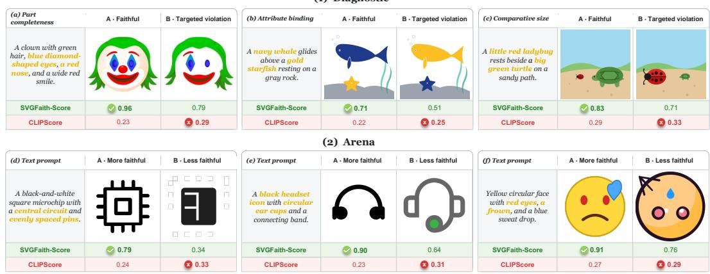
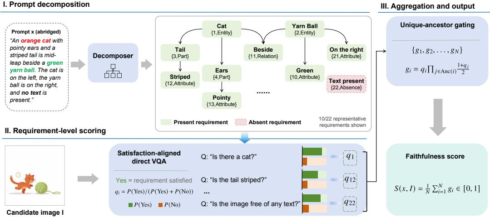
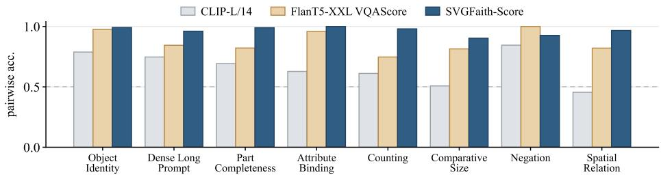
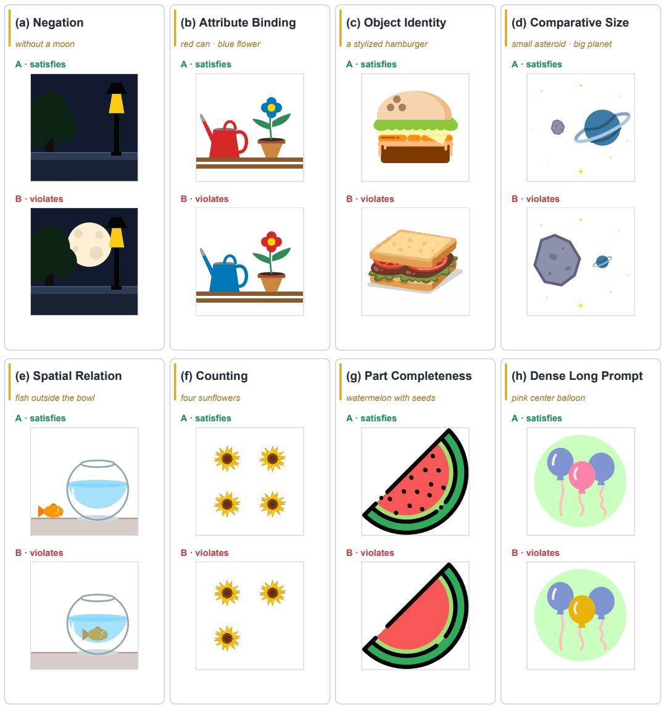
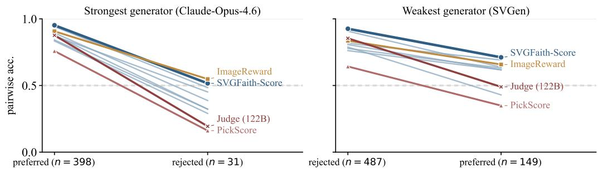

# SVGFAITH: A TWO-LAYER META-EVALUATION OF FAITHFULNESS METRICS FOR TEXT-TO-SVG GENERATION

Guotao Liang1,2 Haitao Zhou2 Biao Liu1 Huanxuan Liao1 Lingfeng Qiao1 Qian-Wen Zhang1∗ Qian Yu2 Di Yin1 Xing Sun1 1Tencent Youtu Lab 2Visual Computing Group, Beijing

## ABSTRACT

Text-to-SVG systems are commonly evaluated by applying raster-image metrics to rasterised outputs, yet whether these scores capture fine-grained prompt faithfulness remains unclear. We introduce SVGFaith, a two-layer meta-evaluation framework in which the more faithful candidate of each pair is determined by construction or by human judgment. SVGFaith-Diagnostic contains 1,842 controlled contrastive pairs across eight capability axes, split evenly between two directions: two renderings compared against one prompt, and two descriptions compared against one rendering. SVGFaith-Arena contains 1,327 human-annotated comparisons of real generator outputs. On SVGFaith-Diagnostic, CLIP and three other image–text embedding metrics reach at least 0.789 pairwise accuracy on object identity but at most 0.672 on spatial relations and attribute binding, where chance is 0.5. We further introduce SVGFaith-Score, an interpretable pointwise metric. A domain-tuned decomposer turns each prompt into a dependency graph of atomic visual requirements, a visual question answering model scores whether each requirement is satisfied, and a requirement’s score is discounted when its prerequisites score low. In addition to the overall score, the per-requirement scores show which requirements are judged unsatisfied and which inherit discounts from their prerequisites. SVGFaith-Score significantly outperforms all nine baselines, including a Qwen3.5-122B-A10B judge, on Arena and in both Diagnostic directions. Code and data: https://github.com/Yukinonooo/SVGFaith.

## 1 INTRODUCTION

Modern text-to-SVG methods produce renderable, visually coherent graphics, making prompt faithfulness a central evaluation question (Yang et al., 2025; Wang et al., 2025b;a; Chen et al., 2025a; Xing et al., 2026; Liang et al., 2026a). In practice it is commonly measured by an automatic score: a CLIP similarity between the prompt and the rasterised output (Radford et al., 2021), or a rating from a vision–language judge (Wiles et al., 2025; Rodriguez et al., 2026). Both are widely used in raster text-to-image evaluation and have been adopted by vector benchmarks (Zou et al., 2024; Chen et al., 2025b; Rodriguez et al., 2026), but aggregate generator rankings do not establish how reliably they resolve individual SVG constraints. A benchmark can therefore inherit a score’s blind spots while still reporting a definitive ranking.

Meta-evaluation tests a metric on pairs whose more faithful candidate is determined by construction or by human judgment, not by the metric itself (Wiles et al., 2025; Saxon et al., 2024; Leiter et al., 2026). In a constructed pair, one candidate satisfies the prompt and the other violates a designated constraint, so a metric that reverses the pair exposes a specific blind spot. Such pairs cannot show whether the metric also works on real generator outputs, where several errors of different severity may occur together. Human judgments of real outputs provide that test, but when a metric disagrees with them, they do not reveal which difference the metric missed. SVGFaith therefore contains one layer of each kind and reports the two separately.

(1) Diagnostic  
  
Figure 1: Six faithfulness comparisons: three controlled SVGFaith-Diagnostic pairs (a–c) and three human-annotated SVGFaith-Arena pairs (d–f). In Diagnostic, the left rendering satisfies the prompt and the right violates the highlighted constraint. In Arena, the left rendering is judged more faithful and the right less faithful, although both may contain errors. Here, CLIPScore denotes the normalised image–text cosine from CLIP ViT-L/14 (Radford et al., 2021), abbreviated as CLIP-L/14 elsewhere. In all six selected examples, it ranks the right rendering higher, whereas SVGFaith-Score ranks the left higher.

The controlled layer, SVGFaith-Diagnostic, contains 1,842 contrastive pairs over eight capability axes (Figure 1(a–c)). Its pairs are built by rule-based edits of the SVG source, hard-negative retrieval or paired generation, and every retained pair meets the same human review standard. Diagnostic is scored in two directions: 921 pairs compare two renderings against one prompt, and 921 compare two descriptions against one rendering, so sensitivity to visual and textual changes is probed separately. The real-output layer, SVGFaith-Arena, contains 1,327 pairs of outputs from six generators (Figure 1(d–f)). Each pair is judged by three annotators under a rubric that asks for prompt faithfulness and excludes visual polish as a criterion.

We also propose SVGFaith-Score, an interpretable pointwise metric. It decomposes the prompt into a graph of atomic requirements, scores each requirement against one rendering with satisfactionaligned visual question answering (VQA) (Hu et al., 2023; Lin et al., 2024), and attenuates each fact by its prerequisites, so an attribute of an absent object is discounted. The graph is built by SVGFaith-Decomposer, which we obtain by domain fine-tuning Qwen3.5-9B with teacher-generated SFT, rejection-sampling SFT and Group Relative Policy Optimization (GRPO) (Shao et al., 2024); a separate Qwen3.5-9B serves as the VQA backend. Beyond the scalar score, the node scores localise low-scoring requirements and trace inherited discounts through the graph. Because each candidate is scored on its own, the metric can evaluate a single output or rank any number of candidates. It can therefore also serve as a faithfulness verifier for filtering or reranking generated samples, or as a reward signal for future text-to-SVG training.

We compare SVGFaith-Score with nine widely used evaluators on both layers, spanning image–text embeddings, human-preference reward models and vision–language scorers (Section 4). SVGFaith-Score is the most accurate on Arena and in both Diagnostic directions, and its Arena accuracy of 0.880 closely matches the 0.875 mean agreement of individual annotators with the final labels. The baselines, in contrast, show failures that their aggregate accuracy hides. When two renderings are compared against one prompt, CLIP-L/14 orders most object-identity pairs correctly but fewer than half of the spatial-relation pairs (Figure 3); more generally, image–text embedding metrics recognise which objects appear far better than how they are arranged or which attributes they carry. Reward models trained on human preferences fail on other constraints: in the same setting, ImageReward (Xu et al., 2023), one of the strongest baselines on Arena, and HPS v2.1 (Wu et al., 2023b) each order fewer than half of the negation pairs correctly. Scaling a vision–language judge from Qwen3.5- 9B to Qwen3.5-122B-A10B (Qwen Team, 2026a) improves accuracy on both layers, but the larger judge still trails SVGFaith-Score (Table 8). Finally, all ten methods, including SVGFaith-Score, become less accurate on Arena pairs in which a stronger generator’s output is judged less faithful (Section 4.3). This reliability gap is associated with generator identity, but these pairs can also differ in semantic-error type, severity, opponent composition and annotation difficulty, so its mechanism remains open. A preference for generator-associated visual style is one possible explanation.

In summary, our contributions are:

• We introduce a two-layer meta-evaluation framework for text-to-SVG generation. The controlled layer, SVGFaith-Diagnostic (1,842 pairs), pinpoints specific metric blind spots, while the real-output layer, SVGFaith-Arena (1,327 pairs), tests reliability on generator outputs without using an evaluated metric to establish its reference ordering.

• We expose severe, locatable failures in widely used evaluation methods. In particular, all ten methods become less accurate when a stronger generator’s output is judged less faithful, revealing a generator-conditioned reliability gap shared even by the strongest methods.

• We propose SVGFaith-Score, an interpretable pointwise metric whose node scores localise low-scoring prompt requirements and trace inherited discounts. It leads nine baselines on Arena and in both Diagnostic directions while using SVGFaith-Decomposer and Qwen3.5- 9B at inference. Its prompt-only graph can be cached across candidates, and all node queries for a rendering can be scored in one batched, non-autoregressive VQA forward call, making the design compatible with on-policy reward evaluation.

## 2 A TWO-LAYER BENCHMARK FOR TEXT-TO-SVG FAITHFULNESS

Both layers of SVGFaith consist of candidate pairs and share one scoring protocol. In each pair, A denotes the candidate that the benchmark labels as more faithful and B the other candidate. SVGFaith-Diagnostic (Section 2.1) has two directions. In the image-based direction, two renderings $I _ { A }$ and $I _ { B }$ share one prompt x; $I _ { A }$ satisfies x, whereas $I _ { B }$ violates it on one designated axis. In the text-based direction, two descriptions $x _ { A }$ and $x _ { B }$ share one rendering $I ,$ which satisfies $x _ { A }$ but contradicts $x _ { B }$ on that axis. In SVGFaith-Arena (Section 2.2), $I _ { A }$ and $I _ { B }$ are two renderings generated from one prompt $x ,$ and $I _ { A }$ is the one that human annotators judge more faithful, although it need not satisfy the prompt completely.

Let $S ( x , I )$ be a metric’s score for text x and rendering I. Each candidate is scored on its own, so no method sees the two candidates together. For Arena and image-based Diagnostic pairs, we form $d _ { \mathrm { i m a g e } } ;$ for text-based Diagnostic pairs, we form $d _ { \mathrm { t e x t } }$

$$
d _ { \mathrm { i m a g e } } = S ( x , I _ { A } ) - S ( x , I _ { B } ) , \qquad d _ { \mathrm { t e x t } } = S ( x _ { A } , I ) - S ( x _ { B } , I ) .\tag{1}
$$

Let d denote the applicable difference, so a correct decision has $d > 0$ . Given a threshold $\tau \geq 0$ , we count $d > \tau \ \mathrm { a s }$ a win, $d < - \tau { \mathrm { ~ a s ~ a ~ } }$ loss and $\vert d \vert \le \tau$ as a tie. Pairwise accuracy is the fraction of pairs counted as wins. On Arena, it is computed over all pairs. For each Diagnostic direction, it is computed separately on each of the eight axes and then averaged with equal weights, so differences in axis size do not affect the direction-level score. Section 4 fixes τ and states the remaining reporting conventions.

## 2.1 SVGFAITH-DIAGNOSTIC

The image-based direction tests whether a metric resolves a visual difference, and the text-based direction tests whether it registers a difference in what two descriptions assert. The eight axes are negation (whether forbidden content is absent), attribute binding (whether each property, typically colour, is attached to the correct object), comparative size (whether objects have the specified relative sizes), spatial relation (whether objects occupy the specified relative positions), object identity (whether the depicted object matches the prompt), counting (whether the required number of instances is present), part completeness (whether all named parts are present), and dense long prompt (whether a local violation remains detectable within a long compositional description). Each axi is defined by an objective criterion intended to be judged without appealing to taste. All sixteen axis–direction cells hold at least 100 pairs (Table 1), and Figure 4 shows a contrastive pair from each axis.

Construction. We use three construction routes. Rule-based pairs start from a faithful source SVG from SArena or SVG-Sophia (Wang et al., 2025b; 2026) and remove an instance or element, delete named parts or recolour one named element. Because these pairs edit the vector source directly, all untargeted vector elements remain unchanged. Object identity instead pairs the faithful rendering with a visually similar neighbour, so that the substitution cannot be detected from global appearance alone. Neighbours are retrieved by image similarity and reranked by Qwen3.6-27B (Qwen Team, 2026b), which is not among the evaluated metrics. Negation, attribute binding, comparative size, spatial relation and some counting pairs require coordinated changes across several elements, so Gemini-3.1-Pro (Google DeepMind, 2026) writes the faithful and violating SVGs together with their matching prompts. Text-based pairs keep the faithful rendering of the corresponding imagebased construction as I. Their violating description xB either flips the fact recorded by a rule-based edit or is the text paired with the retrieved or generated violating rendering.

Quality control. Two automatic gates come first. A visibility gate requires the change to be neither invisible at rendering resolution nor too large for a controlled contrast. A semantic gate, also run with Qwen3.6-27B, checks whether A is fully faithful, whether B violates the designated axis and whether the pair is unambiguous. Because this gate is a vision–language model, as are several evaluated metrics, it only discards pairs and never edits a candidate or decides which candidate is A. Discarding may still bias Diagnostic toward violations that such models can detect. Arena has no semantic gate, and SVGFaith-Score also leads there (Section 4.2). Of the 3,706 pairs on the eight axes that pass both gates, about 2,250 are sampled at random within each axis–direction cell for human review. Three annotators independently check that A is fully faithful, B violates the designated axis, the two candidates are distinguishable and the verdict does not depend on subjective taste. We retain the 1,799 pairs that all three annotators keep. To bring three axis–direction cells to at least 100 pairs, 43 further pairs are checked against the same criteria by expert review rather than by all three annotators. Section B reports the per-axis operations, the complete funnel and the rejection reasons.

## 2.2 SVGFAITH-ARENA

SVGFaith-Arena draws its pairs from real text-to-SVG outputs. The prompts are icon and illustration descriptions from SArena (Wang et al., 2025b) and a separate set of colour descriptions. Six systems generate the candidates: three open models (OmniSVG1.1-8B, InternSVG-8B and SVGen built on Qwen2.5-Coder-7B) (Yang et al., 2025; Wang et al., 2025b;a; Hui et al., 2024), and three proprietary models (GPT-5.4, Gemini-3.1-Pro and Claude-Opus-4.6) (OpenAI, 2026; Google DeepMind, 2026; Anthropic, 2026). Each pair holds two outputs for one prompt, from two systems or from two independent samples of one system; the latter share a style, which isolates differences in content.

Of the 7,665 generated pairs, 6,397 remain after three filters applied in sequence. They remove pairs with a blank or unrenderable candidate; pairs in which, according to an automatic Qwen3.6-27B pre-filter (Qwen Team, 2026b), neither candidate has enough recognisable content for a faithfulness judgment; and same-system pairs whose candidates are near-duplicates in DINOv2 feature space (Oquab et al., 2023). The pre-filter also places each pair in a preliminary difficulty bucket, one-sided when one candidate appears clearly more faithful and high-value or uncertain when the two appear close. The buckets only guide sampling; all labels come from human judgments. We annotate 2,000 pairs stratified by difficulty bucket and generator tier (open, proprietary or mixed). Close pairs are over-represented, so Arena is a challenge set rather than a random sample of the pool (Section C).

Table 1: Composition of SVGFaith-Diagnostic. Rule-based routes edit a faithful source SVG, generative routes write both SVGs together, and object identity uses hard-negative retrieval. Per-axis details are in Section B.
<table><tr><td>Axis</td><td>Construction route</td><td>Image-based</td><td>Text-based</td><td>Total</td></tr><tr><td>Negation</td><td>Generative</td><td>123</td><td>123</td><td>246</td></tr><tr><td>Attribute binding</td><td>Generative</td><td>121</td><td>122</td><td>243</td></tr><tr><td>Comparative size</td><td>Generative</td><td>124</td><td>124</td><td>248</td></tr><tr><td>Spatial relation</td><td>Generative</td><td>123</td><td>122</td><td>245</td></tr><tr><td>Object identity</td><td>Hard-negative retrieval</td><td>123</td><td>118</td><td>241</td></tr><tr><td>Counting</td><td>Instance deletion + generative</td><td>103</td><td>100</td><td>203</td></tr><tr><td>Part completeness</td><td>Part deletion</td><td>101</td><td>112</td><td>213</td></tr><tr><td>Dense long prompt</td><td>Single-fact edit</td><td>103</td><td>100</td><td>203</td></tr><tr><td>Total</td><td></td><td>921</td><td>921</td><td>1,842</td></tr></table>

  
Figure 2: SVGFaith-Score. The prompt is decomposed into a graph of atomic requirements without reference to the image. All requirement queries for a rendering are scored in one batched, nonautoregressive VQA forward call. Each score is then attenuated by the requirements it presupposes. The displayed prompt is abridged. The graph shows ten of the 22 requirements obtained from the complete prompt.

Three annotators independently choose the more faithful candidate or mark a tie, seeing the two in random order without generator identities. The rubric covers prompt faithfulness only: annotators check objects, counts, colours, spatial relations, parts, negations and composition, and prefer the candidate that satisfies more of the prompt and violates less of it. Content too distorted to recognise counts as unsatisfied, and visual polish must not decide the label: a plain but faithful rendering should not lose to an elaborate off-prompt one.

Labels follow a 2-of-3 majority, and pairs with one vote for each option go to expert adjudication. Pairwise accuracy requires a winner, so we exclude majority ties and adjudicated pairs that remain undecided, leaving 1,352 pairs. After running all metrics, we manually review pairs whose majority label disagrees with several of them, including baselines. On 12 reviewed pairs, visual inspection shows that the majority vote points the wrong way, so we correct their labels; we also remove 25 invalid or unreliable pairs, yielding the 1,327 pairs on which all Arena results are reported.

Across all 2,000 annotated pairs, the pre-adjudication votes (A, B or tie) give Krippendorff’s nominal α = 0.568 (Krippendorff, 2018) and a raw pairwise agreement of 0.712. The 3,981 votes on the 1,327 evaluation pairs give the individual-annotator reference in Table 2. Section C reports the label funnel, further agreement statistics and a sensitivity analysis without adjudicated pairs.

## 3 SVGFAITH-SCORE

SVGFaith-Score maps a prompt x and the rasterised rendering I of one candidate to $S ( x , I ) \ \in$ [0, 1] in three stages: decomposition into atomic requirements, requirement-level visual scoring and aggregation.

## 3.1 ATOMIC FACT GRAPH

SVGFaith-Decomposer, our domain-tuned Qwen3.5-9B (Qwen Team, 2026a), reads x alone and, after a reasoning trace, emits a directed acyclic graph whose N nodes $z _ { 1 } , \dots , z _ { N }$ are atomic requirements, each phrased as a yes/no question that can be answered from the candidate’s rendered image alone, in the form introduced by DSG (Cho et al., 2024). A node is an entity fact, about the presence of an object or part; an attribute fact, about the count, colour, material, shape, size, state or pose of one entity; a relation fact, tying entities by a spatial, comparative or action relation; or a global fact, about style, composition or a constraint on the whole image. Each node carries the text span that licenses it, the entities it involves, and whether x requires the fact to hold or forbids it. An edge $j  i$ records that requirement i presupposes $j ,$ as the apple is red presupposes an apple is present.

## 3.2 SATISFACTION-ALIGNED DIRECT VQA

Each requirement $z _ { i }$ is posed directly to a VQA backend as a single yes/no question, with thinking disabled and no long-form generation. Questions are phrased so that Yes always indicates satisfaction. A presence requirement asks Are flowers visible?, whereas an absence requirement asks Is the image free of any flowers? As in VQAScore (Lin et al., 2024), we read the answer distribution at the first answer position, but renormalise it over the canonical Yes and No tokens:

$$
q _ { i } = \frac { P ( \mathrm { Y e s } \mid I , z _ { i } ) } { P ( \mathrm { Y e s } \mid I , z _ { i } ) + P ( \mathrm { N o } \mid I , z _ { i } ) } \in [ 0 , 1 ] ,\tag{2}
$$

where $P ( \cdot \mid I , z _ { i } )$ is the backend’s next-token distribution at that position. Equivalently, $q _ { i }$ is the sigmoid of the Yes–No logit difference and increases monotonically with the backend’s preference for Yes. We use it as a soft satisfaction score.

Because the graph depends only on $x ,$ it is built once per prompt and reused across all candidate renderings for that prompt. Given this cached graph, all N requirement queries for one rendering can be evaluated in one batched, non-autoregressive VQA forward call, and several candidates can share the same batch. Only the first-answer logits are retained.

## 3.3 UNIQUE-ANCESTOR AGGREGATION

We use the prerequisite graph as a structural prior: a node is discounted when requirements that it presupposes receive low scores. Let $\operatorname { A n c } ( i )$ denote the set of distinct ancestors of node i. For $\alpha \in [ 0 , 1 ]$ , we define the soft gate $h _ { \alpha } ( q ) = ( 1 - \alpha ) + \alpha q$ . Because $q \in [ 0 , 1 ]$ , the gate lies in $[ 1 - \dot { \alpha } , 1 ] \colon$ an ancestor with $q = 1$ leaves its descendants unchanged, while a lower-scoring ancestor discounts them. We then set:

$$
g _ { i } = q _ { i } \prod _ { j \in \operatorname { A n c } ( i ) } h _ { \alpha } ( q _ { j } ) , \qquad S ( x , I ) = \frac { 1 } { N } \sum _ { i = 1 } ^ { N } g _ { i } ,\tag{3}
$$

with $\alpha = 0 . 5$ fixed across all experiments. At this value, an ancestor scoring $q _ { j }$ scales its descendants by $( 1 + q _ { j } ) / 2$ , discounting a low-scoring prerequisite without zeroing the branch. Setting $\alpha = 0$ ignores dependencies and setting $\alpha = 1$ with binary $q _ { j }$ recovers the DSG rule (Cho et al., 2024), under which a failed prerequisite forces its descendants to zero. Each distinct ancestor contributes once even if multiple paths connect it to node i, avoiding path-dependent double counting. Section D gives further details.

Besides $S ,$ we retain $q _ { i }$ and $g _ { i }$ . A low $q _ { i }$ marks a requirement the VQA backend scores as unsatisfied. The gap between $q _ { i }$ and $g _ { i }$ exposes the discount that node i inherits from its ancestors. Source text spans and incoming edges map both direct and inherited failures back to the prompt.

## 3.4 MODEL ROLES AND DECOMPOSER TRAINING

SVGFaith-Score combines SVGFaith-Decomposer and Qwen3.5-9B in separate roles: SVGFaith-Decomposer converts x into an atomic fact graph, and the released Qwen3.5-9B, used without further training, scores each requirement against I.

We train SVGFaith-Decomposer in three stages organised around the failure modes of graph generation. Teacher SFT distils reasoning traces and graphs from Qwen3.5-397B-A17B. Rejectionsampling SFT retains concise, complete and structurally valid student trajectories that match the teacher’s fact signature, falling back to the teacher’s trajectory when no sample qualifies. GRPO (Shao et al., 2024) then orders residual failures through a deterministic hierarchy from truncation and parsing errors through schema, rule and coverage failures to valid graphs. A coverage check based on counts of facts, entities, evidence tokens and fact types ranks near-empty graphs below complete ones, while within-tier criteria penalise repetition and excess length. Similarity to the teacher’s graph is logged for diagnosis and does not enter the reward. Section D gives the reward, acceptance thresholds and complete training configuration.

## 4 EXPERIMENTS

## 4.1 EVALUATION SETUP

Protocol. Candidates are scored independently and compared via Equation (1) on Arena (1,327 pairs) and each Diagnostic direction (921 pairs). Ties receive zero credit, and each Diagnostic score averages the eight axis accuracies equally. We report $\tau = 0$ and 0.01. For 95% bootstrap intervals, we resample Arena pairs directly and Diagnostic pairs independently within each axis before equalweight aggregation (Efron, 1979). For tie analysis, with W, T and L the numbers of wins, ties and losses, we also report half-tie accuracy $( W + \dot { 0 } . 5 T ) / ( W + T + L )$ , conditional direction accuracy $W / ( W + L )$ and non-tie coverage $( \dot { W } + L ) / ( W + \dot { T } + L )$

Metrics compared. We evaluate nine baselines across three families: image–text embeddings (CLIP-L/14, SigLIP-L/16-384, Long-CLIP-L/14, Qwen3-VL-Embedding-8B) (Radford et al., 2021; Zhai et al., 2023; Zhang et al., 2024a; Li et al., 2026), human-preference reward models (PickScore, HPS v2.1, ImageReward) (Kirstain et al., 2023; Wu et al., 2023b; Xu et al., 2023), and vision– language scorers (FlanT5-XXL VQAScore and Qwen3.5-122B-A10B used as an LLM-as-a-Judge) (Lin et al., 2024; Qwen Team, 2026a). For the judge, each candidate is evaluated independently from the prompt and a 448×448 raster, without repeated-score averaging. The rubric anchors ratings from 1 (unfaithful) to 5 (fully faithful) and instructs the model to ignore aesthetics; we divide the rating by 5. Initial calls use thinking at temperature 0.5, and an unparsable response triggers one constrained recovery call with thinking disabled. To separate the effect of judge scale, we apply the same protocol to Qwen3.5-9B, and a ten-point variant of the 9B judge tests whether finer rating categories reduce ties (Table 8). The 3,981 individual Arena votes yield a human reference of 0.875 ([0.865, 0.886]).

## 4.2 COMPARISON WITH EXISTING METRICS

Overall accuracy. SVGFaith-Score leads all nine baselines on Arena and in both Diagnostic directions at both thresholds (Table 2). $\mathrm { A t } ~ \tau ~ = ~ 0 . 0 1$ , it reaches 0.880 on Arena, 0.941 on image Diagnostic and 0.953 on text Diagnostic (vs. baseline bests 0.843, 0.902 and 0.857). All 27 paired intervals against the baselines exclude zero at both thresholds, and Arena accuracy closely matches individual-annotator agreement (0.875).

Cross-layer and threshold sensitivity. At τ = 0.01, Qwen3-VL-Embedding-8B leads baselines on Arena (0.843) but drops to 0.717/0.668 on Diagnostic. Scaling the same judge protocol from 9B to 122B-A10B raises Arena/image/text accuracy from 0.655/0.771/0.748 to 0.754/0.902/0.857 (Table 8). SVGFaith-Score remains higher by 0.127/0.039/0.095, and all three paired intervals exclude zero, even for the smallest gap on image Diagnostic $( [ + 0 . 0 1 6 , + 0 . 0 6 3 ] )$ ). Moving from τ = 0 to 0.01 reduces SVGFaith-Score by only 0.018/0.024/0.013, leaving 2.8% of Arena pairs tied and mean per-axis tie rates of 3.7%/1.7% on image/text Diagnostic. By contrast, PickScore falls from 0.799/0.737 to 0.313/0.149 on Diagnostic because its scores occupy a band only a few hundredths wide, so small differences become ties. Complete sweeps are in Section E.4.

Information loss from finite rating categories. The 122B judge assigns identical five-point ratings to 17.9% of Arena pairs and reverses only 6.7%. With the 9B judge, the ten-point variant reduces exact ties from 27.1% to 22.7% and raises accuracy from 0.655 to 0.707, but still leaves over one pair in five unresolved (Table 8). SVGFaith-Score instead aggregates continuous requirementlevel probabilities and ties only 2.8% of Arena pairs at $\tau = 0 . 0 1$ . Giving ties half credit narrows its Arena advantage over the 122B judge from 0.127 to 0.051 (0.894 vs. 0.843). Conditional on a non-tied decision, the judge reaches 0.918 and SVGFaith-Score 0.905, but their non-tie coverage is 0.821 and 0.972. The strict metric therefore reflects both directional correctness and the ability to resolve a pair.

Table 2: Pairwise accuracy on Arena and the two Diagnostic directions at $\tau = 0$ and $\tau = 0 . 0 1$ Diagnostic columns are equal-weight means of the eight per-axis accuracies. The human row reports mean individual-annotator agreement with the final Arena labels. Complete per-axis results and the threshold sweep are in Tables 9 and 10 and Section E.4.
<table><tr><td rowspan="2">Method</td><td colspan="2">Arena</td><td colspan="2">Diagnostic (image)</td><td colspan="2">Diagnostic (text)</td></tr><tr><td>τ=0</td><td>τ=0.01</td><td>τ=0</td><td> $\tau { = } 0 . 0 1$ </td><td>τ=0</td><td>τ=0.01</td></tr><tr><td colspan="7">Image-text embedding</td></tr><tr><td>CLIP-L/14</td><td>0.769</td><td>0.699</td><td>0.660</td><td>0.470</td><td>0.658</td><td>0.328</td></tr><tr><td>SigLIP-L/16-384</td><td>0.823</td><td>0.775</td><td>0.750</td><td>0.517</td><td>0.745</td><td>0.462</td></tr><tr><td>Long-CLIP-L/14</td><td>0.791</td><td>0.739</td><td>0.713</td><td>0.481</td><td>0.754</td><td>0.376</td></tr><tr><td>Qwen3-VL-Embedding-8B</td><td>0.861</td><td>0.843</td><td>0.777</td><td>0.717</td><td>0.799</td><td>0.668</td></tr><tr><td colspan="7">Human-preference reward model</td></tr><tr><td>PickScore v1</td><td>0.833</td><td>0.605</td><td>0.799</td><td>0.313</td><td>0.737</td><td>0.149</td></tr><tr><td>HPS v2.1</td><td>0.841</td><td>0.769</td><td>0.808</td><td>0.540</td><td>0.703</td><td>0.368</td></tr><tr><td>ImageReward v1.0</td><td>0.824</td><td>0.819</td><td>0.784</td><td>0.779</td><td>0.782</td><td>0.767</td></tr><tr><td colspan="7">Vision–language scoring</td></tr><tr><td>FlanT5-XXL VQAScore</td><td>0.798</td><td>0.784</td><td>0.873</td><td>0.824</td><td>0.878</td><td>0.825</td></tr><tr><td>LLM-as-a-Judge (122B)</td><td>0.754</td><td>0.754</td><td>0.902</td><td>0.902</td><td>0.857</td><td>0.857</td></tr><tr><td>SVGFaith-Score</td><td>0.898</td><td>0.880</td><td>0.965</td><td>0.941</td><td>0.966</td><td>0.953</td></tr><tr><td colspan="7">Mean individual annotator</td></tr></table>

  
Figure 3: Pairwise accuracy at $\tau = 0$ for three representative methods on image-based Diagnostic. The dashed line marks chance. Full results are in Tables 9 and 10.

## 4.3 CONSTRAINT-LEVEL AND GENERATOR-CONDITIONED FAILURES

Constraint-specific performance. On image-based Diagnostic at τ = 0, CLIP-L/14 reaches only 0.455 on spatial relations (Figure 3) and SigLIP-L/16-384 only 0.562 on attribute binding, while HPS v2.1 ranks all 103 counting pairs correctly but reaches only 0.447 on negation. SVGFaith-Score, by contrast, remains $\ge ~ 0 . 8 9$ in all sixteen axis–direction cells at this threshold (Tables 9 and 10). $\mathrm { A t } \tau = 0 . 0 1$ , ImageReward ranks second among the baselines on Arena yet trails FlanT5- XXL VQAScore by 0.045/0.058 on image/text Diagnostic, so Arena strength does not ensure constraint discrimination.

Generator-conditioned failures. The 122B judge and SVGFaith-Score reach 0.877/0.952 when Claude-Opus-4.6 is preferred but only 0.194/0.516 when it is rejected, with 6/21/4 and $1 6 / 6 / 9$ wins/ties/losses, respectively. Thus, the low strict rates do not imply majority reversal: giving ties half credit yields 0.532/0.613, and conditional accuracy on non-ties is 0.600/0.640. The judge similarly records $9 / 1 9 / 8$ when GPT-5.4 is rejected, while PickScore reaches only 0.349 when SVGen is preferred (Section E.3). These slices establish a generator-conditioned reliability gap, but their error types, opponents and difficulty differ, so they do not isolate its cause.

Table 3: Component controls on Arena at τ = 0.01. ∆ is paired accuracy relative to final SVGFaith-Score (95% bootstrap CI); decomposer reuse as VQA is a model-role control.
<table><tr><td>Decomposition</td><td>VQA backend</td><td>Win/tie/loss</td><td>Accuracy</td><td>∆ vs. final</td></tr><tr><td>None (holistic query)</td><td>Qwen3.5-9B</td><td>1128/69/130</td><td>0.850</td><td>-0.030 ([−0.048, -0.012])</td></tr><tr><td>Qwen3.5-9B</td><td>Qwen3.5-9B</td><td>97/1221/9</td><td>0.073</td><td>-0.807 ( ([−0.828, −0.784])</td></tr><tr><td>Qwen3.5-397B-A17B</td><td>Qwen3.5-9B</td><td>1163/38/126</td><td>0.876</td><td>-0.004 ([−0.012, +0.005]</td></tr><tr><td>SVGFaith-Decomposer SVGFaith-Decomposer 1172/30/125</td><td></td><td></td><td>0.883</td><td>+0.003 ([−0.010, +0.016])</td></tr><tr><td>SVGFaith-Decomposer Qwen3.5-9B</td><td></td><td>1168/37/122</td><td>0.880</td><td>0.000</td></tr></table>

## 4.4 ABLATIONS AND CONTROLS

Necessity of decomposer domain fine-tuning. Replacing SVGFaith-Decomposer with the released Qwen3.5-9B while holding the VQA backend and aggregation fixed reduces Arena accuracy from 0.880 to 0.073 (∆ = −0.807 [−0.828, −0.784]; Table 3) and image/text Diagnostic accuracy to 0.063/0.068, decreases of 0.878 [0.857, 0.898] and 0.885 [0.864, 0.904], respectively. No question is recovered for 1,217/1,327 Arena pairs, 858/921 image-based pairs and both texts in 818/921 text-based pairs. These cases exhaust the 40,000-token reasoning budget without a final answer, showing that domain fine-tuning is necessary under this interface.

Decomposition and model-role controls. With the same VQA backend, replacing the graph with a single question asking whether the rendering matches the whole prompt lowers Arena accuracy from 0.880 to 0.850 $( \Delta \ = \ - 0 . 0 3 0 \ \left[ - 0 . { \bar { 0 4 } } 8 , - 0 . 0 1 2 \right]$ ; Table 3), so decomposition improves agreement beyond holistic scoring. Using the 397B teacher as decomposer gives 0.876 $\bar { ( \Delta } = - \bar { 0 } . 0 0 4 \ : [ - 0 . 0 \dot { 1 } 2 , + 0 . 0 0 5 ] )$ , and reusing SVGFaith-Decomposer as the VQA backend gives $0 . 8 8 3 \ : ( \Delta = + 0 . 0 0 3 \ : [ - 0 . 0 1 0 , + 0 . 0 1 6 ] )$ ). Neither differs significantly from the final assignment of SVGFaith-Decomposer to graph construction and the released Qwen3.5-9B to visual scoring.

## 5 CONCLUSION

This work asks whether an automatic metric can identify the more faithful of two SVG outputs for a given prompt. SVGFaith-Diagnostic probes this ability under controlled violations along eight capability axes, varying either the rendering or the description, while SVGFaith-Arena tests transfer to 1,327 human-annotated comparisons between real generator outputs. Together, the two layers show which constraints a metric misses and whether it remains reliable when errors co-occur.

On Diagnostic, embedding metrics, human-preference reward models and vision–language scorers all show constraint-specific weaknesses, in some cases below chance. Their accuracy also de creases on Arena slices where humans reject outputs from stronger generators. The cause of this generator-conditioned reliability gap remains open, but the gap shows that aggregate accuracy can hide systematic failures on important subsets.

SVGFaith-Score addresses fine-grained faithfulness by decomposing a prompt into atomic requirements, scoring each requirement against one rendering and propagating discounts through prerequisite relations. $\mathrm { A t } \tau = 0 . 0 1$ , it reaches 0.880 on Arena and 0.941/0.953 on image-/text-based Diagnostic, outperforming all nine evaluated baselines while exposing interpretable per-requirement scores. Its drop to 0.516 when Claude-Opus-4.6 is rejected nevertheless leaves robustness to generator-conditioned shifts as an open problem. The score also inherits errors from prompt decomposition and from an uncalibrated VQA readout. Future work should address these error sources and incorporate native SVG structure rather than relying only on rasterised renderings. Because its graph is built once per prompt and each candidate is then scored in a single batched forward call, SVGFaith-Score could also serve as the reward in on-policy reinforcement learning of text-to-SVG generators, a use we have not yet tested. More broadly, reporting controlled and real-output evidence separately enables a clearer assessment of progress in faithfulness. A single aggregate benchmark can obscure this distinction.

## AI USE STATEMENT

Generative AI tools were used during paper preparation to improve language, organisation and presentation; assist literature discovery and citation checking; and draft auxiliary scripts for verifying reported statistics and formatting figures. The authors checked cited sources, reviewed AI-assisted code and numerical outputs, and determined all scientific claims and final wording. The authors take full responsibility for the content of this paper.

## ETHICS STATEMENT

The benchmarks include human judgements of generated SVG outputs. Annotation was conducted by internal non-author employees as part of their regular compensated duties, and they were informed that their judgements would be used for research. The task collected no sensitive personal information and exposed annotators only to prompts and generated graphics. The activity was determined to be exempt from formal ethics review. Generator identities were hidden during annotation, and no annotator identities will be released.

## REPRODUCIBILITY STATEMENT

Benchmark construction and annotation are documented in Section 2 and Appendices B–C; the metric and decomposer training are specified in Section 3 and Appendix D; and evaluation, bootstrap and control protocols are reported in Section 4 and Appendix E.4. The appendices provide peraxis results, prompts, model configurations and training hyperparameters. We plan to release the benchmark data, code and evaluation scripts publicly after the review process.

## REFERENCES

Anthropic. System Card: Claude Opus 4.6, February 2026. URL https://www.anthropic. com/research/claude-opus-4-6.

Hmrishav Bandyopadhyay and Yi-Zhe Song. FlipSketch: Flipping static drawings to text-guided sketch animations. In Proceedings of the Computer Vision and Pattern Recognition Conference, pp. 28394–28404, 2025.

Alexandre Carlier, Martin Danelljan, Alexandre Alahi, and Radu Timofte. DeepSVG: A hierarchical generative network for vector graphics animation. Advances in Neural Information Processing Systems (NeurIPS), 33:16351–16361, 2020.

Hanqi Chen, Zhongyin Zhao, Ye Chen, Zhujin Liang, and Bingbing Ni. SVGThinker: Instructionaligned and reasoning-driven text-to-SVG generation. In Proceedings of the 33rd ACM International Conference on Multimedia, pp. 11004–11012, 2025a.

Siqi Chen, Xinyu Dong, Haolei Xu, Xingyu Wu, Fei Tang, Hang Zhang, Yuchen Yan, Linjuan Wu, Wenqi Zhang, Guiyang Hou, Yongliang Shen, Weiming Lu, and Yueting Zhuang. SVGenius: Benchmarking LLMs in SVG understanding, editing and generation. In Proceedings ofthe 33rd ACM International Conference on Multimedia, pp. 13289–13296, 2025b. doi: 10.1145/3746027. 3758287.

Jaemin Cho, Yushi Hu, Roopal Garg, Peter Anderson, Ranjay Krishna, Jason Baldridge, Mohit Bansal, Jordi Pont-Tuset, and Su Wang. Davidsonian scene graph: Improving reliability in finegrained evaluation for text-to-image generation. In International Conference on Learning Representations, 2024.

Marco Cipriano, Leonardo Zini, Alexandra Schild, Valentin Teutschbein, Afsana Mimi, Marcella Cornia, Lorenzo Baraldi, and Gerard de Melo. SVG-Score: Human-aligned evaluation of text-to-SVG generation, 2026. URL https://arxiv.org/abs/2609.03806.

World Wide Web Consortium. Scalable vector graphics (SVG) specification, 1999. URL https: //www.w3.org/TR/1999/WD-SVG-19990211/. Accessed: 2026-06-26.

Valeria Efimova, Artyom Chebykin, Ivan Jarsky, Evgenii Prosvirnin, and Andrey Filchenkov. Neural style transfer for vector graphics. arXiv preprint arXiv:2303.03405, 2023.

Bradley Efron. Bootstrap methods: Another look at the jackknife. The Annals of Statistics, 7(1): 1–26, 1979. doi: 10.1214/aos/1176344552.

Joseph L. Fleiss. Measuring nominal scale agreement among many raters. Psychological Bulletin, 76(5):378–382, 1971. doi: 10.1037/h0031619.

Kevin Frans, Lisa Soros, and Olaf Witkowski. CLIPDraw: Exploring text-to-drawing synthesis through language-image encoders. In Advances in Neural Information Processing Systems (NeurIPS), 2022.

Rinon Gal, Yael Vinker, Yuval Alaluf, Amit Bermano, Daniel Cohen-Or, Ariel Shamir, and Gal Chechik. Breathing life into sketches using text-to-video priors. In Proceedings ofthe IEEE/CVF Conference on Computer Vision and Pattern Recognition, pp. 4325–4336, 2024.

Google DeepMind. Gemini 3.1 Pro Model Card, February 2026. URL https://deepmind. google/models/model-cards/gemini-3-1-pro/.

Kilem L. Gwet. Computing inter-rater reliability and its variance in the presence of high agreement. British Journal of Mathematical and Statistical Psychology, 61(1):29–48, 2008. doi: 10.1348/ 000711006X126600.

David Ha and Douglas Eck. A neural representation of sketch drawings. In International Conference on Learning Representations (ICLR), 2018. URL https://openreview.net/forum? id=Hy6GHpkCW.

Jack Hessel, Ari Holtzman, Maxwell Forbes, Ronan Le Bras, and Yejin Choi. CLIPScore: A reference-free evaluation metric for image captioning. In Proceedings of the 2021 Conference on Empirical Methods in Natural Language Processing, pp. 7514–7528, 2021.

Or Hirschorn, Amir Jevnisek, and Shai Avidan. Optimize & Reduce: A top-down approach for image vectorization. In Proceedings of the AAAI Conference on Artificial Intelligence, volume 38, pp. 2148–2156, 2024.

Juncheng Hu, Ximing Xing, Jing Zhang, and Qian Yu. VectorPainter: Advanced stylized vector graphics synthesis using stroke-style priors. In 2025 IEEE International Conference on Multimedia and Expo (ICME), pp. 1–6. IEEE, 2025.

Juncheng Hu, Ziteng Xue, Guotao Liang, Anran Qi, Buyu Li, Sheng Wang, Dong Xu, and Qian Yu. AmodalSVG: Amodal image vectorization via semantic layer peeling. arXiv preprint arXiv:2604.10940, 2026.

Teng Hu, Ran Yi, Baihong Qian, Jiangning Zhang, Paul L Rosin, and Yu-Kun Lai. SuperSVG: Superpixel-based scalable vector graphics synthesis. In Proceedings ofthe IEEE/CVF Conference on Computer Vision and Pattern Recognition, pp. 24892–24901, 2024.

Yushi Hu, Benlin Liu, Jungo Kasai, Yizhong Wang, Mari Ostendorf, Ranjay Krishna, and Noah A. Smith. TIFA: Accurate and interpretable text-to-image faithfulness evaluation with question answering. In Proceedings of the IEEE/CVF International Conference on Computer Vision, pp. 20406–20417, 2023.

Binyuan Hui, Jian Yang, Zeyu Cui, Jiaxi Yang, Dayiheng Liu, Lei Zhang, Tianyu Liu, Jiajun Zhang, Bowen Yu, Kai Dang, et al. Qwen2.5-Coder technical report. arXiv preprint arXiv:2409.12186, 2024.

Shir Iluz, Yael Vinker, Amir Hertz, Daniel Berio, Daniel Cohen-Or, and Ariel Shamir. Word-asimage for semantic typography. ACM Transactions on Graphics (TOG), 42(4):1–11, 2023.

Ajay Jain, Amber Xie, and Pieter Abbeel. VectorFusion: Text-to-SVG by abstracting pixel-based diffusion models. In Proceedings of the IEEE/CVF Conference on Computer Vision and Pattern Recognition, pp. 1911–1920, 2023.

Amita Kamath, Kai-Wei Chang, Ranjay Krishna, Luke Zettlemoyer, Yushi Hu, and Marjan Ghazvininejad. GenEval 2: Addressing benchmark drift in text-to-image evaluation. arXiv preprint arXiv:2512.16853, 2025.

Yuval Kirstain, Adam Polyak, Uriel Singer, Shahbuland Matiana, Joe Penna, and Omer Levy. Picka-Pic: An open dataset of user preferences for text-to-image generation. In Advances in Neural Information Processing Systems, volume 36, pp. 36652–36663, 2023.

Klaus Krippendorff. Content Analysis: An Introduction to Its Methodology. SAGE Publications, 4 edition, 2018.

Christoph Leiter, Yuki M. Asano, Margret Keuper, and Steffen Eger. CROC: Evaluating and training T2I metrics with pseudo- and human-labeled contrastive robustness checks. Transactions of the Associationfor Computational Linguistics, 2026. doi: 10.1162/tacl.a.699.

Jinke Li, Jiarui Yu, Chenxing Wei, Hande Dong, Qiang Lin, Liangjing Yang, Zhicai Wang, and Yanbin Hao. UniSVG: A unified dataset for vector graphic understanding and generation with multimodal large language models. In Proceedings ofthe 33rd ACM International Conference on Multimedia, pp. 13156–13163, 2025.

Mingxin Li, Yanzhao Zhang, Dingkun Long, Keqin Chen, Sibo Song, Shuai Bai, Zhibo Yang, Pengjun Xie, An Yang, Dayiheng Liu, Jingren Zhou, and Junyang Lin. Qwen3-VL-Embedding and Qwen3-VL-Reranker: A unified framework for state-of-the-art multimodal retrieval and ranking. arXiv preprint arXiv:2601.04720, 2026.

Tzu-Mao Li, Michal Luka´c, Michaˇ el Gharbi, and Jonathan Ragan-Kelley. Differentiable vector¨ graphics rasterization for editing and learning. ACM Transactions on Graphics (TOG), 39(6): 1–15, 2020.

Guotao Liang, Juncheng Hu, Ximing Xing, Jing Zhang, and Qian Yu. Multi-object sketch animation with grouping and motion trajectory priors. In Proceedings of the 33rd ACM International Conference on Multimedia, pp. 9237–9246, 2025.

Guotao Liang, Zhangcheng Wang, Juncheng Hu, Haitao Zhou, Ziteng Xue, Jing Zhang, Dong Xu, and Qian Yu. Render-in-the-loop: Vector graphics generation via visual self-feedback. arXiv preprint arXiv:2604.20730, 2026a.

Guotao Liang, Zhangcheng Wang, Chuang Wang, Juncheng Hu, Haitao Zhou, Junhua Liu, Jing Zhang, Dong Xu, and Qian Yu. VAnim: Rendering-aware sparse state modeling for structurepreserving vector animation. In Proceedings of the 43rd International Conference on Machine Learning, volume 306 of Proceedings ofMachine Learning Research, 2026b.

Zhiqiu Lin, Deepak Pathak, Baiqi Li, Jiayao Li, Xide Xia, Graham Neubig, Pengchuan Zhang, and Deva Ramanan. Evaluating text-to-visual generation with image-to-text generation. In European Conference on Computer Vision, pp. 366–384. Springer, 2024.

Jingyu Liu, Zijie Xin, Yuhan Fu, Ruixiang Zhao, Bangxiang Lan, and Xirong Li. Multi-object sketch animation by scene decomposition and motion planning. In Proceedings ofthe IEEE/CVF International Conference on Computer Vision, pp. 11537–11546, 2025a.

Zichen Liu, Changyu Chen, Wenjun Li, Penghui Qi, Tianyu Pang, Chao Du, Wee Sun Lee, and Min Lin. Understanding R1-Zero-like training: A critical perspective. In Conference on Language Modeling, 2025b.

Raphael Gontijo Lopes, David Ha, Douglas Eck, and Jonathon Shlens. A learned representation for scalable vector graphics. In Proceedings ofthe IEEE/CVF International Conference on Computer Vision, pp. 7930–7939, 2019.

Xu Ma, Yuqian Zhou, Xingqian Xu, Bin Sun, Valerii Filev, Nikita Orlov, Yun Fu, and Humphrey Shi. Towards layer-wise image vectorization. In Proceedings of the IEEE/CVF Conference on Computer Vision and Pattern Recognition, pp. 16314–16323, 2022.

Kunato Nishina and Yusuke Matsui. SVGEditBench: A benchmark dataset for quantitative assessment of LLM’s SVG editing capabilities. In Proceedings of the IEEE/CVF Conference on Computer Vision and Pattern Recognition Workshops, 2024.

Kunato Nishina and Yusuke Matsui. SVGEditBench V2: A benchmark for instruction-based SVG editing. arXiv preprint arXiv:2502.19453, 2025.

OpenAI. GPT-5.4 Thinking System Card, March 2026. URL https://openai.com/index/ gpt-5-4-thinking-system-card/.

Maxime Oquab, Timothee Darcet, Th´ eo Moutakanni, Huy Vo, Marc Szafraniec, Vasil Khalidov,´ Pierre Fernandez, Daniel Haziza, Francisco Massa, Alaaeldin El-Nouby, et al. DINOv2: Learning robust visual features without supervision. arXiv preprint arXiv:2304.07193, 2023.

Qwen Team. Qwen3.5: Towards native multimodal agents, February 2026a. URL https:// qwen.ai/blog?id=qwen3.5.

Qwen Team. Qwen3.6-27B: Flagship-level coding in a 27B dense model, April 2026b. URL https://qwen.ai/blog?id=qwen3.6-27b.

Alec Radford, Jong Wook Kim, Chris Hallacy, Aditya Ramesh, Gabriel Goh, Sandhini Agarwal, Girish Sastry, Amanda Askell, Pamela Mishkin, Jack Clark, et al. Learning transferable visual models from natural language supervision. In International Conference on Machine Learning (ICML), pp. 8748–8763. PMLR, 2021.

Pradyumna Reddy, Michael Gharbi, Michal Lukac, and Niloy J Mitra. Im2Vec: Synthesizing vector graphics without vector supervision. In Proceedings of the IEEE/CVF Conference on Computer Vision and Pattern Recognition (CVPR), pp. 7342–7351, 2021.

Juan A Rodriguez, Abhay Puri, Shubham Agarwal, Issam H Laradji, Pau Rodriguez, Sai Rajeswar, David Vazquez, Christopher Pal, and Marco Pedersoli. StarVector: Generating scalable vector graphics code from images and text. In Proceedings of the Computer Vision and Pattern Recog nition Conference, pp. 16175–16186, 2025a.

Juan A Rodriguez, Haotian Zhang, Abhay Puri, Aarash Feizi, Rishav Pramanik, Pascal Wichmann, Arnab Mondal, Mohammad Reza Samsami, Rabiul Awal, Perouz Taslakian, et al. Renderingaware reinforcement learning for vector graphics generation. arXiv preprint arXiv:2505.20793, 2025b.

Juan A. Rodriguez, Haotian Zhang, Abhay Puri, Tianyang Zhang, Rishav Pramanik, Meng Lin, Xiaoqing Xie, Marco Terral, Darsh Kaushik, Aly Shariff, Perouz Taslakian, Spandana Gella, Sai Rajeswar, David Vazquez, Christopher Pal, and Marco Pedersoli. VectorGym: A multitask benchmark for SVG code generation, sketching, and editing. arXiv preprint arXiv:2603.29852, 2026.

Michael Saxon, Fatima Jahara, Mahsa Khoshnoodi, Yujie Lu, Aditya Sharma, and William Yang Wang. Who evaluates the evaluations? Objectively scoring text-to-image prompt coherence metrics with T2IScoreScore (TS2). In Advances in Neural Information Processing Systems, 2024.

Peter Schaldenbrand, Zhixuan Liu, and Jean Oh. StyleCLIPDraw: Coupling content and style in text-to-drawing translation. arXiv preprint arXiv:2202.12362, 2022.

Zhihong Shao, Peiyi Wang, Qihao Zhu, Runxin Xu, Junxiao Song, Xiao Bi, Haowei Zhang, Mingchuan Zhang, Y. K. Li, Y. Wu, and Daya Guo. DeepSeekMath: Pushing the limits of mathematical reasoning in open language models. arXiv preprint arXiv:2402.03300, 2024.

I-Chao Shen and Bing-Yu Chen. ClipGen: A deep generative model for clipart vectorization and synthesis. IEEE Transactions on Visualization & Computer Graphics, 28(12):4211–4224, 2022.

Yiren Song, Danze Chen, and Mike Zheng Shou. LayerTracer: Cognitive-aligned layered SVG synthesis via diffusion transformer. arXiv preprint arXiv:2502.01105, 2025.

Zecheng Tang, Chenfei Wu, Zekai Zhang, Minheng Ni, Shengming Yin, Yu Liu, Zhengyuan Yang, Lijuan Wang, Zicheng Liu, Juntao Li, et al. StrokeNUWA: Tokenizing strokes for vector graphic synthesis. In International Conference on Machine Learning, pp. 47830–47845. PMLR, 2024.

Vikas Thamizharasan, Difan Liu, Matthew Fisher, Nanxuan Zhao, Evangelos Kalogerakis, and Michal Lukac. NIVeL: Neural implicit vector layers for text-to-vector generation. In Proceedings of the IEEE/CVF Conference on Computer Vision and Pattern Recognition (CVPR), pp. 4589– 4597, 2024.

Michael Tschannen, Alexey Gritsenko, Xiao Wang, Muhammad Ferjad Naeem, Ibrahim Alabdulmohsin, Nikhil Parthasarathy, Talfan Evans, Lucas Beyer, Ye Xia, Basil Mustafa, Olivier Henaff,´ Jeremiah Harmsen, Andreas Steiner, and Xiaohua Zhai. SigLIP 2: Multilingual vision-language encoders with improved semantic understanding, localization, and dense features. arXiv preprint arXiv:2502.14786, 2025.

Yael Vinker, Ehsan Pajouheshgar, Jessica Y Bo, Roman Christian Bachmann, Amit Haim Bermano, Daniel Cohen-Or, Amir Zamir, and Ariel Shamir. CLIPasso: Semantically-aware object sketch ing. ACM Transactions on Graphics (TOG), 41(4):1–11, 2022.

Yael Vinker, Yuval Alaluf, Daniel Cohen-Or, and Ariel Shamir. CLIPascene: Scene sketching with different types and levels of abstraction. In Proceedings of the IEEE/CVF International Conference on Computer Vision, pp. 4146–4156, 2023.

Yael Vinker, Tamar Rott Shaham, Kristine Zheng, Alex Zhao, Judith E Fan, and Antonio Torralba. SketchAgent: Language-driven sequential sketch generation. In Proceedings of the Computer Vision and Pattern Recognition Conference, pp. 23355–23368, 2025.

Feiyu Wang, Zhiyuan Zhao, Yuandong Liu, Da Zhang, Junyu Gao, Hao Sun, and Xuelong Li. SVGen: Interpretable vector graphics generation with large language models. In Proceedings of the 33rd ACM International Conference on Multimedia, pp. 9608–9617, 2025a.

Haomin Wang, Jinhui Yin, Qi Wei, Wenguang Zeng, Lixin Gu, Shenglong Ye, Zhangwei Gao, Yaohui Wang, Yanting Zhang, Yuanqi Li, et al. InternSVG: Towards unified SVG tasks with multimodal large language models. arXiv preprint arXiv:2510.11341, 2025b.

Haomin Wang, Qi Wei, Qianli Ma, Shengyuan Ding, Jinhui Yin, Kai Chen, and Hongjie Zhang. Reliable reasoning in SVG-LLMs via multi-task multi-reward reinforcement learning. arXiv preprint arXiv:2603.16189, 2026.

Yizhi Wang and Zhouhui Lian. DeepVecFont: Synthesizing high-quality vector fonts via dualmodality learning. ACM Transactions on Graphics (TOG), 40(6), 2021.

Zhenyu Wang, Jianxi Huang, Zhida Sun, Yuanhao Gong, Daniel Cohen-Or, and Min Lu. Layered image vectorization via semantic simplification. In Proceedings of the Computer Vision and Pattern Recognition Conference, pp. 7728–7738, 2025c.

Olivia Wiles, Chuhan Zhang, Isabela Albuquerque, Ivana Kajic, Su Wang, Emanuele Bugliarello,´ Yasumasa Onoe, Pinelopi Papalampidi, Ira Ktena, Christopher Knutsen, Cyrus Rashtchian, Anant Nawalgaria, Jordi Pont-Tuset, and Aida Nematzadeh. Revisiting text-to-image evaluation with Gecko: On metrics, prompts, and human ratings. In International Conference on Learning Representations, 2025.

Ronghuan Wu, Wanchao Su, Kede Ma, and Jing Liao. IconShop: Text-guided vector icon synthesis with autoregressive transformers. ACM Transactions on Graphics (TOG), 42(6):1–14, 2023a.

Ronghuan Wu, Wanchao Su, and Jing Liao. Chat2SVG: Vector graphics generation with large language models and image diffusion models. In Proceedings ofthe Computer Vision and Pattern Recognition Conference, pp. 23690–23700, 2025a.

Ronghuan Wu, Wanchao Su, and Jing Liao. LayerPeeler: Autoregressive peeling for layer-wise image vectorization. In Proceedings ofthe SIGGRAPH Asia 2025 Conference Papers, 2025b.

Xiaoshi Wu, Yiming Hao, Keqiang Sun, Yixiong Chen, Feng Zhu, Rui Zhao, and Hongsheng Li. Human preference score v2: A solid benchmark for evaluating human preferences of text-toimage synthesis. arXiv preprint arXiv:2306.09341, 2023b.

Ximing Xing, Chuang Wang, Haitao Zhou, Jing Zhang, Qian Yu, and Dong Xu. DiffSketcher: Text guided vector sketch synthesis through latent diffusion models. Advances in Neural Information Processing Systems, 36:15869–15889, 2023.

Ximing Xing, Juncheng Hu, Jing Zhang, Dong Xu, and Qian Yu. SVGFusion: Scalable text-to-SVG generation via vector space diffusion. arXiv preprint arXiv:2412.10437, 2024a.

Ximing Xing, Haitao Zhou, Chuang Wang, Jing Zhang, Dong Xu, and Qian Yu. SVGDreamer: Text guided SVG generation with diffusion model. In Proceedings of the IEEE/CVF Conference on Computer Vision and Pattern Recognition, pp. 4546–4555, 2024b.

Ximing Xing, Juncheng Hu, Guotao Liang, Jing Zhang, Dong Xu, and Qian Yu. Empowering LLMs to understand and generate complex vector graphics. In Proceedings of the Computer Vision and Pattern Recognition Conference, pp. 19487–19497, 2025a.

Ximing Xing, Qian Yu, Chuang Wang, Haitao Zhou, Jing Zhang, and Dong Xu. SVGDreamer++: Advancing editability and diversity in text-guided SVG generation. IEEE Transactions on Pattern Analysis and Machine Intelligence, 2025b.

Ximing Xing, Ziteng Xue, Yandong Guan, Jing Zhang, Dong Xu, and Qian Yu. Reason-SVG: Enhancing structured reasoning for vector graphics generation with reinforcement learning. arXiv preprint arXiv:2505.24499, 2026.

Jiazheng Xu, Xiao Liu, Yuchen Wu, Yuxuan Tong, Qinkai Li, Ming Ding, Jie Tang, and Yuxiao Dong. ImageReward: Learning and evaluating human preferences for text-to-image generation. Advances in Neural Information Processing Systems, 36:15903–15935, 2023.

Yiying Yang, Wei Cheng, Sijin Chen, Xianfang Zeng, Fukun Yin, Jiaxu Zhang, Liao Wang, Gang Yu, Xingjun Ma, and Yu-Gang Jiang. OmniSVG: A unified scalable vector graphics generation model. In The Thirty-ninth Annual Conference on Neural Information Processing Systems, 2025.

Xiaohua Zhai, Basil Mustafa, Alexander Kolesnikov, and Lucas Beyer. Sigmoid loss for language image pre-training. In Proceedings of the IEEE/CVF International Conference on Computer Vision, pp. 11975–11986, 2023.

Beichen Zhang, Pan Zhang, Xiaoyi Dong, Yuhang Zang, and Jiaqi Wang. Long-CLIP: Unlocking the long-text capability of CLIP. In European Conference on Computer Vision, pp. 310–325. Springer, 2024a.

Peiying Zhang, Nanxuan Zhao, and Jing Liao. Text-guided vector graphics customization. In SIG-GRAPH Asia 2023 Conference Papers, pp. 1–11, 2023.

Peiying Zhang, Nanxuan Zhao, and Jing Liao. Text-to-vector generation with neural path representation. ACM Transactions on Graphics (TOG), 43(4):1–13, 2024b.

Peiying Zhang, Nanxuan Zhao, Matthew Fisher, Yiran Xu, Jing Liao, and Difan Liu. DuetSVG: Unified multimodal SVG generation with internal visual guidance. arXiv preprint arXiv:2512.10894, 2025a.

Peiying Zhang, Nanxuan Zhao, and Jing Liao. Style customization of text-to-vector generation with image diffusion priors. In Proceedings of the Special Interest Group on Computer Graphics and Interactive Techniques Conference Conference Papers, pp. 1–11, 2025b.

Kaibo Zhao, Liang Bao, Yufei Li, Xu Su, Ke Zhang, and Xiaotian Qiao. Less is more: Efficient image vectorization with adaptive parameterization. In Proceedings of the Computer Vision and Pattern Recognition Conference, pp. 18166–18175, 2025a.

Yanli Zhao, Andrew Gu, Rohan Varma, Liang Luo, Chien-Chin Huang, Min Xu, Less Wright, Hamid Shojanazeri, Myle Ott, Sam Shleifer, Alban Desmaison, Can Balioglu, Pritam Damania, Bernard Nguyen, Geeta Chauhan, Yuchen Hao, Ajit Mathews, and Shen Li. PyTorch FSDP: Experiences on scaling fully sharded data parallel. Proceedings ofthe VLDB Endowment, 16(12): 3848–3860, 2023. doi: 10.14778/3611540.3611569.

Yuze Zhao, Jintao Huang, Jinghan Hu, Xingjun Wang, Yunlin Mao, Daoze Zhang, Zeyinzi Jiang, Zhikai Wu, Baole Ai, Ang Wang, Wenmeng Zhou, and Yingda Chen. SWIFT: A scalable lightweight infrastructure for fine-tuning. In Proceedings of the AAAI Conference on Artificial Intelligence, volume 39, pp. 29733–29735, 2025b. doi: 10.1609/aaai.v39i28.35383.

Hengyu Zhou, Hui Zhang, and Bin Wang. Segmentation-guided layer-wise image vectorization with gradient fills. In European Conference on Computer Vision, pp. 165–180. Springer, 2024.

Sifan Zhou, Jiahao Nie, Ziyu Zhao, Yichao Cao, and Xiaobo Lu. FocusTrack: One-stage focusand-suppress framework for 3D point cloud object tracking. In Proceedings of the 33rd ACM International Conference on Multimedia, pp. 7366–7375, 2025a. doi: 10.1145/3746027.3754781.

Sifan Zhou, Shuo Wang, Zhihang Yuan, Mingjia Shi, Yuzhang Shang, and Dawei Yang. GSQ-Tuning: Group-shared exponents integer in fully quantized training for LLMs on-device finetuning. In Findings of the Association for Computational Linguistics: ACL 2025, pp. 22971– 22988, 2025b. doi: 10.18653/v1/2025.findings-acl.1178.

Haokun Zhu, Juang Ian Chong, Teng Hu, Ran Yi, Yu-Kun Lai, and Paul L Rosin. SAMVG: A multistage image vectorization model with the segment-anything model. In ICASSP 2024-2024 IEEE International Conference on Acoustics, Speech and Signal Processing (ICASSP), pp. 4350–4354. IEEE, 2024.

Leonardo Zini, Elia Frigieri, Sebastiano Aloscari, Marcello Generali, Lorenzo Dodi, Robert Dosen, and Lorenzo Baraldi. SVGauge: Towards human-aligned evaluation for SVG generation. In Image Analysis and Processing – ICIAP 2025, volume 16167 of Lecture Notes in Computer Science, pp. 181–193. Springer, 2026. doi: 10.1007/978-3-032-10185-3 15.

Bocheng Zou, Mu Cai, Jianrui Zhang, and Yong Jae Lee. VGBench: Evaluating large language models on vector graphics understanding and generation. In Proceedings ofthe 2024 Conference on Empirical Methods in Natural Language Processing, pp. 3647–3659, 2024.

## A RELATED WORK

## A.1 TEXT-TO-SVG GENERATION

SVG encodes resolution-independent graphics as structured markup (Consortium, 1999); like the point clouds used in 3D object tracking (Zhou et al., 2025a), it represents geometry explicitly rather than on a pixel grid. Early learned approaches modelled sketches, paths or drawing-command sequences (Ha & Eck, 2018; Lopes et al., 2019; Carlier et al., 2020; Shen & Chen, 2022; Reddy et al., 2021; Tang et al., 2024). Text-conditioned synthesis then developed along two main routes. Optimisation- and diffusion-based methods adjust or predict vector primitives under raster-space supervision, often through a differentiable rasteriser (Li et al., 2020; Frans et al., 2022; Schaldenbrand et al., 2022; Jain et al., 2023; Xing et al., 2023; Thamizharasan et al., 2024; Zhang et al., 2024b; Xing et al., 2024b; 2025b; 2024a).

Code-centric methods instead emit SVG commands or XML directly (Wu et al., 2023a; Xing et al., 2025a; Wu et al., 2025a; Rodriguez et al., 2025a; Yang et al., 2025; Wang et al., 2025b), many by fine-tuning large language or vision–language models; fully quantised training can extend languagemodel fine-tuning even to edge devices (Zhou et al., 2025b). Recent systems increasingly incorporate explicit reasoning, reinforcement learning or rendered visual feedback (Wang et al., 2025a; Chen et al., 2025a; Xing et al., 2026; Rodriguez et al., 2025b; Wang et al., 2026; Zhang et al., 2025a; Liang et al., 2026a). These advances improve renderability, visual quality and controllability, making semantic faithfulness an increasingly important evaluation target alongside syntax and appearance. We focus on the protocols used to measure generated outputs rather than proposing another generator.

Adjacent vector-graphics tasks. Image-to-vector methods reconstruct editable or layered graphics from raster inputs (Ma et al., 2022; Zhu et al., 2024; Hu et al., 2024; Zhou et al., 2024; Hirschorn et al., 2024; Zhao et al., 2025a; Wang et al., 2025c; Hu et al., 2026; Wu et al., 2025b; Song et al., 2025). Related work studies semantic sketching, fonts, typography, stylisation and vector customization (Vinker et al., 2022; 2023; Wang & Lian, 2021; Iluz et al., 2023; Vinker et al., 2025; Efimova et al., 2023; Hu et al., 2025; Zhang et al., 2023; 2025b). Vector-animation methods further introduce temporal motion and structure-preservation requirements (Gal et al., 2024; Bandyopadhyay & Song, 2025; Liang et al., 2025; Liu et al., 2025a; Liang et al., 2026b). These adjacent settings motivate native-structure evaluation, but SVGFaith isolates prompt faithfulness for static text-to-SVG outputs.

## A.2 BENCHMARKS FOR VECTOR GRAPHICS

Most vector-graphics benchmarks are designed primarily to compare model capabilities. VGBench (Zou et al., 2024) covers understanding and generation across SVG, TikZ and Graphviz; SVGEditBench and its successor (Nishina & Matsui, 2024; 2025) target instruction-based editing; SVGenius (Chen et al., 2025b) adds complexity stratification over understanding, editing and generation; UniSVG (Li et al., 2025) supplies a large unified training and evaluation corpus; and VectorGym (Rodriguez et al., 2026) contributes expert-authored annotations for sketch-conditioned generation, editing, text-to-SVG and captioning. Generation-specific suites also include OmniSVG’s MMSVG-Bench (Yang et al., 2025) and InternSVG’s SArena (Wang et al., 2025b). Their generation tracks use combinations of reference-based raster metrics, image–text similarities, task-specific checks, preference scores and holistic vision–language judges. Their primary object of evaluation is the generator, and the constituent metrics are not systematically stress-tested against controlled semantic violations.

Recent SVG-specific work instead aligns evaluators with human ratings. SVGauge (Zini et al., 2026) combines generated-to-reference visual similarity with semantic similarity between a generated caption and the input prompt. It is reference-based, whereas both SVGFaith benchmarks evaluate pointwise prompt-faithfulness scores without supplying a canonical reference rendering. Concurrent SVG-Score (Cipriano et al., 2026) adapts CLIP encoders to SVG data and human preferences and trains a Qwen3-VL judge on ordinal human ratings. SVGFaith differs by meta-evaluating metrics against independently established contrastive orderings, including controlled constraint violations and real-output comparisons.

VectorGym additionally validates candidate judges using roughly 674 ratings from 17 evaluators and selects a vision–language model per task by correlation with those ratings (Rodriguez et al., 2026). This establishes aggregate human alignment, but does not directly test controlled pairwise discrimination or attribute an error to a particular prompt constraint. Its rubric intentionally treats clarity and graphic quality as secondary criteria when semantic match is comparable, reflecting a holistic quality objective. Our benchmark instead isolates prompt faithfulness and treats generator associated visual quality as a potential confound rather than part of the target score (Section E.3).

## A.3 FAITHFULNESS METRICS FOR RASTER GENERATION

Many automatic scores used in SVG evaluation originate in general image–text modelling or raster text-to-image evaluation. Embedding similarities compare a prompt and an image in a joint space (Radford et al., 2021; Hessel et al., 2021; Zhai et al., 2023; Zhang et al., 2024a). Question-based metrics provide finer-grained alternatives. TIFA (Hu et al., 2023) generates question–answer pairs and checks them with a VQA model; DSG (Cho et al., 2024) organises atomic, non-redundant questions into a dependency graph so that a child is not credited when its parent fails; and VQAScore (Lin et al., 2024) instead reads the likelihood of Yes for one holistic question. GenEval 2’s Soft-TIFA (Kamath et al., 2025) assigns continuous VQA probabilities to benchmark-supplied visual atoms and aggregates them with arithmetic or geometric means. A further family is trained on human preference data (Kirstain et al., 2023; Wu et al., 2023b; Xu et al., 2023).

SVGFaith-Score is closest to DSG and Soft-TIFA. Like DSG, it represents dependencies explicitly; like Soft-TIFA, it retains a graded VQA score for each atomic requirement. It differs from the reported Soft-TIFA setting by decomposing unrestricted prompts into a dependency graph, and phrases every query so that Yes consistently denotes satisfaction, including for absence requirements.

In Equation (3), each distinct ancestor contributes the soft gate $( 1 - \alpha ) + \alpha q _ { j } . \mathrm { A t } \alpha = 1$ with binary answers this reduces to DSG’s hard rule, while the default soft form retains a graded node score. Keeping all N requirements in the denominator also makes scores directly comparable across images; DSG’s drop variant instead averages over an image-dependent subset after removing gated children.

## A.4 META-EVALUATION OF METRICS

Metric papers commonly validate against human ratings, as in TIFA and DSG (Hu et al., 2023; Cho et al., 2024). Gecko (Wiles et al., 2025) conducts a larger-scale meta-evaluation with more than 100K annotations over four annotation templates and three evaluation tasks, showing that a metric can lead in one setting and trail in another. T2IScoreScore (Saxon et al., 2024) instead organises images into semantic error graphs and tests whether a metric both orders increasingly erroneous image groups and separates adjacent groups.

CROC (Leiter et al., 2026) evaluates both image-based and text-based comparisons rather than relying only on correlations. Five of our eight axes have close counterparts among its eight humansupervised categories: counting, negation, spatial relation, comparative size and part completeness.

The settings differ in three respects. First, SVG structure permits element-level interventions and tighter control over non-target content. Second, both CROC sets are organised around constructed original and contrast prompts, whereas our Arena adds human-labelled comparisons of real generator outputs, allowing faithfulness and overall visual quality to vary together. Third, each of our items compares two individual candidates through independently obtained pointwise scores, whereas CROCsyn uses max-over-samples aggregation to reduce generation noise.

## B SVGFAITH-DIAGNOSTIC CONSTRUCTION

Figure 4 shows one image-based contrastive pair from each axis.

## B.1 SOURCES

Rule-based edits and identity retrieval start from SVG–prompt pairs in two public corpora: SArena (Wang et al., 2025b), which supplies icons and illustrations with short prompts and contributes the object identity, counting and part completeness axes, and SVG-Sophia (Wang et al., 2026), whose long, dense descriptions support the dense long prompt axis. Both are distributed under Apache-2.0. Generatively constructed axes use newly generated SVGs.

## B.2 RULE-BASED EDITS AND IDENTITY RETRIEVAL

For counting, part completeness and dense long prompt, a faithful pair (SVGA, prompt) is transformed into $\mathrm { S V G } _ { B }$ by an edit confined to one axis:

• counting: one instance is removed from a repeated group, taking N to $N - 1$

• part completeness: one or more parts the prompt names are deleted from the faithful SVG;

• dense long prompt: one named element is recoloured, or one element or instance is removed.

Object identity uses retrieval rather than source editing. Image–image nearest neighbours of the faithful rendering are retrieved with SigLIP2-so400m (Tschannen et al., 2025), and the top candidates are reranked by an independent Qwen3.6-27B judge (Qwen Team, 2026b), which selects a rendering that is visually close to A while failing the identity stated in the text.

The controlled unit is the semantic axis. A feature a prompt names is often drawn as a group of paths rather than a single one, so deleting it removes all of them, and a rendering can lose several visible elements while still differing from A on one axis alone. Figure 1(a) is such a case: the eyebrow, the diamond of one eye and the nose are separate paths, and every difference between the two renderings is a deletion of a named part. An item is discarded when the edit reaches beyond its axis, or when enough is removed that the violation can no longer be attributed to the axis it was built for.

  
Figure 4: One image-based contrastive pair from each capability axis. In every panel, A satisfies the displayed prompt fragment and B violates the named constraint. Construction routes are detailed in Table 1.

## B.3 GENERATIVE CONSTRUCTION

Spatial relation, negation, comparative size, attribute binding and some counting pairs are written by Gemini-3.1-Pro (Google DeepMind, 2026) from a fixed English prompt template; each response contains the faithful SVG, the violating SVG and the matching pair of prompts. Local geometric editing is unreliable for these axes: reversing a relation, inverting a size comparison, rebinding an attribute or inserting a forbidden object requires coordinated changes across several paths. The independent semantic gate below re-checks every candidate.

## B.4 TEXT-BASED ITEMS

The fixed rendering I is the faithful image from the corresponding image-based item. For rule-based axes, the violating description $x _ { B }$ flips the fact recorded in the edit log. Identity retrieval uses the neighbour’s identity description, and generative axes use the paired prompts $x _ { A }$ and $x _ { B }$ directly. A candidate $x _ { B }$ that merely omits a detail without asserting anything false is still faithful and is therefore removed. Generated options may differ in surface form beyond a single token, but they are retained only when $x _ { A }$ is fully faithful, $x _ { B }$ clearly violates the designated axis and the ordering remains attributable to that axis.

Table 4: Construction funnel for SVGFaith-Diagnostic.
<table><tr><td>Stage</td><td>Scope</td><td>Count</td></tr><tr><td>Source pools</td><td>SArena icon / illus.; SVG-Sophia</td><td>6,013 / 2,001 / 49,691</td></tr><tr><td rowspan="5">Generative, passing visibility gate</td><td>spatial relation</td><td>300 → 272</td></tr><tr><td>attribute binding</td><td>160 → 153</td></tr><tr><td>negation</td><td>160 → 160</td></tr><tr><td>comparative size</td><td>160 → 156</td></tr><tr><td>counting</td><td>75 → 59</td></tr><tr><td rowspan="3">Rule-based, passing automatic gates</td><td>dense long prompt</td><td>1,000 → 148</td></tr><tr><td>part completeness</td><td>1,000 → 395</td></tr><tr><td>counting</td><td>247 → 97</td></tr><tr><td>After automatic gates</td><td>image 2,015 + text 1,789</td><td>3,804</td></tr><tr><td>Eight-axis pool</td><td>excluding 98 early colour items</td><td>3,706</td></tr><tr><td>Presented to annotators</td><td>random within each axis-direction cell</td><td>≈ 2,250</td></tr><tr><td>Final</td><td>1,799 unanimous + 43 expert</td><td>1,842</td></tr></table>

## B.5 AUTOMATIC GATES

The visibility gate measures changed fraction, the proportion of pixels whose value changes by more than 30 in any RGB channel, and requires it to lie in [0.01, 0.65] for rule-edited or retrieved pairs and [0.02, 0.65] for generated ones. Blank renderings are discarded. The semantic gate uses Qwen3.6-27B to check whether A is fully faithful, whether B violates the designated axis and whether the pair is discriminative and unambiguous.

## B.6 HUMAN REVIEW

Three annotators independently judged each item selected for review, recording keep or reject and, when rejecting, one reason from a fixed list: A is not faithful, B does not violate the designated axis (including the case where it merely omits a detail), both options fail, the two options are near duplicates, or the item is ambiguous. The 43 expert-reviewed items fall in three cells: counting image-based (24), part completeness image-based (6) and dense long prompt text-based (13). Table 4 summarises the full funnel; its rule-based rows report pass rates through the automatic gates rather than a step-by-step account of the final 1,842 pairs.

## B.7 IMAGE FORMAT

All renderings are opaque three-channel RGB PNGs with no transparent pixels; most are 384 × 384, with a minority of 224 × 224 images in the part completeness axis. The two renderings within a pair always share a resolution.

## C SVGFAITH-ARENA DETAILS

## C.1 FILTERING

Table 5 lists the automatic gates applied to the raw pairs. The near-duplicate gate uses DINOv2 CLS cosine (Oquab et al., 2023) and applies only to pairs whose two candidates come from the same generator.

## C.2 FIRST-ROUND SAMPLING

We evaluate the first 2,000-pair annotation round. By difficulty bucket, assigned by the pre-filter as described in Section 2.2, it contains 1,115 high-value, 744 one-sided and 141 uncertain pairs:

Table 5: Automatic filtering of the SVGFaith-Arena pool. Gates are applied in sequence, so each row acts only on the survivors of the row above.
<table><tr><td>Gate</td><td>Rule</td><td>Removed</td><td>Remaining</td></tr><tr><td></td><td>Raw pairs, over 15,330 candidate SVGs</td><td></td><td>7,665</td></tr><tr><td>Render</td><td>Either side fails to render or is blank</td><td>282</td><td>7,383</td></tr><tr><td>Junk</td><td>Qwen3.6-27B marks both candidates unjudgeable</td><td>621</td><td>6,762</td></tr><tr><td>Near-duplicate</td><td>Same-model pair, DINOv2 CLS cosine ≥ 0.97</td><td>365</td><td>6,397</td></tr></table>

sampling keeps every uncertain pair, over-samples high-value pairs and under-samples one-sided pairs relative to the pool. By generator tier, 962 pairs compare two open-model outputs, 819 are mixed and 219 compare two proprietary-model outputs. Pairs of two proprietary outputs and pairs involving Gemini-3.1-Pro are rare in the pool, so both receive a minimum quota; 134 sampled pairs involve Gemini-3.1-Pro. By source, the round contains 783 icon, 635 illustration and 582 colourdescription prompts, balanced round-robin within strata defined by difficulty bucket crossed with generator tier. Sampling uses a fixed seed. The resulting evaluation set is treated as a deliberately stratified challenge benchmark.

## C.3 FROM VOTES TO THE EVALUATION SET

Table 6: From raw votes to the final SVGFaith-Arena evaluation set.
<table><tr><td>Stage</td><td>Pairs</td></tr><tr><td>Annotated in the first round</td><td>2,000</td></tr><tr><td>Three-way disagreement, sent to expert adjudication</td><td>68</td></tr><tr><td>of which assigned an expert-adjudicated winner</td><td>40</td></tr><tr><td>of which judged indeterminable and left unlabelled</td><td>28</td></tr><tr><td>Labelled after adjudication</td><td>1,972</td></tr><tr><td>of which majority ties, excluded from evaluation</td><td>620</td></tr><tr><td>With a decided winner</td><td>1,352</td></tr><tr><td>Final manual review: winner label corrected</td><td>12</td></tr><tr><td>Final manual review: removed as invalid or unreliable</td><td>25</td></tr><tr><td>Final evaluation set</td><td>1,327</td></tr></table>

Table 6 traces the annotated pairs to the final evaluation set. The final manual review took place after all metrics had been run. It examined pairs whose majority label disagreed with several evaluated metrics, including baselines; pairs on which the metrics agreed with the majority were not re-examined. The review reversed the winner on 12 pairs where visual inspection showed that the majority vote pointed the wrong way, and removed 25 pairs judged invalid or unreliable. Individual votes were left unchanged, so on the corrected pairs an annotator who followed the majority counts as incorrect in the individual-annotator reference.

## C.4 CALIBRATION

Before annotating, the three annotators jointly labelled a small set of demonstration pairs with predetermined labels, covering a clear win, a genuine tie, a plain-but-correct rendering against an ornatebut-off-prompt one, mutually cancelling errors, and one candidate degraded past recognition. Annotation began once their judgements matched these labels.

## C.5 AGREEMENT

Coefficients are computed on all 2,000 annotated pairs, from the three individual votes before adjudication, over the three-way A/B/tie label set; 95% intervals come from a pair-level bootstrap (Efron, 1979). The 28 pairs left unlabelled after adjudication enter with their original split votes. Krippendorff’s α (Krippendorff, 2018) is 0.568 ([0.544, 0.591]), Fleiss’ κ (Fleiss, 1971) is 0.568 ([0.544, 0.591]) and Gwet’s AC1 (Gwet, 2008) is 0.569 ([0.545, 0.592]). Raw pairwise agreement is 0.712 ([0.696, 0.728]); all three annotators agree on 58.6% of pairs and all three differ on 3.4%.

## C.6 INDIVIDUAL-ANNOTATOR REFERENCE ON ARENA

Because the individual votes are retained, each annotation can be evaluated against the final label under the same decision rule as the metrics. A tie vote therefore counts as a loss. Results use the final 1,327 pairs and all 3,981 individual decisions; the pair-level bootstrap resamples the three votes on each pair together.

The pooled mean reported in Table 2 is 0.875 ([0.865, 0.886]); the three annotators individually reach 0.776, 0.919 and 0.931. This quantifies agreement with the final label, to which their own votes contribute. A leave-one-annotator-out comparison forms a reference from the other two where they agree and scores the held-out vote against it, yielding 0.873 ([0.859, 0.886]).

## C.7 SENSITIVITY TO THE ADJUDICATED PAIRS

One of the 40 expert-adjudicated pairs was removed during final manual review, leaving 39 in the evaluation set. Table 7 reports Arena accuracy with and without them. Excluding them changes each method’s accuracy by at most 0.012 and leaves the ranking of the ten methods unchanged.

Table 7: Arena pairwise accuracy at $\tau = 0 . 0 1$ with and without the expert-adjudicated pairs.
<table><tr><td>Method</td><td>All (1,327)</td><td>Excluding adjudicated (1,288)</td></tr><tr><td>CLIP-L/14</td><td>0.699</td><td>0.707</td></tr><tr><td>SigLIP-L/16-384</td><td>0.775</td><td>0.782</td></tr><tr><td>Long-CLIP-L/14</td><td>0.739</td><td>0.747</td></tr><tr><td>Qwen3-VL-Embedding-8B</td><td>0.843</td><td>0.852</td></tr><tr><td>PickScore v1</td><td>0.605</td><td>0.615</td></tr><tr><td>HPS v2.1</td><td>0.769</td><td>0.776</td></tr><tr><td>ImageReward v1.0</td><td>0.819</td><td>0.824</td></tr><tr><td>FlanT5-XXL VQAScore</td><td>0.784</td><td>0.788</td></tr><tr><td>LLM-as-a-Judge (122B)</td><td>0.754</td><td>0.766</td></tr><tr><td>SVGFaith-Score</td><td>0.880</td><td>0.891</td></tr></table>

## C.8 RELEASE FORMAT

The left–right placement shown to annotators was randomised per pair and mapped back to the original candidates at export. In the released files of both benchmarks, the preferred candidate is normalised into slot A. Alongside the faithfulness label used in this paper, the Arena release carries a secondary preference recorded on faithfulness-tied pairs, for which annotators were allowed to break the tie on structure and appearance.

## D SVGFAITH-SCORE DETAILS

## D.1 WHY THE PRODUCT RUNS OVER DISTINCT ANCESTORS

The product in Equation (3) is taken over the set of distinct ancestors of a node rather than over the paths that reach it. The two differ whenever a node is reachable from the same prerequisite along more than one route, which happens as soon as two attributes of an entity take part in a shared relation. A per-path product would then apply that prerequisite’s factor more than once, so two graphs expressing the same requirements would receive different scores if one of them happened to route the dependency through an extra intermediate node. Aggregating over ancestors makes the score a function of the requirements rather than of the shape of the derivation.

## D.2 LENIENT GRAPH CONSTRUCTION AT INFERENCE

At inference, decomposer outputs are converted into graphs leniently: every non-empty, answerable question is kept, recoverable identifier and parent references are repaired, and exact duplicates are dropped. Strict schema validation is used for filtering training data and measuring decomposition quality.

## D.3 TEACHER DATA

New teacher annotations were produced by the same Qwen3.5-397B-A17B model (Qwen Team, 2026a) through two deployments, one local and one accessed through an API, which contributed 4,730 and 7,512 accepted examples respectively. These 12,242 new items were merged with 3,694 previously accepted ones. Prompts for the new items come from SVG-Sophia, MMSVG-Illustration and MMSVG-Icon (Wang et al., 2026; Yang et al., 2025). Outputs were kept only when the reasoning was non-empty, the JSON complete and the graph strictly valid; 1,963 new outputs and 152 older ones were excluded on those grounds. The resulting 15,936 examples split into 15,144 for training and 792 for validation. The 600 validation examples drawn from the new items, 200 per source, were selected by fixed hash without inspecting model scores. Normalised prompt overlap is zero between training and validation and zero between the new data and both benchmarks.

## D.4 SUPERVISED FINE-TUNING

All three stages update every language-model parameter while freezing the vision tower and aligner, and use ms-swift 4.4.2 (Zhao et al., 2025b) with FSDP2 FULL SHARD (Zhao et al., 2023), BF16 training, TF32, fused AdamW with $( \beta _ { 1 } , \beta _ { 2 } ) = ( 0 . 9 , 0 . 9 5 )$ and gradient clipping at 1.0. In both SFT stages, loss is computed only on the final assistant turn, covering the reasoning trace and final graph; packing is disabled and the maximum sequence length is 32,768. Teacher SFT runs for one epoch on eight GPUs with one example per rank and an effective batch size of eight: 1,893 optimisation steps, a peak learning rate of $1 { \dot { 0 } } ^ { - 5 } ,$ , cosine decay, 57 warmup steps and weight decay 0.1.

## D.5 REJECTION SAMPLING

Eight samples are drawn for each of 1,000 prompts. A trajectory is accepted only if it is untruncated, its reasoning is neither empty nor looping, its graph is strictly valid and its deterministic fact signature matches the teacher’s with precision, recall and $F _ { 1 }$ all at least 0.95; the shortest accepted trajectory is kept. Accepted student trajectories exist for 443 prompts. For the other 557, where all eight samples failed, the teacher’s trajectory is retained, and the resulting 1,000 examples feed a second round of fine-tuning. This stage also runs for one epoch on eight GPUs with an effective batch size of eight, giving 125 optimisation steps; it uses a peak learning rate of $1 0 ^ { - 6 }$ , cosine decay, 10 warmup steps and no weight decay.

## D.6 REINFORCEMENT LEARNING

GRPO (Shao et al., 2024) starts from the model produced by rejection-sampling SFT. It uses 316 distinct training prompts, deterministically padded to 324 for batching. Each of 18 rollout rounds processes 18 prompts and samples eight completions per prompt, or 144 completions per generation batch, producing 432 optimisation steps on six training ranks. Prompt and completion lengths are capped at 4,096 and 20,480 tokens. Training uses the Dr. GRPO objective (Liu et al., 2025b) with peak learning rate $1 0 ^ { - 6 }$ , cosine decay, 3% warmup, $\beta _ { \mathrm { K L } } = 0 . 0 4$ against the frozen rejectionsampling SFT model, clipping $\epsilon = 0 . 2$ , temperature 0.9, top $- p = 0 . 9 5$ , no reward normalisation and one policy iteration per batch. The final checkpoint, at step 432, is used for evaluation.

The reward is staged by output completeness. From lowest to highest, the tiers are truncation without a usable result, a missing final block, unparseable JSON, a schema violation, a strict-rule violation, an under-covering graph and a strictly valid graph; within each tier, outputs are ordered by structural quality, repetition and length. The coverage check inspects fact count, evidence tokens, entity count and fact types to place near-empty graphs in the under-covering tier. Teacher-graph string similarity is logged for diagnosis; the online reward is determined entirely by the staged structural checks.

More formally, let $c ( y )$ denote the highest validation tier reached by completion y and let $u ( y )$ denote its within-tier quality. The reward induces the lexicographic ordering $y _ { a } \ \succ \ y _ { b }$ when $c ( y _ { a } ) ~ > ~ c ( y _ { b } )$ , or when $c ( y _ { a } ) = c ( y _ { b } )$ and $u ( y _ { a } ) > u ( y _ { b } )$ . All eight completions in a GRPO group answer the same prompt, so the relative advantages compare concrete failure modes while holding the semantic target fixed.

## E ADDITIONAL RESULTS

## E.1 LLM-AS-A-JUDGE RATING-RANGE AND MODEL-SCALE CONTROLS

Table 8 compares a ten-point Qwen3.5-9B variant with the five-point Qwen3.5-9B and Qwen3.5- 122B-A10B protocols. The two five-point configurations change only the judge model. Larger model scale improves accuracy on Arena and in both Diagnostic directions, with the largest gain on image-based Diagnostic.

Table 8: Pointwise LLM-as-a-Judge controls at $\tau = 0 . 0 1$ . Each cell reports accuracy/tie rate (%); ties receive zero credit. Diagnostic columns are eight-axis equal-weight macro averages.
<table><tr><td>Judge configuration</td><td>Arena</td><td>Diagnostic (image)</td><td>Diagnostic (text)</td></tr><tr><td>Qwen3.5-9B, ten-point</td><td>0.707/22.7</td><td>0.823/17.1</td><td>0.805/18.3</td></tr><tr><td>Qwen3.5-9B, five-point</td><td>0.655/27.1</td><td>0.771/22.1</td><td>0.748/24.3</td></tr><tr><td>Qwen3.5-122B-A10B, five-point</td><td>0.754/17.9</td><td>0.902/8.6</td><td>0.857/12.7</td></tr></table>

For the 9B judge, the ten-point protocol lowers the Arena exact-tie rate by 4.4 percentage points and raises accuracy by 0.052 relative to the five-point protocol, but still assigns identical scores to 22.7% of pairs. Within the five-point protocol, scaling from 9B to 122B-A10B raises Arena/image/text accuracy by $0 . 0 9 9 / 0 . 1 3 1 / \bar { 0 }$ .109 and reduces the corresponding tie rates by 9.2/13.5/11.6 percentage points.

## E.2 PER-AXIS RESULTS

Table 9: Per-axis pairwise accuracy for the image-based SVGFaith-Diagnostic. Each cell reports $\tau = 0 / \tau = 0 . 0 1$ ; axis sample sizes are given in the headers.
<table><tr><td>Method</td><td>Negation  $( n = 1 2 3 )$ </td><td>Attribute binding  $( n = 1 2 1 )$ </td><td>Comparative size  $( n = 1 2 4 )$ </td><td>Spatial relation  $( n = 1 2 3 )$ </td><td>Object identity  $( n = 1 2 3 )$ </td><td>Counting  $( n = 1 0 3 )$ </td><td>Part completeness  $( n = 1 0 1 )$ </td><td>Dense long prompt  $( n = 1 0 3 )$ </td></tr><tr><td>CLIP-L/14</td><td>0.846/0.683</td><td>0.628/0.355</td><td>0.508/0.379</td><td>0.455/0.195</td><td>0.789/0.756</td><td>0.612/0.291</td><td>0.693/0.505</td><td>0.748/0.592</td></tr><tr><td>SigLIP-L/16-384</td><td>0.780/0.675</td><td>0.562/0.157</td><td>0.597/0.347</td><td>0.626/0.195</td><td>0.976/0.951</td><td>0.893/0.621</td><td>0.782/0.574</td><td>0.786/0.612</td></tr><tr><td>Long-CLIP-L/14</td><td>0.772/0.610</td><td>0.669/0.223</td><td>0.468/0.282</td><td>0.577/0.228</td><td>0.911/0.878</td><td>0.641/0.408</td><td>0.812/0.683</td><td>0.854/0.534</td></tr><tr><td>Qwen3-VL-Embedding-8B</td><td>0.756/0.707</td><td>0.661/0.579</td><td>0.605/0.516</td><td>0.626/0.512</td><td>0.927/0.902</td><td>0.874/0.845</td><td>0.871/0.832</td><td>0.893/0.845</td></tr><tr><td>PickScore v1</td><td>0.797/0.293</td><td>0.636/0.000</td><td>0.565/0.048</td><td>0.732/0.073</td><td>0.886/0.691</td><td>0.864/0.340</td><td>0.960/0.624</td><td>0.951/0.437</td></tr><tr><td>HPS v2.1</td><td>0.447/0.236</td><td>0.628/0.050</td><td>0.734/0.411</td><td>0.724/0.350</td><td>0.951/0.837</td><td>1.000/0.777</td><td>0.990/0.861</td><td>0.990/0.796</td></tr><tr><td>ImageReward v1.0</td><td>0.439/0.439</td><td>0.851/0.843</td><td>0.694/0.677</td><td>0.789/0.780</td><td>0.959/0.959</td><td>0.748/0.738</td><td>0.921/0.921</td><td>0.874/0.874</td></tr><tr><td>FlanT5-XXL VQAScore</td><td>1.000/0.984</td><td>0.959/0.959</td><td>0.815/0.790</td><td>0.821/0.715</td><td>0.976/0.951</td><td>0.748/0.680</td><td>0.822/0.772</td><td>0.845/0.738</td></tr><tr><td>LLM-as-a-Judge (122B)</td><td>0.984/0.984</td><td>0.983/0.983</td><td>0.774/0.774</td><td>0.943/0.943</td><td>0.992/0.992</td><td>0.835/0.835</td><td>0.851/0.851</td><td>0.854/0.854</td></tr><tr><td>SVGFaith-Score</td><td>0.927/0.870</td><td>1.000/1.000</td><td>0.903/0.903</td><td>0.967/0.951</td><td>0.992/0.992</td><td>0.981/0.942</td><td>0.990/0.970</td><td>0.961/0.903</td></tr></table>

Table 10: Per-axis pairwise accuracy for the text-based SVGFaith-Diagnostic, in the same format as Table 9.
<table><tr><td>Method</td><td>Negation  $( n = 1 2 3 )$ </td><td>Attribute binding  $( n = 1 2 2 )$ </td><td>Comparative size  $( n = 1 2 4 )$ </td><td>Spatial relation  $( n = 1 2 2 )$ </td><td>Object identity  $( n = 1 1 8 )$ </td><td>Counting  $( n = 1 0 0 )$ </td><td>Part completeness  $( n = 1 1 2 )$ </td><td>Dense long prompt  $( n = 1 0 0 )$ </td></tr><tr><td>CLIP-L/14</td><td>0.797/0.537</td><td>0.492/0.107</td><td>0.661/0.161</td><td>0.566/0.197</td><td>0.822/0.712</td><td>0.660/0.260</td><td>0.554/0.250</td><td>0.710/0.400</td></tr><tr><td>SigLIP-L/16-384</td><td>0.902/0.740</td><td>0.557/0.139</td><td>0.734/0.250</td><td>0.533/0.148</td><td>0.975/0.907</td><td>0.900/0.670</td><td>0.679/0.402</td><td>0.680/0.440</td></tr><tr><td>Long-CLIP-L/14</td><td>0.797/0.504</td><td>0.541/0.090</td><td>0.847/0.306</td><td>0.574/0.221</td><td>0.907/0.839</td><td>0.800/0.350</td><td>0.723/0.339</td><td>0.840/0.360</td></tr><tr><td>Qwen3-VL-Embedding-8B</td><td>0.935/0.862</td><td>0.672/0.443</td><td>0.774/0.597</td><td>0.582/0.344</td><td>0.924/0.915</td><td>0.850/0.700</td><td>0.795/0.714</td><td>0.860/0.770</td></tr><tr><td>PickScore v1</td><td>0.878/0.179</td><td>0.516/0.008</td><td>0.645/0.016</td><td>0.500/0.025</td><td>0.932/0.475</td><td>0.950/0.280</td><td>0.768/0.098</td><td>0.710/0.110</td></tr><tr><td>HPS v2.1</td><td>0.992/0.854</td><td>0.533/0.025</td><td>0.766/0.097</td><td>0.475/0.139</td><td>0.958/0.831</td><td>0.850/0.390</td><td>0.348/0.098</td><td>0.700/0.510</td></tr><tr><td>ImageReward v1.0</td><td>0.967/0.943</td><td>0.934/0.934</td><td>0.911/0.887</td><td>0.590/0.574</td><td>0.983/0.983</td><td>0.820/0.810</td><td>0.571/0.554</td><td>0.480/0.450</td></tr><tr><td>FlanT5-XXL VQAScore</td><td>0.967/0.967</td><td>0.959/0.951</td><td>0.879/0.831</td><td>0.844/0.770</td><td>0.907/0.890</td><td>0.700/0.590</td><td>0.946/0.920</td><td>0.820/0.680</td></tr><tr><td>LLM-as-a-Judge (122B)</td><td>0.878/0.878</td><td>0.992/0.992</td><td>0.605/0.605</td><td>0.893/0.893</td><td>0.915/0.915</td><td>0.830/0.830</td><td>0.964/0.964</td><td>0.780/0.780</td></tr><tr><td>SVGFaith-Score</td><td>1.000/1.000</td><td>1.000/1.000</td><td>0.984/0.976</td><td>0.984/0.984</td><td>0.975/0.975</td><td>0.930/0.890</td><td>0.964/0.938</td><td>0.890/0.860</td></tr></table>

## E.3 GENERATOR-CONDITIONED ARENA SLICES

Figure 5 and Table 11 group Arena pairs by whether a selected generator’s output is the winner or loser under the final label. The rejected slices are smaller for Claude-Opus-4.6 and GPT-5.4, which win most of their comparisons. As elsewhere, pairwise accuracy is the strict win rate $W / ( W + T +$ L), so ties receive zero credit.

  
Figure 5: Arena pairwise accuracy conditioned on a generator’s outcome under the final labels. Each line is one of the ten methods. Left: pairs won and lost by Claude-Opus-4.6. Right: pairs lost and won by SVGen, with slices defined as in Table 11. Every line falls when the selected generator moves from its more common outcome to its less common one.

Every method scores lower when Claude-Opus-4.6 or GPT-5.4 is rejected and when SVGen is preferred. This analysis quantifies a generator-conditioned reliability gap. A strict win rate below 0.5 does not by itself imply that most pairs are reversed, because ties also receive zero; nor do these slices isolate a causal mechanism, since their errors, opponents and difficulty can differ.

Table 11: Arena pairwise accuracy at $\tau = 0 . 0 1$ on generator-conditioned slices. Preferred contains pairs won by that generator and rejected pairs lost by it. For SVGen, the 50 pairs between two SVGen outputs are counted only as preferred, so its rejected slice contains only pairs lost to other generators.
<table><tr><td rowspan="2">Method</td><td colspan="2">Claude-Opus-4.6</td><td colspan="2">GPT-5.4</td><td colspan="2">SVGen (weakest)</td></tr><tr><td>pref. (398)</td><td>rej. (31)</td><td>pref. (279)</td><td>rej. (36)</td><td>pref. (149)</td><td>rej. (487)</td></tr><tr><td>CLIP-L/14</td><td>0.834</td><td>0.290</td><td>0.803</td><td>0.667</td><td>0.430</td><td>0.789</td></tr><tr><td>SigLIP-L/16-384</td><td>0.894</td><td>0.387</td><td>0.875</td><td>0.444</td><td>0.617</td><td>0.807</td></tr><tr><td>Long-CLIP-L/14</td><td>0.842</td><td>0.323</td><td>0.849</td><td>0.500</td><td>0.617</td><td>0.762</td></tr><tr><td>Qwen3-VL-Embedding-8B</td><td>0.942</td><td>0.484</td><td>0.932</td><td>0.694</td><td>0.638</td><td>0.908</td></tr><tr><td>PickScore v1</td><td>0.759</td><td>0.161</td><td>0.781</td><td>0.417</td><td>0.349</td><td>0.643</td></tr><tr><td>HPS v2.1</td><td>0.877</td><td>0.323</td><td>0.892</td><td>0.611</td><td>0.631</td><td>0.778</td></tr><tr><td>ImageReward v1.0</td><td>0.907</td><td>0.548</td><td>0.932</td><td>0.667</td><td>0.658</td><td>0.836</td></tr><tr><td>FlanT5-XXL VQAScore</td><td>0.872</td><td>0.452</td><td>0.871</td><td>0.444</td><td>0.691</td><td>0.817</td></tr><tr><td>LLM-as-a-Judge (122B)</td><td>0.877</td><td>0.194</td><td>0.871</td><td>0.250</td><td>0.490</td><td>0.854</td></tr><tr><td>SVGFaith-Score</td><td>0.952</td><td>0.516</td><td>0.925</td><td>0.639</td><td>0.711</td><td>0.926</td></tr></table>

## E.4 TIE-THRESHOLD SWEEP

Table 12 extends the two thresholds of Table 2 to seven values of τ, and Table 13 reports the corresponding tie rates. SVGFaith-Score leads every baseline in all six columns of Table 2, and this lead persists on Arena and in both Diagnostic directions through $\tau = 0 . 0 2$ . With 10,000 paired bootstrap replicates, resampled as in Section 4.1, all 27 differences against a baseline exclude zero at $\tau = 0 ;$ the smallest is $+ \bar { 0 } . 0 3 6 \left( \left[ + 0 . 0 1 5 , + 0 . 0 5 7 \right] \right)$ against Qwen3-VL-Embedding-8B on Arena. $\mathbf { A t } \tau = 0 . 0 1$ , the paired gaps over the 122B judge are +0.127 ([+0.104, +0.150]) on Arena, +0.039 $( [ + 0 . 0 1 6 , + 0 . 0 6 { \bar { 3 } } ] )$ on image Diagnostic and +0.095 $( [ + 0 . 0 7 \bar { 0 } , + 0 . 1 2 1 ] )$ on text Diagnostic.

The sweep also shows that a single absolute τ is not the same test for every method, which is why the main table reports both strict ordering $( \tau = 0 )$ and a modest tie band $( \tau = 0 . 0 1 )$ . The four embedding metrics, PickScore and HPS all score an image–text pair by the similarity of its image and text embeddings. These scores occupy bands only a few hundredths wide, so their accuracies fall steeply as near-zero differences become ties. $\mathbf { A t } \boldsymbol { \tau } = 0 . 0 1$ , PickScore’s mean per-axis tie rate is

68.1% on image Diagnostic; every pair is tied by $\tau = 0 . 0 5$ , at which point its accuracy is 0.000 by construction rather than by reversal. ImageReward, FlanT5-XXL VQAScore and SVGFaith-Score have fewer near-zero pairwise differences and decay more gently; at $\tau = 0 . 0 1$ , SVGFaith-Score ties only 2.8% of Arena pairs, while its mean per-axis tie rates are 3.7% and 1.7% on image- and text-based Diagnostic.

The rescaled five-point judge behaves differently: nonzero differences occur in increments of 0.2, so its predictions and accuracy remain unchanged throughout the sweep. The $\tau = 0 . 0 5$ and 0.1 columns are therefore not a like-for-like ranking. For methods whose scores lie in $[ 0 , 1 ] ,$ a band of 0.1 is a tenth of the full range: SVGFaith-Score’s Arena accuracy falls from 0.898 to 0.748 because its tie rate rises from 0% to 21.3%, not because it reverses more pairs (Table 13). ImageReward occupies a wider numerical range, so the same absolute band leaves most of its pairs decisive and its Arena number stays at 0.785. The judge is untouched at every $\tau \leq 0 . 1$ . These columns show that a large absolute margin is not a scale-invariant test, which is why the main comparison uses $\tau = 0$ and 0.01.

Table 12: Pairwise accuracy over $\tau \in \{ 0 , 0 . 0 0 1 , 0 . 0 0 5 , 0 . 0 1 , 0 . 0 2 , 0 . 0 5 , 0 . 1 \}$ on Arena and both Diagnostic directions. Diagnostic values are equal-weight means of the eight per-axis accuracies. Table 2 reports the $\tau = 0$ and $\tau = 0 . 0 1$ columns. Bold marks the highest value in each column.
<table><tr><td>Method</td><td>τ=0</td><td>0.001</td><td>0.005</td><td>0.01</td><td>0.02</td><td>0.05</td><td>0.1</td></tr><tr><td>Arena  $( n = 1 , 3 2 7 )$ </td><td></td><td></td><td></td><td></td><td></td><td></td><td></td></tr><tr><td>CLIP-L/14</td><td>0.769</td><td>0.765</td><td>0.739</td><td>0.699</td><td>0.638</td><td>0.410</td><td>0.153</td></tr><tr><td>SigLIP-L/16-384</td><td>0.823</td><td>0.819</td><td>0.798</td><td>0.775</td><td>0.726</td><td>0.576</td><td>0.338</td></tr><tr><td>Long-CLIP-L/14</td><td>0.791</td><td>0.788</td><td>0.765</td><td>0.739</td><td>0.679</td><td>0.491</td><td>0.201</td></tr><tr><td>Qwen3-VL-Embedding-8B</td><td>0.861</td><td>0.861</td><td>0.853</td><td>0.843</td><td>0.818</td><td>0.746</td><td>0.615</td></tr><tr><td>PickScore v1</td><td>0.833</td><td>0.812</td><td>0.722</td><td>0.605</td><td>0.344</td><td>0.018</td><td>0.000</td></tr><tr><td>HPS v2.1</td><td>0.841</td><td>0.831</td><td>0.804</td><td>0.769</td><td>0.682</td><td>0.432</td><td>0.127</td></tr><tr><td>ImageReward v1.0</td><td>0.824</td><td>0.823</td><td>0.821</td><td>0.819</td><td>0.815</td><td>0.802</td><td>0.785</td></tr><tr><td>FlanT5-XXL VQAScore</td><td>0.798</td><td>0.793</td><td>0.789</td><td>0.784</td><td>0.764</td><td>0.718</td><td>0.656</td></tr><tr><td>LLM-as-a-Judge (122B)</td><td>0.754</td><td>0.754</td><td>0.754</td><td>0.754</td><td>0.754</td><td>0.754</td><td>0.754</td></tr><tr><td>SVGFaith-Score</td><td>0.898</td><td>0.895</td><td>0.885</td><td>0.880</td><td>0.870</td><td>0.812</td><td>0.748</td></tr><tr><td colspan="8">Diagnostic, image-based (eight-axis macro)</td></tr><tr><td>CLIP-L/14</td><td>0.660</td><td>0.645</td><td>0.577</td><td>0.470</td><td>0.331</td><td>0.119</td><td>0.029</td></tr><tr><td>SigLIP-L/16-384</td><td>0.750</td><td>0.729</td><td>0.619</td><td>0.517</td><td>0.393</td><td>0.182</td><td>0.049</td></tr><tr><td>Long-CLIP-L/14</td><td>0.713</td><td>0.686</td><td>0.581</td><td>0.481</td><td>0.318</td><td>0.125</td><td>0.039</td></tr><tr><td>Qwen3-VL-Embedding-8B</td><td>0.777</td><td>0.773</td><td>0.749</td><td>0.717</td><td>0.656</td><td>0.469</td><td>0.271</td></tr><tr><td>PickScore v1</td><td>0.799</td><td>0.717</td><td>0.486</td><td>0.313</td><td>0.113</td><td>0.000</td><td>0.000</td></tr><tr><td>HPS v2.1</td><td>0.808</td><td>0.771</td><td>0.668</td><td>0.540</td><td>0.367</td><td>0.143</td><td>0.010</td></tr><tr><td>ImageReward v1.0</td><td>0.784</td><td>0.784</td><td>0.783</td><td>0.779</td><td>0.767</td><td>0.745</td><td>0.700</td></tr><tr><td>FlanT5-XXL VQAScore</td><td>0.873</td><td>0.859</td><td>0.845</td><td>0.824</td><td>0.779</td><td>0.688</td><td>0.574</td></tr><tr><td>LLM-as-a-Judge (122B)</td><td>0.902</td><td>0.902</td><td>0.902</td><td>0.902</td><td>0.902</td><td>0.902</td><td>0.902</td></tr><tr><td>SVGFaith-Score</td><td>0.965</td><td>0.960</td><td>0.950</td><td>0.941</td><td>0.921</td><td>0.832</td><td>0.640</td></tr><tr><td colspan="8">Diagnostic, text-based (eight-axis macro)</td></tr><tr><td>CLIP-L/14</td><td>0.658</td><td>0.609</td><td>0.446</td><td>0.328</td><td>0.190</td><td>0.055</td><td>0.012</td></tr><tr><td>SigLIP-L/16-384</td><td>0.745</td><td>0.708</td><td>0.585</td><td>0.462</td><td>0.309</td><td>0.096</td><td>0.009</td></tr><tr><td>Long-CLIP-L/14</td><td>0.754</td><td>0.685</td><td>0.517</td><td>0.376</td><td>0.190</td><td>0.058</td><td>0.016</td></tr><tr><td>Qwen3-VL-Embedding-8B</td><td>0.799</td><td>0.789</td><td>0.721</td><td>0.668</td><td>0.523</td><td>0.289</td><td>0.121</td></tr><tr><td>PickScore v1</td><td>0.737</td><td>0.648</td><td>0.334</td><td>0.149</td><td>0.028</td><td>0.000</td><td>0.000</td></tr><tr><td>HPS v2.1</td><td>0.703</td><td>0.650</td><td>0.489</td><td>0.368</td><td>0.235</td><td>0.039</td><td>0.001</td></tr><tr><td>ImageReward v1.0</td><td>0.782</td><td>0.779</td><td>0.771</td><td>0.767</td><td>0.754</td><td>0.703</td><td>0.638</td></tr><tr><td>FlanT5-XXL VQAScore</td><td>0.878</td><td>0.869</td><td>0.861</td><td>0.825</td><td>0.773</td><td>0.637</td><td>0.533</td></tr><tr><td>LLM-as-a-Judge (122B)</td><td>0.857</td><td>0.857</td><td>0.857</td><td>0.857</td><td>0.857</td><td>0.857</td><td>0.857</td></tr><tr><td>SVGFaith-Score</td><td>0.966</td><td>0.965</td><td>0.958</td><td>0.953</td><td>0.931</td><td>0.838</td><td>0.669</td></tr></table>

Table 13: Tie rate in percent over the same sweep. Diagnostic values are equal-weight means of the eight per-axis tie rates. Read alongside Table 12: a method whose accuracy falls while its tie rate rises is losing resolution rather than reversing pairs.
<table><tr><td>Method</td><td>τ=0</td><td>0.001</td><td>0.005</td><td>0.01</td><td>0.02</td><td>0.05</td><td>0.1</td></tr><tr><td>Arena (n = 1,327)</td><td></td><td></td><td></td><td></td><td></td><td></td><td></td></tr><tr><td>CLIP-L/14</td><td>2.2</td><td>3.2</td><td>7.4</td><td>13.6</td><td>24.4</td><td>55.2</td><td>84.7</td></tr><tr><td>SigLIP-L/16-384</td><td>2.2</td><td>2.9</td><td>6.9</td><td>11.8</td><td>18.2</td><td>37.3</td><td>64.4</td></tr><tr><td>Long-CLIP-L/14</td><td>2.3</td><td>3.4</td><td>7.5</td><td>12.3</td><td>21.5</td><td>46.8</td><td>78.6</td></tr><tr><td>Qwen3-VL-Embedding-8B</td><td>0.0</td><td>0.5</td><td>1.8</td><td>3.5</td><td>7.4</td><td>18.8</td><td>35.6</td></tr><tr><td>PickScore v1</td><td>2.5</td><td>6.6</td><td>20.3</td><td>36.2</td><td>64.5</td><td>98.2</td><td>100.0</td></tr><tr><td>HPS v2.1</td><td>2.2</td><td>3.6</td><td>8.4</td><td>14.2</td><td>26.8</td><td>54.7</td><td>87.3</td></tr><tr><td>ImageReward v1.0</td><td>2.2</td><td>2.5</td><td>2.8</td><td>3.5</td><td>4.3</td><td>6.9</td><td>9.2</td></tr><tr><td>FlanT5-XXL VQAScore</td><td>2.5</td><td>3.2</td><td>4.1</td><td>5.2</td><td>8.6</td><td>15.3</td><td>24.5</td></tr><tr><td>LLM-as-a-Judge (122B)</td><td>17.9</td><td>17.9</td><td>17.9</td><td>17.9</td><td>17.9</td><td>17.9</td><td>17.9</td></tr><tr><td>SVGFaith-Score</td><td>0.0</td><td>0.4</td><td>2.2</td><td>2.8</td><td>5.2</td><td>12.7</td><td>21.3</td></tr><tr><td colspan="8">Diagnostic, image-based (eight-axis macro)</td></tr><tr><td>CLIP-L/14</td><td>0.0</td><td>3.4</td><td>18.6</td><td>36.2</td><td>59.1</td><td>87.0</td><td>97.1</td></tr><tr><td>SigLIP-L/16-384</td><td>0.0</td><td>4.8</td><td>24.1</td><td>40.6</td><td>57.4</td><td>81.2</td><td>95.0</td></tr><tr><td>Long-CLIP-L/14</td><td>0.4</td><td>6.5</td><td>25.1</td><td>42.1</td><td>64.0</td><td>87.1</td><td>96.1</td></tr><tr><td>Qwen3-VL-Embedding-8B</td><td>0.0</td><td>0.7</td><td>4.9</td><td>10.4</td><td>20.2</td><td>45.0</td><td>70.6</td></tr><tr><td>PickScore v1</td><td>0.7</td><td>14.5</td><td>48.7</td><td>68.1</td><td>88.7</td><td>100.0</td><td>100.0</td></tr><tr><td>HPS v2.1</td><td>0.0</td><td>5.1</td><td>21.6</td><td>39.7</td><td>60.6</td><td>85.5</td><td>99.0</td></tr><tr><td>ImageReward v1.0</td><td>0.0</td><td>0.1</td><td>1.1</td><td>1.8</td><td>3.8</td><td>8.8</td><td>15.6</td></tr><tr><td>FlanT5-XXL VQAScore</td><td>0.5</td><td>2.7</td><td>5.2</td><td>8.3</td><td>14.9</td><td>27.3</td><td>40.8</td></tr><tr><td>LLM-as-a-Judge (122B)</td><td>8.6</td><td>8.6</td><td>8.6</td><td>8.6</td><td>8.6</td><td>8.6</td><td>8.6</td></tr><tr><td>SVGFaith-Score</td><td>0.0</td><td>0.8</td><td>2.5</td><td>3.7</td><td>6.3</td><td>15.8</td><td>35.7</td></tr><tr><td colspan="8">Diagnostic, text-based (eight-axis macro)</td></tr><tr><td>CLIP-L/14</td><td>1.0</td><td>10.1</td><td>40.6</td><td>61.2</td><td>80.3</td><td>94.5</td><td>98.8</td></tr><tr><td>SigLIP-L/16-384</td><td>1.5</td><td>8.8</td><td>31.6</td><td>49.0</td><td>68.1</td><td>90.4</td><td>99.1</td></tr><tr><td>Long-CLIP-L/14</td><td>0.9</td><td>11.3</td><td>38.0</td><td>59.8</td><td>80.1</td><td>94.2</td><td>98.4</td></tr><tr><td>Qwen3-VL-Embedding-8B</td><td>0.0</td><td>2.1</td><td>14.1</td><td>23.6</td><td>44.1</td><td>70.6</td><td>87.9</td></tr><tr><td>PickScore v1</td><td>2.0</td><td>18.8</td><td>64.4</td><td>84.9</td><td>97.2</td><td>100.0</td><td>100.0</td></tr><tr><td>HPS v2.1</td><td>1.0</td><td>10.6</td><td>40.1</td><td>58.5</td><td>75.6</td><td>96.1</td><td>99.9</td></tr><tr><td>ImageReward v1.0</td><td>4.8</td><td>5.3</td><td>7.0</td><td>8.1</td><td>10.1</td><td>18.3</td><td>28.7</td></tr><tr><td>FlanT5-XXL VQAScore</td><td>1.6</td><td>4.4</td><td>5.9</td><td>11.9</td><td>19.5</td><td>34.9</td><td>45.9</td></tr><tr><td>LLM-as-a-Judge (122B)</td><td>12.7</td><td>12.7</td><td>12.7</td><td>12.7</td><td>12.7</td><td>12.7</td><td>12.7</td></tr><tr><td>SVGFaith-Score</td><td>0.0</td><td>0.1</td><td>1.1</td><td>1.7</td><td>4.6</td><td>15.1</td><td>32.6</td></tr></table>