# TandemBench: Benchmarking Decision Models for Multi-Agent Collaboration

Baohang Li1 Xiaocheng Feng1,2 Bing Qin1 1 Harbin Institute of Technology 2Peng Cheng Laboratory baohangli@ir.hit.edu.cn

## Abstract

Decision models choose among predefined options in tasks such as routing and action selection. In multi-agent collaboration, a decision determines how members divide work, exchange resources, and act in parallel. We introduce TandemBench a benchmark of 1,200 questions in multi-agent cooking scenarios where coordination choices affect goal completion. Models receive complete global information and candidate team plans, with reference answers established through execution and exact search. Models select an optimal team plan and, in paired variants that retain or remove it, judge whether better arrangements exist beyond the supplied options. We evaluate 40 native decision models and compare them with 10 general-purpose language models. The best native decision model achieves 62.50% decision accuracy. Native decision models remain close to chance in optimality verification. Paired tests reveal that some report better alter- natives regardless of whether an optimal plan is already present. These findings show that team-plan decision accuracy alone can conceal systematic errors in judging whether the supplied options contain an optimal arrangement. The dataset and evaluation code are publicly available at https://github.com/ lililibaohang/TandemBench.

## 1 Introduction

Decision models choose among predefined options in tasks such as routing and action selection (Duan et al. , 2026 ; Geuter et al. , 2026) . In multi-agent collaboration, a single decision can determine how team members coordinate their actions toward a shared goal. For example, an assistant can supply an ingredient before preparing plates, allowing the chef to cook while the assistant continues prepa- ration. Preparing plates first delays the handoff and leaves the chef waiting (Figure 1 ). Judging a team plan therefore requires considering how members’ actions depend on one another and jointly contribute to the goal.

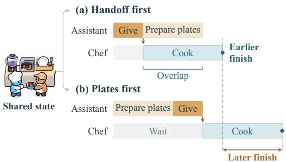  
Figure 1 : One member’s action order affects the whole team. (a) Handing over ingredients first enables parallel cooking and plate preparation. (b) Preparing plates first leaves the chef waiting.

Existing decision benchmarks examine accu-racy, calibration, and robustness (Duan et al. 2026 ; Zhuang et al. 2026 ; Lan et al. 2026) while AgentDecisionBench evaluates tool and ac-tion choices in agent workflows (Zhu et al. 2026) We focus on decisions that specify joint plans for multiple team members. Several plans may be feasible, yet their coordination choices can lead to different outcomes for the team. Evaluating these choices requires a reference for the best achievable outcome from the given state, since even the best supplied plan may be suboptimal. We therefore assess whether models select an optimal team plan and recognize when better arrangements exist be- yond the supplied options.

We introduce TandemBench, comprising 1,200 questions from 200 scenarios across 30 recipe tasks in Collab-Overcooked (Sun et al. 2025) . We select states where action ordering or resource handoffs affect task completion even when the remaining actions are optimized. Each question provides complete global information and a candidate set containing multiple feasible team plans. Execution and exact search establish candidate out-comes and the best achievable result from each state. Paired variants retain or remove the optimal plan while keeping the state and goal fixed, allowing us to distinguish correct reports of better alternatives from false alarms.

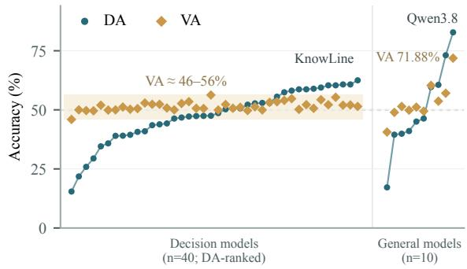  
Figure 2: Decision accuracy (DA) and verification accuracy (VA), with models sorted by increasing DA within each family.

We evaluate 40 native decision models and com- pare them with 10 general-purpose language models. KnowLine leads the native models in decision accuracy (DA) at 62.50% (Figure 2; Tables 1 and 2), while their verification accuracy (VA) remains near chance (50%). Paired tests reveal two contrasting errors: some models report a better plan whether or not the optimum is supplied, while others select a supplied plan even when it is suboptimal. Thus, DA alone misses systematic errors in optimality judgments.

Our contributions are as follows.

• We introduce TandemBench a 1,200- question benchmark for evaluating decision models on how multiple agents coordinate their actions toward a shared goal, given complete global information.

• We ground comparisons among candidate coordination plans in execution and exact search, and use paired tests to assess whether models recognize when the supplied options omit the optimal arrangement.

• We show that decision accuracy alone misses systematic errors in optimality verification, and analyze how these decisions vary across short- and long-horizon goals and option orders.

## 2 Related Work

Decision Models. Decision-model evaluation covers both individual choices and decisions within agent workflows. JEVal and OpenDecisions assess accuracy, calibration, and inference efficiency (Duan et al. 2026 ; Geuter et al. 2026) while DecisionRobust and DecisionPivot exam- ine adversarial robustness and controlled input changes, respectively (Lan et al. , 2026 ; Zhuang et al. 2026). AgentBench and AgentBoard evaluate sequential decisions through task success and progress (Liu et al. 2024 ; Ma et al. 2024) ; Agent-DecisionBench spans isolated choices, recorded agent states, and online control (Zhu et al. 2026) . TandemBench takes a joint team plan as the decision unit, so one choice specifies actions for multiple members toward a shared goal.

Multi-Agent Collaboration. CoELA and RoCo study communication and coordinated execution, while MultiAgentBench and PARTNR evaluate collaboration in interactive settings (Zhang et al. , 2024; Mandi et al. 2024; Zhu et al. 2025 ; Chang et al. 2025) CoordQA and RoCoBench-Text assess coordination choices and reasoning through static questions (Agashe et al. 2025 ; Mandi et al. 2024) . ParaCook supplies CP-SAT optimal references for abstract scheduling (Zhang et al. , 2026) while CoCoBench evaluates coordination against optimal makespan under a skill abstraction (Chen et al. 2026) TandemBench builds on Collab-Overcooked’s asymmetric cooking environment (Sun et al. 2025) . It evaluates a single model’s choices among executable team plans under complete global information, using an exact optimality reference from the same state.

Planning and Verification. Planning benchmarks assess plan generation and reasoning about actions, state transitions, and constraints (Valmeekam et al. 2023 ; Kokel et al. 2025 ; Xie et al. 2024 ; Zheng et al. 2024) . Planoptimality verification asks whether a given plan is optimal (Lin et al. 2024) while optimality certificates provide independently checkable evidence (Dold et al. 2025) . DecisionPivot uses controlled contrasts to examine how decisions respond to input changes (Zhuang et al. 2026) . TandemBench asks whether any supplied joint team plan attains the state optimum. Paired variants retain or remove the optimal plan while keeping the state and goal fixed, testing whether model judgments track its presence.

## 3 Multi-Agent Collaborative Decision-Making

## 3.1 Task Definition

A single decision model receives a complete global state, the environment rules, a shared goal, and candidate team plans. Each candidate specifies an action program for each of two team members. The global state records both members’ configurations, task-relevant resources, and ongoing processes.

The two programs execute concurrently under the environment rules. Their dependencies and re-source handoffs determine when each member can proceed (Figure 1 ). A candidate may cover the full task or prescribe a stage that ends before the final goal. Appendix A specifies the execution semantics.

## 3.2 Decision Objectives

We evaluate a team plan against either an intermediate milestone or the final task goal, referred to as short- and long-horizon goals. Completion cost is measured in joint execution steps.

Short-horizon goals. We count the steps until the specified intermediate milestone is first reached.

Long-horizon goals. We count the steps until the final goal is reached. If the prescribed stage ends before completion, the cost is its executed steps plus the minimum remaining steps from the resulting state.

Both goal settings apply to team-plan decisions and optimality verification. Short- and longhorizon questions from the same state use their respective execution protocols and may have different candidate programs. Appendix A.2 provides the formal definitions.

## 3.3 Optimal Decisions

Both tasks use the state optimum: the minimum completion cost of any legal joint execution from the given state under the specified goal and action domain.

For team-plan decision-making the model chooses among four candidate plans. Exactly one attains the state optimum and is the correct answer.

Plan-optimality verification asks whether a given plan is optimal (Lin et al. 2024) . We evaluate whether the supplied set contains such a plan. Each verification question includes three concrete plans and a fourth option stating that a feasible plan can reach the goal in fewer joint steps than all three. This statement is true exactly when none of the supplied plans attains the state optimum.

The two tasks are scored separately. Decision accuracy scores the optimal concrete choice. Verification accuracy scores whether the better-plan statement is correctly accepted or rejected; any valid concrete choice counts as rejection. Section 5 defines the metrics, and Appendix A.2 gives the formal decision criteria.

## 4 TandemBench

We construct TandemBench from states where co- ordination choices affect task completion. Alternative team plans make these choices explicit, and execution and exact search establish their outcomes and the state optimum. Each verified base question yields paired variants that retain or remove the optimal plan (Figure 3).

## 4.1 Environment and Tasks

We use 30 recipe tasks from Collab-Overcooked (Sun et al. 2025) where a chef and an assistant work in separate kitchen regions with asymmetric access to ingredients, appli-ances, and counters. Access restrictions make some actions depend on resources supplied by the other member, while recipe dependencies constrain action order. Automatic processing allows preparation to overlap with cooking (Figure 1 ). Carrying limits and shared-counter availability constrain handoff locations and timing. Appendix A gives the execution rules.

## 4.2 Scenario Selection

We select states where fixing a coordination choice changes the best achievable completion cost. Candidate states come from verified optimal delivery trajectories, at events that change available materials, processing status, or handoff opportunities. Execution prefixes establish reachability.

At each state, we compare alternative orders of two required events performed by the same member or alternative locations for a required handoff. Exact search determines the minimum delivery cost subject to each choice, optimizing all remaining actions. A state qualifies when two feasible choices are established: one attains the state optimum, while the other requires at least three ad-ditional joint steps.

We select 200 qualifying scenarios across all 30 tasks, prioritizing coverage of event orderings, handoff directions, comparison families, and material stages. Screening uses the final delivery goal and constraints on individual coordination choices. Concrete candidate programs are con- structed and evaluated separately for the shortand long-horizon questions. Algorithm 1 in Appendix B details screening and coverage.

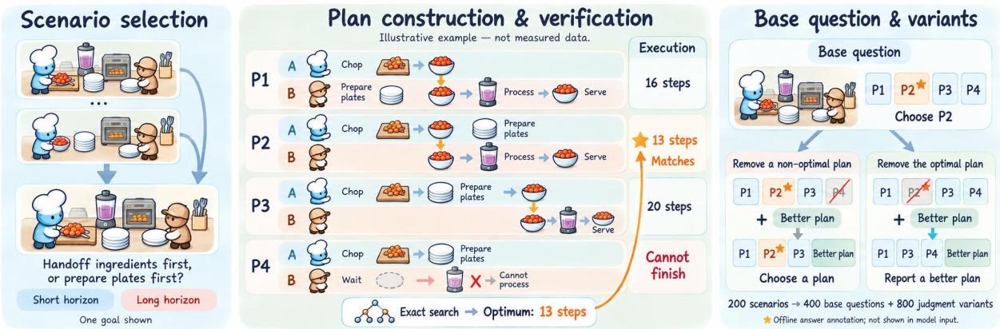  
Figure 3 : Construction of TandemBench We select scenarios with consequential coordination choices and construct candidate team plans. Execution and exact search establish reference answers. Retaining or removing the optimal plan yields paired verification questions.

## 4.3 Instance Construction

Each scenario supplies a short-horizon and a long-horizon base question. From each verified base question, we derive a pair of optimalityverification variants.

## 4.3.1 Question Construction

Candidate plans express different ways to coordinate the same team toward the specified goal. They vary in work order, handoff location, preparation scope, work overlap, or waiting conditions. For example, changing the order of ingredient supply and utensil preparation affects when processing can begin and which work can overlap. Handoff choices also depend on members’ positions and counter availability. Appendix A.3 gives concrete candidate descriptions and costs.

Each base question contains four plans, with at least three feasible and exactly one attaining the state optimum. Multiple feasible alternatives require comparing arrangements that can complete the goal. We aim to include alternatives with small cost gaps when they express distinct coordination choices. Candidate programs may differ between the short- and long-horizon objectives.

To construct a verification pair, we remove the optimal plan in one variant and a predetermined nonoptimal plan in the other. Both add the same statement that a feasible plan can reach the goal in fewer joint steps than all three remaining plans. The state, goal, execution rules, and retained pro- grams remain unchanged. The resulting fouroption pair supports comparison of correct reports when the optimum is missing and false alarms when it is present.

## 4.3.2 Answer Annotation

Candidate execution records the steps taken, goal attainment, and resulting state. Exact search establishes the state optimum and any optimal continuation needed for long-horizon evaluation. Together, these determine candidate costs under the objectives in Section 3 . Matching candidate costs to the state optimum identifies the correct base answer. In the verification pair, the better-plan statement is false when the optimum is retained and true when it is removed.

Noncompletion requires evidence under the prescribed program and protocol; unresolved searches do not supply answer labels. Appendix B.2 details candidate validation and content review.

## 4.4 Benchmark Statistics

TandemBench contains 1,200 questions from 200 scenarios across 30 tasks: 400 team-plan decisions and 800 optimality-verification variants. The 200 short- and 200 long-horizon questions form 200 pairs sharing the initial state. The variants form 400 pairs, each containing one question with the optimum retained and one with it removed. Both types of pairs derive from the same 200 scenarios. The two evaluation dimensions are scored sep- arately, and option rotations do not count as additional questions.

In 64 scenarios, the short- and long-horizon questions use identical candidate programs and retain the same optimal choice, supporting comparisons across goals and execution protocols. In 15 long-horizon questions, a feasible alternative finishes its prescribed stage sooner than the optimal candidate but has a higher total completion cost. These cases support analysis of choices where stage length and final cost favor different plans. Appendix B.3 reports structural groups for related recipe variants and programs, with grouping rules and full counts.

## 5 Experiments and Analysis

## 5.1 Experimental Setup

TandemBench uses English inputs. We evaluate 40 native decision models and report reference results from 10 general-purpose language models. Unresolved answers from these models count as incorrect under the scoring policy. Each generalpurpose model contributes 19,200 outputs across questions, option rotations, and samples.

Each question is evaluated under four cyclic option rotations, so each candidate appears once in each position. Native decision models produce one response per rotation, and general-purpose models produce four. Each response is scored separately, without voting. Models use their native decision or generation interfaces; Appendix C details reasoning modes and sampling parameters.

Decision accuracy (DA) measures selection of the optimal concrete plan. Verification accuracy (VA) averages the correct-detection rate when the optimum is removed and the correct-rejection rate when it is retained. Any valid concrete-plan choice counts as rejecting the better-plan statement. Invalid or truncated responses count as incorrect for both metrics. Uniform option selection yields 25% DA and 50% VA. Appendix D gives the metric formulas.

## 5.2 Overall Performance

Native decision models vary widely in team-plan decision accuracy, from 15.44% to 62.50% (Table 1 ). Their verification accuracy remains near chance, ranging from 45.94% to 56.28%.

The highest-DA model, KnowLine, does not lead in verification: D3-Ultra achieves the highest VA despite lower DA. Thus, plan-selection accuracy alone does not capture how well models judge whether better arrangements exist beyond the supplied options.

Among general-purpose models (Table 2; Appendix D.2), Qwen3.8-27B leads with 82.80% DA and 71.88% VA.

## 5.3 Optimality Verification

Many models report a better plan at similar rates whether the optimal plan is present or absent (Figure 4(a)). Tacit-2B detects 98.38% of cases where the optimum is absent, but also raises false alarms in 97.88% of cases where it is present.

Paired responses show two recurring patterns: some models report a better plan in both variants, while others select a concrete plan in both (Figure 4(b)). Both patterns produce a correct judgment in one condition and an incorrect judgment in the other.

The better-plan probabilities also discriminate weakly between the two conditions, with a median AUROC of 0.537 and a maximum of 0.598 across native models (Appendix G).

## 5.4 Short- and Long-Horizon Goals

We compare 64 matched pairs that share the initial state, candidate programs, and optimal choice, but differ in their goal and execution rules.

Across native decision models, mean DA decreases from 49.58% for short-horizon goals to 46.75% for long-horizon goals, although individual models vary (Figure 5). Full model-level results appear in Appendix E.2.

Earlier stage completion can leave more work for the team. Appendix E reports model-level choices on 15 long-horizon questions where an alternative finishes its prescribed stage sooner but requires more joint steps to reach the final goal.

## 5.5 Position Sensitivity

We measure position sensitivity as the difference between a model’s highest and lowest accuracy across four option rotations. The median range across native models is 10.38 percentage points, in- dicating that option order affects measured accuracy (Figure 6(a)).

Choice consistency measures how often the same underlying plan is selected across all four rotations (Figure 6(b)). CLM selects the same plan in 92.00% of questions despite a DA of 15.44%. Stable choices can therefore still be consistently incorrect.

<table><tr><td>Rank</td><td>Model</td><td>Params. (B)</td><td>DA↑</td><td>VA↑</td></tr><tr><td></td><td>KnowLine-31B-Gen1</td><td>31</td><td>62.50</td><td>51.44</td></tr><tr><td>2</td><td>Basal-Omni-1.0-Ultra</td><td>31</td><td>60.75</td><td>51.97</td></tr><tr><td>3</td><td>Quyet-1.0-Large</td><td>31</td><td>60.75</td><td>52.06</td></tr><tr><td>4</td><td>DOPEST-1.0-31B</td><td>31</td><td>60.38</td><td>52.16</td></tr><tr><td>5</td><td>PPLX-Decider-v1.2</td><td>27</td><td>60.38</td><td>55.31</td></tr><tr><td>6</td><td>PPLX-Decider-v1.1-27B</td><td>27</td><td>59.44</td><td>54.28</td></tr><tr><td>7</td><td>Torchcast-4B-v1.2</td><td>4</td><td>58.94</td><td>50.66</td></tr><tr><td>8</td><td>H2O-Lightning-31B (BF16)</td><td>31</td><td>58.69</td><td>50.19</td></tr><tr><td>9</td><td>D3</td><td>27</td><td>58.69</td><td>52.19</td></tr><tr><td>10</td><td>GLiDE-1.2-Open</td><td>27</td><td>58.13</td><td>54.72</td></tr><tr><td>11</td><td>StartLux-v1.1-27B-Instant</td><td>27</td><td>57.44</td><td>54.00</td></tr><tr><td>12</td><td>René-31B (dequant. BF16)</td><td>31</td><td>55.56</td><td>53.41</td></tr><tr><td>13</td><td>PPLX-Decider-Flash-v1.2</td><td>4</td><td>52.94</td><td>53.19</td></tr><tr><td>14</td><td>D3-Turbo</td><td>27</td><td>52.94</td><td>49.97</td></tr><tr><td>15</td><td>Torchcast-4B-v1.3</td><td>4</td><td>52.75</td><td>51.28</td></tr><tr><td>16</td><td>deck31b (BF16)</td><td>31</td><td>52.19</td><td>49.72</td></tr><tr><td>17</td><td>Wald-26B-A4B</td><td>26/4</td><td>50.63</td><td>51.09</td></tr><tr><td>18</td><td>Jeff-1.1-Medium</td><td>12</td><td>50.50</td><td>50.69</td></tr><tr><td>19</td><td>Vega-27B</td><td>27</td><td>50.25</td><td>52.28</td></tr><tr><td>20</td><td>Tacit-9B</td><td>9</td><td>48.63</td><td>49.94</td></tr><tr><td>21</td><td>D3-Ultra</td><td>27</td><td>47.50</td><td>56.28</td></tr><tr><td>22</td><td>MeTask-Rain-31B</td><td>31</td><td>47.44</td><td>50.56</td></tr><tr><td>23</td><td>MeTask-Rain-12B</td><td>12</td><td>47.38</td><td>50.66</td></tr><tr><td>24</td><td>Liquid AI d1-3B</td><td>3.12</td><td>47.19</td><td>53.47</td></tr><tr><td>25</td><td>Torchcast-12B</td><td>12</td><td>46.75</td><td>52.69</td></tr><tr><td>26</td><td>Tacit-4B</td><td>4</td><td>46.31</td><td>50.00</td></tr><tr><td>27</td><td>Mapika-Decider-12B</td><td>12</td><td>44.25</td><td>50.78</td></tr><tr><td>28</td><td>Mammoth-1</td><td>27</td><td>43.88</td><td>52.34</td></tr><tr><td>29</td><td>Torchcast-4B-v1.1</td><td>4</td><td>43.50</td><td>52.34</td></tr><tr><td>30</td><td>Clef</td><td>27</td><td>40.94</td><td>52.91</td></tr><tr><td>31</td><td>Joey-1</td><td>2</td><td>40.69</td><td>50.53</td></tr><tr><td>32</td><td>Tacit-2B</td><td>2</td><td>39.44</td><td>50.25</td></tr><tr><td>33</td><td>H2O-Lightning-4B</td><td>4</td><td>39.06</td><td>51.19</td></tr><tr><td>34</td><td>Nox-4B</td><td>4</td><td>39.00</td><td>50.00</td></tr><tr><td>35</td><td>Clef-Flash</td><td>9</td><td>35.81</td><td>49.91</td></tr><tr><td>36</td><td>Lux-9B</td><td>9</td><td>34.56</td><td>51.97</td></tr><tr><td>37</td><td>Tacit-1.7B</td><td>1.7</td><td>29.44</td><td>49.59</td></tr><tr><td>38</td><td>Laya-421M</td><td>0.421</td><td>25.88</td><td>49.69</td></tr><tr><td>39</td><td>Kai-0.6B</td><td>0.6</td><td>21.81</td><td>50.00</td></tr><tr><td>40</td><td>CLM-8B</td><td>8</td><td>15.44</td><td>45.94</td></tr></table>

Table 1 : DA and VA (%) for 40 native decision models, averaged over four option rotations. Parameters are in billions; $" 2 6 / 4 "$ denotes total/active parameters.

<table><tr><td>Rank</td><td>Model</td><td>Avg. output tokens</td><td>DA↑</td><td>VA↑</td></tr><tr><td>1</td><td>Qwen3.8-27B</td><td>8652</td><td>82.80</td><td>71.88</td></tr><tr><td>2</td><td>0 Gemma4-31B</td><td>1072</td><td>73.11</td><td>57.03</td></tr><tr><td>3</td><td>0 Gemma4-26B-A4B</td><td>1516</td><td>60.58</td><td>53.66</td></tr><tr><td>4</td><td>Muse-Glimmer-30B</td><td>1415</td><td>59.64</td><td>60.35</td></tr><tr><td>5</td><td>Ω Qwen3-32B</td><td>925</td><td>46.33</td><td>49.45</td></tr></table>

Table 2: DA and VA (%) and mean output length for the five highest-DA general-purpose models.

(a) Detection and false alarms  
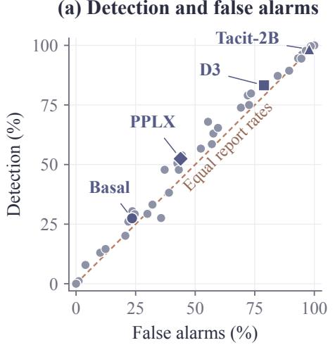

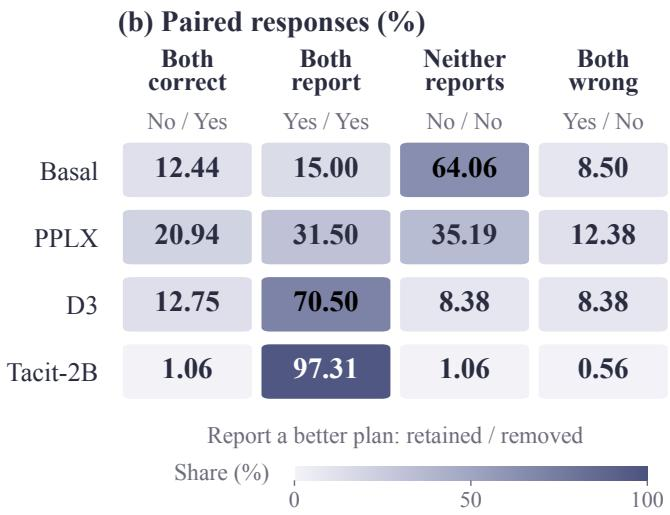  
Figure 4 : Optimality-verification behavior. (a) Detection versus false-alarm rates. (b) Paired responses when the optimal plan is retained or removed, in that order. Yes reports a better plan; No selects a concrete plan.

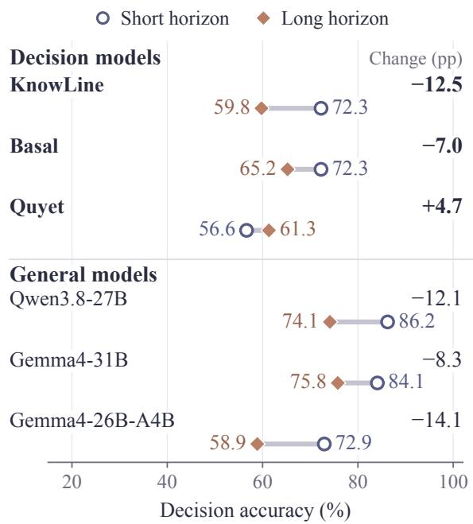  
Figure 5 : Short- and long-horizon DA with identical candidate programs but different goals and execution rules. The three models with the highest overall DA in each family are shown. Changes are long minus short, in percentage points.

## 6 Conclusion

TandemBench evaluates decision models on team plans involving task dependencies, resource handoffs, and parallel work. Execution and exact search establish reference answers, while paired candidate sets test whether models recognize when better arrangements exist beyond the supplied options. Native decision models differ widely in plan-choice accuracy, but their reports of better alterna- tives often fail to distinguish whether an optimal plan is present. Performance also varies across goal settings and option orders. TandemBench therefore supports comparisons that assess both the selected team plan and judgments about the available alternatives.

## Limitations

Our findings concern team-plan decisions for two agents in one kitchen with global information. Questions share scenarios, and inference budgets vary across models.

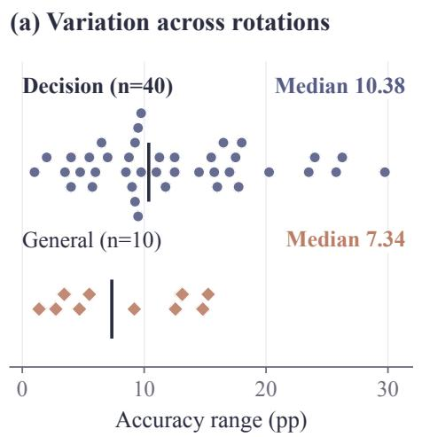

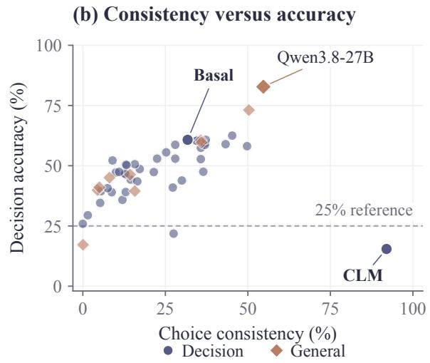  
Figure 6 : Sensitivity to option order. (a) DA range across four rotations; bars mark group medians. (b) DA versus choice consistency, the percentage of questions selecting the same underlying plan across all rotations. Generalmodel scores average four samples per rotation and include sampling variability.

## References

Saaket Agashe, Yue Fan, Anthony Reyna, and Xin Eric Wang. 2025. LLM-coordination: Evaluating and analyzing multi-agent coordination abilities in large language models In Findings of the Association for Computational Linguistics: NAACL 2025, pages 8053–8072.

Matthew Chang, Gunjan Chhablani, Alexander Clegg, Mikael Dallaire Cote, Ruta Desai, Michal Hlavac, Vladimir Karashchuk, Jacob Krantz, Roozbeh Mottaghi, Priyam Parashar, Siddharth Patki, Ishita Prasad, Xavier Puig, Akshara Rai, Ram Ramrakhya, Daniel Tran, Joanne Truong, John Turner, Eric Undersander, and Tsung-Yen Yang. 2025. PARTNR: A benchmark for planning and reasoning in embodied multi-agent tasks In International Conference on Learning Representations.

Yang Chen, Ye-Xin Xie, Lirong Che, Danyang Peng, Yuzhe Yang, Peiwen Lin, Xu Cao, Chuang Wang, Lei Yuan, Jian Su, and Lan-Zhe Guo. 2026. Co-CoBench: A Cooperative Coordination Benchmark for Embodied Multi-Agent Task Planning. Preprint arXiv:2608.28266.

Simon Dold, Malte Helmert, Jakob Nordström, Gabriele Röger, and Tanja Schindler. 2025. Pseudoboolean proof logging for optimal classical planning. Preprint arXiv:2504.18443.

Feiyu Duan, Jiayu Lin, Jia Wang, Jun Xiang, Jialiang Wu, Xinnong Zhang, Hanqi Yan, Siyuan Wang, and Zhongyu Wei. 2026. General decision models: Benchmarking and insights beyond Jev. Preprint arXiv:2610.03935. Version 2, 12 October 2026.

Jonathan Geuter, Andrew Cheng, and David Alvarez-Melis. 2026. Releasing the inner Jev: A simple recipe for open decision models . Preprint, arXiv:2610.17205. Version 1, 12 October 2026.

Harsha Kokel, Michael Katz, Kavitha Srinivas, and Shirin Sohrabi. 2025. ACPBench: Reasoning about action, change, and planning. In Proceedings of the AAAI Conference on Artificial Intelligence volume 39, pages 26559–26568.

Yifan Lan, Zhongye Liu, Yurui Chang, Hanyu Wang, Yongkang Du, Lu Lin, and Jinghui Chen. 2026. DecisionRobust: Benchmarking robustness for JEV style decision models across text and vision. Preprint arXiv:2610.19118. Version 1, 13 October 2026.

Songtuan Lin, Conny Olz, Malte Helmert, and Pascal Bercher. 2024. On the computational complexity of plan verification, (bounded) plan-optimality verification, and bounded plan existence. In Proceedings of the AAAI Conference on Artificial Intelligence volume 38, pages 20203–20211.

Xiao Liu, Hao Yu, Hanchen Zhang, Yifan Xu, Xuanyu Lei, Hanyu Lai, Yu Gu, Hangliang Ding, Kaiwen Men, Kejuan Yang, Shudan Zhang, Xiang Deng, Aohan Zeng, Zhengxiao Du, Chenhui Zhang, Sheng Shen, Tianjun Zhang, Yu Su, Huan Sun, and 3 others. 2024. AgentBench: Evaluating LLMs as agents . In International Conference on Learning Representations.

Chang Ma, Junlei Zhang, Zhihao Zhu, Cheng Yang, Yujiu Yang, Yaohui Jin, Zhenzhong Lan, Lingpeng Kong, and Junxian He. 2024. AgentBoard: An analytical evaluation board of multi-turn LLM agents . In Advances in Neural Information Processing Systems volume 37.

Zhao Mandi, Shreeya Jain, and Shuran Song. 2024. RoCo: Dialectic Multi-Robot Collaboration with Large Language Models In IEEE International Conference on Robotics and Automation

Haochen Sun, Shuwen Zhang, Lujie Niu, Lei Ren, Hao Xu, Hao Fu, Fangkun Zhao, Caixia Yuan, and Xiaojie Wang. 2025. Collab-Overcooked: Benchmarking and evaluating large language models as collaborative agents. In Proceedings of the 2025 Conference on Empirical Methods in Natural Language Processing pages 4922–4951.

Karthik Valmeekam, Matthew Marquez, Alberto Olmo, Sarath Sreedharan, and Subbarao Kambhampati. 2023. PlanBench: An extensible benchmark for evaluating large language models on planning and reasoning about change In Advances in Neural Information Processing Systems volume 36.

Jian Xie, Kai Zhang, Jiangjie Chen, Tinghui Zhu, Renze Lou, Yuandong Tian, Yanghua Xiao, and Yu Su. 2024. TravelPlanner: A benchmark for real-world planning with language agents . In Proceedings ofthe 41st International Conference on Machine Learning volume 235 of Proceedings ofMachine Learning Research pages 54590–54613.

Hongxin Zhang, Weihua Du, Jiaming Shan, Qinhong Zhou, Yilun Du, Joshua B. Tenenbaum, Tianmin Shu, and Chuang Gan. 2024. Building Cooperative Embodied Agents Modularly with Large Language Models. In International Conference on Learning Representations.

Shiqi Zhang, Xinbei Ma, Yunqing Xu, Zouying Cao, Pengrui Lu, Haobo Yuan, Tiancheng Shen, Zhuosheng Zhang, Hai Zhao, and Ming-Hsuan Yang. 2026. ParaCook: On time-efficient planning for multi-agent systems . In Findings of the Association for Computational Linguistics: ACL 2026 pages 27683–27701. Association for Computational Linguistics.

Huaixiu Steven Zheng, Swaroop Mishra, Hugh Zhang, Xinyun Chen, Minmin Chen, Azade Nova, Le Hou, Heng-Tze Cheng, Quoc V. Le, Ed H. Chi, and Denny Zhou. 2024. NATURAL PLAN: Benchmarking LLMs on Natural Language Planning. Preprint, arXiv:2406.04520.

Kunlun Zhu, Hongyi Du, Zhaochen Hong, Xiaocheng Yang, Shuyi Guo, Zhe Wang, Zhenhailong Wang, Cheng Qian, Xiangru Tang, Heng Ji, and Jiaxuan You. 2025. MultiAgentBench : Evaluating the collaboration and competition of LLM agents . In Proceedings of the 63rd Annual Meeting of the Association for Computational Linguistics (Volume 1: Long Papers), pages 8580–8622, Vienna, Austria. Association for Computational Linguistics.

Kunlun Zhu, Tao Feng, Xu Han, Heng Wang, Ling Yang, Xiangru Tang, Jiaxuan You, and Heng Ji. 2026. JevAgentHarness : Benchmarking, deploying and training decision models that share control with LLMs Preprint arXiv:2610.21412. Version 1, 15 October 2026.

Xialie Zhuang, Mingcong Lei, Zunhai Su, Ri Liu, Jianjin Li, Peixian Ma, Jia Pan, Ngai Wong, Guanhua

Chen, and Chuan-Wei Kuo. 2026. DecisionPivot: A diagnostic benchmark for decision models in LLM systems . Preprint arXiv:2610.28522. Version 1, 20 October 2026.

## Appendix

## A Execution and Decision Criteria

## A.1 Execution Rules

Each joint step resolves chef interaction, assistant interaction, movement, then appliance processing. Processing includes its start step; finished products await retrieval. Waits are checked at step bound- aries. An assistant interaction can retrieve an item placed by the chef in the same step; an explicit wait cannot.

Domains define role permissions, retrieval, and counter access. The canonical processing-chain domain permits retrieval before processing starts and plated-product transfers. Search records require matching states, goals, domains, and execution rules.

## A.2 Goal-Dependent Costs

Let $s _ { t } ^ { p }$ be the state after t joint steps of plan $p =$ $( p ^ { ( 1 ) } , p ^ { ( 2 ) } )$ and $V _ { g } ^ { * } ( s ; \mathcal { D } )$ the minimum legal cost to reach goal $g$ in domain D. Short-horizon cost stops at the intermediate goal:

$$
C _ { \mathrm { { S } } } ( s , p ) = \operatorname* { m i n } \{ t \geq 0 : g _ { \mathrm { { S } } } ( s _ { t } ^ { p } ) = 1 \} .\tag{1}
$$

If both programs finish at step $\tau _ { p }$ before final delivery, long-horizon cost includes optimal continuation:

$$
\begin{array} { r } { C _ { \mathrm { L } } ( s , p ) = \tau _ { p } + V _ { g _ { \mathrm { L } } } ^ { * } ( s _ { \tau _ { p } } ^ { p } ; \mathcal { D } ) . } \end{array}\tag{2}
$$

Delivery during the prescribed stage instead uses its first hitting time. Members remain idle after their programs end, while appliances advance each step. A plan that cannot complete under this protocol has $C _ { g } = + \infty$ even if abandoning it would permit recovery.

For the four base candidates, $\begin{array} { r l } { i ^ { * } } & { { } = } \end{array}$ arg $\begin{array} { r } { \operatorname* { m i n } _ { i \in \{ 1 , 2 , 3 , 4 \} } C _ { g } ( s , p _ { i } ) } \end{array}$ is unique and satisfies

$$
C _ { g } ( s , p _ { i ^ { * } } ) = V _ { g } ^ { * } ( s ; \mathcal { D } ) .\tag{3}
$$

State optimality ranges over all legal joint executions, with uniqueness required among the supplied candidates. For three retained plans ${ \mathcal { P } } ^ { \prime }$ , the better-plan statement is true exactly when

$$
\operatorname* { m i n } _ { p \in \mathscr { P } ^ { \prime } } C _ { g } ( s , p ) > V _ { g } ^ { * } ( s ; \mathscr { D } ) .\tag{4}
$$

## A.3 Concrete Example

In the long-horizon point024 example (taro– bean–bell-pepper pie), B attains the 13-step optimum; C ends its stage sooner but requires 15 steps overall (Table 3). Inputs contain full programs without costs; Figure 1 is schematic.

<table><tr><td>Plan</td><td>Program ID</td><td>Stage</td><td>Remaining</td><td>Total</td></tr><tr><td>A</td><td>opt04</td><td>13</td><td>8</td><td>21</td></tr><tr><td>B</td><td>opt01</td><td>10</td><td>3</td><td>13</td></tr><tr><td>C</td><td>opt02</td><td>7</td><td>8</td><td>15</td></tr><tr><td>D</td><td>opt03</td><td>9</td><td>6</td><td>15</td></tr></table>

Table 3 : Long-horizon plan costs in joint steps. Stage is the prescribed-program cost; Remaining is the optimal continuation cost. Bold marks the minimum total.

## B Construction and Dataset Details

## B.1 Scenario Screening

Algorithm 1 selects states where coordination choices affect completion cost even when all remaining actions are optimized. A constraint c fixes the order of two required events by one member or the location of a required handoff. Alternatives for the same events form a comparison family. With all remaining actions optimized, their cost penalty is

$$
\Delta ( s , c ) = J ( s , c ) - V _ { g _ { \mathrm { L } } } ^ { * } ( s ; \mathcal { D } ) .\tag{5}
$$

where $J ( s , c )$ is the constrained optimal delivery cost. An examined family must contain two proven feasible choices satisfying

$$
\Delta ( s , c ^ { + } ) = 0 , ~ \Delta ( s , c ^ { - } ) \geq 3 .\tag{6}
$$

States match by positions, orientations, carried items, material locations, and processing progress. Up to eight comparison families alternate memberspecific event orders and both handoff directions at dependency depths 1–3. Alternatives are fixed before cost queries.

Grouping preserves task, domain, goal, comparison family, alternatives, feasibility, penalties, and timing relative to partner events. Materials and processing progress remain fixed across intervening trajectory states; positions may vary. The representative is nearest a certified divergence, with earlier trajectory position breaking ties.

Algorithm 1 Scenario Selection   
Input: Reachable states S with domains $\{ \mathcal { D } _ { s } \} ;$   
trajectory lengths {Ti} budget $\dot { B _ { } } = \dot { 2 } 0 0 ;$   
comparison-family limit $K = 8$   
Output: Selected scenarios Q   
1: $\mathbf { \dot { \boldsymbol { R } } } \gets \emptyset$   
2: for s ∈ S do   
3: $v _ { s } \gets V _ { g _ { \mathrm { L } } } ^ { * } ( s ; \mathcal { D } _ { s } )$   
4: $\mathcal { F } _ { s } \gets \dot { C }$ omparisonFamilies $( s , K )$   
5: for $F \in \mathcal { F } _ { s }$ do   
6: $J ( s , c ) \gets$ optimal delivery cost subject to $^ { c , }$ for   
$c \in F$   
7: $P _ { F } $ choices in $F$ with proven finite costs   
8: $\Delta ( s , c )  J ( s , c ) - v _ { s } { \mathrm { ~ f o r } } c \in P _ { F }$   
9: $\mathbf { i } \mathbf { f } \ni \mathbf { \ - j } \partial ^ { + } , c ^ { - } \in P _ { F }$ satisfying Eq. 6 then   
10: $R \gets R \cup \{ s \}$   
11: $( G _ { i } ) \gets$ GroupComparisons(R)   
12: (q ) ← AllocateQuotas $( ( G _ { i } ) , \{ T _ { i } \} , B )$   
13: $\dot { Q } \gets \emptyset$   
14: for each task i do   
15: $Q  Q$ ∪ GreedyCoverage $( G _ { i } , q _ { i } )$   
16: return $Q$

## B.2 Coverage and Candidate Verification

For representative states $S _ { i }$ and optimal trajectory length Ti task capacity is

$$
b _ { i } = \operatorname* { m i n } \bigl ( | S _ { i } | , \lfloor T _ { i } / 3 \rfloor \bigr ) .\tag{7}
$$

Capacity limits counts, not spacing. Each task receives one scenario; the remaining 170 follow largest-remainder allocation proportional to $b _ { i } ~ - ~ 1$ with ties by task ID. Coverage prioritizes event-ordering or handoff directions, family/optimal-arrangement-set combinations, then material stages. Keys include all optimal arrangements; processing progress alone does not define a stage.

Ties use trajectory distance, proximity grade, earlier position, then candidate ID. Grades order certified common optimal prefixes of 0, 1, 2, or $\geq 3$ steps, then unknown and uncomputed cases. Source levels L1–L6 contribute 10, 5, 40, 35, 50, and 60 scenarios; these are recipe-complexity labels, not calibrated item difficulties.

Base questions contain a unique state-optimal plan and at least two feasible alternatives. Suboptimal gaps are at least one joint step for short goals and two for long goals; short-goal contrasts act before first attainment. Rationales link state facts and program differences to execution outcomes. Parallelism tags require different productive overlap.

## B.3 Dataset Composition

Table 4 separates questions, scenarios, and structures. Of 200 cross-goal pairs, 64 share programs and the optimum; 136 use different programs. Normalization replaces ingredient/product names while preserving dependencies, states, programs, goals, and domains.

<table><tr><td>Unit or property</td><td>Count</td></tr><tr><td>Recipe tasks</td><td>30</td></tr><tr><td>Decision scenarios</td><td>200</td></tr><tr><td>Short-/long-horizon question pairs</td><td>200</td></tr><tr><td>Total evaluation questions</td><td>1,200</td></tr><tr><td>Base team-plan decision questions</td><td>400</td></tr><tr><td>Optimality-verification variants</td><td>800</td></tr><tr><td>Base short-/long-horizon questions</td><td>200 / 200</td></tr><tr><td>Base candidate plans</td><td>1,600</td></tr><tr><td>Base questions with 3 / 4 feasible plans</td><td>246 / 154</td></tr><tr><td>Normalized question structures</td><td>181</td></tr><tr><td>Normalized paired-scenario structures</td><td>97</td></tr><tr><td>Pairs with identical candidate programs</td><td>64</td></tr><tr><td>Long-horizon questions with stage/total rank re- versals</td><td>15</td></tr></table>

Table 4 : Dataset composition. Candidate and feasibility counts cover base questions; normalized structures cover base questions and short-/long-horizon pairs. Option rotations do not create additional questions.

The public dataset release is tandembench-en-v1.0.0. Original gold positions A–D contain 200, 69, 62, and 69 questions; cyclic rotations balance positions.

## C Models and Inference Protocols

Native interfaces. Models retain native inputs and readouts: Tacit inference; Decision-2 for Vega/Lux/Kai/Nox; CLM’s prediction head and last-token pooling; Laya state inputs and short labels; KnowLine’s read\_twice ; and GLiDE’s non-causal text interface. Mammoth, PPLX, and D3 retain calibration; StartLux uses Instant infer-ence. MeTask-Rain-31B uses W4A16 with un- merged LoRA, routing, and calibration.

Weights and reasoning. H2O-Lightning-31B and deck31b use BF16; René uses FP8 dequantized to BF16. H2O disables online FP8 quantization. D3 sizes round 26.09B to 27B; Wald lists total/active parameters. Muse-Glimmer-30B uses low reasoning, and the evaluated Qwen conditions disable thinking.

Response scoring. Truncated, missing-choice, and multiple-choice outputs count as incorrect.

<table><tr><td>Rank</td><td>Model</td><td>Avg. output tokens</td><td>DA↑</td><td>VA↑</td></tr><tr><td>1</td><td>0 Qwen3.8-27B</td><td>8652</td><td>82.80</td><td>71.88</td></tr><tr><td>2</td><td>Gemma4-31B</td><td>1072</td><td>73.11</td><td>57.03</td></tr><tr><td>3</td><td>0 Gemma4-26B-A4B</td><td>1516</td><td>60.58</td><td>53.66</td></tr><tr><td>4</td><td>0 Muse-Glimmer-30B</td><td>1415</td><td>59.64</td><td>60.35</td></tr><tr><td>5</td><td>0 Qwen3-32B</td><td>925</td><td>46.33</td><td>49.45</td></tr><tr><td>6</td><td>Gemma4-E4B</td><td>2564</td><td>45.03</td><td>51.16</td></tr><tr><td>7</td><td>0 Qwen3-8B</td><td>1092</td><td>41.03</td><td>49.85</td></tr><tr><td>8</td><td>Ministral 3 14B Instruct è</td><td>1762</td><td>39.89</td><td>51.45</td></tr><tr><td>9</td><td> Llama3.3-70B</td><td>661</td><td>39.50</td><td>48.92</td></tr><tr><td>10</td><td>0 Qwen3-0.6B</td><td>25</td><td>17.19</td><td>40.61</td></tr></table>

Table 5 : DA and VA (%) and mean output length for ten general-purpose models, ranked by DA. Unresolved answers count as incorrect; shading marks the top three and bold marks the best score in each metric.

## D Evaluation Metrics and Full Results

## D.1 Coverage and Scoring

For N questions, decision accuracy (denoted $\operatorname { A c c } _ { 4 , S }$ below) compares stable candidate IDs $\hat { i } _ { q r s }$ with gold $i _ { q } ^ { * } \colon$

$$
\mathsf { A c c } _ { 4 , S } = \frac { 1 } { 4 S N } \sum _ { q = 1 } ^ { N } \sum _ { r = 0 } ^ { 3 } \sum _ { s = 1 } ^ { S } \mathbb { I } [ \hat { i } _ { q r s } = i _ { q } ^ { * } ] .\tag{8}
$$

Each model contributes 1,600 native or 6,400 general-model base outputs. Uniform selection or a fixed display letter yields 25% DA. Truncated, missing-choice, multiple-choice, and infrastructure-failure outputs count as incorrect and are recorded separately.

Verification uses 800 paired variants. Reporting a better plan is TP when the optimum is removed; selecting any valid concrete plan is TN when it is retained:

$$
\mathrm { V A } = \frac { 1 } { 2 } \left( \frac { \mathrm { T P } } { N _ { \mathrm { r e m o v e } } } + \frac { \mathrm { T N } } { N _ { \mathrm { r e t a i n } } } \right) .\tag{9}
$$

VA is balanced binary accuracy and, with equal group sizes, pooled judgment accuracy. Invalid responses count as neither TP nor TN. Uniform selection, always reporting, or always choosing a concrete plan yields 50% VA. TN does not require selecting the optimal retained plan.

## D.2 Full Model Comparison

Table 5 reports results for the ten general-purpose models evaluated on the English inputs.

## D.3 Interpretation Scope

The benchmark evaluates centralized plan decisions from complete global information; it does not test communication or adaptation to independent partners. Option rotations balance answer positions, while program length and waiting patterns remain observable cues. Models use their native interfaces and inference budgets, so results compare evaluated systems under their respective protocols.

## E Costs and Goal Comparisons

## E.1 Decision Costs and Choice Stability

Figure 7 covers 40 native models and 10 general-purpose models; Table 6 lists six native models. For feasible selections, regret is

$$
R _ { q } = C _ { g _ { q } } ( s _ { q } , p _ { \hat { i } _ { q } } ) - V _ { g _ { q } } ^ { * } ( s _ { q } ; \mathcal { D } _ { q } ) .\tag{10}
$$

Regret includes optimal choices at zero. Feasible, noncompletion, and invalid rates use all outputs and sum to one. The 246 questions with noncompleting candidates give exposure counts of 984 (S = 1) or 3,936 (S = 4).

Position sensitivity. For general-purpose models, averaging four samples per position yields a median DA range of 7.34 points. Averaging the four within-sample ranges for each model and taking the median across models gives 8.47 points. Consistency tracks the same candidate across rotations within each sample index. Both include generation randomness (Figure $6 ;$ Table 6).

## E.2 Goal Comparisons

Figure 8 compares 64 pairs sharing initial states, programs, and optimal choices, with different goals and execution rules. Mean short/long DA is 49.58/46.75% for 40 native models and 56.68/48.04% for 10 general-purpose models, weighting models equally.

A disjoint set of 15 long-horizon questions offers feasible alternatives with $\begin{array} { r l r l } { \tau _ { i } } & { { } < } & { \tau _ { i } } \end{array}$ but ${ \begin{array} { l r } { C _ { \mathrm { L } } ( s , p _ { i } ) } & { > } & { C _ { \mathrm { L } } ( s , p _ { i ^ { * } } ) } \end{array} }$ Table 7 reports their DA and selection rates. Basal selects these earlierfinishing but higher-total-cost alternatives in 22/60 presentations; Qwen3.8-27B in 13/240, including rotations and samples.

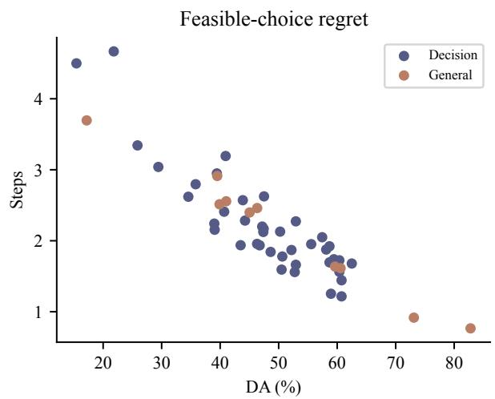

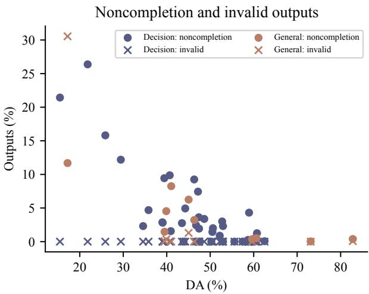  
Figure 7 : Execution consequences of selected plans. Left: mean extra joint steps above the state optimum among feasible selections. Right: the percentage of all outputs selecting a noncompleting plan; invalid responses form a separate category.

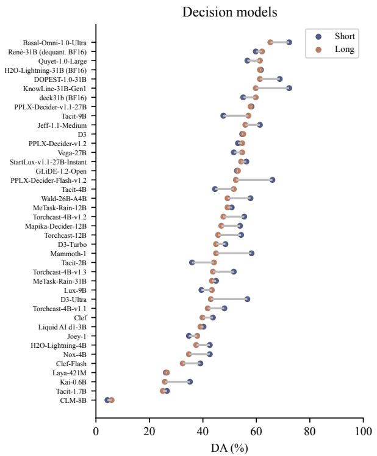

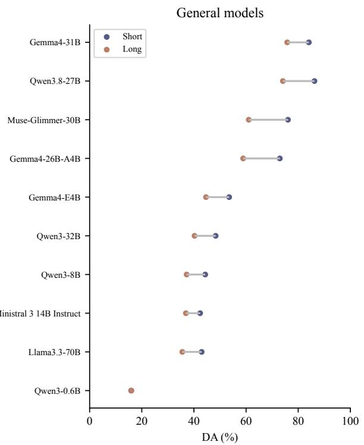  
Figure 8 : Short- and long-horizon DA with identical candidate programs but different goals and execution rules. Models are ordered by decreasing long-horizon DA within each family.

<table><tr><td>Model</td><td>Feasible (%)</td><td>Noncompletion (%)</td><td>Regret</td><td>Consistency (%)</td><td>Range (pp)</td></tr><tr><td>Basal-Omni-1.0-Ultra</td><td>99.75</td><td>0.25</td><td>1.44</td><td>31.75</td><td>11.25</td></tr><tr><td>KnowLine-31B-Gen1</td><td>99.94</td><td>0.06</td><td>1.68</td><td>45.25</td><td>11.75</td></tr><tr><td>Quyet-1.0-Large</td><td>98.75</td><td>1.25</td><td>1.22</td><td>37.25</td><td>25.75</td></tr><tr><td>PPLX-Decider-v1.1-27B</td><td>100.00</td><td>0.00</td><td>1.74</td><td>37.00</td><td>9.00</td></tr><tr><td>Torchcast-4B-v1.2</td><td>95.69</td><td>4.31</td><td>1.25</td><td>43.25</td><td>2.00</td></tr><tr><td>CLM-8B</td><td>78.56</td><td>21.44</td><td>4.50</td><td>92.00</td><td>1.00</td></tr></table>

Table 6 : Execution outcomes and choice stability. Regret is mean extra joint steps among feasible selections. Consistency is the percentage of questions selecting the same plan across all rotations; Range is maximum minus minimum rotation DA.
<table><tr><td>Model</td><td>Same-plan short</td><td>Same-plan long</td><td>Conflict DA</td><td>Fast-stage choice</td></tr><tr><td>Basal-Omni-1.0-Ultra</td><td>72.27</td><td>65.23</td><td>35.00</td><td>36.67</td></tr><tr><td>KnowLine-31B-Gen1</td><td>72.27</td><td>59.77</td><td>55.00</td><td>0.00</td></tr><tr><td>Quyet-1.0-Large</td><td>56.64</td><td>61.33</td><td>48.33</td><td>10.00</td></tr><tr><td>PPLX-Decider-v1.1-27B</td><td>58.20</td><td>57.81</td><td>45.00</td><td>35.00</td></tr><tr><td>Torchcast-4B-v1.2</td><td>55.47</td><td>47.66</td><td>73.33</td><td>15.00</td></tr><tr><td>CLM-8B</td><td>4.30</td><td>5.86</td><td>0.00</td><td>66.67</td></tr></table>

Table 7 : DA and fast-stage choice rates (%). Same-plan columns compare short and long goals with identical programs. Conflict columns cover a separate set where an earlier stage finish can require more total steps; Fast- stage choice is the rate of selecting such alternatives.

## F Coordination-Group Analysis

Figure 9 compares five native models across overlapping coordination groups defined by the union of candidate tags.

Work order covers processing/supply order (300 questions, 156 scenarios); handoffs cover transfer locations/conditions (376, 188); parallel work covers productive overlap (355, 182); resource constraints cover carrying/counter capacity (141, 77). These tags capture intended coordination contrasts. Because groups may overlap and differ in task and goal composition, their scores describe perfor-mance on these subsets rather than isolated mechanism effects.

## G Probability Analysis

Figure 10 uses 128,000 outputs: 40 models, 400 pairs, four rotations. Probabilities are aligned by option letter or text, correcting sums within 10−4 rounding tolerance and excluding interfacespecific confidence fields.

AUROC ranks removed- against retainedoptimum examples by better-plan probability, with half credit for ties. Median/maximum

AUROC is 0.537/0.598 (GLiDE); Basal scores 0.520.

Panel (a) averages all pairs. For pairs reporting twice in (b), mean shifts are +3.26 points for Basal (240 pairs), +2.05 for PPLX (504), and +0.55 for Tacit-2B (1,557). Figure 4(b) gives unconditional choices.

## H Task Weighting

<table><tr><td>Model</td><td>Item-weighted Task-macro</td></tr><tr><td>Basal-Omni-1.0-Ultra</td><td>60.75 65.45</td></tr><tr><td>KnowLine-31B-Gen1</td><td>62.50 66.96</td></tr><tr><td>Quyet-1.0-Large</td><td>60.75 61.00</td></tr><tr><td>PPLX-Decider-v1.1-27B</td><td>59.44 62.90</td></tr><tr><td>Torchcast-4B-v1.2</td><td>58.94 56.95</td></tr><tr><td>CLM-8B</td><td>15.44 10.52</td></tr></table>

Table 8 : DA (%) under two weighting schemes. Itemweighted gives equal weight to questions; Task-macro averages task-level accuracies equally.

Task weighting and uncertainty. After averaging four rotations per question, we bootstrap 200 scenarios with both goals retained (10,000 replications; seed 20261027). KnowLine minus Basal is 1.75 points: the percentile 95% interval is [- 1.56, 5.00], or [-2.10, 5.56] when resampling the 30 tasks. Intervals condition on the recorded runs; structure IDs record further cross-scenario relationships.

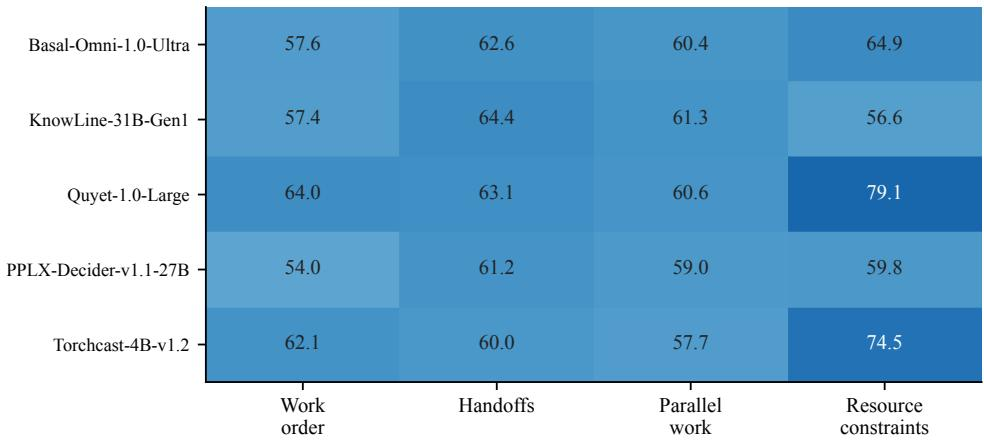  
Figure 9 : DA (%) across coordination groups. Darker cells indicate higher accuracy. A question may belong to more than one group.

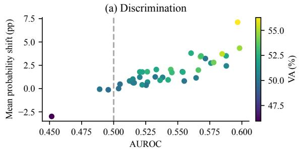

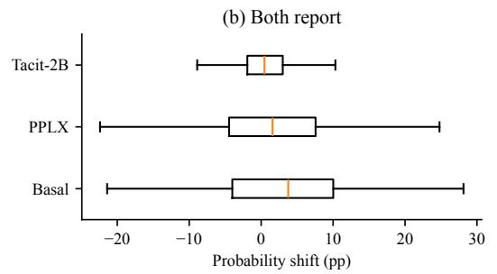

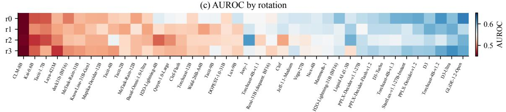  
Figure 10 : Better-plan probabilities. (a) AUROC versus mean shift, colored by VA. (b) Shifts for pairs reporting twice; boxes show quartiles and central lines the median. (c) AUROC by rotation. Shifts are removed minus retained, in percentage points.