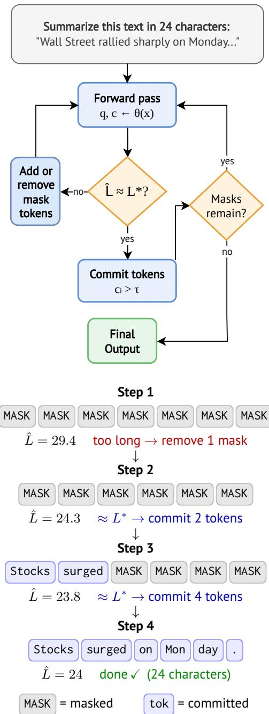

# Training-Free Character-Length Control in Summarization with Diffusion Language Models

Steffen Castle1 Nils Feldhus3,1 Christopher Ebert1 Leonhard Hennig1 Sebastian Möller1,2

1German Research Center for Artificial Intelligence (DFKI) 2Technische Universität Berlin 3CLCG, University of Groningen

## Abstract

Summarization with a fixed character length is important for tasks such as headline and article preview generation, where text must fit an exact space. Autoregressive language models (LMs) struggle with precise character-length control: training-based methods require taskspecific fine-tuning, while zero-shot prompting strategies achieve only approximate compliance. We propose DELTA (Diffusion Expected Length Targeting Algorithm), a training-free inference-time method for masked diffusion LMs that estimates expected character length at each denoising step and dynamically inserts or removes masked positions to steer toward a target length. DELTA requires no fine-tuning and is designed for off-the-shelf masked diffusion LMs. Across three summarization benchmarks, it reduces character-length errors by an order of magnitude compared to baselines while maintaining competitive summary quality in both automatic and human evaluation.

## 1 Introduction

Many summarization tasks require outputs that fit a precise character budget. In publishing workflows, for example, headlines and article previews are often produced for predefined display slots with fixed character capacities (Hitomi et al., 2019); similar constraints arise in notification previews, social media posts, subtitles, and UI text, where even a few extra characters can cause truncation or layout overflow. Existing approaches to length-controlled summarization operate within the constraints of autoregressive generation: training-based methods (Miculicich et al., 2023; Belligoli et al., 2025) modify the model or its objective to encourage a target length, while zero-shot strategies (Retkowski and Waibel, 2025; Xie and Lee, 2025) rely on prompting techniques or post-hoc filtering. Both approaches operate under standard left-to-right autoregressive decoding, where previously emitted tokens are not directly revised within the same generation pass. This makes it difficult to dynamically correct the decoded character length as generation proceeds.

Masked diffusion language models such as LLaDA (Nie et al., 2025) and Dream (Ye et al., 2025) offer a structurally different generation process. These models iteratively refine a buffer of masked tokens over multiple denoising steps, and are trained to generate across a range of output lengths. This means that occasional insertions or removals of mask tokens will not severely disrupt generation quality. We exploit this property with DELTA, an inference-time method that estimates expected character length from both committed tokens and the probability distributions over remaining masks, then adjusts the buffer to steer toward a target. DELTA requires no fine-tuning or architectural changes and is designed to apply to off-the-shelf masked diffusion LMs. Across three summarization benchmarks, it reduces characterlength errors by an order of magnitude compared to all baselines while maintaining competitive summary quality.

## 2 Background and Related Work

Length-Controlled Summarization. Prior work on length-controlled summarization predominantly operates within the autoregressive framework and spans token-, word-, sentence-, and character-level constraints. Training-based approaches modify either the model or its objective: CTRLsum (He et al., 2020) conditions generation on coarse length bins, Miculicich et al. (2023) jointly train a length predictor and constrained decoder for precise token or sentence counts, and Belligoli et al. (2025) upweight the EOS-token loss to enforce a characterlength ceiling.

Training-free approaches instead steer pretrained autoregressive LMs at inference time. Retkowski and Waibel (2025) convert character targets to word targets using statistical ratios and filter multiple samples, while Xie and Lee (2025) append countdown markers to obtain near-exact word-level control. Instruction- and position-based methods likewise target explicit length constraints, including sentence compression with InstructCMP (Juseon-Do et al., 2024) and positional representations for length control (Wang et al., 2024). Other inferencetime approaches address precise length control in LLMs (Butcher et al., 2025), black-box lengthconstrained generation (Gu et al., 2025), and iterative controllable summarization (Ryu et al., 2026).

Controllable generation has also been studied in diffusion language models, including methods that steer generation toward desired attributes (Li et al., 2022). In contrast to these approaches, DELTA exploits masked-diffusion denoising to directly estimate and dynamically correct decoded character length during generation, requiring neither model training nor post-hoc regeneration.

Discrete Diffusion Language Models. D3PM (Austin et al., 2021) introduced discrete diffusion over token vocabularies, and MDLM (Sahoo et al., 2024) refined the training objective with a Rao-Blackwellized loss that substantially narrows the likelihood gap with autoregressive models. These foundations enabled scaling to billion parameters: LLaDA (Nie et al., 2025) trains an 8B masked diffusion model from scratch, competitive withL̂ LLaMA 3, while Dream (Ye et al., 2025) initializes from a pretrained autoregressive checkpoint with context-adaptive noise rescheduling. Both generate output by iteratively unmasking tokens using confidence-based strategies originating in MaskGIT (Chang et al., 2022).

Variable-Length Generation in Diffusion LMs. Standard masked diffusion decoding requires choosing a fixed token-buffer size before denoising. This token-buffer length is distinct from a target decoded character length because tokens correspond to strings of varying character length. DreamOn (Wu et al., 2026) introduces special expand/delete tokens that allow the model to adjust the token-buffer length during denoising, requiring fine-tuning. DAEDAL (Li et al., 2026) and ρ-EOS (Yang et al., 2026) are training-free alternatives that adapt sequence length during open-ended generation. These methods address variable-length generation rather than generation toward a specified decoded character budget.

  
Figure 1: Overview of DELTA. Top: Algorithm flowchart. Bottom: Example with target L∗ = 24.

## 3 Methodology: DELTA

We describe DELTA (Diffusion Expected Length Targeting Algorithm), an inference-time method that steers masked diffusion language models toward a target character length. DELTA operates within the diffusion iterative denoising loop and requires no fine-tuning or architectural changes.

## 3.1 Preliminaries

Let V denote the vocabulary and $\ell : V \to \mathbb { N } _ { 0 }$ the character-length function, which maps each token to the number of characters in its decoded string (with ℓ(v) = 0 for special tokens such as [MASK], [PAD], and [EOT]). Because tokens may decode to strings of different character lengths, fixing the number of output tokens does not in general fix the decoded character length. Given a prompt $\mathbf { p } =$ $\left( p _ { 1 } , \ldots , p _ { n } \right)$ , a masked diffusion LM generates by initializing an output buffer $\mathbf { x } = ( x _ { 1 } , \dots , x _ { m } )$ with all positions set to [MASK] and iteratively predicting tokens at masked positions until none remain.

At each denoising step, the model produces a probability distribution $\mathbf { q } _ { i } \in \Delta ^ { | V | }$ over the vocabulary for each output position i. These distributions, combined with the character-length function $\ell ,$ provide an estimate of the output’s character length at every point during generation, even before any tokens are committed.

## 3.2 Expected Character Length

We define the expected character length of the current output as $\begin{array} { r } { \hat { L } = \sum _ { i = 1 } ^ { m } \hat { \ell } _ { i } , } \end{array}$ where $\hat { \ell } _ { i }$ depends on whether position i has been committed (unmasked) or is still masked:

$$
\hat { \ell } _ { i } = \left\{ \begin{array} { l l } { \ell ( x _ { i } ) } & { \mathrm { i f ~ } x _ { i } \neq [ \mathsf { M A S K } ] , } \\ { \sum _ { v \in V } q _ { i , v } \cdot \ell ( v ) } & { \mathrm { i f ~ } x _ { i } = [ \mathsf { M A S K } ] . } \end{array} \right.\tag{1}
$$

For committed tokens, $\boldsymbol { \hat { \ell } } _ { i }$ is the exact character length. For masked positions, $\boldsymbol { \hat { \ell } } _ { i }$ is the probabilityweighted expected character length under the model’s current prediction. We additionally mask out zero-length (special) tokens from logits before computing ${ \bf q } _ { i }$ , ensuring they are never predicted.

## 3.3 Confidence Scoring

At each step, the algorithm must decide which masked positions to unmask. Following MaskGITstyle decoding (Chang et al., 2022), we assign a confidence score $c _ { i }$ to each position and unmask those exceeding a threshold τ. We use the maximum predicted probability as the confidence score: $c _ { i } = \operatorname* { m a x } _ { v \in V } q _ { i , v }$ . At each step, at least one position is always unmasked (the one with highest confidence), guaranteeing progress.

## 3.4 Length-Controlled Denoising

The algorithm combines three operations: length estimation, buffer adjustment, and token commitment. A schematic is shown in Algorithm 1.

Buffer adjustment. After computing $\hat { L }$ and the confidence scores, the algorithm compares $\hat { L }$ to the target $L ^ { * }$ . If $\hat { L } > L ^ { * }$ , the buffer is too long and masked positions should be removed. We sort masked positions by ascending confidence (least confident first) and greedily remove masks until the expected length deficit is minimized:

Algorithm 1 Length-Controlled Diffusion Decod  
ing   
Require: Diffusion LM θ, prompt p, target length   
$L ^ { * }$ , initial buffer size m, confidence threshold   
τ   
1: x ← [p; MASKm; EOT]   
2: can\_adjust ← true   
3: while x contains MASK tokens do   
4: q, c ← ForwardPass(θ, x)   
5: $\hat { L } \gets$ ExpectedCharLength(x, q)   
6: if $\hat { L } > L ^ { * }$ and can\_adjust then   
7: Remove lowest-confidence masks to re  
duce $\hat { L }$ toward $L ^ { * }$   
8: can\_adjust ← false   
9: else if $\hat { L } < L ^ { * }$ and can\_adjust then   
10: Insert new masks at lowest-confidence po  
sitions   
11: can\_adjust ← false   
12: else   
13: Unmask positions where $c _ { i } > \tau$ (at least   
one)   
14: can\_adjust ← true   
15: end if   
16: end while   
17: return x

$$
n _ { \mathrm { r e m o v e } } = \underset { k } { \arg \operatorname* { m i n } } \left| \hat { L } - \sum _ { j = 1 } ^ { k } \hat { \ell } _ { \sigma ( j ) } - L ^ { * } \right| ,\tag{2}
$$

where $\sigma$ is the sorted ordering. Removal is restricted to masks whose confidence falls below a threshold $\pi _ { \mathrm { o w } } .$ , preventing deletion of positions the model is already confident about. If instead $\hat { L } < L ^ { * }$ , new [MASK] tokens are inserted adjacent to the least-confident masked positions. The number of insertions is estimated as $( L ^ { * } - \hat { L } ) / \bar { \ell } ,$ where ¯ℓ is the current mean expected character length per token.

Token commitment. After any buffer adjustment, masked positions with confidence $c _ { i } > \tau$ are unmasked by replacing them with their argmax predictions. To prevent oscillation, where the algorithm alternates between inserting and removing masks without making progress, buffer adjustments are only permitted immediately after a commitment step. Since each commitment step unmasks at least one token, this guarantees that the sequence state changes between consecutive adjustments, breaking potential cycles. The algorithm terminates when no masked positions remain or a maximum iteration count is reached.

<table><tr><td></td><td colspan="2">Length</td><td colspan="3">Quality</td><td colspan="4">G-Eval</td></tr><tr><td>Method</td><td>MAE</td><td>&lt;10</td><td>R-1</td><td>R-L</td><td>BF1</td><td>Rel</td><td>Con</td><td>Coh</td><td>Flu</td></tr><tr><td colspan="10">XSum</td></tr><tr><td>DELTA+LLaDA</td><td>2.3</td><td>99.6</td><td>0.286</td><td>0.217</td><td>0.882</td><td>3.41</td><td>4.21</td><td>4.61</td><td>4.66</td></tr><tr><td>DELTA+Dream</td><td>2.3</td><td>99.7</td><td>0.333</td><td>0.255</td><td>0.890</td><td>3.17</td><td>4.14</td><td>4.76</td><td>4.82</td></tr><tr><td>LA-SF-AR</td><td>5.2</td><td>84.2</td><td>0.273</td><td>0.204</td><td>0.881</td><td>3.56</td><td>4.38</td><td>4.79</td><td>4.89</td></tr><tr><td>GPT-4o-mini</td><td>13.1</td><td>48.4</td><td>0.264</td><td>0.194</td><td>0.880</td><td>3.83</td><td>4.73</td><td>4.96</td><td>4.99</td></tr><tr><td>Lead-char-snap</td><td>15.7</td><td>60.5</td><td>0.166</td><td>0.122</td><td>0.850</td><td>1.80</td><td>4.72</td><td>3.08</td><td>3.31</td></tr><tr><td>TextRank</td><td>14.5</td><td>50.1</td><td>0.178</td><td>0.130</td><td>0.845</td><td>1.74</td><td>4.79</td><td>4.07</td><td>4.59</td></tr><tr><td colspan="10">CNN/DailyMail</td></tr><tr><td>DELTA+LLaDA</td><td>2.4</td><td>99.6</td><td>0.363</td><td>0.259</td><td>0.876</td><td>4.04</td><td>4.59</td><td>4.58</td><td>4.49</td></tr><tr><td>DELTA+Dream</td><td>3.0</td><td>99.3</td><td>0.409</td><td>0.281</td><td>0.880</td><td>3.97</td><td>4.72</td><td>4.75</td><td>4.73</td></tr><tr><td>LA-SF-AR</td><td>10.3</td><td>59.7</td><td>0.399</td><td>0.254</td><td>0.879</td><td>4.29</td><td>4.61</td><td>4.94</td><td>4.96</td></tr><tr><td>GPT-4o-mini</td><td>96.6</td><td>11.1</td><td>0.393</td><td>0.245</td><td>0.877</td><td>4.53</td><td>4.86</td><td>4.99</td><td>5.00</td></tr><tr><td>BART-CNN</td><td>104.7</td><td>5.7</td><td>0.441</td><td>0.306</td><td>0.882</td><td>3.69</td><td>4.83</td><td>4.60</td><td>4.61</td></tr><tr><td>Lead-char-snap</td><td>59.4</td><td>21.4</td><td>0.363</td><td>0.230</td><td>0.868</td><td>2.85</td><td>4.92</td><td>4.22</td><td>4.40</td></tr><tr><td>TextRank</td><td>17.3</td><td>32.4</td><td>0.356</td><td>0.235</td><td>0.866</td><td>2.40</td><td>4.80</td><td>3.38</td><td>4.07</td></tr><tr><td colspan="10">arXiv</td></tr><tr><td>DELTA+LLaDA</td><td>2.8</td><td>98.4</td><td>0.443</td><td>0.234</td><td>0.837</td><td>3.71</td><td>4.35</td><td>4.43</td><td>4.39</td></tr><tr><td>DELTA+Dream</td><td>3.1</td><td>98.3</td><td>0.431</td><td>0.236</td><td>0.853</td><td>3.09</td><td>4.42</td><td>3.60</td><td>3.78</td></tr><tr><td>LA-SF-AR</td><td>44.9</td><td>22.9</td><td>0.466</td><td>0.250</td><td>0.845</td><td>3.98</td><td>4.28</td><td>4.78</td><td>4.98</td></tr><tr><td>GPT-4o-mini</td><td>112.2</td><td>3.7</td><td>0.432</td><td>0.217</td><td>0.839</td><td>4.35</td><td>4.65</td><td>4.97</td><td>5.00</td></tr><tr><td>Lead-char-snap</td><td>96.5</td><td>7.0</td><td>0.351</td><td>0.183</td><td>0.837</td><td>2.22</td><td>4.99</td><td>4.11</td><td>4.27</td></tr><tr><td>TextRank</td><td>46.9</td><td>12.0</td><td>0.406</td><td>0.212</td><td>0.837</td><td>2.52</td><td>4.55</td><td>3.00</td><td>3.19</td></tr></table>

Table 1: Results on XSum, CNN/DailyMail, and arXiv, ordered by increasing reference summary length. MAE is mean absolute character-length error; <10 is the percentage of outputs within 10 characters of the target. R-1/R-L = ROUGE-1/L; BF1 = BERTScore F1. G-Eval scores (1–5 Likert) use GPT-5-mini as judge (Liu et al., 2023). Best values per column within each dataset are bolded. BART-CNN is included only for CNN/DailyMail as it was fine-tuned on that dataset.

## 4 Evaluation

We evaluate on three datasets: CNN/DailyMail (Hermann et al., 2015), a news summarization benchmark; XSum (Narayan et al., 2018), which targets single-sentence summaries; and arXiv (Cohan et al., 2018), which contains scientific paper abstracts. For each reference summary, we set the target character length to the character length of the reference. Dataset statistics are provided in Appendix A.

Baselines. We compare DELTA with LLaDA-8B-Instruct (Nie et al., 2025) and Dream-7B-Instruct (Ye et al., 2025) against: TextRank (Mihalcea and Tarau, 2004); Lead-char-snap, which selects the maximum number of initial source sentences that fit within the target character budget; BART finetuned on CNN/DailyMail (Lewis et al., 2020); GPT-

4o-mini prompted with the target character count; and LA-SF-AR (Retkowski and Waibel, 2025) using Llama-3.1-8B-Instruct. Full baseline and hyperparameter details are in Appendix I. We additionally evaluate DAEDAL (Li et al., 2026), a trainingfree variable-length diffusion decoding method, using the same character-target prompts as the other generative methods. Results are reported in Appendix D. To isolate the contribution of dynamic buffer adjustment, we also evaluate a fixed-buffer ablation using the same diffusion models, prompts, confidence schedules, and initialization as DELTA, but with mask insertion and removal disabled. Results are reported in Appendix C.

Metrics. We report mean absolute characterlength error (MAE) and the percentage of outputs within 10 characters of the target, along with summary quality via ROUGE-1, ROUGE-L (Lin, 2004), and BERTScore F1 (Zhang et al., 2020). We additionally evaluate using LLM-as-a-judge following the G-Eval framework (Liu et al., 2023), which scores summaries on relevance (Rel), consistency (Con), coherence (Coh), andfluency (Flu) on a 1– 5 Likert scale. We use GPT-5-mini as the judge; we additionally report GPT-4o-mini scores in the Appendix. All prompts are listed in Appendix H.

Human evaluation. We additionally conduct a blind human evaluation on 50 CNN/DailyMail examples comparing DELTA+Dream, LA-SF-AR, and GPT-4o-mini. Two annotators independently rate anonymized and randomly ordered outputs on relevance, consistency, coherence, and fluency using the same 1–5 scale as the G-Eval evaluation. Full results and agreement statistics are reported in Appendix B.

Runtime. We report wall-clock inference time per summary for DELTA and the non-API baselines. Values are measured as mean ± standard deviation over generated summaries; full results are reported in Appendix E.

## 5 Results

Results are shown in Table 1. On all datasets, DELTA achieves the best length compliance by a wide margin. While baseline errors scale with summary length, DELTA maintains MAE below 3.1 characters even on arXiv, where references average 969 characters. LA-SF-AR, the strongest autoregressive baseline for length control, places 84.2% of outputs within 10 characters on XSum but only 22.9% on arXiv, whereas DELTA remains above 98% across all datasets.

On summary quality, DELTA remains competitive. On XSum, DELTA+Dream achieves the highest ROUGE and BERTScore values, while on arXiv it achieves the highest BERTScore. On CNN/DailyMail, DELTA+Dream is second only to the fine-tuned BART baseline on ROUGE and BERTScore. Autoregressive baselines generally receive higher GPT-5-mini G-Eval scores, but this advantage comes with substantially poorer character-length compliance. A complementary human evaluation on 50 CNN/DailyMail examples finds DELTA+Dream competitive with LA-SF-AR and GPT-4o-mini, with average ratings of 4.27, 4.32, and 4.31 respectively and 91.5% within-onepoint annotator agreement; full results are reported in Appendix B. Additional analyses confirm that DELTA’s length-control gains come from dynamic buffer adjustment. Disabling mask insertion and removal in the fixed-buffer ablation substantially worsens character-length compliance while leaving summary quality broadly similar. Likewise, DAEDAL produces reasonable summaries but does not reliably satisfy specified character budgets. Full results are reported in Appendices C and D.

## 6 Conclusion

We presented DELTA, a training-free inferencetime method that steers masked diffusion language models toward exact character-length targets by estimating expected length from token distributions and dynamically adjusting the generation buffer. Applied to LLaDA and Dream, DELTA reduces character-length errors by an order of magnitude compared to strong baselines while maintaining competitive summary quality in both automatic and human evaluation. Future work could address inference speed, evaluate DELTA across languages and model scales, and extend the approach to other constrained generation tasks.

## Limitations

DELTA has several limitations. First, inference is slow. Diffusion language models require multiple full-sequence forward passes during denoising and, unlike autoregressive models, cannot use standard KV caching due to their bidirectional attention (Nie et al., 2025). On XSum, DELTA requires 0.67–0.69 seconds per summary, compared with 1.43 seconds for LA-SF-AR. On CNN/Daily-Mail and arXiv, however, DELTA requires 8.59 and 20.75–22.80 seconds per summary, respectively, compared with 2.19 and 13.22 seconds for LA-SF-AR. Thus, the tighter character-length control comes with increased inference cost on longer inputs. Full runtime measurements are reported in Appendix E. Recent work on accelerating diffusion LM inference through approximate KV caching and guided decoding (Hu et al., 2025) may mitigate this cost.

Second, automatic quality evaluation remains sensitive to the choice of LLM judge. GPT-4omini and GPT-5-mini produce substantially different Consistency and Coherence scores for several methods, particularly extractive baselines, consistent with known limitations of LLM-based judges (Chehbouni et al., 2025). Our human evaluation provides additional evidence that DELTA’s length control does not cause a substantial quality regression, but it is limited to 50 CNN/DailyMail examples and two annotators. Larger human evaluations across datasets would provide stronger evidence.

Third, our evaluation is limited to Englishlanguage summarization and to two diffusion models in the 7–8B parameter range. Both LLaDA and Dream are predominantly trained on English data and perform poorly on other languages in our informal testing. The effectiveness of characterlevel length estimation also depends on the tokento-character mapping of the underlying tokenizer, which varies across languages and writing systems. Although DELTA operates on output distributions rather than model-specific internal components, its effectiveness on substantially smaller or larger diffusion models remains to be validated.

Finally, the hyperparameters τ and $\tau _ { \mathrm { l o w } }$ vary across datasets and models, and we selected them via grid search on validation sets. We do not provide a sensitivity analysis or adaptive method for setting these thresholds, which limits the plug-andplay applicability of DELTA to new domains without tuning.

## Acknowledgments

This work was funded by the German Federal Ministry of Research, Technology and Space (BMFTR) under the GenKI4Media project (grant 01MK25004E).

## References

Jacob Austin, Daniel D. Johnson, Jonathan Ho, Daniel Tarlow, and Rianne van den Berg. 2021. Structured denoising diffusion models in discrete state-spaces. In Proceedings ofthe 35th International Conference on Neural Information Processing Systems, NIPS ’21, Red Hook, NY, USA. Curran Associates Inc.

Zeno Belligoli, Emmanouil Stergiadis, Eran Fainman, and Ilya Gusev. 2025. Controlling summarization length through eos token weighting. Preprint, arXiv:2506.05017.

Bradley Butcher, Michael O’Keefe, and James Titchener. 2025. Precise length control for large language models. Natural Language Processing Journal, 11:100143.

Huiwen Chang, Han Zhang, Lu Jiang, Ce Liu, and William T. Freeman. 2022. Maskgit: Masked generative image transformer. In The IEEE Conference on Computer Vision and Pattern Recognition (CVPR).

Khaoula Chehbouni, Mohammed Haddou, Jackie CK Cheung, and Golnoosh Farnadi. 2025. Neither valid nor reliable? investigating the use of LLMs as judges. In The Thirty-Ninth Annual Conference on Neural Information Processing Systems Position Paper Track.

Arman Cohan, Franck Dernoncourt, Doo Soon Kim, Trung Bui, Seokhwan Kim, Walter Chang, and Nazli Goharian. 2018. A discourse-aware attention model for abstractive summarization of long documents. In Proceedings of the 2018 Conference of the North American Chapter of the Association for Computational Linguistics: Human Language Technologies, Volume 2 (Short Papers), pages 615–621, New Orleans, Louisiana. Association for Computational Linguistics.

Yuxuan Gu, Wenjie Wang, Xiaocheng Feng, Weihong Zhong, Kun Zhu, Lei Huang, Ting Liu, Bing Qin, and Tat-Seng Chua. 2025. Length controlled generation for black-box LLMs. In Proceedings ofthe 63rd Annual Meeting ofthe Associationfor Computational Linguistics (Volume 1: Long Papers), pages 16878–16895, Vienna, Austria. Association for Computational Linguistics.

Junxian He, Wojciech Krysci ´ nski, Bryan McCann,´ Nazneen Rajani, and Caiming Xiong. 2020. Ctrlsum: Towards generic controllable text summarization. arXiv.

Karl Moritz Hermann, Tomáš Kociský, Edward Grefen-ˇ stette, Lasse Espeholt, Will Kay, Mustafa Suleyman, and Phil Blunsom. 2015. Teaching machines to read and comprehend. In Proceedings ofthe 29th International Conference on Neural Information Processing Systems - Volume 1, NIPS’15, page 1693–1701, Cambridge, MA, USA. MIT Press.

Yuta Hitomi, Yuya Taguchi, Hideaki Tamori, Ko Kikuta, Jiro Nishitoba, Naoaki Okazaki, Kentaro Inui, and Manabu Okumura. 2019. A large-scale multi-length headline corpus for analyzing length-constrained headline generation model evaluation. In Proceedings ofthe 12th International Conference on Natural Language Generation, pages 333–343, Tokyo, Japan. Association for Computational Linguistics.

Zhanqiu Hu, Jian Meng, Yash Akhauri, Mohamed S. Abdelfattah, Jae-sun Seo, Zhiru Zhang, and Udit Gupta. 2025. Flashdlm: Accelerating diffusion language model inference via efficient kv caching and guided diffusion. arXiv preprint arXiv:2505.21467v2.

Juseon-Do, Jingun Kwon, Hidetaka Kamigaito, and Manabu Okumura. 2024. InstructCMP: Length control in sentence compression through instructionbased large language models. In Findings ofthe Associationfor Computational Linguistics: ACL 2024, pages 8980–8996, Bangkok, Thailand. Association for Computational Linguistics.

Mike Lewis, Yinhan Liu, Naman Goyal, Marjan Ghazvininejad, Abdelrahman Mohamed, Omer Levy, Veselin Stoyanov, and Luke Zettlemoyer. 2020. BART: Denoising sequence-to-sequence pre-training for natural language generation, translation, and comprehension. In Proceedings of the 58th Annual Meeting of the Association for Computational Linguistics, pages 7871–7880, Online. Association for Computational Linguistics.

Jinsong Li, Xiaoyi Dong, Yuhang Zang, Yuhang Cao, Jiaqi Wang, and Dahua Lin. 2026. Beyond fixed: Training-free variable-length denoising for diffusion large language models. In The Fourteenth International Conference on Learning Representations.

Xiang Lisa Li, John Thickstun, Ishaan Gulrajani, Percy Liang, and Tatsunori B. Hashimoto. 2022. Diffusionlm improves controllable text generation. In Proceedings of the 36th International Conference on Neural Information Processing Systems, NIPS ’22, Red Hook, NY, USA. Curran Associates Inc.

Chin-Yew Lin. 2004. ROUGE: A package for automatic evaluation of summaries. In Text Summarization Branches Out, pages 74–81, Barcelona, Spain. Association for Computational Linguistics.

Yang Liu, Dan Iter, Yichong Xu, Shuohang Wang, Ruochen Xu, and Chenguang Zhu. 2023. G-eval: NLG evaluation using gpt-4 with better human alignment. In Proceedings of the 2023 Conference on Empirical Methods in Natural Language Processing, pages 2511–2522, Singapore. Association for Computational Linguistics.

Lesly Miculicich, Yujia Xie, Song Wang, and Pengcheng He. 2023. Summarization with precise length control. Preprint, arXiv:2305.05171.

Rada Mihalcea and Paul Tarau. 2004. TextRank: Bringing order into text. In Proceedings ofthe 2004 Conference on Empirical Methods in Natural Language Processing, pages 404–411, Barcelona, Spain. Association for Computational Linguistics.

Shashi Narayan, Shay B. Cohen, and Mirella Lapata. 2018. Don’t give me the details, just the summary! topic-aware convolutional neural networks for extreme summarization. In Proceedings of the 2018 Conference on Empirical Methods in Natural Language Processing, pages 1797–1807, Brussels, Belgium. Association for Computational Linguistics.

Shen Nie, Fengqi Zhu, Zebin You, Xiaolu Zhang, Jingyang Ou, Jun Hu, JUN ZHOU, Yankai Lin, Ji-Rong Wen, and Chongxuan Li. 2025. Large language diffusion models. In The Thirty-ninth Annual Conference on Neural Information Processing Systems.

Fabian Retkowski and Alexander Waibel. 2025. Zeroshot strategies for length-controllable summarization. In Findings of the Association for Computational Linguistics: NAACL 2025, pages 551–572, Albuquerque, New Mexico. Association for Computational Linguistics.

Sangwon Ryu, Heejin Do, Daehui Kim, Hwanjo Yu, Dongwoo Kim, Yunsu Kim, Gary Lee, and Jungseul Ok. 2026. Exploring iterative controllable summarization with large language models. In Findings of the Association for Computational Linguistics: EACL 2026, pages 512–528, Rabat, Morocco. Association for Computational Linguistics.

Subham Sekhar Sahoo, Marianne Arriola, Aaron Gokaslan, Edgar Mariano Marroquin, Alexander M Rush, Yair Schiff, Justin T Chiu, and Volodymyr Kuleshov. 2024. Simple and effective masked diffusion language models. In The Thirty-eighth Annual Conference on Neural Information Processing Systems.

Noah Wang, Feiyu Duan, Yibo Zhang, Wangchunshu Zhou, Ke Xu, Wenhao Huang, and Jie Fu. 2024. PositionID: LLMs can control lengths, copy and paste with explicit positional awareness. In Findings ofthe Associationfor Computational Linguistics: EMNLP 2024, pages 16877–16915, Miami, Florida, USA. Association for Computational Linguistics.

Zirui Wu, Lin Zheng, Zhihui Xie, Jiacheng Ye, Jiahui Gao, Shansan Gong, Yansong Feng, Zhenguo Li, Wei Bi, Guorui Zhou, and Lingpeng Kong. 2026. Dreamon: Diffusion language models for code infilling beyond fixed-size canvas. In The Fourteenth International Conference on Learning Representations.

Juncheng Xie and Hung-yi Lee. 2025. Prompt-based one-shot exact length-controlled generation with llms. Preprint, arXiv:2508.13805.

Jingyi Yang, Yuxian Jiang, and Jing Shao. 2026. ρ- EOS: Training-free bidirectional variable-length control for masked diffusion llms. arXiv preprint arXiv:2601.22527.

Jiacheng Ye, Zhihui Xie, Lin Zheng, Jiahui Gao, Zirui Wu, Xin Jiang, Zhenguo Li, and Lingpeng Kong. 2025. Dream 7b: Diffusion large language models. arXiv preprint arXiv:2508.15487.

Tianyi Zhang, Varsha Kishore, Felix Wu, Kilian Q. Weinberger, and Yoav Artzi. 2020. Bertscore: Evaluating text generation with bert. In International Conference on Learning Representations.

A Dataset Statistics

<table><tr><td></td><td>XSum</td><td>CNN/DM</td><td>arXiv</td></tr><tr><td>Test examples</td><td>11,334</td><td>11,490</td><td>6,440</td></tr><tr><td>Avg src length (words)</td><td>376</td><td>684</td><td>5,906</td></tr><tr><td>Avg ref length (words)</td><td>21</td><td>55</td><td>163</td></tr><tr><td>Avg ref length (chars)</td><td>125</td><td>312</td><td>969</td></tr></table>

Table 2: Dataset statistics for the test splits used in our evaluation.

## B Human Evaluation

We conduct a blind human evaluation on 50 CN-N/DailyMail examples comparing DELTA+Dream, LA-SF-AR, and GPT-4o-mini. Two annotators independently rated anonymized and randomly ordered outputs on relevance, consistency, coherence, and fluency using a 1–5 Likert scale.

Write a one-sentence summary of the   
following article in approximately   
{target\_len} characters:\n\n{source}

<table><tr><td>Method</td><td>Rel</td><td>Con</td><td>Coh</td><td>Flu</td><td>Avg.</td></tr><tr><td>DELTA+Dream</td><td>4.05</td><td>4.33</td><td>4.31</td><td>4.40</td><td>4.27</td></tr><tr><td>LA-SF-AR</td><td>4.18</td><td>4.36</td><td>4.32</td><td>4.42</td><td>4.32</td></tr><tr><td>GPT-4o-mini</td><td>4.26</td><td>4.32</td><td>4.26</td><td>4.42</td><td>4.31</td></tr></table>

Table 3: Blind two-annotator human evaluation on 50 CNN/DailyMail examples. Within-one-point annotator agreement is 91.5% across dimensions.

All three methods receive similar ratings across the four dimensions, providing additional evidence that DELTA’s substantially tighter character-length control does not come at the cost of a substantial degradation in perceived summary quality.

## C Fixed-Buffer Ablation

To isolate the effect of DELTA’s dynamic buffer adjustment, we compare against fixed-buffer diffusion decoding using the same model, prompt, confidence schedule, and initialization as DELTA, but with mask insertion and removal disabled. As shown in Table 4, disabling mask insertion and removal substantially reduces character-length compliance while leaving summary quality broadly similar.

## D DAEDAL Comparison

DAEDAL targets open-ended variable-length diffusion generation rather than generation toward a specified decoded character budget. We nevertheless evaluate DAEDAL with LLaDA using the same character-target prompts as the other generative methods.

The full comparison is reported in Table 5. DAEDAL produces reasonable summaries but does not reliably satisfy specified character budgets. Across all three datasets, DELTA reduces characterlength error by a large margin, supporting the need for explicit decoded character-length estimation and correction.

## E Runtime Analysis

Runtime results are reported in Table 6.

<table><tr><td>Method</td><td>XSum</td><td>CNN/DM</td><td>arXiv</td></tr><tr><td>DELTA+LLaDA</td><td> $0 . 6 9 \pm 0 . 4 3$ </td><td> $8 . 5 9 \pm 7 . 9 1$ </td><td> $2 2 . 8 0 \pm 2 2 . 9 8$ </td></tr><tr><td>DELTA+Dream</td><td> $0 . 6 7 \pm 0 . 3 9$ </td><td> $8 . 5 9 \pm 7 . 9 8$ </td><td> $2 0 . 7 5 \pm 2 1 . 7 2$ </td></tr><tr><td>LA-SF-AR</td><td> $1 . 4 3 \pm 0 . 3 3$ </td><td> $2 . 1 9 \pm 0 . 6 4$ </td><td> $1 3 . 2 2 \pm 8 . 0 4$ </td></tr><tr><td>DAEDAL (LLaDA)</td><td> $2 . 5 0 \pm 7 . 5 4$ </td><td> $5 . 9 4 \pm 4 . 2 2$ </td><td> $3 0 6 . 5 6 \pm 2 3 3 . 8 0 ^ { * }$ </td></tr><tr><td>BART-CNN</td><td></td><td> $0 . 3 7 \pm 0 . 0 6$ </td><td></td></tr><tr><td>Lead-char-snap</td><td> $< 0 . 0 1$ </td><td> $< 0 . 0 1$ </td><td>&lt; 0.01</td></tr><tr><td>TextRank</td><td> $< 0 . 0 1$ </td><td> $< 0 . 0 1$ </td><td>&lt; 0.01</td></tr></table>

Table 6: Wall-clock runtime in seconds per summary (mean ± standard deviation). ∗DAEDAL on arXiv is measured on a 100-example diagnostic subset because of its high runtime cost. GPT-4o-mini is omitted because concurrent API calls make per-sample latency not directly comparable.

## F Lead Baseline Diagnostic

To distinguish our character-budgeted Lead-charsnap baseline from the conventional Lead-3 baseline, we additionally evaluate standard Lead-3 on CNN/DailyMail. Table 7 shows that Lead-3 achieves stronger extractive-summary quality but substantially violates the target character budget.

## G LLM Judge Comparison

We compare the original GPT-4o-mini G-Eval scores with GPT-5-mini. The two judges differ substantially on consistency and coherence, particularly for extractive baselines. GPT-5-mini assigns substantially higher consistency scores to Leadchar-snap, which is more consistent with its extractive nature. We therefore use GPT-5-mini as the primary judge in the main paper; the complete comparison is reported in Table 8.

## H Summarization Prompts

We use dataset-specific prompt templates for all generative methods (DELTA, LA-SF-AR, GPT-4omini, and DAEDAL). The {target\_len} placeholder is replaced with the target character length and {source} with the source document.

## CNN/DailyMail.

Summarize the following article   
in approximately {target\_len}   
characters:\n\n{source}

## arXiv.

Write an abstract for the following   
scientific paper in approximately   
{target\_len} characters:\n\n{source}

## XSum.

<table><tr><td>Dataset</td><td>Method</td><td>MAE</td><td>&lt;10</td><td>R-1</td><td>R-L</td><td>BF1</td><td>Rel</td><td>Con</td><td>Coh</td><td>Flu</td></tr><tr><td>XSum</td><td>Fixed-buffer LLaDA</td><td>15.55</td><td>38.4</td><td>0.285</td><td>0.218</td><td>0.883</td><td>3.29</td><td>3.96</td><td>3.35</td><td>4.54</td></tr><tr><td>XSum</td><td>DELTA+LLaDA</td><td>2.3</td><td>99.6</td><td>0.286</td><td>0.217</td><td>0.882</td><td>3.33</td><td>3.96</td><td>3.38</td><td>4.53</td></tr><tr><td>XSum</td><td>Fixed-buffer Dream</td><td>15.74</td><td>38.1</td><td>0.334</td><td>0.259</td><td>0.892</td><td>2.81</td><td>3.81</td><td>3.09</td><td>4.46</td></tr><tr><td>XSum</td><td>DELTA+Dream</td><td>2.3</td><td>99.7</td><td>0.333</td><td>0.255</td><td>0.890</td><td>2.91</td><td>3.83</td><td>3.18</td><td>4.47</td></tr><tr><td>CNN/DM</td><td>Fixed-buffer LLaDA</td><td>27.35</td><td>23.9</td><td>0.423</td><td>0.282</td><td>0.878</td><td>4.21</td><td>4.69</td><td>3.97</td><td>4.86</td></tr><tr><td>CNN/DM</td><td>DELTA+LLaDA</td><td>2.4</td><td>99.6</td><td>0.363</td><td>0.259</td><td>0.876</td><td>4.19</td><td>4.66</td><td>3.94</td><td>4.84</td></tr><tr><td>CNN/DM</td><td>Fixed-buffer Dream</td><td>26.20</td><td>24.6</td><td>0.433</td><td>0.288</td><td>0.881</td><td>4.02</td><td>4.71</td><td>3.95</td><td>4.89</td></tr><tr><td>CNN/DM</td><td>DELTA+Dream</td><td>3.0</td><td>99.3</td><td>0.409</td><td>0.281</td><td>0.880</td><td>4.02</td><td>4.66</td><td>3.92</td><td>4.86</td></tr><tr><td>arXiv</td><td>Fixed-buffer LLaDA</td><td>113.94</td><td>4.4</td><td>0.448</td><td>0.235</td><td>0.838</td><td>4.72</td><td>4.76</td><td>4.39</td><td>4.89</td></tr><tr><td>arXiv</td><td>DELTA+LLaDA</td><td>2.8</td><td>98.4</td><td>0.443</td><td>0.234</td><td>0.837</td><td>4.65</td><td>4.69</td><td>4.31</td><td>4.89</td></tr><tr><td>arXiv</td><td>Fixed-buffer Dream</td><td>92.31</td><td>8.1</td><td>0.432</td><td>0.238</td><td>0.854</td><td>3.93</td><td>4.29</td><td>3.64</td><td>4.47</td></tr><tr><td>arXiv</td><td>DELTA+Dream</td><td>3.1</td><td>98.3</td><td>0.431</td><td>0.236</td><td>0.853</td><td>3.94</td><td>4.28</td><td>3.62</td><td>4.45</td></tr></table>

Table 4: Fixed-buffer ablation. Disabling DELTA’s insert/remove operations substantially reduces character-length compliance while leaving summary quality broadly similar. G-Eval scores use GPT-4o-mini.
<table><tr><td>Dataset</td><td>Method</td><td>n</td><td>MAE</td><td>&lt;10</td><td>R-1</td><td>R-L</td><td>BF1</td><td>Rel</td><td>Con</td><td>Coh</td><td>Flu</td><td>Time</td></tr><tr><td>XSum</td><td>DAEDAL (LLaDA)</td><td>11,334</td><td>74.5</td><td>7.7</td><td>0.251</td><td>0.196</td><td>0.845</td><td>2.82</td><td>3.41</td><td>2.81</td><td>4.25</td><td>2.50</td></tr><tr><td>XSum</td><td>DELTA+LLaDA</td><td>11,334</td><td>2.3</td><td>99.6</td><td>0.286</td><td>0.217</td><td>0.882</td><td>3.33</td><td>3.96</td><td>3.38</td><td>4.53</td><td>0.69</td></tr><tr><td>CNN/DM</td><td>DAEDAL (LLaDA)</td><td>11,490</td><td>192.3</td><td>3.4</td><td>0.367</td><td>0.248</td><td>0.858</td><td>4.00</td><td>4.43</td><td>3.67</td><td>4.69</td><td>5.94</td></tr><tr><td>CNN/DM</td><td>DELTA+LLaDA</td><td>11,490</td><td>2.4</td><td>99.6</td><td>0.363</td><td>0.259</td><td>0.876</td><td>3.73</td><td>4.40</td><td>3.64</td><td>4.70</td><td>8.59</td></tr><tr><td>arXiv</td><td>DAEDAL (LLaDA)</td><td>100</td><td>6337.5</td><td>1.0</td><td>0.106</td><td>0.073</td><td>0.796</td><td>2.64</td><td>2.92</td><td>2.34</td><td>2.90</td><td>306.56</td></tr><tr><td>arXiv</td><td>DELTA+LLaDA</td><td>6,440</td><td>2.8</td><td>98.4</td><td>0.443</td><td>0.234</td><td>0.837</td><td>4.65</td><td>4.69</td><td>4.31</td><td>4.89</td><td>22.80</td></tr></table>

Table 5: Comparison with DAEDAL. Time is wall-clock seconds per summary. DAEDAL on arXiv is evaluated on a 100-example diagnostic subset because of its high runtime cost; DELTA+LLaDA uses the full test set. G-Eval scores use GPT-4o-mini.

## H.1 G-Eval Evaluation Prompt

We use GPT-5-mini as the primary judge with the following system and user prompts. Scores range from 1 (poor) to 5 (excellent). We additionally evaluate the same outputs with GPT-4o-mini for the judge comparison reported in Appendix G.

## System prompt.

You are an expert evaluator tasked with assessing the quality of text summaries.

Evaluate the provided summary against   
the source text based on the following   
criteria:

- Relevance: Does the summary capture   
only the most important information from   
the source text?

- Consistency: Is the summary factually   
consistent with the source text?

Coherence: Is the summary   
well-structured and logically organized?

\- Fluency: Is the summary written in clear, grammatical English?

Score each criterion on a scale from 1 to 5:

1: Poor — Fails to meet the criterion

2: Below Average

3: Average

4: Good

5: Excellent — Perfectly meets the   
criterion   
Respond only in the following JSON   
format, where X is your score:   
{"relevance": X, "consistency": X,   
"coherence": X, "fluency": X}

## User prompt. User prompt.

Evaluate the following summary against   
the source text based on the criteria   
defined above.   
[Source Text]: ’{source}’   
[Summary]: ’{summary}’   
Respond only in the following JSON   
format, where X is your integer score   
for each criterion:   
{"relevance": X, "consistency": X,   
"coherence": X, "fluency": X}

## I Implementation Details

TextRank. TF-IDF sentence scoring (Mihalcea and Tarau, 2004), truncated to the target character length at the nearest sentence boundary.

<table><tr><td>Method</td><td>Mean chars</td><td>MAE</td><td>&lt;10</td><td>R-1</td><td>R-L</td><td>BF1</td><td>Rel</td><td>Con</td><td>Coh</td><td>Flu</td></tr><tr><td>Lead-char-snap</td><td>252.5</td><td>59.4</td><td>21.4</td><td>0.363</td><td>0.230</td><td>0.868</td><td>2.85</td><td>4.92</td><td>4.22</td><td>4.40</td></tr><tr><td>Standard Lead-3</td><td>455.4</td><td>174.8</td><td>2.6</td><td>0.400</td><td>0.250</td><td>0.869</td><td>3.51</td><td>4.96</td><td>4.67</td><td>4.75</td></tr><tr><td>DELTA+Dream</td><td>311.1</td><td>3.0</td><td>99.3</td><td>0.409</td><td>0.281</td><td>0.880</td><td>3.97</td><td>4.72</td><td>4.75</td><td>4.73</td></tr></table>

Table 7: Standard Lead-3 diagnostic on CNN/DailyMail. Lead-3 achieves stronger extractive-summary quality than Lead-char-snap but substantially violates the target character budget. G-Eval scores use GPT-5-mini.
<table><tr><td>Dataset</td><td>Method</td><td>Judge</td><td>Rel</td><td>Con</td><td>Coh</td><td>Flu</td></tr><tr><td>XSum</td><td>DELTA+LLaDA</td><td>GPT-4o-mini</td><td>3.33</td><td>3.98</td><td>3.38</td><td>4.54</td></tr><tr><td rowspan="2">XSum</td><td></td><td>GPT-5-mini</td><td>3.41</td><td>4.21</td><td>4.61</td><td>4.66</td></tr><tr><td>DELTA+Dream</td><td>GPT-4o-mini</td><td>2.90</td><td>3.84</td><td>3.18</td><td>4.48</td></tr><tr><td></td><td></td><td>GPT-5-mini</td><td>3.17</td><td>4.14</td><td>4.76</td><td>4.82</td></tr><tr><td rowspan="2">XSum</td><td>LA-SF-AR</td><td>GPT-4o-mini</td><td>3.49</td><td>4.02</td><td>3.55</td><td>4.64</td></tr><tr><td></td><td>GPT-5-mini</td><td>3.56</td><td>4.38</td><td>4.79</td><td>4.89</td></tr><tr><td>XSum</td><td>GPT-4o-mini</td><td>GPT-4o-mini</td><td>3.85</td><td>4.33</td><td>3.87</td><td>4.85</td></tr><tr><td rowspan="2">XSum</td><td>Lead-char-snap</td><td>GPT-5-mini</td><td>3.83</td><td>4.73</td><td>4.96</td><td>4.99</td></tr><tr><td></td><td>GPT-4o-mini</td><td>1.95</td><td>3.54</td><td>1.77</td><td>3.94</td></tr><tr><td>XSum</td><td></td><td>GPT-5-mini</td><td>1.80</td><td>4.72</td><td>3.08</td><td>3.31</td></tr><tr><td rowspan="2"></td><td>TextRank</td><td>GPT-4o-mini</td><td>1.70</td><td>3.69</td><td>1.69</td><td>4.15</td></tr><tr><td></td><td>GPT-5-mini</td><td>1.74</td><td>4.79</td><td>4.07</td><td>4.59</td></tr><tr><td>CNN/DM</td><td>DELTA+LLaDA</td><td>GPT-4o-mini</td><td>4.19</td><td>4.66</td><td>3.94</td><td>4.84</td></tr><tr><td rowspan="2">CNN/DM</td><td>DELTA+Dream</td><td>GPT-5-mini</td><td>4.04</td><td>4.59</td><td>4.58</td><td>4.49</td></tr><tr><td></td><td>GPT-4o-mini</td><td>4.00 3.97</td><td>4.65</td><td>3.91</td><td>4.85</td></tr><tr><td rowspan="2">CNN/DM</td><td>LA-SF-AR</td><td>GPT-5-mini</td><td></td><td>4.72</td><td>4.75</td><td>4.73</td></tr><tr><td></td><td>GPT-4o-mini</td><td>4.48</td><td>4.75</td><td>4.14</td><td>4.97</td></tr><tr><td rowspan="2">CNN/DM</td><td>GPT-4o-mini</td><td>GPT-5-mini</td><td>4.29</td><td>4.61</td><td>4.94</td><td>4.96</td></tr><tr><td></td><td>GPT-4o-mini</td><td>4.79</td><td>4.89</td><td>4.34</td><td>4.98</td></tr><tr><td rowspan="2">CNN/DM</td><td>Lead-char-snap</td><td>GPT-5-mini</td><td>4.53</td><td>4.86</td><td>4.99</td><td>5.00</td></tr><tr><td></td><td>GPT-4o-mini</td><td>3.00</td><td>4.42</td><td>3.07</td><td>4.50</td></tr><tr><td rowspan="2">CNN/DM</td><td>TextRank</td><td>GPT-5-mini</td><td>2.85</td><td>4.92</td><td>4.22</td><td>4.40</td></tr><tr><td></td><td>GPT-4o-mini</td><td>2.64</td><td>4.08</td><td>2.67</td><td>4.04</td></tr><tr><td rowspan="2">CNN/DM</td><td>BART-CNN</td><td>GPT-5-mini</td><td>2.40</td><td>4.80</td><td>3.38</td><td>4.07</td></tr><tr><td></td><td>GPT-40-mini</td><td>3.84</td><td>4.63 4.83</td><td>3.78</td><td>4.74</td></tr><tr><td>arXiv</td><td>DELTA+LLaDA</td><td>GPT-5-mini</td><td>3.69</td><td></td><td>4.60</td><td>4.61</td></tr><tr><td rowspan="2">arXiv</td><td></td><td>GPT-4o-mini</td><td>4.64 3.71</td><td>4.69</td><td>4.33</td><td>4.89</td></tr><tr><td>DELTA+Dream</td><td>GPT-5-mini GPT-4o-mini</td><td>3.94</td><td>4.35</td><td>4.43</td><td>4.39</td></tr><tr><td rowspan="2"></td><td></td><td></td><td>3.09</td><td>4.27</td><td>3.63</td><td>4.44</td></tr><tr><td></td><td>GPT-5-mini</td><td></td><td>4.42</td><td>3.60</td><td>3.78</td></tr><tr><td rowspan="2">arXiv</td><td>LA-SF-AR</td><td>GPT-4o-mini</td><td>4.87</td><td>4.83</td><td>4.61</td><td>4.98</td></tr><tr><td></td><td>GPT-5-mini</td><td>3.98</td><td>4.28</td><td>4.78</td><td>4.98</td></tr><tr><td rowspan="2">arXiv</td><td>GPT-4o-mini</td><td>GPT-4o-mini</td><td>4.98</td><td>4.96</td><td>4.91</td><td>5.00</td></tr><tr><td></td><td>GPT-5-mini</td><td>4.35</td><td>4.65</td><td>4.97</td><td>5.00</td></tr><tr><td rowspan="2">arXiv</td><td>Lead-char-snap</td><td>GPT-4o-mini</td><td>3.98</td><td>4.76</td><td>3.78</td><td>4.58</td></tr><tr><td></td><td>GPT-5-mini</td><td>2.22</td><td>4.99</td><td>4.11</td><td>4.27</td></tr><tr><td rowspan="2">arXiv</td><td>TextRank</td><td>GPT-4o-mini</td><td>3.23</td><td>3.88</td><td>3.00</td><td>3.91</td></tr><tr><td></td><td>GPT-5-mini</td><td>2.52</td><td>4.55</td><td>3.00</td><td>3.19</td></tr></table>

Table 8: Comparison of GPT-4o-mini and GPT-5-mini as G-Eval judges.

Lead-char-snap. Selects the maximum number of initial source sentences that fit within the target character budget. This avoids unnatural midsentence truncation while providing an extractive baseline with approximate character-length control.

BART-CNN. BART-large fine-tuned on CNN/- DailyMail (Lewis et al., 2020), beam size 4, length penalty 2.0.

GPT-4o-mini. Prompted with the target character count using the templates in Appendix H.

LA-SF-AR. The zero-shot pipeline of Retkowski and Waibel (2025) using Llama-3.1-8B-Instruct with length approximation $( \mu _ { w } { = } 6 . 3 1$ chars/word), sample filtering (N=3, temperature 0.7), and automated revisions (up to 3, ϵ=10%).

DAEDAL. We evaluate DAEDAL (Li et al., 2026) with LLaDA using the same dataset-specific character-target prompts as the other generative methods. On arXiv, we evaluate DAEDAL on a 100-example diagnostic subset because of its high inference cost.

DELTA hyperparameters. On CNN/DailyMail and XSum: $( \tau , \tau _ { \mathrm { l o w } } ) \ = \ ( 0 . 6 5 , 0 . 9 5 )$ for Dream, (0.65, 0.90) for LLaDA. On arXiv: (0.90, 0.82) for Dream, (0.71, 0.71) for LLaDA. Selected via grid search on the validation set. The initial buffer size is determined using the average number of characters per token estimated from validation references. The maximum number of iterations is set to

⌊L∗/2⌋.

Reproducibility. We release our implementation, fixed-buffer ablation code, DAEDAL evaluation script, prompts, hyperparameters, random seeds, and evaluation scripts at https: $/ / { \tt g i }$ thub.com/ DFKI-NLP/delta-diffusion.

## J Use of AI Assistants

Claude (Anthropic) was used to assist with writing and editing portions of the manuscript, generating figure components, and developing parts of the codebase. All outputs were reviewed and verified by the authors.